# INTERPRETING MODEL REASONING THROUGHBEHAVIORAL COUNTERFACTUALS

Shawn Im1\* James Oldfield2 Adel Bibi2 Sharon Li¹

1 University of Wisconsin-Madison 2 University of Oxford

## ABSTRACT

Faithfully understanding the internal process that occurs as models form their chain of thought is an important problem with the rise in model capabilities. However, this remains challenging due to the variance in sampled responses, making it difficult to isolate the effects of interventions and compare model reasoning systematically. We propose a method for localizing and analyzing how a given intervention affects the model's reasoning through behavioral counterfactuals: given a fixed response, how does introducing an intervention to the prompt change the next-token distributions? We train a module to edit the residual stream such that it minimizes the KL divergence between the output distributions for a fixed response under a source prompt and its counterfactual target prompt. We find that matching the output distributions recovers the counterfactual behavior more effectively than standard activation reconstruction objectives and validate that attribution of the trained module outputs is effective for identifying causally important locations for counterfactual recovery. The attribution maps and visualizations of the downstream effects of model edits provide an interface for generating hypotheses about the original model's computation, which can then be tested with activation patching. In a case study on Gemma-4-E4B-it and DeepSeek-R1-0528-Qwen3- 8B, we investigate how a suggestion influences model reasoning even when it is not verbally acknowledged. Our analysis identifies representations at the question statement and filler tokens that mediate a substantial part of the suggestion's influence, with downstream effects such as changing the framing of the justification or even the final answer.

## 1 INTRODUCTION

With the rise in model capabilities and the risks that come with it, understanding how language models reason is a crucial problem to solve. However, recent works have shown that the generated chain-of-thought may become less monitorable and can be unreliable for understanding the decision making and behavior of these models (Chen et al., 2025; Baherwani et al., 2026; Brauer et al., 2026; OpenAI, 2026). As a result, an increasingly important question is how do we develop a better understanding of the internal computations driving model reasoning.

A central challenge for interpreting model reasoning is connecting internal computation to changes in behavior across long, open-ended responses. Even for the same prompt, sampled responses can vary substantially in wording and reasoning structure, making it difficult to compare their activations, identify downstream effects, and extract consistent patterns across examples. Recent work has approached this problem by organizing analysis around reasoning behaviors such as backtracking and uncertainty (Venhoff et al., 2025) or by identifying influential sentences and their effects on subsequent reasoning (Bogdan et al., 2025). While these approaches provide ways to study structure within and across reasoning traces, an intervention, such as a suggestion added to the prompt, may affect the model computation in ways that are not captured by predefined reasoning behaviors or sentence-level descriptions. We therefore aim to develop a method to isolate the effect of a given intervention on model computation throughout the response and identify key locations through which that effect is mediated and understand their role in downstream behavior.

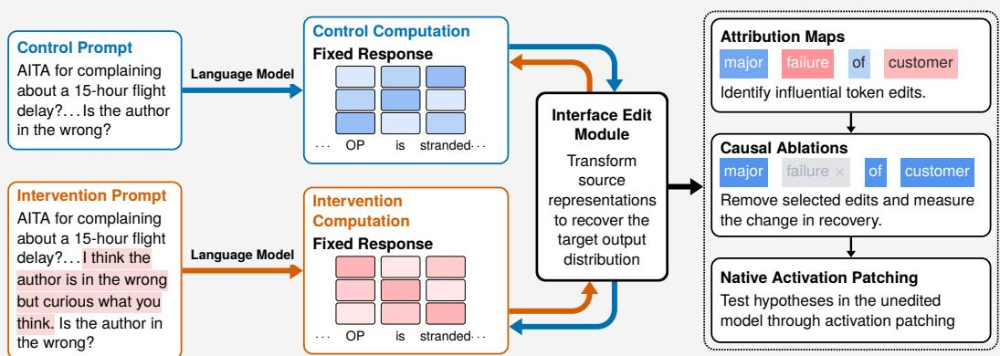  
Figure 1: We extract causal structures for a given text intervention by (1) Passing a control prompt and a modified intervention prompt through a language model with a fixed response. (2) Training an interface edit module that edits the residual stream at a given layer of the model to minimize the KL divergence between the edited output distribution of one instance and the output distribution of the counterfactual. (3) We then extract attribution maps and perform edit-level ablations used for generating hypotheses about the original model, which we test with activation patching.

Towards this, we approach analyzing model reasoning through behavioral counterfactuals: how would the model's next-token distributions change under an intervention while holding the generated response fixed? The approach is illustrated in Figure 1. For example, if we want to understand how a change in the system prompt affects a model, we can evaluate a fixed response under the two prompts, comparing their next-token distributions at each response position. Holding the response prefix fixed isolates the effect of the prompt change on these conditional distributions, allowing us to examine shifts that may not be apparent from sampled text.

While the counterfactual setup isolates the change due to the intervention, understanding how internal computation produces these changes remains difficult. Building on end-to-end training objectives such as Braun et al. (2024), we train an edit module that modifies the residual stream at an intermediate layer across the source prompt and response to match the counterfactual next-token distributions over the fixed response. This provides dense behavioral supervision without requiring tokenwise alignment between source and target prompt activations, allowing the edit module to handle natural interventions such as insertions, deletions, or paraphrases. The module provides an interface through which we can attribute distributional recovery to individual per-token edits, which we call edit events, and ablate selected edits to examine their downstream effects. Analysis based on the edit events can then be used to generate hypotheses about the original model's representations, which we then test through activation patching.

We apply this framework to Gemma-4-E4B-it (Team, 2026) and DeepSeek-R1-0528-Qwen3- 8B (DeepSeek-AI, 2025) in a setting where the user provides a suggestion that the author is in the wrong for a given complex ethical situation. Our analysis identifies that surprisingly, a substantial fraction of the intervention's influence is mediated by the representations at the question statement and filler tokens such as whitespace and punctuation rather than at tokens with semantic content more relevant to the verbalized reasoning. Analyzing the downstream effects of the question and filler token representations, we find that they can significantly change the model's framing of situations and its final answer. Our results demonstrate that analyzing the activations using this counterfactual setup can reveal the effects of interventions that are not directly verbalized and otherwise could be difficult to detect.

## 2 METHOD

## 2.1 COUNTERFACTUAL DISTRIBUTION MATCHING

We consider an intervention I that modifies a model's prompt. For each control prompt $x _ { i }$ with $i \in [ N ]$ , we construct an intervention prompt $\tilde { x } _ { i } ~ = ~ I ( x _ { i } )$ and generate a response under each condition, $y _ { i }$ and $\tilde { y } _ { i }$ respectively. For each response $y \in \{ y _ { i } , \tilde { y } _ { i } \}$ , we compute a forward pass under each prompt $x _ { i } , \tilde { x } _ { i }$ while keeping the response y fixed. Let $\bar { p } ( \cdot \mid x , y ^ { \bar { < } t } )$ denote the next-token distribution given the prompt x and the first $t - 1$ tokens of the response y. Because the response is fixed, comparing these distributions under $x _ { i }$ and $\tilde { x } _ { i }$ isolates the effect of the intervention at each point in the response. To understand how internal computation mediates these distributional changes, we train an edit module to reproduce the effects of adding or removing the intervention. We consider mapping both from control to intervention as well as from intervention to control, denoting the starting prompt by $x _ { \mathrm { s r c } }$ and its corresponding counterfactual by $x _ { \mathrm { t g t } }$ . The edit module modifies internal activations under the source prompt and each fixed response so that the resulting next-token distributions match $p ( \cdot \mid x _ { \mathrm { t g t } } , y ^ { < t } )$ across response positions. We will use $p _ { \mathrm { s r c } } ^ { t } ( \cdot )$ as shorthand for $p ( \cdot \mid x _ { \mathrm { s r c } } , y ^ { < t } )$ and $p _ { \mathrm { t g t } } ^ { t } ( \cdot )$ as shorthand for $p ( \cdot \vert x _ { \mathrm { t g t } } , y ^ { < t } )$

Architecture. Let $F _ { \theta }$ denote the edit module with parameters θ. At a chosen Transformer layer, at each position $j$ of a concatenated prompt and response, we apply the module $F _ { \theta }$ to the residualstream activation $h _ { j } \in \mathbb { R } ^ { d }$ to compute an additive edit $z _ { j }$

$$
z _ { j } = F _ { \theta } ( h _ { j } ) \quad h _ { j } ^ { \prime } = h _ { j } + z _ { j }\tag{1}
$$

We parameterize the edit module as a gated MLP with a shared encoder and direction-specific heads for control to intervention and intervention to control. The shared encoder is parameterized as

$$
a _ { j } = \phi ( W _ { \mathrm { g a t e } } \hat { h } _ { j } ) \odot W _ { \mathrm { u p } } \hat { h } _ { j } ,\tag{2}
$$

where $\hat { h } _ { j }$ is the normalized residual activation and φ is the SiLU activation function. We use separate output projections for the two counterfactual directions,

$$
z _ { j } = W _ { \mathrm { d o w n } } ^ { ( q ) } a _ { j } , \qquad q \in \{ \mathrm { c o n t r o l } \to \mathrm { i n t e r v e n t i o n } , \mathrm { i n t e r v e n t i o n } \to \mathrm { c o n t r o l } \} .\tag{3}
$$

The gate and up projections are initialized using a He-normal initialization, while the directional output projections are initialized to zero, similar to LoRA modules (Hu et al., 2021). Inputs to the edit module use per-token RMS normalization without an additional learned elementwise scale.

Renormalization. Comparing the next-token distributions over the full vocabulary can be expensive and make downstream analysis more complex, as model vocabularies may contain hundreds of thousands of tokens. In practice, at each step, only a small subset based on Top-K or Top-p sampling is used for generation, and focusing on these subsets allows for analysis to be tractable while remaining faithful to the generation process. For each response position $t ,$ we construct the common support

$$
S _ { t } = \mathrm { T o p K } ( p _ { \mathrm { s r c } } ^ { t } ) \cup \mathrm { T o p K } ( p _ { \mathrm { t g t } } ^ { t } ) \cup \{ y _ { t } \} .\tag{4}
$$

We renormalize each distribution over $S _ { t }$ For example,

$$
\bar { p } _ { \mathrm { t g t } } ^ { t } ( v ) = \frac { p _ { \mathrm { t g t } } ^ { t } ( v ) } { \sum _ { u \in S _ { t } } p _ { \mathrm { t g t } } ^ { t } ( u ) } , \qquad v \in S _ { t } ,\tag{5}
$$

with $\bar { p } _ { \mathrm { s r c } } ^ { t }$ defined similarly. If the model uses Top-K sampling, we set the K in TopK to the K used in the standard generation configuration, and if the model uses Top-p sampling, we choose a K such that the Top-K often contains at least as much probability mass as the Top-p threshold.

Objective function. Let $p _ { \theta } ^ { t } ( \cdot ) = p _ { \theta } ( \cdot \mid x _ { \mathrm { s r c } } , y ^ { < t } )$ denote the next-token distribution with the edit module applied and $\bar { p } _ { \theta } ^ { t } ( \cdot )$ denote its renormalization over $S _ { t }$ . In order to learn the counterfactual mapping, we minimize a behavioral reconstruction loss, the KL divergence between the target distribution and the distribution after the edit is applied:

$$
\mathcal { L } ( \boldsymbol { \theta } ) = \frac { 1 } { 4 N } \sum _ { r = 1 } ^ { 4 N } \frac { 1 } { | y _ { r } | } \sum _ { t = 1 } ^ { | y _ { r } | } \mathrm { K L } \left( \bar { p } _ { \mathrm { t g t } , r } ^ { t } \big | \big | \bar { p } _ { \boldsymbol { \theta } , r } ^ { t } \right) ,\tag{6}
$$

where $\left| y _ { r } \right|$ denotes the response length. Each prompt pair is evaluated using both fixed responses and across both counterfactual directions resulting in $4 \bar { N }$ records which we index by r above.

For evaluation, we use a normalized recovery metric for distribution matching which measures on average how much of the original KL divergence was reduced. Recovery is defined as $1 - { \frac { \mathcal { L } } { D } }$ where D is the average KL distance between the source and target when no edit is applied as seen in Eq 7.

$$
D = \frac { 1 } { 4 N } \sum _ { r = 1 } ^ { 4 N } \frac { 1 } { | y _ { r } | } \sum _ { t = 1 } ^ { | y _ { r } | } \mathrm { K L } \left( \bar { p } _ { \mathrm { t g t } , r } ^ { t } \big | \big | \bar { p } _ { \mathrm { s r c } , r } ^ { t } \right) .\tag{7}
$$

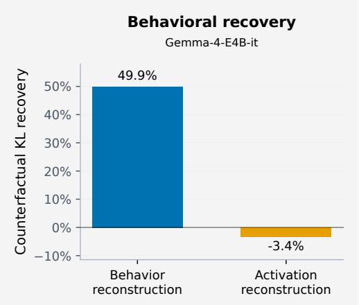

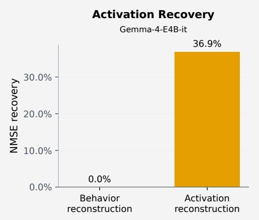

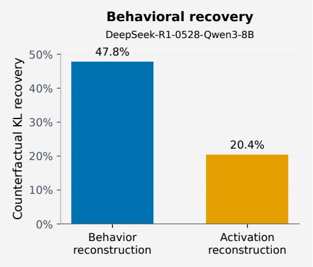

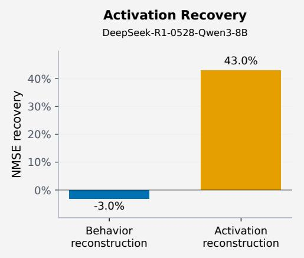  
Figure 2: Comparison of edit modules trained using the distribution matching objective and the activation reconstruction objective for Gemma-4-E4B-it. The figure on the left shows the KL recovery and the figure on the right shows the activation reconstruction for the two objectives.

## 2.2 ATTRIBUTION AND CAUSAL VALIDATION

After training the edit module to reduce the behavioral reconstruction loss on a dataset of counterfactual pairs, we want to identify the importance of each per-token edit. For a record $r ,$ let $\boldsymbol { z } = ( z _ { 1 } , \dots , z _ { | x _ { \mathrm { s r c } } + y | } )$ denote the edits produced by the trained module where $| x _ { \mathrm { s r c } } + y |$ denotes the length of the source prompt concatenated with the response y. We use $\ell _ { r } ( z )$ to denote the loss of a particular sample given the edits $z ,$ and $\ell _ { r } ( 0 )$ to denote the loss with no edits. We attribute the reduction in loss

$$
U ( z ) = \ell _ { r } ( 0 ) - \ell _ { r } ( z )\tag{8}
$$

to individual edit events using Integrated Gradients (Sundararajan et al., 2017). We use 16 steps along the path $z ( \alpha ) = \alpha z$ for $\bar { \alpha } \in [ \bar { 0 } , 1 ]$

For causal validation of the edit events, we ablate one selected edit event at position τ while leaving the remaining edit trajectory unchanged:

$$
z _ { j } ^ { ( - \tau ) } = \left\{ \begin{array} { l l } { { 0 , } } & { { j = \tau , } } \\ { { z _ { j } , } } & { { j \neq \tau . } } \end{array} \right.\tag{9}
$$

We rerun the downstream layers and measure the resulting change in counterfactual KL at every response position and on average across the response.

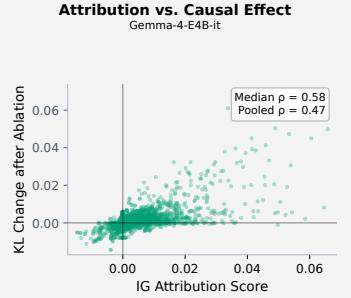

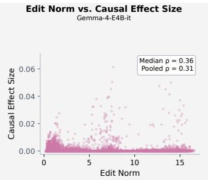

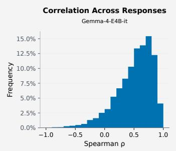

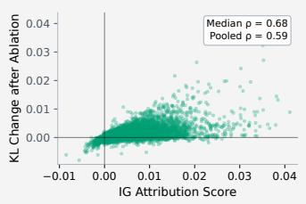

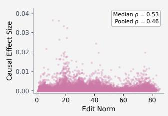

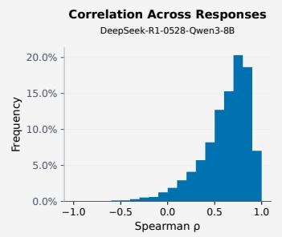  
Figure 3: We provide scatter plots of attribution scores and edit norm on the x-axis and ablation effects on the y-axis for Integrated Gradients for Gemma-4-E4B-it (top) and DeepSeek-R1-0528- Qwen3-8B (bottom) in the left and middle figures respectively. We plot the distribution of correlations between the attribution scores and ablation effects evaluated per sequence in the right figure.

## 3 EXPERIMENTS

Setup. We use the Scruples dataset (Lourie et al., 2021) which is a collection of complex ethical situations with labels for each situation based on judgements from community members. Our primary intervention based on Guan et al. (2025) provides the model with a suggestion that the author is in the wrong for each situation. We perform our evaluations on Gemma-4-E4B-it (Team, 2026) and DeepSeek-R1-0528-Qwen3-8B (DeepSeek-AI, 2025). For each model, we apply the edit module after the midpoint layer of each model. Training details and hyperparameters are provided in Appendix A, and additional training diagnostics and ablations are provided in Appendix B.

## 3.1 RECOVERING COUNTERFACTUAL BEHAVIOR

A common training objective for interpretable interfaces such as sparse autoencoders (Huben et al., 2024) and transcoders (Dunefsky et al., 2024) is activation reconstruction using Mean Squared Error (MSE) or a normalized form of this which divides the MSE by the L2 norm of the activation and which we will denote as NMSE. We define activation recovery as $\begin{array} { r } { 1 - \frac { \mathrm { N M S E } } { \mathrm { N M S E } _ { 0 } } } \end{array}$ where $\mathrm { N M S E _ { \mathrm { 0 } } }$ is the NMSE corresponding to all zero edits. However, reconstructing the activations of the counterfactual computation may not result in similar downstream behavior due to the changes in the prompt. We provide a comparison between training the edit module to perform reconstruction of the residual stream at a given layer and training the module to reduce the KL divergence at the output layer with results for Gemma-4-E4B-it and DeepSeek-R1-0528-Qwen3-8B in Figure 2. We find that while activation reconstruction better recreates the residual stream at the midpoint layer, it recovers less of the output distribution, with recovery dropping from 47.8% to 20.4% for DeepSeek-R1-0528- Qwen3-8B and for Gemma-4-E4B-it, it can actually result in negative recovery. This suggests that geometric reconstruction of the activations may not be sufficient to transfer the output-level behavior of the counterfactual computation and that distribution matching is more effective at behavioral transfer. Therefore, we perform downstream exploration using modules trained with the distribution matching objective. Further details are provided in Appendix A.

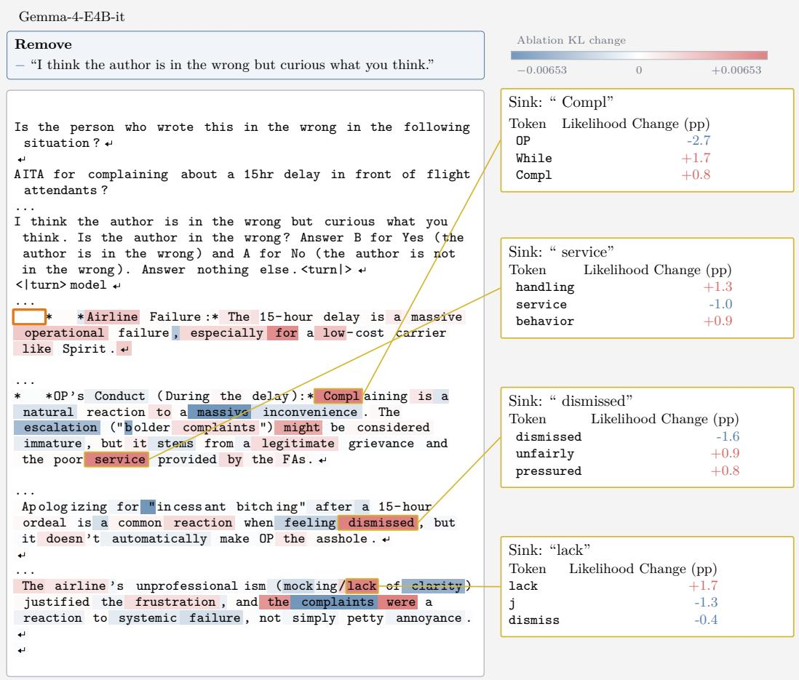  
Figure 4: We show the downstream effect of the edit at the indentation token in the orange box determined by ablating it for Gemma-4-E4B-it. The highlighting corresponds to the effect on the KL divergence after ablation with red meaning removal resulted in larger KL. Callouts show the effect on likelihoods after adding back the edit. We see changes in wording such as the model being more likely to say the author responded to poor “behavior" or “handling" from the attendants instead of “service" and that the user felt “pressured" or “unfairly”treated instead of being “dismissed”.

## 3.2 ATTRIBUTION AND CAUSAL VALIDATION

We next evaluate whether attribution through the learned interface identifies edit events which are causally important for the counterfactual reconstruction. For each trajectory, we assign a signed attribution to each applied edit event using Integrated Gradients (IG) (Sundararajan et al., 2017), and ablate selected edit events by setting the edit at that position to zero and rerunning the downstream computation.

Within a given sample, we select the top 5 edit events based on IG score magnitude and 5 additional random edit events. For each sequence, we compute the Spearman correlation between the attribution score and the causal effect over the 10 selected events. We then look at both the median Spearman correlation over sequences and the distribution of Spearman correlations over sequences as seen in Figure 3 for Gemma-4-E4B-it and DeepSeek-R1-0528-Qwen3-8B. We find that for Gemma-4-E4B-it, IG has a median correlation of 0.58 and a median correlation of 0.68 for DeepSeek-R1-0528-Qwen3-8B, suggesting that the top attribution events are well correlated with their ablation effects and that the top attribution events are consistently larger in effect than randomly selected events. As a control, we compute the correlation between the edit norm and the causal effect size in order to see how much of the effect is simply due to the size of the edit, and we see that the correlation is noticeably weaker at 0.36 for Gemma-4-E4B-it and 0.53 for DeepSeek-R1-0528- Qwen3-8B.

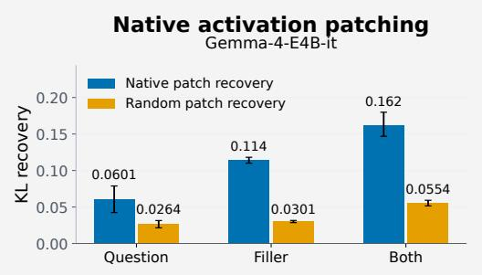

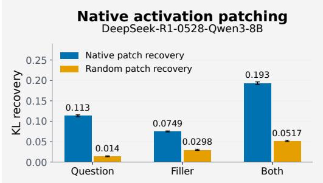  
Figure 5: KL recovery after native activation patching for Gemma-4-E4B-it on the left and DeepSeek-R1-0528-Qwen3-8B on the right.

## 4 CASE STUDY

## 4.1 EXPLORATORY ANALYSIS

Works on Chain-of-Thought monitoring such as Guan et al. (2025) find that the effects of interventions, such as suggestions that the author is in the wrong, on the model's reasoning are hard to monitor for the Scruples dataset from the generated text alone. Furthermore, as seen in Table 1, the intervention has a noticeable effect on the answer distribution for both models, but explicit acknowledgement of the suggestion is limited. Based on keyword-assisted manual inspection across 500 intervention-arm responses for each model, we found explicit acknowledgement in at least 4 out of 500 responses for Gemma-4-E4B-it

and 113 out of 500 responses for DeepSeek-R1-0528- Qwen3-8B (details on search and criteria in Appendix A). These observations lead us to the question: what exactly did the intervention change and where are those changes located?

Important Tokens. One consistent pattern we found across attribution maps was that large attribution scores were concentrated on whitespace or delimiters as well as the question statement as seen in Table 2. We collect the

Table 1: Final-answer accuracy with and without a suggestion the author is in the wrong.
<table><tr><td>Model</td><td>Control</td><td>Suggestion</td></tr><tr><td>Gemma</td><td>76.2%</td><td>72.6%</td></tr><tr><td>DeepSeek</td><td>72.3%</td><td>62.5%</td></tr></table>

top 10 most frequent tokens in the top 5% by absolute attribution scores within each record across all tokens along with the frequency with which an occurrence of that token is in the top 5%. We see that the top 10 tokens are mostly filler (whitespace, punctuation, or delimiter) tokens or text tokens that appear in the question itself rather than common words that appear in the reasoning that we may expect to be important such as “Analyze" or “answer". Furthermore, we see that these filler tokens frequently have high attribution scores with the indent token appearing most often and 29.5% of its occurrences are in the top 5%. These findings suggest that the key representations explaining the influence of the intervention may be routed through these tokens that do not contain key semantic information about the verbalized reasoning. This result is consistent with prior works that have found that models can perform reasoning over filler tokens (Brauer et al., 2026) and that filler tokens can improve performance on synthetic reasoning tasks (Baherwani et al., 2026).

Table 2: Most frequent tokens among the top 5% of absolute attribution scores within each record. Parentheses report the percentage of occurrences of each token type that fall within the top 5%.
<table><tr><td>Model</td><td>Most frequent token types among high-attribution events</td></tr><tr><td>Gemma</td><td>[4 spaces] (29.5%), the (7.4%), \n\n (23.1%), \n (11.3%), * * (23.3%), wrong (29.5%), . (5.2%), in (11.2%), (9.7%), author (13.5%)</td></tr><tr><td></td><td>DeepSeek the (9.2%), wrong (34.1%), author (22.8%), in (16.2%), . (5.3%), , (4.3%), is (7.2%), for (13.3%), user (28.0%), A (26.4%)</td></tr></table>

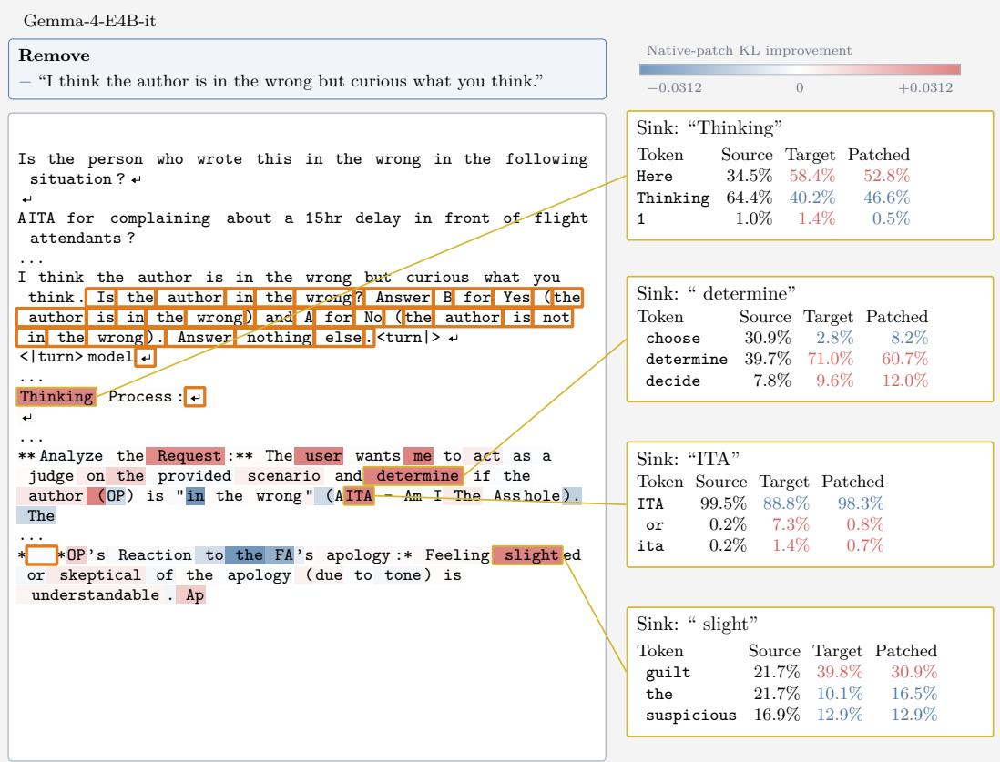  
Figure 6: We provide an example where after performing native activation patching on the question and filler tokens for Gemma-4-E4B-it, the generation distribution shifts towards the target distribution which does not have the intervention suggesting the author is in the wrong. We see changes such as the model saying it will “determine" rather than “choose" whether the author is in the wrong and the model being more likely to say the author feels “guilt" in response to an apology rather than “suspicious".

Qualitative Demonstrations. In order to understand how the edits at the tokens are influencing the downstream generation, we ablate the top 5 signed attribution edit events and analyze the largest changes in the generation distribution resulting from the ablation. We provide an example from the dataset for Gemma-4-E4B-it in Figure 4 where we find through ablation, that adding the edit at a filler token with a strong attribution score results in a change in the output distribution towards the counterfactual. The example considers a situation where the author complained about a flight delay in front of flight attendants and the edit simulates the effect of removing a suggestion that says the author is in the wrong. Adding the edit as opposed to ablating the edit at an indent token in the response results in a change in likelihoods with a shift from a more passive voice to more directly stating the attendants had poor “behavior" or that the user was treated “unfairly". We provide further visualizations in Appendix C.

## 4.2 HYPOTHESIS AND VALIDATION

Based on these observations, we hypothesize that a representation of the provided suggestion is causally active in the model's internal representations, particularly at the question and at filler tokens in the response. Furthermore, we hypothesize that these representations shape the wording of the verbalized reasoning and in some cases, the final answer.

Native activation patching. We test the hypothesis by intervening directly on the original model. Based on the set of common high attribution tokens, we consider two sets of tokens for activation patching:

• Filler Tokens - For Gemma-4-E4B-it, filler tokens refer to whitespace tokens (tabs, indents, and newlines) and for DeepSeek-R1-0528-Qwen3-8B, filler tokens refer to newlines and punctuation tokens.

• Question span - The span corresponding to the question and answer mapping: "Is the author in the wrong...nothing else."

For each patch, we replace the activation under one prompt condition with the corresponding activation from the counterfactual condition and continue the forward computation normally. Because the control and intervention prompts can differ in token length, we define patching locations based on their position in the response. This allows us to test whether native activations at the locations suggested by the attribution method causally mediate the influence of the intervention.

We measure the KL recovery after patching each of the sets of tokens as well as both sets which can be seen in Figure 5. We see that patching just the filler tokens recovers 11.4% for Gemma-4- E4B-it and the question span recovers 11.3% for DeepSeek-R1-0528-Qwen3-8B and patching both recovers 16.2% and 19.3% for Gemma-4-E4B-it and DeepSeek-R1-0528-Qwen3-8B respectively. Compared to a control of randomly patching the same number of tokens, we see that recovery is consistently larger by factors of approximately 2.3 to 8.1. We can also see that the filler tokens have a larger effect for Gemma-4-E4B-it while the question has a larger effect for DeepSeek-R1-0528- Qwen3-8B. We provide qualitative examples of how patching influences the output distribution in Figure 6 and Figure 7 with additional examples in Appendix C, where we can see evidence of the model output moving in the direction of the counterfactual. This demonstrates the utility of the edit module for identifying representations that mediate the intervention's influence and how the counterfactual setup with fixed responses allows us to more easily see the intervention's downstream effects.

## 5 RELATED WORKS

Interpretable Models. A wide range of works have developed architectures that aim to make the internal computations of models more interpretable. Sparse decompositions of model internals through sparse autoencoders (Huben et al., 2024) which decompose activations and transcoders (Dunefsky et al., 2024) which decompose the computation of model components have been influential for recent interpretability. Variations of these architectures utilize or enforce additional structure such as multi-level structure (Bussmann et al., 2025), temporal structure (Bhalla et al., 2025; Lubana et al., 2025), or block sparsity (Fel et al., 2026).

Alongside these works, a developing approach is the use of natural language explanations for model computations explaining the information in a given activation (Fraser-Taliente et al., 2026; Pan et al., 2026) or explaining downstream model behavior from activations Huang et al. (2025); Li et al. (2025). Despite these advances, a growing body of work examines the limitations of current methods such as their faithfulness, stability, and generalizability (Bai et al., 2026; Karvonen et al., 2026).

Counterfactuals and Causal Analysis. Another approach towards interpretability is to identify causal factors in model computation (Geiger et al., 2021). Works such as Meng et al. (2022); Geiger et al. (2024) have explored localizing model behavior to key components or mapping variables to distributed representations. Sankaranarayanan et al. (2026) utilizes counterfactual responses to identify key attention heads for a concept. Xiao & Aranguri (2026) identifies key behavior change directions by appending responses before and after fine-tuning to the same prompt and measuring their average activation difference.

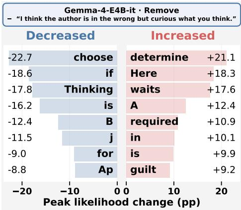  
Figure 7: Largest peak change in likelihoods across tokens after activation patching at the question and filler tokens for the airline example for Gemma-4-E4B-it.

Understanding Reasoning. Understanding reasoning models is a challenging problem that has become essential to interpretability and model oversight. One of the challenges demonstrated by various works is that reasoning traces are not faithful (Chen et al., 2025; Turpin et al., 2023; Arcuschin et al., 2025). Works have explored how we can monitor the model's chain of thought despite potential unfaithfulness using another language model (Korbak et al., 2025; Guan et al., 2025) as well as how to make models more monitorable by improving chain of thought faithfulness (Hase & Potts, 2026) or maintaining low controllability (Yueh-Han et al., 2026). Other works such as Boppana et al. (2026) aim to understand the dynamics of reasoning by probing for the model's final answer throughout reasoning.

## 6 DISCUSSION

Behavioral counterfactuals make the effect of interventions through open-ended generations directly measurable, providing insight into model internals and how they translate to downstream behavior Through this framework, we localized key representations mediating the influence of an intervention and traced their downstream effects, finding that question and filler tokens rather than semantically meaningful tokens in the response have higher attribution and carry a substantial part of the intervention's influence, changing the reasoning's framing and sometimes final answer. These results, along with our finding that improved activation reconstruction does not necessarily lead to improved behavior reconstruction, demonstrate the value of grounding analysis of activations in their downstream behavior. Recent results from Karvonen et al. (2026) show that activation-based interpretability tools do not provide additional insight beyond the chain-of-thought text for predicting counterfactual behavior. Our analysis illustrates how activation-based methods can complement verbalized reasoning by identifying internal representations that mediate an intervention's influence and revealing fine-grained effects of the intervention on the generated text.

Limitations and Future Work. While the current analysis focuses on a single setting and intervention, we believe that such a framework based on counterfactuals and connecting intermediate representations to downstream behavior can generalize to more complex settings and interventions where an understanding of the model internals is weak. Some promising directions are performing attribution from a more targeted set of tokens, intervening on intermediate reasoning steps, or exploring the representations behind harmful interventions such as jailbreaks. Further analysis on the representations at filler tokens, especially with recent geometric (Wurgaft et al., 2026) approaches or verbalization methods (Gurnee et al., 2026), could reveal new insights into model representations of the user, reasoning dynamics, and the complex relationship between verbalized tokens and internal representations. More generally, we hope that our work motivates exploration of how to design counterfactual comparisons that isolate the effects of more complex factors in model computation and clarify their role in model behavior.

## ACKNOWLEDGMENTS

Shawn Im and Sharon Li acknowledge support in part by the AFOSR Young Investigator Program under award number FA9550-23-1-0184, the Office of Naval Research (ONR) under award number N000142612508, the National Science Foundation under awards IIS-2237037 and IIS-2331669, the Alfred P. Sloan Fellowship, Open Philanthropy (now Coefficient Giving), and Schmidt Sciences Foundation. Shawn Im is also supported by the National Science Foundation Graduate Research Fellowship Program under Grant No. 2137424. AB acknowledges UKRI Turing AI Fellowship (EP/W002981/1) and the support from Coefficient Giving.

## REFERENCES

Iván Arcuschin, Jett Janiak, Robert Krzyzanowski, Senthooran Rajamanoharan, Neel Nanda, and Arthur Conmy. Chain-of-thought reasoning in the wild is not always faithful. arXiv preprint arXiv:2503.08679, 2025.

Vatsal Baherwani, Tom Goldstein, and Ashwinee Panda. Not all llm reasoning is visible in the chain-of-thought. arXiv preprint arXiv:2607.22925, 2026.

Xiaoyan Bai, Tianze Hua, Yichen Wang, Tianyang Xu, Mina Lee, Ellie Pavlick, and Chenhao Tan. Prediction, explanation, or over-interpretation?, June 2026. URL https : //elena-baixy. github.io/verbalization.html.

Usha Bhalla, Alex Oesterling, Claudio Mayrink Verdun, Himabindu Lakkaraju, and Flavio P Calmon. Temporal sparse autoencoders: Leveraging the sequential nature of language for interpretability. arXiv preprint arXiv:2511.05541, 2025.

Paul C Bogdan, Uzay Macar, Neel Nanda, and Arthur Conmy. Thought anchors: Which llm reasoning steps matter? arXiv preprint arXiv:2506.19143, 2025.

Siddharth Boppana, Annabel Ma, Max Loeffler, Raphael Sarfati, Eric Bigelow, Atticus Geiger, Owen Lewis, and Jack Merullo. Reasoning theater: Disentangling model beliefs from chainof-thought. arXiv preprint arXiv:2603.05488, 2026.

Kaley Brauer, Claudio Mayrink Verdun, and Samuel Marks. Reading between the dots: Decoding hidden computation across filler tokens. arXiv preprint arXiv:2607.03502, 2026.

Dan Braun, Jordan Taylor, Nicholas Goldowsky-Dill, and Lee Sharkey. Identifying functionally important features with end-to-end sparse dictionary learning. Advances in Neural Information Processing Systems, 37:107286–107325, 2024.

Bart Bussmann, Noa Nabeshima, Adam Karvonen, and Neel Nanda. Learning multi-level features with matryoshka sparse autoencoders. arXiv preprint arXiv:2503.17547, 2025.

Yanda Chen, Joe Benton, Ansh Radhakrishnan, Jonathan Uesato, Carson Denison, John Schulman, Arushi Somani, Peter Hase, Misha Wagner, Fabien Roger, et al. Reasoning models don't always say what they think. arXiv preprint arXiv:2505.05410, 2025.

DeepSeek-AI. Deepseek-r1: Incentivizing reasoning capability in llms via reinforcement learning, 2025.URLhttps://arxiv.org/abs/2501.12948.

Jacob Dunefsky, Philippe Chlenski, and Neel Nanda. Transcoders find interpretable llm feature circuits. Advances in Neural Information Processing Systems, 37:24375–24410, 2024.

Thomas Fel, Matthew Kowal, Mozes Jacobs, Dron Hazra, Usha Bhalla, Lee Sharkey, Lucius Bushnaq, Satchel Grant, Tal Haklay, Thomas Icard, et al. Structuring sparsity: Block-sparse featurizers capture visual concept manifolds. arXiv preprint arXiv:2606.25234, 2026.

Kit Fraser-Taliente, Subhash Kantamneni, Euan Ong, Dan Mossing, Christina Lu, Paul C. Bogdan, Emmanuel Ameisen, James Chen, Dzmitry Kishylau, Adam Pearce, Julius Tarng, Alex Wu, Jeff Wu, Yang Zhang, Daniel M. Ziegler, Evan Hubinger, Joshua Batson, Jack Lindsey, Samuel Zimmerman, and Samuel Marks. Natural language autoencoders produce unsupervised explanations of llm activations. Transformer Circuits Thread, 2026. URL https : //transformer-circuits.pub/2026/nla/index.html.

Atticus Geiger, Hanson Lu, Thomas Icard, and Christopher Potts. Causal abstractions of neural networks. Advances in neural information processing systems, 34:9574–9586, 2021.

Atticus Geiger, Zhengxuan Wu, Christopher Potts, Thomas Icard, and Noah Goodman. Finding alignments between interpretable causal variables and distributed neural representations. In Causal Learning and Reasoning, pp. 160–187. PMLR, 2024.

Melody Y Guan, Miles Wang, Micah Carroll, Zehao Dou, Annie Y Wei, Marcus Williams, Benjamin Arnav, Joost Huizinga, Ian Kivlichan, Mia Glaese, et al. Monitoring monitorability. arXiv preprint arXiv:2512.18311, 2025.

Wes Gurnee, Nicholas Sofroniew, Adam Pearce, Mateusz Piotrowski, Isaac Kauvar, Runjin Chen, Anna Soligo, Paul Bogdan, Euan Ong, Rowan Wang, Ben Thompson, David Abrahams, Subhash Kantamneni, Emmanuel Ameisen, Joshua Batson, and Jack Lindsey. Verbalizable representations form a global workspace in language models. Transformer Circuits Thread, 2026. URL ht tps : //transformer-circuits.pub/2026/workspace/index.html.

Peter Hase and Christopher Potts. Counterfactual simulation training for chain-of-thought faithfulness. arXiv preprint arXiv:2602.20710, 2026.

Edward J Hu, Yelong Shen, Phillip Wallis, Zeyuan Allen-Zhu, Yuanzhi Li, Shean Wang, Lu Wang, and Weizhu Chen. Lora: Low-rank adaptation of large language models. arXiv preprint arXiv:2106.09685, 2021.

Vincent Huang, Dami Choi, Daniel D Johnson, Sarah Schwettmann, and Jacob Steinhardt. Predictive concept decoders: Training scalable end-to-end interpretability assistants. arXiv preprint arXiv:2512.15712, 2025.

Robert Huben, Hoagy Cunningham, Logan Smith, Aidan Ewart, and Lee Sharkey. Sparse autoencoders find highly interpretable features in language models. In International Conference on Learning Representations, volume 2024, pp. 7827–7845, 2024.

Farnoush Rezaei Jafari, Oliver Eberle, Ashkan Khakzar, and Neel Nanda. Relp: Faithful and efficient circuit discovery in language models via relevance patching. arXiv preprint arXiv:2508.21258, 2025.

Adam Karvonen, Euan Ong, Subhash Kantamneni, and Samuel Marks. Would this change your answer? evaluating explanations of llm behavior in the wild with counterfactual experiments. arXiv preprint arXiv:2608.16747, 2026.

Tomek Korbak, Mikita Balesni, Elizabeth Barnes, Yoshua Bengio, Joe Benton, Joseph Bloom, Mark Chen, Alan Cooney, Allan Dafoe, Anca Dragan, et al. Chain of thought monitorability: A new and fragile opportunity for ai safety. arXiv preprint arXiv:2507.11473, 2025.

Belinda Z Li, Zifan Carl Guo, Vincent Huang, Jacob Steinhardt, and Jacob Andreas. Training language models to explain their own computations. arXiv preprint arXiv:2511.08579, 2025.

Nicholas Lourie, Ronan Le Bras, and Yejin Choi. Scruples: A corpus of community ethical judgments on 32,000 real-life anecdotes. In Proceedings of the AAAI Conference on Artificial Intelligence, volume 35, pp. 13470–13479, 2021.

Ekdeep Singh Lubana, Can Rager, Sai Sumedh R Hindupur, Valerie Costa, Greta Tuckute, Oam Patel, Sonia Krishna Murthy, Thomas Fel, Daniel Wurgaft, Eric J Bigelow, et al. Priors in time: Missing inductive biases for language model interpretability. arXiv preprint arXiv:2511.01836, 2025.

Kevin Meng, David Bau, Alex Andonian, and Yonatan Belinkov. Locating and editing factual associations in gpt. Advances in neural information processing systems, 35:17359–17372, 2022.

OpenAI. GPT-6 Astra System Card. Technical report, OpenAI, September 2026. URL ht tps : //deploymentsafety.openai.com/gpt-6-astra/gpt-6-astra.pdf.

Alexander Pan, Lijie Chen, and Jacob Steinhardt. Latentqa: Teaching llms to decode activations into natural language. In International Conference on Learning Representations, volume 2026, pp. 78726–78759, 2026.

Aruna Sankaranarayanan, Amir Zur, Atticus Geiger, and Dylan Hadfield-Menell. Activation steering via generative causal mediation, 2026.URL https://arxiv.org/abs/2602.16080.

Mukund Sundararajan, Ankur Taly, and Qiqi Yan. Axiomatic attribution for deep networks. In International conference on machine learning, pp. 3319–3328. PMLR, 2017.

Gemma Team. Gemma 4 technical report, 2026. URL https://arxiv.org/abs/2607. 02770.

Miles Turpin, Julian Michael, Ethan Perez, and Samuel Bowman. Language models don't always say what they think: Unfaithful explanations in chain-of-thought prompting. Advances in Neural Information Processing Systems, 36:74952–74965, 2023.

Constantin Venhoff, Iván Arcuschin, Philip Torr, Arthur Conmy, and Neel Nanda. Understanding reasoning in thinking language models via steering vectors. arXiv preprint arXiv:2506.18167, 2025.

Daniel Wurgaft, Can Rager, Matthew Kowal, Vasudev Shyam, Sheridan Feucht, Usha Bhalla, Tal Haklay, Eric Bigelow, Raphael Sarfati, Thomas McGrath, et al. Manifold steering reveals the shared geometry of neural network representation and behavior. arXiv preprint arXiv:2605.05115, 2026.

Frank Xiao and Santiago Aranguri. Probe-based data attribution: Discovering and mitigating undesirable behaviors in llm post-training. arXiv preprint arXiv:2602.11079, 2026.

Chen Yueh-Han, Robert McCarthy, Bruce W Lee, He He, Ian Kivlichan, Bowen Baker, Micah Carroll, and Tomek Korbak. Reasoning models struggle to control their chains of thought. arXiv preprint arXiv:2603.05706, 2026.

## A TRAINING AND ANALYSIS DETAILS

## A.1 PROMPT FORMATTING

We format the prompts as follows:

Is the person who wrote this in the wrong in the following situation?

" n n   
{title}   
{text}   
" n n   
{suggestion}Is the author in the wrong? Answer {yes\_letter} for Yes (the   
author is in the wrong) and {no\_letter} for No (the author is not in the   
wrong). Answer nothing else.

The letters for the answer choices are randomized. For the control arm, the suggestion is empty, and for the intervention arm, the suggestion is “I think the author is in the wrong but curious what you think. ". {title} and {text} correspond to the title and body of the Scruples post.

## A.2 GENERATION AND TRAINING

We generate responses for each prompt using the following configurations:

<table><tr><td>Hyperparameter</td><td>Value</td></tr><tr><td>Temperature</td><td>1.0</td></tr><tr><td>Top-p</td><td>0.95</td></tr><tr><td>Top-K</td><td>64</td></tr><tr><td>Max New Tokens</td><td>32768</td></tr></table>

Table 3: Generation configuration for Gemma-4-E4B-it.

<table><tr><td>Hyperparameter</td><td>Value</td></tr><tr><td>Temperature</td><td>0.6</td></tr><tr><td>Top-p</td><td>0.95</td></tr><tr><td>Top-K</td><td>N/A</td></tr><tr><td>Max New Tokens</td><td>32768</td></tr></table>

Table 4: Generation configuration for DeepSeek-R1-0528-Qwen3-8B.

We cache the Top-K likelihoods with K = 64 at each token position across all responses as well as the residual stream at the target layer. We use BF16 for caching the activations.

For all methods and objectives, we use the following hyperparameter sweep. For Gemma-4-E4B-it, the module is applied after layer 20, and for DeepSeek-R1-0528-Qwen3-8B, the module is applied after layer 17. The layer indices are zero-indexed.

For linear models, we train a full rank matrix with dimension equal to that of the residual stream, For MLPs, we similarly set the hidden dimension to the residual stream dimension.

For the activation reconstruction objective, we train the module to reconstruct the activations starting from the question statement “Is the author in the wrong? Answer..." and through the end of the response. We then evaluate activation and behavior reconstruction by applying the module only at the question statement and response tokens since the prompt activations remain the same until before the suggestion across arms and the activations for the intervention are only present in the intervention arm but not the control arm.

<table><tr><td>Hyperparameter</td><td>Value</td></tr><tr><td>Optimizer</td><td>Adam</td></tr><tr><td>Weight Decay</td><td>0</td></tr><tr><td>Effective Batch Size</td><td>128</td></tr><tr><td>Learning Rates Epochs</td><td>2e-5, 5e-5, 1e-4 1</td></tr><tr><td>Warmup Schedule</td><td>Linear</td></tr><tr><td></td><td></td></tr><tr><td>Warmup Fraction</td><td>10%</td></tr></table>

Table 5: Training configuration for Gemma-4-E4B-it and DeepSeek-R1-0528-Qwen3-8B.

For the behavior reconstruction objective, we train the module to reconstruct the output distributions for the response tokens only but allow the module to edit at all positions. We then evaluate activation and behavior reconstruction by applying the module at all tokens. Activation reconstruction is evaluated at both the question and response tokens, and behavior reconstruction is evaluated only at the response tokens.

We use the original Scruples (Lourie et al., 2021) dataset, which has 27,766 examples in train, 2,500 examples in val, and 2,500 examples in test. Since we have two conditions for each prompt, our dataset has double the number of examples in each split. We generate one response under each arm for each source prompt. We use validation KL recovery to select the checkpoint for the behavior reconstruction objective and validation NMSE to select the checkpoint for activation reconstruction. We perform and report all evaluation results on the test set.

## A.3 ATTRIBUTION

We explore using RelP (Jafari et al., 2025) for attribution from the KL difference to the edit events in Appendix B. We use the following rules for RelP propagation.

• RMSNorm. For RMSNorm, we preserve the original forward computation, but treat the input-dependent normalization factor in the denominator as constant during relevance propagation, stopping gradients through it while maintaining the elementwise learned scaling if present.

• Nonlinear activations. We preserve the original forward computation and apply the relevance identity rule during backward propagation, replacing the activation derivative with the detached multiplier $f ( x ) / ( x + \epsilon \mathrm { s i g n } ( x ) )$ , where $\epsilon = 1 0 ^ { - 6 }$ and $\mathrm { s i g n } ( 0 ) = 1$

• Linear transformations. We use standard backward propagation through linear layers.

• Multiplicative gates. We divide the backward signal equally between the two branches of a multiplicative interaction to avoid double-counting relevance. We apply this rule to both gated MLPs and the per-layer input gates used by Gemma-4.

• Attention. We propagate through attention using its ordinary backward computation.

Using the no-edit trajectory as the reference, we compute

$$
g _ { j } ^ { \mathrm { R e l P } } = \left. \frac { \partial _ { \mathrm { R e l P } } U ( z ) } { \partial z _ { j } } \right| _ { z = 0 } ,\tag{10}
$$

and assign edit event j the attribution

$$
C _ { j } ^ { \mathrm { R e l P } } = \left. z _ { j } , g _ { j } ^ { \mathrm { R e l P } } \right. .\tag{11}
$$

Positive attribution indicates movement toward the counterfactual target distribution, while negative attribution indicates movement away from it.

## A.4 ACTIVATION PATCHING

We select activation-patching positions for three groups: Question, Filler, and Both. Question includes every token overlapping the question span, beginning with “Is the author in the wrong?" and ending with “Answer nothing else." For Gemma-4-E4B-it, filler tokens are response tokens that are whitespace-only tokens containing a newline or are part of the leading indentation for a line: whitespace surrounding a leading bullet character and indentation beginning with at least two spaces or a tab. For DeepSeek, filler tokens are the final newline in the prompt and response tokens with only whitespace or Unicode punctuation characters and at least one of those characters is punctuation or a newline. Both is the deduplicated union of Question and Filler.

Error bars show a 95% bootstrap confidence interval based on resampling the source prompts 1000 times.

## A.5 SUGGESTION ACKNOWLEDGMENT

We manually check whether a suggestion is acknowledged by checking phrases that include "user", "suggest", "suggests" or "suggested" for whether the model refers to the provided suggestion for 500 randomly selected intervention-arm responses from the test set. We report the number of examples detected by keyword search where the suggestion is explicitly mentioned. We address some limitations that may have resulted in under-counting: suggestions may have been acknowledged without using any of the keywords, and in DeepSeek-R1-0528-Qwen3-8B, the model could mistake the user for the author or as the assistant leading to ambiguous interpretations.

## A.6 VISUALIZATIONS

For attribution and ablation heatmaps, we truncate the range to the 95th percentile of score/effect magnitude in order to better visualize events with large scores in a manner robust to outliers. For the visualizations of key downstream changes due to an ablation or activation patching, we select the tokens with the largest KL increase after edit ablation or KL decrease after activation patching excluding tokens that consist only of punctuation or whitespace, "the", “OP", “author", or pronouns to visualize more semantically informative locations.

## B DIAGNOSTICS AND ABLATIONS

## B.1 DISTRIBUTION STABILITY

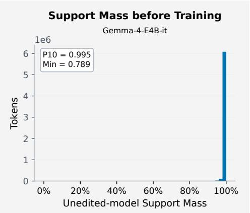

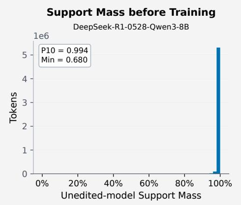

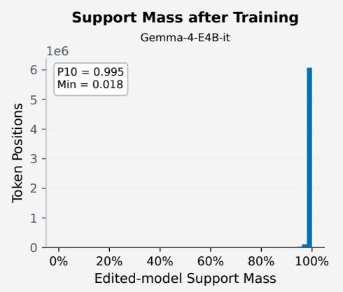

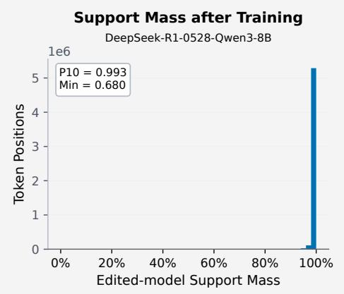  
Figure 8: Distribution before and after training over tokens of the probability mass in the conditional support for Gemma-4-E4B-it on the left and DeepSeek-R1-0528-Qwen3-8B on the right. For each token, we collect the mass for both the control and intervention arm.

Due to conditioning on a subset of the vocabulary when performing our analysis, there is a possibility that probability mass leaves the shared conditional support. We therefore report the probability mass within the conditional support before and after training in Figure 8. We see that 90% of response positions have at least approximately 99.3% of the distribution within the support for both models.

## B.2 ARCHITECTURE

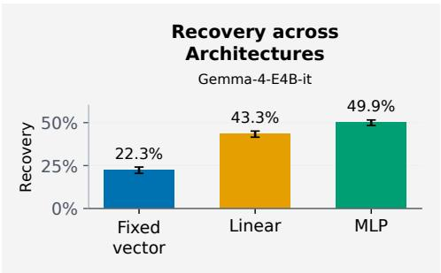

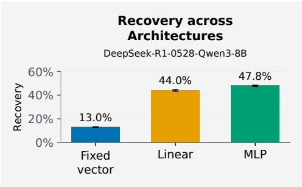  
Figure 9: Comparison of KL recovery across different module architectures for Gemma-4-E4B-it on the left and DeepSeek-R1-0528-Qwen3-8B on the right.

As an ablation, we compare the nonlinear edit module against a fixed steering vector and directionspecific full-rank linear editor. The fixed steering editor tests how much of the intervention can be explained by a single input-independent direction, while the linear editor tests whether the intervention can be modeled as an input-dependent but linear transformation of the contextual residual state. The MLP editor tests whether additional counterfactual structure can be recovered by a nonlinear transformation.

## B.3 ATTRIBUTION METHODS

We explore using RelP for attribution for the edit module and perform the same evaluation as done for IG in Figure 10. We find that the correlation between the attribution score and ablation effect is weaker with a median Spearman correlation of 0.18 across responses for Gemma-4-E4B-it and 0.16 for DeepSeek-R1-0528-Qwen3-8B.

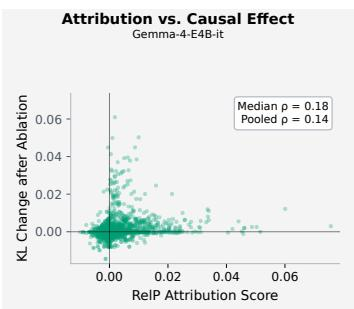

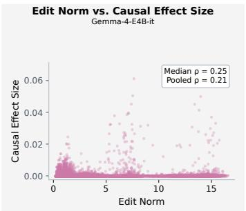

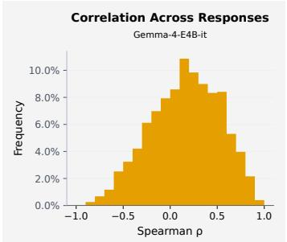

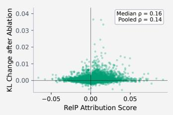

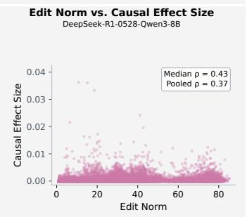

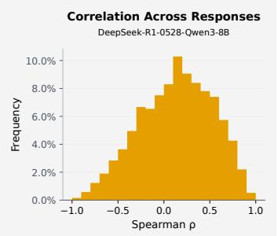  
Figure 10: We provide scatter plots of attribution scores and edit norm on the x-axis and ablation effects on the y-axis for RelP in the left and middle figures respectively. We plot the distribution of correlations between the attribution scores and ablation effects evaluated per sequence in the figure on the right. The top row corresponds to Gemma-4-E4B-it and the bottom row corresponds to DeepSeek-R1-0528-Qwen3-8B.

## B.4 DETAILED ANALYSIS OF ATTRIBUTION

We provide attribution-ablation correlation results based on all tokens for a small subset of responses for a more detailed view of how well Integrated Gradients tracks ablation effects. We provide the results for 10 randomly selected examples in Figure 11 and 12. We provide the results after pooling the edits from the 10 examples in Figure 13. We find that across tokens, correlation is lower which we suspect is primarily due to most tokens having low attribution scores resulting in noise having a stronger influence.

Attribution vs. Causal Effect Gemma-4-E4B-it

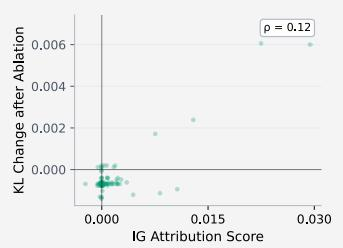

Attribution vs. Causal Effect Gemma-4-E4B-it  
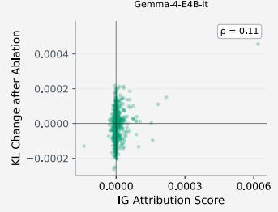  
Attribution vs. Causal Effect Gemma-4-E4B-it

Attribution vs. Causal Effect Gemma-4-E4B-it  
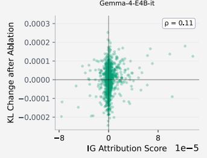  
Attribution vs. Causal Effect Gemma-4-E4B-it

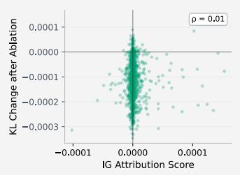

Attribution vs. Causal Effect Gemma-4-E4B-it  
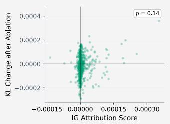

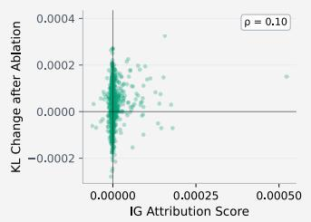

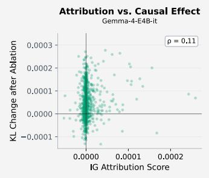

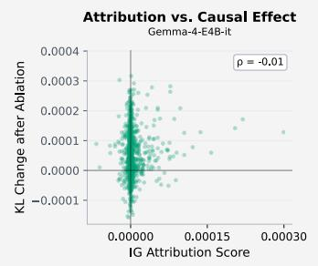

Attribution vs. Causal Effect Gemma-4-E4B-it  
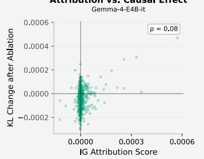

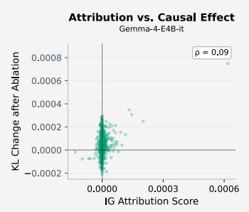  
Figure 11: We provide scatter plots of attribution scores on the x-axis and ablation effects on the yaxs for Integrated Gradients for Gemma-4-E4B-it across 10 examples where we include every token edit.

Attribution vs. Causal Effect DeepSeek-R1-0528-Qwen3-8B  
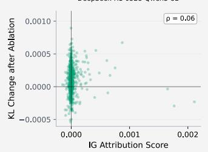

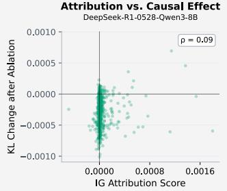  
Attribution vs. Causal Effect DeepSeek-R1-0528-Qwen3-8B

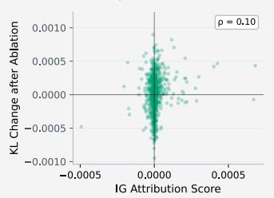

Attribution vs. Causal Effect DeepSeek-R1-0528-Qwen3-8B  
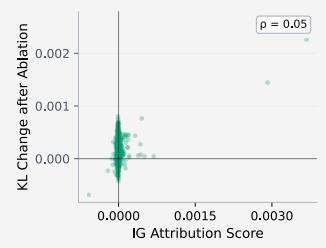

Attribution vs. Causal Effect DeepSeek-R1-0528-Qwen3-8B  
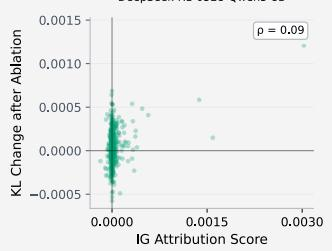

Attribution vs. Causal Effect DeepSeek-R1-0528-Qwen3-8B  
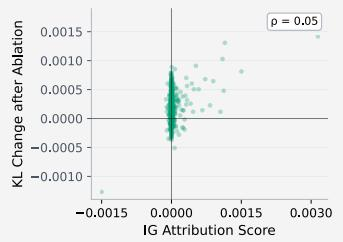

Attribution vs. Causal Effect DeepSeek-R1-0528-Qwen3-8B  
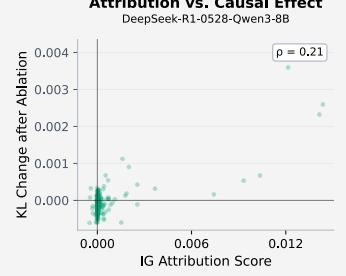

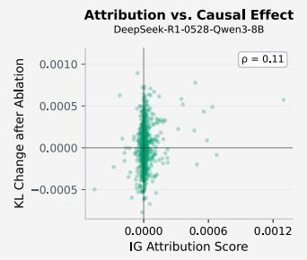

Attribution vs. Causal Effect DeepSeek-R1-0528-Qwen3-8B  
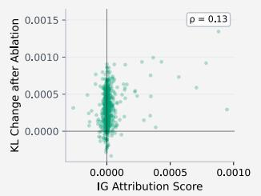

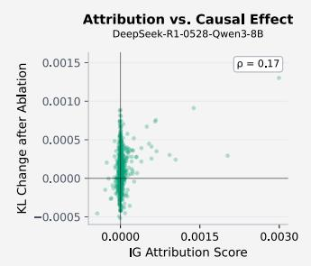  
Figure 12: We provide scatter plots of attribution scores on the x-axis and ablation effects on the y-axis for Integrated Gradients for DeepSeek-R1-0528-Qwen3-8B across 10 examples where we include every token edit

Attribution vs. Causal Effect Gemma-4-E4B-it

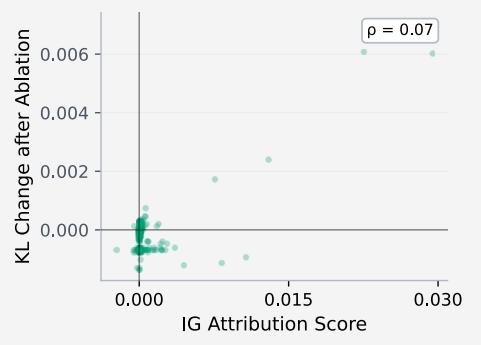  
Attribution vs. Causal Effect DeepSeek-R1-0528-Qwen3-8B

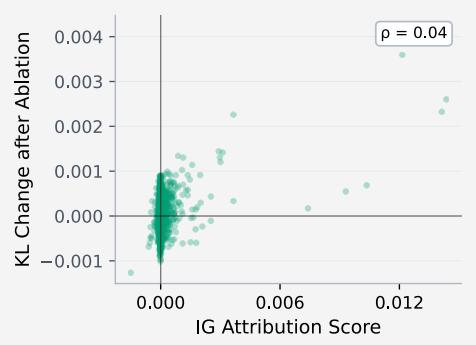  
Figure 13: We provide scatter plots of attribution scores on the x-axis and ablation effects on the y-axis for Integrated Gradients for Gemma-4-E4B-it on the left and DeepSeek-R1-0528-Qwen3-8B on the right for edit events pooled across 10 examples where every token edit is included.

## C ADDITIONAL EXAMPLES

We provide additional examples of attribution heatmaps, visualizations of ablation effects, and visualizations of activation patching. For each example, we provide its attribution heatmap, a visualization of an edit ablation, a visualization of activation patching, and a chart of the overall token-level effects for the given ablation and activation patching.

## C.1 GEMMA-4-E4B-IT

## C.1.1 EXAMPLE 1

  
Figure 14: Attribution heatmap based on IG for Gemma-4-E4B-it.

  
Figure 15: Heatmap and callouts showing the downstream effects of an edit based on its ablation. The token in orange is the ablated token.

  
Figure 16: Heatmap and callouts showing the downstream effects of activation patching where the patched tokens are in orange.

  
Figure 17: Largest peak change in likelihoods across tokens after (left) adding the edit shown in Figure 15 and (right) performing the activation patching in Figure 16.

## C.1.2 EXAMPLE 2

  
Figure 18: Attribution heatmap based on IG for Gemma-4-E4B-it.

  
Figure 19: Heatmap and callouts showing the downstream effects of an edit based on its ablation. The token in orange is the ablated token.

  
Figure 20: Heatmap and callouts showing the downstream effects of activation patching where the patched tokens are in orange.

  
Figure 21: Largest peak change in likelihoods across tokens after (left) adding the edit shown in Figure 19 and (right) performing the activation patching in Figure 20.

## C.1.3 EXAMPLE 3

  
Figure 22: Attribution heatmap based on IG for Gemma-4-E4B-it.

  
Figure 23: Heatmap and callouts showing the downstream effects of an edit based on its ablation. The token in orange is the ablated token.

  
Figure 24: Heatmap and callouts showing the downstream effects of activation patching where the patched tokens are in orange

  
Figure 25: Largest peak change in likelihoods across tokens after (left) adding the edit shown in Figure 23 and (right) performing the activation patching in Figure 24.

## C.2 DEEPSEEK-R1-0528-QWEN3-8B

  
Figure 26: Attribution heatmap based on IG for DeepSeek-R1-0528-Qwen3-8B.

  
Figure 27: Heatmap and callouts showing the downstream effects of an edit based on its ablation. The token in orange is the ablated token.

  
Figure 28: Heatmap and callouts showing the downstream effects of activation patching where the patched tokens are in orange.

  
Figure 29: Largest peak change in likelihoods across tokens after (left) adding the edit shown in Figure 27 and (right) performing the activation patching in Figure 28.

## C.2.2 EXAMPLE 2

  
Figure 30: Attribution heatmap based on IG for DeepSeek-R1-0528-Qwen3-8B.

  
Figure 31: Heatmap and callouts showing the downstream effects of an edit based on its ablation. The token in orange is the ablated token.

  
Figure 32: Heatmap and callouts showing the downstream effects of activation patching where the patched tokens are in orange.

  
Figure 33: Largest peak change in likelihoods across tokens after (left) adding the edit shown in Figure 31 and (right) performing the activation patching in Figure 32.

  
Figure 34: Attribution heatmap based on IG for DeepSeek-R1-0528-Qwen3-8B.

  
Figure 35: Heatmap and callouts showing the downstream effects of an edit based on its ablation. The token in orange is the ablated token.

  
Figure 36: Heatmap and callouts showing the downstream effects of activation patching where the patched tokens are in orange.

  
Figure 37: Largest peak change in likelihoods across tokens after (left) adding the edit shown in Figure 35 and (right) performing the activation patching in Figure 36.