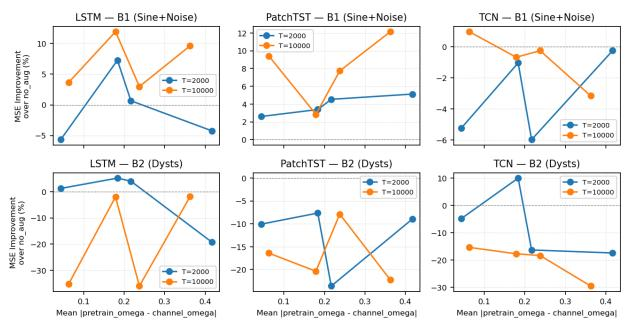
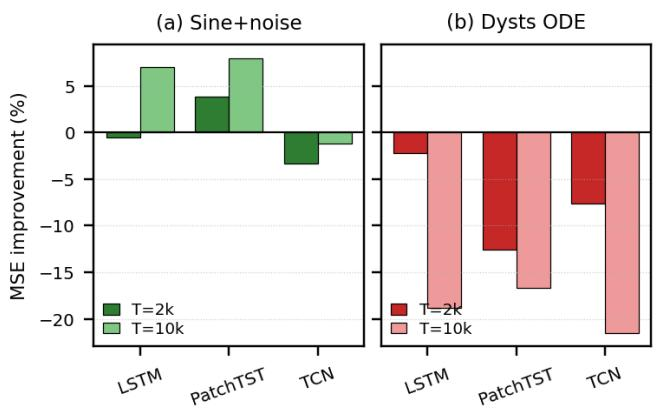

# IS SPECTRAL PREDICTABILITY ENOUGH? TESTING Ω-MATCHING FOR SYNTHETICPRETRAINING UNDER DISTRIBUTION SHIFT

Edric Castel C. Hao, Juan Raphael S. Sena, Neon S. De Jesus ˜

Analog Devices, Inc.

## ABSTRACT

Synthetic pretraining under distribution shift requires deciding what synthetic data to use. A natural criterion is to match the spectral predictability Ω of the source to the target, but is Ω sufficient? We test this hypothesis, which we call predictability-aware pretraining, across three architectures (LSTM, PatchTST, TCN) and three seeds. Under ideal synthetic-to-synthetic conditions, Ω-matched pretraining can outperform even an oracle baseline (+46.8% MSE reduction, LSTM), though the benefit is already architecturedependent. On the real-world ETTm1 benchmark, however, this relationship does not hold: sine-plus-noise pretraining at matched Ω yields only a marginal mean improvement (+2.3% averaged over all three architectures, up to +65.5% on individual channels), whereas Ω-matched chaotic ODE trajectories systematically degrade performance (−13.2%). The two sources agree on the direction of transfer for only 53% of configurations across all three architectures (Pearson $r = - 0 . 0 2 )$ , indicating that Ω carries little information about which source will transfer beneficially. We further observe an architecture-dependent asymmetry in the response to the direction of the Ω gap. We conclude that Ω matching can help in controlled settings but is not sufficient to predict transfer across sources, and we discuss additional signal properties that a source-selection criterion may need to consider.

Index Terms— time series forecasting, transfer learning, spectral predictability, synthetic pretraining, distribution shift

## 1. INTRODUCTION

Variable renewable sources (solar PV and wind) lower the spectral predictability of grid load signals, making multi-step forecasting harder [1]. Predictability can be quantified via $\Omega \in [ 0 , 1 ]$ , where high Ω indicates a strongly periodic signal and low Ω is chaotic-like [2]. This raises a concrete, practical question for anyone building forecasters for shifting regimes:

limited synthetic pretraining data calibrated to any target Ω, circumventing the scarcity of real domain data. The approach is an instance of transfer learning [3] and is related to recent time-series foundation models that rely on largescale (self-)pretraining [4, 5]. We refer to this hypothesis as predictability-aware (pred aware) pretraining: synthetic source data are generated with Ω matched to the target regime, and the model is subsequently fine-tuned on the limited available target data.

Rather than proposing pred aware as a solution, we treat it as a hypothesis to be tested. We first establish, under fully controlled synthetic-to-synthetic conditions, that Ω matching behaves as hypothesized. We then assess whether this behavior persists on real data by pretraining on two markedly different Ω-matched synthetic sources (sine-plusnoise and chaotic ODE trajectories) and fine-tuning on the ETTm1 benchmark. Contrary to expectation, the two sources, matched to the same target Ω, produce sharply divergent and near-uncorrelated outcomes. This constitutes a negative result: Ω alone is not a reliable criterion for source selection. We conclude by discussing candidate factors that such a criterion may need to incorporate.

## 2. BACKGROUND AND METHOD

Spectral predictability Ω. Following [2], we define $\Omega =$ $1 - H _ { \mathrm { n o r m } } .$ , where $H _ { \mathrm { n o r m } }$ is the normalized spectral entropy of the signal’s power spectral density (PSD), so $\Omega = 1$ for periodic signals and $\Omega = 0$ for white noise [6]. Ω is one of several forecastability measures [7, 8] that summarize how hard a series is to predict. We write $\omega _ { \mathrm { p r e } }$ for the pretraining Ω and $\omega _ { \mathrm { t g t } }$ for the target, with gap $\Delta \omega = \omega _ { \mathrm { p r e } } - \omega _ { \mathrm { t g t } }$

Estimating the target Ω. The target Ω is estimated from the PSD of the first T rows of ETTm1 (i.e., the fine-tuning prefix a practitioner would actually have), using the spectral-entropy formula above. Computed this way, the per-channel target Ω of ETTm1 ranges from 0.36 to 0.76 across the seven channels, which is the range pred aware attempts to match.

Conditions. We compare four conditions, each testing a specific hypothesis: no aug (no pretraining; the reference point), pred aware aug (synthetic pretraining at Ω matched to $\omega _ { \mathrm { t g t } } ;$ the hypothesis under test), random synthetic aug (Ω drawn uniformly from [0, 1]; an Ω- agnostic synthetic baseline that isolates the value of match-$i n g )$ , and oracle (pretraining on real target-domain data; an upper bound, available only in the synthetic-to-synthetic study).

Fine-tuning. All ETTm1 experiments use a two-stage procedure. Stage 1: pretrain the model on synthetic data generated at the matched Ω. Stage 2: fine-tune the pretrained model on the first $T$ rows of ETTm1 using identical hyperparameters across conditions. Evaluation is on the held-out test window, ETTm1 rows 46,080–69,679, which never overlaps the fine-tuning prefix.

Sine-plus-noise generation. Synthetic sequences are $\begin{array} { r } { x ( t ) \ = \ \sum _ { k = 1 } ^ { K } A _ { k } \sin ( 2 \pi f _ { k } t + \phi _ { k } ) + \sigma \varepsilon ( t ) } \end{array}$ with ε(t) ∼ $\mathcal { N } ( 0 , 1 )$ . The noise level $\sigma$ controls Ω by adjusting the balance between harmonic and broadband spectral energy.

Dysts ODE generation. The second source draws trajectories from the ${ \mathrm { d } } { \mathrm { y } } { \mathrm { s t } } s$ library [9] of chaotic dynamical systems. For each target ω and sequence length, we select the system whose empirical Ω most closely matches the target and integrate it to produce the pretraining sequence. The selected systems span diverse dynamics (e.g., ExcitableCell, GuckenheimerHolmes, SprottH, StickSlipOscillator), with achieved Ω within ±0.01 of the target except at $\omega = 0 . 9$ . Crucially, these trajectories are matched to the target only in Ω. Their local waveform structure is otherwise unconstrained, which is central to the source comparison in Sec. 3.4.

Architectures. We evaluate three families: LSTM [10] (recurrent); PatchTST [11] (patch-based attention); and TCN (Temporal Convolutional Network) [12], a convolutional architecture with dilated causal convolutions (kernel size=2, dilations=[1,2,4,8,16]).

Experimental setup. We evaluate all three models on ETTm1, a standard long-horizon forecasting benchmark [13, 14], with dataset sizes $T \in \{ 2 0 0 0 , 1 0 0 0 0 \}$ }, all seven channels, and pretraining $\omega \in \{ 0 . 3 , 0 . 5 , 0 . 7 , 0 . 9 \}$ , over three seeds $( 1 2 3 , 4 5 6 , 7 8 9 )$ . All reported values are seed-averaged. The $\omega ~ = ~ 0 . 9$ target was not fully achievable: sine-plus-noise reached $\Omega \approx 0 . 8 0 – 0 . 8 4$ even at zero noise (spectral leakage from finite sequence length), and the dysts sources reached $\Omega ~ \approx ~ 0 . 8 6 \mathrm { - } 0 . 8 9$ All other targets were achieved within ±0.01. Results labeled $\omega = 0 . 9$ reflect these achieved values.

## 3. RESULTS

## 3.1. Verification under Ideal Conditions (Synthetic → Synthetic)

As a controlled verification, we train and test on synthetic data with known Ω, isolating the Ω gap from all other confounds and thereby providing the most favorable setting for the hypothesis. At $\Delta \omega ~ = ~ + 0 . 4$ (the largest gap tested; down-gap $\omega _ { \mathrm { p r e } } 0 . 7 \  \ \omega _ { \mathrm { t g t } } 0 . 3 )$ , pred aware exceeds even the oracle baseline for all three architectures, most strongly for LSTM (∼31 pp; Table 1). The advantage over the Ω-agnostic random synthetic baseline is, however, small and architecture-dependent: the two are comparable for LSTM (+46.8% vs. +46.7%) and PatchTST (+1.3% $\mathrm { v s . ~ - 3 . 4 \% ) }$ , while for TCN random synthetic is the stronger of the two $( + 6 . 4 \% \ \mathrm { v s . - 2 . 5 \% ) }$ . Much of the reduction over no aug at this gap is thus attributable to synthetic pretraining in general rather than to Ω-matching alone. The sharper, direction-specific Ω effect appears in Table 2. We regard this as a verification step, not the principal result.

Table 1. Verification (synthetic → synthetic). MSE reduction vs. no aug at $\Delta \omega = + 0 . 4$ (down-gap $\omega _ { \mathrm { p r e } } 0 . 7  \omega _ { \mathrm { t g t } } 0 . 3 )$ mean over dataset sizes. Positive = improvement; bold = best per model.
<table><tr><td>Strategy</td><td>LSTM</td><td>PatchTST</td><td>TCN</td></tr><tr><td>random_synthetic</td><td> $+ 4 6 . 7 \%$ </td><td> $- 3 . 4 \%$ </td><td> $+ 6 . 4 \%$ </td></tr><tr><td>oracle</td><td> $+ 1 6 . 0 \%$ </td><td> $- 1 0 . 8 \%$ </td><td> $- 6 . 4 \%$ </td></tr><tr><td>pred_aware</td><td> $+ 4 6 . 8 \%$ </td><td> $+ 1 . 3 \%$ </td><td> $- 2 . 5 \%$ </td></tr></table>

Table 2. Directional asymmetry at $| \Delta \omega | = 0 . 4 .$ . MSE reduction (%) vs. no aug. Positive = improvement.
<table><tr><td>Direction</td><td>LSTM</td><td>PatchTST</td><td>TCN</td></tr><tr><td>Down-gap  $( 0 . 7  0 . 3 )$ </td><td> $+ 4 6 . 8 \%$ </td><td> $+ 1 . 3 \%$ </td><td>-2.5%</td></tr><tr><td>Up-gap  $( 0 . 3  0 . 7 )$ </td><td> $- 6 5 . 7 \%$ </td><td> $+ 8 6 . 4 \%$ </td><td>-1.7%</td></tr></table>

Even in this ideal setting, the benefit depends on the direction of the gap, and does so differently across architectures (Table 2). LSTM benefits strongly from down-gap pretraining $( + 4 6 . 8 \%$ , pretraining more predictable than target) but is harmed by up-gap $\left( - 6 5 . 7 \% \right)$ . PatchTST shows the opposite, gaining from up-gap $( + 8 6 . 4 \% )$ but almost nothing from down-gap (+1.3%). TCN is near-neutral in both directions $( - 2 . 5 \%$ down, −1.7% up). We return to this asymmetry in Sec. 4.

## 3.2. Cross-Domain Transfer: Sine-Plus-Noise → ETTm1

On ETTm1, the pronounced effect observed under ideal conditions largely disappears. Averaged over all three architectures, mean improvement from Ω-matched sine-plus-noise pretraining is only +2.3% over no aug, with large perchannel variance (Tables 3–5): the best single configuration reaches +65.5% (PatchTST, $T { = } 1 0 \mathbf { k } .$ , HUFL, $\omega { = } 0 . 9 )$ while others degrade. Crucially, the Ω gap no longer predicts the benefit. Correlating the gap $\Delta \omega$ against each configuration’s normalized MSE tests whether a larger predictability gap systematically brings better or worse transfer. We find that it does not. The association is weak for every architecture (LSTM r=0.01, PatchTST $r { = } { - } 0 . 0 3$ , TCN $r { = } 0 . 1 4 ;$ pooled r=0.02), and even the strongest case, TCN, explains under 2% of the outcome variance, so the size of the Ω gap has essentially no bearing on how well the source transfers. Per-model means (Table 6) show LSTM and PatchTST improving mildly, more so at T=10k, whereas TCN is flat-toslightly-harmful (−3.3% at T=2k, −1.2% at T=10k; −2.3% overall): its per-channel table (Table 5) is dominated by values > 1.0, with improvements confined to a few channels. This indicates that architecture, rather than Ω, is the primary determinant of the outcome.

Table 3. LSTM normalized MSE under sine-plus-noise pretraining (pred aware / no aug, < 1.0 = improvement, bold) by channel and pretrain ω (seed-averaged).
<table><tr><td rowspan="2"> $\operatorname { C h } .$ </td><td colspan="4">T=2000</td><td colspan="4">T=10000</td></tr><tr><td> $\omega . 3$ </td><td>ω.5</td><td> $\omega . 7$ </td><td> $\omega . 9$ </td><td> $\omega . 3$ </td><td> $\omega . 5$ </td><td> $\omega . 7$ </td><td> $\omega . 9$ </td></tr><tr><td>HUFL</td><td>1.059</td><td></td><td></td><td></td><td>1.247 0.988 1.155 1.096 0.947 0.819 0.762</td><td></td><td></td><td></td></tr><tr><td>HULL</td><td>0.977</td><td></td><td></td><td></td><td></td><td></td><td></td><td>1.050 1.047 1.012 0.905 0.924 0.930 0.991</td></tr><tr><td>LUFL</td><td>1.088 1.004 0.930 0.915 0.982 1.005 1.001 1.012</td><td></td><td></td><td></td><td></td><td></td><td></td><td></td></tr><tr><td>LULL</td><td>0.896 0.991 1.010 0.912 0.919 0.884 0.858 0.999</td><td></td><td></td><td></td><td></td><td></td><td></td><td></td></tr><tr><td>MUFL 0.595 1.058 0.912 1.398 0.938 1.003 0.531 0.637</td><td></td><td></td><td></td><td></td><td></td><td></td><td></td><td></td></tr><tr><td>MULL 0.922 1.048 1.053 0.979 0.952 1.006 1.002 0.948</td><td></td><td></td><td></td><td></td><td></td><td></td><td></td><td></td></tr><tr><td>OT</td><td>0.953 1.000 1.014 0.926 1.000 0.978 1.023 0.977</td><td></td><td></td><td></td><td></td><td></td><td></td><td></td></tr></table>

Table 4. PatchTST normalized MSE under sine-plus-noise pretraining (pred aware / no aug, < 1.0 = improvement, bold) by channel and pretrain ω (seed-averaged).
<table><tr><td rowspan="2">Ch.</td><td colspan="4">T=2000</td><td colspan="4">T=10000</td></tr><tr><td>ω.3</td><td>ω.5</td><td>ω.7</td><td>ω.9</td><td>ω.3</td><td>ω.5</td><td>ω.7</td><td> $\omega . 9$ </td></tr><tr><td>HUFL</td><td>0.978</td><td>0.839</td><td>0.844</td><td>0.753</td><td>0.813</td><td>0.799</td><td></td><td>0.697 0.345</td></tr><tr><td>HULL</td><td>1.013</td><td>0.978</td><td>1.019</td><td>0.945</td><td>0.936 0.920</td><td></td><td>0.916 0.997</td><td></td></tr><tr><td>LUFL</td><td>0.992</td><td></td><td></td><td></td><td>1.066 1.034 0.994 0.915 0.923 0.883 0.920</td><td></td><td></td><td></td></tr><tr><td>LULL</td><td>0.981 0.981 0.942 0.951 0.919 0.946 1.004 1.020</td><td></td><td></td><td></td><td></td><td></td><td></td><td></td></tr><tr><td>MUFL</td><td>0.749 0.940 0.835 0.995 0.914 0.748 1.341 0.891</td><td></td><td></td><td></td><td></td><td></td><td></td><td></td></tr><tr><td>MULL</td><td>1.040 1.015 1.017 1.024 0.971 1.025 0.974 0.995</td><td></td><td></td><td></td><td></td><td></td><td></td><td></td></tr><tr><td>OT</td><td>1.010 0.999 0.991 0.979 0.991 0.979 0.986 0.983</td><td></td><td></td><td></td><td></td><td></td><td></td><td></td></tr></table>

## 3.3. Cross-Domain Transfer: Dysts ODE → ETTm1

If Ω were the operative variable, substituting a different synthetic source matched to the same target Ω would preserve the outcome, but instead it reverses it. Replacing sine-plus-noise with Ω-matched chaotic ODE trajectories from dysts [9] converts the marginal gain into systematic degradation: mean improvement is −13.2%. Every model/size cell is negative (Table 6), with extreme worst cases such as −243.6% (LSTM, T=10k, MUFL, ω=0.5), −137.0% (PatchTST, T=10k, MUFL, ω=0.7), and −128.6% (LSTM, T=10k, HUFL, ω=0.3). The MUFL channel at T=10k is particularly sensitive. TCN degrades consistently as well (−7.6% at T=2k, −21.5% at T=10k; −14.5% overall), indicating that the degradation is not architecture-specific and is not mitigated by Ω matching.

Table 5. TCN normalized MSE under sine-plus-noise pretraining (pred aware / no aug, < 1.0 = improvement, bold) by channel and pretrain ω (seed-averaged).
<table><tr><td rowspan="2"> $\operatorname { C h } .$ </td><td colspan="4">T=2000</td><td colspan="4">T=10000</td></tr><tr><td> $\omega . 3$ </td><td> $\omega . 5$ </td><td> $\omega . 7$ </td><td> $\omega . 9$ </td><td> $\omega . 3$ </td><td> $\omega . 5$ </td><td> $\omega . 7$ </td><td> $\omega . 9$ </td></tr><tr><td>HUFL</td><td>0.990</td><td>1.126</td><td>1.240</td><td>0.868</td><td>1.027</td><td>0.832</td><td>0.949</td><td>1.020</td></tr><tr><td>HULL</td><td>1.067</td><td>1.037</td><td>1.008</td><td>1.016</td><td>1.054</td><td>0.986</td><td>1.042</td><td>1.062</td></tr><tr><td>LUFL</td><td>0.993</td><td>1.037</td><td>1.058</td><td>1.082</td><td>1.039</td><td>1.047</td><td>1.028 1.057</td><td></td></tr><tr><td>LULL</td><td>1.067</td><td>1.025</td><td>1.040</td><td>1.059</td><td>1.017</td><td>1.005</td><td>1.009</td><td>1.035</td></tr><tr><td></td><td>MUFL 0.960</td><td>1.149</td><td>1.068</td><td></td><td>0.983 0.871</td><td>1.088</td><td></td><td>1.011 1.044</td></tr><tr><td>MULL 0.992</td><td></td><td>1.001 1.001</td><td></td><td></td><td></td><td>1.022 1.043 1.004</td><td></td><td>4 1.035 1.041</td></tr><tr><td>OT</td><td>1.021 1.014 1.018 0.992 0.996 1.005 0.997 0.984</td><td></td><td></td><td></td><td></td><td></td><td></td><td></td></tr></table>

Table 6. Mean improvement (%) vs. no aug by model and T, seed-averaged. Positive = improvement. B1: sine-plusnoise. B2: dysts ODE.
<table><tr><td rowspan="2">Model</td><td colspan="2">B1 (sine+noise)</td><td colspan="2">B2 (dysts ODE)</td></tr><tr><td>T=2000</td><td>T=10000</td><td>T=2000</td><td>T=10000</td></tr><tr><td>LSTM</td><td>-0.5</td><td>+7.0</td><td>-2.2</td><td>-18.8</td></tr><tr><td>PatchTST</td><td>+3.9</td><td>+8.0</td><td>-12.6</td><td>-16.7</td></tr><tr><td>TCN</td><td>-3.3</td><td>-1.2</td><td>-7.6</td><td>-21.5</td></tr></table>

## 3.4. Source Disagreement at Matched Ω

Fig. 1 compares the two sources at matched Ω. Were Ω the determining factor, the per-configuration outcomes would align. Instead, they are nearly uncorrelated. Pooling all three architectures (168 configurations), we correlate each configuration’s improvement under sine-plus-noise against its improvement under dysts ODE at the same target Ω. This asks a different question from Sec. 3.2: not whether the Ω gap predicts one source’s outcome, but whether two Ω-matched sources rise and fall together. They do not: agreeing on the direction of transfer (both improve or both degrade) for only 53% of configurations (barely above chance) with Pearson $r = - 0 . 0 2$ . Matching Ω therefore carries almost no information about whether a given source will improve performance on real data.

This divergence admits a structural explanation. Chaotic ODE trajectories exhibit multi-scale oscillations, sharp amplitude transitions, and sensitive dependence on initial conditions, none of which are present in ETTm1. Even after global Ω matching, this local temporal structure remains incompatible with the target, producing representational mismatch during fine-tuning. Sine-plus-noise, being spectrally simple and locally smooth, is structurally closer to quasi-periodic realworld load signals, and consequently transfers more favorably despite identical Ω.

## 4. DISCUSSION

Interpretation. Under ideal conditions, Ω matching behaves as hypothesized and the Ω gap accounts for most of the variation in transfer quality. On real data, it is not, as two sources at the same target Ω diverge almost completely $( r = - 0 . 0 2 )$ . Ω matching can therefore help in controlled settings but is not sufficient to predict transfer across sources. In practice, Ω is best employed as a coarse screen (to exclude sources with gross mismatch) rather than as a guarantee of beneficial transfer. It is thus most dependable for interpolating within a single spectrally simple generator, as in our synthetic-to-synthetic study, and least dependable for selecting between generatorfamilies.

  
Fig. 1. Sine-plus-noise vs. dysts ODE per-configuration improvement at matched Ω (2 × 3 grid over source/model). The near-random scatter $( r = - 0 . 0 2 { \mathrm { . } }$ , 53% directional agreement) shows Ω matching alone does not determine transfer quality.

Factors beyond Ω. The dysts failure implicates properties that Ω does not capture, as Ω is a single global summary of the PSD and is insensitive to other signal characteristics. Three properties are plausible candidates. (i) Waveform smoothness and higher-order structure: the sharp amplitude transitions and cusps of the ODE sources have no analog in ETTm1, whereas smooth sine-plus-noise transfers more effectively at identical Ω. (ii) Correlation structure: the autocorrelation decay and cross-channel dependence of the source may need to resemble those of the target, not merely its spectral entropy. (iii) Source geometry and phase continuity: sensitive dependence on initial conditions renders ODE trajectories locally unpredictable in ways that a global spectral measure averages out. An effective selection criterion would likely combine Ω with such local descriptors.

Guidance for practitioners. We recommend: (1) preferring spectrally simple, locally smooth generators (sineplus-noise, spectral interpolation) over chaotic ODE libraries, which match Ω but introduce structural artifacts; (2) using Ω only to screen gross mismatches, not to rank close candidates; and (3) validating a candidate source on a small held-out target prefix before large-scale pretraining, since the sign of transfer is not predictable from Ω.

Architecture-dependent asymmetry. The architectures respond differently to pretraining, and Ω does not account for the difference. In the ideal setting (Table 2), the response depends on the direction of the Ω gap: LSTM gains from downgap but is harmed by up-gap, whereas PatchTST shows the opposite, indicating that recurrent and attention-based models encode predictability differently. TCN forms a third pattern, near-neutral in both directions (−2.5%/−1.7%). This carries over to real data (Fig. 2): TCN barely responds to sine-plusnoise, whereas LSTM and PatchTST benefit, yet all three degrade under chaotic ODE data. Three distinct response patterns at matched Ω reinforce the central conclusion: the dominant factor is source geometry and its interaction with the model, not Ω.

  
Fig. 2. Architecture-dependent response. Mean MSE improvement (%) vs. no aug by model and dataset size T for each synthetic source. The three architectures show three distinct patterns: LSTM and PatchTST benefit from spectrally simple sine-plus-noise (a), TCN stays roughly neutral, yet all three degrade under Ω-matched chaotic ODE data (b). Matching Ω does not equalize these outcomes.

Limitations. The evidence covers one real-world benchmark (ETTm1) and two synthetic source families, so generalization to other domains and generators remains open. The candidate factors are motivated by the dysts failure rather than isolated in a controlled ablation, and the reported correlations are descriptive rather than causal. Finally, the $\omega = 0 . 9$ setting reflects achieved values of $\Omega \approx 0 . 8 0 – 0 . 8 9$ , while three seeds provide only a coarse estimate of run-to-run variance.

Conclusion. We asked whether spectral predictability Ω is a reliable criterion for selecting synthetic pretraining data under distribution shift. The evidence suggests otherwise. Ω matching is effective under ideal, single-source conditions but fails across sources: two generators matched to the same target Ω transfer to ETTm1 in near-uncorrelated ways $( r = - 0 . 0 2 )$ and chaotic ODE data degrades every architecture. A reliable criterion will likely need local waveform structure, correlation geometry, and architecture-specific effects in addition to Ω, and chaotic ODE data should not be used as a pretraining surrogate without prior validation of its compatibility with the target.

## 5. ACKNOWLEDGMENTS

Acknowledgments. We thank our colleagues and collaborators for their valuable feedback and support throughout this research. We thank the Software and Digital Platforms Department Management, specifically Richard Guinto, Johann Ignacio, and Carlos Bating, for supporting this study. Analog Garage and Atulya Yellepeddi deserve special mention for their insightful discussions and contributions. Special thanks for the constructive feedback and guidance go to our technical reviewers on the Analog Devices Technical Review Board.

AI assistance. Generative AI tools were used to assist with drafting and revising the manuscript, coding, and LaTeX formatting. The research methodology, experimental design, scientific claims, interpretation of results, and conclusions were developed and validated by the authors, who take full responsibility for the final manuscript.

## 6. REFERENCES

[1] F. Bouffard and F. D. Galiana, “Stochastic security for operations planning with significant wind power generation,” IEEE Trans. Power Syst., vol. 23, no. 2, pp. 306– 316, 2008.

[2] O. Wang, P. Quan, K. Yang, and M. Srivastava, “Spectral predictability as a fast reliability indicator for time series forecasting model selection,” arXiv preprint arXiv:2511.08884, 2025.

[3] S. J. Pan and Q. Yang, “A survey on transfer learning,” IEEE Trans. Knowl. Data Eng., vol. 22, no. 10, pp. 1345–1359, 2010.

[4] O. Y. L. Imanov, D. U. Kulali, and T. Yilmaz, “Patch-Former: A patch-based time series foundation model with hierarchical masked reconstruction,” IEEE Trans. Neural Netw. Learn. Syst., 2026.

[5] T. Qiu, Y. Xie, H. Niu, Y. Xiong, and X. Gao, “Enhancing masked time-series modeling via dropping patches,” in Proc. AAAI Conf. Artif. Intell., 2025.

[6] T. Inouye, K. Shinosaki, H. Sakamoto, S. Toi, S. Ukai, A. Iyama, Y. Katsuda, and M. Hirano, “Quantification of EEG irregularity by use of the entropy of the power spectrum,” Electroencephalogr. Clin. Neurophysiol., vol. 79, no. 3, pp. 204–210, 1991.

[7] R. Wang, S. Klee, and A. Roos, “Time series forecastability measures,” in KDD Workshop on AI for Supply Chain, 2025.

[8] W. Feng, Y. Yuan, J. Ding, and Y. Li, “Beyond model ranking: Predictability-aligned evaluation for time series forecasting,” in Proc. Int. Conf. Mach. Learn. (ICML), 2026.

[9] W. Gilpin, “Chaos as an interpretable benchmark for forecasting and data-driven modelling,” in Proc. Adv. Neural Inf. Process. Syst. (NeurIPS), 2021.

[10] S. Hochreiter and J. Schmidhuber, “Long short-term memory,” Neural Computation, vol. 9, no. 8, pp. 1735– 1780, 1997.

[11] Y. Nie, N. H. Nguyen, P. Sinthong, and J. Kalagnanam, “A time series is worth 64 words: Long-term forecasting with transformers,” in Proc. Int. Conf. Learn. Represent. (ICLR), 2023.

[12] S. Bai, J. Z. Kolter, and V. Koltun, “An empirical evaluation of generic convolutional and recurrent networks for sequence modeling,” arXiv preprint arXiv:1803.01271, 2018.

[13] H. Wu, J. Xu, J. Wang, and M. Long, “Autoformer: Decomposition transformers with auto-correlation for long-term series forecasting,” in Proc. Adv. Neural Inf. Process. Syst. (NeurIPS), 2021.

[14] H. Zhou, S. Zhang, J. Peng, S. Zhang, J. Li, H. Xiong, and W. Zhang, “Informer: Beyond efficient transformer for long sequence time-series forecasting,” in Proc. AAAI Conf. Artif. Intell., 2021, vol. 35, pp. 11106– 11115.