# Joules-to-GDP: How Much Economic Value Do AI Systems Produce per Unit of Energy?

Amirreza Zeinali∗1 · Jon Saad-Falcon∗1 · Avanika Narayan∗1 Mersad Abbasi2 · Jonathan S. Hartley3 · John Hennessy1 Christopher Re1 · Azalia Mirhoseini1

1Stanford University · 2University of California, Berkeley 3The University of Texas at Austin

An AI system can produce more economically valuable work while delivering less value for the energy it consumes. Yet existing evaluations usually assess economic value separately from the end-to-end energy required to produce it, leaving this tradeoff unclear. We therefore ask: How much economic value does an AI system create per unit of energy consumed? To answer this question, we formalize the economic value of an AI output on a task in two ways: (1) net dollar value, the output’s dollar value minus AI-system execution cost, and (2) time saving, the expert’s completion time minus the AI system’s completion time. Dividing each by measured end-to-end energy then yields Net Value per Joule (NVJ) and Time Saving per Joule (TSJ), reported in USD/MJ and hours/MJ. We study 220 public GDPval tasks across 44 occupations contributing to gross domestic product (GDP), serving five openweight models locally to measure energy directly and evaluating four accelerator types. Our analysis reveals three main findings. First, the occupation groups where AI systems succeed most often, deliver the greatest dollar value, or save the most time do not necessarily provide the greatest economic return per joule. For example, among the tested tasks, engineering work, such as CAD design, delivers about 10% more net dollar value per task than software development, such as building website features. Yet software development delivers about 27% more net value per joule. Second, GLM 5.2 delivers the highest average net dollar value among five evaluated models, at \$72.27 per task using 0.430 MJ, equivalent in energy to about four hours of active laptop use. By contrast, Gemma 4 31B delivers 56% of that net dollar value using just 23% of the energy, achieving approximately 2.5 times the NVJ and 2.8 times the TSJ. Third, across four single-accelerator deployments, Qwen3.6-27B’s NVJ varies by a factor of 4.32 and TSJ by 9.27, with B200 leading both. One and eight H100s also deliver similar net dollar value, but eight reduce completion time by 22% while using 3.24 times the energy. Together, these findings show that capability, cost, and speed alone are insufficient to identify where AI systems deliver the greatest economic return per joule. Our evaluation framework makes output value and expert time saving under an energy budget explicit objectives for improving models, accelerators, and software, while offering a new basis for assessing AI’s potential economic effect on occupational work.

Code: https://github.com/HazyResearch/joules\_to\_gdp

Dataset: https://huggingface.co/datasets/ScalingIntelligence/joules-to-gdp

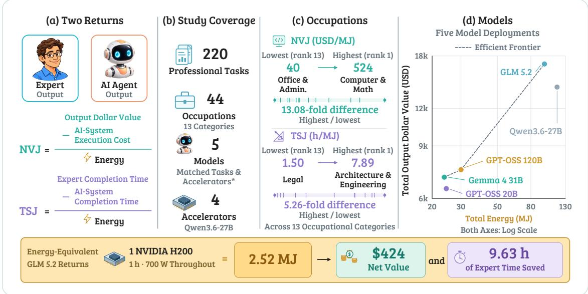  
Figure 1. Overview of Joules-to-GDP. (a) NVJ and TSJ express dollar and expert time benefits per joule. (b) The study compares occupations, models, and accelerators. (c) Occupation returns vary widely, with different NVJ and TSJ leaders. (d) More valuable output can require more energy; the frontier uses unweighted totals on log scales. The bottom panel uses 2.52 MJ, equivalent to one H200 drawing 700 W for an hour or about 23 hours of active laptop use.

## 1 Introduction

Existing studies assess an AI system’s economic value through proxies such as output quality and estimated worker time saving, and compare task performance with API cost or completion time (Patwardhan et al., 2025; Wan et al., 2026; Erol et al., 2026). Meanwhile, energy benchmarks measure how much energy AI systems consume, but do not quantify the economic value of the professional outputs produced with that energy (Chung et al., 2025; Tripathy et al., 2026, see Appendix A for related work). We connect these approaches by measuring the economic value of professional outputs alongside the energy required to produce them.

For this study, we use energy as our resource measure for three reasons. (1) A joule is a stable physical unit, while API providers can change prices. (2) End-to-end energy combines model and hardware choice, tool use, waits, and retries in one measure. (3) As we show, energy reveals differences that API cost or completion time can miss.

Having measured the energy used to produce each AI output, we then assess its economic value in two ways: (1) net dollar value and (2) expert time saving from using the AI system. We express economic return using Net Value per Joule (NVJ) in USD/MJ and Time Saving per Joule (TSJ) in hours/MJ. We use both because the work with the greatest dollar return need not save the most expert time, as our results show. Figure 1 summarizes this evaluation.

We apply these metrics to 220 public GDPval benchmark tasks across 44 occupations and 13 categories, weighted by sector GDP and employment. We then investigate three questions.

Q1. How does economic return per joule vary across occupations? Across occupation groups, concierge and recreation work, such as preparing travel itineraries, leads in success rate before accounting for energy, while engineering leads in net dollar value per task. Accounting for energy shifts the success-rate leader to investigation work, such as turning retail investigation notes into reports, and the net-value leader to software development, such as building website features. Factory supervision, such as planning schedules to clear backlogs, falls from second in time saving per task to sixth in time saving per joule. These returns depend jointly on successful completion, the net dollar value or time saving each output represents, and energy consumption. The expert reference used to assess AI outputs also matters. Comparing against an expert who used AI changes the measured returns (Section 3.1).

Q2. How do models trade off economic value and energy? Among five evaluated models, GLM 5.2 produces the highest average output dollar value, at \$74.19 per task, and saves 1.64 hours of expert time using 0.430 MJ, equivalent in energy to about four hours of active laptop use. By comparison, Gemma 4 31B produces more than half that output dollar value and saves about two-thirds as much expert time using less than a quarter of the energy, yielding approximately 2.5 times the NVJ and 2.8 times the TSJ. To capture both sides of this tradeoff, we use NVJ and TSJ to compare returns for the same amount of energy, alongside value–energy frontiers that show the output dollar value or time saving achieved at each model’s measured energy use. Both views matter because a high return per joule can coexist with less valuable output per task. We also find that energy reveals differences that cost and completion time miss. GPT-OSS 120B uses 68% less energy than GLM 5.2 despite nearly identical execution cost and completion time (Section 3.2).

Q3. How do accelerator type and count affect return per joule? Across four tested singleaccelerator deployments of Qwen3.6-27B, B200 leads NVJ and TSJ. We then vary accelerator count with the same Qwen3.6-27B model. One and eight H100s produce nearly identical net dollar value, yet eight H100s reduce completion time by only 22% while using 3.24 times the energy (Section 3.3).

Our framework uses measured energy to assess an AI system’s economic value in occupational work and compare models and accelerators for deployment. Optimizing NVJ and TSJ targets unsuccessful attempts that consume energy and additional computation that delivers little extra value, two shortcomings of the evaluated systems. These targets can guide improvements in models, accelerators, software, and task routing for deployments under real energy constraints, including expanding on-premises and edge use (Deloitte, 2026). Our estimates use benchmark tasks, recorded expert times, and occupation median wages. Whether the same returns hold beyond this benchmark remains to be tested.

## 2 Methods

We value each AI output using an expert reference, judge the output, measure energy, and calculate AI-system execution cost before aggregating across occupations. An AI system is the model, agent harness, inference backend, accelerator, and batching policy; a run is one execution on a task. The main analysis uses one run per task for each configuration. We judge that output, record its AI-system completion time, and charge its measured energy and AI-system execution cost. We also collected four independent runs per task to test repeated-attempt sensitivity (Appendix K, Figure 10).

## 2.1 Dataset and expert references

We evaluate 220 public GDPval professional tasks spanning 44 occupations in nine U.S. economic sectors, with five tasks per occupation (Patwardhan et al., 2025). Each task contains a professional request, source files, grading rubric, and target deliverable. Deliverables include documents, spread sheets, presentations, code, and media. GDPval drew the tasks from professional work and applied multiple rounds of review; Appendix B gives dataset details, and Appendix C reports supplementary dataset checks.

For each task, an expert reference consists of a finished deliverable and the recorded time the expert took to produce it. We use two reference conditions. The expert-only reference was produced by an expert without AI assistance, and the expert-with-AI reference was produced by an expert using AI. Each condition has its own deliverable and recorded expert completion time. We use the expert-only reference as primary because its deliverable and output dollar value are independent of a particular assisting AI model. The expert-with-AI reference provides a secondary comparison for assisted work.

The expert-only record covers task setup, source review, execution, and checking without AI use. The expert-with-AI record covers the expert’s setup, prompting, monitoring, review, and correction, including waits for AI-generated output. AI-system completion time is elapsed time until a run stops, including losses and timeouts; it covers inference, tool use, and task-specific setup within the request.

Let $G _ { i } ^ { b }$ denote the dollar value assigned to an AI output on task i if it wins or ties against expert reference b. Let task i belong to occupation $o ( i )$ , and let $b \in \{ \mathrm { E } , \mathrm { E } { + } \mathrm { A I } \}$ identify the expert reference. Following the original GDPval valuation approach (Patwardhan et al., 2025), we multiply expert completion time by the occupation’s median hourly wage:

$$
G _ { i } ^ { b } = H _ { i } ^ { b } W _ { o ( i ) } ^ { \mathrm { m e d i a n } } ,\tag{1}
$$

where $H _ { i } ^ { b }$ is the recorded expert completion time for the selected reference. The term $W _ { o ( i ) } ^ { \mathrm { m e d i a n } }$ is the occupation’s median hourly wage from the annual Occupational Employment and Wage Statistics (OEWS) program, the U.S. national statistical reference for occupational employment and wage estimates. Appendix H documents the wage source and GDP-based aggregation.

## 2.2 Blinded evaluation

The AI system receives the task and source files but not its rubric. We use the multimodal Gemini 3.1 Flash-Lite as the judge throughout the main analysis (Google DeepMind, 2026b). It compares the AI-system deliverable with the selected expert reference in a blinded pairwise comparison. The judge receives the task, rubric, source evidence, and identity-masked candidates. A shared pipeline extracts sanitized semantic content and rendered visual evidence, enabling the judge to assess the documents, spreadsheets, presentations, code, and media represented in GDPval. Candidate positions are balanced. The judge chooses either candidate or a tie. Let $Y _ { i } ^ { b } = 1$ when the AI system wins or ties and $Y _ { i } ^ { b } = 0$ when it loses. Following GDPval’s blinded win-rate approach (Patwardhan et al., 2025), we measure task success by the win–tie rate: the share of AI outputs judged a win or tie against the expert reference. The output dollar value contribution is $Y _ { i } ^ { b } G _ { i } ^ { b }$ , which equals $G _ { i } ^ { b }$ for a win or tie and zero for a loss. We choose this binary win-or-tie/loss rule to be conservative about partial credit. A loss contributes zero even if the output has some utility, while a tie receives the full output dollar value. In a judge-consistency check, Gemini 3.1 Flash-Lite, Claude Haiku 4.5, and GPT-5 mini showed 72.3–77.2% pairwise exact agreement. Gemini’s win–tie/loss decisions also agreed with human experts on 23 of 32 GLM 5.2 comparisons (71.9%). Appendix D details the evidence pipeline, candidate balancing, and judge settings; Appendix D.1 reports agreement among the three judges and with human reviewers. Figure 2 illustrates the accounting for a GDPval task.

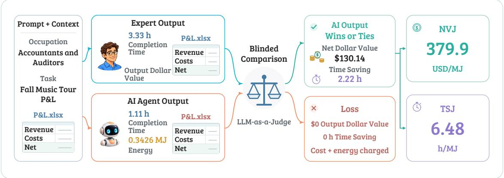  
Figure 2. An illustrative GDPval example shows the evaluation workflow. An Accountants and Auditors task, Fall Music Tour P&L, compares the expert-only output with the AI-agent output through a blinded LLM-as-a-Judge comparison. A win or tie earns output dollar value and time saving; every attempt incurs AI-system execution cost and energy.

## 2.3 End-to-end energy accounting

We measure energy with Intelligence per Watt (IPW), from immediately before each batch’s runs launch until the final run in that batch completes (Saad-Falcon et al., 2025). Here, end-to-end denotes the full execution window, including inference, tool use, and waits. We sum the component-energy readings recorded by IPW (e.g., GPU, CPU, and DRAM), using counter differences or integrated sampled power. Appendix E details the measurement procedure.

We batch concurrent requests because deployed inference commonly serves multiple requests at the same time. The batch policy therefore represents a realistic serving condition rather than serial execution of isolated requests.

For a batch of $K _ { b }$ requests, active-request attribution divides each moment’s energy among the requests still running. For request $i ,$

$$
E _ { i } = \int _ { i \mathrm { \ r u n n i n g } } { \frac { P _ { \mathrm { b a t c h } } ( t ) } { N _ { \mathrm { r u n n i n g } } ( t ) } } d t + { \frac { E _ { b , 0 } } { K _ { b } } } .\tag{2}
$$

Here $P _ { \mathrm { b a t c h } } ( t )$ is batch power, $N _ { \mathrm { r u n n i n g } } ( t )$ counts active requests, and $E _ { b , 0 }$ is shared energy with no active request. The active portion assigns energy according to how long each request actually runs, giving longer-running requests a larger share when power and concurrency are comparable. When only a batch total is retained, average power is total joules divided by batch completion time. Every request incurs energy, including losses and timeouts. Appendix F tests attribution sensitivity; Figure 8 shows energy use as requests finish.

## 2.4 Net Value per Joule and Time Saving per Joule

For an AI output on task i, let $C _ { i } , E _ { i } ,$ and $L _ { i }$ be its AI-system execution cost, measured energy, and AI system completion time. Its credited output dollar value is $Y _ { i } ^ { b } G _ { i } ^ { b }$ , where $G _ { i } ^ { b }$ is based on the selected reference expert’s completion time $H _ { i } ^ { b }$ (Equation 1). The output’s net dollar value is $Y _ { i } ^ { b } G _ { i } ^ { b } - C _ { i } ,$ and its time saving is $Y _ { i } ^ { b } ( H _ { i } ^ { b } - L _ { i } )$ . For occupation o, let $\begin{array} { r } { G _ { o } ^ { b } = \sum _ { i : o ( i ) = o } Y _ { i } ^ { b } G _ { i } ^ { b } , C _ { o } = \sum _ { i : o ( i ) = o } \dot { C } _ { i } } \end{array}$ , and $\begin{array} { r } { E _ { o } = \sum _ { i : o ( i ) = o } E _ { i } } \end{array}$ . We define Net Value per Joule (NVJ) (in USD/MJ) and Time Saving per Joule (TSJ) (in hours/MJ):

$$
\mathbf { N } \mathbf { V } \mathbf { J } _ { o } ^ { b } = \frac { G _ { o } ^ { b } - C _ { o } } { E _ { o } } , \qquad \mathbf { T } \mathbf { S } \mathbf { J } _ { o } ^ { b } = \frac { \sum _ { i : o ( i ) = o } Y _ { i } ^ { b } \left( H _ { i } ^ { b } - L _ { i } \right) } { E _ { o } } .\tag{3}
$$

Only wins or ties contribute output dollar value or time saving; every run incurs cost, so a loss has negative net dollar value. We report energy in MJ $( 1 \mathrm { M J } = 1 0 ^ { 6 } \mathrm { J } )$ .

We calculate AI-system execution cost from recorded resource allocations and published GPU, CPU, and RAM prices. Shared node time uses active-request shares within the recorded task-execution window. Shared idle time inside that window is assigned once. Storage and transfer charges are added where applicable. This method values recorded resource use at published rates; rate sources and allocation rules are in Appendix G.

## 2.5 Two levels of GDP-based aggregation

For each evaluated occupation, we average output dollar value, AI-system execution cost, time saving, and energy over its observed tasks. GDP-based occupation weights $w _ { o } ^ { \mathrm { G D P } }$ combine sector GDP shares with within-sector employment shares. Wages do not enter these weights because the occupation’s median wage already enters output dollar value, and wage-bill weights would give high-wage occupations additional influence. These weights define a GDP-weighted benchmark portfolio (Appendix H, Figure 9). The O\*NET-SOC taxonomy groups the 44 occupations into 13 categories. We aggregate at two levels.

Occupation-category level. We renormalize occupation weights within each category to sum to one, yielding category-normalized averages for comparisons among categories.

Benchmark level. We weight category outcomes by their category weights, yielding GDP-weighted task averages for comparisons among AI systems.

Writing $n _ { o }$ for the number of evaluated tasks in occupation $\begin{array} { r } { o , S _ { o } ^ { b } = \sum _ { i : o ( i ) = o } Y _ { i } ^ { b } ( H _ { i } ^ { b } - L _ { i } ) , W _ { c } = } \end{array}$ $\Sigma _ { o \in c } w _ { o } ^ { \mathrm { G D P } }$ , and $X \in \{ G , C , S , E \}$ :

$$
\widetilde { X } _ { c } = \sum _ { o \in c } \frac { w _ { o } ^ { \mathrm { G D P } } } { W _ { c } } \frac { X _ { o } } { n _ { o } } , \qquad \widetilde { X } ^ { \mathrm { G D P } } = \sum _ { c } W _ { c } \widetilde { X } _ { c } .\tag{4}
$$

We aggregate the components first and then form the NVJ and TSJ ratios.

## 3 Experiments and Results

The results follow Q1–Q3. Q1 holds the AI system fixed and varies the occupation and expert reference. Q2 compares models on the same tasks and evaluation protocol across value, AI-system execution cost, AI-system completion time, and energy. Q3 varies accelerator type and count for the same model. This separates differences in the work from differences in the AI system.

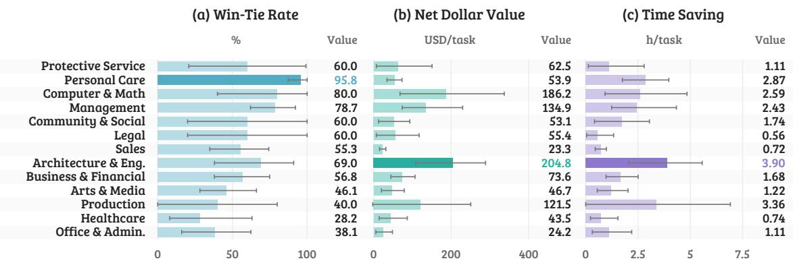

(d) Win-Tie Rate per Joule  
(e) Net Value per Joule  
(f) Time Saving per Joule  
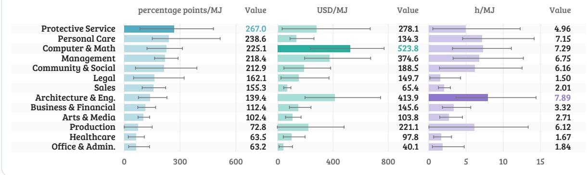  
Figure 3. Energy changes occupation rankings, and each return metric favors different work. GLM 5.2 against the expert-only reference, with category-normalized GDP weights. Top panels show win–tie rate, net dollar value, and time saving per task; bottom panels normalize each by energy. Categories follow the win–tie-per-MJ order; whiskers show 95% task-composition intervals.

## 3.1 How does economic return per joule vary across occupations? (Q1)

We evaluate GLM 5.2 with OpenHands on eight NVIDIA H200 GPUs in 20-request batches across the evaluated tasks.

Energy changes occupation rankings, and each return metric captures a different benefit. Personal Care & Service leads in win–tie rate, but once energy is included, Protective Service leads per MJ. Net dollar value shows a similar reversal. Architecture & Engineering (for example, CAD design) delivers about 10% more per task than Computer & Mathematical (for example, website design). However, after energy is included, Computer & Mathematical delivers about 27% higher NVJ. Likewise, Production falls from second in time saving per task to sixth in TSJ (Figure 3).

The three energy-normalized metrics also capture different benefits. For example, Computer & Mathematical delivers nearly four times Personal Care & Service’s NVJ despite a lower win–tie rate per MJ, because each successful output represents more dollar value. Time saving reveals another reversal. Production has about 20% lower NVJ than Protective Service, yet 23% higher TSJ because each success saves more expert time. High NVJ and TSJ thus combine success with greater net dollar value or time saving relative to energy consumed across all attempts. Appendices I and J give category values and explain these rankings; Appendix J.1 lists full results, Appendix J.2 tests rank stability, and Appendix D.1 checks judge agreement.

The expert-with-AI reference is harder to beat and closer to how many professionals work.

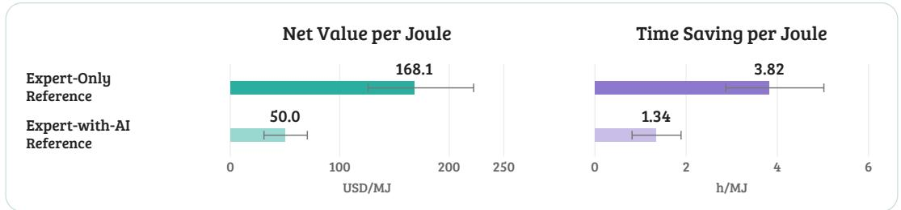  
Figure 4. An expert-with-AI reference reduces GLM 5.2’s NVJ by 70% and TSJ by 65%. Only the expert deliverable and its completion time change; AI runs, costs, energy, and GDP weights stay fixed. Whiskers show 95% task-composition intervals (Appendix K.1).

The expert-only reference provides a comparison independent of an assisting model. By contrast, the expert-with-AI reference reflects the model and tools the expert used, while testing the additional benefit of automation when experts already use AI. Under our weighting, experts using AI spend about 23% less time on average, and GLM 5.2 matches or exceeds their deliverables about half as often as the expert-only deliverables. Automation must therefore meet a higher quality bar while replacing less expert time, lowering NVJ and TSJ (Figure 4). Yet substantial time-saving potential remains. On tasks where GLM 5.2 matches or exceeds the assisted expert’s deliverable, its completion time is about 84% shorter on average than the assisted expert’s (Appendix K.2, Table 22). Figure 11 compares time saving from expert assistance and automation across success thresholds.

## 3.2 How do models trade off economic value and energy? (Q2)

We serve five models locally so that we can measure end-to-end energy directly: GLM 5.21, Qwen3.6- 27B, Gemma 4 31B, GPT-OSS 120B, and GPT-OSS 20B (Z.ai, 2026; Qwen Team, 2026; Google DeepMind, 2026a; OpenAI, 2025a). We swap the model while holding the evaluated tasks, expertonly reference, judge, OpenHands harness, and vLLM inference engine fixed; the four non-GLM models also use the same eight-H100 hardware. Appendix L summarizes model outcomes (Figure 12); Appendix F tests energy attribution for the GLM 5.2 occupation comparisons.

Higher output need not justify its energy cost. GLM 5.2 produces the greatest output dollar value, \$74.19 per task, and saves 1.64 expert hours per task on average. Gemma 4 31B produces 44% less output dollar value but uses 77% less energy, giving it about 2.5 times GLM 5.2’s NVJ and the highest TSJ among these models. For scale, GLM 5.2’s 0.430 MJ per task is equivalent in energy to about four hours of active laptop use2 or 10.2 minutes of one H200 drawing 700 W continuously (NVIDIA, 2026). Qwen3.6-27B produces the second-highest output dollar value but uses the most energy among the five models. Figure 5 ranks the five models by GDP-weighted NVJ and TSJ and shows unweighted total output dollar value and total time saving against total energy across evaluated tasks. On both unweighted point-estimate efficient frontiers, Gemma 4 31B anchors the low-energy end and GLM 5.2 the high-benefit end. GPT-OSS 120B lies between them on the dollar-value frontier. These tradeoffs explain why the rankings and frontiers answer complementary questions. NVJ and TSJ measure net dollar return and expert time saved per megajoule, while the frontiers show how much total value or time saving each model delivers for a given energy budget. A high return per joule can still come from a model that delivers too little total work. These views explain why Gemma 4 31B leads in return per joule while GLM 5.2 remains on the frontier by delivering more value at higher energy use. Occupation-category rankings are broadly similar across models (Appendix L).

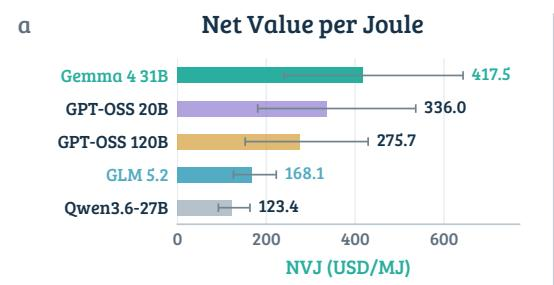

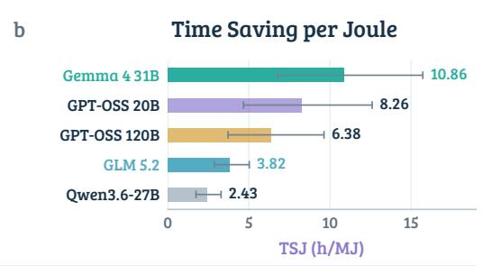

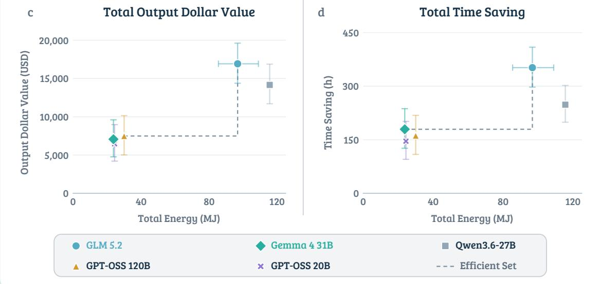  
Figure 5. Higher total economic benefit can come with lower return per joule. For example, GLM 5.2 delivers more total value and time saving than Gemma 4 31B, but has lower NVJ and TSJ. The top row compares GDP-weighted NVJ (a) and TSJ (b); the bottom shows unweighted total output dollar value (c) and time saving (d) versus total energy. Dashed steps connect models on each point-estimate efficient frontier. Whiskers show 95% task-composition intervals.

## 3.2.1 Net value per dollar of AI cost and per AI hour

To test whether energy as a denominator reveals a dimension of efficiency that monetary cost and AI-system completion time alone miss, we define two comparison metrics:

$$
\mathrm { N e t ~ v a l u e / d o l l a r ~ o f ~ A I ~ c o s t } = \frac { G - C } { C } , \qquad \mathrm { N e t ~ v a l u e / A I ~ h o u r } = \frac { G - C } { L } .\tag{5}
$$

Here $G , C ,$ and L are GDP-weighted averages of credited output dollar value, AI-system execution cost, and AI-system completion time. Costs and durations include losses and timeouts; concurrent runs each contribute their AI-system completion time to $L ,$ so an AI hour is a request-hour. Table 1 compares resource use and the three efficiency ratios, each with numerator $G - C$ . Appendix G details resource prices and cost allocation; Appendix G.1 tests alternative provider rates.

Table 1. GLM 5.2 and GPT-OSS 120B have similar cost and completion time but different energy returns. AI-system execution cost, AI-system completion time, and energy are GDP-weighted task averages; the three efficiency ratios share each system’s net-dollar-value numerator. Colors identify systems. Bars show point estimates on a separate zero-to-maximum scale within each efficiency column; longer bars mean greater net value per unit of resource.
<table><tr><td rowspan="2">Model</td><td colspan="3">GDP-weighted task averages</td><td colspan="3">Net value per</td></tr><tr><td>Execution cost (USD)</td><td>Completion time (min)</td><td>Energy (MJ)</td><td>dollar of AI cost (USD/USD)</td><td>AI hour (USD/hour)</td><td>megajoule (USD/MJ)</td></tr><tr><td>GLM 5.2</td><td>1.92</td><td>22.7</td><td>0.430</td><td>37.69</td><td>191.3</td><td>168.1 </td></tr><tr><td> Qwen3.6-27B</td><td>4.12</td><td>51.0</td><td>0.516</td><td>15.46</td><td>75.0</td><td>123.4</td></tr><tr><td>Gemma 4 31B</td><td>0.86</td><td>7.7</td><td>0.097</td><td>47.38</td><td>316.9</td><td>417.5</td></tr><tr><td>GPT-OSS 120B</td><td>1.98</td><td>22.2</td><td>0.137</td><td>19.09</td><td>102.1</td><td>275.7</td></tr><tr><td>GPT-OSS 20B</td><td>1.12</td><td>15.3</td><td>0.103</td><td>31.03</td><td>136.3 –</td><td>336.0</td></tr></table>

Energy reveals differences beyond AI-system execution cost and completion time. GLM 5.2 and GPT-OSS 120B have nearly the same GDP-weighted average AI-system execution cost and AI-system completion time (GPT-OSS 120B costs about 3.1% more and is about 2.1% faster), yet GPT-OSS 120B uses 68% less energy. Despite its lower net value, GPT-OSS 120B delivers more per megajoule. By contrast, GLM 5.2 delivers more per dollar of AI cost and per AI hour. This reversal is possible because execution cost reflects allocated resources and elapsed time, and completion time records those elapsed minutes; measured energy instead integrates GPU, CPU, and DRAM power during computation, memory access, and waiting (Chung et al., 2025). Similar costs and durations can therefore mask different joule totals.

## 3.3 How do accelerator type and count affect return per joule? (Q3)

Qwen3.6-27B is used for the accelerator experiments because it fits on a single accelerator, allowing both one-accelerator sweeps and comparison with the one-node, eight-H100 configuration above.

Accelerator type materially changes the observed return per joule. We run Qwen3.6-27B with OpenHands on one NVIDIA B200, H200, or H100 and one AMD Instinct MI350X, using the same expert-only reference and judge. B200 delivers the highest GDP-weighted NVJ and TSJ among these deployments (Figure 6). With Qwen3.6-27B held fixed, differences in accelerator architecture, memory bandwidth, and power draw help explain differences in inference time and energy use, and hence the spread in NVJ and TSJ across devices.

One H100 delivers more net value per joule, whereas eight deliver more per AI hour. Across all tasks, moving Qwen3.6-27B from one to eight H100s reduces GDP-weighted mean AI-system completion time by 22% but uses 3.24 times the energy while delivering nearly the same output dollar value. Eight H100s yield more net value per AI hour, while one H100 yields higher NVJ and TSJ (Figure 7).

Tensor parallelism splits inference across eight H100s, helping reduce completion time, but GPU communication and synchronization, together with sequential tool calls, limit the end-to-end gain (Chung et al., 2025). All eight GPUs draw power throughout the run, so the shorter duration does not offset their higher aggregate power use. With output value nearly unchanged, this explains why eight H100s improve return per AI hour while one H100 delivers higher NVJ and TSJ.

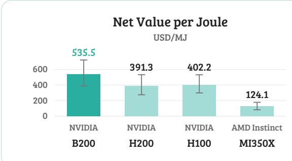

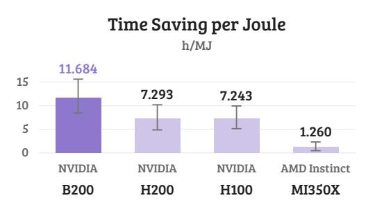  
Figure 6. Accelerator choice changes return per joule. Qwen3.6-27B, one accelerator, expert-only reference, and GDP weights. Whiskers show 95% task-composition intervals.

## 4 Limitations and Future Work

Benchmark scope and evaluation. Following GDPval, output dollar value uses expert completion time and occupation median wage, not measured GDP. GDP-contributing occupations and GDPbased weights motivate the framing; future work could validate the proxy with independent expert valuations and test broader task samples.

System coverage. Controlled accelerator sweeps vary hardware type and count. Future comparisons could vary model, harness, backend, precision, batching, and retries individually to isolate their effects and test portability beyond OpenHands.

Measurement and deployment. Energy covers metered GPU, CPU, and DRAM; execution cost uses published rates (Appendix G). Deployment studies could meter facility overhead and estimate expert review, coordination, liability, and adoption costs.

Toward optimization. Future work can test NVJ and TSJ as training signals and use them for routing and stopping. Such policies should spend computation only when expected value or time saving warrants the energy, subject to quality and reliability.

## 5 Conclusion

Joules-to-GDP connects judged professional work with the energy used to produce it. The evaluated tasks and systems illustrate a framework rather than a comprehensive survey. In deployments with limited energy, this accounting makes computation allocation an explicit choice across tasks, models, and accelerators. Comparing total benefit with return per joule can then guide routing, stopping, and serving decisions toward higher economic value and greater expert time savings within that budget.

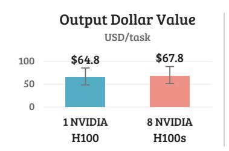

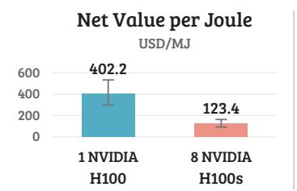

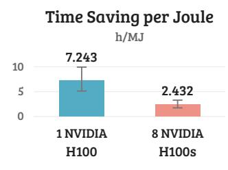  
Figure 7. Eight H100s deliver similar value but lower return per joule than one. Qwen3.6-27B, expertonly reference, and GDP weights. Whiskers show 95% task-composition intervals. Appendix M gives the full comparison.

## Reproducibility Statement

We will release our task-level evaluation dataset with expert annotations, blinded model judgments, completion times, execution costs, and energy measurements. The GDPval task dataset is public, and the five evaluated models have publicly available weights. The release will identify the model and judge versions and give access details for any restricted reference materials.

We will also release the study-authored harness configuration, energy-accounting and aggregation code, figure and table builders, fixed analysis seeds, and a source inventory with version identifiers and hashes. These materials support regeneration of reported results from the same recorded inputs. The methods and appendix document expert references, judging, run selection, cost boundaries, measured energy components, economic weights, and validation checks. End-to-end reruns require compatible hardware and serving software and may produce different outputs or energy measurements.

## Acknowledgements

We thank the Scaling Intelligence Lab and Hazy Lab for constructive feedback on this paper. We are especially grateful to Snorkel AI for its feedback and for providing the materials and input that made this research possible. At Snorkel AI, we thank Ramya Ramakrishnan, Vincent Sunn Chen, Srikar Kodati, Amanda Dsouza, and Paroma Varma. We also thank researchers Yasa Baig, Rishi Bommasani, Catherine Dong, Yuzhen Mao, and Shayan Talaei for their feedback. We thank Vast AI, Modal, the Laude Institute, Google Cloud Platform, IBM Research, and Stanford HAI for providing compute resources that enabled our experiments. We also gratefully acknowledge the support of NSF under Nos. CCF2247015 (Hardware-Aware) and 2522743 (AIMing); DARPA under No. HR00112520038 (Fallingwater); NSTXL under No. N00164-23-9-G057-01 (Energy-Efficient AI Hardware); ONR under No. N000142312633 (Deep Signal Processing); Stanford HAI under No. 345077 (Evo); Google DeepMind; Google Research; Google Cloud; NXP, Xilinx, LETI-CEA, Intel, IBM (Code Generation), Microsoft, NEC, Toshiba, TSMC, ARM, Hitachi, BASF, Accenture, Ericsson, Qualcomm, Analog Devices, Salesforce, Total, Lightspeed Venture Partners, the Laude Institute, Prime Intellect, Anthropic, the HAI-GCP Cloud Credits for Research program, the Stanford Data Science Initiative (SDSI), Knight-Hennessy Scholarship, JP Morgan AI/ML Fellowship, Stanford EDGE Fellowship, GEM Fellowship, and members of the Stanford DAWN project: Meta, Google, and VMWare; and members of the Stanford SEAMS project: IBM and Felicis Ventures. We also gratefully acknowledge computing resources provided by Stanford’s Marlowe Computing Instrument. The U.S. Government is authorized to reproduce and distribute reprints for Governmental purposes notwithstanding any copyright notation thereon. Any opinions, findings, and conclusions or recommendations expressed in this material are those of the authors and do not necessarily reflect the views, policies, or endorsements, either expressed or implied, of NSF, ONR, DARPA, or the U.S. Government.

## References

Daron Acemoglu. The simple macroeconomics of AI. Technical Report 32487, National Bureau of Economic Research, 2024.

Amazon Web Services. Amazon EBS pricing. https://aws.amazon.com/ebs/pricing/, 2026a. Accessed September 19, 2026.

Amazon Web Services. Amazon EC2 P5 instances. https://aws.amazon.com/ec2/instance-types/ p5/, 2026b. Accessed September 19, 2026.

Amazon Web Services. Amazon EC2 versioned price list, us-east-1, version 20260728175247. https://pricing.us-east-1.amazonaws.com/offers/v1.0/aws/AmazonEC2/20260728175247/ us-east-1/index.csv, 2026c. Accessed September 19, 2026.

Amazon Web Services. Amazon EC2 On-Demand pricing and data transfer. https://aws.amazon. com/ec2/pricing/on-demand/, 2026d. Accessed September 19, 2026.

Amazon Web Services. Amazon VPC pricing: public IPv4 addresses. https://aws.amazon.com/vpc/ pricing/, 2026e. Accessed September 19, 2026.

Axel Backlund and Lukas Petersson. Vending-Bench: A benchmark for long-term coherence of autonomous agents. arXiv preprint arXiv:2502.15840, 2025.

Kathryn Bonney, Cory Breaux, Emin Dinlersoz, Lucia Foster, John Haltiwanger, and Aditya Pande. The microstructure of AI diffusion: Evidence from firms, business functions, and worker tasks. Technical Report CES-26-25, U.S. Census Bureau, Center for Economic Studies, 2026.

Erik Brynjolfsson, Danielle Li, and Lindsey R. Raymond. Generative AI at work. The Quarterly Journal of Economics, 140(2):889–942, 2025.

Jae-Won Chung, Jeff J. Ma, Ruofan Wu, Jiachen Liu, Oh Jun Kweon, Yuxuan Xia, Zhiyu Wu, and Mosharaf Chowdhury. The ML.ENERGY benchmark: Toward automated inference energy measurement and optimization. arXiv preprint arXiv:2505.06371, 2025.

CloudRift. GPU rental pricing and included resources. https://www.cloudrift.ai/pricing, 2026. Accessed September 19, 2026.

CoreWeave. NVIDIA HGX H200 pricing. https://www.coreweave.com/pricing, 2026. Accessed September 2026.

Deloitte. Deloitte’s enterprise AI infrastructure survey: A 2028 outlook. https://www.deloitte. com/us/en/insights/topics/technology-management/ai-infrastructure-survey.html, 2026. Survey of 515 U.S. business and technology leaders, fielded November–December 2025.

Tyna Eloundou, Sam Manning, Pamela Mishkin, and Daniel Rock. GPTs are GPTs: An early look at the labor market impact potential of large language models. arXiv preprint arXiv:2303.10130, 2023.

Mehmet Hamza Erol, Batu El, Mirac Suzgun, Mert Yuksekgonul, and James Zou. Cost-of-pass: An economic framework for evaluating language models. In International Conference on Learning Representations, 2026.

Edward W. Felten, Manav Raj, and Robert Seamans. Occupational, industry, and geographic exposure to artificial intelligence: A novel dataset and its potential uses. Strategic Management Journal, 42 (12), 2021.

Google Cloud. Accelerator-optimized machine family pricing. https://cloud.google.com/ products/compute/pricing/accelerator-optimized, 2026. Accessed September 20, 2026.

Google DeepMind. Gemma 4 model card and Apache 2.0 license. https://ai.google.dev/gemma/ docs/core/model\_card\_4, 2026a. Accessed September 2026.

Google DeepMind. Gemini 3.1 Flash-Lite model card. Official model documentation, March 2026b.

Kunal Handa, Alex Tamkin, et al. Which economic tasks are performed with AI? evidence from millions of Claude conversations. arXiv preprint arXiv:2503.04761, 2025.

Hazy Research. Benchmarking intelligence efficiency of LM inference. https://github.com/ HazyResearch/intelligence-per-watt, 2026a. Accessed September 2026.

Hazy Research. Telemetry overview. https://hazyresearch.stanford.edu/ intelligence-per-watt/benchmarking/overview/, 2026b. Accessed September 22, 2026.

S. Jha et al. ITBench: Evaluating AI agents across diverse real-world IT automation tasks. In Proceedings of the 42nd International Conference on Machine Learning, volume 267 of Proceedings of Machine Learning Research, 2025.

Sayash Kapoor, Benedikt Stroebl, Peter Kirgis, Nitya Nadgir, Zachary S. Siegel, Boyi Wei, Tianci Xue, Ziru Chen, et al. Holistic agent leaderboard: The missing infrastructure for AI agent evaluation. arXiv preprint arXiv:2510.11977, 2025.

Sayash Kapoor et al. AI agents that matter. arXiv preprint arXiv:2407.01502, 2024.

Anton Korinek and Patrick McKelvey. Measuring the AI economy. Technical Report Staff Working Paper 2026-20, Bank of Canada, 2026.

Lars Krupp, Daniel Geißler, Vishal Banwari, Paul Lukowicz, and Jakob Karolus. Promoting sustainable web agents: Benchmarking and estimating energy consumption through empirical and theoretical analysis. Proceedings of the AAAI Conference on Artificial Intelligence, 40(45):38772–38780, 2026. doi: 10.1609/aaai.v40i45.41221. URL https://ojs.aaai.org/index.php/AAAI/article/view/ 41221.

Alexandra Sasha Luccioni, Yacine Jernite, and Emma Strubell. Power hungry processing: Watts driving the cost of AI deployment? In Proceedings of the 2024 ACM Conference on Fairness, Accountability, and Transparency, pp. 85–99, 2024.

Mantas Mazeika, Alice Gatti, Cristina Menghini, Udari Madhushani Sehwag, Shivam Singhal, Yury Orlovskiy, et al. Remote labor index: Measuring AI automation of remote work. arXiv preprint arXiv:2510.26787, 2025.

Modal. Resource pricing: GPU, CPU and memory. https://modal.com/pricing, 2026. Accessed September 19, 2026.

National Renewable Energy Laboratory. Plug load assessment guidelines. Technical Report NREL/FS-7A20-50130, National Renewable Energy Laboratory, June 2011. URL https://docs.nlr.gov/ docs/fy11osti/50130.pdf.

Chenxu Niu, Wei Zhang, Jie Li, Yongjian Zhao, Tongyang Wang, Xi Wang, and Yong Chen. Token-PowerBench: Benchmarking the power consumption of LLM inference. Proceedings of the AAAI Conference on Artificial Intelligence, 40(38):32582–32590, 2026. doi: 10.1609/aaai.v40i38.40535. URL https://ojs.aaai.org/index.php/AAAI/article/view/40535.

Shakked Noy and Whitney Zhang. Experimental evidence on the productivity effects of generative artificial intelligence. Science, 381(6654):187–192, 2023.

NVIDIA. NVIDIA H200 Tensor Core GPU: Specifications. Official product specifications, 2026. URL https://www.nvidia.com/en-us/data-center/h200/. H200 SXM maximum configurable TDP: 700 W. Accessed 2026-09-22.

O\*NET Resource Center. O\*NET-SOC 2019 taxonomy. National Center for O\*NET Development, 2019. URL https://www.onetcenter.org/taxonomy/2019/.

OpenAI. gpt-oss model card and Apache 2.0 license. https://huggingface.co/openai/ gpt-oss-120b, 2025a. Accessed September 2026.

OpenAI. Measuring the performance of our models on real-world tasks. https://openai.com/ index/gdpval/, September 2025b. GDPval public announcement.

OpenAI. gpt-oss-120b & gpt-oss-20b model card. Official model documentation, August 2025c.

Tejal Patwardhan, Rachel Dias, Elizabeth Proehl, Grace Kim, Michele Wang, Olivia Watkins, Simón Posada Fishman, Marwan Aljubeh, Phoebe Thacker, Laurance Fauconnet, Natalie S. Kim, Patrick Chao, Samuel Miserendino, Gildas Chabot, David Li, Michael Sharman, Alexandra Barr, Amelia Glaese, and Jerry Tworek. GDPval: Evaluating AI model performance on real-world economically valuable tasks. arXiv preprint arXiv:2510.04374, 2025.

Qwen Team. Qwen3.6-27B model card and Apache 2.0 license. https://huggingface.co/Qwen/ Qwen3.6-27B, 2026. Accessed September 2026.

Jon Saad-Falcon, Avanika Narayan, Hakki Orhun Akengin, J. Wes Griffin, Herumb Shandilya, Adrian Gamarra Lafuente, Medhya Goel, Rebecca Joseph, Shlok Natarajan, Etash Kumar Guha, Shang Zhu, Ben Athiwaratkun, John Hennessy, Azalia Mirhoseini, and Christopher Ré. Intelligence per watt: Measuring intelligence efficiency of local AI. arXiv preprint arXiv:2511.07885, 2025.

Siddharth Samsi, Dan Zhao, Joseph McDonald, Baolin Li, Adam Michaleas, Michael Jones, William Bergeron, Jeremy Kepner, Devesh Tiwari, and Vijay Gadepally. From words to watts: Benchmarking the energy costs of large language model inference. arXiv preprint arXiv:2310.03003, 2023. URL https://arxiv.org/abs/2310.03003.

Yijia Shao, Humishka Zope, Yucheng Jiang, Jiaxin Pei, David Nguyen, Erik Brynjolfsson, and Diyi Yang. Future of work with AI agents: Auditing automation and augmentation potential across the U.S. workforce. arXiv preprint arXiv:2506.06576, 2025.

Giulio Starace et al. PaperBench: Evaluating AI’s ability to replicate AI research. In Proceedings of the 42nd International Conference on Machine Learning, volume 267 of Proceedings of Machine Learning Research, 2025.

Alex Tamkin and Peter McCrory. Estimating AI productivity gains from Claude conversations. Anthropic Economic Index, 2025.

Arihant Tripathy, Ch Pavan Harshit, and Karthik Vaidhyanathan. SWEnergy: An empirical study on energy efficiency in agentic issue resolution frameworks with SLMs. In Proceedings of the 2026 International Workshop on Agentic Engineering, pp. 104–111, 2026. doi: 10.1145/3786167. 3788406. URL https://doi.org/10.1145/3786167.3788406.

Arya Tschand, Arun Tejusve Raghunath Rajan, Sachin Idgunji, Anirban Ghosh, Jeremy Holleman, Csaba Kiraly, et al. MLPerf Power: Benchmarking the energy efficiency of machine learning systems from microwatts to megawatts for sustainable AI. arXiv preprint arXiv:2410.12032, 2024.

U.S. Bureau of Labor Statistics. May 2024 national occupational employment and wage estimates. Occupational Employment and Wage Statistics, 2025. URL https://www.bls.gov/oes/2024/ may/oes\_nat.htm. May 2024 estimates, released April 2025.

Prabhu Vellaisamy, Vanessa Lam, Shawn Blanton, and John Paul Shen. Characterization of request and token energy costs for LLM inference workloads on GPU platforms. arXiv preprint arXiv:2608.28044, 2026. URL https://arxiv.org/abs/2608.28044.

Bertie Vidgen, Austin Mann, Abby Fennelly, John Wright Stanly, Lucas Rothman, Marco Burstein, Julien Benchek, David Ostrofsky, Anirudh Ravichandran, Debnil Sur, Neel Venugopal, Alannah Hsia, Isaac Robinson, Calix Huang, Olivia Varones, Daniyal Khan, Michael Haines, Austin Bridges, Jesse Boyle, Koby Twist, Zach Richards, Chirag Mahapatra, Brendan Foody, and Osvald Nitski. APEX–Agents. arXiv preprint arXiv:2601.14242, 2026.

Alexander Wan, Stephane Hatgis-Kessell, Tomás Aguirre, Percy Liang, and Rishi Bommasani. Economic evaluations of language models. arXiv preprint arXiv:2607.19375, 2026.

Tianjun Wei, Wei Wen, Ruizhi Qiao, Xing Sun, and Jianghong Ma. RocketEval: Efficient automated LLM evaluation via grading checklist. In The Thirteenth International Conference on Learning Representations, 2025. URL https://openreview.net/forum?id=zJjzNj6QUe.

Tianbao Xie et al. OSWorld: Benchmarking multimodal agents for open-ended tasks in real computer environments. arXiv preprint arXiv:2404.07972, 2024.

Z.ai. GLM-5.2 model card and MIT license. https://huggingface.co/zai-org/GLM-5.2, 2026. Accessed September 2026.

## A Related Work

Professional work and economic value. GDPval (Patwardhan et al., 2025) evaluates deliverables; APEX-Agents and the Remote Labor Index (Vidgen et al., 2026; Mazeika et al., 2025) compare AI systems with experts on longer tasks. Related benchmarks extend this approach to research, IT, web, desktop, organizational settings, and economic simulations (Starace et al., 2025; Jha et al., 2025; Xie et al., 2024; Backlund & Petersson, 2025). Controlled and field studies complement these benchmarks by measuring changes in workers’ completion time, output quality, and productivity (Noy & Zhang, 2023; Brynjolfsson et al., 2025).

Occupations and the wider economy. GPTs Are GPTs (Eloundou et al., 2023) estimates which occupational tasks language models could affect. The Anthropic Economic Index (Handa et al., 2025; Tamkin & McCrory, 2025) uses real Claude conversations to study where AI is being used at work and estimate possible time saving, while Economic Evaluations of Language Models (Wan et al., 2026) tests tasks across the U.S. occupational economy and estimates how much work time current models could save. Related studies connect AI capabilities, use, and adoption to workers, occupations, firms, industries, and the broader economy (Felten et al., 2021; Shao et al., 2025; Bonney et al., 2026; Acemoglu, 2024; Korinek & McKelvey, 2026).

Cost and energy efficiency. AI Agents That Matter, Cost-of-Pass, and the Holistic Agent Leaderboard compare performance with financial or usage-based costs (Kapoor et al., 2024; Erol et al., 2026; Kapoor et al., 2025). Energy studies such as Power Hungry Processing, ML.ENERGY, and MLPerfPower directly measure energy use across models, workloads, and accelerators (Luccioni et al., 2024; Chung et al., 2025; Tschand et al., 2024; Saad-Falcon et al., 2025). More recent work, including SWEnergy and Sustainable Web Agents, extends energy measurement to AI-system workflows (Tripathy et al., 2026; Krupp et al., 2026). NVJ and TSJ extend this resource accounting to net dollar value and time saving rather than benchmark scores or win–tie rates alone.

From token efficiency to economic return. Token-level studies vary batch size, context length, and GPU count, including phase-specific prefill and decoding measurements (Samsi et al., 2023; Niu et al., 2026). Longer generations can lower joules per token by amortizing prefill while increasing total request energy (Vellaisamy et al., 2026); long contexts enlarge attention and key–valuecache traffic. For a common workload, window, and energy boundary, tokens per joule multiplied by net value or time saving per output token gives NVJ or TSJ, after unit conversion. Token efficiency therefore complements output quality, task value, and time saving; tool execution and waiting also consume energy without producing model tokens. Comparing these measures requires matched boundaries because GPU counters and MLPerf Power’s external whole-system metering cover different components (Tschand et al., 2024).

## B Expert References and Annotations

The tasks span heterogeneous formats, including documents, spreadsheets, presentations, code, images, audio, video, and archive-based deliverables. The frozen task records also preserve occupation, sector, and O\*NET-SOC identifiers; source-file and deliverable inventories; and the grading rubric. The expert-only reference was produced by an expert without AI; its recorded time is decomposed into prompt review, source-file use, task execution, and verification or quality review. The expert-with-AI reference was produced by an expert using AI. Its records add the AI provider, model version, interface, source files used, external tools, full transcripts, and turn-level expert-active, AI-generation-wait, and total times. The supplied assisted-reference records identify Claude Sonnet 4.6 and Claude Opus 4.7 used through Claude Web Chat. These are recorded expert completion times. The assisted condition includes the expert’s setup, monitoring, review, and correction, as well as AI waits. The expert-only and expert-with-AI references were annotated by different people.

The pairwise comparison with an expert deliverable assesses relative judged quality; it does not establish absolute task quality or realized economic savings. We use the GDPval expert deliverables as meaningful reference points without assuming they are error-free.

The rubric helps ground the comparison in the task requirements even when an expert deliverable has flaws. Expert-only reference, expert-with-AI reference, and AI-system deliverables are normalized to the same evidence representation. Candidate position is balanced exactly across the archived task-condition comparisons.

The expert-with-AI reference is a supplied assisted completion condition; it is not a claim about every possible form of assisted professional work. Its completion time can exceed expert-only time on individual tasks. The expert-only reference is the cleaner common reference for autonomous systems because neither its deliverables nor its output dollar values depend on a particular assisting model, interface, or expert–AI workflow. We therefore retain it as primary; the expert-with-AI reference is a secondary, workflow-specific operational comparison. Appendix K.1 separates changes in judged win–tie outcomes from changes in time valuation.

## C Benchmark Contamination

During evaluation, the models received each task and its required source files, but not the grading rubric or expert deliverable. We checked AI deliverables for exact matches to expert files and unexplained identical document or workbook components and found none.

GPT-OSS 120B and GPT-OSS 20B were released before GDPval became public (OpenAI, 2025c;b). The public model cards for GLM 5.2, Qwen3.6-27B, and Gemma 4 31B do not mention GDPval (Z.ai, 2026; Qwen Team, 2026; Google DeepMind, 2026a). These checks show no direct copying in the evaluated outputs; they do not establish every model’s training-data contents.

## D Judge and Evidence Pipeline

The judging pipeline is model-agnostic and can be configured with alternative language-model judges. Main economic results use the frozen judge models/gemini-3.1-flash-lite at temperature 0. Its input contains the task specification, grading rubric, source evidence, and both identity-masked candidate deliverables. The evidence pipeline uses full sanitized semantic text and rendered visual PDFs with a 48-page visual ceiling. It performs safe archive extraction, static code inspection, and media parsing. All verdict records used in the analysis parsed without error.

## D.1 Judge consistency

Table 2 compares Gemini 3.1 Flash-Lite (the main judge), Claude Haiku 4.5, and GPT-5 mini on the same GLM 5.2 comparisons, including all four attempts per task.

Repeated-output agreement. For GLM 5.2, the first two independently generated outputs for each of 220 tasks produced 440 Gemini judgments. The win–tie versus loss decision matched across the two outputs for 171 tasks (77.7%).

Expert review. In a blinded expert review of 32 randomly selected GLM 5.2 task comparisons, experts agreed with Gemini 3.1 Flash-Lite on 23 of 32 win–tie versus loss decisions (71.9%). A separate automated review yielded the same agreement rate. Human-to-human agreement on related pairwise response judgments has been reported at 64.7% (Wei et al., 2025).

Table 2. The three judges agree on 72–77% of exact outcomes. An AI win or tie receives task credit. Exact agreement retains win/tie/loss; binary win–tie agreement collapses wins and ties into one category. All comparisons use GLM 5.2 outputs from four attempts per task.
<table><tr><td>Pair</td><td>Exact agreement 1</td><td>Binary win-tie agreement</td></tr><tr><td>Gemini-Haiku</td><td>77.2%</td><td>79.2%</td></tr><tr><td>Gemini-GPT-5 mini</td><td>74.0%</td><td>76.4%</td></tr><tr><td>Haiku-GPT-5 mini</td><td>72.3%</td><td>72.8%</td></tr></table>

## E Execution and End-to-End Energy Accounting

The AI-system runs were executed in concurrent batches. IPW telemetry sampled the metered compo nents at a configured 0.2-second interval. The end-to-end measurement window began immediately before the batch’s runs launched and ended when the final run completed. For components exposing cumulative energy counters, end-to-end energy used the boundary-aligned difference between the end and start readings. Otherwise, sampled power was integrated over the same wall-clock interval. Measurements from all accelerators assigned to a run were summed over the execution.

For every evaluated deployment, IPW measured GPU, CPU, and DRAM energy. Reported joules sum these component-energy readings over the execution window (Hazy Research, 2026a;b). Table 3 gives the serving settings.

Table 3. All evaluated deployments use vLLM, 20 concurrent requests, a 131,072-token context limit, and a 32,768-token output limit. Tensor parallelism is eight for eight-accelerator deployments and one for single-accelerator deployments.
<table><tr><td>Model and accelerator</td><td>Inference</td><td>Tensor parallelism</td><td>Concurrent requests</td><td>Context limit (tokens)</td><td>Output limit (tokens)</td></tr><tr><td>GLM 5.2, 8×H200</td><td>vLLM</td><td>TP8</td><td>20</td><td>131,072</td><td>32,768</td></tr><tr><td>Qwen3.6-27B, 8×H100</td><td>vLLM</td><td>TP8</td><td>20</td><td>131,072</td><td>32,768</td></tr><tr><td>Gemma 431B, 8×H100</td><td>vLLM</td><td>TP8</td><td>20</td><td>131,072</td><td>32,768</td></tr><tr><td>GPT-OSS 120B, 8×H100</td><td>vLLM</td><td>TP8</td><td>20</td><td>131,072</td><td>32,768</td></tr><tr><td>GPT-OSS 20B, 8×H100</td><td>vLLM</td><td>TP8</td><td>20</td><td>131,072</td><td>32,768</td></tr><tr><td>Qwen3.6-27B, 1×B200</td><td>vLLM</td><td>TP1</td><td>20</td><td>131,072</td><td>32,768</td></tr><tr><td>Qwen3.6-27B, 1×H200</td><td>vLLM</td><td>TP1</td><td>20</td><td>131,072</td><td>32,768</td></tr><tr><td>Qwen3.6-27B, 1×H100</td><td>vLLM</td><td>TP1</td><td>20</td><td>131,072</td><td>32,768</td></tr><tr><td>Qwen3.6-27B, 1×MI350X</td><td>vLLM</td><td>TP1</td><td>20</td><td>131,072</td><td>32,768</td></tr></table>

We chose OpenHands as the primary harness because its compact tool surface, a terminal and file editor, was sufficient for producing and validating the heterogeneous deliverables in GDPval. The run ledger records turns, tool calls, AI-system completion time, outcome, and energy, allowing the same evaluation protocol to be applied to other harnesses and inference backends. The codebase also includes portability paths for MiniMax and Apple M4; these conditions are not pooled with the main results unless the complete evaluation protocol is matched.

The active-request allocation in Equation 2 reconciles to the retained batch totals. This conservation identity applies to a full batch; it does not imply that concurrent requests draw equal instantaneous power.

## F Energy-Attribution Sensitivity

A concurrent batch has one measured energy total, while individual requests overlap in time. Our primary active-request rule (Equation 2) assigns each moment’s energy across the requests then running. An equal-batch-share alternative assigns the same fraction of the batch total to every request. Both rules conserve measured batch energy, but they can assign different energy to individual tasks because requests finish at different times.

We apply both rules to the evaluated GLM 5.2 task pool underlying Figure 3, holding AI outputs, judge decisions, expert times, wages, AI-system execution costs, and GDP weights fixed. Table 4 gives the category comparisons. Protective Service remains first in win–tie rate per MJ, and Computer & Mathematical remains first in NVJ. The TSJ leader changes. Architecture & Engineering leads under the primary active-request rule, while Computer & Mathematical leads under equal batch shares. Eight NVJ ranks and nine TSJ ranks change across the 13 categories. Both rules conserve each measured batch total; neither establishes the energy drawn by an individual concurrent request.

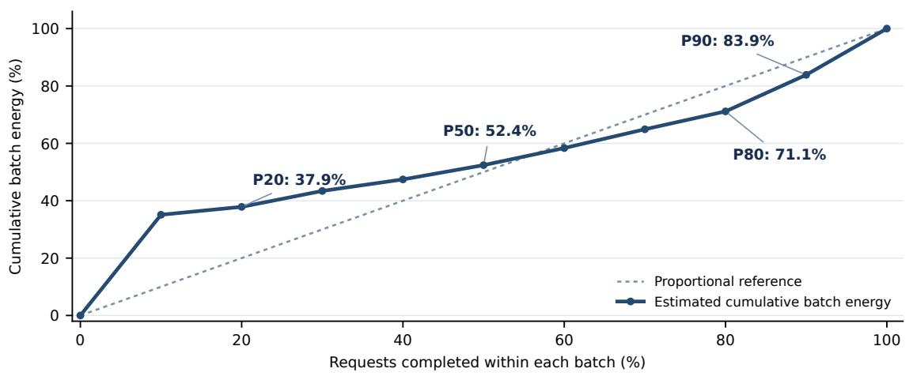  
Figure 8. Request-completion share does not track batch energy proportionally. P20, P50, P80, and P90 mark completion of 20%, 50%, 80%, and 90% of requests. Each point pools batch totals after estimating energy consumed at that milestone. Intermediate points use each batch’s average power and recorded completion times; the 100% endpoint is measured batch energy. The dotted line shows proportional completion for reference.

Figure 8 describes when energy is consumed during the measured execution batches. For each batch, we find when a given fraction of its requests has finished and multiply elapsed batch time by its measured average power. P20, P50, P80, and P90 correspond to an estimated 37.9%, 52.4%, 71.1%, and 83.9% of pooled batch energy. These intermediate values use a constant-power approximation; only the full-batch energy total is directly measured. The figure does not evaluate a stopping policy, since energy already spent on unfinished requests is included at each milestone and the outcomes of stopping them are not observed.

## G Calculating AI-System Execution Cost

We calculate AI-system execution cost for the evaluated runs from recorded GPU, CPU, and RAM use at published rates. Those rates include hardware and electricity, so energy is not charged again in dollars.

Rates and resource boundary. The eight-H100 comparisons use the July 2026 AWS Linux On-Demand p5.48xlarge rate of \$55.04 per node-hour. GLM 5.2 uses the p5en.48xlarge rate of \$63.296 per node-hour for eight H200s. These are whole-node rates including host CPU and RAM, not rates per GPU. The calculation also includes one boot volume, one public IPv4 address, and one final artifact export where applicable (Amazon Web Services, 2026c;b;a;e;d).

Table 4. Equal batch shares change the TSJ leader but leave the NVJ leader unchanged. Each cell shows active-request allocation / equal batch share. Active-request allocation is the paper’s primary method. AI outputs, judgments, expert times, wages, costs, and GDP weights are fixed; only energy assignment changes. Values are point estimates.
<table><tr><td>Category</td><td>Energy (MJ)</td><td>NVJ (USD/MJ)</td><td>TSJ (hours/MJ)</td></tr><tr><td>Computer &amp; Mathematical</td><td>0.355 / 0.337</td><td>523.8 / 551.6</td><td>7.29 / 7.67</td></tr><tr><td>Architecture &amp; Engineering</td><td>0.495 / 0.597</td><td>413.9 / 343.2</td><td>7.89 / 6.54</td></tr><tr><td>Management</td><td>0.360 / 0.349</td><td>374.6 / 387.0</td><td>6.75 / 6.97</td></tr><tr><td>Protective Service</td><td>0.225 / 0.229</td><td>278.1 / 272.9</td><td>4.96 / 4.86</td></tr><tr><td>Production</td><td>0.550 / 0.786</td><td>221.1 / 154.6</td><td>6.12 /4.28</td></tr><tr><td>Community &amp; Social Service</td><td>0.282 / 0.363</td><td>188.5 / 146.3</td><td>6.16 / 4.78</td></tr><tr><td>Legal</td><td>0.370 / 0.334</td><td>149.7 / 166.1</td><td>1.50 /1.66</td></tr><tr><td>Business &amp; Financial Operations</td><td>0.505 / 0.481</td><td>145.6 / 152.9</td><td>3.32 / 3.49</td></tr><tr><td>Personal Care &amp; Service</td><td>0.401 /0.503</td><td>134.3 / 107.2</td><td>7.15 / 5.70</td></tr><tr><td>Arts, Design, Entertainment &amp; Media</td><td>0.450 / 0.427</td><td>103.8 / 109.5</td><td>2.71 / 2.86</td></tr><tr><td>Healthcare Practitioners &amp; Technical</td><td>0.445 / 0.504</td><td>97.8 / 86.3</td><td>1.67 / 1.47</td></tr><tr><td>Sales &amp; Related</td><td>0.356 / 0.362</td><td>65.4 / 64.4</td><td>2.01 / 1.98</td></tr><tr><td>Office &amp; Administrative Support</td><td>0.604 / 0.567</td><td>40.1/42.6</td><td>1.84 /1.96</td></tr></table>

For the single-NVIDIA-accelerator comparison, we use Modal’s published per-second H100, H200, and B200 prices together with a common 32-core, 256-GiB host reservation (Modal, 2026). The MI350X comparison uses CloudRift’s published on-demand GPU-hour rate (CloudRift, 2026). These provider prices do not guarantee identical host specifications or performance across providers.

Time allocation and setup. Let $A _ { i } ( t )$ indicate when request i is active, and let $N ( t )$ count active requests. We allocate shared active node time using $\textstyle \tau _ { i } = \int A _ { i } ( t ) / N ( t ) d t$ . Shared startup, gaps, and finalization time $T _ { 0 }$ inside a task-execution window contributes $T _ { 0 } \tau _ { i } / \Sigma _ { j } \tau _ { j }$ , so the recorded window is charged once. Thus the total node time allocated to request i is $T _ { i } ^ { \mathrm { a l l o c } } = \tau _ { i } + T _ { 0 } \tau _ { i } / \sum _ { j } \tau _ { j }$ The comparison represents a prepared local service; initialization outside the task-execution window is excluded from the reported execution cost.

Scope. Published prices can change. The calculation excludes unobserved external API charges, durable storage, expert review, development, coordination, and adoption costs. These belong in a broader deployment assessment alongside the measured energy and the value of delivered work.

## G.1 Execution-cost sensitivity

For each evaluated GLM 5.2 task, we calculate the AI-system execution cost by multiplying its allocated node seconds by the AWS node-hour rate divided by 3,600, then adding its assigned boot-volume and IPv4 charges. To examine a hypothetical alternative provider price, we replace only that hourly node rate. For task (i), the resulting cost at rate (r) is

$$
C _ { i } ( r ) = C _ { i } ( \mathrm { A W S } ) + \frac { T _ { i } ^ { \mathrm { a l l o c } } } { 3 , 6 0 0 } ( r - 6 3 . 2 9 6 ) ,\tag{6}
$$

where $T _ { i } ^ { \mathrm { a l l o c } }$ includes active and allocated shared node seconds. We use published eight-H200 node tariffs of \$50.44/hour for CoreWeave and \$84.8069/hour for Google Cloud alongside the \$63.296/hour AWS rate (CoreWeave, 2026; Google Cloud, 2026; Amazon Web Services, 2026c). The same recorded outcomes, time, energy, and non-node charges are held fixed; the alternative-provider columns are hypothetical price calculations, not runs on those providers. Table 5 shows the resulting category costs and NVJ. The category NVJ order is unchanged at these three tariffs, while TSJ is unchanged because execution cost does not enter its numerator or denominator.

Table 5. Published node tariffs change calculated costs without changing category NVJ order. For the same recorded GLM 5.2 tasks, only the node-hour price is changed; task outcomes, time, energy, and non-node charges remain fixed. Values are hypothetical costs per category-normalized task and the resulting NVJ, not results of executions on other providers. The AWS column reproduces the evaluated cost boundary.
<table><tr><td rowspan="2">Category</td><td colspan="3">AI execution cost (USD)</td><td colspan="2">NVJ (USD/MJ)</td></tr><tr><td>CoreWeave</td><td>AWS</td><td>GCP</td><td>CoreWeave</td><td>GCP</td></tr><tr><td>Architecture &amp; Eng.</td><td>1.677</td><td>2.104</td><td>2.819</td><td>414.8</td><td>412.5</td></tr><tr><td>Arts &amp; Media</td><td>1.582</td><td>1.986</td><td>2.660</td><td>104.7</td><td>102.3</td></tr><tr><td>Business &amp; Financial</td><td>1.731</td><td>2.172</td><td>2.911</td><td>146.4</td><td>144.1</td></tr><tr><td>Community &amp; Social</td><td>0.983</td><td>1.233</td><td>1.652</td><td>189.4</td><td>187.0</td></tr><tr><td>Computer &amp; Math</td><td>1.245</td><td>1.562</td><td>2.092</td><td>524.6</td><td>522.3</td></tr><tr><td>Healthcare</td><td>1.837</td><td>2.306</td><td>3.089</td><td>98.9</td><td>96.1</td></tr><tr><td>Legal</td><td>1.257</td><td>1.577</td><td>2.113</td><td>150.6</td><td>148.3</td></tr><tr><td>Management</td><td>1.256</td><td>1.576</td><td>2.112</td><td>375.5</td><td>373.1</td></tr><tr><td>Office &amp; Admin.</td><td>2.173</td><td>2.727</td><td>3.653</td><td>41.0</td><td>38.5</td></tr><tr><td>Personal Care</td><td>1.506</td><td>1.890</td><td>2.532</td><td>135.3</td><td>132.7</td></tr><tr><td>Production</td><td>1.859</td><td>2.333</td><td>3.125</td><td>222.0</td><td>219.7</td></tr><tr><td>Protective Service</td><td>0.778</td><td>0.976</td><td>1.308</td><td>279.0</td><td>276.6</td></tr><tr><td>Sales</td><td>1.265</td><td>1.587</td><td>2.127</td><td>66.3</td><td>63.9</td></tr></table>

## H Economic Weights and Wage Robustness

GDPval chose sectors for their GDP contribution and sampled predominantly knowledge-work occupations with large aggregate compensation (Patwardhan et al., 2025). Its public gold set has five tasks per occupation, so equal task weights would reflect the sampling design rather than sector economic scale. We give each of the nine sectors its normalized GDP share, then divide that share among its evaluated occupations in proportion to national employment. Sector GDP thus sets the scale across sectors, while employment distinguishes occupations within each sector. We do not use wage-bill weights because wages already enter output dollar value as recorded expert completion time multiplied by the occupation’s matched OEWS median hourly wage (U.S. Bureau of Labor Statistics, 2025; Patwardhan et al., 2025). Using wages again in the weights would give highwage occupations additional influence; wage-bill weights would instead emphasize compensation paid to those occupations. The GDP-based weights preserve sector GDP shares without assuming equal GDP-to-wage-bill ratios across sectors. The 44 occupations are grouped into 13 occupation categories using the O\*NET-SOC taxonomy (O\*NET Resource Center, 2019); O\*NET-SOC supplies the classification and does not construct the weights.

Let $\gamma _ { s }$ be sector $s ^ { \prime } s$ share of U.S. GDP, normalized across the nine selected sectors, and let $L _ { o } = \mathrm { E m p l o y m e n t } _ { o }$ . The occupation weight used in both aggregation levels is

$$
w _ { o } ^ { \mathrm { G D P } } = \gamma _ { s ( o ) } \frac { L _ { o } } { \sum _ { j : s ( j ) = s ( o ) } L _ { j } } , \qquad \sum _ { o \in \mathcal { O } } w _ { o } ^ { \mathrm { G D P } } = 1 .\tag{7}
$$

For completeness, define the per-occupation task average as $\widetilde { X } _ { o } = X _ { o } / n _ { o }$ , where $n _ { o }$ is its evaluated

task count and $X \in \{ G , C , S , E \}$ , with S denoting time saving as in Section 2.5. For category c, its category weight and within-category occupation weights are

$$
W _ { c } = \sum _ { o \in c } w _ { o } ^ { \mathrm { G D P } } , \qquad w _ { o | c } = \frac { w _ { o } ^ { \mathrm { G D P } } } { W _ { c } } , \qquad \sum _ { o \in c } w _ { o | c } = 1 .\tag{8}
$$

The category outcome is $\begin{array} { r } { \widetilde X _ { c } = \sum _ { o \in c } w _ { o | c } \widetilde X _ { o } . } \end{array}$ , while the GDP-weighted benchmark outcome is $\widetilde { X } ^ { \mathrm { G D P } } =$ $\textstyle \sum _ { c } W _ { c } \widetilde { X } _ { c } .$ , with $\textstyle \sum _ { c } W _ { c } = 1$ . The same within-category and benchmark weights are applied to output dollar value, AI-system execution cost, time saving and energy before forming NVJ, TSJ or net value per dollar of AI cost; the method never averages already-formed occupation or category ratios.

Table 6 lists the resulting category weights, and Figure 9 visualizes their construction and use.

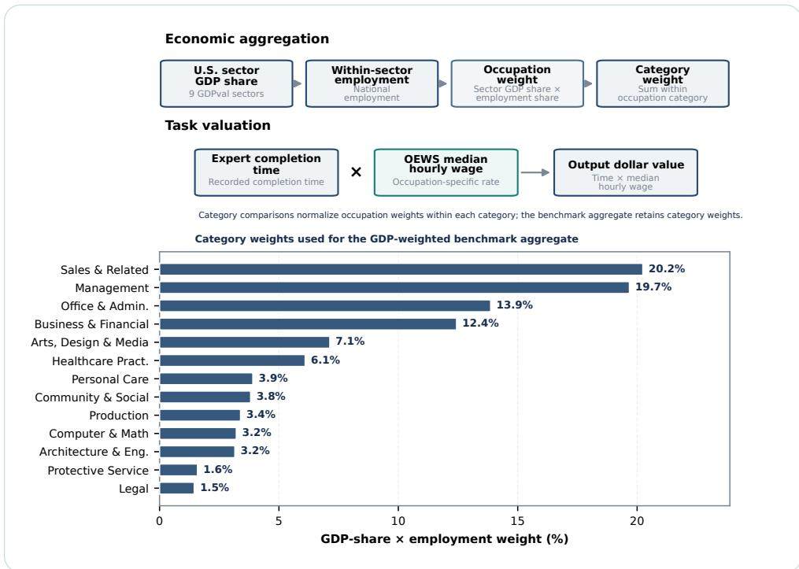  
Figure 9. Wages determine output dollar value without also increasing benchmark weights. Sector GDP shares and within-sector employment shares determine occupation weights. Category comparisons renormalize those weights to one within each category, while the GDP-weighted benchmark metric retains category weights. Expert completion time and occupation-specific median wages determine output dollar value.

Table 7 compares mean and median hourly wages in task valuation while holding GDP-based occupation weights, energy, AI-system execution cost, and time saving fixed. The headline analysis uses median hourly wages. U.S. GDP shares, employment, wages, work practices, and estimates of time saving change over time; results should therefore be recomputed as work changes.

## I Occupation-Category Results

Table 8 gives win–tie rates, Table 9 gives net dollar value and time saving per task, and Table 10 gives returns per MJ. These tables underlie Figure 3. Brackets give 95% task-composition intervals. They describe variation across the evaluated tasks and do not establish a population ordering of categories.

Table 6. Sales and Management receive the largest GDP-based category weights. Employment shares allocate each sector’s GDP share among its evaluated occupations; the category weights sum to one and are retained in the GDP-weighted benchmark aggregate.
<table><tr><td>Category</td><td>Occupations</td><td>Weight Employment (M)</td></tr><tr><td>Management</td><td>7 19.68%</td><td>6.77</td></tr><tr><td>Business &amp; Financial Ops.</td><td>6 12.44%</td><td>3.95</td></tr><tr><td>Computer &amp; Mathematical</td><td>1 3.22%</td><td>1.65</td></tr><tr><td>Architecture &amp; Engineering</td><td>2 3.16%</td><td>0.64</td></tr><tr><td>Community &amp; Social Service</td><td>1 3.82%</td><td>0.38</td></tr><tr><td>Legal</td><td>1 1.45%</td><td>0.75</td></tr><tr><td>Arts, Design, Entertainment &amp; Media</td><td>5</td><td>7.13% 0.38</td></tr><tr><td>Healthcare Practitioners &amp; Technical</td><td>3</td><td>6.10% 3.92</td></tr><tr><td>Protective Service</td><td>2</td><td>1.59% 0.19</td></tr><tr><td>Personal Care &amp; Service</td><td>2 3.91%</td><td>0.35</td></tr><tr><td>Sales &amp; Related</td><td>8 20.24%</td><td>4.00</td></tr><tr><td>Office &amp; Administrative Support</td><td>5 13.87%</td><td>5.99</td></tr><tr><td>Production</td><td>1 3.39%</td><td>0.69</td></tr></table>

Table 7. Mean rather than median wages raise NVJ while leaving TSJ unchanged. AI-system execution cost is held fixed for GDP-weighted GLM 5.2 with one attempt per task. NVJ is USD/MJ; TSJ is hours/MJ.
<table><tr><td></td><td>Output dollar</td><td>AI-system</td><td></td><td></td><td></td></tr><tr><td>Wage basis</td><td>value (USD)</td><td>execution cost (USD)</td><td>Energy (MJ)</td><td>NVJ</td><td>TSJ</td></tr><tr><td>OEWS mean</td><td>85.57</td><td>1.92</td><td>0.430</td><td>194.58 168.11</td><td>3.823 3.823</td></tr><tr><td>OEWS median</td><td>74.19</td><td>1.92</td><td>0.430</td><td></td><td></td></tr></table>

Table 8. Protective Service leads win–tie rate per MJ, while Personal Care leads win–tie rate. GLM 5.2, expert-only reference, one attempt per task; occupation outcomes are category-normalized with GDP-based weights. Brackets show 95% task-composition intervals.
<table><tr><td>Category</td><td>Win-tie (%)</td><td>Win-tie pp/MJ</td></tr><tr><td>Architecture &amp; Eng.</td><td>69.00 [38.01, 91.00]</td><td>139.43 [75.84, 229.50]</td></tr><tr><td>Arts &amp; Media</td><td>46.09 [28.27, 66.09]</td><td>102.44 [74.15, 136.56]</td></tr><tr><td>Business &amp; Financial</td><td>56.81 [37.93, 74.97]</td><td>112.42 [72.81, 168.62]</td></tr><tr><td>Community &amp; Social</td><td>60.00 [20.00, 100.00]</td><td>212.94 [60.19, 390.26]</td></tr><tr><td>Computer &amp; Math</td><td>80.00 [40.00, 100.00]</td><td>225.08 [122.22, 312.77]</td></tr><tr><td>Healthcare</td><td>28.23 [8.02, 63.12]</td><td></td></tr><tr><td>Legal</td><td></td><td>63.48 [21.77, 107.89]</td></tr><tr><td>Management</td><td>60.00 [20.00, 100.00]</td><td>162.14 [49.98, 321.76]</td></tr><tr><td>Office &amp; Admin.</td><td>78.67 [62.10, 92.17]</td><td>218.37 [162.96, 289.27]</td></tr><tr><td>Personal Care</td><td>38.14 [16.10, 62.36]</td><td>63.18 [23.59, 135.67]</td></tr><tr><td>Production</td><td>95.79 [87.37, 100.00]</td><td>238.63 [150.53, 515.22]</td></tr><tr><td>Protective Service</td><td>40.00 [0.00, 80.00] 60.00 [20.80, 99.20]</td><td>72.78 [0.00, 150.11]</td></tr><tr><td>Sales</td><td>55.31 [34.84, 74.31]</td><td>267.01 [84.52, 479.38] 155.28 [96.17, 222.56]</td></tr></table>

Table 11 reports output dollar value and time saving per win or tie. These components explain why a category can yield fewer wins and ties per joule while delivering greater dollar value or time saving per joule.

## J Why Occupation Rankings Differ

Across the evaluated tasks, let $a _ { i | c } = w _ { o ( i ) | c } / n _ { o ( i ) }$ be task i’s normalized GDP-based weight within category c, and let $Y _ { i } = 1$ when the AI output wins or ties and zero otherwise. Let $E _ { i }$ and $C _ { i }$ denote

Table 9. Architecture & Engineering leads net dollar value and time saving per task. GLM 5.2, expert-only reference, one attempt per task; occupation outcomes are category-normalized with GDP-based weights. Brackets show 95% task-composition intervals.
<table><tr><td>Category</td><td>Net dollar value (USD/task)</td><td>Time saving (hours/task)</td></tr><tr><td>Architecture &amp; Eng.</td><td>204.84 [108.93, 288.94]</td><td>3.905 [2.055, 5.569]</td></tr><tr><td>Arts &amp; Media</td><td>46.71 [20.18, 79.15]</td><td>1.219 [0.554, 2.028]</td></tr><tr><td>Business &amp; Financial</td><td>73.57 [44.46, 106.85]</td><td>1.677 [0.975, 2.508]</td></tr><tr><td>Community &amp; Social</td><td>53.12 [12.78, 93.45]</td><td>1.735[0.423, 3.047]</td></tr><tr><td>Computer &amp; Math</td><td>186.16 [68.11, 337.13]</td><td>2.589 [0.924, 4.844]</td></tr><tr><td>Healthcare</td><td>43.50 [14.21, 86.93]</td><td>0.742 [0.230, 1.541]</td></tr><tr><td>Legal</td><td>55.40 [7.06, 117.50]</td><td>0.555 [0.046, 1.338]</td></tr><tr><td>Management</td><td>134.95[73.68, 229.83]</td><td>2.431 [1.239, 4.337]</td></tr><tr><td>Office &amp; Admin.</td><td>24.18 [5.74, 48.62]</td><td>1.111 [0.315, 2.200]</td></tr><tr><td>Personal Care</td><td>53.92 [34.42, 73.33]</td><td>2.870 [1.753, 3.975]</td></tr><tr><td>Production</td><td>121.51 [-2.22, 250.73]</td><td>3.361 [0.000, 6.915]</td></tr><tr><td>Protective Service</td><td>62.49 [7.21, 150.74]</td><td>1.114 [0.128, 2.792]</td></tr><tr><td>Sales</td><td>23.29 [15.22, 31.58]</td><td>0.717 [0.455, 0.987]</td></tr></table>

Table 10. Computer & Mathematical leads NVJ; Architecture & Engineering leads TSJ. GLM 5.2, expertonly reference, one attempt per task; occupation outcomes are category-normalized with GDP-based weights. Brackets show 95% task-composition intervals.
<table><tr><td>Category</td><td>NVJ (USD/MJ)</td><td>TSJ (hours/MJ)</td></tr><tr><td>Architecture &amp; Eng.</td><td>413.90 [196.34, 744.61]</td><td>7.890 [3.660, 14.397]</td></tr><tr><td>Arts &amp; Media</td><td>103.82 [55.09, 167.63]</td><td>2.710 [1.459, 4.508]</td></tr><tr><td>Business &amp; Financial</td><td>145.57 [83.22, 239.58]</td><td>3.318 [1.820, 5.627]</td></tr><tr><td>Community &amp; Social</td><td>188.50 [43.10, 382.42]</td><td>6.158 [1.426, 12.522]</td></tr><tr><td>Computer &amp; Math</td><td>523.76 [235.93, 770.14]</td><td>7.285 [3.182, 11.080]</td></tr><tr><td>Healthcare</td><td>97.84 [38.77, 196.72]</td><td>1.669 [0.643, 3.049]</td></tr><tr><td>Legal</td><td>149.70 [21.88, 370.36]</td><td></td></tr><tr><td>Management</td><td>374.57 [193.82, 672.56]</td><td>1.500 [0.144, 4.257]</td></tr><tr><td>Office &amp; Admin.</td><td></td><td>6.748 [3.253, 12.692]</td></tr><tr><td>Personal Care</td><td>40.05 [8.22, 105.52] 134.32 [87.59, 261.20]</td><td>1.840 [0.470, 4.745]</td></tr><tr><td>Production</td><td>221.10 [-4.24, 479.79]</td><td>7.151 [4.532, 14.139]</td></tr><tr><td>Protective Service</td><td></td><td>6.116 [0.000, 13.337]</td></tr><tr><td>Sales</td><td>278.09 [30.55, 669.23] 65.40 [42.16, 93.84]</td><td>4.956 [0.533, 12.268] 2.014 [1.283, 2.898]</td></tr></table>

Table 11. Win–tie values and expert times explain why the category rankings differ. Values condition on outputs judged a win or tie for GLM 5.2 against the expert-only reference. Occupation outcomes are category-normalized with GDP-based weights.
<table><tr><td>Category</td><td>Output dollar value (USD)</td><td>Expert time (h)</td><td>AI time (h)</td><td>Time saving (h)</td></tr><tr><td>Architecture &amp; Eng.</td><td>299.90</td><td>6.11</td><td>0.45</td><td>5.66</td></tr><tr><td>Arts &amp; Media</td><td>105.66</td><td>3.02</td><td>0.37</td><td>2.65</td></tr><tr><td>Business &amp; Financial</td><td>133.31</td><td>3.34</td><td>0.39</td><td>2.95</td></tr><tr><td>Community &amp; Social</td><td>90.58</td><td>3.22</td><td>0.32</td><td>2.89</td></tr><tr><td>Computer &amp; Math</td><td>234.65</td><td>3.67</td><td>0.43</td><td>3.24</td></tr><tr><td>Healthcare</td><td>162.29</td><td>3.04</td><td>0.41</td><td>2.63</td></tr><tr><td>Legal</td><td>94.96</td><td>1.31</td><td>0.38</td><td>0.93</td></tr><tr><td>Management</td><td>173.53</td><td>3.39</td><td>0.30</td><td>3.09</td></tr><tr><td>Office &amp; Admin.</td><td>70.55</td><td>3.30</td><td>0.38</td><td>2.91</td></tr><tr><td>Personal Care</td><td>58.26</td><td>3.40</td><td>0.40</td><td>3.00</td></tr><tr><td>Production</td><td>309.61</td><td>9.04</td><td>0.64</td><td>8.40</td></tr><tr><td>Protective Service</td><td>105.78</td><td>2.13</td><td>0.27</td><td>1.86</td></tr><tr><td>Sales</td><td>44.98</td><td>1.63</td><td>0.34</td><td>1.30</td></tr></table>

measured energy and AI-system execution cost. The category win–tie rate and its energy-normalized version are

$$
p _ { c } = \sum _ { i \in c } a _ { i | c } Y _ { i } , \qquad \bar { E } _ { c } = \sum _ { i \in c } a _ { i | c } E _ { i } ,\tag{9}
$$

$$
\mathrm { W T } _ { c } = 1 0 0 p _ { c } \ : \left( \% \right) , \qquad \mathrm { W T / M J } _ { c } = \frac { 1 0 0 p _ { c } } { \bar { E } _ { c } } .\tag{10}
$$

The latter unit is percentage points per MJ. All attempts contribute energy and cost, including losses. For $p _ { c } > 0 .$ , let $\bar { G } _ { S , c }$ be output dollar value per win or tie and $\bar { D } _ { S , c }$ be time saving per win or tie. With $\begin{array} { r } { \bar { C } _ { c } = \sum _ { i } a _ { i | c } C _ { i } . } \end{array}$ , the two economic returns decompose as

$$
\mathbf { N V } \mathbf { J } _ { c } = \frac { p _ { c } } { \bar { E } _ { c } } \bar { G } _ { S , c } - \frac { \bar { C } _ { c } } { \bar { E } _ { c } } , \qquad \mathbf { T S J } _ { c } = \frac { p _ { c } } { \bar { E } _ { c } } \bar { D } _ { S , c } .\tag{11}
$$

Thus win–tie frequency per joule, dollar value per win or tie, and time saving per win or tie play different roles. The category values are in Tables 8, 10, and 11. Table 12 shows the resulting rank changes. Protective Service ranks first on win–tie rate per MJ but fourth on NVJ and seventh on TSJ. Computer & Mathematical ranks third on win–tie rate per MJ but first on NVJ because its dollar value per win or tie is higher. Production ranks eleventh on win–tie rate per MJ and sixth on TSJ, despite the long expert completion times of its tested tasks. Architecture & Engineering leads TSJ. Each metric therefore answers a different question about the same attempts.

Table 12. Different categories lead win–tie rate per MJ, NVJ, and TSJ. Point-estimate ranks for GLM 5.2 against the expert-only reference, with one attempt per task and category-normalized GDP-based weights; rank 1 is highest.
<table><tr><td>Category</td><td>Win–tie pp/MJ rank</td><td>NVJ rank</td><td>TSJ rank</td></tr><tr><td>Architecture &amp; Eng.</td><td>8</td><td>2</td><td>1</td></tr><tr><td>Arts &amp; Media</td><td>10</td><td>10</td><td>9</td></tr><tr><td>Business &amp; Financial</td><td>9</td><td>8</td><td>8</td></tr><tr><td>Community &amp; Social</td><td>5</td><td>6</td><td>5</td></tr><tr><td>Computer &amp; Math</td><td>3</td><td>1</td><td>2</td></tr><tr><td>Healthcare</td><td>12</td><td>11</td><td>12</td></tr><tr><td>Legal</td><td>6</td><td>7</td><td>13</td></tr><tr><td>Management</td><td>4</td><td>3</td><td>4</td></tr><tr><td>Office &amp; Admin.</td><td>13</td><td>13</td><td>11</td></tr><tr><td>Personal Care</td><td>2</td><td>9</td><td>3</td></tr><tr><td>Production</td><td>11</td><td>5</td><td>6</td></tr><tr><td>Protective Service</td><td>1</td><td>4</td><td>7</td></tr><tr><td>Sales</td><td>7</td><td>12</td><td>10</td></tr></table>

## J.1 Full Occupation-Category Results

Table 13 gives the category-normalized credited value, AI execution cost, time saving, and energy that form each reported ratio. Table 14 gives net value per dollar of AI-system execution cost and per AI hour for the same categories. Table 15 gives the corresponding point estimates for every evaluated occupation. GDP-weighting the underlying unrounded components before forming the ratios reproduces the GLM 5.2 row of Table 1 (37.69 per AI dollar and 191.3 USD per AI hour).

Table 13. A high win–tie rate alone does not determine credited value or time saving. Categorynormalized GDP-based task averages, expert-only reference. Credited value and time saving are zero on losses; AI-system execution cost and energy include every attempt. Applying $\left( G - C \right) / E$ and $S / E$ to the underlying unrounded components reproduces the NVJ and TSJ point estimates in Table 10.
<table><tr><td>Category</td><td>Win-tie (%)</td><td>Credited value G (USD)</td><td>AI cost C (USD)</td><td>Time saving S (hours)</td><td>Energy E (MJ)</td><td>AI time L (hours)</td></tr><tr><td>Architecture &amp; Eng.</td><td>69.0</td><td>206.94</td><td>2.104</td><td>3.905</td><td>0.495</td><td>0.467</td></tr><tr><td>Arts &amp; Media</td><td>46.1</td><td>48.70</td><td>1.986</td><td>1.219</td><td>0.450</td><td>0.384</td></tr><tr><td>Business &amp; Financial</td><td>56.8</td><td>75.74</td><td>2.172</td><td>1.677</td><td>0.505</td><td>0.443</td></tr><tr><td>Community &amp; Social</td><td>60.0</td><td>54.35</td><td>1.233</td><td>1.735</td><td>0.282</td><td>0.321</td></tr><tr><td>Computer &amp; Math</td><td>80.0</td><td>187.72</td><td>1.562</td><td>2.589</td><td>0.355</td><td>0.420</td></tr><tr><td>Healthcare</td><td>28.2</td><td>45.81</td><td>2.306</td><td>0.742</td><td>0.445</td><td>0.299</td></tr><tr><td>Legal</td><td>60.0</td><td>56.97</td><td>1.577</td><td>0.555</td><td>0.370</td><td>0.368</td></tr><tr><td>Management</td><td>78.7</td><td>136.53</td><td>1.576</td><td>2.431</td><td>0.360</td><td>0.319</td></tr><tr><td>Office &amp; Admin.</td><td>38.1</td><td>26.91</td><td>2.727</td><td>1.111</td><td>0.604</td><td>0.449</td></tr><tr><td>Personal Care</td><td>95.8</td><td>55.81</td><td>1.890</td><td>2.870</td><td>0.401</td><td>0.393</td></tr><tr><td>Production</td><td>40.0</td><td>123.84</td><td>2.333</td><td>3.361</td><td>0.550</td><td>0.610</td></tr><tr><td>Protective Service</td><td>60.0</td><td>63.47</td><td>0.976</td><td>1.114</td><td>0.225</td><td>0.277</td></tr><tr><td>Sales</td><td>55.3</td><td>24.88</td><td>1.587</td><td>0.717</td><td>0.356</td><td>0.326</td></tr></table>

Table 14. Computer & Mathematical leads net value per AI dollar and per AI hour across occupation categories. GLM 5.2 against the expert-only reference, one attempt per task. Category-normalized GDP-based averages are combined before forming $\left( G - C \right) / C$ and $\left( G - C \right) / L ,$ where G is credited output dollar value, C is AI-system execution cost, and L is AI-system completion time in hours. All attempts contribute cost and time. Point estimates use the underlying unrounded components summarized in Table 13; categories are ordered by net value per AI dollar.
<table><tr><td>Rank Category</td><td></td><td>Net value/AI dollar (USD/USD)</td><td>Net value/AI hour (USD/hour)</td></tr><tr><td>1</td><td>Computer &amp; Math</td><td>119.2</td><td>442.9</td></tr><tr><td>2</td><td>Architecture &amp; Eng.</td><td>97.4</td><td>438.4</td></tr><tr><td>3</td><td>Management</td><td>85.6</td><td>423.6</td></tr><tr><td>4</td><td>Protective Service</td><td>64.0</td><td>225.8</td></tr><tr><td>5</td><td>Production</td><td>52.1</td><td>199.3</td></tr><tr><td>6</td><td>Community &amp; Social</td><td>43.1</td><td>165.7</td></tr><tr><td>7</td><td>Legal</td><td>35.1</td><td>150.5</td></tr><tr><td>8</td><td>Business &amp; Financial</td><td>33.9</td><td>166.1</td></tr><tr><td>9</td><td>Personal Care</td><td>28.5</td><td>137.1</td></tr><tr><td>10</td><td>Arts &amp; Media</td><td>23.5</td><td>121.8</td></tr><tr><td>11</td><td>Healthcare</td><td>18.9</td><td>145.3</td></tr><tr><td>12</td><td>Sales</td><td>14.7</td><td>71.5</td></tr><tr><td>13</td><td>Office &amp; Admin.</td><td>8.9</td><td>53.9</td></tr></table>

Table 15. Occupation-level economic returns vary widely across the evaluated work. Expert-only reference and one evaluated attempt per task. Win–tie is the fraction of an occupation’s evaluated tasks judged a win or tie. Each occupation’s task components are averaged before ratios are formed. These are point estimates; all attempts contribute cost and energy.
<table><tr><td>Occupation</td><td>Tasks Win-tie (%)</td><td></td><td>NVJ (USD/MJ)</td><td>TSJ (h/MJ)</td></tr><tr><td>Accountants and Auditors</td><td>5</td><td>40.0</td><td>31.5</td><td>0.53</td></tr><tr><td>Administrative Services Managers</td><td>5</td><td>100.0</td><td>369.8</td><td>6.60</td></tr><tr><td>Audio and Video Technicians</td><td>5</td><td>40.0</td><td>22.7</td><td>0.53</td></tr><tr><td>Buyers and Purchasing Agents</td><td>5</td><td>40.0</td><td>249.3</td><td>6.69</td></tr><tr><td>Child, Family, and School Social Workers</td><td>5</td><td>60.0</td><td>188.5</td><td>6.16</td></tr><tr><td>Compliance Officers</td><td>5</td><td>80.0</td><td>333.9</td><td>8.45</td></tr><tr><td>Computer and Information Systems Managers</td><td>5</td><td>60.0</td><td>515.3</td><td>5.82</td></tr><tr><td>Concierges</td><td>5</td><td>80.0</td><td>214.2</td><td>11.18</td></tr><tr><td>Counter and Rental Clerks</td><td>5</td><td>60.0</td><td>56.4</td><td>2.71</td></tr><tr><td>Customer Service Representatives</td><td>5</td><td>40.0</td><td>45.0</td><td>2.09</td></tr><tr><td>Editors</td><td>5</td><td>80.0</td><td>407.1</td><td>10.49</td></tr><tr><td>Film and Video Editors</td><td>5</td><td>60.0</td><td>116.7</td><td>2.94</td></tr><tr><td>Financial Managers</td><td>5</td><td>40.0</td><td>40.9</td><td>0.33</td></tr><tr><td>Financial and Investment Analysts</td><td>5</td><td>40.0</td><td>231.6</td><td>4.35</td></tr><tr><td>First-Line Supervisors of Non-Retail Sales Workers</td><td>5</td><td>20.0</td><td>82.8</td><td>1.83</td></tr><tr><td>First-Line Supervisors of Office and Administrative Support Workers</td><td>5</td><td>20.0</td><td>6.1</td><td>0.18</td></tr><tr><td>First-Line Supervisors of Police and Detectives</td><td>5</td><td>60.0</td><td>292.0</td><td>5.08</td></tr><tr><td>First-Line Supervisors of Production and Operating Workers</td><td>5</td><td>40.0</td><td>221.1</td><td>6.12</td></tr><tr><td>First-Line Supervisors of Retail Sales Workers</td><td>5</td><td>60.0</td><td>65.2</td><td>2.54</td></tr><tr><td>General and Operations Managers</td><td>5</td><td>80.0</td><td>1270.8</td><td>24.74</td></tr><tr><td>Industrial Engineers</td><td>5</td><td>60.0</td><td>141.8</td><td>2.44</td></tr><tr><td>Lawyers</td><td>5</td><td>60.0</td><td>149.7</td><td>1.50</td></tr><tr><td>Mechanical Engineers</td><td>5</td><td>80.0</td><td>913.4</td><td>17.90</td></tr><tr><td>Medical Secretaries and Administrative Assistants</td><td>5</td><td>60.0</td><td>90.5</td><td>3.70</td></tr><tr><td>Medical and Health Services Managers</td><td>5</td><td>100.0</td><td>241.0</td><td>3.78</td></tr><tr><td>News Analysts, Reporters, and Journalists</td><td>5</td><td>60.0</td><td>231.4</td><td>7.59</td></tr><tr><td>Nurse Practitioners</td><td>5</td><td>80.0</td><td>653.5</td><td>9.79</td></tr><tr><td>Order Clerks</td><td>5</td><td>20.0</td><td>16.0</td><td>0.84</td></tr><tr><td>Personal Financial Advisors</td><td>5</td><td>60.0</td><td>190.4</td><td>3.29</td></tr><tr><td>Pharmacists</td><td>5</td><td>60.0</td><td>162.8</td><td>2.42</td></tr><tr><td>Private Detectives and Investigators</td><td>5</td><td>60.0</td><td>93.6</td><td>3.36</td></tr><tr><td>Producers and Directors</td><td>5</td><td>20.0</td><td>39.6</td><td>0.91</td></tr><tr><td>Project Management Specialists</td><td>5</td><td>60.0</td><td>197.1</td><td>3.52</td></tr><tr><td>Property, Real Estate, and Community Association</td><td>5</td><td>80.0</td><td>119.1</td><td>2.96</td></tr><tr><td>Managers Real Estate Brokers</td><td>5</td><td>40.0</td><td>26.9</td><td>0.58</td></tr><tr><td>Real Estate Sales Agents</td><td>5</td><td>40.0</td><td>28.1</td><td>0.73</td></tr><tr><td>Recreation Workers</td><td>5</td><td>100.0</td><td>125.4</td><td>6.70</td></tr><tr><td>Registered Nurses</td><td>5</td><td>20.0</td><td>53.4</td><td>1.05</td></tr><tr><td>Sales Managers</td><td>5</td><td>80.0</td><td>331.5</td><td>4.36</td></tr><tr><td>Sales Representatives, Wholesale and Manufacturing,</td><td>5</td><td>60.0</td><td>72.4</td><td>1.81</td></tr><tr><td>Except Technical and Scientific Products Sales Representatives, Wholesale and Manufacturing,</td><td>5</td><td>40.0</td><td>99.3</td><td>1.85</td></tr><tr><td>Technical and Scientific Products Securities, Commodities, and Financial Services Sales</td><td>5</td><td>100.0</td><td>154.3</td><td>3.56</td></tr><tr><td>Agents</td><td></td><td></td><td></td><td></td></tr><tr><td>Shipping, Receiving, and Inventory Clerks</td><td>5</td><td>40.0</td><td>61.0</td><td>2.96</td></tr><tr><td>Software Developers</td><td>5</td><td>80.0</td><td>523.8</td><td>7.29</td></tr></table>

## J.2 Task-composition sensitivity

The category intervals in Tables 8 and 10 come from 10,000 task-composition bootstrap draws. Each draw resamples evaluated tasks within occupations, then recomputes the weighted dollar-value, saved-time, cost, and energy components before forming each ratio. Recorded judgments and resource measurements stay fixed.

We also test category-rank stability by independently removing one uniformly chosen task from each occupation category in 10,000 portfolios. For each portfolio, we re-average the retained tasks within their occupations and recompute win–tie rate per MJ, NVJ, and TSJ using the same GDP occupation weights. This changes task composition while keeping the recorded judgments, AI-system execution costs, and energy measurements fixed. Table 16 reports the resulting rank correlations and how often each original leader stays first. Computer & Mathematical retains the NVJ lead in 76.5% of portfolios, while Architecture & Engineering retains the TSJ lead in 40.4%. These frequencies describe the specified task removals, not the probability that a category would lead across all professional work.

Table 16. The NVJ leader survives one-task deletions more often than the TSJ leader. Across $^ { 1 0 , 0 0 0 }$ independently drawn portfolios, one task is chosen uniformly from each category and the remaining tasks are re-averaged within their occupations. GDP occupation weights and recorded outcomes and resource use stay fixed. Percentile ranges describe these perturbations, not confidence intervals.
<table><tr><td>Ranking</td><td>Median  $\rho$ </td><td>5th-95th  $\rho$ </td><td>Leader retained</td></tr><tr><td>Win-tie rate per MJ</td><td>0.951</td><td>0.896–0.989</td><td>51.0%</td></tr><tr><td>NVJ</td><td>0.962</td><td>0.824–0.995</td><td>76.5%</td></tr><tr><td>TSJ</td><td>0.918</td><td>0.813-0.973</td><td>40.4%</td></tr></table>

## K Expert-Reference and Repeated-Run Sensitivity

## K.1 Separating reference judgments from time valuation

The expert reference affects the metrics through its deliverable, which determines whether the autonomous output wins or ties, and its expert completion time, which determines the output dollar value and expert time assigned to that outcome. We cross these two choices for the same GLM 5.2 outputs under the one-run policy, keeping wages, occupation weights, AI-system completion time, AI-system execution cost, and energy fixed. The calculation reuses the recorded runs and judge decisions.

Let $s , t \in \{ \mathrm { E } , \mathrm { E } + \mathrm { A I } \}$ index the judgment and time references separately, with E denoting the expert-only reference and E+AI denoting the expert-with-AI reference. Let $Y _ { i } ^ { s }$ indicate a win or tie against deliverable $s , H _ { i } ^ { t }$ be expert completion time, $W _ { i }$ the median occupation wage, $L _ { i }$ the evaluated run’s AI-system completion time, and $C _ { i } , E _ { i }$ its AI-system execution cost and energy. With normalized task weights $p _ { i } = w _ { o ( i ) } ^ { \mathrm { G D P } } / n _ { o ( i ) }$ , where $n _ { o ( i ) }$ is the number of evaluated tasks in occupation $o ( i )$

$$
\mathrm { N V J } ( s , t ) = { \frac { \sum _ { i } p _ { i } Y _ { i } ^ { s } H _ { i } ^ { t } W _ { i } - \sum _ { i } p _ { i } C _ { i } } { \sum _ { i } p _ { i } E _ { i } } } ,\tag{12}
$$

$$
\mathrm { T S J } ( s , t ) = \frac { \sum _ { i } p _ { i } Y _ { i } ^ { s } ( H _ { i } ^ { t } - L _ { i } ) } { \sum _ { i } p _ { i } E _ { i } } .\tag{13}
$$

Negative time saving is retained. All four combinations charge 0.429915 MJ and \$1.91739 in the GDP-weighted task average. Table 17 reports their returns.

Paired contrasts and uncertainty. We resample evaluated tasks with replacement within each of the 44 occupations 10,000 times (seed 20260726), sharing each draw across all four combinations and recomputing ratios and percentage reductions. In a separate sensitivity analysis, we ran each task four times and compared returns using one through four attempts (Appendix K.2). Table 18 uses the relevant starting cell as the percentage denominator. The intervals vary task composition while holding recorded judgments, valuation inputs, and energy allocation fixed.

Table 17. Expert-with-AI judgments and completion times each lower reported NVJ and TSJ. For GLM 5.2 under pass@1, the mixed-reference rows separate judgment and valuation effects. Brackets show percentile 95% task-composition intervals.
<table><tr><td>Judgment reference</td><td>Time reference</td><td>NVJ (USD/MJ)</td><td>TSJ (hours/MJ)</td></tr><tr><td>Expert-only</td><td>Expert-only</td><td>168.11 [126.00, 222.43]</td><td>3.823 [2.870, 5.021]</td></tr><tr><td>Expert-with-AI</td><td>Expert-only</td><td>69.07 [46.04, 95.84]</td><td>1.818 [1.256, 2.486]</td></tr><tr><td>Expert-only</td><td>Expert-with-AI</td><td>84.90 [64.79, 107.49]</td><td>1.990 [1.432, 2.639]</td></tr><tr><td>Expert-with-AI</td><td>Expert-with-AI</td><td>50.04 [30.77, 70.41]</td><td>1.340 [0.814, 1.888]</td></tr></table>

Table 18. Changing both judgments and times reduces NVJ by 70.2% and TSJ by 65.0%. Every change substitutes the expert-with-AI reference for the expert-only reference. Values are percentage reductions [95% interval]; a negative endpoint permits an increase.
<table><tr><td>Change and fixed quantity</td><td>NVJ reduction (%)</td><td>TSJ reduction (%)</td></tr><tr><td>Judgments; expert-only reference times fixed</td><td>58.9 [43.0, 72.7]</td><td>52.5 [37.0, 66.5]</td></tr><tr><td>Times; expert-only reference decisions fixed</td><td>49.5 [33.1, 63.0]</td><td>47.9 [29.1, 63.2]</td></tr><tr><td>Times; expert-with-AI reference decisions fixed</td><td>27.5 [-1.7, 50.8]</td><td>26.3 [-6.2, 51.8]</td></tr><tr><td>Judgments; expert-with-AI reference times fixed</td><td>41.1 [20.9, 60.4]</td><td>32.7 [7.2, 54.9]</td></tr><tr><td>Both judgments and times</td><td>70.2 [54.4, 82.5]</td><td>65.0 [46.3, 79.4]</td></tr></table>

Interaction and attribution. The two reductions from the expert-only reference starting point are not additive. Switching deliverables first gives NVJ 168.11 → 69.07 → 50.04. The first step removes 58.92 percentage points of the original NVJ and the subsequent time substitution removes 11.32 points, totaling 70.23%. The reverse order gives 168.11 → 84.90 → 50.04. Averaging the two switching orders assigns 56.7% of the total NVJ decline to reference judgments and 43.3% to time valuation (TSJ: 53.5% and 46.5%).

Judged win–tie outcomes and reference interpretation. The AI system wins or ties less often against the expert-with-AI reference than against the expert-only reference. The assisted deliverables are therefore harder to match on average under this judge, and the two references can differ in which outputs win or tie. The judgment contrast jointly captures reference content and judge behavior.

## K.2 Repeated runs: Pass@k and four-run win–tie thresholds

To test how extra attempts affect return, we execute the AI system independently four times per task. Under pass@k, a task earns credit if at least one of k independent attempts wins or ties against the matched expert deliverable. Thus, pass@1 evaluates one attempt per task, whereas pass@4 asks whether any of four attempts wins or ties. Increasing k adds both another opportunity to produce a win or tie and that run’s energy to the denominator.

The four-run win–tie threshold is a separate analysis. It always evaluates and charges all four runs, but varies how many of those four must win or tie. Pass@k therefore changes the number of opportunities and the energy counted; the four-run win–tie threshold holds both fixed and changes only the number of wins or ties required.

Additional runs improve win–tie coverage but reduce return per joule. Figure 10 shows pass@1, pass@2, and pass@4; NVJ and TSJ decline with k because the increase in tasks with a win or tie does not offset the energy of every additional run. These comparisons charge all scheduled attempts, including attempts after an earlier output wins or ties; they do not evaluate early stopping or show that every retry policy reduces return per joule. Retry policy is therefore an efficiency decision as well as a reliability decision.

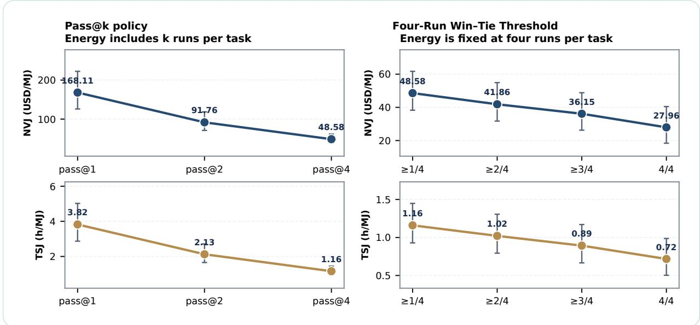  
Figure 10. More runs and higher four-run win–tie thresholds both lower measured NVJ and TSJ, but for different reasons. GLM 5.2 uses the expert-only reference. Left: pass@1, pass@2, and pass@4 include the energy of one, two, and four runs per task. Right: the end-to-end energy of four runs is fixed while the four-run win–tie threshold increases. Whiskers are percentile 95% task-composition bootstrap intervals.

On tasks that match the expert-with-AI reference, the AI system accounts for most of the measured time saving. At the $\geq 1 / 4$ threshold, at least one of four AI runs wins or ties against the expert-with-AI deliverable. For those tasks, the AI system saves 1.24 GDP-weighted hours per task relative to the expert-only reference. Of this total, 0.43 hours (35.0%) is the difference between the two expert completion times, and 0.80 hours (65.0%) is the difference between expert-with-AI and AI-system completion times. Appendix K.1 separates the effects of changing the judged deliverable and completion time while holding AI runs and energy fixed.

For each task and expert reference, the run order is fixed before evaluating pass@k. Let $Y _ { i r } ^ { b }$ indicate a win or tie on run $\begin{array} { r } { r , R _ { i , k } ^ { b } = \sum _ { r = 1 } ^ { k } Y _ { i r } ^ { b } } \end{array}$ count runs that win or tie among the first k, and $Q _ { i , k } ^ { b } = \mathbf { 1 } ( R _ { i , k } ^ { b } \geq 1 )$ indicate whether a task has at least one win or tie. For occupation o, the exact outcome accounting is

$$
\begin{array} { r l } & { \bar { G } _ { \theta , k } ^ { b } = \displaystyle \sum _ { i \omega ( i ) = 0 } Q _ { i , k } ^ { b } G _ { i } ^ { b } , } \\ & { S _ { \theta , k } ^ { b } = \displaystyle \sum _ { i \omega ( i ) = 0 } ^ { k } \left( H _ { i } ^ { b } - \frac { \sum _ { r = 1 } ^ { k } Y _ { i r } ^ { b } L _ { i r } } { R _ { i , k } ^ { b } } \right) , } \\ & { \bar { Q } _ { i , k } ^ { b } = \displaystyle \sum _ { i \omega ( i ) = 0 } ^ { k } \sum _ { r = 1 } ^ { k } E _ { i r } , } \\ & { E _ { \theta , k } = \displaystyle \sum _ { i \omega ( i ) = 0 } ^ { k } \sum _ { r = 1 } ^ { k } E _ { i r } , } \\ & { C _ { \theta , k } = \displaystyle \sum _ { i \omega ( i ) = 0 } ^ { k } \sum _ { r = 1 } ^ { k } C _ { i r } . } \end{array}\tag{14}
$$

Output dollar value is counted at most once. Time saving equals expert completion time minus mean AI-system completion time among wins and ties when $Q _ { i , k } ^ { b } = 1$ , and zero otherwise; AI-system completion times for losses are excluded. Energy and AI-system execution cost include all first k

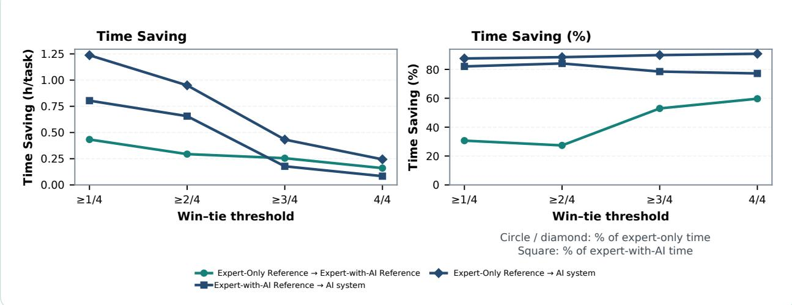  
Figure 11. Automation adds time saving beyond expert assistance, but the balance shifts with the success threshold. At lower thresholds, most saved hours come from automation; at stricter thresholds, more come from expert assistance. GLM 5.2 tasks meet each stated win–tie threshold against the expert-with-AI reference. The left panel reports GDP-weighted hours; the right divides each transition’s saved hours by completion time at its starting expert reference. All four runs’ energy is retained. Percentages across transitions use different denominators and should not be added.

runs without early stopping, regardless of their judgments. This best-of-k convention is also used by APEX-Agents (Vidgen et al., 2026).

Table 19 reports all four pass@k policies.

Table 19. Four attempts increase output dollar value but reduce NVJ and TSJ. GLM 5.2 uses the expert only reference. Every included run incurs cost and energy; output dollar value is counted once. NVJ is USD/MJ and TSJ is hours/MJ. Brackets give conditional 95% task-composition intervals.
<table><tr><td>Policy</td><td>Output value (USD)</td><td>AI cost (USD)</td><td>Energy (MJ)</td><td>NVJ [95% CI]</td><td>TSJ [95% CI]</td><td>Net value/ AI cost</td></tr><tr><td>pass@1</td><td>74.19</td><td>1.92</td><td>0.430</td><td>168.1 [126.0, 222.4]</td><td>3.82 [2.87, 5.02]</td><td>37.69</td></tr><tr><td>pass@2</td><td>85.75</td><td>4.00</td><td>0.891</td><td>91.8 [71.0, 118.6]</td><td>2.13 [1.65, 2.72]</td><td>20.45</td></tr><tr><td>pass@3</td><td>89.41</td><td>5.98</td><td>1.332</td><td>62.7 [48.9, 80.0]</td><td>1.46 [1.16, 1.85]</td><td>13.96</td></tr><tr><td>pass@4</td><td>93.42</td><td>7.92</td><td>1.760</td><td>48.6 [38.3, 61.7]</td><td>1.16 [0.93, 1.45]</td><td>10.79</td></tr></table>

Tables 20 and 21 give complete GDP-weighted benchmark outcomes across four-run win–tie thresholds.

Table 20. Stricter four-run thresholds reduce credited output dollar value and returns at fixed energy. GLM 5.2 uses the expert-only reference. Every included run incurs cost and energy; output dollar value is counted once. NVJ is USD/MJ and TSJ is hours/MJ. Brackets give conditional 95% task-composition intervals.
<table><tr><td>Policy</td><td>Output value (USD)</td><td>AI cost (USD)</td><td>Energy (MJ)</td><td>NVJ [95% CI]</td><td>TSJ [95% CI]</td><td>Net value/ AI cost</td></tr><tr><td>≥1/4</td><td>93.42</td><td>7.92</td><td>1.760</td><td>48.6 [38.3, 61.7]</td><td>1.16 [0.93, 1.45]</td><td>10.79</td></tr><tr><td>≥2/4</td><td>81.58</td><td>7.92</td><td>1.760</td><td>41.9 [31.7, 54.9]</td><td>1.02 [0.79, 1.31]</td><td>9.30</td></tr><tr><td>≥3/4</td><td>71.53</td><td>7.92</td><td>1.760</td><td>36.1 [26.3, 48.8]</td><td>0.89 [0.67, 1.17]</td><td>8.03</td></tr><tr><td>4/4</td><td>57.12</td><td>7.92</td><td>1.760</td><td>28.0 [18.4, 40.5]</td><td>0.72 [0.50, 0.99]</td><td>6.21</td></tr></table>

Against the expert-with-AI reference, requiring a win or tie on at least three of four runs brings

output dollar value below AI-system execution cost, so NVJ becomes negative at the two strictest thresholds.

For tasks meeting the same threshold against the expert-with-AI reference, total expert-only reference-to-AI-system time saving decomposes exactly into expert-only reference-to-expert-with-AI reference and expert-with-AI reference-to-AI-system components.

Table 21. Stricter four-run thresholds turn NVJ negative against the expert-with-AI reference. GLM 5.2 incurs cost and energy for every included run; output dollar value is counted once. NVJ is USD/MJ and TSJ is hours/MJ. Brackets give conditional 95% task-composition intervals.
<table><tr><td>Policy</td><td>Output value (USD)</td><td>AI cost (USD)</td><td>Energy (MJ)</td><td>NVJ [95% CI]</td><td>TSJ [95% CI]</td><td>Net value/ AI cost</td></tr><tr><td>≥1/4</td><td>35.11</td><td>7.92</td><td>1.760</td><td>15.4 [10.5, 20.7]</td><td>0.46 [0.32, 0.61]</td><td>3.43</td></tr><tr><td>≥2/4</td><td>27.70</td><td>7.92</td><td>1.760</td><td>11.2 [6.1, 16.7]</td><td>0.37 [0.23, 0.52]</td><td>2.50</td></tr><tr><td>≥3/4</td><td>7.71</td><td>7.92</td><td>1.760</td><td>-0.1 [-1.9, 2.1]</td><td>0.10 [0.05, 0.16]</td><td>-0.03</td></tr><tr><td>4/4</td><td>3.48</td><td>7.92</td><td>1.760</td><td>-2.5 [-3.7, -1.1]</td><td>0.05 [0.01, 0.09]</td><td>-0.56</td></tr></table>

Table 22. Most measured time saving occurs between the assisted expert reference and autonomous AI output. GDP-weighted task-average decomposition under pass@1. Bracketed values are percentile 95% task-composition bootstrap intervals.
<table><tr><td>Transition</td><td>(hours)</td><td>Time saving Time saving Energy (%)</td><td>(MJ)</td><td>TSJ (hours/MJ)</td></tr><tr><td>Expert-only → expert-with-AI [-0.04, 0.45]</td><td>0.21</td><td>23.0 [-5.3, 45.9]</td><td></td><td></td></tr><tr><td>Expert-with-AI → AI system</td><td>0.58 [0.34, 0.83]</td><td>83.7 [77.8, 87.1]</td><td>0.430</td><td>1.340 [0.814, 1.888]</td></tr><tr><td>Expert-only → AI system</td><td>0.78 [0.55, 1.03]</td><td>87.4 [84.4, 89.8]</td><td>0.430</td><td>1.818 [1.256, 2.486]</td></tr></table>

Figure 11 shows the corresponding four-run threshold comparison; Table 22 gives the pass@1 decomposition. The assisted-expert-to-AI-system component contributes 0.58 hours of the 0.78-hour expert-only-to-AI-system time saving in that comparison.

## L Five-Model Comparison

Table 23 reports GDP-weighted model outcomes across the same evaluated tasks and taskcomposition bootstrap intervals.

Figure 12 summarizes output dollar value, NVJ, and TSJ, while Table 23 also provides the energy denominator, GDP-weighted task averages, and intervals.

Occupation-category rankings are broadly similar across models, especially for output dollar value and time saving. NVJ and TSJ rankings vary more because the evaluated models have different end-to-end energy profiles. Table 24 reports all pairwise rank correlations.

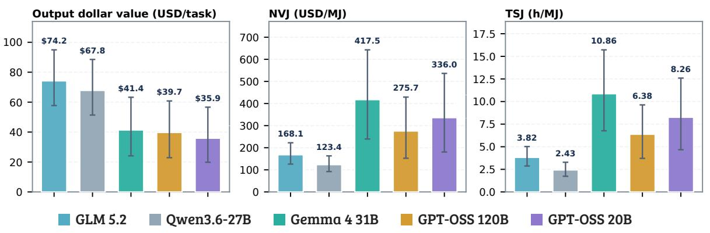  
Figure 12. Greater output dollar value need not mean greater economic return per joule. The five models use GDP-weighted aggregates, the expert-only reference, and one attempt per task. NVJ accounts for execution cost as well as energy; TSJ captures expert time saving per unit of energy. Whiskers are percentile 95% task-composition bootstrap intervals.

Table 23. GLM 5.2 leads output dollar value; Gemma 4 31B leads NVJ and TSJ among five models. The models share the evaluated tasks, the expert-only reference, and a one-attempt policy; values are GDPweighted task averages. NVJ is USD/MJ, TSJ is hours/MJ, and net value per dollar of AI cost divides net dollar value by AI-system execution cost. Brackets give conditional 95% task-composition intervals. Cost inputs and allocation are in Appendix G.
<table><tr><td>Model</td><td>GPUs</td><td>Output value (USD)</td><td>AI cost (USD)</td><td>Energy (MJ)</td><td>NVJ [95% CI]</td><td>TSJ [95% CI]</td><td>Net value/ AI cost</td></tr><tr><td>GLM 5.2</td><td>8×H200</td><td>74.19</td><td>1.92</td><td>0.430</td><td>168.1 [126.0, 222.4]</td><td>3.82 [2.87, 5.02]</td><td>37.69</td></tr><tr><td>Qwen3.6-27B</td><td>8×H100</td><td>67.81</td><td>4.12</td><td>0.516</td><td>123.4 [92.2, 163.2]</td><td>2.43 [1.73, 3.28]</td><td>15.46</td></tr><tr><td>Gemma 4 31B</td><td>8×H100</td><td>41.38</td><td>0.86</td><td>0.097</td><td>417.5 [239.5, 642.9]</td><td>10.86 [6.76, 15.72]</td><td>47.38</td></tr><tr><td>GPT-OSS 120B</td><td>8×H100</td><td>39.73</td><td>1.98</td><td>0.137</td><td>275.7 [152.5, 429.2]</td><td>6.38 [3.71, 9.63]</td><td>19.09</td></tr><tr><td>GPT-OSS 20B</td><td>8×H100</td><td>35.88</td><td>1.12</td><td>0.103</td><td>336.0 [180.7, 536.4]</td><td>8.26 [4.67, 12.59]</td><td>31.03</td></tr></table>

Table 24. Category output-dollar-value rankings agree across models more than energy-return rankings do on average. Spearman correlations across the 13 categories after including AI-system execution cost in NVJ.
<table><tr><td>Model A</td><td>Model B</td><td>Output dollar value</td><td>Time saving</td><td>NVJ</td><td>TSJ</td></tr><tr><td>GLM 5.2</td><td>Qwen3.6-27B</td><td>0.830</td><td>0.703</td><td>0.780</td><td>0.544</td></tr><tr><td>GLM 5.2</td><td>Gemma 4 31B</td><td>0.654</td><td>0.912</td><td>0.560</td><td>0.731</td></tr><tr><td>GLM 5.2</td><td>GPT-OSS 120B</td><td>0.637</td><td>0.742</td><td>0.478</td><td>0.478</td></tr><tr><td>GLM 5.2</td><td>GPT-OSS 20B</td><td>0.643</td><td>0.824</td><td>0.489</td><td>0.626</td></tr><tr><td>Qwen3.6-27B</td><td>Gemma 4 31B</td><td>0.824</td><td>0.665</td><td>0.549</td><td>0.302</td></tr><tr><td>Qwen3.6-27B</td><td>GPT-OSS 120B</td><td>0.769</td><td>0.659</td><td>0.643</td><td>0.692</td></tr><tr><td>Qwen3.6-27B</td><td>GPT-OSS 20B</td><td>0.808</td><td>0.885</td><td>0.560</td><td>0.659</td></tr><tr><td>Gemma 4 31B</td><td>GPT-OSS 120B</td><td>0.802</td><td>0.808</td><td>0.863</td><td>0.654</td></tr><tr><td>Gemma 4 31B</td><td>GPT-OSS 20B</td><td>0.907</td><td>0.802</td><td>0.742</td><td>0.692</td></tr><tr><td>GPT-OSS 120B</td><td>GPT-OSS 20B</td><td>0.863</td><td>0.863</td><td>0.879</td><td>0.846</td></tr></table>

## M Accelerator Comparisons

Table 25 reports the resulting GDP-weighted outcomes and economic return per joule.

Table 25. B200 has the highest NVJ and TSJ among the four single accelerators. Qwen3.6-27B is evaluated against the expert-only reference under the paper’s GDP-based weights. Each accelerator is summarized from its own recorded outcomes and measured energy. Brackets give 95% task-composition intervals; costs and energy include every attempt.
<table><tr><td>Accelerator</td><td>NVJ (USD/MJ)</td><td>TSJ (hours/MJ)</td></tr><tr><td>NVIDIA B200</td><td>535.5 [388.4, 721.6]</td><td>11.684 [8.416, 15.620]</td></tr><tr><td></td><td>NVIDIA H200391.3 [274.9, 532.4]</td><td>7.293 [4.864, 10.188]</td></tr><tr><td></td><td>NVIDIA H100402.2 [298.6, 531.7]</td><td>7.243 [5.122, 9.934]</td></tr><tr><td>AMD MI350X</td><td>124.1 [81.7, 177.8]</td><td>1.260 [0.450, 2.297]</td></tr></table>

One and eight H100s use the same evaluated tasks, expert-only reference, pass@1 rule, and GDP weights, with separately recorded outcomes. Their respective output dollar values, execution costs, and energies are (\$64.79, \$0.71, 0.159 MJ) and (\$67.81, \$4.12, 0.516 MJ), yielding NVJ of 402.16 versus 123.39 USD/MJ and TSJ of 7.243 versus 2.432 hours/MJ.

## N Additional Joules-to-GDP Tasks

To broaden professional-work evaluation beyond GDPval, we assembled 83 additional Joules to GDP tasks created by Snorkel AI. Each task includes a request, grading rubric, source files, expert-only and expert-with-AI deliverables, and time annotations. Together with OpenAI’s 220 public GDPval tasks and the annotations added by Snorkel AI, these materials are prepared for release by the Scaling Intelligence Lab and HazyResearch at ScalingIntelligence/joules-to-gdp, with the additional tasks in the joules\_to\_gdp split.

The extension adds 36 detailed O\*NET occupations absent from GDPval’s 44, bringing the combined coverage to 80 distinct occupation codes. Examples include bioinformatics scientists, environmental scientists, and purchasing managers. The tasks introduce recent work contexts and 2026-dated source materials, including financial records and environmental monitoring data. They also target more demanding, source-intensive workflows: median supplied expert-only time estimates are 4.0 hours, compared with 2.34 hours for GDPval, and the median number of included reference files is six, compared with one. These time estimates characterize expected expert effort. The extension supports future tests of how economic return per joule generalizes to additional occupations and longer workflows. The collection is not a GDP-weighted sample; the results reported in this paper use the 220-task GDPval split.