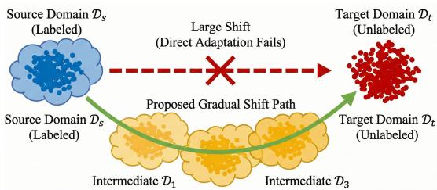
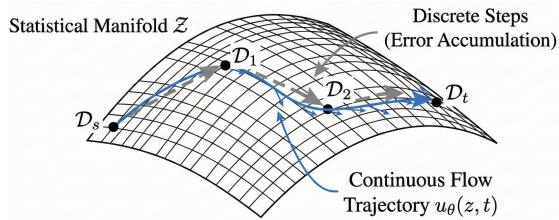
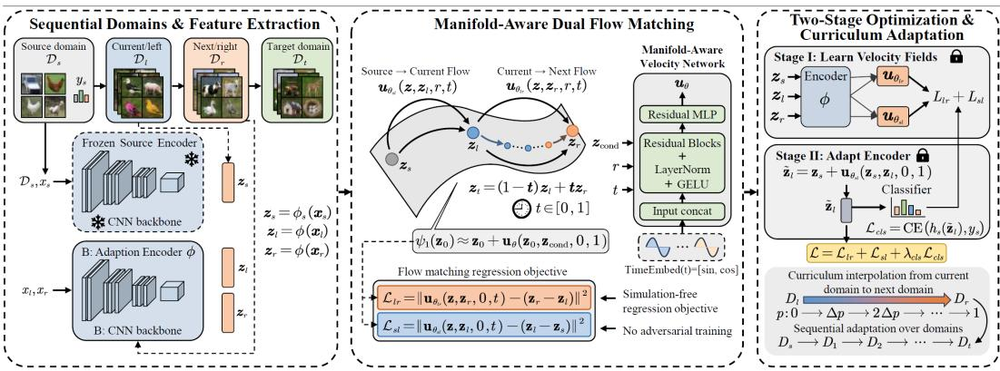
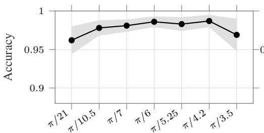
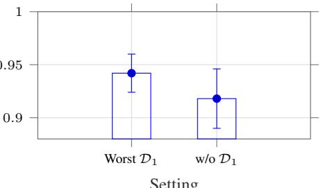
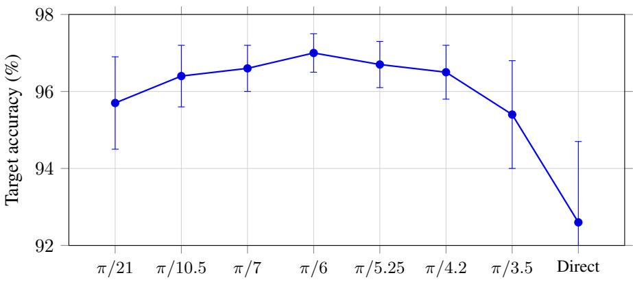

# Learning Domain Trajectories with Flow Matching for Gradual Domain Adaptation

Yubo Huang1,∗ Yushe Cao2,∗ Zixi Wang3 Jingzehua Xu4,† Xin Lai1 Xiongyu Hu1,‡ Shuai Zhang5

1Key Laboratory of Transportation Tunnel Engineering, Ministry of Education,

3School of Information and Software Engineering,

University of Electronic Science and Technology of China, Chengdu, China 4Department of Mechanical Engineering, The University of Hong Kong, Hong Kong, China 5Department of Data Science, New Jersey Institute of Technology, Newark, NJ, USA

## Abstract

Large distribution shifts remain a primary obstacle for domain generalization and unsupervised adaptation. Although gradual domain adaptation alleviates this difficulty by introducing ordered intermediate domains, most existing approaches still operate in a discrete, step-wise manner, which can accumulate errors and often relies on unstable Min–Max optimization. We propose FlowGDA, a flowmatching framework that models gradual adaptation as continuous transport on a statistical manifold in a representation space. FlowGDA learns time-dependent velocity fields that induce smooth domain trajectories, using a simulation-free regression objective rather than adversarial training. To prevent semantic drift, we couple left-to-right transport between consecutive domains with a source-anchored transport and a semantic consistency loss, and we further stabilize learning via a two-stage sequential optimization scheme. Extensive experiments demonstrate that our method outperforms state-of-the-art techniques, validating flow matching as an effective alternative for domain adaptation.

## 1 Introduction

Machine learning models often suffer from performance degradation under domain shift, where the test distribution differs from the training distribution [24, 3, 2]. Although traditional domain adaptation methods align a labeled source domain with an unlabeled target domain [10, 19, 31], direct alignment becomes unreliable when the distribution gap is large, as illustrated in Fig. 1. Gradual domain adaptation (GDA) mitigates this issue by introducing ordered intermediate domains, decomposing a large shift into a sequence of smaller transitions. This setting has strong theoretical support, with

  
Figure 1: Motivation of gradual domain adaptation under large distribution shifts. Gradual domain adaptation introduces intermediate domains to form a smooth transition path, reducing the discrepancy between consecutive domains and facilitating stable knowledge transfer.

intermediate domains shown to substantially improve generalization bounds over direct adaptation [33].

Despite its promise, existing GDA methods typically treat domain evolution as a discrete sequence of adaptation steps. Such stepwise procedures may accumulate errors and fail to capture the smooth geometric structure of distribution shifts [23]. Many methods also rely on adversarial training [10, 31] or complex optimal-transport optimization [32, 25, 37, 38], which can be unstable or computationally demanding in high-dimensional representation spaces [12, 22]. These limitations motivate a stable and efficient framework for learning continuous domain trajectories.

Flow matching [18] offers a natural alternative. By directly regressing velocity fields of continuous normalizing flows [5, 26, 41], it avoids simulation-heavy or adversarial objectives, and its extensions to Riemannian manifolds [6, 4] make it suitable for structured representation spaces. Motivated by this, we propose FlowGDA, a flow-matching framework that views gradual domain adaptation as continuous transport on a statistical manifold [7]. Instead of adversarially aligning domains, FlowGDA learns velocity fields that move representations along smooth trajectories while preserving semantic information. Our contributions are summarized as follows:

• We formulate gradual domain adaptation as flow matching on a statistical manifold, enabling continuous representation transport without adversarial training.

• We design a simulation-free objective with dual source-to-intermediate and intermediate-totarget flows, together with semantic consistency regularization to reduce drift.

• We provide theoretical analysis bounding the target error and show through experiments on multiple benchmarks that FlowGDA improves accuracy, stability, and efficiency over existing GDA methods.

## 2 Related Work

## 2.1 Gradual Domain Adaptation

Gradual domain adaptation addresses large domain gaps by exploiting ordered intermediate domains. Early theory showed that self-training over intermediate domains can outperform direct adaptation when consecutive shifts are small, while later analyses established tighter bounds and characterized optimal adaptation paths [33, 42]. Algorithmically, existing methods construct or exploit intermediate domains through optimal transport, manifold-constrained robust optimization [23], graph-based adaptation [17], and domain osmosis [34, 35]. However, most approaches still treat the domain path as a discrete sequence, which may accumulate errors and underuse the smooth structure of gradual distribution evolution. Our work instead models this evolution as a continuous flow in representation space.

## 2.2 Optimal Transport for Domain Adaptation

Optimal transport provides a geometric framework for comparing and aligning probability distributions [32, 25, 39]. It has been widely used in domain adaptation to learn transport plans that map source samples to target samples while preserving class structure [8]. Wasserstein-based methods further connect optimal transport with adversarial learning, including Wasserstein GANs [1, 13] and domain adaptation methods such as WDGRL [28]. Although these methods offer meaningful distributional geometry, they often require costly transport computation or adversarial optimization with difficult Lipschitz constraints, especially in high-dimensional feature spaces [22, 11]. FlowGDA keeps the geometric transport perspective while replacing adversarial alignment with simulation-free velocity-field regression.

## 3 Problem Formulation

Preliminary Note. In this manuscript, we focus on representation-level flow modeling for gradual domain adaptation (GDA). We follow the standard GDA assumption that the source domain, the intermediate domains, and the target domain are ordered along a gradual adaptation path. This assumption is used to decompose a large source-to-target shift into a sequence of smaller local shifts, rather than to introduce additional supervision on the intermediate or target domains.

Gradual domain adaptation considers a labeled source domain $\mathcal { D } _ { s } = \{ ( x _ { i } ^ { s } , y _ { i } ^ { s } ) \} _ { i = 1 } ^ { n _ { s } }$ , a sequence of unlabeled intermediate domains $\{ \mathcal { D } _ { 1 } , . . . , \mathcal { D } _ { T - 1 } \}$ , and an unlabeled target domain $\mathcal { D } _ { t }$ . Here, $x _ { i } ^ { s } \in \mathcal X$ is the i-th source input, $y _ { i } ^ { s } \in \mathcal { D }$ is its label, $n _ { s }$ is the number of labeled source samples, $\mathcal { X }$ denotes the input space, and $\mathcal { V }$ denotes the label space. The integer $T$ denotes the number of source-to-target transition intervals, so that the complete domain chain can be written as $\mathcal { D } _ { 0 } , \mathcal { D } _ { 1 } , \ldots , \mathcal { D } _ { T }$ , with $\mathcal { D } _ { 0 } = \mathcal { D } _ { s }$ and $\mathcal { D } _ { T } = \mathcal { D } _ { t }$ . We use $\mathcal { D } _ { s } , \mathcal { D } _ { i }$ , and $\mathcal { D } _ { t }$ both to denote empirical domains and, when they appear inside expectations, their underlying data distributions.

The domains are ordered such that consecutive distribution shifts are milder than the direct source-totarget shift. The goal is to learn a classifier $f = h \circ \phi : \mathcal { X }  \mathcal { Y }$ , where $\phi : \mathcal { X } \to \mathcal { Z }$ maps an input into a representation space $\mathcal { Z } , h : \mathcal { Z }  \mathcal { V }$ maps a representation to a label prediction, and ◦ denotes function composition. The target error is defined as

$$
\epsilon _ { t } = \mathbb { E } _ { ( x , y ) \sim \mathcal { D } _ { t } } \left[ \mathbb { I } [ f ( x ) \neq y ] \right] ,\tag{1}
$$

where $( x , y )$ is an input-label pair from the target domain, y is used only for evaluation, E denotes expectation, and $\mathbb { I } [ \cdot ]$ is the indicator function that equals one when its argument is true and zero otherwise. The subscript t in $\epsilon _ { t }$ denotes the target domain, while the scalar $t \in [ 0 , 1 ]$ introduced later denotes continuous transport time.

FlowGDA views representations from different domains as lying near a shared statistical manifold. Under this view, domain shift corresponds to movement along the manifold, and gradual adaptation amounts to learning smooth velocity fields that transport representations across neighboring domains while preserving task-relevant semantics.

  
Figure 2: Domain evolution on a statistical manifold. Discrete steps can accumulate errors, while the continuous flow $u _ { \theta } ( z , t )$ transports $\mathcal { D } _ { \varepsilon }$ s toward $\mathcal { D } _ { t }$

## 4 Methodology

FlowGDA formulates gradual domain adaptation as continuous transport in representation

space.As shown in $\mathrm { F i g . } 2 ,$ , discrete stepwise adaptation may accumulate local misalignment along the domain path. FlowGDA instead models domain evolution as a smooth trajectory on a statistical manifold, governed by a time-dependent velocity field $u _ { \theta } ( z , t )$

This velocity field is learned through flow matching, avoiding adversarial optimization and trajectory simulation. Fig. 3 summarizes the framework, including dual flow-matching losses, semantic consistency regularization, and two-stage sequential optimization over consecutive domain pairs.

## 4.1 Flow Matching for Domain Transport

We first describe the basic transport between two consecutive domains. Let $\mathcal { D } _ { l }$ and $\mathcal { D } _ { r }$ denote the current $\mathrm { \Phi ^ { 6 6 } }$ domain and the next “right” domain, respectively. The subscripts l and r are mnemonic: l refers to the departure domain in the current adaptation step, and $r$ refers to its neighboring destination domain. For samples $x _ { l } \sim \mathcal { D } _ { l }$ and $x _ { r } \sim \mathcal { D } _ { r }$ , the trainable encoder ϕ $: \mathcal { X }  \mathcal { Z }$ maps them to $z _ { l } = \phi ( x _ { l } ) , z _ { r } = \phi ( x _ { r } )$ , where $z _ { l } , z _ { r } \in \mathcal { Z }$ are their representations, $\mathcal { Z } \subseteq \mathbb { R } ^ { d }$ is the representation space, $\mathbb { R } ^ { d }$ is the d-dimensional Euclidean space, and d is the representation dimension.

A time-dependent velocity field $u _ { \theta } ( z , t ) : \mathcal { Z } \times [ 0 , 1 ]  \mathcal { Z }$ induces a continuous flow map $\psi _ { t } : \mathcal { Z } \to \mathcal { Z }$ through the ordinary differential equation

$$
\frac { d \psi _ { t } ( z _ { 0 } ) } { d t } = u _ { \theta } ( \psi _ { t } ( z _ { 0 } ) , t ) , \qquad \psi _ { 0 } ( z _ { 0 } ) = z _ { 0 } ,\tag{2}
$$

where $z _ { 0 } \in \mathcal { Z }$ is the initial representation, $t \in [ 0 , 1 ]$ is the transport time, $\psi _ { t } ( z _ { 0 } )$ is the representation reached at time t, and θ denotes the trainable parameters of the velocity network. The derivative $d \psi _ { t } ( z _ { 0 } ) / d t$ describes the instantaneous movement of the representation along the flow.

Rather than simulating the ODE during training, FlowGDA adopts conditional flow matching. Given a paired representation $\left( z _ { l } , z _ { r } \right)$ , we define the deterministic interpolation path

$$
z _ { t } = ( 1 - t ) z _ { l } + t z _ { r } , \qquad t \in [ 0 , 1 ] .\tag{3}
$$

  
Figure 3: Overview of FlowGDA. FlowGDA models gradual domain transport with source-to-left and left-to-right velocity fields, enforces semantic consistency using a fixed source classifier, and trains sequentially over domain pairs with curriculum-based two-stage optimization.

Here, $z _ { t }$ is the intermediate representation at transport time $t ;$ when $t = 0$ , the path starts from $z _ { l } ,$ and when $t = 1$ , the path reaches $z _ { r }$ . Equivalently, this interpolation induces the degenerate conditional distribution

$$
p _ { t } \big ( z \mid z _ { l } , z _ { r } \big ) = \delta \big ( z - ( ( 1 - t ) z _ { l } + t z _ { r } ) \big ) ,\tag{4}
$$

where $p _ { t } ( z \mid z _ { l } , z _ { r } )$ denotes the conditional distribution of the intermediate representation z at time $t ,$ and $\delta ( \cdot )$ is the Dirac delta distribution concentrated at the interpolated point.

The velocity that exactly generates the path in Equation (3) is

$$
u _ { t } ^ { \star } ( z _ { t } \mid z _ { l } , z _ { r } ) = \frac { d z _ { t } } { d t } = z _ { r } - z _ { l } .\tag{5}
$$

Here, $\boldsymbol { u } _ { t } ^ { \star }$ denotes the ideal conditional velocity, and $z _ { r } - z _ { l }$ is the displacement from the left-domain representation to the right-domain representation. Based on this observation, the flow matching loss is

$$
\mathcal { L } _ { F M } = \mathbb { E } _ { t \sim \mathrm { U n i f } [ 0 , 1 ] } \mathbb { E } _ { ( z _ { l } , z _ { r } ) \sim \pi _ { l r } } \left[ \Vert u _ { \theta } ( z _ { t } , t ) - ( z _ { r } - z _ { l } ) \Vert _ { 2 } ^ { 2 } \right] ,\tag{6}
$$

where $\mathcal { L } _ { F M }$ is the flow matching objective, Unif[0, 1] is the uniform distribution on $[ 0 , 1 ] , \pi _ { l r }$ is the coupling between representations from $\mathcal { D } _ { l }$ and $\mathcal { D } _ { r }$ , and $\| \cdot \| _ { 2 }$ denotes the Euclidean norm.

## 4.2 Manifold-Aware Flow Matching

Although Equation (3) is written as a Euclidean interpolation, domain representations usually concentrate near a lower-dimensional statistical manifold embedded in Z.A velocity field that only observes $z _ { t }$ and t may ignore where the current transport step lies along the global source-to-target trajectory. To address this issue, FlowGDA conditions the velocity field on both a destination representation and normalized domain coordinates.

For the ordered chain $\mathcal { D } _ { 0 } , \mathcal { D } _ { 1 } , \ldots , \mathcal { D } _ { T } ,$ each domain is assigned a normalized coordinate $\tau _ { i } =$ $\begin{array} { r } { \frac { i } { T } , \qquad i = 0 , \dots , T } \end{array}$ , where i is the domain index, $T$ is the total number of transition intervals, and $\bar { \tau } _ { i } \in [ 0 , 1 ]$ ] indicates the relative position of $\mathcal { D } _ { i }$ along the gradual path. For a consecutive pair $\mathcal { D } _ { l } = \mathcal { D } _ { i }$ and $\mathcal { D } _ { r } = \mathcal { D } _ { i + 1 }$ , we write $\tau _ { l } = \tau _ { i }$ and $\tau _ { r } = \tau _ { i + 1 }$ . The source coordinate is denoted by $\tau _ { s } = 0$

We parameterize the manifold-aware velocity field as

$$
\begin{array} { r } { u _ { \theta } ( z , z _ { \mathrm { c o n d } } , \tau _ { a } , \tau _ { b } , t ) : \mathcal { Z } \times \mathcal { Z } \times [ 0 , 1 ] \times [ 0 , 1 ] \times [ 0 , 1 ]  \mathcal { Z } , } \end{array}\tag{7}
$$

where z is the current representation to be transported, $z _ { \mathrm { c o n d } } \in \mathcal { Z }$ is a conditioning representation sampled from the destination domain, $\tau _ { a }$ is the normalized coordinate of the departure domain, $\tau _ { b }$ is the normalized coordinate of the destination domain, a and b denote generic departure and destination indices, and t is the local transport time. The time and domain coordinates are embedded using sinusoidal features:

$$
\mathrm { T i m e E m b e d } ( \tau ) = [ \sin ( 2 \pi \omega _ { k } \tau ) , \cos ( 2 \pi \omega _ { k } \tau ) ] _ { k = 1 } ^ { K _ { e } } ,\tag{8}
$$

where $\tau \in [ 0 , 1 ]$ is a scalar coordinate, $K _ { e }$ is the number of frequency components, k indexes the frequency component, $\omega _ { k }$ is the k-th frequency scale, and $[ \cdot ] _ { k = 1 } ^ { K _ { e } }$ denotes concatenation over all frequency components. The symbol π in 2π is the circle constant and is distinct from the coupling $\pi _ { l r }$ in Equation (6). In implementation, the embeddings of $\tau _ { a } , \tau _ { b }$ , and t are used as conditioning signals for $u _ { \theta }$

## 4.3 Dual Flow Architecture

For each adaptation step, FlowGDA uses two velocity fields. The first velocity field, denoted by $\boldsymbol { u } _ { \boldsymbol { \theta } _ { l r } }$ , transports representations from the current domain $\mathcal { D } _ { l }$ to the next domain $\mathcal { D } _ { r }$ . The second velocity field, denoted by $u _ { \theta _ { s l } }$ , transports source representations from the source domain $\mathcal { D } _ { s }$ to the current domain $\mathcal { D } _ { l }$ . Here, $\theta _ { l r }$ and $\theta _ { s l }$ are the trainable parameters of the left-to-right and source-to-left velocity networks, respectively.

The left-to-right flow captures the local distribution shift between neighboring domains, while the source-to-left flow provides a semantic anchor from the labeled source domain. For a departure representation $z _ { a }$ , a destination conditioning representation $z _ { b } ,$ , and the corresponding domain coordinates $\tau _ { a }$ and $\tau _ { b } .$ , we approximate the endpoint of the transport by

$$
\psi _ { a  b } ( z _ { a } ) \approx z _ { a } + u _ { \theta _ { a b } } ( z _ { a } , z _ { b } , \tau _ { a } , \tau _ { b } , 1 ) ,\tag{9}
$$

where $\psi _ { a  b }$ is the transport map from domain coordinate $\tau _ { a }$ to domain coordinate $\tau _ { b } , z _ { a } \in \mathcal { Z }$ is the representation being transported, $z _ { b } \in \mathcal { Z }$ is the destination-side conditioning representation, $\theta _ { a b }$ denotes the parameters of the velocity field from domain a to domain $b ,$ and the final argument 1 denotes full transport time.

## 4.4 Training Objective

We now instantiate the above formulation for mini-batch training. At an adaptation step from $\mathcal { D } _ { l }$ to $\mathcal { D } _ { r } ,$ , let $( x _ { j } ^ { s } , y _ { j } ^ { s } )$ denote the $j \cdot$ -th labeled source sample, $x _ { i } ^ { l }$ denote the $j \cdot$ -th unlabeled sample from the current domain $\mathcal { D } _ { l } .$ , and $\boldsymbol { x } _ { j } ^ { r }$ denote the $j \cdot$ -th unlabeled sample from the next domain $\mathcal { D } _ { r }$ . We compute

$$
z _ { j } ^ { s } = \phi _ { s } ( x _ { j } ^ { s } ) , \qquad z _ { j } ^ { l } = \phi ( x _ { j } ^ { l } ) , \qquad z _ { j } ^ { r } = \phi ( x _ { j } ^ { r } ) ,\tag{10}
$$

where $\phi _ { s } : \mathcal { X }  \mathcal { Z }$ is the fixed source encoder, $\phi : \mathcal { X } \ :  \ : \mathcal { Z }$ is the trainable encoder, and $z _ { j } ^ { s } , z _ { j } ^ { l } , z _ { j } ^ { r } \in \mathcal { Z }$ are the source, current-domain, and next-domain representations. The label $y _ { j } ^ { s } \in \mathcal { V }$ is available only for the source sample.

For the left-to-right flow, the interpolated representation is

$$
z _ { j , t } ^ { l r } = ( 1 - t ) z _ { j } ^ { l } + t z _ { j } ^ { r } , \qquad t \sim \mathrm { U n i f } [ 0 , 1 ] ,\tag{11}
$$

where the superscript lr denotes the left-to-right path, the subscript j denotes the mini-batch sample index, and t denotes the sampled transport time. The corresponding flow matching objective is

$$
\mathcal { L } _ { l r } = \mathbb { E } _ { t , j } \left[ \left| \left| u _ { \theta _ { l r } } ( z _ { j , t } ^ { l r } , z _ { j } ^ { r } , \tau _ { l } , \tau _ { r } , t ) - ( z _ { j } ^ { r } - z _ { j } ^ { l } ) \right| \right| _ { 2 } ^ { 2 } \right] ,\tag{12}
$$

where $\mathcal { L } _ { l r }$ is the left-to-right loss, $\mathbb { E } _ { t , j }$ denotes expectation over $t \sim \mathrm { U n i f } [ 0 , 1 ]$ and the mini-batch index $j , z _ { j } ^ { r }$ is the destination conditioning representation, $\tau _ { l }$ and $\tau _ { r }$ are the normalized coordinates of the current and next domains, and $z _ { j } ^ { r } - z _ { j } ^ { l }$ is the target displacement.

For the source-to-left flow, we similarly define

$$
z _ { j , t } ^ { s l } = ( 1 - t ) z _ { j } ^ { s } + t z _ { j } ^ { l } , \qquad t \sim \mathrm { U n i f } [ 0 , 1 ] ,\tag{13}
$$

where the superscript sl denotes the source-to-left path from the fixed source representation $z _ { j } ^ { s }$ to the current-domain representation $z _ { j } ^ { l }$ . The source-to-left flow matching loss is

$$
\mathcal { L } _ { s l } = \mathbb { E } _ { t , j } \left[ \left. u _ { \theta _ { s l } } ( z _ { j , t } ^ { s l } , z _ { j } ^ { l } , \tau _ { s } , \tau _ { l } , t ) - ( z _ { j } ^ { l } - z _ { j } ^ { s } ) \right. _ { 2 } ^ { 2 } \right] ,\tag{14}
$$

where $\mathcal { L } _ { s l }$ is the source-to-left loss, $\tau _ { s } = 0$ is the source-domain coordinate, $\tau _ { l }$ is the current-domain coordinate, $z _ { j } ^ { l }$ is the destination conditioning representation, and $z _ { j } ^ { l } - z _ { j } ^ { s }$ is the target displacement from the source representation to the current-domain representation.

To preserve semantic information during gradual adaptation, we introduce a curriculum coefficient $p \in [ 0 , 1 ]$ that controls the strength of source-to-left transport:

$$
\tilde { z } _ { j } ^ { l } ( p ) = z _ { j } ^ { s } + p \cdot u _ { \theta _ { s l } } ( z _ { j } ^ { s } , z _ { j } ^ { l } , \tau _ { s } , \tau _ { l } , 1 ) ,\tag{15}
$$

where $\tilde { z } _ { j } ^ { l } ( p ) \in \mathcal { Z }$ is the partially transported source representation. When $p = 0 , \tilde { z } _ { i } ^ { l } ( p ) = z _ { i } ^ { s }$ and no source-to-left movement is applied; when $p = 1$ , the source representation is fully transported toward the current domain according to $u _ { \theta _ { s l } }$ . The scalar $p$ in this curriculum term is distinct from the conditional path distribution $p _ { t } ( \cdot \mid z _ { l } , z _ { r } )$ in Equation (4).

The semantic consistency loss is defined as

$$
\begin{array} { r } { \mathcal { L } _ { c l s } ( p ) = \mathbb { E } _ { j } \left[ \mathrm { C E } \left( h _ { s } ( \tilde { z } _ { j } ^ { l } ( p ) ) , y _ { j } ^ { s } \right) \right] , } \end{array}\tag{16}
$$

where $\mathcal { L } _ { c l s } ( p )$ is the classification-based semantic loss at curriculum level $p , \mathbb { E } _ { j }$ denotes expectation over source samples in the mini-batch, $h _ { s } : \mathcal { Z }  \mathcal { V }$ is the fixed source classifier, and $\mathrm { C E } ( \cdot , \cdot )$ denotes the cross-entropy loss between the prediction $h _ { s } ( \tilde { z } _ { j } ^ { l } ( p ) )$ and the source label $y _ { j } ^ { s }$ . The classifier $h _ { s }$ serves as the semantic head used to preserve source-discriminative structure during adaptation.

The total objective at curriculum level $p$ is

$$
\mathcal { L } ( p ) = \mathcal { L } _ { l r } + \mathcal { L } _ { s l } + \lambda _ { c l s } \mathcal { L } _ { c l s } ( p ) ,\tag{17}
$$

where $\mathcal { L } ( p )$ is the overall training loss and $\lambda _ { c l s } > 0$ balances flow matching with semantic consistency.

Finally, FlowGDA proceeds sequentially along the ordered domains $\mathcal { D } _ { 0 } , \mathcal { D } _ { 1 } , \ldots , \mathcal { D } _ { T }$ .For each consecutive pair $( \mathcal { D } _ { l } , \mathcal { D } _ { r } )$ , we first optimize the velocity fields $u _ { \theta _ { l } } .$ and $u _ { \theta _ { s l } }$ while freezing the encoder $\phi ,$ so that the local transport directions can be estimated in a stable representation space. We then freeze the learned velocity fields and update the encoder ϕ using the curriculumcontrolled objective in Equation (17). During this stage, the curriculum coefficient p is gradually increased from 0 to 1, allowing the model to move from source-preserving representations toward the next domain without abruptly losing

Algorithm 1 FlowGDA   
Require: $\mathcal { D } _ { 0 : T } , \phi , h , u _ { l r } , u _ { s l }$   
1: Cache: $\phi _ { s }  \phi , h _ { s }  h$   
2: for i = 0 to $T - 1$ do   
3: $\left( \mathcal { D } _ { l } , \mathcal { D } _ { r } \right) \gets \left( \mathcal { D } _ { i } , \mathcal { D } _ { i + 1 } \right)$   
4: $u _ { s l } \gets u _ { l r } ;$ reset ulr   
5: for $p = 0 , \Delta p , \ldots , 1$ do   
6: Freeze ϕ; update $u _ { l r } , u _ { s l }$   
7: Freeze $u _ { l r } , u _ { s l } ;$ update ϕ   
8: end for   
9: end for   
10: return Adapted ϕ, h

toward the next domain without abruptly losing semantic consistency. The complete procedure is summarized in Algorithm 1.

Table 1: Target-domain accuracy (%) on four GDA benchmarks; ”N/A” means not reported.
<table><tr><td>Category</td><td>Method</td><td>Rotated MNIST</td><td>Color-Shift MNIST</td><td>Portraits</td><td>Cover Type</td></tr><tr><td rowspan="3">UDA</td><td>DANN [10]</td><td>44.2</td><td>56.5</td><td>73.8</td><td>N/A</td></tr><tr><td>DeepCORAL [30]</td><td>49.6</td><td>63.5</td><td>71.9</td><td>N/A</td></tr><tr><td>DeepJDOT [20]</td><td>51.6</td><td>65.8</td><td>72.5</td><td>N/A</td></tr><tr><td rowspan="4">Gradual</td><td>GST [16]</td><td>83.8</td><td>74.0</td><td>82.6</td><td>73.5</td></tr><tr><td>GOAT [14]</td><td>86.4</td><td>91.8</td><td>83.6</td><td>69.9</td></tr><tr><td>AST [29]</td><td>90.6</td><td>N/A</td><td>84.8</td><td>N/A</td></tr><tr><td>CNF [27]</td><td>62.6</td><td>N/A</td><td>84.6</td><td>N/A</td></tr><tr><td>Ours</td><td>FlowGDA</td><td>97.0</td><td>99.2</td><td>87.6</td><td>76.1</td></tr></table>

## 5 Experiments

## 5.1 Experimental Setup

Datasets. Following the standard gradual domain adaptation (GDA) protocol, FlowGDA is evaluated on four benchmarks covering complementary domain trajectories. Rotated MNIST captures smooth geometric shift through increasing rotation angles; Color-Shift MNIST captures appearance shift through gradual changes in color statistics; Portraits captures real-world temporal drift across decades; and Cover Type evaluates tabular covariate shift in structured feature space. For each benchmark, domains form an ordered chain $\mathcal { D } _ { 0 } = \mathcal { D } _ { s } , \mathcal { D } _ { 1 } , . . . , \mathcal { D } _ { T } = \mathcal { D } _ { t }$ according to the natural shift parameter. Only the source domain is labeled, while intermediate and target domains are unlabeled during adaptation. All methods are trained sequentially along the chain.

Baselines. FlowGDA is compared with direct unsupervised domain adaptation baselines, including DANN [10], DeepCORAL [30], and CDAN [20], as well as gradual adaptation methods including GST [16], GOAT [14], AST [29], and CNF [27].

Architectures and optimization. All methods are implemented in PyTorch. Image benchmarks use a three-layer CNN encoder followed by a two-layer fully connected classifier, while Cover Type uses a three-layer MLP. Velocity fields are implemented as 4-layer residual MLPs with hidden dimension 512. AdamW [21] is used with learning rates $1 0 ^ { - 4 }$ for velocity networks and $1 0 ^ { - 5 }$ for the encoder. The classification weight is set to $\lambda _ { c l s } = 0 . 1$ . Models are trained for 10 epochs per domain pair with batch size 64 on NVIDIA RTX 5090 GPUs.

## 5.2 Results

FlowGDA achieves the best performance across all four benchmarks. Compared with the strongest reported gradual baseline, FlowGDA improves target accuracy by +6.4 points on Rotated MNIST, +7.4 on Color-Shift MNIST, and +2.8 on Portraits; on Cover Type, it outperforms GST by +2.6 points. Direct UDA baselines perform substantially worse under large shifts, confirming the importance of intermediate domains. These results show that modeling gradual adaptation as continuous representation transport provides consistent gains over both direct alignment and discrete gradual adaptation.

On Rotated MNIST, the effect of intermediate-domain choice is further evaluated by fixing the source at $0 ^ { \circ }$ and the target at $\pi / 3$ , while varying a single intermediate domain $\mathcal { D } _ { 1 }$ . As shown in Fig. 4(a), intermediate angles near the midpoint of the source-target path, around $\pi / 6 ,$ yield the highest and most stable accuracy, whereas very small or overly large intermediate shifts lead to lower accuracy and higher variance. Fig. 4(b) further shows that direct source-to-target adaptation performs worst, indicating that intermediate domains are essential for large shifts, while their quality further affects stability and final performance.

## 5.3 Ablation Study

To better understand how different components contribute across different types of domain shifts, we conduct a dataset-wise ablation study by removing one component at a time from FlowGDA. Table 2 reports the target accuracy on each benchmark, with the accuracy drop relative to the full model shown in parentheses. The effect of each component is not uniform across datasets. Removing the semantic consistency loss $\mathcal { L } _ { c l s }$ causes the largest degradation on average, especially on Portraits and Cover Type, where preserving class semantics under complex temporal or tabular covariate shifts is more challenging. The single-flow variant also suffers larger drops on the real-world and tabular datasets, indicating that source-anchored transport provides useful regularization beyond local left-toright adaptation. Manifold-aware conditioning improves over time-only velocity parameterization across all datasets, while the two-stage optimization strategy consistently yields more stable final performance than joint optimization.

## 6 Theoretical Analysis

In this section, we theoretically explain why modeling gradual domain adaptation as a continuous transport trajectory leads to stable optimization and reduced error accumulation. Our analysis connects flow matching to optimal transport on representation distributions and derives a generalization bound for the target domain under gradual shifts.

Setting  
(a) Intermediate-domain sensitivity  

(b) Worst intermediate vs. no intermediate  
  
Rotation angle of intermediate domain  
Figure 4: Rotated MNIST sensitivity to intermediate-domain choice. (a) Accuracy vs. intermediate rotation (mean±std over five runs). (b) Removing the intermediate domain causes the largest degradation.

Table 2: Dataset-wise ablation study: target accuracy (%) with drops from full FlowGDA in parentheses.
<table><tr><td>Variant</td><td>Rotated MNIST</td><td>Color-Shift MNIST</td><td>Portraits</td><td>Cover Type</td><td>Avg. ∆ (pp)</td></tr><tr><td>FlowGDA (full)</td><td>97.0</td><td>99.2</td><td>87.6</td><td>76.1</td><td></td></tr><tr><td>Single flow</td><td>95.5 (−1.5)</td><td>98.0 (−1.2)</td><td>85.6 (−2.0)</td><td>73.6 (−2.5)</td><td>-1.8</td></tr><tr><td>w/o semantic loss  $\mathcal { L } _ { c l s }$ </td><td>95.0 (−2.0)</td><td>97.6 (−1.6)</td><td>84.8 (−2.8)</td><td>73.3 (−2.8)</td><td>-2.3</td></tr><tr><td>Time-only velocity</td><td>95.8 (−1.2)</td><td>98.2 (−1.0)</td><td>85.7 (−1.9)</td><td>74.2 (−1.9)</td><td>-1.5</td></tr><tr><td>Joint optimization</td><td>96.3 (−0.7)</td><td>98.6 (−0.6)</td><td>86.5 (−1.1)</td><td>74.9 (−1.2)</td><td>-0.9</td></tr></table>

## 6.1 Generalization Error Bounds for Flow-Based Gradual Adaptation

Let $\mathcal { D } _ { 0 } = \mathcal { D } _ { s } , \mathcal { D } _ { 1 } , . . . , \mathcal { D } _ { T } = \mathcal { D } _ { t }$ be ordered domains. For each domain $\mathcal { D } _ { i }$ , let $P _ { i } ^ { X }$ denote the marginal distribution over inputs and $P _ { i } ^ { Z } = ( \phi ) _ { \# } P _ { i } ^ { X }$ the pushforward distribution in representation space induced by encoder $\phi .$

We analyze expected risk with a Lipschitz surrogate loss. Let $\ell ( h ( z ) , y )$ be a bounded loss (e.g., cross-entropy or margin loss), and assume it is $L _ { \ell ^ { - } } \mathrm { I }$ ipschitz w.r.t. z for hypotheses in H.

Definition 6.1 (Wasserstein Discrepancy in Representation Space). For two distributions $P , Q$ on ${ \mathcal { Z } } .$ the Wasserstein-1 distance is

$$
W _ { 1 } ( P , Q ) = \operatorname* { s u p } _ { \| f \| _ { \mathrm { L i p } } \leq 1 } \left| \mathbb { E } _ { z \sim P } [ f ( z ) ] - \mathbb { E } _ { z \sim Q } [ f ( z ) ] \right| .\tag{18}
$$

Lemma 6.2 (Risk Difference Controlled by $W _ { 1 } )$ . Assume $\ell ( h ( \cdot ) , y )$ is L -Lipschitz in z for all $y \in \mathcal { V }$ and $h \in \mathcal H$ . Thenfor any $h \in \mathcal H$ and any two domains $i , j ,$

$$
| \epsilon _ { i } ( h ) - \epsilon _ { j } ( h ) | \ \leq \ L _ { \ell } W _ { 1 } ( P _ { i } ^ { Z } , P _ { j } ^ { Z } ) ,\tag{19}
$$

where $\epsilon _ { i } ( h ) = \mathbb { E } _ { ( x , y ) \sim \mathcal { D } _ { i } } \left[ \ell ( h ( \phi ( x ) ) , y ) \right]$

Lemma 6.2 implies that controlling the Wasserstein discrepancy between representation distributions directly bounds the change in expected risk across domains.

Theorem 6.3 (Target Risk Bound under Gradual Shifts). Let $\mathcal { D } _ { 0 } , \ldots , \mathcal { D } _ { T }$ be ordered domains and $h \in \mathcal H$ . Then the target risk satisfies

$$
\epsilon _ { T } ( h ) \ \leq \ \epsilon _ { 0 } ( h ) + L _ { \ell } \sum _ { i = 0 } ^ { T - 1 } W _ { 1 } ( P _ { i } ^ { Z } , P _ { i + 1 } ^ { Z } ) + \lambda ^ { \star } ,\tag{20}
$$

where $\begin{array} { r } { \lambda ^ { \star } = \operatorname* { m i n } _ { h \in \mathcal { H } } \left( \epsilon _ { 0 } ( h ) + \epsilon _ { T } ( h ) \right) } \end{array}$ is the ideal joint error term.

Remark 6.4 (Error Accumulation in Discrete Adaptation). Theorem 6.3 makes explicit that gradual adaptation succeeds when the sum of consecutive discrepancies is small. Methods that perform discrete, independently-estimated alignments can introduce local mismatch at each step, effectively enlarging $\begin{array} { r } { \sum _ { i } ^ { \setminus } W _ { 1 } ( P _ { i } ^ { Z } , P _ { i + 1 } ^ { Z } ) } \end{array}$ and causing accumulation. Our continuous-flow modeling aims to reduce such stepwise mismatch by learning a coherent transport trajectory.

## 6.2 Flow Matching Controls Wasserstein Transport Cost

We now connect our flow objective to optimal transport. Let $( P , Q )$ be two distributions on $\mathcal { Z }$ and consider a time-dependent velocity field $u ( z , t )$ generating a flow ψt by

$$
\frac { d \psi _ { t } ( z ) } { d t } = u ( \psi _ { t } ( z ) , t ) , \quad \psi _ { 0 } ( z ) = z .\tag{21}
$$

Definition 6.5 (Benamou–Brenier Transport Energy). For a velocity field u that transports P to Q along a path $\{ P _ { t } \} _ { t \in [ 0 , 1 ] }$ , define the transport energy

$$
\mathcal { E } ( u ) = \int _ { 0 } ^ { 1 } \mathbb { E } _ { z \sim P _ { t } } \left[ \| u ( z , t ) \| _ { 2 } ^ { 2 } \right] d t .\tag{22}
$$

Lemma 6.6 (Dynamic OT Upper Bound). For any admissible transport $( P _ { t } , u )$ from $P$ to $Q ,$ , we have

$$
W _ { 2 } ^ { 2 } ( P , Q ) \ \leq \ { \mathcal { E } } ( u ) .\tag{23}
$$

Lemma 6.6 indicates that learning a low-energy velocity field implies a small Wasserstein-2 distance. Theorem 6.7 (Per-Step Discrepancy Control via Flow Matching). Consider two consecutive domains $\mathcal { D } _ { i }$ and $\mathcal { D } _ { i + 1 }$ with representation distributions $P _ { i } ^ { Z }$ and $P _ { i + 1 } ^ { Z }$ . Assume the learned velocity field $u _ { \theta , i }$ induces a transport path $( P _ { t } , u _ { \theta , i } )$ between them. Then

$$
W _ { 2 } ^ { 2 } ( P _ { i } ^ { Z } , P _ { i + 1 } ^ { Z } ) \leq \mathcal { E } ( u _ { \theta , i } ) .\tag{24}
$$

Moreover, minimizing theflow matching objective yields a small empirical estimate of $\mathcal { E } ( u _ { \theta , i } )$ up to approximation and estimation errors.

Corollary 6.8 (From Flow Loss to Target Risk). Under the assumptions of Theorem 6.3 and Theorem $6 . 7 , i f \mathcal { E } ( u _ { \theta , i } ) \le \eta _ { i }$ for all $i ,$ then

$$
\begin{array} { r l r } & { } & { \epsilon _ { T } ( h ) \ \leq \ \epsilon _ { 0 } ( h ) + L _ { \ell } \displaystyle \sum _ { i = 0 } ^ { T - 1 } W _ { 1 } ( P _ { i } ^ { Z } , P _ { i + 1 } ^ { Z } ) + \lambda ^ { \star } , w i t h } \\ & { } & { W _ { 1 } ( P _ { i } ^ { Z } , P _ { i + 1 } ^ { Z } ) \ \leq \ W _ { 2 } ( P _ { i } ^ { Z } , P _ { i + 1 } ^ { Z } ) \ \leq \ \sqrt { \eta _ { i } } . } \end{array}\tag{25}
$$

## 6.3 Semantic Consistency via Source-Anchored Transport

Our training includes the source-anchored classification term $\mathcal { L } _ { c l s }$ to preserve label information during transport. Let $p _ { y } ( z )$ denote the probability assigned to the true class y by the fixed source classifier $h _ { s }$

Lemma 6.9 (Classification Loss Bounds Misclassification Probability). Let $\ell _ { \mathrm { C E } } ( p _ { y } ) = - \log p _ { y }$ be the per-sample cross-entropy loss. Then for any random pair $( z , y )$

$$
\mathbb { P } \big [ \arg \operatorname* { m a x } _ { k } h _ { s } ( z ) _ { k } \neq y \big ] \ \leq \ \mathbb { E } \big [ 1 - p _ { y } ( z ) \big ] \ \leq \ \mathbb { E } \big [ \ell _ { \mathrm { C E } } ( p _ { y } ( z ) ) \big ] .\tag{26}
$$

Theorem 6.10 (Label Preservation under Source-to-Intermediate Flow). Let $\tilde { z } = \psi _ { s  i } ( z _ { s } )$ be the transported representation from the source to an intermediate domain induced by $u _ { \theta _ { s l } } { } _ { ; }$ , and let $\mathcal { L } _ { c l s } \overset { \cdot } { = } \mathbb { E } _ { ( z _ { s } , y ) \sim P _ { s } ^ { Z } } \left[ \ell _ { \mathrm { C E } } ( h _ { s } ( \tilde { z } ) , y ) \right]$ . Then the misclassification probability after transport is bounded by

$$
\mathbb { P } \big [ \mathop { \mathrm { a r g } } \mathop { \operatorname* { m a x } } _ { k } h _ { s } ( \tilde { z } ) _ { k } \neq y \big ] \ \leq \ \mathcal { L } _ { c l s } .\tag{27}
$$

Theorem 6.10 formalizes that minimizing $\mathcal { L } _ { c l s }$ preserves semantic structure along the learned transport.

## 6.4 Why Flow Matching is More Stable than Adversarial Alignment

Adversarial domain alignment solves a min–max problem, whose convergence depends on discriminator optimality and Lipschitz enforcement, often leading to oscillatory dynamics in high-dimensional representation spaces. In contrast, flow matching reduces transport learning to a single-level regression objective, producing unbiased gradients and avoiding saddle-point instability.

Remark 6.11 (Optimization Landscape). Flow matching optimizes minθ $\mathbb { E } \Vert u _ { \theta } ( z , t ) ~ -$ $u ^ { \star } ( z , t ) \| ^ { 2 }$ , a standard supervised regression objective, whereas adversarial alignment optimizes min $\mathfrak { l } _ { \phi } \operatorname* { m a x } _ { D } \mathcal { I } ( \phi , D )$ , which can exhibit multiple equilibria and sensitivity to critic capacity. This difference explains the empirically observed stability and faster convergence of our method.

## 7 Conclusions

This work introduced FlowGDA, a flow-matching framework for gradual domain adaptation. By modeling domain evolution as continuous transport on a statistical manifold, FlowGDA learns velocity fields that move representations across domains through a simulation-free regression objective, avoid ing adversarial optimization. Experiments on multiple benchmarks show that FlowGDA consistently outperforms existing gradual adaptation methods, demonstrating the effectiveness of continuous representation transport for large domain shifts.

## Acknowledgments

This research was supported by the National Key R&D Program of China (No. 2024YFB2606101), the National Natural Science Foundation of China (No. 52478418), and the Sichuan Science and Technology Program (No. 2025ZNSFSC1294).

## Competing Interests

The authors declare no competing interests.

## References

[1] Martin Arjovsky, Soumith Chintala, and Léon Bottou. Wasserstein generative adversarial networks. In International Conference on Machine Learning, pages 214–223. PMLR, 2017.

[2] Shai Ben-David, John Blitzer, Koby Crammer, Alex Kulesza, Fernando Pereira, and Jennifer Wortman Vaughan. A theory of learning from different domains. Machine Learning, 79(1):151–175, 2010.

[3] Yoshua Bengio, Aaron Courville, and Pascal Vincent. Representation learning: A review and new perspectives. IEEE Transactions on Pattern Analysis and Machine Intelligence, 35(8):1798– 1828, 2013.

[4] Ricky TQ Chen and Yaron Lipman. Riemannian flow matching on general geometries. In International Conference on Learning Representations, 2023.

[5] Ricky TQ Chen, Yulia Rubanova, Jesse Bettencourt, and David K Duvenaud. Neural ordinary differential equations. In Advances in Neural Information Processing Systems, pages 6571–6583, 2018.

[6] RT Chen and Yaron Lipman. Riemannian flow matching on general geometries. 2023. ArXiv preprint ArXiv230203660.

[7] Chaoran Cheng, Jiahan Li, Jian Peng, and Ge Liu. Categorical flow matching on statistical manifolds. Advances in Neural Information Processing Systems, 37:54787–54819, 2024.

[8] Nicolas Courty, Rémi Flamary, Devis Tuia, and Alain Rakotomamonjy. Optimal transport for domain adaptation. IEEE Transactions on Pattern Analysis and Machine Intelligence, 39(9):1853–1865, 2017.

[9] Enguang Fan, Yifan Chen, Zihan Shan, Klara Nahrstedt, Matthew Caesar, and Jae Kim. Communication-aware multi-agent reinforcement learning for decentralized cooperative uav deployment, 2026.

[10] Yaroslav Ganin, Evgeniya Ustinova, Hana Ajakan, Pascal Germain, Hugo Larochelle, François Laviolette, Mario Marchand, and Victor Lempitsky. Domain-adversarial training of neural networks. Journal of Machine Learning Research, 17(1):2096–2030, 2016.

[11] Jonathan Geuter, Gregor Kornhardt, Ingimar Tomasson, and Vaios Laschos. Universal neural optimal transport. In Forty-second International Conference on Machine Learning, 2025.

[12] Ian Goodfellow, Jean Pouget-Abadie, Mehdi Mirza, Bing Xu, David Warde-Farley, Sherjil Ozair, Aaron Courville, and Yoshua Bengio. Generative adversarial nets. In Advances in Neural Information Processing Systems, pages 2672–2680, 2014.

[13] Ishaan Gulrajani, Faruk Ahmed, Martin Arjovsky, Vincent Dumoulin, and Aaron C Courville. Improved training of wasserstein gans. In Advances in Neural Information Processing Systems, pages 5767–5777, 2017.

[14] Yifei He, Haoxiang Wang, Bo Li, and Han Zhao. Gradual domain adaptation: Theory and algorithms. arXiv preprint arXiv:2310.13852, 2023.

[15] Yubo Huang, Xiongyu Hu, Xin Lai, Pengyue Cheng, Sijin Liu, Yong Fang, Chuan He, Zixi Wang, and Jingzehua Xu. Tcn-aol: An online incremental learning method for real-time multi-step prediction of shield tunnel excavation performance. Computer-Aided Civil and Infrastructure Engineering, page 100138, 2026.

[16] Ananya Kumar, Tengyu Ma, and Percy Liang. Understanding self-training for gradual domain adaptation. In International conference on machine learning, pages 5468–5479. PMLR, 2020.

[17] Pui Ieng Lei, Ximing Chen, Yijun Sheng, Yanyan Liu, Zhiguo Gong, and Qiang Yang. Gradual domain adaptation for graph learning. arXiv preprint arXiv:2501.17443, 2025.

[18] Yaron Lipman, Ricky TQ Chen, Heli Ben-Hamu, Maximilian Nickel, and Matthew Le. Flow matching for generative modeling. In International Conference on Learning Representations, 2023.

[19] Mingsheng Long, Yue Cao, Jianmin Wang, and Michael I Jordan. Learning transferable features with deep adaptation networks. In International Conference on Machine Learning, pages 97–105. PMLR, 2015.

[20] Mingsheng Long, Zhangjie Cao, Jianmin Wang, and Michael I Jordan. Conditional adversarial domain adaptation. Advances in neural information processing systems, 31, 2018.

[21] Ilya Loshchilov and Frank Hutter. Decoupled weight decay regularization. In International Conference on Learning Representations, 2019.

[22] Eduardo Fernandes Montesuma, Fred Maurice Ngole Mboula, and Antoine Souloumiac. Recent advances in optimal transport for machine learning. IEEE Transactions on Pattern Analysis and Machine Intelligence, 2024.

[23] Amir Najafi, Amin Behjati, Ala Emrani, Yasaman Zolfimoselo, Shadrooy Shadrooy, Abolfazl Motahari, Babak Khalaj, et al. Gradual domain adaptation via manifold-constrained distributionally robust optimization. volume 37, pages 73693–73725, 2024.

[24] Sinno Jialin Pan and Qiang Yang. A survey on transfer learning. IEEE Transactions on Knowledge and Data Engineering, 22(10):1345–1359, 2010.

[25] Gabriel Peyré and Marco Cuturi. Computational optimal transport. Foundations and Trends in Machine Learning, 11(5-6):355–607, 2019.

[26] Danilo Jimenez Rezende and Shakir Mohamed. Variational inference with normalizing flows. In International Conference on Machine Learning, pages 1530–1538. PMLR, 2015.

[27] Shogo Sagawa and Hideitsu Hino. Gradual domain adaptation via normalizing flows. Neural Computation, pages 1–47, 2025.

[28] Jian Shen, Yanru Qu, Weinan Zhang, and Yong Yu. Wasserstein distance guided representation learning for domain adaptation. In AAAI Conference on Artificial Intelligence, pages 4058–4065, 2018.

[29] Lianghe Shi and Weiwei Liu. Adversarial self-training improves robustness and generalization for gradual domain adaptation. Advances in Neural Information Processing Systems, 36, 2024.

[30] Baochen Sun and Kate Saenko. Deep coral: Correlation alignment for deep domain adaptation. In European Conference on Computer Vision Workshops, pages 443–450. Springer, 2016.

[31] Eric Tzeng, Judy Hoffman, Kate Saenko, and Trevor Darrell. Adversarial discriminative domain adaptation. In Proceedings of the IEEE Conference on Computer Vision and Pattern Recognition, pages 7167–7176, 2017.

[32] Cédric Villani. Optimal Transport: Old and New. Springer Science & Business Media, 2009.

[33] Haoxiang Wang, Bo Li, and Han Zhao. Understanding gradual domain adaptation: Improved analysis, optimal path and beyond. In International Conference on Machine Learning, pages 22784–22801. PMLR, 2022.

[34] Zixi Wang, Yushe Cao, Yubo Huang, Jinzhu Wei, Jingzehua Xu, Shuai Zhang, and Xin Lai. Self-training with dynamic weighting for robust gradual domain adaptation. Advances in Neural Information Processing Systems, 38:107257–107278, 2026.

[35] Zixi Wang, Yubo Huang, Jingzehua Xu, Jinzhu Wei, Shuai Zhang, and Xin Lai. Multi-modal gradual domain osmosis: Stepwise dynamic learning with batch matching for gradual domain adaptation. In Proceedings of the 33rd ACM International Conference on Multimedia, pages 8959–8967, 2025.

[36] Linqi Xiao, Venkateswarlu Gudepu, and Andrea Fumagalli. Joint alarm correlation and root alarm detection in optical transport networks with graph-attention. In 2025 IEEE 30th International Workshop on Computer Aided Modeling and Design of Communication Links and Networks (CAMAD), pages 1–6. IEEE, 2025.

[37] Linqi Xiao, Aparaajitha Gomathinayakam Latha, Venkateswarlu Gudepu, and Andrea Fumagalli. A yang-grounded llm agent supporting multi-vendor openroadm optical transport networks. In Proceedings ofthe ACM SIGCOMM 2026 Conference, pages 2109–2115, 2026.

[38] Wei Yang, Marco Grasso, Mohammad N Bisheh, Kamran Paynabar, and Bianca Maria Colosimo. Automated classification of microstructure data in additive manufacturing via low-dimensional learning. Additive Manufacturing, page 104909, 2025.

[39] Zhen Yao, Xin Li, Taotao Jing, Shuai Zhang, and Mooi Choo Chuah. Disa: Saliency-aware foreground-background disentangled framework for open-vocabulary semantic segmentation. arXiv preprint arXiv:2601.20064, 2026.

[40] Zhen Yao, Likai Wang, Yuming Yang, Zhihao Zheng, Bo Lang, Qiuyu Tang, Jialu Sheng, Jingqi Xu, Yuehai Yang, Jumal Barker, Xiaowen Ying, and Mooi Choo Chuah. Reva: A scene-centric dataset beyond repetition for remote sensing video question answering, 2026.

[41] Zhen Yao, Xiaowen Ying, Zhiyu Zhu, and Mooi Choo Chuah. Learning flow-guided registration for rgb-event semantic segmentation. arXiv preprint arXiv:2505.01548, 2025.

[42] Yuchen Zhang, Tianle Liu, Mingsheng Long, and Michael I Jordan. Bridging theory and algorithm for domain adaptation. In International Conference on Machine Learning, pages 7404–7413. PMLR, 2019.

## Limitations

FlowGDA relies on ordered intermediate domains that form a meaningful gradual path between the source and target distributions. When such domains are missing, unordered, or contain abrupt semantic changes, the learned transport may no longer approximate a smooth domain trajectory. The method also assumes that class semantics are largely preserved along the path, so severe label shift or class-appearance changes can weaken the source-anchored consistency signal. In addition, although training is simulation-free with respect to ODE integration, FlowGDA introduces extra velocity networks and sequential optimization over domain pairs, which may increase implementation complexity and training cost compared with simpler direct adaptation baselines.

## A Theoretical Proofs

In this appendix, we provide detailed proofs for the theoretical claims in Section 6. We first define all notation used in the derivations. We then prove the Wasserstein-based risk bound for gradual domain adaptation, derive the continuity equation for the interpolation path used in flow matching, show that flow matching learns the corresponding marginal velocity field, and finally prove the semantic consistency bound induced by the source-anchored classification loss.

## A.1 Notation and Standing Assumptions

Let X denote the input space, $\mathcal { V } = \{ 1 , \ldots , K \}$ the label space with K classes, and $\mathcal { Z } \subset \mathbb { R } ^ { d }$ the representation space of dimension $d . \mathrm { ~ A ~ }$ domain $\mathcal { D } _ { i }$ is a probability distribution over $\mathcal { X } \times \mathcal { V }$ . We write $P _ { i } ^ { X }$ for the marginal distribution of inputs in domain $\mathcal { D } _ { i }$

The encoder is denoted by $\phi : \mathcal { X } \to \mathcal { Z }$ , where $\phi$ maps an input $x \in \mathcal { X }$ to a representation $z = \phi ( x ) \in \mathcal { Z }$ . The pushforward representation distribution induced by $\phi$ is $P _ { i } ^ { Z } = ( \phi ) _ { \# } ^ { \bullet } P _ { i } ^ { X }$ , where $( \phi ) _ { \# } P _ { i } ^ { X }$ means that if $x \sim P _ { i } ^ { X }$ , then $z = \phi ( x ) \sim P _ { i } ^ { Z }$

Let $h : \mathcal { Z } \to \mathcal { y }$ be a classifier and let $\ell ( h ( z ) , y )$ be a surrogate loss, such as cross-entropy or a margin loss. The expected risk of h on domain $\mathcal { D } _ { i }$ is

$$
\epsilon _ { i } ( h ) = \mathbb { E } _ { ( x , y ) \sim \mathcal { D } _ { i } } \left[ \ell \big ( h ( \phi ( x ) ) , y ) \right] ,\tag{28}
$$

where the expectation is taken over labeled samples $( x , y )$ drawn from $\mathcal { D } _ { i }$

We consider an ordered gradual domain chain $\mathcal { D } _ { 0 } = \mathcal { D } _ { s } , \mathcal { D } _ { 1 } , \ldots , \mathcal { D } _ { T - 1 } , \mathcal { D } _ { T } = \mathcal { D } _ { t }$ , where $\mathcal { D } _ { s }$ is the labeled source domain, $\mathcal { D } _ { t }$ is the unlabeled target domain, and $\mathcal { D } _ { 1 } , \ldots , \mathcal { D } _ { T - 1 }$ are unlabeled intermediate domains. The integer T denotes the number of transitions from source to target.

Shared-labeling assumption. We assume that the conditional label distribution in representation space is invariant across domains: $P _ { i } ( y \mid z ) = P _ { j } ( y \mid z ) , \forall i , j \in \{ 0 , . . . , T \}$ $\forall z \in \mathcal { Z }$ . Here $P _ { i } ( y \mid z )$ is the conditional probability of label $y$ given representation z in domain $\mathcal { D } _ { i }$ . This assumption means that the marginal distribution of representations may shift across domains, but the semantic labeling rule given z is shared.

For any classifier $h ,$ define the conditional risk function

$$
g _ { h } ( z ) = \mathbb { E } _ { y \sim P ( y | z ) } \left[ \ell ( h ( z ) , y ) \right] ,\tag{29}
$$

where $P ( y \mid z )$ denotes the shared conditional label distribution. We assume that $g _ { h }$ is $L _ { \ell ^ { - } } \mathrm { I }$ ipschitz:

$$
| g _ { h } ( z ) - g _ { h } ( z ^ { \prime } ) | \leq L _ { \ell } \| z - z ^ { \prime } \| _ { 2 } , \qquad \forall z , z ^ { \prime } \in \mathcal { Z } ,\tag{30}
$$

where $L _ { \ell } > 0$ is the Lipschitz constant and $\| \cdot \| _ { 2 }$ is the Euclidean norm.

Wasserstein distances. For probability distributions $P$ and $Q$ on ${ \mathcal { Z } } ,$ the Wasserstein-1 distance is

$$
W _ { 1 } ( P , Q ) = \operatorname* { s u p } _ { \| f \| _ { \mathrm { L i p } } \leq 1 } \left| \mathbb { E } _ { z \sim P } [ f ( z ) ] - \mathbb { E } _ { z \sim Q } [ f ( z ) ] \right| ,\tag{31}
$$

where the supremum is over all 1-Lipschitz functions $f : \mathcal { Z } \to \mathbb { R }$

The squared Wasserstein-2 distance is

$$
W _ { 2 } ^ { 2 } ( P , Q ) = \operatorname* { i n f } _ { \pi \in \Gamma ( P , Q ) } \mathbb { E } _ { ( z , z ^ { \prime } ) \sim \pi } \left[ \| z - z ^ { \prime } \| _ { 2 } ^ { 2 } \right] ,\tag{32}
$$

where $\Gamma ( P , Q )$ denotes the set of all couplings whose first marginal is $P$ and whose second marginal is $Q . \mathrm { A }$ coupling $\pi \in \Gamma ( P , Q )$ is a joint distribution over pairs $( z , z ^ { \prime } )$ such that $z \sim P$ and $z ^ { \prime } \sim Q$

## A.2 Proof of Lemma 6.2

Proof. Fix any classifier $h \in \mathcal H$ . By definition of the expected risk,

$$
\epsilon _ { i } ( h ) = \mathbb { E } _ { ( x , y ) \sim \mathcal { D } _ { i } } \left[ \ell \big ( h ( \phi ( x ) ) , y \big ) \right] .\tag{33}
$$

Let $z = \phi ( x )$ . Since $P _ { i } ^ { Z } = ( \phi ) _ { \# } P _ { i } ^ { X }$ , the representation z follows $P _ { i } ^ { Z }$ whenever $x \sim P _ { i } ^ { X }$ . Therefore,

$$
\epsilon _ { i } ( h ) = \mathbb { E } _ { ( z , y ) \sim P _ { i } ^ { Z , Y } } \left[ \ell ( h ( z ) , y ) \right] ,\tag{34}
$$

where $P _ { i } ^ { Z , Y }$ is the joint distribution of representation-label pairs induced by ϕ on domain $\mathcal { D } _ { i }$ Using the law of total expectation with respect to z, we obtain

$$
\epsilon _ { i } ( h ) = \int _ { \mathcal { Z } } \left( \int _ { \mathcal { V } } \ell ( h ( z ) , y ) d P _ { i } ( y \mid z ) \right) d P _ { i } ^ { Z } ( z ) .\tag{35}
$$

In (35), $d P _ { i } ^ { Z } ( z )$ denotes integration with respect to the representation distribution of the domain $\mathcal { D } _ { i }$ and $d P _ { i } ( y \mid z )$ denotes integration over the conditional label distribution.

By the assumption of shared-labeling, $P _ { i } ( y \mid z ) = P ( y \mid z )$ does not depend on the domain index i. Hence

$$
\begin{array} { l } { { \displaystyle \epsilon _ { i } ( h ) = \int _ { \mathcal { Z } } \left( \int _ { \mathcal { V } } \ell ( h ( z ) , y ) d P ( y \mid z ) \right) d P _ { i } ^ { Z } ( z ) } } \\ { { \displaystyle ~ = \int _ { \mathcal { Z } } g _ { h } ( z ) d P _ { i } ^ { Z } ( z ) , } } \end{array}\tag{36}
$$

where $g _ { h }$ is the conditional risk function defined in (29). Now consider two domains $\mathcal { D } _ { i }$ and $\mathcal { D } _ { j }$ . Using (36),

$$
\begin{array} { c l l } { \displaystyle \epsilon _ { i } ( h ) - \epsilon _ { j } ( h ) = \int _ { \mathcal Z } g _ { h } ( z ) d P _ { i } ^ { Z } ( z ) - \int _ { \mathcal Z } g _ { h } ( z ) d P _ { j } ^ { Z } ( z ) } \\ { \displaystyle = \mathbb { E } _ { z \sim P _ { i } ^ { Z } } [ g _ { h } ( z ) ] - \mathbb { E } _ { z \sim P _ { j } ^ { Z } } [ g _ { h } ( z ) ] . } \end{array}\tag{37}
$$

Taking the absolute value,

$$
\begin{array} { r } { | \epsilon _ { i } ( h ) - \epsilon _ { j } ( h ) | = \left| \mathbb { E } _ { z \sim P _ { i } ^ { Z } } [ g _ { h } ( z ) ] - \mathbb { E } _ { z \sim P _ { j } ^ { Z } } [ g _ { h } ( z ) ] \right| . } \end{array}\tag{38}
$$

Since $g _ { h }$ is $L _ { \ell }$ -Lipschitz by (30), define the normalized function

$$
\bar { g } _ { h } ( z ) = \frac { g _ { h } ( z ) } { L _ { \ell } } .\tag{39}
$$

Then $\bar { g } _ { h }$ is 1-Lipschitz, i.e., $\| \bar { g } _ { h } \| _ { \mathrm { L i p } } \leq 1$ . Substituting $g _ { h } = L _ { \ell } \bar { g } _ { h }$ into (38), we get

$$
\begin{array} { r l } & { \left| \epsilon _ { i } ( h ) - \epsilon _ { j } ( h ) \right| = L _ { \ell } \left| \mathbb { E } _ { z \sim P _ { i } ^ { Z } } [ \bar { g } _ { h } ( z ) ] - \mathbb { E } _ { z \sim P _ { j } ^ { Z } } [ \bar { g } _ { h } ( z ) ] \right| } \\ &  \qquad \leq L _ { \ell } \operatorname* { s u p } _ { \stackrel { \epsilon \searrow \infty } { \left| \left| f \right| \left| \mathbb { L } _ { \ell } \right| \exp _ { i } ^ { Z } \right|} \left| f \left( z \right) \right| - \mathbb { E } _ { z \sim P _ { j } ^ { Z } } \left[ f ( z ) \right]  } \\ & { \qquad = L _ { \ell } W _ { 1 } ( P _ { i } ^ { Z } , P _ { j } ^ { Z } ) . } \end{array}\tag{40}
$$

The last equality follows from the definition of $W _ { 1 }$ in (31). This proves Lemma 6.2.

## A.3 Proof of Theorem 6.3

Proof. Fix any classifier $h \in \mathcal H$ . For each consecutive pair of domains $\left( \mathcal { D } _ { i } , \mathcal { D } _ { i + 1 } \right)$ , decompose the risk as

$$
\epsilon _ { i + 1 } ( h ) = \epsilon _ { i } ( h ) + ( \epsilon _ { i + 1 } ( h ) - \epsilon _ { i } ( h ) ) .\tag{41}
$$

Using the inequality $a \leq | a |$ for any scalar a when deriving an upper bound,

$$
\epsilon _ { i + 1 } ( h ) \leq \epsilon _ { i } ( h ) + | \epsilon _ { i + 1 } ( h ) - \epsilon _ { i } ( h ) | .\tag{42}
$$

Applying Lemma 6.2 to $P _ { i } ^ { Z }$ and $P _ { i + 1 } ^ { Z }$ gives

$$
| \epsilon _ { i + 1 } ( h ) - \epsilon _ { i } ( h ) | \leq L _ { \ell } W _ { 1 } ( P _ { i } ^ { Z } , P _ { i + 1 } ^ { Z } ) .\tag{43}
$$

Substituting (43) into (42), we have

$$
\epsilon _ { i + 1 } ( h ) \leq \epsilon _ { i } ( h ) + L _ { \ell } W _ { 1 } ( P _ { i } ^ { Z } , P _ { i + 1 } ^ { Z } ) .\tag{44}
$$

Applying (44) recursively along the domain chain yields

$$
\begin{array} { r l } & { \epsilon _ { T } ( h ) \leq \epsilon _ { T - 1 } ( h ) + L _ { \ell } W _ { 1 } ( P _ { T - 1 } ^ { Z } , P _ { T } ^ { Z } ) } \\ & { \leq \epsilon _ { T - 2 } ( h ) + L _ { \ell } W _ { 1 } ( P _ { T - 2 } ^ { Z } , P _ { T - 1 } ^ { Z } ) + L _ { \ell } W _ { 1 } ( P _ { T - 1 } ^ { Z } , P _ { T } ^ { Z } ) } \\ & { \leq \epsilon _ { T - 3 } ( h ) + L _ { \ell } W _ { 1 } ( P _ { T - 3 } ^ { Z } , P _ { T - 2 } ^ { Z } ) + L _ { \ell } W _ { 1 } ( P _ { T - 2 } ^ { Z } , P _ { T - 1 } ^ { Z } ) + L _ { \ell } W _ { 1 } ( P _ { T - 1 } ^ { Z } , P _ { T } ^ { Z } ) } \\ & { \vdots } \\ & { \leq \epsilon _ { 0 } ( h ) + L _ { \ell } \displaystyle \sum _ { i = 0 } ^ { T - 1 } W _ { 1 } ( P _ { i } ^ { Z } , P _ { i + 1 } ^ { Z } ) . } \end{array}\tag{45}
$$

Here $\epsilon _ { 0 } ( h )$ is the source-domain risk and $\epsilon _ { T } ( h )$ is the target-domain risk.

To account for irreducible mismatch between the source and target labeling functions, define the ideal joint error

$$
\lambda ^ { \star } = \operatorname* { m i n } _ { h \in \mathcal { H } } \left[ \epsilon _ { 0 } ( h ) + \epsilon _ { T } ( h ) \right] ,\tag{46}
$$

where $\lambda ^ { \star } \geq 0$ measures the minimum simultaneous source-target risk achievable by the hypothesis class H. Adding this nonnegative term to the right-hand side of (45) gives

$$
\epsilon _ { T } ( h ) \leq \epsilon _ { 0 } ( h ) + L _ { \ell } \sum _ { i = 0 } ^ { T - 1 } W _ { 1 } ( P _ { i } ^ { Z } , P _ { i + 1 } ^ { Z } ) + \lambda ^ { \star } .\tag{47}
$$

This proves Theorem 6.3.

## A.4 Proof of Theorem 6.7

Proof. Let $P = P _ { i } ^ { Z }$ and $Q = P _ { i + 1 } ^ { Z }$ be the representation distributions of two consecutive domains $\mathcal { D } _ { i }$ and $\mathcal { D } _ { i + 1 }$ . Let $\bar { \pi } \in \Gamma ( P , Q )$ be a coupling between $P$ and $Q .$ , where $\Gamma ( P , Q )$ denotes the set of all joint distributions whose first marginal is $P$ and second marginal is $Q .$ . We sample $( z _ { l } , z _ { r } ) \sim \pi$ where $z _ { l } \sim P$ is a representation from the current domain and $z _ { r } \sim Q$ is a representation from the next domain.

For $t \in [ 0 , 1 ]$ , define the interpolation path

$$
z _ { t } = ( 1 - t ) z _ { l } + t z _ { r } .\tag{48}
$$

Let $P _ { t }$ denote the distribution of $z _ { t } .$ . The conditional velocity along this path is

$$
u _ { t } ^ { \star } ( z _ { t } \mid z _ { l } , z _ { r } ) = \frac { d z _ { t } } { d t } = z _ { r } - z _ { l } .\tag{49}
$$

Since multiple pairs $\left( z _ { l } , z _ { r } \right)$ can produce the same interpolated representation $z _ { t } = z$ , the velocity field acting on the marginal distribution $P _ { t }$ is the conditional expectation

$$
v _ { t } ^ { \star } ( z ) = \mathbb { E } _ { \pi } \left[ z _ { r } - z _ { l } \mid z _ { t } = z \right] .\tag{50}
$$

Here $v _ { t } ^ { \star } ( z )$ is called the marginal velocity field of the interpolation path.

We first show that $( P _ { t } , v _ { t } ^ { \star } )$ defines a valid transport path from $P$ to $Q$ . Let $f \in C _ { c } ^ { 1 } ( \mathcal { Z } )$ be any continuously differentiable test function with compact support. By definition of $P _ { t }$

$$
\begin{array} { r } { \mathbb { E } _ { z \sim P _ { t } } [ f ( z ) ] = \mathbb { E } _ { ( z _ { l } , z _ { r } ) \sim \pi } \left[ f ( ( 1 - t ) z _ { l } + t z _ { r } ) \right] . } \end{array}\tag{51}
$$

Taking derivative with respect to t and using the chain rule gives

$$
\begin{array} { r l } & { \displaystyle \frac { d } { d t } \mathbb { E } _ { z \sim P _ { t } } [ f ( z ) ] = \frac { d } { d t } \mathbb { E } _ { ( z _ { l } , z _ { r } ) \sim \pi } \left[ f ( ( 1 - t ) z _ { l } + t z _ { r } ) \right] } \\ & { \quad \quad \quad \quad = \mathbb { E } _ { ( z _ { l } , z _ { r } ) \sim \pi } \left[ \nabla f ( z _ { t } ) ^ { \top } \frac { d z _ { t } } { d t } \right] } \\ & { \quad \quad \quad = \mathbb { E } _ { ( z _ { l } , z _ { r } ) \sim \pi } \left[ \nabla f ( z _ { t } ) ^ { \top } ( z _ { r } - z _ { l } ) \right] . } \end{array}\tag{52}
$$

Using the definition of $v _ { t } ^ { \star }$ in (50), we can rewrite the last line as

$$
\begin{array} { r } { \mathbb { E } _ { ( z _ { l } , z _ { r } ) \sim \pi } \left[ \nabla f ( z _ { t } ) ^ { \top } ( z _ { r } - z _ { l } ) \right] = \mathbb { E } _ { z \sim P _ { t } } \left[ \nabla f ( z ) ^ { \top } \boldsymbol { v } _ { t } ^ { \star } ( z ) \right] . } \end{array}\tag{53}
$$

Therefore,

$$
\frac { d } { d t } \mathbb { E } _ { z \sim P _ { t } } [ f ( z ) ] = \mathbb { E } _ { z \sim P _ { t } } \left[ \nabla f ( z ) ^ { \top } v _ { t } ^ { \star } ( z ) \right] .\tag{54}
$$

Equation (54) is the weak form of the continuity equation

$$
\begin{array} { r } { \partial _ { t } P _ { t } + \nabla \cdot \left( P _ { t } \boldsymbol { v } _ { t } ^ { \star } \right) = 0 , } \end{array}\tag{55}
$$

where ∇· is the divergence operator with respect to z. Thus, $( P _ { t } , v _ { t } ^ { \star } )$ is an admissible transport path from $P \tan Q$ with boundary conditions $P _ { 0 } = P$ and $P _ { 1 } = Q$

By the Benamou–Brenier dynamic formulation of optimal transport, the squared Wasserstein-2 distance satisfies

$$
W _ { 2 } ^ { 2 } ( P , Q ) = \operatorname* { i n f } _ { ( P _ { t } , v _ { t } ) } \int _ { 0 } ^ { 1 } \mathbb { E } _ { z \sim P _ { t } } \left[ \| v _ { t } ( z ) \| _ { 2 } ^ { 2 } \right] d t ,\tag{56}
$$

where the infimum is over all admissible paths satisfying the continuity equation and the boundary conditions $P _ { 0 } = P , P _ { 1 } = Q$ . Since $( P _ { t } , \bar { v _ { t } ^ { \star } } )$ is one admissible path, we have

$$
W _ { 2 } ^ { 2 } ( P , Q ) \leq \int _ { 0 } ^ { 1 } \mathbb { E } _ { z \sim P _ { t } } \left[ \| v _ { t } ^ { \star } ( z ) \| _ { 2 } ^ { 2 } \right] d t .\tag{57}
$$

We now upper-bound the transport energy of $v _ { t } ^ { \star }$ . By definition,

$$
v _ { t } ^ { \star } ( z ) = \mathbb { E } _ { \pi } \left[ z _ { r } - z _ { l } \mid z _ { t } = z \right] .\tag{58}
$$

Using Jensen’s inequality for the convex function $a \mapsto \| a \| _ { 2 } ^ { 2 }$ , we get

$$
\begin{array} { r l } & { \mathbb { E } _ { z \sim P _ { t } } \left[ \| v _ { t } ^ { \star } ( z ) \| _ { 2 } ^ { 2 } \right] = \mathbb { E } _ { z _ { t } } \left[ \| \mathbb { E } _ { \pi } \left[ z _ { r } - z _ { l } \mid z _ { t } \right] \| _ { 2 } ^ { 2 } \right] } \\ & { \qquad \leq \mathbb { E } _ { z _ { t } } \left[ \mathbb { E } _ { \pi } \left[ \| z _ { r } - z _ { l } \| _ { 2 } ^ { 2 } \mid z _ { t } \right] \right] } \\ & { \qquad = \mathbb { E } _ { ( z _ { l } , z _ { r } ) \sim \pi } \left[ \| z _ { r } - z _ { l } \| _ { 2 } ^ { 2 } \right] . } \end{array}\tag{59}
$$

Define the coupling cost

$$
C _ { \pi } = \mathbb { E } _ { ( z _ { l } , z _ { r } ) \sim \pi } \left[ \| z _ { r } - z _ { l } \| _ { 2 } ^ { 2 } \right] .\tag{60}
$$

Since (59) holds for every $t \in [ 0 , 1 ]$ , integrating over t gives

$$
\int _ { 0 } ^ { 1 } \mathbb { E } _ { z \sim P _ { t } } \left[ \| v _ { t } ^ { \star } ( z ) \| _ { 2 } ^ { 2 } \right] d t \leq \int _ { 0 } ^ { 1 } C _ { \pi } d t = C _ { \pi } .\tag{61}
$$

Combining (57) and (61), we obtain

$$
W _ { 2 } ^ { 2 } ( P , Q ) \leq \int _ { 0 } ^ { 1 } \mathbb { E } _ { z \sim P _ { t } } \left[ \| v _ { t } ^ { \star } ( z ) \| _ { 2 } ^ { 2 } \right] d t \leq C _ { \pi } .\tag{62}
$$

It remains to connect this marginal velocity field to the flow matching objective. The conditional flow matching loss between $P$ and $Q$ is

$$
\mathcal { L } _ { F M } ( u ) = \mathbb { E } _ { t \sim \mathrm { U n i f } [ 0 , 1 ] } \mathbb { E } _ { ( z _ { l } , z _ { r } ) \sim \pi } \left[ \| u ( z _ { t } , t ) - ( z _ { r } - z _ { l } ) \| _ { 2 } ^ { 2 } \right] ,\tag{63}
$$

where u : ${ \mathcal { Z } } \times [ 0 , 1 ] \to { \mathcal { Z } }$ is any measurable velocity field. Let

$$
a = z _ { r } - z _ { l } .\tag{64}
$$

For fixed (z, t), the conditional expected squared error is

$$
\mathbb { E } \left[ \Vert u ( z , t ) - a \Vert _ { 2 } ^ { 2 } \ | \ z _ { t } = z \right] .\tag{65}
$$

Using

$$
v _ { t } ^ { \star } ( z ) = \mathbb { E } [ a \mid z _ { t } = z ] ,\tag{66}
$$

we decompose

$$
\begin{array} { r l } & { \| u ( z , t ) - a \| _ { 2 } ^ { 2 } = \| u ( z , t ) - v _ { t } ^ { \star } ( z ) + v _ { t } ^ { \star } ( z ) - a \| _ { 2 } ^ { 2 } } \\ & { \qquad = \| u ( z , t ) - v _ { t } ^ { \star } ( z ) \| _ { 2 } ^ { 2 } + \| v _ { t } ^ { \star } ( z ) - a \| _ { 2 } ^ { 2 } } \\ & { \qquad + 2 \left. u ( z , t ) - v _ { t } ^ { \star } ( z ) , v _ { t } ^ { \star } ( z ) - a \right. . } \end{array}\tag{67}
$$

Taking conditional expectation given $z _ { t } = z$ , the cross term vanishes:

$$
\begin{array} { r l } & { \mathbb { E } \left[ \langle u ( z , t ) - v _ { t } ^ { \star } ( z ) , v _ { t } ^ { \star } ( z ) - a \rangle \mid z _ { t } = z \right] } \\ & { = \langle u ( z , t ) - v _ { t } ^ { \star } ( z ) , v _ { t } ^ { \star } ( z ) - \mathbb { E } [ a \mid z _ { t } = z ] \rangle } \\ & { = 0 . } \end{array}\tag{68}
$$

Thus,

$$
\begin{array} { r } { \mathbb { E } \left[ \| u ( z , t ) - a \| _ { 2 } ^ { 2 } \mid z _ { t } = z \right] = \| u ( z , t ) - v _ { t } ^ { \star } ( z ) \| _ { 2 } ^ { 2 } } \\ { + \mathbb { E } \left[ \| v _ { t } ^ { \star } ( z ) - a \| _ { 2 } ^ { 2 } \mid z _ { t } = z \right] . } \end{array}\tag{69}
$$

The second term in (69) does not depend on u. Therefore, the population minimizer of (63) is

$$
u ^ { \star } ( z , t ) = v _ { t } ^ { \star } ( z ) .\tag{70}
$$

Consequently, minimizing the flow matching loss learns the marginal velocity field whose kinetic energy upper-bounds $W _ { 2 } ^ { 2 } ( P , Q )$ as shown in (62). This proves Theorem 6.7. □

## A.5 Proof of Corollary 6.8

Proof. For each consecutive domain pair $\left( \mathcal { D } _ { i } , \mathcal { D } _ { i + 1 } \right)$ , let $P _ { i , t }$ be the interpolation path between $P _ { i } ^ { Z }$ and $P _ { i + 1 } ^ { Z }$ , and let $v _ { i , t } ^ { \star }$ be its marginal velocity field. Define the per-step transport energy

$$
\mathcal { E } _ { i } = \int _ { 0 } ^ { 1 } \mathbb { E } _ { z \sim P _ { i , t } } \left[ \| v _ { i , t } ^ { \star } ( z ) \| _ { 2 } ^ { 2 } \right] d t ,\tag{71}
$$

where $P _ { i , t }$ is the representation distribution at interpolation time t between the two consecutive domains.

From Theorem 6.7,

$$
W _ { 2 } ^ { 2 } ( P _ { i } ^ { Z } , P _ { i + 1 } ^ { Z } ) \leq \mathcal { E } _ { i } .\tag{72}
$$

Taking square roots gives

$$
W _ { 2 } ( P _ { i } ^ { Z } , P _ { i + 1 } ^ { Z } ) \leq \sqrt { { \mathcal E } _ { i } } .\tag{73}
$$

For probability distributions with finite second moments, we have

$$
W _ { 1 } ( P _ { i } ^ { Z } , P _ { i + 1 } ^ { Z } ) \leq W _ { 2 } ( P _ { i } ^ { Z } , P _ { i + 1 } ^ { Z } ) .\tag{74}
$$

Combining (73) and (74),

$$
W _ { 1 } ( P _ { i } ^ { Z } , P _ { i + 1 } ^ { Z } ) \leq \sqrt { { \mathscr E } _ { i } } .\tag{75}
$$

Substituting (75) into Theorem 6.3, we obtain

$$
\begin{array} { l } { \displaystyle \epsilon _ { T } ( h ) \leq \epsilon _ { 0 } ( h ) + L _ { \ell } \sum _ { i = 0 } ^ { T - 1 } W _ { 1 } ( P _ { i } ^ { Z } , P _ { i + 1 } ^ { Z } ) + \lambda ^ { \star } } \\ { \leq \epsilon _ { 0 } ( h ) + L _ { \ell } \sum _ { i = 0 } ^ { T - 1 } \sqrt { \mathscr { E } _ { i } } + \lambda ^ { \star } . } \end{array}\tag{76}
$$

This proves Corollary 6.8.

## A.6 Proof of Lemma 6.9

Proof. Let $h _ { s } ( z ) \in [ 0 , 1 ] ^ { K }$ be the probability vector predicted by the fixed source classifier $h _ { s }$ at representation z. Let

$$
p _ { y } ( z ) = [ h _ { s } ( z ) ] _ { y }\tag{77}
$$

be the probability assigned to the true class y. The cross-entropy loss is

$$
\ell _ { \mathrm { C E } } ( h _ { s } ( z ) , y ) = - \log p _ { y } ( z ) .\tag{78}
$$

Here $\big [ h _ { s } ( z ) \big ] _ { y }$ denotes the y-th component of the probability vector $h _ { s } ( z )$

If $h _ { s }$ misclassifies z, then

$$
\arg \operatorname* { m a x } _ { k \in \{ 1 , . . . , K \} } [ h _ { s } ( z ) ] _ { k } \neq y .\tag{79}
$$

Therefore, there exists some class k $\neq y$ such that

$$
[ h _ { s } ( z ) ] _ { k } \geq p _ { y } ( z ) .\tag{80}
$$

Since all predicted class probabilities sum to one,

$$
p _ { y } ( z ) + [ h _ { s } ( z ) ] _ { k } \le 1 .\tag{81}
$$

Combining (80) and (81), we obtain

$$
2 p _ { y } ( z ) \leq 1 , \qquad p _ { y } ( z ) \leq \frac { 1 } { 2 } .\tag{82}
$$

Thus, on the misclassification event,

$$
\ell _ { \mathrm { C E } } ( h _ { s } ( z ) , y ) = - \log p _ { y } ( z ) \geq - \log \left( \frac { 1 } { 2 } \right) = \log 2 .\tag{83}
$$

Equation (83) implies the pointwise bound

$$
\mathbb { I } \left[ \operatorname { a r g m a x } _ { k } [ h _ { s } ( z ) ] _ { k } \neq y \right] \leq \frac { \ell _ { \mathrm { C E } } ( h _ { s } ( z ) , y ) } { \log 2 } ,\tag{84}
$$

where $\mathbb { I } [ \cdot ]$ is the indicator function.

Taking expectation over the random pair (z, y) gives

$$
\begin{array} { r l r } & { } & { \mathbb { P } \left[ \arg \underset { k } { \operatorname* { m a x } } [ h _ { s } ( z ) ] _ { k } \neq y \right] = \mathbb { E } \left[ \mathbb { I } \left[ \arg \underset { k } { \operatorname* { m a x } } [ h _ { s } ( z ) ] _ { k } \neq y \right] \right] } \\ & { } & { \quad \leq \displaystyle \frac { 1 } { \log 2 } \mathbb { E } \left[ \ell _ { \mathrm { C E } } ( h _ { s } ( z ) , y ) \right] . \quad \quad } \end{array}\tag{85}
$$

This proves Lemma 6.9.

## A.7 Proof of Theorem 6.10

Proof. In FlowGDA, a source representation $z _ { s } \sim P _ { s } ^ { Z }$ is transported toward an intermediate domain by the source-to-left flow:

$$
\tilde { z } = \psi _ { s  i } ( z _ { s } ) ,\tag{86}
$$

where $\psi _ { s \to i }$ is the flow map induced by the velocity field $u _ { \theta _ { s l } }$ , and z˜ is the transported source representation.

The semantic consistency loss is

$$
\mathcal { L } _ { c l s } = \mathbb { E } _ { ( z _ { s } , y ) \sim P _ { s } ^ { Z , Y } } \left[ \ell _ { \mathrm { { C E } } } ( h _ { s } ( \tilde { z } ) , y ) \right] ,\tag{87}
$$

where $P _ { s } ^ { Z , Y }$ is the source representation-label distribution, $h _ { s }$ is the fixed source classifier, and y is the source label.

Applying Lemma 6.9 to the random pair (˜z, y) yields

$$
\begin{array} { r l r } & { } & { \mathbb { P } \left[ \mathrm { a r g } \underset { k } { \mathrm { m a x } } [ h _ { s } ( \tilde { z } ) ] _ { k } \neq y \right] \leq \displaystyle \frac { 1 } { \log 2 } \mathbb { E } _ { ( z _ { s } , y ) \sim P _ { s } ^ { Z , Y } } \left[ \ell _ { \mathrm { C E } } ( h _ { s } ( \tilde { z } ) , y ) \right] } \\ & { } & { \quad \quad = \displaystyle \frac { \mathcal { L } _ { c l s } } { \log 2 } . } \end{array}\tag{88}
$$

This proves Theorem 6.10.

Remark A.1 (Why a full JKO derivation is not required). Some flow and Wasserstein-gradient-flow papers derive a Jordan–Kinderlehrer–Otto (JKO) scheme of the form

$$
\rho _ { t + \eta } = \arg \operatorname* { m i n } _ { \rho } \left[ \frac { 1 } { 2 \eta } W _ { 2 } ^ { 2 } ( \rho , \rho _ { t } ) + \mathcal { F } [ \rho ] \right] ,\tag{89}
$$

where $\rho _ { t }$ is a time-indexed density, $\eta > 0$ is a step size, and $\mathcal { F }$ is an energy functional. FlowGDA does not optimize a JKO objective. Instead, it uses conditional flow matching to regress velocity fields between neighboring representation distributions. Therefore, the appropriate theoretical tool is the continuity equation together with the Benamou–Brenier dynamic formulation, as used above. This directly matches the algorithmic objective and avoids introducing a variational objective that the method does not optimize.

## B Additional Experimental Results

In this appendix, we provide additional analyses that complement the main experimental results. Instead of repeating the main comparison table, we focus on questions that are specific to gradual domain adaptation: how the choice of intermediate domains affects performance, how many intermediate domains are needed, how sensitive FlowGDA is to domain ordering, and how robust it is to key hyperparameters.

## B.1 Effect of Intermediate-Domain Quality

We first analyze whether the quality of the intermediate domain affects FlowGDA. On Rotated MNIST, we fix the source domain as unrotated digits $( 0 ^ { \circ } )$ and the target domain as digits rotated by $\pi / 3 .$ . We then use exactly one intermediate domain $\mathcal { D } _ { 1 }$ and vary its rotation angle. For each setting, FlowGDA is trained with the same configuration and evaluated on the target domain over five random seeds.

Fig. 5 shows that the best performance is obtained when the intermediate domain lies near the midpoint of the source–target trajectory, around $\pi / 6$ . Intermediate domains that are too close to the source or too close to the target lead to slightly lower accuracy and larger variance. This supports the intuition behind gradual adaptation: the intermediate domain should reduce the local transport difficulty while still lying on the underlying geometric trajectory of the shift. Direct source-to-target adaptation without an intermediate domain performs worse, indicating that the existence of an intermediate bridge is more important than the exact optimality of its location.

## B.2 Effect of the Number of Intermediate Domains

We study how the number of intermediate domains affects FlowGDA. Table 3 reports target accuracy when using different numbers of intermediate domains. The setting with zero intermediate domains corresponds to direct source-to-target adaptation. As the number of intermediate domains increases, performance improves consistently across all datasets, with larger gains on Portraits and Cover Type. This is consistent with our theoretical analysis in Section 6: more intermediate domains reduce the discrepancy between consecutive domains, making each local transport problem easier. The improvement gradually saturates when the trajectory becomes sufficiently fine-grained.

The results show two important trends. First, direct adaptation is consistently weaker than gradual adaptation, confirming the need for intermediate domains under large shifts. Second, the marginal gain from adding more domains decreases after a moderate number of intermediate domains. This suggests that FlowGDA benefits from finer trajectories, but does not require arbitrarily dense domain sequences once local shifts become sufficiently small.

## B.3 Robustness to Domain Ordering

Gradual domain adaptation assumes that domains are ordered so that consecutive domains are closer than the source and target. To evaluate the importance of this assumption, we compare four orderings: the original ordered trajectory, a local shuffle that only swaps neighboring domains, a random permutation, and a reversed order. Table 4 reports the results.

FlowGDA is robust to mild local perturbations, but performance drops when the domain order is random or reversed. This confirms that the method benefits from a meaningful gradual trajectory. The drop is most pronounced on Portraits and Cover Type, where the shifts are less controlled and the representation trajectory is more complex. These results also suggest that when domain order is noisy in practice, estimating a reasonable ordering or neighborhood graph before adaptation may further improve performance.

## B.4 Impact of Early Transport Steps

We further investigate whether early transport steps [40, 9, 15, 36] are more important than later ones. We divide the ordered domain chain into three blocks: early, middle, and late domain pairs. We then selectively disable velocity-field training in one or more blocks. When a block is disabled, FlowGDA uses identity transport for that block and only trains on the remaining blocks. Table 5 reports the results on Portraits and Cover Type, the two datasets with the most complex non-synthetic shifts.

  
Rotation angle of the intermediate domain  
Figure 5: Effect of intermediate-domain quality on Rotated MNIST. Accuracy is reported as mean±std over five runs.

Table 3: Effect of the number of intermediate domains. Values denote target-domain accuracy (%).
<table><tr><td>Dataset</td><td>0 domains</td><td>1 domain</td><td>2 domains</td><td>4 domains</td><td>6 domains</td></tr><tr><td>Rotated MNIST</td><td>92.6</td><td>95.1</td><td>96.5</td><td>96.8</td><td>97.0</td></tr><tr><td>Color-Shift MNIST</td><td>94.7</td><td>97.9</td><td>99.1</td><td>99.2</td><td>99.2</td></tr><tr><td>Portraits</td><td>80.9</td><td>83.2</td><td>85.1</td><td>86.4</td><td>87.6</td></tr><tr><td>Cover Type</td><td>71.6</td><td>69.2</td><td>74.7</td><td>75.5</td><td>76.1</td></tr></table>

The results show that early transport steps have a larger impact than later ones. Skipping early pairs causes the largest degradation among the single-block removals, while skipping late pairs is less harmful. Moreover, training only the early pairs outperforms training only the late pairs. This indicates that early transport steps establish a stable representation trajectory, while later steps mainly refine the already-aligned features. This behavior is consistent with the intuition that errors introduced at the beginning of a gradual path can propagate and affect subsequent adaptation.

## B.5 Hyperparameter Sensitivity

Finally, we study the sensitivity of FlowGDA to key hyperparameters on the Portraits dataset. Table 6 reports the effects of the semantic consistency weight $\lambda _ { c l s } .$ the hidden dimension of the velocity network, the number of curriculum levels for $p ,$ and batch size. FlowGDA is stable across reasonable ranges of these hyperparameters. The best performance is obtained with $\lambda _ { c l s } = 0 . 1$ , hidden dimension 512, four curriculum levels, and batch size 128.

The semantic consistency weight shows a non-monotonic trend. Without $\mathcal { L } _ { c l s } .$ performance drops because transported representations may lose label information. However, an overly large $\lambda _ { c l s }$ also hurts performance because it over-constrains the transport and limits adaptation to the target domain. The velocity-network width shows saturation after 512 hidden units, suggesting that excessive capacity is unnecessary. For the curriculum schedule, a moderate number of levels works best: too few levels make adaptation abrupt, while too many levels add optimization overhead without clear benefit. Larger batch sizes generally improve stability, likely because they provide more reliable estimates of local transport directions.

Table 4: Robustness to domain ordering. Values denote target-domain accuracy (%).
<table><tr><td>Ordering</td><td>Rotated MNIST</td><td>Color-Shift MNIST</td><td>Portraits</td><td>Cover Type</td></tr><tr><td>Ordered trajectory</td><td>97.0</td><td>99.2</td><td>87.6</td><td>76.1</td></tr><tr><td>Local shuffle</td><td>95.6</td><td>98.0</td><td>85.4</td><td>74.0</td></tr><tr><td>Random permutation</td><td>92.8</td><td>94.7</td><td>81.7</td><td>70.5</td></tr><tr><td>Reversed order</td><td>90.7</td><td>92.6</td><td>79.8</td><td>69.2</td></tr></table>

Table 5: Impact of early, middle, and late transport steps. “Train” means velocity fields are optimized for the corresponding block, while “Skip” means identity transport is used. Values denote targetdomain accuracy (%).
<table><tr><td>Schedule</td><td>Early pairs</td><td>Middle pairs</td><td>Late pairs</td><td>Portraits</td><td>Cover Type</td></tr><tr><td>Full FlowGDA</td><td>Train</td><td>Train</td><td>Train</td><td>87.6</td><td>76.1</td></tr><tr><td>Skip early pairs</td><td>Skip</td><td>Train</td><td>Train</td><td>83.1</td><td>71.8</td></tr><tr><td>Skip middle pairs</td><td>Train</td><td>Skip</td><td>Train</td><td>85.2</td><td>73.6</td></tr><tr><td>Skip late pairs</td><td>Train</td><td>Train</td><td>Skip</td><td>86.1</td><td>74.9</td></tr><tr><td>Only early pairs</td><td>Train</td><td>Skip</td><td>Skip</td><td>84.7</td><td>72.6</td></tr><tr><td>Only late pairs</td><td>Skip</td><td>Skip</td><td>Train</td><td>81.4</td><td>70.7</td></tr></table>

Table 6: Hyperparameter sensitivity on Portraits. Values denote target-domain accuracy (%).
<table><tr><td>Factor</td><td>Setting</td><td>Accuracy</td></tr><tr><td rowspan="6"> $\lambda _ { c l s }$ </td><td>0</td><td>84.8</td></tr><tr><td> $1 0 ^ { - 2 }$ </td><td>86.3</td></tr><tr><td>0.05</td><td>87.2</td></tr><tr><td>0.1</td><td>87.6</td></tr><tr><td>0.2</td><td>87.1</td></tr><tr><td>0.5</td><td>86.0</td></tr><tr><td rowspan="4">Hidden dimension</td><td>128</td><td>85.8</td></tr><tr><td>256</td><td>86.9</td></tr><tr><td>512</td><td>87.6</td></tr><tr><td>1024</td><td>87.4</td></tr><tr><td rowspan="5">Curriculum levels</td><td>1</td><td>85.9</td></tr><tr><td>2</td><td>86.8</td></tr><tr><td>4</td><td>87.6</td></tr><tr><td>6</td><td>87.5</td></tr><tr><td>8</td><td>87.2</td></tr><tr><td rowspan="4">Batch size</td><td>32</td><td>86.2</td></tr><tr><td>64</td><td>87.0</td></tr><tr><td>128</td><td>87.6</td></tr><tr><td>256</td><td>87.5</td></tr></table>