# Lifetime-valid decisions by continually evolving AI analysts

Xiaojing Sun<sup>1</sup>, Yuhan Zeng<sup>1</sup>, and Xiao Wang<sup>1</sup>

<sup>1</sup>Department of Statistics, Purdue University

## Abstract

AI agents increasingly act as analysts whose decision can often be cast as hypothesis tests. Classical tests control the Type I error rate, the probability of rejecting a true null hypothesis, for fixed procedures. However, AI analysts introduce internal randomness and can evolve continuously over time. As AI analysts evolve, the risk of approving versions with Type I error rates above the target can accumulate, and adaptive use of evaluation feedback can lead to overfitting. We introduce continual validation, which evaluates each proposed AI analyst version before deployment using simulated data under the null hypothesis, with scenarios that can be randomized and expanded over time. We prove that, regardless of how updates are chosen or how many are proposed, the lifetime probability of ever deploying a version whose Type I error rate exceeds the allowed level remains bounded. This guarantees that every subsequent decision controls the Type I error rate at the target level across these scenarios. At the same time, updates with suficiently low Type I error rates pass validation with high probability, allowing the analyst to continuously improve its performance without sacrificing rigor. In two examples involving evolving AI analysts for bioequivalence studies and product A/B tests, Type I error rates reached 0.098 and 0.183 without continual validation, compared with at most 0.045 and 0.044 with it, while retaining 82% and 96% of the power from optimally selected valid updates.

## 1 Introduction

As large language models and the systems built around them advance, AI agents are increasingly used to analyze data. They plan analyses, write and execute code, and report findings in tasks such as developing machine learning methods, studying cellular processes, and discovering new drugs [1, 2, 3, 4]. Recent benchmarks assess these capabilities across scientific and data science tasks [5, 6, 7, 8]. We refer to agents performing such analyses as AI analysts.

Although these analyses may involve complex workflows, including multiple stages of data processing, model selection, diagnostic evaluation, and iterative refinement, they often lead to decisions such as reporting a discovery, claiming bioequivalence of a drug product, or launching a product. Such decisions can often be formulated as hypothesis tests, which AI agents are increasingly trained to perform [9, 10]. For example, in bioequivalence studies [11, 12], the null hypothesis states that the test product is not bioequivalent to the reference product. A Type I error occurs when a true null hypothesis is rejected. Similarly, when deciding whether to launch a new product feature, the null hypothesis states that the feature provides no improvement, while the alternative states that it does. Classical statistical methods control the probability of this error at a prespecified level α, typically for procedures fixed before the data are observed, where randomness comes primarily from data sampling [13, 14].

AI analysts, however, pose two additional challenges to Type I error control. First, even a fixed version can make diferent decisions on the same data. A version fixes its model, prompts, and available tools, but sampling from the underlying language model may change which analyses and tools are selected [15, 16]. Each version therefore defines a randomized test, whose Type I error rate accounts for both data sampling and the analyst’s internal randomness [17, 14].

Second, the analyst itself can change frequently in many ways. Developers edit prompts, add skills, redesign workflows, and upgrade models [18]. Self-improving agents can also repeatedly revise themselves to evolve [19, 20, 21, 22, 23, 24]. Together, these changes can produce a rapid and potentially unlimited sequence of versions, each modifying multiple parts of the analyst. We call each proposed change an update and the resulting configuration a new version of the analyst. Updates are often retained when they appear to improve the analyst’s performance, but without appropriate validation, an increase in their Type I error rate may go undetected.

This adaptive selection makes the problem diferent from controlling a single randomized test. Updates can be selected based on feedback from earlier analyses and evaluations, potentially causing the analyst to overfit past results and inflate its Type I error rate [25, 26]. Even a single update can substantially change the Type I error rate. For example, at a target Type I error level of 0.10, replacing Claude Sonnet 3.5 with Claude Haiku 3.5 in a hypothesis-testing agent increased its estimated Type I error rate from 0.082 to 0.780 on one benchmark [9].

Existing methods provide important statistical guarantees, but they address diferent problems. Prediction-powered inference enables valid statistical inference using machine learning predictions [27], while conformal methods such as TxConformal control false discoveries when AI predictions are used to select therapeutic candidates [28]. Agentic falsification controls Type I error for a specified agent performing sequential hypothesis testing [9]. Other methods address adaptive analysis choices and repeated testing. The reusable holdout allows the same dataset to be used repeatedly to evaluate adaptively chosen analyses [29], while selective inference accounts for data-dependent analysis choices [30]. Online multiple testing controls false rejections across a sequence of hypotheses [31], and adaptive clinical trial designs allow prespecified modifications within a trial [32].

Other work examines how learning systems can be updated safely. High-confidence safety frameworks evaluate candidate algorithms against specified constraints [33], while approval policies for medical software control the risk of harmful updates and gradual deterioration in performance [34]. Recent methods for self-improving agents provide statistical guarantees for accepting beneficial modifications [35, 36], while Learn then Test calibrates a prespecified set of configurations to satisfy statistical risk constraints [37].

However, these methods do not directly guarantee Type I error control for AI analysts that continually evolve through adaptive updates to their models, tools, and decision rules. Our goal is to provide a lifetime guarantee by controlling the risk of ever deploying a version whose Type I error exceeds the required level. This allows the analyst to continue updating while maintaining Type I error control in future studies. We also aim to preserve statistical power at a reasonable computation cost.

We introduce continual validation, shown in Fig. 1A, which allows AI analysts to keep improving while maintaining Type I error control at modest cost. Developers or the analyst itself can propose any updates. Before deployment, each proposed version is fixed and tested on newly simulated datasets where the null hypothesis is true. We set a validation level $\alpha ^ { \prime }$ slightly below $\alpha .$ . We prove that, regardless of how updates are proposed, the probability of ever deploying a version whose Type I error rate exceeds $\alpha ^ { \prime }$ under the simulated null conditions is at most a prespecified δ. This guarantees Type I error control at the prespecified level α for every subsequent decision. At the same time, updates with suficiently low Type I error rates can still be approved with high probability. We apply it to two AI analysts, one for bioequivalence studies of test products and another for product launching experiments. We compare it with four alternative deployment strategies, and Fig. 2 summarizes the comparison.

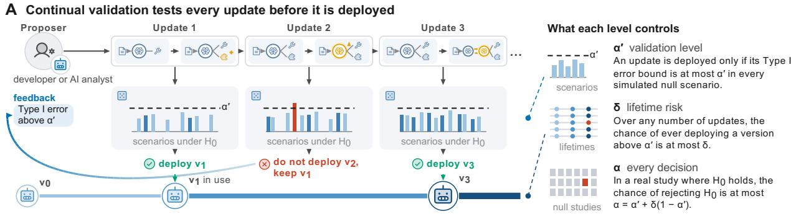

B The two examples and the experiment  
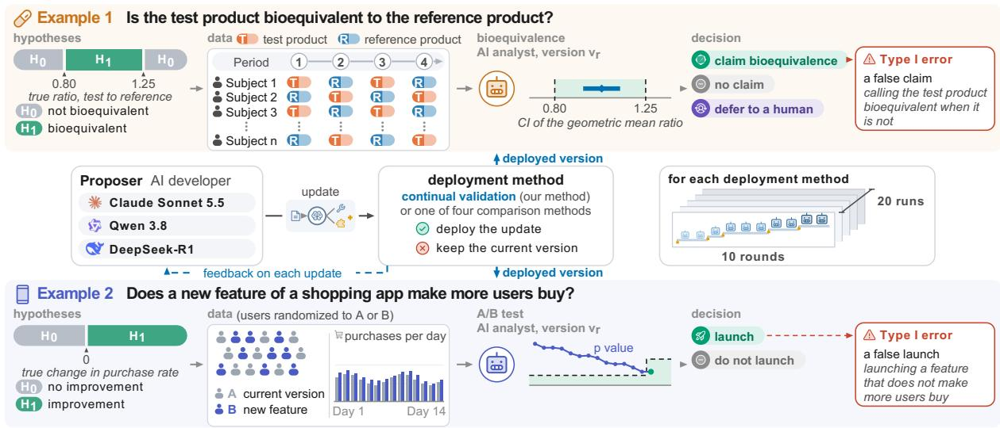  
Figure 1: Continual validation and the two examples. (A) A human developer or the AI analyst itself proposes updates. The validator freezes the updated version and runs it alongside a reference analysis on datasets newly simulated under the null hypothesis. The update is deployed only when the upper confidence bound on its Type I error rate is at most the validation level $\alpha ^ { \prime }$ across all simulated scenarios. The bound for update 2 exceeds $\alpha ^ { \prime }$ in one scenario so it is rejected and $v _ { 1 }$ stays in use. The proposer receives this result as feedback. Over any number of updates the chance of ever deploying a version above $\alpha ^ { \prime }$ remains at most the lifetime risk δ. In every real study where the data follow a simulated null scenario a true $H _ { 0 }$ is rejected with probability at most $\alpha = \alpha ^ { \prime } + \delta ( 1 - \alpha ^ { \prime } )$ . The examples use $\alpha = 0 . 0 5$ and $\delta = 0 . 0 0 5$ which gives $\alpha ^ { \prime } = 0 . 0 4 5 2$ (B) The two examples and the experiment setup. In Example 1 the agent decides whether a test product and a reference product are bioequivalent under the standard average bioequivalence framework. The true ratio is the ratio of their geometric mean exposures for a measure such as the peak concentration. The null hypothesis states that this ratio lies outside the regulatory acceptance limits of 0.80 and 1.25. The data come from replicate crossover studies where subjects receive the formulations in successive periods and the reference product is given at least twice. The agent claims bioequivalence and rejects $H _ { 0 }$ when the computed confidence interval lies entirely within these limits. The agent can also defer a study to a human. In Example 2 users of a shopping application are randomized to the current version or to a new feature over 14 days. The true change represents the diference in the share of users who make a purchase. The agent uses the statistics engine of the GrowthBook platform and makes launch decisions according to the rule specified by each version. A false launch constitutes a Type I error. In the experiment Claude Sonnet 5.5 proposes one update per round. The update either changes a setting or introduces a new decision rule. Each method is run 20 times for 10 rounds. Example 1 also tests the open-weight models Qwen 3.8 and DeepSeek-R1 as developers under three of the methods.

## 2 Results

## 2.1 Why Common Validation Strategies Can Fail to Control Type I Error for Evolving AI Analysts

Three commonly used statistical strategies can each fail to control the Type I error rate of an evolving AI analyst for diferent reasons.

First, validating each statistical tool separately does not validate an analyst that combines them. In a bioequivalence example, two tests each control the Type I error rate near 0.05, but applying the second whenever the first fails to show bioequivalence raises it to 0.0587, as shown in Fig. A1A in the Appendix. Theorem A2 in the Appendix provides a general result.

Second, evaluating every proposed update at a fixed confidence level [33] does not control the risk over many updates. Even when each update is evaluated using new simulated data, the probability of approving a version whose Type I error rate is too high can accumulate. If every proposed version has a Type I error rate above the target and independently passes validation with probability $\eta ,$ the probability that at least one such version passes within G updates is $1 - ( 1 - \eta ) ^ { G }$ ， which approaches one as $G$ grows. Fig. A1B in the Appendix shows this efect.

Third, repeatedly evaluating updates on the same benchmark [36] can lead to overfitting. As updates are developed using the same test cases or their feedback, they may perform well on the benchmark without controlling Type I error on new data. In an extreme example, an updated version can reproduce the decisions of a valid reference analysis on every stored test case but reject the null hypothesis on all other datasets. It would pass the benchmark evaluation while having a Type I error rate of one on new data from a continuous distribution, as Proposition A3 in the Appendix shows.

## 2.2 Continual Validation Maintains Type I Error Control at Modest Cost

Continual validation, outlined in Fig. 1A and Algorithm 1, addresses these problems simultaneously.

Evaluating an evolving AI analyst requires controlling the Type I error rate across diverse data distributions and operational settings. For example, in a bioequivalence study, the null hypothesis holds when the true drug exposure ratio is at or beyond the acceptance limits of 0.80 and 1.25 for most drugs, and the error rate can vary with sample size, within-subject variability, and dropout rate. We therefore evaluate an analyst under diferent null scenarios, each specifying a datagenerating process under which the null hypothesis is true. For instance, one scenario consists of 36 volunteers, 10 percent dropout, and a true exposure ratio at the upper acceptance limit, with volunteers resampled from a published study. For a version v and a null scenario $\theta ,$ , we denote its Type I error rate by $e ( v , \theta )$

Given the proposed version, the validator simulates $m _ { r }$ datasets from each null scenario for update r, and runs the updated version alongside a reference analyst version $v _ { 0 }$ , where the reference analysis can be a standard statistical procedure run at level $\alpha _ { 0 }$ , with a known upper bound $b _ { \theta }$ on its Type I error rate in scenario θ. Using these simulated datasets, the validator computes an exact upper confidence bound $B _ { \theta }$ on the updated version’s Type I error rate. An update is deployed only if $B _ { \theta }$ is at most the validation level $\alpha ^ { \prime }$ in every scenario. Here, α is the target Type I error rate for each decision, while δ bounds the lifetime probability of ever deploying a version whose Type I error rate exceeds $\alpha ^ { \prime }$ . We set $\alpha ^ { \prime } = ( \alpha - \delta ) / ( 1 - \delta )$ so that $\alpha ^ { \prime } + ( 1 - \alpha ^ { \prime } ) \delta = \alpha$ . For a target Type I error level such as $\alpha = 0 . 0 5$ and lifetime risk $\delta = 0 . 0 0 5$ , this gives $\alpha ^ { \prime } = 0 . 0 4 5 2$ . For update $r ,$ the validator constructs each bound $B _ { \theta }$ at confidence level $1 - \delta _ { r }$ , where $\delta _ { r } = 6 ( \delta - \delta _ { 0 } ) / ( \pi ^ { 2 } r ^ { 2 } )$ These error budgets sum to $\delta - \delta _ { 0 }$ over all updates, with the remaining $\delta _ { 0 }$ reserved for the reference bounds $b _ { \theta }$ . The initial set $ { \boldsymbol { S } } _ { 0 }$ of null scenarios is specified in advance and expanded when an update uses information not varied by the existing scenarios.

Algorithm 1 Continual validation   
Given Type I error level $\alpha ,$ lifetime risk $\delta ,$ reference risk $\delta _ { 0 } .$ , initial null scenarios $\scriptstyle { S _ { 0 } } .$ , reference   
analysis v with bounds $b _ { \theta }$   
1: Set $\alpha ^ { \prime }  ( \alpha - \delta ) / ( 1 - \delta )$ and ${ \cal S }  { \cal S } _ { 0 }$   
2: Deploy $v _ { 0 } .$ , or a version that rejects only where $v _ { 0 }$ does, if $b _ { \theta } \leq \alpha ^ { \prime }$ for every $\theta \in S _ { 0 }$ . Otherwise,   
start with a version that defers every study.   
3: for each proposed update $r = 1 , 2 , \ldots$ do   
4: Freeze the updated version $v _ { r }$   
5: Add scenarios to $\boldsymbol { s }$ for any new inputs used by $v _ { r } .$ , each with a reference bound $b _ { \theta }$   
6: Set $S _ { r } \gets S$   
7: Set $\delta _ { r } \gets 6 ( \delta - \delta _ { 0 } ) / ( \pi ^ { 2 } r ^ { 2 } )$ and fix the number $m _ { r }$ of datasets per scenario   
8: Simulate $m _ { r }$ new datasets from each $\theta \in S _ { r }$   
9: Run $v _ { r }$ and $v _ { 0 }$ on the same datasets   
10: For each $\theta \in S _ { r }$ , count rejections $X _ { \theta }$ of $v _ { r } ,$ added rejections $N _ { \theta } ^ { + }$ , and removed rejections   
$N _ { \theta } ^ { - }$   
11: Let $U ( x ; m , \eta )$ and $L ( x ; m , \eta )$ be the exact one-sided binomial bounds for x events in m   
trials at confidence level $1 - \eta \ [ 3 8 ]$   
12: $B _ { \theta } ^ { \mathrm { p a i r } }  b _ { \theta } + U ( N _ { \theta } ^ { + } ; m _ { r } , \delta _ { r } / 4 ) - L ( N _ { \theta } ^ { - } ; m _ { r } , \delta _ { r } / 4 )$   
13: $\bar { B _ { \theta } ^ { \mathrm { d i r } } } \gets U ( X _ { \theta } ; m _ { r } , \mathbf { \bar { \delta } } _ { r } / 2 )$   
14: $B _ { \theta } \gets \operatorname* { m i n } ( B _ { \theta } ^ { \mathrm { p a i r } } , B _ { \theta } ^ { \mathrm { d i r } } )$   
15: If $B _ { \theta } \leq \alpha ^ { \prime }$ for every $\theta \in S _ { r } ,$ deploy $v _ { r } .$ . Otherwise, retain the current version.   
16: Report the deployment decision to the proposer   
17: end for

The following theorem establishes that the lifetime risk remains controlled, regardless of how many updates are proposed or how they are selected.

Theorem 1 (Lifetime risk control). Suppose Algorithm 1 is followed and the reference bounds $b _ { \theta }$ hold simultaneously except with probability at most $\delta _ { 0 }$ . Then, regardless of how updates are proposed, we have

$$
\begin{array} { l } { \displaystyle \operatorname* { P r } \Bigl \{ \exists r : \ v _ { r } \ \mathrm { p a s s e s } , \ \underset { \theta \in S _ { r } } { \operatorname* { m a x } } e \bigl ( v _ { r } , \theta \bigr ) > \alpha ^ { \prime } \Bigr \} } \\ { \displaystyle \le \delta _ { 0 } + \sum _ { r \ge 1 } \delta _ { r } = \delta , } \end{array}
$$

where $v _ { r }$ is the version proposed in update r and $S _ { r }$ is its set of null scenarios.

Theorem 1 guarantees that the probability of ever deploying a version whose Type I error rate exceeds $\alpha ^ { \prime }$ in any tested null scenario is at most $\delta ,$ regardless of the number or selection of updates. The following corollary establishes Type I error control for every subsequent decision made by the AI analyst.

Corollary 1 (Type I Error Control for Every Decision). Let the analyst follow Algorithm 1. Consider any future study s whose data follow a null scenario covered by the version deployed before the study data arrive. The probability of incorrectly rejecting $H _ { 0 }$ satisfies

$$
\operatorname* { P r } _ { \theta } \{ { \mathrm { r e j e c t ~ } } H _ { 0 } { \mathrm { ~ i n ~ s t u d y ~ } } s \} \leq \alpha ^ { \prime } + ( 1 - \alpha ^ { \prime } ) \delta = \alpha .
$$

Corollary 1 establishes that each decision in a validated null scenario controls Type I error at the target level $\alpha ,$ even after an unlimited number of adaptive updates. We call this property lifetime validity.

Controlling Type I error alone would be trivial if no updates were ever approved. We therefore also show that continual validation allows updates whose Type I error rate is suficiently below $\alpha ^ { \prime }$ to pass with high probability.

Proposition 1 (Valid updates pass). Consider update r with $J _ { r } = | S _ { r } |$ null scenarios. Suppose the proposed version $v _ { r }$ has Type I error rate at most $\alpha ^ { \prime } - \gamma$ in every scenario, where $0 < \gamma < \alpha ^ { \prime }$ is the margin below the validation level. For any $0 < \zeta < 1$ , the update passes with probability at least $\begin{array} { r } { 1 - \zeta \mathrm { i f } m _ { r } \geq \frac { 8 \alpha ^ { \prime } } { \gamma ^ { 2 } } } \end{array}$ log max $\{ 2 / \delta _ { r } , J _ { r } / \zeta \}$

This proposition shows that updates with Type I error rates suficiently below $\alpha ^ { \prime }$ can be approved reliably. For a fixed number of scenarios, the required number of simulated datasets grows only logarithmically with the update number. For updates that never add rejections relative to the reference analysis, the guarantee is even stronger. If $b _ { \theta } \leq \alpha ^ { \prime } - \gamma$ in every scenario, such updates are guaranteed to pass validation whenever $m _ { r } \geq \log ( 4 / \delta _ { r } ) / \gamma$

Although continual validation requires repeated simulations, its computational cost can be reduced in two ways. First, it can avoid expensive language model calls. When an analyst follows a fixed set of allowed analysis paths, each ending in a decision computed by fixed code, the validator can evaluate these decisions directly without running the language model. The following proposition justifies this approach.

Proposition 2 (Allowed paths). Suppose every run of an AI analyst follows one of a fixed set of allowed paths, each producing a decision that is a function of the data. Then its Type I error rate in every scenario is at most that of the any-path rule, which rejects whenever any allowed path rejects, regardless of which language model is used or how it selects among the paths.

The choice of analysis path can vary substantially across models, even for the same data and analysis options, as Table A13 in the Appendix shows. The any-path rule in Proposition 2 makes the guarantee independent of which path the model selects. Thus, validating the any-path rule avoids language model calls, and subsequent model replacements, prompt edits, or provider updates that preserve the allowed paths require no additional simulation.

Second, for updates that require validation, comparing their decisions with the reference analysis on the same simulated datasets can substantially reduce the number of simulations needed, as Fig. A1C in the Appendix shows.

## 2.3 Two Evolving AI Analysts

We studied continual validation in two AI analysts that kept changing, an agent that decides whether a test product is bioequivalent to its reference product and an analyst that decides whether to launch a new product feature. Fig. 1B outlines both. In each, the language model Claude Sonnet 5.5 acted as the developer of the analyst. In each of ten rounds, it proposed one update after reviewing a performance report and the validation feedback from its earlier proposals.

In both experiments, while a language model plans the workflow, deterministic tools execute the computations. This architecture allows us to bypass expensive model calls and eficiently evaluate the agents at scale through their underlying rules, as section A7.10 of the Appendix details. Each run started with a conservative baseline test. The developer was then tasked with safely increasing statistical power and automation.

We compared five deployment methods.

• No validation deploys every update without any check.

• The static benchmark evaluates update on the same fixed set of simulated studies [29].

• The improvement test deploys an update when a lower confidence bound on its gain in power over the current version is positive [35, 36].

• Learn then Test evaluates a predefined set of configurations once before the first update [37].

• Continual validation runs with $\alpha = 0 . 0 5$ and $\delta = 0 . 0 0 5$

Each deployment method ran twenty times from the same initial version. The Type I error rate and power of every deployed version were estimated afterwards from independent simulations, on the validation scenarios and on of-grid scenarios that no method simulated. Power is reported relative to an oracle which, in its own runs with the same developer, deploys an update only if its estimated Type I error rate is at most $\alpha ^ { \prime }$ in every validation scenario and its estimated power exceeds that of the current version.

## Example 1, an Agent That Analyzes Bioequivalence Studies

A test product is approved on several kinds of evidence, and one of them is a bioequivalence study, which tests whether the test product delivers the active substance to the body like the reference product [39, 12, 40, 41]. Bioequivalence assessment spans many designs, endpoints, and acceptance rules [42, 43, 40], and our example covers one common part of it: average bioequivalence from pharmacokinetic endpoints in replicate crossover studies. Healthy volunteers take the test product and the reference product in successive periods, the reference at least twice, and the exposure in each period is summarized by the area under the concentration curve and the peak concentration. Evaluating bioequivalence can be formulated as performing the following hypothesis test:

$$
H _ { 0 } : { \mathrm { t h e ~ t w o ~ p r o d u c t s ~ a r e ~ n o t ~ b i o e q u i v a l e n t } }
$$

$$
H _ { 1 } : { \mathrm { t h e ~ t w o ~ p r o d u c t s ~ a r e ~ b i o e q u i v a l e n t } }
$$

In practice, the test is based on whether the true ratio of their geometric mean exposures lies outside the 0.80 to 1.25 interval $\left( H _ { 0 } \right)$ , or within it $\left( H _ { 1 } \right)$ . An analyst claims bioequivalence when the 90 percent confidence interval for the ratio lies within this range, which corresponds to the two one-sided tests at level 0.05 [11]. For highly variable drugs, whose reference product has a withinsubject coeficient of variation above 30 percent, regulatory agencies widen these limits based on observed variability [44, 45, 46].

A statistician performing this analysis checks the protocol, prepares the data, fits the model, runs diagnostics, and computes the interval, with judgment at each step. Our AI analyst is an agent (https://be.statrust.ai/) that carries out these steps with tools under the direction of language models, writes reports, and claims bioequivalence, retains the null hypothesis, or defers the study to a human. Our experiment uses an early, simplified configuration of this broader agent, which continues to evolve through updates evaluated by continual validation. To evaluate proposed updates to this workflow, we used realistic null scenarios resampled from published studies [47, 48]. This exposed the analyst to complex clinical edge cases, including the 30 percent variability threshold where regulatory limits shift and errors easily inflate [49, 50].

Fig. 2A to D summarize the results. We highlight three key findings.

First, continual validation successfully controls the Type I error rate while enabling the analyst to safely evolve and achieve higher statistical power. Continual validation deployed no version above $\alpha ^ { \prime }$ in any of the 20 runs, and no deployed version had an estimated Type I error rate above 0.045 on the validation scenarios as shown in Fig. 2B and C. The final version of the analyst achieved a power of 0.79 while maintaining a true Type I error rate of 0.043. Across all 200 rounds, the analyst proposed 112 distinct versions. Furthermore, 32 percent of these updates introduced entirely new decision rules, creating the unique evolutionary trajectories shown in Fig. 2A.

Second, comparison methods fail to balance capability evolution and Type I error control, as Fig. 2B to D show. Both no validation and the improvement test failed to control the Type I error rate. They deployed versions above $\alpha = 0 . 0 5$ in every run and reached error rates up to 0.098. The static benchmark failed to detect when the Type I error rate exceeded α and deployed versions above this level in 20 percent of runs. Learn then Test strictly controls the Type I error rate but only evaluates predefined options. Because it cannot evaluate novel decision rules proposed by the analyst, it achieved only 52 percent of the oracle power. Continual validation evaluates these novel rules while controlling the Type I error rate. It never exceeded the adjusted bound $\alpha ^ { \prime } { \mathrm { . } }$ , reached a maximum Type I error rate of 0.045, and attained the highest power among all methods that controlled the Type I error rate. Continual validation reached a mean final power of 82 percent of the oracle’s and the highest among the methods that deployed no version above α.

Third, continual validation is robust. Although continual validation requires constructing null scenarios, its deployed versions maintained estimated Type I error rates at or below 0.05 on at least 666 of 690 of-grid scenarios (96.5%). The few exceedances, reaching at most 0.058, occurred only under response-dependent dropout in two datasets not used for validation. By drawing random scenarios, continual validation drives the analyst to evolve toward population-level performance rather than overfitting to a fixed testing grid. In an additional experiment shown in Fig. 3, this randomization successfully rejected twelve updates that inflated the Type I error rate at of-grid sample sizes. Under this setting, the method retained 79 percent of the oracle power. Finally, these results hold across diferent language models. Substituting Qwen or DeepSeek produced identical patterns. The comparison methods failed to control the Type I error rate, while continual validation maintained strict control, as section A7.8 of the Appendix details.

## Example 2, an Analyst of Product Experiments

Online companies evaluate new product features through controlled experiments, commonly known as $\mathrm { A } / \mathrm { B }$ tests [51, 52]. Our example focuses on a two-arm experiment over 14 days. The primary metric is conversion, with revenue and engagement as secondary goals. Evaluating the new feature can be formulated as performing the following hypothesis test

$H _ { 0 }$ : the new feature does not improve conversion

$$
H _ { 1 } : { \mathrm { t h e ~ n e w ~ f e a t u r e ~ i m p r o v e s ~ c o n v e r s i o n } }
$$

Rejecting $H _ { 0 }$ means launching the feature, and launching an inefective feature constitutes a Type I error. Common analytical choices, such as evaluating data every day or selectively choosing metrics after seeing the results, severely inflate this error [53, 25]. We built the analyst on GrowthBook, an open-source experimentation platform [54]. The initial version uses daily purchase data to compare conversion rates and bases its launch decision on the day-14 p-value. The developer was instructed to safely launch efective features more often and earlier. To evaluate proposed updates, we simulated null experiments featuring heavy-tailed revenue, correlated metrics, and multiple user segments, alongside dynamic scenarios targeting complex updates like daily data evaluations and new decision rules.

The results in Fig. 2E to H show that continual validation deployed no version with a Type I error rate above $\alpha ^ { \prime } = 0 . 0 4 5 2$ in any run. Of the 30 rejected updates, 28 had Type I error rates above $\alpha ^ { \prime } { \mathrm { . } }$ , while the remaining two had rates of 0.0435 and 0.0434, slightly below $\alpha ^ { \prime }$ . In one run, the analyst proposed checking the data daily, which raised the Type I error rate to 0.17. Continual validation rejected this update. In response to this feedback, the analyst autonomously developed a new decision rule that allowed early launches only for very small p-values and used an adjusted threshold on day 14. The final version achieved a power of 0.21 with a true Type I error rate of 0.043. Across all runs, the analyst proposed 62 distinct versions, and 21 percent of its updates were new decision rules.

Comparison methods failed to consistently balance statistical power and Type I error control. No validation and the improvement test deployed versions above α = 0.05 in 60 and 95 percent of runs, reaching error rates up to 0.183 and 0.817. The static benchmark deployed no version above $\alpha ^ { \prime }$ and reached 98% of the oracle’s power in Example 2. This was because all six updates that would have exceeded $\alpha = 0 . 0 5$ did so in scenarios covered by its fixed benchmark. In Example 1, by contrast, harmful updates exceeded α in scenarios outside the fixed benchmark. Learn then Test deployed no version above α but could not deploy new decision rules, reaching only 80 percent of the oracle power. Continual validation safely evaluated these novel rules, never exceeded the adjusted bound $\alpha ^ { \prime }$ , and attained 96 percent of the oracle power. Furthermore, On 116 of-grid scenarios, its deployed versions had estimated Type I error rates of at most 0.044.

## 3 Discussion

Type I error control need not end when a decision procedure starts to change. Continual validation extends this guarantee from a fixed procedure to an adaptively evolving, potentially unlimited sequence of AI analyst versions. Simulating datasets under the null hypothesis accounts for data sampling, while evaluating each frozen version accounts for the analyst’s internal randomization. Freezing each update before simulating its validation data and controlling the lifetime probability of approving an invalid version prevents overfitting during the adaptive selection of the analyst. Together, these steps ensure that the probability of ever approving an invalid version remains bounded and that each deployed decision strictly controls the Type I error.

Several features distinguish continual validation from existing methods for evaluating and updating AI systems [35, 36, 34]. First, it directly controls the Type I error of statistical decisions, whereas methods that check only improvements in performance do not. A performance-based deployment criterion can still be added without afecting the statistical guarantee. Second, simulating new data after each update is frozen allows updates to be proposed adaptively, including by the analyst itself. Third, comparing every update with the same fixed reference analysis reduces simulation costs and avoids accumulating diferences relative to successive versions. Finally, validating the allowed analysis paths can cover model replacements and prompt changes without additional simulation. Unlike Learn then Test, which calibrates a finite menu of configurations fixed in advance [37], continual validation also accommodates previously unanticipated updates, including new decision rules written by the analyst. Regulators already use simulation over nuisance parameter grids for adaptive clinical trials [55] and provide for predetermined change control plans for AI-enabled medical software [56]. Continual validation could provide a statistical framework for evaluating updates under such plans.

A limitation is that the theoretical guarantee strictly applies to the null scenarios covered by validation. It does not automatically provide a mathematical bound for unobserved data generating patterns. However, our experiments demonstrate that continual validation remains highly robust in practice. The deployed versions successfully maintained Type I error control even on unseen of-grid scenarios. Furthermore, developers can easily expand the validation scenarios as the AI system gains new capabilities. Moreover, drawing randomly sampled scenarios naturally extends the theoretical safety guarantee to the broader data population. This prevents the AI analyst

C  
Example 1, bioequivalence agent  
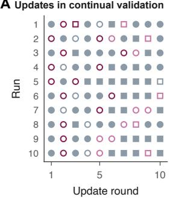

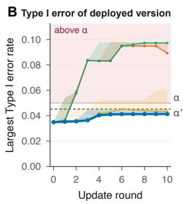

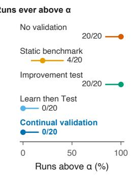

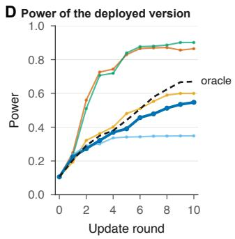

Example 2, analyst of product experiments (GrowthBook)  
E  
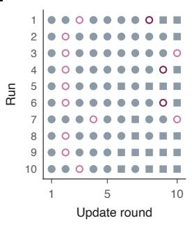

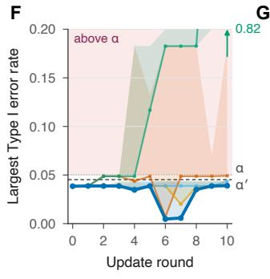

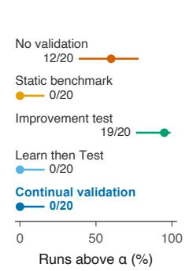

H  
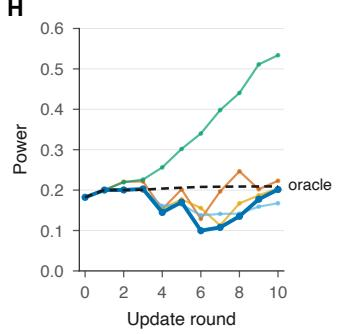  
Updates in A and E within α′ above α′ above α not deployed new decision rule malformed

Figure 2: Continual validation and four comparison methods evaluated across two evolving AI analysts. Each method was tested in 20 independent runs of 10 rounds from the same initial version. In each round, Claude Sonnet 5.5 acted as the developer and proposed one update based on feedback from earlier rounds. (A to D) Bioequivalence analyst. (E to H) Product experiment analyst. (A and $E )$ Updates proposed under continual validation in the first ten runs, with one row per run. Circles denote setting changes, squares denote new decision rules, and crosses denote malformed updates. Filled markers indicate deployed updates. Colors indicate the true Type I error rate of the proposed version, showing rates within $\alpha ^ { \prime }$ (grey), above $\alpha ^ { \prime }$ (pink), and above α (dark red). (B and $F )$ Largest true Type I error rate of the deployed version over the full validation set after each round. Lines show the median over runs and bands extend to the worst run for no validation (vermilion), the static benchmark (orange), the improvement test (bluish green), Learn then Test (sky blue), and continual validation (blue). The dashed line marks the validation level $\alpha ^ { \prime } = 0 . 0 4 5 2$ , the dotted line marks the target level $\alpha = 0 . 0 5$ , and the shaded region lies above α. In $F ,$ the axis ends at 0.2 and an arrow indicates the largest rate in the worst run of the improvement test. (C and G) Share of runs that ever deployed a version above $\alpha ,$ showing Wilson $9 5$ percent intervals and the raw count out of 20 runs. (D and H) Mean true statistical power of the deployed version after each round. The dashed line represents an oracle that deploys only valid updates that strictly increase power.

from overfitting to a fixed testing grid and ensures it safely evolves toward true population-level performance. The method is applicable wherever relevant null scenarios can be simulated and the AI system can be evaluated at suficient scale.

Although we focus on Type I error, the framework requires only valid upper confidence bounds on the risk being controlled. It can therefore extend to other statistical error measures, such as the false discovery rate of a screening agent, when suitable confidence bounds are available. Overall, continual validation provides a practical deployment framework for AI systems. It allows AI analysts to continuously improve their statistical power and adapt to new tasks while maintaining rigorous safety guarantees throughout their working lives.

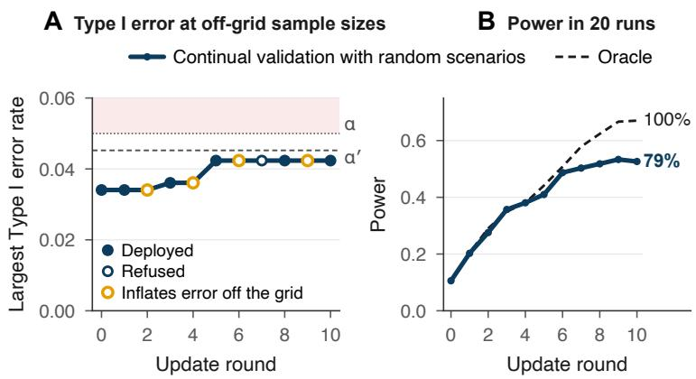  
Figure 3: Continual validation with random scenarios in the bioequivalence analyst. (A) Largest true Type I error rate of the deployed version at sample sizes of 30, 42, and 60, outside the original validation grid of 24, 36, and 48. Filled circles indicate deployed versions, while open circles indicate rejected updates. Orange circles highlight four rejected updates that would increase Type I error outside the original grid while leaving the analysis unchanged on the grid. The dashed and dotted lines mark the validation level $\alpha ^ { \prime } = 0 . 0 4 5 2$ and the target level $\alpha = 0 . 0 5 .$ , respectively. The shaded region indicates rates above α. (B) Mean true power of the deployed version across 20 runs with Claude Sonnet 5.5 proposing updates. The dashed line shows the oracle in Fig. 2, and the percentages indicate power relative to the oracle after ten rounds.

## 4 Methods

## 4.1 Decisions, Versions, and Type I Error

An AI analyst maps the data of a study, including its protocol, to one of three decisions, to reject the null hypothesis, to retain it, or to defer to a human. A deferral never counts as a rejection, so the guarantee concerns the decisions the analyst makes on its own. A version v is a complete specification of everything that can change the decision, including the language model and its sampling settings, the prompts, the allowed tools and skills, the workflow, the code, and decision thresholds. A deployed version decides each study using that study’s data and its own internal randomness, without updating decision-relevant memory across studies. Information from earlier studies may inform future updates, which are validated before deployment. For a null scenario θ, the Type I error rate $e ( v , \theta )$ is the probability that v rejects, over the data and the internal randomness. We assume that a real study whose true state is a validation scenario produces data with the distribution from which the validator simulates, and that a version cannot tell simulated studies from real ones, which the Appendix states as Assumption A1.

## 4.2 Validation of an Update

The bounds $U ( x ; m , \eta )$ and $L ( x ; m , \eta )$ of Algorithm 1 are the exact one-sided Clopper and Pearson bounds [38]. Their levels $\delta _ { r } / 4 , \delta _ { r } / 4 .$ , and $\delta _ { r } / 2$ add up to $\delta _ { r } ,$ so by a union bound all three bounds of a scenario hold together with probability at least $1 - \delta _ { r }$ . Because an update passes only if every scenario passes, the intersection-union argument [57] of Theorem A6 in the $\mathrm { A p }$ pendix shows that no division of $\delta _ { r }$ among the scenarios is needed. Random scenarios drawn after the freeze enter a round with the analytic bound of the reference analysis where one exists and $b _ { \theta } = 1$ otherwise, as

described in section A4.6 of the Appendix.

## 4.3 Reference Analysis and Lifetime Risk

The reference analysis is the standard analysis of the field, run at a reference level $\alpha _ { 0 }$ below $\alpha ^ { \prime } .$ For the two one-sided tests on Gaussian scenarios with dropout that does not depend on the responses, its Type I error rate is at most $\alpha _ { 0 }$ [11], which Theorem A10 in the Appendix confirms for every design used here, so that $b _ { \theta } = \alpha _ { 0 }$ at no simulation cost. On scenarios built from real studies or with non-Gaussian data, the reference analysis receives a one-time validation that holds simultaneously over these scenarios, including those that later updates may add, and uses $\delta _ { 0 }$ of the lifetime risk. Each round simulates all $m$ datasets in every scenario before the deployment decision, because optional stopping would invalidate the exact bounds. We use $\alpha = 0 . 0 5 , \delta = 0 . 0 0 5$ and $\delta _ { 0 } = 0 . 0 0 1$ with $\alpha _ { 0 } = 0 . 0 3 0$ in Example 1 and $\alpha _ { 0 } = 0 . 0 4 0$ in Example 2, and section A4 of the Appendix gives the proofs.

## 4.4 Conditions for Deployment

The validator must be able to run each version on simulated studies, either through its allowed paths or in full. An analyst that learns from each study keeps its memory frozen while a version is in force. The random seeds of a round are drawn after its freeze. Each study is decided by one binding run, because rerunning a stochastic version until it rejects is a diferent procedure. A version validated in full pins its hosted model to a fixed snapshot, whereas a version validated through its allowed paths is protected against silent model updates by Proposition 2.

## Acknowledgments

The research of Xiao Wang was supported in part by the National Science Foundation under Grant SES-2316428, by Anthropic through its AI for Science program, and by Lilly Purdue Innovation Institute.

## References

[1] C. Lu, et al., Towards end-to-end automation of AI research. Nature 651, 914–919 (2026).

[2] K. Swanson, W. Wu, N. L. Bulaong, J. E. Pak, J. Zou, The Virtual Lab of AI agents designs new SARS-CoV-2 nanobodies. Nature 646, 716–723 (2025).

[3] S. Alber, et al., CellVoyager: AI CompBio agent generates new insights by autonomously analyzing biological data. Nature Methods 23, 749–759 (2026).

[4] H. G. Zhang, P. Eckmann, J. Miao, A. B. Mahon, J. Zou, The Virtual Biotech: A multi-agent AI framework for therapeutic discovery and development. Science (2026). https://doi.org/ 10.1126/science.aeg6779 (accessed 6 October 2026).

[5] Z. Chen, et al., ScienceAgentBench: Toward rigorous assessment of language agents for datadriven scientific discovery in International Conference on Learning Representations. (2025).

[6] B. P. Majumder, et al., DiscoveryBench: Towards data-driven discovery with large language models in International Conference on Learning Representations. (2025).

[7] J. S. Chan, et al., MLE-bench: Evaluating machine learning agents on machine learning engineering in International Conference on Learning Representations. (2025).

[8] F. Nie, et al., DSGym: A holistic framework for evaluating and training data science agents. arXiv [Preprint] (2026). https://arxiv.org/abs/2601.16344 (accessed 6 October 2026).

[9] K. Huang, et al., Automated hypothesis validation with agentic sequential falsifications in Proceedings of the 42nd International Conference on Machine Learning, Proceedings of Machine Learning Research. Vol. 267, pp. 25372–25437 (2025).

[10] J. Miao, J. Mu, G. Chen, J. Zou, Fisher-R1: Training LLM agents for reliable hypothesis testing. arXiv [Preprint] (2026). https://arxiv.org/abs/2608.07437 (accessed 6 October 2026).

[11] D. J. Schuirmann, A comparison of the two one-sided tests procedure and the power approach for assessing the equivalence of average bioavailability. Journal of Pharmacokinetics and Biopharmaceutics 15, 657–680 (1987).

[12] International Council for Harmonisation, ICH M13A guideline on bioequivalence for immediate-release solid oral dosage forms, (ICH), Harmonised guideline (2024).

[13] J. Neyman, E. S. Pearson, On the problem of the most eficient tests of statistical hypotheses. Philos. Trans. R. Soc. Lond. A 231, 289–337 (1933).

[14] E. L. Lehmann, J. P. Romano, Testing Statistical Hypotheses (Springer, ed. 4, 2022).

[15] M. Bertran, R. Fogliato, Z. S. Wu, Many AI analysts, one dataset: Navigating the agentic data science multiverse. Proc. Natl. Acad. Sci. U.S.A. 123, e2606495123 (2026).

[16] J. Miao, J. K. Pritchard, J. Zou, The agentic garden of forking paths. arXiv [Preprint] (2026). https://arxiv.org/abs/2607.01507 (accessed 6 October 2026).

[17] K. D. Tocher, Extension of the Neyman-Pearson theory of tests to discontinuous variates. Biometrika 37, 130–144 (1950).

[18] L. Chen, M. Zaharia, J. Zou, How is ChatGPT’s behavior changing over time? Harvard Data Science Review 6 (2024).

[19] J. Schmidhuber, Gödel machines: Fully self-referential optimal universal self-improvers in Artificial General Intelligence, B. Goertzel, C. Pennachin, Eds. (Springer, 2007), pp. 199–226.

[20] E. Zelikman, E. Lorch, L. Mackey, A. T. Kalai, Self-taught optimizer (STOP): Recursively self-improving code generation in Conference on Language Modeling. (2024).

[21] J. Zhang, S. Hu, C. Lu, R. Lange, J. Clune, Darwin Gödel Machine: Open-ended evolution of self-improving agents in International Conference on Learning Representations. (2026).

[22] N. Shinn, F. Cassano, A. Gopinath, K. Narasimhan, S. Yao, Reflexion: Language agents with verbal reinforcement learning in Advances in Neural Information Processing Systems. Vol. 36, pp. 8634–8652 (2023).

[23] M. Yuksekgonul, et al., Optimizing generative AI by backpropagating language model feedback. Nature 639, 609–616 (2025).

[24] Q. Zhang, et al., Agentic context engineering: Evolving contexts for self-improving language models in International Conference on Learning Representations. (2026).

[25] J. P. Simmons, L. D. Nelson, U. Simonsohn, False-positive psychology: Undisclosed flexibility in data collection and analysis allows presenting anything as significant. Psychological Science 22, 1359–1366 (2011).

[26] R. Silberzahn, et al., Many analysts, one data set: Making transparent how variations in analytic choices afect results. Advances in Methods and Practices in Psychological Science 1, 337–356 (2018).

[27] A. N. Angelopoulos, S. Bates, C. Fannjiang, M. I. Jordan, T. Zrnic, Prediction-powered inference. Science 382, 669–674 (2023).

[28] Y. Jin, et al., TxConformal: Controlling false discoveries in AI-driven therapeutic discovery. bioRxiv [Preprint] (2026). https://doi.org/10.64898/2026.04.27.721076 (accessed 6 Oc tober 2026).

[29] C. Dwork, et al., The reusable holdout: Preserving validity in adaptive data analysis. Science 349, 636–638 (2015).

[30] Y. Benjamini, Selective inference: The silent killer of replicability. Harvard Data Science Review 2 (2020).

[31] J. Tian, A. Ramdas, Online control of the familywise error rate. Statistical Methods in Medical Research 30, 976–993 (2021).

[32] P. Bauer, K. Köhne, Evaluation of experiments with adaptive interim analyses. Biometrics 50, 1029–1041 (1994).

[33] P. S. Thomas, et al., Preventing undesirable behavior of intelligent machines. Science 366, 999–1004 (2019).

[34] J. Feng, S. Emerson, N. Simon, Approval policies for modifications to machine learning-based software as a medical device: A study of bio-creep. Biometrics 77, 31–44 (2021).

[35] B. Sengupta, Self-evolving agents with anytime-valid certificates. arXiv [Preprint] (2026). https://arxiv.org/abs/2607.00871 (accessed 6 October 2026).

[36] X. Sun, Y. Zeng, Z. She, X. Wang, Which self-improvements should we trust? Reliable selfimprovement when agents reuse their benchmarks. arXiv [Preprint] (2026). https://arxiv. org/abs/2609.33180 (accessed 6 October 2026).

[37] A. N. Angelopoulos, S. Bates, E. J. Candès, M. I. Jordan, L. Lei, Learn then test: Calibrating predictive algorithms to achieve risk control. The Annals of Applied Statistics 19 (2025).

[38] C. J. Clopper, E. S. Pearson, The use of confidence or fiducial limits illustrated in the case of the binomial. Biometrika 26, 404–413 (1934).

[39] European Medicines Agency, Guideline on the investigation of bioequivalence, (Committee for Medicinal Products for Human Use), Guideline CPMP/EWP/QWP/1401/98 Rev. 1 (2010).

[40] U.S. Food and Drug Administration, Statistical approaches to establishing bioequivalence, (FDA), Guidance for industry (2026).

[41] B. M. Davit, et al., Comparing generic and innovator drugs: A review of 12 years of bioequivalence data from the United States Food and Drug Administration. Annals of Pharmacotherapy 43, 1583–1597 (2009).

[42] S.-C. Chow, J.-P. Liu, Design and Analysis of Bioavailability and Bioequivalence Studies (Chapman & Hall/CRC, ed. 3, 2008).

[43] D. Hauschke, V. Steinijans, I. Pigeot, Bioequivalence Studies in Drug Development: Methods and Applications (Wiley, 2007).

[44] L. Tóthfalusi, L. Endrényi, A. García-Arieta, Evaluation of bioequivalence for highly variable drugs with scaled average bioequivalence. Clinical Pharmacokinetics 48, 725–743 (2009).

[45] B. M. Davit, et al., Implementation of a reference-scaled average bioequivalence approach for highly variable generic drug products by the US Food and Drug Administration. AAPS J. 14, 915–924 (2012).

[46] V. Karalis, M. Symillides, P. Macheras, Bioequivalence of highly variable drugs: A comparison of the newly proposed regulatory approaches by FDA and EMA. Pharmaceutical Research 29, 1066–1077 (2012).

[47] H. Schütz, M. Tomashevskiy, D. Labes, replicateBE: Average bioequivalence with expanding limits (ABEL) (R package version 1.1.3, CRAN) (2022). https://doi.org/10.32614/CRAN. package.replicateBE (accessed 6 October 2026).

[48] H. Schütz, et al., Reference datasets for studies in a replicate design intended for average bioequivalence with expanding limits. AAPS J. 22, 44 (2020).

[49] D. Labes, H. Schütz, Inflation of type I error in the evaluation of scaled average bioequivalence, and a method for its control. Pharmaceutical Research 33, 2805–2814 (2016).

[50] J. Muñoz, D. Alcaide, J. Ocaña, Consumer’s risk in the EMA and FDA regulatory approaches for bioequivalence in highly variable drugs. Stat. Med. 35, 1933–1943 (2016).

[51] R. Kohavi, D. Tang, Y. Xu, Trustworthy Online Controlled Experiments: A Practical Guide to A/B Testing (Cambridge University Press, 2020).

[52] N. Larsen, et al., Statistical challenges in online controlled experiments: A review of A/B testing methodology. The American Statistician 78, 135–149 (2024).

[53] R. Johari, P. Koomen, L. Pekelis, D. Walsh, Peeking at A/B tests: Why it matters, and what to do about it in Proceedings of the 23rd ACM SIGKDD International Conference on Knowledge Discovery and Data Mining. pp. 1517–1525 (2017).

[54] GrowthBook, Inc., GrowthBook: Open source feature flags, experimentation, and product analytics (GitHub repository, statistics engine gbstats under the MIT License) (2026). https: //github.com/growthbook/growthbook (accessed 7 October 2026).

[55] U.S. Food and Drug Administration, Adaptive designs for clinical trials of drugs and biologics: Guidance for industry (Final guidance) (2019). https://www.fda.gov/media/78495/ download (accessed 6 October 2026).

[56] U.S. Food and Drug Administration, Marketing submission recommendations for a predetermined change control plan for artificial intelligence-enabled device software functions: Guidance for industry and Food and Drug Administration staf (Final guidance, originally issued 4 December 2024) (2025). https://www.fda.gov/media/166704/download (accessed 6 October 2026).

[57] R. L. Berger, Multiparameter hypothesis testing and acceptance sampling. Technometrics 24, 295–300 (1982).

## Appendix

## A1 Setting and notation

The theory concerns an AI analyst that decides one study after another while its decision procedure keeps changing. We define the objects first, then the Type I error rate that every guarantee controls, and finally the property of lifetime validity. Table A1 collects the symbols used here and in later sections.

## A1.1 Studies and decisions

The analyst reads the data D of a study, which include its protocol, and returns one of three decisions,

$$
Y \in \{ { \mathrm { r e j e c t } } , { \mathrm { ~ r e t a i n } } , { \mathrm { ~ d e f e r } } \} .
$$

Rejecting the null hypothesis is the consequential action that the evidence must support. Such actions include reporting a discovery, launching a product feature and declaring a test product bioequivalent to its reference product. Retaining the null hypothesis declines the action, and a deferral hands the study to a human expert. A deferral is never counted as a rejection, and the guarantees below concern the rejections that the analyst makes on its own.

The data-generating distribution of a study depends on the true state of the world. A scenario θ specifies this state completely, and $\operatorname { P r } _ { \theta }$ denotes probability when the data of a study are drawn from scenario θ. In a bioequivalence study a scenario fixes the true ratio of geometric mean exposures, which the null hypothesis concerns, and the within-subject and between-subject variability, which are nuisance parameters. For highly variable drugs the within-reference variability also sets the limits that define the null hypothesis. The scenario also fixes the sample size, the allocation to sequences, the dropout pattern and the protocol the analyst reads.

Let $\Theta _ { 0 }$ be the set of null scenarios, those in which the null hypothesis holds and a rejection is wrong. The null hypothesis is composite, since it holds in many scenarios. In bioequivalence the null scenarios are those whose true ratio lies on or outside the regulatory limits for the true variability. These limits are 80.00 and 125.00 percent when the true within-reference coeficient of variation is at most 30 percent. Otherwise they are the widened limits $\exp ( \pm 0 . 7 6 0 \sigma _ { w R } )$ of the European Medicines Agency (EMA) [1], capped at 69.84 and 143.19 percent and evaluated at the true within-reference standard deviation $\sigma _ { w R }$ on the log scale, whereas the EMA’s rule itself evaluates them at the observed standard deviation $s _ { w R }$ (section A7.4). With the limits of 80.00 and 125.00 percent the null hypothesis is $| \mu | \geq \Delta$ for the log-ratio $\mu$ and $\Delta = \log 1 . 2 5$ . Scenarios may be parametric, such as Gaussian models of a crossover study. They may also be built from real studies by resampling their subjects and moving the true efect to the boundary of the nul hypothesis or beyond it. The validator can draw studies from every scenario it uses.

## A1.2 Versions

A version v of the AI analyst is one fixed configuration of everything that turns the data of a study into a decision. It includes the language model with its identifier and sampling settings, the instructions, and the tools and skills with their code. It also includes the statistical analyses and their thresholds, the rules that send a study to an analysis or to a human, and the computing environment. The analyst decides each study by running its current version.

A version determines its decision as a fixed function of the data and of the analyst’s internal randomness,

$$
Y _ { v } = y _ { v } ( D , \xi ) ,\tag{A1}
$$

where $\xi$ collects every random choice the analyst makes. The randomness $\xi ,$ which includes the sampling of a language model, is drawn independently of D from a distribution that the version fixes. Each version is therefore a randomized test, a decision rule that may use randomness independent of the data, and two runs of one version on one study have the same distribution of decisions.

A version carries no memory from one study to the next. An analyst whose context grows with every study it decides becomes a new version after each study. Its memory must therefore stay frozen while a version is in force and change only through updates. Each study is also decided by one binding run. Rerunning a stochastic version until it rejects is a diferent procedure, and $K$ runs of a version whose Type I error rate is a can reject with probability up to $1 - ( 1 - a ) ^ { K }$ (the example after Proposition A22).

Every change to any component produces a new version, and the theory treats all such versions alike. An edited prompt, a new skill, an upgraded tool, a swapped model, a changed threshold and a revision written by the analyst itself are all new versions. So is a hosted model that its provider updates behind an unchanged name.

The validator of section A3 runs a version exactly as it runs in deployment, and simulated studies reach the version through the same input as real studies. One assumption links the scenarios to the studies the analyst decides in the field.

Assumption A1 (Faithful simulation). A real study whose true state is $\theta$ produces data with the law $\operatorname { P r } _ { \theta }$ from which the validator draws. A version’s decision depends on a study only through its data D and its internal randomness ξ. In particular, a version cannot tell a simulated study from a real one.

Under Assumption A1 the rejection rate of a version in a simulated scenario is its Type I error rate on real studies in that state. The guarantees below are therefore statements about decisions in the field. The assumption asks more of scenarios resampled from real studies than of parametric ones, because resampling can leave traces that real studies lack, such as repeated subjects. Section A4 shows how far the guarantee reaches beyond the laws of the validation scenarios.

## A1.3 Type I error rate

For a version v and a scenario $\theta \in \Theta _ { 0 }$ the Type I error rate is

$$
e ( v , \theta ) = \operatorname* { P r } _ { \theta } \{ Y _ { v } = \mathrm { r e j e c t } \} ,\tag{A2}
$$

the probability over the data of the study and the internal randomness of the analyst. For a set ${ \mathcal { S } } \subseteq \Theta _ { 0 }$ we write $e ( v , S ) = { \mathrm { s u p } } _ { \theta \in S } e ( v , \theta )$ , which is the size of v on ${ \mathcal { S } } .$ . We call v valid at level a on S if $e ( v , S ) \leq a$ . Power is the probability of a rejection in a scenario where the null hypothesis is false. Power plays no part in the guarantees, and most updates try to raise it.

Throughout, every decision is held to the level $\alpha = 0 . 0 5$ , and the lifetime risk is $\delta = 0 . 0 0 5$ . The lifetime risk is the largest acceptable probability that validation ever passes an update whose Type I error rate exceeds the validation level in one of its validation scenarios. Each validation uses the validation level $\alpha ^ { \prime } = ( \alpha - \delta ) / ( 1 - \delta ) = 0 . 0 4 5 2$ , the reference analysis introduced below runs at the reference level $\alpha _ { 0 }$ of the example (0.030 in Example 1 and 0.040 in Example 2), and $\delta _ { 0 }$ is the part of δ spent on the reference bounds (section A4).

## A1.4 Scenario sets

The validator tests versions on finite sets of scenarios, the validation scenarios. They begin with the initial scenario set $S _ { 0 } \subseteq \Theta _ { 0 }$ of J scenarios, which the validator fixes before the analyst’s working life begins. The initial scenario set varies the factors that the validator expects to change decisions, such as variability, sample size and dropout. It also contains null scenarios both at the boundary of the null hypothesis and inside it. When an updated version reads a kind of information that no scenario in the current set varies, the validator adds scenarios that vary it (section A4.5). Scenarios are added and never removed, so the set $S _ { r }$ in force at update r always contains $ { \boldsymbol { S } } _ { 0 }$ . The validator may also draw scenarios at random in each round, after the updated version is frozen, and use them in that round only. These extend the guarantee for each deployed version to the space between the fixed scenarios, except a set of small probability (Proposition A18). The proposer has no say in which scenarios validation uses.

## A1.5 An analyst that keeps changing

Over its working life the analyst receives updates $r = 1 , 2 , \ldots$ , and update r ofers a new version $v _ { r } ,$ the updated version. An update may come from anyone, and we call its source the proposer. The proposer may be the analyst revising itself after a failure or an engineer editing its instructions. It may also be an optimizer that maximizes power or an adversary searching for a version that rejects too often. Each updated version passes or fails validation. A version that passes may be deployed, and a deployed version decides every study whose data arrive afterward. An update that fails changes nothing but still counts, because updates are counted by attempt.

The validator holds a reference analysis v , a fixed decision procedure with reference bounds $b _ { \theta }$ on its Type I error rates. These bounds have simultaneous coverage, $b _ { \theta } \geq e ( v _ { 0 } , \theta )$ for every scenario ever used, except on an event of probability at most $\delta _ { 0 }$ (section A4). When $b _ { \theta } \leq \alpha ^ { \prime }$ for every $\theta \in S _ { 0 }$ the analyst starts its life with the reference analysis in force, or with a version that rejects only where the reference analysis rejects (Corollary A21). Otherwise it starts with the version that defers every study. In bioequivalence the reference analysis is the two one-sided tests procedure at the reference level $\alpha _ { 0 }$ applied to the subjects with complete data (sections A3.6 and A7.3).

Studies $s = 1 , 2 , . . .$ . arrive over time, each with a true scenario $\theta _ { s }$ and a decision $Y _ { s }$ . We write $v _ { ( s ) }$ for the version in force when the data of study s arrive.

## A1.6 Lifetime validity

Definition A1 (Lifetime validity). An analyst that keeps changing is lifetime valid at level α on a set of scenarios ${ \mathcal { S } } \subseteq \Theta _ { 0 }$ if every study s that it ever decides, and whose true scenario $\theta _ { s }$ lies in S almost surely, satisfies

$$
{ \mathrm { P r } } \{ Y _ { s } = { \mathrm { r e j e c t } } \} \leq \alpha ,\tag{A3}
$$

where the probability is taken over everything that happens up to and including the decision. This history consists of the updates, the validations, the earlier studies, the data of study s and the internal randomness of the analyst.

Lifetime validity is a guarantee about each decision, under whichever version is in force, after any number of changes chosen in any way. Corollary A12 shows that continual validation delivers it on every scenario set on which all versions in force are validated, and Assumption A1 carries it to the real studies in those states.

Table A1: Notation.
<table><tr><td>symbol</td><td>meaning</td></tr><tr><td> $D , \xi$ </td><td>data of a study, internal randomness of the analyst</td></tr><tr><td> $Y _ { v } \in \{ { \mathrm { r e j e c t } } , { \mathrm { r e t a i n } } , { \mathrm { d e f e r } } \}$ </td><td>decision of version v</td></tr><tr><td> $Y _ { s } , \theta _ { s }$ </td><td>decision on study s, true scenario of study</td></tr><tr><td> $\theta , \Theta _ { 0 }$ </td><td>scenario, set of null scenarios</td></tr><tr><td> $e ( v , \theta ) , e ( v , S )$ </td><td>Type I error rate in θ, worst case over S</td></tr><tr><td>a</td><td>a level of validity, the target of a single validation</td></tr><tr><td> $\mu , \Delta$ </td><td>log-ratio of the geometric means, equivalence limit log 1.25</td></tr><tr><td> $\sigma _ { w R } , s _ { w R }$ </td><td>true and observed within-reference standard deviation on the log scale</td></tr><tr><td> $\beta _ { i } , f ( i , j )$ </td><td>effect of sequence i in the crossover, formulation given in period  $j$  of se- quence i</td></tr><tr><td> $T _ { \mu } , T _ { \kappa }$ </td><td>t statistics of the log-ratio µ and of the sequence effect  $\kappa = \beta _ { 1 } - \beta _ { 2 }$ </td></tr><tr><td> $S _ { 0 } , S _ { r }$ </td><td>initial scenario set, scenario set of update r</td></tr><tr><td> $J , J _ { r }$ </td><td>number of scenarios in  ${ \cal { S } } _ { 0 } ,$  number of scenarios in round r</td></tr><tr><td> $\boldsymbol { S } ( \boldsymbol { v } )$ </td><td>scenario set on which v passed validation or whose validity it inherits</td></tr><tr><td> $v _ { 0 } , v _ { r } , v _ { ( s ) }$ </td><td>reference analysis, updated version of update  $r ,$  version in force for study s</td></tr><tr><td> $\mathcal { R } , v _ { \mathcal { R } }$ </td><td>set of allowed paths, any-path rule</td></tr><tr><td> $\phi , \phi _ { \lambda } , \Lambda$ </td><td>analysis, member of a routing family, index set of the family</td></tr><tr><td>I</td><td>routing information that selects an analysis</td></tr><tr><td> $\alpha , \alpha ^ { \prime } , \alpha _ { 0 }$ </td><td>Type I error level of every decision, validation level, reference level</td></tr><tr><td> $\delta , \delta _ { 0 } , \delta _ { r }$ </td><td>lifetime risk, reference risk (the part of  $\delta$  spent on the reference bounds),</td></tr><tr><td> $\delta _ { 0 , \theta } , \delta _ { 0 } ^ { \prime } , \delta _ { 0 , k }$ </td><td>share of update r level of the reference bound of  $\theta \in S _ { 0 }$  , their sum, level of the kth added</td></tr><tr><td> $b _ { \theta }$ </td><td>scenario reference bound, a bound on the Type I error rate of the reference analysis in θ</td></tr><tr><td> $E _ { 0 } , \mathcal { E }$ </td><td>event that every reference bound holds, event that in addition no update above the validation level passes</td></tr><tr><td> $A _ { r }$ </td><td>event that  $v _ { r }$  passes validation with  $e ( v _ { r } , S _ { r } ) > \alpha ^ { \prime }$ </td></tr><tr><td> $m , m _ { r } , m _ { 0 }$ </td><td>simulated studies per scenario in one round, in round  $r ,$  in the validation of the reference analysis</td></tr><tr><td> $X _ { \theta } , \ : N _ { \theta } ^ { + } , \ : N _ { \theta } ^ { - }$ </td><td>rejections of the version under validation, rejections it adds to those of the reference analysis, rejections it removes</td></tr><tr><td> $q _ { \theta } ^ { + } , q _ { \theta } ^ { - }$ </td><td>probabilities of an added and of a removed rejection</td></tr><tr><td> $U ( x ; m , \eta ) , L ( x ; m , \eta )$ </td><td>exact one-sided upper and lower binomial bounds at level η</td></tr><tr><td>η, ζ</td><td>level of a bound, allowed probability that a valid update fails</td></tr><tr><td> $B _ { \theta } ^ { \mathrm { p a i r } } , B _ { \theta } ^ { \mathrm { d i r } } , B _ { \theta } , B _ { r , \theta }$ </td><td>paired, direct and combined bounds of scenario θ, combined bound of θ in round r</td></tr><tr><td>γ</td><td>margin below the validation level</td></tr><tr><td> $\operatorname { k l } ( x , y ) , \ell , \ell _ { r }$ </td><td>relative entropy between Bernoulli distributions, logarithmic terms in the numbers of simulated studies of Theorem A9 and Proposition A14</td></tr><tr><td> $\mathcal { G } _ { r } , \mathcal { H } _ { s }$ </td><td>information at the freeze of round  $r ,$  at the arrival of study s</td></tr><tr><td> $\Pi , \mathcal { Q } _ { r } , K _ { r } , \varepsilon _ { \Pi }$ </td><td>law, set and number of the random scenarios of round  $r ,$  II-probability left</td></tr><tr><td> $V _ { r } ,  { \Gamma _ { r } }$ </td><td>uncovered set where  $v _ { r }$  exceeds  $\alpha ^ { \prime } ,$  event that  $\Pi ( V _ { r } ) > \varepsilon _ { \Pi }$  and no random scenario of</td></tr><tr><td> $F _ { k } , \Psi _ { k }$ </td><td>round r lies in  $V _ { r }$  number of false rejections among the first  $k$  studies of Corollary A13,</td></tr></table>

## A2 Why common checks fail

A  
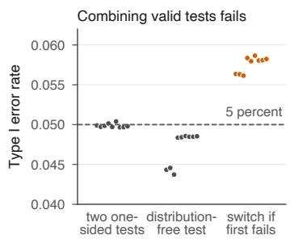

B  
C  
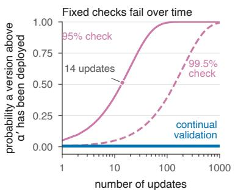

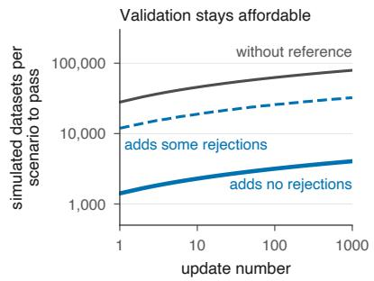  
Figure A1: Why common checks fail and what validation costs. (A) Combining individually valid tests can inflate $\mathrm { T y p e }$ I error. Two bioequivalence tests each control $\mathrm { T y p e }$ I error near 5 percent, but using the second whenever the first fails exceeds this level. Dots show nine designs, each evaluated using 400,000 simulated studies. (B) Repeated validation at a fixed confidence level accumulates risk. The curves show the probability of ever deploying a version above $\alpha ^ { \prime }$ when every proposed version lies just above this threshold. Fixed 95 percent and 99.5 percent checks accumulate risk, whereas continual validation keeps it below the lifetime level δ. (C) Simulated datasets per scenario required for an update to pass validation as the update number increases. Without reference comparison, a version with Type I error rate $\alpha _ { 0 }$ passes with probability 0.9 (gray). With paired comparison, a version that adds no rejections passes with certainty (solid blue), while one that adds rejections at rate $( \alpha ^ { \prime } - \alpha _ { 0 } ) / 2$ passes with probability 0.9 (dashed blue). Panels B and C use $\alpha = 0 . 0 5 , \delta = 0 . 0 0 5 , \delta _ { 0 } = 0 . 0 0 1$ , and $\alpha _ { 0 } = 0 . 0 4 0$ , giving $\alpha ^ { \prime } = 0 . 0 4 5 2$

An analyst that changes freely can reject far more often than any check of a single version suggests. Three mechanisms are at work, and each has an exact statement below. Valid analyses do not compose, a check that reuses stored simulations can be defeated, and a check that is valid for each version separately still fails over a long life.

## A2.1 Valid analyses do not compose

An analysis is any decision rule $\phi$ with values reject and retain. It is valid at level α if $e ( \phi , \theta ) \leq \alpha$ for every $\theta \in \Theta _ { 0 }$

Theorem A2 (Valid analyses do not compose). Fix $\alpha \in ( 0 , 1 )$ and an integer $K \geq 2$

(i) Let $\phi _ { 1 } , \ldots , \phi _ { K }$ be analyses valid at level α. Let v be any version that rejects on a study only when at least one of $\phi _ { 1 } , \ldots , \phi _ { K }$ rejects on it, however v chooses among them. Then $e ( v , \theta ) \leq \operatorname* { m i n } ( 1 , K \alpha )$ for every $\theta \in \Theta _ { 0 }$

(ii) The bound is attained. There are analyses $\phi _ { 1 } , \ldots , \phi _ { K }$ with $e ( \phi _ { k } , \theta ) = \alpha$ for every k and every $\theta \in \Theta _ { 0 }$ , and a version v of the kind in (i), such that $e ( v , \theta ) = \operatorname* { m i n } ( 1 , K \alpha )$ for every $\theta \in \Theta _ { 0 }$

Proof. (i) The rejection event of v lies in the union of the rejection events of the analyses, so $\begin{array} { r } { e ( v , \theta ) \le \sum _ { k } e ( \phi _ { k } , \theta ) \le K \alpha } \end{array}$ , and a probability is at most one.

(ii) Let W be uniform on [0, 1) and independent of the data, as part of the internal randomness of the analyst. Set $c = \operatorname* { m i n } ( \alpha , 1 / K )$ and let $\phi _ { k }$ reject when $( W - ( k - 1 ) c )$ mod $1 < \alpha$ . Each $( W - ( k - 1 ) c )$ mod 1 is uniform on $[ 0 , 1 )$ , so $e ( \phi _ { k } , \theta ) = \alpha$ in every scenario. The rejection event of $\phi _ { k }$ is the arc of length α that starts at $( k - 1 )$ c on the circle [0, 1). If $K \alpha \leq 1$ , then $c = \alpha .$ , the K arcs are disjoint and their union has length $K \alpha$ . If $K \alpha > 1$ , then $c = 1 / K < \alpha$ , consecutive arcs overlap and their union is the whole circle. The version that rejects when any $\phi _ { k }$ does therefore has $e ( v , \theta ) = \operatorname* { m i n } ( 1 , K \alpha )$ □

Choosing among valid analyses after seeing the data can multiply the Type I error rate by the number of analyses, and nothing in the individual analyses reveals it. The bound in (i) is Boole’s inequality, and the construction in (ii) ignores the data so that the arithmetic is exact. Real analyses behave the same way whenever they reject on diferent studies. In bioequivalence, falling back to a distribution-free interval whenever the two one-sided tests fail raises the Type I error rate at the equivalence boundary to 0.0587 (section A10.2). The reference-scaled rule of the US Food and Drug Administration (FDA) for highly variable drugs, which switches between two valid analyses according to the observed variability, reaches about 2.4 times its nominal level when each criterion is judged where the switch applies it (section A10.3).

## A2.2 Selection through repeated updates

A proposer that maximizes power keeps every change that adds rejections. If a version $v ^ { \prime }$ rejects on every run on which v rejects, then $e ( v ^ { \prime } , \theta ) \geq e ( v , \theta )$ in every null scenario. In that case $v ^ { \prime }$ also has at least the power of v in every scenario where the null hypothesis is false. Under such changes power and the Type I error rate rise together. Without a check, a lineage of K changes that each add a valid analysis is a version of the kind in Theorem A2 and can reach min(1, Kα). The changes that raise power fastest are often of exactly this kind. Optional stopping, which tests at every interim look and stops at the first rejection, launching when any of several metrics improves, and widening the equivalence limits when the observed variability is high all add rejections.

Checking each version is not enough, because the proposer selects among checked versions. If the check reuses the same simulated studies, the proposer can tune versions to them. If the check draws new studies but gives every version the same confidence level, the probability that some version above the validation level passes grows with every update. The next two results make both failures exact, the first for reused simulations and the second for a fixed confidence level per version.

## A2.3 A reused set of simulations can be defeated

Proposition A3 (A reused suite can be defeated). Let the reference analysis $v _ { 0 }$ decide by a fixed function of the data. Let D be a stored suite of simulated studies, m per scenario, that the proposer can read. Then there is a version v˜ that makes the decision of the reference analysis on every study in D. A validation computed from D therefore gives v˜ exactly the bounds it gives the reference analysis itself, and v˜ passes whenever the reference analysis would pass in its place. Its Type I error rate satisfies $e ( \tilde { v } , \theta ) \geq 1 - \operatorname* { P r } _ { \theta } \{ D \in \mathcal { D } \}$ in every scenario, and $e ( \tilde { v } , \theta ) = 1$ in every scenario whose data have a distribution without atoms, such as any distribution with a density.

Proof. Let v˜ return the decision of the reference analysis on any study in D and reject on any other study. On D the two procedures agree study by study, so the rejection count of v˜ equals that of the reference analysis, and v˜ adds and removes no rejections. These are exactly the counts that the reference analysis produces against itself. In scenario θ the version v˜ rejects whenever $D \not \in { \mathcal { D } }$ which gives the bound on $e ( \tilde { v } , \theta )$ , and a finite suite has probability zero under a distribution without atoms. □

A suite of simulations that the proposer can see is a benchmark that it can overfit. The construction is extreme, and its milder form is selection on noise. A proposer that tunes a continuous threshold against stored studies keeps the most permissive version whose estimate on those studies stays below the validation level. The kept version is selected for a low estimate, and its true Type I error rate can exceed that level. Conditions (a) and (b) of Theorem A11 remove both efects for the simulated studies, because the studies of every round are drawn after the version is fixed and independently of everything the proposer has seen. The same two efects can act on a fixed set of scenarios, and random scenarios drawn after each freeze confine them to a set of small probability (section A4.6).

## A2.4 A fixed confidence level per version fails over a lifetime

Call an update invalid if its Type I error rate exceeds the validation level in some of its validation scenarios.

Lemma A4 (A fixed confidence level per version). Suppose that every update is validated on newly simulated studies at the same confidence level $1 - \eta$ . In particular, given everything that precedes the draws of round $r ,$ an invalid update passes with probability at most $\eta .$ Then for every proposer the probability that some invalid version passes among the first G updates is at most $1 - ( 1 - \eta ) ^ { G }$ If every update is invalid and passes with conditional probability exactly $\eta ,$ the probability equals $1 - ( 1 - \eta ) ^ { G }$ , which tends to one as $G$ grows.

Proof. Let $A _ { r }$ be the event that update r is invalid and passes, and let $\mathcal { G } _ { r }$ be the information available before the draws of round $r .$ . Let $N _ { r }$ be the event that none of $A _ { 1 } , \ldots , A _ { \imath }$ occurs. The event $N _ { r - 1 }$ is known before the draws of round $^ { r , }$ so

$$
\operatorname* { P r } ( N _ { r } ) = \mathbb { E } \big [ \mathbf { 1 } _ { N _ { r - 1 } } \operatorname* { P r } ( A _ { r } ^ { c } \mid \mathcal { G } _ { r } ) \big ] \geq ( 1 - \eta ) \operatorname* { P r } ( N _ { r - 1 } ) ,
$$

and induction gives $\Pr ( N _ { G } ) \geq ( 1 - \eta ) ^ { G }$ . Under the second hypothesis $\operatorname* { P r } ( A _ { r } ^ { c } \mid { \mathcal { G } } _ { r } ) = 1 - \eta$ on $N _ { r - 1 }$ 2 and every inequality becomes an equality. □

A confidence level per version is a guarantee per version, and over G updates the risk compounds. In the worst case of the lemma, the familywise error rate over the updates, the probability that some invalid update passes, exceeds one half after 14 updates at the conventional 95 percent confidence, and after 139 updates at 99.5 percent.

Continual validation divides the lifetime risk δ among all updates, and update r receives a share $\delta _ { r }$ with $\textstyle \sum _ { r } \delta _ { r } \leq \delta$ . By a union bound over the updates, the familywise error rate is then at most δ however many updates arrive (Theorem A11).

## A3 Validating one version

This section shows how a single frozen version is validated. The version v is fixed, and the validator draws m new simulated studies in each scenario of a finite set ${ \mathcal { S } } .$ . The question is whether $e ( v , \theta )$ is at most a target a in every scenario of S. In continual validation the target is the validation level $a = \alpha ^ { \prime }$ , and Section A4 chains such validations over a lifetime.

## A3.1 Exact bounds in one scenario

Let X be binomial with m trials and success probability $p ,$ and write $\mathrm { P r } _ { p }$ for probabilities under this distribution. The exact one-sided upper bound of Clopper and Pearson [2] at level η is $\begin{array} { r l } { { \cal U } ( x ; m , \eta ) = } & { { } } \end{array}$ 1 for $x = m _ { \mathrm { { ; } } }$ , and otherwise the $( 1 - \eta )$ quantile of the Beta $( x + 1 , m - x )$ distribution. The lower bound is $L ( x ; m , \eta ) = 0$ for $x = 0$ , and otherwise the η quantile of the Beta $\mathfrak { i } ( x , m - x + 1 )$ distribution.

Lemma A5 (Exact binomial bounds). For every $m \geq 1$ , every $\eta \in ( 0 , 1 )$ and every $p \in [ 0 , 1 ]$ $\operatorname* { P r } _ { p } \{ U ( X ; m , \eta ) < p \} \leq \eta$ and $\operatorname* { P r } _ { p } \{ L ( X ; m , \eta ) > p \} \leq \eta$ . Moreover $\operatorname* { P r } _ { p } \{ U ( X ; m , \eta ) \leq p \} \leq \eta$ for every $p < 1$ , and $\operatorname* { P r } _ { p } \{ L ( X ; m , \eta ) \ge p \} \le \eta$ for every $p > 0$

Proof. For $x \textless$ m the probability $\operatorname { P r } _ { q } \{ X \leq x \}$ is continuous and strictly decreasing in $q ,$ and it equals $\operatorname* { P r } \{ \mathrm { B e t a } ( x + 1 , m - x ) > q \}$ . Hence $U ( x ; m , \eta )$ is the value of $q$ at which $\Pr _ { q } \{ X \leq x \} = \eta .$ and U increases in x. Fix $p < 1$ . If no x has $U ( x ; m , \eta ) \leq p .$ , the event $\left\{ U ( X ; m , \eta ) \leq p \right\}$ is empty. Otherwise let $x _ { p }$ be the largest such x. Then $x _ { p } < m$ because $U ( m ; m , \eta ) = 1$ , and

$$
\operatorname* { P r } _ { p } \{ U ( X ; m , \eta ) \leq p \} = \operatorname* { P r } _ { p } \{ X \leq x _ { p } \} \leq \operatorname* { P r } _ { U ( x _ { p } ; m , \eta ) } \{ X \leq x _ { p } \} = \eta ,
$$

because $p \ge U ( x _ { p } ; m , \eta )$ and $\mathrm { P r } _ { q } \{ X \leq x _ { p } \}$ decreases in q. The strict statement follows for $p < 1$ and it holds for $p = 1$ because then $X = m$ and $U ( m ; m , \eta ) = 1$ . The statements for L follow from $L ( x ; m , \eta ) = 1 - U ( m - x ; m , \eta )$ applied to $m - X$ , which is binomial with success probability $1 - p .$ □

The bounds are exact for every number of simulated studies, with no asymptotic approximation. The second statement adds that the upper bound falls at or below the true rate with probability at most η. This property implies that a version whose Type I error rate equals the target cannot be validated (Proposition $\mathrm { A } 7 )$ .

## A3.2 Every scenario must pass

A validation of v on $\boldsymbol { s }$ computes one bound $B _ { \theta }$ per scenario from the simulated studies. The version v passes validation if $B _ { \theta } \leq a$ for every scenario $\theta \in S$ . The bound $B _ { \theta }$ is valid at level $\eta$ for v if $\mathrm { P r } \{ e ( v , \theta ) > B _ { \theta } \} \le \eta$

Theorem A6 (Every scenario must pass). Let v be a fixed version and S a finite set of scenarios. For each $\theta \in S$ , let $B _ { \theta }$ be a bound that is valid at level η for v. Then

$$
{ \operatorname* { P r } } \{ v { \mathrm { ~ p a s s e s ~ v a l i d a t i o n ~ a n d ~ } } e ( v , \mathcal { S } ) > a \} \leq \eta ,
$$

and ${ \operatorname* { m a x } } _ { \theta \in S } B _ { \theta }$ is an upper confidence bound for $e ( v , s )$ at level $\eta$ . The bounds may be computed from shared or from separate simulated studies.

Proof. Fix an enumeration of S, and let $\theta ^ { * }$ be the first scenario in it at which $e ( v , \cdot )$ is largest. Because v and S are fixed, $\theta ^ { * }$ is fixed as well. If v passes validation and $e ( v , S ) \ > \ a$ , then $B _ { \theta ^ { * } } \leq a < e ( v , \theta ^ { * } ) . { \mathrm { ~ I f ~ } } e ( v , S ) > \operatorname* { m a x } _ { \theta } B _ { \theta }$ , then $e ( v , \theta ^ { * } ) > B _ { \theta ^ { * } }$ . Both events lie in $\{ e ( v , \theta ^ { * } ) > B _ { \theta ^ { * } } \}$ , whose probability is at most η. □

A version above the target exceeds it in some particular scenario, and passing requires the bound of that scenario to come out at or below the target. That one event has probability at most $\eta ,$ so the level does not have to be divided among the scenarios of ${ \mathcal { S } } .$ . The rule that every scenario must pass is an intersection-union test, which rejects a union of null hypotheses, here the hypotheses $e ( v , \theta ) > a$ for $\theta \in S$ , only when it rejects each of them. This is also why the two one-sided tests procedure needs no correction for running two tests [3]. Bounds with simultaneous coverage, holding in all scenarios at once, would require dividing the level among the scenarios. Such a division replaces $\log ( 1 / \eta )$ by about $\log ( | S | / \eta )$ in the simulation efort, and valid versions then fail more often with no gain in validity.

## A3.3 A version at the target cannot be validated

Proposition A7 (Validation fails at the target). Let $a < 1$ , and let $B _ { \theta } = U ( X _ { \theta } ; m , \eta )$ be the direct bound computed from the number $X _ { \theta }$ of rejections of v among m simulated studies of scenario θ. If $e ( v , \theta ) \geq a$ , then v passes scenario θ with probability at most η, for every m.

Proof. The count $X _ { \theta }$ is binomial with success probability $p = e ( v , \theta )$ . If $p < 1$ , passing requires $U ( X _ { \theta } ; m , \eta ) \leq a \leq p .$ , which has probability at most $\eta$ by Lemma A5. If $p = 1$ , then $X _ { \theta } = m$ and $U ( X _ { \theta } ; m , \eta ) = 1 > a \mathrm { ~ }$ , so v never passes. □

Simulation can confirm that a Type I error rate lies below the target by some margin, and never that it equals the target. A version whose Type I error rate equals the target is valid, yet it fails validation with probability at least $1 - \eta$ however many studies are simulated. The same holds for the paired and combined bounds of the next subsection (Theorem A8).

This limit also governs the choice of the reference level $\alpha _ { 0 }$ . The two one-sided tests procedure at level a has a Type I error rate within a negligible distance of a at the equivalence boundary when a study is precise (Theorem A10). A reference analysis run at the validation level would thus fail validation with probability close to $1 - \eta$ in scenarios where its bound comes from simulation. The paired bound also needs a margin below the target. Since $U ( 0 ; m , \eta ) > 0$ , even a version that copies every decision of the reference analysis passes the paired bound only if $b _ { \theta } < a$ . The reference analysis therefore runs at a reference level $\alpha _ { 0 }$ below the validation level $\alpha ^ { \prime } = 0 . 0 4 5 2$

The margin $\gamma = \alpha ^ { \prime } - \alpha _ { 0 }$ is available to every future version and does not shrink, because every version is compared with the same reference analysis and not with its predecessor, so increments do not accumulate across versions.

## A3.4 Paired and direct bounds

The validator runs the version v and the reference analysis $v _ { 0 }$ on the same m simulated studies of scenario $\theta ,$ with independent internal randomness for every run. It counts the studies on which only v rejects, $N _ { \theta } ^ { + }$ , and those on which only the reference analysis rejects, $N _ { \theta } ^ { - }$ , together with the rejections of $v , X _ { \theta }$ . Let $q _ { \theta } ^ { + }$ and $q _ { \theta } ^ { - }$ be the probabilities of an added and of a removed rejection in scenario θ. Then

$$
e ( v , \theta ) = e ( v _ { 0 } , \theta ) + q _ { \theta } ^ { + } - q _ { \theta } ^ { - }\tag{A4}
$$

exactly. Given a reference bound $b _ { \theta } \geq e ( v _ { 0 } , \theta )$ and levels $\eta _ { 1 } , \eta _ { 2 } , \eta _ { 3 }$ , the paired, direct and combined bounds are

$$
\begin{array} { r l r } & { } & { B _ { \theta } ^ { \mathrm { p a i r } } = b _ { \theta } + U ( N _ { \theta } ^ { + } ; m , \eta _ { 1 } ) - L ( N _ { \theta } ^ { - } ; m , \eta _ { 2 } ) , \quad \quad } \\ & { } & { B _ { \theta } ^ { \mathrm { d i r } } = U ( X _ { \theta } ; m , \eta _ { 3 } ) , \qquad B _ { \theta } = \mathrm { m i n } \big ( B _ { \theta } ^ { \mathrm { p a i r } } , B _ { \theta } ^ { \mathrm { d i r } } \big ) . \quad \quad } \end{array}\tag{A5}
$$

Theorem A8 (Paired and direct bounds). Fix the version $v ,$ the scenario θ and a reference bound $b _ { \theta } \geq e ( v _ { 0 } , \theta )$ , and let the counts come from m independent simulated studies of $\theta .$

$$
\begin{array} { r } { \mathrm { ( i ) ~ } \operatorname* { P r } \{ c ( v , \theta ) > B _ { \theta } ^ { \mathrm { p a i r } } \} \leq \eta _ { 1 } + \eta _ { 2 } , \operatorname* { P r } \{ c ( v , \theta ) > B _ { \theta } ^ { \mathrm { d i r } } \} \leq \eta _ { 3 } , \mathrm { ~ a n d ~ } \operatorname* { P r } \{ c ( v , \theta ) > B _ { \theta } \} \leq \eta _ { 1 } + \eta _ { 2 } + \eta _ { 3 } . } \end{array}
$$

(ii) If $e ( v , \theta ) < 1$ , then also $\operatorname* { P r } \{ B _ { \theta } \leq e ( v , \theta ) \} \leq \eta _ { 1 } + \eta _ { 2 } + \eta _ { 3 }$

With $\eta _ { 1 } = \eta _ { 2 } = \eta / 4$ and $\eta _ { 3 } = \eta / 2$ the combined bound is valid at level $\eta .$ Suppose that every $b _ { \theta }$ bounds the Type I error rate of the reference analysis. By the intersection-union argument of Theorem ${ \mathrm { A 6 } } .$ , a version with $e ( v , S ) > a$ then has $B _ { \theta } \leq a$ in every scenario, and so passes validation, with probability at most η.

Proof. The m simulated studies and the runs on them are independent and identically distributed, so $N _ { \theta } ^ { + } , N _ { \theta } ^ { - }$ and $X _ { \theta }$ are binomial with success probabilities ${ q } _ { \theta } ^ { + } , { q } _ { \theta } ^ { - }$ and $e ( v , \theta )$ . Their joint law plays no role.

(i) By Lemma A5, the event $U ( N _ { \theta } ^ { + } ; m , \eta _ { 1 } ) < q _ { \theta } ^ { + }$ has probability at most $\eta _ { 1 }$ , and the event $L ( N _ { \theta } ^ { - } ; m , \eta _ { 2 } ) > q _ { \theta } ^ { - }$ has probability at most $\eta _ { 2 }$ . Outside these two events, (A4) and $b _ { \theta } \geq e ( v _ { 0 } , \theta )$ give $e ( v , \theta ) \leq b _ { \theta } + q _ { \theta } ^ { + } - q _ { \theta } ^ { - } \leq B _ { \theta } ^ { \mathrm { p a i r } }$ . The statement for the direct bound is Lemma A5, and the combined statement follows by the union bound.

(ii) If $B _ { \theta } ^ { \mathrm { p a i r } } \leq e ( v , \theta )$ , then $U ( N _ { \theta } ^ { + } ; m , \eta _ { 1 } ) - L ( N _ { \theta } ^ { - } ; m , \eta _ { 2 } ) \leq q _ { \theta } ^ { + } - q _ { \theta } ^ { - }$ , so either $U ( N _ { \theta } ^ { + } ; m , \eta _ { 1 } ) \le q _ { \theta } ^ { + }$ or $L ( N _ { \theta } ^ { - } ; m , \eta _ { 2 } ) > q _ { \theta } ^ { - }$ . Since $q _ { \theta } ^ { + } \le e ( v , \theta ) < 1$ , Lemma A5 bounds the two probabilities by η and $\eta _ { 2 }$ . The event $B _ { \theta } ^ { \mathrm { d i r } } \leq e ( v , \theta )$ has probability at most $\eta _ { 3 }$ by the same lemma. The event $B _ { \theta } \leq e ( v , \theta )$ lies in the union of the events for the paired and direct bounds. □

The paired bound compares the version with the reference analysis on the same simulated studies. It therefore needs to resolve only how often the version adds a rejection that the reference analysis would not make. That rate is zero for a version that never adds rejections and small for a modest edit, whatever the Type I error rate of the reference analysis. The direct bound ignores the reference analysis, and it is the better bound for a version that changes many of the decisions of the reference analysis. Taking the smaller bound in each scenario costs a quarter of the level for each count in the paired bound and half of it for the direct bound. The validator need not know in advance which bound will be smaller.

With Theorem A6, part (i) bounds the probability of the joint event that a version passes and lies above the target, so no conditioning on passing is involved.

## A3.5 What validation costs

Write $\operatorname { k l } ( x , y )$ for the relative entropy between Bernoulli distributions with success probabilities x and y. Let $\zeta \in ( 0 , 1 )$ be an acceptable probability that a valid version fails validation.

Theorem A9 (Cost of the two bounds). Fix a scenario $\theta ,$ a target $a \in ( 0 , 1 )$ , a margin $\gamma \in ( 0 , a )$ and a level $\eta \in ( 0 , 1 / 4 )$ , and write $\ell = \operatorname* { m a x } \{ \log ( 1 / \eta ) , \log ( 1 / \zeta ) \}$ .

(i) A version that never adds rejections. If $q _ { \theta } ^ { + } = 0$ and $b _ { \theta } \leq a - \gamma$ , then $B _ { \theta } ^ { \mathrm { p a i r } } \leq a$ with probability one as soon as m $\geq \log ( 1 / \eta ) / \log \{ 1 / ( 1 - \gamma ) \}$ , and $m \geq \log ( 1 / \eta ) / \gamma$ sufices.

(ii) A version that adds few rejections. If $q _ { \theta } ^ { + } \leq c \gamma$ with $0 \leq c < 1$ and b<sub>θ</sub> $\leq a - \gamma$ , then $B _ { \theta } ^ { \mathrm { p a i r } } \leq a$ with probability at least $1 - \zeta$ whenever m $\geq 8 \ell / \{ ( 1 - c ) ^ { 2 } \gamma \}$

(iii) Validation from scratch. If $e ( v , \theta ) = a - \gamma _ { : }$ , then $B _ { \theta } ^ { \mathrm { d i r } } \leq a$ with probability at least $1 - \zeta$ whenever $m \ge 8 a \ell / \gamma ^ { 2 }$ . Conversely, consider a rule that decides from the rejections of a version on m simulated studies of θ. Suppose that it passes every version with $e ( v , \theta ) > a$ with probability at most $\eta .$ . Then it passes a version with $e ( v , \theta ) = a - \gamma$ with probability below one half unless $m \geq a ( 1 - a ) \log \{ 1 / ( 4 \eta ) \} / ( 2 \gamma ^ { 2 } )$

Here η is the level of the bound in question, that is, $\eta _ { 1 }$ in (i) and (ii), and $\eta _ { 3 }$ in (iii).

Proof. The proof uses three standard facts about binomial tails and relative entropy. First, for X binomial with m trials and success probability $y ,$ Chernof’s bound gives $\operatorname* { P r } \{ X \leq \ m x \} \ \leq$ $\exp \{ - m \operatorname { k l } ( x , y ) \}$ for $x \le y$ and $\operatorname* { P r } \{ X \geq m x \} \leq \exp \{ - m \operatorname { k l } ( x , y ) \}$ for $x \geq y$ . Second, $\operatorname { k l } ( x , y ) \geq$ $( x - y ) ^ { 2 } / \{ 2 \operatorname* { m a x } ( x , y ) \}$ , because the second derivative of $\operatorname { k l } ( \cdot , y )$ at t is $1 / \{ t ( 1 - t ) \} \geq 1 / \operatorname* { m a x } ( x , y )$ for t between x and $y .$ Third, k $( x , y ) \leq ( x - y ) ^ { 2 } / \{ y ( 1 - y ) \}$ , the chi-square bound. By the proof of Lemma A5, $U ( x ; m , \eta ) \leq g$ holds for $x < m$ exactly when $\operatorname* { P r } _ { g } \{ X \leq x \} \leq \eta$ , so the first two facts give

$$
U ( x ; m , \eta ) \leq g \quad \mathrm { w h e n e v e r } \quad x / m \leq g \mathrm { a n d } ( g - x / m ) ^ { 2 } \geq 2 g \log ( 1 / \eta ) / m .\tag{A6}
$$

(i) Here $N _ { \theta } ^ { + } = 0$ almost surely, $U ( 0 ; m , \eta ) = 1 - \eta ^ { 1 / m }$ because $\operatorname* { P r } _ { q } \{ X = 0 \} = ( 1 - q ) ^ { m }$ , and $L \ge 0$ . Hence $B _ { \theta } ^ { \mathrm { p a i r } } \leq a - \gamma + 1 - \eta ^ { 1 / m }$ , which is at most a when $\eta ^ { 1 / m } \geq 1 - \gamma$ , that is when m log $\{ 1 / ( 1 - \gamma ) \} \ge \log ( 1 / \eta )$ . Finally, the inequality log ${ \ ; \{ 1 / ( 1 - \gamma ) \} \geq \gamma }$ gives the simpler suficient condition in (i).

(ii) Let $y = ( 1 + c ) \gamma / 2$ . On the event $N _ { \theta } ^ { + } \leq m y$ we have $\gamma - N _ { \theta } ^ { + } / m \geq ( 1 - c ) \gamma / 2$ , and (A6) with $g = \gamma$ gives $U ( N _ { \theta } ^ { + } ; m , \eta ) \le \gamma$ once $m \geq 8 \log ( 1 / \eta ) / \{ ( 1 - c ) ^ { 2 } \gamma \}$ . Then $B _ { \theta } ^ { \mathrm { p a i r } } \leq b _ { \theta } + \gamma \leq a$ . The count $N _ { \theta } ^ { + }$ is binomial with success probability at most $c \gamma < y$ . The first two facts therefore give $\mathrm { P r } \{ N _ { \theta } ^ { + } \stackrel {  } { > } m y \} \leq \exp \{ - m ( y - c \gamma ) ^ { 2 } / ( 2 y ) \} = \exp \{ - m ( 1 - c ) ^ { 2 } \gamma / ( 4 ( 1 + c ) ) \}$ , which is at most $\zeta$ once $m \geq 8 \log ( 1 / \zeta ) / \{ ( 1 - c ) ^ { 2 } \gamma \}$

(iii) On the event $X _ { \theta } \leq m ( a - \gamma / 2 ) , ( \mathrm { A } 6 )$ with $g = a$ gives $B _ { \theta } ^ { \mathrm { d i r } } \leq a$ once $m \geq 8 a \log ( 1 / \eta ) / \gamma ^ { 2 }$ Moreover, $\operatorname* { P r } \{ X _ { \theta } > m ( a - \gamma / 2 ) \} \leq \exp \{ - m ( \gamma / 2 ) ^ { 2 } / ( 2 a ) \}$ , which is at most $\zeta$ once $m \geq 8 a \log ( 1 / \zeta ) / \gamma ^ { 2 }$ For the converse, let A be the event that the rule passes the version. Write $\operatorname* { P r } _ { p } ( A )$ for its probability when the rejections are independent with probability $p .$ The probability $\operatorname* { P r } _ { p } ( A )$ is a polynomial in $p ,$ hence continuous, so $\operatorname* { P r } _ { a } ( A ) \leq \eta$ . The data-processing inequality for relative entropy gives

$$
m \operatorname { k l } ( a - \gamma , a ) \geq \operatorname { k l } ( \operatorname* { P r } _ { a - \gamma } ( A ) , \operatorname* { P r } _ { a } ( A ) ) .
$$

Since $\operatorname { k l } ( x , y )$ increases in x for $x \ \geq \ y$ and decreases in $y$ for $y \ \leq \ x ,$ the right side is at least $\begin{array} { r } { \mathrm { k l } ( 1 / 2 , \eta ) = \frac { 1 } { 2 } \log [ 1 / \{ 4 \eta ( 1 - \eta ) \} ] \ge \frac { 1 } { 2 } \log \{ 1 / ( 4 \eta ) \} } \end{array}$ whenever $\operatorname* { P r } _ { a - \gamma } ( A ) \geq 1 / 2$ . The chi-square bound gives $\mathrm { k l } ( a - \bar { \gamma } , a ) \leq \gamma ^ { 2 } / \{ a ( 1 - a ) \}$ , and the two inequalities together give the stated lower bound on m. □

Validation against the reference analysis needs a number of simulated studies of order $1 / \gamma$ for a version that never adds rejections or adds them at a rate below the margin. Validation from scratch needs order $a / \gamma ^ { 2 }$ for a version whose Type I error rate lies $\gamma$ below the target, and no rule that uses only the decisions of the version can do better. The ratio is of order $a / \gamma$ , about 9 at the margin $\gamma = \alpha ^ { \prime } - \alpha _ { 0 } = 0 . 0 0 5 2$ of Example 2, and the constants of the exact bounds widen it. Table A2 gives the exact numbers of simulated studies at the first update. The two numbers difer by a factor of 19.8 at the margin of Example 2 and of 108 at a margin of 0.001. The combined bound costs no more than the better bound in every scenario.

The saving shrinks as a version changes more decisions of the reference analysis, and Table A2 gives the profile. A version whose rejections contain those of the reference analysis and add rejections at half the margin needs 11,928 simulated studies against 114,862 from scratch, a factor of 9.6. A version that keeps the Type I error rate of the reference analysis but adds and removes rejections at equal rates gains less, because the paired bound carries the uncertainty of both counts. Its factor, a Monte Carlo approximation accurate to about 2 percent, falls from 4.8 to 1.2 as the rate of added and of removed rejections rises from 0.002 to 0.012 each, and the combined bound then rests on the direct bound.

## A3.6 A reference analysis validated by proof

In the two-period, two-sequence crossover, subject k of sequence $i \in \{ 1 , 2 \}$ receives the test formulation T and the reference R in diferent periods, with T first in sequence 1. On the log scale its response in period $j$ is

$$
y _ { i k j } = \mu _ { 0 } + \beta _ { i } + p _ { j } + \tau _ { f ( i , j ) } + u _ { i k } + \varepsilon _ { i k j } ,\tag{A7}
$$

Table A2: Simulated studies per scenario needed at the first update.
<table><tr><td>A. Versions that add no rejection, by margin γ Margin γ</td><td>0.0052 0.002 1,414 3,700</td><td>0.001 7,402</td></tr><tr><td>Against the reference analysis From scratch Factor</td><td>28,008 197,187 19.8 53</td><td>796,052 108</td></tr><tr><td>B. Versions that only add rejections, at rate cγ Fraction c</td><td>0.25 0.5</td><td>0.75 55,248</td></tr><tr><td>Against the reference analysis From scratch Factor</td><td>4,479 11,928 50,407 114,862 11.3 9.6</td><td>465,016 8.4</td></tr><tr><td>C. Versions that add and remove rejections, each at rate Rate q</td><td>0.002 0.006</td><td> $q$  0.012</td></tr><tr><td>Combined bound From scratch Factor</td><td>5,781 14,250 28,008 28,008 4.8 2.0</td><td>22,875 28,008 1.2</td></tr></table>

All entries are computed at $\alpha = 0 . 0 5 , \delta = 0 . 0 0 5$ and $\delta _ { 0 } = 0 . 0 0 1$ , so that $\alpha ^ { \prime } = 0 . 0 4 5 2$ and the first share is $\delta _ { 1 } = 0 . 0 0 2 4$ . Validation from scratch means the direct bound at the level $\delta _ { 1 } / 2$ it carries inside the combined bound, and its row gives the smallest m at which $U ( X _ { \theta } ; m , \delta _ { 1 } / 2 ) \le \alpha ^ { \prime }$ with probability 0.9. In A the reference analysis and the version both have Type I error rate $\alpha ^ { \prime } - \gamma ,$ , with $b _ { \theta } = \alpha ^ { \prime } - \gamma$ , and the first row gives the smallest m with $\begin{array} { r } { U ( 0 ; m , \delta _ { 1 } / 4 ) \leq \gamma , } \end{array}$ at which the version passes with certainty. In B and C the reference analysis has Type I error rate $\alpha _ { 0 } .$ , with $b _ { \theta } = \alpha _ { 0 }$ and the margin $\gamma = \alpha ^ { \prime } - \alpha _ { 0 }$ of Example 2. In B the version rejects whenever the reference analysis does, so its Type I error rate is $\alpha _ { 0 } + c \gamma ,$ , and the first row gives the smallest m at which the paired bound passes with probability 0.9. In C the version keeps the Type I error rate $\alpha _ { 0 } ,$ and the first row gives the smallest m at which the combined bound passes with probability 0.9, estimated from 4,000 simulated rounds per m on a grid of one percent. The values of C are therefore Monte Carlo approximations, accurate to about 2 percent. All numbers grow with the update index only through log(1/δ<sub>r</sub>).

with $f ( 1 , 1 ) = f ( 2 , 2 ) = \mathrm { T }$ and $f ( 1 , 2 ) = f ( 2 , 1 ) = \mathrm { R }$ . Here the $\beta _ { i }$ are sequence efects, the $u _ { i k }$ are subject efects, and the errors $\varepsilon _ { i k j }$ are independent and Gaussian with mean zero and variance $\sigma _ { W } ^ { 2 }$ The log-ratio is $\mu = \tau _ { \mathrm { T } } - \tau _ { \mathrm { R } }$ , and the sequence efect is $\kappa = \beta _ { 1 } - \beta _ { 2 }$

The reference analysis $v _ { 0 }$ is the two one-sided tests procedure at level $\alpha _ { 0 }$ on the completers, the subjects who complete both periods. Let $n _ { 1 }$ and $n _ { 2 }$ be the numbers of completers in the two sequences. When dropout leaves a sequence without completers, or fewer than three completers in all, the reference analysis retains the null hypothesis, so we may take $n _ { 1 } , n _ { 2 } \geq 1$ and $n _ { 1 } + n _ { 2 } \ge 3$ below. The within-subject diferences $d _ { i k } = y _ { i k 1 } - y _ { i k 2 }$ remove $\mu _ { 0 } , \beta _ { i }$ and $u _ { i k }$ . The estimate $\hat { \mu } =$ $( \bar { d } _ { 1 } - \bar { d } _ { 2 } ) / 2$ is Gaussian with mean $\mu$ and variance $\sigma _ { W } ^ { 2 } ( n _ { 1 } ^ { - 1 } + n _ { 2 } ^ { - 1 } ) / 2$ . With the pooled variance $s _ { d } ^ { 2 }$ of the diferences on $\nu = n _ { 1 } + n _ { 2 } - 2$ degrees of freedom, the standard error is $\mathrm { s e } = \bar { ( } s _ { d } / 2 ) ( n _ { 1 } ^ { - 1 } + n _ { 2 } ^ { - 1 } ) ^ { \stackrel { \textstyle \ ! } { 1 } / 2 }$ The reference analysis rejects the null hypothesis of nonequivalence when the interval $\hat { \mu } \pm t _ { 1 - \alpha _ { 0 } , \nu }$ se lies inside $( - \Delta , \Delta )$ , and retains it otherwise.

Theorem A10 (A reference analysis validated by proof). Under model $( \mathrm { A } 7 )$ , for every $\mu$ with $| \mu | \geq \Delta$ , every $\sigma _ { W } > 0$ , all subject, period and sequence efects, and every dropout mechanism that does not depend on the responses,

$$
e ( v _ { 0 } , \theta ) \leq \alpha _ { 0 } .
$$

At $\mu = \Delta$ and without dropout, the Type I error rate tends to $\alpha _ { 0 }$ as $\sigma _ { W }  0$ with the design held

fixed, so the bound cannot be improved.

Proof. Condition on the sets of completers, which are independent of the responses. Given them, $T _ { \mu } = ( \hat { \mu } - \mu ) / \mathrm { s e }$ has the t distribution with ν degrees of freedom. For $\mu \geq \Delta$ the rejection event lies in

$$
\{ \hat { \mu } + t _ { 1 - \alpha _ { 0 } , \nu } \mathrm { s e } < \Delta \} = \{ T _ { \mu } < - t _ { 1 - \alpha _ { 0 } , \nu } + ( \Delta - \mu ) / \mathrm { s e } \} \subseteq \{ T _ { \mu } < - t _ { 1 - \alpha _ { 0 } , \nu } \} ,
$$

because $\Delta - \mu \leq 0$ , and the last event has probability $\alpha _ { 0 }$ . The case $\mu \ \leq \ - \Delta$ is symmetric, and averaging over the sets of completers gives the bound. At $\mu = \Delta$ the rejection event is $\{ t _ { 1 - \alpha _ { 0 } , \nu } - 2 \Delta / \mathrm { s e } < T _ { \mu } < - t _ { 1 - \alpha _ { 0 } , \nu } \}$ . As $\sigma _ { W }  0$ with the design fixed and no dropout, the ratio of se to the standard deviation of $\hat { \mu }$ keeps its distribution and $2 \Delta / \mathrm { s e }  \infty$ in probability, so the Type I error rate tends to $\operatorname* { P r } \{ T _ { \mu } < - t _ { 1 - \alpha _ { 0 } , \nu } \} = \alpha _ { 0 }$ . With dropout the same argument gives the limit $\alpha _ { 0 } \operatorname* { P r } \{ n _ { 1 } , n _ { 2 } \geq 1 , \ n _ { 1 } + n _ { 2 } \geq 3 \}$ □

The two one-sided tests procedure holds its level exactly, a classical fact [4]. The theorem records this fact for every design and dropout pattern that the scenarios use. The Gaussian null scenarios are the null scenarios of model $( \mathrm { A } 7 )$ with dropout that does not depend on the responses. On these scenarios the reference bound is $b _ { \theta } = \alpha _ { 0 }$ with no simulation, and no part of the lifetime risk is spent on the reference analysis. By contrast, on scenarios built from real studies, whose errors are not Gaussian, the reference analysis receives a one-time validation (Corollary A16).

The reference level costs some power. At a true ratio of 0.95, the two one-sided tests at a reference level of 0.040 declare between 2.3 and 4.4 percentage points fewer equivalent products bioequivalent than at 0.05, in four crossovers of 24 to 48 subjects with 74 to 90 percent power at 0.05. Updated versions that pass validation can recover part of this power, for example by running the two one-sided tests at a level just below the validation level.

The proved bound carries over to every version whose rejections are contained in those of the reference analysis (Corollary A21). Examples include a version that defers studies with high variability and a version that adds a check that can only veto a rejection. The bound does not carry over to versions that use the data to change which observations enter the analysis. A version that excludes outlying subjects, or recovers information from subjects observed in one period only, changes the analysis set. The pivot $T _ { \mu }$ then loses its t distribution, so such versions are validated on scenarios.

## A4 Lifetime validity

This section proves the guarantees of the main text in general form. Two devices chain the validations of single versions over the life of the analyst. Each round is judged by simulated studies drawn after the version of that round is fixed, and each round spends its own share of the lifetime risk δ. Theorem A11 bounds the lifetime risk, Corollary A12 gives every decision the level $\alpha ,$ and Proposition A14 shows that valid updates pass. The last three subsections obtain the reference bounds, extend the scenario set and add random scenarios.

## A4.1 Lifetime risk control

At round r the validator receives update r. Before any simulated study of the round exists, the validator fixes the updated version $v _ { r }$ and the scenario set $S _ { r } \supseteq S _ { 0 }$ , together with the reference bounds $b _ { \theta }$ for $\theta \in S _ { r }$ . It also fixes the number $m _ { r }$ of simulated studies per scenario and the share $\delta _ { r }$ . We call this step the freeze of round r, and we write $\mathcal { G } _ { r }$ for the information available at the freeze. It contains everything that has happened before, including all earlier updates, deployment decisions, bounds and simulated studies, as well as the validation of the reference analysis. It also contains the real studies decided so far and the randomness the proposer used to produce $v _ { r }$

The validator then draws the simulated studies of the round and computes the combined bounds (A5) with $\eta _ { 1 } = \eta _ { 2 } = \delta _ { r } / 4$ and $\eta _ { 3 } = \delta _ { r } / 2$ . Write $B _ { r , \theta }$ for the combined bound of scenario $\theta$ in round r. The updated version $v _ { r }$ passes validation if $B _ { r , \theta } \leq \alpha ^ { \prime }$ for every $\theta \in S _ { r } ,$ and only a version that passes can be deployed. Let $E _ { 0 }$ be the event that $b _ { \theta } \geq e ( v _ { 0 } , \theta )$ for every scenario the validator ever uses.

## Theorem A11 (Lifetime risk control). Suppose that

(a) in every round $r ,$ the updated version $v _ { r } .$ , the scenario set $S _ { r } \supseteq S _ { 0 }$ with its reference bounds, the number $m _ { r }$ and the share $\delta _ { r }$ are fixed at the freeze, while the proposer is otherwise unrestricted and may be adaptive, randomized or adversarial,

(b) in every round r, given $\mathcal { G } _ { r }$ , the simulated studies are independent draws from the scenarios of ${ \cal { S } } _ { r } ,$ and the internal randomness of the runs on them is independent of $\mathcal { G } _ { r } .$ , and

(c) $\Pr ( E _ { 0 } ^ { c } ) \leq \delta _ { 0 }$ , and $\begin{array} { r } { \delta _ { 0 } + \sum _ { r > 1 } \delta _ { r } \leq \delta } \end{array}$ holds with probability one.

Then

$$
\operatorname* { P r } \{ \exists r \geq 1 : \ v _ { r } \ \mathrm { p a s s e s ~ v a l i d a t i o n ~ a n d } \ e ( v _ { r } , S _ { r } ) > \alpha ^ { \prime } \} \leq \delta .\tag{A8}
$$

Moreover, the probability that some reference bound fails or some $v _ { r }$ passes validation with $e ( v _ { r } , S _ { r } ) > \alpha ^ { \prime }$ is at most $\delta .$

Proof. Let $A _ { r }$ be the event that $v _ { r }$ passes validation and $e ( v _ { r } , S _ { r } ) > \alpha ^ { \prime }$ . Let $\theta _ { r } ^ { * }$ be the first scenario, in a fixed enumeration of $S _ { r } .$ , at which $e ( v _ { r } , \cdot )$ is largest. Versions are finite specifications and take values in a countable set. Hence, by (a), the updated version $v _ { r } ,$ its Type I error rates $e ( v _ { r } , \theta )$ , the scenario $\theta _ { r } ^ { * }$ and the event $e ( v _ { r } , \theta _ { r } ^ { * } ) > \alpha ^ { \prime }$ are determined at the freeze. On $A _ { r } \cap E _ { 0 }$ the version $v _ { r }$ has passed validation, so the bound of scenario $\theta _ { r } ^ { * }$ satisfies $B _ { r , \theta _ { r } ^ { * } } \leq \alpha ^ { \prime } < e ( v _ { r } , \theta _ { r } ^ { * } )$ , while $b _ { \theta _ { r } ^ { * } } \geq e ( v _ { 0 } , \theta _ { r } ^ { * } )$ The proof of Theorem $\mathrm { A } 8 ( \mathrm { i } )$ shows that one of the three binomial bounds of scenario $\theta _ { r } ^ { * }$ must then miss its parameter, and we call this event $M _ { r }$ . Given $\mathcal { G } _ { r }$ , the updated version, the scenario $\theta _ { r } ^ { * }$ , the number $m _ { r }$ and the share $\delta _ { r }$ are fixed. By (b), the studies of the round in $\theta _ { r } ^ { * }$ are $m _ { r }$ independent draws from that scenario, run through both procedures with internal randomness independent of $\mathcal { G } _ { r }$ . The three counts are then binomial with the parameters of Theorem $\mathrm { A } 8 .$ , and Lemma A5 gives $\operatorname* { P r } ( M _ { r } \mid { \mathcal G } _ { r } ) \le \delta _ { r } / 4 + \delta _ { r } / 4 + \delta _ { r } / 2 = \delta _ { r }$ . Hence

$$
\operatorname* { P r } \Bigl ( E _ { 0 } ^ { c } \cup \bigcup _ { r \geq 1 } A _ { r } \Bigr ) \leq \operatorname* { P r } ( E _ { 0 } ^ { c } ) + \sum _ { r \geq 1 } \mathbb { E } \bigl [ \operatorname* { P r } ( M _ { r } \mid \mathcal { G } _ { r } ) \bigr ] \leq \delta _ { 0 } + \mathbb { E } \Bigl [ \sum _ { r \geq 1 } \delta _ { r } \Bigr ] \leq \delta ,
$$

which is the second statement and contains (A8). Rounds that never take place contribute nothing.

The theorem controls a familywise error rate over all updates, the probability that validation ever passes an update above the validation level in a scenario of its round. It covers every deployed update and also versions that pass without being deployed, such as the any-path rule of a set of allowed paths, from which section A5 carries validity to deployed versions. It assumes nothing about the proposer, which may be a language model that reads every deployment decision, an optimizer that maximizes power, or an adversary. Within a round the argument is the intersection-union argument of Theorem A6, and across rounds it is a union bound, as in alpha spending [5, 6].

Updates are counted by attempt, so update r spends the share $\delta _ { r }$ whether or not it passes. If shares were indexed by deployed versions, a proposer could resubmit after each failure at an unchanged share, and the familywise error rate would grow as in Lemma A4. The shares may be chosen adaptively, as long as each is fixed at its freeze and their total never exceeds $\delta - \delta _ { 0 }$ . The protocol uses

$$
\delta _ { r } = \left( \delta - \delta _ { 0 } \right) \frac { 6 } { \pi ^ { 2 } r ^ { 2 } } , \qquad \sum _ { r \geq 1 } \delta _ { r } = \delta - \delta _ { 0 } ,\tag{A9}
$$

and any other summable schedule works as well. The shrinking share costs little, because the number of simulated studies that an update needs grows only with $\log ( 1 / \delta _ { r } )$ , which is 2 log r plus a constant. A version that never adds rejections thus needs 4,050 simulated studies per scenario at the thousandth update, against 1,414 at the first (Theorem A9(i) and Fig. A1C). The scenario set of a round may be any set fixed at its freeze that contains $ { \boldsymbol { S } } _ { 0 }$ , so every version that passes is tested on the initial scenario set, and the set grows with the analyst (section A4.5).

## A4.2 Every decision the analyst makes

Studies are decided while the analyst evolves, and we write $\mathcal { H } _ { s }$ for the information available when the data of study s arrive. It includes every round completed by then with its simulated studies, all earlier studies with their data and decisions, and the true scenario $\theta _ { s }$ . The version in force for study $s ,$ written $v _ { ( s ) } .$ , is determined by $\mathcal { H } _ { s }$

For a version $v , S ( v )$ denotes the scenario set on which it passed validation or whose validity it inherits. The reference analysis has $S ( v _ { 0 } ) = S _ { 0 }$ , and so does the version that defers every study. A version deployed without validation inherits the scenario set named in section A5.5.

Corollary A12 (Type I error control for every decision). Let the validator run the protocol of Theorem A11 with validation level $\alpha ^ { \prime } = ( \alpha - \delta ) / ( 1 - \delta )$ . Let the analyst start with the reference analysis, or with a version that rejects only where the reference analysis rejects, if ma $\begin{array} { r } { \mathrm { x } _ { \theta \in { \cal S } _ { 0 } } b _ { \theta } \le \alpha ^ { \prime } ; } \end{array}$ and otherwise with the version that defers every study. Consider a study s such that

(i) whatever the history of updates, its true scenario is one on which the version in force was validated or whose validity that version inherits, that is, $\theta _ { s } \in S ( v _ { ( s ) } )$ almost surely, where $\theta _ { s }$ may depend on everything that happened before, and

(ii) given $\mathcal { H } _ { s } ,$ its data are a draw from scenario $\theta _ { s }$ , as Assumption A1 provides for a real study in that state, and the internal randomness of the analyst on it is independent of $\mathcal { H } _ { s }$ , so that the version deciding the study was fixed before the data of the study were seen.

Then

$$
{ \mathrm { P r } } \{ Y _ { s } = { \mathrm { r e j e c t } } \} \leq \alpha ^ { \prime } + ( 1 - \alpha ^ { \prime } ) \delta = \alpha .\tag{A10}
$$

Under (ii) alone, $\operatorname* { P r } \{ Y _ { s } = \operatorname { r e j e c t } , \ \theta _ { s } \in { \mathcal { S } } ( v _ { ( s ) } ) \} \leq \alpha ^ { \prime } \operatorname* { P r } \{ \theta _ { s } \in { \mathcal { S } } ( v _ { ( s ) } ) \} + ( 1 - \alpha ^ { \prime } ) \delta .$

Proof. Let E be the event that every reference bound holds and no $v _ { r }$ passes validation with $e ( v _ { r } , S _ { r } ) > \alpha ^ { \prime } .$ , the complement of the event $E _ { 0 } ^ { c } \cup \bigcup _ { r } A _ { r }$ of the proof of Theorem A11. The second statement of Theorem A11 gives $\operatorname* { P r } ( { \mathcal { E } } ^ { c } ) \leq \delta$ . On E every version that passes validation in a round r is valid at level $\alpha ^ { \prime }$ on $S _ { r }$ by the definition of $A _ { r }$ , whether or not it is deployed. These versions include deployed updates, any-path rules of allowed paths, members of validated families and updates held back by further conditions for deployment. On E the starting version is valid at level $\alpha ^ { \prime }$ on $ { \boldsymbol { S } } _ { 0 }$ as well. The reference analysis has $e ( v _ { 0 } , \theta ) \leq b _ { \theta } \leq \alpha ^ { \prime }$ there, a version that rejects only where it rejects has a Type I error rate at most that of the reference analysis (Corollary A21), and the version that defers every study never rejects. Versions deployed without validation inherit this validity on their scenario sets (section A5.5), so on E every version that is ever in force is valid at level $\alpha ^ { \prime }$ on its scenario set. Write $C _ { s }$ for the event ${ \theta _ { s } } \in \mathcal { S } ( v _ { ( s ) } )$ , which is determined by $\mathcal { H } _ { s } . \mathrm { \ B y \ ( i i ) }$ $\mathrm { P r } \{ Y _ { s } = \mathrm { r e j e c t } \mid \mathcal { H } _ { s } \} = e ( v _ { ( s ) } , \theta _ { s } )$ , which is at most $\alpha ^ { \prime }$ on $\mathcal { E } \cap C _ { s }$ and at most one elsewhere, so

$$
\begin{array} { r } { \operatorname* { P r } \{ Y _ { s } = \mathrm { r e j e c t } , \ C _ { s } \} = \mathbb { E } [ e ( v _ { ( s ) } , \theta _ { s } ) 1 _ { C _ { s } } ] \leq \alpha ^ { \prime } \operatorname* { P r } ( C _ { s } ) + ( 1 - \alpha ^ { \prime } ) \operatorname* { P r } ( C _ { s } \cap \mathcal { E } ^ { c } ) \leq \alpha ^ { \prime } \operatorname* { P r } ( C _ { s } ) + ( 1 - \alpha ^ { \prime } ) \delta . } \end{array}
$$

Under (i), $\Pr ( C _ { s } ) = 1$ and this is (A10), since $\alpha ^ { \prime } ( 1 - \delta ) + \delta = \alpha$ for $\alpha ^ { \prime } = ( \alpha - \delta ) / ( 1 - \delta )$

Suppose that condition (ii) holds for every study, that a version of row 4 of Table A3 is deployed only while every reference bound on $ { \boldsymbol { S } } _ { 0 }$ is at most $\alpha ^ { \prime } { \mathrm { . } }$ and that every routing family of row 5 is validated on $ { \boldsymbol { S } } _ { 0 }$ . Then $\boldsymbol { S } ( \boldsymbol { v } ) \supseteq \boldsymbol { S } _ { 0 }$ for every version in force, and the analyst is lifetime valid at level α on $ { \boldsymbol { S } } _ { 0 }$ in the sense of Definition A1. Section A5 shows that versions deployed without new simulation keep the corollary.

The bound of Corollary A12 is a probability over the whole history of the analyst. Given the history up to its data, a decision on a study whose true scenario lies in the scenario set of the deciding version is a Type I error with probability at most $\alpha ^ { \prime }$ , except on the event $\mathcal { E } ^ { c }$ , whose probability is at most δ by Theorem A11.

By condition (ii), an update prompted by a study applies to later studies only, and this condition cannot be dropped. Suppose that, after seeing the data $D _ { s }$ of study s, a proposer submits the version v˜ that rejects on $D _ { s }$ and otherwise copies the reference analysis. When $\operatorname { P r } _ { \theta }$ has no atoms, $e ( \tilde { v } , \theta ) = e ( v _ { 0 } , \theta )$ , so $\tilde { v }$ passes validation. Yet if v˜ decided study $s ,$ it would reject with probability one. The protocol therefore deploys a version that passes validation only for studies whose data arrive later.

The guarantee is continuous in total variation in the law of the data. For every version and every law $P$ of the data, the probability of a rejection under $P$ difers from $e ( v , \theta )$ by at most the total variation distance between $P$ and $\operatorname { P r } _ { \theta }$ , because the rejection probability given the data lies in [0, 1]. A scenario whose law is close to that of real studies in total variation therefore carries the guarantee to them up to that distance. Whole studies are rarely that close, since a small change in a variance or a diferent sample size already moves the law of a study far in total variation. Between and beyond the fixed scenarios, the guarantee rests on random scenarios (Proposition A18). Without them, a version can exceed the validation level of the fixed scenarios (Proposition A17 and the example of section A4.6).

Corollary A13 (Long-run frequency of false rejections). Suppose the protocol of Corollary A12 runs, that its condition (ii) holds for every study, and that each decision is made before the data of the next study arrive. Let $s _ { 1 } < s _ { 2 } < \cdots$ · be the studies whose true scenario lies in the scenario set of the version in force. Whether a study is of this kind is determined before its data arrive. Let $F _ { k }$ be the number of rejections among the first k of these studies. Then, for every k and every $h > 0$

(a) $\mathbb { E } F _ { k } \le k \alpha$

(b) $\operatorname* { P r } \{ F _ { k } > k ( \alpha ^ { \prime } + h ) \} \le \delta + \exp ( - 2 k h ^ { 2 } )$ , and

(c) with probability at least $1 - \delta$ , lim $\begin{array} { r } { \operatorname* { s u p } _ { k \to \infty } F _ { k } / k \le \alpha ^ { \prime } } \end{array}$ whenever infinitely many such studies occur.

Proof. The event that study s is the ith study of this kind is determined by $\mathcal { H } _ { s } ,$ so the proof of Corollary A12 applies to each $s _ { i }$ and gives (a). For (b) and (c), let $Z _ { i }$ indicate a rejection on study $s _ { i } ,$ , and let $p _ { i } = \mathrm { P r } ( Z _ { i } = 1 \mid \mathcal { H } _ { s _ { i } } ) = e ( v _ { ( s _ { i } ) } , \theta _ { s _ { i } } )$ . The decision $Z _ { i }$ is known when the data of study $s _ { i + 1 }$ arrive, so the sums $\begin{array} { r } { \Psi _ { k } = \sum _ { i < k } ( \dot { Z } _ { i } - p _ { i } ) } \end{array}$ form a martingale with increments in intervals of length one. The Azuma-Hoefding inequality then gives $\mathrm { P r } \{ \Psi _ { k } > k h \} \le \exp ( - 2 k h ^ { 2 } )$ . On the event E of the proof of Corollary A12, every version ever in force is valid at level $\alpha ^ { \prime }$ on its scenario set, so $p _ { i } \leq \alpha ^ { \prime }$ for every i and $F _ { k } \le k \alpha ^ { \prime } + \Psi _ { k }$ , and $\operatorname* { P r } ( { \mathcal { E } } ^ { c } ) \leq \delta$ by the second statement of Theorem A11. Together these give (b). The probabilities $\mathrm { P r } \{ | \Psi _ { k } | > k h \} \le 2 \exp ( - 2 k h ^ { 2 } )$ are summable in k, so $\Psi _ { k } / k  0$ almost surely by the Borel-Cantelli lemma, and on E this gives (c). □

## A4.3 Valid updates pass

Type I error control alone is trivial, since a validator that never passes an update achieves it. The next result shows that valid updates pass continual validation with high probability, at a number of simulated studies that grows only with the logarithm of the update index.

Proposition A14 (Valid updates pass). Fix an update $^ { r , }$ a margin $\gamma \in ( 0 , \alpha ^ { \prime } )$ and $\zeta \in ( 0 , 1 )$ , and let the scenario set of round r contain $J _ { r }$ scenarios. Suppose $e ( v _ { r } , \theta ) \leq \alpha ^ { \prime } - \gamma$ for every scenario θ of the round.

(i) If $m _ { r } \ge 8 \alpha ^ { \prime } \ell _ { r } / \gamma ^ { 2 }$ with $\ell _ { r } =$ max $\{ \log ( 2 / \delta _ { r } ) , \log ( J _ { r } / \zeta ) \}$ , then $v _ { r }$ passes validation with probability at least $1 - \zeta .$

(ii) If $v _ { r }$ never rejects where the reference analysis does not, so that $q _ { \theta } ^ { + } = 0 ;$ , and $b _ { \theta } \leq \alpha ^ { \prime } - \gamma$ in every scenario, then $v _ { r }$ passes validation with probability one as soon as $m _ { r } \geq \log ( 4 / \delta _ { r } ) / \gamma$

Proof. (i) Apply Theorem $\mathrm { A 9 ( i i i ) }$ in each scenario with target $a = \alpha ^ { \prime } ,$ , level $\eta _ { 3 } = \delta _ { r } / 2$ and failure probability $\zeta / J _ { r }$ . The theorem is stated for $e ( v _ { r } , \theta ) = a - \gamma$ . The direct bound increases with the count of rejections, and this count is stochastically increasing in $e ( v _ { r } , \theta )$ , so the probability that the direct bound is at most $\alpha ^ { \prime }$ can only grow when $e ( v _ { r } , \theta ) < a - \gamma$ . The combined bound is at most the direct bound, and a union bound over the $J _ { r }$ scenarios gives (i). (ii) Apply Theorem $\mathrm { A 9 ( i ) }$ with level $\eta _ { 1 } = \delta _ { r } / 4$ in every scenario. □

Remark A15 (Further conditions for deployment). A deployment method may add conditions to validation, for example that a lower confidence bound on the gain in power is positive. Such a method deploys a subset of the versions that pass validation. The events $A _ { r }$ in the proof of Theorem A11 concern passing and not deployment, so they are unchanged, and Theorem A11 and Corollary A12 continue to hold. An update held back by such a condition has still passed validation, and a version deployed later without validation can inherit its validity (section A5.5).

## A4.4 The reference analysis

Corollary A16 (Lifetime risk control with a validated reference analysis). Let the reference bounds of the initial scenario set be obtained in either of two ways, or by a mixture of them across scenarios.

(i) By proof. On Gaussian null scenarios $b _ { \theta } = \alpha _ { 0 }$ , by Theorem $\mathrm { A 1 0 . }$

(ii) By one validation. Before the first update the validator simulates $m _ { 0 }$ studies in each remaining scenario of ${ \cal { S } } _ { 0 } .$ , counts the rejections $X _ { \theta } ^ { 0 }$ of the reference analysis, and sets $b _ { \theta } = U ( X _ { \theta } ^ { 0 } ; m _ { 0 } , \delta _ { 0 , \theta } )$ with levels $\delta _ { \boldsymbol { 0 } , \theta }$ fixed before the first update whose sum $\delta _ { 0 } ^ { \prime }$ over these scenarios is at most $\delta _ { 0 }$ .

Let every scenario added later receive a bound by proof, the trivial bound $b _ { \theta } = 1$ , or a validation of the same kind. The kth added scenario that receives such a validation has a level $\delta _ { 0 , k }$ fixed before the first update, with $\begin{array} { r } { \delta _ { 0 } ^ { \prime } + \sum _ { k } \delta _ { 0 , k } \le \delta _ { 0 } } \end{array}$ . Its $m _ { 0 }$ simulated studies are drawn after the scenario is fixed, independently of everything before. Then $\Pr ( E _ { 0 } ^ { c } ) \leq \delta _ { 0 }$ , and the protocol with the shares (A9) satisfies (A8).

Proof. Analytic bounds and the trivial bound hold with certainty. The reference analysis is fixed before its bounds are computed, so each count $X _ { \theta } ^ { 0 }$ for $\theta \in S _ { 0 }$ is binomial with success probability $e ( v _ { 0 } , \theta )$ . By Lemma $\mathrm { A 5 } ,$ , the event $b _ { \theta } < e ( v _ { 0 } , \theta )$ then has probability at most $\delta _ { \boldsymbol { 0 } , \theta }$ in each of these scenarios. An added scenario $\theta _ { k }$ may be chosen from the history. Given the information available when $\theta _ { k }$ is fixed, its count $X _ { \theta _ { k } } ^ { 0 }$ is binomial with success probability $e ( v _ { 0 } , \theta _ { k } )$ . By Lemma A5, the event $b _ { \theta _ { k } } < e ( v _ { 0 } , \theta _ { k } )$ then has conditional probability at most $\delta _ { 0 , k }$ . Taking expectations and a union bound over k and over $ { \boldsymbol { S } } _ { 0 }$ gives $\begin{array} { r } { \mathrm { P r } ( E _ { 0 } ^ { c } ) \le \delta _ { 0 } ^ { \prime } + \sum _ { k } \delta _ { 0 , k } \le \delta _ { 0 } } \end{array}$ , and Theorem A11 applies. □

The reference bounds need simultaneous coverage, holding in all scenarios at once. They enter every later validation, and a proposer that adapts to earlier deployment decisions can steer its updated version toward a scenario whose reference bound happens to be too low. This requirement divides the level of the bounds among the J scenarios. The division is made once, when the reference analysis is validated, and the updates themselves need none (Theorem $\mathrm { A 6 } )$ . On Gaussian null scenarios neither division nor simulation is needed. In the bioequivalence analyst, the validation of the reference analysis on scenarios built from real studies spends $\delta _ { 0 } = 0 . 0 0 1$ , and the updates share the remaining 0.004.

In a scenario with the trivial bound, the paired bound exceeds the validation level unless the reference analysis rejects on almost every simulated study. The direct bound therefore decides validation there, and the scenario set can grow at any time without a new validation of the reference analysis.

## A4.5 Scenarios grow with the information a version reads

A validation concerns only the scenarios that it uses. A version may read information that the validation scenarios hold fixed, and its Type I error rate can then depend on a factor that no scenario varies. The following existence statement makes this precise in the crossover model.

Proposition A17 (New information needs new scenarios). In model (A7) with Gaussian subject efects, let $\gamma = \alpha ^ { \prime } - \alpha _ { 0 }$ , and let the scenario set of round r consist of $J _ { r }$ null scenarios without sequence efect, $\kappa = 0$ , with the analytic reference bound $b _ { \theta } = \alpha _ { 0 }$ . There is a version $v ^ { \prime }$ with the following three properties. First, $e ( v ^ { \prime } , \theta ) \leq \alpha _ { 0 } + \gamma / 2$ in every null scenario with $\kappa = 0$ . Second, it passes validation in round r with probability at least $1 - \zeta$ once $m _ { r } \geq 3 2 \operatorname* { m a x } \{ \log ( 4 / \delta _ { r } ) , \log ( J _ { r } / \zeta ) \} / \gamma$ Third, $e ( v ^ { \prime } , \theta ) \to 1$ as $\kappa  \infty$ with the other parameters fixed. The Type I error rate of the reference analysis does not depend on $\kappa .$

Proof. Let $w _ { i k } = y _ { i k 1 } + y _ { i k 2 }$ be the subject totals. Their means in the two sequences difer in expectation by $2 \kappa$ , whatever $\mu .$ . Let $s _ { w }$ be the pooled standard deviation of the totals on ν degrees of freedom. When $\kappa = 0$ , the statistic $T _ { \kappa } = ( \bar { w } _ { 1 } - \bar { w } _ { 2 } ) / \{ s _ { w } ( n _ { 1 } ^ { - 1 } + n _ { 2 } ^ { - 1 } ) ^ { 1 / 2 } \}$ has the t distribution with ν degrees of freedom, for every $\mu ,$ σ and subject-efect variance. Let $v ^ { \prime }$ reject when the reference analysis rejects or when $T _ { \kappa } > t _ { 1 - \gamma / 2 , \nu }$ . When $\kappa = 0$ the second event has probability $\gamma / 2$ so $e ( v ^ { \prime } , \theta ) \leq \alpha _ { 0 } + \gamma / 2$ by Theorem A10, and $v ^ { \prime }$ adds rejections at rate $q _ { \theta } ^ { + } \leq \gamma / 2$ . Theorem $\mathrm { A 9 ( i i ) }$ with $c = 1 / 2 , b _ { \theta } = \alpha ^ { \prime } - \gamma$ and level $\eta _ { 1 } = \delta _ { r } / 4$ shows that each of the $J _ { r }$ scenarios passes with probability at least $1 - \zeta / J _ { r }$ under the stated $m _ { r }$ . Hence all of them pass with probability at least $1 - \zeta . \mathrm { \ A s \ } \kappa  \infty , T _ { \kappa }  \infty$ in probability, so $e ( v ^ { \prime } , \theta ) \geq \operatorname* { P r } \{ T _ { \kappa } > t _ { 1 - \gamma / 2 , \nu } \}  1$ . The diferences $d _ { i k }$ do not involve the sequence efects, so the reference analysis does not depend on $\kappa .$ □

The version $v ^ { \prime }$ is the simplest example, and a practical version behaves the same way. A version that recovers information from subjects observed in only one period uses a between-subject contrast whose mean is $\mu$ plus the sequence efect. Its Type I error rate thus moves with $\kappa ,$ while the reference analysis, which uses within-subject diferences, is exactly invariant to it. A scenario set that sufices for the reference analysis therefore does not sufice for such a version.

The validator extends the scenario set whenever an updated version reads a kind of information that no current scenario varies, here by adding scenarios with a sequence efect. The validator decides the extension and fixes it at the freeze, and the added scenarios stay in the set from then on. The reference bound on them comes from proved invariance as here, from a validation at a level set aside within $\delta _ { 0 }$ , or from the trivial bound (Corollary A16). The guarantee for a decision covers every scenario on which the version in force is validated whatever the history (Corollary A12), such as every scenario of the initial set, and the scenario sets of later versions grow whenever the analyst gains a new capability. The extension can be audited when every update declares the inputs its decision reads and the software enforces the declaration, because the validator then sees which factors need scenarios.

## A4.6 Random scenarios extend the guarantee between fixed scenarios

A fixed scenario set is known to the proposer, who learns every deployment decision and the scenario that decided it. A version can then copy the reference analysis on every validation scenario and behave diferently elsewhere. Consider a version that copies the reference analysis whenever the planned sample size is one of those the scenarios use and rejects at every other sample size. It adds no rejection in any validation scenario, so its paired bound passes whenever that of the reference analysis would, yet its Type I error rate is one at every other sample size. This is the analogue of Proposition A3 for scenarios. Newly simulated studies defeat versions that overfit a stored suite of studies, and newly drawn scenarios do the same for versions that overfit a fixed set of scenarios, up to a set of small probability.

Proposition A18 (Random scenarios). Let Π be a probability distribution on $\Theta _ { 0 }$ , fixed before the first update, under which every Type I error rate $e ( v , \cdot )$ is measurable. In round r, after the freeze, let the validator draw a set $\mathcal { Q } _ { r }$ of $K _ { r }$ scenarios independently from Π and independently of $\mathcal { G } _ { r } .$ where the numbers $K _ { r }$ are fixed before the first update. It adds them to the scenarios of the round with the analytic reference bound where one exists and the trivial bound $b _ { \theta } = 1$ otherwise, and only then draws the simulated studies of the round. Let $V _ { r } = \{ \theta \in \Theta _ { 0 } : e ( v _ { r } , \theta ) > \alpha ^ { \prime } \}$ be the set on which the updated version $v _ { r }$ exceeds the validation level. Under the conditions of Theorem $\mathrm { A } 1 1$ for every $\varepsilon _ { \Pi } \in ( 0 , 1 )$ ,

$$
\operatorname* { P r } \{ \exists r \ge 1 : \ v _ { r } \ \mathrm { p a s s e s ~ v a l i d a t i o n , ~ a n d } \ e ( v _ { r } , \mathcal { S } _ { r } ) > \alpha ^ { \prime } \ \mathrm { o r } \ \Pi ( V _ { r } ) > \varepsilon _ { \Pi } \} \le \delta + \sum _ { r \ge 1 } ( 1 - \varepsilon _ { \Pi } ) ^ { K _ { r } } .\tag{A11}
$$

Proof. Let $\mathcal { G } _ { r } ^ { \prime }$ be the information at the freeze together with the drawn set $\mathcal { Q } _ { r }$ . Given $\mathcal { G } _ { r } ^ { \prime }$ , the updated version, the scenario set $S _ { r } \cup \mathcal { Q } _ { \mathcal { I } }$ with its reference bounds, the number $m _ { r }$ and the share $\delta _ { r }$ are fixed, and the simulated studies are drawn afterward. Conditions (a) and (b) of Theorem A11 therefore hold with $\mathcal { G } _ { r } ^ { \prime }$ in place of $\mathcal { G } _ { r }$ . Analytic and trivial bounds hold with certainty, so the event $E _ { 0 }$ is unchanged. The theorem gives $\operatorname* { P r } \{ \exists { } r : { } ~ v _ { \eta }$ passes validation and $e ( v _ { r } , S _ { r } \cup \mathcal { Q } _ { r } ) > \alpha ^ { \prime } \} \leq \delta$ Let $\Gamma _ { r }$ be the event that $\Pi ( V _ { r } ) > \varepsilon _ { \Pi }$ and no scenario of $\mathcal { Q } _ { r }$ lies in $V _ { r }$ . The set $V _ { r }$ is determined by $v _ { r }$ and hence by ${ \mathcal { G } } _ { r } ,$ while $\mathcal { Q } _ { r }$ is drawn independently of $\mathcal { G } _ { r } .$ , so $\operatorname* { P r } ( \Gamma _ { r } \mid { \mathcal G } _ { r } ) = \{ 1 - \Pi ( V _ { r } ) \} ^ { K _ { r } } 1 \{ \Pi ( V _ { r } ) >$ $\varepsilon _ { \Pi } \big > \leq ( 1 - \varepsilon _ { \Pi } ) ^ { K _ { r } }$ . If $v _ { r }$ passes validation and $\Pi ( V _ { r } ) > \varepsilon _ { \Pi }$ , then either $\Gamma _ { r }$ occurs or a scenario of $\mathcal { Q } _ { r }$ lies in $V _ { r }$ , and in the second case $e ( v _ { r } , S _ { r } \cup \mathcal { Q } _ { r } ) > \alpha ^ { \prime }$ . A union bound over these events and over r gives (A11). □

The random scenarios cost no share of the lifetime risk, because within a round the intersectionunion argument needs no division across scenarios. They cost only the probability that no draw falls in a set of Π-probability above $\varepsilon _ { \Pi }$ on which a version exceeds the validation level. Since $( 1 - \varepsilon _ { \Pi } ) ^ { K _ { r } } \leq \exp ( - \varepsilon _ { \Pi } K _ { r } )$ , the choice $K _ { r } = \lceil \varepsilon _ { \Pi } ^ { - 1 } \log \{ \pi ^ { 2 } r ^ { 2 } / ( 6 \omega ) \} \rceil$ holds the added term at ω. With $\varepsilon _ { \Pi } = 0 . 0 1$ and $\omega = 0 . 0 0 5$ , the first update draws 580 scenarios and the thousandth draws 1,962. With probability at least $1 - \delta - \omega$ , every update that passes validation, and so every deployed update, is then within the validation level on every fixed scenario of its round and on all of the null space except a set of Π-probability at most ε . Once Π gives sample sizes outside the fixed scenarios a probability above ε<sub>Π</sub>, the version of the example above fails validation except with probability at most $( 1 - \varepsilon _ { \Pi } ) ^ { K _ { r } } + \delta _ { r }$

All random scenarios of a round must pass together. For the 580 scenarios of the first update to pass jointly with probability 0.9 by the direct bound, a version at the reference level needs 64,845 simulated studies in each, against 28,008 for a single scenario (Table A2). On Gaussian scenarios the analytic bound of the reference analysis holds everywhere (Theorem A10), and random scenarios keep the paired bound and its lower cost. The draws also make the identity of a deciding scenario uninformative for the proposer, since the next round draws new ones.

## A5 Updates that need no new validation

Every update produces a new version, and Theorem A11 never asks what the update is or who made it. Many updates need no new simulation, because an argument bounds their Type I error rate by that of a version already known to be valid. The subsections below give these arguments, and Table A3 collects them.

## A5.1 Allowed paths

An AI analyst is usually a language model inside software that limits what the model can do. An allowed path is one complete sequence of steps, from the start of a study to a decision, that the software lets the model take. For example, one path might check the data against the protocol, analyze the completers with the two one-sided tests procedure at level $\alpha _ { 0 }$ , and decide. Another path might defer the study to a human expert. Let R be the set of allowed paths, where each path $\rho \in \mathcal R$ ends in a decision $y _ { \rho } ( D )$ that is a fixed function of the data. The language model chooses which path to follow, and its choice may depend on the data, on its own randomness, on its instructions and on the model itself.

Proposition A19 (Allowed paths). Let v be a version whose software mechanically confines every run to a path in R. Each path ends in a decision $y _ { \rho } ( D )$ that is a fixed function of the data, so that the model selects paths and computes nothing that enters a decision. Let the any-path rule $v _ { \mathcal { R } }$ be the procedure that rejects whenever some allowed path rejects,

$$
\{ Y _ { v _ { \mathcal { R } } } = \mathrm { r e j e c t } \} = \bigcup _ { \rho \in { \mathcal { R } } } \{ y _ { \rho } ( D ) = \mathrm { r e j e c t } \} .
$$

Then $e ( v , \theta ) \leq e ( v _ { \mathcal { R } } , \theta )$ in every scenario, whatever rule selects the path. In particular, suppose every path that can reject applies one analysis to data prepared by one fixed rule. Then the Type I error rate of v is at most that of this analysis.

Proof. Whatever path is followed, the decision is a rejection only if that path rejects, so

$$
\{ Y _ { v } = { \mathrm { r e j e c t } } \} \subseteq \bigcup _ { \rho \in { \mathcal { R } } } \{ \rho { \mathrm { ~ i s ~ f o l l o w e d ~ a n d ~ } } y _ { \rho } ( D ) = { \mathrm { r e j e c t } } \} \subseteq \{ Y _ { v _ { \mathcal { R } } } = { \mathrm { r e j e c t } } \} .
$$

The last event depends neither on the rule that selects the path nor on the internal randomness of the model. □

A version is validated through its allowed paths when the any-path rule v passes validation. A later update that keeps the paths and their decision functions leaves this bound in force and needs no new validation. A swapped model, an edited prompt, a changed sampling temperature and a provider update are updates of this kind. The model may be stochastic, may drift, may become more or less cautious, and may act adversarially within the allowed paths. None of this can enlarge the rejection region beyond that of v<sub>R</sub>.

The software must deliver both hypotheses, enforcing the set of allowed paths mechanically and never letting the model compute a number that enters a decision. The model then chooses among paths, and the paths compute. A validation of the version itself, by contrast, depends on how the model chooses, and a model swap changes the object it validates. The bound is tightest when one analysis carries every rejection, as in an analyst whose model can only choose between running the sanctioned analysis and deferring.

## A5.2 Deferral

Proposition A20 (Deferral never raises the Type I error rate). Let $v ^ { \prime }$ be a version, and let v run exactly as $v ^ { \prime }$ except that it defers on an event E. The event E may depend on anything, including the data and the internal randomness of the analyst. Then $e ( v , \theta ) \leq e ( v ^ { \prime } , \theta )$ in every scenario.

$$
P r o o f . \mathrm { O n ~ a ~ c o m m o n ~ r u n } , \{ Y _ { v } = \mathrm { r e j e c t } \} = \{ Y _ { v ^ { \prime } } = \mathrm { r e j e c t } \} \cap E ^ { c } \subseteq \{ Y _ { v ^ { \prime } } = \mathrm { r e j e c t } \} .
$$

Handing a study to a human never raises the Type I error rate of the decisions the analyst makes on its own. A stricter deferral rule, a new reason to ask for review and a human who can stop a rejection therefore need no validation. A human who can also turn a deferral into a rejection forms a new decision procedure together with the analyst. That procedure can be validated as a version in its own right.

## A5.3 Containment in the rejection region of the reference analysis

Corollary A21 (Containment). Suppose v rejects only on runs on which the reference analysis rejects, that is $\{ Y _ { v } = \mathrm { r e j e c t } \} \subseteq \{ Y _ { v _ { 0 } } = \mathrm { r e j e c t } \}$ for every data set and every value of the internal randomness. Then $e ( v , \theta ) \leq e ( v _ { 0 } , \theta )$ in every scenario. For the reference analysis of Theorem A10, $e ( v , \theta ) \leq \alpha _ { 0 }$ in every Gaussian null scenario, with no simulation and no share of the lifetime risk.

Proof. Probability is monotone under inclusion, and Theorem A10 gives the second statement.

Consider a version that keeps the reference analysis as the last step before every rejection and adds only reasons to defer or to retain the null hypothesis. Such a version is valid on the whole Gaussian null family by construction. Containment is proved from the definition of the version, and it then holds exactly in every scenario, whether validation uses it or not. When containment holds but has not been proved, such a version passes the paired bound with few simulated studies on the validation scenarios, because it adds no rejections (Theorem A9(i)).

## A5.4 Choosing among validated analyses

Proposition A22 (Routing among validated analyses). Let $\{ \phi _ { \lambda } : \lambda \in \Lambda \}$ be a countable family of analyses with $e ( \phi _ { \lambda } , \theta ) \leq a$ for every λ and every θ in a set ${ \mathcal { S } } \subseteq \Theta _ { 0 }$ . Let v compute an index $\hat { \lambda } = \lambda ( I )$ from routing information I and reject when $\phi _ { \hat { \lambda } }$ rejects. Suppose that in every scenario $\theta \in S$ the routing information I is independent of the statistics from which the analyses decide, together with all internal randomness that they use. Then $e ( v , \theta ) \leq a$ for every $\theta \in S$

Proof. Each $\phi _ { \lambda }$ is a function of these statistics and of the internal randomness of the analyses, which are independent of I and hence of $\hat { \lambda } ,$ so

$$
e ( v , \theta ) = \sum _ { \lambda \in \Lambda } \operatorname* { P r } _ { \theta } \{ \hat { \lambda } = \lambda \} \operatorname* { P r } _ { \theta } \{ \phi _ { \lambda } = \operatorname { r e j e c t } \} \leq a .
$$

Independence of the routing information from the data alone is not enough. Let $W _ { 1 } , \dots , W _ { K }$ be independent uniform variables, independent of the data, and let $\phi _ { k }$ reject when $W _ { k } < \alpha$ . The information $I = ( W _ { 1 } , \dots , W _ { K } )$ is independent of the data, yet the rule that picks the first k with $W _ { k } < \alpha$ rejects with probability $1 - ( 1 - \alpha ) ^ { K }$

Routing on information fixed before the data, such as the design declared in the protocol, satisfies the condition. So does routing on an ancillary statistic, one whose distribution is free of the unknown parameters, provided the analyses are functions of a complete suficient statistic. By Basu’s theorem, the routing statistic and the complete suficient statistic are then independent. In the Gaussian crossover model, for example, consider level- $\mathbf { \nabla } \cdot \alpha _ { 0 }$ analyses that use the data only through $( \bar { d } _ { 1 } , \bar { d } _ { 2 } , s _ { d } )$ . A diagnostic computed from the standardized residuals of the within-subject diferences may choose among them, and the Type I error rate stays at most $\alpha _ { 0 }$

A routing family, the family of analyses of Proposition A22, is validated on S when each member is valid at level $\alpha ^ { \prime }$ on S, by proof or by passing validation on the event E of Corollary A12.

## A5.5 What each kind of change owes

Table A3 sorts changes into six kinds by the evidence they owe. Versions deployed through rows 1 to 5 inherit validity on the event E of Corollary A12. This holds because each row bounds the Type I error rate of the new version by that of a version already known to be valid on the same scenarios. That version is the one being changed, the any-path rule of the allowed paths, the reference analysis when its bounds are at most $\alpha ^ { \prime } { \mathrm { . } }$ , or a validated family of analyses. The new version v inherits a scenario set $\boldsymbol { S } ( \boldsymbol { v } )$ , which enters condition (i) of Corollary A12. This set is $\boldsymbol { S } ( \boldsymbol { v } ^ { \prime } )$ for a change of $v ^ { \prime }$ in row 1 or row 3, and $S ( v _ { \mathcal { R } } )$ for a change in row 2. For a version in row 4 it consists of the scenarios in force at its deployment with $b _ { \theta } \leq \alpha ^ { \prime }$ . For a version in row 5 it is the set on which every member of the family is validated. Corollaries A12 and A13 therefore cover every version the analyst ever runs. A change in row 6 is validated as an update in the sense of section A4.

Table A3: Kinds of change and the evidence each owes before deployment. Changes in rows 1 to 5 need no new simulation and spend no share of the lifetime risk.
<table><tr><td rowspan=1 colspan=6>kind of change                 examples                        evidence owed           result</td></tr><tr><td rowspan=3 colspan=6>1      cannot change any decision report formatting, logging, a proof that every same Type I er-an equivalent implementa- path to a decision ror ratetion                              runs identical code onidentical inputs. Anidentity that is onlytested goes throughrow 6, where its vali-</td></tr><tr><td rowspan=1 colspan=1>dation needs few sim-</td><td rowspan=1 colspan=2></td></tr><tr><td rowspan=1 colspan=1></td><td rowspan=1 colspan=1>ulated studies</td><td rowspan=1 colspan=2></td></tr><tr><td rowspan=1 colspan=2>2      keeps the allowed paths</td><td rowspan=1 colspan=1>model swap, prompt edit,</td><td rowspan=1 colspan=1>none beyond the val</td><td rowspan=1 colspan=2>- Prop. A19</td></tr><tr><td rowspan=1 colspan=2>and their decision func- s</td><td rowspan=1 colspan=1>ampling    temperature,</td><td rowspan=1 colspan=1>idation of the any-</td><td rowspan=1 colspan=2></td></tr><tr><td rowspan=1 colspan=2>tions</td><td rowspan=1 colspan=1>provider update</td><td rowspan=1 colspan=1>path rule</td><td rowspan=1 colspan=2></td></tr><tr><td rowspan=1 colspan=2>3      can only replace a rejection s</td><td rowspan=1 colspan=1>tricter deferral rule, a new</td><td rowspan=1 colspan=1>none</td><td rowspan=1 colspan=2>Prop. A20</td></tr><tr><td rowspan=1 colspan=2>by a deferral</td><td rowspan=1 colspan=1>reason for review, a human</td><td rowspan=1 colspan=1></td><td rowspan=2 colspan=2></td></tr><tr><td rowspan=1 colspan=2></td><td rowspan=1 colspan=1>veto</td><td rowspan=1 colspan=1></td></tr><tr><td rowspan=1 colspan=1>4</td><td rowspan=1 colspan=1>rejects only where the a</td><td rowspan=1 colspan=1>deferral path placed b</td><td rowspan=1 colspan=1>e- none, valid on the</td><td rowspan=1 colspan=2>Cor.         A21,</td></tr><tr><td rowspan=1 colspan=1></td><td rowspan=1 colspan=1>reference analysis reject</td><td rowspan=1 colspan=1>s, fore the reference analy</td><td rowspan=1 colspan=1>sis, whole Gaussian nu</td><td rowspan=1 colspan=1>ll Thm. A10</td><td rowspan=1 colspan=1></td></tr><tr><td rowspan=1 colspan=1></td><td rowspan=1 colspan=1>proved from its definition</td><td rowspan=1 colspan=1>a check that can only veto f</td><td rowspan=1 colspan=1>amily at α0</td><td rowspan=1 colspan=2></td></tr><tr><td rowspan=1 colspan=2>5      chooses among validated t</td><td rowspan=1 colspan=1>he analysis chosen by the</td><td rowspan=1 colspan=1>validation of the fam</td><td rowspan=1 colspan=2>- Prop. A22</td></tr><tr><td rowspan=1 colspan=2>analyses by information in-</td><td rowspan=1 colspan=1>design declared in the pro-</td><td rowspan=1 colspan=1>ily</td><td rowspan=4 colspan=2></td></tr><tr><td rowspan=1 colspan=2>dependent of the statisticst</td><td rowspan=1 colspan=1>ocol</td><td rowspan=3 colspan=1></td></tr><tr><td rowspan=1 colspan=2>they use and of their ran-</td><td rowspan=1 colspan=1></td></tr><tr><td rowspan=1 colspan=2>domness</td><td rowspan=1 colspan=1></td></tr><tr><td rowspan=1 colspan=2>6      anything else</td><td rowspan=1 colspan=1>a new exclusion rule, a</td><td rowspan=1 colspan=1>validation with th</td><td rowspan=1 colspan=2>e Thm. A11</td></tr><tr><td rowspan=1 colspan=2></td><td rowspan=1 colspan=1>switch between analyses</td><td rowspan=1 colspan=1>af- combined1bounds</td><td rowspan=1 colspan=2></td></tr><tr><td rowspan=2 colspan=2></td><td rowspan=1 colspan=1>ter seeing data, a second</td><td rowspan=1 colspan=1>on newly simulated</td><td rowspan=1 colspan=2></td></tr><tr><td rowspan=1 colspan=1>stage of sampling, a new in-</td><td rowspan=1 colspan=1>studies at the share</td><td rowspan=1 colspan=2></td></tr><tr><td rowspan=3 colspan=3></td><td rowspan=1 colspan=1></td><td rowspan=1 colspan=2>of the update, with</td></tr><tr><td rowspan=1 colspan=1>scenarios added for</td><td rowspan=1 colspan=2></td></tr><tr><td rowspan=1 colspan=3>new inputs</td></tr></table>

## A6 The procedure

Algorithm A1 collects the pieces of the preceding sections in one procedure. It repeats Algorithm 1 of the main text line by line and adds two details, the random scenarios of section A4.6 in line 8 and the report of the deciding scenario in line 16. Each of its lines delivers a condition of the results above.

All inputs, including the levels of the reference bounds (Corollary A16) and the law and numbers of the random scenarios (Proposition A18), are fixed before the working life of the analyst begins. Line 2 puts the reference analysis, or a version that rejects only where it rejects (Corollary A21), into service only if the reference bounds are at most $\alpha ^ { \prime }$ on the initial scenario set, as Corollary A12 requires. Otherwise the analyst defers every study until its first update passes validation. Any other first version is proposed as update 1 and validated like every later update, so it needs no share outside $\delta _ { 0 } + \textstyle \sum _ { r } \delta _ { r }$ . The reference bounds come from Theorem A10 on Gaussian null scenarios and from the one-time validation of the reference analysis on scenarios built from real studies (Corollary A16).

```latex
Algorithm A1 Continual validation
Given Type I error level $\alpha ,$ lifetime risk $\delta ,$ reference risk $\delta _ { 0 }$ with the levels $\delta _ { 0 } ^ { \prime }$ and $\delta _ { 0 , k }$ of the
reference bounds, initial null scenarios $ { \boldsymbol { S } } _ { 0 }$ , reference analysis $v _ { 0 }$ with bounds $b _ { \theta }$ , the law Π and
the numbers $K _ { r } \geq 0$ of random scenarios
1: Set $\alpha ^ { \prime }  ( \alpha - \delta ) / ( 1 - \delta )$ and ${ \cal S }  { \cal S } _ { 0 }$
2: Deploy v<sub>0</sub>, or a version that rejects only where $v _ { 0 }$ does, if $b _ { \theta } \leq \alpha ^ { \prime }$ for every $\theta \in S _ { 0 }$ . Otherwise,
start with a version that defers every study.
3: for each proposed update $r = 1 , 2 , \ldots$ do
4: Freeze the updated version $v _ { r }$
5: Add scenarios to S for any new inputs used by $v _ { r } .$ , each with a reference bound $b _ { \theta }$ that is
analytic, validated at its level $\delta _ { 0 , k }$ , or 1
6: Set $S _ { r } \gets S$
7: Set $\delta _ { r } \gets 6 ( \delta - \delta _ { 0 } ) / ( \pi ^ { 2 } r ^ { 2 } )$ and fix the number $m _ { r }$ of datasets per scenario
8: Draw $K _ { r }$ scenarios from Π with analytic or trivial bounds and add them to $S _ { r }$ for this round
only
9: Simulate $m _ { r }$ new datasets from each $\theta \in S _ { r }$
10: Run $v _ { r }$ and $v _ { 0 }$ on the same datasets
11: For each $\theta \in S _ { r }$ , count rejections $X _ { \theta }$ of $v _ { r } ,$ added rejections $N _ { \theta } ^ { + }$ , and removed rejections
$N _ { \theta } ^ { - }$
12: $B _ { \theta } ^ { \mathrm { p a i r } }  b _ { \theta } + U ( N _ { \theta } ^ { + } ; m _ { r } , \delta _ { r } / 4 ) - L ( N _ { \theta } ^ { - } ; m _ { r } , \delta _ { r } / 4 )$
13: $\bar { B _ { \theta } ^ { \mathrm { d i r } } } \gets U ( X _ { \theta } ; m _ { r } , \mathbf { \bar { \delta } } _ { r } / 2 )$
14: $B _ { \theta } \gets \operatorname* { m i n } ( B _ { \theta } ^ { \mathrm { p a i r } } , B _ { \theta } ^ { \mathrm { d i r } } )$
15: If $B _ { \theta } \leq \alpha ^ { \prime }$ for every $\theta \in S _ { r }$ , deploy $v _ { r }$ for every study whose data arrive from now on.
Otherwise, retain the current version.
16: Report the deployment decision and the scenario with the largest $B _ { \theta }$ to the proposer
17: end for
```

Lines 4 to 7 are the freeze of section A4. Line 4 fixes the updated version as a complete specification, including model, instructions, tools, code and thresholds. Line 5 is the extension of section A4.5, which the validator decides, and line 6 fixes the scenarios of the round. Line 7 fixes the share and the number of simulated datasets. Line 8 draws the random scenarios after the freeze, independently of everything before, and they serve this round only (Proposition A18). Only then does line 9 draw the simulated datasets, with randomness that is new and independent of everything the proposer has seen. These lines deliver conditions (a) and (b) of Theorem A11. The share is indexed by the attempt r, so an update that fails validation spends its share as well, and the shares sum to $\delta - \delta _ { 0 } .$ , which is condition (c).

Lines 12 to 15 compute the bounds of Theorem A8 and decide by the intersection-union rule of Theorem A6, with no correction across scenarios. The number $m _ { r }$ may grow with r to keep the probability that a valid update passes high (Proposition A14). A round never stops early, because the exact binomial bounds assume a fixed number of datasets, and optional stopping would invalidate them.

Line 15 deploys a version that passes validation for the studies whose data arrive after the deployment decision, which is condition (ii) of Corollary A12. Line 16 returns the deployment decision and the scenario with the largest bound. Because the next round draws new datasets, the proposer may learn from the deployment decision, from the bounds and even from the simulated datasets of the round.

Changes in rows 1 to 5 of Table A3 may be deployed without lines 7 to 15 and spend no share,

whereas every other change goes through validation.

## A7 Example 1, a bioequivalence analysis agent

Both examples ask one question. While a language model keeps updating an AI analyst to make it more useful, which deployment methods keep the Type I error rate of the analyst at the chosen level, and which of them still deploy useful updates? This section presents the first example, an agent that analyzes bioequivalence studies. It states the hypothesis test that the agent decides, how the agent reaches its decision, what an update can change and how studies are simulated. It then gives the design that both examples share, the metrics and the results. The second example, an analyst of product experiments, follows in section A8.

## A7.1 The hypothesis test

A bioequivalence study is one part of the evidence on which a generic drug is approved. It tests whether the generic, the test product, delivers the same exposure as the reference product. Healthy volunteers receive both formulations in a crossover study, in which each subject receives both in diferent periods. In a replicate study the reference, or both formulations, are given twice. Exposure is summarized by the area under the concentration curve (AUC) and by the peak concentration (Cmax). With µ the log-ratio of the geometric mean exposures of test and reference, as in section A1, the null hypothesis $H _ { 0 }$ is that $| \mu | \geq \Delta$ with $\Delta = \log 1 . 2 5$ , so that the true ratio lies at or beyond 80.00 or 125.00 percent and the products are not equivalent. The alternative $H _ { 1 }$ is that $| \mu | < \Delta$ . The products are declared equivalent, and $H _ { 0 }$ is rejected, when the 90 percent confidence interval of the ratio lies within 80.00 to 125.00 percent [1, 7]. This is the two one-sided tests at level 0.05. A Type I error is a false conclusion of equivalence, and its probability is known in bioequivalence as the consumer risk.

A drug is highly variable when the within-subject coeficient of variation of its reference formulation exceeds 30 percent. For such a drug the EMA widens the limits for Cmax to $\exp ( \pm 0 . 7 6 0 s _ { w R } )$ where $s _ { w R }$ is the observed within-reference standard deviation on the log scale. The widening stops at 69.84 and 143.19 percent, which are reached at a coeficient of variation of 50 percent, and the point estimate of the ratio must still lie within 80.00 to 125.00 percent [1]. For a highly variable drug the null hypothesis uses the limits that the true within-reference standard deviation implies, as section A7.4 states. The EMA’s average bioequivalence with expanding limits (ABEL) and the FDA’s reference-scaled average bioequivalence (RSABE) switch to scaled limits when the observed coeficient of variation exceeds 30 percent. This switch is known to inflate the Type I error rate when the true variability lies near 30 percent [8, 9, 10].

## A7.2 How the agent decides

We built the agent as a statistical-agent harness for planning and analyzing bioequivalence studies. Claude Code skills read written playbooks, whose decision tables name the next command, and deterministic Python and R tools compute and record every number. The software that computes the results calls no language model. Its standard analysis is unscaled average bioequivalence for a $2 \times 2$ crossover. A set of extended methods, still under development, also covers parallel and replicate designs, with the FDA’s RSABE and its switch to unscaled average bioequivalence, the EMA’s ABEL by Method A, the FDA’s criteria for narrow-therapeutic-index drugs and the EMA’s narrowed limits. These methods are checked against the EMA’s two published replicate datasets and against independent results computed in base R. The bioequivalence agent is available at https://be.statrust.ai/. The simplified version used in our experiments will be released with the study code at https://github.com/xiaojing777/lifetime-valid-ai-analysts.

For each study the agent takes the same steps. It prepares the data with a prespecified analysisset rule, complete case or available case, and records every omitted record with its reason. It flags outlying subjects with a prespecified rule, by default the rule of replicateBE [11], which flags a subject when one of its externally studentized residuals in the outlier model of the method lies beyond Tukey’s hinges by more than twice the distance between the hinges. A flagged subject is never removed, and the result without the flagged subjects is reported beside the primary result. The agent then applies the method of its configuration. It decides on the bounds of the confidence interval in percent, rounded half up to two decimals, and reports the unrounded result of every criterion beside the rounded one. In this experiment every version decides on the unrounded results, so that the reference analysis is exactly the two one-sided tests.

The analyst of this example is the analysis part of the agent, run with a configuration that the experiment adds. The configuration fixes every setting that can change a decision, and the deterministic tools apply it to the data of each study. A rejection of $H _ { 0 }$ is a conclusion of equivalence. The language model that drives the analysis chooses the next command from the decision tables, and every path that the playbooks allow ends either in the decision that the tools compute under the configuration or in a deferral to a human. The only allowed path that can reject is therefore the one that applies the configured decision rule, and the any-path rule of the version is this decision rule (Proposition A19). The validator runs it directly, so validation needs no calls to a language model. The analyst defers to a human any study for which the agent does not compute the configured combination of settings. Section A7.10 checks on simulated studies that the agent reaches these decisions.

## A7.3 Reference analysis, settings and new decision rules

The reference analysis v<sub>0</sub> is the agent’s standard unscaled average bioequivalence, the two one-sided tests at $\alpha _ { 0 } = 0 . 0 3 0$ on the complete-case set, with outliers flagged but not removed and no deferral rule. On the full replicate it uses the intra-subject contrast of each subject, the mean test minus the mean reference log response, fitted on sequence. Equivalently, it checks there whether the 94 percent confidence interval lies within 80.00 to 125.00 percent. The agent refuses it on the partial replicate, where $v _ { 0 }$ therefore defers and never rejects. The reference level is lower than in Example 2 because the subject contrasts of real studies can be skewed. At 0.040 the two one-sided tests reach a Type I error rate of about 0.052 on resampled studies of dataset 5 with 24 subjects, above $\alpha ^ { \prime } .$ , while at 0.030 they stay at or below 0.042 in every scenario of the base set.

On the Gaussian scenarios of section A7.4, the reference bound is $b _ { \theta } = \alpha _ { 0 }$ in the full replicate and $b _ { \theta } = 0$ in the partial replicate. These scenarios have equal within-subject variances for test and reference, a subject efect common to both formulations and dropout that does not depend on the responses. In the full replicate the contrast analysis is then an exact t test, and the proof of Theorem A10 carries over. In the partial replicate every rejection of an update is an added rejection, so the combined bound of Algorithm A1 equals the direct bound.

On scenarios built from real studies, $b _ { \theta } = 0$ in the partial replicate for the same reason. In the full replicate their reference bounds come from a one-time validation at $\delta _ { 0 } = 0 . 0 0 1$ (Corollary A16). Before the first update of each run, the validator simulates $1 0 ^ { 6 }$ datasets in every such scenario of the base set, 252 in all, and divides $\delta _ { 0 }$ equally among them. The extension adds only Gaussian scenarios, whose bounds are known. The experiment then confirms that every reference bound of that run on the base set is at most $\alpha ^ { \prime }$ , so that the starting version is valid there (Corollary A12). A run whose check fails starts from the version that defers every study (Algorithm A1, line 2). Once, on the evaluation stream, the experiment also confirms that the reference analysis counts as within α<sup>′</sup> on the full validation set, by the rule of section A7.6.

An update may change one of six settings.

• Method. Unscaled average bioequivalence, or the EMA’s ABEL by Method A, which widens the limits when the observed within-reference coeficient of variation exceeds 30 percent.

• Analysis set. Complete case or available case.

• Role of the outlier analysis. Reported beside the primary result, as in the agent, or reported instead of the primary result when it concludes equivalence and the primary result does not.

• Level of the two one-sided tests. 0.030, 0.035, 0.040, 0.045 or 0.050, applied to every interval that the method uses.

• Deferral by variability. None, or deferral when the observed within-reference coeficient of variation exceeds 0.30, 0.40 or 0.50.

• Deferral of flagged files. On or of.

The menu of settings holds 320 configurations, and the reference analysis and the starting version are two of them. The starting version is the reference analysis with two deferral rules. It sends to a human every study whose observed within-reference coeficient of variation exceeds 0.30 and every file with a data-quality flag. Every study is treated as a Cmax study, so the widening applies whenever the method calls for it.

An update may instead add a new decision rule, which the developer writes as a Python function against a fixed interface (section A7.5). A new decision rule acts on top of the settings, for example as a new outlier criterion or as a choice of model that depends on the data. It receives a batch of simulated studies as arrays of subjects, sequences, periods, formulations, log responses and data-quality flags, together with the flags of the agent’s prespecified outlier rule. It may cal the estimators of the agent, through the reimplementation described below, on any subset of the subjects of each study, with any method, analysis set and level of the menu, and it may compute its own intervals from quantiles of the t distribution. It returns one of three decisions for every study, equivalence shown, equivalence not shown, or deferral to a human.

## A7.4 Scenarios, workload and simulation sizes

Validation scenarios are built from ten reference datasets of the R package replicateBE [11, 12]. These are its reference datasets 1, 2, 4, 5, 10, 11, 16, 23, 24 and 26, the ten that come from real studies. They come in several replicate designs. Every scenario is simulated in one of two replicate designs that the agent analyzes, the four-period full replicate TRTR/RTRT and the three-period partial replicate TRR/RTR/RRT. The agent refuses some configurations in these designs, standard average bioequivalence on the partial replicate and the available-case set for standard average bioequivalence on the full replicate, and the analyst then defers the study to a human. A simulated subject is a real subject drawn with replacement, whose centered responses are placed in the periods of its simulated sequence. Each published dataset is simulated in one design, the full replicate when its subjects have two test and two reference responses and the partial replicate otherwise. The kth test and kth reference response of a resampled subject fill its kth test and kth reference period, and the partial replicate uses the first test response. A subject is eligible for resampling when it has the observations that the design of its dataset needs, two test and two reference responses for the full replicate, and one test and two reference responses for the partial replicate. The design of each dataset and its number of eligible subjects were fixed before the experiment. Before resampling, the log responses are centered within each sequence and period. This removes the period, sequence and formulation efects and keeps the spread between and within subjects.

The resampling is a smoothed bootstrap. It adds independent Gaussian noise to every log response, with standard deviation one tenth of the residual standard deviation of the EMA’s Method A model fitted to the original dataset. The noise removes exact ties between resampled subjects. The test responses are then shifted by the true log-ratio of the scenario.

A scenario has $n \in \{ 2 4 , 3 6 , 4 8 \}$ subjects, split evenly over the sequences, and dropout of 0, 10 or 20 percent. A subject drops out with this probability, independently of its responses, after a period drawn uniformly from all periods but the last, and its later periods are missing. In every simulated study, null or not, the file carries a data-quality flag with probability 0.15, independently of the responses.

The true within-reference variance $\sigma _ { w R } ^ { 2 }$ of a scenario is that of its resampling distribution. It equals half the mean squared diference between the two centered reference responses of a subject, averaged over the subjects who receive the reference twice, plus the variance of the added noise. The true coeficient of variation is $\{ \exp ( \sigma _ { w R } ^ { 2 } ) - 1 \} ^ { 1 / 2 } .$ . The true geometric mean ratio lies at the regulatory limit for this variability, on either side, or 0.05 beyond it on the log scale. The limit is 80.00 or 125.00 percent when the true coeficient of variation is at most 30 percent. Otherwise it is the EMA’s widened limit exp $r ( \pm 0 . 7 6 0 \sigma _ { w R } )$ , which stays at 69.84 or 143.19 percent from a coeficient of variation of 50 percent upward. Every scenario therefore belongs to the null hypothesis that the true ratio lies at or beyond the regulatory limit for the true variability. Validation holds every version to this null hypothesis. The base set, which is the initial scenario set $ { \boldsymbol { S } } _ { 0 }$ of Algorithm A1, crosses every dataset, in its design, with three sample sizes, three dropout rates and these four ratios. It holds 36 scenarios per dataset, 360 in all.

Validation adds scenarios when an update reads information that the base set does not vary finely enough (section A4.5). An update reads the observed variability when it uses reference-scaled limits or deferral by the coeficient of variation. Validation then adds Gaussian scenarios with true within-reference coeficients of variation of 0.25, 0.28, 0.30, 0.32, 0.35, 0.40 and 0.50. They use the four-period full replicate TRTR/RTRT and the three-period partial replicate TRR/RTR/RRT, with the sample sizes, dropout rates and four placements of the true ratio of the base set. Their errors have equal variances for test and reference. Their subject efects are common to both formulations, with standard deviation 0.5 on the log scale, and they have no period or sequence efects. These are 504 scenarios. Because the starting version defers by the observed coeficient of variation, every update that keeps this deferral is validated on these scenarios.

The available-case set reads incomplete records, whose dropout the base set already varies, so it adds no scenarios. A new decision rule reads the data and can compute the observed variability, so every new decision rule is validated on the Gaussian scenarios above. Such a rule also sees the allocation of subjects to sequences and the periods, which the scenarios above keep balanced and free of period efects. Every new decision rule is therefore also validated on 72 Gaussian scenarios that cross the two designs, the three sample sizes with two thirds of the subjects in the first sequence and the rest split evenly over the others, the three dropout rates and the four placements of the true ratio, at a true within-reference coeficient of variation of 0.30, with log responses that rise by 0.05 from each period to the next. Once added, a scenario stays in the set. The full validation set, the base set together with both kinds of added scenarios, holds 936 scenarios.

Of-grid scenarios, which no deployment method ever simulates, are built in the same way and form five families. The first uses five further reference datasets of replicateBE, numbers 7, 8, 22, 25 and 28, which validation never uses. It keeps the sample sizes and dropout rates of the base set and places the true ratio at either limit. The authors of the package simulated these five, since its ten datasets from real studies all serve validation. The second uses the ten datasets with 30, 42 or 60 subjects, split as evenly as the sequences allow. The third uses them with dropout of 5, 15 or 25 percent. The fourth places the true ratio 0.025 beyond either limit on the log scale, between the two placements of the base set. The fifth applies to these five datasets dropout that depends on the first-period response. Only subjects whose first-period log response lies below the 20th or above the 80th percentile of their sequence drop out, each with probability equal to the dropout rate divided by the share of its sequence in these tails, so that the overall rates are 10 and 20 percent. Factors that a family does not change keep the values of the base set, and the true ratio lies at either limit unless the family sets it. These families hold 690 scenarios, and each of them difers from every validation scenario in at least one factor.

Power is measured on a workload of truly equivalent studies. It crosses the ten datasets, the three sample sizes and the three dropout rates of the base set with true ratios of 0.95 and 1.00, which gives 180 cells of equal weight. Power is the probability that the deployed version concludes equivalence without deferral, averaged over the cells. The usefulness metric of the performance report is the share of workload studies that the agent decides without a human, together with its power. It is estimated each round from 10,000 new workload studies, and the experiment reports it alongside the five metrics. The performance report and the improvement test draw each workload study from a cell chosen uniformly at random.

Continual validation draws 500,000 datasets per scenario per update. The static benchmark stores 500,000 datasets per scenario of the base set, and the improvement test draws 500,000 new workload studies per round. Learn then Test tests the 320 configurations once on 500,000 datasets per scenario, after a pilot of one tenth that size.

## A7.5 Design shared by both examples

A language model acts as the developer of the analyst. It is Claude Sonnet 5.5 (claude-sonnet-5- 5), with its default sampling and the medium setting of its reasoning efort. Before every round the developer receives four inputs. These are the description of the analyst’s settings, the current configuration, a performance report and feedback on its earlier updates. The performance report gives the usefulness metric of the example and the power of the deployed version on simulated alternatives. The feedback states for every earlier update whether it was deployed, together with the bound or estimate on which the deployment method decided.

The developer proposes one update per round. An update either changes one setting or adds a new decision rule, a Python function written against a fixed, typed interface. Such a rule is deterministic, makes no network calls and runs in a sandbox. The instructions to the developer are identical under every deployment method and never name the method. They describe the analyst, its settings and the interface, give the usefulness metric of the example as the goal, and ask for exactly one update in a fixed machine-readable format. Each round is one call to the model with the full history of the run. For every deployment method and in each example, the experiment performs twenty independent runs of ten rounds. Every run starts from a version that needs no validation of its own. In Example 2 it is the reference analysis. In Example 1 it is the reference analysis with two deferral rules (section A7.3). This version rejects only where the reference analysis rejects, so its Type I error rate is at most that of the reference analysis in every scenario (Corollary A21).

A version consists of a configuration of the settings and at most one new decision rule. Without such a rule the configured analysis decides, and with one the rule decides. A rule may call the configured analysis and any other analysis of the menu. A new rule replaces the earlier one, and an update may also remove the rule. The interface is vectorized, so a rule receives a batch of simulated datasets and returns one decision for each. A rule must decide a batch of 10,000 datasets within ten seconds on one processor core, including the analyses it requests. An update is malformed when it cannot be parsed, misses this time limit, or returns diferent decisions when it is run twice on the same batch. A malformed update is not deployed under any method, the feedback names the reason, and its round still counts.

The same five deployment methods run in both examples, and all of them receive the same developer.

• No validation. Every well-formed update is deployed without a check.

• Static benchmark. Before the first update, the experiment simulates one set of null datasets, of the size that validation uses, and reuses it for every update. An update is deployed when the one-sided 95 percent Clopper and Pearson upper bound on its Type I error rate is at most $\alpha ^ { \prime }$ in every scenario of this set. This is today’s practice of re-checking each version on a stored benchmark at a fixed confidence level.

• Improvement test. An update is deployed when a one-sided lower confidence bound on its gain in power over the current version is positive. The error budget is spread over updates, as in recent checks for self-improving agents [13, 14]. Power is estimated on new simulated alternatives, and the Type I error rate is not checked.

• Learn then Test [15]. Before the first update, every configuration in the menu of settings is tested once, on null datasets simulated once, with familywise error control at δ by fixedsequence testing. A proposed update is deployed only if its configuration lies in the validated set. Updates outside the menu, such as new decision rules, are never deployed.

• Continual validation. Algorithm A1 runs with the lifetime risk $\delta = 0 . 0 0 5$ , the validation level $\alpha ^ { \prime } = 0 . 0 4 5 2$ , the reference level $\alpha _ { 0 }$ of the example (0.030 in Example 1 and 0.040 in Example 2) and the shares $\delta _ { r } = 6 ( \delta - \delta _ { 0 } ) / ( \pi ^ { 2 } r ^ { 2 } )$ . In both examples the reference analysis receives $\delta _ { 0 } = 0 . 0 0 1$

The static benchmark covers the base set, which holds the validation scenarios in force before the first update. It does not grow with later updates, because a stored benchmark is fixed before the updates it will judge are known.

In round r the improvement test runs the update and the current version on the same m new alternatives. It counts the alternatives on which only the update rejects the null hypothesis without deferral, $G ^ { + }$ , and those on which only the current version does, $G ^ { - }$ <sup>−</sup>. The update is deployed when $L ( G ^ { + } ; m , \epsilon _ { r } / 2 ) - U ( G ^ { - } ; m , \epsilon _ { r } / 2 ) > 0$ . Here U and L are the exact one-sided Clopper and Pearson bounds, and $\epsilon _ { r } = 6 \delta / ( \pi ^ { 2 } r ^ { 2 } )$ . The probability that a run ever deploys an update that does not raise power is then at most δ.

Learn then Test tests every configuration on the base set and on the added scenarios that its own settings call for, with as many null datasets per scenario as validation draws. The null hypothesis of a configuration is that its Type I error rate exceeds $\alpha ^ { \prime }$ in some of these scenarios. In each scenario, the exact p value is the probability that a binomial count with rate $\alpha ^ { \prime }$ is at most the observed number of rejections, and the p value of the configuration is the largest of these over its scenarios. The tests run in the order of the largest Type I error rate of each configuration over its scenarios, from the smallest upward, estimated on a separate pilot simulation with one tenth as many datasets per scenario, so the order does not depend on the datasets of the test. Fixed-sequence testing then validates the configurations in this order at level $\delta$ and stops at the first configuration that fails.

Continual validation freezes each update, draws new null datasets in every scenario in force, and runs the update next to the reference analysis on the same datasets. It deploys the update only if every combined bound is at most $\alpha ^ { \prime } ,$ and every update goes through this check. The validator adds scenarios when an update reads information that the scenarios in force do not vary (section A4.5). The runs below draw no random scenarios (Proposition A18), so the of-grid scenarios measure how far validation on fixed scenarios reaches, and section A7.9 adds random scenarios. By Theorem A11, the probability that a run ever deploys an update above $\alpha ^ { \prime }$ in a scenario on which it was validated is at most δ. An update whose Type I error rate lies far enough below $\alpha ^ { \prime }$ passes validation with high probability (Proposition A14).

The feedback reports what each method computes. Under the static benchmark and under continual validation, it gives the largest upper bound of the update and the scenario that attains it. Under the improvement test it gives the lower bound on the gain in power. Under Learn then Test it gives the largest upper bound at level δ that the configuration reached in the one-time test, or notes that the update lies outside the menu. When every update is deployed, the feedback states only that the update was deployed.

The full validation set of an example holds every validation scenario, including every scenario that the extension can add. The oracle serves only as a reference line, because it needs the true Type I error rate and the true power of every update, which the evaluation stream of section A7.6 estimates. It deploys an update when all the estimated rates of the update on the full validation set are at most $\alpha ^ { \prime }$ and its estimated power exceeds that of the current version. It does not deploy an update that counts as indeterminate (section A7.6). The oracle runs with the same developer, also for twenty runs of ten rounds, and its feedback reports the estimates on which it judged each update.

Every run draws its own random streams for each simulation it uses. These include the stored set of the static benchmark, the one-time test of Learn then Test and the one-time validation of the reference analysis. They also include the new datasets of every round, so the runs are independent.

## A7.6 Metrics and analysis plan

Five metrics are fixed in advance and are identical in both examples. Metric (a) is the largest true Type I error rate of the deployed version over the full validation set, after each round. Metric (b) is the share of runs that ever deployed a version above $\alpha = 0 . 0 5$ , the level that every decision must hold, with a Wilson 95 percent interval, together with the same share for $\alpha ^ { \prime } .$ . Metric (c) is the true power of the deployed version after each round, together with the ratio of its mean over runs to the mean of the oracle after the same round. Metric (d) is the largest true Type I error rate of the version that continual validation deployed, on of-grid null scenarios that no deployment method ever simulates, after each round. Metric (e) is the number of simulated datasets and the computing time of each validation.

True rates are estimated in two stages on an evaluation stream that no deployment method uses, with common random numbers across versions. The first stage draws 100,000 datasets per scenario for every version. The scenario with the largest first-stage estimate, and every scenario whose first-stage interval contains $\alpha ^ { \prime }$ , are then estimated again from $1 0 ^ { 6 }$ datasets on an independent stream. The second stage removes the upward bias of a maximum taken over many scenarios. Ofgrid scenarios go through the same two stages, with their own largest first-stage estimate. The rate of a scenario is its second estimate where it has one and its first otherwise, and metrics (a) and (d) take the largest of these rates. Versions that recur across runs, such as configurations of the menu, are evaluated once. True power is estimated from 100,000 datasets in each cell of the power workload of each example (sections A7.4 and A8).

A version counts as above $\alpha ^ { \prime }$ when, in some scenario of the full validation set, its interval lies above $\alpha ^ { \prime }$ . It counts as within $\alpha ^ { \prime }$ when its intervals lie below $\alpha ^ { \prime }$ in every scenario of that set, and as indeterminate otherwise. The same rule with α in place of $\alpha ^ { \prime }$ decides whether a version counts as above α. The intervals of both stages are exact two-sided Clopper and Pearson intervals at level $0 . 0 1 / ( 2 K )$ . Here K is fixed in advance as the number of scenarios, of-grid scenarios included, times the largest possible number of evaluated versions, so that all intervals hold together with probability at least 0.99. The first stage selects scenarios with these intervals, and a scenario estimated twice is judged by its second interval. Indeterminate versions are reported separately in metric (b) and are never counted as within $\alpha ^ { \prime }$

The main comparison, fixed in advance, reads metric (b) together with metric (c). With twenty runs, a method without any failure has a Wilson upper limit of about 16 percent, so metric (b) separates methods that fail often from methods that rarely fail. The main text reports metric (b) at α as a percentage of runs and power as the ratio of means after the last round. For no validation and for continual validation it reports the largest value of metric (a) over all rounds and runs, which is the largest Type I error rate of any deployed version over the full validation set. For continual validation it also reports the largest value of metric (d) over all rounds and runs. Theorem A11 gives the lifetime risk of continual validation, at most δ, so the experiment does not estimate it. Metric (b) counts every scenario of the full validation set, including scenarios on which a deployed version was never validated. For continual validation the experiment therefore also reports metric (b) on the scenarios on which each deployed version was validated, the event that Theorem A11 bounds by δ. For each method the experiment also reports how many of the updates it received were truly above $\alpha ^ { \prime } { . }$ , and by how much each of them exceeded $\alpha ^ { \prime } .$ . It reports the number of indeterminate updates beside them. For every deployed version above $\alpha ^ { \prime } { \mathrm { . } }$ , it names the scenarios in which the version is above, and whether the method simulated them, so that each failure is traced to a scenario the method checked or to one it never simulated. Metrics (a) and (d) are summarized round by round by the median and the range over runs, and metric (c) by the mean. The run with the highest metric (a) after the last round is shown separately for each method.

## A7.7 Implementation requirements

Validation of one update analyzes 500,000 simulated studies in each of up to 936 scenarios. The validator therefore calls the estimators through a vectorized reimplementation that runs on GPUs, and every simulation of the experiment, the evaluation stream included, uses it. The reimplementation decides on unrounded bounds, as every version of the experiment does. It reproduces the published Method A results for the two EMA reference datasets, the point estimate, the 90 percent interval and the coeficient of variation to two decimals in percent and the two outlying subjects of data set I, and the results for all 30 reference datasets of replicateBE. On simulated studies of both designs and both analysis sets it agrees with a direct least-squares computation for each study to within $1 0 ^ { - 9 }$ , and every configuration of the menu reaches the same decision for every study.

## A7.8 Results

Table A4 summarizes the five deployment methods and the oracle. Under every method the developer followed a similar path. In its first rounds it raised the level of the two one-sided tests toward the regulatory 0.05, switched to ABEL, or removed a deferral rule, and in later rounds it wrote new decision rules. The twenty runs of each method followed twenty diferent sequences of updates. Under continual validation the developer proposed 112 distinct versions, 32 percent of its updates were new decision rules, and 18 of the twenty runs ended with such a rule. Under Learn then Test it proposed 37 new decision rules, none of which that method could deploy.

Table A4: Example 1. For each method, the runs that ever deployed a version above $\alpha = 0 . 0 5$ and above $\alpha ^ { \prime } ,$ with Wilson 95 percent intervals in percent, the largest true Type I error rate of any deployed version, the mean true power after the last round and its share of the oracle’s, the updates received and how many of them created a version above $\alpha ,$ and for the methods that simulate null datasets the datasets of one validation in millions and its median time in seconds on one GPU.
<table><tr><td>Method</td><td>Runs above α</td><td>Runs above α′</td><td>Largest rate</td><td>Power</td><td>% of oracle</td><td>Updates</td><td>Above α</td><td>Datasets (millions)</td><td>Seconds</td></tr><tr><td>No validation</td><td>20/20 (84 to 100)</td><td>20/20 (84 to 100)</td><td>0.098</td><td>0.86</td><td>129</td><td>200</td><td>188</td><td></td><td></td></tr><tr><td>Static benchmark</td><td>4/20 (8 to 42)</td><td>6/20 (15 to 52)</td><td>0.060</td><td>0.60</td><td>90</td><td>200</td><td>68</td><td>180</td><td>569</td></tr><tr><td>Improvement test</td><td>20/20 (84 to 100)</td><td>20/20 (84 to 100)</td><td>0.098</td><td>0.90</td><td>134</td><td>200</td><td>188</td><td></td><td></td></tr><tr><td>Learn then Test</td><td>0/20 (0 to 16)</td><td>0/20 (0 to 16)</td><td>0.045</td><td>0.35</td><td>52</td><td>197</td><td>36</td><td></td><td></td></tr><tr><td>Continual validation</td><td>0/20 (0 to 16)</td><td>0/20 (0 to 16)</td><td>0.045</td><td>0.55</td><td>82</td><td>198</td><td>32</td><td>447</td><td>1101</td></tr><tr><td>Oracle</td><td>0/20 (0 to 16)</td><td>0/20 (0 to 16)</td><td>0.044</td><td>0.67</td><td></td><td>196</td><td>40</td><td></td><td></td></tr></table>

One run of continual validation shows how the developer used the feedback. Its first update raised the threshold of the deferral by variability to 0.5, which passed. Validation then refused ABEL with an upper bound of 0.0600 in resampled studies of dataset 11. The developer wrote that the inflation of ABEL comes from the switch between the standard and the widened limits near a coeficient of variation of 30 to 40 percent, and its third update was a rule that applies ABEL but defers the studies whose observed coeficient of variation lies between 0.25 and 0.45, which passed with a bound of 0.0375. Two later increases of the level, to 0.04 and 0.035, were refused at 0.0558 and 0.0504. The developer then narrowed the deferral zone of its rule to 0.28 to 0.40, which passed with a bound of 0.0452, and its last update kept the current settings, with the comment that it saw no safe change left that would add decisions. Its final version reached a true power of 0.79 with a largest true Type I error rate of 0.043.

No validation and the improvement test deployed a version above 0.05 in every run, in most runs within the first two rounds, when the developer switched to ABEL or raised the level. These versions exceeded 0.05 in the Gaussian scenarios with a coeficient of variation from 0.28 to 0.40, where the switch of ABEL inflates the error, in the scenarios added for new decision rules, and in resampled studies of datasets 10 and 11. The static benchmark refused the updates that exceeded 0.05 in datasets 10 and 11, because its stored set contains these datasets. It still deployed a version above 0.05 in 20 percent of runs and above $\alpha ^ { \prime }$ in 30 percent. Every scenario in which such a version exceeded 0.05 was a Gaussian scenario at a coeficient of variation of 0.30, with or without unequal allocation and period efects, and the stored base set contains none of them. Continual validation adds exactly these scenarios when an update reads the observed variability or adds a new decision rule.

Continual validation deployed no version above $\alpha ^ { \prime }$ in any run, neither over the full validation set nor on the scenarios on which each version was validated, which is the event that Theorem A11 bounds. It judged 198 updates and deployed 117. Of the 81 it refused, the evaluation stream placed 62 above $\alpha ^ { \prime }$ and 19 within the Monte Carlo resolution of $\alpha ^ { \prime } .$ so validation refused no update that was clearly valid. The versions with the highest power, such as ABEL at a lowered level for highly variable studies, have rates within a few thousandths of $\alpha ^ { \prime } ,$ , and certifying them takes more simulated datasets in later rounds, where the shares $\delta _ { r }$ are small. With 100,000 datasets per scenario, continual validation refused 17 valid updates and attained 74 percent of the oracle’s power, and with 500,000 it attained 82 percent. On the 690 of-grid scenarios its deployed versions stayed at or below 0.058. Every of-grid rate above 0.05 came from dropout that depends on the first-period response in datasets 22 and 28, which validation never uses, a mechanism that the validation scenarios of this example do not contain. Each validation simulated about 447 million studies and took a median of 1101 seconds on one GPU, and the one-time validation of the reference analysis took a median of 668 seconds per run.

Two open-weight models, Qwen 3.8 with 27 billion parameters and the 32-billion-parameter distilled version of DeepSeek-R1, served as developers through Purdue’s GenAI Studio under three of the methods, with the same instructions and 100,000 datasets per scenario. Their replies were malformed in 7 and 21 percent of rounds, and none of the methods deployed a malformed update. Table A5 shows that no validation and the improvement test again deployed versions above 0.05 in every run, while continual validation kept every deployed version within the level.

Table A5: Example 1 with open-weight developer models and 100,000 datasets per scenario. Columns as in Table A4, for the methods run with each model.
<table><tr><td>Developer</td><td>Method</td><td>Runs above α</td><td>Runs above α′</td><td>Largest rate</td><td>Power</td><td>Updates</td><td>Above α</td></tr><tr><td rowspan="3">Qwen 3.8 27B</td><td>No validation</td><td>20/20 (84 to 100)</td><td>20/20 (84 to 100)</td><td>0.236</td><td>0.96</td><td>183</td><td>152</td></tr><tr><td>Improvement test</td><td>20/20 (84 to 100)</td><td>20/20 (84 to 100)</td><td>0.301</td><td>0.96</td><td>181</td><td>143</td></tr><tr><td>Continual validation</td><td>0/20 (0 to 16)</td><td>0/20 (0 to 16)</td><td>0.043</td><td>0.57</td><td>192</td><td>32</td></tr><tr><td rowspan="3">DeepSeek-R1 32B</td><td>No validation</td><td>20/20 (84 to 100)</td><td>20/20 (84 to 100)</td><td>0.098</td><td>0.74</td><td>147</td><td>104</td></tr><tr><td>Improvement test</td><td>20/20 (84 to 100)</td><td>20/20 (84 to 100)</td><td>0.098</td><td>0.74</td><td>150</td><td>104</td></tr><tr><td>Continual validation</td><td>0/20 (0 to 16)</td><td>0/20 (0 to 16)</td><td>0.043</td><td>0.26</td><td>175</td><td>49</td></tr></table>

In a further experiment, every method received the same fixed list of ten updates, written in advance, in the same order, and Fig. A2 shows which updates each method deployed and the true rate of the version each update would have created. In Example 1 continual validation refused the switch to ABEL, the level of 0.05 and the rule with scaled limits above a coeficient of variation of 0.35, which would all have exceeded 0.05, and it deployed the rule for the partial replicate and the rule with scaled limits above 0.40, whose rates stay within the level. The static benchmark deployed the switch to ABEL, whose rate exceeds 0.05 only near a coeficient of variation of 0.30, outside its stored set. Learn then Test refused all three new decision rules. In Example 2 continua validation refused daily looks without sequential testing and the Bayesian threshold of 0.95, and it deployed sequential testing, post-stratification and the rule with two planned looks.

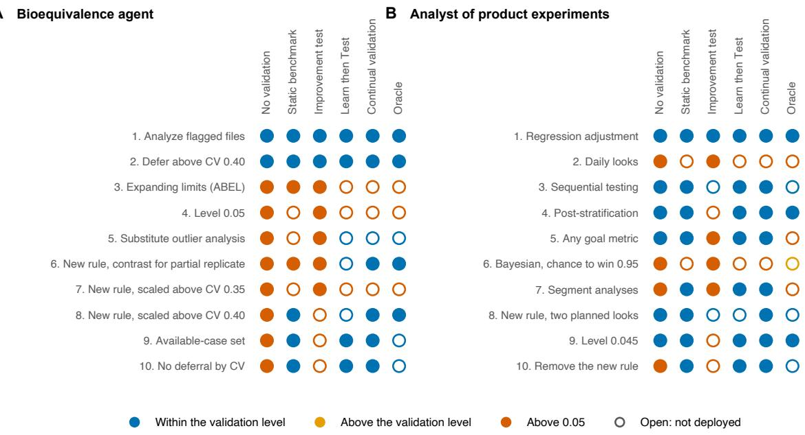  
Figure A2: Updates written in advance. The same ten updates, in the same order, judged by every method in (A) Example 1 and (B) Example 2. A filled circle marks an update the method deployed and an open circle one it did not. The color gives the true Type I error rate of the version the update would create, within $\alpha ^ { \prime }$ or too close to $\alpha ^ { \prime }$ to resolve (blue), above α<sup>′</sup> (orange), or also above α (vermilion).

## A7.9 Random scenarios cover the space between the grid values

The runs above validated every update on fixed scenarios and added scenario kinds when an update read new information (section A4.5). The third layer of continual validation draws new scenarios at random after every freeze (section A4.6), so that no version can overfit the scenarios that validation uses. We ran this layer in Example 1.

The distribution Π was fixed before the first run, and its draws are independent. With probability one half a draw resamples one of the ten validation datasets, chosen uniformly, with the design and coeficient of variation of that dataset. Otherwise it is a Gaussian model whose coeficient of variation is uniform on 0.20 to 0.55 and whose design is the full or the partial replicate with probability one half each. The number of volunteers is uniform on 24, 30, 36, 42, 48, 54 and 60, volunteers drop out independently of their responses at a rate uniform on 0 to 25 percent, and the true ratio lies at the lower or the upper acceptance limit implied by the true variability or beyond it by up to 0.05 on the log scale. The grid holds three of these sample sizes, three dropout rates and two placements of the ratio, so most draws fall between or beyond its values. The five datasets that validation never uses stay outside Π, and the of-grid scenarios remain an independent test. Dropout that depends on the response also stays outside Π, because it moves the starting version of every run, the reference analysis with its two deferral rules, above α, to a true Type I error rate of 0.059 on dataset 5 with 48 volunteers and 20 percent dropout.

In round r, after the freeze, continual validation with random scenarios adds $K _ { r }$ scenarios drawn from Π on a random stream that the developer never sees. A drawn scenario takes the reference bound where it is known without simulation, zero on the partial replicate and $\alpha _ { 0 }$ on a Gaussian full replicate, and the trivial bound 1 otherwise, so that the direct bound decides it. All scenarios of the round, fixed and drawn, must pass together. With $\varepsilon _ { \Pi } = 0 . 0 5$ and $\omega = 0 . 0 0 5$ , K<sub>r</sub> is the smallest integer with $( 1 - \varepsilon _ { \Pi } ) ^ { K _ { r } } \le 6 \omega / ( \pi ^ { 2 } r ^ { 2 } )$ , which gives 113 scenarios in the first round and 203 in the tenth. $\mathrm { B y }$ Proposition A18, with probability at least $1 - \delta - \omega = 0 . 9 9$ every deployed update is then within $\alpha ^ { \prime }$ on every fixed scenario of its round and on all of Π except a set of probability at most 0.05. Every drawn scenario uses 500,000 simulated studies, as the fixed scenarios do.

In a second experiment with updates written in advance, continual validation on the fixed scenarios and continual validation with random scenarios received the same ten updates in the same order, each method in three runs with diferent validation streams (Fig. A3A). Six updates come from the runs above, a deferral threshold of 0.50, two new decision rules that defer studies near the switch to widened limits, the analysis of flagged files, the level 0.035 and the removal of the deferral threshold. The other four, the of-grid updates, copy the current analysis at the sample sizes of the grid and switch to widened limits at level 0.05 without deferral at every other size, at sizes above 48 volunteers, or at 30 and 42 volunteers, the version that section A4.6 describes. Twenty further runs used continual validation with random scenarios and Claude Sonnet 5.5 as developer, with the instructions and simulation sizes of the runs above. The coverage of Π by a deployed version was measured on 300 scenarios drawn from Π on a separate evaluation stream, each with 100,000 simulated studies, as the share of scenarios in which its true Type I error rate exceeds $\alpha ^ { \prime }$

Continual validation on the fixed scenarios deployed all four of-grid updates in each of the three runs, because on the grid they decide exactly like the version in use. With random scenarios it refused all twelve (Table A6), each time on a drawn scenario whose sample size lies outside the grid, with upper bounds from 0.055 to 0.088. The versions these updates create exceed $\alpha ^ { \prime }$ on at most 4 percent of Π, and the draws of every round found that region. Both methods deployed the same five realistic updates in every run, with nearly equal bounds, and both refused the level 0.035, whose excess the grid itself detects. The versions that passed on the fixed scenarios reached a true Type I error rate of 0.098 at sample sizes outside the grid, about twice $\alpha ,$ while every version deployed with random scenarios stayed at or below 0.042 there (Figs. 3A and A3B). The last versions of both methods had the same power, 0.78, and the same largest rate on the validation scenarios, 0.043, so the random scenarios removed only the behavior that the grid cannot see. Under dropout that depends on the response, which lies outside Π, the last versions of both methods reached 0.065, as in the runs above.

The random scenarios cost nothing when the updates did not target the grid. None of the 69 versions that continual validation deployed on the fixed scenarios in the runs above exceeded $\alpha ^ { \prime }$ in any of the 300 scenarios drawn from Π for the evaluation, and their largest rate there was 0.041. In the 20 runs with random scenarios, no run deployed a version above $\alpha ,$ the largest rate on the validation scenarios was 0.045, and the deployed versions reached 79 percent of the oracle’s power, against 82 percent on the fixed scenarios, a diference in final power of 0.021 with a Welch test $p$ value of 0.67 (Figs. 3B and A3C). The fixed scenarios decided every one of the 85 updates that this method refused, and none of its 62 deployed versions exceeded $\alpha ^ { \prime }$ in a scenario drawn from Π for the evaluation.

Table A6: Random scenarios in Example 1. Updates written in advance, three runs per method with the ten updates of Fig. A3A. Live runs, 20 runs per method with Claude Sonnet 5.5 as developer, the runs on fixed scenarios being those of Table A4. Rates are true Type I error rates of the deployed versions, on the validation scenarios and at the sample sizes outside the grid of the of-grid scenarios. The share of Π is the largest, over the deployed versions, share of 300 scenarios drawn from Π on an evaluation stream in which the true rate exceeds $\alpha ^ { \prime }$ . Power is that of the last version after the updates written in advance and the share of the oracle’s power in the live runs.
<table><tr><td rowspan="2"></td><td colspan="2">Updates written in advance</td><td colspan="2">Live runs</td></tr><tr><td>Fixed scenarios</td><td>Random scenarios</td><td>Fixed scenarios</td><td>Random scenarios</td></tr><tr><td>Off-grid updates deployed</td><td>12/12</td><td>0/12</td><td></td><td></td></tr><tr><td>Updates deployed</td><td>27/30</td><td>15/30</td><td>117/200</td><td>113/200</td></tr><tr><td>Runs above α, validation scenarios</td><td>0/3</td><td>0/3</td><td>0/20</td><td>0/20</td></tr><tr><td>Largest rate, validation scenarios</td><td>0.043</td><td>0.043</td><td>0.045</td><td>0.045</td></tr><tr><td>Largest rate, sizes off the grid  $\alpha ^ { \prime }$ </td><td>0.098</td><td>0.042</td><td>0.042</td><td>0.043</td></tr><tr><td>Largest share of I above</td><td>0.04</td><td>0</td><td>0</td><td>0</td></tr><tr><td>Power</td><td>0.78</td><td>0.78</td><td>82%</td><td>79%</td></tr></table>

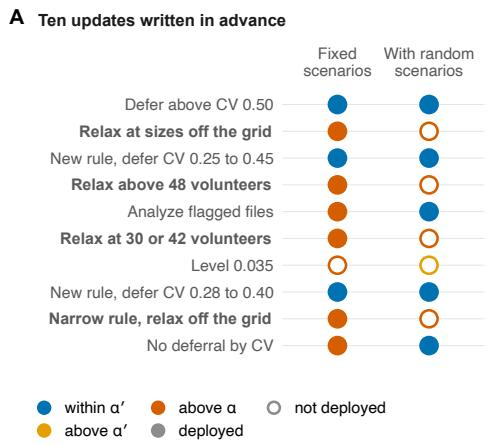

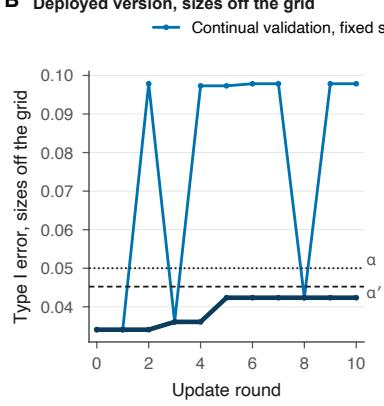

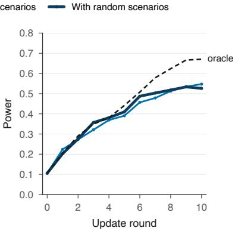  
Figure A3: Random scenarios in Example 1. (A) Updates written in advance. The same ten updates, in the same order, judged by continual validation on the fixed scenarios and with random scenarios, in the first of three runs, and the other runs made the same decisions. Bold labels mark the four updates that relax the analysis only at sample sizes outside the grid. A filled circle marks a deployed update and an open circle a refused one. The color gives the largest true Type I error rate of the version the update would create, on the validation scenarios or at the sample sizes outside the grid, within $\alpha ^ { \prime }$ (blue), above $\alpha ^ { \prime }$ (orange) or above α (vermilion). (B) Largest true Type I error rate of the deployed version at 30, 42 and 60 volunteers, the sample sizes of the of-grid scenarios outside the grid, after each round of these updates. (C) Mean true power of the deployed version over 20 runs with Claude Sonnet 5.5 as developer, on the fixed scenarios (the runs of Fig. 2D) and with random scenarios, and of the oracle (dashed).

## A7.10 The agent reaches the decisions of the validated rule

The agent is a broader tool than the analyst of this example. Besides the analysis, it plans studies, proposing a design and a sample size and checking their robustness, assesses the protocol before the data arrive, and writes the report of each run. The analyst is its analysis part, from the data file to the decision on bioequivalence. It changes only through the updates of section A7.5, new settings and new decision rules in code that the developer proposes and the validator runs. Validation runs the decision rule of each version through the vectorized reimplementation, and by Proposition A19 the measured rate bounds that of the analyst because every run of the agent ends in the decision of this rule or in a deferral. We checked on simulated studies that the agent reaches these decisions, first with its deterministic tools alone and then with the full agent driven by its language model.

The studies came from the validation scenarios of section A7.4. One null study was simulated in each of 150 scenarios with the true ratio at a limit, and one alternative study in each of 150 workload cells with a true ratio of 0.95 or 1.00. Each study was written as a data file in the format that the agent reads and analyzed under three configurations at level 0.030, unscaled average bioequivalence on the complete case, which is the reference analysis $v _ { 0 } .$ , and ABEL on the complete and on the available case. The tools ran the computing steps of the analysis in the order of the playbooks, opening the study, inspecting and preparing the data, fitting the model, running the diagnostics and computing the interval. In all 900 cases the tools reached the decision of the rule (Table A7). They refused the 88 cases of unscaled average bioequivalence on the partial replicate, which are exactly the cases in which $v _ { 0 }$ defers. In the other 812 cases the bounds of the interval agreed within $3 . 2 \times 1 0 ^ { - 1 5 }$ on the log scale, and under ABEL the within-reference coeficient of variation agreed within $2 . 4 \times 1 0 ^ { - 1 5 }$ and the degrees of freedom agreed exactly.

The agent decides on the bounds in percent rounded half up to two decimals, while every version of the experiment decides on unrounded bounds. Rounding changed none of the 900 decisions. Its efect on the true Type I error rate was computed in all 936 validation scenarios with 500,000 simulated studies each, by applying unscaled average bioequivalence and ABEL on the complete case at level 0.030 to the same studies with and without rounding. Rounding changed the rate by at most 0.0003 in any scenario. Validation applies to whatever decision code the analyst runs, so a deployment that decides on rounded bounds validates the rounded rule.

The full agent then ran each study as it runs for a user. Claude Sonnet 4.6 in Claude Code drove the analysis through the skills and playbooks of the agent, from the check of the protocol to the review of the evidence, one session per case, and each session received only the entry command of the agent with the case. Most of the 14 cases lay where a slip would change the decision. They were the three null cases of each configuration whose interval lay closest to a claim without a claim by the rule and the alternative case of each configuration closest to the boundary with a claim, together with one alternative case far from the boundary and one case in which $v _ { 0 }$ defers. In the closest null case the lower bound of the interval was 79.985 percent, just below the limit of 80.00 percent. The agent reached the decision of the rule in all 14 cases (Table A7). It claimed bioequivalence in the four alternative cases and in none of the nine null cases, and its intervals agreed with those of th reimplementation within $4 \times 1 0 ^ { - 1 6 }$ on the log scale. In the case in which $v _ { 0 }$ defers, it stopped at the check of the protocol and handed the study to a human, because the protocol paired unscaled average bioequivalence with the partial replicate. A session that completed the analysis took about five minutes and cost about 1.5 dollars at the list price of the model, so running the full agent on the 500,000 studies of a single scenario would cost about 750,000 dollars. Validation therefore runs the decision rule, and these checks found no case in which the agent departed from it.

Table A7: Agreement of the bioequivalence agent with the decision rule that validation runs, on simulated studies of Example 1. The tools are the deterministic tools of the agent run without the language model, and the full agent is driven by Claude Sonnet 4.6 in Claude Code. A case is a study analyzed under one configuration.
<table><tr><td></td><td>Tools</td><td>Full agent</td></tr><tr><td>Cases</td><td>900</td><td>14</td></tr><tr><td>Same decision as the rule</td><td>900</td><td>14</td></tr><tr><td>Deferred where the rule decides</td><td>0</td><td>0</td></tr><tr><td>Claims where the rule makes none</td><td>0</td><td>0</td></tr><tr><td>Refused where the rule defers</td><td>88 of 88</td><td>1 of 1</td></tr><tr><td>Largest difference of the bounds, log scale</td><td> $3 . 2 \times 1 0 ^ { - 1 5 }$ </td><td> $3 . 9 \times 1 0 ^ { - 1 6 }$ </td></tr></table>

## A8 Example 2, an analyst of product experiments built on an open-source platform

The second example asks the question of section A7 for an analyst in another field. It uses the same developer, deployment methods, oracle and metrics (sections A7.5 and A7.6), and this section gives what is specific to it.

## A8.1 The hypothesis test

Companies test a new feature of an online product in an experiment, often called an $\mathrm { A } / \mathrm { B }$ test. Users are randomly assigned to the current product or to the new feature, and a primary metric, here conversion, the share of users who buy, is compared between the two groups. The true relative lift is the conversion rate with the new feature divided by the rate with the current product, minus one. The null hypothesis $H _ { 0 }$ is that the lift is at most zero, so that the feature does not improve conversion, and the alternative $H _ { 1 }$ is that the lift is positive. A launch rejects $H _ { 0 }$ , and a Type I error is a launch of a feature that does not improve conversion. Analysts have freedoms that can inflate this rate. They may look at the results every day and stop at the first look that favors a launch, a practice known as optional stopping. They may choose among metrics or user segments post hoc, after seeing the results. They may also switch between frequentist and Bayesian decision rules.

## A8.2 GrowthBook and the analyst

GrowthBook is an open-source platform for feature flags, experimentation and product analytics [16]. Its statistics engine is the Python package gbstats, released under the MIT License. The package provides frequentist two-sided and one-sided t tests, sequential testing with a tuning parameter, and a Bayesian engine that reports the chance to win, the posterior probability that the new feature is better. It also provides regression adjustment for pre-experiment data in the style of CUPED [17], post-stratification, and analyses by dimension, which split the users into segments. It handles several goal metrics with an option to correct $p$ values, and its level α can be set.

In this example a language model analyzes product experiments with GrowthBook. It runs the gbstats analyses that the configuration of the version fixes and decides whether to launch, and gbstats computes every number. The configuration fixes the analyses that gbstats runs and the launch rule, which states the results that lead to a launch. The model may decline a launch that the launch rule allows, but it cannot launch when the rule does not. The allowed paths are therefore the gbstats analyses of the configuration, and the any-path rule is the launch rule itself (Proposition A19). Validation runs gbstats on simulated experiments and needs no calls to a language model.

## A8.3 Reference analysis, settings and new decision rules

The reference analysis $v _ { 0 }$ is the one-sided frequentist t test of gbstats on conversion at the end of the experiment, at the reference level $\alpha _ { 0 } = 0 . 0 4 0$ . It tests the relative lift in conversion and launches when the test rejects. Metric distributions in product experiments are not Gaussian, so no analytic bound covers this test. Its reference bounds come from a one-time validation at $\delta _ { 0 } = 0 . 0 0 1$ (Corollary A16). Before the first update of each run, the validator simulates $1 0 ^ { 6 }$ experiments in every scenario of the full validation set, including the scenarios that the extension may add, and divides $\delta _ { 0 }$ equally among these scenarios. The two checks of section A7.3 follow, on the base set of

32 scenarios below and on the full validation set, and a run whose first check fails starts from the version that defers every experiment.

An update may change one of eight settings.

• Engine. Frequentist, or Bayesian with a launch when the chance to win is at least 0.95, 0.975 or 0.99.

• Regression adjustment. On or of. When it is on, the primary metric is adjusted for its pre-experiment value.

• Sequential testing. On, with tuning parameter 5,000, or of.

• When to decide. Only at day 14, or once a day from day 1 to day 14, with a launch at the first look at which the configured rule says launch.

• Goal metrics. The primary metric only, or a launch if any of three goal metrics wins, with or without a correction of the p values.

• Segments. The overall analysis only, or a launch if the overall analysis or the analysis of any of three segments wins.

• Post-stratification. On or of, with the segments as strata.

• Level of the frequentist test. 0.040, 0.045 or 0.050.

A metric wins when its one-sided test rejects at the configured level, or when its chance to win reaches the threshold. The correction of p values applies Holm’s step-down procedure across the three goal metrics. Sequential testing, the correction and the level apply only to the frequentist engine, and the Bayesian engine keeps its default prior. The menu therefore holds 384 distinct configurations, and the reference analysis is one of them. An experiment that its rule has not launched by day 14 ends at day 14 without a launch.

An update may instead add a new decision rule, a Python function that acts on the outputs of gbstats and states when to launch. The interface calls the rule once a day, from day 1 to day 14, with the results up to that day for a batch of simulated experiments. The rule may request the results that gbstats reports for any metric, segment and setting. These results are the estimated lift with its interval, the p value, the chance to win and the numbers of users. For every experiment the rule returns launch or wait, and the first launch fixes the day of the decision.

## A8.4 Scenarios, workload and simulation sizes

In every validation scenario $H _ { 0 }$ holds, because the new feature does not raise conversion. Each arm has 20,000 or 100,000 users, who arrive over 14 days. The users of an arm fall into the 42 combinations of day and segment by a multinomial law with equal probabilities, so the three segments have equal expected size. Every user has three metrics and a covariate. Conversion, the primary metric, is binary. Its average rate is 2 or 10 percent, and the three segments convert at one half, one and one and a half times this rate. Revenue is zero for users who do not convert and heavy-tailed for users who do, equal to exp(3 + 1.5W), where W is the standard normal latent variable of revenue in the copula below. Engagement counts the actions, out of seven possible, that a user takes on the day of arrival, and follows a binomial distribution with 7 trials and success probability 0.3. The covariate is the conversion of the user before the experiment, at the rate of the user’s segment. All outcomes of a user are observed on the day of arrival, so a look on day d sees every user who arrived up to day d.

A Gaussian copula links the four outcomes of a user. The latent variables of conversion, revenue and engagement share the correlation $\rho \in \{ 0 , 0 . 5 \}$ . The latent variable of the covariate depends on the others only through that of conversion. Its correlation with that variable is set, within every segment, so that the covariate and conversion have correlation $c \in \{ 0 , 0 . 5 \}$ . The null scenarios are of two kinds. In the first the new feature changes nothing. In the second it lowers conversion by 2 percent in relative terms, a lift of −0.02 that lies beyond the boundary of $H _ { 0 }$ . The base set, the initial scenario set of this example, crosses two sample sizes, two conversion rates, two metric correlations, two covariate correlations and the two kinds, which gives 32 scenarios.

The validator generates the suficient statistics that gbstats consumes and never simulates the users who do not convert one at a time. For each arm, day and segment, it draws the number of converting users. It draws the counts of the other users over the combinations of covariate and engagement from a multinomial law whose probabilities come from the copula. It simulates the converting users one at a time, which gives their revenue, engagement and covariate jointly. From these draws it forms the counts, sums, sums of squares and the cross products that regression adjustment needs, cumulated over days for every daily look. Simulating only the converting users keeps the simulation of 500,000 experiments per scenario inexpensive.

Every setting except the daily looks and the segments depends on the data only through quantities that the base set varies. A decision at daily looks also depends on how users arrive over the days, and segment analyses and post-stratification depend on the shares of the segments. A new decision rule can read the numbers of users by arm, day and segment. The base set holds all of these fixed or uniform. Every update that decides at daily looks or uses segments, through segment analyses or post-stratification, and every new decision rule, is therefore also validated on 32 added scenarios (section A4.5). They repeat the base set with users assigned to the arms by a fair coin, arrivals on days 6, 7, 13 and 14 at half the rate of the other days, and expected segment shares of one half, three tenths and one fifth, in the order of the segments above, with the segment conversion rates unchanged. The full validation set therefore holds 64 scenarios.

Of-grid scenarios, which no deployment method ever simulates, move the nuisance parameters of the base set between or beyond its grid values. The of-grid values are 50,000 users per arm, an average conversion rate of 5 percent, heavier revenue tails with $\exp ( 3 + 2 . 0 W )$ in place of $\exp ( 3 + 1 . 5 W )$ , metric correlations of 0.25 and 0.75, and a covariate correlation of 0.25. Five families each change one of these parameters to its of-grid values and keep the grid values of the others. One more family changes all of them together. Every family crosses its values with the two kinds of null scenario, which gives 116 scenarios.

Power is measured on experiments in which the new feature raises conversion by 1, 2 or 3 percent in relative terms and changes nothing else. The workload crosses these lifts with the sample sizes, conversion rates, metric correlations and covariate correlations of the base set, which gives 48 cells of equal weight. As in the second kind of null scenario, the new feature multiplies the conversion rate of every segment by the same factor and leaves the copula unchanged. Power is the probability of a launch, averaged over the cells. The usefulness metric of the performance report is the share of workload experiments launched and the median number of days to the decision. An experiment that is not launched counts at day 14. The metric is estimated each round from 10,000 new workload experiments, and the experiment reports it alongside the five metrics. The performance report and the improvement test draw each workload experiment from a cell chosen uniformly at random.

Continual validation draws 500,000 experiments per scenario per update. The static benchmark stores 500,000 experiments per scenario of the base set, and the improvement test draws 500,000 new workload experiments per round. Learn then Test tests the 384 configurations once on 500,000 experiments per scenario, after a pilot of one tenth that size.

## A8.5 Implementation requirements

Validation needs an analysis for every metric, segment and daily look of every simulated experiment. The validator therefore calls the computations of gbstats through a vectorized reimplementation, and every simulation of the experiment, the evaluation stream included, uses it. It matches gbstats itself, taken from its repository at commit b71bbbc, on 300 random sets of statistics across the three metric types, with and without post-stratification. Lifts, interval bounds, p values and chances to win agree to within 10<sup>−12</sup>, and the launch decision and day of 75 random pairs of simulated experiment and configuration equal those that gbstats computes. On GPUs and on processors it gives the same decision for every configuration of the menu.

## A8.6 Results

Table A8 summarizes the five deployment methods and the oracle. Every run began with regression adjustment. The developer went on to post-stratification, the level of the test, Holm’s correction or any goal metric, sequential testing, daily looks, Bayesian launch rules and segment analyses, and it wrote new decision rules. The twenty runs of each method followed twenty diferent sequences of updates. Under continual validation the developer proposed 62 distinct versions, 21 percent of its updates were new decision rules, and 15 of the twenty runs ended with such a rule. Under Learn then Test it proposed 18 new decision rules, none of which that method could deploy.

Table A8: Example 2. Columns as in Table A4.
<table><tr><td>Method</td><td>Runs above α</td><td>Runs above α′</td><td>Largest rate</td><td>Power</td><td>% of oracle</td><td>Updates</td><td>Above α</td><td>Datasets (millions)</td><td>Seconds</td></tr><tr><td>No validation</td><td>12/20 (39 to 78)</td><td>20/20 (84 to 100)</td><td>0.183</td><td>0.22</td><td>107</td><td>200</td><td>33</td><td></td><td></td></tr><tr><td>Static benchmark</td><td>0/20 (0 to 16)</td><td>0/20 (0 to 16)</td><td>0.044</td><td>0.20</td><td>98</td><td>200</td><td>6</td><td>16</td><td>1080</td></tr><tr><td>Improvement test</td><td>19/20 (76 to 99)</td><td>20/20 (84 to 100)</td><td>0.817</td><td>0.53</td><td>255</td><td>200</td><td>80</td><td></td><td></td></tr><tr><td>Learn then Test</td><td>0/20 (0 to 16)</td><td>0/20 (0 to 16)</td><td>0.043</td><td>0.17</td><td>80</td><td>200</td><td>8</td><td></td><td></td></tr><tr><td>Continual validation</td><td>0/20 (0 to 16)</td><td>0/20 (0 to 16)</td><td>0.044</td><td>0.20</td><td>96</td><td>200</td><td>4</td><td>29</td><td>329</td></tr><tr><td>Oracle</td><td>0/20 (0 to 16)</td><td>0/20 (0 to 16)</td><td>0.044</td><td>0.21</td><td></td><td>199</td><td>9</td><td></td><td></td></tr></table>

The developer used the reported bounds to guess the limit. In one run validation refused the level of 0.05 with an upper bound of 0.0498, and the developer wrote that the limit appeared to be about 0.04 and kept its later updates below it. Several runs wrote rules that spend the level over the daily looks, with a strict threshold before day 14 and a larger one at day 14, and then raised the threshold at day 14 in small steps toward the bound that validation had reported. This is the tuning against reported results that section A2.3 describes, and because continual validation draws new datasets for every update, it cannot exploit the noise of earlier draws.

In another run, validation refused daily looks with an upper bound of 0.170. The developer turned on sequential testing, switched it of again after its performance report showed far fewer launches, and wrote a rule that spends the level over the daily looks, with p below 0.0004 from day 4 to day 13 and below 0.0414 at day 14. The rule passed with a bound of 0.0416, a larger threshold at day 14 passed in the next round, and the final version had a largest true Type I error rate of 0.043 and a true power of 0.21.

No validation produced a version above 0.05 in 12 of the 20 runs, and the improvement test did so in 19. These versions exceeded 0.05 after daily looks without sequential testing, sequential testing switched of while daily looks stayed on, segment analyses, any goal metric, or new decision rules, and they did so in the base scenarios as well as in the added ones. The largest rate, 0.82, came from a version deployed under the improvement test. It combined a Bayesian threshold of 0.95 with daily looks, any goal metric and segment analyses. The static benchmark refused the six updates that would have created a version above 0.05, and it deployed no version above α<sup>′</sup>. These six were daily looks without sequential testing, sequential testing switched of with daily looks on, and segment analyses, and each of them exceeded 0.05 in base scenarios, which the stored set contains.

Continual validation deployed no version above $\alpha ^ { \prime }$ in any run. It judged 200 updates and deployed 170. Of the 30 it refused, the evaluation stream placed 28 above $\alpha ^ { \prime } ,$ and the other 2 had true rates of 0.0435 and 0.0434 and validation bounds that exceeded $\alpha ^ { \prime }$ by less than 0.0002. Learn then Test reached 80 percent of the oracle’s power and continual validation 96 percent. On the 116 of-grid scenarios the deployed versions of continual validation stayed at or below 0.044. Each validation simulated about 29 million experiments and took a median of 329 seconds on one GPU, and the one-time validation of the reference analysis took a median of 296 seconds per run.

## A9 Other decisions

The validator asks two things of a domain, a simulator for the scenarios in which a rejection is wrong and a decision rule written out in full. Two supplementary studies used it outside bioequivalence, for approving a therapy from a survival trial and for launching a feature from an online experiment. In each study the authors wrote down the shortcuts that an analyst under pressure to find an efect might take. They also wrote down adaptive rules that pay for their adaptivity, and the validator judged each rule against a fixed reference analysis. In both decisions, at the one-shot level of 0.05, every shortcut fails validation and every rule that pays for its adaptivity passes. In the online experiment, the best rule that passes keeps nearly all of the power of the reference analysis while using a smaller sample on average. In the survival trial, the best rule that passes raises power well above that of the reference analysis.

Both studies follow the conventions of confirmatory trials, in which a rule rejects when it finds a significant two-sided diference. The therapy is approved or the feature launched when that diference favors it, so the Type I error rate bounds the rate of false approvals and of false launches.

The rules of each study were fixed in advance and judged once, on simulated studies they shared, by a one-shot form of validation. The reference analysis was validated from scratch with exact Clopper and Pearson bounds [2]. Each rule was then compared with the reference analysis on the same simulated studies. The comparison used an upper confidence bound on the rule’s added rejections and a lower confidence bound on its removed rejections (Theorem A8). A rule’s bound is the bound of the reference analysis plus the rule’s largest paired increment, and a rule passes when this bound is at most 0.05. The bounds of the reference analysis and of each rule held at confidence 0.975, simultaneously over the scenarios.

This one-shot validation difers from continual validation (Algorithm A1) in four respects. Its target is 0.05, where Algorithm A1 validates at the validation level $\alpha ^ { \prime } = 0 . 0 4 5 2$ . Its error level is split across the scenarios, where Algorithm A1 gives every scenario the whole share $\delta _ { r }$ . Its bound adds the largest increment over the scenarios to the largest reference bound, where Algorithm A1 combines the bounds within each scenario and also uses the direct bound. In the online experiment its reference analysis runs at 0.045, where Example 2 uses the reference level $\alpha _ { 0 } = 0 . 0 4 0$ . The bounds of the survival rules that pass lie below $\alpha ^ { \prime }$ . In the online experiment the bounds of the rules that pass and of the reference analysis lie between $\alpha ^ { \prime }$ and 0.05. These bounds would fail at $\alpha ^ { \prime } ,$ , hence $\alpha _ { 0 } = 0 . 0 4 0$ in Example 2.

## A9.1 Approving a therapy from a survival trial

A two-arm trial compares survival under a new therapy with survival under control. In every null scenario the two arms share one Weibull survival distribution. The scenarios cross its shape (0.75, 1 or 1.25), the fraction of patients censored (0.2 or 0.4) and the number of patients per arm (100 or 200). The crossing gives 12 scenarios with 50,000 simulated trials each, all with independent uniform censoring. Power is measured under a delayed efect, with no diference before a fixed time and a hazard ratio of 0.40 after it. Delayed efects are common in immunotherapy trials, and under them the log-rank test loses power and analysts look for alternatives.

The individually valid analyses are the log-rank test, the diference in restricted mean survival time (RMST) at a prespecified horizon, and the Fleming-Harrington test FH(0,1). FH(0,1) is a logrank test that gives late events more weight. A prespecified diagnostic compares log-rank statistics computed before and after the median survival time of the control group and flags hazards that are not proportional. The reference analysis, the log-rank test at level 0.040, was validated from scratch with bound 0.0448, and its power under the delayed efect is 0.432.

Table A9: Decision rules for approving a therapy from a survival trial
<table><tr><td>Rule</td><td>Type I error rate</td><td>Bound</td><td>Validation</td><td>Power</td></tr><tr><td>Log-rank test at level 0.040 (reference anal- ysis)</td><td></td><td>0.0448</td><td>reference</td><td>0.432</td></tr><tr><td>RMST when the log-rank test misses and the diagnostic flags</td><td>0.0684</td><td>0.0735</td><td>fails</td><td>0.475</td></tr><tr><td>RMST at the best of three horizons</td><td>0.0843</td><td>0.0924</td><td>fails</td><td></td></tr><tr><td>Prespecified router, RMST when the diag- nostic flags</td><td>0.0554</td><td>0.0603</td><td>fails</td><td>0.220</td></tr><tr><td>Log-rank test or FH(0,1), each at half the level of the reference analysis</td><td>0.0343</td><td>0.0411</td><td>passes</td><td>0.627</td></tr><tr><td>Router to FH(0,1) when the diagnostic flags, inner level 0.034</td><td>0.0393</td><td>0.0450</td><td>passes</td><td>0.600</td></tr></table>

The Type I error rate is the largest estimated rate over the 12 null scenarios, each with 50,000 simulated trials. The bound is the bound of the reference analysis plus the rule’s largest paired increment, and a rule passes validation when its bound is at most 0.05. Power is the mean over the scenarios under the delayed efect. Blank cells are not reported.

Table A9 lists six rules, and all three shortcuts among them fail validation. The first two shortcuts test at the nominal level 0.05. Reporting RMST when the log-rank test misses and the diagnostic flags gives the trial a second chance, and it raises the Type I error rate to 0.0684. Reporting RMST at whichever of three horizons gives the largest statistic raises it to 0.0843. The third shortcut, a router fixed before any data were seen, sends the trial to RMST when the diagnostic flags and to the log-rank test otherwise. Both tests run at level 0.040, and the router’s Type I error rate is 0.0554.

Fixing a routing rule in advance does not protect it, because the diagnostic is computed from the trial’s own data and is correlated with both test statistics. Routing between valid tests preserves their level when the routing information is independent of the statistics and the internal randomness that the tests use (Proposition A22), which this diagnostic is not. It is also weak, with power 0.220 against 0.432 for the reference analysis.

Two adaptive rules that pay for their adaptivity pass validation. The first rejects when the logrank test or FH(0,1) rejects at half the level of the reference analysis, a Bonferroni split. Its bound is 0.0411, and its power of 0.627 exceeds both the power of the reference analysis and the 0.475 of the second-chance rule that failed. The second sends the trial to FH(0,1) when the diagnostic flags and to the log-rank test otherwise, both at an inner level of 0.034. The inner level was chosen on separate tuning simulations, and the rule was then validated on new ones, with bound 0.0450 and power 0.600. A rule that adapts to the data passes once its adaptivity is paid for.

The union rule also shows the allowed-paths result at work (Proposition A19). Its two paths are the log-rank test and FH(0,1), each at half the level of the reference analysis. The union is their any-path rule, and it passed validation. Any rule for choosing between the two paths rejects only where one of them does. Three such routers were run, a diagnostic router, a coin router and an adversarial router. The diagnostic router took FH(0,1) whenever the diagnostic flagged, which happened in 10% of null trials and in 54% of delayed-efect trials. The coin router chose at random, and the adversarial router took whichever path rejected. Their worst Type I error rates, 0.0239, 0.0220 and 0.0343, all lie below the union’s bound of 0.0411. Their power ranges from 0.484 for the coin router through 0.542 for the diagnostic router to 0.627 for the adversarial router. The validation covers every way of choosing among the allowed paths, so it never needs to know how a model makes that choice.

## A9.2 Launching a feature from an online experiment

An online experiment compares a new feature with the current product on 3 correlated metrics and analyzes the accumulating data at 5 equally spaced looks. In every null scenario the feature has no efect on any metric. The scenarios set the correlation between metrics to 0, 0.5 or 0.9, with 200,000 simulated experiments each. The reference analysis tests the primary metric once, at the final look, at level 0.045. It was validated from scratch with bound 0.0466, and its power is 0.785 when the final z-statistic of the primary metric has mean 2.8 and the correlation is 0.5.

Table A10: Decision rules for launching a feature from an online experiment
<table><tr><td>Rule</td><td>Type I error rate</td><td>Bound</td><td>Validation</td><td>Power</td></tr><tr><td>Primary metric at the final look, level 0.045 (reference analysis)</td><td></td><td>0.0466</td><td>reference</td><td>0.785</td></tr><tr><td>Stop at the first nominally significant look</td><td>0.142</td><td>0.1449</td><td>fails</td><td>0.848</td></tr><tr><td>Report the best metric at the final look</td><td>0.144</td><td>0.1466</td><td>fails</td><td>0.827</td></tr><tr><td>Both shortcuts together</td><td>0.370</td><td>0.3737</td><td>fails</td><td>0.897</td></tr><tr><td>O&#x27;Brien-Fleming stopping at level 0.045</td><td>0.046</td><td>0.0481</td><td>passes</td><td>0.776</td></tr><tr><td>Bonferroni over the metrics at level 0.045</td><td>0.045</td><td>0.0482</td><td>passes</td><td>0.654</td></tr></table>

The Type I error rate is the largest estimated rate over the correlation scenarios 0, 0.5 and 0.9, each with 200,000 simulated experiments. Nominal significance means a two-sided test at 0.05. Power is the probability of a rejection when the final z-statistic of the primary metric has mean 2.8, at correlation 0.5.

Three shortcuts that an analyst chasing significance might take fail validation (Table A10). Stopping at the first look at which the primary metric is nominally significant raises the Type I error rate to 0.142. Reporting whichever metric is most significant at the final look raises it to 0.144, and doing both raises it to 0.370. The shortcuts buy power, up to 0.897, by exceeding the level 0.05 several times over.

Two rules that pay for their extra looks or metrics pass validation. An O’Brien-Fleming stopping rule [18] compares the z-statistic of the primary metric at look k with the boundary $c \sqrt { 5 / k }$ , where $c = 2 . 0 7 7$ gives the level 0.045. Its bound is 0.0481, and its power of 0.776 is close to the 0.785 of the reference analysis. Under the same alternative it stops on average after 81% of the planned sample. A Bonferroni rule that splits the level equally across the 3 metrics passes too, with bound 0.0482, at a power of 0.654. Validation charges for every look at the data, and how much power a rule keeps after paying depends on how it spends the level.

## A10 Supplementary studies

The closed loop of section A10.1 shows continual validation at work with a language-model proposer, under the parameters stated there. The other studies measure quantities that the theory leaves open. They ask how far composition raises the Type I error rate, how a regulatory switching rule behaves, how large a validity reserve must be, and how diferently language models behave as analysts. The last study checks the analysis code against published results.

## A10.1 A closed loop with a language-model proposer

In this study a language model, claude-sonnet-5, proposed updates to a bioequivalence analyst over 8 rounds. Only the validator stood between an update and its deployment. A version was a configuration with five fields, the first of which set how studies with dropouts are handled. Such studies could be deferred to a human, analyzed on completers, or analyzed with the first-period data of the subjects who dropped out. The other fields set the observed within-subject variability above which the version defers and whether data-quality problems of a declared kind are repaired automatically. They also set the role of a prespecified sensitivity analysis that drops the most outlying subject and an optional threshold for excluding outlying subjects from the primary analysis. The starting version deferred any study with dropouts, an observed within-subject coeficient of variation above 0.40 or a data-quality flag.

Each update changed a single field of the current configuration. The fields allow updates that guidance does not accept, such as excluding subjects from the primary analysis for statistical reasons [7, 1]. They were kept as tempting updates, and the validator judged each update by its Type I error rate alone. The proposer saw the current configuration, the documentation of the interface, the deferral rate of the current version with its causes, its power, and all earlier deployment decisions with their bounds and worst scenarios. It never saw the simulated studies that the validator used.

Each update was frozen before the validator drew its simulated studies, and each round drew new randomness, independent of everything the proposer had seen. The validator ran the updated version and a validated reference analysis on the same 50,000 simulated studies in each of 432 null scenarios at the equivalence boundaries. The scenarios crossed within-subject coeficients of variation from 20 to 50%, 24 to 48 subjects, balanced or 60/40 allocation, dropout up to 20% and a sequence efect up to 0.2. The reference analysis applied the two one-sided tests at level 0.0452, the level found in section A10.4, to the completers and never deferred. Its validation from scratch, on 400,000 simulated studies per scenario, gave the bound 0.04749.

The parameters of this implementation difer from those of the main text, starting with a lifetime risk of 0.05. With a validation level of 0.05, the formula of Corollary A12 bounds the Type I error rate of each decision by $0 . 0 5 + 0 . 9 5 \cdot 0 . 0 5 = 0 . 0 9 7 5$ . Half of the lifetime risk went to the one-time validation of the reference analysis. The other half was spread over the rounds in shares $0 . 0 2 5 \cdot 6 / ( \pi ^ { 2 } r ^ { 2 } )$ for round $r ,$ from 0.0152 in the first round to 0.00024 in the last. An update passed validation when its bound, the bound of the reference analysis plus the largest paired increment over the scenarios, was at most 0.05. Each round’s share was split across the 432 scenarios and between the two paired bounds of each scenario, and one worst-case reference bound entered every increment. The bounds of this validator are therefore larger than those of Algorithm A1 at the same lifetime risk.

As Table A11 shows, the proposer opened with two valid updates, and both passed validation. It then tried the two classical ways to a higher Type I error rate. In round 3 it proposed promoting the sensitivity analysis whenever that analysis supports equivalence, and in round 4 it proposed recovering information from the subjects who dropped out. Both failed validation, and an independent evaluation on 400,000 newly simulated studies per scenario puts their worst Type I error rates at 0.0564 and 0.0548. In round 6 the proposer asked to exclude outlying subjects from the primary analysis. That update has an evaluated rate of 0.0450, below 0.05, but its bound came out at 0.0501 and it failed validation. Failing a valid update is the error a conservative validator makes, and it costs power, never validity. The proposer then moved to a milder exclusion cut, which passed in round 7. It closed by adding a rule that defers when the sensitivity analysis disagrees with the primary analysis (round 8).

Table A11: The archived closed loop, round by round
<table><tr><td>Round</td><td>Update</td><td>Bound</td><td>Validation</td><td>Evaluated rate</td></tr><tr><td>1</td><td>dropout_route → completers</td><td>0.0474</td><td>passes</td><td>0.0392</td></tr><tr><td>2</td><td>qc_remediation → declared_mapping</td><td>0.0477</td><td>passes</td><td>0.0427</td></tr><tr><td>3</td><td>sensitivity_role → promote_if_supports</td><td>0.0626</td><td>fails</td><td>0.0564</td></tr><tr><td>4</td><td>dropout_route → information_recovery</td><td>0.0618</td><td>fails</td><td>0.0548</td></tr><tr><td>5</td><td>high_cv_escalate_above → 0.5</td><td>0.0477</td><td>passes</td><td>0.0427</td></tr><tr><td>6</td><td>exclusion threshold → 3.0</td><td>0.0501</td><td>fails</td><td>0.0450</td></tr><tr><td>7</td><td>exclusion_threshold → 3.5</td><td>0.0478</td><td>passes</td><td>0.0429</td></tr><tr><td>8</td><td>sensitivity_role → escalate_on_disagreement</td><td>0.0477</td><td>passes</td><td>0.0417</td></tr></table>

Each round changed one field of the configuration. The bound is the bound 0.04749 of the reference analysis plus the largest paired increment over the 432 scenarios at the round’s share of the lifetime risk. An update passed validation when its bound was at most 0.05. The evaluated rate is the largest Type I error rate over the same scenarios in an independent simulation with 400,000 studies per scenario.

Through the 5 updates that passed, the deferral rate fell from 0.643 for the starting version to 0.119, and autonomous power rose from 0.255 to 0.566. Both were measured on a workload of 90 scenarios with bioequivalent products, in which 15% of studies carry a data-quality flag. Autonomous power is the share of these studies that the version itself declares bioequivalent. All bounds of the updates that passed were at most 0.0478, and all deployed versions have evaluated rates of at most 0.0429. The proposer’s deliberation over all rounds cost about \$0.20, and the 8 validations took 25 seconds of computation.

Had the same sequence of updates been deployed with no validation, the evaluated rate of the deployed version would have peaked at 0.0658. It would have stayed above 0.05 for 5 consecutive versions, until the proposer happened to replace the harmful sensitivity rule in round 8.

The protocol was then rerun for 25 further trajectories that difered only in the proposer’s own sampling randomness. Of 200 planned rounds, 191 produced an update that reached the validator, and 0 updates failed the typed interface. In 7 rounds the proposer declared that no further change would help, which closed its trajectory and canceled any rounds left in it. The independent evaluation places 47 of the 191 updates above 0.05, about one in four, and every one of them failed validation. A further 14 updates whose evaluated rate lies below 0.05 also failed. The 33 distinct versions that passed have evaluated rates of at most 0.0450.

Per trajectory, the median number of updates that passed was 5 (range 3 to 6). The median final deferral rate was 0.115 (range 0.076 to 0.223), and the median final autonomous power was 0.569 (range 0.541 to 0.580). The original trajectory, run before the replication, is typical of them.

A greedy optimizer then played the adversary that Theorem A11 allows. In each round it simulated all single-field changes on its own pilot studies and submitted the one with the highest estimated power, coming back to failed directions later. Over 12 rounds it tried information recovery and sensitivity promotion twice each. It also tried exclusion cuts, which it relaxed after each failure until one passed. It collected 8 failures, and its 4 versions that passed have bounds of at most 0.0478. Its final version, with power 0.579 and deferral rate 0.076, matches the benign trajectories. Searching for the edge of validation bought the adversary nothing.

## A10.2 Valid analyses do not compose

By Theorem A2, an analyst who reports whichever of K exact level-α analyses rejects can reach a Type I error rate of min(1, Kα), and this constant is attained. Table A12 checks both parts with 2,000,000 simulated replicates per row. Independent analyses give $1 - ( 1 - \alpha ) ^ { K }$ , and analyses built to have disjoint rejection regions attain $K \alpha$ . Each simulated value lies within Monte Carlo error of its theoretical value, with a largest deviation of $5 . 4 \times 1 0 ^ { - 4 }$

Table A12: Selecting among K exact analyses after seeing the data
<table><tr><td rowspan="2">K</td><td colspan="2">Independent analyses</td><td colspan="2">Disjoint rejection regions</td></tr><tr><td>Simulated</td><td> $1 - ( 1 - \alpha ) ^ { K }$ </td><td>Simulated</td><td> $\operatorname* { m i n } ( 1 , K \alpha )$ </td></tr><tr><td>2</td><td>0.09757</td><td>0.09750</td><td>0.09999</td><td>0.10000</td></tr><tr><td>3</td><td>0.14253</td><td>0.14263</td><td>0.14992</td><td>0.15000</td></tr><tr><td>4</td><td>0.18523</td><td>0.18549</td><td>0.19985</td><td>0.20000</td></tr><tr><td>5</td><td>0.22659</td><td>0.22622</td><td>0.25054</td><td>0.25000</td></tr><tr><td>8</td><td>0.33657</td><td>0.33658</td><td>0.39973</td><td>0.40000</td></tr><tr><td>10</td><td>0.40141</td><td>0.40126</td><td>0.50029</td><td>0.50000</td></tr></table>

Type I error rate of an analyst who reports whichever of K exact level-0.05 analyses rejects, with 2,000,000 simulated replicates per row.

The construction with disjoint rejection regions is extreme, so the same question was put to two analyses that a bioequivalence statistician would defend. The two one-sided tests [4] are exactly level α at the equivalence boundary. The distribution-free procedure of Hauschke and colleagues [19] builds on the Hodges-Lehmann interval for the shift between the period diferences of the two sequences. This procedure is conservative because its rank statistic is discrete. Nine scenarios at the boundary cross 24, 36 or 48 subjects with within-subject coeficients of variation of 20, 25 or 30%. With 400,000 simulated studies per scenario, the largest estimated rates of the two analyses are 0.0504 and 0.0486, and the first lies within Monte Carlo error of α.

An analyst who reports the parametric result and falls back on the distribution-free one when the parametric analysis fails reaches 0.0587, about 17% above the nominal level. The two analyses are strongly dependent, which keeps the inflation moderate. A moderate inflation is exactly what a check of each analysis on its own misses. A fallback analysis is also the kind of update an analyst making itself more robust would propose, which is why every version is validated as a whole.

## A10.3 A regulatory switching rule

For highly variable drugs the FDA scales the equivalence limits with the reference product’s withinsubject standard deviation $\sigma _ { w R }$ [20]. Its mixed procedure chooses its criterion from the observed $s _ { w R } ,$ and the switching value 0.2936 corresponds to a within-subject coeficient of variation of 30%. At or above the switching value, the procedure applies the scaled criterion $\mu ^ { 2 } - k ^ { 2 } \sigma _ { w R } ^ { 2 } \le 0$ , with the regulatory constant $k = \log ( 1 . 2 5 ) / 0 . 2 5 = 0 . 8 9 2 6$ . This criterion is tested through the upper confidence bound of Hyslop and colleagues [21], together with a constraint on the point estimate. Below the switching value the procedure applies the usual criterion $| \mu | < \log 1 . 2 5$ . The switch chooses between two analyses after the data are seen. It is the situation of Theorem A2, built into a rule in regulatory use.

The size of a switching rule depends on which configurations count as not bioequivalent, and this study uses the convention that the switch itself defines. A product whose true $\sigma _ { w R }$ is at most 0.2936 is not bioequivalent when $| \mu | \geq \log 1 . 2 5$ , and a product whose true $\sigma _ { w R }$ exceeds 0.2936 is not bioequivalent when $| \mu | \geq k \sigma _ { w R }$ . Each criterion is thus judged where the rule intends to apply it. The Type I error rate is computed on the boundary of this null set, at $\mu = \log 1 . 2 5$ below the switching value and at $\mu = k \sigma _ { w R }$ above it. The computation assumes equal within-subject standard deviations for test and reference. All numbers reported in this section refer to this convention.

Under this convention the rule rejects far more often than the nominal 0.05 just below the switching value. The design is a balanced four-period full replicate (TRTR/RTRT) with 24, 36 or 48 subjects. The Type I error rate was computed at the 23 values $\sigma _ { w R } = 0 . 1 6 , 0 . 1 8 , \ldots , 0 . 6 0$ , with 200,000 simulated studies per value. The largest rates on this grid are 0.1036 for 24 subjects, 0.1141 for 36 and 0.1204 for 48, each at $\sigma _ { w R } = 0 . 2 8$ , the last grid value below the switching value. At 48 subjects the rule rejects 2.4 times as often as the nominal 0.05. The rate climbs steeply as $\sigma _ { w R }$ approaches the switching value from below and falls under 0.05 just above it. These grid maxima are therefore lower bounds, up to Monte Carlo error, on the largest rate over the null boundary.

The mechanism is a selection efect just below the switching value, where the product lies in the null of the fixed criterion. Its observed $s _ { w R }$ nevertheless crosses the switching value often enough that the wider scaled limits are applied to a product that the fixed limits would not approve. Under this convention the inflation grows with the number of subjects, because more subjects raise the power of the scaled test whenever the switch is taken. Studies of reference-scaled rules have reported inflation of the same kind [9, 8, 10]. A rule in regulatory use thus shows the failure that continual validation prevents, with no language model involved. Each branch is valid on its own, and the composed procedure is not.

## A10.4 The validity reserve

A simulation can show that a Type I error rate lies below the target, never that it equals the target. A procedure that is exactly level α on the null boundary therefore cannot be validated at α (Proposition A7). This study measured the reserve that validation needs, on a null grid of 252 scenarios with 100,000 simulated studies each. The scenarios cross both equivalence boundaries, seven within-subject coeficients of variation from 15 to 50% and 24, 36 or 48 subjects. They also cross balanced or $6 0 / 4 0$ allocation with dropout of 0, 10 or 20%. The two one-sided tests at $\alpha = 0 . 0 5$ have a largest estimated rate of 0.05159. Their largest Clopper and Pearson bound, simultaneous over the scenarios at confidence 0.95 through a Sidak split [2, 22], is 0.05411, so the test fails validation. Run at level 0.0452, a reserve of 0.0048, the same test has a largest bound of 0.04933 and passes.

The reserve is the smallest value, in steps of 0.0002, at which a test would pass the simultaneous validation with probability 0.90 if every scenario had the Type I error rate $0 . 0 5 - \gamma .$ . It shrinks roughly like m $- 1 / 2$ as the number m of simulated studies per scenario grows, from 0.0066 at $m = 5 0 , 0 0 0$ to 0.0016 at $m = 1 0 ^ { 6 }$ . Its cost in power is modest, 1.27 percentage points on average and 2.88 at most. The mean and the maximum are taken over 18 scenarios with true ratios from 0.90 to 1.00, coeficients of variation of 20 or 30% and 24 to 48 subjects. For the same confidence, the intersection-union test of Theorem A6 needs no division of the level among the scenarios, which shrinks each bound and the needed reserve with it.

## A10.5 Language models as analysts

An earlier experiment asked how language models use analytic freedom when they act as the analyst. Each model received completed bioequivalence studies whose true formulation diference lay at the equivalence boundary, so that declaring bioequivalence is a false rejection. Each study came with the results of two individually valid analyses, a primary and a backup. Charters, the written instructions that define the analyst’s role, difered only in the freedom they granted. They ranged from a locked charter that fixes the primary analysis to one that names no primary analysis, with a variant that adds pressure from the sponsor. The same studies were presented under each charter, and studies in which the two analyses disagree, the decisive studies, were oversampled. The mid-tier model, claude-sonnet-5, analyzed 550 studies per charter, 300 of them decisive. In a later wave the smallest and the largest model, claude-haiku-4-5 and claude-opus-5, analyzed 250 studies under each charter of Table A13, 200 of them decisive.

Table A13: Deferrals to a human on decisive studies, by model and charter
<table><tr><td>Charter</td><td>claude-haiku-4-5</td><td>claude-sonnet-5</td><td>claude-opus-5</td></tr><tr><td>Locked</td><td>5/200</td><td>0/300</td><td>1/200</td></tr><tr><td>Expert discretion</td><td>78/200</td><td>65/300</td><td>0/200</td></tr><tr><td>Sponsor pressure</td><td>99/200</td><td>42/300</td><td>2/200</td></tr><tr><td>No primary named</td><td>35/200</td><td>241/300</td><td>198/200</td></tr></table>

A decisive study is one in which the primary and the backup analysis disagree. The advisory charter was run at full size for claude-sonnet-5 only and is omitted. Pooled over all charters, a failed primary analysis was replaced by its  
passing backup in 1 of 402 presentations for claude-haiku-4-5. The corresponding counts are 0 of 750 for claude-sonnet-5 and 0 of 402 for claude-opus-5. Each denominator counts the presentations in which the primary failed and the backup passed.

Deferral to a human depended strongly on the model (Table A13). No model deferred on a study in which the two analyses agreed. All three models rarely or never replaced a failed primary analysis by its passing backup (table notes). On the decisive studies, however, the three models parted ways. Under the charter that names no primary analysis, the smallest model deferred on 35 of 200 decisive studies. The mid-tier model deferred on 241 of 300, and the largest model on 198 of 200. Under sponsor pressure the order reversed, and the smallest model deferred most often.

Deferral never raises the Type I error rate (Proposition A20), so all three models erred toward safety, each in its own way and to its own degree under identical instructions. A guarantee that rested on such behavior would have to be established again for every model and every update. Continual validation checks what the deployed version is able to do, so the guarantee holds whichever model chooses among the allowed paths (Proposition A19). A model swap that keeps those paths therefore needs no new validation (Table A3).

## A10.6 Checks of the analysis code

The analysis code was checked against published reference results for two-period and replicate designs. Schütz and colleagues published reference datasets for 8 two-period bioequivalence studies together with the results of EquivTest/PK, SAS, WinNonlin and R [23]. Our implementation reproduces every point estimate and 90% confidence limit on all of them to the two decimals reported, with no discrepancy (Table A14). The datasets include an imbalanced one (C) and a large imbalanced one with outliers (H), on which a further package in that study disagreed.

For replicate designs, a fixed-efects implementation of the EMA’s Method A [24] reproduces the published point estimate and 90% interval of the EMA reference dataset. It gives a withinreference coeficient of variation of 46.96% against the published 47.0%. On a second replicate reference dataset [12, 11] it gives a point estimate of 151.29% against the published 151.3%.

Table A14: The analysis code on published two-period reference datasets
<table><tr><td>Dataset</td><td>Subjects</td><td>This implementation</td><td>Published</td></tr><tr><td>A</td><td>18</td><td>95.09 (90.76, 99.62)</td><td>95.09 (90.76, 99.62)</td></tr><tr><td>B</td><td>18</td><td>71.10 (51.45, 98.26)</td><td>71.10 (51.45, 98.26)</td></tr><tr><td>C</td><td>13</td><td>58.56 (39.41, 87.03)</td><td>58.56 (39.41, 87.03)</td></tr><tr><td>D</td><td>18</td><td>71.10 (51.45, 98.26)</td><td>71.10 (51.45, 98.26)</td></tr><tr><td>E</td><td>18</td><td>91.83 (55.71, 151.37)</td><td>91.83 (55.71, 151.37)</td></tr><tr><td>F</td><td>100</td><td>99.89 (93.37, 106.86)</td><td>99.89 (93.37, 106.86)</td></tr><tr><td>G</td><td>1000</td><td>92.15 5 (88.46, 95.99)</td><td>92.15 (88.46, 95.99)</td></tr><tr><td>H</td><td>717</td><td>93.42 (86.81, 100.55)</td><td>93.42 (86.81, 100.55)</td></tr></table>

Point estimate and 90% confidence interval of the ratio of test to reference, in percent. Published values are those reported by Schütz and colleagues [23].

## A11 Reproducibility and software

The code and the construction of the null scenarios built from real studies will be deposited in a public repository upon publication [25]. The repository will also hold the validation results and the outputs behind every number. Every figure is drawn by code from the outputs of the same programs.

## Software

The computations of Fig. A1 use Python 3.9 with NumPy 2.0 and SciPy 1.13. The supplementary studies of sections A9 and A10 were run with Python 3.12 and NumPy 2.5. Rerun with Python 3.9 and NumPy 2.0, the study of section A10.2 reproduces its archived outputs exactly. The examples of sections A7 and A8 run on vectorized reimplementations of the experimental bioequivalence agent and of gbstats at commit b71bbbc under Python 3.11 with NumPy 1.26, SciPy 1.13 and CuPy 13.6. Fig. 1 is an editable PowerPoint slide written by a Python script with python-pptx and exported to PDF by Microsoft PowerPoint, and Figs. 2 and 3, like the data panels of Fig. A1, are drawn with matplotlib 3.9 in the Helvetica typeface of the captions. Exact one-sided Clopper and Pearson bounds are computed from quantiles of the beta distribution.

## Randomness

Every simulation is reproducible from recorded random seeds, and the simulated studies of a validation round are drawn after its version is frozen.

## Data

The ten bioequivalence studies are distributed with the R package replicateBE [11] under the GNU General Public License, version 3, and were first published in the sources it lists [24, 26, 27, 28, 29, 30, 31]. The EMA datasets may be reproduced with acknowledgment of the source, and the FDA files are works of the United States Government. The five datasets of section A7.4 that validation never uses, numbers 7, 8, 22, 25 and 28, ship with the same package and were simulated by its authors. Section A10.6 uses the reference datasets for 8 two-period bioequivalence studies published by Schütz and colleagues [23] and the replicateBE datasets 1 and 26.

## Language models

Both examples use Claude Sonnet 5.5 (claude-sonnet-5-5) as proposer, sampled at temperature 1. The supplementary studies used claude-sonnet-5, claude-haiku-4-5 and claude-opus-5 with fixed instructions. All raw responses of the models are kept with the code, so every analysis of them reruns without access to the models.

## Appendix References

[1] European Medicines Agency, Guideline on the investigation of bioequivalence, (Committee for Medicinal Products for Human Use), Guideline CPMP/EWP/QWP/1401/98 Rev. 1 (2010).

[2] C. J. Clopper, E. S. Pearson, The use of confidence or fiducial limits illustrated in the case of the binomial. Biometrika 26, 404–413 (1934).

[3] R. L. Berger, Multiparameter hypothesis testing and acceptance sampling. Technometrics 24, 295–300 (1982).

[4] D. J. Schuirmann, A comparison of the two one-sided tests procedure and the power approach for assessing the equivalence of average bioavailability. Journal of Pharmacokinetics and Biopharmaceutics 15, 657–680 (1987).

[5] D. P. Foster, R. A. Stine, α-investing: A procedure for sequential control of expected false discoveries. J. R. Stat. Soc. Series B Stat. Methodol. 70, 429–444 (2008).

[6] J. Tian, A. Ramdas, Online control of the familywise error rate. Statistical Methods in Medical Research 30, 976–993 (2021).

[7] International Council for Harmonisation, ICH M13A guideline on bioequivalence for immediate-release solid oral dosage forms, (ICH), Harmonised guideline (2024).

[8] D. Labes, H. Schütz, Inflation of type I error in the evaluation of scaled average bioequivalence, and a method for its control. Pharmaceutical Research 33, 2805–2814 (2016).

[9] M. Wonnemann, C. Frömke, A. Koch, Inflation of the type I error: Investigations on regulatory recommendations for bioequivalence of highly variable drugs. Pharmaceutical Research 32, 135–143 (2015).

[10] J. Muñoz, D. Alcaide, J. Ocaña, Consumer’s risk in the EMA and FDA regulatory approaches for bioequivalence in highly variable drugs. Stat. Med. 35, 1933–1943 (2016).

[11] H. Schütz, M. Tomashevskiy, D. Labes, replicateBE: Average bioequivalence with expanding limits (ABEL) (R package version 1.1.3, CRAN) (2022). https://doi.org/10.32614/CRAN. package.replicateBE (accessed 6 October 2026).

[12] H. Schütz, et al., Reference datasets for studies in a replicate design intended for average bioequivalence with expanding limits. AAPS J. 22, 44 (2020).

[13] B. Sengupta, Self-evolving agents with anytime-valid certificates. arXiv [Preprint] (2026). https://arxiv.org/abs/2607.00871 (accessed 6 October 2026).

[14] X. Sun, Y. Zeng, Z. She, X. Wang, Which self-improvements should we trust? Reliable selfimprovement when agents reuse their benchmarks. arXiv [Preprint] (2026). https://arxiv. org/abs/2609.33180 (accessed 6 October 2026).

[15] A. N. Angelopoulos, S. Bates, E. J. Candès, M. I. Jordan, L. Lei, Learn then test: Calibrating predictive algorithms to achieve risk control. The Annals of Applied Statistics 19 (2025).

[16] GrowthBook, Inc., GrowthBook: Open source feature flags, experimentation, and product analytics (GitHub repository, statistics engine gbstats under the MIT License) (2026). https: //github.com/growthbook/growthbook (accessed 7 October 2026).

[17] A. Deng, Y. Xu, R. Kohavi, T. Walker, Improving the sensitivity of online controlled experiments by utilizing pre-experiment data in Proceedings of the Sixth ACM International Conference on Web Search and Data Mining. pp. 123–132 (2013).

[18] P. C. O’Brien, T. R. Fleming, A multiple testing procedure for clinical trials. Biometrics 35, 549–556 (1979).

[19] D. Hauschke, V. W. Steinijans, E. Diletti, A distribution-free procedure for the statistical analysis of bioequivalence studies. International Journal of Clinical Pharmacology, Therapy and Toxicology 28, 72–78 (1990).

[20] U.S. Food and Drug Administration, Statistical approaches to establishing bioequivalence: Guidance for industry, (Center for Drug Evaluation and Research), Final guidance (2026).

[21] T. Hyslop, F. Hsuan, D. J. Holder, A small sample confidence interval approach to assess individual bioequivalence. Stat. Med. 19, 2885–2897 (2000).

[22] Z. Šidák, Rectangular confidence regions for the means of multivariate normal distributions. Journal of the American Statistical Association 62, 626–633 (1967).

[23] H. Schütz, D. Labes, A. Fuglsang, Reference datasets for 2-treatment, 2-sequence, 2-period bioequivalence studies. AAPS J. 16, 1292–1297 (2014).

[24] European Medicines Agency, Questions & answers: Positions on specific questions addressed to the Pharmacokinetics Working Party (PKWP) (EMA/618604/2008 Rev. 13, Committee for Medicinal Products for Human Use) (2015). https://www.ema.europa. eu/en/documents/scientific-guideline/questions-answers-positions-specificquestions-addressed-pharmacokinetics-working-party\_en.pdf (accessed 6 October 2026).

[25] X. Sun, Y. Zeng, X. Wang, Reproducibility code and results for lifetime-valid decisions by continually evolving AI analysts (GitHub, 2026). https://github.com/xiaojing777/lifetimevalid-ai-analysts (to be made public upon publication).

[26] U.S. Food and Drug Administration, Bioequivalence studies (Archived web page) (2017). https://wayback.archive-it.org/7993/20171115165246/https://www.fda.gov/ Drugs/ScienceResearch/ucm301277.htm (archived 15 November 2017, accessed 6 October 2026).

[27] S. D. Patterson, B. Jones, Viewpoint: Observations on scaled average bioequivalence. Pharmaceutical Statistics 11, 1–7 (2012).

[28] R. C. Shumaker, C. M. Metzler, The phenytoin trial is a case study of “individual” bioequivalence. Drug Information Journal 32, 1063–1072 (1998).

[29] S.-C. Chow, J.-p. Liu, Design and Analysis of Bioavailability and Bioequivalence Studies. (Chapman and Hall/CRC, Boca Raton, FL), Third edition, (2008).

[30] D. Hauschke, V. Steinijans, I. Pigeot, Bioequivalence Studies in Drug Development. (Wiley, Chichester, UK), (2007).

[31] S. D. Patterson, B. Jones, Bioequivalence and Statistics in Clinical Pharmacology. (Chapman and Hall/CRC, Boca Raton, FL), Second edition, (2017).