# MOER: MIX-POLICY OPTIMIZATION UNDER EXPERT PREFIX GUIDANCE WITH SELECTIVE ROLLBACK

Xuyang Zhong1 Jiuding Yang2 Yiwen Guo3,∗ Chen Liu1,∗

1City University of Hong Kong 2LIGHTSPEED 3Independent Researcher

∗Corresponding Author

## ABSTRACT

Mix-policy optimization incorporates off-policy expert data into the reinforcement learning (RL) loop to transcend the capability boundary of on-policy RL. However, existing methods either provide static full-trace guidance that suppresses self-exploration, or adopt expert prefix guidance without correctness guarantees, leading to suboptimal performance or even training collapse. In this paper, we propose MOER, a mix-policy optimization framework that harmonizes expert guidance with self-exploration. MOER injects a decaying expert chain-of-thought prefix into the prompt and lets the model complete the remaining reasoning, with the prefix length progressively annealed to encourage self-exploration. A selective rollback mechanism replaces failed completions with the original full expert trace, guaranteeing the correctness of every off-policy trajectory. Furthermore, a harmonized mix-policy objective optimizes on-policy tokens with a GRPO loss while supervising both expert prefix and completion tokens with a trust-region SFT loss, substantially stabilizing training. Extensive experiments show that MOER achieves the highest average scores in mathematical and general domain reasoning tasks, outperforming all basic and mix-policy baselines, and generalizes consistently across diverse tasks, model scales, and base model categories. Codes are available at https://github.com/CityU-MLO/MOER.

## 1 INTRODUCTION

Reinforcement learning with verifiable rewards (RLVR) has recently emerged as a powerful paradigm for eliciting complex reasoning capabilities in large language models (LLMs), as exemplified by breakthroughs such as DeepSeek-R1 (Guo et al., 2025). Built upon group-based policy optimization algorithms such as GRPO (Shao et al., 2024), RLVR enables models to develop long chain-of-thought (CoT) reasoning and sophisticated behaviors including self-reflection and self-correction, driven purely by outcome-based reward signals.

Nevertheless, purely on-policy reinforcement learning (RL) is inherently bounded by the knowledge already present in the base model: unlike supervised fine-tuning (SFT), which acquires genuinely new reasoning patterns, this approach amplifies existing ones. Consequently, models without robust foundational capabilities rapidly reach a performance plateau (Yue et al., 2026). To overcome this limitation, a growing line of work incorporates off-policy expert data into the RL loop, giving rise to the mix-policy paradigm. Pioneering methods such as LUFFY (Yan et al., 2026) inject complete expert traces into on-policy rollout groups, while ReLIFT (Ma et al., 2026) and CHORD (Zhang et al., 2026a) interleave or reweight SFT-style objectives alongside RL updates. Despite their promise, these approaches expose the model to expert supervision in a static and indiscriminate manner throughout training, which gradually suppresses self-exploration, prevents the model from internalizing reasoning behaviors beyond imitation.

An alternative and seemingly appealing direction is expert-guided generation, where a prefix of the expert CoT is provided as a hint and the model completes the remaining reasoning steps (Huang et al., 2026; Su et al., 2026). However, two critical deficiencies remain unresolved. First, the correctness of model completions conditioned on expert prefixes is not guaranteed: failed completions contaminate the off-policy supervision signal, which either degenerates the method into plain on-policy RL (Huang et al., 2026) or triggers training collapse with exploding response lengths when the off-policy guidance is overly aggressive (Su et al., 2026). Second, existing formulations treat the completion tokens as on-policy tokens and optimize them with the standard clipped surrogate objective. However, prefix conditioning drives the model into context states rarely reached by the current policy when conditioned solely on the original prompts, effectively rendering it an off-policy rollout. Overlooking this mismatch leads to training instability.

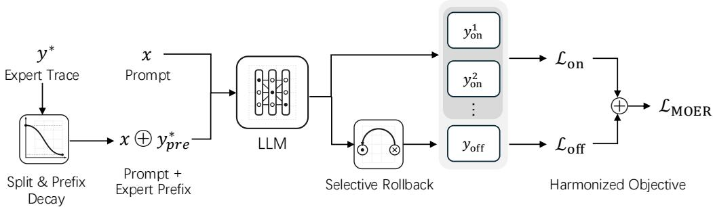  
Figure 1: Overview of MOER, which incorporates decaying expert prefix guidance with a selective rollback mechanism and harmonized mix-policy objective. Decaying expert prefix guidance encourages the model’s self-exploration capability as the training progresses. Selective rollback mechanism guarantees the correctness of off-policy traces. Harmonized mix-policy objective makes the training stable and effective.

To address these challenges, we propose Mix-policy Optimization under Expert prefix guidance with selective Rollback (MOER), as illustrated in Figure 1. MOER is built upon three key designs. (1) Decaying expert prefix guidance: instead of injecting the full expert trace or its prefix of a fixed length, we add a truncated expert CoT whose length is progressively annealed following a cosine schedule and let the model complete the remaining reasoning. Inspired by curriculum learning (Bengio et al., 2009), this design shifts the learning focus from imitation towards self-exploration as training progresses. (2) Selective rollback: whenever a completion conditioned on the expert prefix fails verification, we seamlessly roll back to the concatenation of the original prompt and the full expert trace at no additional computational cost, thereby guaranteeing the correctness of every off-policy trajectory. (3) Harmonized mix-policy objective: we optimize on-policy tokens with a clipped GRPO objective while treating both expert prefix tokens and completion tokens as off-policy tokens supervised by a trust-region objective, which yields smoother gradient weights and effectively stabilizes training.

Extensive experiments demonstrate the effectiveness of MOER. On Qwen2.5-Math-7B, MOER achieves an average score of 49.1 across six mathematical reasoning benchmarks and 59.0 on three out-of-distribution general reasoning benchmarks, outperforming all baselines, including LUFFY and ReLIFT. The improvements generalize across different tasks, model scales, and base model categories: MOER significantly outperforms LUFFY on coding task and attains the best overall results on Qwen2.5-Math-1.5B, Qwen2.5-Instruct-7B, and Qwen2.5-Instruct-14B. In-depth analyses further verify that each component of MOER contributes indispensably to training stability and final performance. By contrast, existing prefix-guided baselines either collapse early or degenerate into plain GRPO.

## Our contributions can be summarized as:

• We propose MOER, a mix-policy optimization framework that incorporates decaying expert prefix guidance with a selective rollback mechanism, achieving a dynamic equilibrium between expert imitation and self-exploration while guaranteeing the correctness of off-policy trajectories.

• We identify that expert prefix guidance induces an off-policy shift of the output distribution and, together with correctness filtering, a success-conditioned selection bias on completion tokens. Accordingly, we design a harmonized mix-policy objective, which optimizes on- and off-policy tokens with distinct loss formulations to improve training stability.

• We empirically demonstrate that MOER establishes new state-of-the-art results among mix-policy methods on Qwen2.5-Math-7B, with an average gain of +0.5 points on six math benchmarks and +1.6 points on out-of-distribution general reasoning tasks over the strongest baselines. The performance improvement generalizes consistently across diverse tasks, model scales, and base model categories.

## 2 RELATED WORK

Reinforcement learning (RL) has recently driven major advances in LLM reasoning (Liu et al., 2025; Hu et al., 2026). A rich line of work has refined RL objectives, from PPO’s clipped trust region (Schulman et al., 2017) and GRPO’s group-based advantage estimation (Shao et al., 2024) to variants like DAPO (Yu et al., 2026) and Dr. GRPO (Liu et al., 2025). Despite these advances, a fundamental challenge persists: RL-based exploration is often constrained by the model’s initial knowledge, making it difficult to discover superior reasoning pathways (Yue et al., 2026). To address this, recent works shift focus towards incorporating off-policy expert data into the on-policy RL loop, moving beyond the serial SFT-then-RL paradigm. We introduce these works in various categories as follows.

In direct data mixing methods, expert trajectories are combined with self-rollout generations at the data level. SimpleMix (Li & Khashabi, 2025) combines off-policy and on-policy data via simple dataset-level sampling within a DPO framework. LUFFY (Yan et al., 2026) incorporates off-policy expert trajectories directly into the on-policy rollout groups within a GRPO framework and employs policy shaping via regularized importance sampling. SRFT (Fu et al., 2025) further unifies data mixing with a sample-level SFT loss in a single-stage framework that dynamically adjusts loss weights based on token entropy. CHORD (Zhang et al., 2026a) reframes SFT as a dynamically weighted auxiliary objective within on-policy RL, employing a dual-control mechanism that combines a global coefficient for managing the transition from off-policy imitation to on-policy exploration with a token-wise weighting function.

In expert-guided generation methods, expert data is used to guide on-policy rollouts rather than mixed at the data level. UFT (Liu et al., 2026) and BREAD (Zhang et al., 2026b) utilize SFT trajectories as prefixes for on-policy rollouts. UFT progressively masks the suffix of the expert demonstration, while BREAD initiates new rollouts by branching from intermediate steps. Prefix-RFT (Huang et al., 2026) samples prefixes from demonstrations as guidance and employs an entropybased clipping mechanism to select high-entropy expert tokens for SFT. TRAPO (Su et al., 2026) introduces Trust-Region SFT (TrSFT) to constrain policy updates within a trust region and employs an adaptive micro-group sampling mechanism that dynamically allocates expert guidance length based on return improvements.

In interleaved SFT-RL update methods, a third category interleaves RL updates with SFT steps on expert data. ReLIFT (Ma et al., 2026) collects poorly performing samples during RL training and selectively applies SFT to challenging problems that RL fails to solve. HPT (Lv et al., 2025) dynamically decides whether to apply SFT or RL based on the model’s rollout performance using binary weights. AMFT (He et al., 2025) views the balance between SFT and RL as a learnable parameter and introduces a meta-gradient adaptive weight controller.

## 3 PRELIMINARIES

We build our method upon the Mix-Policy GRPO framework (Yan et al., 2026), in which off-policy rollouts derived from expert data are directly injected into the group of on-policy rollouts generated by the current model. Thus, both on-policy and off-policy rollouts are simultaneously considered during advantage computation. Formally, the advantage $A _ { k }$ for one rollout ${ \pmb y } _ { k }$ is computed as:

$$
A _ { k } = \frac { R ( y _ { k } ) - \mathrm { m e a n } ( \mathcal { G } _ { \mathrm { o n } } \cup \mathcal { G } _ { \mathrm { o f f } } ) } { \mathrm { s t d } ( \mathcal { G } _ { \mathrm { o n } } \cup \mathcal { G } _ { \mathrm { o f f } } ) } , \quad \left\{ \begin{array} { l l } { \mathcal { G } _ { \mathrm { o n } } = \{ R ( y _ { i } ) | y _ { i } \sim \pi _ { \theta _ { \mathrm { o l f } } } ( \pmb { x } ) , i = 1 , . . . , N _ { \mathrm { o n } } \} , } \\ { \mathcal { G } _ { \mathrm { o f f } } = \{ R ( y _ { j } ) | y _ { j } \sim \pi _ { \phi } ( \pmb { x } ) , j = 1 , . . . , N _ { \mathrm { o f f } } \} . } \end{array} \right.\tag{1}
$$

where $R ( \cdot )$ represents the reward function, x is the input prompt, and $N _ { \mathrm { o n } }$ and $N _ { \mathrm { o f f } }$ are the number of on-policy instances and off-policy instances in each group, respectively. In addition, $\pi _ { \phi }$ denotes the off-policy expert distribution, $\pi _ { \theta _ { \mathrm { o l d } } }$ denotes the on-policy distribution where $\theta _ { \mathrm { o l d } }$ is the model parameters before the update. Following (Yan et al., 2026; Su et al., 2026; Ma et al., 2026), we omit the standard deviation normalization term in the denominator in (1).

Inheriting the standard GRPO objective (Shao et al., 2024), the objective function on the updated model parameters θ is formulated as:

$$
\mathcal { L } _ { \mathrm { m i x } } ( \theta ) = \frac { 1 } { Z } \left[ \sum _ { y _ { i } \in \mathcal { Y } _ { \mathrm { o n } } } \sum _ { t = 1 } ^ { \left| y _ { i } \right| } \mathrm { C L I P } ( r _ { i , t } , A _ { i } , \epsilon ) + \sum _ { y _ { j } \in \mathcal { Y } _ { \mathrm { o f f } } } \frac { \left| y _ { j } \right| } { \epsilon } \mathrm { C L I P } ( \widehat { r } _ { j , t } , A _ { j } , \epsilon ) \right] , \left\{ \begin{array} { l l } { r _ { i , t } = \frac { \pi \theta \left( y _ { i , t } \left| \alpha , y _ { i , < t } \right| \right) } { \pi _ { \theta \mathrm { o f f } } \left( y _ { i , t } \left| x , y _ { i , < t } \right| \right) } , } \\ { \widehat { r } _ { j , t } = \frac { \pi \theta \left( y _ { j , t } \left| x , y _ { j , < t } \right| \right) } { \pi _ { \phi } \left( y _ { j , t } \left| x , y _ { j , < t } \right| \right) } . } \end{array} \right.\tag{2}
$$

Here, $r _ { i , t } , \widehat { r } _ { j , t }$ are importance sampling ratios; $\mathcal { V } _ { \mathrm { o n } } , \mathcal { V } _ { \mathrm { o f f } }$ denote the set of on-policy rollouts and off-policy rollouts in the group, respectively. In addition, Z denotes the total number of tokens, and ϵ is the clipping coefficient. The clipped surrogate objective is given by ${ \tt C L I P } ( r , A , \epsilon ) =$ min $( r A , \mathsf { c l i p } ( \bar { r } , 1 - \epsilon , 1 + \epsilon ) A )$ . Given that the exact expert behavioral policy $\pi _ { \phi }$ is typically inaccessible, we follow standard practice and set its probability value to 1. One key issue of this framework is entropy collapse, as optimizing $\mathcal { L } _ { \mathrm { m i x } } ( \theta )$ in (2) leads to increasingly deterministic rollouts and a diminished capacity to explore diverse reasoning trajectories (Yan et al., 2026).

## 4 METHODOLOGY

In this section, we introduce MOER, a mix-policy optimization framework that integrates decaying expert prefix guidance with a selective rollback mechanism (Sec. 4.1) and harmonized mix-policy objectives (Sec. 4.2).

## 4.1 DECAYING EXPERT PREFIX GUIDANCE WITH SELECTIVE ROLLBACK

To establish a better balance between autonomous self-exploration and expert guidance, we propose injecting an expert chain-of-thought (CoT) prefix directly into the input prompt, forcing the model to complete the remaining reasoning steps and final solutions. This completion process is formally defined as ${ \pmb y } _ { \mathrm { c o m } } \sim \pi _ { \theta _ { \mathrm { o l d } } } ( { \pmb x } \oplus { \pmb y } _ { \mathrm { p r e } } ^ { * } )$ , where $y _ { \mathrm { p r e } } ^ { \ast }$ denotes the prefixed segment of the expert CoT. Ultimately, the concatenated sequence ${ \pmb y } _ { \mathrm { p r e } } ^ { * } \oplus \dot { \pmb y } _ { \mathrm { c o m } }$ is treated as the off-policy rollout ${ \pmb y } _ { \mathrm { o f f } }$

Furthermore, inspired by curriculum learning principles (Bengio et al., 2009), we adopt a cosine annealing strategy to progressively shorten the injected expert prefix during training. This alleviates forgetting induced by static and full expert supervision and encourages the model to rely more heavily on its own self-exploration capabilities as training progresses. The prefix decaying schedule is defined as CosAneal $( \pmb { y } ) = \pmb { y } _ { < r \cdot | \pmb { y } | } ,$ , where $| y |$ is the number of tokens in y and the prefix ratio r is computed as

$$
r = \{ { { r _ { \mathrm { m a x } } } \atop { { r _ { \mathrm { m i n } } } + { { ( { { r _ { \mathrm { m a x } } } - { r _ { \mathrm { m i n } } } } ) } \mathord { [ { [ { 0 . 5 + 0 . 5 \cdot \cos ( { \frac { { s - s _ { \mathrm { w a m } } } { { S - s _ { \mathrm { w a m } } } \pi } } } ) } ] }  \kern - delimiterspace } { { s } } } } }  & { \mathrm { { i f ~ } } s < s _ { \mathrm { w a r m } } , }\tag{3}
$$

where $r _ { \mathrm { m i n } } , r _ { \mathrm { m a x } } , s , s _ { \mathrm { w a r m } } .$ and $S$ denote the minimum prefix ratio, maximum prefix ratio, current training step, warm-up step, and maximum training steps, respectively.

However, generating completions based on an expert prefix does not inherently guarantee the correctness of the final response. To mitigate this issue, we introduce a “cost-free” rollback mechanism. Specifically, if the completed response ${ \pmb y } _ { \mathrm { p r e } } ^ { \ast } \oplus { \pmb y } _ { \mathrm { c o m } }$ fails verification (i.e., the final solution is incorrect), we seamlessly roll back and replace the failed generation with the original full expert response $\boldsymbol { y } ^ { * }$ which does not introduce computational overhead.

Compared to Prefix-RFT (Huang et al., 2026) and TRAPO (Su et al., 2026), as illustrated in Figure 2, our prefix-injection method with a selective rollback mechanism guarantees the correctness of the expert guidance and exhibits superior performance and stability. In contrast, Prefix-RFT achieves suboptimal performance and TRAPO collapses in the early stage of training with explosive increase in response length.

## 4.2 HARMONIZED MIX-POLICY OBJECTIVE

Recent studies (Yan et al., 2026; Su et al., 2026; Zhang et al., 2026a) have demonstrated that off-policy and on-policy tokens should be optimized via distinct loss formulations. Typically, existing methods modify the SFT loss function to dampen the gradient weights of off-policy tokens. Following Su et al. (2026), we incorporate the advantage term into a trust-region SFT formulation, where the gradient weight of low-probability tokens is clipped. The resulting off-policy loss function is defined as:

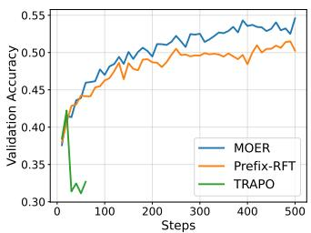  
(a) Validation Accuracy

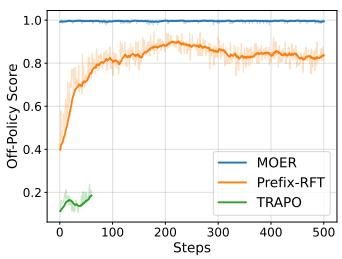  
(b) Off-Policy Score

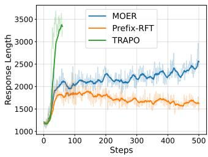  
(c) Response Length  
Figure 2: Training dynamics of MOER and other baselines with prefix guidance. The base model is Qwen2.5-Math-7B. (a) MOER reaches the highest validation accuracy. (b) Selective rollback mechanism guarantees the correctness of expert guidance. (c) MOER exhibits a stable increase in response length. Note that TRAPO is early-stopped due to training collapse.

$$
\mathcal { L } _ { \mathrm { o f f } } ( \theta ) = \sum _ { y _ { j } \in \mathcal { Y } _ { \mathrm { o f f } } } \sum _ { t = 1 } ^ { | y _ { j } | } \frac { \pi _ { \theta } \big ( y _ { j , t } | x , y _ { j , < t } \big ) } { \operatorname* { m a x } \big ( \mathtt { s g } \big ( \pi _ { \theta } \big ( y _ { j , t } | x , y _ { j , < t } \big ) \big ) , \gamma \big ) } A _ { j } ,\tag{4}
$$

where the advantage $A _ { j }$ is calculated by (1), sg(·) denotes the stop-gradient operator and $\gamma$ is the trust-region coefficient, set to 0.1 by default. We defer the detailed discussion on different off-policy objectives proposed in prior work to Appendix A. In the discussion, we suggest that all of these off-policy objectives can be seen as softened SFT objectives in essence. Furthermore, we conduct an ablation study on these objectives to corroborate this viewpoint.

For on-policy tokens, we leverage a modified GRPO loss featuring asymmetric clipping coefficients (Yu et al., 2026) without standard deviation normalization in advantage computation (Liu et al., 2025), which is formulated as:

$$
\mathcal { L } _ { \mathrm { o n } } ( \theta ) = \sum _ { y _ { i } \in \mathcal { Y } _ { \mathrm { o n } } } \sum _ { t = 1 } ^ { | y _ { i } | } \operatorname* { m i n } \left( r _ { i , t } A _ { i } , \ \mathrm { c } \mathrm { { 1 } i } { \mathrm { p } ( r _ { i , t } , 1 - \epsilon _ { \mathrm { l o w } } , 1 + \epsilon _ { \mathrm { h i g h } } ) } A _ { i } \right) ,\tag{5}
$$

where $\epsilon _ { \mathrm { l o w } }$ and $\epsilon _ { \mathrm { h i g h } }$ are decoupled clipping coefficients. Notably, LUFFY does not adopt clipping operation for on-policy tokens, which leads to instability in the later stage of training. Therefore, we introduce the clipping operation back. Further analysis is deferred to Appendix B. Moreover, we empirically demonstrate the necessity of clipping in Figure 10 (c) of Appendix F.

In prior work (Su et al., 2026; Huang et al., 2026), the completion tokens are categorized as on-policy tokens. We argue that this categorization overlooks the distributional consequence of expert prefix conditioning. Although the completion $\scriptstyle { \pmb { y } } _ { \mathrm { c o m } }$ is sampled from $\pi _ { \theta _ { \mathrm { o l d } } } ( \cdot | \pmb { x } \oplus \pmb { y } _ { \mathrm { p r e } } ^ { * } )$ and is thus conditionally on-policy given the prefix, the prefix itself steers the model into context states that the current policy would rarely reach through its own exploration. Consequently, with respect to the output distribution induced by the original prompt x, the completion tokens are effectively off-policy. Furthermore, the selective rollback mechanism retains only verified completions, turning them into success-conditioned rollouts with an inherent selection bias. Empirically, as illustrated in Figure 3, the completion tokens exhibit substantially lower probabilities under the current policy than pure on-policy tokens, corroborating the output distribution shift. Optimizing such tokens with the standard on-policy objective introduces training instability. To address this issue, we treat $\scriptstyle { \pmb { y } } _ { \mathrm { c o m } }$ as off-policy tokens and compute their loss using the off-policy objective, which yields smoother gradient weights and serves as a stabilization strategy against the expert-induced output distribution shift and selection bias.

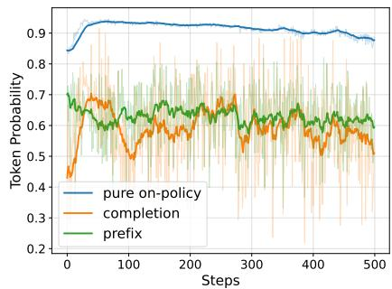  
Figure 3: Average output probability of pure on-policy, completion, and expert prefix tokens. The solid curves are smoothed.

Ultimately, we combine ${ \mathcal { L } } _ { \mathrm { o n } }$ and ${ \mathcal { L } } _ { \mathrm { o f f } }$ to formulate the harmonized mix-policy objective:

$$
\mathcal { L } _ { \mathrm { M O E R } } ( \theta ) = \frac { 1 } { Z } ( \mathcal { L } _ { \mathrm { o n } } ( \theta ) + \alpha \cdot \mathcal { L } _ { \mathrm { o f f } } ( \theta ) ) ,\tag{6}
$$

where α is the off-policy loss weight. Finally, the pseudocode of MOER is outlined in Algorithm 1.

Algorithm 1 Mix-Policy Optimization under Expert Prefix Guidance with Rollback (MOER)   
1: Input: parameter $\theta ,$ dataset D, number of on-policy rollouts $N _ { \mathrm { o n } } ,$ , number of off-policy rollouts   
$N _ { \mathrm { o f f } } ,$ clipping coefficients $( \epsilon _ { \mathrm { l o w } } , \epsilon _ { \mathrm { h i g h } } )$ , trust-region coefficient γ, off-policy loss weight α.   
2: for each mini-batch $B \in { \mathcal { D } }$ do   
3: for each prompt and expert answer $( { \pmb x } , { \pmb y } ^ { * } ) \in B$ do   
4: ${ \pmb y } _ { \mathrm { c o t } } ^ { * } , { \pmb y } _ { \mathrm { s o l } } ^ { * }  \mathtt { S p l i t } ( { \pmb y } ^ { * } )$ ▷ Split the answer into chain-of-thought and solution   
5: $y _ { \mathrm { p r e } } ^ { * } $ CosAneal $\left( { { y } _ { \mathrm { c o t } } ^ { * } } \right)$ via Eq. (3)   
6: for $i = 1$ to $N _ { \mathrm { o n } }$ do   
7: ${ \pmb y } _ { \mathrm { o n } } ^ { i } \sim \pi _ { \theta _ { \mathrm { o l d } } } ( { \cdot } | { \pmb x } )$ ▷ On-policy rollout   
8: end for   
9: for $j = 1$ to $N _ { \mathrm { o f f } }$ do   
10: yjcom $\sim \pi _ { \theta _ { \mathrm { o l d } } } ( \cdot | \pmb { x } \oplus \pmb { y } _ { \mathrm { p r e } } ^ { * } )$ ▷ Completing the response based on expert prefix   
11: $\pmb { y } _ { \mathrm { o f f } } ^ { j }  \pmb { y } _ { \mathrm { p r e } } ^ { * } \oplus \pmb { y } _ { \mathrm { c o m } } ^ { j }$ if $\pmb { y } _ { \mathrm { p r e } } ^ { * } \oplus \pmb { y } _ { \mathrm { c o m } } ^ { j }$ is correct else ${ \pmb y } ^ { * }$ ▷ Selective rollback   
12: end for   
13: Calculate advantages $\{ A _ { i } \} _ { i = 1 } ^ { N _ { \mathrm { o n } } + N _ { \mathrm { o f f } } }$ via Eq. (1)   
14: end for   
15: Calculate $\mathcal { L } _ { \mathrm { M O E R } }$ via Eq. (6)   
16: Update θ based on LMOER   
17: end for

## 5 EXPERIMENTS

## 5.1 EXPERIMENTAL SETTINGS

Training Details. We focus on mathematical reasoning task in this section and defer the experiments on coding task to Appendix D. The training set is OpenR1-Math-46k-8192 (Yan et al., 2026), where the prompts are collected from NuminaMath 1.5 (Li et al., 2024), and the expert traces are generated by DeepSeek-R1. Following prior work (Yan et al., 2026; Su et al., 2026; Huang et al., 2026), Qwen2.5-Math-7B (Yang et al., 2024) is adopted as the base model. We also evaluate our method on Qwen2.5-Math-1.5B, Qwen2.5-Instruct-7B, and Qwen2.5-Instruct-14B (Qwen et al., 2025).

Implementation Details. For on-policy loss, we use a modified GRPO loss featuring decoupled clipping coefficients (Yu et al., 2026) without standard deviation normalization in advantage computation (Liu et al., 2025). The clipping coefficients $\epsilon _ { \mathrm { l o w } }$ and $\epsilon _ { \mathrm { h i g h } }$ are set to 0.2 and 0.24, respectively. The KL regularization term is removed by setting $\beta = 0$ and the entropy loss coefficient is set to 0.01. For off-policy loss, the trust-region coefficient γ is set to 0.1. The off-policy loss weight α is set to 0.2 for Qwen2.5-Math-7B and Qwen2.5-Math-1.5B, and is set to 0.1 for Qwen2.5-Instruct-7B. For the prefix decaying schedule, the warm-up step $s _ { \mathrm { w a r m } } = 5 0$ , the minimum prefix ratio $r _ { \mathrm { m i n } } = 0 . 1$ the maximum prefix ratio $r _ { \operatorname* { m a x } } = 1 . 0$ . The rollout batch size is 128 and the update batch size is 64. Other unspecified hyperparameters are consistent with those in LUFFY (Yan et al., 2026).

Evaluation. We evaluate the models with the highest validation accuracy on both math and general domain reasoning benchmarks. Specifically, the math benchmarks include AIME 2024, AIME 2025, AMC (Li et al., 2024), MATH-500 (Hendrycks et al., 2021), Minerva (Lewkowycz et al., 2022), and OlympiadBench (He et al., 2024). For AIME 2024, AIME 2025 and AMC, we report avg@32 as the test set is relatively small, and for the other three benchmarks, we report pass@1. For general domain reasoning benchmarks, we include the pass@1 on ARC-c (Clark et al., 2018), GPQA-diamond (Rein et al., 2024), and MMLU-Pro (Wang et al., 2024).

Baselines. We comprehensively compare MOER with various baselines, including (1) SFT: train the model with the same dataset using SFT; (2) RL: RL training using standard GRPO loss (Shao et al., 2024); (3) RL w/ SFT Loss: combining SFT loss with GRPO loss during RL training; (4)

Table 1: Main experiment results on math and general reasoning benchmarks based on Qwen2.5- Math-7B. All baselines are evaluated on the same dataset and base model. Bold and underline indicate the best and second-best results, respectively.
<table><tr><td rowspan="2">Method</td><td colspan="6">Math Reasoning Performance</td><td colspan="4">General Domain Reasoning Performance</td></tr><tr><td>AIME 24/25</td><td></td><td>AMC MATH-500 Minerva</td><td></td><td>Olympiad</td><td>Avg.</td><td>ARC-c GPQA*</td><td></td><td>MMLU-Pro</td><td>Avg.</td></tr><tr><td>Base</td><td>11.5/4.9</td><td>31.3</td><td>43.6</td><td>7.4</td><td>15.6</td><td>19.0</td><td>18.2</td><td>11.1</td><td>16.9</td><td>15.4</td></tr><tr><td<tr><td></td><td colspan="8"></td></tr><tr><td>Basic Baselines</td><td>SFT</td><td>22.2/22.3</td><td>52.8</td><td>82.6</td><td>40.8</td><td>43.7</td><td>44.1</td><td>75.2</td><td>24.7</td><td>42.7</td></tr><tr><td>47.5</td><td>RL</td><td>25.1/15.3</td><td>62.0</td><td>84.4</td><td>39.3</td><td>46.8</td><td>45.5</td><td>82.3</td><td>40.4</td><td>49.3</td></tr><tr><td>57.3</td><td>RL w/ SFT Loss</td><td>19.5/16.4</td><td>49.7</td><td>80.4</td><td>34.9</td><td>39.4</td><td>40.1</td><td>71.2</td><td>23.7</td><td>43.2</td></tr><tr><td>46.0</td><td>SFT-then-RL 25.8/23.1</td><td></td><td>62.7</td><td>87.2</td><td>39.7</td><td>50.4</td><td>48.2</td><td>72.4</td><td>24.2</td><td>37.7</td></tr><tr><td colspan="9">44.8</td></tr><tr><td>Mix-policy Baselines</td><td>LUFFY</td><td>28.5/21.6</td><td>61.0</td><td>86.4</td><td>40.4</td><td>52.4</td><td>48.4</td><td>81.9</td><td>37.9</td><td>52.2</td></tr><tr><td>57.3</td><td>ReLIFT</td><td>26.5/20.2</td><td>63.5</td><td>88.0</td><td>39.3</td><td>53.9</td><td>48.6</td><td>82.3</td><td>37.4</td><td>52.1</td></tr><tr><td>57.3</td><td>CHORD</td><td>25.1/16.6</td><td>59.0</td><td>83.4</td><td>35.7</td><td>51.1</td><td>45.2</td><td>82.4</td><td>38.4</td><td>51.4</td></tr><tr><td>57.4</td><td>TRAPO</td><td>0.2/0.3</td><td>1.9</td><td>5.4</td><td>2.9</td><td>1.2</td><td>2.0</td><td>0.1</td><td>0.0</td><td>3.0</td></tr><tr><td>1.0</td><td>Prefix-RFT</td><td>19.2/17.1</td><td>58.9</td><td>83.8</td><td>36.0</td><td>50.8</td><td>44.3</td><td>81.5</td><td>35.9</td><td>50.4</td></tr><tr><td colspan="9">55.9</td><td></td></tr><tr><td></td><td>MOER</td><td>27.9/22.2</td><td>63.7</td><td>86.8</td><td>Our Method 38.6</td><td>55.6</td><td>49.1</td><td>84.0</td><td>38.9</td><td>54.1</td></tr></table>

SFT-then-RL: two-stage training that continues RL training with GRPO loss after SFT. Furthermore, we include other mix-policy baselines, e.g., (5) LUFFY (Yan et al., 2026): insert a full expert trace into on-policy rollout group; (6) ReLIFT (Ma et al., 2026): alternating training between RL and SFT; (7) CHORD (Zhang et al., 2026a): GRPO loss + reweighted SFT loss; (8) TRAPO (Su et al., 2026): dynamically allocate expert prefix length based on return improvements; (9) Prefix-RFT (Huang et al., 2026): randomly sample expert prefix and SFT update on off-policy tokens with high entropy.

## 5.2 MAIN RESULTS

We first evaluate MOER against basic and mix-policy baselines using the Qwen2.5-Math-7B base model. To ensure a fair comparison, all mix-policy baselines are reproduced on the same dataset and base model as our method. As reported in Table 1, LUFFY and ReLIFT are the only mixpolicy baselines that marginally outperform SFT-then-RL. In contrast, MOER achieves an average score of 49.1 across six mathematical reasoning benchmarks, outperforming all baseline models. This performance gap demonstrates that MOER effectively balances the internalization of expert knowledge with self-exploration, resulting in a better acquisition of reasoning capabilities.

Furthermore, MOER exhibits superior generalization on out-of-distribution (OOD) general-domain reasoning benchmarks, achieving an average score of 59.0. While the SFT-then-RL baseline achieves high in-domain performance, its unsatisfactory performance on OOD tasks indicates overfitting during the initial SFT stage. These results confirm that MOER successfully harmonizes the strengths of both paradigms, acquiring specialized skills without sacrificing general task utility.

Finally, alternative prefix-based methods such as TRAPO and Prefix-RFT suffer from training collapse or suboptimal performance. The instability of TRAPO stems from overly aggressive offpolicy supervision, where up to 4 out of 8 group rollouts consist of off-policy traces in the worst case. Meanwhile, Prefix-RFT yields suboptimal results due to the lack of correctness guarantees for model completions, which ultimately causes it to degenerate into GRPO.

## 5.3 RESULTS ON MORE MODELS

We further compare our method with the most competitive baselines, LUFFY and ReLIFT, across different model scales and base model categories (math-specialized vs. general instruction-tuned). Note that the results on Qwen2.5-Instruct-14B are deferred to Appendix E. As shown in Table 2 and Table 7 in Appendix E, MOER consistently demonstrates superior or competitive performance across both model scales and base model categories.

On Qwen2.5-Math-1.5B, MOER ties with LUFFY for the highest average math score of 38.1, while outperforming ReLIFT (34.1). This plateau in math performance relative to LUFFY can likely be attributed to the constrained parameter capacity of the 1.5B model, which restricts the potential gain from advanced self-directed exploration in highly complex mathematical reasoning. Nevertheless,

Table 2: Experiment results on math and general reasoning benchmarks based on Qwen2.5-Math-1.5B and Qwen2.5-Instruct-7B.
<table><tr><td rowspan="2">Method</td><td colspan="5">Math Reasoning Performance</td><td colspan="5">General Domain Reasoning Performance</td></tr><tr><td>AIME 24/25</td><td></td><td>AMC MATH-500 Minerva</td><td></td><td>Olympiad</td><td>Avg.</td><td>ARC-c GPQA*</td><td></td><td>MMLU-Pro</td><td>Avg.</td></tr><tr><td colspan="10">Qwen2.5-Math-1.5B</td></tr><tr><td>LUFFY</td><td>16.0/12.9</td><td>47.1</td><td>77.2</td><td>32.7</td><td>42.7</td><td>38.1</td><td>55.6</td><td>26.8</td><td>34.6</td><td>39.0</td></tr><tr><td>ReLIFT</td><td>14.6/9.0</td><td>41.7</td><td>72.0</td><td>29.0</td><td>38.4</td><td>34.1</td><td>55.0</td><td>25.8</td><td>30.4</td><td>37.1</td></tr><tr><td>MOER</td><td>16.6/12.2</td><td>46.7</td><td>79.6</td><td>29.8</td><td>43.4</td><td>38.1</td><td>60.4</td><td>26.8</td><td>34.6</td><td>40.6</td></tr><tr><td colspan="10">Qwen2.5-Instruct-7B</td></tr><tr><td>LUFFY</td><td>18.3/15.2</td><td>50.2</td><td>81.6</td><td>37.1</td><td>46.5</td><td>41.5</td><td>2.7</td><td>1.0</td><td>60.7</td><td>21.5</td></tr><tr><td>ReLIFT</td><td>18.0/16.1</td><td>51.1</td><td>81.0</td><td>37.5</td><td>44.9</td><td>41.4</td><td>89.9</td><td>32.3</td><td>56.6</td><td>59.6</td></tr><tr><td>MOER</td><td>15.9/15.6</td><td>51.7</td><td>81.4</td><td>39.0</td><td>50.1</td><td>42.3</td><td>89.1</td><td>43.4</td><td>59.0</td><td>63.8</td></tr></table>

Table 3: Ablation study on components of MOER based on Qwen2.5-Math-7B. HO denotes harmonized objective, PG denotes decaying prefix guidance, SR denotes selective rollback, FG denotes full expert guidance, COff denotes completion as off-policy tokens.
<table><tr><td rowspan="2">Method</td><td colspan="5">Math Reasoning Performance</td><td colspan="5">General Domain Reasoning Performance</td></tr><tr><td>AIME 24/25</td><td>AMC</td><td>MATH-500</td><td>Minerva</td><td>Olympiad</td><td>Avg.</td><td>ARC-c</td><td>GPQA</td><td>MMLU-Pro</td><td>Avg.</td></tr><tr><td>LUFFY (GRPO+FG)</td><td>28.5/21.6</td><td>61.0</td><td>86.4</td><td>40.4</td><td>52.4</td><td>48.4</td><td>81.9</td><td>37.9</td><td>52.2</td><td>57.3</td></tr><tr><td>+HO</td><td>27.8/21.5</td><td>63.1</td><td>87.6</td><td>37.9</td><td>53.8</td><td>48.6</td><td>83.2</td><td>38.9</td><td>52.9</td><td>58.3</td></tr><tr><td>+HO+PG+COff</td><td>24.7/15.4</td><td>60.7</td><td>84.4</td><td>40.8</td><td>51.3</td><td>46.2</td><td>82.5</td><td>41.9</td><td>50.4</td><td>58.3</td></tr><tr><td>+HO+PG+SR</td><td>27.1/22.6</td><td>63.4</td><td>87.8</td><td>38.2</td><td>54.4</td><td>48.9</td><td>83.3</td><td>39.5</td><td>53.2</td><td>58.7</td></tr><tr><td>+HO-FG+SR</td><td>24.9/18.8</td><td>61.9</td><td>85.8</td><td>37.5</td><td>53.9</td><td>47.1</td><td>83.4</td><td>36.4</td><td>53.3</td><td>57.7</td></tr><tr><td>+HO+PG+SR+COff (MOER)</td><td>27.9/22.2</td><td>63.7</td><td>86.8</td><td>38.6</td><td>55.6</td><td>49.1</td><td>84.0</td><td>38.9</td><td>54.1</td><td>59.0</td></tr></table>

MOER retains significantly stronger general domain capabilities, achieving a domain-leading average score of 40.6, indicating its competitive performance on OOD tasks.

On Qwen2.5-Instruct-7B, the advantages of MOER become even more pronounced. In mathematical reasoning, MOER attains the highest average score of 42.3. More importantly, MOER exhibits exceptional stability and general utility preservation on general domain reasoning tasks, achieving an overall average of 63.8. Notably, while LUFFY suffers a severe performance collapse on ARC-c and GPQA, MOER maintains robust performance across all benchmarks.

## 5.4 ABLATION STUDY AND ANALYSIS

We conduct ablation study and detailed analysis on the core components of our method in this section. In addition, we study how different hyperparameters and computation budgets affect performance in Appendix F and G, respectively.

To numerically investigate the contributions of individual components in MOER, we construct a series of ablation variants starting from the baseline LUFFY model and incrementally integrating our proposed modules based on Qwen2.5-Math-7B. As reported in Table 3, starting from the base LUFFY model (48.4 math average, 57.3 general average), applying the harmonized objective function (+HO) yields consistent improvements on both math and general domain performance (48.6 and 58.3). Adding prefix decaying (+HO+PG+COff) leads to a decline in math performance to 46.2 due to the lack of correctness guarantees for model completions. When rollback is further incorporated (+HO+PG+SR), the mathematical performance recovers substantially to 48.9 (see Appendix C for a detailed discussion of the rollback dynamics along training). Additionally, removing expert guidance but with rollback (+HO-FG+SR), i.e., replacing one incorrect on-policy rollout with full expert trace, results in a noticeable drop in performance. Finally, our complete framework (+HO+PG+SR+COff), which treats completion tokens as off-policy tokens, achieves the highest overall performance on both math and general domain reasoning (49.1 and 59.0). The detailed analysis on the effect of each core component is presented as follows:

Effect of Harmonized Objective (HO). As illustrated in Figure 4 (a)-(c), our harmonized objective effectively mitigates fluctuations of entropy and response length, preventing late-stage training collapse and ultimately yielding superior reasoning performance. A key factor driving this stability is the asymmetric clipping mechanism applied to the importance sampling ratio. As analyzed in Appendix B, LUFFY’s unclipped design introduces training instability that intensifies when updates become more “off-policy”. Conversely, the symmetric clipping in standard GRPO induces entropy collapse. Furthermore, our extended discussion in Appendix A reveals that various off-policy objectives proposed in prior work share a similar stabilizing effect during training, as they essentially act as softened SFT objectives.

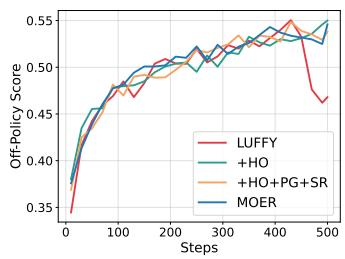  
(a) Validation Accuracy

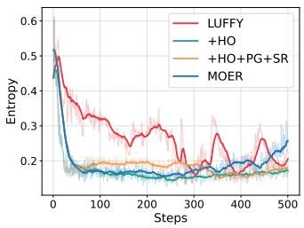  
(b) Entropy

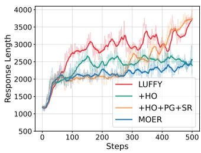  
(c) Response Length

Figure 4: Training dynamics of MOER and its ablations. HO denotes harmonized objective, PG denotes decaying prefix guidance, and SR denotes selective rollback.  
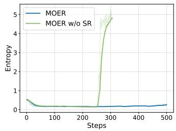  
(a) Entropy

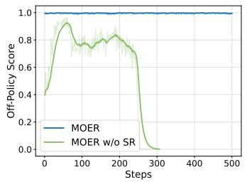  
(b) Off-Policy Score

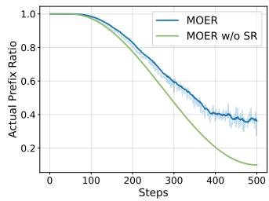  
(c) Actual Prefix Ratio  
Figure 5: Effect of selective rollback mechanism. Note that MOER w/o SR is identical to $+ { \bar { H } } O + P G + C O f f$ and it is early-stopped due to training collapse. The actual prefix ratio is calculated by prefix ratio × (1 − rollback rate) + rollback rate.

Effect of Decaying Prefix Guidance (PG). Decaying prefix guidance is designed to alleviate forgetting induced by static and full expert supervision and progressively foster self-exploration as training proceeds. The results presented in Table 3 indicates that MOER exhibits better OOD performance than the variant utilizing full expert guidance (+HO). As shown by the entropy curve in Figure 4 (b), MOER maintains strong exploratory behavior in the later stage of training. In contrast, +HO exhibits a weaker response diversity, which is evidenced by a smaller entropy. Additionally, as discussed in Appendix C, the diminishing accuracy gap between on-policy rollouts and completions furhter supports the design of the decaying prefix schedule.

Effect of Selective Rollback (SR). As depicted in Figure 5 (a) and (b), removing the selective rollback mechanism while retaining decaying prefix guidance $( + H O + P G + C O f f )$ ) leads to training collapse, characterized by an off-policy score dropping to zero alongside explosive entropy growth. This finding demonstrates that the efficacy of decaying prefix guidance relies inherently on the rollback mechanism. Moreover, Figure 5 (c) confirms that the rollback mechanism does not degenerate into static expert guidance, as the actual prefix ratio steadily decays over the course of training.

Effect of Completions as Off-Policy Tokens (COff). Treating completion tokens $\scriptstyle { \pmb { y } } _ { \mathrm { c o m } }$ purely as on-policy tokens, i.e., computing their updates via standard on-policy loss functions $( + H O + P G + S R )$ introduces late-stage training instability with excessively increasing response length (see Figure 4 (c)). This instability ultimately leads to suboptimal final performance and overlong response length, underscoring the necessity of treating completion tokens as off-policy supervision.

## 6 CONCLUSION

In this paper, we propose MOER, a mix-policy optimization framework that harmonizes expert guidance with self-exploration for LLM reasoning. MOER combines decaying expert prefix guidance with selective rollback mechanism that guarantees the correctness of off-policy trajectories, and a harmonized mix-policy objective that optimizes on- and off-policy tokens with distinct loss formulations. Experiments across model scales and categories demonstrate that MOER achieves state-of-the-art math reasoning performance while preserving strong general-domain capabilities.

## REFERENCES

Yoshua Bengio, Jer´ ome Louradour, Ronan Collobert, and Jason Weston. Curriculum learning. In ˆ Proceedings ofthe 26th Annual International Conference on Machine Learning, ICML ’09, pp. 41–48, New York, NY, USA, 2009. Association for Computing Machinery. ISBN 9781605585161. doi: 10.1145/1553374.1553380. URL https://doi.org/10.1145/1553374.1553380.

Peter Clark, Isaac Cowhey, Oren Etzioni, Tushar Khot, Ashish Sabharwal, Carissa Schoenick, and Oyvind Tafjord. Think you have solved question answering? try arc, the ai2 reasoning challenge. arXiv:1803.05457v1, 2018.

Yuqian Fu, Tinghong Chen, Jiajun Chai, Xihuai Wang, Songjun Tu, Guojun Yin, Wei Lin, Qichao Zhang, Yuanheng Zhu, and Dongbin Zhao. Srft: A single-stage method with supervised and reinforcement fine-tuning for reasoning. arXiv preprint arXiv:2506.19767, 2025.

Daya Guo, Dejian Yang, Haowei Zhang, Junxiao Song, Peiyi Wang, Qihao Zhu, Runxin Xu, Ruoyu Zhang, Shirong Ma, Xiao Bi, et al. Deepseek-r1: Incentivizing reasoning capability in llms via reinforcement learning. arXiv preprint arXiv:2501.12948, 2025.

Chaoqun He, Renjie Luo, Yuzhuo Bai, Shengding Hu, Zhen Leng Thai, Junhao Shen, Jinyi Hu, Xu Han, Yujie Huang, Yuxiang Zhang, Jie Liu, Lei Qi, Zhiyuan Liu, and Maosong Sun. Olympiadbench: A challenging benchmark for promoting agi with olympiad-level bilingual multimodal scientific problems. In Annual Meeting ofthe Associationfor Computational Linguistics, 2024.

Lixuan He, Jie Feng, and Yong Li. Amft: Aligning llm reasoners by meta-learning the optimal imitation-exploration balance. arXiv preprint arXiv:2508.06944, 2025.

Dan Hendrycks, Collin Burns, Saurav Kadavath, Akul Arora, Steven Basart, Eric Tang, Dawn Song, and Jacob Steinhardt. Measuring mathematical problem solving with the MATH dataset. In Thirty-fifth Conference on Neural Information Processing Systems Datasets and Benchmarks Track (Round 2), 2021. URL https://openreview.net/forum?id=7Bywt2mQsCe.

Jingcheng Hu, Yinmin Zhang, Qi Han, Daxin Jiang, Xiangyu Zhang, and Heung-Yeung Shum. Open-reasoner-zero: An open source approach to scaling up reinforcement learning on the base model. Advances in Neural Information Processing Systems, 38:162239–162262, 2026.

Zeyu Huang, Tianhao Cheng, Zihan Qiu, Zili Wang, Xu Yinghui, Edoardo Ponti, and Ivan Titov. Blending supervised and reinforcement fine-tuning with prefix sampling. In Forty-third International Conference on Machine Learning, 2026. URL https://openreview.net/forum? id=MgtyPYrC4h.

Naman Jain, King Han, Alex Gu, Wen-Ding Li, Fanjia Yan, Tianjun Zhang, Sida Wang, Armando Solar-Lezama, Koushik Sen, and Ion Stoica. Livecodebench: Holistic and contamination free evaluation of large language models for code. In The Thirteenth International Conference on Learning Representations, 2025. URL https://openreview.net/forum?id=chfJJYC3iL.

Aitor Lewkowycz, Anders Johan Andreassen, David Dohan, Ethan Dyer, Henryk Michalewski, Vinay Venkatesh Ramasesh, Ambrose Slone, Cem Anil, Imanol Schlag, Theo Gutman-Solo, Yuhuai Wu, Behnam Neyshabur, Guy Gur-Ari, and Vedant Misra. Solving quantitative reasoning problems with language models. In Alice H. Oh, Alekh Agarwal, Danielle Belgrave, and Kyunghyun Cho (eds.), Advances in Neural Information Processing Systems, 2022. URL https://openreview.net/forum?id=IFXTZERXdM7.

Jia Li, Edward Beeching, Lewis Tunstall, Ben Lipkin, Roman Soletskyi, Shengyi Costa Huang, Kashif Rasul, Longhui Yu, Albert Jiang, Ziju Shen, Zihan Qin, Bin Dong, Li Zhou, Yann Fleureau, Guillaume Lample, and Stanislas Polu. Numinamath. [https://huggingface.co/datasets/AI-MO/NuminaMath-1.5](https:

//github.com/project-numina/aimo-progress-prize/blob/main/ report/numina\_dataset.pdf), 2024.

Tianjian Li and Daniel Khashabi. Simplemix: Frustratingly simple mixing of off-and on-policy data in language model preference learning. In International Conference on Machine Learning, pp. 35081–35100. PMLR, 2025.

Mingyang Liu, Gabriele Farina, and Asuman Ozdaglar. Uft: Unifying supervised and reinforcement fine-tuning. Advances in Neural Information Processing Systems, 38:101347–101383, 2026.

Zichen Liu, Changyu Chen, Wenjun Li, Penghui Qi, Tianyu Pang, Chao Du, Wee Sun Lee, and Min Lin. Understanding r1-zero-like training: A critical perspective. In Second Conference on Language Modeling, 2025. URL https://openreview.net/forum?id=5PAF7PAY2Y.

Xingtai Lv, Yuxin Zuo, Youbang Sun, Hongyi Liu, Yuntian Wei, Zhekai Chen, Xuekai Zhu, Kaiyan Zhang, Bingning Wang, Ning Ding, et al. Towards a unified view of large language model post-training. arXiv preprint arXiv:2509.04419, 2025.

Lu Ma, Hao Liang, Meiyi Qiang, Lexiang Tang, Xiaochen Ma, Zhen Hao Wong, Junbo Niu, Chengyu Shen, Runming He, Yanhao Li, Wentao Zhang, and Bin CUI. Learning what reinforcement learning can’t: Interleaved online fine-tuning for hardest questions. In The Fourteenth International Conference on Learning Representations, 2026. URL https://openreview.net/forum? id=LzCBLrNoyM.

Guilherme Penedo, Anton Lozhkov, Hynek Kydl´ıcek, Loubna Ben Allal, Edward Beeching,ˇ Agust´ın Piqueres Lajar´ın, Quentin Gallouedec, Nathan Habib, Lewis Tunstall, and Lean-´ dro von Werra. Codeforces cots. https://huggingface.co/datasets/open-r1/ codeforces-cots, 2025.

Qwen, :, An Yang, Baosong Yang, Beichen Zhang, Binyuan Hui, Bo Zheng, Bowen Yu, Chengyuan Li, Dayiheng Liu, Fei Huang, Haoran Wei, Huan Lin, Jian Yang, Jianhong Tu, Jianwei Zhang, Jianxin Yang, Jiaxi Yang, Jingren Zhou, Junyang Lin, Kai Dang, Keming Lu, Keqin Bao, Kexin Yang, Le Yu, Mei Li, Mingfeng Xue, Pei Zhang, Qin Zhu, Rui Men, Runji Lin, Tianhao Li, Tianyi Tang, Tingyu Xia, Xingzhang Ren, Xuancheng Ren, Yang Fan, Yang Su, Yichang Zhang, Yu Wan, Yuqiong Liu, Zeyu Cui, Zhenru Zhang, and Zihan Qiu. Qwen2.5 technical report, 2025. URL https://arxiv.org/abs/2412.15115.

David Rein, Betty Li Hou, Asa Cooper Stickland, Jackson Petty, Richard Yuanzhe Pang, Julien Dirani, Julian Michael, and Samuel R. Bowman. GPQA: A graduate-level google-proof q&a benchmark. In First Conference on Language Modeling, 2024. URL https://openreview. net/forum?id=Ti67584b98.

John Schulman, Filip Wolski, Prafulla Dhariwal, Alec Radford, and Oleg Klimov. Proximal policy optimization algorithms. arXiv preprint arXiv:1707.06347, 2017.

Zhihong Shao, Peiyi Wang, Qihao Zhu, Runxin Xu, Junxiao Song, Xiao Bi, Haowei Zhang, Mingchuan Zhang, YK Li, Yang Wu, et al. Deepseekmath: Pushing the limits of mathematical reasoning in open language models. arXiv preprint arXiv:2402.03300, 2024.

Mingyu Su, Jian Guan, Yuxian Gu, Minlie Huang, and Hongning Wang. Trust-region adaptive policy optimization. In The Fourteenth International Conference on Learning Representations, 2026. URL https://openreview.net/forum?id=oXlSEcxD6N.

Yubo Wang, Xueguang Ma, Ge Zhang, Yuansheng Ni, Abhranil Chandra, Shiguang Guo, Weiming Ren, Aaran Arulraj, Xuan He, Ziyan Jiang, Tianle Li, Max Ku, Kai Wang, Alex Zhuang, Rongqi Fan, Xiang Yue, and Wenhu Chen. MMLU-pro: A more robust and challenging multi-task language understanding benchmark. In The Thirty-eight Conference on Neural Information Processing Systems Datasets and Benchmarks Track, 2024. URL https://openreview.net/forum? id=y10DM6R2r3.

Jianhao Yan, Yafu Li, Zican Hu, Zhi Wang, Ganqu Cui, Xiaoye Qu, Yu Cheng, and Yue Zhang. Learning to reason under off-policy guidance. Advances in Neural Information Processing Systems, 38:117157–117186, 2026.

An Yang, Beichen Zhang, Binyuan Hui, Bofei Gao, Bowen Yu, Chengpeng Li, Dayiheng Liu, Jianhong Tu, Jingren Zhou, Junyang Lin, et al. Qwen2. 5-math technical report: Toward mathematical expert model via self-improvement. arXiv preprint arXiv:2409.12122, 2024.

Qiying Yu, Zheng Zhang, Ruofei Zhu, Yufeng Yuan, Xiaochen Zuo, YuYue, Weinan Dai, Tiantian Fan, Gaohong Liu, Juncai Liu, LingJun Liu, Xin Liu, Haibin Lin, Zhiqi Lin, Bole Ma, Guangming Sheng, Yuxuan Tong, Chi Zhang, Mofan Zhang, Ru Zhang, Wang Zhang, Hang Zhu, Jinhua Zhu, Jiaze Chen, Jiangjie Chen, Chengyi Wang, Hongli Yu, Yuxuan Song, Xiangpeng Wei, Hao Zhou, Jingjing Liu, Wei-Ying Ma, Ya-Qin Zhang, Lin Yan, Yonghui Wu, and Mingxuan Wang. DAPO: An open-source LLM reinforcement learning system at scale. In The Thirty-ninth Annual Conference on Neural Information Processing Systems, 2026. URL https://openreview. net/forum?id=2a36EMSSTp.

Yang Yue, Zhiqi Chen, Rui Lu, Andrew Zhao, Zhaokai Wang, Yang Yue, Shiji Song, and Gao Huang. Does reinforcement learning really incentivize reasoning capacity in LLMs beyond the base model? In The Thirty-ninth Annual Conference on Neural Information Processing Systems, 2026. URL https://openreview.net/forum?id=4OsgYD7em5.

Wenhao Zhang, Yuexiang Xie, Yuchang Sun, Yanxi Chen, Guoyin Wang, Yaliang Li, Bolin Ding, and Jingren Zhou. On-policy RL meets off-policy experts: Harmonizing supervised fine-tuning and reinforcement learning via dynamic weighting. In The Fourteenth International Conference on Learning Representations, 2026a. URL https://openreview.net/forum?id=dCm9bBrk5d.

Xuechen Zhang, Zijian Huang, Yingcong Li, Chenshun Ni, Jiasi Chen, and Samet Oymak. Bread: Branched rollouts from expert anchors bridge sft & rl for reasoning. Advances in Neural Information Processing Systems, 38:96726–96752, 2026b.

## A DISCUSSION ON DIFFERENT OFF-POLICY OBJECTIVES

Table 4: Properties of gradient weights of different off-policy objectives. Scaled denotes that the gradient weight is scaled based on the SFT objective. Bounded denotes that the value of the gradient weight is bounded.
<table><tr><td></td><td>LUFFY</td><td>ReLIFT</td><td>CHORD</td><td>TRAPO</td><td>Prefix-RFT</td><td>MOER</td></tr><tr><td>Scaled</td><td>√</td><td>X</td><td>√</td><td>X</td><td>√</td><td>√</td></tr><tr><td>Bounded</td><td>V</td><td>X</td><td>r</td><td>√</td><td>X</td><td>√</td></tr></table>

We first summarize the properties of the off-policy objectives adopted across various mix-policy baselines in Table 4, with their corresponding gradient weight curves illustrated in Figure 6. A detailed analysis of these objectives is presented below:

LUFFY (Yan et al., 2026). Omitting the advantage term A, the single-token off-policy objective in LUFFY is defined as $\mathcal { L } _ { \mathrm { L U F F Y } } = - \pi _ { \theta } / ( \pi _ { \theta } + \gamma )$ , where $\gamma = 0 . 1$ and πθ denotes the token probability. The gradient with respect to parameter $\begin{array} { r } { \theta \mathrm { i s } \nabla _ { \theta } \mathcal { L } _ { \mathrm { L U F F Y } } = - \frac { \gamma } { ( \pi _ { \theta } + \gamma ) ^ { 2 } } \nabla _ { \theta } \pi _ { \theta } } \end{array}$ , yielding a gradient weight of $w _ { \mathrm { L U F F Y } } = \gamma / ( \pi _ { \theta } + \gamma ) ^ { 2 }$ . Since $\pi _ { \theta } \in [ 0 , 1 ]$ , the weight range is $w _ { \mathrm { L U F F Y } } \in \mathsf { \Gamma } [ \gamma / ( 1 + \gamma ) ^ { 2 } , 1 / \gamma ] .$ making it both scaled and bounded.

ReLIFT (Ma et al., 2026). The off-policy objective in ReLIFT is formulated as $\mathcal { L } _ { \mathrm { R e L I F T } } = \mathcal { L } _ { \mathrm { C E } } +$ $\alpha \mathcal { L } _ { \mathrm { E n t r o p y } } = - ( 1 + \alpha \pi _ { \theta } )$ log πθ, where $\overset { \cdot } { \alpha } = 1 \times 1 0 ^ { - 4 }$ . The corresponding gradient weight is $w _ { \mathrm { R e L I F T } } \stackrel { \cdot \cdot } { = } 1 / \pi _ { \theta } + \alpha ( \log \pi _ { \theta } + 1 ) \in [ 1 + 2 \alpha , \infty )$ . Given the minuscule magnitude of α, this gradient weight curve closely tracks that of the standard SFT objective. Consequently, it is neither scaled nor bounded.

CHORD (Zhang et al., 2026a). The off-policy objective in CHORD is defined as ${ \mathcal { L } } _ { \mathrm { C H O R D } } =$ $- \mathbf { s g } ( \pi _ { \theta } ( 1 - \pi _ { \theta } ) { \bar { ) } }$ log πθ, where sg(·) denotes the stop-gradient operator. The resulting gradient weight is wCHORD $= \bar { 1 } - \pi _ { \theta } \in [ 0 , 1 ]$ , which is both scaled and bounded.

TRAPO (Su et al., 2026). TRAPO introduces a trust-region SFT objective identical to Eq. (4), but it lacks scaling via a coefficient α as in our approach. Thus, its gradient weight is $w _ { \mathrm { T R A P O } } =$ $1 / \operatorname* { m a x } ( \pi _ { \theta } , \gamma ) \in [ \bar { 1 } , 1 / \gamma ]$ , where $\gamma = 0 . 1$ . This weight is bounded but unscaled.

Prefix-RFT (Huang et al., 2026). The off-policy objective in Prefix-RFT is given by $\mathcal { L } _ { \mathrm { P r e f i x - R F T } } =$ $\pi _ { \theta } / \mathbf { s g } ( \pi _ { \theta } )$ , applied selectively to the top-20% highest-entropy tokens. As a result, the expected gradient weight satisfies $\mathbb { E } [ w _ { \mathrm { P r e f a x - R F T } } ] \approx 0 . 2 / \pi _ { \theta }$ , which is scaled but unbounded.

As illustrated in Figure 6, the gradient weight curves of all scaled objectives nearly overlap in the high token-probability regime $( \pi _ { \theta }  1 )$ . Divergence primarily occurs in low-probability regions, where LUFFY and Prefix-RFT assign significantly larger gradient weights than CHORD and MOER. Despite these structural variations, all considered off-policy objectives essentially function as softened SFT objectives.

To empirically validate this, we substitute MOER’s off-policy objective with those of other methods. As shown in Table 5, the scaled trust-region SFT objective adopted by MOER outperforms the alternatives. In addition, the training dynamics of different off-policy objectives are illustrated in Figure 7. Specifically, Prefix-RFT objective leads to entropy collapse since the loss of most lowprobability tokens are masked, while LUFFY objective induces high entropy due to the excessive gradient weights of these tokens. Although the training dynamic of the variant with CHORD objective is similar to that of MOER, its general domain performance is much worse than MOER.

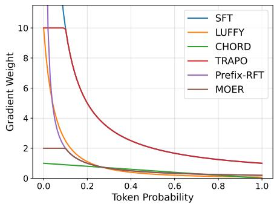  
Figure 6: Gradient weight curves of different off-policy objectives.

Table 5: Performance of MOER with scaled offpolicy objectives on math and general domain reasoning benchmarks (average scores).
<table><tr><td>Off-Policy Objective</td><td>Math</td><td>General</td></tr><tr><td>MOER</td><td>49.1</td><td>59.0</td></tr><tr><td>w/ LUFFY Loss</td><td>48.2</td><td>58.0</td></tr><tr><td>w/ CHORD Loss</td><td>48.9</td><td>56.5</td></tr><tr><td>w/ Prefix-RFT Loss</td><td>46.9</td><td>57.1</td></tr></table>

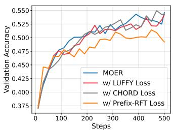  
(a) Validation Accuracy

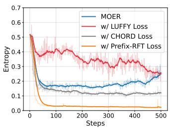  
(b) Entropy

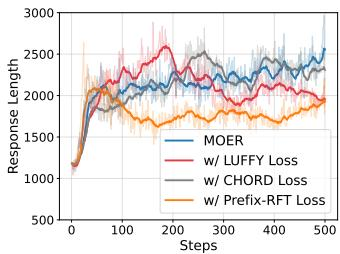  
(c) Response Length  
Figure 7: Training dynamics of different off-policy objectives.

## B ANALYSIS ON CLIPPING OPERATION FOR ON-POLICY TOKENS

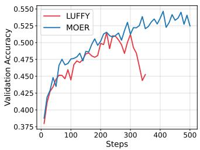  
(a) Validation Accuracy

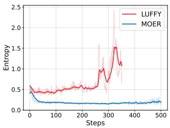  
(b) Entropy

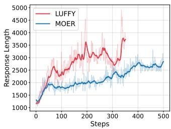  
(c) Response Length  
Figure 8: Training dynamics of LUFFY and MOER under different rollout/update batch size settings. When the rollout batch size is 64 and the update batch size is 16, i.e., the updates become more off-policy, LUFFY collapses in the middle of training, while MOER remains stable.

The clipping operation on the importance sampling (IS) ratio serves as a trust-region safeguard in PPO (Schulman et al., 2017) and GRPO (Shao et al., 2024), preventing destructively large policy updates. LUFFY (Yan et al., 2026) removes it to allow greater flexibility in updating toward off-policy actions, but this exposes training to unbounded IS ratios.

As shown in Figure 4, LUFFY already exhibits late-stage instability under the default setting, i.e., the rollout batch size is 128 and the update batch size is 64. This instability is substantially amplified when updates become more off-policy: as illustrated in Figure 8, with rollout batch size 64 and update batch size 16, i.e., four gradient steps per rollout on increasingly stale data, LUFFY collapses in the middle of training with degrading performance and exploding entropy, since tokens whose probabilities have drifted from the rollout policy receive excessively large IS ratios and unbounded gradients, an effect that compounds with each additional gradient step. In contrast, MOER clips the IS ratio of on-policy tokens and remains stable under both settings. Nevertheless, as presented in Figure 10 (c) of Appendix F, the clipping coefficients require careful tuning: the default symmetric coefficients of $\mathrm { G R P O } ( \epsilon _ { l o w } = \epsilon _ { h i g h } = 0 . 2 )$ cause entropy collapse, whereas our asymmetric coefficients $( \epsilon _ { l o w } = 0 . 2 $ $\epsilon _ { h i g h } = 0 . 2 4 )$ keep entropy in a stable range, neither collapsing nor exploding.

## C ACCURACY OF PREFIX-CONDITIONED COMPLETIONS

To examine how the benefit of expert prefix guidance evolves during training, we track the accuracy of prefix-conditioned completions together with that of pure on-policy rollouts in Figure 9. Two observations stand out. First, prefix-conditioned completions consistently achieve higher accuracy than on-policy rollouts, confirming that expert prefixes provide effective guidance throughout the entire training process. Second, the gap between the two curves steadily closes: as the actual prefix ratio decays and the policy strengthens, the completion accuracy gradually converges towards the on-policy accuracy, indicating that the model progressively internalizes the reasoning ability that the prefix initially provides. Thus, the expert guidance diminishes over training, which supports the design of the decaying prefix schedule: guidance is most beneficial in early training and can be safely faded out as the policy’s self-exploration capability strengthens.

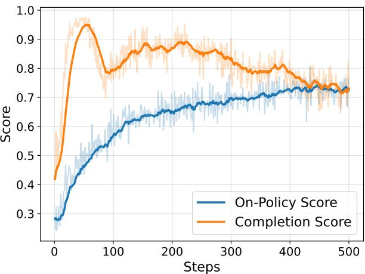  
Figure 9: Accuracy of on-policy rollouts and prefix-conditioned completions along training. Note that the first 50 steps are warm-up stage, where the prefix is the full expert CoT.

## D CODE GENERATION EXPERIMENTS

Table 6: Results on the LiveCodeBench benchmark. We report the pass@1, entropy, and response length of MOER and LUFFY.
<table><tr><td>Method</td><td>Pass@1</td><td>Entropy</td><td>Response Length</td></tr><tr><td>LUFFY</td><td>33.8</td><td>0.453</td><td>1903</td></tr><tr><td>MOER</td><td>38.3</td><td>0.246</td><td>668</td></tr></table>

We use CodeForces-CoTs (Penedo et al., 2025) as the training set. During preprocessing, we filter out samples whose prompt and response lengths exceed 1024 and 8192 tokens, respectively, and split the remaining data into 13000 training samples and 1402 validation samples. We use the public test cases to verify the correctness of the generated code, and remove these test cases from the input prompts to prevent reward hacking. We adopt LiveCodeBench-CPP (Jain et al., 2025) as the evaluation benchmark and Qwen2.5-Instruct-7B as the base model.

We compare MOER with LUFFY, increasing LUFFY’s policy shaping coefficient γ from 0.1 to 0.2 to stabilize its training. We train the models for 380 steps. All other hyperparameters follow Sec. 5.1.

As shown in Table 6, MOER achieves substantially stronger coding performance than LUFFY, while maintaining smaller yet healthy entropy and producing much shorter responses. These results indicate that the gains of MOER generalize beyond mathematical reasoning to code generation tasks.

## E RESULTS ON LARGER MODEL

To further validate the generalizability of our method on larger models, we evaluate MOER and LUFFY on Qwen2.5-Instruct-14B (Qwen et al., 2025). Note that the results of ReLIFT are not included due to unavailable checkpoint and prohibitive computational costs. As presented in Table 7, our method outperforms LUFFY across most mathematical reasoning tasks. Notably, MOER yields a more pronounced performance gain on 14B models compared to its 1.5B and 7B counterparts.

Table 7: Experiment results on mathematical reasoning benchmarks based on Qwen2.5-Instruct-14B.
<table><tr><td rowspan="2">Method</td><td colspan="6">Math Reasoning Performance</td></tr><tr><td>AIME 24/25</td><td>AMC MATH-500 Minerva</td><td></td><td></td><td>Olympiad</td><td>Avg.</td></tr><tr><td></td><td colspan="6">Qwen2.5-Instruct-14B</td></tr><tr><td>LUFFY</td><td>18.4/18.5</td><td>52.9</td><td>84.4</td><td>46.3</td><td>48.3</td><td>44.8</td></tr><tr><td>MOER</td><td>25.7/14.3</td><td>54.9</td><td>85.2</td><td>43.0</td><td>52.0</td><td>45.9</td></tr></table>

Notably, while LUFFY leads to training collapse in the middle of training, MOER still guarantees training stability throughout the entire optimization process.

## F ABLATION STUDY ON HYPERPARAMETERS

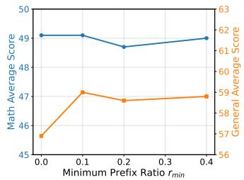  
(a) Minimum Prefix Ratio $r _ { m i n }$

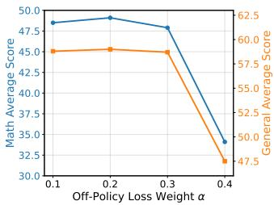  
(b) Off-Policy Loss Weight α

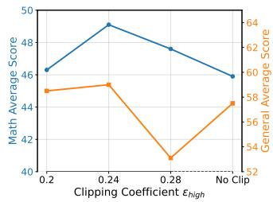  
(c) Clipping Coefficient $\epsilon _ { h i g h }$

Figure 10: Ablation study on hyperparameters of MOER. The blue and orange lines denote the math and general domain average scores, respectively.

In this section, we conduct an ablation study on some critical hyperparameters in MOER, including the minimum prefix ratio $r _ { m i n }$ , off-policy loss weight α, and clipping coefficient $\epsilon _ { h i g h }$ . Note that the experimental setting is consistent with Sec. 5.4.

Minimum prefix ratio $r _ { m i n } .$ As shown in Figure 10 (a), the performance on both math and general domain benchmarks varies only marginally across different values of $r _ { m i n }$ , indicating that MOER is relatively robust to the minimum prefix ratio. We set $r _ { m i n } = 0 . 1$ 1 by default.

Off-policy loss weight α. As shown in Figure 10 (b), $\alpha = 0 . 2$ achieves the best overall performance. A smaller weight under-utilizes expert guidance, while an excessively large weight strengthens off-policy supervision too aggressively and degrades performance.

Clipping coefficient $\mathbf { \epsilon } _ { h i g h } .$ . As shown in Figure 10 (c), $\epsilon _ { h i g h } = 0 . 2 4$ yields the best performance. Notably, since $\epsilon _ { l o w }$ is fixed at 0.2, setting $\epsilon _ { h i g h } = 0 . 2$ degenerates to the symmetric clipping of standard GRPO, which leads to entropy collapse and finally degraded response diversity. Conversely, an overly large $\epsilon _ { h i g h }$ , or removing the clipping operation entirely, causes instability and ultimately suboptimal performance, which is consistent with our analysis in Appendix B.

## G PASS@K RESULTS

To verify whether MOER incentivizes the model’s intrinsic reasoning capacity rather than merely increasing the sampling probability of knowledge already present in the base model, we evaluate our method under varying computational budgets. Specifically, we report the pass@k results (k ∈ $\{ 2 ^ { 0 } , 2 ^ { 1 } , \dots , 2 ^ { 8 } \}$ ) of the Qwen2.5-Math-7B base model, SFT, RL (GRPO), LUFFY, and MOER on the challenging AIME 2025 benchmark in Figure 11.

The results indicate that both mix-policy methods, MOER and LUFFY, consistently outperform the base model and standard RL across all sampling budgets (k). In the low-budget regime $( k \leq 2 ^ { 4 } )$ SFT achieves slightly higher accuracy than mix-policy methods due to its concentrated probability mass on standard solution trajectories. However, as the computational budget increases $( k \geq 2 ^ { 5 } )$ the scaling curves of MOER and LUFFY cross that of SFT and continue to ascend sharply, reaching 66.7% pass@28 performance compared to SFT’s 60.5%. This crossover demonstrates that MOER genuinely enhances the model’s underlying problem-solving capability and solution diversity rather than overfitting to superficial response patterns.

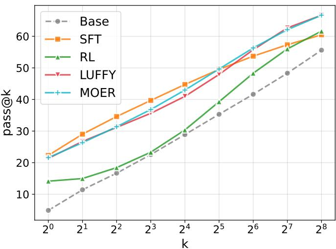  
Figure 11: Pass@k results of MOER and baselines on the AIME 2025 benchmark. The base model is Qwen2.5-Math-7B. We report the results with $k = 2 ^ { 0 } , 2 ^ { 1 } , . . . , 2 ^ { 8 }$

Furthermore, while MOER exhibits scaling performance similar to LUFFY on this mathematical benchmark, it achieves this parity with notably superior general-domain utility, shorter response lengths, and better training stability (as detailed in Sec. 5.4). This confirms that MOER maintains high reasoning efficiency and generalizability without incurring superfluous generation overhead during sampling.