# MUTING TOKENS: EXPLORING TOKEN SPARSIFICATION FOR EFFICIENT AUDIO TRANSFORMERS

Shreya Sajid 1 Fabrizio Julian Piva † 2 Hiram Rayo Torres Rodriguez † 2 Elif Ceren Gok Yildirim 1 Murat Onur Yildirim 1 Joaquin Vanschoren 1

s.sajid@tue.nl, fabriziojpiva@gmail.com, hiram.rayotorresrodriguez@nxp.com, e.c.gok@tue.nl, m.o.yildirim@tue.nl, j.vanschoren@tue.nl

## ABSTRACT

Transformer-based models have shown strong performance across diverse tasks, but their reliance on self-attention mechanisms often leads to high computational costs. Token sparsification, which reduces the number of tokens processed in transformer layers, offers a promising solution to maintain performance while improving efficiency. However, although widely studied in the vision and language domains, token sparsification remains underexplored in audio, with existing work often limited to a single method, model size, or dataset. This work presents a comprehensive evaluation of token sparsification techniques for audio transformers. We assess a range of token pruning and merging strategies across multiple datasets and model sizes, under both post-training and fine-tuning settings. Furthermore, we introduce a novel sparsification approach that combines attention scores with spectral cues derived from the frequency content of token embeddings. Our experiments show that frequency-aware approaches, particularly those based on spectral flatness and low-frequency energy, consistently outperform attention-only methods. We also find that sparsification based on spectrogram patch intensity is especially effective for longer audio inputs. These results highlight the value of incorporating frequency-domain and input-specific information into sparsification strategies to enhance performance in audio tasks.

## 1 INTRODUCTION

Transformer-based models have demonstrated the ability to achieve state-of-the-art performance across various domains such as Natural Language Processing (NLP) (Devlin et al., 2019; Vaswani et al., 2017) and Computer Vision (Khan et al., 2022; Radford et al., 2021). However, the self-attention mechanism can be computationally intensive, as its complexity scales quadratically with the number of input tokens (Bolya et al., 2023; Fayyaz et al., 2022). To address this challenge, recent work has explored compression techniques such as pruning (Chavan et al., 2022; Song et al., 2022), quantization (Li et al., 2022b; Lin et al., 2023), and knowledge distillation (KD) (Rao et al., 2021b; Ren et al., 2021), in an effort to reduce model size and inference latency while maintaining task performance.

Recently, token sparsification, a transformer-specific optimization method that discards, merges, or refines input tokens, has emerged as a promising alternative to reduce the computational cost of self-attention. For example, the Expediting Vision Transformers (EViT) method achieves up to 50% faster inference on ImageNet (Deng et al., 2009), with only a 1.3 percentage point drop in accuracy when retaining 50% of the tokens, referred to as the keep rate (Liang et al., 2022a).

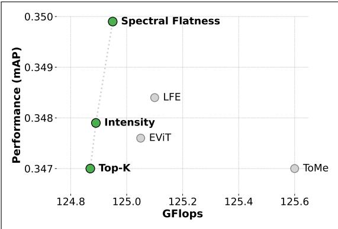  
Figure 1. Post-training sparsification results on the AST-Base (Gong et al., 2021) model, evaluated on AudioSet-20K (Gemmeke et al., 2017) at a 50% keep rate. Methods that include frequencydomain cues, such as the proposed Spectral Flatness (SF) and the adapted Low-Frequency Energy (LFE) (Wang et al., 2022b), outperform others in terms of mean average precision (mAP), a standard metric for multi-label classification. The baseline (without sparsification) achieves an average mAP of 0.3572. The Pareto front is highlighted to illustrate the performance-efficiency tradeoff.

A growing body of work has explored token sparsification techniques across various tasks, particularly in image classification (Bonnaerens & Dambre, 2023; Chen et al., 2022b; Huang et al., 2024; Kong et al., 2022; Liang et al., 2022a; Wu et al., 2023), video classification (Ryoo et al., 2022; Wu et al., 2024), and even large language models (Cao et al., 2023; Chen et al., 2024; Jiang et al., 2023; Liu et al., 2023). Although Vision Transformers (ViT) have demonstrated notable success in audio tasks by using spectrograms as input representations, the application of token sparsification in this domain remains largely underexplored (Chen et al., 2022a; Gong et al., 2021; 2022a;b; Huang et al., 2022). This gap is particularly important because spectrogram inputs yield more tokens as the input duration increases, which can make self-attention increasingly expensive for longer audio clips (Gong et al., 2021). Addressing this challenge could not only help advance efficient transformers’ research, but also enable practical, large-scale deployment of audiobased systems, from everyday voice assistants to real-time transcription services at the edge.

Recent work (Lee & Lee, 2025) has begun to explore the effectiveness of token sparsification in audio tasks. However, while showing promising results, this study presents considerable limitations. First, it restricts its scope to only two sparsification methods, Top-K pruning (Haurum et al., 2022a) and Intensity pruning (Lee & Lee, 2025), overlooking other promising approaches such as token merging (Bolya et al., 2023). Second, their analysis is restricted to only the ViT-Base model (Dosovitskiy et al., 2021) limiting the generalizability of their conclusions to a single model size. Third, the study focuses solely on applying sparsification during fine-tuning, whereas many real-world deployment scenarios favor post-training sparsification methods, mainly due to the widespread availability of pretrained models, and the training costs associated with larger datasets (Chen et al., 2025; Ilhan et al., 2024). Finally, it reports suboptimal performance of the intensity pruning method at low keep rates, without investigating the potential influence of inputdependent factors such as the audio duration.

In this work, we systematically evaluate a broad range of token sparsification methods for audio transformers, examining their performance across multiple model sizes and datasets, under two key settings: fine-tuning and posttraining sparsification. To ensure a fair comparison, we conduct all experiments within a unified training and inference pipeline, establishing a consistent benchmark for evaluating sparsification techniques in this domain. We also revisit the intensity pruning method and show that its effectiveness improves when combined with attention scores. Furthermore, we propose a novel sparsification approach that integrates attention and frequency-based cues, drawing on insights from audio signal processing. As illustrated in Fig. 1, methods that incorporate frequency-domain information consistently outperform existing sparsification approaches across our experimental setup. Our contributions can be summarized as:

• We conduct a comprehensive evaluation of token sparsification methods for audio transformers, including token pruning and merging approaches under a unified evaluation setup.

• We demonstrate the effectiveness of intensity-based pruning, showing that when combined with attention scores, it can outperform pure attention methods for audio inputs longer than 2 seconds across our experimental setup.

• We introduce a novel sparsification method based on spectral flatness, and show that it can consistently improve performance across a wide range of model sizes and datasets.

## 2 RELATED WORK

## 2.1 Token Sparsification: Overview

Token sparsification reduces the number of tokens processed within transformer layers, with existing methods broadly falling into two main categories (Haurum et al., 2022a). Token pruning methods (Dou et al., 2023; Fayyaz et al., 2022; Kong et al., 2022; Li et al., 2022a; Liang et al., 2022b; Long et al., 2022; Pan et al., 2021; Tang et al., 2022; Xu et al., 2022b; Yin et al., 2022) reduce the number of tokens by completely removing tokens, at the risk of discarding useful information. In contrast, token merging methods (Bolya et al., 2023; Haurum et al., 2022b; Marin et al., 2021; Renggli et al., 2022; Ryoo et al., 2021; Wu et al., 2021; Xu et al., 2022a; Zeng et al., 2022; Zong et al., 2022) combine multiple tokens into a single token or cluster, but may introduce noise through averaging.

Our study includes representative methods from both sparsification categories to ensure diversity in evaluation, addressing the lack of systematic assessment in audio tasks.

## 2.2 Token Sparsification Methods for Audio

Recent efforts to apply token sparsification to audio tasks have primarily adapted techniques originally developed for vision models. Applied on a post-training manner, Token Merging (ToMe) (Bolya et al., 2023) merges similar tokens to reduce the input size, achieving substantial throughput gains with merely a 0.4 percentage point drop in $\mathrm { m A P }$ on AudioSet-2M (Gemmeke et al., 2017). However, its evaluation is limited to a single dataset and a masked autoencoding (MAE) framework (He et al., 2021; Huang et al., 2022), which is inherently designed to operate on sparse inputs. This may reduce the model’s sensitivity to sparsification, making it unclear how ToMe performs in settings that rely on full token visibility. Without evaluation on non-MAE models, its general applicability remains uncertain, an aspect we address in this work.

A different line of work explores sparsification in audio transformers during training. PaSST (Gong et al., 2022a) employs “patchout” which randomly drops a subset of spectrogram patches to reduce computation and act as a regularizer. While effective, these approaches require training with patchout, limiting their practicality. In contrast, posttraining sparsification offers a broadly applicable and costefficient alternative, especially when retraining is costly or infeasible.

## 2.3 Studies on Token Sparsification for Audio

Beyond these early efforts, recent work has begun to explore sparsification methods specifically for audio. As mentioned in Sec. 1, the authors in (Lee & Lee, 2025) investigate Top-K pruning and Intensity pruning. While this represents a promising direction, the study remains narrow in scope, focusing on just two methods, a single ViT-Base configuration, and exclusively on fine-tuning scenarios. This highlights the need for broader studies that evaluate different sparsification approaches, model sizes, and across both fine-tuning and post-training contexts, a gap our work seeks to address.

## 3 METHODOLOGY

In this study, we pursue two complementary directions. First, we evaluate established token sparsification methods developed for vision, in audio tasks, providing the first systematic comparison of their behavior across audio benchmarks. Second, we propose lightweight, task-specific token importance estimation strategies that incorporate audiorelevant cues such as spectrogram intensity and frequencydomain features.

## 3.1 Token Sparsification Methods

We evaluate three sparsification methods: Top-K (Haurum et al., 2022a), Expediting Vision Transformers (EViT) (Liang et al., 2022a) and ToMe (Bolya et al., 2023). These methods were selected based on their strong performance in vision tasks (Haurum et al., 2022a) and their representation of the two main paradigms in token sparsification: pruning (Top-K and EViT) and merging (ToMe). Note that while some of these methods have been applied to audio in a limited setting, as mentioned in Sec. 2.2, they have not yet been systematically compared or evaluated across benchmarks. Top-K is a widely used baseline, where the attention between spatial tokens and the class (CLS) token are used to rank token importance. At each reduction stage $s ,$ the $K _ { s }$ most attended tokens are kept. EViT extends this approach by introducing a fused token that preserves information from discarded tokens. At each stage s, tokens not in the Top-K set are averaged and weighted by their CLS attention scores. ToMe reduces tokens by merging similar token pairs. The token set is split into two partitions, and each token is matched to its most similar counterpart based on cosine similarity. The top matching pairs are then merged by averaging their features.

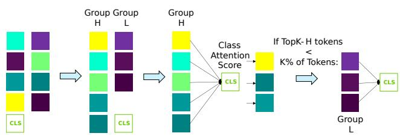  
Figure 2. Intensity-guided token pruning. Tokens are divided into high- (H) and low- (L) intensity groups based on an applied threshold. The high-intensity set is then ranked using CLS attention scores, and the Top-K tokens are selected. If fewer than K tokens are available in H, the remaining slots are filled from the low-intensity set.

## 3.2 Task-specific Token Importance Estimation Strategies

Most sparsification methods rely on internal model signals, such as attention weights or intermediate representations like attention keys. However, in post-training settings where model parameters remain fixed, we hypothesize that lightweight, task-specific heuristics, can more effectively identify informative tokens, leading to improved performance under sparsification. In audio tasks, spectrograms encode energy across time and frequency, but these patterns may not be fully captured by attention alone (Ristea et al., 2022). Prior work highlights the utility of frequencydomain processing in transformers (Lee-Thorp et al., 2021; Patro et al., 2025; Rao et al., 2021a; Tamkin et al., 2020), and that structure may not always be visible in raw spectrograms (Atlas, 2003; Ezzat et al., 2007). Motivated by this, we explore three lightweight heuristics for token importance, one input patch intensity-based, and two frequency-based, that can be combined with many existing methods: 1) intensity, 2) low-frequency energy (Wang et al., 2022b) and 3) spectral flatness.

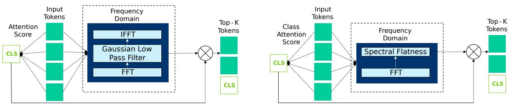  
Figure 3. Low-frequency Energy token pruning. Token embeddings are transformed to the frequency domain, where a Gaussian low-pass filter highlights low-frequency structure. The resulting energy scores are fused with attention scores to guide top-K token selection.  
Figure 4. Spectral flatness-guided token pruning. Token embeddings undergo Fast Fourier Transform (FFT) along the embedding dimension to compute spectral flatness, capturing tonal richness. These scores are combined with CLS attention to rank token importance.

Intensity. Following (Lee & Lee, 2025), we compute the mean log-Mel energy of each spectrogram patch as a lightweight salience proxy, based on the hypothesis that high intensity regions reflect stronger signal content. However, using intensity alone can be unreliable, as it can sometimes highlight background noise or nondiscriminative events with high energy (Bhattacharjee et al., 2022; Lee & Lee, 2025). We therefore use it as a coarse filter. At each layer, tokens are split into high and low intensity sets based using a dataset-specific threshold. The Top-K tokens are selected by ranking the high-intensity ones via CLS attention scores, with any remainder filled from the low-intensity pool (Fig. 2). This method is primarily intended to test whether incorporating spectrogram intensities improves attention-only sparsification and how it compares to frequency-aware approaches.

Low-Frequency Energy. Inspired by the Low-Frequency Components (LFC) model for vision transformers, we adopt their idea of using low-frequency energy (LFE) for token sparsification (Wang et al., 2022b). In their work, low-pass filtering of token embeddings was shown to preserve task-relevant content more effectively, aligning with the observation that transformers tend to favor low-frequency features (Dosovitskiy et al., 2021; Wang et al., 2022a). We extend this idea to audio by computing low-frequency energy within each token embedding, after patch extraction and projection. This provides a local measure of how much of the token’s representation is concentrated in low-frequency components. This score is combined with the token’s attention weight, allowing the model to prioritize tokens that are both attended and rich by low-frequency energy, as illustrated in Fig. 3.

Spectral Flatness. Spectral Flatness (SF) is a widely used measure in audio signal processing for quantifying the degree to which a signal resembles noise or contains structured, tonal components (Jayant & Noll, 1993; Seago et al., 2008). It is computed as the ratio of the geometric mean to the arithmetic mean of a signal’s magnitude spectrum, with lower values indicating pronounced spectral peaks typical of harmonic or speech-like content, and higher values corresponding to flatter, noise-like distributions (Boashash et al., 2015; Madhu, 2009). Motivated by these properties, we extend the use of SF to transformer token embeddings by computing it for each token, as illustrated in Fig. 4. We treat each embedding as a learned signal, using SF as a proxy for its internal organization, and hypothesize that lower flatness values indicate more structured and content-rich tokens. An illustrative example of this phenomenon is shown in Fig. 5, where two spectrogram patches yield token embeddings with contrasting spectral profiles. The token’s flatness score is combined with its attention to the CLS token, prioritizing tokens that are both spectrally structured and highly attended.

## 3.3 Evaluation Strategy

We aim to systematically evaluate token sparsification methods (Sec. 3.1) across multiple audio benchmarks, while also investigating the role of input- and frequency-aware token importance estimation strategies (Sec. 3.2). To understand both the practical and performance implications of sparsification, we evaluate all methods under two settings:

• Post-training Sparsification. Sparsification is applied only during inference, using already finetuned models.

• Sparsified Fine-tuning. Sparsification is applied during fine-tuning, starting from ImageNet-pretrained weights and adapting to the target audio dataset.

Using these two settings, we aim to understand the benefits and tradeoffs of sparsified fine-tuning over post-training sparsification, especially at lower keep rates.

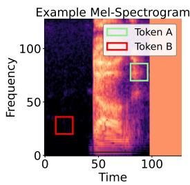  
(a) Example Mel spectrogram (Warden, 2018).

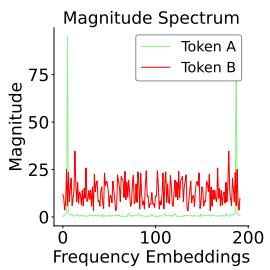  
(b) Corresponding magnitude spectra.  
Figure 5. Spectral flatness at the token level. (a) A spectrogram with two highlighted tokens. (b) FFT of corresponding token embeddings shows Token A has tonal peaks, while Token B has a flatter, noise-like spectrum - making Token A potentially more informative.

## 4 EXPERIMENTAL SETUP

Datasets. For this analysis, three well-established datasets are selected, each covering different audio sample lengths and task complexities. Speech Commands V2 (SPC) (Warden, 2018) comprises 105,829 1-second recordings of 35 spoken commands. The dataset is divided into 84,843 training samples, 9,981 validation samples, and 11,005 test samples. Environment Sound Classification (ESC50) (Piczak, 2015) consists of 2,000 5-second environmental sound recordings categorized into 50 classes. Its 5-fold cross-validation setup includes 1,600 training samples per fold, ensuring a reliable evaluation framework. AudioSet (AS-20K) (Gemmeke et al., 2017) is a large-scale multi-class dataset containing 10-second audio clips sourced from YouTube, labeled across 527 categories. The balanced training set consists of around 22,000 samples, while the evaluation set includes around 20,000 samples.

Backbone. We adopt the AST (Audio Spectrogram Transformer) (Gong et al., 2021) architecture as our backbone for all experiments. The sparsification methods are integrated into the AST model pretrained on ImageNet (Deng et al., 2009), using the standard DeiT-based (Touvron et al., 2020) configurations: Base (B), Small (S), and Tiny (T), with patch sizes of 16 × 16 and an overlap of 6 in both time and frequency, consistent with the default AST recipe.

Sparsification Allocation. As in previous work, the token sparsification module is placed between the attention and multi-layer perceptron (MLP) branches of each transformer block of the AST (Bolya et al., 2023). The most common and effective practice is to apply sparsification at three equally spaced points in the transformer, effectively dividing the network into four sections (Kong et al., 2022; Liang et al., 2022b; Long et al., 2022). This is the configuration adopted in our experiments. At each sparsification stage, a fixed keep rate $r \in \{ 0 . 2 5 , 0 . 5 0 , 0 . 7 0 , 0 . 9 0 \}$ is applied uniformly across all sparsified layers.

Implementation Details. All training and fine-tuning procedures follow the original AST setup (Gong et al., 2021). Specifically, AS-20K and ESC50 are finetuned for 25 epochs, while SPC is trained for 30 epochs. When token sparsification is enabled, all default masking strategies (e.g., SpecAugment (Park et al., 2019)) in AST are disabled to avoid redundancy, as sparsification inherently performs a form of data masking. All model variants (AST-B, AST-S, AST-T) are evaluated under the post-training sparsification setting to assess performance and efficiency across different model scales. For the sparsified fine-tuning experiments, we use only AST-B, as it is the default model size in the original AST implementation. To quantify the compute cost associated with different sparsification methods, we report the number of Floating Point Operations (FLOPs) per instance using a batch size of 1, measured via the DeepSpeed profiler (Aminabadi et al., 2020).

## 5 RESULTS & ANALYSIS

## 5.1 Post-Training Sparsification

Performance Across Methods and Model Sizes. Tables 2a, 2b, and 2c report performance across the AST-B, AST-S, and AST-T models, respectively. Results are shown for all datasets (SPC, ESC50, AS-20K) and across token keep rates from 90% down to 25%. We report the average of three runs.

From these results, we find that methods using token frequency information, particularly LFE and SF, consistently perform well across model sizes and datasets, frequently ranking among the top two methods in our setup. ToMe also shows competitive performance, especially on the Small and Tiny models with the ESC50 dataset, but its inconsistency on the AST-B model may suggest sensitivity to model scale or dataset characteristics. We hypothesize that this may be due to ToMe’s merging strategy, which can interfere with token semantics more noticeably in larger models where attention patterns are more specialized (Devlin et al., 2019).

Compute Cost Analysis. We report compute cost in terms of FLOPs for AS-20K using the AST-B model in Table 1. As expected, the number of FLOPs decreases consistently with lower keep rates across all datasets and methods, reflecting the expected reduction in attention computation as fewer tokens are retained. These trends validate that sparsification mechanisms function as intended, with lower keep rates leading to correspondingly lower compute cost. While this downward trend is consistent across methods, the actual savings differ slightly due to method-specific overheads. To illustrate the trade-off between performance and compute cost, we present Pareto front plots. In Fig. 1, we show results for AS-20K, while Fig. 6 shows SPC and ESC50 datasets, on AST-B. We find that frequency-domain methods such as Spectral Flatness (SF) and Low-Frequency Energy (LFE) consistently yield the highest performance across datasets, despite slightly higher computational overhead compared to simpler methods like Top-K. Results follow similar trends, showing the performance scalability of most methods across model sizes and tasks.

Table 1. GFLOPs of AST-B model on AS-20K after sparsification across keep rates (r). ↓ denotes percentage reductions over baseline. Maximum reductions per keep rate are highlighted in green.
<table><tr><td rowspan="3">Baseline r (%)</td><td colspan="4">AS-20K (GFLOPs)</td></tr><tr><td colspan="4">261.43</td></tr><tr><td>90</td><td>70</td><td>50</td><td>25</td></tr><tr><td>Top-K (Haurum et al., 2022a)</td><td> $2 2 2 . 2 8 ^ { \downarrow 1 5 . 0 \% }$ </td><td> $1 6 4 . 1 6 ^ { \downarrow 3 7 . 2 \% }$ </td><td> $1 2 4 . 8 5 ^ { \downarrow 5 2 . 3 \% }$ </td><td> $9 3 . 7 4 ^ { \downarrow 6 4 . 3 \% }$ </td></tr><tr><td>EViT (Liang et al., 2022a) ToMe (Bolya et al., 2023)</td><td> $2 2 2 . 6 1 ^ { \downarrow 1 4 . 8 \% }$   $2 2 6 . 1 1 ^ { \downarrow 1 3 . 5 \% }$ </td><td> $1 6 4 . 4 5 ^ { \downarrow 3 7 . 1 \% }$   $1 6 5 . 7 7 ^ { \downarrow 3 6 . 6 \% }$ </td><td> $1 2 5 . 0 5 ^ { \downarrow 5 2 . 2 \% }$ </td><td> $9 3 . 9 9 ^ { \downarrow 6 4 . 0 \% }$ </td></tr><tr><td></td><td></td><td></td><td> $1 2 5 . 6 0 ^ { \downarrow 5 2 . 0 \% }$ </td><td></td></tr><tr><td>Intensity</td><td> $2 2 2 . 2 8 ^ { \downarrow 1 5 . 0 \% }$ </td><td> $1 6 4 . 1 6 ^ { \downarrow 3 7 . 2 \% }$ </td><td> $1 2 4 . 8 9 ^ { \downarrow 5 2 . 2 \% }$ </td><td> $9 3 . 7 9 ^ { \downarrow 6 4 . 1 \% }$ </td></tr><tr><td>LFE (Wang et al., 2022b)</td><td> $2 2 2 . 6 6 ^ { \downarrow 1 4 . 8 \% }$ </td><td> $1 6 4 . 4 6 ^ { \downarrow 3 7 . 1 \% }$ </td><td> $1 2 5 . 1 0 ^ { \downarrow 5 2 . 1 \% }$ </td><td> $9 3 . 9 5 ^ { \downarrow 6 4 . 1 \% }$ </td></tr><tr><td>SF</td><td> $2 2 2 . 4 1 ^ { \downarrow 1 4 . 9 \% }$ </td><td> $1 6 4 . 2 6 ^ { \downarrow 3 7 . 1 \% }$ </td><td> $1 2 4 . 9 5 ^ { \downarrow 5 2 . 2 \% }$ </td><td> $9 3 . 8 4 ^ { \downarrow 6 4 . 1 \% }$ </td></tr></table>

## 5.2 Sparsified Fine-tuning

Fig. 7 shows how task performance varies with decreasing keep rates across datasets under sparsified fine-tuning, with results averaged over three runs.

Across all datasets, we observe that performance remains robust even under aggressive sparsification, with most methods maintaining accuracy close to the baseline at a 25% keep rate. This indicates that when sparsification is integrated during training, the model is able to adapt to the imposed sparsity, learning to preserve task-relevant information despite reduced number of tokens. Furthermore, the performance differences between methods are less pronounced than in the post-training setting. This suggests that the model learns to accommodate whichever tokens are retained during training, thereby reducing sensitivity to the specific scoring heuristic. As a result, even simple methods like Top-K remain competitive, and the relative advantage of more informed strategies, such as SF and LFE, is reduced.

In summary, sparsified fine-tuning makes the model less sensitive to the specific sparsification heuristic, as it learns to adapt to the retained tokens. This contrasts with posttraining sparsification, where token importance is fixed and the choice of heuristic plays a more decisive role.

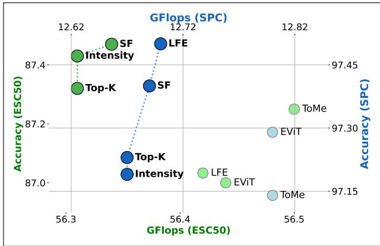  
Figure 6. Post-training sparsification results on the AST-B (Gong et al., 2021) model evaluated on SPC and ESC50 at a 50% keep rate. Methods leveraging frequency-domain cues, such as Spectral Flatness (SF) and Low-Frequency Energy (LFE) (Wang et al., 2022b), outperform other methods in terms of accuracy.

## 5.3 Comparative & Controlled Studies

Contribution of Frequency-domain Information. To understand the source of performance differences between SF and LFE, we conduct a comparative study that isolates the effects of their frequency metrics and attention formulations. SF uses standard CLS-token attention (TopK-CLS), and LFE on the other hand, uses a head-weighted attention variant (TopK-Wt) (Wang et al., 2022b). To isolate the impact of these factors, we evaluate all four combinations of frequency metric (SF or LFE) and attention type (TopK-CLS or TopK-Wt). Each configuration is run five times to account for randomness.

As shown in Fig. 8, SF consistently outperforms its TopKonly counterparts across keep rates and attention variants. In contrast, while LFE generally improves over its baseline, it occasionally underperforms on AS-20K and ESC50, suggesting that emphasizing low-frequency components may not universally benefit performance and may depend on dataset characteristics. Furthermore, TopK-Wt tends to outperform TopK-CLS, especially at lower keep rates (< 70%), which may be because TopK-Wt also includes peer-token attention, offering a more distributed importance signal than CLS-token attention alone.

Table 2. Post-training sparsification results across model sizes.  
(a) Post-training sparsification results for the AST-B model across keep rates (r). Best performing methods are in bold, second-best are underlined, and results outperforming the AST-B baseline are highlighted. SF consistently achieves the best performance across most keep rates and datasets, while LFE also performs competitively, particularly on SPC.
<table><tr><td></td><td colspan="4">SPC (Acc(%))</td><td colspan="4">ESC50 (Acc(%))</td><td colspan="4">AS-20K (mAP)</td></tr><tr><td>AST-B</td><td colspan="4">97.67</td><td colspan="4">89.42</td><td colspan="4">0.3572</td></tr><tr><td>r (%)</td><td>90</td><td>70</td><td>50</td><td>25</td><td>90</td><td>70</td><td>50</td><td>25</td><td>90</td><td>70</td><td>50</td><td>25</td></tr><tr><td>Top-K (Haurum et al., 2022a)</td><td>97.46</td><td>97.43</td><td>97.21</td><td>88.73</td><td>89.02</td><td>88.42</td><td>87.32</td><td>78.47</td><td>0.3557</td><td>0.3546</td><td>0.3470</td><td>0.2956</td></tr><tr><td>EViT (Liang et al., 2022a)</td><td>97.44</td><td>97.27</td><td>97.29</td><td>90.03</td><td>88.77</td><td>88.17</td><td>87.00</td><td>75.42</td><td>0.3552</td><td>0.3545</td><td>0.3476</td><td>0.2981</td></tr><tr><td>ToMe (Bolya et al., 2023)</td><td>97.51</td><td>97.47</td><td>97.14</td><td></td><td>88.76</td><td>88.45</td><td>87.25</td><td></td><td>0.3567</td><td>0.3539</td><td>0.3470</td><td></td></tr><tr><td>Intensity</td><td>97.55</td><td>97.46</td><td>97.19</td><td>88.63</td><td>89.10</td><td>88.52</td><td>87.43</td><td>78.62</td><td>0.3567</td><td>0.3549</td><td>0.3479</td><td>0.3033</td></tr><tr><td>LFE (Wang et al., 2022b)</td><td>97.66</td><td>97.62</td><td>97.50</td><td>93.49</td><td>89.12</td><td>88.45</td><td>87.02</td><td>78.92</td><td>0.3568</td><td>0.3546</td><td>0.3484</td><td>0.3012</td></tr><tr><td>SF</td><td>97.68</td><td>97.66</td><td>97.40</td><td>89.00</td><td>89.20</td><td>88.67</td><td>87.47</td><td>78.97</td><td>0.3576</td><td>0.3564</td><td>0.3499</td><td>0.3007</td></tr></table>

(b) Post-training sparsification results for the AST-S model across keep rates (r). Best performing methods are in bold, second-best are underlined, and results outperforming the AST-S baseline are highlighted. SF and LFE dominate across datasets, mirroring the trends observed with AST-B. ToMe performs competitively on ESC50, indicating that token merging may be effective for smaller models.
<table><tr><td></td><td colspan="4">SPC (Acc(%))</td><td colspan="4">ESC50 (Acc(%))</td><td colspan="4">AS-20K (mAP)</td></tr><tr><td>AST-S</td><td colspan="4">97.21</td><td colspan="4">83.75</td><td colspan="4">0.3105</td></tr><tr><td>r (%)</td><td>90</td><td>70</td><td>50</td><td>25</td><td>90</td><td>70</td><td>50</td><td>25</td><td>90</td><td>70</td><td>50</td><td>25</td></tr><tr><td>Top-K (Haurum et al., 2022a)</td><td>96.97</td><td>97.04</td><td>96.83</td><td>83.60</td><td>83.10</td><td>81.65</td><td>79.23</td><td>69.03</td><td>0.3058</td><td>0.3037</td><td>0.2995</td><td>0.2688</td></tr><tr><td>EViT (Liang et al., 2022a)</td><td>96.96</td><td>97.02</td><td>96.84</td><td>89.39</td><td>83.03</td><td>81.65</td><td>79.30</td><td>69.40</td><td>0.3052</td><td>0.3018</td><td>0.2950</td><td>0.2672</td></tr><tr><td>ToMe (Bolya et al., 2023)</td><td>97.16</td><td>96.93</td><td>96.32</td><td></td><td>83.33</td><td>83.15</td><td>80.80</td><td></td><td>0.3057</td><td>0.3029</td><td>0.3001</td><td></td></tr><tr><td>Intensity</td><td>96.89</td><td>96.95</td><td>96.76</td><td>83.33</td><td>83.08</td><td>82.58</td><td>78.03</td><td>69.60</td><td>0.3068</td><td>0.3043</td><td>0.2996</td><td>0.2734</td></tr><tr><td>LFE (Wang et al., 2022b)</td><td>97.21</td><td>97.24</td><td>97.21</td><td>93.74</td><td>83.05</td><td>81.50</td><td>78.88</td><td>68.33</td><td>0.3089</td><td>0.3068</td><td>0.3037</td><td>0.2792</td></tr><tr><td>SF</td><td>97.21</td><td>97.25</td><td>97.20</td><td>82.37</td><td>83.20</td><td>81.75</td><td>79.23</td><td>69.35</td><td>0.3093</td><td>0.3074</td><td>0.3049</td><td>0.2799</td></tr></table>

(c) Post-training sparsification results for the AST-T model across keep rates (r). Best performing methods are in bold, second-best are underlined, and results outperforming the AST-T baseline are highlighted. SF and LFE rank quite consistently among the top, showing strong scalability across model sizes, while ToMe excels on ESC50 but is less consistent across other datasets.
<table><tr><td></td><td colspan="4">SPC (Acc(%))</td><td colspan="4">ESC50 (Acc(%))</td><td colspan="4">AS-20K (mAP)</td></tr><tr><td>AST-T</td><td colspan="4">96.99</td><td colspan="4">81.15</td><td colspan="4">0.2759</td></tr><tr><td>r (%)</td><td>90</td><td>70</td><td>50</td><td>25</td><td>90</td><td>70</td><td>50</td><td>25</td><td>90</td><td>70</td><td>50</td><td>25</td></tr><tr><td>Top-K (Haurum et al., 2022a)</td><td>96.37</td><td>96.21</td><td>95.93</td><td>88.06</td><td>80.58</td><td>78.65</td><td>73.95</td><td>56.23</td><td>0.2721</td><td>0.2699</td><td>0.2601</td><td>0.2189</td></tr><tr><td>EViT (Liang et al., 2022a)</td><td>96.35</td><td>96.19</td><td>95.87</td><td>92.37</td><td>80.35</td><td>78.53</td><td>73.78</td><td>57.03</td><td>0.2668</td><td>0.2632</td><td>0.2591</td><td>0.2161</td></tr><tr><td>ToMe (Bolya et al., 2023)</td><td>97.01</td><td>96.26</td><td>95.00</td><td></td><td>81.25</td><td>79.53</td><td>74.13</td><td></td><td>0.2731</td><td>0.2701</td><td>0.2603</td><td></td></tr><tr><td>Intensity</td><td>97.02</td><td>96.62</td><td>96.12</td><td>89.12</td><td>80.47</td><td>79.01</td><td>73.61</td><td>54.91</td><td>0.2695</td><td>0.2654</td><td>0.2599</td><td>0.2233</td></tr><tr><td>LFE (Wang et al., 2022b)</td><td>97.00</td><td>97.03</td><td>96.81</td><td>91.36</td><td>80.40</td><td>78.70</td><td>73.45</td><td>53.68</td><td>0.2699</td><td>0.2675</td><td>0.2624</td><td>0.2391</td></tr><tr><td>SF</td><td>97.02</td><td>96.98</td><td>96.71</td><td>87.87</td><td>80.63</td><td>78.70</td><td>74.20</td><td>56.73</td><td>0.2728</td><td>0.2709</td><td>0.2638</td><td>0.2399</td></tr></table>

Overall, incorporating frequency-domain information yields modest but consistent gains over attention-only pruning methods in post-training settings.

Effect of Input Duration on Intensity-Based Pruning. In Section 5.1 (Table 2a), we observed that intensity-based pruning outperforms purely attention-based methods (Top-K, EViT) on ESC50 and AS-20K across most settings, whereas its advantage is less pronounced on SPC. This relatively strong performance on datasets with longer audio clips (5 and 10 seconds, respectively) - compared to weaker results on SPC (with 1-second clips) raises the question of a potential dependency on input duration.

To investigate this, we conduct a controlled experiment comparing intensity-based pruning with a purely attention-based Top-K method. We apply random temporal windowing at inference time on AS-20K and ESC50, simulating input lengths ranging from 1 second to the full duration of each dataset (i.e., 1s to 10s for AS-20K, and 1s to 5s for ESC50). Each result is averaged over six runs to account for randomness. The sparsification configuration is fixed to the most aggressive setting, with a keep rate of only 25%.

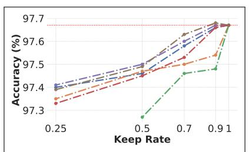  
(a) SPC

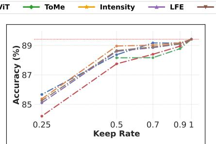  
(b) ESC50

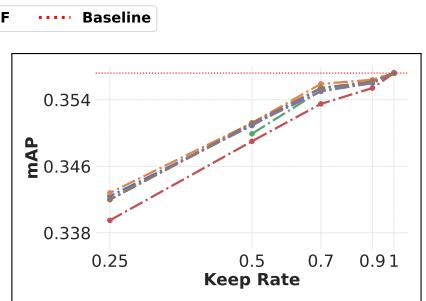  
(c) AS-20K

Figure 7. Sparsified Fine-tuning: Performance across varying keep rates. Frequency-based methods (SF, LFE), as well as pure attention-based pruning methods (Top-K, EViT), consistently maintain high performance across tasks. Most methods retain competitive performance down to a 50% keep rate. Overall, the performance differences between methods are not very significant, indicating that multiple sparsification methods can be equally effective when fine-tuned.  
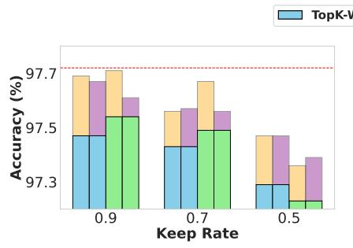  
(a) SPC

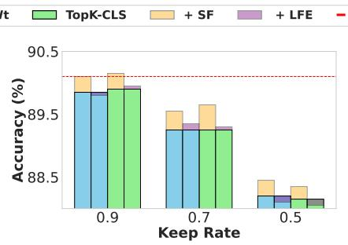  
(b) ESC50

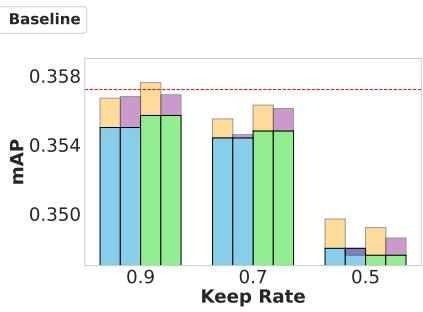  
(c) AS-20K  
Figure 8. Performance comparison of frequency-based methods (LFE and SF) against attention-only baselines (TopK-Wt and TopK-CLS). SF slightly but consistently outperforms attention-based baselines across keep rates, while LFE shows competitive results but occasionally underperforms on ESC50 and AS-20K.

As shown in Fig. 9, intensity-based pruning consistently outperforms the Top-K method for audio segments longer than 2 seconds across both datasets. These results provide further empirical support for our hypothesis and suggest that intensity-based pruning works better for longer inputs. We attribute this effect to the interaction between input duration and token redundancy. First, longer audio clips yield more tokens and often contain repeated or sustained events, introducing redundancy. Therefore, even after sparsification, enough informative content remains. Second, they tend to include clear low-intensity regions, such as silence or background noise, which can be safely discarded. In contrast, short clips (1-2 seconds) typically contain a single spoken word or sound event, where nearly all tokens contribute to the core signal. These inputs offer little redundancy and minimal variation in intensity, making it harder to distinguish unimportant tokens. As a result, sparsification based on intensity can mistakenly remove critical information, leading to performance degradation.

## 5.4 Practical Guidelines

Based on our analysis, we outline several recommendations for effectively applying token sparsification in audio transformers:

• Frequency-aware heuristics, particularly Spectral Flatness (SF) and Low-Frequency Energy (LFE), quite consistently outperform other methods. SF stands out as one of the most practical choices for post-training sparsification, as it requires no additional tuning and generalizes well across configurations. LFE, while also effective, involves tuning a low-pass filter cutoff to maximize performance, which may require datasetspecific calibration.

• For scenarios involving longer input durations (e.g., > 2 seconds), intensity-based pruning can also outperform other standard methods mainly for larger model sizes, but it requires threshold tuning to distinguish between high- and low-energy patches.

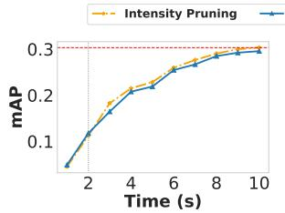  
(a) AS-20K

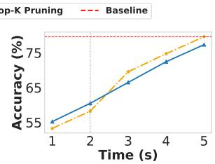  
(b) ESC50  
Figure 9. Token pruning performance as a function of input duration. Intensity Pruning consistently outperforms Top-K pruning for longer audio windows (> 2 seconds), suggesting that spectrogram intensity is a more informative proxy for longer audio samples.

• While token merging methods like ToMe can perform well on small models or specific tasks, their effectiveness is more variable and less consistent across certain tasks.

• Finally, when applying sparsification during finetuning, the specific heuristic becomes less critical, as the model can adapt to sparsity - enabling even simple methods to perform well.

## 6 CONCLUSION

In this work, we presented a comprehensive evaluation of token sparsification techniques for audio transformers, covering pruning and merging approaches across multiple model sizes, datasets, and deployment scenarios. Our results show that frequency-aware methods, particularly those drawing on spectral flatness and low-frequency energy, consistently outperform attention-only methods, particularly in post-training sparsification settings. We also introduced a novel strategy that combines attention with spectral priors, which proved effective across a wide range of configurations. These findings underscore the value of integrating audio-specific cues into sparsification strategies, moving beyond generic attention signals. Looking forward, we see opportunities to explore more advanced task-specific token estimation strategies and extend these techniques to realtime applications.

## REFERENCES

Aminabadi, R. Y., Rajbhandari, S., Zhang, M., Awan, A. A., Li, C., Li, D., Zheng, E., Rasley, J., Smith, S., Ruwase, O., and He, Y. Deepspeed inference: Enabling efficient inference of transformer models at unprecedented scale. In SC ’20, pp. 1–16. IEEE Press, 2020. doi: 10.5555/3433701.3433725. URL https: //arxiv.org/abs/1910.02054.

Atlas, L. Modulation spectral filtering. In Proc. Eurospeech, Geneva, Switzerland, 2003. University of Washington Technical Report.

Bhattacharjee, M., Prasanna, S., and Guha, P. Foregroundbackground audio separation using spectral peaks based time-frequency masks. In IEEE International Conference on Signal Processing and Communications (SPCOM), pp. 1–5, 07 2022. doi: 10.1109/SPCOM55316.2022. 9840850.

Boashash, B., Khan, N. A., and Ben-Jabeur, T. Time–frequency features for pattern recognition using high-resolution tfds: A tutorial review. Digital Signal Processing, 40:1–30, 2015. ISSN 1051- 2004. doi: https://doi.org/10.1016/j.dsp.2014.12. 015. URL https://www.sciencedirect.com/ science/article/pii/S1051200414003571.

Bolya, D., Fu, C.-Y., Dai, X., Zhang, P., Feichtenhofer, C., and Hoffman, J. Token merging: Your vit but faster, 2023. URL https://arxiv.org/abs/2210.09461.

Bonnaerens, M. and Dambre, J. Learned thresholds token merging and pruning for vision transformers. ArXiv, 2023.

Cao, Q., Paranjape, B., and Hajishirzi, H. Pumer: Pruning and merging tokens for efficient vision language models, 2023. URL https://arxiv.org/abs/2305. 17530.

Chavan, A., Shen, Z., Liu, Z., Liu, Z., Cheng, K.-T., and Xing, E. Vision transformer slimming: Multi-dimension searching in continuous optimization space, 2022. URL https://arxiv.org/abs/2201.00814.

Chen, K., Du, X., Zhu, B., Ma, Z., Berg-Kirkpatrick, T., and Dubnov, S. Hts-at: A hierarchical token-semantic audio transformer for sound classification and detection, 2022a. URL https://arxiv.org/abs/2202.00874.

Chen, L., Zhao, H., Liu, T., Bai, S., Lin, J., Zhou, C., and Chang, B. An image is worth 1/2 tokens after layer 2: Plug-and-play inference acceleration for large visionlanguage models, 2024. URL https://arxiv.org/ abs/2403.06764.

Chen, M., Lin, M., Li, K., Shen, Y., Wu, Y., Chao, F., and Ji, R. Cf-vit: A general coarse-to-fine method for vision transformer, 2022b. URL https://arxiv. org/abs/2203.03821.

Chen, X., Liu, J., Wang, Y., Brand, M., Pu, Wang, and Koike-Akino, T. Tunecomp: Joint fine-tuning and compression for large foundation models, 2025. URL https://arxiv.org/abs/2505.21835.

Deng, J., Dong, W., Socher, R., Li, L.-J., Li, K., and Fei-Fei, L. Imagenet: A large-scale hierarchical image database. In 2009 IEEE Conference on Computer Vision and Pattern Recognition, pp. 248–255, 2009. doi: 10.1109/CVPR.2009.5206848.

Devlin, J., Chang, M.-W., Lee, K., and Toutanova, K. Bert: Pre-training of deep bidirectional transformers for language understanding, 2019. URL https://arxiv. org/abs/1810.04805.

Dosovitskiy, A., Beyer, L., Kolesnikov, A., Weissenborn, D., Zhai, X., Unterthiner, T., Dehghani, M., Minderer, M., Heigold, G., Gelly, S., Uszkoreit, J., and Houlsby, N. An image is worth 16x16 words: Transformers for image recognition at scale, 2021. URL https: //arxiv.org/abs/2010.11929.

Dou, Z., Wu, Q., Lin, C., Cao, Z., Wu, Q., Wan, W., Komura, T., and Wang, W. Tore: Token reduction for efficient human mesh recovery with transformer, 2023. URL https://arxiv.org/abs/2211.10705.

Ezzat, T., Bouvrie, J., and Poggio, T. Spectro-temporal analysis of speech using 2-d gabor filters. In Proc. Interspeech, pp. 506–509, Antwerp, Belgium, 2007.

Fayyaz, M., Koohpayegani, S. A., Jafari, F. R., Sengupta, S., Joze, H. R. V., Sommerlade, E., Pirsiavash, H., and Gall, J. Adaptive token sampling for efficient vision transformers, 2022. URL https://arxiv.org/abs/2111. 15667.

Gemmeke, J., Ellis, D., Freedman, D., Jansen, A., Lawrence, W., Moore, R., Plakal, M., and Ritter, M. Audio set: An ontology and human-labeled dataset for audio events. In IEEE International Conference on Acoustics, Speech and Signal Processing (ICASSP), pp. 776–780, 03 2017. doi: 10.1109/ICASSP.2017.7952261.

Gong, Y., Chung, Y.-A., and Glass, J. Ast: Audio spectrogram transformer. NeurIPS, 2021.

Gong, Y., Chung, Y. A., and Glass, J. Passt: Efficient training of audio transformers with patchout regularization. arXiv preprint arXiv:2203.16352, 2022a.

Gong, Y., Lai, C.-I. J., Chung, Y.-A., and Glass, J. Ss-ast: Self-supervised learning with audio spectrogram transformers. ICASSP, 2022b.

Haurum, J. B., Escalera, S., Taylor, G. W., and Moeslund, T. B. Which tokens to use? investigating token reduction in vision transformers. In IEEE/CVF Conference on CVPR, pp. XX–XX. IEEE, 2022a.

Haurum, J. B., Madadi, M., Escalera, S., and Moeslund, T. B. Multi-scale hybrid vision transformer and sinkhorn tokenizer for sewer defect classification. Automation in Construction, 2022b.

He, K., Chen, X., Xie, S., Li, Y., Dollar, P., and Girshick, R.´ Masked autoencoders are scalable vision learners. CoRR, abs/2111.06377, 2021.

Huang, P.-Y., Xu, H., Li, J., Baevski, A., Auli, M., Galuba, W., Metze, F., and Feichtenhofer, C. Audiomae: Masked auto-encoders for audio. ArXiv, 2022.

Huang, W., Shen, Y., Xie, J., Zhang, B., He, G., Li, K., Sun, X., and Lin, S. A general and efficient training for transformer via token expansion. ArXiv, 2024.

Ilhan, F., Su, G., Tekin, S. F., Huang, T., Hu, S., and Liu, L. Resource-efficient transformer pruning for finetuning of large models. In IEEE/CVF Conference on CVPR, pp. 16206–16215, June 2024.

Jayant, N. S. and Noll, P. Digital Coding of Waveforms: Principles and Applications to Speech and Video. Prentice Hall, Englewood Cliffs, NJ, 1993. ISBN 9780132119132.

Jiang, H., Wu, Q., Lin, C.-Y., Yang, Y., and Qiu, L. Llmlingua: Compressing prompts for accelerated inference of large language models. ArXiv, 2023.

Khan, S., Naseer, M., Hayat, M., Zamir, S. W., Khan, F. S., and Shah, M. Transformers in vision: A survey. ACM Computing Surveys, 54(10s):1–41, January 2022. ISSN 1557-7341. doi: 10.1145/3505244. URL http://dx. doi.org/10.1145/3505244.

Kong, Z., Dong, P., Ma, X., Meng, X., Sun, M., Niu, W., Shen, X., Yuan, G., Ren, B., Qin, M., Tang, H., and Wang, Y. Spvit: Enabling faster vision transformers via soft token pruning. ArXiv, 2022.

Lee, T. and Lee, H. Token pruning in audio transformers: Optimizing performance and decoding patch importance, 2025. URL https://arxiv.org/abs/ 2504.01690.

Lee-Thorp, J., Ainslie, J., Eckstein, I., and Ontanon, S. Fnet: Mixing tokens with fourier transforms. In ICML, 2021.

Li, I., Thorsley, D., and Hassoun, J. Sait: Sparse vision transformers through adaptive token pruning. arXiv preprint arXiv:2210.05832, 2022a.

Li, Z., Yang, T., Wang, P., and Cheng, J. Q-vit: Fully differentiable quantization for vision transformer, 2022b. URL https://arxiv.org/abs/2201.07703.

Liang, Y., Ge, C., Tong, Z., Song, Y., Wang, J., and Xie, P. Not all patches are what you need: Expediting vision transformers via token reorganizations. ArXiv, 2022a.

Liang, Y., Ge, C., Tong, Z., Song, Y., Wang, J., and Xie, P. Not all patches are what you need: Expediting vision transformers via token reorganizations, 2022b. URL https://arxiv.org/abs/2202.07800.

Lin, Y., Zhang, T., Sun, P., Li, Z., and Zhou, S. Fqvit: Post-training quantization for fully quantized vision transformer, 2023. URL https://arxiv.org/ abs/2111.13824.

Liu, J., Li, L., Xiang, T., Wang, B., and Qian, Y. Tcra-llm: Token compression retrieval augmented large language model for inference cost reduction. ArXiv, 2023.

Long, S., Zhao, Z., Pi, J., Wang, S., and Wang, J. Beyond attentive tokens: Incorporating token importance and diversity for efficient vision transformers, 2022. URL https://arxiv.org/abs/2211.11315.

Madhu, N. Note on measures for spectral flatness. Electronics Letters, 45:1195 – 1196, 12 2009. doi: 10.1049/ el.2009.1977.

Marin, D., Chang, J.-H. R., Ranjan, A., Prabhu, A., Rastegari, M., and Tuzel, O. Token pooling in vision transformers, 2021. URL https://arxiv.org/abs/2110. 03860.

Pan, B., Panda, R., Jiang, Y., Wang, Z., Feris, R., and Oliva, A. Ia-red²: Interpretability-aware redundancy reduction for vision transformers. In Advances in NeurIPS, 2021.

Park, D. S., Chan, W., Zhang, Y., Chiu, C.-C., Zoph, B., Cubuk, E. D., and Le, Q. V. Specaugment: A simple data augmentation method for automatic speech recognition. In Interspeech, Graz, Austria, 2019. arXiv:1904.08779.

Patro, B., Namboodiri, V., and Agneeswaran, V. Spectformer: Frequency and attention is what you need in a vision transformer. In IEEE/CVF Winter Conference on Applications ofComputer Vision (WACV), pp. 9543–9554, 02 2025. doi: 10.1109/WACV61041.2025.00924.

Piczak, K. J. ESC: Dataset for environmental sound classification. In 23rd ACM Multimedia, pp. 1015–1018. ACM, 2015.

Radford, A., Kim, J. W., Hallacy, C., Ramesh, A., Goh, G., Agarwal, S., Sastry, G., Askell, A., Mishkin, P., Clark, J., Krueger, G., and Sutskever, I. Learning transferable visual models from natural language supervision. ICML, 2021.

Rao, Y., Zhao, W., Lin, J., Lu, J., and Zhou, J. Global filter networks for image classification. In Advances in Neural Information Processing Systems, 2021a.

Rao, Y., Zhao, W., Liu, B., Lu, J., Zhou, J., and Hsieh, C.-J. Dynamicvit: Efficient vision transformers with dynamic token sparsification. In Advances in Neural Information Processing Systems (NeurIPS), 2021b. URL https: //github.com/raoyongming/DynamicViT.

Ren, S., Gao, Z., Hua, T., Xue, Z., Tian, Y., He, S., and Zhao, H. Co-advise: Cross inductive bias distillation. CoRR, abs/2106.12378, 2021.

Renggli, C., Pinto, A. S., Houlsby, N., Mustafa, B., Puigcerver, J., and Riquelme, C. Learning to merge tokens in vision transformers. arXiv preprint arXiv:2202.12015, 2022.

Ristea, N.-C., Ionescu, R. T., and Khan, F. S. Septr: Separable transformer for audio spectrogram processing, 2022. URL https://arxiv.org/abs/2203.09581.

Ryoo, M., Piergiovanni, A., Arnab, A., Dehghani, M., and Angelova, A. Tokenlearner: Adaptive space-time tokenization for videos. In Advances in NeurIPS, 2021.

Ryoo, M. S., Piergiovanni, A., Arnab, A., Dehghani, M., and Angelova, A. Tokenlearner: What can 8 learned tokens do for images and videos?, 2022. URL https: //arxiv.org/abs/2106.11297.

Seago, A., Holland, S., and Mulholland, P. Timbre space as synthesis space: Towards a navigation based approach to timbre specification. Proceedings of the Institute of Acoustics, 30, 01 2008.

Song, Z., Xu, Y., He, Z., Jiang, L., Jing, N., and Liang, X. Cp-vit: Cascade vision transformer pruning via progressive sparsity prediction. arXiv preprint arXiv:2203.04570, 2022.

Tamkin, A., Braverman, V., Jurafsky, D., and Re. Language through a prism: A spectral approach for multiscale language representations. In Advances in NeurIPS, 2020.

Tang, Y., Han, K., Wang, Y., Xu, C., Guo, J., Xu, C., and Tao, D. Patch slimming for efficient vision transformers. In IEEE/CVF CVPR, 2022.

Touvron, H., Cord, M., Douze, M., Massa, F., Sablayrolles, A., and Jegou, H. Training data-efficient im-´ age transformers & distillation through attention. CoRR, abs/2012.12877, 2020.

Vaswani, A., Shazeer, N., Parmar, N., Uszkoreit, J., Jones, L., Gomez, A. N., Kaiser, L., and Polosukhin, I. Attention is all you need. Advances in NeurIPS, 30, 2017.

Wang, P., Zheng, W., Chen, T., and Wang, Z. Antioversmoothing in deep vision transformers via the fourier domain analysis: From theory to practice. In ICLR, 2022a.

Wang, Z., Luo, H., WANG, P., Ding, F., Wang, F., and Li, H. Vtc-lfc: Vision transformer compression via lowfrequency component enhancement. In NeurIPS, 2022b.

Warden, P. Speech commands: A dataset for limited-vocabulary speech recognition. arXiv preprint arXiv:1804.03209, April 2018.

Wu, L., Liu, X., and Liu, Q. Centroid transformers: Learning to abstract with attention. arXiv preprint arXiv:2105.07002, 2021.

Wu, Q., Cui, R., Li, Y., and Zhu, H. Haltingvt: Adaptive token halting transformer for efficient video recognition. ArXiv, 2024.

Wu, X., Zeng, F., Wang, X., and Chen, X. Ppt: Token pruning and pooling for efficient vision transformers. ArXiv, 2023.

Xu, J., Mello, S. D., Liu, S., Byeon, W., Breuel, T., Kautz, J., and Wang, X. Groupvit: Semantic segmentation emerges from text supervision. In IEEE/CVF CVPR, 2022a.

Xu, Y., Zhang, Z., Zhang, M., Sheng, K., Li, K., Dong, W., Zhang, L., Xu, C., and Sun, X. Evo-vit: Slow-fast token evolution for dynamic vision transformer. In AAAI Conference on AI, 2022b.

Yin, H., Vahdat, A., Alvarez, J., Mallya, A., Kautz, J., and Molchanov, P. Adavit: Adaptive tokens for efficient vision transformer, 2022. URL https://arxiv.org/ abs/2112.07658.

Zeng, W., Jin, S., Liu, W., Qian, C., Luo, P., Ouyang, W., and Wang, X. Not all tokens are equal: Humancentric visual analysis via token clustering transformer. In IEEE/CVF CVPR, 2022.

Zong, Z., Li, K., Song, G., Wang, Y., Qiao, Y., Leng, B., and Liu, Y. Self-slimmed vision transformer. In ECCV, 2022.