# Metric Conformal Prediction via the Conditional Expected Local Radius

Rui Qiu1, Fang Yao2, and Zhou Yu1

1School of Statistics, KLATASDS-MOE, East China Normal University 2School of Mathematical Sciences, Center for Statistical Science, Peking University

## Abstract

We introduce the conditional expected local radius (CELR) and develop a new conformal prediction method for non-Euclidean responses in general metric spaces. CELR measures local conditional probability concentration, allowing prediction sets to accommodate heterogeneity and multimodality without requiring densities or a vector space structure. Its conditional distribution yields a nonconformity score that is comparable across covariate values and avoids costly transport comparisons between distance profiles. We further adapt a metric distributional random forest that handles multivariate covariates and nonlinear interactions, while a single forest fit supplies all score components, reducing computation by eliminating repeated local fitting. We establish uniform consistency of the estimators and asymptotic conditional validity under suitable regularity conditions, together with finite-sample marginal coverage under exchangeability. Numerical studies demonstrate efective uncertainty quantification across diferent metric spaces and substantial computational savings over the conditional profile score method.

Keywords: Conditional validity, Conformal prediction, Metric space, Random forest, Random object

## 1 Introduction

Conformal prediction (CP) quantifies predictive uncertainty through prediction sets with finite-sample and distribution-free coverage guarantees (Vovk et al., 2005). In

regression, the aim is to construct a set $\hat { C } _ { 1 - \alpha } ( X _ { 0 } )$ for a future observation $( X _ { 0 } , Y _ { 0 } )$ satisfying the marginal coverage requirement

$$
\mathbb { P } \big ( Y _ { 0 } \in \hat { C } _ { 1 - \alpha } ( X _ { 0 } ) \big ) \geq 1 - \alpha .\tag{1}
$$

Under exchangeability, this guarantee holds without specifying a parametric model for the joint distribution of (X, Y) (Shafer and Vovk, 2008). For scalar responses, CP yields prediction intervals and bands (Lei and Wasserman, 2014; Lei et al., 2018; Chernozhukov et al., 2021; Sesia and Romano, 2021; Barber et al., 2023). The nonconformity score ranks candidate responses and determines the size and shape of the prediction set. Studentized residual scores (Lei et al., 2018) and scores based on conditional quantiles (Romano et al., 2019), for example, allow prediction intervals to adapt to heteroskedasticity. Other developments concern data reuse (Vovk, 2015; Barber et al., 2021), adaptation to changing distributions (Gibbs and Candes, 2021; Gibbs and Candès, 2024), and the selection and aggregation of prediction sets (Yang and Kuchibhotla, 2025; Xu et al., 2026).

Marginal coverage averages over the covariate distribution and need not provide adequate coverage at a particular covariate value. Exact conditional validity without restrictions on the joint distribution is generally unattainable (Vovk, 2012; Lei and Wasserman, 2014; Barber et al., 2021). A common alternative is asymptotic conditional validity:

$$
\mathbb { P } \big ( Y _ { 0 } \in \hat { C } _ { 1 - \alpha } ( X _ { 0 } ) \mid X _ { 0 } \big ) = 1 - \alpha + o _ { p } ( 1 ) .\tag{2}
$$

To attain (2), Chernozhukov et al. (2021) used conditional distribution ranks in place of residual scores (Lei et al., 2018), obtaining prediction intervals. Conditional density ranks yield sets that converge to highest predictive density regions and adapt to skewness, heavy tails, and multimodality (Izbicki et al., 2022). Localized conformal methods pursue related coverage goals (Guan, 2023; Hore and Barber, 2025; Gibbs et al., 2025). For a general account of conformal prediction, see Angelopoulos et al. (2024).

These methods are designed primarily for Euclidean responses. Non-Euclidean responses, such as phylogenetic trees, covariance matrices, and networks, are naturally treated as random objects in metric spaces. Methods for such data include Fréchet regression, regression on manifolds (Lin et al., 2017; Petersen and Müller, 2019; Dubey and Müller, 2020; Lin and Müller, 2021; Bhattacharjee et al., 2025), and dimension reduction (Panaretos et al., 2014; Virta et al., 2022; Zhang et al., 2024). Constructing informative prediction sets requires additional information about the spread and shape of the conditional law. Vector operations and densities need not be available in these spaces, so conventional constructions based on residuals or densities are not directly applicable. The conditional law may also concentrate in several separated regions whose locations and relative masses vary with the predictors. A ball centered at a single regression estimate may therefore give a poor description of the likely responses.

Zhou and Müller (2025) addressed this problem by constructing conformal prediction sets from conditional distance profiles, using the average transport cost between profiles. Their method accommodates multimodality without requiring a density or a conventional distribution function for the response. A candidate’s distance profile can also be summarized by the radii needed to accumulate probability mass around it. These local radii underlie the distance-to-a-measure (DTM) family (Chazal et al., 2011, 2016), including the $L ^ { 1 }$ formulation studied by Brécheteau (2019), which primarily concern unconditional geometric or topological inference and comparisons between metric spaces equipped with probability measures.

In this work, our contributions are three-fold. First, we construct a conformal score from the conditional expected local radius (CELR) that is distinct from the conditional distance profiles. Its unconditional counterpart, the expected local radius (ELR), coincides with the $L ^ { 1 }$ formulation of DTM studied by Brécheteau (2019), up to the convention used at probability mass thresholds. Under the conditional law of $Y \mid X = x$ , CELR averages the radii needed to accumulate probability mass around a candidate. This description of local concentration complements metric depths, ranks, and quantiles (Geenens et al., 2023; Dai et al., 2023; Liu et al., 2022; Dubey et al., 2024). We transform CELR by its conditional distribution before conformal calibration, making the score comparable across covariate values. The resulting prediction sets can accommodate heterogeneity and multimodality in the conditional law without requiring densities or a vector space structure. CELR also simplifies computation: it uses only the candidate’s conditional distance profile and avoids the transport comparisons between profiles required by Zhou and Müller (2025).

Second, we estimate the conditional law with a metric distributional random forest (MDRF). Local linear smoothing often requires additional structure or dimension reduction as the number of covariates increases (Fan and Gijbels, 1996). Our construction uses maximum mean discrepancy to select splits and draws on generalized random forests (Athey et al., 2019; Wager and Athey, 2018) and distributional random forests (Cevid et al., 2022). It difers from the local linear approach of Zhou and Müller (2025) in three respects:

(1) Unified estimation. A single forest fit provides the weights for estimating conditional distance profiles, CELRs, and the conditional distributions of CELRs.

Reusing these weights reduces the computation needed at each stage. Zhou and Müller (2025) estimate distance profiles, average transport costs, and their conditional distributions through separate local linear fits.

(2) Adaptive weights. The forest uses response information to choose splits, so its weights can adapt to variation in the conditional law (Lin and Jeon, 2006; Qiu et al., 2024). The local linear weights in Zhou and Müller (2025) are instead based on Euclidean distances in covariate space.

(3) Multivariate covariates. The forest partitions the multivariate covariate space directly and can represent nonlinear interactions and local variation. The multivariate procedure of Zhou and Müller (2025) relies on a single index assumption, which can be restrictive when covariate efects cannot be captured by a single linear combination.

Third, we establish uniform consistency of the estimated conditional distance profiles, CELRs, and score ranks, and derive asymptotic conditional validity. Pointwise consistency does not sufice because the score construction evaluate fitted quantities at arguments that depend on the data. The proof treats the forest as a growing-order U-statistic whose order increases with sample size. We derive a maximal inequality for the associated U-process and combine it with leaf shrinkage and stability bounds to control the accumulated estimation error.

The paper is organized as follows. Section 2 defines ELR and studies its geometric properties. Section 3 presents the score construction, split conformal calibration, and forest estimator. Section 4 gives the uniform consistency and asymptotic conditional validity results. Sections 5 and 6 present simulations in several metric spaces and two data applications, respectively. Section 7 concludes. Proofs and additional implementation details are in the supplementary material.

## 2 Expected local radius

Let $( \Omega , d )$ be a metric space, and write $B ( \omega , r ) = \{ y \in \Omega : d ( y , \omega ) \leq r \}$ for the closed ball of radius r centered at $\omega \in \Omega$ . The distance profile at $\omega$ (Dubey et al., 2024) is the distribution function of $d ( Y , \omega )$ :

$$
F ( \omega , r ) : = \mathbb { P } \{ Y \in B ( \omega , r ) \} = \mathbb { P } \{ d ( \omega , Y ) \leq r \} , \quad r \geq 0 .
$$

The corresponding quantile function is

$$
\begin{array} { r } { Q ( \omega , \tau ) : = \operatorname* { i n f } \left. r \geq 0 : F ( \omega , r ) \geq \tau \right. , \quad \tau \in ( 0 , 1 ] . } \end{array}
$$

When finite, $Q ( \omega , \tau )$ is the smallest radius of a ball centered at $\omega$ that contains probability mass of at least $\tau$ . For a locality level $\beta \in ( 0 , 1 ]$ , define the expected local radius (ELR) at $\omega$ by

$$
R _ { \beta } ( \omega ) : = \frac { 1 } { \beta } \int _ { 0 } ^ { \beta } Q ( \omega , \tau ) \mathrm { d } \tau .
$$

ELR measures concentration around $\omega$ by averaging distance quantiles over probability levels up to $\beta .$ Smaller values indicate greater concentration at this scale.

ELR belongs to the DTM family. Chazal et al. (2011) defined local mass radii using a strict mass inequality and combined them through an $L ^ { 2 }$ average. The $L ^ { 1 }$ version studied by Brécheteau (2019) agrees with $R _ { \beta } ( \omega )$ ; the diferent conventions at mass thresholds do not afect the integral. We use the name expected local radius to emphasize its geometric interpretation. Both ELR and expected shortfall are averages of quantiles: ELR uses the lower tail of a distance distribution, and expected shortfall uses the upper tail of a loss distribution. Supplementary Section S.1 compares ELR with classical statistics based on quantiles.

Using ELR in a conformal score avoids the transport comparisons between conditional distance profiles required by the method of Zhou and Müller (2025). The following proposition gives three basic properties. Monotonicity and the quantile bounds follow from quantile averaging; Lipschitz continuity is a standard DTM property (Chazal et al., 2011; Brécheteau, 2019).

Proposition 1 (Basic properties of ELR). For $\beta = 1$ , assume that $R _ { 1 } ( \omega ) < \infty$ for all $\omega \in \Omega$ . The ELR satisfies the following properties:

1. (Monotonicity). For every $\omega \in \Omega$ , the map $\beta \mapsto R _ { \beta } ( \omega )$ is nondecreasing on (0, 1].

2. (Quantile sandwich). For every $\omega \in \Omega$ and $0 < \beta _ { 0 } < \beta \le 1$ R

$$
\frac { \beta - \beta _ { 0 } } { \beta } Q ( \omega , \beta _ { 0 } ) ~ \le ~ R _ { \beta } ( \omega ) ~ \le ~ Q ( \omega , \beta ) .
$$

3. (Lipschitz continuity). For every $\beta \in ( 0 , 1 ]$ and $\omega , \omega ^ { \prime } \in \Omega$ 2

$$
\left| R _ { \beta } ( \omega ) - R _ { \beta } ( \omega ^ { \prime } ) \right| \ \leq \ d ( \omega , \omega ^ { \prime } ) .
$$

Proposition 1 relates ELR to ordinary distance quantiles. Its Lipschitz bound shows that moving the candidate center changes ELR by at most the distance moved.

The role of $\beta$ can be seen from its limiting cases. When $\beta = 1$ and the first distance

moment is finite,

$$
R _ { 1 } ( \omega ) = \int _ { 0 } ^ { 1 } Q ( \omega , \tau ) \mathrm { d } \tau = \mathbb { E } [ d ( Y , \omega ) ] ,
$$

so ELR averages distances over the whole distribution. $\operatorname { A s } \beta \downarrow 0 , R _ { \beta } ( \omega )$ approaches the distance from $\omega$ to the support of $Y$ . The next proposition gives the rate of decay on $\mathrm { a }$ Riemannian manifold when the density near $\omega$ is continuous and positive.

Proposition 2 (Metric concentration via density). Let $( \Omega , d )$ be a k-dimensional Riemannian manifold equipped with its geodesic distance. Fix an interior point $\omega \in { \Omega }$ and assume that $P _ { Y }$ admits a continuous and strictly positive density f in a neighborhood of ω with respect to Riemannian volume. Then, as $\beta \to 0$ 2

$$
R _ { \beta } ( \omega ) = \frac { k } { k + 1 } \left( \frac { 1 } { V _ { k } f ( \omega ) } \right) ^ { 1 / k } \beta ^ { 1 / k } + o \left( \beta ^ { 1 / k } \right) ,
$$

where $V _ { k }$ is the volume of the unit ball in $\mathbb { R } ^ { k }$

Proposition 2 shows that the rescaled ELR $\beta ^ { - 1 / k } R _ { \beta } ( \omega )$ is asymptotically proportional to $f ( \omega ) ^ { - 1 / k }$ . As $\beta \downarrow 0$ , higher local density corresponds to smaller rescaled ELR values. This motivates using ELR to rank candidate responses by local concentration. In a general metric space, ELR is still defined by metric-ball probabilities, even when no natural density is available. The next proposition gives the corresponding expansion directly in terms of these probabilities.

Proposition 3 (Metric concentration via small-ball probability). Let $( \Omega , d )$ be a general metric space. Assume that, at a point $\omega \in \Omega$ , the distribution of Y satisfies the local small-ball expansion

$$
\begin{array} { r } { \mathbb { P } \Big ( d ( Y , \omega ) \leq r \Big ) = a ( \omega ) r ^ { \gamma ( \omega ) } \big ( 1 + o ( 1 ) \big ) , \qquad r \to 0 , } \end{array}
$$

where $\gamma ( \omega ) > 0$ is the local dimension exponent and $a ( \omega ) > 0$ is the local concentration coeficient. Then, as $\beta \to 0$ 2

$$
R _ { \beta } ( \omega ) = \frac { \gamma ( \omega ) } { \gamma ( \omega ) + 1 } \left( \frac { 1 } { a ( \omega ) } \right) ^ { 1 / \gamma ( \omega ) } \beta ^ { 1 / \gamma ( \omega ) } + o \left( \beta ^ { 1 / \gamma ( \omega ) } \right) .
$$

Smaller values of $\beta$ emphasize probability mass near $\omega ,$ while larger values include mass farther away. Very small values can give unstable estimates because only a few observations contribute to the empirical average. In the numerical studies, we consider candidate values of $\beta$ in [0.1, 0.25] to balance locality and robustness. Figure 1 illustrates the efect of $\beta$ for a Gaussian mixture with three components.

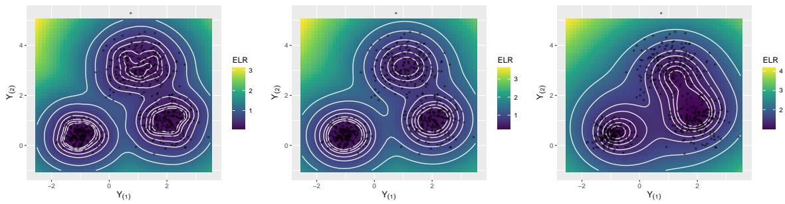  
Figure 1: Empirical surfaces of the ELR functional $\omega \mapsto R _ { \beta } ( \omega )$ for a three-component Gaussian mixture with $\beta = 0 . 0 5 , 0 . 2$ , and 0.5. Smaller values of $\beta$ emphasize fine local concentration, whereas larger values shift the functional toward global dispersion. Colors represent ELR values, white curves show level sets, and black points denote observations.

## 3 ELR-based conformal prediction in metric spaces

ELR quantifies local concentration around any point in a metric space. We now use its conditional counterpart to construct prediction sets for random objects.

## 3.1 Split conformal prediction

Let $( X , Y )$ take values in $\mathcal { X } \times \Omega$ , where $\mathcal { X } = [ 0 , 1 ] ^ { p }$ and $( \Omega , d )$ is a Polish metric space equipped with its Borel σ-field. For $x \in \mathcal { X }$ and $\omega \in \Omega$ , the conditional distance profile (CDP) is

$$
F _ { x } ( \omega , r ) : = \mathbb { P } \left\{ d ( Y , \omega ) \leq r \mid X = x \right\} , \quad r \geq 0 .
$$

The corresponding quantile function is

$$
\begin{array} { r } { Q _ { x } ( \omega , \tau ) : = \operatorname* { i n f } \left. r \geq 0 : F _ { x } ( \omega , r ) \geq \tau \right. , \quad \tau \in ( 0 , 1 ] . } \end{array}
$$

For a locality level $\beta \in ( 0 , 1 ]$ , define the conditional expected local radius (CELR) by

$$
R _ { \beta } ( \omega \mid x ) : = \frac { 1 } { \beta } \int _ { 0 } ^ { \beta } Q _ { x } ( \omega , \tau ) \mathrm { d } \tau .
$$

This is the ELR under the conditional law of Y given $X = x$

Given an independent and identically distributed (i.i.d.) sample $( X _ { i } , Y _ { i } ) \in \mathcal { X } \times \Omega$ $i = 1 , \ldots , 2 n$ , we seek a prediction set $\hat { C } _ { 1 - \alpha } ( X _ { 0 } )$ satisfying (2) for an additional i.i.d. observation $( X _ { 0 } , Y _ { 0 } )$ . At the chosen locality level $\beta ,$ smaller CELR values indicate greater concentration of conditional probability mass around a candidate response, while larger values indicate weaker concentration. This motivates using CELR as a nonconformity measure. Because its scale may vary with x, we transform CELR by its conditional distribution function (Chernozhukov et al., 2021; Izbicki et al., 2022; Zhou

and Müller, 2025):

$$
S ( z \mid x ) : = \mathbb { P } \left\{ R _ { \beta } ( Y \mid X ) \le z \mid X = x \right\} .
$$

We call $S \{ R _ { \beta } ( Y _ { 0 } \mid X _ { 0 } ) \mid X _ { 0 } \}$ the conditional radius score (CRS) and use it as the oracle nonconformity score. If the conditional distribution of $R _ { \beta } ( Y _ { 0 } \mid X _ { 0 } )$ given $X _ { 0 }$ is continuous, the probability integral transform implies that $S \left( R _ { \beta } \left( Y _ { 0 } \mid X _ { 0 } \right) \mid X _ { 0 } \right)$ is uniformly distributed on [0, 1] and independent of $X _ { 0 }$ . The oracle prediction set

$$
C _ { 1 - \alpha } ^ { * } ( x ) : = \{ \omega \in \Omega : S ( R _ { \beta } ( \omega \mid x ) \mid x ) \le 1 - \alpha \}
$$

therefore satisfies $\mathbb { P } \{ Y _ { 0 } \in C _ { 1 - \alpha } ^ { * } ( X _ { 0 } ) \mid X _ { 0 } \} = 1 - \alpha .$

In practice, the conditional law of $Y \mid X = x$ is unknown. We use split conformal prediction (Lei et al., 2018), which separates model fitting from calibration. Randomly partition $\{ ( X _ { i } , Y _ { i } ) \} _ { i = 1 } ^ { 2 n }$ into a training set $\mathcal { D } _ { \mathrm { t r a } } = \{ ( X _ { i } , Y _ { i } ) : i \in \mathbb { Z } _ { \mathrm { t r a } } \}$ and a calibration set ${ \mathcal { D } } _ { \mathrm { c a l } } = \{ ( X _ { i } , Y _ { i } ) : i \in { \mathbb { Z } } _ { \mathrm { c a l } } \}$ , where $\mathcal { T } _ { \mathrm { t r a } } \cup \mathcal { T } _ { \mathrm { c a l } } = \{ 1 , . . . , 2 n \}$ . Use only $\mathcal { D } _ { \mathrm { t r a } }$ to construct the estimators $\hat { F } _ { x } ( \omega , \cdot ) , \ \hat { R } _ { \beta } ( \omega \mid x )$ , and ${ \hat { S } } ( z \mid x )$ . For each $i \in \mathcal { Z } _ { \mathrm { c a l } }$ , compute ${ \hat { S } } _ { i } = { \hat { S } } \{ { \hat { R } } _ { \beta } ( Y _ { i } \mid X _ { i } ) \mid X _ { i } \}$ . Let $\hat { Q } _ { 1 - \alpha }$ be the $( 1 - \alpha ) ( 1 + 1 / | \mathcal { D } _ { \mathrm { c a l } } | )$ empirical quantile of $\{ \hat { S } _ { i } : i \in \mathbb { Z } _ { \mathrm { c a l } } \}$ . The resulting prediction set at $X _ { 0 }$ is

$$
\hat { C } _ { 1 - \alpha } ( X _ { 0 } ) = \Big \{ \omega \in \Omega : \ \hat { S } \big ( \hat { R } _ { \beta } ( \omega \mid X _ { 0 } ) \mid X _ { 0 } \big ) \leq \hat { Q } _ { 1 - \alpha } \Big \} .
$$

Conditional on the training sample and the data split, the calibration and test scores are exchangeable. This gives the marginal coverage guarantee (1).

Theorem 4 (Finite-sample marginal coverage). The split conformal set $\hat { C } _ { 1 - \alpha } ( X _ { 0 } )$ satisfies

$$
\mathbb { P } \left\{ Y _ { 0 } \in \hat { C } _ { 1 - \alpha } ( X _ { 0 } ) \right\} \ \geq \ 1 - \alpha .
$$

For multivariate covariates, we estimate these conditional quantities with a metric distributional random forest, avoiding the repeated local fits and restrictive single index assumption in Zhou and Müller (2025).

## 3.2 Metric distributional random forests

We adapt the distributional random forest of Cevid et al. (2022) from Euclidean responses to responses in $( \Omega , d )$ by choosing a kernel on this space.

## 3.2.1 Conditional mean embeddings for metric-space responses

Let $k : \Omega \times \Omega \to \mathbb { R }$ be a bounded, continuous, characteristic kernel. Its reproducing kernel Hilbert space (RKHS) H has feature map $\varphi : \Omega \to \mathbb { H }$ satisfying $k ( y , y ^ { \prime } ) =$

$\langle \varphi ( y ) , \varphi ( y ^ { \prime } ) \rangle _ { \mathbb { H } }$ . For $x \in \mathcal X$ , the conditional law $P _ { Y \mid X = x }$ has mean embedding (Muandet et al., 2017; Park and Muandet, 2020)

$$
\mu ( x ) = \mathbb { E } [ \varphi ( Y ) \mid X = x ] = \int _ { \Omega } \varphi ( y ) \mathrm { d } \mathbb { P } ( y \mid X = x ) .
$$

Because $k$ is characteristic, $\mu ( x )$ uniquely determines the conditional law. We estimate this embedding using the forest weights described below.

The choice of kernel depends on the response space. For a general metric $d ,$ the Gaussian form exp $\{ - \lambda d ^ { 2 } ( y , y ^ { \prime } ) \}$ need not be positive definite. This issue arises, for example, with the afine-invariant Riemannian distance between symmetric positivedefinite matrices (Jayasumana et al., 2013). Appendix S.2 gives valid kernels for the response spaces considered in Sections 5 and 6.

## 3.2.2 Estimation via metric distributional random forests

Maximum mean discrepancy (MMD) compares distributions through the distance between their kernel mean embeddings (Gretton et al., 2006). Following Cevid et al. (2022), we use MMD to select tree splits. For a node $P ,$ a covariate coordinate $j ,$ , and a threshold $c ,$ let $I _ { L } = \left\{ i : X _ { i } \in P , \ X _ { i } ^ { ( j ) } \leq c \right\}$ and $I _ { R } = \{ i : X _ { i } \in P , \ X _ { i } ^ { ( j ) } > c \}$ denote the index sets of the two daughter nodes, with $n _ { L } = | I _ { L } | , n _ { R } = | I _ { R } |$ , and $n _ { P } = n _ { L } + n _ { R }$ The empirical splitting criterion is

$$
\begin{array} { r l } & { \displaystyle \frac { n _ { L } n _ { R } } { n _ { P } ^ { 2 } } \cdot \widehat { \mathrm { M M D } } _ { k } ^ { 2 } \left( \left\{ Y _ { i } : i \in I _ { L } \right\} , \left\{ Y _ { i } : i \in I _ { R } \right\} \right) = \displaystyle \frac { n _ { L } n _ { R } } { n _ { P } ^ { 2 } } \cdot \left\| \frac { 1 } { n _ { L } } \sum _ { i \in I _ { L } } \varphi ( Y _ { i } ) - \displaystyle \frac { 1 } { n _ { R } } \sum _ { i \in I _ { R } } \varphi ( Y _ { i } ) \right\| _ { \mathbb { H } } ^ { 2 } } \\ & { = \displaystyle \frac { n _ { L } n _ { R } } { n _ { P } ^ { 2 } } \cdot \left\{ \frac { 1 } { n _ { L } ^ { 2 } } \sum _ { i , \ell \in I _ { L } } k \left( Y _ { i } , Y _ { \ell } \right) + \displaystyle \frac { 1 } { n _ { R } ^ { 2 } } \sum _ { i , \ell \in I _ { R } } k \left( Y _ { i } , Y _ { \ell } \right) - \displaystyle \frac { 2 } { n _ { L } n _ { R } } \sum _ { i \in I _ { L } } \sum _ { \ell \in I _ { R } } k \left( Y _ { i } , Y _ { \ell } \right) \right\} . } \end{array}
$$

We choose the candidate split $( j , c )$ that maximizes this criterion and repeat the process until the prescribed minimum node size is reached. With a characteristic kernel, MMD responds to diferences in the entire response distribution, including changes in spread or shape. CART splitting rules (Breiman, 2001; Qiu et al., 2024) reduce variance or Fréchet variance and primarily target conditional centers. Exact evaluation of the MMD criterion is computationally demanding because it involves pairwise kernel evaluations; the approximations in Appendix S.2 allow each coordinate to be scanned in linear time after sorting and feature construction.

For simplicity, take $\left| \mathcal { D } _ { \mathrm { t r a } } \right| = \left| \mathcal { D } _ { \mathrm { c a l } } \right| = n$ and ${ \mathcal { T } } _ { \mathrm { t r a } } = \{ 1 , \ldots , n \}$ . Fit a forest of $B$ trees to $\mathcal { D } _ { \mathrm { t r a } }$ . Tree $b$ uses a subsample $\mathcal { D } _ { \mathrm { t r a } } ^ { b }$ of size $s _ { n }$ and randomization $\xi _ { b } \sim \Xi$ . Let $\mathcal { L } ( \boldsymbol { x } ; \mathcal { D } _ { \mathrm { t r a } } ^ { b } , \xi _ { b } )$ , abbreviated as $\mathcal { L } _ { b } ( x )$ , denote the indexed collection of covariates of the observations used for averaging in the terminal leaf containing x. Here $| \mathcal { L } _ { b } ( x ) |$ denotes numerical work, this rule is evaluated on a finite candidate set suited to the response space.

Algorithm 1 ELR-based split conformal prediction for object-valued responses   
Require: Observations $\overline { { \{ ( X _ { i } , Y _ { i } ) \} _ { i = 1 } ^ { 2 n } } }$ , miscoverage level $\alpha \in ( 0 , 1 )$ , locality level $\beta \in$   
$( 0 , 1 ]$ , and a new covariate $X _ { 0 }$   
Ensure: Prediction set $\hat { C } _ { 1 - \alpha } ( X _ { 0 } )$ with nominal coverage $1 - \alpha$   
1: Randomly partition $\{ 1 , \ldots , 2 n \}$ into training indices $\mathcal { T } _ { \mathrm { t r a } }$ and calibration indices   
$\mathcal { T } _ { \mathrm { c a l } } ;$ set $\mathcal { D } _ { \mathrm { t r a } } = \{ ( X _ { i } , \dot { Y } _ { i } ) : i \in \bar { \mathcal { I } } _ { \mathrm { t r a } } \}$ and ${ \mathcal { D } } _ { \operatorname { c a l } } = \{ ( X _ { i } , Y _ { i } ) : i \in { \mathbb { Z } } _ { \operatorname { c a l } } \}$   
2: Fit a metric distributional random forest to the training set $\mathcal { D } _ { \mathrm { t r a } } .$   
3: Use the forest weights to compute $\hat { F } _ { x } ( \omega , \boldsymbol { r } ) , ~ \hat { R } _ { \beta } ( \omega \mid x )$ , and ${ \hat { S } } ( z \mid x )$   
4: For each $i \in \mathcal { Z } _ { \mathrm { c a l } }$ , compute the nonconformity score ${ \hat { S } } _ { i } = { \hat { S } } \{ { \hat { R } } _ { \beta } ( Y _ { i } \mid X _ { i } ) \mid X _ { i } \}$   
5: Let $\hat { Q } _ { 1 - \alpha }$ be the $( 1 - \alpha ) ( 1 + 1 / | \mathcal { D } _ { \mathrm { c a l } } | )$ empirical quantile of $\{ \hat { S } _ { i } : i \in \mathcal { T } _ { \mathrm { c a l } } \}$   
6: Return   
$\hat { C } _ { 1 - \alpha } ( X _ { 0 } ) \gets \Big \{ \omega \in \Omega : \hat { S } \big ( \hat { R } _ { \beta } ( \omega \mid X _ { 0 } ) \mid X _ { 0 } \big ) \leq \hat { Q } _ { 1 - \alpha } \Big \} .$   
the corresponding sample size. The forest weights are   
$w _ { x } ( X _ { i } ) = \frac { 1 } { B } \sum _ { b = 1 } ^ { B } \frac { \mathbb { I } \{ X _ { i } \in \mathcal { L } _ { b } ( x ) \} } { | \mathcal { L } _ { b } ( x ) | } , \quad i = 1 , \ldots , n ,$   
where $\textstyle \sum _ { i = 1 } ^ { n } w _ { x } ( X _ { i } ) = 1$ . The corresponding estimate of the conditional mean embedding   
is   
$\begin{array} { l } { \displaystyle \hat { \mu } _ { n } ( x ) = \mu \Big ( \hat { P } _ { Y | X = x } \Big ) = \sum _ { i = 1 } ^ { n } { w _ { x } ( X _ { i } ) \varphi ( Y _ { i } ) } } \\ { \displaystyle = \frac { 1 } { B } \sum _ { b = 1 } ^ { B } \left( \frac { 1 } { | \mathcal { L } _ { b } ( x ) | } \sum _ { i : X _ { i } \in \mathcal { L } _ { b } ( x ) } \varphi ( Y _ { i } ) \right) } \end{array}$ (3)   
Thus, ${ \hat { \mu } } _ { n } ( x )$ is the kernel mean embedding of the weighted empirical measure $\hat { P } _ { Y \mid X = x } =$   
$\textstyle \sum _ { i = 1 } ^ { n } w _ { x } ( X _ { i } ) \delta _ { Y _ { i } }$ , where $\delta _ { Y _ { i } }$ denotes the point mass at $Y _ { i }$ . For any integrable measurable   
function f on $\Omega ,$ we estimate ${ \mathbb E } \{ f ( Y ) \mid X = x \} \ \mathrm { b y } \ \sum _ { i = 1 } ^ { n } w _ { x } ( X _ { i } ) f ( Y _ { i } )$   
Applying these weights to metric-ball indicators gives the CDP estimator   
$\hat { F } _ { x } ( \omega , r ) = \sum _ { i = 1 } ^ { n } w _ { x } \left( X _ { i } \right) \cdot \mathbb { I } \left\{ d ( Y _ { i } , \omega ) \leq r \right\}$   
Integrating the corresponding distance quantiles gives the CELR estimator   
$\hat { R } _ { \beta } ( \omega \mid x ) = \frac { 1 } { \beta } \int _ { 0 } ^ { \beta } \hat { Q } _ { x } ( \omega , \tau ) \mathrm { d } \tau = \frac { 1 } { \beta } \int _ { 0 } ^ { \beta } \hat { F } _ { x } ^ { - 1 } ( \omega , \tau ) \mathrm { d } \tau .$   
We estimate the conditional distribution function of CELR by   
$\hat { S } ( z \mid x ) = \sum _ { i = 1 } ^ { n } w _ { x } \left( X _ { i } \right) \cdot \mathbb { I } \left\{ \hat { R } _ { \beta } \left( Y _ { i } \mid X _ { i } \right) \leq z \right\} .$   
All three estimators use weights from the same forest, so no additional forest fits are   
required. Algorithm 1 summarizes the split conformal procedure. For any candidate   
$\omega \in \Omega$ , membership in $\hat { C } _ { 1 - \alpha } ( X _ { 0 } )$ is determined by $\hat { S } \big ( \hat { R } _ { \beta } ( \omega \mid X _ { 0 } ) \mid X _ { 0 } \big ) \le \hat { Q } _ { 1 }$ −α. In

## 4 Theoretical guarantees

We derive uniform convergence rates for the forest estimators and use them to establish asymptotic conditional validity. Following Wager and Athey (2018); Athey et al. (2019); Cevid et al. (2022), we consider the infinite forest obtained as the number of trees B tends to infinity. It averages over all subsamples of $\mathcal { D } _ { \mathrm { t r a } }$ of size $s _ { n }$ and over the tree randomization $\xi$ for each subsample. Its weights are

$$
w _ { x } ( X _ { i } ) = \binom { n } { s _ { n } } ^ { - 1 } \sum _ { k } \mathbb { E } _ { \xi \sim \Xi } \left[ \frac { \mathbb { I } \left\{ X _ { i } \in \mathcal { L } ( x ; \mathcal { D } _ { \mathrm { t r a } } ^ { k } , \xi ) \right\} } { | \mathcal { L } ( x ; \mathcal { D } _ { \mathrm { t r a } } ^ { k } , \xi ) | } \right] ,
$$

where k indexes the $\binom { n } { s _ { n } }$ subsamples of $\mathcal { D } _ { \mathrm { t r a } }$ , and the expectation is over $\xi .$ We use the same notation $w _ { x } ( \cdot )$ for the weights of finite and infinite forests when no ambiguity arises. Writing $Z _ { i } = ( X _ { i } , Y _ { i } )$ for $i = 1 , \ldots , n$ , a generic estimator based on the infinite forest takes the form

$$
U _ { n , s _ { n } } ( \boldsymbol { x } ) = \binom { n } { s _ { n } } ^ { - 1 } \sum _ { 1 \leq i _ { 1 } < \ldots < i _ { s _ { n } } \leq n } \mathbb { E } _ { \xi \sim \Xi } \left[ T \left( \boldsymbol { x } ; Z _ { i _ { 1 } } , \ldots , Z _ { i _ { s _ { n } } } , \boldsymbol { \xi } \right) \right] ,\tag{4}
$$

where $T ( x ; Z _ { 1 } , \dots , Z _ { s _ { n } } , \xi )$ is the prediction from a tree built on $\{ Z _ { 1 } , . . . , Z _ { s _ { n } } \}$ with randomization $\xi .$ Equation (4) is a U-statistic of order $s _ { n }$ , which grows with n. Working with the infinite forest is standard in (Wager and Athey, 2018; Athey et al., 2019) because it separates statistical error from the Monte Carlo error due to a finite number of trees. The latter can be made negligible in practice by choosing B suficiently large.

## 4.1 Uniform consistency of the forest estimator

We first prove uniform convergence of the MDRF estimator in RKHS norm. The proof extends the pointwise analysis of Cevid et al. (2022) using bounds on leaf diameters and a discretization of the covariate space. We assume the following conditions on the forest construction (Wager and Athey, 2018; Athey et al., 2019).

A1 (Forest regularity). The forest satisfies the following properties:

(P1) (Subsampling) Each tree is built from a subsample of size $s _ { n }$ drawn without replacement from the n training observations, where $s _ { n } \to \infty$ and $s _ { n } / n \to 0$

(P2) (Honesty) Each tree subsample is randomly divided into equally sized splitting and estimation sets. Tree construction may use the splitting observations and estimation covariates, but not estimation responses, which are used only for leaf averages.

(P3) (Random split) At each internal node, the probability of selecting the jth covariate for splitting is at least $\pi / p$ for some $\pi > 0$ and every $j = 1 , \dots , p .$

(P4) (ϕ-regularity) Split thresholds are selected from observed covariate values, and each child node receives at least a fraction $0 ~ < ~ \phi ~ \le ~ 0 . 2$ of the estimation observations in its parent node. Trees are grown until every terminal leaf contains between κ and $2 \kappa - 1$ estimation observations for some fixed $\kappa \in \mathbb { N }$

(P5) (Symmetry) The distribution of the randomized tree output is invariant under permutations of the training observations.

We also require the following condition on the marginal covariate density, as in Assumption (A3) of Zhou and Müller (2025).

A2 (Bounded covariate density). The covariates $X \in { \mathcal { X } }$ have a density that is bounded above and bounded away from zero.

Theorem 5 (Uniform consistency of MDRF). Let H be the RKHS associated with a bounded, continuous, and characteristic kernel k. Suppose Assumptions A1 and A2 hold, and let the subsample size satisfy $s _ { n } \asymp n ^ { \rho }$ for some $0 < \rho < 1$ . If the target map

$$
x \mapsto \mu ( x ) = \mathbb { E } [ \varphi ( Y ) \mid X = x ]
$$

is Lipschitz continuous, then

$$
\operatorname* { s u p } _ { x \in \mathcal X } \| \hat { \mu } _ { n } ( x ) - \mu ( x ) \| _ { \mathbb H } = O _ { p } \left( n ^ { - \gamma } \sqrt { \log n } \right) ,
$$

where $\begin{array} { r } { \gamma = \frac { 1 } { 2 } \operatorname* { m i n } \left( 1 - \rho , \frac { \log ( 1 - \phi ) } { \log ( \phi ) } \frac { \pi } { p } \cdot \rho \right) } \end{array}$

The rate reflects a bias–variance tradeof between subsampling variability, represented by $1 - \rho ,$ and the cell-shrinkage rate under ϕ-regular random splitting, represented by $\frac { \log ( 1 - \phi ) } { \log ( \phi ) } \frac { \pi } { p } \cdot \rho .$ . The factor $\sqrt { \log n }$ is the cost of extending pointwise convergence to uniform convergence over the covariate space. Theorem 5 gives uniform control of the conditional mean embedding and hence of the forest-induced conditional law in the MMD metric. This result justifies reusing the forest weights to estimate the distributional quantities required by the ELR-based conformal procedure. It does not, however, directly establish consistency of the conditional distance profiles, which are metric-ball probabilities defined by nonsmooth indicator functions.

## 4.2 Asymptotic conditional validity for conformal prediction

To analyze the CRS, we first establish uniform consistency of the CDP estimator over covariates, candidate centers, and radii. This requires regularity in the covariates and control of the complexity of metric balls in the response space.

A3 (Lipschitz continuity). The CDP $F _ { x } ( \omega , r )$ is Lipschitz continuous in x: there exists a constant $L _ { F } > 0$ such that, for all $x , x ^ { \prime } \in \mathcal { X } , \omega \in \Omega$ , and $r \geq 0$

$$
| F _ { x } ( \omega , r ) - F _ { x ^ { \prime } } ( \omega , r ) | \leq L _ { F } \Vert x - x ^ { \prime } \Vert _ { 2 } .
$$

A4 (Complexity). Let $\mathcal { G } = \{ y \mapsto \mathbb { I } \{ d ( y , \omega ) \leq r \} : \omega \in \Omega , r \geq 0 \}$ . There exist constants $A _ { 0 } < \infty$ and $0 < V < 2$ such that, for every probability measure ν on $\Omega _ { : }$

$$
\begin{array} { r } { \log N \left( u , \mathcal { G } , L _ { 2 } ( \nu ) \right) \leq A _ { 0 } u ^ { - V } , \quad 0 < u \leq 1 . } \end{array}
$$

Assumption A3 bounds the variation of conditional ball probabilities with $x ;$ compare Assumption (A7) of Zhou and Müller (2025). Assumption A4 controls the uniform entropy of the class of ball indicators. It holds for VC-type ball classes, including those in finite metric spaces, Euclidean spaces and their subsets, finite-dimensional Hilbert spaces, spheres with geodesic distance, symmetric positive-definite matrices with the log-Euclidean metric, and network spaces with the Frobenius metric.

Theorem 6 (Uniform convergence of CDP). Suppose Assumptions A1–A4 hold and the subsample size satisfies $s _ { n } \asymp n ^ { \rho }$ for some $0 < \rho < 1$ . Let $\hat { F } _ { x } ( \omega , r )$ denote the MDRF estimator of CDP. Then

$$
\operatorname* { s u p } _ { x \in \mathcal { X } , \omega \in \Omega , r \geq 0 } | \hat { F } _ { x } ( \omega , r ) - F _ { x } ( \omega , r ) | = O _ { p } \left( n ^ { - \gamma } \sqrt { \log n } \right) ,
$$

where $\begin{array} { r } { \gamma = \frac { 1 } { 2 } } \end{array}$ min $\begin{array} { r } { \left( 1 - \rho , \frac { \log ( 1 - \phi ) } { \log ( \phi ) } \frac { \pi } { p } \cdot \rho \right) } \end{array}$

Theorem 6 gives the same rate as Theorem $5 ,$ now uniformly over $( x , \omega , r )$ . Uniformity over x follows from the discretization argument used for Theorem 5, whereas control over $( \omega , r )$ relies on a maximal inequality for growing-order U-processes. En-larging the index set does not change the polynomial rate; the factor √log n accounts for uniformity.

Remark 1. For local linear CDP estimation, Zhou and Müller (2025, Theorem 2) obtain stochastic terms $\{ ( | \log h _ { n } | + \log n ) / ( n h _ { n } ) \} ^ { 1 / 2 }$ and $( n h _ { n } ^ { 1 + V / 2 } ) ^ { - 1 / 2 }$ under polynomial uniform covering numbers and polynomial uniform entropy, respectively, where $h _ { n }$ is the bandwidth and $0 < V < 2$ is the entropy exponent. The second bound contains an additional factor $h _ { n } ^ { - V / 4 }$ beyond the usual $( n h _ { n } ) ^ { - 1 / 2 }$ scale. In their analysis, the entropy bound is combined with localization to a shrinking covariate neighborhood, so response complexity enters the bandwidth balance and leads to a slower bound as V increases. Our forest analysis controls response complexity through normalized tree averages. Each tree prediction is a convex combination of ball indicators with weights that do not depend on $( \omega , r )$ . The resulting kernels are bounded by one and inherit the uniform entropy bound with constants independent of $s _ { n }$ . Since $V < 2 .$ , the entropy integral is finite, giving a uniform stochastic bound of order $O _ { p } ( { \sqrt { s _ { n } \log n / n } } )$ ; see Supplementary Lemmas S.4 and S.3. Thus response complexity afects the constant in this bound, while subsampling and the bias from shrinking leaf regions determine the convergence exponent. These bounds do not establish a general rate advantage for forests.

To transfer the CDP bound to CELR, we control the tails of distances from a fixed anchor point. Assumption A5 allows unbounded response spaces and holds, for example, for Euclidean responses with bounded conditional location and sub-Weibull noise.

A5 (Uniform anchor Orlicz integrability). There exist an anchor point $\omega _ { 0 } \in \Omega$ and constants $K _ { 0 } < \infty$ and $\nu > 0$ such that

$$
\underset { x \in \mathcal { X } } { \operatorname* { s u p } } \Vert d ( Y , \omega _ { 0 } ) \Vert _ { \psi _ { \nu } , x } \leq K _ { 0 } ,
$$

where the conditional Orlicz norm is defined by

$$
\left. Z \right. _ { \psi _ { \nu } , x } : = \operatorname* { i n f } \left\{ K > 0 : \mathbb { E } \left[ \exp \left\{ \left( \frac { | Z | } { K } \right) ^ { \nu } \right\} | X = x \right] \leq 2 \right\} .
$$

Theorem 7 (Uniform consistency of CELR). Suppose Assumptions A1–A5 hold and the subsample size satisfies $s _ { n } \asymp n ^ { \rho }$ for some $0 < \rho < 1$ . For a fixed $\beta \in ( 0 , 1 ]$ , let $\hat { R } _ { \beta } ( \omega \mid x )$ denote the MDRF estimator of CELR. Then

$$
\operatorname* { s u p } _ { x \in \mathcal { X } } \operatorname* { s u p } _ { \omega \in \Omega } \left| \hat { R } _ { \beta } ( \omega \mid x ) - R _ { \beta } ( \omega \mid x ) \right| = O _ { p } \left( n ^ { - \gamma } ( \log n ) ^ { 1 / 2 + 1 / \nu } \right) ,
$$

where $\begin{array} { r } { \gamma = \frac { 1 } { 2 } } \end{array}$ min 1 − ρ, log(1−ϕ)log(ϕ) πp · ρ. log(φ) p

Theorem 7 establishes uniform consistency of the CELR estimator over covariates and candidate centers. Relative to Theorem 6, the polynomial exponent is unchanged, but the additional factor $( \log n ) ^ { 1 / \nu }$ appears. This factor arises when uniform control of the distance profiles is transferred to their integrated quantiles without assuming a bounded response space. Lighter conditional tails, corresponding to larger ν in Assumption A5, reduce the logarithmic penalty, while the forest estimation error continues to determine the polynomial rate. This result is essential because the conformal score depends on the estimated CELR and its conditional distribution rather than directly on the CDP. Uniform CELR consistency ensures that replacing $R _ { \beta } ( \omega \mid x )$ with $\hat { R } _ { \beta } ( \omega \mid x )$ does not asymptotically distort the ranking of candidate responses.

Uniform consistency of CELR alone is nevertheless insuficient for conditional validity. Because the conformal cutof depends on the conditional distribution of CELR, small estimation errors must produce only small changes in score ranks. The following continuity condition rules out nonnegligible shifts of probability mass across score thresholds, also stated in Assumption (A1) of Zhou and Müller (2025).

A6 (Score continuity). Let $S ( z \mid x ) = \mathbb { P } \{ R _ { \beta } ( Y \mid X ) \le z \mid X = x \}$ denote the conditional distribution function of CELR. Assume the following conditions: (1) $S ( z \mid x )$ is Lipschitz continuous in z uniformly over $x \in \mathcal { X }$ . (2) $S ( z \mid x )$ is Lipschitz continuous in x uniformly over $z \geq 0$

Theorem 8 (Asymptotic conditional validity). Let $\hat { C } _ { 1 - \alpha } ( X _ { 0 } )$ be the prediction set constructed by Algorithm 1. Suppose Assumptions A1–A6 hold and the subsample size satisfies $s _ { n } \asymp n ^ { \rho }$ for some $0 < \rho < 1$ . Then

$$
\mathbb { P } ( Y _ { 0 } \in \hat { C } _ { 1 - \alpha } ( X _ { 0 } ) \mid X _ { 0 } ) = 1 - \alpha + o _ { p } ( 1 ) .
$$

Theorem 8 complements the marginal coverage guarantee in Theorem 4. Exchangeability gives finite-sample marginal validity for any score fitted on the training sample. Under the stated regularity conditions, uniform estimation of the score components also yields coverage approaching 1 − α conditional on $X _ { 0 }$

## 5 Simulation studies

We assess the finite-sample performance of the proposed ELR-based conformal method in simulations designed to evaluate conditional coverage across the covariate domain, prediction-set size, and applicability to non-Euclidean responses. In each experiment, the data are randomly divided into equally sized training and calibration samples, and split-conformal prediction sets are constructed at the nominal coverage level $1 - \alpha = 0 . 9$ Throughout this section, ELR denotes the proposed procedure estimated by the MDRF, whereas CPS denotes the conditional profile score procedure of Zhou and Müller (2025) implemented with local linear smoothing. We consider seven settings in total: Settings 1–2, 4, and $6 { - } 7$ are presented below, while Settings 3 and 5 are reported in Supplementary Section S.4. Results are averaged over 100 Monte Carlo replications; Appendix S.3 describes the hyperparameter choices.

## 5.1 Univariate covariates

We begin with the one-dimensional settings of Zhou and Müller (2025), taking $X \sim$ $\operatorname { U n i f } ( [ - 1 , 1 ] )$ , and compare ELR with CPS. Both scalar and sphere-valued responses are considered.

Setting 1 (Nonlinear regression with heteroscedastic variability). Given a covariate $X _ { i } \in [ - 1 , 1 ]$ , the response $Y _ { i } \in \mathbb { R }$ is generated as

$$
Y _ { i } = f ( X _ { i } ) + \sigma ( X _ { i } ) \varepsilon _ { i } , \quad f ( x ) = ( x - 1 ) ^ { 2 } ( x + 1 ) , \quad \sigma ( x ) = 0 . 1 \mathbb { 1 } \{ x \geq 0 \} + 0 . 5 \mathbb { I } \{ x < 0 \} ,
$$

where $\varepsilon _ { i } \sim \mathcal { N } ( 0 , 1 )$ . Hence, the conditional distribution is more dispersed for $x < 0$ than for $x \geq 0$

Setting 2 (Nonlinear regression with a bimodal pattern). The response $Y _ { i } \in \mathbb { R }$ is generated from the two-component mixture

$$
\begin{array} { r } { Y _ { i } \sim \frac { 1 } { 2 } { \mathcal { N } } ( f ( X _ { i } ) + g ( X _ { i } ) , 0 . 1 ^ { 2 } ) + \frac { 1 } { 2 } { \mathcal { N } } ( f ( X _ { i } ) - 0 . 2 g ( X _ { i } ) , 0 . 1 ^ { 2 } ) , } \end{array}
$$

where $f ( x ) = ( x - 1 ) ^ { 2 } ( x + 1 )$ and $g ( x ) = 2 { \sqrt { x } } \mathbb { I } \{ x \geq 0 \}$ . The two components coincide for $x \leq 0 ;$ for $x > 0$ , their means separate continuously, yielding a bimodal distribution once the separation is suficiently large.

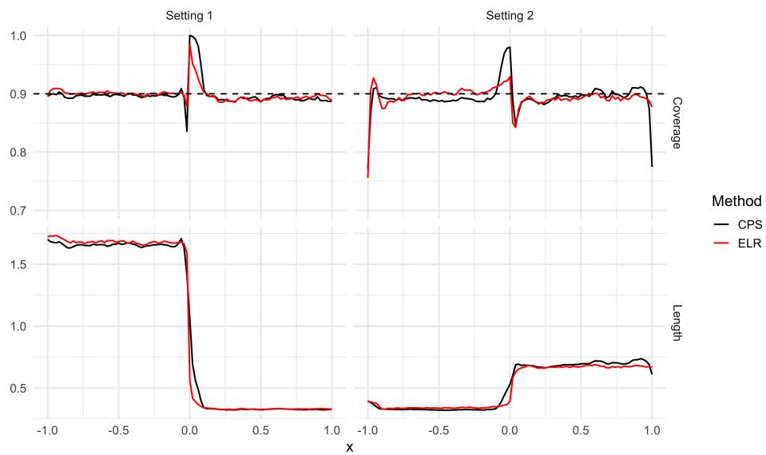  
Figure 2: Average conditional coverage (top) and prediction-set length (bottom) under Settings 1–2 with sample size $n = 2 0 0 0$ . The left and right columns correspond to Settings 1 and 2, respectively. Red and black curves denote ELR and CPS, respectively. The dashed horizontal line marks the nominal coverage level 0.9.

Figure 2 shows empirical coverage close to 0.9 over much of the covariate range for both methods. In Setting 1, both methods produce longer prediction sets for $x < 0$ and shorter sets for $x > 0 .$ , reflecting the diference in noise levels. ELR has a sharper decrease in length across $x = 0$ and smaller coverage deviations near the discontinuity. In Setting 2, prediction-set length increases near $x = 0$ and remains approximately constant for larger positive x. ELR shows less overcoverage just to the left of zero, although both methods have undercoverage immediately to its right. Both also show undercoverage at the left endpoint, while the departure at the right endpoint is more pronounced for CPS.

Setting 3, presented in Supplementary Section S.4.1 and Supplementary Figure S.1, provides an additional univariate experiment with sphere-valued responses. This experiment shows that both ELR and CPS remain close to the nominal coverage level. Together with Settings 1–2, these results demonstrate that the proposed method remains competitive for univariate covariates with both Euclidean and non-Euclidean responses.

## 5.2 Multivariate covariates

We next consider multivariate covariates $X = ( X ^ { ( 1 ) } , \ldots , X ^ { ( p ) } ) ^ { \top } \sim \operatorname { U n i f } ( [ - 1 , 1 ] ^ { p } )$ . These settings assess whether our method can adapt to higher-dimensional covariate structure without explicit parametric assumptions.

Setting 4 (Single-index model). For comparison with the multivariate single-index approach of Zhou and Müller (2025), let $\boldsymbol { \theta } = ( 0 . 2 , 0 . 8 , 0 , \dots , 0 ) ^ { \top }$ . We generate scalar responses from the heteroscedastic single-index model

$$
Y _ { i } = f ( \theta ^ { \top } X _ { i } ) + \sigma ( \theta ^ { \top } X _ { i } ) \varepsilon _ { i } , \qquad \sigma ( u ) = 0 . 1 \mathbb { I } \{ u > 0 \} + 0 . 5 \mathbb { I } \{ u \leq 0 \} ,
$$

where $f ( u ) = ( u - 1 ) ^ { 2 } ( u + 1 )$ and $\varepsilon _ { i } \sim \mathcal { N } ( 0 , 1 )$

Figure 3 compares the empirical conditional coverage surfaces of ELR and CPS over a $1 0 \times 1 0$ grid with $x ^ { ( 1 ) } , x ^ { ( 2 ) } \in \{ - 0 . 9 , - 0 . 7 , \ldots , 0 . 9 \}$ and the remaining coordinates fixed at zero. Both methods have coverage close to the nominal level, with local deviations near the change in noise level. CPS, which exploits the correctly specified single-index structure, achieves smaller absolute conditional coverage errors for both $p = 5$ and $p = 1 0$ . Forest-based ELR ofers a nonparametric alternative without imposing this structural assumption, albeit with somewhat larger coverage errors in this experiment. The similar ELR coverage patterns for $p = 5$ and $p = 1 0$ suggest little sensitivity to the additional nuisance variables, demonstrating that forest weights are adaptive to the informative coordinates. Setting 5, presented in Supplementary Section S.4.2 and Supplementary Figure S.2, provides a complementary multivariate experiment with vector-valued mixture responses. The experiment considers two-component, threecomponent, and covariate-dependent mixtures; empirical coverage remains close to the target level across these heterogeneous conditional structures. We do not implement CPS in Settings 5–7, as these settings do not satisfy the single-index assumption used in its multivariate extension.

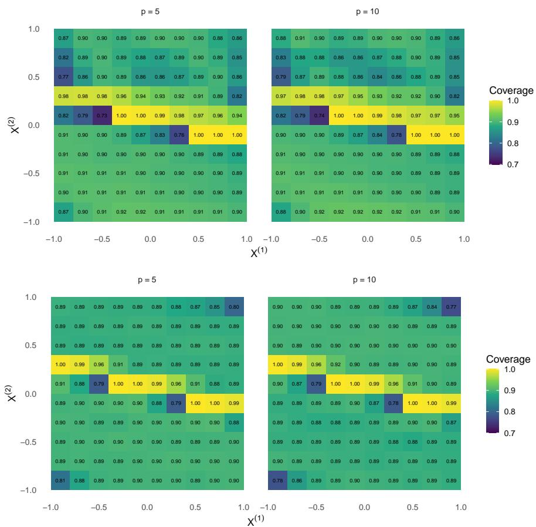  
Figure 3: Average conditional coverage for ELR (top) and CPS (bottom) under the single-index model in Setting 4 with $n = 2 0 0 0$ . The left and right columns correspond to $p = 5$ and $p = 1 0$ , respectively. Each panel shows coverage at 100 test points. The nominal coverage level is 0.9.

Setting 6 (Sphere-valued responses). We next consider sphere-valued responses. Responses $Y _ { i } \in \mathbb { S } ^ { 2 }$ are generated from a von Mises–Fisher distribution,

$$
Y _ { i } \mid X _ { i } = x _ { i } \sim \mathrm { v M F } _ { 3 } ( \mu ( x _ { i } ) , \kappa _ { \mathrm { v M F } } ) , \qquad \kappa _ { \mathrm { v M F } } = 6 0 ,
$$

where

$$
\begin{array} { r } { \mu ( x ) = ( \sin ( \pi g ( x ) / 2 ) , \cos ( \pi g ( x ) / 2 ) , 0 ) ^ { \top } , g ( x ) = 0 . 1 x ^ { ( 1 ) } + 0 . 2 x ^ { ( 2 ) } + 0 . 2 ( x ^ { ( 3 ) } ) ^ { 2 } + 0 . 3 x ^ { ( 4 ) } x ^ { ( 5 ) } . } \end{array}
$$

We consider $p = 5 , 1 0 , 2 0$ . The test points form a $3 ^ { 5 }$ grid over the first five coordinates, each taking values in $\{ - 0 . 6 , 0 , 0 . 6 \}$ , with the remaining coordinates fixed at zero. Figure 4 reports empirical coverage and prediction-set size for $n = 5 0 0$ and $n = 1 0 0 0$ . Coverage remains near the nominal level for all three values of p. Predictionset size decreases as the training sample grows, consistent with more accurate estimation of the conditional law. Increasing p has only a moderate efect: additional covariates yield slightly larger sets but do not visibly impair calibration. This finding suggests that the forest-based weighting scheme remains adaptive when only a subset of the covariates drives the conditional response distribution.

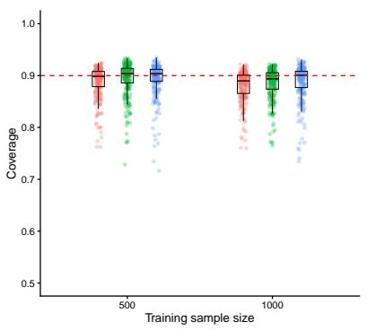

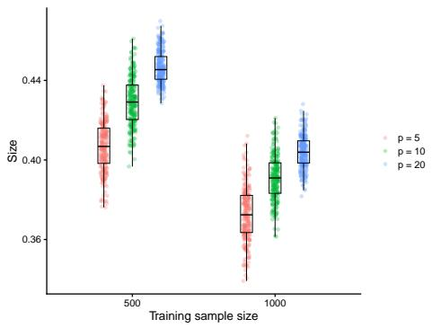  
Figure 4: Average conditional coverage (left) and prediction-set size (right) for the sphere-valued model in Setting 6, with $p = 5 , 1 0 , 2 0$ and $n = 5 0 0 , 1 0 0 0$ . Each boxplot summarizes the results at 243 test points. The dashed red line marks the nominal coverage level 0.9.

Setting 7 (Distribution-valued responses). Finally, we consider distribution-valued responses equipped with the Wasserstein distance. Define

$$
\begin{array} { r l } & { \mu ( x ) = 0 . 1 x ^ { ( 1 ) } + 0 . 2 \sin ( \pi x ^ { ( 2 ) } ) + 0 . 3 x ^ { ( 3 ) } x ^ { ( 4 ) } + \xi _ { 1 } , \quad \xi _ { 1 } \sim \mathcal { N } ( 0 , 0 . 5 ^ { 2 } ) , } \\ & { \qquad \sigma ( x ) = 0 . 2 + 0 . 3 | x ^ { ( 5 ) } | + 0 . 1 \xi _ { 2 } , \qquad \xi _ { 2 } \sim \mathrm { U n i f } ( 0 , 1 ) . } \end{array}
$$

The distribution-valued response is

$$
Y _ { i } = \mathcal { N } \left( \mu ( X _ { i } ) , \sigma ^ { 2 } ( X _ { i } ) \right) .
$$

We use the same test-point grid as in Setting 6. Figure 5 shows that empirical coverage remains stable across the diferent covariate dimensions and sample sizes. Together with Setting 6, this result demonstrates that the proposed method remains well calibrated for non-Euclidean responses.

## 5.3 Computation time comparison

We compare the computation times of ELR and CPS (Zhou and Müller, 2025) in Settings 1, 3, and 4, representing heteroscedastic scalar responses, sphere-valued responses, and a single-index model with multivariate covariates, respectively. For each configuration, we run five Monte Carlo replications with preselected tuning parameters held fixed. Within each replication, the methods use the same simulated data, training– calibration split, test covariate points, and candidate-response grid. All computations are performed on the same Linux server with Intel Xeon Gold 5218R processors at 2.10 ${ \mathrm { G H z } } ,$ with both methods restricted to a single CPU thread. We record elapsed time for data generation, model fitting, score evaluation, prediction-set construction, and empirical coverage and size evaluation.

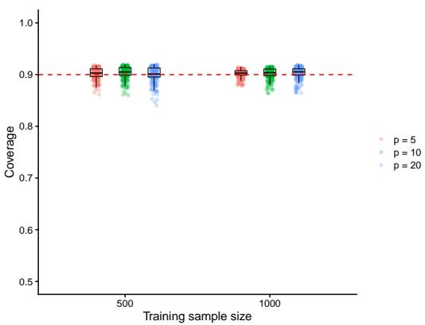  
Figure 5: Average conditional coverage for the distribution-valued model in Setting $^ { 7 , }$ with $p = 5 , 1 0 , 2 0$ and $n = 5 0 0$ , 1000. Each boxplot summarizes the results at 243 test points. The dashed red line marks the nominal coverage level 0.9.

Table 1 shows that ELR is faster in all three configurations. ELR fits the MDRF once and reuses its weights to estimate CDPs, CELRs, and the conditional distribution functions that define the scores. CPS instead repeatedly applies local smoothing to construct calibration scores and prediction sets, with additional comparisons between conditional distance profiles. The largest timing diference occurs in the multivariatecovariate setting (Setting 4), where CPS also estimates a single-index direction by numerical optimization. MDRF fitting can be further accelerated by parallelizing across trees, although this option is not used in the benchmark.

Table 1: Mean elapsed times (seconds) for ELR and CPS over five Monte Carlo replications. Speedup is the ratio of mean times, $\overline { { T } } _ { \mathrm { C P S } } / \overline { { T } } _ { \mathrm { E L R } }$
<table><tr><td>Setting</td><td>Response space</td><td>n</td><td>p</td><td>ELR (s)</td><td>CPS  $\mathrm { ( s ) }$ </td><td>Speedup</td></tr><tr><td>1</td><td>R</td><td>2000</td><td>1</td><td>62.2</td><td>187.7</td><td>3.02</td></tr><tr><td>3</td><td> $\mathbb { S } ^ { 2 }$ </td><td>400</td><td>1</td><td>276.8</td><td>2,515.5</td><td>9.09</td></tr><tr><td>4</td><td>R</td><td>2000</td><td>10</td><td>73.3</td><td>22,208.7</td><td>303.14</td></tr></table>

## 6 Real data applications

## 6.1 New York City taxi data

We apply the proposed ELR-based conformal method to data derived from New York City yellow taxi trips recorded during 2024 (https://www.nyc.gov/site/t lc/about/tlc-trip-record-data.page). This application combines multivariate predictors with symmetric positive-definite matrix (SPD) responses. The trip-level records, released by the New York City Taxi and Limousine Commission, include pickup and drop-of times and locations, trip distance, passenger count, and payment information. We restrict the analysis to Manhattan and partition the borough into 10 subregions. Each response is constructed from a 10 × 10 network matrix summarizing trafic flows among these subregions. Because nighttime trafic is sparse and exhibits distinct patterns, we retain trips between 7:00 and 22:00 each day and group them into consecutive bins of 1000 trips. For each bin, we form a flow matrix whose (i, j) entry is the number of trips from subregion i to subregion j. We scale the matrix by its largest entry, symmetrize it, and then apply the matrix exponential transformation. This yields an SPD-valued response Y representing the taxi-flow network for that bin. Distances between responses are measured using the log-Cholesky metric (Lin, 2019).

The 10 predictors are the time of day, defined as the midpoint of each bin; the within-bin averages of trip distance, passenger count, and tip amount; an indicator distinguishing weekdays from weekends and holidays; and five daily weather summaries from Weather Underground for New York City (https://www.wunderground.com /history/monthly/us/ny/new-york-city/KLGA/date). The weather variables are average temperature, average humidity, average wind speed, average barometric pressure, and total precipitation. The taxi analysis in Zhou and Müller (2025) uses time of day alone; here we use all ten predictors jointly. We randomly divide the observations into training, calibration, and test sets in the ratio 4:4:2. Continuous predictors are standardized, while the binary indicator is left unchanged.

We first evaluate coverage on the test set at the nominal level $1 - \alpha = 0 . 9 5$ The overall empirical coverage is 0.9502, nearly identical to the target. To examine calibration over the daily trafic cycle, Figure 6 plots local empirical coverage against time of day, separately for weekday and weekend/holiday bins and for rainy and nonrainy conditions. Throughout the main daytime period, the curves remain centered near the nominal level, with the larger deviations occurring primarily in sparse or more variable regimes. The method therefore exhibits stable empirical calibration both overall and across substantively diferent trafic conditions.

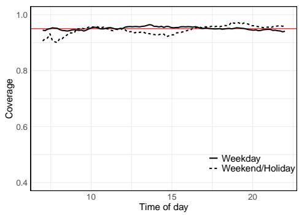

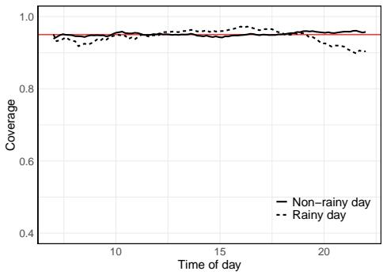  
Figure 6: Local empirical coverage as a function of time of day in the New York City taxi application. Left: weekday versus weekend/holiday bins. Right: rainy versus non-rainy conditions. The solid red horizontal line indicates the nominal coverage level 0.95.

To broaden the assessment beyond time of day, we consider one-dimensional diagnostics for representative transportation and weather variables, as well as two-dimensional binned diagnostics for selected covariate pairs. Complete results are reported in Supplementary Section S.5.1.3 and Supplementary Figures S.4–S.5. Coverage remains close to the target in most regimes, with the more noticeable departures concentrated in sparse cells or under conditions of high intrinsic variability. These diagnostics support the conclusion from Figure 6 that calibration remains stable across diverse trafic and weather conditions, rather than only in aggregate.

We next use representative local network patterns to examine the interpretation of the fitted CRS. Figure 7 considers two scenarios: weekday morning commuting and weekend/holiday nightlife travel. For each scenario, we display the local Fréchet mean and the observations with the smallest and largest CRS within the corresponding local training sample. The local Fréchet mean summarizes the selected responses, while the minimum- and maximum-CRS matrices illustrate relatively typical and atypical observations, respectively. Weekday morning networks exhibit more concentrated and recurrent flow patterns, whereas weekend/holiday nightlife networks are more difuse and less regular. The CRS ordering thus complements the local mean by illustrating variation in conditional typicality within each trafic regime.

Overall, the New York City taxi application illustrates the proposed method in a setting with genuinely multivariate inputs and non-Euclidean outputs. It provides stable empirical coverage for SPD-valued trafic networks together with interpretable local summaries of heterogeneous transportation patterns.

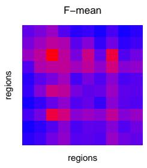

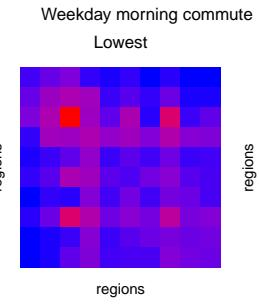

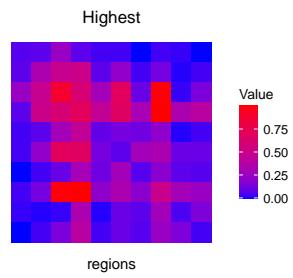

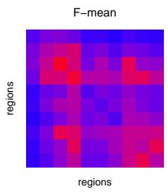

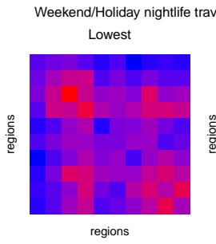

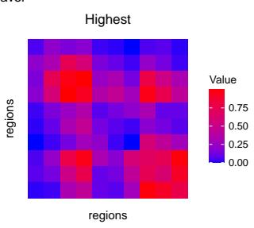  
Figure 7: Representative local network patterns in the New York City taxi application. For each trafic regime, we display the local Fréchet mean and the observations with the smallest and largest CRS within the corresponding local training sample. Heatmaps display the matrix logarithms of the corresponding SPD matrices.

## 6.2 U.S. energy data

We next analyze a state-level panel of U.S. energy consumption (https://www.eia.go v/state/seds/seds-data-complete.php?sid=US), comprising annual observations for the 50 states and the District of Columbia from 1970 through 2023. For each state-year, the response records the shares of total energy consumption in three broad categories, $\boldsymbol { Y } = ( U , V , W ) ^ { \top }$ , where U is the share of traditional energy (coal and petroleum), V is the share of natural gas, and W is the share of non-fossil energy, including hydroelectric, wind, solar, geothermal, biomass, and nuclear sources. Since $U + V + W = 1$ , the response lies on the probability simplex. We map it to the positive orthant of the unit sphere using the square-root transformation $\widetilde { Y } =$ $( \sqrt { U } , \sqrt { V } , \sqrt { W } ) ^ { \top }$ , and construct prediction sets on the sphere using the geodesic metric. This representation preserves the compositional structure of the response while placing the conformal procedure in a natural non-Euclidean space. Our objective is to quantify predictive uncertainty in a changing and heterogeneous energy system, rather than to provide point predictions alone.

The 10 predictors are calendar year, population, per-capita electricity consumption, heating degree days, cooling degree days, the nominal prices of coal, petroleum, natural gas, and electricity, and a coastal indicator. These variables represent the longrun energy transition, climate-related demand, incentives for fuel substitution, and persistent geographic heterogeneity. The energy analysis in Zhou and Müller (2025)

uses calendar year alone; our additional covariates allow comparisons among states within the same year. Table S.4 in Supplementary Section S.5.2 provides detailed definitions of the response components and covariates. We reserve five benchmark years (1970, 1985, 1999, 2012, 2023) spanning the sample period for testing and divide the remaining observations equally between training and calibration. Continuous predictors are standardized before model fitting, while the coastal indicator remains binary.

We construct prediction sets at the nominal coverage level $1 - \alpha = 0 . 9$ and display them on the ternary simplex. In each panel, the shaded region denotes the ELR-based conformal prediction set, and the red cross marks the observed energy composition. Rather than imposing a fixed-width uncertainty band, the method produces adaptive regions whose location, size, and shape vary with the covariates. Figure 8 compares Arizona and Alaska, two states chosen for their pronounced climatic contrast. Arizona’s prediction sets move progressively away from the traditional-energy edge and toward the non-fossil corner, particularly after the mid-1980s, a pattern consistent with persistent cooling demand and abundant solar resources. Alaska’s sets remain concentrated near the traditional-energy side throughout the sample period, although the natural-gas share gradually increases within this fossil-dominated mix. This pattern is consistent with sustained heating demand and improvements in natural-gas transportation and delivery infrastructure.

Two complementary comparisons appear in Supplementary Section S.5.2.2. Supplementary Figure S.6 contrasts New York and Wyoming, selected to represent low and high per-capita electricity consumption, while Supplementary Figure S.7 summarizes broader geographic patterns by averaging responses and covariates within coastal and inland groups. These results show that the prediction sets respond both to state-level structural diferences and to the common temporal transition evident after geographic aggregation.

Taken together, these results illustrate three practical features of the method. First, the observed compositions generally fall within or near their corresponding prediction sets, supporting sensible uncertainty quantification for compositional responses. Second, the sets shift over time toward larger shares of non-fossil energy, reflecting the long-run transition of the U.S. energy system. Third, they vary systematically across geographic, climatic, and structural contrasts, indicating that the ELR-based conformal procedure responds to meaningful covariate heterogeneity rather than reproducing a global average pattern.

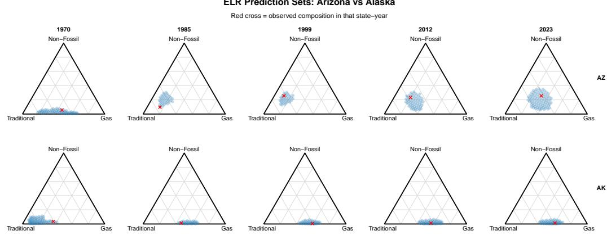  
Figure 8: Arizona versus Alaska in the U.S. energy data. Blue regions denote ELRbased conformal prediction sets with nominal coverage 0.9 across selected years; red crosses mark the observed energy compositions.

## 7 Discussion

CELR provides a way to construct prediction sets from local concentration in a metric space. Transforming CELR by its conditional distribution function gives the score CRS, whose values are comparable across covariate values. CRS ranks candidates by local concentration rather than distance from a point predictor, so the sets can reflect heteroscedasticity and multimodality without requiring a density or vector space structure. All score components are estimated using the weights from a single metric distributional random forest. Split conformal calibration guarantees finite-sample marginal coverage under exchangeability, and we establish asymptotic conditional validity under the stated regularity conditions.

Sample splitting leaves only part of the data for estimating the conditional law. Out-of-bag forest predictions could make fuller use of the sample by scoring each observation with trees fitted without it. A coverage argument would need to account for the dependence among these scores. Conditional local radii may also be useful for anomaly detection, change point testing, and decision problems under distributional ambiguity in metric spaces.

## References

A. N. Angelopoulos, R. F. Barber, and S. Bates. Theoretical foundations of conformal prediction. arXiv preprint arXiv:2411.11824, 2024.

S. Athey, J. Tibshirani, and S. Wager. Generalized random forests. The Annals of Statistics, 47(2):1148–1178, 2019.

R. F. Barber, E. J. Candes, A. Ramdas, and R. J. Tibshirani. Predictive inference with the jackknife+. The Annals of Statistics, 49(1):486–507, 2021.

R. F. Barber, E. J. Candes, A. Ramdas, and R. J. Tibshirani. Conformal prediction beyond exchangeability. The Annals of Statistics, 51(2):816–845, 2023.

S. Bhattacharjee, B. Li, and L. Xue. Nonlinear global fréchet regression for random objects via weak conditional expectation. Annals of statistics, 53(1):117, 2025.

C. Brécheteau. A statistical test of isomorphism between metric-measure spaces using the distance-to-a-measure signature. Electronic Journal of Statistics, 13(1):795–849, 2019. doi: 10.1214/19-EJS1539.

L. Breiman. Random forests. Machine learning, 45(1):5–32, 2001.

D. Cevid, L. Michel, J. Näf, P. Bühlmann, and N. Meinshausen. Distributional random forests: Heterogeneity adjustment and multivariate distributional regression. Journal of Machine Learning Research, 23(333):1–79, 2022.

F. Chazal, D. Cohen-Steiner, and Q. Mérigot. Geometric inference for probability measures. Foundations of Computational Mathematics, 11(6):733–751, 2011. doi: 10.1007/s10208-011-9098-0.

F. Chazal, P. Massart, and B. Michel. Rates of convergence for robust geometric inference. Electronic Journal of Statistics, 10(2):2243–2286, 2016. doi: 10.1214/16-E JS1161.

V. Chernozhukov, K. Wüthrich, and Y. Zhu. Distributional conformal prediction. Proceedings of the National Academy of Sciences, 118(48):e2107794118, 2021.

X. Dai, S. Lopez-Pintado, and A. D. N. Initiative. Tukey’s depth for object data. Journal of the American Statistical Association, 118(543):1760–1772, 2023.

P. Dubey and H.-G. Müller. Functional models for time-varying random objects. Journal of the Royal Statistical Society Series B: Statistical Methodology, 82(2): 275–327, 2020.

P. Dubey, Y. Chen, and H.-G. Müller. Metric statistics: Exploration and inference for random objects with distance profiles. The Annals of Statistics, 52(2):757–792, 2024.

J. Fan and I. Gijbels. Local polynomial modelling and its applications. Chapman and Hall/CRC, 1996.

G. Geenens, A. Nieto-Reyes, and G. Francisci. Statistical depth in abstract metric spaces. Statistics and Computing, 33(2):46, 2023.

I. Gibbs and E. Candes. Adaptive conformal inference under distribution shift. Advances in Neural Information Processing Systems, 34:1660–1672, 2021.

I. Gibbs and E. J. Candès. Conformal inference for online prediction with arbitrary distribution shifts. Journal of Machine Learning Research, 25(162):1–36, 2024.

I. Gibbs, J. J. Cherian, and E. J. Candès. Conformal prediction with conditional guarantees. Journal of the Royal Statistical Society Series B: Statistical Methodology, page qkaf008, 2025.

A. Gretton, K. Borgwardt, M. Rasch, B. Schölkopf, and A. Smola. A kernel method for the two-sample-problem. Advances in neural information processing systems, 19, 2006.

L. Guan. Localized conformal prediction: A generalized inference framework for conformal prediction. Biometrika, 110(1):33–50, 2023.

R. Hore and R. F. Barber. Conformal prediction with local weights: randomization enables robust guarantees. Journal of the Royal Statistical Society Series B: Statistical Methodology, 87(2):549–578, 2025.

R. Izbicki, G. Shimizu, and R. B. Stern. Cd-split and hpd-split: Eficient conformal regions in high dimensions. Journal of Machine Learning Research, 23(87):1–32, 2022.

S. Jayasumana, R. Hartley, M. Salzmann, H. Li, and M. Harandi. Kernel methods on the riemannian manifold of symmetric positive definite matrices. In proceedings of the IEEE Conference on Computer Vision and Pattern Recognition, pages 73–80, 2013.

J. Lei and L. Wasserman. Distribution-free prediction bands for non-parametric regression. Journal of the Royal Statistical Society Series B: Statistical Methodology, 76(1):71–96, 2014.

J. Lei, M. G’Sell, A. Rinaldo, R. J. Tibshirani, and L. Wasserman. Distribution-free predictive inference for regression. Journal of the American Statistical Association, 113(523):1094–1111, 2018.

L. Lin, B. St. Thomas, H. Zhu, and D. B. Dunson. Extrinsic local regression on manifold-valued data. Journal of the American Statistical Association, 112(519): 1261–1273, 2017.

Y. Lin and Y. Jeon. Random forests and adaptive nearest neighbors. Journal of the American Statistical Association, 101(474):578–590, 2006.

Z. Lin. Riemannian geometry of symmetric positive definite matrices via cholesky decomposition. SIAM Journal on Matrix Analysis and Applications, 40(4):1353–1370, 2019.

Z. Lin and H.-G. Müller. Total variation regularized fréchet regression for metric-space valued data. The Annals of Statistics, 49(6):3510–3533, 2021.

H. Liu, X. Wang, J. Zhu, and H. Zhang. Quantiles, ranks and signs in metric spaces. arXiv preprint arXiv:2209.04090, 2022.

K. Muandet, K. Fukumizu, B. Sriperumbudur, B. Schölkopf, et al. Kernel mean embedding of distributions: A review and beyond. Foundations and Trends® in Machine Learning, 10(1-2):1–141, 2017.

V. M. Panaretos, T. Pham, and Z. Yao. Principal flows. Journal of the American Statistical Association, 109(505):424–436, 2014. doi: 10.1080/01621459.2013.849199.

J. Park and K. Muandet. A measure-theoretic approach to kernel conditional mean embeddings. Advances in neural information processing systems, 33:21247–21259, 2020.

A. Petersen and H.-G. Müller. Fréchet regression for random objects with euclidean predictors. The Annals of Statistics, 47(2):691–719, 2019.

R. Qiu, Z. Yu, and R. Zhu. Random forest weighted local fréchet regression with random objects. Journal of Machine Learning Research, 25(107):1–69, 2024.

Y. Romano, E. Patterson, and E. Candes. Conformalized quantile regression. Advances in neural information processing systems, 32, 2019.

M. Sesia and Y. Romano. Conformal prediction using conditional histograms. Advances in neural information processing systems, 34:6304–6315, 2021.

G. Shafer and V. Vovk. A tutorial on conformal prediction. Journal of Machine Learning Research, 9(3), 2008.

J. Virta, K.-Y. Lee, and L. Li. Sliced inverse regression in metric spaces. Statistica Sinica, 32:2315–2337, 2022.

V. Vovk. Conditional validity of inductive conformal predictors. In Asian conference on machine learning, pages 475–490. PMLR, 2012.

V. Vovk. Cross-conformal predictors. Annals of Mathematics and Artificial Intelligence, 74(1):9–28, 2015.

V. Vovk, A. Gammerman, and G. Shafer. Algorithmic learning in a random world. Springer, 2005.

S. Wager and S. Athey. Estimation and inference of heterogeneous treatment efects using random forests. Journal of the American Statistical Association, 113(523): 1228–1242, 2018.

C. Xu, Y. Yu, Z. Wang, C. Zou, and H. Ren. Aggregating conformal prediction sets via α-allocation. Biometrika, page asag048, 2026.

Y. Yang and A. K. Kuchibhotla. Selection and aggregation of conformal prediction sets. Journal of the American Statistical Association, 120(549):435–447, 2025.

Q. Zhang, L. Xue, and B. Li. Dimension reduction for fréchet regression. Journal of the American Statistical Association, 119(548):2733–2747, 2024.

H. Zhou and H.-G. Müller. Conformal inference for random objects. The Annals of Statistics, 53(3):1123–1149, 2025.