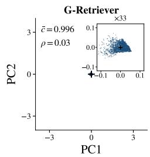
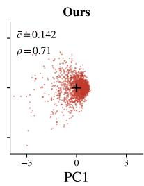
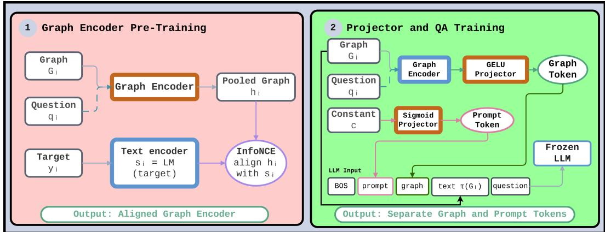
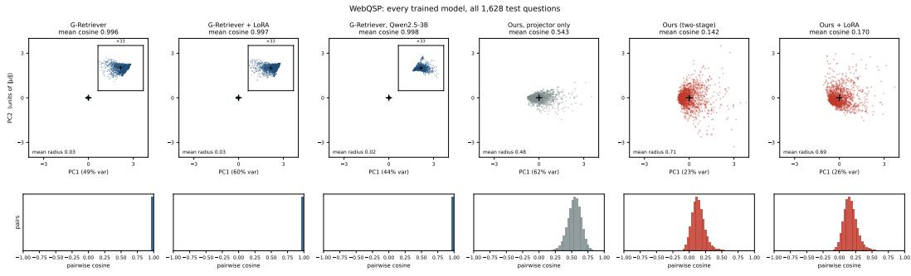
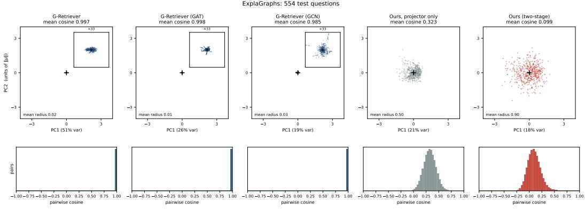
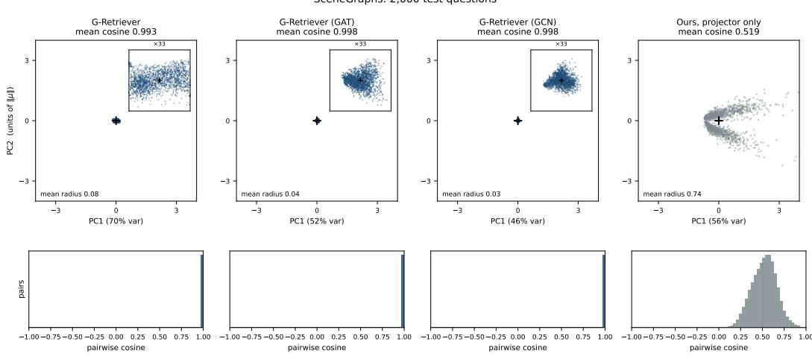
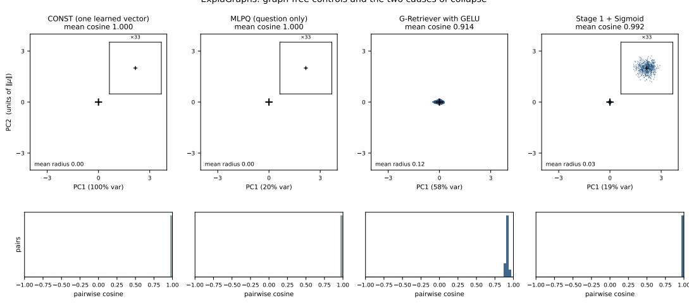

# ON THE TOKEN COLLAPSE PHENOMENON IN TEXTUAL GRAPH SOFT PROMPTING

Andrea Giuseppe Di Francesco¹,2,\*

Rishabh Jain³ Franco Maria Nardini²

Nicola Tonellotto4

Pietro Liò³ Fabrizio Silvestri¹

1Sapienza University of Rome, Rome, Italy 2ISTI-CNR, Pisa, Italy 3University of Cambridge, Cambridge, UK 4University of Pisa, Pisa, Italy \*Corresponding author

difrancesco@diag.uniroma1.it

## ABSTRACT

Recent methods for injecting graph structure into LLM prompts include graph soft prompting, in which a graph neural network (GNN) learns graph-specific tokens that capture relational information among entities in textual prompts. A major development in this line of work is G-Retriever, which combines graph soft prompts with a verbalized description of the same graph to strengthen the textual prompt signal. In this paper, we conduct an in-depth analysis of G-Retriever and uncover a pathological behavior we term token collapse. Across three benchmarks, three graph encoders, two LLM families, and both frozen and LoRA-adapted models, G-Retriever's graph tokens become almost indistinguishable across inputs. We provide evidence that the same failure is inherited by subsequent methods to G-Retriever, even with multi-token pooling. Under the standard setup, swapping a token with the dataset mean, a token from another example, or one derived from a corrupted graph produces no resolved answer-level effect in accuracy. Moreover, a learned constant prompt that never accesses the graph matches or surpasses G-Retriever on all three benchmarks. These findings indicate that, rather than conveying graph content as intended, the collapsed token functions primarily as a generic soft prompt. We examine conditions linked to this collapse and propose a two-stage procedure that yields non-collapsed tokens while maintaining competitive performance in most cases. However, token variability alone does not prove that the model is using graph information: via interventions and decoding probes, we show that depending on the configuration, a token can reflect the question, an answer prior, or graph-derived content that the LLM may or may not actually leverage. Overall, our results offer a practical approach to evaluating graph-token alignment rather than inferring it from task accuracy alone. Code to reproduce our experiments is available at https://github.com/difra100/Token\_Collapse\_KGQA.

## 1 INTRODUCTION

Large language models (LLMs) store knowledge in their parameters, making information outside or newer than their pre-training data hard to access or update (Lewis et al., 2020). Such external knowledge may be organised as text-attributed graphs (He et al., 2024). We can incorporate this information into an LLM either by textualizing the graphs, i.e., constructing verbalized descriptions of nodes and edges, or through graph soft prompting, i.e., providing a learned representation generated by a graph neural network (GNN). Verbalisation has two limitations: its token cost grows with the amount of graph content included, and serialisation imposes a sequence order on facts that have no intrinsic order. Expressive Graph soft prompting aims to offer an alternative interface for conveying relational information without verbalising every node and edge. G-Retriever (He et al., 2024) supplies the same underlying graph via both channels. However, this design introduces an identifiability issue: because the graph content is already present in textual form, improvements in answer accuracy alone cannot distinguish whether the model relies on the graph token, the verbalized graph, or both. Furthermore, the training objective does not explicitly enforce that the graph-derived token encodes graph-specific information when the textual channel suffices. Consequently, a token computed from the graph may degenerate into a graph-invariant soft prompt.

G-Retriever interprets its ablations as evidence that the graph encoder and verbalised graph provide complementary graph representations (He et al., 2024). We revisit this interpretation by testing what the graph token contains and whether the LLM uses it.

This study evaluates the proposed mechanism by quantifying both the information encoded in graphderived tokens and the information that the large language model (LLM) causally exploits during inference. The experimental protocol integrates tokenspace statistical analyses with fixed-weight causal interventions: individual tokens are substituted with (i) the training-set mean token, (ii) a token sampled from a different example, or (iii) a token recomputed from corrupted or different graph inputs. In addition to answer accuracy, we assess gold-answer log-likelihood to capture subtler shifts in the model's output distribu-

  
Figure 1: Graph tokens of all 1,628 WebQsP test questions, projected onto two principal components after removing the mean token μ, with pairwise cosines shown below.

tion, and we employ decoding-based probes to measure the recoverability of question, answer, and graph attributes from internal representations. Graph-free control conditions preserve the projector architecture and the full training pipeline while ablating the graph input itself.

Applying this protocol to G-Retriever uncovers an unanticipated phenomenon that we call token collapse, which also recurs in subsequent graph-prompting methods. Specifically, across several graph encoders, benchmark datasets, LLM families, and fine-tuning regimes, the token representations generated by G-Retriever are nearly invariant with respect to the input graph (Figure 1). Moreover, substituting these input-dependent projected tokens with a fixed alternative yields no resolved answer-level effect under the default configuration; indeed, a learned constant token that never observes any graph matches or even surpasses the performance of the full model. These results indicate that the collapsed token operates primarily as a soft prompt rather than as a carrier of graph-specific information. Although likelihood-based analyses show that perturbing the token can modulate the output distribution, such sensitivity alone is insufficient to demonstrate input- or graph-conditioned utilization.

We associate collapse with two factors: a projector that suppresses variation in the encoder representations and an answer objective that does not require this variation to be preserved. Our ablations implicate both factors, although they do not isolate either as the sole cause. We address them with a two-stage pipeline that first aligns and freezes the graph encoder, then trains separate graph-token and prompt-token pathways. The resulting tokens no longer collapse, but non-collapse alone guarantees neither graph use nor improved accuracy. Depending on the benchmark and training configuration, they may encode the question, an answer prior, graph information made redundant by the text, or graph information that the LLM uses to answer. This distinction matters because task improvements may otherwise be attributed to graph–language alignment even when they arise from the verbalised graph or a graph-independent soft prompt. By separating token variation, graph content, and downstream use, our protocol makes alignment empirically testable and provides concrete criteria for developing graph–language models that preserve and use task-relevant graph information beyond what is already supplied by the textual channel.

Contributions. We identify token collapse across G-Retriever benchmarks, graph encoders, LLM families, and tuning regimes, and find the same failure in recent graph-prompting methods. Using matched graph-free controls and fixed-weight interventions, we show that the collapsed token acts primarily as a soft prompt rather than as a graph representation used to answer. We associate collapse with the projector and end-to-end answer training, and propose a two-stage pipeline that mitigates it across the tested settings. Finally, we show that a non-collapsed token may encode question or answer priors, unused graph information, or graph information that changes the answer. Together, these results provide a practical protocol for testing graph-token alignment rather than inferring it from task accuracy.

## 2 RELATED WORK

Graph soft prompting. Soft prompting conditions an LLM with learned continuous vectors (Lester et al., 2021; Li & Liang, 2021); graph soft prompting instead projects graph-encoder outputs into one or more such tokens. GraphToken (Fatemi et al., 2024), GraphLLM (Chai et al., 2026), GNP (Tian et al., 2024), GraphGPT (Tang et al., 2024), and G-Retriever (He et al., 2024) differ in their encoders, token counts, retrieval, and LLM adaptation. In this paper, we test whether G-Retriever and subsequent methods preserve and use graph-specific information in their projected tokens.

Evaluating graph-language models. Recent work questions whether existing objectives and benchmarks require graph–language integration. Zhang et al. (2026) show that autoregressive training can favour a text-dominant solution, while Petkar et al. (2026) find that single-modality and raw soft-prompt baselines remain competitive and introduce CLEGR to test compositional graph-text reasoning. We complement these studies by auditing the graph token– LLM interface of graph soft prompting. Extended related work discussion is in Appendix S.

## 3 METHOD

## 3.1 PRELIMINARIES: GRAPH SOFT PROMPTING IN G-RETRIEVER

A textual graph $G = ( \mathcal { V } , \mathcal { E } , \{ x _ { v } \} _ { v \in \mathcal { V } } , \{ x _ { e } \} _ { e \in \mathcal { E } } )$ associates every node v with a text attribute $x _ { v }$ and every edge e with a text attribute $x _ { e }$ . Each example i consists of a graph, a question $q _ { i }$ , and an answer $y _ { i }$

Retrieval. Node, edge, and question texts are embedded by a frozen sentence encoder $\mathrm { L M } ( \cdot )$ into $\mathbb { R } ^ { d }$ (Reimers & Gurevych, 2019). The respective representations are ${ \bf z } _ { v } = \mathrm { L M } ( x _ { v } ) , { \bf z } _ { e } = \mathrm { L M } ( x _ { e } )$ and $\mathbf { q } _ { i } = \mathrm { L M } ( q _ { i } )$ .

When the complete graph exceeds the LLM's context length or a predefined budget, only a relevant subgraph can be supplied to the model. Following G-Retriever, similarities between $\mathbf { q } _ { i }$ and the node and edge embeddings define retrieval relevance, and a prize-collecting Steiner tree is used to select a compact, connected subgraph (Bienstock et al., 1993). We denote the resulting question-specific subgraph by $G _ { i }$ . When the complete graph fits within the budget, no retrieval is needed and $\bar { G _ { i } } = G$

Graph token. A graph encoder $f _ { \phi }$ processes $G _ { i }$ using node features $\mathbf { z } _ { v }$ , edge features $\mathbf { z } _ { e } ,$ and optionally the question representation $\mathbf { q } _ { i }$ . G-Retriever uses a graph transformer by default (Shi et al., 2020); we also evaluate GAT (Veličković et al., 2018) and GCN (Kipf & Welling, 2017). The node representations are mean-pooled into $\mathbf { h } _ { i } \in \mathbb { R } ^ { d _ { g } }$ , and a projector $P _ { \psi }$ maps the result into the LLM embedding space:

$$
\mathbf { t } _ { i } = P _ { \psi } ( \mathbf { h } _ { i } ) = \mathbf { W } _ { 2 } \sigma ( \mathbf { W } _ { 1 } \mathbf { h } _ { i } + \mathbf { b } _ { 1 } ) + \mathbf { b } _ { 2 } \in \mathbb { R } ^ { d _ { \ell } } ,\tag{1}
$$

where $\sigma$ is the logistic sigmoid and the projector has hidden width $d _ { p }$ . We refer to $\mathbf { t } _ { i }$ as the graph token.

Generation. The retrieved subgraph is also verbalised as a list of nodes and edges, denoted by $\tau ( G _ { i } )$ , and truncated to a budget of $L _ { \mathrm { m a x } }$ tokens. In the default frozen-LLM setting, the model receives

$$
[ { \bf e } _ { \mathrm { b o s } } ; { \bf t } _ { i } ; \mathrm { E m b } ( \tau ( G _ { i } ) ) ; \mathrm { E m b } ( q _ { i } ) ] .
$$

The graph token therefore precedes the verbalised graph and the question. The LLM parameters θ remain fixed, while the graph encoder and projector are trained with the answer loss

$$
\mathcal { L } _ { \mathrm { Q A } } ( \phi , \psi ) = - \sum _ { i } \sum _ { k } \log p _ { \theta } \bigl ( y _ { i , k } \mid y _ { i , < k } , \mathbf { t } _ { i } , \tau ( G _ { i } ) , q _ { i } \bigr ) .\tag{2}
$$

The graph encoder does not receive the question directly, so in G-Retriever the token depends on the question only through retrieval.

  
Figure 2: Two-stage pipeline. Stage 1 aligns the question-conditioned graph encoder. Stage 2 freezes it and trains separate graph-token and prompt-token pathways. Orange modules are trained; blue modules are frozen.

## 3.2 THE GRAPH TOKEN COLLAPSE PHENOMENON

Task accuracy conflates three distinct questions: Does the token vary across inputs? Does the LLM use the graph token? What information does it contain? We address them with complementary measurements of token geometry, fixed-weight interventions, gold-answer likelihood, and decodability.

Does the token vary across inputs? We measure inter-sample cosine, the input-specific residual relative to the mean token, and token norm relative to ordinary word embeddings. Collapse appears as cosine near one and a small residual ratio. We also compute inter-sample cosine before projection, on the pooled encoder representations $\mathbf { h } _ { i } ,$ to determine where collapse arises. Formal definitions are given in Appendix D.

Does the LLM use graph-specific token variation? At fixed weights, REAL uses the original token, MEAN replaces it with the training-set mean, and sWAP uses another example's token. Our main graph-specific intervention, GsWAP, recomputes the token from another graph while preserving the original question conditioning. NODE, EDGE, and REL corrupt individual graph components, while NOTXT removes the verbalised graph. Retrained no-entity and no-question variants isolate the information available during training. Because accuracy observes only changes in the decoded answer, we also measure the paired change in gold-answer negative log-likelihood under teacher forcing. This detects smaller changes in the output distribution. Full details on our interventions are in Appendix D.

What does the token contain? Recoverable content and downstream use are not equivalent: a token may contain information that the LLM ignores. This matters for our pipeline because Stage 1 is conditioned on the question and trained with an answer-related target. A non-collapsed token may therefore encode the question, an answer prediction or prior, the graph, or a mixture. The answer can be a supervision target rather than an input, so it cannot be removed through a fixed-weight intervention; appendix Table 8 maps the information retained by the remaining conditions.

We complement the interventions with a post-hoc probe that maps stored tokens to frozen embeddings of the question, answer, or verbalised graph. The map is fitted on half of the test examples; on the held-out half, we report the median rank of each example's correct target among all candidates. A constant token provides the control rank. Estimation details and limitations are given in Appendix D.

Graph-free controls. CONST passes a learned graph-independent vector through G-Retriever's projector, while MLPQ replaces the graph encoder with an MLP over the question. PT is the raw prompt-tuning baseline, the same as that used by He et al. (2024), and does not use the projector. These controls distinguish the contribution of graph input from that of token parameterisation.

## 3.3 PREVENTING COLLAPSE: A TWO-STAGE PIPELINE

Our ablations associate collapse with two factors: a Sigmoid projector that suppresses encoder variation and end-to-end answer training that does not require this variation to be preserved. We address both while retaining G-Retriever's data, prompt, answer loss, and optimisation setup (Figure 2).

Stage 1: preserve input-specific variation. Without the LLM, we train the graph encoder with an InfoNCE objective (van den Oord et al., 2019). Its pooled representation $\mathbf { h } _ { i }$ is aligned with a frozen embedding of a sample-specific target and contrasted against negative targets. The question conditions each node through $\mathbf { x } _ { v } = \mathbf { z } _ { v } + \mathbf { W } _ { q } \mathbf { q } _ { i }$ , with $\mathbf { W } _ { q }$ initialised at zero. We use the answer as the target, or the verbalized graph, when the answer space is too small to distinguish samples (e.g., answers are Yes/No). The encoder is then frozen.

Stage 2: separate graph representation from prompting. Using the original answer loss, we jointly train a GELU projector over the frozen encoder and a separate graph-independent prompt token. Freezing protects the variation learned in Stage 1, while the second pathway gives the shared prompting function its own token rather than forcing it to compete with input-specific information.

The full objective, targets, and design ablations are reported in Appendix N.

## 4 EXPERIMENTS

We investigate four questions. RQ1: Do graph tokens collapse, and how general is this behaviour? RQ2: What role does the collapsed token play when the same graph is also verbalised in the prompt? RQ3: What is collapse associated with, and can it be prevented without sacrificing task performance? RQ4: What do non-collapsed tokens encode, and which of that information does the LLM use?

## 4.1 SETUP

Benchmarks. We use the three GraphQA benchmarks introduced by He et al. (2024): ExplaGraphs, SceneGraphs, and WebQSP. Following their official splits, retrieval procedures, and evaluators, we report accuracy on ExplaGraphs and SceneGraphs and Hit@1 on WebQSP. Dataset statistics and retrieval settings are in Appendix B.

Models. We reproduce G-Retriever with its default graph transformer (GT) and frozen Llama-2-7B (Touvron et al., 2023). Robustness experiments use GAT, GCN, Qwen2.5-3B (Qwen Team, 2025), and LoRA adaptation. Architecture, optimisation, and pipeline settings are in Appendix A.

Evaluation stability. Re-evaluating identical WebQSP weights in a separate process changes Hit@ 1 by 1.04 points. We therefore require an answer-level difference larger than 2 points with $p \ <$ .05. Gold-answer likelihood is more stable; we require $| \Delta \mathrm { N L L } | > \bar { 0 . 0 3 }$ and a bootstrap interval excluding the replicate floor. Calibration results are in Appendix D.

Statistical testing. Accuracy and Hit@1 comparisons are paired with the exact McNemar test (Mc-Nemar, 1947). We denote $p < . 1 0 , . 0 5 , . 0 1$ , and .001 by $^ { \dag } , ~ , ^ { \ast * }$ , and \*\*\*, respectively; unmarked comparisons have $p \geq . 1 0 .$ Reported p-values are unadjusted, so claims rely on the effect-size criteria above and consistent evidence rather than isolated significant cells.

## 4.2 RQ1: DO GRAPH TOKENS COLLAPSE, AND HOW GENERAL IS COLLAPSE?

Collapse occurs in every tested configuration. Token cosine ranges from 0.985 to 0.998, while the input-specific residual is only 4–12% of the shared mean, whose norm is 22–97 times that of an ordinary word embedding (Appendix E). Figure 1 illustrates this geometry on WebQSP. Models with similarly collapsed tokens nevertheless obtain substantially different scores, so task performance does not reveal collapse.

The encoder representations are considerably more variable, with cosines between 0.423 and 0.693 This makes GNN oversmoothing (Rusch et al., 2023) an insufficient explanation for token collapse: even if node representations are smoothed within a graph, the pooled outputs might remain distinct across inputs, and near-identity appears only after projection. Collapse also persists across three graph encoders, two LLM families, and frozen and LoRA-adapted LLMs. Moreover, a controlled WebQSP audit finds the same geometry in later single- and multi-token graph-prompting methods (Appendix F). This answers RQ1: collapse is a recurring failure mode rather than a peculiarity of one encoder, LLM, or single-token implementation. We next ask what the collapsed token contributes to the answer.

Table 1: Collapse across datasets, graph encoders, LLMs, and tuning regimes. Scores are accuracy for ExplaGraphs and SceneGraphs and Hit@1 for WebQSP.
<table><tr><td>Dataset</td><td>Model</td><td>Score</td><td>Encoder cosine</td><td>Token cosine</td></tr><tr><td rowspan="3">ExplaGraphs</td><td>G-Retriever (GT)</td><td>85.56</td><td>0.678</td><td>0.997</td></tr><tr><td>G-Retriever (GAT)</td><td>85.20</td><td>0.457</td><td>0.998</td></tr><tr><td>G-Retriever (GCN)</td><td>78.88</td><td>0.423</td><td>0.985</td></tr><tr><td rowspan="3">SceneGraphs</td><td>G-Retriever (GT)</td><td>81.35</td><td>0.630</td><td>0.993</td></tr><tr><td>G-Retriever (GAT)</td><td>80.20</td><td>0.693</td><td>0.998</td></tr><tr><td>G-Retriever (GCN)</td><td>80.55</td><td>0.428</td><td>0.998</td></tr><tr><td rowspan="3">WebQSP</td><td>G-Retriever (GT)</td><td>70.33</td><td>0.593</td><td>0.996</td></tr><tr><td>+ LoRA</td><td>74.32</td><td>0.621</td><td>0.997</td></tr><tr><td>+ Qwen2.5-3B</td><td>55.47</td><td>0.589</td><td>0.997</td></tr></table>

Table 2: Role of G-Retriever's collapsed token. REAL, NOTXT, and CONST are absolute scores; other columns report differences from their corresponding reference. Full results in Appendices I, J, and K.
<table><tr><td>Dataset</td><td>REAL</td><td>∆MEAN</td><td>∆SWAP</td><td>∆GSWAP</td><td>NOTXT</td><td>∆NOTXT-MEAN</td><td>CONST</td></tr><tr><td>ExplaGraphs</td><td>85.56</td><td>-0.18</td><td>-1.26</td><td>-1.08</td><td>66.43</td><td>-0.90</td><td>85.56</td></tr><tr><td>SceneGraphs</td><td>81.35</td><td>-0.35</td><td>-1.20†</td><td>-1.10†</td><td>30.20</td><td>+0.45</td><td>81.40</td></tr><tr><td>WebQSP</td><td>70.33</td><td>-1.84*</td><td>-0.92</td><td>-0.55</td><td>41.34</td><td>+1.04</td><td>71.25</td></tr></table>

## 4.3 RQ2: WHAT ROLE DOES THE COLLAPSED TOKEN PLAY?

The input-specific component has no resolved answer-level effect. Across all three benchmarks, MEAN, SWAP, and GSWAP remain within the two-point threshold (Table 2); corrupting entities, edges, or relations gives the same result (more evidence in Appendix I). Yet replacing the token with zero costs 59.64–81.95 points (see Appendix J). The model therefore relies on the token's shared value, but not measurably on its graph-specific variation.

The verbalised graph is the dominant graph channel. Removing it costs 19–51 points, whereas replacing the remaining token with its mean changes performance by at most 1.04 points. Thus, in the default Llama-2 configuration, task-relevant graph information is supplied primarily through text.

The shared token acts as a soft prompt. CONST, a graph-independent vector passed through the same projector, matches or exceeds G-Retriever on every benchmark. Graph input is therefore unnecessary for the benefit attributed to the collapsed token. Raw prompt tuning, namely the existing ablation performed by He et al. (2024), performs worse (Appendix K), but changes the parameterisation and is not a controlled graph-versus-no-graph comparison.

Small distributional effects remain: on WebQSP, sWAP and GSWAP increase gold-answer NLL by 0.0183 and 0.0182, both below the 0.03 criterion (Appendix L). These results answer RQ2: the collapsed token functions primarily as a projector-parameterised soft prompt, while the verbalised graph is the dominant graph-information channel. RQ3 asks what collapse is associated with and whether it can be prevented.

Table 3: Factors associated with collapse on ExplaGraphs. Step 0 precedes projector training, and significance markers compare task score with the first row. Full projector diagnostics and intervention results are in Appendices H and I.
<table><tr><td>Encoder</td><td>Projector</td><td>Encoder cos.</td><td>Step-0 token cos.</td><td>Token cos.</td><td>Score</td></tr><tr><td>trained end to end</td><td>Sigmoid</td><td>0.695</td><td>1.000</td><td>0.997</td><td>85.56</td></tr><tr><td>trained end to end</td><td>GELU</td><td>0.787</td><td>0.992</td><td>0.914</td><td>73.29 ***</td></tr><tr><td>frozen after Stage 1</td><td>Sigmoid</td><td>0.024</td><td>0.987</td><td>0.992</td><td>84.48</td></tr><tr><td>frozen after Stage 1</td><td>GELU</td><td>0.024</td><td>0.091</td><td>0.323</td><td>57.76 ***</td></tr></table>

## 4.4 RQ3: WHAT IS COLLAPSE ASSOCIATED WITH, AND CAN IT BE PREVENTED?

Factors associated with collapse. Table 3 identifies two associations. With the aligned Stage 1 encoder frozen, its representations are highly distinct (cosine 0.024), yet the Sigmoid projector produces nearly identical tokens before and after training (0.9870 and 0.9918). GELU instead yields cosine 0.0910 before training and 0.3229 afterwards. Untrained-projector experiments reproduce this contrast on random inputs (Appendix H), linking the Sigmoid parameterisation to suppression of encoder variation.

Changing the projector alone is insufficient: under end-to-end answer training, GELU still produces highly similar tokens (cosine 0.9139). Conversely, combining the aligned frozen encoder with GELU prevents collapse, but the single-token model falls to approximately majority-class performance (57.76 versus 58.8). Thus, both factors are associated with collapse, but this experiment does not identify either as the sole cause. The cross-method audit supports this qualification (Appendix F). GRAG (Hu et al., 2025) and GRETPool (Grover et al., 2026) inherit the same Sigmoid projector and also collapse, while GraSP (Wang et al., 2026) collapses despite using the hyperbolic tangent.

Preventing collapse while retaining performance. Table 4 shows that the complete two-token pipeline mitigates collapse in every tested setting. For the standard pipeline, token cosine falls from above 0.99 to 0.099–0.142 with Llama-2 and to 0.103–0.200 with Qwen2.5-3B.

With Llama-2, the pipeline retains performance on WebQSP (69.90 versus 70.33) and ExplaGraphs (85.74 versus 85.56), with both differences below our resolution threshold. On ExplaGraphs, the separate prompt pathway recovers the performance lost by the non-collapsed single-token model, raising its score from 57.76 to 85.74. On SceneGraphs, however, GsWAP produces a resolved —5.30-point effect while the score falls from 81.35 to 72.50.

The Qwen2.5-3B replication further separates performance from graph use. The Qwen rows in Table 4 use a matched training budget and are distinct from the robustness checkpoint in Table 1. On WebQSP, our pipeline improves the matched baseline from 57.13 to 65.79 $( p = 4 . 5 \times 1 0 ^ { - 2 0 } )$ , while GSWAP produces a resolved —2.09-point effect $( p = . 0 0 2 7 )$ . On ExplaGraphs, it improves from 74.37 to 83.94 $( p = 1 . 5 \times 1 0 ^ { - 5 } )$ , but GsWAP has no effect (+0.36). Conversely, on SceneGraphs, it produces the strongest graph-replacement effect in the study (—6.50, p < .001) while scoring 3.40 points below G-Retriever. Qwen G-Retriever on ExplaGraphs provides the opposite exception: its tokens remain collapsed, yet GsWAP causes a resolved —4.51-point effect. Near-collapse therefore does not imply complete insensitivity to the remaining variation.

These results answer RQ3. We found that collapse is associated with both the projector and end-toend answer training, without either being isolated as its sole cause. The two-stage pipeline mitigates collapse across both LLM families and can retain or improve performance. However, geometric collapse, graph-specific token use, and task performance remain distinct properties. RQ4 takes a step forward and examines what the tokens encode and which information the LLM uses.

## 4.5 RQ4: WHAT DOES A NON-COLLAPSED TOKEN CARRY?

Non-collapse shows that tokens differ across inputs, but not what they represent or whether the LLM uses those differences. Because Stage 1 receives the question and an answer-related target, the token may encode the question, an answer prior, the graph, or a mixture.

Table 4: Token geometry, performance, and intervention effects. Ours denotes the complete twotoken pipeline; Intervention columns report condition minus REAL. Bold scores mark the highest score within each dataset-LLM block; bold GSWAP effects satisfy |∆| > 2 and p < .05. Complete interventions and p-values are in Appendix I, and pipeline ablations are in Appendix O.
<table><tr><td>Dataset</td><td>Model</td><td>Score</td><td>Token cos.</td><td>∆MEAN</td><td>∆SWAP</td><td>∆GSWAP</td></tr><tr><td colspan="7">Llama-2-7B</td></tr><tr><td rowspan="4">WebQSP</td><td>G-Retriever</td><td>70.33</td><td>0.996</td><td>-1.84*</td><td>-0.92</td><td>-0.55</td></tr><tr><td>Ours</td><td>69.90</td><td>0.142</td><td>-3.13 ***</td><td>-2.15*</td><td>-1.97†</td></tr><tr><td>no entity features</td><td>72.73</td><td>0.125</td><td>-6.14 **率</td><td>-5.65 ***</td><td>-1.97*</td></tr><tr><td>no question</td><td>69.84</td><td>0.169</td><td>-0.06</td><td>-3.69* ***</td><td>-2.33*</td></tr><tr><td rowspan="4">SceneGraphs</td><td>G-Retriever</td><td>81.35</td><td>0.993</td><td>-0.35</td><td>-1.20†</td><td>-1.10†</td></tr><tr><td>Ours</td><td>72.50</td><td>0.133</td><td>-1.40</td><td>-3.40 ***</td><td>-5.30 ***</td></tr><tr><td>no entity features</td><td>79.65</td><td>0.125</td><td>-5.75***</td><td>-9.60 ***</td><td>+0.35</td></tr><tr><td>no question</td><td>76.35</td><td>0.225</td><td>-1.15</td><td>-0.25</td><td>-0.25</td></tr><tr><td rowspan="4">ExplaGraphs</td><td>G-Retriever</td><td>85.56</td><td>0.997</td><td>-0.18</td><td>-1.26</td><td>-1.08</td></tr><tr><td>Ours</td><td>85.74</td><td>0.099</td><td>+0.36</td><td>-0.54</td><td>-1.44</td></tr><tr><td>no entity features</td><td>84.48</td><td>0.113</td><td>+3.07 **</td><td>0.00</td><td>-0.36</td></tr><tr><td>no question</td><td>87.55</td><td>0.108</td><td>+1.08</td><td>+0.90</td><td>+1.26</td></tr><tr><td colspan="7">Qwen2.5-3B, matched training budget</td></tr><tr><td>WebQSP</td><td>G-Retriever Ours</td><td>57.13</td><td>0.997</td><td>-0.55 **</td><td>-1.41 **</td><td>-1.60† **</td></tr><tr><td rowspan="2">SceneGraphs</td><td></td><td>65.79</td><td>0.200</td><td>-2.09</td><td>-1.90*</td><td>-2.09</td></tr><tr><td>G-Retriever</td><td>76.05</td><td>0.997</td><td>-0.30 ***</td><td>-1.05† ***</td><td>-1.15* ***</td></tr><tr><td rowspan="2">ExplaGraphs</td><td>Ours</td><td>72.65</td><td>0.139</td><td>-7.00*</td><td>-5.75</td><td>-6.50</td></tr><tr><td>G-Retriever Ours</td><td>74.37 83.94</td><td>0.998 0.103</td><td>-1.62 +0.90</td><td>-2.17 0.00</td><td>-4.51* +0.36</td></tr></table>

We separate recoverable content from downstream use. Table 5 reports question, answer, and graph retrieval ranks, answer-level effects under GSWAP, and likelihood changes under SWAP and GSWAP. Table 4 measures reliance on sample-specific token information through MEAN and sWAP, while the appendix Table 70 repeats the interventions without the retrieved verbalised graph. Complete cross-LLM results are reported in Appendix M.

The retrieval probe maps each token to the corresponding question, answer, or verbalised graph among held-out candidates. We report the median rank of the correct target: lower is better, and a constant token provides the control rank. Recoverability does not imply use. A low answer rank, for example, means that the answer is predictable from the token, not that it was computed from the graph or used by the LLM.

We use five diagnoses. UsED means that GSWAP changes the task score by more than two points with p < .05. MASKED means that this effect resolves only after removing the verbalised graph. PRIOR identifies a no-entity model whose token carries question and answer information and is used under MEAN or SWAP, without resolved graph-specific use. DECODABLE means that graph information is recoverable without a resolved answer-level effect. SoFT PROMPT denotes a collapsed baseline without resolved graph-specific use; any information recoverable from its residual variation is reported separately by the retrieval ranks.

WebQsP: the token's role depends on training. The standard token makes the question and answer strongly recoverable, at ranks 65 and 60 against the control of 407. With the verbalised graph present, GsWAP affects likelihood but not the decoded score; after removing the text, it causes a resolved —2.27-point effect (Tables 5 and 70). Removing entity features further strengthens question and answer recovery and improves Hit@1 without resolved graph use, supporting the PRIOR diagnosis. Conversely, removing question conditioning produces resolved graph use. Thus, the same architecture can favour priors or graph information depending on its training inputs.

Table 5: Token content and use with Llama-2. Q, A, and G are median retrieval ranks (lower is better); constant controls are 407 for WebQSP, 500 for SceneGraphs (A: 476–500), and 139 for ExplaGraphs (A omitted). ∆Score is the with-text GSWAP effect; NLL reports SWAP/GSWAP. Bold denotes effects meeting the criteria in Section 4.1.
<table><tr><td>Dataset</td><td>Model</td><td>Q rank</td><td>A rank</td><td>G rank</td><td>∆Score GSWAP</td><td>∆NLL S/GS</td><td>Diagnosis</td></tr><tr><td rowspan="4">WebQSP</td><td>G-Retriever</td><td>293</td><td>317</td><td>369</td><td>-0.55</td><td>+0.0183/ + 0.0182</td><td>SOFT PROMPT</td></tr><tr><td>Ours</td><td>65</td><td>60</td><td>315</td><td>-1.97†</td><td>+0.0895/+0.0332</td><td>MASKED</td></tr><tr><td>no entity features</td><td>34</td><td>51</td><td>303</td><td>-1.97*</td><td>+0.1111/ + 0.0262</td><td>PRIOR</td></tr><tr><td>no question</td><td>120</td><td>134</td><td>329</td><td>-2.33</td><td>+0.0848/+0.0845</td><td>USED</td></tr><tr><td rowspan="4">SceneGraphs</td><td>G-Retriever</td><td>271</td><td>436</td><td>248</td><td>−1.10^†</td><td>+0.0169/ + 0.0167</td><td>SOFT PROMPT</td></tr><tr><td>Ours</td><td>47</td><td>187</td><td>427</td><td>-5.30***</td><td>+0.0229/+0.1665</td><td>USED</td></tr><tr><td>no entity features</td><td>8</td><td>59</td><td>369</td><td>+0.35</td><td>+0.1553/ + 0.0045</td><td>PRIOR</td></tr><tr><td>no question</td><td>116</td><td>395</td><td>185</td><td>-0.25</td><td>+0.0214/ + 0.0213</td><td>MASKED</td></tr><tr><td rowspan="4">ExplaGraphs</td><td>G-Retriever</td><td>138</td><td>1</td><td>139</td><td>-1.08</td><td>+0.0014/ + 0.0022</td><td>SOFT PROMPT</td></tr><tr><td>Ours</td><td>54</td><td></td><td>41</td><td>-1.44</td><td>+0.0010/ + 0.0032</td><td>DECODABLE</td></tr><tr><td>no entity features</td><td>67</td><td></td><td>67</td><td>-0.36</td><td>+0.0026/ + 0.0056</td><td>DECODABLE</td></tr><tr><td>no question</td><td>84</td><td></td><td>70</td><td>+1.26</td><td>-0.0063/ - 0.0073</td><td>DECODABLE</td></tr></table>

SceneGraphs: graph use and accuracy diverge. Our pipeline uses graph-specific token content: GsWAP lowers accuracy by 5.30 points and increases NLL by 0.1665, but it remains less accurate than G-Retriever. G-Retriever's collapsed token contains recoverable graph information, yet shows no resolved graph use, so its functional diagnosis remains SOFT PROMPT. The no-entity model nearly recovers its accuracy while eliminating graph use, confirming that performance and token use are distinct.

ExplaGraphs: graph information is decodable but unused. Our token makes the graph substantially more recoverable, at rank 41 against the control of 139, but GsWAP has no resolved effect with or without the verbalised graph. Because these graphs are small and supplied in full, their textual representation may already be sufficient. However, removing that text does not make the model rely on the token. The evidence therefore establishes recoverable graph information, not downstream use.

Together, these results answer RQ4: preventing collapse still does not uniquely determine what a token represents or whether the LLM uses it. Depending on the benchmark and training inputs, a non-collapsed token may encode a question or answer prior, unused graph information, or graph information that changes the answer.

## 5 DISCUSSION

What standard evaluation misses. Task accuracy cannot isolate graph-token use, while raw prompt tuning changes the token parameterisation and no-text retraining changes the learning problem. A minimal audit should combine token geometry, a graph-free control using the same projector, and fixed-weight MEAN, SWAP, and GSWAP interventions. The controlled WebQSP audit in Appendix F finds collapse with query-conditioned and multi-token approaches, extending the phenomenon beyond G-Retriever up to most recent graph soft prompting methods.

Graph use and accuracy are different outcomes. Our pipeline can make answers depend on graph-specific token variation without improving accuracy. The textual channel may be easier to exploit, while continuous graph tokens may be lossy or difficult for the LLM to interpret. The Qwen2.5-3B results show that this trade-off is not inevitable; alignment claims should therefore report graph use and performance separately.

Limitations and future directions. Our detailed analysis covers G-Retriever on three questionanswering benchmarks; the cross-method audit is limited to WebQSP, runnable implementations, and controlled variants using G-Retriever's retrieved subgraphs. The mechanism evidence is associative and does not isolate the projector or end-to-end training as a sole cause.

The audited recipe trains from scratch with answer cross-entropy; collapse may differ with pretrained encoders or explicit contrastive, reconstructive, or counterfactual objectives (Zhang et al.,

2026; Xu et al., 2025). Stage 1 explores one alternative, but its conditioning and targets can introduce priors. GsWAP tests graph-question pairing rather than fact-level reasoning, and decodability measures recoverability rather than use. Our pipeline is therefore a diagnostic proof of concept. Future work should preserve task-relevant graph information and verify that the LLM uses it.

## 6 CONCLUSION

We uncover token collapse in G-Retriever across benchmarks, graph encoders, LLM families, and tuning regimes, and find the same geometry in controlled tests of later single- and multi-token interfaces. Despite competitive task scores, the projected tokens are nearly identical across inputs. We also find that graph-free controls and fixed-weight interventions match the performance of the original G-retriever model. These findings show that strong task performance can conceal a graphtoken interface whose principal contribution is a graph-independent soft prompt, while the verbalised graph provides the dominant graph-information channel. Our two-stage pipeline mitigates this collapse, but also demonstrates that distinct tokens do not guarantee graph use or improved accuracy. Token variation, recoverable graph information, downstream use, and task performance must therefore be evaluated separately. Our protocol provides a practical way to distinguish these outcomes and turns alignment from an architectural assumption into an empirical claim that will foster the development of future graph-language models.

## AI USE STATEMENT

Generative AI tools assisted with prose revision and parts of the analysis and plotting code. They did not generate experimental results: all newly reported experimental numbers were produced by our pipeline and checked against stored predictions, tokens, checkpoints, or logs. The authors reviewed all AI-assisted text and code, verified the experimental claims, and take full responsibility for the paper.

## REPRODUCIBILITY STATEMENT

Appendix A specifies the repository and code modification, optimisation settings, model dimensions, LoRA configuration, Stage-1 hyperparameters, trainable parameter counts, hardware, and evaluation procedure. Appendix B reports dataset statistics, splits, retrieval settings, metrics, and intervention subsets. Appendix I provides the complete fixed-weight intervention results; the remaining appendices report the geometry, likelihood, decodability, controls, and pipeline measurements.

## REFERENCES

Emily Alsentzer, Samuel G. Finlayson, Michelle M. Li, and Marinka Zitnik. Subgraph neural networks,2020.URL https://arxiv.org/abs/2006.10538.

Daniel Bienstock, Michel X Goemans, David Simchi-Levi, and David Williamson. A note on the prize collecting traveling salesman problem. Mathematical Programming, 59(1):413–420, 1993.

Ziwei Chai, Tianjie Zhang, Liang Wu, Kaiqiao Han, Xiaohai Hu, Xuanwen Huang, and Yang Yang. GraphLLM: Boosting graph reasoning ability of large language model. IEEE Transactions on Big Data, 12(2):475–483, 2026. doi: 10.1109/TBDATA.2025.3627488.

Bahare Fatemi, Jonathan Halcrow, and Bryan Perozzi. Talk like a graph: Encoding graphs for large language models. In International Conference on Learning Representations (ICLR), 2024.

Hongyang Gao and Shuiwang Ji. Graphu-nets, 2019. URL https : //arxiv.org/abs/1905. 05178.

Ankit Grover, Lodovico Giaretta, Rémi Bourgerie, and Sarunas Girdzijauskas. Is one token all it takes? graph pooling tokens for LLM-based GraphQA, 2026.

Xiaoxin He, Yijun Tian, Yifei Sun, Nitesh V. Chawla, Thomas Laurent, Yann LeCun, Xavier Bresson, and Bryan Hooi. G-Retriever: Retrieval-augmented generation for textual graph understanding and question answering. In Advances in Neural Information Processing Systems (NeurIPS), volume 37, 2024.

Edward J Hu, Yelong Shen, Phillip Wallis, Zeyuan Allen-Zhu, Yuanzhi Li, Shean Wang, Lu Wang, and Weizhu Chen. LoRA: Low-rank adaptation of large language models. arXiv preprint arXiv:2106.09685, 2021.

Yuntong Hu, Zhihan Lei, Zheng Zhang, Bo Pan, Chen Ling, and Liang Zhao. GRAG: Graph retrieval-augmented generation. In Findings of the Association for Computational Linguistics: NAACL 2025, pp. 4145–4157, 2025.

Thomas N. Kipf and Max Welling. Semi-supervised classification with graph convolutional networks. In International Conference on Learning Representations (ICLR), 2017.

Junhyun Lee, Inyeop Lee, and Jaewoo Kang. Self-attention graph pooling, 2019. URL ht tps : //arxiv.org/abs/1904.08082.

Brian Lester, Rami Al-Rfou, and Noah Constant. The power of scale for parameter-efficient prompt tuning. In Proceedings of the 2021 Conference on Empirical Methods in Natural Language Processing (EMNLP), pp. 3045–3059, 2021.

Patrick Lewis, Ethan Perez, Aleksandra Piktus, Fabio Petroni, Vladimir Karpukhin, Naman Goyal, Heinrich Küttler, Mike Lewis, Wen-tau Yih, Tim Rocktäschel, Sebastian Riedel, and Douwe Kiela. Retrieval-augmented generation for knowledge-intensive nlp tasks. In Advances in Neural Information Processing Systems, 2020.

Xiang Lisa Li and Percy Liang. Prefix-tuning: Optimizing continuous prompts for generation, 2021. URLhttps://arxiv.org/abs/2101.00190.

Xin Li, Dongze Lian, Zhihe Lu, Jiawang Bai, Zhibo Chen, and Xinchao Wang. Graphadapter: Tuning vision-language models with dual knowledge graph, 2023. URL https: //arxiv. org/abs/2309.13625.

Costas Mavromatis and George Karypis. GNN-RAG: Graph neural retrieval for large language model reasoning. arXiv preprint arXiv:2405.20139, 2024.

Quinn McNemar. Note on the sampling error of the difference between correlated proportions or percentages. Psychometrika, 12(2):153–157, 1947. doi: 10.1007/BF02295996.

Soham Petkar, Hari Aakash K, Anirudh Vempati, Akshit Sinha, Ponnurangam Kumaraguru, and Chirag Agarwal. A graph talks, but who's listening? rethinking evaluations for graph-language models. In Findings of the Association for Computational Linguistics: ACL 2026, pp. 32441– 32462, 2026. doi: 10.18653/v1/2026.findings-acl.1624.

Qwen Team. Qwen2.5 technical report. arXiv preprint arXiv:2412.15115, 2025.

Nils Reimers and Iryna Gurevych. Sentence-BERT: Sentence embeddings using siamese BERTnetworks. In Proceedings of the 2019 Conference on Empirical Methods in Natural Language Processing and the 9th International Joint Conference on Natural Language Processing, pp. 3982–3992. Association for Computational Linguistics, 2019. doi: 10.18653/v1/D19-1410.

T. Konstantin Rusch, Michael M. Bronstein, and Siddhartha Mishra. A survey on oversmoothing in graphneural networks, 2023. URL https://arxiv.org/abs/2303.10993.

Yunsheng Shi, Zhengjie Huang, Shikun Feng, Hui Zhong, Wenjin Wang, and Yu Sun. Masked label prediction: Unified message passing model for semi-supervised classification. arXiv preprint arXiv:2009.03509, 2020.

Jiabin Tang, Yuhao Yang, Wei Wei, Lei Shi, Lixin Su, Suqi Cheng, Dawei Yin, and Chao Huang. GraphGPT: Graph instruction tuning for large language models. In Proceedings of the 47th International ACM SIGIR Conference on Research and Development in Information Retrieval, pp. 491–500, 2024.

Yijun Tian, Huan Song, Zichen Wang, Haozhu Wang, Ziqing Hu, Fang Wang, Nitesh V. Chawla, and Panpan Xu. Graph neural prompting with large language models. In Proceedings of the AAAI Conference on Artificial Intelligence, volume 38, 2024.

Hugo Touvron, Louis Martin, Kevin Stone, Peter Albert, Amjad Almahairi, Yasmine Babaei, Nikolay Bashlykov, Soumya Batra, Prajjwal Bhargava, Shruti Bhosale, Dan Bikel, Lukas Blecher, Cristian Canton Ferrer, Moya Chen, Guillem Cucurull, David Esiobu, Jude Fernandes, Jeremy Fu, Wenyin Fu, Brian Fuller, Cynthia Gao, Vedanuj Goswami, Naman Goyal, Anthony Hartshorn, Saghar Hosseini, Rui Hou, Hakan Inan, Marcin Kardas, Viktor Kerkez, Madian Khabsa, Isabel Kloumann, Artem Korenev, Punit Singh Koura, Marie-Anne Lachaux, Thibaut Lavril, Jenya Lee, Diana Liskovich, Yinghai Lu, Yuning Mao, Xavier Martinet, Todor Mihaylov, Pushkar Mishra. Igor Molybog, Yixin Nie, Andrew Poulton, Jeremy Reizenstein, Rashi Rungta, Kalyan Saladi, Alan Schelten, Ruan Silva, Eric Michael Smith, Ranjan Subramanian, Xiaoqing Ellen Tan, Binh Tang, Ross Taylor, Adina Williams, Jian Xiang Kuan, Puxin Xu, Zheng Yan, Iliyan Zarov, Yuchen Zhang, Angela Fan, Melanie Kambadur, Sharan Narang, Aurelien Rodriguez, Robert Stojnic, Sergey Edunov, and Thomas Scialom. Llama 2: Open foundation and fine-tuned chat models, 2023.URLhttps://arxiv.org/abs/2307.09288.

Aaron van den Oord, Yazhe Li, and Oriol Vinyals. Representation learning with contrastive predictive coding, 2019. URL https://arxiv.org/abs/1807.03748.

Petar Veličković, Guillem Cucurull, Arantxa Casanova, Adriana Romero, Pietro Liò, and Yoshua Bengio. Graph attention networks. In International Conference on Learning Representations (ICLR), 2018.

Runze Wang, Mingqi Yang, and Yanming Shen. Bridging molecular graphs and large language models,2025.URL https://arxiv.org/abs/2503.03135.

Shuai Wang, Xixi Wang, and Yinan Yu. Topology-aware reasoning over incomplete knowledge graph with graph-based soft prompting, 2026. URL https://arxiv.org/abs/2604. 12503.

Derong Xu, Pengyue Jia, Xiaopeng Li, Yingyi Zhang, Maolin Wang, Qidong Liu, Xiangyu Zhao, Yichao Wang, Huifeng Guo, Ruiming Tang, Enhong Chen, and Tong Xu. Align-GRAG: Reasoning-guided dual alignment for graph retrieval-augmented generation. arXiv preprint arXiv:2505.16237, 2025.

Zhitao Ying, Jiaxuan You, Christopher Morris, Xiang Ren, William L. Hamilton, and Jure Leskovec. Hierarchical graph representation learning with differentiable pooling. In Advances in Neural Information Processing Systems, volume 31, 2018.

Zhongjian Zhang, Xiao Wang, Mengmei Zhang, Jiarui Tan, and Chuan Shi. Toward graphtokenizing large language models with reconstructive graph instruction tuning. In Proceedings of the ACM Web Conference 2026, WWW '26, pp. 430–441, New York, NY, USA, 2026. Association for Computing Machinery. ISBN 9798400723070. doi: 10.1145/3774904.3792077. URL https://doi.org/10.1145/3774904.3792077.

## APPENDIX OVERVIEW

Setup. A implementation and hyperparameters; B datasets and retrieval; C graph encoders. Protocol. D condition taxonomy, likelihood and decodability estimators, evaluation stability and the statistical protocol.

Collapse. E complete collapse statistics and per-encoder interventions; F complete collapse statistics for methods subsequent to G-Retriever; G token space of every model; H projector diagnostics behind Section 4.4.

Causal audit. I full fixed-weight interventions; J magnitude and geometric conditions;   
K complete graph-free controls; L gold-answer likelihood.

Content and pipeline. M complete decodability results; N design choices and Stage-1 diagnostics; O pipeline and robustness ablations; P cross-fitting; Q initialisations and evaluation noise.

Context. R the verbalised graph is not enough; S extended related work.

## A IMPLEMENTATION DETAILS

G-Retriever reproduction. We use the authors' public implementation at a pinned commit. For the baseline reproduction, our only modification is explicit device placement, allowing each run to fit on a single GPU. The frozen sentence encoder is all-roberta-large-v1 with output width d = 1024. The default graph encoder is a four-layer, four-head graph transformer with pooled width $d _ { q } = 1 0 2 4$ . Its representation is mapped to the LLM embedding space by a two-layer projector with hidden width $d _ { p } = 2 0 4 8$ . The default LLM is frozen Llama-2-7B, whose embedding width is $d _ { \ell } = 4 0 9 6$ . The verbalised graph is truncated to $L _ { \mathrm { m a x } } = 5 1 2$ tokens, and generation is limited to 32 tokens.

Optimisation follows the authors' defaults: AdamW with learning rate $1 0 ^ { - 5 }$ , weight decay 0.05, and at most 10 epochs, with early stopping after two epochs without validation improvement. Every model in this paper is trained on a single 80 GB GPU.

Stage 1. InfoNCE with temperature 0.07 against a memory bank of about 2,000 targets, with no LLM loaded. Trainable: 20,994,048 parameters in the encoder and 1,049,600 in the questionconditioning layer $\mathbf { W } _ { q } .$

Stage 2. The Stage-1 encoder and $\mathbf { W } _ { q }$ parameters are frozen, while their running normalisation statistics remain in training mode. The projector's Sigmoid is replaced by GELU, and a learned constant of width $d _ { g }$ passes through its own Linear → Sigmoid → Linear projector to produce the prompt token. The two projector pathways are initialised and optimised jointly; checkpoint-derived trainable parameter counts are reported in Table 64. Interventions modify only the graph token, never the prompt token.

Controls and parameter counts. Table 64 reports checkpoint-derived trainable parameter counts for the evaluated models. Stage 1 separately trains 22,043,648 parameters; because the two stages are trained sequentially, we do not report their sum as a simultaneous trainable count. Accuracy does not track capacity: CONST improves over PT by 19 points, while our larger Stage-2 model scores 1.35 points below CONST. Since PT and CONST differ in both parameterisation and capacity, their gap should not be attributed to the projector alone. The controlled graph-input comparison is instead between CONST and G-Retriever, which share the projector parameterisation.

## B DATASETS

We use the GraphQA benchmark assembled by He et al. (2024), whose statistics are reproduced in Table 6. Retrieval is needed on two of the three: verbalising an average WebQSP graph takes 100,627 tokens, reduced to 610 after retrieval, and an average SceneGraphs graph 1,396 tokens, reduced to 235. ExplaGraphs graphs fit in the prompt, so the whole graph is used. Retrieval keeps the top 3 nodes and edges on SceneGraphs with edge cost 1, and the top 3 nodes and 5 edges on WebQSP with edge cost 0.5.

Table 6: GraphQA, textual graphs benchmark. Numbers are from He et al. (2024).
<table><tr><td></td><td>ExplaGraphs</td><td>SceneGraphs</td><td>WebQSP</td></tr><tr><td>Graphs</td><td>2,766</td><td>100,000</td><td>4,737</td></tr><tr><td>Average nodes</td><td>5.17</td><td>19.13</td><td>1,370.89</td></tr><tr><td>Average edges</td><td>4.25</td><td>68.44</td><td>4,252.37</td></tr><tr><td>Node attributes</td><td>commonsense concepts</td><td>objects and attributes</td><td>Freebase entities</td></tr><tr><td>Edge attributes</td><td>commonsense relations</td><td>actions, spatial relations</td><td>Freebase relations</td></tr><tr><td>Task</td><td>stance prediction</td><td>scene-graph QA</td><td>knowledge-graph QA</td></tr><tr><td>Metric</td><td>accuracy</td><td>accuracy</td><td>Hit@1</td></tr><tr><td>Test questions</td><td>554</td><td>20,025</td><td>1,628</td></tr></table>

Metrics use the benchmark's own evaluators, applied to the stored per-question predictions: on ExplaGraphs the first “support" or "counter" in the output must equal the label; on SceneGraphs the gold label must appear in the output; on WebQSP a prediction counts as a hit when it contains one of the gold answers. Interventions use all test questions on ExplaGraphs and WebQSP, and the first 2,000 on SceneGraphs, of which 1,302 are not yes/no questions. The one comparison drawn on the full SceneGraphs test set, prompt tuning against the graph-free constant in Section 4.3, is stated as such where it appears.

## C GRAPH ENCODERS

GAT (Veličković et al., 2018) and GCN (Kipf & Welling, 2017) replace the graph transformer (Shi et al., 2020) inside G-Retriever's pipeline, using the repository's own implementations with the same depth and hidden width. Their collapse statistics and interventions appear in Tables 1 and $2 ,$ their token spaces in Figures 4 and 5, and every condition measured for them in Appendix I. The three encoders differ in accuracy on ExplaGraphs, where GCN loses 6.7 points to the graph transformer, but not in the behaviour of their tokens.

## D PROTOCOL DETAILS

Token-geometry statistics. Let $\mathbf { t } _ { 1 } , \ldots , \mathbf { t } _ { n }$ be the test tokens, $\begin{array} { r } { \pmb { \mu } = \frac { 1 } { n } \sum _ { i } \mathbf { t } _ { i } } \end{array}$ their mean, and ē the median norm of the LLM's word embeddings. We measure

$$
\begin{array} { c } { { \displaystyle \mathrm { c o s } _ { \mathrm { i n t e r } } = \frac { 2 } { n ( n - 1 ) } \sum _ { i < j } \frac { { \bf t } _ { i } ^ { \top } { \bf t } _ { j } } { \| { \bf t } _ { i } \| \| { \bf t } _ { j } \| } , \qquad \mathrm { R R } = \frac { 1 } { n } \sum _ { i } \frac { \| { \bf t } _ { i } - \mu \| } { \| \mu \| } , } } \\ { { \displaystyle \mathrm { N R } = \frac { \frac { 1 } { n } \sum _ { i } \| { \bf t } _ { i } \| } { \bar { e } } . } } \end{array}\tag{3}
$$

Inter-sample cosine measures whether tokens point in the same direction, the residual ratio (RR) measures their input-specific component relative to the shared mean, and the norm ratio (NR) compares their magnitude with an ordinary word embedding. We compute the same inter-sample cosine for the pooled encoder representations $\mathbf { h } _ { i }$ to distinguish collapse in the encoder from collapse introduced by the projector.

GSWAP. The partner graph is drawn by a fixed derangement of the test set, a cyclic shift, and two further random derangements are reported as replicates in Appendix I. The partner's graph replaces the batch's graph before the encoder, while the question conditioning $\mathbf { W } _ { q } \mathbf { q } _ { i }$ still uses question $i ,$ which is what makes the condition specific to the graph.

The conditions. MEAN replaces the token by the mean token over the training graphs, identical for every question. sWAP replaces it by the token of another test question under a fixed permutation. NoDE recomputes the token after replacing node features with real rows from other graphs, keeping the edges; EDGE after rewiring every edge uniformly at random inside its own graph, keeping features and edge count; REL after resampling relation attributes. The conditions on the token's geometry are the residual scaling $\pmb { \mu } + a ( \mathbf { t } _ { i } - \pmb { \mu } )$ with $a \in \{ 0 , 2 \}$ , the zero token $\mathbf { 0 , }$ and rescaling the token to a chosen norm. NOTXT-X evaluates condition x with the verbalised graph deleted from the prompt, which puts every model out of its training distribution and is read as a comparison between models on the same items.

The measured floor. Table 7 is the calibration behind the thresholds of Appendix D. The null replicate reruns the identical condition on the identical weights in a second process and compares the generated strings; models with a GNN are not bit-reproducible across processes, because scatter reductions accumulate in a nondeterministic order, and a difference of order $1 0 ^ { - 7 }$ in the prefix token rewrites most greedy decodings. MLPQ's tokens are identical to within $3 \times 1 0 ^ { - 4 }$ , so its SWAP carries no information and is still significant.

Gold-answer likelihood. With $y _ { i }$ the gold answer of question i, truncated to the generation budget and terminated by the end-of-sequence token, and $\mathbf { t } _ { i } ^ { c }$ the graph token under condition c:

$$
\mathrm { N L } _ { i } ( c ) = - \frac { 1 } { \left| y _ { i } \right| } \sum _ { k = 1 } ^ { \left| y _ { i } \right| } \log p _ { \theta } \left( y _ { i , k } \mid y _ { i , < k } , \mathbf { t } _ { i } ^ { c } , \tau ( G _ { i } ) , q _ { i } \right) , \quad \Delta _ { \mathrm { N L L } } ( c ) = \frac { 1 } { n } \sum _ { i = 1 } ^ { n } \left[ \mathrm { N L } _ { i } ( c ) - \mathrm { N L } _ { i } ( \mathrm { R E A L } ) \right] .\tag{4}
$$

This is the token-averaged cross-entropy of the gold answer under teacher forcing, so nothing is generated and no decoding is involved; a positive $\Delta _ { \mathrm { N L I } }$ means the intervention made the gold answer less likely, that is, the token was helping. The gold answer is truncated to 32 tokens plus the

Table 7: The measured floor, WebQSP, $n = 1 , 6 2 8$ . Churn is the fraction of generated strings that change; no perturbation here carries graph information.
<table><tr><td>Control</td><td>Perturbation</td><td>Churn</td><td>Accuracy</td><td>Exact McNemar p</td></tr><tr><td>Null replicate, same weights, same condition</td><td>none at all</td><td>63.2%</td><td>-1.04</td><td>.247</td></tr><tr><td>MLPQ, SWAP</td><td> $3 \times 1 0 ^ { - 4 } .$  cosine ≥ 0.999999</td><td>38%</td><td>-1.72</td><td>.015</td></tr><tr><td>No entity features, NODE</td><td>zero, features already zeroed</td><td>43%</td><td>-0.61</td><td>.415</td></tr><tr><td>CONST, SWAP</td><td>zero, all token rows identical</td><td>0%</td><td>0.00</td><td>1</td></tr></table>

Table 8: Information from the original sample retained under each condition. $\checkmark$ indicates that the information remains available when constructing the token; × indicates that it is removed or replaced. The final three rows are separately trained ablations rather than fixed-weight interventions.
<table><tr><td rowspan="2">Condition</td><td rowspan="2">What it replaces</td><td colspan="4">information from the original sample retained</td></tr><tr><td>question</td><td>entities</td><td>structure</td><td>relations</td></tr><tr><td colspan="6">Interventions at ixed weights</td></tr><tr><td>MEAN</td><td>token → training-set mean µ</td><td>×</td><td>×</td><td>X</td><td>X</td></tr><tr><td>SWAP</td><td>token → another question&#x27;s token</td><td>×</td><td>×</td><td>X</td><td>X</td></tr><tr><td>GSWAP</td><td>graph → another question&#x27;s graph</td><td>√</td><td>X</td><td>X</td><td>X</td></tr><tr><td>NODE</td><td>node features → resampled features</td><td>√</td><td>×</td><td>√</td><td>√</td></tr><tr><td>EDGE</td><td>edges → uniformly rewired edges</td><td>√</td><td>√</td><td>X</td><td>√</td></tr><tr><td>REL</td><td>relation features → resampled features</td><td>√</td><td>√</td><td>√</td><td>X</td></tr><tr><td colspan="6">Pipelines retrained with one input removed</td></tr><tr><td></td><td>no entity features node features zeroed during training and testing</td><td>√</td><td>×</td><td>√</td><td>√</td></tr><tr><td>no question</td><td>question conditioning removed from Stage 1</td><td>×</td><td>√</td><td>√</td><td>√</td></tr><tr><td>question MLP</td><td>graph encoder replaced by an MLP on q</td><td>√</td><td>X</td><td>X</td><td>X</td></tr></table>

end-of-sequence token, the batch size is 1, and paired differences are reported with a 2,000-sample bootstrap confidence interval and a Wilcoxon signed-rank test.

Decodability. With $\mathbf { T } \in \mathbb { R } ^ { m \times d _ { \ell } }$ the stored test tokens of the fitting half, Y the frozen sentence embeddings of the target texts and $\tilde { \mathbf { T } } = [ \mathbf { T } , \mathbf { 1 } ]$

$$
\mathbf { W } ^ { \star } = \left( \tilde { \mathbf { T } } ^ { \top } \tilde { \mathbf { T } } + \alpha \mathbf { I } \right) ^ { - 1 } \tilde { \mathbf { T } } ^ { \top } \mathbf { Y } ,\tag{5}
$$

solved in double precision with $\alpha = 1 0 ^ { 3 }$ . The held-out half is scored by retrieval: each question's predicted embedding is ranked against all held-out targets by cosine, and we report the median rank of its own target, with ties counted against us. The split is 50/50 with seed 0, the sentence encoder is the same frozen all-roberta-large-v1 used everywhere else, and the control replaces every token by the fitting half's mean, which lands at the median rank by construction.

Two caveats bound the graph column. The sentence encoder truncates at 512 wordpieces, and the verbalised subgraphs are post-retrieval: the median is 76 wordpieces on ExplaGraphs with nothing truncated, 260 on WebQSP with 14.5% truncated and 256 on SceneGraphs with 23%, so the instrument is intact on the benchmark where we lean on it and is a lower bound on the other two. Compressing a subgraph into one 1024-dimensional sentence vector is lossy in any case, so the column measures whether the token aligns with the gist of the verbalisation. Failing to decode is therefore not proof of absence, while decoding successfully is proof of presence, which is the direction every claim in the paper uses.

Likelihood floor. The same null replicate gives a paired likelihood difference of +0.00026 with a 95% confidence interval of $\left[ - 0 . 0 0 0 \dot { 2 } 7 , + 0 . \mathbf { \bar { 0 } } 0 0 8 0 \right]$ and Wilcoxon $p = . 7 8 5$

## E COMPLETE COLLAPSE STATISTICS AND PER-ENCODER INTERVENTIONS

Table 11 gives the two token statistics dropped from Table 1, and Table 12 the per-encoder interventions dropped from Table 2. Every remaining condition of every model is in Appendix I.

Table 9: Cross-method configurations. K is the number of graph-derived tokens and N the retained PCST node count. The projector column reports the final graph-to-LLM mapping.
<table><tr><td>Method</td><td>Configuration</td><td>Projector</td><td>K regime</td><td>Mean K</td></tr><tr><td>GRAG-PCST (Hu et al., 2025)</td><td>released GAT + LoRA</td><td>Linear-Sigmoid-Linear</td><td>1</td><td>1.000</td></tr><tr><td>GRETPool (Grover et al., 2026)</td><td>TopK (Gao &amp; Ji, 2019), ratio 0.44</td><td>Linear-Sigmoid-Linear</td><td>[0.44N]</td><td>7.848</td></tr><tr><td></td><td>SAG (Lee et al., 2019), ratio 0.44</td><td>Linear-Sigmoid-Linear</td><td>[0.44N]</td><td>7.848</td></tr><tr><td></td><td>DiffPool (Ying et al., 2018)</td><td>Linear-Sigmoid-Linear</td><td>8</td><td>8.000</td></tr><tr><td></td><td>DiffPool (Ying et al., 2018)</td><td>Linear-Sigmoid-Linear</td><td>100</td><td>100.000</td></tr><tr><td>GraSP-PCST (Wang et al., 2026)</td><td>SUBGRAPHGNN (Alsentzer et al., 2020) + Llama</td><td>Linear-Tanh-Linear</td><td>N</td><td>16.719</td></tr></table>

## F BEYOND G-RETRIEVER: TOKEN COLLAPSE IN SUBSEQUENT GRAPH-PROMPTING METHODS

Motivation and scope. We test whether collapse is confined to G-Retriever or recurs in later graph-prompting methods. We consider methods evaluated on WebQSP that construct continuous prompts from graphs and have runnable public implementations. These criteria retain GRAG (Hu et al., 2025), GRETPool (Grover et al., 2026), and GraSP (Wang et al., 2026). We exclude Graph2Token (Wang et al., 2025), which targets molecular graphs, and GraphAdapter (Li et al., 2023), which adapts vision–language models. Align-GRAG (Xu et al., 2025) could not be reproduced because its anonymous repository was no longer available.

Controlled setup. All methods use the 1,628-example WebQSP test split and the PCST subgraphs retrieved for G-Retriever. Holding retrieval fixed prevents graph size and relevance from explaining differences in token geometry, but makes GRAG-PCST and GraSP-PCST controlled adaptations rather than complete reproductions of the published systems. GRAG-PCST retains the released query-conditioned GAT, projector, and LoRA-tuned Llama configuration. GRETPool uses its reported TopK (Gao & Ji, 2019) and SAG (Lee et al., 2019) ratios of 0.44 and DiffPool (Ying et al., 2018) budgets of 8 and 100 tokens. GraSP-PCST uses the released SUBGRAPHGNN (Alsentzer et al., 2020) and GRAPH2PREFIX with a local Llama model, producing one token per retained node. Table 9 summarises the resulting cardinality regimes.

Diagnostics across cardinalities. For inter-sample comparison, we mean-pool each example's K prompt tokens and compute the geometry statistics of Appendix D. This pooling is used only for measurement and does not alter inference. For $K > 1$ , we also report the mean pairwise cosine among tokens from the same graph. All interventions preserve cardinality: donor examples have the same K, and node randomisation and edge rewiring preserve node and edge counts.

Results. Collapse occurs in all six configurations and every tested cardinality: inter-sample cosine is 0.998–1.000, and the multi-token methods are also internally almost collinear. GRAG and GRETPool share G-Retriever's Linear-Sigmoid–Linear projector, so their results show that collapse persists under alternative encoders and pooling operators without changing this bottleneck. GraSP provides the independent case: despite using a Linear-Tanh–Linear projector and one token per retained node, it reaches inter-sample cosine 0.9978, within-example cosine 0.9995, and residual ratio 0.039. Its smaller norm ratio (4.27) shows that collapse need not involve the unusually large token norms observed with the Sigmoid projectors. Thus, collapse can persist with multiple tokens and with either Sigmoid or Tanh projectors.

With the verbalised graph present, none of the direct token-content controls resolves: sWAP changes Hit@1 by at most 0.921 points $( p = . 2 9 8 )$ , GSWAP by at most $0 . 6 7 6 ~ ( p ~ \geq ~ . 3 7 9 )$ , and MEAN by at most 0.799 (p = .263). Node randomisation is likewise unresolved. Edge rewiring produces two marginal effects: —1.413 for GRAG-PCST $( p = . 0 6 1 6 )$ and +2.088 for DiffPool with $K = 8$ $( p = . 0 5 2 5 )$ . Neither satisfies the paper's joint requirement of $| \Delta | > 2$ and $p < . 0 5$ , and the latter improves rather than degrades performance.

The no-text tests use NOTXT-REAL, rather than the text-present score, as their paired reference. They provide limited, configuration-dependent evidence: DiffPool with $K = 1 0 0$ decreases under the mean-token diagnostic $( - 1 . 9 0 4 , p = . 0 4 7 2 )$ , while DiffPool with $K = 8$ under SWAP (+2.334, $p = . 0 5 3 0 )$ and GraSP-PCST under GSWAP $( + 2 . 5 1 8 , p = . 0 7 6 7 )$ are marginal. None satisfies both the effect-size and p-value criteria. Removing the verbalised graph itself lowers performance by

Table 10: Cross-method token-collapse audit on webQsP. Panel (a) reports geometry after meanpooling each example's K tokens; within-example cosine is computed before pooling. Panels (b) and (c) report Hit@1 differences with exact McNemar p-values in parentheses. Panel (b) uses the text-present REAL condition as reference; Panel (c) uses each model's NOTXT-REAL condition. Significance symbols follow Section 4.1. Results are single-seed and p-values are unadjusted; NLL and multi-seed uncertainty are unavailable.  
(a) Geometry and unmodified performance
<table><tr><td>Method</td><td>Mean K</td><td>Hit@1</td><td>Inter cos.</td><td>RR</td><td>Norm ratio</td><td>Within cos.</td><td>Eff. rank</td></tr><tr><td>GRAG-PCST</td><td>1.000</td><td>74.570</td><td>0.999171</td><td>0.028223</td><td>42.935</td><td></td><td>10.300</td></tr><tr><td>TopK</td><td>7.848</td><td>71.437</td><td>1.000000</td><td>0.000155</td><td>28.258</td><td>1.000000</td><td>一</td></tr><tr><td>SAG</td><td>7.848</td><td>72.727</td><td>1.000000</td><td>0.000531</td><td>25.802</td><td>0.999999</td><td>一</td></tr><tr><td>DiffPool (K = 8)</td><td>8.000</td><td>52.703</td><td>0.999712</td><td>0.009284</td><td>25.477</td><td>0.999856</td><td>1</td></tr><tr><td>DiffPool (K = 100)</td><td>100.000</td><td>61.364</td><td>0.999994</td><td>0.001291</td><td>27.170</td><td>1.000000</td><td>一</td></tr><tr><td>GraSP-PCST</td><td>16.719</td><td>81.450</td><td>0.997783</td><td>0.039442</td><td>4.271</td><td>0.999465</td><td>一</td></tr></table>

(b) With-text interventions: ∆Hit@1 (p) relative to REAL
<table><tr><td>Method</td><td>SWAP</td><td>W-SHUF</td><td>GSWAP</td><td>MEAN</td><td>NODE</td><td>EDGE</td></tr><tr><td>GRAG-PCST</td><td>-0.246 (.791)</td><td></td><td>+0.061 (1.000)</td><td>+0.676 (.379)</td><td>-0.061 (1.000)</td><td>−1.413 (.0616)†</td></tr><tr><td>TopK</td><td>+0.430 (.659)</td><td></td><td>-0.676 (.514)</td><td>-0.184 (.877)</td><td>-0.799 (.390)</td><td>+1.044 (.254)</td></tr><tr><td>SAG</td><td>-0.921 (.298)</td><td></td><td>-0.676 (.462)</td><td>+0.553 (.543)</td><td>-0.369 (.685)</td><td>+0.614 (.493)</td></tr><tr><td>DiffPool (K = 8)</td><td>-0.614 (.612)</td><td></td><td>+0.614 (.610)</td><td>-0.184 (.909)</td><td>+0.676 (.556)</td><td>+2.088 (.0525)†</td></tr><tr><td>DiffPool (K = 100)</td><td>-0.430 (.689)</td><td></td><td>+0.184 (.894)</td><td>+0.246 (.839)</td><td>-0.553 (.569)</td><td>+0.430 (.674)</td></tr><tr><td>GraSP-PCST</td><td>-0.553 (.460)</td><td>+0.123 (.930)</td><td>-0.676 (.379)</td><td>+0.799 (.263)</td><td>-0.430 (.586)</td><td>-0.123 (.924)</td></tr></table>

(c) Without-text interventions: REAL Hit@1 and ∆Hit@1 (p) relative to NOTXT-REAL
<table><tr><td>Method</td><td>NOTXT-REAL</td><td>NOTXT-SWAP</td><td>NOTXT-GSWAP</td><td>NOTXT-MEAN</td></tr><tr><td>GRAG-PCST</td><td>41.585</td><td>-1.044 (.303)</td><td>+0.184 (.904)</td><td>-0.369 (.756)</td></tr><tr><td>TopK</td><td>28.194</td><td>-0.184 (.904)</td><td>+0.860 (.519)</td><td>-0.921 (.395)</td></tr><tr><td>SAG</td><td>31.511</td><td>+0.307 (.802)</td><td>+0.369 (.798)</td><td>-0.369 (.758)</td></tr><tr><td>DiffPool (K = 8)</td><td>27.150</td><td>+2.334 (.0530)†</td><td>+0.491 (.719)</td><td>+0.921 (.463)</td></tr><tr><td>DiffPool (K = 100)</td><td>22.789</td><td>-1.167 (.224)</td><td>-0.553 (.605)</td><td>-1.904 (.0472)</td></tr><tr><td>GraSP-PCST</td><td>38.391</td><td>-0.123 (.963)</td><td>+2.518 (.0767)†</td><td>+1.658 (.234)</td></tr></table>

25.6–43.2 points, but this comparison measures removal of textual evidence rather than graph-token specificity.

These results extend the collapse observation beyond G-Retriever: it recurs under GRAG's queryconditioned single-token method and under fixed, ratio-selected, and node-preserving multi-token pooling. They do not show that every graph-prompting method collapses or that graph information is universally unnecessary. The paired tests establish that token-content replacements are unresolved in every text-present configuration, while the no-text conditions show only limited and inconsistent sensitivity. Because this audit remains single-seed and lacks likelihood measurements, it supports a recurrence claim rather than the stronger conclusions established for G-Retriever in the main experiments.

Table 11: Residual and norm ratios of the trained tokens; norm ratio is relative to the median word embedding.
<table><tr><td>Dataset</td><td>Model</td><td>Residual ratio</td><td>Norm ratio</td></tr><tr><td rowspan="3">ExplaGraphs</td><td>G-Retriever (GT)</td><td>0.050</td><td>21.9×</td></tr><tr><td>G-Retriever (GAT)</td><td>0.040</td><td>24.4×</td></tr><tr><td>G-Retriever (GCN)</td><td>0.121</td><td>24.3×</td></tr><tr><td rowspan="3">SceneGraphs</td><td>G-Retriever (GT)</td><td>0.088</td><td>84.8×</td></tr><tr><td>G-Retriever (GAT)</td><td>0.046</td><td>87.6×</td></tr><tr><td>G-Retriever (GCN)</td><td>0.048</td><td>97.0×</td></tr><tr><td rowspan="3">WebQSP</td><td>G-Retriever (GT)</td><td>0.057</td><td>29.4×</td></tr><tr><td>+ LoRA</td><td>0.050</td><td>37.8×</td></tr><tr><td>+ Qwen2.5-3B</td><td>0.047</td><td>22.8×</td></tr></table>

Table 12: Interventions on the GAT and GCN encoders, as differences from REAL in accuracy points.
<table><tr><td>Dataset</td><td>Model</td><td>REAL</td><td>MEAN</td><td>SWAP</td><td>NODE</td><td>EDGE</td><td>NOTXT-REAL</td></tr><tr><td rowspan="2">ExplaGraphs</td><td>G-Retriever (GAT)</td><td>85.20</td><td>-0.36</td><td>0.00</td><td>-0.18</td><td>+0.18</td><td>76.90</td></tr><tr><td>G-Retriever (GCN)</td><td>78.88</td><td>+0.90</td><td>+0.36</td><td>+1.08</td><td>+0.72</td><td>69.86</td></tr><tr><td rowspan="2">SceneGraphs</td><td>G-Retriever (GAT)</td><td>80.20</td><td>+0.60</td><td>+0.20</td><td>-0.20</td><td>+0.10</td><td>28.65</td></tr><tr><td>G-Retriever (GCN)</td><td>80.55</td><td>-0.10</td><td>-1.05</td><td>-1.25†</td><td>-1.25†</td><td>29.80</td></tr></table>

## G THE TOKEN SPACE OF EVERY MODEL

The figures show the graph tokens of every test question. Their top rows project the mean-centred tokens onto two principal components and scale them by $\| \pmb { \mu } \|$ , making models with different token magnitudes comparable. The reported mean radius is measured in this two-dimensional projection and is therefore smaller than the full-dimensional residual ratio in Table 11. Panels with radius below 0.1 include a magnified inset. The bottom rows show inter-sample cosine distributions on a fixed axis.

  
Figure 3: WebQSP, all 1,628 test questions, six models. G-Retriever 0.9963 cosine and 0.031 mean radius; with LoRA 0.9970 and 0.032; with Qwen2.5-3B 0.9975 and 0.022; our projector-only ablation 0.5425 and 0.479; our two-stage pipeline 0.1424 and 0.714; ours with LoRA 0.1702 and 0.686. Fine-tuning the LLM and changing the LLM family leave the token as collapsed as it was, and the projector-only ablation sits between the two regimes, which is the visual counterpart of the trade-off in Table 5.

  
Figure 4: ExplaGraphs, all 554 test questions, five models: the three graph encoders of G-Retriever, with cosine 0.9974, 0.9983 and 0.9852 and mean radius 0.017, 0.012 and 0.026; our projector-only ablation, 0.3229 and 0.503; and our two-stage pipeline under the cross-fitted recipe, 0.0986 and 0.895. Collapse is the same for all three encoders.

SceneGraphs: 2,000 test questions  
  
Figure 5: SceneGraphs, the first 2,000 test questions, four models: G-Retriever with a graph transformer (cosine 0.9934, mean radius 0.077), with GAT (0.9980, 0.040), with GCN (0.9979, 0.032), and our projector-only ablation (0.5194, 0.736).

  
Figure 6: ExplaGraphs: the graph-free controls and the two causes of collapse. CONST (cosine 1.0000, radius 0.000) is a single point by construction and is the reference for a fully collapsed token; MLPQ (1.0000, 0.000) shows that a token computed from the question collapses just as completely; G-Retriever with GELU (0.9139, 0.116) shows that removing the saturating non-linearity alone is not enough while the encoder trains; Stage 1 with a Sigmoid projector (0.9918, 0.027) shows that an encoder whose outputs are nearly orthogonal still produces collapsed tokens. The last two panels are the visual form of Table 3.

## H MECHANISM DIAGNOSTICS

Table 13 supports the first association in Section 4.4. An untrained projector, at its default initialisation, is applied to 500 random inputs of fixed norm, and the tokens it produces are almost identical to each other unless the input norm is two orders of magnitude larger than anything a trained encoder produces.

Table 13: Untrained projector (Equation 1, default initialisation) applied to 500 random inputs of fixed norm. Collapse precedes training and is a property of the parameterisation.
<table><tr><td>Input norm</td><td>Token norm</td><td>Token cosine</td><td>Residual ratio</td></tr><tr><td>1</td><td>18.4</td><td>0.9999</td><td>0.009</td></tr><tr><td>10</td><td>18.4</td><td>0.9919</td><td>0.090</td></tr><tr><td>100</td><td>21.4</td><td>0.7346</td><td>0.600</td></tr></table>

Why Sigmoid can create a shared direction. $\operatorname { L e t } \mathbf { x } = \mathbf { W } _ { 1 } \mathbf { h } _ { i } + \mathbf { b } _ { 1 }$ . If these preactivations are near zero, then $\begin{array} { r } { \sigma ( \mathbf { x } ) \approx \frac { 1 } { 2 } \mathbf { 1 } + \frac { 1 } { 4 } \mathbf { x } . } \end{array}$ and the projector is approximately

$$
P _ { \psi } ( \mathbf { h } _ { i } ) \approx \frac { 1 } { 2 } \mathbf { W } _ { 2 } \mathbf { 1 } + \frac { 1 } { 4 } \mathbf { W } _ { 2 } \mathbf { b } _ { 1 } + \mathbf { b } _ { 2 } + \frac { 1 } { 4 } \mathbf { W } _ { 2 } \mathbf { W } _ { 1 } \mathbf { h } _ { i } .
$$

The first three terms are input-independent, while the factor $\textstyle { \frac { 1 } { 4 } }$ attenuates input-specific variation. This provides one possible explanation for the shared direction produced by the untrained projector. It is not a complete explanation: GraSP remains collapsed with a zero-centred Tanh projector (Appendix F), showing that Sigmoid is neither necessary nor the sole cause.

The approximation therefore motivates a mechanism consistent with Table 13, rather than establishing that the projector operates entirely in this local regime.

## I FULL FIXED-WEIGHT INTERVENTIONS

The following tables report the available fixed-weight interventions for each model. Each table gives absolute accuracy, the difference from the reference condition, and the exact McNemar p-value. The reference is REAL, or NOTXT-REAL for conditions without the verbalised graph. The second and third sWAP rows, where present, use independent derangements. The reference is REAL, and NOTXT-REAL for the block without the verbalised graph. Conditions are defined in Section 3.2 and Table 8; the second and third sWAP rows are replicates under different derangements. Both stages of our pipeline are trained on all training questions unless a caption says cross-fitted. No effect below 2.0 accuracy points licenses a claim, whatever its p-value (Appendix D).

## I.1 EXPLAGRAPHS

Table 14: G-Retriever (graph transformer), 554 test questions.
<table><tr><td>Condition</td><td>Accuracy</td><td>Difference</td><td>p</td></tr><tr><td>REAL</td><td>85.56</td><td></td><td>一</td></tr><tr><td>MEAN</td><td>85.38</td><td>-0.18</td><td>1</td></tr><tr><td>SWAP</td><td>84.30</td><td>-1.26</td><td>0.118</td></tr><tr><td> $\pmb { \mu } + 0 \cdot ( \mathbf { t } _ { i } - \pmb { \mu } )$ </td><td>85.20</td><td>-0.36</td><td>0.727</td></tr><tr><td> $\pmb { \mu } + 2 ( \mathbf { t } _ { i } - \pmb { \mu } )$ </td><td>84.48</td><td>-1.08</td><td>0.146</td></tr><tr><td>NODE (real rows)</td><td>84.66</td><td>-0.90</td><td>0.227</td></tr><tr><td>NODE (Gaussian)</td><td>85.20</td><td>-0.36</td><td>0.727</td></tr><tr><td>EDGE (rewired)</td><td>85.02</td><td>-0.54</td><td>0.581</td></tr><tr><td>REL (resampled)</td><td>85.74</td><td>+0.18</td><td>1</td></tr><tr><td>zero token</td><td>3.61</td><td> $- 8 1 . 9 5 ^ { ^ { \ast \ast } }$ </td><td> $1 . 0 9 \times 1 0 ^ { - 1 3 1 }$ </td></tr><tr><td>norm → word size</td><td>3.61</td><td> $- 8 1 . 9 5 ^ { ^ { \ast \ast } }$ </td><td> $3 . 1 7 \times 1 0 ^ { - 1 3 0 }$ </td></tr><tr><td>×0.5</td><td>77.44</td><td> $- 8 . 1 2 ^ { * * * }$ </td><td> $6 . 9 \times 1 0 ^ { - 6 }$ </td></tr><tr><td>×2</td><td>81.95</td><td> $- 3 . 6 1 ^ { ^ { * * * } }$ </td><td>0.000535</td></tr><tr><td>NOTXT-REAL</td><td>66.43</td><td></td><td></td></tr><tr><td>NOTXT-MEAN</td><td>65.52</td><td>-0.90</td><td>0.267</td></tr><tr><td>NOTXT-SWAP</td><td>66.43</td><td>+0.00</td><td>1</td></tr><tr><td>NOTXT-NODE</td><td>66.25</td><td>-0.18</td><td>1</td></tr><tr><td>NOTXT-zero</td><td>12.09</td><td> $- 5 4 . 3 3 ^ { \ast \ast \ast }$ </td><td> $2 . 4 6 \times 1 0 ^ { - 6 6 }$ </td></tr><tr><td>NOTXT-norm → word size</td><td>10.83</td><td> $- 5 5 . 6 0 ^ { * * }$ </td><td> $7 . 0 8 \times 1 0 ^ { - 7 0 }$ </td></tr></table>

Table 15: G-Retriever, initialisation 2, 554 test questions.
<table><tr><td>Condition</td><td>Accuracy</td><td>Difference</td><td>p</td></tr><tr><td>REAL</td><td>86.28</td><td></td><td></td></tr><tr><td>MEAN</td><td>84.84</td><td>-1.44</td><td>0.134</td></tr><tr><td>SWAP</td><td>85.02</td><td>-1.26</td><td>0.265</td></tr><tr><td> $\pmb { \mu } + 0 \cdot ( \mathbf { t } _ { i } - \pmb { \mu } )$ </td><td>84.84</td><td>-1.44</td><td>0.134</td></tr><tr><td> $\pmb { \mu } + 2 ( \mathbf { t } _ { i } - \pmb { \mu } )$ </td><td>83.57</td><td>-2.71 ***</td><td>0.000275</td></tr><tr><td>NODE (real rows)</td><td>86.10</td><td>-0.18</td><td>1</td></tr><tr><td>NODE (Gaussian)</td><td>86.64</td><td>+0.36</td><td>0.754</td></tr><tr><td>EDGE (rewired)</td><td>84.84</td><td>-1.44</td><td>0.152</td></tr><tr><td>REL (resampled)</td><td>85.74</td><td>-0.54</td><td>0.453</td></tr><tr><td>zero token</td><td>3.25</td><td> $- 8 3 . 0 3 ^ { * * * }$ </td><td> $4 . 5 3 \times 1 0 ^ { - 1 3 5 }$ </td></tr><tr><td>norm → word size</td><td>3.43</td><td> $- 8 2 . 8 5 ^ { * * * }$ </td><td> $1 . 5 5 \times 1 0 ^ { - 1 3 6 }$ </td></tr><tr><td>×0.5</td><td>66.06</td><td> $- 2 0 . 2 2 ^ { \ast \ast }$ </td><td> $1 . 2 6 \times 1 0 ^ { - 1 8 }$ </td></tr><tr><td>×2</td><td>82.13</td><td> $- 4 . 1 5 ^ { * }$ </td><td>0.0451</td></tr><tr><td>NOTXT-REAL</td><td>71.84</td><td></td><td></td></tr><tr><td>NOTXT-MEAN</td><td>71.48</td><td>-0.36</td><td>0.912</td></tr><tr><td>NOTXT-SWAP</td><td>70.76</td><td>-1.08</td><td>0.61</td></tr><tr><td>NOTXT-NODE</td><td>73.10</td><td>+1.26</td><td>0.464</td></tr><tr><td>NOTXT-zero</td><td>11.37</td><td> $- 6 0 . 4 7 ^ { * * * }$ </td><td> $1 . 4 \times 1 0 ^ { - 8 6 }$ </td></tr><tr><td>NOTXT-norm → word size</td><td>11.01</td><td> $- 6 0 . 8 3 ^ { \ast \ast \ast }$ </td><td> $5 . 7 2 \times 1 0 ^ { - 8 9 }$ </td></tr></table>

Table 16: G-Retriever, initialisation 3, 554 test questions.
<table><tr><td>Condition</td><td>Accuracy</td><td>Difference</td><td>p</td></tr><tr><td>REAL</td><td>87.91</td><td></td><td></td></tr><tr><td>MEAN</td><td>87.18</td><td>-0.72</td><td>0.219</td></tr><tr><td>SWAP</td><td>87.73</td><td>-0.18</td><td>1</td></tr><tr><td> $\pmb { \mu } + 0 \cdot ( \mathbf { t } _ { i } - \pmb { \mu } )$ </td><td>87.73</td><td>-0.18</td><td>1</td></tr><tr><td> $\pmb { \mu } + 2 ( \mathbf { t } _ { i } - \pmb { \mu } )$ </td><td>87.91</td><td>+0.00</td><td>1</td></tr><tr><td>NODE (real rows)</td><td>88.09</td><td>+0.18</td><td>1</td></tr><tr><td>NODE (Gaussian)</td><td>87.91</td><td>+0.00</td><td>1</td></tr><tr><td>EDGE (rewired)</td><td>87.18</td><td>-0.72</td><td> $0 . 4 2 4$ </td></tr><tr><td>REL (resampled)</td><td>87.73</td><td>-0.18</td><td>1</td></tr><tr><td>zero token</td><td>3.25</td><td> $- 8 4 . 6 6 ^ { * * }$ </td><td> $1 . 3 1 \times 1 0 ^ { - 1 4 1 }$ </td></tr><tr><td>norm → word size</td><td>4.51</td><td> $- 8 3 . 3 9 ^ { \ast \ast \ast }$ </td><td> $1 . 1 4 \times 1 0 ^ { - 1 3 5 }$ </td></tr><tr><td>×0.5</td><td>67.87</td><td> $- 2 0 . 0 4 ^ { ^ { \ast \ast } }$ </td><td> $3 \times 1 0 ^ { - 2 0 }$ </td></tr><tr><td>×2</td><td>85.56</td><td> $- 2 . 3 5 ^ { \dagger }$ </td><td>0.066</td></tr><tr><td>NOTXT-REAL</td><td>70.22</td><td></td><td></td></tr><tr><td>NOTXT-MEAN</td><td>69.68</td><td>-0.54</td><td>0.648</td></tr><tr><td>NOTXT-SWAP</td><td>69.86</td><td>-0.36</td><td>0.851</td></tr><tr><td>NOTXT-NODE</td><td>71.30</td><td>+1.08</td><td>0.286</td></tr><tr><td>NOTXT-zero</td><td>11.37</td><td> $- 5 8 . 8 4 ^ { * * * }$ </td><td> $2 . 3 7 \times 1 0 ^ { - 7 5 }$ </td></tr><tr><td>NOTXT-norm → word size</td><td>11.73</td><td> $- 5 8 . 4 8 ^ { * * * }$ </td><td> $8 . 3 1 \times 1 0 ^ { - 7 5 }$ </td></tr></table>

Table 17: G-Retriever, initialisation 4, 554 test questions.
<table><tr><td>Condition</td><td>Accuracy</td><td>Difference</td><td>p</td></tr><tr><td>REAL</td><td>89.71</td><td></td><td>一</td></tr><tr><td>MEAN</td><td>89.71</td><td>+0.00</td><td>1</td></tr><tr><td>SWAP</td><td>90.07</td><td>+0.36</td><td> $0 . 6 2 5$ </td></tr><tr><td> $\pmb { \mu } + 0 \cdot ( \mathbf { t } _ { i } - \pmb { \mu } )$ </td><td>89.71</td><td>+0.00</td><td>1</td></tr><tr><td> $\pmb { \mu } + 2 ( \mathbf { t } _ { i } - \pmb { \mu } )$ </td><td>90.07</td><td>+0.36</td><td>0.5</td></tr><tr><td>NODE (real rows)</td><td>89.71</td><td>+0.00</td><td>1</td></tr><tr><td>NODE (Gaussian)</td><td>89.71</td><td>+0.00</td><td>1</td></tr><tr><td>EDGE (rewired)</td><td>90.07</td><td>+0.36</td><td>0.688</td></tr><tr><td>REL (resampled)</td><td>90.07</td><td>+0.36</td><td>0.625</td></tr><tr><td>zero token</td><td>2.17</td><td> $- 8 7 . 5 5 ^ { \ast \ast \ast }$ </td><td> $2 \times 1 0 ^ { - 1 4 6 }$ </td></tr><tr><td>norm → word size</td><td>3.25</td><td> $- 8 6 . 4 6 ^ { * * }$ </td><td> $1 . 2 8 \times 1 0 ^ { - 1 4 4 }$ </td></tr><tr><td>×0.5</td><td>15.88</td><td> $- 7 3 . 8 3 ^ { * * * }$ </td><td> $4 . 2 9 \times 1 0 ^ { - 1 1 3 }$ </td></tr><tr><td>×2</td><td>82.31</td><td> $- 7 . 4 0 ^ { ^ { * * * } }$ </td><td> $1 . 5 3 \times 1 0 ^ { - 6 }$ </td></tr><tr><td>NOTXT-REAL</td><td>83.39</td><td></td><td></td></tr><tr><td>NOTXT-MEAN</td><td>84.12</td><td>+0.72</td><td>0.672</td></tr><tr><td>NOTXT-SWAP</td><td>82.49</td><td>-0.90</td><td>0.603</td></tr><tr><td>NOTXT-NODE</td><td>81.95</td><td>-1.44</td><td>0.358</td></tr><tr><td>NOTXT-zero</td><td>12.45</td><td> $- 7 0 . 9 4 ^ { * * * }$ </td><td> $3 \times 1 0 ^ { - 1 0 3 }$ </td></tr><tr><td>NOTXT-norm → word size</td><td>13.00</td><td> $- 7 0 . 4 0 ^ { * * }$ </td><td> $2 . 5 7 \times 1 0 ^ { - 1 0 4 }$ </td></tr></table>

Table 18: G-Retriever (GAT), 554 test questions.
<table><tr><td>Condition</td><td>Accuracy</td><td>Difference</td><td>p</td></tr><tr><td>REAL</td><td>85.20</td><td></td><td></td></tr><tr><td>MEAN</td><td>84.84</td><td>-0.36</td><td>0.754</td></tr><tr><td>SWAP</td><td>85.20</td><td>+0.00</td><td>1</td></tr><tr><td> $\pmb { \mu } + 0 \cdot ( \mathbf { t } _ { i } - \pmb { \mu } )$ </td><td>85.02</td><td>-0.18</td><td>1</td></tr><tr><td> $\pmb { \mu } + 2 ( \mathbf { t } _ { i } - \pmb { \mu } )$ </td><td>85.20</td><td>+0.00</td><td>1</td></tr><tr><td>NODE (real rows)</td><td>85.02</td><td>-0.18</td><td>1</td></tr><tr><td>NODE (Gaussian)</td><td>84.66</td><td>-0.54</td><td>0.508</td></tr><tr><td>EDGE (rewired)</td><td>85.38</td><td>+0.18</td><td>1</td></tr><tr><td>REL (resampled)</td><td>84.84</td><td>-0.36</td><td>0.5</td></tr><tr><td>zero token</td><td>3.61</td><td> $- 8 1 . 5 9 ^ { \ast \ast \ast }$ </td><td> $4 . 3 \times 1 0 ^ { - 1 3 1 }$ </td></tr><tr><td>norm → word size</td><td>3.07</td><td> $- 8 2 . 1 3 ^ { \ast \ast \ast }$ </td><td> $1 . 4 2 \times 1 0 ^ { - 1 3 3 }$ </td></tr><tr><td>×0.5</td><td>77.62</td><td> $- 7 . 5 8 ^ { ^ { \ast \ast \ast } }$ </td><td> $3 . 8 9 \times 1 0 ^ { - 5 }$ </td></tr><tr><td>×2</td><td>83.21</td><td> $- 1 . 9 9$ </td><td>0.161</td></tr><tr><td>NOTXT-REAL</td><td>76.90</td><td></td><td>一</td></tr><tr><td>NOTXT-MEAN</td><td>76.90</td><td>+0.00</td><td>1</td></tr><tr><td>NOTXT-SWAP</td><td>76.35</td><td>-0.54</td><td> $_ { 0 . 7 0 1 }$ </td></tr><tr><td>NOTXT-NODE</td><td>77.08</td><td>+0.18</td><td>1</td></tr><tr><td>NOTXT-zero</td><td>12.09</td><td> $- 6 4 . 8 0 ^ { * * }$ </td><td> $2 . 3 9 \times 1 0 ^ { - 9 7 }$ </td></tr><tr><td>NOTXT-norm → word size</td><td>10.47</td><td> $- 6 6 . { 4 3 } ^ { * * * }$ </td><td> $5 . 6 5 \times 1 0 ^ { - 1 0 0 }$ </td></tr></table>

Table 19: G-Retriever (GCN), 554 test questions.
<table><tr><td>Condition</td><td>Accuracy</td><td>Difference</td><td>p</td></tr><tr><td>REAL</td><td>78.88</td><td></td><td></td></tr><tr><td>MEAN</td><td>79.78</td><td>+0.90</td><td>0.405</td></tr><tr><td>SWAP</td><td>79.24</td><td>+0.36</td><td>0.86</td></tr><tr><td> $\pmb { \mu } + 0 \cdot ( \mathbf { t } _ { i } - \pmb { \mu } )$ </td><td>80.14</td><td>+1.26</td><td>0.23</td></tr><tr><td> $\pmb { \mu } + 2 ( \mathbf { t } _ { i } - \pmb { \mu } )$ </td><td>77.44</td><td>-1.44</td><td>0.215</td></tr><tr><td>NODE (real rows)</td><td>79.96</td><td>+1.08</td><td>0.345</td></tr><tr><td>NODE (Gaussian)</td><td>78.88</td><td>+0.00</td><td>1</td></tr><tr><td>EDGE (rewired)</td><td>79.60</td><td>+0.72</td><td>0.503</td></tr><tr><td>REL (resampled)</td><td>79.42</td><td>+0.54</td><td>0.25</td></tr><tr><td>zero token</td><td>3.61</td><td> $- 7 5 . 2 7 ^ { \ast \ast }$ </td><td> $1 . 1 6 \times 1 0 ^ { - 1 2 0 }$ </td></tr><tr><td>norm → word size</td><td>2.89</td><td> $- 7 5 . 9 9 ^ { \ast \ast \ast }$ </td><td> $7 . 4 9 \times 1 0 ^ { - 1 2 2 }$ </td></tr><tr><td>×0.5</td><td>40.61</td><td> $- 3 8 . 2 7 ^ { \ast \ast \ast }$ </td><td> $1 . 4 3 \times 1 0 ^ { - 3 5 }$ </td></tr><tr><td>×2</td><td>70.58</td><td> $- 8 . 3 0 ^ { * * * }$ </td><td>0.00086</td></tr><tr><td>NOTXT-REAL</td><td>69.86</td><td></td><td></td></tr><tr><td>NOTXT-MEAN</td><td>69.49</td><td>-0.36</td><td>0.845</td></tr><tr><td>NOTXT-SWAP</td><td>69.31</td><td>-0.54</td><td>0.85</td></tr><tr><td>NOTXT-NODE</td><td>67.87</td><td>-1.99†</td><td>0.0895</td></tr><tr><td>NOTXT-zero</td><td>12.09</td><td> $- 5 7 . 7 6 ^ { * * }$ </td><td> $1 . 2 2 \times 1 0 ^ { - 8 0 }$ </td></tr><tr><td>NOTXT-norm → word size</td><td>10.65</td><td> $- 5 9 . 2 1 ^ { * * }$ </td><td> $1 . 8 6 \times 1 0 ^ { - 8 5 }$ </td></tr></table>

Table 20: CONST, 554 test questions.
<table><tr><td>Condition</td><td>Accuracy</td><td>Difference</td><td>p</td></tr><tr><td>REAL</td><td>85.56</td><td></td><td></td></tr><tr><td>MEAN</td><td>85.02</td><td>-0.54</td><td>0.375</td></tr><tr><td>SWAP</td><td>85.56</td><td>+0.00</td><td>1</td></tr><tr><td> $\pmb { \mu } + 0 \cdot ( \mathbf { t } _ { i } - \pmb { \mu } )$ </td><td>85.02</td><td>-0.54</td><td>0.375</td></tr><tr><td> $\pmb { \mu } + 2 ( \mathbf { t } _ { i } - \pmb { \mu } )$ </td><td>84.84</td><td>-0.72</td><td>0.125</td></tr><tr><td>NODE (real rows)</td><td>85.56</td><td>+0.00</td><td>1</td></tr><tr><td>NODE (Gaussian)</td><td>85.56</td><td>+0.00</td><td>1</td></tr><tr><td>EDGE (rewired)</td><td>85.56</td><td>+0.00</td><td>1</td></tr><tr><td>REL (resampled)</td><td>85.56</td><td>+0.00</td><td>1</td></tr><tr><td>zero token</td><td>2.17</td><td> $- 8 3 . 3 9 ^ { \ast \ast \ast }$ </td><td> $1 . 1 4 \times 1 0 ^ { - 1 3 5 }$ </td></tr><tr><td>norm → word size</td><td>5.42</td><td> $- 8 0 . 1 4 ^ { * * * }$ </td><td> $6 . 8 4 \times 1 0 ^ { - 1 2 6 }$ </td></tr><tr><td>×0.5</td><td>61.73</td><td> $- 2 3 . 8 3 ^ { * * * }$ </td><td> $2 . 2 3 \times 1 0 ^ { - 2 3 }$ </td></tr><tr><td>×2</td><td>83.39</td><td>-2.17†</td><td>0.0884</td></tr><tr><td>NOTXT-REAL</td><td>51.99</td><td></td><td>一</td></tr><tr><td>NOTXT-MEAN</td><td>51.62</td><td>-0.36</td><td>0.5</td></tr><tr><td>NOTXT-SWAP</td><td>51.99</td><td>+0.00</td><td>1</td></tr><tr><td>NOTXT-NODE</td><td>51.99</td><td>+0.00</td><td>1</td></tr><tr><td>NOTXT-zero</td><td>12.27</td><td> $- 3 9 . 7 1 ^ { ^ { \ast \ast \ast } }$ </td><td> $3 . 2 9 \times 1 0 ^ { - 3 8 }$ </td></tr><tr><td>NOTXT-norm → word size</td><td>11.19</td><td> $- 4 0 . 7 9 ^ { \ast \ast \ast }$ </td><td> $1 . 7 1 \times 1 0 ^ { - 4 0 }$ </td></tr></table>

Table 21: CONST at word norm, 554 test questions.
<table><tr><td>Condition</td><td>Accuracy</td><td>Difference</td><td>p</td></tr><tr><td>REAL</td><td>85.56</td><td></td><td></td></tr><tr><td>MEAN</td><td>85.02</td><td>-0.54</td><td>0.25</td></tr><tr><td>SWAP</td><td>85.56</td><td>+0.00</td><td>1</td></tr><tr><td> $\pmb { \mu } + 0 \cdot ( \mathbf { t } _ { i } - \pmb { \mu } )$ </td><td>85.02</td><td>-0.54</td><td>0.25</td></tr><tr><td> $\pmb { \mu } + 2 ( \mathbf { t } _ { i } - \pmb { \mu } )$ </td><td>85.56</td><td>+0.00</td><td>1</td></tr><tr><td>NODE (real rows)</td><td>85.56</td><td>+0.00</td><td>1</td></tr><tr><td>NODE (Gaussian)</td><td>85.56</td><td>+0.00</td><td>1</td></tr><tr><td>EDGE (rewired)</td><td>85.56</td><td>+0.00</td><td>1</td></tr><tr><td>REL (resampled)</td><td>85.56</td><td>+0.00</td><td>1</td></tr><tr><td>zero token</td><td>2.17</td><td> $\begin{array} { c } { - 8 3 . 3 9 ^ { * * * } } \\ { + 0 . 0 0 } \end{array}$ </td><td> $1 . 1 4 \times 1 0 ^ { - 1 3 5 }$ </td></tr><tr><td>norm → word size</td><td>85.56</td><td></td><td>1</td></tr><tr><td>×0.5</td><td>4.87</td><td> $- 8 0 . 6 9 ^ { * * * }$ </td><td> $8 . 8 3 \times 1 0 ^ { - 1 2 7 }$ </td></tr><tr><td>×2</td><td>7.04</td><td> $- 7 8 . 5 2 ^ { \ast \ast \ast }$ </td><td> $3 . 1 7 \times 1 0 ^ { - 1 2 3 }$ </td></tr><tr><td>NOTXT-REAL</td><td>59.75</td><td></td><td></td></tr><tr><td>NOTXT-MEAN</td><td>57.22</td><td>-2.53</td><td>0.261</td></tr><tr><td>NOTXT-SWAP</td><td>59.75</td><td>+0.00</td><td>1</td></tr><tr><td>NOTXT-NODE</td><td>59.75</td><td>+0.00</td><td>1</td></tr><tr><td>NOTXT-zero</td><td>12.27</td><td> $- 4 7 . 4 7 ^ { \ast \ast \ast }$ </td><td> $1 . 5 7 \times 1 0 ^ { - 5 1 }$ </td></tr><tr><td>NOTXT-norm → word size</td><td>59.75</td><td>+0.00</td><td>1</td></tr></table>

Table 22: MLPQ, 554 test questions.
<table><tr><td>Condition</td><td>Accuracy</td><td>Difference</td><td>p</td></tr><tr><td>REAL</td><td>84.84</td><td></td><td>一</td></tr><tr><td>MEAN</td><td>85.02</td><td>+0.18</td><td>1</td></tr><tr><td>SWAP</td><td>85.20</td><td>+0.36</td><td>0.688</td></tr><tr><td> $\pmb { \mu } + 0 \cdot ( \mathbf { t } _ { i } - \pmb { \mu } )$ </td><td>85.02</td><td>+0.18</td><td>1</td></tr><tr><td> $\pmb { \mu } + 2 ( \mathbf { t } _ { i } - \pmb { \mu } )$ </td><td>85.20</td><td>+0.36</td><td>0.5</td></tr><tr><td>NODE (real rows)</td><td>84.84</td><td>+0.00</td><td>1</td></tr><tr><td>NODE (Gaussian)</td><td>84.84</td><td>+0.00</td><td>1</td></tr><tr><td>EDGE (rewired)</td><td>84.84</td><td>+0.00</td><td>1</td></tr><tr><td>REL (resampled)</td><td>84.84</td><td>+0.00</td><td>1</td></tr><tr><td>zero token</td><td>3.61</td><td> $- 8 1 . 2 3 ^ { \ast \ast }$ </td><td> $1 . 7 \times 1 0 ^ { - 1 3 0 }$ </td></tr><tr><td>norm → word size</td><td>3.97</td><td> $- 8 0 . 8 7 ^ { * * * }$ </td><td> $6 . 7 1 \times 1 0 ^ { - 1 3 0 }$ </td></tr><tr><td>×0.5</td><td>74.19</td><td> $- 1 0 . 6 5 ^ { * * * }$ </td><td> $1 . 2 6 \times 1 0 ^ { - 7 }$ </td></tr><tr><td>×2</td><td>84.12</td><td>-0.72</td><td>0.597</td></tr><tr><td>NOTXT-REAL</td><td>77.62</td><td></td><td>一</td></tr><tr><td>NOTXT-MEAN</td><td>77.62</td><td>+0.00</td><td>1</td></tr><tr><td>NOTXT-SWAP</td><td>77.80</td><td>+0.18</td><td>1</td></tr><tr><td>NOTXT-NODE</td><td>77.62</td><td>+0.00</td><td>1</td></tr><tr><td>NOTXT-zero</td><td>12.09</td><td> $- 6 5 . 5 2 ^ { \ast \ast \ast }$ </td><td> $3 . 1 9 \times 1 0 ^ { - 9 1 }$ </td></tr><tr><td>NOTXT-norm → word size</td><td>9.75</td><td>-67.87 ***</td><td> $2 . 6 1 \times 1 0 ^ { - 1 0 2 }$ </td></tr></table>

Table 23: G-Retriever with GELU (no Stage 1), 554 test questions.
<table><tr><td>Condition</td><td>Accuracy</td><td>Difference</td><td>p</td></tr><tr><td>REAL</td><td>73.29</td><td></td><td></td></tr><tr><td>SWAP</td><td>72.20</td><td>-1.08</td><td>0.631</td></tr></table>

Table 24: Stage 1 + Sigmoid projector, 554 test questions.
<table><tr><td>Condition</td><td>Accuracy</td><td>Difference</td><td> $p$ </td></tr><tr><td>REAL</td><td>84.48</td><td></td><td>一</td></tr><tr><td>MEAN</td><td>84.48</td><td>+0.00</td><td>1</td></tr><tr><td>SWAP</td><td>84.66</td><td>+0.18</td><td>1</td></tr></table>

Table 25: Stage 1 + GELU, projector only, 554 test questions.
<table><tr><td>Condition</td><td>Accuracy</td><td>Difference</td><td>p</td></tr><tr><td>REAL</td><td>57.76</td><td></td><td></td></tr><tr><td>MEAN</td><td>58.84</td><td>+1.08</td><td>0.735</td></tr><tr><td>SWAP</td><td>51.08</td><td> $- 6 . 6 8 ^ { * }$ </td><td>0.0167</td></tr><tr><td>NODE (real rows)</td><td>56.50</td><td>-1.26</td><td>0.685</td></tr><tr><td>NODE (Gaussian)</td><td>48.56</td><td> $- 9 . 2 1 ^ { ^ { \ast \ast \ast } }$ </td><td>0.000616</td></tr><tr><td>EDGE (rewired)</td><td>51.62</td><td> $- 6 . 1 4 ^ { * }$ </td><td>0.02</td></tr><tr><td>REL (resampled)</td><td>55.96</td><td>-1.81</td><td>0.529</td></tr><tr><td>norm → word size</td><td>3.97</td><td> $- 5 3 . 7 9 ^ { \ast \ast \ast }$ </td><td> $1 . 3 2 \times 1 0 ^ { - 7 9 }$ </td></tr><tr><td>×0.5</td><td>33.03</td><td> $- 2 4 . 7 3 ^ { * * }$ </td><td> $1 . 1 8 \times 1 0 ^ { - 1 7 }$ </td></tr><tr><td>×2</td><td>57.58</td><td>-0.18</td><td>1</td></tr></table>

Table 26: Ours, joint (the method), 554 test questions.
<table><tr><td>Condition REAL</td><td>Accuracy</td><td>Difference</td><td>p</td></tr><tr><td>MEAN SWAP  $\pmb { \mu } + 0 \cdot ( \mathbf { t } _ { i } - \pmb { \mu } )$  NODE (real rows) NODE (Gaussian) EDGE (rewired) GSWAP (other graph) SWAP (permutation 2) SWAP (permutation 3)</td><td>85.74 86.10 85.20 86.10 85.20 86.10 86.82 84.30 86.82 85.02</td><td>+0.36 -0.54 +0.36 -0.54 +0.36 +1.08 -1.44 +1.08 -0.72</td><td>0.832 0.749 0.832 0.648 0.824 0.21 0.243 0.362 0.585</td></tr><tr><td>NOTXT-REAL NOTXT-MEAN NOTXT-SWAP NOTXT-GSWAP</td><td>69.68 69.86 69.86 69.13</td><td>+0.18 +0.18 -0.54</td><td>一 1 1 0.771</td></tr></table>

Table 27: Ours, joint, cross-fitted, 554 test questions, cross-fitted recipe.
<table><tr><td>Condition</td><td>Accuracy</td><td>Difference</td><td>p</td></tr><tr><td>REAL</td><td>76.35</td><td></td><td>1</td></tr><tr><td>MEAN</td><td>72.74</td><td> $- 3 . 6 1 ^ { * }$ </td><td>0.0265</td></tr><tr><td>SWAP</td><td>77.44</td><td> $+ 1 . 0 8$ </td><td>0.545</td></tr><tr><td> $\pmb { \mu } + 0 \cdot ( \mathbf { t } _ { i } - \pmb { \mu } )$ </td><td>72.92</td><td>-3.43*</td><td>0.037</td></tr><tr><td>NODE (real rows)</td><td>77.08</td><td>+0.72</td><td>0.636</td></tr><tr><td>NODE (Gaussian)</td><td>75.45</td><td>-0.90</td><td>0.511</td></tr><tr><td>EDGE (rewired)</td><td>76.53</td><td>+0.18</td><td>1</td></tr><tr><td>NOTXT-REAL</td><td>64.44</td><td></td><td></td></tr><tr><td>NOTXT-MEAN</td><td>61.37</td><td>-3.07</td><td>0.292</td></tr><tr><td>NOTXT-SWAP</td><td>64.62</td><td>+0.18</td><td>1</td></tr></table>

Table 28: Ours, no entity features, 554 test questions.
<table><tr><td>Condition</td><td>Accuracy</td><td>Difference</td><td>p</td></tr><tr><td>REAL</td><td>84.48</td><td></td><td></td></tr><tr><td>MEAN</td><td>87.55</td><td> $+ 3 . 0 7 ^ { * * }$ </td><td>0.00232</td></tr><tr><td>SWAP</td><td>84.48</td><td> $+ 0 . 0 0$ </td><td>1</td></tr><tr><td>NODE (real rows)</td><td>84.66</td><td>+0.18</td><td>1</td></tr><tr><td>EDGE (rewired)</td><td>84.66</td><td>+0.18</td><td>1</td></tr><tr><td>GSWAP (other graph)</td><td>84.12</td><td>-0.36</td><td>0.754</td></tr><tr><td>NOTXT-REAL</td><td>70.22</td><td></td><td></td></tr><tr><td>NOTXT-MEAN</td><td>70.94</td><td>+0.72</td><td>0.834</td></tr></table>

## I.2 SCENEGRAPHS

Table 29: G-Retriever (graph transformer), 2000 test questions.
<table><tr><td>Condition</td><td>Accuracy</td><td>Difference</td><td>p</td></tr><tr><td>REAL</td><td>81.35</td><td></td><td></td></tr><tr><td>MEAN</td><td>81.00</td><td>-0.35</td><td>0.614</td></tr><tr><td>SWAP</td><td>80.15</td><td>-1.20†</td><td>0.0566</td></tr><tr><td> $\pmb { \mu } + 0 \cdot ( \mathbf { t } _ { i } - \pmb { \mu } )$ </td><td>80.30</td><td>-1.05</td><td>0.119</td></tr><tr><td> $\pmb { \mu } + 2 ( \mathbf { t } _ { i } - \pmb { \mu } )$ </td><td>82.05</td><td>+0.70</td><td>0.338</td></tr><tr><td>NODE (real rows)</td><td>81.55</td><td>+0.20</td><td>0.699</td></tr><tr><td>NODE (Gaussian)</td><td>81.80</td><td>+0.45</td><td>0.272</td></tr><tr><td>EDGE (rewired)</td><td>81.55</td><td>+0.20</td><td>0.793</td></tr><tr><td>REL (resampled)</td><td>81.20</td><td>-0.15</td><td>0.876</td></tr><tr><td>zero token</td><td>11.30</td><td> $- 7 0 . 0 5 ^ { * * * }$ </td><td> $< 1 0 ^ { - 3 0 0 }$ </td></tr><tr><td>norm → word size</td><td>11.35</td><td> $- 7 0 . 0 0 ^ { * * }$ </td><td> $< 1 0 ^ { - 3 0 0 }$ </td></tr><tr><td>×0.5</td><td>76.85</td><td> $- 4 . 5 0 ^ { * * * }$ </td><td> $1 . 5 3 \times 1 0 ^ { - 7 }$ </td></tr><tr><td>×2</td><td>80.55</td><td>-0.80</td><td>0.221</td></tr><tr><td>NOTXT-REAL</td><td>30.20</td><td></td><td></td></tr><tr><td>NOTXT-MEAN</td><td>30.65</td><td>+0.45</td><td>0.686</td></tr><tr><td>NOTXT-SWAP</td><td>28.80</td><td>-1.40</td><td>0.187</td></tr><tr><td>NOTXT-NODE</td><td>29.75</td><td>-0.45</td><td>0.684</td></tr><tr><td>NOTXT-zero</td><td>12.50</td><td> $- 1 7 . 7 0 ^ { * * }$ </td><td> $3 . 5 \times 1 0 ^ { - 4 5 }$ </td></tr><tr><td>NOTXT-norm → word size</td><td>11.60</td><td> $- 1 8 . 6 0 ^ { * * }$ </td><td> $2 . 7 8 \times 1 0 ^ { - 5 2 }$ </td></tr></table>

Table 30: G-Retriever (GAT), 2000 test questions.
<table><tr><td>Condition</td><td>Accuracy</td><td>Difference</td><td>p</td></tr><tr><td>REAL</td><td>80.20</td><td></td><td></td></tr><tr><td>MEAN</td><td>80.80</td><td>+0.60</td><td>0.213</td></tr><tr><td>SWAP</td><td>80.40</td><td>+0.20</td><td>0.781</td></tr><tr><td> $\pmb { \mu } + 0 \cdot ( \mathbf { t } _ { i } - \pmb { \mu } )$ </td><td>80.60</td><td>+0.40</td><td>0.434</td></tr><tr><td> $\pmb { \mu } + 2 ( \mathbf { t } _ { i } - \pmb { \mu } )$ </td><td>80.15</td><td>-0.05</td><td>1</td></tr><tr><td>NODE (real rows)</td><td>80.00</td><td>-0.20</td><td>0.757</td></tr><tr><td>NODE (Gaussian)</td><td>80.50</td><td>+0.30</td><td>0.497</td></tr><tr><td>EDGE (rewired)</td><td>80.30</td><td>+0.10</td><td>0.856</td></tr><tr><td>REL (resampled)</td><td>80.35</td><td>+0.15</td><td>0.25</td></tr><tr><td>zero token</td><td>11.30</td><td> $- 6 8 . 9 0 ^ { * * }$ </td><td> $< 1 0 ^ { - 3 0 0 }$ </td></tr><tr><td>norm → word size</td><td>9.50</td><td> $- 7 0 . 7 0 ^ { * * }$ </td><td> $< 1 0 ^ { - 3 0 0 }$ </td></tr><tr><td>×0.5</td><td>78.90</td><td> $- 1 . 3 0 ^ { \dagger }$ </td><td>0.0724</td></tr><tr><td>×2</td><td>78.55</td><td> $- 1 . 6 5 ^ { * }$ </td><td>0.0266</td></tr><tr><td>NOTXT-REAL</td><td>28.65</td><td></td><td></td></tr><tr><td>NOTXT-MEAN</td><td>28.90</td><td>+0.25</td><td>0.817</td></tr><tr><td>NOTXT-SWAP</td><td>28.20</td><td>-0.45</td><td>0.638</td></tr><tr><td>NOTXT-NODE</td><td>29.80</td><td>+1.15</td><td>0.224</td></tr><tr><td>NOTXT-zero</td><td>12.50</td><td> $- 1 6 . 1 5 ^ { * * * }$ </td><td> $5 . 2 2 \times 1 0 ^ { - 3 6 }$ </td></tr><tr><td>NOTXT-norm → word size</td><td>10.95</td><td> $- 1 7 . 7 0 ^ { * * }$ </td><td> $3 . 5 \times 1 0 ^ { - 4 5 }$ </td></tr></table>

Table 31: G-Retriever (GCN), 2000 test questions.
<table><tr><td>Condition</td><td>Accuracy</td><td>Difference</td><td>p</td></tr><tr><td>REAL</td><td>80.55</td><td></td><td></td></tr><tr><td>MEAN</td><td>80.45</td><td>-0.10</td><td>0.921</td></tr><tr><td>SWAP</td><td>79.50</td><td>-1.05</td><td>0.137</td></tr><tr><td> $\pmb { \mu } + 0 \cdot ( \mathbf { t } _ { i } - \pmb { \mu } )$ </td><td>80.35</td><td>-0.20</td><td>0.752</td></tr><tr><td> $\pmb { \mu } + 2 ( \mathbf { t } _ { i } - \pmb { \mu } )$ </td><td>79.00</td><td> $- 1 . 5 5 ^ { \ast }$ </td><td>0.0178</td></tr><tr><td>NODE (real rows)</td><td>79.30</td><td>-1.25†</td><td>0.0725</td></tr><tr><td>NODE (Gaussian)</td><td>79.60</td><td>-0.95</td><td>0.181</td></tr><tr><td>EDGE (rewired)</td><td>79.30</td><td>-1.25†</td><td>0.0661</td></tr><tr><td>REL (resampled)</td><td>80.55</td><td>+0.00</td><td>1</td></tr><tr><td>zero token</td><td>11.30</td><td> $- 6 9 . 2 5 ^ { * * }$ </td><td> $< 1 0 ^ { ^ { \bullet } - 3 0 0 }$ </td></tr><tr><td>norm → word size</td><td>11.80</td><td> $- 6 8 . 7 5 ^ { * * * }$ </td><td> $< 1 0 ^ { - 3 0 0 }$ </td></tr><tr><td>×0.5</td><td>78.25</td><td> $- 2 . 3 0 ^ { * * }$ </td><td>0.00388</td></tr><tr><td>×2</td><td>78.90</td><td> $- 1 . 6 5 ^ { * }$ </td><td>0.019</td></tr><tr><td>NOTXT-REAL</td><td>29.80</td><td></td><td></td></tr><tr><td>NOTXT-MEAN</td><td>29.55</td><td>-0.25</td><td>0.857</td></tr><tr><td>NOTXT-SWAP</td><td>28.85</td><td>-0.95</td><td>0.42</td></tr><tr><td>NOTXT-NODE</td><td>30.90</td><td> $+ 1 . 1 0$ </td><td>0.334</td></tr><tr><td>NOTXT-zero</td><td>12.50</td><td> $- 1 7 . 3 0 ^ { * * }$ </td><td> $2 . 7 3 \times 1 0 ^ { - 4 6 }$ </td></tr><tr><td>NOTXT-norm → word size</td><td>12.40</td><td> $- 1 7 . 4 0 ^ { * * }$ </td><td> $5 . 2 3 \times 1 0 ^ { - 4 7 }$ </td></tr></table>

Table 32: CONST, 2000 test questions.
<table><tr><td>Condition</td><td>Accuracy</td><td>Difference</td><td>p</td></tr><tr><td>REAL</td><td>81.40</td><td></td><td></td></tr><tr><td>MEAN</td><td>81.25</td><td>-0.15</td><td>0.25</td></tr><tr><td>SWAP</td><td>81.40</td><td>+0.00</td><td>1</td></tr><tr><td> $\pmb { \mu } + 0 \cdot ( \mathbf { t } _ { i } - \pmb { \mu } )$ </td><td>81.25</td><td>-0.15</td><td>0.25</td></tr><tr><td> $\pmb { \mu } + 2 ( \mathbf { t } _ { i } - \pmb { \mu } )$ </td><td>80.95</td><td> $- 0 . 4 5 ^ { ^ { * * } }$ </td><td>0.00391</td></tr><tr><td>NODE (real rows)</td><td>81.40</td><td>+0.00</td><td>1</td></tr><tr><td>NODE (Gaussian)</td><td>81.40</td><td>+0.00</td><td>1</td></tr><tr><td>EDGE (rewired)</td><td>81.40</td><td>+0.00</td><td>1</td></tr><tr><td>REL (resampled)</td><td>81.40</td><td>+0.00</td><td>1</td></tr><tr><td>zero token</td><td>12.20</td><td> $- 6 9 . 2 0 ^ { * * }$ </td><td> $< 1 0 ^ { - 3 0 0 }$ </td></tr><tr><td>norm → word size</td><td>14.80</td><td> $- 6 6 . 6 0 ^ { * * }$ </td><td> $< 1 0 ^ { - 3 0 0 }$ </td></tr><tr><td>×0.5</td><td>74.50</td><td> $- 6 . 9 0 ^ { ^ { * * } }$ </td><td> $2 . 2 9 \times 1 0 ^ { - 1 6 }$ </td></tr><tr><td>×2</td><td>79.45</td><td> $- 1 . 9 5 ^ { ^ { * * } }$ </td><td>0.00483</td></tr><tr><td>NOTXT-REAL</td><td>32.55</td><td></td><td></td></tr><tr><td>NOTXT-MEAN</td><td>32.40</td><td>-0.15</td><td>0.755</td></tr><tr><td>NOTXT-SWAP</td><td>32.55</td><td>+0.00</td><td>1</td></tr><tr><td>NOTXT-NODE</td><td>32.55</td><td>+0.00</td><td>1</td></tr><tr><td>NOTXT-zero</td><td>13.80</td><td> $- 1 8 . 7 5 ^ { * * * }$ </td><td> $1 . 2 3 \times 1 0 ^ { - 5 3 }$ </td></tr><tr><td>NOTXT-norm → word size</td><td>12.35</td><td> $- 2 0 . 2 0 ^ { \ast \ast }$ </td><td> $2 . 4 6 \times 1 0 ^ { - 6 3 }$ </td></tr></table>

Table 33: Stage 1 + GELU, projector only, 2000 test questions.
<table><tr><td>Condition</td><td>Accuracy</td><td>Difference</td><td>p</td></tr><tr><td>REAL</td><td>69.15</td><td></td><td></td></tr><tr><td>MEAN</td><td>48.95</td><td> $- 2 0 . 2 0 ^ { * * }$ </td><td> $6 . 8 \times 1 0 ^ { - 4 8 }$ </td></tr><tr><td>SWAP</td><td>34.10</td><td> $- 3 5 . 0 5 ^ { * * * }$ </td><td> $1 . 1 1 \times 1 0 ^ { - 1 2 7 }$ </td></tr><tr><td> $\pmb { \mu } + 0 \cdot ( \mathbf { t } _ { i } - \pmb { \mu } )$ </td><td>49.05</td><td> $- 2 0 . 1 0 ^ { * * }$ </td><td> $2 . 0 5 \times 1 0 ^ { - 4 7 }$ </td></tr><tr><td> $\pmb { \mu } + 2 ( \mathbf { t } _ { i } - \pmb { \mu } )$ </td><td>38.85</td><td> $- 3 0 . 3 0 ^ { * * }$ </td><td> $4 . 3 6 \times 1 0 ^ { - 1 1 6 }$ </td></tr><tr><td>NODE (real rows)</td><td>60.25</td><td> $- 8 . 9 0 ^ { ^ { * * } }$ </td><td> $7 . 4 3 \times 1 0 ^ { - 1 5 }$ </td></tr><tr><td>NODE (Gaussian)</td><td>60.05</td><td> $- 9 . 1 0 ^ { * * * }$ </td><td> $2 . 3 4 \times 1 0 ^ { - 1 6 }$ </td></tr><tr><td>EDGE (rewired)</td><td>66.70</td><td> $- 2 . 4 5 ^ { * }$ </td><td>0.0159</td></tr><tr><td>REL (resampled)</td><td>68.30</td><td> $- 0 . 8 5$ </td><td>0.244</td></tr><tr><td>zero token</td><td>11.30</td><td> $- 5 7 . 8 5 ^ { * * * }$ </td><td> $6 . 6 1 \times 1 0 ^ { - 2 9 3 }$ </td></tr><tr><td>norm → word size</td><td>15.50</td><td> $- 5 3 . 6 5 ^ { * * * }$ </td><td> $1 . 1 3 \times 1 0 ^ { - 2 6 2 }$ </td></tr><tr><td> $\times 0 . 5$ </td><td>54.70</td><td> $- 1 4 . 4 5 ^ { * * * }$ </td><td> $1 . 1 2 \times 1 0 ^ { - 3 8 }$ </td></tr><tr><td>×2</td><td>64.65</td><td> $- 4 . 5 0 ^ { * * * }$ </td><td> $2 . 0 6 \times 1 0 ^ { - 7 }$ </td></tr><tr><td>NOTXT-REAL</td><td>46.60</td><td></td><td></td></tr><tr><td>NOTXT-MEAN</td><td>22.95</td><td> $- 2 3 . 6 5 ^ { * * * }$ </td><td> $7 . 4 1 \times 1 0 ^ { - 6 9 }$ </td></tr><tr><td>NOTXT-SWAP</td><td>22.45</td><td> $- 2 4 . 1 5 ^ { * * * }$ </td><td> $1 . 6 6 \times 1 0 ^ { - 7 8 }$ </td></tr><tr><td>NOTXT-NODE</td><td>38.90</td><td> $- 7 . 7 0 ^ { * * * }$ </td><td> $1 . 3 1 \times 1 0 ^ { - 1 3 }$ </td></tr><tr><td>NOTXT-zero</td><td>12.50</td><td> $- 3 4 . 1 0 ^ { * * }$ </td><td> $1 . 0 3 \times 1 0 ^ { - 1 4 6 }$ </td></tr><tr><td>NOTXT-norm → word size</td><td>12.80</td><td> $- 3 3 . 8 0 ^ { * * }$ </td><td> $1 . 3 2 \times { 1 0 } ^ { - 1 4 3 }$ </td></tr></table>

Table 34: Ours, joint, standard recipe, 2,000 SceneGraphs test questions. The reference is REAL above the midrule and NOTXT-REAL below it.
<table><tr><td>Condition</td><td>Accuracy</td><td>Difference</td><td>p</td></tr><tr><td>REAL</td><td>72.50</td><td></td><td></td></tr><tr><td>MEAN</td><td>71.10</td><td> $- 1 . 4 0$ </td><td>.182</td></tr><tr><td>SWAP</td><td>69.10</td><td> $- 3 . 4 0 ^ { ^ { * * * } }$ </td><td> $6 . 3 1 \times 1 0 ^ { - 4 }$ </td></tr><tr><td>SWAP (permutation 2)</td><td>67.85</td><td> $- 4 . 6 5 ^ { * * * }$ </td><td> $2 . 3 2 \times 1 0 ^ { - 6 }$ </td></tr><tr><td>SWAP (permutation 3)</td><td>67.85</td><td> $- 4 . 6 5 ^ { * * * }$ </td><td> $1 . 2 1 \times 1 0 ^ { - 5 }$ </td></tr><tr><td> $\pmb { \mu } + 0 ( \mathbf { t } _ { i } - \pmb { \mu } )$ </td><td>70.50</td><td> $- 2 . 0 0 ^ { * }$ </td><td> $. 0 4 8 1$ </td></tr><tr><td>NODE (real rows)</td><td>67.40</td><td> $- 5 . 1 0 ^ { * * * }$ </td><td> $1 . 3 3 \times 1 0 ^ { - 1 0 }$ </td></tr><tr><td>NODE (Gaussian)</td><td>67.40</td><td> $- 5 . 1 0 ^ { * * * }$ </td><td> $1 . 5 7 \times 1 0 ^ { - 1 1 }$ </td></tr><tr><td>EDGE (rewired)</td><td>71.45</td><td> $- 1 . 0 5$ </td><td>.186</td></tr><tr><td>GSWAP (other graph)</td><td>67.20</td><td> $- 5 . 3 0 ^ { \ast \ast \ast }$ </td><td> $3 . 5 5 \times 1 0 ^ { - 9 }$ </td></tr><tr><td>NOTXT-REAL</td><td>32.60</td><td></td><td></td></tr><tr><td>NOTXT-MEAN</td><td>26.00</td><td> $- 6 . 6 0 ^ { * * * }$ </td><td> $3 . 5 7 \times 1 0 ^ { - 8 }$ </td></tr><tr><td>NOTXT-SWAP</td><td>21.75</td><td> $- 1 0 . 8 5 ^ { * * * }$ </td><td> $8 . 9 3 \times 1 0 ^ { - 1 9 }$ </td></tr><tr><td>NOTXT-GSWAP</td><td>29.50</td><td> $- 3 . 1 0 ^ { * * }$ </td><td> $. 0 0 6 0 0$ </td></tr></table>

Table 35: G-Retriever, half split, 2000 test questions.
<table><tr><td>Condition</td><td>Accuracy</td><td>Difference</td><td>p</td></tr><tr><td>REAL MEAN SWAP  $\pmb { \mu } + 0 \cdot ( \mathbf { t } _ { i } - \pmb { \mu } )$  NODE (real rows)</td><td>77.40 77.30 77.20 77.35</td><td>-0.10 -0.20 -0.05</td><td>0.918 0.801 1</td></tr><tr><td>NODE (Gaussian) EDGE (rewired)</td><td>77.50 77.35 77.20</td><td>+0.10 -0.05 -0.20</td><td>0.856 1 0.775</td></tr><tr><td>NOTXT-REAL NOTXT-MEAN</td><td>25.50 24.90</td><td>-0.60</td><td>0.5</td></tr></table>

Table 36: Ours, joint, cross-fitted, initialisation 1, 2000 test questions, cross-fitted recipe
<table><tr><td>Condition</td><td>Accuracy</td><td>Difference</td><td>p</td></tr><tr><td>REAL</td><td>76.90</td><td></td><td></td></tr><tr><td>MEAN</td><td>75.40</td><td> $- 1 . 5 0 ^ { \dagger }$ </td><td> $0 . 0 8 2 9$ </td></tr><tr><td>SWAP</td><td>72.45</td><td> $- 4 . 4 5 ^ { ^ { * * * } }$ </td><td> $2 . 0 2 \times 1 0 ^ { - 7 }$ </td></tr><tr><td> $\pmb { \mu } + 0 \cdot ( \mathbf { t } _ { i } - \pmb { \mu } )$ </td><td>74.95</td><td> $- 1 . 9 5 ^ { * }$ </td><td>0.0242</td></tr><tr><td>NODE (real rows)</td><td>75.85</td><td> $- 1 . 0 5$ </td><td>0.158</td></tr><tr><td>NODE (Gaussian)</td><td>76.10</td><td>-0.80</td><td>0.323</td></tr><tr><td>EDGE (rewired)</td><td>74.95</td><td> $- 1 . 9 5 ^ { ^ { * * } }$ </td><td>0.00202</td></tr><tr><td>NOTXT-REAL</td><td>26.20</td><td></td><td></td></tr><tr><td>NOTXT-MEAN</td><td>25.45</td><td> $- 0 . 7 5$ </td><td>0.474</td></tr><tr><td>NOTXT-SWAP</td><td>23.60</td><td> $- 2 . 6 0 ^ { * }$ </td><td>0.0123</td></tr></table>

Table 37: Ours, joint, cross-fitted, initialisation 2, 2000 test questions, cross-fitted recipe
<table><tr><td>Condition</td><td>Accuracy</td><td>Difference</td><td>p</td></tr><tr><td>REAL</td><td>77.55</td><td></td><td></td></tr><tr><td>MEAN</td><td>76.45</td><td> $- 1 . 1 0$ </td><td>0.191</td></tr><tr><td>SWAP</td><td>75.10</td><td> $- 2 . 4 5 ^ { ^ { * * } }$ </td><td>0.00146</td></tr><tr><td> $\pmb { \mu } + 0 \cdot ( \mathbf { t } _ { i } - \pmb { \mu } )$ </td><td>76.50</td><td>-1.05</td><td>0.214</td></tr><tr><td>NODE (real rows)</td><td>78.55</td><td>+1.00</td><td>0.116</td></tr><tr><td>NODE (Gaussian)</td><td>78.15</td><td>+0.60</td><td>0.366</td></tr><tr><td>EDGE (rewired)</td><td>77.85</td><td>+0.30</td><td>0.734</td></tr><tr><td>NOTXT-REAL</td><td>31.25</td><td></td><td></td></tr><tr><td>NOTXT-MEAN</td><td>33.00</td><td>+1.75</td><td>0.13</td></tr><tr><td>NOTXT-SWAP</td><td>29.55</td><td>-1.70</td><td>0.136</td></tr></table>

Table 38: Ours, no entity features, 2000 test questions. Best epoch 3 of 5, with validation loss 0.326, 0.287, 0.283, 0.2826, 0.302 over epochs 0 to 4.
<table><tr><td>Condition</td><td>Accuracy</td><td>Difference</td><td>p</td></tr><tr><td>REAL</td><td>79.65</td><td></td><td></td></tr><tr><td>MEAN</td><td>73.90</td><td> $- 5 . 7 5 ^ { ^ { \ast \ast } { } ^ { \ast } }$ </td><td> $2 . 1 \times 1 0 ^ { - 1 1 }$ </td></tr><tr><td>SWAP</td><td>70.05</td><td> $- 9 . 6 0 ^ { ^ { \ast \ast } }$ </td><td> $1 . 2 \times 1 0 ^ { - 2 3 }$ </td></tr><tr><td>NODE (real rows)</td><td>79.75</td><td> $+ 0 . 1 0$ </td><td>0.73</td></tr><tr><td>EDGE (rewired)</td><td>80.05</td><td>+0.40</td><td>0.56</td></tr><tr><td>GSWAP (other graph)</td><td>80.00</td><td>+0.35</td><td>0.54</td></tr><tr><td>NOTXT-REAL</td><td>30.10</td><td></td><td></td></tr><tr><td>NOTXT-MEAN</td><td>17.25</td><td> $- 1 2 . 8 5 ^ { * * * }$ </td><td> $2 . 0 \times 1 0 ^ { - 3 5 }$ </td></tr></table>

sWAP on our standard-recipe SceneGraphs model is not an artefact of one pairing: two further derangements give —4.65 $( p \ = \ 2 . 3 \times 1 0 ^ { - 6 } )$ and -4.65 $( p \ = \ 1 . 2 \times 1 0 ^ { - 5 } )$ on the same 2,000 questions, against the —3.40 reported in Table 4, which is the weakest of the three.

Table 39: G-Retriever (graph transformer), 1628 test questions.
<table><tr><td>Condition</td><td>Accuracy</td><td>Difference</td><td>p</td></tr><tr><td>REAL</td><td>70.33</td><td></td><td></td></tr><tr><td>MEAN</td><td>68.49</td><td>-1.84</td><td>0.0285</td></tr><tr><td>SWAP</td><td>69.41</td><td>-0.92</td><td>0.311</td></tr><tr><td> $\pmb { \mu } + 0 \cdot ( \mathbf { t } _ { i } - \pmb { \mu } )$ </td><td>70.70</td><td>+0.37</td><td>0.687</td></tr><tr><td> $\pmb { \mu } + 2 ( \mathbf { t } _ { i } - \pmb { \mu } )$ </td><td>70.95</td><td>+0.61</td><td>0.495</td></tr><tr><td>NODE (real rows)</td><td>70.39</td><td>+0.06</td><td>1</td></tr><tr><td>NODE (Gaussian)</td><td>70.21</td><td>-0.12</td><td>0.933</td></tr><tr><td>EDGE (rewired)</td><td>71.01</td><td>+0.68</td><td>0.46</td></tr><tr><td>REL (resampled)</td><td>70.82</td><td>+0.49</td><td>0.575</td></tr><tr><td>GSWAP (other graph)</td><td>69.78</td><td>-0.55</td><td>0.569</td></tr><tr><td>SWAP (permutation 2)</td><td>69.96</td><td>-0.37</td><td>0.711</td></tr><tr><td>SWAP (permutation 3)</td><td>70.15</td><td>-0.18</td><td>0.874</td></tr><tr><td>zero token</td><td>10.69</td><td> $- 5 9 . 6 4 ^ { * * * }$ </td><td> $1 . 5 9 \times 1 0 ^ { - 2 6 6 }$ </td></tr><tr><td>norm → word size</td><td>4.85</td><td> $- 6 5 . 4 8 ^ { * * * }$ </td><td> $< 1 0 ^ { - 3 0 0 }$ </td></tr><tr><td>×0.5</td><td>63.02</td><td> $- 7 . 3 1 ^ { * * * }$ </td><td> $1 . 9 \times 1 0 ^ { - 1 2 }$ </td></tr><tr><td>×2</td><td>66.09</td><td> $- 4 . 2 4 ^ { * * * }$ </td><td> $7 . 2 6 \times 1 0 ^ { - 6 }$ </td></tr><tr><td>NOTXT-REAL</td><td>41.34</td><td></td><td></td></tr><tr><td>NOTXT-MEAN</td><td>42.38</td><td>+1.04</td><td>0.187</td></tr><tr><td>NOTXT-SWAP</td><td>41.15</td><td>-0.18</td><td>0.886</td></tr><tr><td>NOTXT-NODE</td><td>41.28</td><td>-0.06</td><td>1</td></tr><tr><td>NOTXT-GSWAP</td><td>40.48</td><td>-0.86</td><td>0.356</td></tr><tr><td>NOTXT-zero</td><td>4.05</td><td> $- 3 7 . 2 9 ^ { \ast \ast }$ </td><td> $1 . 7 9 \times 1 0 ^ { - 1 5 7 }$ </td></tr><tr><td>NOTXT-norm → word size</td><td>2.76</td><td> $- 3 8 . 5 7 ^ { \ast \ast \ast }$ </td><td> $1 . 5 6 \times 1 0 ^ { - 1 7 0 }$ </td></tr></table>

Table 40: G-Retriever + LoRA, 1628 test questions.
<table><tr><td>Condition</td><td>Accuracy</td><td>Difference</td><td>p</td></tr><tr><td>REAL</td><td>74.32</td><td></td><td></td></tr><tr><td>MEAN SWAP</td><td>73.89 73.59</td><td>-0.43 -0.74</td><td>0.634 0.382</td></tr><tr><td> $\pmb { \mu } + 0 \cdot ( \mathbf { t } _ { i } - \pmb { \mu } )$  NODE (real rows)</td><td>73.89 73.34</td><td>-0.43 -0.98</td><td>0.636 0.224</td></tr><tr><td>NODE (Gaussian)</td><td>73.59</td><td>-0.74</td><td>0.359</td></tr><tr><td>EDGE (rewired)</td><td>74.20</td><td>-0.12</td><td>0.935</td></tr><tr><td>NOTXT-REAL</td><td>10.38</td><td></td><td></td></tr><tr><td>NOTXT-MEAN</td><td>11.49</td><td>+1.11</td><td>0.215</td></tr><tr><td>NOTXT-SWAP</td><td>11.43</td><td>+1.04</td><td>0.221</td></tr></table>

Table 41: G-Retriever with Qwen2.5-3B, 1628 test questions.
<table><tr><td>Condition</td><td>Accuracy</td><td>Difference</td><td>p</td></tr><tr><td>REAL</td><td>55.47</td><td></td><td></td></tr><tr><td>MEAN</td><td>54.98</td><td>-0.49</td><td>0.48</td></tr><tr><td>SWAP</td><td>54.79</td><td>-0.68</td><td>0.428</td></tr><tr><td> $\pmb { \mu } + 0 \cdot ( \mathbf { t } _ { i } - \pmb { \mu } )$ </td><td>54.98</td><td>-0.49</td><td>0.48</td></tr><tr><td>NODE (real rows)</td><td>54.85</td><td>-0.61</td><td>0.378</td></tr><tr><td>NODE (Gaussian)</td><td>54.67</td><td>-0.80</td><td>0.232</td></tr><tr><td>EDGE (rewired)</td><td>55.41</td><td>-0.06</td><td>1</td></tr><tr><td>NOTXT-REAL</td><td>34.40</td><td></td><td></td></tr><tr><td>NOTXT-MEAN</td><td>30.65</td><td> $- 3 . 7 5 ^ { * * * }$ </td><td> $2 . 4 5 \times 1 0 ^ { - 5 }$ </td></tr><tr><td>NOTXT-SWAP</td><td>32.31</td><td> $- 2 . 0 9 ^ { * }$ </td><td> $0 . 0 2 8 6$ </td></tr></table>

Table 42: Stage 1 + GELU, projector only, 1628 test questions.
<table><tr><td>Condition</td><td>Accuracy</td><td>Difference</td><td>p</td></tr><tr><td>REAL</td><td>64.62</td><td></td><td></td></tr><tr><td>MEAN</td><td>49.88</td><td> $- 1 4 . 7 4 ^ { * * * }$ </td><td> $1 . 2 6 \times 1 0 ^ { - 3 0 }$ </td></tr><tr><td>SWAP</td><td>54.73</td><td> $- 9 . 8 9 ^ { * * * }$ </td><td> $4 . 6 2 \times 1 0 ^ { - 1 5 }$ </td></tr><tr><td> $\pmb { \mu } + 0 \cdot ( \mathbf { t } _ { i } - \pmb { \mu } )$ </td><td>49.88</td><td> $- 1 4 . 7 4 ^ { * * * }$ </td><td> $1 . 2 6 \times 1 0 ^ { - 3 0 }$ </td></tr><tr><td> $\pmb { \mu } + 2 ( \mathbf { t } _ { i } - \pmb { \mu } )$ </td><td>37.65</td><td> $- 2 6 . 9 7 ^ { * * * }$ </td><td> $8 . 6 3 \times 1 0 ^ { - 8 2 }$ </td></tr><tr><td>NODE (real rows)</td><td>62.22</td><td> $- 2 . 4 0 ^ { * }$ </td><td> $0 . 0 2 8 9$ </td></tr><tr><td>NODE (Gaussian)</td><td>63.08</td><td>-1.54</td><td>0.173</td></tr><tr><td>EDGE (rewired)</td><td>64.68</td><td>+0.06</td><td>1</td></tr><tr><td>REL (resampled)</td><td>63.82</td><td>-0.80</td><td> $0 . 4 2 4$ </td></tr><tr><td>zero token</td><td>10.69</td><td> $- 5 3 . 9 3 ^ { * * * }$ </td><td> $1 . 8 4 \times 1 0 ^ { - 2 2 4 }$ </td></tr><tr><td>norm → word size</td><td>14.37</td><td> $- 5 0 . 2 5 ^ { \ast \ast }$ </td><td> $3 . 1 4 \times 1 0 ^ { - 2 0 3 }$ </td></tr><tr><td> $\times 0 . 5$ </td><td>54.05</td><td> $- 1 0 . 5 7 ^ { \ast \ast \ast }$ </td><td> $1 . 0 4 \times { { 1 0 } ^ { - 1 8 } }$ </td></tr><tr><td>×2</td><td>54.30</td><td> $- 1 0 . 3 2 ^ { \ast \ast \ast }$ </td><td> $4 . 8 8 \times 1 0 ^ { - 2 0 }$ </td></tr><tr><td>NOTXT-REAL</td><td>36.30</td><td></td><td></td></tr><tr><td>NOTXT-MEAN</td><td>16.15</td><td> $- 2 0 . 1 5 ^ { * * * }$ </td><td> $1 . 7 6 \times 1 0 ^ { - 5 3 }$ </td></tr><tr><td>NOTXT-SWAP</td><td>28.01</td><td> $- 8 . 2 9 ^ { \ast \ast \ast }$ </td><td> $8 . 7 1 \times 1 0 ^ { - 1 2 }$ </td></tr><tr><td>NOTXT-NODE</td><td>34.28</td><td> $- 2 . 0 3 ^ { \dagger }$ </td><td> $0 . 0 9 1 1$ </td></tr><tr><td>NOTXT-zero</td><td>4.05</td><td> $- 3 2 . 2 5 ^ { ^ { \ast \ast } }$ </td><td> $1 . 2 2 \times 1 0 ^ { - 1 3 6 }$ </td></tr><tr><td>NOTXT-norm → word size</td><td>4.12</td><td> $- 3 2 . 1 9 ^ { * * }$ </td><td> $3 . 3 \times 1 0 ^ { - 1 3 9 }$ </td></tr></table>

Table 43: Ours, joint (the method), 1628 test questions.
<table><tr><td>Condition REAL</td><td>Accuracy</td><td>Difference</td><td> $p$ </td></tr><tr><td>MEAN SWAP  $\pmb { \mu } + 0 \cdot ( \mathbf { t } _ { i } - \pmb { \mu } )$  NODE (real rows) NODE (Gaussian) EDGE (rewired) GSWAP (other graph)</td><td>69.90 66.77 67.75 67.38 68.67 68.55 69.10</td><td> $- 3 . 1 3 ^ { \ast \ast }$   $- 2 . 1 5 ^ { * }$   $- 2 . 5 2 ^ { * * }$   $- 1 . 2 3$   $- 1 . 3 5$   $- 0 . 8 0$ </td><td>0.000865 0.0387 0.00807 0.216 0.157 0.415 0.0515</td></tr><tr><td>SWAP (permutation 2) SWAP (permutation 3)</td><td>67.75 66.46</td><td> $- 2 . 1 5 ^ { * }$   $- 3 . 4 4 ^ { * * }$ </td><td>0.0344 0.000785</td></tr><tr><td>NOTXT-REAL</td><td>28.75</td><td></td><td></td></tr><tr><td>NOTXT-MEAN NOTXT-SWAP</td><td>26.66</td><td> $- 2 . 0 9 ^ { * }$ </td><td>0.0452</td></tr></table>

Table 44: Ours, joint + LoRA, 1628 test questions.
<table><tr><td>Condition</td><td>Accuracy</td><td>Difference</td><td>p</td></tr><tr><td>REAL</td><td>74.57</td><td></td><td></td></tr><tr><td>MEAN</td><td>73.46</td><td> $- 1 . 1 1$ </td><td>0.195</td></tr><tr><td>SWAP</td><td>72.24</td><td> $- 2 . 3 3 ^ { * * }$ </td><td>0.00839</td></tr><tr><td> $\pmb { \mu } + 0 \cdot ( \mathbf { t } _ { i } - \pmb { \mu } )$ </td><td>72.60</td><td> $- 1 . 9 7 ^ { * }$ </td><td>0.0192</td></tr><tr><td>NODE (real rows)</td><td>73.77</td><td>-0.80</td><td>0.332</td></tr><tr><td>NODE (Gaussian)</td><td>73.40</td><td>-1.17</td><td>0.161</td></tr><tr><td>EDGE (rewired)</td><td>74.82</td><td>+0.25</td><td>0.811</td></tr><tr><td>NOTXT-REAL</td><td>47.91</td><td></td><td></td></tr><tr><td>NOTXT-MEAN</td><td>49.20</td><td> $+ 1 . 2 9$ </td><td>0.239</td></tr><tr><td>NOTXT-SWAP</td><td>44.72</td><td> $- 3 . 1 9 ^ { * * }$ </td><td>0.00518</td></tr></table>

Table 45: CONST, 1628 test questions.
<table><tr><td>Condition</td><td>Accuracy</td><td>Difference</td><td>p</td></tr><tr><td>REAL</td><td>71.25</td><td></td><td></td></tr><tr><td>MEAN</td><td>71.44</td><td> $+ 0 . 1 8$ </td><td>0.69</td></tr><tr><td>SWAP</td><td>71.25</td><td> $+ 0 . 0 0$ </td><td>1</td></tr><tr><td> $\pmb { \mu } + 0 \cdot ( \mathbf { t } _ { i } - \pmb { \mu } )$ </td><td>71.44</td><td> $+ 0 . 1 8$ </td><td>0.69</td></tr><tr><td>NODE (real rows)</td><td>71.25</td><td>+0.00</td><td>1</td></tr><tr><td>NODE (Gaussian)</td><td>71.25</td><td>+0.00</td><td>1</td></tr><tr><td>EDGE (rewired)</td><td>71.25</td><td>+0.00</td><td>1</td></tr><tr><td>NOTXT-REAL</td><td>42.57</td><td></td><td></td></tr><tr><td>NOTXT-MEAN</td><td>42.14</td><td>-0.43</td><td>0.189</td></tr><tr><td>NOTXT-SWAP</td><td>42.57</td><td>+0.00</td><td>1</td></tr></table>

Table 46: MLPQ, 1628 test questions.
<table><tr><td>Condition</td><td>Accuracy</td><td>Difference</td><td>p</td></tr><tr><td>REAL</td><td>70.70</td><td></td><td></td></tr><tr><td>MEAN</td><td>70.21</td><td>-0.49</td><td>0.115</td></tr><tr><td>SWAP</td><td>68.98</td><td> $- 1 . 7 2 ^ { * }$ </td><td>0.015</td></tr><tr><td> $\pmb { \mu } + 0 \cdot ( \mathbf { t } _ { i } - \pmb { \mu } )$ </td><td>70.21</td><td>-0.49</td><td>0.115</td></tr><tr><td>NODE (real rows)</td><td>70.70</td><td>+0.00</td><td>1</td></tr><tr><td>NODE (Gaussian)</td><td>70.70</td><td>+0.00</td><td>1</td></tr><tr><td>EDGE (rewired)</td><td>70.70</td><td>+0.00</td><td>1</td></tr><tr><td>NOTXT-REAL</td><td>43.37</td><td></td><td></td></tr><tr><td>NOTXT-MEAN</td><td>43.61</td><td>+0.25</td><td>0.608</td></tr><tr><td>NOTXT-SWAP</td><td>44.04</td><td>+0.68†</td><td>0.0801</td></tr></table>

Table 47: Ours, joint, Qwen2.5-3B, 1628 test questions.
<table><tr><td>Condition</td><td>Accuracy</td><td>Difference</td><td>p</td></tr><tr><td>REAL</td><td>65.79</td><td></td><td></td></tr><tr><td>MEAN</td><td>63.70</td><td> $- 2 . 0 9 ^ { ^ { \ast \ast } }$ </td><td>0.00187</td></tr><tr><td>SWAP</td><td>63.88</td><td> $- 1 . 9 0 ^ { * * }$ </td><td>0.00573</td></tr><tr><td> $\pmb { \mu } + 0 \cdot ( \mathbf { t } _ { i } - \pmb { \mu } )$ </td><td>63.70</td><td> $- 2 . 0 9 ^ { * * }$ </td><td>0.00187</td></tr><tr><td>NODE (real rows)</td><td>64.99</td><td> $- 0 . 8 0$ </td><td>0.25</td></tr><tr><td>NODE (Gaussian)</td><td>65.17</td><td>-0.61</td><td>0.373</td></tr><tr><td>EDGE (rewired)</td><td>64.43</td><td> $- 1 . 3 5 ^ { * }$ </td><td>0.0315</td></tr><tr><td>NOTXT-REAL</td><td>34.34</td><td></td><td></td></tr><tr><td>NOTXT-MEAN</td><td>34.64</td><td>+0.31</td><td>0.768</td></tr><tr><td>NOTXT-SWAP</td><td>35.44</td><td>+1.11</td><td>0.217</td></tr></table>

Table 48: G-Retriever, Qwen2.5-3B, matched budget, 1628 test questions.
<table><tr><td>Condition</td><td>Accuracy</td><td>Difference</td><td>p</td></tr><tr><td>REAL</td><td>57.13</td><td></td><td></td></tr><tr><td>MEAN</td><td>56.57</td><td>-0.55</td><td>0.478</td></tr><tr><td>SWAP</td><td>55.71</td><td>-1.41</td><td>0.104</td></tr><tr><td> $\pmb { \mu } + 0 \cdot ( \mathbf { t } _ { i } - \pmb { \mu } )$ </td><td>56.70</td><td>-0.43</td><td>0.595</td></tr><tr><td>NODE (real rows)</td><td>56.82</td><td>-0.31</td><td>0.704</td></tr><tr><td>NODE (Gaussian)</td><td>56.57</td><td>-0.55</td><td>0.452</td></tr><tr><td>EDGE (rewired)</td><td>57.19</td><td>+0.06</td><td>1</td></tr><tr><td>NOTXT-REAL</td><td>29.30</td><td></td><td></td></tr><tr><td>NOTXT-MEAN</td><td>30.16</td><td>+0.86</td><td>0.403</td></tr><tr><td>NOTXT-SWAP</td><td>27.27</td><td>-2.03†</td><td>0.0508</td></tr></table>

Table 49: G-Retriever, half split, initialisation 1, 1628 test questions.
<table><tr><td>Condition</td><td>Accuracy</td><td>Difference</td><td>p</td></tr><tr><td>REAL MEAN</td><td>70.58 70.02</td><td>-0.55</td><td>0.538</td></tr><tr><td>SWAP  $\pmb { \mu } + 0 \cdot ( \mathbf { t } _ { i } - \pmb { \mu } )$  NODE (real rows) NODE (Gaussian)</td><td>70.15 69.90 70.33 70.58</td><td>-0.43 -0.68 -0.25 +0.00</td><td>0.654 0.46 0.784 1</td></tr><tr><td>EDGE (rewired) NOTXT-REAL NOTXT-MEAN</td><td>70.64 42.14</td><td>+0.06 +0.92</td><td>1 0.115</td></tr></table>

Table 50: G-Retriever, half split, initialisation 2, 1628 test questions.
<table><tr><td>Condition</td><td>Accuracy</td><td>Difference</td><td>p</td></tr><tr><td>REAL MEAN SWAP  $\pmb { \mu } + 0 \cdot ( \mathbf { t } _ { i } - \pmb { \mu } )$  NODE (real rows) 67.26</td><td>67.75 67.69 67.26 67.57</td><td>-0.06 -0.49 -0.18 -0.49</td><td>一 1 0.614 0.89</td></tr><tr><td>NODE (Gaussian) EDGE (rewired)</td><td>67.63 67.20</td><td>-0.12 -0.55</td><td>0.598 0.942 0.573</td></tr><tr><td>NOTXT-REAL</td><td></td><td></td><td></td></tr><tr><td></td><td></td><td></td><td></td></tr><tr><td></td><td>37.96</td><td></td><td></td></tr><tr><td>NOTXT-MEAN</td><td></td><td></td><td></td></tr><tr><td>NOTXT-SWAP</td><td>38.39 37.29</td><td>+0.43 -0.68</td><td>0.562</td></tr></table>

Table 51: G-Retriever, half split, initialisation 3, 1628 test questions.
<table><tr><td>Condition</td><td>Accuracy</td><td>Difference</td><td>p</td></tr><tr><td>REAL</td><td>70.02</td><td></td><td></td></tr><tr><td>MEAN SWAP</td><td>70.02 69.78</td><td>+0.00 -0.25</td><td>1 0.836</td></tr><tr><td> $\pmb { \mu } + 0 \cdot ( \mathbf { t } _ { i } - \pmb { \mu } )$ </td><td>68.86</td><td>-1.17</td><td>0.22</td></tr><tr><td>NODE (real rows)</td><td>69.16</td><td>-0.86</td><td>0.356</td></tr><tr><td>NODE (Gaussian) EDGE (rewired)</td><td>70.52 69.66</td><td>+0.49 -0.37</td><td>0.617</td></tr><tr><td></td><td></td><td></td><td>0.718</td></tr><tr><td>NOTXT-REAL</td><td>34.09</td><td></td><td></td></tr><tr><td>NOTXT-MEAN</td><td>34.89</td><td>+0.80</td><td>0.275</td></tr><tr><td>NOTXT-SWAP</td><td>35.01</td><td>+0.92</td><td>0.248</td></tr></table>

Table 52: Projector only, cross-fitted, 1628 test questions, cross-fitted recipe.
<table><tr><td>Condition</td><td>Accuracy</td><td>Difference</td><td>p</td></tr><tr><td>REAL</td><td>63.14</td><td></td><td></td></tr><tr><td>MEAN</td><td>59.71</td><td> $- 3 . 4 4 ^ { * * }$ </td><td> $0 . 0 0 3 4 1$ </td></tr><tr><td>SWAP</td><td>57.80</td><td> $- 5 . 3 4 ^ { * * * }$ </td><td> $6 . 9 \times 1 0 ^ { - 6 }$ </td></tr><tr><td> $\pmb { \mu } + 0 \cdot ( \mathbf { t } _ { i } - \pmb { \mu } )$ </td><td>60.01</td><td> $- 3 . 1 3 ^ { * * }$ </td><td> $0 . 0 0 4 5$ </td></tr><tr><td>NODE (real rows)</td><td>61.49</td><td>-1.66</td><td>0.127</td></tr><tr><td>NODE (Gaussian)</td><td>62.16</td><td>-0.98</td><td>0.385</td></tr><tr><td>EDGE (rewired)</td><td>64.19</td><td>+1.04</td><td>0.32</td></tr><tr><td>NOTXT-REAL</td><td>36.61</td><td></td><td></td></tr><tr><td>NOTXT-MEAN</td><td>41.58</td><td> $+ 4 . 9 8 ^ { ^ { * * * } }$ </td><td> $1 . 7 1 \times 1 0 ^ { - 5 }$ </td></tr><tr><td>NOTXT-SWAP</td><td>33.35</td><td> $- 3 . 2 6 ^ { ^ { * * } }$ </td><td> $0 . 0 0 5 1 7$ </td></tr></table>

Table 53: Late-prompt variant, cross-fitted, 1628 test questions, cross-fitted recipe.
<table><tr><td>Condition</td><td>Accuracy</td><td>Difference</td><td>p</td></tr><tr><td>REAL</td><td>63.64</td><td></td><td></td></tr><tr><td>MEAN</td><td>60.69</td><td> $- 2 . 9 5 ^ { ^ { * * } }$ </td><td> $0 . 0 0 7 5$ </td></tr><tr><td>SWAP</td><td>58.42</td><td> $- 5 . 2 2 ^ { \ast \ast \ast }$ </td><td> $1 . 4 1 \times 1 0 ^ { - 6 }$ </td></tr><tr><td> $\pmb { \mu } + 0 \cdot ( \mathbf { t } _ { i } - \pmb { \mu } )$ </td><td>59.28</td><td> $- 4 . 3 6 ^ { * * * }$ </td><td> $7 . 1 2 \times 1 0 ^ { - 5 }$ </td></tr><tr><td>NODE (real rows)</td><td>60.87</td><td> $- 2 . 7 6 ^ { ^ { \ast \ast } }$ </td><td> $0 . 0 0 9 5 3$ </td></tr><tr><td>NODE (Gaussian)</td><td>62.59</td><td> $- 1 . 0 4$ </td><td>0.324</td></tr><tr><td>EDGE (rewired)</td><td>62.59</td><td>-1.04</td><td>0.327</td></tr><tr><td>NOTXT-REAL</td><td>38.33</td><td></td><td></td></tr><tr><td>NOTXT-MEAN</td><td>40.36</td><td> $+ 2 . 0 3 ^ { \dagger }$ </td><td>0.0812</td></tr><tr><td>NOTXT-SWAP</td><td>34.77</td><td> $- 3 . 5 6 ^ { ^ { * * } }$ </td><td>0.0015</td></tr></table>

Table 54: Projector dropout 0.5, cross-fitted, 1628 test questions, cross-fitted recipe.
<table><tr><td>Condition</td><td>Accuracy</td><td>Difference</td><td>p</td></tr><tr><td>REAL</td><td>64.56</td><td></td><td></td></tr><tr><td>MEAN</td><td>60.32</td><td> $- 4 . 2 4 ^ { ^ { \ast \ast \ast } }$ </td><td> $5 . 2 \times 1 0 ^ { - 5 }$ </td></tr><tr><td>SWAP</td><td>60.87</td><td> $- 3 . 6 9 ^ { ^ { \ast \ast \ast } }$ </td><td> $0 . 0 0 0 6 0 8$ </td></tr><tr><td> $\pmb { \mu } + 0 \cdot ( \mathbf { t } _ { i } - \pmb { \mu } )$ </td><td>61.86</td><td> $- 2 . 7 0 ^ { * * }$ </td><td>0.00801</td></tr><tr><td>NODE (real rows)</td><td>63.27</td><td>-1.29</td><td>0.216</td></tr><tr><td>NODE (Gaussian)</td><td>63.21</td><td>-1.35</td><td>0.196</td></tr><tr><td>EDGE (rewired)</td><td>63.45</td><td>-1.11</td><td>0.262</td></tr><tr><td>NOTXT-REAL</td><td>41.83</td><td></td><td></td></tr><tr><td>NOTXT-MEAN</td><td>43.92</td><td> $+ 2 . 0 9 ^ { * }$ </td><td>0.0413</td></tr><tr><td>NOTXT-SWAP</td><td>38.88</td><td> $- 2 . 9 5 ^ { ^ { * * } }$ </td><td>0.00638</td></tr></table>

Table 55: Text-dropout variant, cross-fitted, 1628 test questions, cross-fitted recipe.
<table><tr><td>Condition</td><td>Accuracy</td><td>Difference</td><td>p</td></tr><tr><td>REAL</td><td>67.20</td><td></td><td></td></tr><tr><td>MEAN</td><td>68.55</td><td> $+ 1 . 3 5$ </td><td>0.143</td></tr><tr><td>SWAP</td><td>66.89</td><td> $- 0 . 3 1$ </td><td>0.794</td></tr><tr><td> $\pmb { \mu } + 0 \cdot ( \mathbf { t } _ { i } - \pmb { \mu } )$ </td><td>68.92</td><td> $+ 1 . 7 2 ^ { \dagger }$ </td><td>0.0511</td></tr><tr><td>NODE (real rows)</td><td>69.23</td><td> $+ 2 . 0 3 ^ { * }$ </td><td>0.0281</td></tr><tr><td>NODE (Gaussian)</td><td>68.49</td><td> $+ 1 . 2 9$ </td><td>0.172</td></tr><tr><td>EDGE (rewired)</td><td>69.10</td><td> $+ 1 . 9 0 ^ { * }$ </td><td>0.035</td></tr><tr><td>NOTXT-REAL</td><td>26.97</td><td></td><td></td></tr><tr><td>NOTXT-MEAN</td><td>31.27</td><td> $+ 4 . 3 0 ^ { * * }$ </td><td>0.00043</td></tr><tr><td>NOTXT-SWAP</td><td>25.12</td><td> $- 1 . 8 4$ </td><td>0.132</td></tr></table>

Table 56: Ours, joint, cross-fitted, initialisation 1, 1628 test questions, cross-fitted recipe.
<table><tr><td>Condition</td><td>Accuracy</td><td>Difference</td><td> $p$ </td></tr><tr><td>REAL</td><td>69.53</td><td></td><td></td></tr><tr><td>MEAN</td><td>68.00</td><td> $- 1 . 5 4 ^ { \dagger }$ </td><td>0.0967</td></tr><tr><td>SWAP  $\pmb { \mu } + 0 \cdot ( \mathbf { t } _ { i } - \pmb { \mu } )$ </td><td>66.34</td><td> $- 3 . 1 9 ^ { ^ { * * } }$   $- 1 . 6 6 ^ { \dagger }$ </td><td>0.00151</td></tr><tr><td>NODE (real rows)</td><td>67.87 66.28</td><td> $- 3 . 2 6 ^ { ^ { \ast \ast } }$ </td><td>0.0732 0.000443</td></tr><tr><td>NODE (Gaussian)</td><td>68.24</td><td> $- 1 . 2 9$ </td><td>0.174</td></tr><tr><td>EDGE (rewired)</td><td>68.98</td><td> $- 0 . 5 5$ </td><td>0.567</td></tr><tr><td>GSWAP (other graph)</td><td>66.71</td><td> $- 2 . 8 3 ^ { * * }$ </td><td>0.00499</td></tr><tr><td>SWAP (permutation 2)</td><td>67.63</td><td> $- 1 . 9 0 ^ { \dagger }$ </td><td>0.0581</td></tr><tr><td>SWAP (permutation 3)</td><td>66.46</td><td> $- 3 . 0 7 ^ { * * }$ </td><td>0.0018</td></tr><tr><td>NOTXT-REAL</td><td>19.41</td><td></td><td></td></tr><tr><td>NOTXT-MEAN</td><td>21.99</td><td> $+ 2 . 5 8 ^ { * }$ </td><td>0.0252</td></tr><tr><td>NOTXT-SWAP</td><td>17.87</td><td>-1.54</td><td>0.179</td></tr><tr><td>NOTXT-GSWAP</td><td>19.04</td><td>-0.37</td><td>0.776</td></tr></table>

Table 57: Ours, joint, cross-fitted, initialisation 2, 1628 test questions, cross-fitted recipe.
<table><tr><td>Condition</td><td>Accuracy</td><td>Difference</td><td>p</td></tr><tr><td>REAL</td><td>66.89</td><td></td><td></td></tr><tr><td>MEAN</td><td>65.11</td><td> $- 1 . 7 8 ^ { \dagger }$ </td><td>0.0888</td></tr><tr><td>SWAP</td><td>65.85</td><td> $- 1 . 0 4$ </td><td>0.322</td></tr><tr><td> $\pmb { \mu } + 0 \cdot ( \mathbf { t } _ { i } - \pmb { \mu } )$ </td><td>63.70</td><td> $- 3 . 1 9 ^ { * * }$ </td><td>0.00139</td></tr><tr><td>NODE (real rows)</td><td>64.68</td><td> $- 2 . 2 1 ^ { * }$ </td><td>0.0298</td></tr><tr><td>NODE (Gaussian)</td><td>65.29</td><td>-1.60</td><td>0.101</td></tr><tr><td>EDGE (rewired)</td><td>65.36</td><td>-1.54</td><td>0.12</td></tr><tr><td>NOTXT-REAL</td><td>22.91</td><td></td><td>一</td></tr><tr><td>NOTXT-MEAN</td><td>9.34</td><td> $- 1 3 . 5 7 ^ { \ast \ast \ast }$ </td><td> $4 . 3 \times 1 0 ^ { - 3 5 }$ </td></tr><tr><td>NOTXT-SWAP</td><td>21.13</td><td> $- 1 . 7 8$ </td><td>0.115</td></tr></table>

Table 58: Ours, joint, cross-fitted, initialisation 3, 1628 test questions, cross-fitted recipe.
<table><tr><td>Condition</td><td>Accuracy</td><td>Difference</td><td>p</td></tr><tr><td>REAL</td><td>68.43</td><td></td><td></td></tr><tr><td>MEAN SWAP</td><td>68.18 68.30</td><td>-0.25 -0.12</td><td>0.848 0.948</td></tr><tr><td> $\pmb { \mu } + 0 \cdot ( \mathbf { t } _ { i } - \pmb { \mu } )$ </td><td>68.73</td><td>+0.31</td><td>0.797</td></tr><tr><td>NODE (real rows)</td><td>68.37</td><td>-0.06</td><td>1</td></tr><tr><td>NODE (Gaussian)</td><td>68.80</td><td>+0.37</td><td>0.737</td></tr><tr><td>EDGE (rewired)</td><td>68.92</td><td>+0.49</td><td>0.598</td></tr><tr><td>NOTXT-REAL</td><td>28.01</td><td></td><td></td></tr><tr><td>NOTXT-MEAN</td><td>24.69</td><td> $- 3 . 3 2 ^ { * * * }$ </td><td>0.000237</td></tr><tr><td>NOTXT-SWAP</td><td></td><td></td><td></td></tr><tr><td></td><td>25.86</td><td> $- 2 . 1 5 ^ { * }$ </td><td>0.0163</td></tr></table>

Table 59: Ours, joint + LoRA, cross-fitted, 1628 test questions, cross-fitted recipe.
<table><tr><td>Condition</td><td>Accuracy</td><td>Difference</td><td>p</td></tr><tr><td>REAL</td><td>70.95</td><td></td><td></td></tr><tr><td>MEAN</td><td>69.78</td><td>-1.17</td><td>0.166</td></tr><tr><td>SWAP</td><td>70.02</td><td>-0.92</td><td>0.279</td></tr><tr><td> $\pmb { \mu } + 0 \cdot ( \mathbf { t } _ { i } - \pmb { \mu } )$ </td><td>69.53</td><td> $- 1 . 4 1 ^ { \dagger }$ </td><td>0.0845</td></tr><tr><td>NODE (real rows)</td><td>69.47</td><td> $- 1 . 4 7 ^ { \dagger }$ </td><td>0.0669</td></tr><tr><td>NODE (Gaussian)</td><td>69.59</td><td> $- 1 . 3 5 ^ { \dagger }$ </td><td>0.0945</td></tr><tr><td>EDGE (rewired)</td><td>69.29</td><td> $- 1 . 6 6 ^ { * }$ </td><td>0.0328</td></tr><tr><td>NOTXT-REAL</td><td>41.09</td><td></td><td></td></tr><tr><td>NOTXT-MEAN</td><td>41.34</td><td>+0.25</td><td>0.845</td></tr><tr><td>NOTXT-SWAP</td><td>39.62</td><td>-1.47</td><td>0.161</td></tr></table>

Table 60: G-Retriever + LoRA, cross-fitted, 1628 test questions, cross-fitted recipe.
<table><tr><td>Condition</td><td>Accuracy</td><td>Difference</td><td> $p$ </td></tr><tr><td>REAL</td><td>72.17</td><td></td><td></td></tr><tr><td>MEAN</td><td>71.93</td><td>-0.25</td><td>0.805</td></tr><tr><td>SWAP</td><td>71.99</td><td>-0.18</td><td>0.859</td></tr><tr><td> $\pmb { \mu } + 0 \cdot ( \mathbf { t } _ { i } - \pmb { \mu } )$ </td><td>70.82</td><td>-1.35†</td><td>0.0882</td></tr><tr><td>NODE (real rows)</td><td>71.87</td><td>-0.31</td><td>0.738</td></tr><tr><td>NODE (Gaussian)</td><td>71.56</td><td>-0.61</td><td>0.456</td></tr><tr><td>EDGE (rewired)</td><td>71.19</td><td>-0.98</td><td>0.221</td></tr><tr><td>NOTXT-REAL</td><td>20.64</td><td></td><td></td></tr><tr><td>NOTXT-MEAN</td><td>21.99</td><td> $+ 1 . 3 5 ^ { * }$ </td><td>0.0448</td></tr><tr><td>NOTXT-SWAP</td><td>21.74</td><td> $+ 1 . 1 1$ </td><td>0.181</td></tr></table>

Table 61: Ours, no entity features, 1628 test questions.
<table><tr><td>Condition</td><td>Accuracy</td><td>Difference</td><td>p</td></tr><tr><td>REAL</td><td>72.73</td><td></td><td></td></tr><tr><td>MEAN</td><td>66.58</td><td> $- 6 . 1 4 ^ { * * * }$ </td><td> $1 . 2 8 \times 1 0 ^ { - 9 }$ </td></tr><tr><td>SWAP</td><td>67.08</td><td> $- 5 . 6 5 ^ { ^ { \ast } ^ { \ast \ast } }$ </td><td> $5 . 8 8 \times 1 0 ^ { - 9 }$ </td></tr><tr><td>NODE (real rows)</td><td>72.11</td><td> $- 0 . 6 1$ </td><td>0.415</td></tr><tr><td>EDGE (rewired)</td><td>72.30</td><td>-0.43</td><td>0.664</td></tr><tr><td>GSWAP (other graph)</td><td>70.76</td><td> $- 1 . 9 7 ^ { * }$ </td><td>0.0347</td></tr><tr><td>NOTXT-REAL</td><td>28.38</td><td></td><td>一</td></tr><tr><td>NOTXT-MEAN</td><td>20.88</td><td> $- 7 . 4 9 ^ { \ast \ast \ast }$ </td><td> $4 . 9 4 \times 1 0 ^ { - 1 1 }$ </td></tr></table>

Table 62: Ours, no question conditioning, 1628 test questions.
<table><tr><td>Condition</td><td>Accuracy</td><td>Difference</td><td>p</td></tr><tr><td>REAL</td><td>69.84</td><td></td><td></td></tr><tr><td>MEAN</td><td>69.78</td><td> $- 0 . 0 6$ </td><td>1</td></tr><tr><td>SWAP</td><td>66.15</td><td> $- 3 . 6 9 ^ { ^ { \ast \ast \ast } }$ </td><td>0.000365</td></tr><tr><td>NODE (real rows)</td><td>67.75</td><td> $- 2 . 0 9 ^ { * }$ </td><td>0.0367</td></tr><tr><td>EDGE (rewired)</td><td>69.35</td><td>-0.49</td><td>0.636</td></tr><tr><td>GSWAP (other graph)</td><td>67.51</td><td> $- 2 . 3 3 ^ { * }$ </td><td>0.0247</td></tr><tr><td>NOTXT-REAL</td><td>30.90</td><td></td><td></td></tr><tr><td>NOTXT-MEAN</td><td>31.33</td><td> $+ 0 . 4 3$ </td><td>0.742</td></tr></table>

## J THE TOKEN'S FORM: MAGNITUDE AND RESIDUAL CONDITIONS

These conditions probe the token's geometry rather than which factor it carries, which is why they are not part of Table 8. Table 63 reports them for the three graph-transformer models and the two graph-free controls on ExplaGraphs; the same conditions for every other model are in $\mathsf { A p - }$ pendix I.

Table 63: Conditions that keep the token's direction and change its length, as differences from REAL. $^ { \dag } p < . 1 0 , ^ { * } p < . 0 5 , ^ { * * } p < . 0 1 , ^ { * * * } p < . 0 0 1$ , exact McNemar, unmarked $p \geq . 1 0$ Blank cells were not run. ExplaGraphs 554 questions, SceneGraphs the first 2,000, WebQSP 1,628.
<table><tr><td>Dataset</td><td>Model</td><td>REAL</td><td>zero token</td><td>norm → word</td><td> $\times 0 . 5$ </td><td> $\times 2$ </td></tr><tr><td rowspan="3">ExplaGraphs</td><td>G-Retriever (GT)</td><td>85.56</td><td> $- 8 1 . 9 5 ^ { * * }$ </td><td> $- 8 1 . 9 5 ^ { * * }$ </td><td> $- 8 . 1 2 ^ { \ast \ast \ast }$ </td><td> $- 3 . 6 1 ^ { * * * }$ </td></tr><tr><td>CONST</td><td>85.56</td><td> $- 8 3 . 3 9 ^ { \ast \ast }$ </td><td> $- 8 0 . 1 4 ^ { * * * }$ </td><td> $- 2 3 . 8 3 ^ { * * }$ </td><td> $- 2 . 1 7 ^ { \dagger }$ </td></tr><tr><td>CONST at word norm</td><td>85.56</td><td> $- 8 3 . 3 9 ^ { \ast \ast }$ </td><td>0.00</td><td> $- 8 0 . 6 9 ^ { * * * }$ </td><td> $- 7 8 . 5 2 ^ { * * * }$ </td></tr><tr><td rowspan="2">SceneGraphs</td><td>G-Retriever (GT)</td><td>81.35</td><td> $- 7 0 . 0 5 ^ { * * }$ </td><td> $- 7 0 . 0 0 ^ { * * * }$ </td><td> $- 4 . 5 0 ^ { * * * }$ </td><td> $- 0 . 8 0$ </td></tr><tr><td>CONST</td><td>81.40</td><td> $- 6 9 . 2 0 \AA ^ { \ast \ast }$ </td><td> $- 6 6 . 6 0 ^ { * * }$ </td><td> $- 6 . 9 0 ^ { ^ { * * * } }$ </td><td> $- 1 . 9 5 ^ { ^ { * * } }$ </td></tr><tr><td>WebQSP</td><td>G-Retriever (GT)</td><td>70.33</td><td> $- 5 9 . 6 4 ^ { ^ { \ast \ast } }$ </td><td> $- 6 5 . 4 8 ^ { ^ { * * * } }$ </td><td> $- 7 . 3 1 ^ { ^ { \ast \ast \ast } }$ </td><td> $- 4 . 2 4 ^ { ^ { \ast \ast \ast } }$ </td></tr></table>

A trained model depends on the length its token had during training, in both directions, and a large token is not necessary: the constant held at word norm throughout training reaches the same accuracy as the others and then breaks when its length is changed afterwards.

## K COMPLETE GRAPH-FREE CONTROLS

Table 64 gives the controls in full. All four models share G-Retriever's prompt, answer loss, optimiser and training schedule. CONST and MLPQ also share its projector, so they differ from G-Retriever only in the token's source; PT differs in both the source and the parameterisation, since its vectors are optimised directly in the embedding space, and its capacity differs by more than two orders of magnitude. The CONST-PT gap therefore remains confounded between parameterisation and capacity, which is why the main text does not use it as a graph-versus-no-graph comparison.

Table 64: Graph-free controls. Score is accuracy on ExplaGraphs and SceneGraphs and Hit@1 on WebQSP; parameter counts are from the WebQSP checkpoints with the LLM frozen and its embedding table excluded. Dashes are configurations we did not train.
<table><tr><td>Model</td><td>Trainable parameters</td><td>ExplaGraphs</td><td>SceneGraphs</td><td>WebQSP</td></tr><tr><td>G-Retriever</td><td>31,492,099</td><td>85.56</td><td>81.35</td><td>70.33</td></tr><tr><td>CONST</td><td>10,492,928</td><td>85.56</td><td>81.40</td><td>71.25</td></tr><tr><td>MLPQ</td><td>14,690,304</td><td>84.84</td><td></td><td>70.70</td></tr><tr><td>PT</td><td>40,960</td><td>60.60</td><td>70.22</td><td>52.21</td></tr><tr><td>ours, Stage 2</td><td>20,990,979</td><td>85.74</td><td>72.50</td><td>69.90</td></tr></table>

Accuracy does not track capacity: PT to CONST multiplies the trainable parameters by 256 and adds 19 Hit@1 on WebQSP, while CONST to our Stage 2 multiplies them by two and removes 1.35.

## L GOLD-ANSWER LIKELIHOOD

Table 65 reports the measurement defined in Equation 4. It is a second reading of conditions that were already run, not a new experiment.

Three readings. In the model whose token can only carry the graph, swapping the graph and swapping the token cost the same likelihood (+0.0845 against +0.0848), which is the internal consistency check for the instrument. On SceneGraphs the graph swap is seven times the token swap, the largest effect measured anywhere in this study and the distribution-level counterpart of the —5.30 accuracy drop, while the mean token lowers the likelihood: an empty token is better than a wrong graph. On ExplaGraphs nothing moves for either model, which settles that dataset at the distribution level and not merely below the accuracy resolution.

Table 65: Paired gold-answer NLL differences, condition minus REAL, with 95% bootstrap intervals; positive means the intervention made the gold answer less likely. Every cell whose p-value we measured is significant under a Wilcoxon signed-rank test (largest $\overset { \cdot } { p } = 1 0 ^ { - 4 } )$ , so the criterion we apply is the effect size: the same weights and condition rerun give +0.0003 [-0.0003, +0.0008], and we require 0.03, a hundred times that floor, before reading a likelihood effect. The Qwen2.5-3B rows are the matched-budget pair of Table 4.
<table><tr><td>Dataset</td><td>Model</td><td>REAL</td><td></td><td>MEAN</td><td></td><td>SWAP</td><td>GSWAP</td></tr><tr><td rowspan="6">WebQSP</td><td>G-Retriever</td><td>0.7558</td><td>+0.0131</td><td>[+.0097, +.0166]</td><td>+0.0183 [+.0137,+.0229]</td><td>+0.0182</td><td>[+.0136, +.0228]</td></tr><tr><td>ours</td><td>0.8540</td><td>-0.0159</td><td>-.0288, −.00411</td><td>+0.0895 [+.0727, +.1074]</td><td>+0.0332</td><td>+.0185, +.0461</td></tr><tr><td>ours, no entity features</td><td>0.8213</td><td>+0.0378</td><td>+.0257, +.0506</td><td>+0.1111 +.0954,+.1261</td><td>+0.0262</td><td>+.0175, +.0348</td></tr><tr><td>ours, no question</td><td>0.8517</td><td>+0.0070</td><td>-.0071,+.0203</td><td>+0.0848 +.0671,+.1020</td><td>+0.0845</td><td>[+.0668, +.1015]</td></tr><tr><td>G-Retriever, Qwen2.5-3B</td><td>1.0367</td><td>+0.0109</td><td>[+.0038, +.0185]</td><td>+0.0734 [+.0623, +.0845]</td><td>+0.0737</td><td>[+.0626, +.0850]</td></tr><tr><td>ours, Qwen2.5-3B</td><td>1.0553</td><td>+0.0123</td><td>[+.0066, +.0177]</td><td>+0.0168 [+.0106, +.0226]</td><td></td><td>+0.0144 [+.0076, +.0211]</td></tr><tr><td rowspan="2">SceneGraphs</td><td>G-Retriever</td><td>0.2477</td><td>+0.0053</td><td>[+.0006, +.0100]</td><td>+0.0169 </td><td>[+.0102, +.0240]</td><td>+0.0167</td><td>[+.0101, +.0238]</td></tr><tr><td>ours</td><td>0.4122</td><td>-0.0287</td><td>[−.0556, −.0027]</td><td>+0.0229</td><td>[−.0041, +.0498]</td><td>+0.1665</td><td>[+.1353, +.1999]</td></tr><tr><td rowspan="2">ExplaGraphs</td><td>G-Retriever</td><td>0.2068</td><td>+0.0006 </td><td>[−.0048, +.0059]</td><td></td><td>+0.0014 [−.0063, +.0088]</td><td>+0.0022</td><td>[−.0051, +.0095]</td></tr><tr><td>ours</td><td>0.1696</td><td>-0.0047</td><td>[−.0160, +.0052]</td><td></td><td>+0.0010 [−.0120, +.0130]</td><td>+0.0032</td><td>−.0091, +.0152]</td></tr></table>

## M COMPLETE TOKEN-CONTENT AND USE RESULTS

Table 66 extends the Llama-2 results in Table 5 with the complete Qwen2.5-3B replication and diagnostic variants. The probe is trained on half of the test tokens and evaluated on the other half by retrieving the corresponding question, answer, or verbalised graph. The candidate sets contain 814 targets on WebQSP, 1,000 on SceneGraphs, and 277 on ExplaGraphs. A constant token therefore has median rank 407, 500, and 139, respectively. Repeated SceneGraphs answers place the answer control between 476 and 500, depending on the held-out split.

The control rows validate the probe: MLPQ on WebQSP and coNST on SceneGraphs remain at the corresponding median control ranks. The cross-fitted WebQSP model was not probed and is therefore omitted.

The Qwen replication reinforces the distinction between recoverability and use. On SceneGraphs, our model produces the largest graph-replacement effect in the study (—6.50), although its graph rank is close to the constant control (450 versus 500). On ExplaGraphs, the graph is substantially more recoverable (62 versus 139), yet replacing it has no resolved effect. A linear probe can therefore fail to recover information that affects the LLM or recover information that the LLM ignores.

Qwen G-Retriever on ExplaGraphs provides a further exception: its tokens remain geometrically collapsed, yet GsWAP causes a resolved —4.51-point effect. Collapse indicates that little inputspecific variation remains, but does not establish complete insensitivity to that variation. For collapsed baselines, nearly identical sWAP and GSWAP likelihood effects indicate generic sensitivity to token perturbation rather than identified graph-specific use.

Three caveats bound the decodability results. The sentence encoder truncates long graph verbalisations, a single sentence vector compresses a subgraph lossily, and the fitted map is linear. Failure to decode is therefore not proof that information is absent, whereas successful decoding is evidence that it is recoverable by this probe.

The Qwen ExplaGraphs no-entity and no-question variants use seed 1 because their seed-0 runs diverged and scored below the majority baseline.

Table 66: Complete token-content and use results across LLMs. Q, A, and G are median retrieval ranks; lower is better. ∆Score is the with-text GSWAP effect, and NLL reports SWAP/GSWAP. Bold score effects satisfy $| \Delta | > 2$ and $p < . 0 5$ bold NLL values satisfy the likelihood criterion. Diagnoses also use Tables 4, 70, and 71. The binary ExplaGraphs answer is omitted.
<table><tr><td>Dataset</td><td>Model</td><td>Q rank</td><td>A rank</td><td>G rank</td><td>∆Score GSWAP</td><td>∆NLL S/GS</td><td>Diagnosis</td></tr><tr><td colspan="8">Llama-2-7B</td></tr><tr><td rowspan="5">WebQSP</td><td>G-Retriever</td><td>293</td><td>317</td><td>369</td><td>-0.55</td><td> $+ 0 . 0 1 8 3 / + 0 . 0 1 8 2$ </td><td>SOFT PROMPT</td></tr><tr><td>MLPQ</td><td>407</td><td>407</td><td>407</td><td></td><td></td><td></td></tr><tr><td>Ours</td><td>65</td><td>60</td><td>315</td><td> $- 1 . 9 7 ^ { \dagger }$ </td><td> $\mathbf { + 0 . 0 8 9 5 / + 0 . 0 3 3 2 }$ </td><td>MASKED</td></tr><tr><td>no entity features</td><td>34</td><td>51</td><td>303</td><td> $- 1 . 9 7 ^ { * }$ </td><td> $\mathbf { + 0 . 1 1 1 1 } / + 0 . 0 2 6 2$ </td><td>PRIOR</td></tr><tr><td>no question</td><td>120</td><td>134</td><td>329</td><td> $\mathbf { - 2 . 3 3 } ^ { \ast }$ </td><td> $\mathbf { + 0 . 0 8 4 8 / + 0 . 0 8 4 5 }$ </td><td>USED</td></tr><tr><td rowspan="5">SceneGraphs</td><td>G-Retriever</td><td>271</td><td>436</td><td>248</td><td>-1.10^†</td><td> $+ 0 . 0 1 6 9 / + 0 . 0 1 6 7$ </td><td>SOFT PROMPT</td></tr><tr><td>CONST</td><td>500</td><td>476</td><td>500</td><td></td><td></td><td></td></tr><tr><td>Ours</td><td>47</td><td>187</td><td>427</td><td> ${ \bf - 5 . 3 0 } ^ { * * * }$ </td><td> $\mathbf { + 0 . 0 2 2 9 / + 0 . 1 6 6 5 }$ </td><td>USED</td></tr><tr><td>no entity features</td><td>8</td><td>59</td><td>369</td><td>+0.35</td><td> $\mathbf { + 0 . 1 5 5 3 } / + 0 . 0 0 4 5$ </td><td>PRIOR</td></tr><tr><td>no question</td><td>116</td><td>395</td><td>185</td><td>-0.25</td><td> $+ 0 . 0 2 1 4 / + 0 . 0 2 1 3$ </td><td>MASKED</td></tr><tr><td rowspan="4">ExplaGraphs</td><td>G-Retriever</td><td>138</td><td>一</td><td>139</td><td>-1.08</td><td> $+ 0 . 0 0 1 4 / + 0 . 0 0 2 2$ </td><td>SOFT PROMPT</td></tr><tr><td>Ours</td><td>54</td><td>一</td><td>41</td><td>-1.44</td><td> $+ 0 . 0 0 1 0 \dot { / } + 0 . 0 0 3 2$ </td><td>DECODABLE</td></tr><tr><td>no entity features</td><td>67</td><td>1</td><td>67</td><td>-0.36</td><td> $+ 0 . 0 0 2 6 \dot { / } + 0 . 0 0 5 6$ </td><td>DECODABLE</td></tr><tr><td>no question</td><td>84</td><td>一</td><td>70</td><td>+1.26</td><td> $- 0 . 0 0 6 3 \dot { / } - 0 . 0 0 7 3$ </td><td>DECODABLE</td></tr><tr><td colspan="8">Qwen2.5-3B, matched training budget</td></tr><tr><td rowspan="4">WebQSP</td><td>G-Retriever</td><td>348</td><td>357</td><td>388</td><td>-1.60†</td><td> $\mathbf { + 0 . 0 7 3 4 / + 0 . 0 7 3 7 }$ </td><td>SOFT PROMPT</td></tr><tr><td>Ours</td><td>153</td><td>156</td><td>349</td><td> $\mathbf { - 2 . 0 9 } ^ { * * }$ </td><td> $+ 0 . 0 1 6 8 / + 0 . 0 1 4 4$ </td><td>USED</td></tr><tr><td>no entity features</td><td>109</td><td>110</td><td>344</td><td>-0.86</td><td> $\mathbf { + 0 . 0 3 2 1 } / + 0 . 0 1 6 6$ </td><td>PRIOR</td></tr><tr><td>no question</td><td>188</td><td>198</td><td>352</td><td> $\mathbf { - 2 . 3 3 } ^ { * * }$ </td><td> $\mathbf { + 0 . 0 3 3 6 / + 0 . 0 3 3 3 }$ </td><td>USED</td></tr><tr><td rowspan="4">SceneGraphs</td><td>G-Retriever</td><td>326</td><td>446</td><td>340</td><td> $- 1 . 1 5 ^ { * }$ </td><td> $+ 0 . 0 1 2 7 / + 0 . 0 1 2 5$ </td><td>SOFT PROMPT</td></tr><tr><td>Ours</td><td>112</td><td>353</td><td>450</td><td> ${ \bf - 6 . 5 0 } ^ { * * * }$ </td><td> $\mathbf { + 0 . 0 3 9 2 / + 0 . 0 4 1 0 }$ </td><td>USED</td></tr><tr><td>no entity features</td><td>29</td><td>121</td><td>402</td><td> $- 0 . 6 0$ </td><td> $\mathbf { + 0 . 0 3 7 3 } \dot { / } + 0 . 0 0 1 9$ </td><td>PRIOR</td></tr><tr><td>no question</td><td>155</td><td>408</td><td>256</td><td> $- 1 . 9 0 ^ { ^ { * * } }$ </td><td> $+ 0 . 0 1 7 4 / + 0 . 0 1 7 2$ </td><td>DECODABLE</td></tr><tr><td rowspan="4">ExplaGraphs</td><td>G-Retriever</td><td>139</td><td>一</td><td>138</td><td> $\mathbf { - 4 . 5 1 } ^ { \ast }$ </td><td> $+ 0 . 0 1 4 6 / + 0 . 0 1 3 8$ </td><td>USED</td></tr><tr><td>Ours</td><td>85</td><td></td><td>62</td><td>+0.36</td><td> $+ 0 . 0 0 0 8 \dot { / } + 0 . 0 0 4 2$ </td><td>DECODABLE</td></tr><tr><td>no entity features</td><td>92</td><td></td><td>87</td><td>-1.99</td><td> $+ 0 . 0 1 8 8 \dot { / } + 0 . 0 1 7 7$ </td><td>DECODABLE</td></tr><tr><td>no question</td><td>109</td><td>一</td><td>99</td><td>-1.44</td><td> $+ 0 . 0 0 1 7 / + 0 . 0 0 0 8$ </td><td>DECODABLE</td></tr></table>

## N VALIDATION OF THE DESIGN CHOICES

Question conditioning in Stage 1. Table 67 reports Stage 1 measured on its own, without the LLM. Top-1 is the fraction of validation samples whose own target is the most similar of all validation targets; the graph gap is the mean cosine between representations of different questions about the same graph minus the mean cosine across graphs, and is defined only on SceneGraphs, the one benchmark that asks several questions about one graph. Removing the question conditioning drops top-1 from 0.433 to 0.084, because the answer depends on what is asked and the encoder needs the question to select the relevant part of the scene. The graph gap shows that what it learns is not merely a copy of the question.

Table 67: Stage 1 measured without the LLM. Top-1 is computed against all validation targets of the benchmark, 19,997 on SceneGraphs.
<table><tr><td>Run</td><td>Target</td><td>Validation top-1</td><td>Graph gap</td></tr><tr><td>SceneGraphs, with question</td><td>full answer sentence</td><td>0.433</td><td>0.035 → 0.204</td></tr><tr><td>SceneGraphs, without question</td><td>full answer sentence</td><td>0.084</td><td>Same embeddings, N/A</td></tr><tr><td>SceneGraphs, scene-disjoint halves</td><td>full answer sentence</td><td>0.376</td><td>0.035 → 0.264</td></tr><tr><td>WebQSP, half split</td><td>gold answers</td><td>0.469</td><td>N/A</td></tr><tr><td>ExplaGraphs, half split</td><td>verbalised graph</td><td>0.501</td><td>N/A</td></tr></table>

Stage-1 objective. With $\mathbf { h } _ { i }$ the pooled encoder output, $\mathbf { s } _ { i } = \mathrm { L M } ( c _ { i } )$ the frozen sentence embedding of the target $c _ { i } .$ batches of size $B ,$ temperature $\kappa$ and a memory bank M of M other samples' targets, Stage 1 minimises

$$
\mathcal { L } _ { \mathrm { S 1 } } = - \frac { 1 } { B } \sum _ { i = 1 } ^ { B } \log \frac { \exp \bigl ( \cos ( \mathbf { h } _ { i } , \mathbf { s } _ { i } ) / \kappa \bigr ) } { \exp \bigl ( \cos ( \mathbf { h } _ { i } , \mathbf { s } _ { i } ) / \kappa \bigr ) + \sum _ { j \in \mathcal { M } } \exp \bigl ( \cos ( \mathbf { h } _ { i } , \mathbf { s } _ { j } ) / \kappa \bigr ) } ,\tag{6}
$$

Stage-1 targets. The target is the gold answer on WebQSP and the full answer sentence on SceneGraphs, which contains 47,487 distinct targets. ExplaGraphs has only two answer labels, so an answer target cannot identify a sample and we use the verbalised graph instead.

Freezing the encoder in Stage 2. With a trainable encoder the answer loss re-collapses the token even with a GELU projector, to cosine 0.9139 (Table 3). We verified that the frozen encoder reproduces the intended graph token to within $1 . 2 \times 1 0 ^ { - 7 }$

Parameterisation of the prompt token. The prompt token is a learned constant passed through a Sigmoid projector, which matches G-Retriever on all three datasets (Table 2). Raw prompt tuning scores 11–25 points lower, although this comparison does not isolate parameterisation from capacity. Alternatives that did not work. Table 68 lists three, all trained with the cross-fitted recipe on WebQSP and therefore comparable with the cross-fitted joint model rather than with the main-text numbers. Each answers a question about the design.

Must the two tokens be trained together? If the split alone were what matters, adding the prompt token to a converged projector should work as well as training both from the start. It does not: accuracy stays at 63.64 and the best epoch is the first, because by then the model has settled into using the graph token for both roles and the new token has nothing to take over.

Is a second token needed at all, or only some way of stopping the graph token from being relied on as a constant? Dropout on the projector is the cheaper alternative, and it leaves one token doing both jobs: accuracy reaches 64.56 and the token drifts back towards collapse, at cosine 0.7563 against 0.1778 for the joint model.

Could the redundancy be removed from the data instead of the architecture? Hiding 40% of the verbalised edges during training makes the text an unreliable channel, which should force the token to carry the graph. Instead the model learns to compensate for missing text, and at test time, when the text is complete again, substitute tokens are as good as the real one or better, with other graphs node features worth +2.03 points $( p = 0 . 0 3 )$

Table 68: Alternatives to the joint Stage 2. WebQSP, cross-fitted recipe, 1,628 test questions. MEAN, SWAP and NODE are differences from each model's own REAL, with the exact McNemar test: $^ { \dag } p < . 1 0 , ^ { * } p < . 0 5 , ^ { * * } p < . 0 1 , ^ { * * * } p < . 0 0 1$ , unmarked $p \geq 0 . 1$
<table><tr><td>Variant</td><td>Hit@1</td><td>Token cosine</td><td>MEAN</td><td>SWAP</td><td>NODE</td></tr><tr><td>Joint Stage 2, as used in the paper</td><td>69.53</td><td>0.1778</td><td>-1.54†</td><td>-3.19**</td><td>-3.26***</td></tr><tr><td>Projector only</td><td>63.14</td><td>0.5700</td><td>-3.44 ***</td><td>-5.34 ***</td><td>-1.66</td></tr><tr><td>Prompt token added after the projector</td><td>63.64</td><td>0.5700</td><td>-2.95 ***</td><td>-5.22 ***</td><td> $- 2 . 7 6 ^ { * * * }$ </td></tr><tr><td>Dropout 0.5 on the projector</td><td>64.56</td><td>0.7563</td><td>-4.24***</td><td>-3.69* ***</td><td>-1.29</td></tr><tr><td>40% of verbalised edges hidden in training</td><td>67.20</td><td>0.1847</td><td>+1.35</td><td>-0.31</td><td>+2.03**</td></tr></table>

## O PIPELINE AND ROBUSTNESS ABLATIONS

Table 69 extends Table 4 with the complete set of retrained pipeline variants and the principal fixedweight interventions. The no-entity and no-question rows remove an input during both training and evaluation; they are therefore pipeline ablations rather than interventions on a fixed model. Additional relation and geometric interventions are reported in Appendices I and J.

Removing entity features has a benchmark-dependent effect on task performance: it hurts Qwen on WebQSP and both LLMs on ExplaGraphs, but improves both LLMs on SceneGraphs. Its effect on token use is more consistent. Across both LLMs and all three benchmarks, the noentity model remains sensitive to MEAN or SWAP, while no GSWAP effect clears the answer-level criterion. The token can therefore remain strongly used after its resolved graph-specific contribution disappears.

Removing question conditioning produces resolved graph use on WebQSP with both LLMs. On Qwen SceneGraphs, the GsWAP effect is statistically significant but does not clear the two-point criterion; neither LLM shows resolved graph use in the corresponding ExplaGraphs variant.

For the standard Qwen SceneGraphs pipeline, the earliest checkpoint was selected and validation loss subsequently increased (0.2668, 0.2741, 0.2737, 0.2981, 0.3396). The same immediate overfitting occurs with Llama-2.

## O.1 EVALUATION WITHOUT THE VERBALISED GRAPH

Tables 70 and 71 evaluate the trained models after deleting the verbalised graph from the prompt. The graph token is then the only possible graph channel. NOTXT is the resulting absolute score, and intervention columns report condition minus NOTXT. These evaluations are fixed-weight interventions: the models are not retrained without text.

A NOTXT-MEAN effect establishes dependence on sample-specific token content, but does not identify that content as graph-specific. NOTXT-GSWAP provides the graph-specific test because it changes the graph while preserving the remaining inputs. We therefore do not infer that graph information is masked by text from MEAN alone.

With Llama-2, removing the verbalised graph exposes resolved graph-specific effects for the standard pipeline on WebQSP and SceneGraphs, and for the question-free SceneGraphs variant. No corresponding effect is found on ExplaGraphs.

With Qwen2.5-3B, several models depend on sample-specific token content after the text is removed, most strongly on SceneGraphs and in the ExplaGraphs ablations. Most of these rows currently contain only MEAN; they therefore establish token dependence but do not identify the graph as the information being used. The standard Qwen ExplaGraphs pipeline instead shows no resolved text-free token effect, despite its improved task score and decodable graph information.

Table 69: Pipeline variants under fixed-weight interventions. Ours denotes the complete twotoken pipeline; indented rows are retrained diagnostic variants. Projector only is the single-token model with the aligned frozen encoder but no separate prompt token. Intervention columns report condition minus REAL, so negative values indicate worse performance. Lower token cosine indicates greater input dependence. Dashes denote conditions not evaluated.
<table><tr><td>Dataset</td><td>Model</td><td>REAL</td><td>Token cos.</td><td>∆MEAN</td><td>∆SWAP</td><td>∆NODE</td><td>ΔEDGE</td><td>∆GSWAP</td></tr><tr><td colspan="9">Llama-2-7B</td></tr><tr><td rowspan="7"></td><td>projector only</td><td>64.62</td><td>0.543</td><td> $- 1 4 . 7 4 ^ { * * * }$ </td><td> $- 9 . 8 9 ^ { ^ { \ast \ast \ast } }$ </td><td>-2.40*</td><td>+0.06</td><td></td></tr><tr><td>Ours</td><td>69.90</td><td>0.142</td><td> $- 3 . 1 3 ^ { \ast \ast }$ </td><td> $- 2 . 1 5 ^ { * }$ </td><td>-1.23</td><td>-0.80</td><td> $- 1 . 9 7 ^ { \dagger }$ </td></tr><tr><td>no entity features</td><td>72.73</td><td>0.125</td><td>−6.14***</td><td> $- 5 . 6 5 ^ { * * * }$ </td><td>-0.61</td><td>-0.43</td><td> $- 1 . 9 7 ^ { * }$ </td></tr><tr><td>no question</td><td>69.84</td><td>0.169</td><td>-0.06</td><td> $- 3 . 6 9 ^ { * * * }$ </td><td>-2.09*</td><td>-0.49</td><td> $- 2 . 3 3 ^ { * }$ </td></tr><tr><td>cross-fitted</td><td>69.53</td><td>0.178</td><td>−1.54†</td><td> $- 3 . 1 9 ^ { \ast \ast }$ </td><td>-3.26**</td><td>-0.55</td><td> $- 2 . 8 3 ^ { * * }$ </td></tr><tr><td>G-Retriever + LoRA</td><td>74.32</td><td>0.997</td><td>-0.43</td><td>-0.74</td><td>-0.98</td><td>-0.12</td><td>一</td></tr><tr><td>Ours + LoRA</td><td>74.57</td><td>0.170</td><td>-1.11</td><td>-2.33**</td><td>-0.80</td><td>+0.25</td><td>一</td></tr><tr><td rowspan="4">SceneGraphs</td><td>projector only</td><td>69.15</td><td>0.519</td><td> $- 2 0 . 2 0 \AA ^ { * * * }$ </td><td> $- 3 5 . 0 5 ^ { * * }$ </td><td> $- 8 . 9 0 ^ { * * * }$ </td><td>-2.45*</td><td></td></tr><tr><td>Ours</td><td>72.50</td><td>0.133</td><td> $- 1 . 4 0$ </td><td> $- 3 . 4 0 ^ { ^ { * * * } }$ </td><td> $- 5 . 1 0 ^ { * * * }$ </td><td>-1.05</td><td> $- 5 . 3 0 ^ { * * * }$ </td></tr><tr><td>no entity features</td><td>79.65</td><td>0.125</td><td> $- 5 . 7 5 ^ { * * * }$ </td><td> $- 9 . 6 0 ^ { ^ { * * * } }$ </td><td>+0.10</td><td>+0.40</td><td>+0.35</td></tr><tr><td>no question</td><td>76.35</td><td>0.225</td><td>-1.15</td><td>-0.25</td><td>-0.75</td><td>+0.35</td><td>-0.25</td></tr><tr><td rowspan="4">ExplaGraphs</td><td>projector only</td><td>57.76</td><td>0.323</td><td>+1.08</td><td>-6.68*</td><td>-1.26</td><td>-6.14*</td><td></td></tr><tr><td>Ours</td><td>85.74</td><td>0.099</td><td>+0.36</td><td>-0.54</td><td>-0.54</td><td>+1.08</td><td>-1.44</td></tr><tr><td>no entity features</td><td>84.48</td><td>0.113</td><td>+3.07**</td><td>+0.00</td><td>+0.18</td><td>+0.18</td><td>-0.36</td></tr><tr><td>no question</td><td>87.55</td><td>0.108</td><td>+1.08</td><td>+0.90</td><td>+0.18</td><td>-0.18</td><td>+1.26</td></tr><tr><td colspan="9">Qwen2.5-3B, matched training budget</td></tr><tr><td rowspan="4">WebQSP</td><td>G-Retriever</td><td>57.13</td><td>0.997</td><td>-0.55</td><td>-1.41</td><td>-0.31</td><td>+0.06</td><td>-1.60†</td></tr><tr><td>Ours</td><td>65.79</td><td>0.200</td><td> $- 2 . 0 9 ^ { * * }$ </td><td> $- 1 . 9 0 ^ { ^ { \ast \ast } }$ </td><td>-0.80</td><td>-1.35*</td><td>-2.09**</td></tr><tr><td>no entity features</td><td>58.54</td><td>0.180</td><td> $- 2 . 0 3 ^ { * * }$ </td><td> $- 1 . 8 4 ^ { * }$ </td><td>-0.06</td><td>-1.23†</td><td>-0.86</td></tr><tr><td>no question</td><td>60.14</td><td>0.194</td><td>-0.86</td><td> $- 2 . 3 3 ^ { * * }$ </td><td>-2.70***</td><td>-0.55</td><td>-2.33**</td></tr><tr><td rowspan="4">SceneGraphs</td><td>G-Retriever</td><td>76.05</td><td>0.997</td><td>-0.30</td><td> $- 1 . 0 5 ^ { \dagger }$ </td><td>-0.35</td><td>+0.30</td><td>-1.15*</td></tr><tr><td>Ours</td><td>72.65</td><td>0.139</td><td> $- 7 . 0 0 ^ { * * * }$ </td><td> $- 5 . 7 5 ^ { * * * }$ </td><td>-4.40***</td><td>-1.65*</td><td>-6.50***</td></tr><tr><td>no entity features</td><td>75.95</td><td>0.199</td><td> $- 2 . 3 5 ^ { ^ { \ast \ast } }$ </td><td> $- 4 . 6 0 ^ { * * * }$ </td><td>-0.20</td><td>-0.55</td><td>-0.60</td></tr><tr><td>no question</td><td>75.40</td><td>0.557</td><td>-0.75</td><td> $- 1 . 4 0 ^ { * }$ </td><td>-0.55</td><td>+0.50</td><td>-1.90**</td></tr><tr><td rowspan="4">ExplaGraphs</td><td>G-Retriever</td><td>74.37</td><td>0.998</td><td>-1.62</td><td>-2.17</td><td>-0.72</td><td>-2.71</td><td>-4.51*</td></tr><tr><td>Ours</td><td>83.94</td><td>0.103</td><td>+0.90</td><td>+0.00</td><td>+0.00</td><td>+0.36</td><td>+0.36</td></tr><tr><td>no entity features</td><td>80.14</td><td>0.116</td><td>+2.17</td><td>-3.07</td><td>-0.18</td><td>-0.72</td><td>-1.99</td></tr><tr><td>no question</td><td>74.37</td><td>0.118</td><td>-1.44</td><td>-0.54</td><td>+0.54</td><td>+0.00</td><td>-1.44</td></tr></table>

Table 70: Llama-2 evaluation without the verbalised graph. Intervention columns report differences from NOTXT; the final column gives the corresponding score with the verbalised graph present. Bold GSWAP effects satisfy $| \Delta | > 2$ and $p < . 0 5$ Dashes denote conditions not evaluated.
<table><tr><td>Dataset</td><td>Model</td><td>NOTXT</td><td>∆MEAN</td><td>∆SWAP</td><td>∆GSWAP</td><td>With text</td></tr><tr><td rowspan="4">WebQSP</td><td>G-Retriever</td><td>41.34</td><td>+1.04</td><td>-0.18</td><td>-0.86</td><td>70.33</td></tr><tr><td>Ours</td><td>28.75</td><td> $- 2 . 0 9 ^ { * }$ </td><td> $- 2 . 4 0 ^ { * }$ </td><td> $\mathbf { - 2 . 2 7 } ^ { \ast }$ </td><td>69.90</td></tr><tr><td>no entity features</td><td>28.38</td><td> $- 7 . 4 9 ^ { ^ { \ast \ast \ast } }$ </td><td>一</td><td>一</td><td>72.73</td></tr><tr><td>no question</td><td>30.90</td><td>+0.43</td><td>一</td><td>一</td><td>69.84</td></tr><tr><td rowspan="4">SceneGraphs</td><td>G-Retriever</td><td>30.20</td><td>+0.45</td><td>-1.40</td><td></td><td>81.35</td></tr><tr><td>Ours</td><td>32.60</td><td> $- 6 . 6 0 ^ { * * * }$ </td><td>-10.85 ***</td><td> $\mathbf { - 3 . 1 0 ^ { * * } }$ </td><td>72.50</td></tr><tr><td>no entity features</td><td>30.10</td><td> $- 1 2 . 8 5 ^ { * * }$ </td><td></td><td></td><td>79.65</td></tr><tr><td>no question</td><td>26.15</td><td> $- 8 . 2 5 ^ { ^ { \ast \ast } { } ^ { \ast } }$ </td><td> $- 3 . 2 5 ^ { ^ { \ast \ast } }$ </td><td> ${ \bf - 3 . 3 0 } ^ { \ast \ast }$ </td><td>76.35</td></tr><tr><td rowspan="4">ExplaGraphs</td><td>G-Retriever</td><td>66.43</td><td>-0.90</td><td>0.00</td><td></td><td>85.56</td></tr><tr><td>Ours</td><td>69.68</td><td>+0.18</td><td>+0.18</td><td>-0.54</td><td>85.74</td></tr><tr><td>no entity features</td><td>70.22</td><td>+0.72</td><td></td><td></td><td>84.48</td></tr><tr><td>no question</td><td>78.88</td><td>+1.08</td><td>一</td><td>一</td><td>87.55</td></tr></table>

## P CROSS-FITTING: IS THE TOKEN'S USEFULNESS STAGE-1 MEMORISATION?

Stage 1 partly memorises its training answers, with top-1 about 0.9 on training samples against about 0.5 on validation samples. A reader may therefore ask whether the LLM's reliance on the token in Section 4.4 is reliance on answers the encoder memorised. We test this by training Stage 1 on one half of the training questions and Stage 2 on the other, splitting SceneGraphs by scene since one scene carries many questions. No test data is involved in either regime: Stage 1 uses training labels only, and on SceneGraphs the training and test sets share no scenes.

Table 72 shows that the reliance is partly memorisation. When the two stages see disjoint halves the interventions still hurt, but less, while accuracy rises towards the baseline trained on the same half. The two regimes are two operating points of the trade-off described in Section 4.4.

Rewiring the edges costs the cross-fitted joint model 1.95 points on SceneGraphs in one run and nothing in the other, so structure does not reach the LLM reliably in this regime either.

Table 71: Qwen2.5-3B evaluation without the verbalised graph. Intervention columns report differences from NOTXT; the final column gives the corresponding score with the verbalised graph present. Bold GSWAP effects satisfy $| \Delta | > \bar { 2 }$ and $p < . 0 5$ Dashes denote conditions not evaluated.
<table><tr><td>Dataset</td><td>Model</td><td>NOTXT</td><td>∆MEAN</td><td>∆SWAP</td><td>∆GSWAP</td><td>With text</td></tr><tr><td rowspan="4">WebQSP</td><td>G-Retriever</td><td>29.30</td><td> $+ 0 . 8 6$ </td><td> $- 2 . 0 3 ^ { \dagger }$ </td><td> $- 1 . 8 4 ^ { \dagger }$ </td><td>57.13</td></tr><tr><td>Ours</td><td>34.34</td><td> $+ 0 . 3 1$ </td><td>+1.11</td><td>+1.11</td><td>65.79</td></tr><tr><td>no entity features</td><td>30.10</td><td> $+ 1 . 9 7 ^ { * }$ </td><td></td><td></td><td>58.54</td></tr><tr><td>no question</td><td>32.74</td><td>+0.61</td><td>一</td><td>一</td><td>60.14</td></tr><tr><td rowspan="4">SceneGraphs</td><td>G-Retriever</td><td>39.50</td><td> $+ 1 . 9 5 ^ { * }$ </td><td></td><td></td><td>76.05</td></tr><tr><td>Ours</td><td>43.90</td><td> $- 7 . 1 0 ^ { * * }$ </td><td></td><td></td><td>72.65</td></tr><tr><td>no entity features</td><td>37.75</td><td> $- 2 . 9 0 ^ { * }$ </td><td></td><td></td><td>75.95</td></tr><tr><td>no question</td><td>34.70</td><td> $- 3 . 1 5 ^ { \ast \ast }$ </td><td></td><td></td><td>75.40</td></tr><tr><td rowspan="4">ExplaGraphs</td><td>G-Retriever</td><td>78.88</td><td>0.00</td><td></td><td></td><td>74.37</td></tr><tr><td>Ours</td><td>82.13</td><td>-1.62</td><td>+0.18</td><td>-0.18</td><td>83.94</td></tr><tr><td>no entity features</td><td>75.99</td><td> $- 4 . 5 1 ^ { * }$ </td><td>一</td><td>一</td><td>80.14</td></tr><tr><td>no question</td><td>76.17</td><td> $- 7 . 4 0 ^ { * * }$ </td><td></td><td></td><td>74.37</td></tr></table>

Table 72: Cross-fitted runs, in which Stage 1 and Stage 2 see disjoint halves of the training questions. Accuracy is compared with the G-Retriever baseline trained on the same half; the intervention columns are differences from the model's own REAL, with the exact McNemar test. WebQSP 1,628 test questions, SceneGraphs the first 2,000, ExplaGraphs 554.
<table><tr><td>Dataset</td><td>Stage 2</td><td>Accuracy</td><td>Baseline</td><td>MEAN</td><td>SWAP</td><td>NODE</td><td>EDGE</td></tr><tr><td>WebQSP</td><td>projector only</td><td>63.14</td><td>70.52</td><td> $- 3 . 4 4 ^ { \ast \ast }$ </td><td> $- 5 . 3 4 ^ { \ast \ast }$ </td><td> $- 1 . 6 6$ </td><td>+1.04</td></tr><tr><td>WebQSP</td><td>projector + prompt</td><td>69.53</td><td>70.58</td><td>-1.54†</td><td> $- 3 . 1 9 ^ { * * }$  一</td><td> $- 3 . 2 6 ^ { * * }$ </td><td>-0.55</td></tr><tr><td>SceneGraphs</td><td>projector + prompt, run 1</td><td>76.90</td><td>78.57</td><td>-1.50†</td><td> $- 4 . 4 5 ^ { * * * }$ </td><td>-1.05</td><td> $- 1 . 9 5 ^ { * * * }$ </td></tr><tr><td>SceneGraphs</td><td>projector + prompt, run 2</td><td>77.55</td><td>78.57</td><td>-1.10</td><td> $- 2 . 4 5 ^ { * * }$ </td><td>+1.00</td><td>+0.30</td></tr><tr><td>ExplaGraphs</td><td>projector + prompt</td><td>76.35</td><td>80.87</td><td>-3.61*</td><td>+1.08</td><td>+0.72</td><td>+0.18</td></tr></table>

## Q INITIALISATIONS AND EVALUATION NOISE

Table 73 reports three initialisations of G-Retriever and of the joint model on WebQSP, trained with the cross-fitted recipe on the same half. The spread across initialisations, 1.3 to 1.5 points, is larger than the difference between the two models, which is what licenses the word parity in Section 4.4. Pooling the discordant questions over the three runs, $n = 4 { , } 8 8 4$ , leaves our token used and G-Retriever's not.

Table 73: Three initialisations on WebQSP, cross-fitted recipe, 1,628 test questions each. The intervention columns are differences from REAL pooled over the three runs, with the exact McNemar test.
<table><tr><td>Model</td><td>Run 1</td><td>Run 2</td><td>Run 3</td><td> $\mathrm { M e a n } \pm \mathrm { s d }$ </td><td>MEAN</td><td>SWAP</td><td>NODE</td></tr><tr><td>G-Retriever</td><td>70.58</td><td>67.75</td><td>70.02</td><td> $6 9 . 4 5 \pm 1 . 5 0$ </td><td> $\leq 0 . 5 3$ </td><td> $\leq 0 . 5 3$ </td><td>≤ 0.53</td></tr><tr><td>Ours, joint</td><td>69.53</td><td>66.89</td><td>68.43</td><td> $6 8 . 2 8 \pm 1 . 3 3$ </td><td> $- 1 . 1 9 ^ { * * }$ </td><td> $- 1 . 4 5 ^ { * * }$ </td><td> $- 1 . 8 4 ^ { * * }$ </td></tr></table>

Evaluation noise between a training-script score and a separate scoring run is reported in Appendix D.

## R THE VERBALISED GRAPH IS NOT ENOUGH

In this section, we bring some qualitative evidence that LLMs generally struggle to deal with verbalized graphs only. ExplaGraphs is the clean test, because its graph is not retrieved: it is the human-annotated explanation graph of the stance, given in full, so an error cannot be blamed on missing information. We give a frozen Llama-2-7b-chat¹ the complete graph as a list of triples inside G-Retriever's prompt, zero-shot, and score it with the benchmark's evaluator on all 554 test questions.

The majority class is 58.8%. The arguments alone give 61.0%, and adding the complete explanation graph gives 64.3%, with 198 of 554 answers still wrong. The graph fixes 68 questions and breaks 50, so verbalising it misleads the model about as often as it helps. Part of this is a bias towards “support", which accounts for 451 of 554 answers and for 161 of the 198 errors, but not all of it: Figure 7 shows an error in which the graph states the opposition explicitly.

ExplaGraphs #2066. gold: counter arguments only: counter arguments + full   
graph: support   
Argument 1: Legalized organ trade would exploit the poor.   
Argument 2: Legalized organ trade would aid the poor, by giving them a large sum of money to improve   
their lives.   
Graph: legalized organ trade causes money for organs capable of → improving finances capable of improve   
their lives has context aid the poor; aid the poor is not a exploit the poor  
Figure 7: The verbalised graph can turn a right answer into a wrong one. Frozen Llama-2-7bchat, zero-shot, G-Retriever's ExplaGraphs prompt with the complete human-annotated graph as triples. The model is right from the arguments alone and wrong once the graph, which states the opposition explicitly in the relation set in bold, is added. This happens on 50 of the 554 test questions.

## S EXTENDED RELATED WORK

Graph soft prompting. A growing line of work connects graph encoders to frozen or adapted LLMs by projecting graph representations into continuous tokens. GraphToken (Fatemi et al., 2024) learns an encoding function that emits soft tokens for a frozen LLM on synthetic graph-reasoning tasks, while GraphLLM (Chai et al., 2026) targets graph reasoning with a tuned decoder and GNP (Tian et al., 2024) adds a cross-modality pooling module for multiple-choice knowledge-graph questions. Among these, GNP and G-Retriever (He et al., 2024) are the only ones that retrieve a questionspecific subgraph before encoding; the others operate on the full graph or on synthetic inputs. G-Retriever additionally verbalises the retrieved subgraph in the prompt, creating a redundant configuration that is the focus of our audit. GraphGPT (Tang et al., 2024) combines a text-grounded structural encoder with a lightweight graph-text alignment projector and dual-stage instruction tuning. These systems share the interface we study: a pooled graph representation, a trained projector, and one or a few tokens prepended to the prompt.

Multi-token and pooling-based methods. Very few works have explored multi-token methods for graph-to-LLM systems. The single-token bottleneck created by mean pooling over a subgraph has only recently been identified as a structural limitation. Grover et al. (2026) argue that aggressive mean pooling compresses entire graph substructures into a single token, creating a severe information bottleneck, and propose multi-token pooling operators to increase the bandwidth of the graphto-LLM interface. Their work also reports that pooling methods are unstable under soft prompt tuning with a frozen LLM and require LoRA fine-tuning to stabilise. This is complementary to our diagnosis: we study a single-token approach and show that its collapse is associated with both the projector parameterisation and end-to-end answer training.

Graph-language alignment. Alignment-based methods add an auxiliary objective intended to bring graph representations closer to language representations. Align-GRAG (Xu et al., 2025) is closest to our Stage 1: it contrastively aligns a pooled graph representation with a textual target using KL divergence and contrastive losses. G-Retriever (He et al., 2024) can also be viewed as an implicit alignment method, since its projector is trained to map graph representations into the LLM's embedding space under the answer loss. Our use of contrastive pretraining is similar to Align-GRAG, but our question is different. Similarity between graph and text spaces does not establish that different graphs produce different tokens after projection, nor that the LLM uses their graph-specific content. We therefore complement representation alignment with measurements of token variation and fixed-weight interventions on the trained model.

Why graph use is not guaranteed. Two recent works already point out our diagnosis from different perspectives. Zhang et al. (2026) prove that the autoregressive language objective of graphtokenizing LLMs decomposes into a textual dependency term and a graph-text alignment term, and that current methods optimize only the former explicitly. Graph-text alignment is therefore implicit: the training objective does not reward the model for using graph information, and a textdominant solution can be optimal under the loss. Petkar et al. (2026) show empirically that existing graph–language benchmarks can be matched by graph-only or language-only baselines, and introduce CLEGR to require compositional reasoning over structure and text; even there, raw softprompted LLMs remain competitive with GNN-backed models. Together, these results establish that neither the training objective nor the benchmark forces a model to use graph information. Our work is complementary in level rather than in kind: we study the interface itself and show that a graph token can collapse to a near-constant vector even when the encoder representations are distinct, and that preventing collapse does not guarantee that the LLM uses the token's graph-specific content. This is what motivates the diagnostic protocol we introduce.

Retrieval for graph-grounded generation. G-Retriever (He et al., 2024) formulates subgraph retrieval as a prize-collecting Steiner tree problem (Bienstock et al., 1993) and is the reference implementation we study. GRAG (Hu et al., 2025) retrieves subgraphs for generation with a different scoring rule, emphasising the importance of subgraph structure and topology. GraSP (Wang et al., 2026) encodes subgraphs into soft prompts using GNNs for multi-hop KBQA and combines this with a two-stage LLM reasoning procedure. GNN-RAG (Mavromatis & Karypis, 2024) uses a GNN to retrieve reasoning paths that are then verbalised, rather than projecting them as soft tokens. Retrieval quality is orthogonal to our question: our interventions keep the retrieved subgraph fixed and change only the token computed from it.

Parameter-efficient tuning and continuous prompting. Fine-tuning an LLM can be done in several ways. Full-weight fine-tuning updates all parameters. Parameter-efficient methods update a small subset or add new parameters, and include LoRA (Hu et al., 2021), which learns low-rank updates to existing weights, and continuous prompting methods. Continuous prompting conditions a frozen language model with learned continuous vectors. This family includes prompt tuning (Lester et al., 2021), which learns input-independent embeddings, and prefix-tuning (Li & Liang, 2021), which learns continuous prefixes made available across the model's layers. A graph token is a form of continuous prompting, but with a different intended role: it is computed from each input graph and is therefore expected to preserve input-specific information, unlike standard prompt tuning where the prompt is shared across all inputs. Our results connect these settings by showing that Graph Soft prompting, as it is, collapses into a nearly input-independent vector and consequently behaves like a conventional soft prompt. LoRA is used in our work only as a robustness check on the frozen-LLM setting, and the effect is consistent.