(c) Decode Attention Speedup

# OPENATTENTION: ONE PERCENT IS ENOUGH WITH TAIL PROXIES

Hyunwoo Yu<sup>1</sup>, Jongbeom Lee<sup>1</sup>, Hyunbin Kim<sup>1</sup>, Sungjun Park<sup>1</sup>, Jaemin Choi<sup>1</sup>, Jincheol Yang<sup>1</sup>, Seunghun Moon<sup>1</sup>, Bongjoon Hyun<sup>2</sup>, Kyomin Sohn<sup>2</sup>, Kyeongbo Kong<sup>3</sup>, Suk-Ju Kang<sup>1</sup>

<sup>1</sup>Sogang University <sup>2</sup>Samsung Electronics <sup>3</sup>Pusan National University

Project page: https://hyunwoo137.github.io/OpenAttention/ Code: https://github.com/hyunwoo137/OpenAttention

## ABSTRACT

Sparse attention reads only a small subset of the key-value cache, and how to treat the unread tail remains a key challenge. Discarding the tail biases the output, and sampling it as previous approaches do fails at reads of 5% and below, where the tail likely holds heavy hitters the selector missed. Our key observation is that the simplest possible proxy, one token that folds the entire tail into its count-aware mean, already yields lower output error than a sample at every read behind a practical selector. We further show in closed form that at low reads sampling nearly doubles the weight error of discarding while a single proxy stays below it. Building on these findings, we explore approximating the dense attention distribution with a few proxies that target the tail. We propose OpenAttention, a pipeline of clustering, ErrorGate and top-k selection followed by a count-aware mean proxy. To implement clustering and selection both eficiently and efectively, we design training-free Query-Geometry Clustering (QGC) and a Query-Geometry Selector (QGS), which compress the keys while respecting the query directions. Additionally, unlike prior methods that rank clusters by centroid alone, ErrorGate allocates the exact read by the estimated weight error of each cluster. On RULER-32K HARD with Llama-3.1-8B, OpenAttention retains 99% of dense accuracy at a 1% read. It also achieves state-of-the-art accuracy across models, context lengths and datasets. Our customized attention kernel, OpenAttention.flash, runs the decode attention stage 10× faster than dense attention at a 1% read.

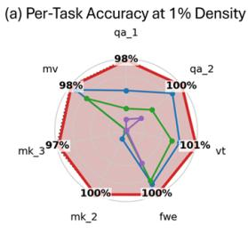

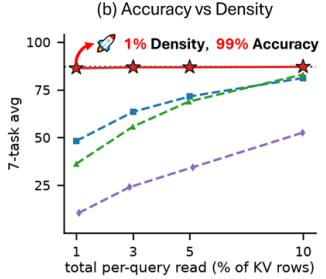

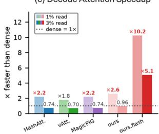  
dense- HashAttention-vAttention-MagicPIGOpenAttention (ours)  
Figure 1: OpenAttention against sparse attention baselines on RULER-32K HARD with Llama-3.1- 8B. (a) Per-task accuracy at a 1% read. (b) Mean accuracy against the total per-query read. (c) Decode attention-stage speedup over dense attention at batch 32 and 32K context.

## 1 INTRODUCTION

Long-context decoding is bound by the memory trafic of the key-value (KV) cache, and sparse attention reduces this cost by computing attention over only a subset of the cache. Existing top-k approaches (Singhania et al., 2024; Yang et al., 2024; Desai et al., 2025) explore frameworks that focus solely on predicting the top-k scores accurately and discard the remaining tail, as shown in Figure 2(a). However, omitting the tail information fundamentally prevents these methods from approximating the dense attention distribution. This limitation becomes especially critical in aggregation tasks (e.g., FWE) that depend on the entire distribution of attention weights. To address this problem, as shown in Figure 2 (b), MagicPIG (Chen et al., 2025) estimates the output by locality-sensitive hashing (LSH) based importance sampling, and vAttention (Desai et al., 2026) selects heavy hitters and then approximates the residual tail by a random sample sized to a relative error bound. Both methods presume that the softmax output of the tail can be estimated from a small sample. However, the estimation error of sampling grows sharply as the density decreases.

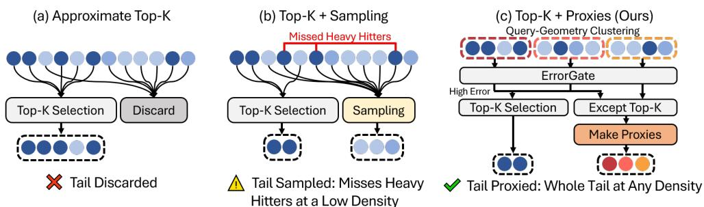  
Figure 2: Three treatments of the tail for sparse attention. (a) Approximate top-k relies on top-k accuracy and ignores the tail. (b) Top-k with sampling misses heavy hitters at low density. (c) Ours clusters and represents the tail by proxies built with a method that minimizes the weight error.

Our key finding, as shown in Figure 3, is that a random sample complements the tail well at high density but yields a higher error than top-k alone at low density. However, folding the same tail into a single proxy with a simple count-aware mean keeps the error low in every setting we examine. This holds across diferent attention distributions and densities as well as behind both HashAttention and the oracle top-k selector. Based on this empirical finding, we measure the statistics of the tails left by HashAttention and the oracle top-k. Using these quantities, we show in closed form that a single proxy yields a lower attention weight error than sampling. Consequently, the tail should be approximated by well-constructed proxies rather than by samples, and this work explores how to build and exploit such proxies efectively.

As shown in Figure 2(c), we propose OpenAttention to approximate the tail distribution rather than truncate or sample the tail. OpenAttention constructs tail proxies through a framework that consists of clustering, ErrorGate, top-k selection and a count-aware mean. The efectiveness of this framework depends on how well it minimizes the weight error, which is governed by the mean and variance of each cluster. Two considerations are central to achieving this goal. First, the clustering and the selector must run both efectively and eficiently to form clusters with small variance. Since thi variance is measured in attention scores, the keys alone are insuficient and the query geometry must also be taken into account. We therefore compress the key tokens with the query eigenvectors and perform both clustering and top-k selection on the compressed keys. Second, clusters should be selected by their error, which then determines the top-k budget. Unlike prior methods that select clusters only by the mass of their centroid or mean, ErrorGate eficiently approximates the weight error from a mean token and an approximate variance token and uses it to allocate the budget.

With these methods, OpenAttention preserves 99% of dense accuracy at a 1% read, scoring 86.30 against 87.04 for full attention and 48.2 for the best baseline on RULER-32K HARD (Hsieh et al., 2024) with Llama-3.1-8B (Grattafiori et al., 2024). It also achieves state-of-the-art accuracy on DeepSeek-R1-Distill-Llama-8B (DeepSeek-AI, 2025) and Mistral-7B (Mistral AI, 2024) and across context lengths from 16K to 96K. Moreover, unlike prior sampling-based methods (Chen et al., 2025; Desai et al., 2026), OpenAttention targets practical latency gains. Our Triton-based (Tillet et al., 2019) customized kernel, OpenAttention.flash, processes the exact tokens and proxies in one online softmax pass and runs the decode attention stage 10× faster than dense attention at a 1% read.

Our contributions are the following.

• We propose OpenAttention, which approximates the full softmax distribution rather than truncating or sampling the tail. It represents the tail by proxies built through clustering, ErrorGate, top-k selection and a count-aware mean.

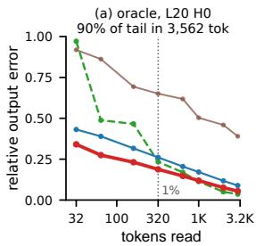

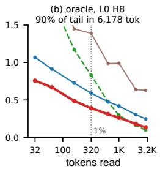

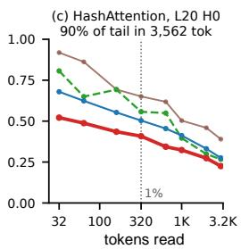  
random sample only 1/2 top-k + 1/2 random sample of the tail top-k top-k + one tail proxy

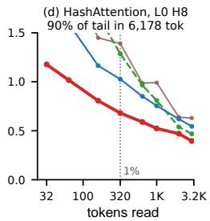  
Figure 3: Relative attention-output error versus total tokens read for four tail treatments on two RULER-32K HARD attention heads, using oracle top-k (a,b) or HashAttention (c,d).

• We design QGC and QGS, which compress the key tokens under the query geometry so that clustering and top-k selection follow the attention scores while remaining eficient.

• We introduce ErrorGate, which selects clusters and allocates the budget based on an approximated weight error rather than the mass of each cluster alone.

• OpenAttention preserves 99% of dense accuracy at a 1% read on RULER-32K HARD with Llama-3.1-8B. It also achieves state-of-the-art accuracy across diferent models and context lengths from 16K to 96K.

• We customise a Triton-based FlashAttention-2 (Dao, 2024) decode kernel into OpenAttention.flash, which runs the estimator as one online softmax pass. It accelerates the decode attention stage by 5–10× over dense attention at 3% and 1% reads.

## 2 KEY OBSERVATION ON ONE SIMPLE PROXY

In this section, we examine how random sampling and a single simple proxy treat the tail. First, as shown in Figure 3, we analyze the empirical finding on the relative output error. Second, as shown in Figure 4, we compare the closed-form weight errors of both treatments as functions of the tail statistics under a given top-k selector.

## 2.1 RELATIVE OUTPUT ERROR ACROSS DENSITIES.

As shown in Figure 3, we measure the relative output error of random sampling and our proxy at diferent densities. We evaluate two decode heads with diferent tail distributions, in which 90% of the tail mass lies in 3,562 and 6,178 of the 32K tokens, respectively. Each head is evaluated behind two top-k selectors, namely HashAttention and the oracle top-k. The sampling method splits the read equally between top-k and a random sample of the tail, while the proxy method replaces the entire tail with a single proxy. The sampling method improves on its top-k selector at high density but performs worse than the selector alone at low density. This indicates that a small sample cannot approximate the tail distribution as more tokens are left in the tail. In contrast, the single proxy reduces the error even in this simple form. Behind HashAttention it yields the lowest error at every density, and behind the oracle top-k it does so at low density. Based on this empirical finding, we analyze the two treatments mathematically in the following subsection.

## 2.2 ATTENTION WEIGHTS AND TAIL APPROXIMATION ERROR

Let $w _ { i } ~ = ~ e ^ { z _ { i } }$ with $z _ { i } = d ^ { - 1 / 2 } q ^ { \top } k _ { i }$ . An exact set X leaves tail $T = [ n ] \setminus X , N = | T |$ , and $\textstyle Z _ { X } = \sum _ { i \in X } w _ { i }$ . For a uniform sample $B \subseteq T$ of size m, let $\eta = N / m$ and $g _ { T } = e ^ { \bar { z } _ { T } }$ . Following ∑ ∈the deterministic and randomized SDPA formulations of Desai et al. (2026), discarding, sampling and one proxy assign

$$
\hat { a } _ { i } ^ { \mathrm { d } } = \frac { \mathbf { 1 } _ { X } ( i ) w _ { i } } { Z _ { X } } , \qquad \hat { a } _ { i } ^ { \mathrm { s } } = \frac { [ \mathbf { 1 } _ { X } ( i ) + \boldsymbol { \eta } \mathbf { 1 } _ { B } ( i ) ] w _ { i } } { \hat { Z } _ { \mathrm { s } } } , \qquad \hat { a } _ { i } ^ { \mathrm { p } } = \frac { \mathbf { 1 } _ { X } ( i ) w _ { i } + \mathbf { 1 } _ { T } ( i ) g _ { T } } { \hat { Z } _ { \mathrm { p } } } ,\tag{1}
$$

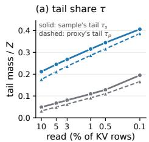

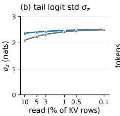

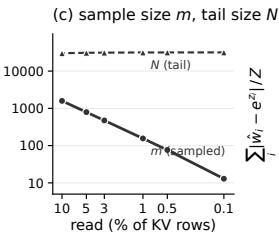

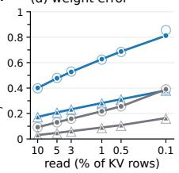  
HashAttention top-k oracle top-k random sample 2τ<sub>s</sub>(1 − m/N) one tail proxy τ<sub>p</sub> erf(σ<sub>z</sub>/√ 2) measured  
Figure 4: Weight-discrepancy comparison behind HashAttention and oracle top-k. Panels show the tail share, logit spread, sample/tail sizes, and the predicted and measured discrepancies of Eq. (2).

where $\begin{array} { r } { \hat { Z } _ { \mathrm { s } } = Z _ { X } + \eta \sum _ { i \in B } w _ { j } } \end{array}$ and $\hat { Z } _ { \mathrm { p } } = Z _ { X } + N g _ { T }$ . The proxy is equivalently one virtual token ∑with logit z¯ + log N and mean value $\hat { v } _ { T }$

For the implied unnormalised weights define $\begin{array} { r } { \mathcal { E } ~ = ~ Z ^ { - 1 } \sum _ { i } | \hat { w } _ { i } - w _ { i } | , Z ~ = ~ \sum _ { i } w _ { i } } \end{array}$ , and $\tau =$ $\Sigma _ { i \in T } w _ { i } / \dot { Z } .$ . Then

$$
\mathcal { E } _ { \mathrm { d } } = \tau , \qquad \mathbb { E } [ \mathcal { E } _ { \mathrm { s } } ] = 2 \tau \left( 1 - \frac { m } { N } \right) , \qquad \mathcal { E } _ { \mathrm { p } } ^ { \mathrm { G } } = \tau \operatorname { e r f } \left( \frac { \sigma _ { z } } { \sqrt { 2 } } \right) .\tag{2}
$$

The first two are exact for a fixed tail (the second in expectation); the last is a Gaussian-population prediction. Under the fixed unnormalised-weight convention above, sampling approaches twice the discard discrepancy when $m \ll N$ ; this is not a factor-of-two claim for normalized attention or output error.

Figure 4 shows, however, that the proxy and discard are much closer in $\mathcal { E }$ than their output errors in Figure 3. Thus E diagnoses unnormalised weight distortion but does not by itself explain sampling’s density-dependent output failure. That dependence is captured by the sampling-normalizer uncertainty, which grows as the sample shrinks; missed high-weight tokens can also perturb the value direction (App. A.2). The exact output identity in App. A explains why similar weight discrepancy need not imply similar output error.

To connect this observation to the method, let $\mathcal { P }$ be a partition of the unread tokens into nonempty residual clusters, with sizes $n _ { b }$ and mean logits $\bar { z } _ { b }$ . Their exact discrepancy decomposes as

$$
\mathcal { E } = \frac { 1 } { Z } \sum _ { b \in \mathcal { P } } \hat { M } _ { b } D _ { b } , \qquad \hat { M } _ { b } = n _ { b } e ^ { \bar { z } _ { b } } , \qquad D _ { b } = \frac { 1 } { n _ { b } } \sum _ { i \in b } | e ^ { z _ { i } - \bar { z } _ { b } } - 1 | .\tag{3}
$$

Each contribution $\varepsilon _ { b } = \hat { M } _ { b } D _ { b }$ is proxy mass times weight spread; it vanishes for equal logits and is removed by reading the entire cluster exactly. Under the Gaussian model, $D _ { b }$ is estimated by $D _ { \mathrm { G } } ( \sigma _ { b } ) \approx 0 . 8 \sigma _ { b }$ at small within-cluster logit standard deviation $\sigma _ { b }$ . Writing $\begin{array} { r } { \mathrm { ~  ~ o ~ } = \sum _ { i } a _ { i } v _ { i } , \hat { o } \stackrel { \cdot } { = } { } } \end{array}$ $\sum _ { i } { \hat { a } } _ { i } v _ { i }$ and $\begin{array} { r } { \hat { Z } = \sum _ { i } \hat { w } _ { i } > 0 } \end{array}$ , we also have $\begin{array} { r } { \| \hat { o } - o \| _ { 2 } \leq ( Z / \hat { Z } ) \mathcal { E } \operatorname* { m a x } _ { i } \| v _ { i } - o \| _ { 2 } } \end{array}$ ∑, without Gaussian or ∑ ∑weight–value independence assumptions (App. A). Section 3 develops this multi-cluster construction using QGC grouping, ErrorGate discrepancy-based allocation and QGS selection within clusters.

## 3 OPENATTENTION: APPROXIMATE TAIL DISTRIBUTION BY PROXIES

## 3.1 OVERALL PROCESS OF OPENATTENTION

As shown in Figure 5 (a), OpenAttention clusters the cache once per request into $C$ clusters under the query geometry (QGC). Each cluster caches its size $n _ { b } ,$ a mean token $( \bar { k } _ { b } , \bar { v } _ { b } )$ and a variance token diag $\mathrm { V a r } _ { b } ( k )$ . For each query, two small matrix products give every $\bar { z } _ { b }$ and $\sigma _ { b } ^ { 2 }$ , from which ErrorGate estimates the error each proxy would leave. The exact budget E is split in proportion to this estimate, and each cluster reads its highest-scoring tokens under the QGS. The remaining members of each cluster then take the role of the tail $T$ in $\mathbf { \bar { \alpha } } _ { \hat { a } _ { i } ^ { \mathrm { p } } } ^ { \mathrm { p } }$ of Eq. (1). Each cluster thus enters the softmax as one virtual token with the mean value and the logit $\hat { z } _ { b } + \log n _ { b }$ of its remaining members. The exact set X now includes the initial sink, local-window and selector top-k tokens as well as the E allocated reads. The residual-proxy estimator in Eq. (8) merges all exact tokens and proxies in one online softmax. The initial exact set is small in the deployed 1% configuration, and ErrorGate allocates the expansion budget rather than eliminating the initial selection stage.

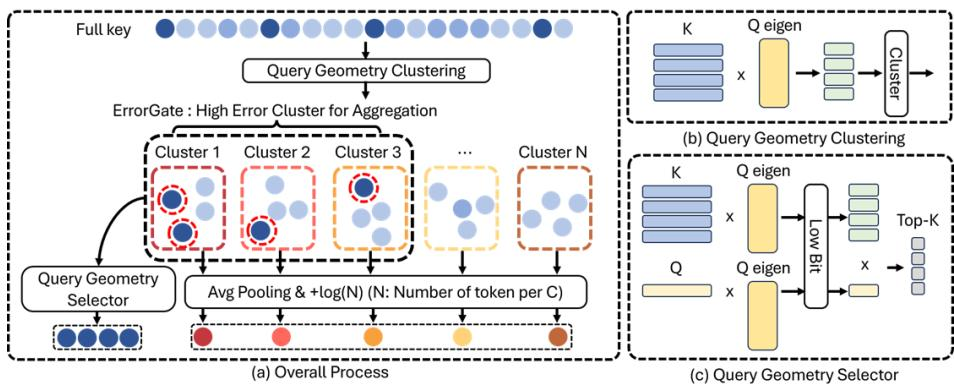  
Figure 5: Overview of OpenAttention. (a) QGC clusters the cache once per request. ErrorGate reads the top tokens of high-error clusters via the QGS, and the rest of each cluster becomes one countaware mean logit proxy. (b) QGC clusters the keys projected onto the query eigenvectors. (c) QGS scores the top-k with low-bit projections of the keys and query.

## 3.2 QUERY GEOMETRY CLUSTERING AND SELECTION

Both QGC and QGS use the top-r eigenvectors of the queries to account for the query geometry when clustering and selecting key tokens. The queries used to obtain these eigenvectors combine pre-sampled query tokens $( \bar { M } _ { \mathrm { s t } } )$ with the query tokens of the current question chunk $( \bar { M } _ { q } )$ as $\begin{array} { r } { M = \frac { 1 } { 2 } \bar { M } _ { \mathrm { s t } } \dot { + } \frac { 1 } { 2 } \bar { M } _ { q } , } \end{array}$ , and the top-r eigenpairs $( U _ { r } , \Lambda _ { r } )$ of M are used. These eigenpairs are computed once at the prefill stage. Clustering is then performed once after prefill, while selection reuses them at every decoding step. Therefore, as shown in Figure 6, we conduct an experiment to verify how well the M obtained at prefill is preserved across decoding steps. The median absolute cosine similarity between a decode query and the leading eigenvector of M is 0.82, which confirms that the query geometry is well preserved.

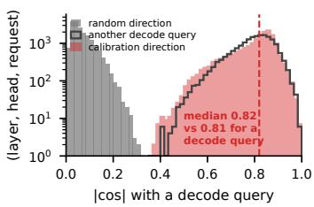  
Figure 6: | cos | of a decode query with the leading eigenvector of M, another decode query and a random direction.

## 3.2.1 QUERY GEOMETRY CLUSTERING

Rather than grouping tokens by their keys alone, QGC aims to group the tokens whose attention scores will be close, taking the geometry of the queries into account. Since $\mathbb { E } _ { q } ( z _ { i } - z _ { j } ) ^ { 2 } = s ^ { 2 } ( k _ { i } -$ $k _ { j } ) ^ { \top } M ( k _ { i } - k _ { j } )$ , minimizing the within-cluster logit variance reduces to k-means under the metric $\bar { M }$ . Therefore, as shown in Figure 5(b), QGC projects the keys onto the query eigenvectors and performs clustering in this projected space. With $\dot { K } \in \mathbb { R } ^ { n \times d }$ the keys of a head and $( U _ { r } , \Lambda _ { r } )$ the top-r eigenpairs of M, r=16,

$$
\Phi = K U _ { r } \Lambda _ { r } ^ { 1 / 2 } \in \mathbb { R } ^ { n \times r } , \qquad a _ { i } = \arg \operatorname* { m i n } _ { b } \ \| \phi _ { i } - \mu _ { b } \| ^ { 2 } , \qquad \mu _ { b } = \frac { 1 } { n _ { b } } \sum _ { i : a _ { i } = b } \phi _ { i } ,\tag{4}
$$

where $\phi _ { i } ^ { \top }$ denotes the i-th row of Φ. Under this projection, the Euclidean distance between two projected keys matches their expected logit distance within the top-r subspace. A few Lloyd iterations of the assignment and centroid steps in Eq. (4) then yield the $\breve { C }$ clusters. Each cluster then caches its count ${ \mathit { n } } _ { b } ,$ a mean token $( \bar { k } _ { b } , \bar { v } _ { b } )$ of its original keys and values and a variance token diag $\mathrm { V a r } _ { b } \bar { ( k ) }$ of perdimension key variances.

Table 1: RULER-32K HARD mean accuracy by clustering method at a 1% read (C=64).
<table><tr><td>clustering</td><td>dim</td><td>avg</td></tr><tr><td>token position</td><td></td><td>84.37</td></tr><tr><td>k-means on keys only 128</td><td></td><td>85.42</td></tr><tr><td>QGC (ours)</td><td></td><td>16 86.30</td></tr></table>

Validation of QGC. To validate the role of query geometry, we compare QGC with clustering by token position and with clustering on uncompressed keys alone (Hu et al., 2026; Chen et al., 2026). As shown in Table 1, QGC is the most efective of the three while clustering in only 16 dimensions.

## 3.2.2 QUERY GEOMETRY SELECTOR

As shown in Figure 5(c), QGS uses the eigenvectors of the same M at rank r=32. Because selection runs at every decoding step, each key is coded once in low bits as its projection onto the query subspace to reduce latency. A query projected onto the same subspace then scores these codes as

$$
\begin{array} { r } { c _ { i } = \mathrm { Q } _ { 8 } \bigl ( U _ { r } ^ { \top } k _ { i } \bigr ) , \qquad \tilde { z } _ { i } = \bigl ( U _ { r } ^ { \top } q \bigr ) ^ { \top } c _ { i } , } \end{array}\tag{5}
$$

where $\mathrm { Q } _ { 8 }$ is int8 quantization with one scale per head and coordinate. The score $\tilde { z } _ { i } ~ \approx$ ${ \bar { q } } ^ { \top } U _ { r } U _ { r } ^ { \top } k _ { i }$ is the logit restricted to the query

Table 2: Top-32 logit recall at 1/16 and 1/32 reads and selection time per layer on one H100.
<table><tr><td>selector</td><td>16×</td><td>32×</td><td>ms</td></tr><tr><td>SparQ</td><td>0.96</td><td>0.94 0.29</td><td rowspan="4"></td></tr><tr><td>Loki</td><td>0.84</td><td>0.75 0.18</td></tr><tr><td>Quest</td><td>0.77</td><td>0.66 0.33</td></tr><tr><td>Double Sparsity</td><td>0.97</td><td>0.95 0.50</td></tr><tr><td>Squeezed Attention</td><td>0.92</td><td>0.86 0.23</td></tr><tr><td>HashAttention</td><td>0.74</td><td>0.63 0.24</td></tr><tr><td>QGS (ours)</td><td>0.97</td><td>0.94 0.22</td></tr></table>

subspace, and its top-k set $\mathcal { T } = \mathrm { t o p } - k ( \tilde { z } )$ is read exactly. One U is shared by all query heads of a KV head, and new keys are coded on arrival at 8r bits per token.

Top-k accuracy. We compare QGS with six published top-k selectors on the same decode rows using their released configurations. We keep the first and last 128 tokens at a $1 / 1 6$ read and 64 each at $\mathrm { ~ a ~ } 1 / 3 2$ read. The evaluation covers all layers and heads over the first eight decode steps of 21 samples. As shown in Table 2, QGS achieves high top-k recall at a low selection time, giving a favorable balance between accuracy and cost.

## 3.3 ERRORGATE

Estimating cluster discrepancy. Equation (3) gives the exact contribution $\varepsilon _ { b } = \hat { M } _ { b } D _ { b } , \hat { M } _ { b } =$ $n _ { b } e ^ { \bar { z } _ { b } }$ . A Gaussian model replaces $D _ { b }$ by $D _ { \mathrm { G } } ( \sigma _ { b } ) = e ^ { \sigma _ { b } ^ { 2 } / 2 } ( 2 \Phi ( \sigma _ { b } ) - 1 )$ ; diagonal key moments approximate the exact variance $\sigma _ { b } ^ { 2 } = s ^ { 2 } q ^ { \bar { \top } } \mathrm { C o v } _ { b } ( k ) q ( \mathrm { C o r o l l a r y } 2 ) .$ The deployed score is

$$
\begin{array} { r l } & { \hat { \varepsilon } _ { b } = n _ { b } e ^ { \bar { z } _ { b } } e ^ { \hat { \sigma } _ { b } ^ { 2 } / 2 } \big ( 2 \Phi ( \hat { \sigma } _ { b } ) - 1 \big ) = \hat { M } _ { b } D _ { \mathrm { G } } \big ( \hat { \sigma } _ { b } \big ) , } \\ & { \bar { z } _ { b } = s q ^ { \top } \bar { k } _ { b } , \qquad \hat { \sigma } _ { b } ^ { 2 } = s ^ { 2 } \sum _ { d } q _ { d } ^ { 2 } \mathrm { V a r } _ { b } ( k _ { d } ) . } \end{array}\tag{6}
$$

It uses cached mean and diagonal variance tokens and one error function per cluster. The signed mean enters through $e ^ { \bar { z } _ { b } }$ , and $D _ { \mathrm { G } } ( \hat { \sigma } _ { b } ) \approx 0 . 8 \hat { \sigma } _ { b }$ at small dispersion. Thus $\overline { { \sum _ { b } \hat { \varepsilon } _ { b } } }$ estimates ZE rather than equalling it. The ∑score is neither an exact finite-cluster discrepancy nor a certified output bound; no independence assumption between weights and values is used. The signed mass factor is retained: for fixed cluster size and dispersion, $e ^ { \bar { z } _ { b } }$ distinguishes a cluster the query aligns with from one it looks away from, whereas a statistic based on $\bar { z } _ { b } ^ { 2 }$ does not. As shown in Table $^ { 3 , }$ ranking clusters by the estimated error of Eq. (6) yields 86.30 at a 1% read, whereas ranking by the centroid mass as in prior methods (Chen et al., 2026; Hu et al., 2026) yields 85.99. This shows that accounting for withincluster dispersion selects clusters more efectively than centroid mass alone.

Table 3: ErrorGate ranking ablation at a 1% read on RULER-32K HARD.
<table><tr><td>ranking statistic</td><td>avg</td></tr><tr><td>mean logit (mass)</td><td>85.99</td></tr><tr><td>variance</td><td>84.81</td></tr><tr><td>estimated error (ours)</td><td>86.30</td></tr></table>

Validity of the diagonal estimate. The mean and variance tokens cost 1.5 KV rows per cluster per query, charged to the read. On the C=64 QGC diagnostic, diagonal and full-variance model scores agree at Spearman 0.92 (Fig. 7) and recover the eight largest exactdiscrepancy clusters at similar rates (91%, 97%). These measurements assess the diagonal substitution empirically; they are not a general variance inequality.

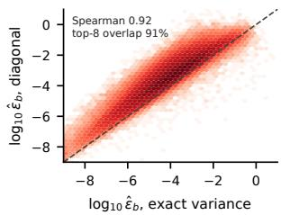

Hierarchical budget. For a fixed number of complete clusters, removing the largest exact $\varepsilon _ { b }$ terms maximally reduces E. Deployment instead uses estimated scores and a token budget. Motivated by the measured concentration of discrepancy $( \mathbf { A p p . A . l } )$ , we allocate

Figure 7: ErrorGate estimates from diagonal and full within-cluster logit variance on 137,216 decode rows.

$$
q _ { b } = \mathrm { m i n } \left( n _ { b } , \lambda \frac { \hat { \varepsilon } _ { b } } { \mathrm { m a x } _ { b ^ { \prime } } \hat { \varepsilon } _ { b ^ { \prime } } } \right) , \qquad \sum _ { b } q _ { b } = E ,\tag{7}
$$

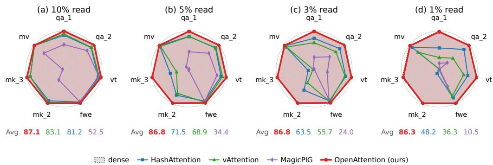  
Figure 8: RULER-32K HARD with Llama-3.1-8B-Instruct at matched total per-query reads of 10%, 5%, 3%, and 1%, including the proxy stream. Each panel shows per-task accuracy relative to dense (grey, 100%), with mean accuracy below. Dense has a mean of 87.04 on RULER hard. MagicPIG realises reads of 10.0%, 5.1%, 2.9%, and 1.1%. Per-task results are in App. E.

with λ set by water filling. Leftover tokens after flooring go to the highest-ranked clusters with capacity so that the budget E is spent exactly. Each cluster then reads its $q _ { b }$ highest QGS-scored tokens and recomputes its residual proxy statistics. This proportional allocation is a heuristic rather than an optimal rule. Scores estimate discrepancy before allocation; Proposition 1 applies after residual recomputation. Allocation details are in App. A.1.

## 3.4 OPENATTENTION.FLASH: OPENATTENTION ON FLASHATTENTION-2.

Because a proxy has the same form as a token, we customise a Triton-based FlashAttention-2 decode kernel into OpenAttention.flash (Algorithm 1 in App. C), which processes the exact tokens and the proxies in one online softmax pass. Each program gathers, in tiles of 64, the selected tokens, the tokens read from expanded clusters and the $\bar { ( k _ { b } , v _ { b } ) }$ of the clusters with + log $n _ { b }$ on the logit. Pooled sums are cached per cluster, so removing the tokens a query reads costs one subtraction per token the kernel already loads. The work per step is fixed, with no data dependent loop bound and no host synchronisation.

## 4 EXPERIMENTS

Setup. We use Llama-3.1-8B-Instruct (bf16, 32 query and 8 KV heads) on RULER-32K HARD, the seven tasks that HashAttention and vAttention identify as challenging for sparse attention (qa\_1, qa\_2, vt, fwe, niah\_multikey\_2/3, niah\_multivalue), with 200 samples per task. Following HashAttention and vAttention, the context is prefilled densely, sparse attention applies to the question chunk and generation, and the baselines share a sink and a local window of 0.1% each. The baselines run in one framework on the HashAttention selector with the public signature weights, vAttention under its authors’ per budget protocol and MagicPIG with (K, L) realising the target read (App. D, F). OpenAttention uses the QGS, QGC, and Eq. (6) with the hierarchical budget. Sink and local remain at their few-token floor (0.01% each). Budget accounting. We charge every stream a query reads in KV rows per query head, including the mean and variance tokens of all C clusters. The index scan is excluded from the budget for every method. The transfer experiments on other models, datasets and context lengths use the conventional 3% split (App. D).

## 4.1 COMPARISON WITH OTHER METHODS ACROSS READ DENSITIES

As shown in Figure 8, we compare per-task accuracy on RULER-32K HARD at densities from 10% to 1%. HashAttention discards the tail while MagicPIG and vAttention rely on sampling, and all three degrade sharply as the density decreases. vAttention slightly improves on HashAttention at a 10% density but falls below it at lower densities even though both share the same selector. In contrast, OpenAttention preserves accuracy close to dense attention at every density. This demonstrates that approximating the tail with proxies is more efective than sampling it.

Table 4: Ablation at a 5% read on RULER-32K HARD (dense 87.04).
<table><tr><td>proxies</td><td>ErrorGate</td><td>QGS</td><td>avg</td></tr><tr><td>×</td><td>X</td><td>X</td><td>67.35</td></tr><tr><td>√</td><td>×</td><td>×</td><td>77.91</td></tr><tr><td>√</td><td>√</td><td>×</td><td>85.90</td></tr><tr><td>√</td><td>X</td><td>√</td><td>86.73</td></tr><tr><td>√</td><td>√</td><td>√</td><td>86.82</td></tr></table>

Table 5: Mean accuracy on RULER-32K HARD at a 3% read on three models.
<table><tr><td>method</td><td>Llama-8B</td><td>DeepSeek-8B</td><td>Mistral-7B</td></tr><tr><td>dense</td><td>87.04</td><td>73.46</td><td>65.46</td></tr><tr><td>HashAttention</td><td>63.48</td><td>59.85</td><td>51.24</td></tr><tr><td>vAttention</td><td>57.15</td><td>49.26</td><td>46.14</td></tr><tr><td>OpenAttention</td><td>86.59</td><td>73.49</td><td>64.83</td></tr></table>

## 4.2 ABLATION STUDY

Table 4 compares the efects of proxies, ErrorGate, and QGS under the same 5% total-read budget. The configuration without any of the three components corresponds to vAttention on the HashAttention selector. With HashAttention as the selector, using proxies instead of residual sampling raises mean accuracy on RULER-32K HARD from 67.35 to 77.91. Adding ErrorGate alone to the proxy variant yields 85.90, while adding QGS alone yields 86.73. Enabling both yields 86.82. Table 3 holds the deployed 1% configuration fixed and varies only the ErrorGate ranking statistic. Ranking by the estimated error of Eq. (6) yields 86.30 mean accuracy on RULER-32K HARD, compared with 85.99 for mean logit and 84.81 for variance alone.

## 4.3 EVALUATION ON VARIOUS MODELS

To evaluate OpenAttention on models other than Llama-3.1-8B-Instruct, we run the same comparison on DeepSeek-R1-Distill-Llama-8B and Mistral-7B-Instruct-v0.3. All methods are evaluated at a 3% density. As shown in Table 5, OpenAttention stays within 0.7 points of dense on all three models while the baselines lose up to 29.9 points. These results show that OpenAttention efectively preserves accuracy across diferent models.

## 4.4 ORTHOGONALITY TO KV CACHE COMPRESSION

Sparse attention is closely related to KV cache compression but can be applied orthogonally to it. We therefore apply OpenAttention on top of three representative compressors, PyramidKV (Cai et al., 2025), SnapKV (Li et al., 2024b) and StreamingLLM (Xiao et al., 2024b). OpenAttention then reads 10% of the original context from the entries each compressor retains. As shown in Table 6, adding OpenAttention changes the mean accuracy by only -0.14 points on average. KV cache compression saves memory by permanently evicting keys but loses accuracy under a small budget, whereas sparse attention keeps every entry accessible and preserves accuracy.

## 4.5 CONTEXT LENGTH

Table 7 compares mean accuracy at a matched 3% total read as the context grows from 16K to 96K, using 100 samples per task. Dense accuracy falls from 87.14 to 78.01 over this range while OpenAttention changes from 87.49 to 78.10. The diference between them remains below 0.7 points at every length, and OpenAttention is numerically higher at 16K and 96K. At 96K HashAttention scores 27.99 while vAttention scores 40.20 and MagicPIG scores 33.19. These results show that OpenAttention maintains accuracy close to dense attention across context lengths even as the other sparse methods fall substantially behind. Per-task scores and actual read rates are reported in App. I.

## 5 RELATED WORK

Top-k selectors. Quest (Tang et al., 2024) and InfLLM (Xiao et al., 2024a) score tokens at a coarse granularity through page-level bounds and block representatives. Learning-to-hash (Sun et al., 2022) and HashAttention (Desai et al., 2025) are hashing-based methods that map queries and keys to compact codes and retrieve tokens by code similarity. Loki (Singhania et al., 2024) and Squeezed Attention (Hooper et al., 2025) rely on the keys alone and score tokens in a PCA subspace of the keys or through ofline key clusters. PQCache (Zhang et al., 2025) applies product quantization to the keys and retrieves tokens by approximate inner product search. In contrast, RetrievalAttention (Liu et al., 2025a), SparQ (Ribar et al., 2024) and Double Sparsity (Yang et al., 2024) exploit query information to process the keys. RetrievalAttention builds a key index that accounts for the query distribution, while SparQ and Double Sparsity score the keys on channels chosen from the query at each step or by ofline calibration. QGS follows this line of work. However, it difers in that it projects both the keys and the query onto the leading eigenvectors of the query second moment M. The same eigenvectors also define the metric of QGC, so selection and clustering share one query geometry. Although accurate top-k prediction is essential, top-k selection alone cannot account for the distribution of the tail tokens.

Table 6: KV cache compression with sparse reading on RULER-32K HARD. Each compressor retains 2048 entries.
<table><tr><td>compressor</td><td>alone</td><td>+ OpenAttention</td></tr><tr><td>dense attention</td><td>87.04</td><td></td></tr><tr><td>StreamingLLM</td><td>28.00</td><td>28.28</td></tr><tr><td>SnapKV</td><td>69.98</td><td>69.49</td></tr><tr><td>PyramidKV</td><td>70.34</td><td>70.14</td></tr></table>

Table 7: Mean accuracy on RULER-32K HARD at a 3% read as the context grows. OpenAttention scales only C with the length.
<table><tr><td>method</td><td>16K</td><td>32K</td><td>64K</td><td>96K</td></tr><tr><td>dense</td><td>87.14</td><td>87.75</td><td>85.49</td><td>78.01</td></tr><tr><td>MagicPIG</td><td>46.91</td><td>51.38</td><td>45.73</td><td>33.19</td></tr><tr><td>HashAttention</td><td>67.41</td><td>63.87</td><td>49.65</td><td>27.99</td></tr><tr><td>vAttention</td><td>52.69</td><td>55.63</td><td>54.79</td><td>40.20</td></tr><tr><td>OpenAttention (ours)</td><td>87.49</td><td>87.38</td><td>84.82</td><td>78.10</td></tr></table>

Sampling the tail. Rather than discarding the tail, MagicPIG (Chen et al., 2025) estimates the attention output by importance sampling, drawing keys through LSH collisions and weighting them by their collision probabilities. vAttention (Desai et al., 2026) first selects the top-k tokens and then approximates the remaining tail with a random sample. Its sample size is set from a central limit theorem bound so that the estimate meets a user-specified error tolerance. SANTA (Lee et al., 2026) samples value rows after the softmax. However, at a low read these samples can miss the heavy hitters a practical selector leaves in the tail, so we instead summarize every tail token with proxies. SparQ (Ribar et al., 2024) also folds the unread tokens into one mean value vector but weights it by the leftover approximate score mass rather than a count-aware mean logit.

Clustering and centroid proxies. Clustering has been used for both KV cache compression and sparse attention. For compression, CentroidKV (Hu et al., 2026) merges each cluster of similar keys into a single centroid, while ClusterKV (Liu et al., 2025b) keeps every token and recalls whole clusters by the attention weight of their centroids. For sparse attention, Squeezed Attention (Hooper et al., 2025) clusters the keys of a fixed context ofline and loads the keys whose centroids match the query. Double-P (Ni et al., 2026) estimates top-p attention mass at the cluster level from sizeweighted centroids and refines it at the token level only when needed. However, these methods cluster by key similarity alone, which limits how far they can reduce the variance of attention scores within each cluster. In addition, their cluster selection relies on centroid mass, which ignores the error of representing a cluster by its centroid. In contrast, QGC clusters the keys under the query geometry, and ErrorGate selects clusters and allocates the budget by the estimated weight error.

## 6 CONCLUSION AND LIMITATIONS

We propose OpenAttention, which approximates the information of the tail with proxies to address the loss of tail information in sparse attention. OpenAttention approximates the tail logits efectively through a framework of clustering, ErrorGate, top-k selection and a count-aware mean. To optimize each stage, it exploits the query geometry and minimizes the estimated weight error. As a result, OpenAttention preserves 99% of dense accuracy at a 1% read and achieves state-of-the-art accuracy across benchmarks and models.

Despite its efectiveness, ErrorGate approximates the within-cluster variance with its diagonal terms for eficiency. This approximation agrees closely with the full-variance estimate at a Spearman correlation of 0.92 but cannot recover the exact error. We believe that reducing this proxy error within the OpenAttention framework is a promising direction for future work.

## AI USE STATEMENT

In this work, we used generative AI tools to edit the text of the paper for clarity and readability, to translate parts of the authors’ draft into English, to help search for and identify related literature, to help write and format its LAT X source, including tables, captions and references, and to review the manuscript for consistency between the numbers reported in the text, tables and appendices. We have not used generative AI tools to propose or revise research hypotheses, to develop the method, it theoretical analysis or conceptual framework, to formulate the mathematical claims, to provide key ingredients of their proofs or to write the proofs, to design the experiments or provide feedback on the methodology or experiments, to implement the method or the baselines, to generate, clean or reformat datasets, including the synthetic 64K and 96K RULER sets, or to interpret the results. Qualitative or thematic analysis is not applicable to this work. The authors checked every AI-suggested edit, including translations, against our experiment logs and source code, and read every AI-suggested reference before citing it. We take responsibility for the final content of this work, including text, claims or artifacts produced with the aid of generative AI.

## ETHICS STATEMENT

This work does not involve human subjects or personal data. All models and benchmarks we use are publicly available and are used under their licenses, and the 64K and 96K RULER sets we generate are synthetic. Like any approximate attention method, ours can change model outputs, so its accuracy should be validated on the target task before deployment.

## REPRODUCIBILITY STATEMENT

The method is defined in §3. QGC is given in Eq. (4), the QGS in Eq. (5), the ErrorGate score in Eq. (6) and the budget allocation in Eq. (7). The read accounting and the evaluation protocol are given in §4. The proofs and their assumptions are in App. A, A.1 and A.2. The deployed hyper-parameters and the per-budget grid are in App. D, and per-task results at every budget are in App. E. The baseline configurations are in App. F, F.1 and F.2. The kernel is described in App. C and Algorithm 1, and the generation of the 64K and 96K RULER sets in App. I. All models and benchmarks are publicly available, and all accuracy numbers use greedy decoding with fixed prompts. Code is available at https://github.com/hyunwoo137/OpenAttention.

## REFERENCES

Yushi Bai, Xin Lv, Jiajie Zhang, Hongchang Lyu, Jiankai Tang, Zhidian Huang, Zhengxiao Du, Xiao Liu, Aohan Zeng, Lei Hou, Yuxiao Dong, Jie Tang, and Juanzi Li. Longbench: A bilingual, multitask benchmark for long context understanding. In Proceedings ofthe 62nd Annual Meeting ofthe Associationfor Computational Linguistics, pp. 3119–3137, 2024. doi: 10.18653/v1/2024. acl-long.172. URL https://aclanthology.org/2024.acl-long.172/.

Yushi Bai, Shangqing Tu, Jiajie Zhang, Hao Peng, Xiaozhi Wang, Xin Lv, Shulin Cao, Jiazheng Xu, Lei Hou, Yuxiao Dong, Jie Tang, and Juanzi Li. Longbench v2: Towards deeper understanding and reasoning on realistic long-context multitasks. In Proceedings of the 63rd Annual Meeting ofthe Associationfor Computational Linguistics, pp. 3639–3664, 2025. doi: 10.18653/v1/2025. acl-long.183. URL https://aclanthology.org/2025.acl-long.183/.

Zefan Cai, Yichi Zhang, Bofei Gao, Yuliang Liu, Yucheng Li, Tianyu Liu, Keming Lu, Wayne Xiong, Yue Dong, Junjie Hu, and Wen Xiao. PyramidKV: Dynamic KV cache compression based on pyramidal information funneling. In Conference on Language Modeling (COLM), 2025. arXiv:2406.02069.

Yaoqi Chen, Jinkai Zhang, Baotong Lu, Qianxi Zhang, Chengruidong Zhang, Jing Liu, Jingjia Luo, Di Liu, Huiqiang Jiang, Qi Chen, Bailu Ding, Xiao Yan, Jiawei Jiang, Chen Chen, Mingxing Zhang, Cheng Li, Yuqing Yang, Fan Yang, and Mao Yang. RetroInfer: A vector storage engine for scalable long-context LLM inference. Proceedings of the VLDB Endowment, 19(5):1016–1031, 2026. arXiv:2505.02922.

Zhuoming Chen, Ranajoy Sadhukhan, Zihao Ye, Yang Zhou, Jianyu Zhang, Niklas Nolte, Yuandong Tian, Matthijs Douze, Léon Bottou, Zhihao Jia, and Beidi Chen. MagicPIG: LSH sampling for eficient LLM generation. In International Conference on Learning Representations (ICLR), 2025. arXiv:2410.16179.

Tri Dao. Flashattention-2: Faster attention with better parallelism and work partitioning. In International Conference on Learning Representations (ICLR), 2024.

DeepSeek-AI. DeepSeek-R1: Incentivizing reasoning capability in LLMs via reinforcement learning, 2025. URL https://arxiv.org/abs/2501.12948.

Aditya Desai, Shuo Yang, Alejandro Cuadron, Matei Zaharia, Joseph E. Gonzalez, and Ion Stoica. HashAttention: Semantic sparsity for faster inference. In International Conference on Machine Learning (ICML), 2025. arXiv:2412.14468.

Aditya Desai, Kumar Krishna Agrawal, Shuo Yang, Alejandro Cuadron, Luis Gaspar Schroeder, Matei Zaharia, Joseph E. Gonzalez, and Ion Stoica. vAttention: Verified sparse attention via sampling. In International Conference on Learning Representations (ICLR), 2026. arXiv:2510.05688.

Aaron Grattafiori et al. The Llama 3 herd of models, 2024. URL https://arxiv.org/abs/ 2407.21783.

Coleman Hooper, Sehoon Kim, Hiva Mohammadzadeh, Monishwaran Maheswaran, Sebastian Zhao, June Paik, Michael W. Mahoney, Kurt Keutzer, and Amir Gholami. Squeezed attention: Accelerating long context length LLM inference. In Proceedings of the 63rd Annual Meeting of the Association for Computational Linguistics (Volume 1: Long Papers), pp. 32631–32652, 2025. doi: 10.18653/v1/2025.acl-long.1568. arXiv:2411.09688.

Cheng-Ping Hsieh, Simeng Sun, Samuel Kriman, Shantanu Acharya, Dima Rekesh, Fei Jia, and Boris Ginsburg. RULER: What’s the real context size of your long-context language models? In Conference on Language Modeling (COLM), 2024. arXiv:2404.06654.

Jie Hu, Shengnan Wang, Yutong He, Ping Gong, Jiawei Yi, Juncheng Zhang, Youhui Bai, Renhai Chen, Gong Zhang, Cheng Li, and Kun Yuan. CentroidKV: Eficient long-context LLM inference via KV cache clustering. Transactions on Machine Learning Research, 2026. arXiv:2506.11418.

Kyle Lee, Corentin Delacour, Kevin Callahan-Coray, Kyle Jiang, Can Yaras, Samet Oymak, Tathagata Srimani, and Kerem Y. Camsari. Stochastic sparse attention for memory-bound inference. In International Conference on Machine Learning (ICML), 2026. arXiv:2605.01910.

Jiaqi Li, Mengmeng Wang, Zilong Zheng, and Muhan Zhang. LooGLE: Can long-context language models understand long contexts? In Proceedings of the 62nd Annual Meeting of the Association for Computational Linguistics (Volume 1: Long Papers), pp. 16304–16333, 2024a. doi: 10.18653/ v1/2024.acl-long.859. URL https://aclanthology.org/2024.acl-long.859/.

Yuhong Li, Yingbing Huang, Bowen Yang, Bharat Venkitesh, Acyr Locatelli, Hanchen Ye, Tianle Cai, Patrick Lewis, and Deming Chen. SnapKV: LLM knows what you are looking for before generation. In Advances in Neural Information Processing Systems, 2024b.

Chin-Yew Lin. ROUGE: A package for automatic evaluation of summaries. In Text Summarization Branches Out, pp. 74–81, 2004. URL https://aclanthology.org/W04-1013/.

Di Liu, Meng Chen, Baotong Lu, Huiqiang Jiang, Zhenhua Han, Qianxi Zhang, Qi Chen, Chengruidong Zhang, Bailu Ding, Kai Zhang, Chen Chen, Fan Yang, Yuqing Yang, and Lili Qiu. RetrievalAttention: Accelerating long-context LLM inference via vector retrieval. In Advances in Neural Information Processing Systems (NeurIPS), 2025a. arXiv:2409.10516.

Guangda Liu, Chengwei Li, Jieru Zhao, Chenqi Zhang, and Minyi Guo. ClusterKV: Manipulating LLM KV cache in semantic space for recallable compression. In Proceedings of the 62nd ACM/IEEE Design Automation Conference (DAC), 2025b. doi: 10.1109/DAC63849.2025. 11132479. arXiv:2412.03213.

Mistral AI. Mistral-7B-Instruct-v0.3. Hugging Face model card, 2024. URL https:// huggingface.co/mistralai/Mistral-7B-Instruct-v0.3.

Wentao Ni, Kangqi Zhang, Zhongming Yu, Oren Nelson, Mingu Lee, Hong Cai, Fatih Porikli, Jongryool Kim, Zhijian Liu, and Jishen Zhao. Double-P: Hierarchical top-p sparse attention for longcontext LLMs. arXiv preprint arXiv:2602.05191, 2026.

Luka Ribar, Ivan Chelombiev, Luke Hudlass-Galley, Charlie Blake, Carlo Luschi, and Douglas Orr. SparQ attention: Bandwidth-eficient LLM inference. In International Conference on Machine Learning (ICML), 2024. arXiv:2312.04985.

Prajwal Singhania, Siddharth Singh, Shwai He, Soheil Feizi, and Abhinav Bhatele. Loki: Lowrank keys for eficient sparse attention. In Advances in Neural Information Processing Systems (NeurIPS), 2024. arXiv:2406.02542.

Zhiqing Sun, Yiming Yang, and Shinjae Yoo. Sparse attention with learning-to-hash. In International Conference on Learning Representations, 2022.

Jiaming Tang, Yilong Zhao, Kan Zhu, Guangxuan Xiao, Baris Kasikci, and Song Han. Quest: Queryaware sparsity for eficient long-context LLM inference. In International Conference on Machine Learning (ICML), 2024.

Philippe Tillet, Hsiang-Tsung Kung, and David D. Cox. Triton: An intermediate language and compiler for tiled neural network computations. In Proceedings of the 3rd ACM SIGPLAN International Workshop on Machine Learning and Programming Languages (MAPL), pp. 10–19, 2019. doi: 10.1145/3315508.3329973.

Chaojun Xiao, Pengle Zhang, Xu Han, Guangxuan Xiao, Yankai Lin, Zhengyan Zhang, Zhiyuan Liu, and Maosong Sun. InfLLM: Training-free long-context extrapolation for LLMs with an eficient context memory. In Advances in Neural Information Processing Systems (NeurIPS), 2024a. arXiv:2402.04617.

Guangxuan Xiao, Yuandong Tian, Beidi Chen, Song Han, and Mike Lewis. Eficient streaming language models with attention sinks. In International Conference on Learning Representations (ICLR), 2024b.

Shuo Yang, Ying Sheng, Joseph E. Gonzalez, Ion Stoica, and Lianmin Zheng. Post-training sparse attention with double sparsity. arXiv preprint arXiv:2408.07092, 2024.

Zhilin Yang, Peng Qi, Saizheng Zhang, Yoshua Bengio, William Cohen, Ruslan Salakhutdinov, and Christopher D. Manning. HotpotQA: A dataset for diverse, explainable multi-hop question answering. In Proceedings of the 2018 Conference on Empirical Methods in Natural Language Processing, pp. 2369–2380, 2018. doi: 10.18653/v1/D18-1259. URL https://aclanthology. org/D18-1259/.

Hailin Zhang, Xiaodong Ji, Yilin Chen, Fangcheng Fu, Xupeng Miao, Xiaonan Nie, Weipeng Chen, and Bin Cui. PQCache: Product quantization-based KVCache for long context LLM inference. Proceedings of the ACM on Management of Data, 3(3):201:1–201:30, 2025. doi: 10.1145/3725338. arXiv:2407.12820.

## A ERROR BOUND OF CLUSTER AGGREGATION AND THE RANKING RULE

This appendix supplies the detailed setting and derivations for §2.2, and analyzes the residual-cluster estimator of §3. Exact finite-cache identities are distinguished from Gaussian population estimates and allocation heuristics.

Detailed setting and tail estimators. For $q \in \mathbb { R } ^ { d }$ and $( K , V ) \in \mathbb { R } ^ { n \times d }$ , define $z _ { i } ~ = ~ s q ^ { \top } k _ { i }$ $\begin{array} { r } { s = d ^ { - 1 / 2 } , w _ { i } = e ^ { z _ { i } } , Z = \sum _ { i } w _ { i } , a _ { i } = w _ { i } / Z } \end{array}$ and $\textstyle o = \sum _ { i } a _ { i } v _ { i } . \ A$ nonempty exact set X leaves $T = [ n ] \setminus X$ , with $\textstyle Z _ { X } = \sum _ { i \in X } w _ { i }$ and $\begin{array} { r } { S _ { T } = \sum _ { i \in T } w _ { i } } \end{array}$ ∑. Writing $\mu _ { X } = Z _ { X } ^ { - 1 } \sum _ { i \in X } w _ { i } v _ { i }$ , a tail estimator has the form

$$
\hat { o } = \frac { Z _ { X } \mu _ { X } + \hat { S } \hat { \mu } } { Z _ { X } + \hat { S } } ,
$$

where $\hat { S }$ and $\hat { \mu }$ represent the estimated tail mass and value mean. Discarding uses $\hat { S } = 0 ;$ uniform residual sampling uses the inverse-probability weights of Eq. (1); and one proxy uses $\hat { S } = N e ^ { \bar { z } _ { T } }$ and $\hat { \mu } = \bar { v } _ { T }$ , where $N = | T |$ and both means are arithmetic means over $T$ . Its mass equals $S _ { T }$ only when the tail logits are equal. For the implied unnormalised token weights $\hat { w } _ { i } .$ , define $\hat { Z } = \textstyle \sum _ { i } \hat { w } _ { i }$ $\hat { a } _ { i } = \hat { w } _ { i } / \hat { Z }$ and $\begin{array} { r } { \mathcal { E } = Z ^ { - 1 } \sum _ { i } \left| \hat { w } _ { i } - w _ { i } \right| } \end{array}$ ∑. The normalization of the unnormalised weights is fixed by ∑the numerators in Eq. (1); E is not $\| { \hat { a } } - a \| .$ . Accordingly, $\mathcal { E }$ is tied to this numerator convention and is not invariant to a common rescaling of the implied weights, whereas aˆ is.

Residual proxy estimator. For the multi-cluster estimator, X includes sink, local-window, selector top-k and allocated exact reads. Let $\mathcal { P }$ contain only the nonempty residual clusters. For $b \in \mathcal { P }$ , n<sub>b</sub>, $\bar { k } _ { b }$ and $\bar { v } _ { b }$ are the count and arithmetic means after exact-read tokens are removed. Set $\bar { z } _ { b } = s q ^ { \top } \bar { k } _ { b }$ and $\hat { M } _ { b } = n _ { b } e ^ { \bar { z } _ { b } }$ . The residual-proxy estimator is

$$
\hat { o } = \frac { \sum _ { i \in X } w _ { i } v _ { i } + \sum _ { b \in \mathcal { P } } \hat { M } _ { b } \bar { v } _ { b } } { \sum _ { i \in X } w _ { i } + \sum _ { b \in \mathcal { P } } \hat { M } _ { b } } , \qquad \hat { M } _ { b } = n _ { b } e ^ { \bar { z } _ { b } } .\tag{8}
$$

Write $\delta _ { i } = z _ { i } - \bar { z } _ { b }$ for $i \in b ,$ , so $\begin{array} { r } { \sum _ { i \in b } \delta _ { i } = 0 } \end{array}$ , and define

$$
\sigma _ { b } ^ { 2 } = \frac { 1 } { n _ { b } } \sum _ { i \in b } \delta _ { i } ^ { 2 } = s ^ { 2 } q ^ { \top } \mathrm { C o v } _ { b } ( k ) q , \quad \quad \hat { a } _ { b } ^ { \mathrm { v i r t } } = \frac { \hat { M } _ { b } } { \hat { Z } } , \quad \quad V _ { b } = \operatorname* { m a x } _ { i \in b } \| v _ { i } - o \| _ { 2 } .
$$

Also let $\Delta _ { b } ^ { + } = \operatorname* { m a x } _ { i \in b } \delta _ { i }$ and $\Delta _ { b } ^ { - } = - \operatorname* { m i n } _ { i \in b } \delta _ { i }$ . The diagonal estimate in Eq. (6) approximates $\sigma _ { b } ^ { 2 }$ . The virtual-token weight $\hat { a } _ { b } ^ { \mathrm { v i r t } }$ is the sum of the implied original-token weights $\hat { a } _ { i } = e ^ { \bar { z } _ { b } } / \hat { Z }$ for $i \in b$

Exact clusterwise discrepancy. Exact-read tokens have $\hat { w } _ { i } = w _ { i }$ and contribute no discrepancy; for $i \in b ,$ the proxy implies $\hat { w } _ { i } = e ^ { \bar { z } _ { b } }$ . Factoring $e ^ { \bar { z } _ { b } }$ within each cluster gives

$$
\mathcal { E } = \frac { 1 } { Z } \sum _ { b \in \mathcal { P } } \hat { M } _ { b } D _ { b } , \qquad D _ { b } = \frac { 1 } { n _ { b } } \sum _ { i \in b } | e ^ { \delta _ { i } } - 1 | , \qquad \varepsilon _ { b } = \hat { M } _ { b } D _ { b } ,
$$

which proves Eq. (3). This is exact for any finite residual partition, without a Gaussian assumption. Each term is nonnegative and vanishes for equal logits. Reading a whole cluster exactly removes its term. Partial reads change the residual mean and require recomputing the discrepancy.

Lemma 1 (exact error of the estimator).

$$
\hat { Z } ( \hat { o } - o ) = - \sum _ { b \in \mathcal { P } } \sum _ { i \in b } ( e ^ { z _ { i } } - e ^ { \bar { z } _ { b } } ) ( v _ { i } - o ) .\tag{9}
$$

Proof. Let $\begin{array} { r } { N _ { X } = \sum _ { i \in X } e ^ { z _ { i } } v _ { i } } \end{array}$ and $\textstyle Z _ { X } = \sum _ { i \in X } e ^ { z _ { i } }$ . Then $\begin{array} { r } { \hat { Z } ( \hat { o } - o ) = N _ { X } - o Z _ { X } + \sum _ { b } \hat { M } _ { b } ( \bar { v } _ { b } - o ) } \end{array}$ ∑Since o is the exact output, $\textstyle \sum _ { \mathrm { a l l } i } e ^ { z _ { i } } ( v _ { i } - o ) ^ { \setminus } = 0 $ , hence $\begin{array} { r } { N _ { X } - o Z _ { X } = - \sum _ { b } \sum _ { i \in b } e ^ { z _ { i } } ( v _ { i } - o ) } \end{array}$ Finally $\begin{array} { r } { \hat { M } _ { b } ( \bar { v } _ { b } - o ) = \sum _ { i \in b } e ^ { \bar { z } _ { b } } ( v _ { i } - o ) } \end{array}$ , and the two sums combine into Eq. (9).

Relation to normalized attention and output. The normalized-attention bridge of §2.2 follows without a model assumption. For any nonnegative implied weights with $\hat { Z } > 0 .$ , set $\tilde { a } _ { i } = \hat { w } _ { i } / Z =$ $( \hat { Z } / Z ) \hat { a } _ { i }$ . Then $\| \tilde { \boldsymbol { a } } - \boldsymbol { a } \| _ { 1 } = \mathcal { E }$ and $\| \tilde { \boldsymbol { a } } - \hat { \boldsymbol { a } } \| _ { 1 } = | \hat { Z } - Z | / Z = r _ { Z }$ . The triangle and reverse triangle inequalities give

$$
\mathcal { E } - r _ { Z } \leq \| \hat { \boldsymbol { a } } - \boldsymbol { a } \| _ { 1 } \leq \mathcal { E } + r _ { Z } \leq 2 \mathcal { E } ,
$$

where $r _ { Z } \leq \mathcal { E }$ . Since $\begin{array} { r } { \sum _ { i } ( \hat { a } _ { i } - a _ { i } ) = 0 } \end{array}$ , for any reference vector c and $R ( c ) = \operatorname* { m a x } _ { i } \| v _ { i } - c \| _ { 2 }$

$$
\hat { o } - o = \sum _ { i } ( \hat { a } _ { i } - a _ { i } ) ( v _ { i } - c ) , \qquad \| \hat { o } - o \| _ { 2 } \leq R ( c ) \| \hat { a } - a \| _ { 1 } \leq 2 R ( c ) \mathcal { E } .
$$

More generally, for any nonnegative implied weights with $\hat { Z } > 0$

$$
\hat { Z } ( \hat { o } - o ) = \sum _ { i } ( \hat { w } _ { i } - w _ { i } ) ( v _ { i } - o ) ,
$$

since $\begin{array} { r } { \sum _ { i } w _ { i } ( v _ { i } - o ) = 0 } \end{array}$ . Therefore

$$
\| \hat { o } - o \| _ { 2 } \leq \hat { Z } ^ { - 1 } \sum _ { i } \left| \hat { w } _ { i } - w _ { i } \right| \| v _ { i } - o \| _ { 2 } \leq \frac { Z } { \hat { Z } } \mathcal { E } R ( o ) .
$$

Since $| \hat { Z } - Z | \le Z \mathcal { E }$ , for $\varepsilon < 1$ we have $Z / \hat { Z } \le ( 1 - \mathcal { E } ) ^ { - 1 }$

The identity in Lemma 1 also has a covariance/Jensen form. Writing $\begin{array} { r } { S _ { b } = \sum _ { i \in b } e ^ { z _ { i } } } \end{array}$ and defining covariance with the uniform measure on cluster members,

$$
\hat { Z } ( \hat { o } - o ) = - \sum _ { b \in \mathcal { P } } \Bigl [ n _ { b } \operatorname { C o v } _ { i \in b } ( e ^ { z _ { i } } , v _ { i } ) + ( S _ { b } - \hat { M } _ { b } ) ( \bar { v } _ { b } - o ) \Bigr ] .
$$

For a single tail T, let $\begin{array} { r } { \tilde { v } _ { T } = S _ { T } ^ { - 1 } \sum _ { i \in T } w _ { i } v _ { i } } \end{array}$ and $\hat { M } _ { T } = N e ^ { \bar { z } _ { T } }$ . The same identity becomes

$$
\hat { Z } _ { \mathrm { p } } ( \hat { o } _ { \mathrm { p } } - o ) = - S _ { T } ( \tilde { v } _ { T } - \bar { v } _ { T } ) - ( S _ { T } - \hat { M } _ { T } ) ( \bar { v } _ { T } - o ) ,
$$

whereas discarding gives

$$
Z _ { X } \left( \hat { o } _ { \mathrm { d } } - o \right) = - S _ { T } \left( \tilde { v } _ { T } - o \right) .
$$

Thus similar tokenwise weight discrepancy need not imply similar output error: proxying retains the tail mean-value contribution, leaving only its value-direction and mass mismatches.

For each residual cluster define $G _ { b } \ = \ \log ( n _ { b } ^ { - 1 } \sum _ { i \in b } e ^ { z _ { i } - \bar { z } _ { b } } )$ . Mean-logit proxying gives $S _ { b } ~ =$ $\hat { M } _ { b } e ^ { G _ { b } } \geq \hat { M } _ { b }$ by Jensen’s inequality, hence the exact signed normalizer deficit is

$$
Z - \hat { Z } = \sum _ { b \in \mathcal { P } } ( S _ { b } - \hat { M } _ { b } ) = \sum _ { b \in \mathcal { P } } \hat { M } _ { b } ( e ^ { G _ { b } } - 1 ) \ge 0 .
$$

This deficit is bounded by the exact absolute discrepancy $\boldsymbol { Z } \boldsymbol { \mathcal { E } } = \sum _ { b } \varepsilon _ { b }$ of Eq. (3) and interprets the ∑signed Jensen alternative below; the deployed ErrorGate estimates the absolute discrepancy. The covariance/Jensen decomposition also supports the value-aware alternative in App. A.1. The valuefree discrepancy needs no small-covariance assumption: Eq. (9) and the triangle inequality give Proposition 1 directly. Exact-read tokens contribute nothing, and reading a whole cluster removes its nonnegative discrepancy term; partial reads require recomputing the residual statistics.

Proposition 1 (deterministic upper bound). With $\begin{array} { r } { D _ { b } = n _ { b } ^ { - 1 } \sum _ { i \in b } | e ^ { \delta _ { i } } - 1 | } \end{array}$

$$
\begin{array} { r l } & { \displaystyle \| \hat { o } - o \| _ { 2 } \leq \sum _ { b \in \mathcal { P } } \hat { a } _ { b } ^ { \mathrm { v i r t } } V _ { b } D _ { b } } \\ & { \qquad \leq \displaystyle \sum _ { b \in \mathcal { P } } \hat { a } _ { b } ^ { \mathrm { v i r t } } V _ { b } \big ( e ^ { \Delta _ { b } ^ { + } } - e ^ { - \Delta _ { b } ^ { - } } \big ) \leq \sum _ { b \in \mathcal { P } } \hat { a } _ { b } ^ { \mathrm { v i r t } } V _ { b } e ^ { \Delta _ { b } ^ { + } } . } \end{array}\tag{10}
$$

Proof. Apply the triangle inequality to Eq. (9) and bound $\| v _ { i } - o \| _ { 2 } \leq V _ { b } \colon$

$$
\| \hat { o } - o \| _ { 2 } \leq \hat { Z } ^ { - 1 } \sum _ { b } V _ { b } e ^ { \bar { z } _ { b } } \sum _ { i \in b } | e ^ { \delta _ { i } } - 1 | = \sum _ { b } \hat { a } _ { b } ^ { \mathrm { v i r t } } V _ { b } D _ { b } .
$$

On $[ - \Delta _ { b } ^ { - } , \Delta _ { b } ^ { + } ] , | e ^ { \delta } - 1 | \le \operatorname * { m a x } ( e ^ { \Delta _ { b } ^ { + } } - 1 , 1 - e ^ { - \Delta _ { b } ^ { - } } ) \le e ^ { \Delta _ { b } ^ { + } } - e ^ { - \Delta _ { b } ^ { - } }$ , giving the remaining inequalities.

The bound factorises per cluster into proxy mass $( \hat { a } _ { b } ^ { \mathrm { v i r t } } \propto n _ { b } e ^ { \bar { z } _ { b } }$ , set by the mean logit), value radius $V _ { b } .$ , and dispersion of the true weights around the proxy weight $( D _ { b }$ , set by the logit spread). Both the mean and the spread enter as factors of the same term.

Corollary 1 (small dispersion under a moment condition). If the within-cluster deviations satisfy $\begin{array} { r } { \frac { 1 } { n _ { b } } \sum _ { i \in b } e ^ { \lambda \delta _ { i } } \leq e ^ { \lambda ^ { 2 } \sigma _ { b } ^ { 2 } / 2 } f o r \lambda \in \{ 1 , 2 \} } \end{array}$ , then $D _ { b } \leq \sqrt { e ^ { 2 \sigma _ { b } ^ { 2 } } - 1 }$ and

$$
\begin{array} { r l r } {  { \| \hat { o } - o \| _ { 2 } \leq \sum _ { b \in \mathcal { P } } \hat { a } _ { b } ^ { \mathrm { v i r t } } V _ { b } \sqrt { e ^ { 2 \sigma _ { b } ^ { 2 } } - 1 } \approx \sqrt { 2 } \sum _ { b \in \mathcal { P } } \hat { a } _ { b } ^ { \mathrm { v i r t } } V _ { b } \sigma _ { b } } } & { ( \sigma _ { b } \ll 1 ) , } & \\ & { } & { 0 \leq \frac { S _ { b } } { \hat { M } _ { b } } - 1 \leq e ^ { \sigma _ { b } ^ { 2 } / 2 } - 1 . } & { } & \end{array}\tag{11}
$$

Proof. Cauchy–Schwarz gives $\begin{array} { r } { D _ { b } \leq ( \frac { 1 } { n \wedge } \sum _ { i } ( e ^ { \delta _ { i } } - 1 ) ^ { 2 } ) ^ { 1 / 2 } = ( \overline { { e ^ { 2 \delta } } } - 2 \overline { { e ^ { \delta } } } + 1 ) ^ { 1 / 2 } } \end{array}$ . Jensen gives $\overline { { e ^ { \delta } } } \geq e ^ { \bar { \delta } } = 1$ , and the moment condition gives $\overline { { e ^ { 2 \delta } } } \leq e ^ { 2 \sigma _ { b } ^ { 2 } }$ . The mass-deficit statement uses the same condition at $\lambda = 1$ □

This moment condition is an additional tail-shape assumption; it is not implied by the empirical variance alone and can fail for clusters with rare positive-logit outliers. Under the stated moment condition, the output bound is first order in small $\sigma _ { b } ,$ , whereas the bound on missing cluster mass is second order. Under the full query metric, the expected dispersion is $\mathbb { E } _ { q } [ \sigma _ { b } ^ { 2 } ] = \mathsf { et { } { ' } { s } ^ { 2 } t r } ( \operatorname { C o v } _ { b } ( K ) \mathbb { E } [ q q ^ { \top } ] )$ Minimising $\begin{array} { r } { \sum _ { b } n _ { b } \mathbb { E } _ { q } \big [ \sigma _ { b } ^ { 2 } \big ] } \end{array}$ is the k-means objective under $M = \bar { \mathbb { E } } [ q q ^ { \top } ] ( \ S 3 . 2 . 1 )$ ; it therefore min-∑imises a token-count-weighted dispersion surrogate, not the mass- and value-weighted output bound itself.

Corollary 2 (Gaussian population estimate of dispersion). Model centered within-cluster deviations by $\delta \sim \dot { \mathcal N } ( 0 , \dot { \sigma } _ { b } ^ { 2 } )$ . For this population,

$$
\begin{array} { r l } & { \mathbb { E } [ e ^ { \delta } ] - 1 = e ^ { \sigma _ { b } ^ { 2 } / 2 } - 1 , } \\ & { D _ { \mathbb { G } } ( \sigma _ { b } ) : = \mathbb { E } | e ^ { \delta } - 1 | = e ^ { \sigma _ { b } ^ { 2 } / 2 } \bigl ( 2 \Phi ( \sigma _ { b } ) - 1 \bigr ) \approx \sqrt { 2 / \pi } \sigma _ { b } \quad ( \sigma _ { b } \ll 1 ) , } \end{array}\tag{12}
$$

where Φ is the standard normal c.d.f. Finite-cluster $D _ { b }$ and $S _ { b } / \hat { M } _ { b } - 1$ need not equal these population expressions. The exact, Gaussian-model and deployed diagonal quantities are respectively

$$
\varepsilon _ { b } = \hat { M } _ { b } D _ { b } , \qquad \varepsilon _ { b } ^ { \mathrm { G } } = \hat { M } _ { b } D _ { \mathrm { G } } ( \sigma _ { b } ) , \qquad \hat { \varepsilon } _ { b } = \hat { M } _ { b } D _ { \mathrm { G } } ( \hat { \sigma } _ { b } ) ,
$$

where $\sigma _ { b } ^ { 2 } = s ^ { 2 } q ^ { \top } \mathrm { C o v } _ { b } ( k ) q$ and $\begin{array} { r } { \hat { \sigma } _ { b } ^ { 2 } = s ^ { 2 } \sum _ { d } q _ { d } ^ { 2 } \mathrm { V a r } _ { b } ( k _ { d } ) } \end{array}$ . The last expression is $E q . \ ( 6 )$ . Thus $\boldsymbol { Z } \boldsymbol { \mathcal { E } } = \sum _ { b } \varepsilon _ { b }$ exactly, while $\sum _ { b } \hat { \varepsilon } _ { b }$ ∑estimates that quantity before allocated reads. No assumption ∑ ∑about independence of weights and values is used.

Proof. For $\delta \sim \mathcal { N } ( 0 , \sigma ^ { 2 } )$ , the moment generating function gives $\mathbb { E } e ^ { \delta } = e ^ { \sigma ^ { 2 } / 2 }$ . Also $\mathbb { E } | e ^ { \delta } - 1 | =$ $2 \mathbb { E } ( e ^ { \delta } - 1 ) ^ { + } - \mathbb { E } ( e ^ { \delta } - 1 )$ and $\mathbb { E } [ e ^ { \delta } \mathbf { 1 } \{ \delta > 0 \} ] = e ^ { \sigma ^ { 2 } / 2 } \Phi ( \sigma )$ , giving Eq. (12); its small-σ form is $2 \varphi ( 0 ) \sigma$ . The identities for $\varepsilon _ { b }$ and ZE follow from Eq. (3); the diagonal substitution defines the deployed score estimate. □

Signed Jensen-gap alternative. For a residual proxy cluster the exact normalizer deficit is $\Delta _ { b } =$ $S _ { b } \ : - \ : \hat { M } _ { b } \ : = \ : \hat { M } _ { b } ( e ^ { G _ { b } } \ : - \ : 1 )$ , and its Gaussian-diagonal estimate is $\hat { \Delta } _ { b } ~ = ~ \hat { M } _ { b } ( e ^ { \hat { \sigma } _ { b } ^ { 2 } / 2 } - 1 )$ This signed mass-deficit quantity is useful for interpretation and ranking ablations, but is distinct from the absolute discrepancy estimate deployed in Eq. (6). The latter is first order in small $\sigma _ { b }$ , while the modeled deficit is second order.

From cluster discrepancy to a token budget. For a fixed partition and a budget of m complete clusters, reading the m clusters with largest exact $\varepsilon _ { b }$ removes the largest nonnegative terms from $Z { \mathcal { E } }$ For partial reads, ErrorGate uses the estimated score and the proportional quota of Eq. (7),

$$
q _ { b } = \mathrm { m i n } \left( n _ { b } , \lambda \frac { \hat { \varepsilon } _ { b } } { \mathrm { m a x } _ { b ^ { \prime } } \hat { \varepsilon } _ { b ^ { \prime } } } \right) , \qquad \sum _ { b } q _ { b } = E ,
$$

with $\lambda$ set by water filling and integer allocation. The QGS chooses the $q _ { b }$ highest-scoring tokens in each cluster, and proxy statistics are recomputed over unread members $( \mathbf { A p p . A . l } )$ . This partial-token allocation is a deployment design choice motivated by the measured concentration of discrepancy; the complete-cluster argument does not prove it optimal.

Corollary 3 (alternative maximum-based ranking heuristic). Under the sub-Gaussian maximum heuristic $\Delta _ { b } ^ { + } \lesssim \sigma _ { b } \sqrt { 2 \log n _ { b } } ,$ , the last form of $E q .$ (10) becomes

$$
\| \hat { o } - o \| _ { 2 } \lesssim \frac { 1 } { \hat { Z } } \sum _ { b \in \mathcal { P } } V _ { b } n _ { b } \exp \bigl ( \bar { z } _ { b } + c _ { b } \sigma _ { b } \bigr ) , \qquad c _ { b } = \sqrt { 2 \log n _ { b } } .\tag{13}
$$

Large numerator contributions motivate a ranking heuristic, but removing their largest terms does not in general minimise this normalised bound: $\hat { Z }$ also changes with the exact set. Dropping the unavailable $V _ { b } ,$ , treating $n _ { b }$ as comparable across clusters and fixing c gives the alternative score $\hat { z } _ { b } + c \sigma _ { b } ,$ , distinctfrom Eq. (6).

Both proxy mass $n _ { b } e ^ { \bar { z } _ { b } }$ and within-cluster dispersion matter: a cluster with $\sigma _ { b } = 0$ is represented exactly by its proxy, while a cluster with tiny proxy mass contributes little at a fixed dispersion. The constant c in the maximum heuristic is not a calibrated tail bound, and heavy-tailed clusters can degrade its coverage. The maximum-based heuristic and the deployed absolute score use diferent functions of the same cached moments.

## A.1 ERRORGATE: THE ESTIMATE AND THE HIERARCHICAL BUDGET

The estimate. Corollary 2 distinguishes the finite-cluster discrepancy $\varepsilon _ { b } = \hat { M _ { b } } D _ { b }$ from the Gaussian model $\varepsilon _ { b } ^ { \mathrm { G } } = \hat { M } _ { b } D _ { \mathrm { G } } ( \sigma _ { b } )$ and the diagonal estimate $\hat { \varepsilon } _ { b } = \hat { M } _ { b } D _ { \mathrm { G } } ( \hat { \sigma } _ { b } )$ used in Eq. (6). Since $2 \Phi ( \hat { \sigma } _ { b } ) - 1 = \operatorname { e r f } ( \hat { \sigma } _ { b } / \sqrt { 2 } )$ , the deployed score is

$$
\hat { \varepsilon } _ { b } = \hat { M } _ { b } e ^ { \hat { \sigma } _ { b } ^ { 2 } / 2 } \mathrm { e r f } ( \hat { \sigma } _ { b } / \sqrt { 2 } ) , \qquad \hat { \sigma } _ { b } ^ { 2 } = s ^ { 2 } \sum _ { d } q _ { d } ^ { 2 } \mathrm { V a r } _ { b } ( k _ { d } ) .
$$

Its units are unnormalised mass, and the estimates add to an estimate of $Z { \mathcal { E } } .$ , not to its exact value. The rule uses a few elementwise operations and one error function on a $( B , H , 1 , C )$ tensor. The factor $e ^ { \bar { z } _ { b } }$ retains the sign-sensitive ordering of the mean logit; squaring the mean would erase this distinction.

Alternative estimates. The signed form $\hat { \Delta } _ { b } = \hat { M } _ { b } ( e ^ { \hat { \sigma } _ { b } ^ { 2 } / 2 } - 1 )$ estimates the Jensen mass deficit, in which positive and negative weight deviations cancel. It is second order in small dispersion, whereas $\hat { \varepsilon } _ { b }$ is first order. With the same split and residual statistics, the signed alternative scores 86.28 at a 1% read against 86.30 for Eq. (6). A value-aware alternative estimates output error instead. Define the exact weighted cluster mean $\begin{array} { r } { \tilde { v } _ { b } = \sum _ { i \in b } e ^ { z _ { i } } v _ { i } / S _ { b } } \end{array}$ and the residual

$$
r _ { b } = \sum _ { i \in b } ( e ^ { z _ { i } } - e ^ { \bar { z } _ { b } } ) ( v _ { i } - o ) = ( S _ { b } - \hat { M } _ { b } ) ( \tilde { v } _ { b } - o ) + \hat { M } _ { b } ( \tilde { v } _ { b } - \bar { v } _ { b } ) .
$$

Then Lemma 1 gives $\begin{array} { r } { \hat { Z } ( \hat { o } - o ) = - \sum _ { b } r _ { b } } \end{array}$ . Cauchy–Schwarz gives $\lVert \tilde { v } _ { b } - \bar { v } _ { b } \rVert _ { 2 } \leq \mathrm { C V } _ { b } ( e ^ { z } ) \nu _ { b }$ , where $\nu _ { b } ^ { 2 } = \mathrm { t r } \mathrm { C o v } _ { b } ( v )$ . Under the Gaussian model the population coeficient of variation is $\sqrt { e ^ { \sigma _ { b } ^ { 2 } } - 1 }$ Substituting the diagonal variance and a partial exact-token output $\hat { o } _ { X }$ √yields the alternative heuristic

$$
\hat { \varepsilon } _ { b } ^ { \mathrm { o u t } } = n _ { b } e ^ { \bar { z } _ { b } } \Big [ \big ( e ^ { \hat { \sigma } _ { b } ^ { 2 } / 2 } - 1 \big ) \lVert \bar { v } _ { b } - \hat { o } _ { X } \big \rVert _ { 2 } + \sqrt { e ^ { \hat { \sigma } _ { b } ^ { 2 } } - 1 } \nu _ { b } \Big ] .
$$

This score also replaces the mass-channel value ofset by ${ \bar { v } _ { b } } - \hat { o } _ { X } ;$ it is not the exact residual or a certified bound. It needs the cached value spread and the partial output, and scores 86.04 with the same split. The three variants are within one standard error; the deployed score keeps its estimate value-free and uses only the mean and diagonal variance tokens. This comparison is not a smallcovariance assumption in Proposition 1.

Why retain the uncorrected proxy. For a constant weight $u , \sum _ { i \in b } \left| w _ { i } - u \right|$ is minimized by a median of the weights. Under $z = \bar { z } _ { b } + \delta$ with $\delta \sim \mathcal { N } ( 0 , \sigma _ { b } ^ { 2 } )$ ∑, the lognormal population median is $e ^ { \bar { z } _ { b } }$ , the mean-logit proxy weight. We use this uncorrected weight as a model-based design choice, not a finite-cluster or output-error guarantee.

Diagonal moments and discrepancy concentration. The mean and variance tokens cost 1.5 KV rows per cluster per query, both charged to the read. In the $C { = } 6 4$ QGC diagnostic of App. B.3, diagonal and full-variance model estimates agree at Spearman 0.92 and recover the eight clusters with the largest measured exact discrepancy at similar rates (91%, 97%). These measurements assess the diagonal substitution, not a general variance inequality.

In the discrepancy-concentration diagnostic, clusters with at least 32 of the exact top-1% tokens are 4% of clusters and carry $6 9 \%$ of the exact discrepancy; the $8 4 \%$ of clusters without such tokens carry 12%. This concentration motivates, but does not prove optimal, the proportional quota of §3.3.

Statistics of the remaining members. Before quota allocation, the initially selected sink, local and QGS top-k tokens are subtracted from the cached pooled count, first moment and second moment. Thus $n _ { b } , \bar { z } _ { b }$ and $\hat { \sigma } _ { b } ^ { 2 }$ used by ErrorGate are statistics of the candidate residual members, not of the original cluster. After cluster b reads $q _ { b }$ additional tokens, these tokens are subtracted again to form the final proxy statistics, so no token is counted twice. Lemma 1 and Proposition 1 apply to this final residual state, whereas Eq. (6) scores the pre-allocation residual.

Hierarchical budget. Given the estimates, water filling uses $q _ { b } ~ = ~ \operatorname* { m i n } ( n _ { b } , \lambda w _ { b } )$ with $\begin{array} { r l } { w _ { b } } & { { } = } \end{array}$ $\hat { \varepsilon } _ { b } / \operatorname* { m a x } _ { b ^ { \prime } } \hat { \varepsilon } _ { b ^ { \prime } }$ and λ chosen to meet the token budget $E .$ . After flooring, the remainder goes one token at a time to the highest-ranked clusters with capacity, so $\begin{array} { r } { \sum _ { b } q _ { b } =  E } \end{array}$ when the budget is feasible. Within a cluster, the $q _ { b }$ ∑tokens are its highest under the QGS score of Eq. (5). A uniform cap $t ,$ used in the earlier comparison, spends the same $E$ on approximately $E / t$ clusters in equal parts; the proportional split instead gives most reads to the few clusters with the largest estimates. At 1%, it reaches about $2 \bar { 7 }$ clusters per row with the largest quota near 60 tokens. Its total budget is fixed per row. Neither complete-cluster optimality nor the concentration diagnostic proves the proportional partial-token allocation optimal.

## A.2 CLOSED FORMS OF THE SAMPLING AND PROXY ERRORS

This subsection derives Eq. (2), gives the exact finite-tail proxy discrepancy, and records the protocol behind Figure 4.

Setup. Fix a query and a nonempty exact set $X$ , with nonempty tail $T = [ n ] \setminus X , N = | T |$ $\begin{array} { r } { Z _ { X } \stackrel { - } { = } \sum _ { i \in X } \bar { w _ { i } } , \bar { S _ { T } } = \sum _ { i \in T } w _ { i } } \end{array}$ <sub>i</sub> and $\tau = S _ { T } / Z$ , where $Z = Z _ { X } + S _ { T }$ . All expectations below ∑ ∑condition on this fixed row and tail. Exact-read tokens contribute nothing to ZE.

Discarding and random sampling. Discarding sets $\hat { w } _ { j } = 0$ on $T .$ , hence $\mathcal { E } _ { \mathrm { d } } = S _ { T } / Z = \tau$ . For a uniformly chosen subset $B \subseteq { \bar { T } }$ of size m without replacement, set $\eta = N / m$ . The sampling weights are $\hat { w } _ { j } = \eta w _ { j }$ on $B$ and zero on $T \setminus B ,$ , giving

$$
Z \mathcal { E } _ { \mathrm { s } } = { \displaystyle \sum _ { j \in B } } ( \eta - 1 ) w _ { j } + { \displaystyle \sum _ { j \in T \backslash B } } w _ { j } .
$$

Each indicator $I _ { j } = \mathbf { 1 } _ { B } ( j )$ has expectation $m / N$ , so

$$
\mathbb { E } [ Z \mathcal { E } _ { \mathrm { s } } ] = \left[ ( \eta - 1 ) m / N + ( 1 - m / N ) \right] S _ { T } = 2 ( 1 - m / N ) S _ { T } .
$$

Dividing by the fixed Z gives $\operatorname { E q . } \left( 2 \right)$ . The spread of tail weights afects the variance of this discrepancy, not its expectation at fixed $S _ { T } , Z$ and $m / N$

Normalizer uncertainty and missed tokens. The sampling normalizer $\begin{array} { r } { \hat { Z } _ { \mathrm { s } } = Z _ { X } + \eta \sum _ { i \in B } w _ { j } } \end{array}$ is unbiased for $Z .$ For $N > 1$ , let $\bar { w } = S _ { T } / N , \sigma _ { w } ^ { 2 } = N ^ { - 1 } \sum _ { j \in T } ( w _ { j } - \bar { w } ) ^ { 2 }$ and $\mathrm { C V } _ { T } = \sigma _ { w } / \bar { w }$ Sampling without replacement gives

$$
\frac { \sqrt { \mathbb { E } [ ( \hat { Z } _ { \mathrm { s } } - Z ) ^ { 2 } ] } } { Z } = \tau \frac { \mathrm { C V } _ { T } } { \sqrt { m } } \sqrt { \frac { N - m } { N - 1 } } .
$$

Equivalently, with $\begin{array} { r } { N _ { \mathrm { e f f } } = S _ { T } ^ { 2 } / \sum _ { i \in T } w _ { i } ^ { 2 } , \mathrm { C V } _ { T } ^ { 2 } = N / N _ { \mathrm { e f f } } - 1 } \end{array}$ . Thus the uncertainty grows both as ∑the sample shrinks and as the residual mass concentrates on fewer efective tokens. This measures uncertainty in total mass, not its tokenwise allocation. At fixed tail statistics it grows as the sample shrinks. A given unread token is included with probability $m / N$ ; missing a large-weight token can afect both the sampled mass and value direction. At a 1% read behind HashAttention, the reported inclusion probability of the heaviest unread token is 0.5% in the 137,216-row diagnostic (App. B.2). Matched-read experiments also change the tail, so they are not fixed-tail sweeps in m alone.

One tail proxy. Let $g _ { T } = e ^ { \bar { z } _ { T } }$ and $\bar { v } _ { T } = N ^ { - 1 } \sum _ { i \in T } v _ { i }$ . Equation (1) assigns $g _ { T } / \hat { Z } _ { \mathrm { p } }$ to each tail token, equivalently one virtual token of weight $N g _ { T } / \hat { Z } _ { \mathrm { p } }$ and value $\hat { v } _ { T }$

$$
\sum _ { i \in T } \hat { a } _ { i } ^ { \mathrm { p } } v _ { i } = \frac { N g _ { T } } { Z _ { X } + N g _ { T } } \bar { v } _ { T } .
$$

Define the finite-tail quantities

$$
G _ { T } = \log \left( \frac { 1 } { N } \sum _ { j \in T } e ^ { z _ { j } - \bar { z } _ { T } } \right) , \qquad D _ { T } = \frac { 1 } { N } \sum _ { j \in T } | e ^ { z _ { j } - \bar { z } _ { T } } - 1 | .
$$

Since $Z \mathcal { E } _ { \mathrm { p } } = N g _ { T } D _ { T }$ and $N g _ { T } = S _ { T } e ^ { - G _ { T } }$ , the exact proxy discrepancy is

$$
\mathcal { E } _ { \mathrm { p } } = \tau e ^ { - G _ { T } } D _ { T } .\tag{14}
$$

Jensen’s inequality gives $G _ { T } \geq 0$ , and the relative normalizer deficit is exactly $( Z - \hat { Z } _ { \mathrm { p } } ) / Z = \tau ( 1 -$ $e ^ { - G _ { T } } )$ . The proxy has no sampling variance. Under the Gaussian population model, $G _ { \mathrm { G } } = \sigma _ { z } ^ { 2 } / 2$ and $D _ { \mathrm { G } } ( \sigma _ { z } ) = e ^ { \sigma _ { z } ^ { 2 } / 2 } ( 2 \Phi ( \sigma _ { z } ) - 1 )$ (Corollary 2), hence

$$
\begin{array} { r } { \mathcal { E } _ { \mathrm { p } } ^ { \mathrm { G } } = \tau e ^ { - \sigma _ { z } ^ { 2 } / 2 } D _ { \mathrm { G } } ( \sigma _ { z } ) = \tau \operatorname { e r f } ( \sigma _ { z } / \sqrt { 2 } ) . } \end{array}
$$

This yields the Gaussian prediction in Eq. (2), not a guarantee for every finite tail. Empirical $G _ { T }$ and $D _ { T }$ need not equal the population expressions.

Protocol. The rows are those of App. B.3, 137,216 decode rows of Llama-3.1-8B-Instruct over the RULER-32K HARD tasks, three requests each, every layer and head and the first eight generated tokens. For each total read $\rho \in \{ 0 . 1 , \dot { 0 } . 5 , 1 , 3 , 5 , 1 0 \} \dot { \% } .$ , each decode row uses its valid cache length n and reserves $n _ { \mathrm { b a s e } } = 6$ sink and local tokens. The remaining budget free $= \rho n - n _ { \mathrm { b a s e } }$ is split 50/50: the sampling treatment reads the selector’s top half exactly and draws the other half uniformly from the residual tail.

The m values reported in Table 8 are the mean realized sample-mask counts over decode rows. Each treatment therefore has its own residual tail and tail mass τ. Per selector and read, $\tau _ { \mathrm { s } }$ and $\tau _ { \mathrm { p } }$ are rowaveraged tail-mass statistics, while the reported $m / N$ is an aggregate sample-to-tail ratio rather than the mean of the rowwise ratios. The quantity $\sigma _ { z } = \sqrt { \langle \sigma _ { z , i } ^ { 2 } \rangle }$ is computed over the proxy tails. The reported predictions are plug-in values evaluated on these aggregate statistics. The measured columns instead average discrepancies computed directly from the raw decode rows, with one draw per row for sampling. The discard measurement follows a tail-selection path that is not rowwise identical to that underlying its plug-in prediction. Thus the prediction/measurement pairs are descriptive comparisons rather than rowwise-matched validation.

Table 8: Inputs and outputs of Fig. 4. E is the exact-normalizer-scaled unnormalised weight discrepancy. Predictions (f) are plug-in values from aggregate tail statistics, whereas measurements (m) are averages computed from raw decode rows; they are therefore not rowwise-paired. The proxy predic tion additionally uses the Gaussian population model.
<table><tr><td>selector</td><td>read</td><td> $\tau _ { \mathrm { s } }$ </td><td> $\tau _ { \mathrm { p } }$ </td><td> $\sigma _ { z }$ </td><td>m</td><td> $\mathcal { E } _ { \mathrm { s } } \left( \mathrm { f } / \mathrm { m } \right)$ </td><td> $\mathcal { E } _ { \mathrm { p } } \left( \mathrm { f } / \mathrm { m } \right)$ </td><td> $\mathcal { E } _ { \mathrm { d } } \ ( \mathrm { f } \ / \mathrm { m } )$ </td></tr><tr><td rowspan="5">HashAttention</td><td>10%</td><td>0.212</td><td>0.176</td><td>2.36</td><td>1585</td><td>0.401 / 0.398</td><td>0.173 / 0.171</td><td>0.176 / 0.176</td></tr><tr><td>5%</td><td>0.245</td><td>0.212</td><td>2.41</td><td>791</td><td>0.477 / 0.480</td><td>0.208 / 0.206</td><td>0.212 / 0.212</td></tr><tr><td>3%</td><td>0.268</td><td>0.236</td><td>2.43</td><td>473</td><td>0.527 / 0.530</td><td>0.233 / 0.230</td><td>0.236 / 0.236</td></tr><tr><td>1%</td><td>0.315</td><td>0.286</td><td>2.47</td><td>156</td><td>0.628 / 0.623</td><td>0.282 / 0.280</td><td>0.286 / 0.286</td></tr><tr><td>0.5%</td><td>0.345</td><td>0.316</td><td>2.48</td><td>76</td><td>0.687 / 0.684</td><td>0.312 / 0.310</td><td>0.316 / 0.316</td></tr><tr><td>oracle</td><td>0.1%</td><td>0.406</td><td>0.386</td><td>2.50</td><td>13</td><td>0.812 / 0.855</td><td>0.381 / 0.380</td><td>0.386 / 0.385</td></tr><tr><td rowspan="5"></td><td>10%</td><td>0.049</td><td>0.032</td><td>2.10</td><td>1585</td><td>0.093 / 0.093</td><td>0.030 / 0.027</td><td>0.032 / 0.032</td></tr><tr><td>5%</td><td>0.067</td><td>0.049</td><td>2.24</td><td>791</td><td>0.131 / 0.131</td><td>0.048 / 0.043</td><td>0.049 / 0.049</td></tr><tr><td>3%</td><td>0.081</td><td>0.062</td><td>2.32</td><td>473</td><td>0.159 / 0.159</td><td>0.061 / 0.056</td><td>0.062 / 0.062</td></tr><tr><td>1%</td><td>0.109</td><td>0.092</td><td>2.42</td><td>156</td><td>0.218 / 0.218</td><td>0.090 / 0.085</td><td>0.092 / 0.091</td></tr><tr><td>0.5%</td><td>0.128</td><td>0.110</td><td>2.45</td><td>76</td><td>0.256 / 0.256</td><td>0.108 / 0.104</td><td>0.110 /0.110</td></tr><tr><td></td><td>0.1%</td><td>0.195</td><td>0.166</td><td>2.49</td><td>13</td><td>0.390 / 0.390</td><td>0.164 / 0.160</td><td>0.166 / 0.165</td></tr></table>

What the weight error does and does not say. The discrepancy $\mathcal { E }$ counts absolute diferences of implied unnormalised weights and is not the normalized attention distance $\| { \hat { a } } - a \| _ { 1 } ;$ Appendix A gives their relation. The prediction/measurement pairs in Table 8 are descriptive rather than a calibration test: the predictions use aggregate tail statistics, whereas the measurements are computed rowwise, and the discard columns additionally use slightly diferent tail-selection conditions. In particular, agreement of the proxy column does not validate the Gaussian tail model. The metric also ignores values, so its ordering need not match output error; Figure 3 reports the corresponding output comparison on a separate row set. In this subsection m is the sample size; elsewhere in the appendix m counts expanded clusters.

## B ATTENTION QUALITY AND DIAGNOSTICS

## B.1 QUALITY AND ERROR ACROSS READ DENSITIES

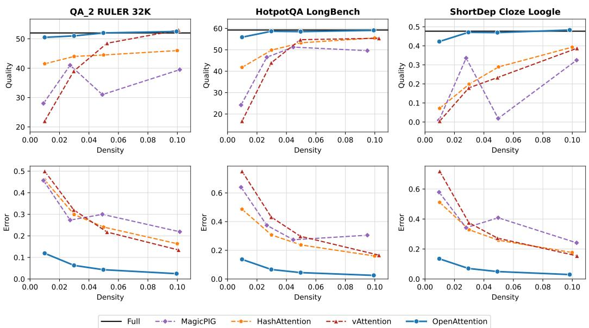  
Figure 9: Quality and error versus read density on representative RULER-32K, LongBench, and LooGLE tasks.

Figure 9 plots task quality and error as the read density increases from 1% to 10% for RULER-32K QA\_2, LongBench (Bai et al., 2024) HotpotQA (Yang et al., 2018), and LooGLE (Li et al., 2024a) ShortDep Cloze. Across these three tasks, OpenAttention stays close to dense attention quality while showing the lowest error among the sparse methods at the plotted densities. The separation is clearest at low density, where the baselines’ errors rise and their task quality falls. These curves complement the fixed-budget results in the main text by showing how both measures change with the read budget.

## B.2 PROTOCOL OF THE DECODE-ROW DIAGNOSTIC

Figure 10 is one pass of run\_v37\_tail\_diag.py over the RULER-32K HARD tasks, three requests each, recording every layer, every head and the first eight generated tokens, which gives 137,216 rows. Dense output is returned at every call, so the generation trajectory is the model’s own. Within a row the two indices, the five reads and the four treatments all see the same cache and the same query, and each treatment is charged the same total read $\rho n$ . Sink and local hold the deployed few-token floor (0.01% each), and the remainder is spent in one of four ways. Treatment (i) spends it on the selector top-k only. Treatment (ii) spends half on the top-k and half on a random sample of m residual tokens, rescaled by $N / m$ and merged into the same softmax, which is vAttention’s fixed 50/50 split (App. F.2). Treatment (iii) reads C clusters at 1.5 rows each and the rest on the top-k, with every cluster a proxy. Treatment (iv) uses C clusters, a ∼9-token top-k and E tokens expanded by Eq. (6) with the uniform per-cluster cap t of earlier versions; the deployed quotas of App. A.1 change the 1% mean by less than one standard error. The clusters are rebuilt inside the diagnostic as at deployment (keys aligned as $\phi _ { i } = \Lambda _ { r } ^ { 1 / 2 } U _ { r } ^ { \top } k _ { i }$ with r=16 under the shrunk M, four Lloyd iterations in bf16, once per request, new keys joining the nearest centroid) and the codes and cluster assignments of tokens generated during decoding are extended incrementally, as at deployment. The QGS is the deployed one (r=32, int8, one U per KV head).

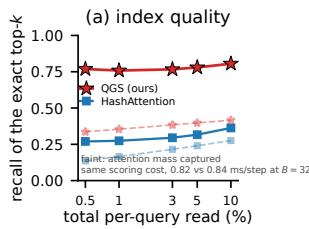

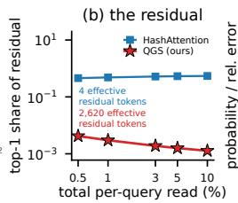

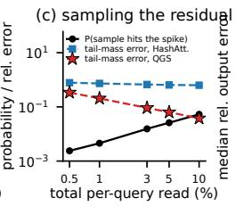

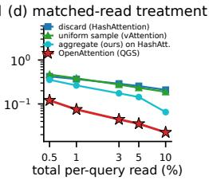  
Figure 10: One pass over 137,216 RULER-32K HARD decode rows (Llama-3.1-8B, all layers and heads of 21 requests) against the total read. (a) Recall of the exact top-k by the HashAttention signature and by the deployed QGS (64 vs. 32 bits/token/head at the same per-step cost, 0.84 vs. 0.82 ms at B=32), with the captured mass in faint lines. (b) Median share of the unread mass held by its largest token, annotated with the residual’s participation ratio. (c) Probability that vAttention’s sample contains that token, and the relative error of the tail mass it estimates. (d) Median relative output error of four treatments of the same residual at the same read, which discard it, sample it, aggregate it into clusters, or apply the deployed OpenAttention. The protocol is given in App. B.2.

## B.3 PROTOCOL OF THE SELECTOR AND AGGREGATION DIAGNOSTICS

Fig. 7 comes from one pass of run\_v49\_cluster\_diag.py over the RULER-32K HARD tasks, three requests each, every layer and head and the first eight generated tokens (137,216 rows), with dense output returned so the trajectory is the model’s own, as in App. B.2. Partitions. The tail is everything but sink, local and the QGS top-1%, and every cluster is aggregated, so the error isolates the partition. Key-only k-means runs the same four Lloyd iterations as ours on the centred raw keys, one partition per KV head, and adjacency cuts the cache into C equal runs. The reported dispersion is the within-cluster standard deviation of the exact logits, averaged over clusters with weights equal to their true attention mass. Clusters. Fig. 7 and the error shares by top-k content reported in App. A.1 use the deployed 1% partition (C=64) with only the ∼9-token QGS top-k exact, on every fourth head (2.2M clusters). The exact variance is the within-cluster variance of the true logits, and the true error of a cluster is its weight error $\begin{array} { r } { \hat { M } _ { b } D _ { b } / Z = \sum _ { i \in b } \left| e ^ { z _ { i } } - e ^ { \bar { z } _ { b } } \right| / Z \left( \mathrm { E q . ~ } ( 3 ) \right) } \end{array}$ ; the partition error is ∑the same sum over all clusters with every cluster a proxy; on these rows the attention weighted within cluster logit std at C=64 is 1.83 for positional clusters, 1.67 for k-means on the keys alone and 1.05 for QGC, and the weight error follows (0.041, 0.040, 0.030), so QGC at $C { = } 6 4$ beats key only clusters at C=1024. Over all rows, the eight clusters with the largest $\hat { \varepsilon } _ { b }$ hold 84% of the aggregation error and 95% of the exact top-1% tokens left in the tail, and $\hat { \varepsilon } _ { b }$ orders the clusters by their true error at Spearman 0.92.

## C OPENATTENTION.FLASH: OPENATTENTION ON FLASHATTENTION-2

Algorithm 1 is the decode attention step of §3.4. A FlashAttention-2 decode kernel keeps, per program, a running maximum, a running normaliser and an output accumulator, and folds one tile of keys and values at a time into them; OpenAttention.flash keeps that loop, written in Triton, and changes only what the tiles hold. Phases 1 and 2 gather the exact tokens, the QGS top-k and the tokens Error-Gate’s quotas read from the expanded clusters, from scattered rows of the cache straight into SRAM, where a gather in PyTorch writes the gathered tile to DRAM and reads it back. Phase 3 streams the clusters as virtual tokens, the mean key in place of a key, the mean value in place of a value and the occupancy of the unread members $\mathrm { a s } + \log { n _ { b } ^ { \prime } }$ on the logit, so the tail costs one more tile loop rather than a second attention pass. The statistics of the unread members are prepared before the launch by subtracting the tokens the query reads from the cached pooled sums (App. A.1), and a cluster read whole carries log $0 = - \infty$ , so the kernel needs no membership test. The index lists are padded to a fixed length with masked slots, so the work per step is fixed, with no data dependent loop bound and no host synchronisation.

```latex
Algorithm 1 OpenAttention.flash: one decode step of the residual-proxy estimator as a
FlashAttention-2 online softmax pass. One program per (sequence, query head); the G=4 query
heads of a KV head read the same cache; T=64 is the tile size and $s = \bar { d } ^ { - 1 / 2 }$
Input: query $q ;$ cache K, V of the KV head; the index list S of the selected tokens (the QGS top-k)
and X of the tokens the expanded clusters read (the ErrorGate quotas $q _ { b }$ of §3.3); per cluster the
statistics of its unread members, $( \bar { k } _ { b } ^ { \prime } , \bar { v } _ { b } ^ { \prime } , n _ { b } ^ { \prime } )$ , obtained from the cached pooled sums by subtract
ing the tokens in $s \cup \mathcal { X } ,$ with $n _ { b } ^ { \prime } { = } \stackrel { \omega } { 0 }$ for a cluster read whole
Output: oˆ of the residual-proxy estimator
1: m $ - \infty , L  0 , o  \mathbf { 0 }$ ▷ running maximum, normaliser and accumulator, fp32
2: for each tile of T indices i in $s ,$ then in X do ▷ phases 1 and 2: exact tokens
3: gather the rows $k _ { i } , v _ { i }$ from the cache into SRAM, padding slots masked
4: $z _ { i } \gets s q ^ { \top } k _ { i }$
5: $( m , L , o ) \gets \mathrm { U p o a r g } ( m , L , o , \{ z _ { i } \} , \{ v _ { i } \} )$
6: end for
7: for each tile of T clusters b do ▷ phase $3 { : }$ proxies as virtual tokens
8: load $\bar { k } _ { b } ^ { \prime } , \bar { v } _ { b } ^ { \prime }$ and log $n _ { b } ^ { \prime }$ ▷ log $0 = - \infty$ drops a cluster read whole
9: $\ell _ { b } \gets s q ^ { \top } \bar { k } _ { b } ^ { \prime } + \log n _ { b } ^ { \prime }$
10: $\mathbf { \Gamma } ( m , L , o ) \longleftarrow \mathbf { U p o a r e } ( m , L , o , \{ \ell _ { b } \} , \{ \bar { v } _ { b } ^ { \prime } \} )$
11: end for
12: return $o / L$
13: procedure UPDATE(m, $L , o , \{ z _ { j } \} , \{ v _ { j } \} )$ ▷ the FlashAttention-2 online softmax step
14: $m ^ { \prime } \gets \operatorname* { m a x } ( m , \operatorname* { m a x } _ { j } z _ { j } ) ; ~ \alpha \gets e ^ { m - m ^ { \prime } } ;$ $p _ { j } \gets e ^ { z _ { j } - m ^ { \prime } }$
15: $\begin{array} { r } { o  \alpha o + \sum _ { j } p _ { j } v _ { j } \dot { ; } \quad L  \alpha L + \sum _ { j } p _ { j } \colon } \end{array}$ m $\gets m ^ { \prime }$
16: return $( m , L , o )$
17: end procedure
```

Implementation and correctness. The kernel runs one program per (sequence, query head), with G=4 query heads per KV head, tiles of 64 tokens / 64 clusters, 4 warps and fp32 accumulators. Against an fp32 reference the median relative error is $1 . 6 \times 1 0 ^ { - 3 }$ and the maximum $2 . 1 \times 1 0 ^ { - 3 }$ over batch-head counts 4–64, including masked expanded clusters. End to end on RULER-32K HARD at 5%, the kernel scores 85.45 against 85.35 for PyTorch, with per-task diferences in $[ - 0 . 2 , + 0 . 5 ]$ of mixed sign. At batch 32 the efective bandwidth is 3,634 GB/s for dense SDPA reading 4.3 GB and 1,750 GB/s for the kernel reading 1.09 GB. Scattered (cluster) expansion versus contiguous expansion costs +4–6% kernel time, so clusters need not be physically re-packed. Figure 11 sweeps batch and context for the $5 \% + 2 5 6$ -token configuration (C≈970 clusters stored once per KV head, without the variance stream; with the per-query-head clusters of the accuracy pipeline the same run reads 34% of the bytes, 41% with the variances). The unfused implementation is $2 . 7 \times$ slower than dense at batch 32, whereas OpenAttention.flash is 1.9× faster. Each cluster caches $n _ { b } , k _ { b } .$ , diag $\mathrm { V a r } _ { b } ( k )$ and $\bar { v } _ { b } ,$ , 385 bf16 scalars, so at the deployed C=64 the statistics of the whole 32 layer model take 12 MiB when stored once per KV head, 0.3% of the 4.0 GiB KV cache they summarise.

What the index scan costs, and why it is excluded. The scan that turns a compressed cache into a ranking, and the top-k selection over it, is common to every method in Table 9: OpenAttention, HashAttention, vAttention and MagicPIG all scan a compressed cache of the same length and take a top-k over $\mathbf { i t } ,$ so excluding it is what makes the sparse rows comparable with one another. It is not what makes them comparable with dense attention. Its cost is method-specific and is not measured in Table 9, so a decode step that charges it gains less than the attention-stage figure. We report the attention stage because that is the part this paper changes, and the 10× refers to this stage only. Bringing the selection itself under the budget is open work.

Table 9: Decode attention step per layer (ms, H100 NVL, 32K, bf16) at 1% and 3% reads with no ErrorGate expansion (E=0), as in Fig. 1(c). The vAttention/MagicPIG rows are lower bounds charging only their gathers and estimator arithmetic; selection, ErrorGate scoring and residual-statistics updates are excluded for every method. The three models of §4.3 share these attention shapes. The speedup reported here is therefore of the attention stage and not of the decode step as a whole (see below).
<table><tr><td rowspan="2">method</td><td rowspan="2">custom kernel</td><td colspan="2">1% read</td><td colspan="2">3% read</td></tr><tr><td>B=1</td><td>B=32</td><td>B=1</td><td>B=32</td></tr><tr><td>dense attention (fused SDPA)</td><td>一</td><td>0.06</td><td>1.20</td><td>0.06</td><td>1.22</td></tr><tr><td>HashAttention</td><td>X</td><td>0.12</td><td>0.54</td><td>0.11</td><td>1.65</td></tr><tr><td>vAttention (lower bound)</td><td>X</td><td>0.37</td><td>0.67</td><td>0.35</td><td>1.75</td></tr><tr><td>MagicPIG (lower bound)</td><td>X</td><td>0.13</td><td>0.55</td><td>0.11</td><td>1.65</td></tr><tr><td>OpenAttention, unfused gather</td><td>×</td><td>0.29</td><td>0.46</td><td>0.27</td><td>1.26</td></tr><tr><td>OpenAttention.flash</td><td>√</td><td>0.05</td><td>0.12</td><td>0.07</td><td>0.24</td></tr></table>

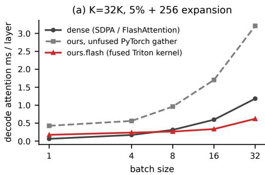

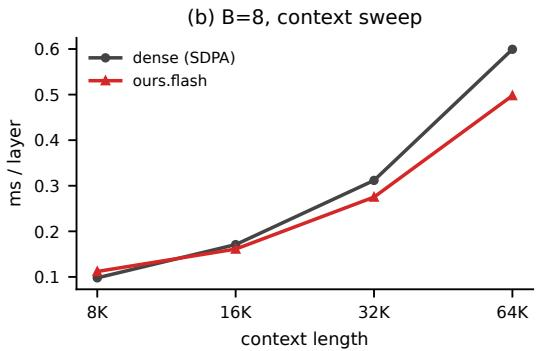  
Figure 11: Decode attention time per layer on one H100 NVL (Llama-3.1-8B shapes, bf16) for fused dense SDPA and for OpenAttention with the unfused PyTorch gather path and with OpenAttention.flash, the fused Triton kernel. (a) Batch sweep at 32K; (b) context sweep at batch 8.

## D BUDGET SPLIT AND DEPLOYED HYPER-PARAMETERS

## D.1 CHOOSING (C, E, t) PER BUDGET

The grid below was run with the uniform per-cluster cap t and the bound route ranking $\bar { z } _ { b } + 3 \sigma _ { b }$ of earlier versions; the deployed ErrorGate replaces the cap by the error proportional quotas of App. A.1 and keeps the (C, E) the grid selected. Within a budget, C, E and the cap t trade against one another at a fixed ρ (E + 1.5C is what the accounting leaves once sink, local and the ∼9-token top-k are paid), so the triple is chosen per budget on the small grid of Table 10. The free parameter is really the share of the read the proxy stream takes, and the grid moves it while keeping the selector, the partition, the ranking rule and the cap rule fixed. The share that wins grows as the read shrinks, because the sparser the read, the more of it is worth spending on knowing where the mass is rather than on reading tokens.

## E RESULTS AT EVERY BUDGET

Table 11 gives Figure 8 per task. Table 12 gives the per-task results underlying the 5% component ablation in Table 4. OpenAttention scores 87.08, 86.82, 86.83 and 86.30 at 10, 5, 3 and 1%, within 0.25 points of dense down to 3% and within one point at 1%, while every baseline degrades steeply; vAttention trails plain HashAttention by 2.7, 7.7 and 11.9 points at 5, 3 and 1% and overtakes it only at 10%, and MagicPIG, calibrated to the same reads, degrades fastest (App. F.1).

Table 10: Per-budget grid over the split between the proxy stream and the expansion (RULER-32K HARD, 200 samples per task; “proxy” is $1 . 5 C / \rho n .$ , the share of the read the cluster statistics take). Everything but $( \bar { C } , E , t )$ is held fixed. The chosen row is the one Figure 8 reports.
<table><tr><td>ρ</td><td>C</td><td>E</td><td>t</td><td>proxy</td><td>avg</td><td>qa_1</td><td>qa_2</td><td>vt</td><td>fwe</td><td>mk_2</td><td>mk_3</td><td>mv</td></tr><tr><td>10%</td><td>512</td><td>2493</td><td>32</td><td>23%</td><td>86.59</td><td>78.0</td><td>49.5</td><td>95.2</td><td>92.7</td><td>95.0</td><td>99.5</td><td>96.2</td></tr><tr><td>10%</td><td>256</td><td>2877</td><td>32</td><td>12%</td><td>86.85</td><td>78.0</td><td>50.5</td><td>95.0</td><td>94.2</td><td>94.5</td><td>99.5</td><td>96.2</td></tr><tr><td>5%</td><td>256</td><td>1238</td><td>32</td><td>23%</td><td>86.51</td><td>76.5</td><td>51.0</td><td>94.9</td><td>93.2</td><td>94.5</td><td>99.5</td><td>96.0</td></tr><tr><td>5%</td><td>192</td><td>1335</td><td>32</td><td>18%</td><td>86.98</td><td>79.0</td><td>50.5</td><td>95.1</td><td>93.5</td><td>95.0</td><td>99.5</td><td>96.2</td></tr><tr><td>5%</td><td>128</td><td>1431</td><td>32</td><td>12%</td><td>86.83</td><td>78.5</td><td>50.0</td><td>95.2</td><td>94.3</td><td>95.0</td><td>99.5</td><td>95.2</td></tr><tr><td>10%</td><td>384</td><td>2685</td><td>32</td><td>18%</td><td>86.60</td><td>77.5</td><td>50.0</td><td>95.1</td><td>93.0</td><td>95.0</td><td>99.5</td><td>96.1</td></tr><tr><td>3%</td><td>256</td><td>583</td><td>32</td><td>39%</td><td>86.69</td><td>78.0</td><td>50.5</td><td>95.4</td><td>92.7</td><td>95.0</td><td>99.5</td><td>95.8</td></tr><tr><td>3%</td><td>192</td><td>679</td><td>16</td><td>29%</td><td>86.63</td><td>79.0</td><td>49.0</td><td>93.5</td><td>94.2</td><td>95.5</td><td>99.5</td><td>95.8</td></tr><tr><td>3%</td><td>192</td><td>679</td><td>32</td><td>29%</td><td>86.80</td><td>78.5</td><td>50.5</td><td>94.8</td><td>93.3</td><td>95.0</td><td>99.5</td><td>96.0</td></tr><tr><td>3%</td><td>128</td><td>775</td><td>32</td><td>20%</td><td>86.60</td><td>77.5</td><td>49.5</td><td>95.3</td><td>93.5</td><td>95.5</td><td>99.5</td><td>95.4</td></tr></table>

Table 11: RULER-32K HARD, Llama-3.1-8B-Instruct, 200 samples per task, at a matched total per-query read from 10% to 1% (“read” counts the exact rows plus, for OpenAttention, the proxy stream of 1.5 rows per cluster, and for vAttention, whose sample is adaptive, the measured read); the averages are Figure 8. Baselines use the HashAttention selector.
<table><tr><td>budget method</td><td></td><td>read</td><td>avg</td><td>qa_1</td><td>qa_2</td><td>vt</td><td>fwe</td><td>mk_2</td><td>mk_3</td><td>mv</td></tr><tr><td>100%</td><td>dense</td><td>100%</td><td>87.04</td><td>79.0</td><td>50.0</td><td>95.2</td><td>93.3</td><td>95.0</td><td>100.0</td><td>96.8</td></tr><tr><td rowspan="4">10%</td><td>MagicPIG</td><td>10.0%</td><td>52.52</td><td>51.0</td><td>39.0</td><td>90.2</td><td>88.8</td><td>30.0</td><td>3.5</td><td>65.1</td></tr><tr><td>HashAttention</td><td>10.0%</td><td>81.23</td><td>70.5</td><td>45.5</td><td>87.9</td><td>89.8</td><td>88.0</td><td>91.0</td><td>95.9</td></tr><tr><td>vAttention</td><td>10.0%</td><td>83.08</td><td>73.0</td><td>46.0</td><td>91.3</td><td>92.2</td><td>92.5</td><td>91.0</td><td>95.6</td></tr><tr><td>OpenAttention (ours)</td><td>10.0%</td><td>87.08</td><td>79.0</td><td>51.0</td><td>95.3</td><td>92.7</td><td>95.0</td><td>100.0</td><td>96.6</td></tr><tr><td rowspan="4">5%</td><td>MagicPIG</td><td>5.1%</td><td>34.42</td><td>36.0</td><td>33.5</td><td>71.5</td><td>88.3</td><td>2.5</td><td>0.0</td><td>9.1</td></tr><tr><td>HashAttention</td><td>5.0%</td><td>71.55</td><td>68.0</td><td>44.5</td><td>81.9</td><td>87.3</td><td>72.5</td><td>50.5</td><td>96.1</td></tr><tr><td>vAttention</td><td>5.0%</td><td>68.86</td><td>67.5</td><td>45.0</td><td>85.8</td><td>90.5</td><td>67.0</td><td>33.5</td><td>92.8</td></tr><tr><td>OpenAttention (ours)</td><td>5.0%</td><td>86.82</td><td>78.5</td><td>50.5</td><td>95.8</td><td>92.2</td><td>94.5</td><td>99.5</td><td>96.8</td></tr><tr><td rowspan="4">3%</td><td>MagicPIG</td><td>2.9%</td><td>24.01</td><td>24.5</td><td>26.0</td><td>34.0</td><td>81.8</td><td>0.0</td><td>0.0</td><td>1.8</td></tr><tr><td>HashAttention</td><td>3.0%</td><td>63.48</td><td>64.0</td><td>43.0</td><td>80.9</td><td>86.8</td><td>58.5</td><td>16.0</td><td>95.1</td></tr><tr><td>vAttention</td><td>3.0%</td><td>55.74</td><td>55.0</td><td>36.5</td><td>79.1</td><td>88.7</td><td>38.0</td><td>3.0</td><td>89.9</td></tr><tr><td>OpenAttention (ours)</td><td>3.0%</td><td>86.83</td><td>78.5</td><td>51.0</td><td>95.9</td><td>92.0</td><td>94.5</td><td>99.5</td><td>96.4</td></tr><tr><td rowspan="4">1%</td><td>MagicPIG</td><td>1.1%</td><td>10.53</td><td>12.0</td><td>13.5</td><td>0.7</td><td>47.5</td><td>0.0</td><td>0.0</td><td>0.0</td></tr><tr><td>HashAttention</td><td>1.0%</td><td>48.22</td><td>44.0</td><td>41.5</td><td>73.3</td><td>78.5</td><td>12.5</td><td>0.0</td><td>87.8</td></tr><tr><td>vAttention</td><td>1.0%</td><td>36.29</td><td>24.0</td><td>23.0</td><td>62.6</td><td>73.7</td><td>1.5</td><td>0.0</td><td>69.2</td></tr><tr><td>OpenAttention (ours)</td><td>1.0%</td><td>86.30</td><td>77.5</td><td>50.0</td><td>96.0</td><td>93.5</td><td>95.0</td><td>97.0</td><td>95.1</td></tr></table>

## F BASELINE CONFIGURATIONS

The baselines of §4 run inside one framework on the HashAttention selector with the public signature weights. This appendix gives the MagicPIG and vAttention configurations that realise each target read under our accounting.

## F.1 MAGICPIG CONFIGURATION

We use the MagicPIG masker of the vAttention authors’ framework (random signed projections, key centring, the Neyshabur–Srebro maximum inner product search (MIPS) transform, a match if any of the L tables collides, importance weights $1 / p _ { i }$ from the collision probability). Here K is the number of hash bits per table and L is the number of tables. Its realised density depends on the hash configuration, on the query–key geometry and on the context length, so we keep K fixed within each sweep and calibrate L to the target read on the benchmark itself, accepting a configuration only when its measured read matches the budget.

Table 12: Per-task accuracy for the component ablation of Table 4 at a matched $5 \%$ total read on RULER-32K HARD (200 requests per task).
<table><tr><td>proxies</td><td>ErrorGate</td><td>QGS</td><td>avg</td><td> $\mathrm { \ q a \mathrm { \_ 1 } }$ </td><td> $\mathtt { q a \_ 2 }$ </td><td>vt</td><td>fwe</td><td> $\mathrm { m k } \_ 2$ </td><td> $\mathrm { m k } \_ 3$ </td><td>mv</td></tr><tr><td>X</td><td>X</td><td>X</td><td>67.35</td><td>62.0</td><td>45.5</td><td>84.0</td><td>91.7</td><td>63.0</td><td>31.5</td><td>93.8</td></tr><tr><td>V</td><td>X</td><td>X</td><td>77.91</td><td>74.5</td><td>45.5</td><td>91.8</td><td>92.8</td><td>82.5</td><td>63.0</td><td>95.2</td></tr><tr><td>V</td><td>V</td><td>X</td><td>85.90</td><td>78.5</td><td>49.0</td><td>95.6</td><td>92.2</td><td>94.0</td><td>96.0</td><td>96.0</td></tr><tr><td>V</td><td>X</td><td>V</td><td>86.73</td><td>78.0</td><td>51.0</td><td>95.6</td><td>92.0</td><td>94.5</td><td>99.5</td><td>96.5</td></tr><tr><td>V</td><td>√</td><td>V</td><td>86.82</td><td>78.5</td><td>50.5</td><td>95.8</td><td>92.2</td><td>94.5</td><td>99.5</td><td>96.8</td></tr></table>

The MagicPIG points in Figure 1(a,b), Figure 8, and Table 11 use $K { = } 9$ , with $L { = } 8 , 2 5 , 4 6 , 1 0 0$ at the 1, 3, 5, and 10% targets, respectively. Their measured reads are 1.09, 2.88, 5.13, and $9 . 9 7 \%$ These 32K runs evaluate 200 requests per task; the 1% run used two RTX 4090 GPUs with the model split across them, and the other three used one H100 NVL. The context-length comparison in Tables 7 and 18 is a separate K=10 sweep at a 3% target read. At 16K, 32K, 64K, and 96K, it uses L=210, 300, 300, 250 and measures reads of 2.99, 3.20, 3.19, and 3.02%, respectively, with 100 requests per task.

Note that MagicPIG’s own evaluation processes the question with dense attention and applies sampling only to generation, whereas the protocol shared by all methods here applies sparse attention to the question chunk as well; under this protocol, and without the dense layers 0 and 16 of the released code, MagicPIG is known to degrade (Desai et al., 2026, App. C, Table 10).

## F.2 VATTENTION CONFIGURATION PROTOCOL

vAttention’s accuracy at a given read depends on four parameters, namely the shares of the budget given to the heavy-hitter selector $( f _ { t } )$ and to the base sample $\left( f _ { b } \right)$ , and the tolerances $( \epsilon , \delta )$ that size the adaptive sample of each head from the base sample’s variance estimate. In the released implementation the adaptive budget scales as $( \Phi ^ { - 1 } ( 1 - \delta ) / \epsilon ) ^ { 2 }$ , so only that ratio matters and we sweep ϵ=δ. The vAttention paper (App. A.2, Table 3) chooses the parameters per target sparsity by a grid search on a few examples, keeping the configuration with the smallest local attention error among those that meet the target. We follow the same protocol under our accounting. For each target read we probe nominal budgets $\{ 0 . 4 , 0 . 6 , 0 . 8 , 1 . 0 \}$ ×target, sampling shares {0.25, 0.5, 0.75} and $\scriptstyle \epsilon = \delta \in$ {0.025, 0.05, 0.1, 0.2, 0.3} (plus, at 10%, the points of the paper’s own 10% grid that fit a 10% read) on four requests (two of qa\_1, two of niah\_multikey\_2), logging the realised read and the relative output error against dense attention at every layer call, and run the configuration with the lowest error among those whose realised read is within 5% of the target on the full benchmark (Table 13). Tightening ϵ=δ below 0.2 makes the adaptive budget overshoot the target at every nominal budget (at a 3% target, $\epsilon { = } \delta { = } 0 . 0 5$ realises 5.7–14%), so at 0.5–5% the protocol selects the loosest tolerance with the full nominal budget and a 50/50 split, which is the paper’s default setting except for $\epsilon { = } \delta { = } 0 . 3$ instead of 0.25, and at 10% it selects the paper’s own grid point $f _ { t } { = } 7 . 5 \%$ $f _ { b } { = } 2 . 5 \%$ . Table 14 compares the protocol-chosen runs with the fixed $\epsilon { = } \delta { = } 0 . 2 5$ , 50/50 configuration on RULER-32K HARD; the vAttention rows of the other two models (Table 5) use the fixed configuration. The vAttention paper reports 86.6 for vAttention(HashAttention) at “10% sparsity” on the same tasks against 81.9 for HashAttention alone; under a strictly matched read the protocol recovers part of that gain (Table 14), and what remains is attributable to their search including tolerances down to $\scriptstyle \epsilon = \delta = 0 . 0 2 5$ , whose adaptive budgets exceed a 10% read under our accounting (Table 13), and to their fixed 128-token sink and local windows.

## G QUESTION-FREE TASKS

This appendix expands Table 15 of the main text with all OpenAttention variants on the question-free LongBench summarisation tasks (Table 16).

Table 13: vAttention parameter probe per target read (4 requests). For each $\epsilon { = } \delta$ the table lists the lowest-error configuration that meets the target, its realised read and its output error against dense attention; the chosen configuration is bold.
<table><tr><td colspan="3">configuration realised read output error</td></tr><tr><td colspan="3">target read 1%: 14 of 40 configurations within 1.05× the target</td></tr><tr><td> $\scriptstyle \epsilon = \delta = 0 . 3 ,$  nominal 1.0%, sampling share 0.50 (chosen)</td><td>1.00%</td><td>0.470</td></tr><tr><td> $\scriptstyle \epsilon = \delta = 0 . 2 ,$  nominal 0.8%, sampling share 0.50</td><td>0.90%</td><td>0.579</td></tr><tr><td> $\epsilon { = } \delta { = } 0 . 1$  , nominal 0.4%, sampling share 0.25</td><td>0.83%</td><td>0.628</td></tr><tr><td> $\scriptstyle \epsilon = \delta = 0 . 0 5 ,$  nominal 0.4%, sampling share 0.25 (none fits: smallest read)</td><td>3.16%</td><td>0.489</td></tr><tr><td> $\scriptstyle \epsilon = \delta = 0 . 0 2 5$  , nominal 0.4%, sampling share 0.25 (none fits: smallest read)</td><td>9.32%</td><td>0.383</td></tr><tr><td colspan="3">target read 3%: 25 of 60 configurations within 1.05× the target</td></tr><tr><td> $\epsilon = \delta = 0 . 3 ,$  nominal 3.0%, sampling share 0.50 (chosen)</td><td>3.00%</td><td>0.339</td></tr><tr><td> $\scriptstyle \epsilon = \delta = 0 . 2 ,$  nominal 2.4%, sampling share 0.50</td><td>2.67%</td><td>0.360</td></tr><tr><td> $\epsilon { = } \delta { = } 0 . 1$  , nominal 1.8%, sampling share 0.25</td><td>3.00%</td><td>0.369</td></tr><tr><td> $\scriptstyle \epsilon = \delta = 0 . 0 5 .$  , nominal 1.2%, sampling share 0.25 (none fits: smallest read)</td><td>5.74%</td><td>0.329</td></tr><tr><td> $\scriptstyle \epsilon = \delta = 0 . 0 2 5$  , nominal 1.2%, sampling share 0.25 (none fits: smallest read)</td><td>13.84%</td><td>0.246</td></tr><tr><td>target read 5%: 26 of 60 configurations within 1.05× the target</td><td></td><td></td></tr><tr><td colspan="3"> $\epsilon = \delta = 0 . 3 ,$ </td></tr><tr><td>nominal 5.0%, sampling share 0.50 (chosen)</td><td>4.97%</td><td>0.275</td></tr><tr><td> $\epsilon { = } \delta { = } 0 . 2 ,$  nominal 5.0%, sampling share 0.25</td><td>5.23%</td><td>0.278</td></tr><tr><td> $\epsilon { = } \delta { = } 0 . 1$  , nominal 3.0%, sampling share 0.25</td><td>4.75%</td><td>0.299</td></tr><tr><td> $\scriptstyle \epsilon = \delta = 0 . 0 5 ,$  nominal 2.0%, sampling share 0.25 (none fits: smallest read)</td><td>7.32%</td><td>0.270</td></tr><tr><td> $\scriptstyle \epsilon = \delta = 0 . 0 2 5 .$  , nominal 2.0%, sampling share 0.25 (none fits: smallest read)</td><td>16.33%</td><td>0.208</td></tr><tr><td colspan="3">target read 10%: 32 of 75 configurations within 1.05× the target</td></tr><tr><td> $\scriptstyle \epsilon = \delta = 0 . 3 ,$  nominal 10.2%, sampling share 0.25 (chosen)</td><td>10.03%</td><td>0.204</td></tr><tr><td> $\scriptstyle \epsilon = \delta = 0 . 2$  , nominal 10.0%, sampling share 0.25</td><td>10.44%</td><td>0.205</td></tr><tr><td> $\epsilon { = } \delta { = } 0 . 1$  , nominal 6.0%, sampling share 0.50</td><td>9.71%</td><td>0.220</td></tr><tr><td> $\scriptstyle \epsilon = \delta = 0 . 0 5 ,$  nominal 4.0%, sampling share 0.25</td><td>10.45%</td><td>0.208</td></tr><tr><td> $\scriptstyle \epsilon = \delta = 0 . 0 2 5 .$  , nominal 4.0%, sampling share 0.25 (none fits: smallest read)</td><td>20.12%</td><td>0.170</td></tr></table>

Table 14: vAttention on RULER-32K HARD (mean accuracy), comparing the fixed ϵ=δ=0.25, 50/50 configuration with the protocol-chosen one of Table 13, with the measured read of the latter.
<table><tr><td>target read</td><td>fixed  $( \epsilon = \delta = 0 . 2 5 , 5 0 / 5 0 )$ </td><td>protocol-chosen</td><td>measured read</td></tr><tr><td>1%</td><td>37.36</td><td>36.29</td><td>1.0%</td></tr><tr><td>3%</td><td>57.15</td><td>55.74</td><td>3.0%</td></tr><tr><td>5%</td><td>68.70</td><td>68.86</td><td>5.0%</td></tr><tr><td>10%</td><td>82.26</td><td>83.08</td><td>10.0%</td></tr></table>

LongBench-v2. As a non-synthetic check we also run LongBench-v2 (multiple choice, 0-shot prompt, accuracy) on its first 60 requests at 3%, contexts truncated to 32000 tokens as everywhere else; the request count is small and the numbers are indicative only.
<table><tr><td>method (3% total read)</td><td>LongBench-v2 0-shot accuracy</td></tr><tr><td>dense</td><td>30.00</td></tr><tr><td>HashAttention</td><td>23.30</td></tr><tr><td>OpenAttention (QGS)</td><td>33.30</td></tr></table>

## H COMPOSING WITH KV-CACHE COMPRESSION

The three eviction compressors of Table 6 follow the release of the PyramidKV paper $( \mathtt { K V C a c h e - F a c t o r y } )$ , which also ships the StreamingLLM and SnapKV baselines that paper compares against, and whose RULER driver fixes their hyper-parameters. The budget b is an absolute average cache size per layer rather than a fraction of the context, scores are max-pooled with kernel 7, and the retained window is the last α=8 tokens for SnapKV and PyramidKV and b − 4 for StreamingLLM, whose remaining four slots are the attention sinks of Xiao et al. (2024b). Every prefix key is scored by the attention that retained window pays to it, averaged over the query heads of its KV group, and the top of that score survives. StreamingLLM is the exception, since it consults no score and keeps tokens by position alone. PyramidKV’s arithmetic allocation gives layer 0 a prefix budget of $2 ( \bar { b \cdot - \alpha } ) - ( \bar { b \cdot - \alpha } ) / \beta$ and the last layer $( b - \alpha ) / \beta$ with β=20, integer-divided steps in between, so the mean over layers is b; at b=2048 that is 3,986 entries in the first layer and 111 in the last. The prompt is encoded with full attention and the compression applies to what is stored, so only generation reads the compressed cache. That detail is not cosmetic, because biasing the selection call itself, which would encode the question chunk against the keys it has just chosen, costs 9.5 points on qa\_1 alone, even when the whole resident set is then read.

Table 15: Beyond RULER at a 3% read, on LongBench summarisation (no question chunk; ROUGE-L (Lin, 2004), 30 requests/task) and LongBench-v2 (Bai et al., 2025) (0-shot accuracy, 60 requests). Absolute scores are low for dense attention too, a property of metric and benchmark, not of sparsity; OpenAttention reads no question tokens. App. G gives details.
<table><tr><td>method (3% read)</td><td></td><td>gov_rep. multi_news LB-v2</td><td></td></tr><tr><td>dense</td><td>36.08</td><td>26.61</td><td>30.00</td></tr><tr><td>HashAttention</td><td>35.34</td><td>22.09</td><td>23.30</td></tr><tr><td>vAttention</td><td>31.05</td><td>16.33</td><td></td></tr><tr><td>OpenAttention (static only)</td><td>35.53</td><td>26.80</td><td>33.30</td></tr></table>

Table 16: LongBench summarisation tasks (no question chunk), 3% read, 30 requests per task, ROUGE-L. “static metric only” uses no question at all (selector and partition from the calibrated M; the row of Table 15); the last row treats the instruction tokens as the question.
<table><tr><td>method</td><td>gov_report (ROUGE-L)</td><td>multi_news (ROUGE-L)</td></tr><tr><td>dense</td><td>36.08</td><td>26.61</td></tr><tr><td>HashAttention</td><td>35.34</td><td>22.09</td></tr><tr><td>vAttention</td><td>31.05</td><td>16.33</td></tr><tr><td>OpenAttention (HashAttention selector, static-metric partition)</td><td>35.95</td><td>26.99</td></tr><tr><td>OpenAttention (static metric only: selector and partition)</td><td>35.53</td><td>26.80</td></tr><tr><td>OpenAttention (static + instruction tokens as question)</td><td>34.68</td><td>26.93</td></tr></table>

Both rows of each pair call the same selector, so a pair difers only in what the decode step reads. The diference from a baseline run is where the surviving set enters. Rather than adding the kept rows to the read mask, we hide the evicted rows from the attention itself, so they are invisible to the selector’s scores, absent from the tail the partition clusters, and absent from the statistics of every cluster. Two consequences are worth stating. First, a cluster can lose most of its members to the eviction, and the accounting still charges its 1.5 rows, so the read we charge is an upper bound on the read we take. Second, the partition is still built over all keys, not only the resident ones, so the k-means objective is slightly the wrong one, which costs accuracy rather than buying it.

Table 17: Table 6 per task (RULER-32K HARD, Llama-3.1-8B-Instruct, 200 samples per task).
<table><tr><td>method</td><td>avg</td><td>qa_1</td><td>qa_2</td><td>vt</td><td>fwe</td><td>mk_2</td><td>mk_3</td><td>mv</td></tr><tr><td>dense attention</td><td>87.04</td><td>79.0</td><td>50.0</td><td>95.2</td><td>93.3</td><td>95.0</td><td>100.0</td><td>96.8</td></tr><tr><td>StreamingLLM (2048)</td><td>28.00</td><td>50.5</td><td>37.5</td><td>5.3</td><td>88.3</td><td>5.0</td><td>5.0</td><td>4.4</td></tr><tr><td>+ OpenAttention at 10%</td><td>28.28</td><td>52.0</td><td>37.5</td><td>5.4</td><td>88.7</td><td>5.0</td><td>5.0</td><td>4.4</td></tr><tr><td>SnapKV (2048)</td><td>69.98</td><td>77.5</td><td>49.0</td><td>88.6</td><td>82.2</td><td>93.5</td><td>3.0</td><td>96.1</td></tr><tr><td>+ OpenAttention at 10%</td><td>69.49</td><td>76.0</td><td>48.0</td><td>87.7</td><td>83.5</td><td>93.5</td><td>2.5</td><td>95.2</td></tr><tr><td>PyramidKV (2048) + OpenAttention at 10%</td><td>70.34 70.14</td><td>78.0 76.5</td><td>49.5 49.5</td><td>90.6 89.5</td><td>82.5 83.3</td><td>93.5 94.0</td><td>2.0 2.5</td><td>96.2 95.6</td></tr></table>

## I CONTEXT-LENGTH SWEEP

Table 7 of §4.5 uses 100 samples per task at every length. The 16K and 32K sets are the public releases of the HashAttention and vAttention evaluation (xAlg-AI/att-hub-ruler-16k and att-hub-ruler-32k). The 32K column rescores the first 100 samples of existing runs of 200 samples with the same metric. For HashAttention and vAttention these are the runs of Table 11, for OpenAttention it is the run of Table 5, and for MagicPIG it is the $K { = } 1 0$ run described below. The 64K and 96K sets are generated with the RULER scripts (Hsieh et al., 2024) at maximum sequence lengths 65,536 and 98,304 tokens with the Llama-3.1 tokenizer, the base template and the same seven tasks (200 samples generated, the first 100 run), and the answer prefix is handed to the model exactly as in the public sets. Contexts are truncated to L − 768 tokens at every length. All methods use the code paths of Table 11, namely HashAttention with the released 64K signature weights, vAttention with the protocol configuration of App. F.2 for a 3% read $( \epsilon { = } \delta { = } 0 . 3 $ , 50/50 split, measured read reported), and OpenAttention with the QGS, the static+question partition and $C = 6 4 \cdot L / 3 2 7 6 8$ clusters with $E { \stackrel { \textstyle - } { = } } 0 ,$ so that the proxy stream stays at 0.29% of the read and a cluster holds about 500 tokens at every length. MagicPIG is recalibrated per length, because the realised density of a fixed $( K , L )$ shifts with the context (its $L { = } 3 0 0$ configuration measures 3.20% at 32K but 3.81% at 16K and 3.41% at 96K), so the rows use K=10 with L=210, 300, 300 and 250 at 16K, 32K, 64K and 96K, whose measured reads are 2.99%, 3.20%, 3.19% and 3.02% (App. F.1, whereas the density sweep of Table 11 uses K=9). Table 18 lists the per-task scores and the reads.

Table 18: Table 7 per task, with the total per-query read (measured for vAttention, MagicPIG and OpenAttention).
<table><tr><td>context method</td><td></td><td>read</td><td>avg</td><td>qa_1</td><td>qa_2</td><td>vt</td><td>fwe</td><td>mk_2</td><td>mk_3</td><td>mv</td></tr><tr><td rowspan="5">16K</td><td>dense</td><td>100%</td><td>87.14</td><td>86.0</td><td>51.0</td><td>93.2</td><td>91.0</td><td>95.0</td><td>98.0</td><td>95.8</td></tr><tr><td>MagicPIG</td><td>3.0%</td><td>46.91</td><td>49.0</td><td>32.0</td><td>83.2</td><td>79.7</td><td>14.0</td><td>0.0</td><td>70.5</td></tr><tr><td>HashAttention</td><td>3.0%</td><td>67.41</td><td>84.0</td><td>53.0</td><td>78.4</td><td>83.0</td><td>62.0</td><td>20.0</td><td>91.5</td></tr><tr><td>vAttention</td><td>3.0%</td><td>52.69</td><td>60.0</td><td>41.0</td><td>73.4</td><td>83.7</td><td>21.0</td><td>1.0</td><td>88.8</td></tr><tr><td>OpenAttention (ours)</td><td>3.0%</td><td>87.49</td><td>86.0</td><td>54.0</td><td>94.0</td><td>89.7</td><td>95.0</td><td>98.0</td><td>95.8</td></tr><tr><td rowspan="5">32K</td><td>dense</td><td>100%</td><td>87.75</td><td>83.0</td><td>50.0</td><td>95.2</td><td>93.3</td><td>96.0</td><td>100.0</td><td>96.8</td></tr><tr><td>MagicPIG</td><td>3.2%</td><td>51.38</td><td>46.0</td><td>44.0</td><td>83.0</td><td>81.7</td><td>16.0</td><td>1.0</td><td>88.0</td></tr><tr><td>HashAttention</td><td>3.0%</td><td>63.87</td><td>67.0</td><td>48.0</td><td>80.4</td><td>87.7</td><td>54.0</td><td>16.0</td><td>94.0</td></tr><tr><td>vAttention</td><td>3.0%</td><td>55.63</td><td>58.0</td><td>38.0</td><td>77.6</td><td>89.3</td><td>34.0</td><td>3.0</td><td>89.5</td></tr><tr><td>OpenAttention (ours)</td><td>3.0%</td><td>87.38</td><td>83.0</td><td>51.0</td><td>96.0</td><td>91.7</td><td>95.0</td><td>99.0</td><td>96.0</td></tr><tr><td rowspan="5">64K</td><td>dense</td><td>100%</td><td>85.49</td><td>81.0</td><td>49.0</td><td>90.6</td><td>88.3</td><td>97.0</td><td>98.0</td><td>94.5</td></tr><tr><td>MagicPIG</td><td>3.2%</td><td>45.73</td><td>41.0</td><td>34.0</td><td>73.6</td><td>77.0</td><td>12.0</td><td>0.0</td><td>82.5</td></tr><tr><td>HashAttention</td><td>3.0%</td><td>49.65</td><td>64.0</td><td>36.0</td><td>60.6</td><td>86.7</td><td>15.0</td><td>0.0</td><td>85.2</td></tr><tr><td>vAttention</td><td>3.0%</td><td>54.79</td><td>67.0</td><td>37.0</td><td>83.0</td><td>85.0</td><td>19.0</td><td>3.0</td><td>89.5</td></tr><tr><td>OpenAttention (ours)</td><td>3.0%</td><td>84.82</td><td>81.0</td><td>51.0</td><td>90.8</td><td>81.7</td><td>97.0</td><td>98.0</td><td>94.2</td></tr><tr><td rowspan="5">96K</td><td>dense</td><td>100%</td><td>78.01</td><td>78.0</td><td>47.0</td><td>61.0</td><td>90.3</td><td>84.0</td><td>89.0</td><td>96.8</td></tr><tr><td>MagicPIG</td><td>3.0%</td><td>33.19</td><td>31.0</td><td>23.0</td><td>57.6</td><td>57.0</td><td>3.0</td><td>0.0</td><td>60.8</td></tr><tr><td>HashAttention</td><td>3.0%</td><td>27.99</td><td>14.0</td><td>19.0</td><td>23.6</td><td>74.3</td><td>0.0</td><td>0.0</td><td>65.0</td></tr><tr><td>vAttention</td><td>3.0%</td><td>40.20</td><td>34.0</td><td>26.0</td><td>50.2</td><td>85.7</td><td>6.0</td><td>0.0</td><td>79.5</td></tr><tr><td>OpenAttention (ours)</td><td>3.0%</td><td>78.10</td><td>79.0</td><td>47.0</td><td>62.8</td><td>87.7</td><td>84.0</td><td>89.0</td><td>97.2</td></tr></table>