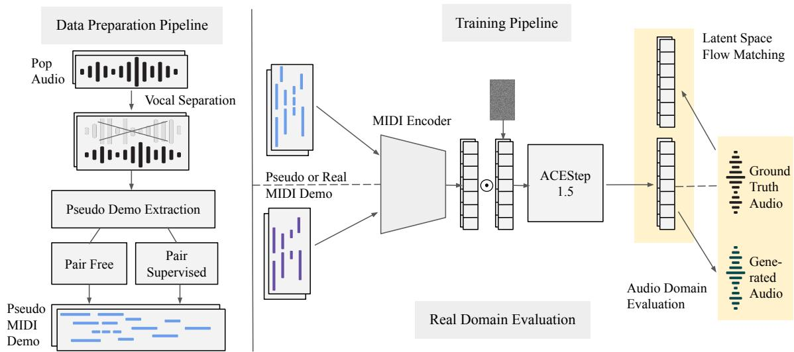
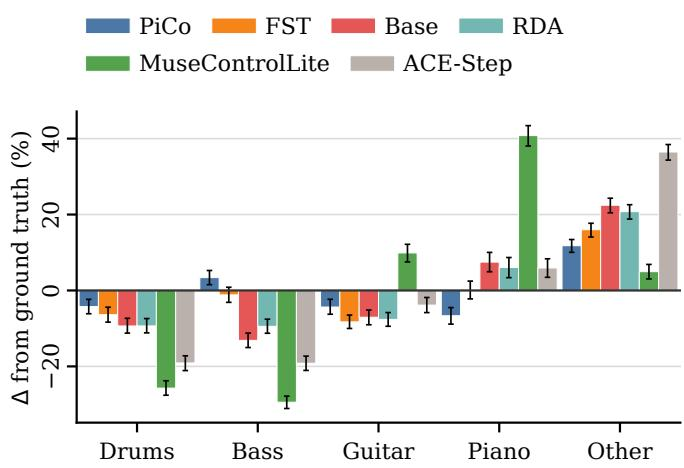

# PIANO2POP: EXPANDING PIANO DEMOS INTO POP PRODUCTIONS WITHOUT ALIGNED SUPERVISION

Yun-Chen Cheng

Chih-Pin Tan

Tzu-Hung Huang

Yi-Hsuan Yang

National Taiwan University, Taiwan {hhhhaura, tanchihpin0517, zionhuang1107, affige}@gmail.com

## ABSTRACT

We introduce Piano2Pop, a music-expansion task that transforms piano MIDI into instrumental pop productions. Enabled by recent advances in music generation and polyphonic music transcription, our pseudo-supervised approach conditions a pretrained flow-matching model on piano rolls without aligned piano–pop supervision. We train on synthetic piano–instrumental pairs derived from pop recordings, comparing pair-free transcription, including function-selective (FST) and register–density (RDA) augmentations, with a pair-supervised piano-cover generator as pseudo-demo sources. On 476 testing real-world piano-cover/pop pairs, the pair-supervised approach achieves the best Frechet Au-´ dio Distance, Accompaniment Prompt Adherence, and spectral shape on real-piano inputs, while FST mitigates piano-heavy outputs in pair-free training and remains a promising alternative. All fine-tuned systems significantly outperform the zero-shot baselines, which suggests a role for task-specific modeling.

Index Terms— music generation, piano-to-pop, MIDI conditioning, pseudo supervision, music arrangement

## 1. INTRODUCTION

A pop song often begins as a demo: a guitar sketch, a topline sung over an existing track, or a piano accompaniment. Piano is particularly useful because two hands can convey melody, harmony, voicing, dynamics, and groove, allowing a writer to commit to what the song is without fully specifying what it will sound like. Turning this sketch into a full production requires the producer to infer its musical intent and realize it through drums, instrumentation, arrangement, and mixing.

We call this task Piano2Pop: given a piano MIDI demo, generate a complete instrumental pop production that is coherent, idiomatic to pop, and faithful to the demo’s musical intent. While Piano2Pop has received little attention, the reverse problem of mapping pop audio to piano, also called piano cover generation, has been explored [1, 2]. Viewed through instrumentation, those systems perform music reduction [3], collapsing a multi-instrument mix into piano; Piano2Pop instead performs music expansion, developing the demo’s structure, melody, harmony, rhythm, and instrumentation rather than merely accompanying an unchanged piano part.

Existing polyphonic MIDI-to-audio systems focus on synthesis and require aligned MIDI–audio pairs [4]. For the piano-topop setting, such supervision is scarce and inherently messy: a piano cover and its corresponding pop recording differ in duration, tempo, and often overall structure, a mismatch already noted by previous work [2]. We argue that this reliance is no longer necessary. Recent multi-instrument transcription models [5] can recover symbolic content directly from pop audio, and state-of-the-art music generation models [6] can render full productions from various conditions. Combining the two, we can pioneer a piano-to-pop system that requires no matched piano-pop pairs.

We propose a pseudo-supervised strategy that derives piano MIDI pseudo demos from unpaired pop instrumentals to form time-aligned training pairs. We compare two extraction routes, distinguished by whether the generator was trained on paired pop recordings and piano covers. Pair-free extraction restricts an audio transcription model’s predictions to piano, yielding a rendition of the full mix without cover-pop supervision [5]. Pairsupervised extraction uses a piano arrangement model trained on cover-pop pairs to generate piano covers [2]. Both provide scalable supervision but preserve different musical information and may differ substantially from real piano demos, motivating two research questions:

1. Does Piano2Pop benefit from task-specific adaptation over existing conditioned music-generation systems, as measured by piano–production adherence and spectralshape matchness?

2. How does pair-free versus pair-supervised pseudo-demo construction affect transfer to real piano covers, measured by closeness to real-pop audio distributions?

We contribute by formulating Piano2Pop and addressing these research questions through a piano-conditioned generation framework and an objective evaluation protocol with tailored behavioral metrics. Audio examples are available on our demo page.1 For reproducibility, we plan to release open-source code and checkpoints upon paper publication.

## 2. RELATED WORK

Orchestration in the Symbolic Domain. Symbolic piano-toensemble orchestration is a close task-level predecessor to Piano2Pop: both expand a piano sketch into a multi-instrument arrangement. Early work on piano-to-orchestra expansion explored paired piano and orchestral scores [7]. The scarcity of such pairs motivated alternatives based on synthetic reductions and retrieval [8]. These methods output symbolic scores, whereas Piano2Pop generates instrumental audio directly, combining musical arrangement with its sonic realization, including timbre and production texture.

Temporally Controlled Music Generation. MuseControlLite and JASCO use factorized conditionings, such as melody, dynamics, rhythm, and related time-aligned controls, to steer generation [9, 10]. SingSong and StemGen instead generate an accompaniment or stem that complements and fits a given condition [11, 12]. ACE-Step supports audio-based cover generation and editing, treating an audio recording as a sketch of the target production [6]. Polyphonic MIDI provides a compact, information-rich alternative, preserving entangled interactions that cannot always be cleanly factorized [13]. Piano2Pop chooses this form as its piano sketch and expands it into an instrumental pop production.

## 3. METHODOLOGY

As a first study of Piano2Pop, we focus on fixed-length audio segments rather than full songs: our training pipeline derives piano pseudo demos from 30-second pop instrumentals, a horizon that often spans a musical section (e.g., verse or chorus), then uses these synthetic pairs to fine-tune a pretrained music generator with a piano-roll encoder. We describe the pipeline below.

## 3.1. Pair-Free Pseudo-Demo Generation

We generate pseudo demos with MuScriptor [5], a state-of-theart multi-instrument transcription model that outputs multi-track, matrix-like piano rolls (one track per instrument). Since we only need a piano demo, we force it to transcribe the full pop instrumental as a piano piece by restricting decoding to MIDI program 0 (Grand Piano). To assign missing velocities, we rank notes by onset energy in a 10 ms framewise log-energy envelope and map each rank quantile $r _ { i }$ using fixed quantile–velocity anchors $( \mathbf { q } , \mathbf { v } )$ preserving relative dynamics rather than absolute loudness:

$$
v _ { i } = \mathrm { c l i p } ( \mathrm { i n t e r p } ( r _ { i } ; { \bf q } , { \bf v } ) , 2 5 , 9 5 ) .\tag{1}
$$

To further improve pair-free demos, we observe characteristic relationships between human piano demos and their paired pop productions, and introduce two complementary augmentation strategies:

Register–Density Augmentation (RDA). Retrospective analysis shows that both pseudo-demo sources have wider local pitch spreads than real piano, with pair-supervised covers sparser and MuScriptor denser (Table 1). RDA tests whether reducing register and density differences improves transfer through two stochastic edits: octave folding shifts non-bass notes one octave toward the local register while preserving bassline and topline boundaries; function-aware note deletion thins local harmonic groups by note function, preferentially retaining structurally important notes.

Function-Selective Transcription (FST). Piano arrangement can be viewed as music reduction [3], in which only selected components of a full arrangement are retained. Following this view, FST separates each instrumental with HTDemucs [14] into drums, bass, other, guitar, and piano (vocals excluded), then builds four mixtures: Full (all stems), Harmonic (pitched stems, excluding drums), No-bass (all stems except bass), and Piano+bass (piano and bass only). Each mixture is transcribed as piano. Before this augmentation, pair-free training uses only a full-mix-to-piano transcription. After it, Full repeats that demo, while the other three add new piano-MIDI variants, growing the pair-free training set.

Table 1. Local pitch spread (30 ms neighborhoods) and mean note density across 476 matched songs.
<table><tr><td>Statistic</td><td></td><td>PiCoGen2 MuScriptor Real piano</td><td></td></tr><tr><td>Pitch spread (semitones)</td><td>19.77</td><td>19.88</td><td>16.31</td></tr><tr><td>Mean note attacks/s</td><td>3.02</td><td>7.94</td><td>5.30</td></tr></table>

## 3.2. Pair-Supervised Pseudo-Demo Generation

The pair-supervised route uses our previous model, PiCoGen2 [2], trained on paired pop recordings and piano covers to generate piano arrangements autoregressively from instrumental features. We generate piano covers of the source instrumentals, creating pseudo-pairs for the reverse problem: Piano2Pop. Because PiCo-Gen2 generates one bar at a time, we beat-track the source instrumental and linearly stretch each generated MIDI bar to the corresponding beat-derived bar boundaries. These generated covers provide a consistent, model-derived arrangement style beyond the local edits provided by our register–density transformations.

## 3.3. Model Architecture

We fine-tune ACE-Step v1.5’s pretrained rectified-flow transformer (24 layers, ≈2.39B parameters) [6] with a new piano-roll encoder. A frozen ACE-Step v1.5 waveform VAE [6] maps 48 kHz stereo audio to and from 64-channel, 25 Hz latents.

Piano-Roll Encoder. MIDI is represented as a $1 7 6 \times T$ tensor at 25 Hz over pitches 21–108, with binary sustain and onsetvelocity planes (velocities divided by 127). A five-layer residual 1-D convolutional encoder (kernel 5, width 512, GroupNorm, SiLU) produces frame-aligned features. This local receptive field (approximately 0.4 s per side) focuses the encoder on local musical features, leaving global structure modeling to the diffusion transformer (DiT) backbone.

Conditioning and Fine-Tuning. Piano features replace ACE-Step’s reference-audio conditioning and are concatenated with an all-ones generation mask and noisy audio latents (192 channels total). Encoder and DiT learning rates are $1 0 ^ { - 4 }$ and $1 0 ^ { - 5 }$

## 4. EXPERIMENTS

## 4.1. Training Setup and Zero-Shot Baselines

We use two disjoint datasets. DB1 is a large collection of real pop songs without real piano MIDI: 8,876 YouTube tracks (8,463 for training, ≈554 hours; 413 for validation), from which we derive pseudo-labeled piano demos for training. DB2 is a smaller set of real pop songs with matching real piano MIDI covers, reserved for evaluation (Section 4.2).

Across all settings, we fine-tune pretrained ACE-Step v1.5 base for 500,000 steps, training only the piano-roll encoder for the first 2,000 steps and jointly fine-tuning it with the DiT thereafter. Pseudo-Demo Construction Ablations. We compare pairfree and pair-supervised pseudo-demo generation: piano-only MuScriptor transcription (Base), function-selective transcription (FST), MuScriptor transcription with register–density augmentation (RDA), and PiCoGen2-generated piano covers (PiCo).

We compare the fine-tuned systems with two external baselines using their released inference pipelines, without our training checkpoints or piano-roll encoder.

  
Fig. 1. Overview of Piano2Pop. Data preparation: real pop audio is optionally source-separated, transcribed to piano MIDI (pair-free or pair-supervised), and optionally augmented. Training: transcribed MIDI is encoded and fed to a flow-matching model that generates audio latents, then decoded to a pop waveform and compared with real pop in latent space (transcribed MIDI only). Inference /evaluation: real piano MIDI follows the same path; generated and real pop are compared in the audio domain.

MuseControlLite. We use MuseControlLite’s released Stable Audio Open setup [9], conditioned on monophonic melody, dynamics, and rhythm extracted from the piano audio, alongside a fixed instrumental-pop text prompt.

ACE-Step cover. We use pretrained ACE-Step v1.5 base’s native cover task [6], conditioned directly on piano audio and a fixed poparrangement text prompt. We enable instrumental mode, disable language-model planning, and use 50 inference steps with guidance scale 7.0.

## 4.2. Evaluation Dataset

DB2 provides real piano–pop pairs for evaluation. We construct it by pairing pop-song piano backing tracks from Sing2Piano2 and KaraoKeysPH3 with their corresponding instrumentals. Retaining original-key covers with duration differences of at most 5 s yields 476 held-out pairs. These songs are excluded from DB1 (training and validation), and their piano-cover channels are disjoint from those used to train PiCoGen2. For each track and input condition, we evaluate five 30 s windows, using strictly matched window starts and deterministic seeds across systems.

We evaluate two input distributions at inference time. Trainingdistribution inputs are synthetic piano MIDI derived from held-out instrumentals using the corresponding training-data source: MuScriptor transcriptions for Base, FST, and RDA, and PiCoGen2-generated covers for PiCo. Real-world inputs are human piano covers transcribed using the high-resolution model of Kong et al. [15], selected for its ability to estimate note velocities. Manually Aligned Oracle Subset. Because the 476 pairs are not temporally verified, we construct a 33-pair oracle by manually shifting and pitch-preserving time-stretching each instrumental to its piano. These pairs define the frozen APA reference $( R , R ^ { \prime } )$ anchoring a correctly matched piano demo and production.

## 4.3. Objective Evaluation Metrics

To characterize how generated productions compare with real productions, we measure the following metrics.

Frechet Audio Distance (FAD).´ FAD compares CLAP embedding distributions of generated and real, unwarped instrumentals for each input condition.

Accompaniment Prompt Adherence (APA). APA [16] originally compares context–accompaniment adherence, defined by aligned references R and randomly mismatched references $R ^ { \dot { \prime } } .$ We adapt it for piano–production adherence, scoring a candidate distribution $C$ of paired piano demos and productions against $( R , R ^ { \prime } )$ with Frechet embedding distance´ d:

$$
\mathrm { A P A } ( C ; R , R ^ { \prime } ) = \frac { 1 } { 2 } + \frac { d ( C , R ^ { \prime } ) - d ( C , R ) } { 2 d ( R , R ^ { \prime } ) } ,\tag{2}
$$

Each pair is encoded as one 512-d music-only LAION-CLAP embedding of a single mono mix: the piano window and the pop window, summed at matched loudness. The frozen $( R , R ^ { \prime } )$ come from the oracle subset (Section 4.2). Because the oracle yields far fewer windows than the 512-d embedding size, we fit PCA on R and project C, R, and $R ^ { \prime }$ onto its top k=32 components (≈90% of R variance) before computing $d . ^ { 5 }$

Level-Normalized Mel-Shape RMSE. This diagnostic compares average spectral energy balance independently of overall level. We time-average each excerpt’s log-mel spectrum, subtract its mean across frequency bins, and average over all 2,380 excerpts to obtain system and unwarped reference profiles:

$$
{ \mathrm { R M S E } } _ { \mathrm { s h a p e } } = { \sqrt { { \frac { 1 } { K } } \sum _ { k = 1 } ^ { K } \left( { \bar { S } } _ { \mathrm { s y s } } ( k ) - { \bar { S } } _ { \mathrm { r e f } } ( k ) \right) ^ { 2 } } } ,\tag{3}
$$

42,380 excerpts $( 4 7 6 \times 5 ) ;$ songs are independent units. FAD/APA/Shape are recomputed on each of B=1000 song-cluster draws (± bootstrap SE). Zero-shot baselines: real piano only.

Table 2. Five-window objective results (estimate ± bootstrap SE). Shape in dB; B+D and Piano in %. SE is the SD over $B { = } 1 0 0 0$ song-cluster draws. APA uses PCA-32 (Section 4.3). ACE: ACE-Step cover; MCL: MuseControlLite. GT APA omitted (476 pairs not temporally aligned); FAD and Shape vs. GT are 0 by construction.
<table><tr><td></td><td colspan="3">Training distribution</td><td colspan="5">Real piano (OOD)</td></tr><tr><td>System</td><td>APA↑</td><td>FAD↓</td><td>Shape↓</td><td>APA↑</td><td>FAD↓</td><td>Shape↓</td><td>B+D (%)</td><td>Piano (%)</td></tr><tr><td>GT</td><td></td><td></td><td></td><td></td><td>.000</td><td>.000</td><td> $5 8 . 5 8 { \pm } 1 . 3 1 $ </td><td> $1 2 . 2 2 { \pm } 1 . 1 2$ </td></tr><tr><td>ACE</td><td></td><td></td><td></td><td> $. 0 5 2 { \pm } . 0 0 7$   $. 7 6 2 { \pm } . 0 0 6$ </td><td> $. 3 1 3 { \pm } . 0 0 2$   $. 6 4 7 { \pm } . 0 0 3$ </td><td> $3 . 2 2 3 { \pm } . 0 6 7$   $3 . 9 8 4 \pm . 0 7 0$ </td><td> $2 0 . 3 3 { \pm } 0 . 5 7$   $3 . 4 4 { \pm } 0 . 1 8$ </td><td> $1 8 . 1 4 { \pm } 0 . 5 7 $   $5 3 . 0 1 { \pm } 0 . 9 6 $ </td></tr><tr><td>MCL</td><td></td><td></td><td></td><td></td><td></td><td></td><td></td><td></td></tr><tr><td>Base</td><td> $. 8 7 5 { \pm } . 0 1 0 $ </td><td> ${ \bf . 2 6 3 \pm . 0 0 2 }$ </td><td> $\mathbf { 1 . 5 3 4 \pm . 0 8 4 }$ </td><td> $. 8 5 7 { \pm } . 0 0 8$ </td><td> $. 3 2 3 { \pm } . 0 0 4 $ </td><td> $2 . 7 5 6 { \pm } . 0 8 2$ </td><td> $3 6 . 0 9 { \scriptstyle \pm 0 . 8 5 }$ </td><td> $1 9 . 6 9 { \pm } 0 . 6 9$ </td></tr><tr><td>FST</td><td> $\mathbf { . 9 1 3 } 2 . 0 1 \mathbf { 0 }$ </td><td> ${ \bf . 2 6 3 \pm . 0 0 2 }$ </td><td> $1 . 9 0 6 { \pm } . 0 9 0$ </td><td> $. 8 9 5 { \pm } . 0 0 8 $ </td><td> $. 2 5 5 { \pm } . 0 0 3 $ </td><td> $\underline { { 1 . 3 7 1 } } \pm . 0 7 5$ </td><td> $5 1 . 0 3 { \pm } 0 . 8 0 $ </td><td> $1 2 . 3 2 { \pm } 0 . 5 2 $ </td></tr><tr><td>RDA</td><td> $. 8 9 2 { \pm } . 0 0 9$ </td><td> $. 2 7 4 { \pm } . 0 0 2$ </td><td> $1 . 5 6 4 { \pm } . 0 9 3$ </td><td> $. 8 4 9 { \pm } . 0 0 9$ </td><td> $3 9 6 { \pm } . 0 0 4$ </td><td> $2 . 5 8 7 { \scriptstyle \pm . 0 8 7 }$ </td><td> $3 9 . 7 8 { \scriptstyle \pm 0 . 8 7 }$ </td><td> $1 8 . 2 8 { \pm } 0 . 6 9$ </td></tr><tr><td>PiCo</td><td> $. 6 9 6 { \pm } . 0 0 9$ </td><td> $. 2 7 9 { \pm } . 0 0 2$ </td><td> $2 . 1 2 8 { \pm } . 0 7 6$ </td><td> $\mathbf { . 9 6 4 } \pm . 0 0 9$ </td><td> $\mathbf { . 2 3 1 } 2 . 0 0 3$ </td><td> $\mathbf { 1 . 0 4 4 } \pm . 0 4 8$ </td><td> $5 7 . 7 3 { \pm } 0 . 7 3 $ </td><td> $5 . 5 7 { \pm } 0 . 3 2 $ </td></tr></table>

  
Fig. 2. Difference from GT in mean instrument-energy share, with 95% confidence intervals, under OOD real-piano conditioning. Vocals are omitted.

where $K = 1 2 8 { \mathrm { a n d } } \bar { S }$ is a dataset-average, level-normalized profile in dB. The metric reflects timbre and mixing/mastering EQ. Bass+Drums and Piano Energy. Piano expansion must reassign notes in the demo: low pitches toward bass, beats and downbeats toward drums, and the melody toward a lead instrument. We observed that some systems lack low-frequency energy or stay close to the piano input. We treat these as failure modes and measure two stem shares. We separate each excerpt with HTDemucs [14] and report per-song mean shares of total power. B+D is the joint bass+drums share; Piano is the piano-stem share. Both are reported for real-piano inputs only (Table 2); closeness to GT is the target (Figure 2).

## 5. EXPERIMENTAL RESULTS

Benefits of Pair-Supervised Pseudo Demos. Among fine-tuned systems, PiCo has the best real-piano APA (0.964), FAD (0.231), and spectral-shape RMSE (1.044; Table 2). Thus, pair-supervised pseudo demos yield the closest adherence, distributional, and spectral match to real productions under this evaluation. Its stem profile also indicates stronger transformation (Figure 2), having the least difference in instrument-energy shares from GT.

Augmentations for Pair-Free Pseudo Demos. RDA offers no consistent objective gain over Base. FST and Base have similar training-distribution FAD, but FST is much stronger on real piano (Table 2, Figure 2), in terms of objective metrics. In particular, Base and RDA under-produce bass and drums, whereas FST restores rhythm-section energy closer to GT. Together, these results suggest that retained musical functions may matter more for transfer than matching register and density alone. Though slightly weaker than PiCo on real-piano objectives, FST remains a promising pair-free alternative with no pop-piano generator.

Baselines versus Fine-Tuned Piano2Pop Models. Both zeroshot baselines fail at Piano2Pop. On real-piano inputs, all finetuned systems significantly outperform them on APA and spectralshape RMSE (p<0.05; paired song-cluster bootstrap, 95% CI excluding zero), aligning with informal listening. They also significantly improve FAD over MuseControlLite; PiCo and FST show the best real-piano performance (Table 2, Figure 2). ACE-Step cover has near-floor APA and fails to match the input, which might be due to its audio-latent conditioning: a large stylistic gap from a piano demo to a full pop production is difficult to cross. MuseControlLite, however, has the largest real-piano FAD and spectralshape error and remains largely piano, despite conditioning on melody, dynamics, and rhythm, which should better bridge that gap. We think zero-shot use, not only the stylistic gap, may be limiting and calls for task-specific modeling.

## 6. CONCLUSION

We demonstrate Piano2Pop, expanding piano MIDI into instrumental pop productions through pseudo-supervised fine-tuning of a flow-matching model on synthetic pairs. On real piano covers, pair-supervised pseudo demos achieve the best objective results, while function-selective transcription remains a promising pair-free alternative. Both zero-shot baselines fail, suggesting that Piano2Pop should be a task of its own and needs task-specific modeling.

## 7. COMPLIANCE WITH ETHICAL STANDARDS

This study involved no human participants, personal data, or animals, and no user study was conducted. We used publicly available YouTube music and machine-generated audio for research

only and do not redistribute copyrighted audio; institutional ethics approval was not required.

## 8. ACKNOWLEDGMENTS

This work is supported by the National Science and Technology Council of Taiwan (NSTC 114-2628-E-002-013-MY3) and the Ministry of Education (MOE) of Taiwan (Taiwan Centers of Excellence in Artificial Intelligence). The authors declare no conflicts of interest. Cursor’s GPT-5.6 Sol assisted with language editing and code; all AI-assisted content was reviewed by the authors.

## 9. REFERENCES

[1] Jongho Choi and Kyogu Lee, “Pop2Piano: Pop audio-based piano cover generation,” in ICASSP 2023-2023 IEEE International Conference on Acoustics, Speech and Signal Processing (ICASSP). IEEE, 2023, pp. 1–5.

[2] Chih-Pin Tan, Hsin Ai, Yi-Hsin Chang, Shuen-Huei Guan, and Yi-Hsuan Yang, “PiCoGen2: Piano cover generation with transfer learning approach and weakly aligned data,” in Proceedings of the 25th International Society for Music Information Retrieval Conference (ISMIR), San Francisco, CA, United States, Nov. 2024.

[3] Shih-Chuan Chiu, Man-Kwan Shan, and Jiun-Long Huang, “Automatic system for the arrangement of piano reductions,” in 2009 11th IEEE International Symposium on Multimedia. IEEE, 2009, pp. 459–464.

[4] Curtis Hawthorne, Ian Simon, Adam Roberts, Neil Zeghidour, Josh Gardner, Ethan Manilow, and Jesse Engel, “Multiinstrument music synthesis with spectrogram diffusion,” arXiv preprint arXiv:2206.05408, 2022.

[5] Simon Rouard, Michael Krause, Axel Roebel, Carl-Johann Simon-Gabriel, and Alexandre Defossez, “MuScriptor: An´ open model for multi-instrument music transcription,” arXiv preprint arXiv:2607.08168, 2026.

[6] Junmin Gong, Yulin Song, Wenxiao Zhao, Sen Wang, Shengyuan Xu, Jing Guo, and Xuerui Yang, “ACE-Step 1.5: Pushing the boundaries of open-source music generation,” arXiv preprint arXiv:2602.00744, 2026.

[7] Leopold Crestel, Philippe Esling, Lena Heng, and Stephen´ McAdams, “A database linking piano and orchestral MIDI scores with application to automatic projective orchestration,” arXiv preprint arXiv:1810.08611, 2018.

[8] Jingwei Zhao, Gus Xia, Ziyu Wang, and Ye Wang, “Structured multi-track accompaniment arrangement via style prior modelling,” Advances in Neural Information Processing Systems, vol. 37, pp. 102197–102228, 2024.

[9] Fang-Duo Tsai, Shih-Lun Wu, Weijaw Lee, Sheng-Ping Yang, Bo-Rui Chen, Hao-Chung Cheng, and Yi-Hsuan Yang, “MuseControlLite: Multifunctional music generation with lightweight conditioners,” in Proceedings of the 42nd International Conference on Machine Learning, Aarti Singh, Maryam Fazel, Daniel Hsu, Simon Lacoste-Julien, Felix Berkenkamp, Tegan Maharaj, Kiri Wagstaff, and Jerry

Zhu, Eds. 13–19 Jul 2025, vol. 267 of Proceedings of Machine Learning Research, pp. 60266–60279, PMLR.

[10] Or Tal, Alon Ziv, Itai Gat, Felix Kreuk, and Yossi Adi, “Joint audio and symbolic conditioning for temporally controlled text-to-music generation,” arXiv preprint arXiv:2406.10970, 2024.

[11] Chris Donahue, Antoine Caillon, Adam Roberts, Ethan Manilow, Philippe Esling, Andrea Agostinelli, Mauro Verzetti, Ian Simon, Olivier Pietquin, Neil Zeghidour, et al., “Singsong: Generating musical accompaniments from singing (2023),” arXiv preprint arXiv:2301.12662, 2023.

[12] Julian D Parker, Janne Spijkervet, Katerina Kosta, Furkan Yesiler, Boris Kuznetsov, Ju-Chiang Wang, Matt Avent, Jitong Chen, and Duc Le, “Stemgen: A music generation model that listens,” in ICASSP 2024-2024 IEEE International Conference on Acoustics, Speech and Signal Processing (ICASSP). IEEE, 2024, pp. 1116–1120.

[13] Liwei Lin, Gus Xia, Junyan Jiang, and Yixiao Zhang, “Content-based controls for music large language modeling,” arXiv preprint arXiv:2310.17162, 2023.

[14] Simon Rouard, Francisco Massa, and Alexandre Defossez,´ “Hybrid transformers for music source separation,” in ICASSP 2023-2023 IEEE International Conference on Acoustics, Speech and Signal Processing (ICASSP). IEEE, 2023, pp. 1–5.

[15] Qiuqiang Kong, Bochen Li, Xuchen Song, Yuan Wan, and Yuxuan Wang, “High-resolution piano transcription with pedals by regressing onset and offset times,” IEEE/ACM Transactions on Audio, Speech, and Language Processing, vol. 29, pp. 3707–3717, 2021.

[16] Maarten Grachten and Javier Nistal, “Accompaniment prompt adherence: A measure for evaluating music accompaniment systems,” in ICASSP 2025-2025 IEEE International Conference on Acoustics, Speech and Signal Processing (ICASSP). IEEE, 2025, pp. 1–5.