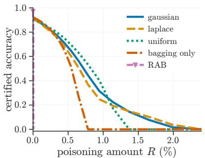
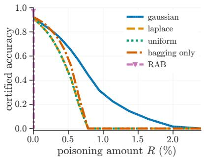
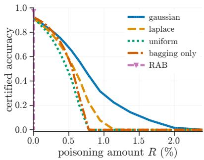
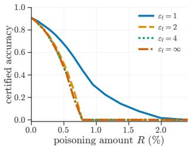
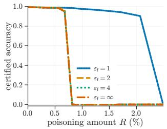
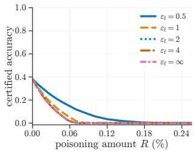
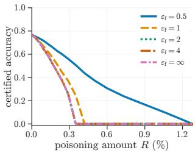
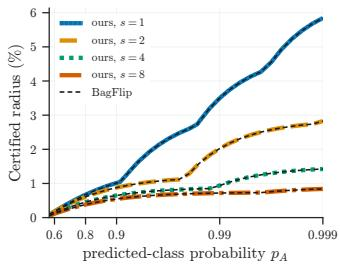

# A Certified Robustness Framework for Backdoor Poisoning Attacks using f-Divergences

Evan Rose Northeastern University rose.ev@northeastern.edu

Alina Oprea Northeastern University a.oprea@northeastern.edu

## Abstract

Machine learning systems trained on untrusted data are vulnerable to data and backdoor poisoning attacks, in which an adversary corrupts training and test samples to manipulate predictions at inference time. Randomized smoothing yields provable defenses against such attacks, but existing applications to train-time robustness are limited to specific threat models and smoothing mechanisms. We propose a general framework that allows expressing complex adversary constraints on the number of corrupted training examples, feature and label perturbation magnitudes, and test-time corruptions. Our framework randomizes inputs by combining data subsampling with feature, label and test-sample noising. We develop a composable certification procedure based on f-divergences that handles arbitrary combinations of threat models and noising strategies, and recovers several prior certification regimes exactly as special cases. We demonstrate our framework experimentally by certifying, for the first time, robustness under general $\ell _ { p } .$ -constrained poisoning adversaries under bagging with additive Laplace, Gaussian, and Uniform noises.

## 1 Introduction

Despite their continued adoption in wide-reaching domains, machine learning systems remain susceptible to adversarial attacks that subvert their reliability and can cause harmful outcomes. These attacks span a broad class of threat models, including both training- and inference-phase attacks. Of particular concern are data and backdoor poisoning attacks, in which an adversary corrupts a portion of the training data to degrade or control model behavior [Gu et al., 2019, Shafahi et al., 2018, Saha et al., 2020, Aghakhani et al., 2021, Geiping et al., 2021, Souri et al., 2022]. To defend against such attacks, certified defenses have been proposed that provide provable guarantees on the consistency of a classifier’s output around an input. The most popular of these techniques, randomized smoothing, works by lifting the classifier into a function over a noised version of the input and defining a new classifier by taking the expectation [Lecuyer et al., 2019, Cohen et al., 2019].

The intuitive reason randomized smoothing works is that averaging a function over a noised input induces a uniform continuity property whose stability depends primarily on the consistency of the function around the input, rather than on the continuity properties of the base function. This principle applies whether the input and noise are simple (e.g., classification under Gaussian noise) or complex (e.g., an entire randomized dataset). In the case of data poisoning or backdoor attacks, several natural noising strategies exist, including data subsampling, feature noising, and label flipping. However, as the noising procedures become more complex, analyzing the certified guarantees becomes increasingly difficult. As a result, existing certified defenses for data poisoning attacks remain limited to smoothing strategies such as simple bagging or discrete label flipping [Jia et al., 2021, Chen et al., 2022, Zhang et al., 2022].

In this work, we ask, can we develop a highly general randomized smoothing framework for data poisoning and backdoor adversaries that easily handles complex threat models and smoothing strategies? Our insight is to leverage the convex-optimization view of randomized smoothing first introduced by Dvijotham et al. [2020], in which the admissible perturbation set is replaced by a convex outer approximation defined by f-divergence constraints. The certification condition relies on the smoothing mechanism and threat model only through a set of divergence constraint corresponding to a certain dual problem with nice composition properties. We argue this is the “right” perspective for composite mechanisms such as those arising in the backdoor poisoning setting.

Contributions We present a randomized smoothing framework for backdoor and data poisoning attacks that incorporates rich attacker threat models, a multi-step randomization scheme, and efficient certification via convex relaxation using f-divergences. Our framework makes it straightforward to describe complex threat models spanning feature, label, and test instance corruptions, to describe noising strategies that defend against them, and to derive sound robustness certificates under the resulting schemes. We explain how our framework recovers the tight certificates of several prior works as special cases. We use our framework to study certifiably robust classification under backdoor and data poisoning attacks in a wide range of settings not considered in prior works.

## 2 Background and related work

A growing body of work studies how to obtain certifiable robustness guarantees against data poisoning and backdoor attacks. Appendix C gives a more detailed treatment of selected works.

Randomized smoothing In response to the weaknesses of empirical defenses [Athalye et al., 2018], randomized smoothing emerged as a technique to obtain provable robustness to adversarial examples [Lecuyer et al., 2019, Cohen et al., 2019, Li et al., 2019, Salman et al., 2019]. Early work established the standard certificate analysis methodology via the Neyman–Pearson Lemma [Neyman & Pearson, 1933] and the use of confidence-corrected estimates of the smoothed prediction. Other characterizations have also been explored, including functional optimization over f-divergence constraints [Dvijotham et al., 2020] and a nonlinear Lipschitz condition [Salman et al., 2019].

Learner-specific defenses Some works derive robustness certificates for specific learning algorithms. Early work studied duality-based upper bounds on the total test error [Steinhardt et al., 2017]. Rosenfeld et al. [2020] derive an efficient certified inference algorithm under label flipping attacks for classifiers trained using linear regression and label flipping noise. Drews et al. [2020] train certifiably robust decision trees with abstract interpretation. Jia et al. [2022] derive efficient certified guarantees for nearest neighbor classifiers under label flipping attacks. Sabanayagam et al. [2025] and Gosch et al. [2026] certify graph neural networks and SVMs against data poisoning, backdoor, and label flipping attacks using the neural tangent kernel and linear programming. Sosnin et al. [2025] extend abstract interpretation to gradient-based training to certify gradient-based learners.

Differential privacy for robustness Another line of work obtains robustness from differentially private (DP) learners. Ma et al. [2019] certify global accuracy using the stability of expectation under a differentially private algorithm, and Xie et al. [2023] study a similar property in federated learning. Liu et al. [2023] extend the results of Ma et al. [2019] to instance-wise poisoning by improving the group privacy analysis of the subsampled Gaussian mechanism. Saxena et al. [2026] connect the standard hypothesis testing framework for certification to the theory of DP privacy profiles, enabling efficient analysis of composed mechanisms such as DP-SGD.

Voting-based poisoning defenses The most popular strategy for provable robustness to poisoning is to train an ensemble of learners over different partitions or randomized samples and to use robustness properties of the majority vote. One line of work considers deterministic partitioning strategies [Levine & Feizi, 2021, Wang et al., 2022, Rezaei et al., 2023, Hammoudeh & Lowd, 2024]. Another line of work considers Randomized Smoothing by training ensembles on randomized samples of training data [Weber et al., 2023, Jia et al., 2021, Chen et al., 2022, Zhang et al., 2022].

## 3 Problem statement and preliminaries

## 3.1 Learning setup

We consider classification tasks with input space $\mathcal { X } \subseteq \mathbb { R } ^ { d }$ and label space $\mathcal { V } = [ C ]$ , and write $\mathcal { Z } : = \mathcal { X } \times \mathcal { Y }$ for the labeled input space and $s : = \mathcal { Z } ^ { * }$ for the space of training sets. We absorb training and inference into a single procedure: define the joint input space $\mathcal { W } : = \mathcal { S } \times \mathcal { X }$ and suppose $w \subseteq { \widetilde { \mathscr { W } } }$ for some ambient space $\widetilde { \mathcal W } . ^ { \mathrm { ~ 1 ~ } }$ A base predictor $G \colon { \widetilde { \mathcal { W } } } \to { \mathcal { P } } ( \mathcal { Y } )$ maps a joint input $w = ( S , x _ { \mathrm { t e } } )$ ) to a distribution over labels. Concretely, G composes a learning algorithm A with evaluation at a test point, $G ( w ) = G ( S , x _ { \mathrm { t e } } ) = A ( S ) ( x _ { \mathrm { t e } } )$ . The induced hard predictor is $g ( w ) : = \arg \operatorname* { m a x } _ { y \in \mathcal { Y } } G ( w ) _ { y }$ , with a fixed tie-breaking rule. A can be randomized, in which case G denotes the expectation over A’s internal randomness (and thus G is a deterministic function of w).

## 3.2 Threat model

We consider a replacement adversary who jointly corrupts the training set and test sample. For joint input $w = ( S , x _ { \mathrm { t e } } )$ with $\boldsymbol { S } = ( ( x _ { i } , y _ { i } ) ) _ { i = 1 } ^ { n }$ , denote the corrupted input by $w ^ { \prime } = ( S ^ { \prime } , x _ { \mathrm { t e } } ^ { \prime } )$ , where $S ^ { \prime } = ( ( x _ { i } ^ { \prime } , y _ { i } ^ { \prime } ) ) _ { i = 1 } ^ { n }$ . In particular, the adversary may corrupt training features $x _ { i } \mapsto x _ { i } ^ { \prime }$ , training labels $y _ { i } \mapsto y _ { i } ^ { \prime }$ , and the test sample $x _ { \mathrm { t e } } \mapsto x _ { \mathrm { t e } } ^ { \prime } ,$ but may not insert or delete training examples.

We model corruption constraints along four axes. The first axis constrains the number of corrupted examples in the training set. The remaining axes constrain per-example feature or label corruptions in terms of a feature-space distance function $d _ { \mathcal { X } }$ or a label space distance function $d _ { \mathcal { Y } }$ . The adversary’s capability is thus parameterized by the pair $( d _ { \mathcal { X } } , d _ { \mathcal { Y } } )$ together with a threat vector $\rho = ( m _ { \mathrm { p } } , \varepsilon _ { \mathrm { f } } , \varepsilon _ { \mathrm { l } } , \varepsilon _ { \mathrm { t e } } )$ . Define $\bar { I } ( w , \bar { w ^ { \prime } } ) : = \bar { \{ i \in [ n ] \ : \ ( x _ { i } , y _ { i } ) \neq ( x _ { i } ^ { \prime } , y _ { i } ^ { \prime } ) \} }$ The threat vector fixes the constraints (1) $| I | \leq m _ { \mathrm { p } } , ( 2 )$ ma $\mathfrak { c } _ { i \in I } d _ { \mathcal { X } } ( x _ { i } , x _ { i } ^ { \prime } ) \le \varepsilon _ { \mathrm { f } } , ( 3 )$ max<sub>i∈I</sub> $d y ( y _ { i } , y _ { i } ^ { \prime } ) \leq \varepsilon _ { 1 } , ( 4 )$ $d _ { \mathcal { X } } ( x _ { \mathrm { t e } } , x _ { \mathrm { t e } } ^ { \prime } ) \leq \varepsilon _ { \mathrm { t e } }$ . These constraints determine the perturbation set $B _ { \rho } ( w ) : = \{ w ^ { \prime } \in \mathcal { W }$ : constraints $( 1 ) – ( 4 )$ hold}.

Decoupling the budget into four independent axes allows us to recover the threat models of several prior works as special cases [Rosenfeld et al., 2020, Jia et al., 2021, Zhang et al., 2022], as well as to generalize to several previously unconsidered threat models $( { \mathrm { e . g . , } } m _ { \mathrm { p } } < \infty$ with $d _ { \mathcal { X } } = \| \cdot \| _ { p } \operatorname { f o r } p \neq 0 )$ . Usually we will take $d _ { \mathcal { Y } }$ discrete and $d _ { \mathcal { X } } \equiv \| \cdot \| _ { p }$ for some $0 \leq p \leq \infty$

## 3.3 Certified robustness

We seek to provably defend against attacks within our threat model under the following definition.

Definition 3.1 (ρ-Robustness). Let $g \colon \mathcal { W } \to \mathcal { V }$ be a deterministic hard predictor. We say that g is ρ-robust at $w \in \mathcal { W } i f$ $g ( w ) = g ( w ^ { \prime } ) f o r a l l w ^ { \prime } \in \mathcal { B } _ { \rho } ( w )$

Existing certified poisoning defenses typically report robustness as a scalar radius specifying the tolerable corruption magnitude along a single axis $( { \mathrm { e } } . { \mathrm { g } } . , m _ { \mathrm { p } } \ { \mathrm { o r } } \ \varepsilon _ { \mathrm { f } } )$ [Rosenfeld et al., 2020, Levine & Feizi, 2021, Zhang et al., 2022]. Instead, we are interested in characterizing the full certified region directly. For fixed $^ { g , }$ define the robustness region $\mathcal { R } ( w ) : = \{ \rho : g$ is ρ-robust at w}. Defining the robustness region R encodes the idea that varying one threat parameter $( { \mathrm { e . g . , } \varepsilon _ { \mathrm { t e } } } )$ can affect robustness against other parameters $( { \mathrm { e . g . , } } \varepsilon _ { \mathrm { f } } )$ , and we study the entire object holistically.

## 4 Methodology

Our goal is to develop a general defense for training classifiers that handles the threat models from Section 3 and admits an efficient certification procedure proving robustness.

## 4.1 Robust learning procedure

Robust training via randomized smoothing We design a certifiably robust training procedure following the methods of Randomized Smoothing [Lecuyer et al., 2019, Li et al., 2019, Cohen et al., 2019], initially introduced for certified robustness against evasion attacks. The main idea behind randomized smoothing is to transform a pre-existing base learner (in our case, the joint training-inference procedure G) into a provably robust smoothed classifier $\overline { { G _ { \mathcal M } } }$ . The smoothed classifier $\overline { { G _ { \mathcal M } } }$ is obtained by applying a randomized smoothing mechanism $\mathcal { M } : \mathcal { W } \to \mathcal { P } ( \widetilde { \mathcal { W } } )$ to the inputs and lifting the base classifier G to a classifier on the space of distributions over the joint input space according to the aggregation rule: $\overline { { G _ { \mathcal { M } } } } ( w ) : = \mathbb { E } _ { \widetilde { w } \sim \mathcal { M } ( w ) } \left[ G ( \widetilde { w } ) \right]$ $\overline { { G _ { \mathcal M } } }$ is a deterministic soft classifier whose associated hard classifier is $\overline { { g _ { \mathcal M } } } ( w ) = \arg \operatorname* { m a x } _ { y } \overline { { G _ { \mathcal M } } } ( w ) _ { y } .$

Randomized mechanism The smoothing mechanism M should be chosen in a way to “wipe away” any influence the corruptions might have on the prediction. We design a multi-step randomization procedure that consists of a data subsampling phase followed by a feature and label noising phase. The resulting probability measure takes the form of a mixture distribution whose components correspond to the samples retained during the subsampling phase.

Each component of the mixture follows structurally identical randomization behavior, but is instantiated with different parameters.

For a training set $S ~ = ~ ( ( x _ { i } , y _ { i } ) ) _ { i = 1 } ^ { n }$ and sample-index sequence $U \ = \ ( u _ { 1 } , \ldots , u _ { k } ) \in \ [ n ] ^ { k }$ , define $S _ { U } : =$ $( ( x _ { u _ { i } } , y _ { u _ { i } } ) ) _ { i = 1 } ^ { k }$ . Let $\Pi \in { \mathcal { P } } ( [ n ] ^ { * } )$ be a subsampling distribution over retained sample indices $U , \phi _ { \mathcal { X } } ( \cdot ) { \bf a } .$ feature noise mechanism $( \mathbf { e . g . , } \phi ( x ) = \mathcal { N } ( x , \sigma ^ { 2 } I ) )$ , and $\phi _ { \mathcal { Y } } ( \cdot )$ a label noise mechanism $( \mathrm { e . g . } , \phi ( y ) = ( 1 - \gamma ) \delta _ { y } + \gamma \mathrm { U n i f } ( [ C ] ) )$ . Our smoothing mechanism $\mathcal { M } : = \mathcal { M } _ { \Pi , \phi _ { \mathcal { X } } , \phi _ { \mathcal { Y } } }$ is generated by the following procedure. (1) Draw retained indices $U \sim \Pi$ (2) Apply per-example noise to features and labels: For each $i \in [ | U | ]$ ], independently sample $\widetilde { x } _ { i } \sim \phi _ { \mathcal { X } } ( \cdot \mid x _ { u _ { i } } )$ and $\widetilde { y } _ { i } \sim \phi _ { \mathcal { V } } ( \cdot \mid y _ { u _ { i } } )$ . Construct $\widetilde { S } : = ( ( \widetilde { x } _ { i } , \widetilde { y } _ { i } ) ) _ { i = 1 } ^ { | U | }$ . (3) Sample $\widetilde { x } _ { \mathrm { t e } } \sim \phi _ { \mathcal { X } } ( \cdot \mid x _ { \mathrm { t e } } ) . \ ^ { 2 }$ (4) Output $( \widetilde { S } , \widetilde { x } _ { \mathrm { t e } } )$

We make a few observations on the distributions resulting from the smoothing mechanism M. By construction, sampling from M is efficient. M can be written as a mixture distribution whose components are product measures parameterized by a subsample of S. M has |supp Π| components, which is generally quite large $( \mathrm { e . g . , } n ^ { k }$ for bagging with replacement). This makes evaluating the density (or mass) at a point a priori intractable. For a large number of norm-based smoothing mechanisms (e.g., Gaussian), the product measure induced by $\phi _ { \mathcal { X } }$ reduces to a well-understood measure over the full dataset space identified with $\begin{array} { r } { \mathbb { R } ^ { n d } \left( \mathbf { \bar { e } . g . } , \prod _ { i = 1 } ^ { n } \mathcal { N } ( \mathbf { 0 } _ { d } , \sigma ^ { 2 } I _ { d } ) \cong \mathcal { N } ( \mathbf { 0 } _ { n d } , \sigma ^ { 2 } I _ { n d } ) \right) } \end{array}$

Concrete instantiations We motivate our smoothing scheme with a few concrete instantiations. Natural choices of Π are bagging (with or without replacement) or Poisson subsampling. Natural choices for $\phi _ { \mathcal { X } }$ include Gaussian, Laplace, Uniform, or discrete noise, but we can also accommodate more exotic noises such as the norm-based noises of Yang et al. [2020]. Most often $\phi _ { \mathcal { Y } }$ will be a flipping distribution $\phi ( y ) = \phi _ { \gamma , K } ^ { \mathrm { f i p } } ( y ) = ( 1 - \gamma ) \delta _ { y } + \gamma \mathrm { U n i f } ( [ K ] )$ for some alphabet size K, but we can also accommodate structured noises $\phi _ { \mathcal { Y } } ( y ) \stackrel { \cdot \cdot } { = } M _ { y \widetilde { y } }$ for a Markovian transition matrix M.

The smoothing mechanisms of several prior works can be recovered for suitable choices of $\Pi , \phi _ { \mathcal { X } } , \phi _ { \mathcal { Y } }$ . RAB [Weber et al., 2023] takes Π as a point mass on the original dataset (no subsampling) and sets $\phi ( x ) = \mathcal { N } ( x , \sigma ^ { 2 } I _ { d } )$ . Jia et al. [2021] take Π as bagging with replacement with no feature or label noise. BagFlip [Zhang et al., 2022] considers bagging with replacement and coupled feature-label noise $\phi _ { \mathcal { X } } ( x ) = \bigotimes _ { j = 1 } ^ { d } \phi _ { \gamma , K } ^ { \mathrm { { H i p } } } ( x _ { j } )$ and $\phi y ( y ) = \phi _ { \gamma , K } ^ { \mathtt { f i p } } ( y )$ , where notably the feature and label alphabets are the same size and use the same flipping probability.

## 4.2 Certifying predictions: overview

Core challenges The main technical challenge we face is how to certify robustness for such a large class of general smoothing methods against the adversaries defined in Section 3.2. Prior works applying randomized smoothing to data poisoning or backdoor attacks [Weber et al., 2023, Jia et al., 2021, Zhang et al., 2022] apply techniques introduced by Cohen et al. [2019], who frame certification as a hypothesis testing problem and construct Neyman–Pearson tests to derive tight certificates. Unfortunately, this path is only accessible for simple smoothing schemes and threat models, and does not scale to our setting: the likelihood ratio structure of $\mathcal { M }$ is complicated due to its combinatorial mixture structure and is typically only directly tractable for simple distributions such as the discrete noises of Zhang et al. [2022]. Furthermore, changing the mechanisms Π, ϕ<sub>X</sub>, ϕ<sub>Y</sub> or the threat model $d _ { \mathcal { X } } , d _ { \mathcal { Y } } , \rho :$ a priori requires a laborious new derivation of the certification condition by hand.

What we desire instead is a generic way to automatically construct the certification conditions given the threat model $d _ { \mathcal { X } } , d _ { \mathcal { Y } } , \rho$ and the smoothing mechanism $\Pi , \phi _ { \mathcal { X } } , \phi _ { \mathcal { Y } }$ . All relevant information can be derived for each component independently, and different combinations can be composed automatically with basic computational rules. It turns out that such a procedure is possible if we turn to a certain dual formulation of Randomized Smoothing, first considered by Dvijotham et al. [2020] for the evasion setting in the language of f-divergences. We start by introducing some preliminaries.

## 4.3 Certification via convex optimization

Define a specification as a bounded measurable ψ : Ω → R, and call it robustly certified at $\nu \in \mathscr { P } ( \Omega )$ w.r.t. ${ \mathcal { D } } \subseteq { \mathcal { P } } ( \Omega )$ if $\mathbb { E } _ { \nu ^ { \prime } } [ \psi ] \geq 0$ for every $\nu ^ { \prime } \in \mathcal { D }$ (Definition A.1). For convex f with $f ( 1 ) = 0$ (a generator), the induced $f -$ divergence is $D _ { f } ( \nu ^ { \prime } \| \nu ) : = \mathbb { E } _ { \nu } [ f ( d \nu ^ { \prime } / d \nu ) ]$ (Definition B.1). Given generators $f _ { 1 } , \ldots , f _ { m }$ with bounds $\tau _ { i } \geq 0$ , define $\begin{array} { r } { \mathcal { D } _ { \mathcal { F } } : = \bigcap _ { i } \{ \nu ^ { \prime } : D _ { f _ { i } } ( \nu ^ { \prime } \Vert \nu ) \leq \tau _ { i } \} } \end{array}$ (Definition $\mathbf { A . } 2 )$ .

We use the following result of Dvijotham et al. [2020], stated in full in Theorem A.2. Let $\theta _ { a } , \theta _ { b }$ denote lower and upper bounds on the majority and runner-up predicted probabilities from $\overline { { G _ { \mathcal M } } } ( w )$ , respectively, and write $\theta =$ $( \theta _ { a } , \theta _ { b } , 1 - \theta _ { a } - \theta _ { b } )$ . Then, every specification consistent with $\theta _ { a } , \theta _ { b }$ is robustly certified w.r.t. $\mathcal { D } _ { \mathcal { F } }$ iff the solution to the following problem is non-negative:

$$
\operatorname* { i n f } _ { \zeta \in \mathbb { R } _ { + } ^ { 3 } } \zeta _ { a } - \zeta _ { b } \quad \mathrm { s . t . } \quad \zeta _ { a } + \zeta _ { b } + \zeta _ { c } = 1 , \quad D _ { f _ { i } } ( \zeta \| \theta ) \leq \tau _ { i } , i = 1 , \dots , m .\tag{1}
$$

Robustness certification in the sense of Definition A.1 is related to our own robustness notion (Definition 3.1). Writing $c : = \overline { { g _ { \mathcal M } } } ( w )$ and taking specifications $\psi _ { c , c ^ { \prime } } ( \widetilde w ) : = G ( \widetilde w ) _ { c } - G ( \widetilde w ) _ { c ^ { \prime } } , c \in$ arg max $\overline { { G _ { \mathcal M } } } ( w ^ { \prime } ) _ { y }$ for all $w ^ { \prime } \in \mathcal { B } _ { \rho } ( w )$ iff every $\psi _ { c , c ^ { \prime } }$ with $c \neq c ^ { \prime }$ is robustly certified at $\mathcal { M } ( w )$ w.r.t. $\mathcal { D } _ { w , \rho } : = \{ \mathcal { M } ( w ^ { \prime } ) \ : \ w ^ { \prime } \in \mathcal { B } _ { \rho } ( w ) \}$ . We state and prove the formal statement in Theorem D.1.

In working with Equation (1), it suffices to choose any $\tau _ { i } \geq D _ { f _ { i } } ( \nu ^ { \prime } \Vert \mathcal { M } ( w ) )$ for every $\nu ^ { \prime } \in \mathcal { D } _ { w , \rho }$ , with the tightest choice being

$$
\tau _ { f } ^ { \star } ( w , \rho ) : = \operatorname* { s u p } _ { w ^ { \prime } \in \mathcal { B } _ { \rho } ( w ) } D _ { f } ( \mathcal { M } ( w ^ { \prime } ) \| \mathcal { M } ( w ) ) .\tag{2}
$$

One can use any f-divergence for which an upper bound on Equation (2) is available. The most interesting cases are the hockey-stick divergences, due to their characterization of tight certificates (Theorem $\mathbf { A } . 3 )$ , and the Rényi divergences, due to their nice tensorization properties (Lemma B.6).

## 4.4 Computing divergence bounds

Under Theorems A.2 and D.1, the problem of certifying robustness for $\overline { { G _ { \mathcal M } } }$ at $w \in \mathcal W$ reduces to establishing a bound $\tau _ { f } ( w , \rho ) \geq \tau _ { f } ^ { \star } ( w , \rho )$ for suitable $f .$ The technical challenge is grappling with the complex structure of $\mathcal { M } \colon$ subsampling through Π induces a mixture with combinatorially many components, and noising through $\phi$ makes each component a product measure. Our analysis proceeds in two steps: first, we reduce the combinatorial structure of the mixture distribution to a lower-dimensional problem, and second, we analyze divergences between paired product components.

Bounding divergences for mixtures The first key observation for bounding divergences is that the components of any $\mathcal { M } ( w ^ { \prime } )$ and $\mathcal { M } ( w )$ share mixing weights when paired by subsample, which interact nicely with $D _ { f } ( \mathcal { M } ( w ^ { \prime } ) | | \mathcal { M } ( w ) )$ Moreover, despite a combinatorial number of components, the components can often be grouped together, which gives us the following bound:

Theorem 4.1 (Reorganized Joint Convexity Bound). Let $\begin{array} { r } { \mu = \sum _ { i = 1 } ^ { N } \theta _ { i } \mu _ { i } } \end{array}$ and $\begin{array} { r } { \nu = \sum _ { i = 1 } ^ { N } \theta _ { i } \nu _ { i } } \end{array}$ be mixtures with shared mixing weights $\theta _ { i } .$ . Suppose there is a partition of indices $\textstyle [ N ] = \bigcup _ { i = 1 } ^ { k } S _ { i }$ and a sequence ofnonnegative real numbers $( \delta _ { i } ) _ { i = 1 } ^ { k }$ such thatfor all $i \in [ k ]$ and all $j \in S _ { i } , D _ { f } ( \mu _ { j } \| \nu _ { j } ) \le \delta _ { i }$ . Then one has $\begin{array} { r } { D _ { f } ( \mu \| \nu ) \leq \tau _ { f } f o r \tau _ { f } : = \sum _ { i = 1 } ^ { k } \beta _ { i } \delta _ { i } } \end{array}$ where $\beta _ { i } : = \textstyle \sum _ { j \in S _ { i } } \theta _ { j }$

We prove Theorem 4.1 in Appendix D, along with an analogue for Rényi divergences (Corollary D.1). Theorem 4.1 does not depend on the specific geometry of the feature or label noise and only uses pairing of components and joint convexity of $D _ { f }$ . The grouping of components is important computationally, as it reduces the sum to a tractable number of terms. For our noises, the component bound depends on $\bar { U }$ only through the number $s ( U )$ of corrupted indices. Grouping by s leaves only a few terms, e.g., k + 1 for bagging and min $( k , m _ { \mathrm { p } } ) + 1$ for bagging without replacement. This trick can be viewed as an extension to f-divergences of earlier techniques that partition the output space into regions of constant likelihood ratio [Lee et al., 2019, Bojchevski et al., 2020, Zhang et al., 2022].

## 4.5 Bounding component divergences

It remains to find the bounds $\delta _ { j }$ . Consider a fixed corruption $w ^ { \prime }$ of $w ,$ and apply Theorem 4.1. Writing $z _ { U } : =$ $( S _ { U } , x _ { \mathrm { t e } } )$ for an un-noised subsampled input, we obtain the component pairs $\big ( \phi \big ( z _ { U } \big ) , \phi \big ( z _ { U } ^ { \prime } \big ) \big )$ ) with $z _ { U } ^ { \prime }$ determined by w<sup>′</sup>. A small complication is that the $z _ { U }$ are coupled through $w ^ { \prime } ,$ so we relax the problem slightly and take $\begin{array} { r } { \delta _ { j } \geq \operatorname* { s u p } _ { z ^ { \prime } } D _ { f } ( \phi ( z ^ { \prime } ) \| \phi ( z ) ) } \end{array}$ over all corruptions $z ^ { \prime }$ of z that are feasible given group $j$ (for example, a component might correspond to $U$ with s corrupted examples). This is tight when some $w ^ { \prime }$ attains every component supremum simultaneously.

Adjacency parameters The supremum sup <sub>′</sub> $D _ { f } ( \phi ( z ^ { \prime } ) \lVert \phi ( z ) )$ is natively over a high-dimensional space. However, for sufficiently symmetrical noises, the divergence between $( x , x ^ { \prime } )$ depends only on a low-dimensional adjacency parameter $\theta ( \boldsymbol { x } , \boldsymbol { x } ^ { \prime } )$ , in the sense that every f-divergence can be written in the form $D _ { f } ( \phi ( x ^ { \prime } ) \| \phi ( x ) ) = \delta _ { f } ( \theta ( x , x ^ { \prime } ) )$ for some $\delta _ { f }$ depending on $f .$ One way to see this is by the invariance of f-divergences under bimeasurable bijections (Lemma $\mathbf { B } . 3 )$ . As a concrete example, for Gaussian noise any $f .$ -divergence depends only on the $\ell _ { 2 }$ separation $r = \| x - x ^ { \prime } \| _ { 2 } / \sigma$  
Table 1: Divergence bounds derived in Appendix G. Here θ is the adjacency parameter of Definition G.1 and $\Delta : = x - x ^ { \prime }$ Notation $p _ { + } , p _ { 0 } , p _ { - } , \kappa _ { \alpha } ( t ) , d _ { \beta }$ , and $P _ { d }$ are defined in Appendix G.
<table><tr><td>Noise</td><td>Adjacency θ</td><td></td></tr><tr><td>Unif(γ)</td><td> $\begin{array} { r l } { 1 - \prod _ { i } \big ( 1 - \frac { | \Delta _ { i } | } { 2 \gamma } \big ) _ { + } } & { { } \frac { 1 } { \alpha - 1 } \log ( 1 - \theta ) } \end{array}$ </td><td> $\operatorname* { m i n } ( 1 , \beta ) \theta$ </td></tr><tr><td></td><td> $\begin{array} { r } { \mathcal { N } ( \cdot , \sigma ^ { 2 } I ) \quad r = \| \Delta \| _ { 2 } / \sigma } \end{array}$ </td><td> $\begin{array} { r } { \Phi \big ( \frac { r } { 2 } - \frac { \log \beta } { r } \big ) - \beta \Phi \big ( - \frac { r } { 2 } - \frac { \log \beta } { r } \big ) - ( 1 - \beta ) _ { + } } \end{array}$ </td></tr><tr><td>Lap(·, b)</td><td> $\mathbf { t } = | \Delta | / b$ </td><td> $\left[ ( 1 - \sqrt { \beta } e ^ { - t / 2 } ) _ { + } - ( 1 - \beta ) _ { + } \right] _ { + }$ </td></tr><tr><td> $\phi _ { \gamma , C } ^ { \mathrm { { f i p } } }$ </td><td> $s = \| \Delta \| _ { 0 }$ </td><td> $\begin{array} { r } { \frac { \hat { s } } { \alpha - 1 } \log \left( p _ { + } ^ { \alpha } p _ { - } ^ { 1 - \alpha } + p _ { + } ^ { 1 - \alpha } p _ { - } ^ { \alpha } + p _ { 0 } \right) } \end{array}$   $\begin{array} { r } { \sum _ { d \ge d _ { \beta } } \left( 1 - \beta ( p _ { + } / p _ { - } ) ^ { - d } \right) P _ { d } } \end{array}$ </td></tr></table>

Worst-case pairs A priori, Equation (2) admits a different maximizer for each $f .$ In most cases, this is fortunately not the case. Write $\left( \mu ^ { \prime } , \nu ^ { \prime } \right) \preceq \left( \mu , \nu \right)$ when $D _ { f } ( \mu ^ { \prime } \| \nu ^ { \prime } ) \leq D _ { f } ( \mu \| \nu )$ for every generator f. We show that $\prec$ is entirely determined by the Hockey-stick envelope (Lemma G.1): $\left( \mu ^ { \prime } , \nu ^ { \prime } \right) \preceq \left( \mu , \nu \right)$ iff $D _ { \mathrm { H S } , \beta } ( \mu ^ { \prime } \| \nu ^ { \prime } ) \le D _ { \mathrm { H S } , \beta } ( \mu \| \nu )$ for all $\beta > 0$ . In such cases, a single $( \mu ^ { \star } , \nu ^ { \star } )$ generates every $\tau _ { f } ^ { \star }$ simultaneously. This property also composes nicely under product measures (Lemma G.2), which is useful for combining feature and label flipping. We show that such a pair exists for Gaussian and Uniform noise under all $\ell _ { p }$ norms, for flipping noise under $\ell _ { 0 } ,$ and for Laplace noise under $\ell _ { 1 }$ and $\ell _ { \infty }$ norms. For $1 < p < \infty$ For Laplace noise under $\ell _ { 2 }$ , the behavior is more complicated, requiring special treatment (Appendix G.4).

Worst-case pairs, when they exist, reduce divergence bound computation to optimizing the adjacency parameter. For Gaussian noise this corresponds to maximizing the $\ell _ { 2 }$ perturbation, which is easy. For Uniform noise the problem is nontrivial, and we must resort to a loose relaxation (Appendix G.3).

Composition under products Our framework involves applying independent noise (between features and labels within an example, and independence between examples), which requires us to understand f-divergences between product measures. Rényi divergences are attractive here due to their nice tensorization properties (Lemma B.6) and can be computed immediately from components. We show in Lemma G.3 how to compute Hockey-stick divergences $D _ { \mathrm { H S } , \beta } ( \mu _ { 1 } \otimes \mu _ { 2 } \| \nu _ { 1 } \otimes \nu _ { 2 } )$ in closed form via the formula $\widetilde { D } _ { \mathrm { H S } , \beta } ( \mu \| \nu ) = \mathbb { E } _ { \mu _ { 1 } } [ \widetilde { D } _ { \mathrm { H S } , \beta / \Lambda _ { 1 } } ( \mu _ { 2 } \| \nu _ { 2 } ) ]$ . This is especially useful for modeling dirty-label adversaries, where the corresponding noise $\phi$ can be written as a product of a label flipping measure $\mu _ { 1 } = \bar { \phi } _ { \gamma , C } ^ { \mathrm { f i p } }$ and a continuous noise $\mu _ { 2 } ( { \mathrm { e . g . } } , \mathcal { N } ( x , \sigma ^ { 2 } I ) )$ ).

Numerical computation Gaussian, flipping, and Uniform noise have hockey-stick profiles computable in closed-form once their worst-case adjacency parameter is known. For Laplace noise the profile involves repeated self-convolution of the log likelihood ratio distribution (which has no nice closed form), so we compute it with numerical integration techniques.

Worked example Consider $\mathcal { X } = \mathbb { R } ^ { d } , \mathcal { y } = [ C ]$ , and $S = ( ( x _ { i } , y _ { i } ) ) _ { i = 1 } ^ { n }$ . Let Π be bagging with replacement of k samples, and let $\phi _ { \mathcal { X } } ( x ) = \mathcal { N } ( x , \sigma ^ { 2 } I _ { d } )$ , so that $\begin{array} { r } { \mathcal { M } ( S ) = \sum _ { U \in \left[ n \right] ^ { k } } n ^ { - k } \mathcal { N } ( S _ { U } , \sigma ^ { 2 } I _ { d k } ) } \end{array}$ has ${ \bar { \mathbf { \Gamma } } } _ { n } \mathbf { \epsilon } ^ { - } \mathbf { \epsilon } _ { n } \mathbf { \epsilon } _ { k }$ components. Under an $\ell _ { 2 }$ adversary, a component with s corrupted samples has adjacency parameter $r = \| S _ { U } - S _ { U } ^ { \prime } \| _ { 2 } / \sigma \leq \varepsilon _ { \mathrm { f } } \sqrt { s } / \sigma$ which is attained at maximal corruption magnitude. Since $s \sim$ Binom $\scriptstyle ( k , m _ { \mathrm { p } } / n )$ under Π, Theorem 4.1 gives $\textstyle \tau _ { f } = \sum _ { s = 0 } ^ { k }$ $\mathrm { B i n o m } ( s ; k , m _ { \mathrm { p } } / n ) \delta _ { f } ( \varepsilon _ { \mathrm { f } } \sqrt { s } / \sigma )$ , where $\delta _ { f }$ depends on $f \ ( { \bf e . g . } , \delta _ { \mathrm { T V } } ( r ) = 2 \Phi ( r / 2 ) - 1 ;$ see Table 1). If we also model a backdoor trigger, we can replace $\varepsilon _ { \mathrm { f } } ^ { 2 } s$ by $\varepsilon _ { \mathrm { f } } ^ { 2 } s + \varepsilon _ { \mathrm { t e } } ^ { 2 }$ to give $\delta _ { f } ( \sqrt { \varepsilon _ { \mathrm { f } } ^ { 2 } s + \varepsilon _ { \mathrm { t e } } ^ { 2 } } / \sigma )$ in the sum. For label-flipping adversaries and randomized labels, we can use Lemma G.3 to compute $\delta _ { \beta }$ as a weighted sum of Gaussian hockey-stick values at thresholds $\beta ( p _ { + } / p _ { - } ) ^ { - d }$ (Theorem G.5).

## 5 Evaluation

We present several applications of our framework to data poisoning and backdoor poisoning attacks. Our experiments focus on image classification on the MNIST [Lecun et al., 1998] and CIFAR10 [Krizhevsky, 2009] datasets, in addition to the class-subsampled variants MNIST-17 and CIFAR10-02 [Zhang et al., 2022, Weber et al., 2023]. We train ensembles of size $N = 1 0 , 0 0 0$ and N = 1, 000 for MNIST and CIFAR10, respectively. We use confidence level $\alpha = 0 . 0 0 1$

## 5.1 $\ell _ { p }$ feature adversaries

  
(a) $\ell _ { 1 }$ adversary, ε<sub>f</sub> = 1.

  
(b) $\ell _ { 2 }$ adversary, ε<sub>f</sub> = 1.

  
(c) $\ell _ { \infty }$ adversary, ε<sub>f</sub> = 1/28.  
Figure 1: Certified accuracies on MNIST for clean-label triggerless attacks under different $\ell _ { p }$ adversaries. The budget in each case is calibrated to correspond to the same $\ell _ { 2 }$ budget, which has the effect that Gaussian noise certifies the same radius across all curves.

Setup We consider a setting in which the attacker corrupts at most $m _ { \mathrm { p } }$ training examples, each by at most $\| x - x ^ { \prime } \| _ { p } \leq$ $\varepsilon _ { \mathrm { f } } .$ . The test sample and labels are not corrupted. We instantiate Π as bagging and compare Gaussian, Laplace, and Uniform feature noise. We also evaluate pure bagging [Jia et al., 2021] and Gaussian noise without subsampling [Weber et al., 2023] as baselines.

No prior method makes effective use of both the $m _ { \mathrm { p } }$ and $\varepsilon _ { \mathrm { f } }$ constraints. For example, Jia et al. [2021] only subsample and pessimistically assume that a single retained poison compromises the learner, while Weber et al. [2023] do not subsample data. Zhang et al. [2022] use discrete noise that only works under an $\ell _ { 0 }$ constraint, and cannot certify more than bagging in $\ell _ { p } \colon$ while $\ell _ { p }$ constraints can be converted into (looser) $\ell _ { q }$ constraints for $p , q > 0$ , they cannot convert into nontrivial $\ell _ { 0 }$ constraints.

For $p > 0$ , we compare with the certificate obtainable from the RAB defense [Weber et al., 2023], which adds Gaussian noise to the entire training set without bagging. RAB’s certificate can be used in our threat model by computing the maximum admissible $\ell _ { 2 }$ perturbation under our threat model. In particular, an $\ell _ { p }$ bound can be converted into an $\ell _ { 2 }$ bound by taking $\varepsilon _ { \mathrm { f } } ^ { ( 2 ) } \leq \varepsilon _ { \mathrm { f } } ^ { ( 1 ) } \ { \overline { { \mathrm { o r } } } } \varepsilon _ { \mathrm { f } } ^ { ( 2 ) } \leq { \sqrt { d } } \varepsilon _ { \mathrm { f } } ^ { ( \infty ) }$ , respectively, and with $m _ { \mathrm { p } }$ poisoned examples we obtain the full dataset $\ell _ { 2 }$ bound $\sqrt { m _ { \mathrm { p } } } \varepsilon _ { \mathrm { f } } ^ { ( 2 ) }$

Findings We make several observations on the clean-label poisoning robustness reported in Figure 1. First, pure bagging always attains a higher non-robust certified accuracy, which makes sense since adding noise to data should only reduce classifier accuracy. Second, uniform noise is competitive only for $\ell _ { 1 }$ and for moderate poisoning amounts $( < 1 . 2 \% )$ . This finding corroborates Yang et al. [2020], who find in the evasion setting that Gaussian noise yields the largest certified accuracies for $\ell _ { 2 }$ and $\ell _ { \infty }$ , whereas Uniform noise works best for $\ell _ { 1 }$ . Laplace noise is only competitive for $\ell _ { 1 }$ adversaries at high poisoning rates, where it marginally beats Gaussian noise for $R \geq 1 . 5$

We show the dependence on $\varepsilon _ { \mathrm { f } }$ for MNIST, MNIST-17, CIFAR10, and CIFAR10-02 in Figure 2 when training under Gaussian noise. In this case, the advantage of constraining $\varepsilon _ { \mathrm { f } }$ deteriorates quickly: on MNIST, the certified radius is substantially larger for $\varepsilon _ { \mathrm { f } } = 1$ , but by $\varepsilon _ { \mathrm { f } } = 2$ the certificate nearly matches that at $\varepsilon _ { \mathrm { f } } = \infty$ (corresponding to the bagging certificate of Jia et al. [2021]).

## 5.2 Label flipping and backdoor adversaries

Setup We study the impact of different threat models on certifiable robustness. We consider two main attacker settings: joint feature-label attacks and joint train-test (backdoor) attacks. In both settings, the adversary can corrupt at most $m _ { \mathrm { p } }$ training examples and, for each corrupted sample, modify features up to $\varepsilon _ { \mathrm { f } }$ distance in $\ell _ { 2 }$ . In feature-label attacks, the adversary can additionally corrupt the label. In backdoor attacks, the adversary also corrupts the test sample with test budget $\varepsilon _ { \mathrm { t e } } = \varepsilon _ { \mathrm { f } }$

Findings We report the robustness tradeoffs for different datasets. The label-flipping adversary is reported in Table 2, and the backdoor adversary is reported in Table 3.

Our method significantly outperforms RAB under backdoor adversaries. On MNIST-17, while RAB reaches trivial certified accuracy after $R = 0 . 5 \%$ , our method retains over 45% certified accuracy at $R = 2 \%$ . The improvement is due to bagging: with high probability, we retain only a small number $\mathcal { O } ( k \cdot m _ { \mathrm { p } } / n )$ of poisoned samples, whereas RAB retains all poisoned samples. For RAB to certify comparable poisoned radii, it would need to train with $\sigma = \mathcal { O } ( \varepsilon _ { \mathrm { f } } \sqrt { m _ { \mathrm { p } } } )$ which would destroy predictive performance, whereas for our method $\sigma = \mathcal { O } ( \varepsilon _ { \mathrm { f } } \sqrt { m _ { \mathrm { p } } k / n } )$ still yields large certificates.

Table 2: Robustness tradeoff for joint feature & label adversaries at poisoned fractions $R ,$ with $\varepsilon _ { \mathrm { l } } = 1$ and $\ell _ { 2 }$ budget $\varepsilon _ { \mathrm { f } } = 1$ (MNIST, MNIST-17) or 0.5 (CIFAR10, CIFAR10-02). Bag sizes k and noise scales $\sigma _ { a } < \sigma _ { b }$ are fixed per dataset (Table 7). Label noise retains the true label with $p = 0 . 9$
<table><tr><td></td><td colspan="4">MNIST</td><td colspan="4">MNIST-17</td><td colspan="4">CIFAR10</td><td colspan="4">CIFAR10-02</td></tr><tr><td>R (%) Bagging</td><td>0 82.3</td><td>0.5 56.8</td><td>1 31.9</td><td>1.5 12.0</td><td>0 99.1</td><td>1 98.0</td><td>2.5 0.0</td><td>3.5 0.0</td><td>0 32.5</td><td>0.05 14.7</td><td>0.1 5.3</td><td>0.15 1.1</td><td>0 78.3</td><td>0.8 64.4</td><td>1.6 40.2</td><td>2.4 2.4</td></tr><tr><td> $\operatorname { O u r s } , \sigma _ { a }$ </td><td>81.2</td><td>50.0</td><td>23.5</td><td>5.1</td><td>98.7</td><td>96.6</td><td>48.6</td><td>0.0</td><td>22.3</td><td>9.8</td><td>3.3</td><td>0.6</td><td>66.9</td><td>48.5</td><td>26.6</td><td>0.6</td></tr><tr><td> $\mathrm { O u r s } , \sigma _ { b }$ </td><td>78.7</td><td>44.8</td><td>17.9</td><td>3.7</td><td>98.8</td><td>93.0</td><td>35.3</td><td>5.3</td><td>16.7</td><td>6.4</td><td>1.7</td><td>0.1</td><td>64.2</td><td>45.4</td><td>27.5</td><td>3.4</td></tr></table>

Table 3: Robustness tradeoff for clean label backdoor adversaries on MNIST, MNIST-17, CIFAR10, and CIFAR10-02 at different poisoned fractions R. The $\ell _ { 2 }$ constraint is $\varepsilon _ { \mathrm { f } } = \varepsilon _ { \mathrm { t e } } = 1$ on MNIST and MNIST-17 and $\varepsilon _ { \mathrm { f } } = \varepsilon _ { \mathrm { t e } } = 0 . 5$ on CIFAR10 and CIFAR10-02. $\sigma _ { a } , \sigma _ { b }$ are as in Table 7. RAB trains on the full training set.
<table><tr><td></td><td colspan="4">MNIST</td><td colspan="4">MNIST-17</td><td colspan="4">CIFAR10</td><td colspan="4">CIFAR10-02</td></tr><tr><td>R(%)  $\mathrm { R A B } , \sigma _ { a }$ </td><td>0 74.1</td><td>0.1 0.0</td><td>0.5 0.0</td><td>1 0.0</td><td>0 95.9</td><td>0.5 0.0</td><td>1 0.0</td><td>2 0.0</td><td>0 18.4</td><td>0.02 0.0</td><td>0.06</td><td>0.1</td><td>0</td><td>0.2</td><td>0.4</td><td>0.6</td></tr><tr><td> $\mathrm { R A B } , \sigma _ { b }$ </td><td>66.5</td><td>0.0</td><td>0.0</td><td></td><td></td><td></td><td></td><td></td><td></td><td></td><td>0.0</td><td>0.0</td><td>63.5</td><td>0.0</td><td>0.0</td><td>0.0</td></tr><tr><td></td><td></td><td></td><td></td><td>0.0</td><td>94.7</td><td>0.0</td><td>0.0</td><td>0.0</td><td>19.3</td><td>0.0</td><td>0.0</td><td>0.0</td><td>67.5</td><td>0.0</td><td>0.0</td><td>0.0</td></tr><tr><td> $\operatorname { O u r s } , \sigma _ { a }$ </td><td></td><td></td><td></td><td></td><td></td><td></td><td></td><td></td><td></td><td></td><td></td><td></td><td></td><td></td><td></td><td></td></tr><tr><td></td><td>48.6</td><td>42.2</td><td>20.5</td><td>5.0</td><td>92.9</td><td>88.0</td><td>76.6</td><td>41.8</td><td>6.8</td><td>5.6</td><td>3.8</td><td>2.5</td><td>40.9</td><td>34.4</td><td>27.5</td><td>20.2</td></tr><tr><td></td><td></td><td></td><td></td><td></td><td></td><td></td><td></td><td>45.4</td><td></td><td></td><td></td><td></td><td></td><td></td><td></td><td></td></tr><tr><td> $\operatorname { O u r s } , \sigma _ { b }$ </td><td>41.9</td><td>36.6</td><td>17.8</td><td>6.2</td><td>91.3</td><td>86.1</td><td>76.1</td><td></td><td>8.7</td><td>7.9</td><td>6.5</td><td>5.3</td><td>54.0</td><td>51.4</td><td>48.7</td><td>45.8</td></tr><tr><td></td><td></td><td></td><td></td><td></td><td></td><td></td><td></td><td></td><td></td><td></td><td></td><td></td><td></td><td></td><td></td><td></td></tr><tr><td></td><td></td><td></td><td></td><td></td><td></td><td></td><td></td><td></td><td></td><td></td><td></td><td></td><td></td><td></td><td></td><td></td></tr><tr><td></td><td></td><td></td><td></td><td></td><td></td><td></td><td></td><td></td><td></td><td></td><td></td><td></td><td></td><td></td><td></td><td></td></tr><tr><td></td><td></td><td></td><td></td><td></td><td></td><td></td><td></td><td></td><td></td><td></td><td></td><td></td><td></td><td></td><td></td><td></td></tr><tr><td></td><td></td><td></td><td></td><td></td><td></td><td></td><td></td><td></td><td></td><td></td><td></td><td></td><td></td><td></td><td></td><td></td></tr><tr><td></td><td></td><td></td><td></td><td></td><td></td><td></td><td></td><td></td><td></td><td></td><td></td><td></td><td></td><td></td><td></td><td></td></tr><tr><td></td><td></td><td></td><td></td><td></td><td></td><td></td><td></td><td></td><td></td><td></td><td></td><td></td><td></td><td></td><td></td><td></td></tr><tr><td></td><td></td><td></td><td></td><td></td><td></td><td></td><td></td><td></td><td></td><td></td><td></td><td></td><td></td><td></td><td></td><td></td></tr><tr><td></td><td></td><td></td><td></td><td></td><td></td><td></td><td></td><td></td><td></td><td></td><td></td><td></td><td></td><td></td><td></td><td></td></tr><tr><td></td><td></td><td></td><td></td><td></td><td></td><td></td><td></td><td></td><td></td><td></td><td></td><td></td><td></td><td></td><td></td><td></td></tr><tr><td></td><td></td><td></td><td></td><td></td><td></td><td></td><td></td><td></td><td></td><td></td><td></td><td></td><td></td><td></td><td></td><td></td></tr><tr><td></td><td></td><td></td><td></td><td></td><td></td><td></td><td></td><td></td><td></td><td></td><td></td><td></td><td></td><td></td><td></td><td></td></tr><tr><td></td><td></td><td></td><td></td><td></td><td></td><td></td><td></td><td></td><td></td><td></td><td></td><td></td><td></td><td></td><td></td><td></td></tr><tr><td></td><td></td><td></td><td></td><td></td><td></td><td></td><td></td><td></td><td></td><td></td><td></td><td></td><td></td><td></td><td></td><td></td></tr><tr><td></td><td></td><td></td><td></td><td></td><td></td><td></td><td></td><td></td><td></td><td></td><td></td><td></td><td></td><td></td><td></td><td></td></tr><tr><td></td><td></td><td></td><td></td><td></td><td></td><td></td><td></td><td></td><td></td><td></td><td></td><td></td><td></td><td></td><td></td><td></td></tr><tr><td></td><td></td><td></td><td></td><td></td><td></td><td></td><td></td><td></td><td></td><td></td><td></td><td></td><td></td><td></td><td></td><td></td></tr><tr><td></td><td></td><td></td><td></td><td></td><td></td><td></td><td></td><td></td><td></td><td></td><td></td><td></td><td></td><td></td><td></td><td></td></tr><tr><td></td><td></td><td></td></table>

  
(a) MNIST

  
(b) MNIST-17

  
(c) CIFAR10

  
(d) CIFAR10-02  
Figure 2: Certified accuracy versus poisoning fraction R at each per-example budget $\varepsilon _ { \mathrm { f } } ,$ under an $\ell _ { 2 }$ adversary with Gaussian feature noise. $\sigma = 0 . 5$ for MNIST and $\sigma = 0 . 3 5$ for CIFAR10.

When is more noise useful? Aggressive noise erases corruptions, which corresponds to larger certified radii via smaller divergence bounds, but also degrades the base learner, lowering the vote confidence. In general, two trainingdata noising strategies exist: either we use aggressive plain bagging (hoping to throw away bad examples), or we try to recover performance from retained bad examples by adding additional noise to them. It is therefore important to understand how different noises affect the resulting certificates.

As a simple example, consider $\ell _ { 2 }$ corruptions with Gaussian noise. To keep the component divergences small, the noise level σ must grow with the adversary budget $\varepsilon _ { \mathrm { f } }$ . If σ becomes large, the input becomes impossible to classify, and the base learner accuracy will drop dramatically. In this regime, it is preferable to use no feature noising at all and rely on pure bagging to provide certificates.

Label noising is especially delicate (Table 2): we only observe improvements over the plain bagging method for binary classification datasets MNIST-17 and CIFAR10-02. This is intuitive: whereas features can be noised individually while still preserving high information content taken over the full input, the label serves as the only supervision signal for the learning task, so noising it is especially destructive. Still, label flipping can be effective for sufficiently easy tasks: on MNIST-17, we observe certified radius out to 3.5% of the training dataset achieved by aggressive feature and label noising compared with the plain bagging baseline.

## 5.3 Comparison with prior works

Our method recovers the exact certificates of Zhang et al. [2022] under all threat models and smoothing strategies they consider (Appendix E.3, Figure 3), and those of Jia et al. [2021] for replacement adversaries (Appendix E.2).

Another useful finding is that, by writing down the hockey stick divergences in closed-form, we are able to implement certification for a fixed $\varepsilon _ { \mathrm { f } }$ bound in a much more efficient $\mathcal { O } ( k ^ { 2 } \varepsilon _ { \mathrm { f } } ^ { 2 } )$ compared with BagFlip’s $O ( d ^ { 3 } + k ^ { 2 } d ^ { 2 } )$ preprocessing cost when $\varepsilon _ { \mathrm { f } } \ll d$ . Notably, we depend on d only through $\varepsilon _ { \mathrm { f } } .$ . Our formulation is also amenable to parallelized precomputation across all desired $\varepsilon _ { \mathrm { { f } } } .$ , whereas the linear recurrence of Zhang et al. [2022] is not.



Because BagFlip couples the feature space to the label space, it can only certify dirty-label attacks when $| \mathcal { X } | = | \mathcal { V } |$ and when labels are flipped with the same distribution as features. This in particular means it cannot certify dirty-label attacks in the multi-class setting if the features are binary. Our framework, in contrast, handles both of these cases directly. We are able to compute certificates in a setting where the label noise differs from the feature flipping noise, or where the number of distinct feature values differs from the number of classes.

Figure 3: Tightness of our certificate with BagFlip’s.

## 6 Conclusion

We provide a randomized smoothing framework for certified robustness against backdoor and data poisoning attacks. Our framework decomposes the threat model into independent axes bounding corruption magnitudes, and applies composite noise comprising data subsampling, feature noising, and label flipping. We reduce certification in this regime to a convex program over f-divergence constraints and show how to compute the corresponding constraint sets. Our constraint computation leverages reorganized joint convexity to efficiently handle the mixture structure induced by subsampling and uses general, composable principles to accommodate a wide range of smoothing measures. We demonstrate this generality by certifying, for the first time, $\ell _ { 1 } , \ell _ { 2 }$ , and $\ell _ { \infty }$ adversaries on models trained with Gaussian, Laplace, Uniform, and discrete noise.

Limitations and open questions Our method trains thousands of base learners for sound prediction estimation. We mitigate this cost with an efficient parallelized training implementation, but future methods might seek efficient closedform solutions such as those considered in prior work [Rosenfeld et al., 2020, Weber et al., 2023]. Our method does not exploit properties specific to the dataset or base learner. Future work should consider whether using such information can yield stronger certificates. An interesting remaining challenge is to precisely characterize the structural properties of optimal noising schemes for complex backdoor poisoning threat models. For example, we do not understand the tradeoff between subsampling and data noising very well. Finally, learner-based robustness properties (such as data-smoothness) might be leveraged to obtain even tighter certificates.

## Acknowledgments

This work was supported by NSF awards CNS-2312875 and CNS-2331081, the U.S. Army Combat Capabilities Development Command Army Research Laboratory (DEVCOM ARL) under Cooperative Agreement Number W911NF 24-2-0115, and by a grant from Good Ventures Foundation.

## References

Hojjat Aghakhani, Dongyu Meng, Yu-Xiang Wang, Christopher Kruegel, and Giovanni Vigna. Bullseye polytope: A scalable clean-label poisoning attack with improved transferability. In 2021 IEEE European Symposium on Security and Privacy (EuroS&P), pp. 159–178, 2021. doi: 10.1109/EuroSP51992.2021.00021.

Anish Athalye, Nicholas Carlini, and David Wagner. Obfuscated gradients give a false sense of security: Circumventing defenses to adversarial examples. In Jennifer Dy and Andreas Krause (eds.), Proceedings ofthe 35th International Conference on Machine Learning, volume 80 of Proceedings ofMachine Learning Research, pp. 274–283. PMLR, July 2018. URL https://proceedings.mlr.press/v80/athalye18a.html.

Borja Balle and Yu-Xiang Wang. Improving the Gaussian mechanism for differential privacy: Analytical calibration and optimal denoising. In Jennifer Dy and Andreas Krause (eds.), Proceedings ofthe 35th International Conference on Machine Learning, volume 80 of Proceedings ofMachine Learning Research, pp. 394–403. PMLR, July 2018. URL https://proceedings.mlr.press/v80/balle18a.html.

Aleksandar Bojchevski, Johannes Gasteiger, and Stephan Günnemann. Efficient robustness certificates for discrete data: Sparsity-aware randomized smoothing for graphs, images and more. In Hal Daumé III and Aarti Singh (eds.), Proceedings of the 37th International Conference on Machine Learning, volume 119 of Proceedings of Machine Learning Research, pp. 1003–1013. PMLR, July 2020. URL https://proceedings.mlr.press/v119/b ojchevski20a.html.

Ruoxin Chen, Zenan Li, Jie Li, Junchi Yan, and Chentao Wu. On collective robustness of bagging against data poisoning. In Kamalika Chaudhuri, Stefanie Jegelka, Le Song, Csaba Szepesvari, Gang Niu, and Sivan Sabato (eds.), Proceedings ofthe 39th International Conference on Machine Learning, volume 162 of Proceedings ofMachine Learning Research, pp. 3299–3319. PMLR, July 2022. URL https://proceedings.mlr.press/v162/c hen22k.html.

C. J. Clopper and Egon S. Pearson. The use of confidence or fiducial limits illustrated in the case of the binomial. Biometrika, 26(4):404–413, December 1934. ISSN 0006-3444. doi: 10.1093/biomet/26.4.404. URL https: //doi.org/10.1093/biomet/26.4.404.

Jeremy Cohen, Elan Rosenfeld, and Zico Kolter. Certified adversarial robustness via randomized smoothing. In Kamalika Chaudhuri and Ruslan Salakhutdinov (eds.), Proceedings ofthe 36th International Conference on Machine Learning, volume 97 of Proceedings of Machine Learning Research, pp. 1310–1320. PMLR, June 2019. URL https://proceedings.mlr.press/v97/cohen19c.html.

Imre Csiszár and Paul C. Shields. Information theory and statistics: A tutorial. Foundations and Trends in Communications and Information Theory, 1(4):417–528, November 2004. ISSN 1567-2190. doi: 10.1561/0100000004. URL https://doi.org/10.1561/0100000004.

Samuel Drews, Aws Albarghouthi, and Loris D’Antoni. Proving data-poisoning robustness in decision trees. In Proceedings ofthe 41st ACM SIGPLAN Conference on Programming Language Design and Implementation, PLDI 2020, pp. 1083–1097, New York, NY, USA, 2020. Association for Computing Machinery. ISBN 9781450376136. doi: 10.1145/3385412.3385975. URL https://doi.org/10.1145/3385412.3385975.

Krishnamurthy (Dj) Dvijotham, Jamie Hayes, Borja Balle, Zico Kolter, Chongli Qin, Andras Gyorgy, Kai Xiao, Sven Gowal, and Pushmeet Kohli. A framework for robustness certification of smoothed classifiers using f-divergences. In International Conference on Learning Representations, 2020. URL https://openreview.net/forum?id= SJlKrkSFPH.

Jonas Geiping, Liam H Fowl, W. Ronny Huang, Wojciech Czaja, Gavin Taylor, Michael Moeller, and Tom Goldstein. Witches’ brew: Industrial scale data poisoning via gradient matching. In International Conference on Learning Representations, 2021. URL https://openreview.net/forum?id=01olnfLIbD.

Lukas Gosch, Xichuan Chen, Yan Scholten, and Stephan Günnemann. Certifying graph neural networks against label and structure poisoning. In Forty-third International Conference on Machine Learning, 2026. URL https: //openreview.net/forum?id=kQuvO5gaNr.

Tianyu Gu, Kang Liu, Brendan Dolan-Gavitt, and Siddharth Garg. Badnets: Evaluating backdooring attacks on deep neural networks. IEEE Access, 7:47230–47244, 2019. doi: 10.1109/ACCESS.2019.2909068.

Zayd Hammoudeh and Daniel Lowd. Provable robustness against a union of $\ell _ { 0 }$ adversarial attacks. Proceedings ofthe AAAI Conference on Artificial Intelligence, 38(19):21134–21142, March 2024. doi: 10.1609/aaai.v38i19.30106. URL https://ojs.aaai.org/index.php/AAAI/article/view/30106.

Jinyuan Jia, Xiaoyu Cao, and Neil Zhenqiang Gong. Intrinsic certified robustness of bagging against data poisoning attacks. Proceedings ofthe AAAI Conference on Artificial Intelligence, 35(9):7961–7969, May 2021. doi: 10.1609/ aaai.v35i9.16971. URL https://ojs.aaai.org/index.php/AAAI/article/view/16971.

Jinyuan Jia, Yupei Liu, Xiaoyu Cao, and Neil Zhenqiang Gong. Certified robustness of nearest neighbors against data poisoning and backdoor attacks. Proceedings of the AAAI Conference on Artificial Intelligence, 36(9):9575–9583, June 2022. ISSN 2159-5399. doi: 10.1609/aaai.v36i9.21191. URL http://dx.doi.org/10.1609/aaai. v36i9.21191.

Alex Krizhevsky. Learning multiple layers of features from tiny images. Technical report, University of Toronto, 2009.

Y. Lecun, L. Bottou, Y. Bengio, and P. Haffner. Gradient-based learning applied to document recognition. Proceedings ofthe IEEE, 86(11):2278–2324, 1998. doi: 10.1109/5.726791.

Mathias Lecuyer, Vaggelis Atlidakis, Roxana Geambasu, Daniel Hsu, and Suman Jana. Certified robustness to adversarial examples with differential privacy. In 2019 IEEE Symposium on Security and Privacy (SP), pp. 656–672, 2019. doi: 10.1109/SP.2019.00044.

Guang-He Lee, Yang Yuan, Shiyu Chang, and Tommi Jaakkola. Tight certificates of adversarial robustness for randomly smoothed classifiers. In H. Wallach, H. Larochelle, A. Beygelzimer, F. d'Alché-Buc, E. Fox, and R. Garnett (eds.), Advances in Neural Information Processing Systems, volume 32. Curran Associates, Inc., 2019. URL https://proceedings.neurips.cc/paper\_files/paper/2019/file/fa2e8c4385712f9a1 d24c363a2cbe5b8-Paper.pdf.

Alexander Levine and Soheil Feizi. Deep partition aggregation: Provable defenses against general poisoning attacks. In International Conference on Learning Representations, 2021. URL https://openreview.net/forum?id= YUGG2tFuPM.

Bai Li, Changyou Chen, Wenlin Wang, and Lawrence Carin. Certified adversarial robustness with additive noise. In H. Wallach, H. Larochelle, A. Beygelzimer, F. d'Alché-Buc, E. Fox, and R. Garnett (eds.), Advances in Neural Information Processing Systems, volume 32. Curran Associates, Inc., 2019. URL https://proceedings.ne urips.cc/paper\_files/paper/2019/file/335cd1b90bfa4ee70b39d08a4ae0cf2d-Paper .pdf.

Friedrich Liese and Igor Vajda. On divergences and informations in statistics and information theory. IEEE Transactions on Information Theory, 52(10):4394–4412, 2006. doi: 10.1109/TIT.2006.881731.

Shijie Liu, Andrew C. Cullen, Paul Montague, Sarah M. Erfani, and Benjamin I. P. Rubinstein. Enhancing the antidote: Improved pointwise certifications against poisoning attacks. Proceedings of the AAAI Conference on Artificial Intelligence, 37(7):8861–8869, June 2023. doi: 10.1609/aaai.v37i7.26065. URL https://ojs.aaai.org/i ndex.php/AAAI/article/view/26065.

Yuzhe Ma, Xiaojin Zhu, and Justin Hsu. Data poisoning against differentially-private learners: Attacks and defenses. In Proceedings ofthe Twenty-Eighth International Joint Conference on Artificial Intelligence, IJCAI-19, pp. 4732–4738. International Joint Conferences on Artificial Intelligence Organization, July 2019. doi: 10.24963/ijcai.2019/657. URL https://doi.org/10.24963/ijcai.2019/657.

Ilya Mironov. Rényi differential privacy. In 2017 IEEE 30th Computer Security Foundations Symposium (CSF), pp. 263–275, 2017. doi: 10.1109/CSF.2017.11.

Jerzy Neyman and Egon Sharpe Pearson. On the problem of the most efficient tests of statistical hypotheses. Philosophical Transactions ofthe Royal Society ofLondon, Series A: Containing Papers ofa Mathematical or Physical Character, 231(694-706):289–337, February 1933. ISSN 0264-3952. doi: 10.1098/rsta.1933.0009. URL https://doi.org/10.1098/rsta.1933.0009.

Yury Polyanskiy and Yihong Wu. Information Theory: From Coding to Learning. Cambridge University Press, 2025.

Keivan Rezaei, Kiarash Banihashem, Atoosa Chegini, and Soheil Feizi. Run-off election: Improved provable defense against data poisoning attacks. In Andreas Krause, Emma Brunskill, Kyunghyun Cho, Barbara Engelhardt, Sivan Sabato, and Jonathan Scarlett (eds.), Proceedings of the 40th International Conference on Machine Learning, volume 202 of Proceedings ofMachine Learning Research, pp. 29030–29050. PMLR, July 2023. URL https: //proceedings.mlr.press/v202/rezaei23a.html.

Elan Rosenfeld, Ezra Winston, Pradeep Ravikumar, and Zico Kolter. Certified robustness to label-flipping attacks via randomized smoothing. In Hal Daumé III and Aarti Singh (eds.), Proceedings ofthe 37th International Conference on Machine Learning, volume 119 of Proceedings ofMachine Learning Research, pp. 8230–8241. PMLR, July 2020. URL https://proceedings.mlr.press/v119/rosenfeld20b.html.

Mahalakshmi Sabanayagam, Lukas Gosch, Stephan Günnemann, and Debarghya Ghoshdastidar. Exact certification of (graph) neural networks against label poisoning. In Y. Yue, A. Garg, N. Peng, F. Sha, and R. Yu (eds.), International Conference on Learning Representations, volume 2025, pp. 25663–25691, 2025. URL https: //proceedings.iclr.cc/paper\_files/paper/2025/file/401aa72e0e3be680348a5b0ffd b1a5aa-Paper-Conference.pdf.

Aniruddha Saha, Akshayvarun Subramanya, and Hamed Pirsiavash. Hidden trigger backdoor attacks. Proceedings of the AAAI Conference on Artificial Intelligence, 34(07):11957–11965, April 2020. ISSN 2159-5399. doi: 10.1609/aaai.v34i07.6871. URL http://dx.doi.org/10.1609/aaai.v34i07.6871.

Hadi Salman, Jerry Li, Ilya Razenshteyn, Pengchuan Zhang, Huan Zhang, Sebastien Bubeck, and Greg Yang. Provably robust deep learning via adversarially trained smoothed classifiers. In H. Wallach, H. Larochelle, A. Beygelzimer, F. d'Alché-Buc, E. Fox, and R. Garnett (eds.), Advances in Neural Information Processing Systems, volume 32. Curran Associates, Inc., 2019. URL https://proceedings.neurips.cc/paper\_files/paper/201 9/file/3a24b25a7b092a252166a1641ae953e7-Paper.pdf.

Aman Saxena, Jan Schuchardt, Yan Scholten, and Stephan Günnemann. Provable robustness against backdoor attacks via the primal-dual perspective on differential privacy, May 2026. URL https://arxiv.org/abs/2605.21780.

Ali Shafahi, W. Ronny Huang, Mahyar Najibi, Octavian Suciu, Christoph Studer, Tudor Dumitras, and Tom Goldstein. Poison frogs! targeted clean-label poisoning attacks on neural networks. In S. Bengio, H. Wallach, H. Larochelle, K. Grauman, N. Cesa-Bianchi, and R. Garnett (eds.), Advances in Neural Information Processing Systems, volume 31. Curran Associates, Inc., 2018. URL https://proceedings.neurips.cc/paper\_files/paper/201 8/file/22722a343513ed45f14905eb07621686-Paper.pdf.

Philip Sosnin, Mark Niklas Mueller, Maximilian Baader, Calvin Tsay, and Matthew Robert Wicker. Certified robustness to data poisoning in gradient-based training. Transactions on Machine Learning Research, 2025. ISSN 2835-8856. URL https://openreview.net/forum?id=9WHifn9ZVX.

Hossein Souri, Liam Fowl, Rama Chellappa, Micah Goldblum, and Tom Goldstein. Sleeper agent: Scalable hidden trigger backdoors for neural networks trained from scratch. In S. Koyejo, S. Mohamed, A. Agarwal, D. Belgrave, K. Cho, and A. Oh (eds.), Advances in Neural Information Processing Systems, volume 35, pp. 19165–19178. Curran

Associates, Inc., 2022. doi: 10.52202/068431-1393. URL https://proceedings.neurips.cc/paper\_f iles/paper/2022/file/79eec295a3cd5785e18c61383e7c996b-Paper-Conference.pdf.

Jacob Steinhardt, Pang Wei Koh, and Percy S Liang. Certified defenses for data poisoning attacks. In I. Guyon, U. Von Luxburg, S. Bengio, H. Wallach, R. Fergus, S. Vishwanathan, and R. Garnett (eds.), Advances in Neural Information Processing Systems, volume 30. Curran Associates, Inc., 2017. URL https://proceedings.neurips.cc /paper\_files/paper/2017/file/9d7311ba459f9e45ed746755a32dcd11-Paper.pdf.

Wenxiao Wang, Alexander J Levine, and Soheil Feizi. Improved certified defenses against data poisoning with (deterministic) finite aggregation. In Kamalika Chaudhuri, Stefanie Jegelka, Le Song, Csaba Szepesvari, Gang Niu, and Sivan Sabato (eds.), Proceedings ofthe 39th International Conference on Machine Learning, volume 162 of Proceedings ofMachine Learning Research, pp. 22769–22783. PMLR, July 2022. URL https://proceeding s.mlr.press/v162/wang22m.html.

Stanley L. Warner. Randomized response: A survey technique for eliminating evasive answer bias. Journal of the American Statistical Association, 60(309):63–69, 1965. doi: 10.1080/01621459.1965.10480775. URL https://www.tandfonline.com/doi/abs/10.1080/01621459.1965.10480775. PMID: 12261830.

Maurice Weber, Xiaojun Xu, Bojan Karlaš, Ce Zhang, and Bo Li. RAB: Provable robustness against backdoor attacks. In 2023 IEEE Symposium on Security and Privacy (SP), pp. 1311–1328, 2023. doi: 10.1109/SP46215.2023.10179451.

Chulin Xie, Yunhui Long, Pin-Yu Chen, Qinbin Li, Sanmi Koyejo, and Bo Li. Unraveling the connections between privacy and certified robustness in federated learning against poisoning attacks. In Proceedings ofthe 2023 ACM SIGSAC Conference on Computer and Communications Security, CCS ’23, pp. 1511–1525, New York, NY, USA, 2023. Association for Computing Machinery. ISBN 9798400700507. doi: 10.1145/3576915.3623193. URL https://doi.org/10.1145/3576915.3623193.

Greg Yang, Tony Duan, J. Edward Hu, Hadi Salman, Ilya Razenshteyn, and Jerry Li. Randomized smoothing of all shapes and sizes. In Hal Daumé III and Aarti Singh (eds.), Proceedings of the 37th International Conference on Machine Learning, volume 119 of Proceedings ofMachine Learning Research, pp. 10693–10705. PMLR, July 2020. URL https://proceedings.mlr.press/v119/yang20c.html.

Yuhao Zhang, Aws Albarghouthi, and Loris D' Antoni. BagFlip: A certified defense against data poisoning. In S. Koyejo, S. Mohamed, A. Agarwal, D. Belgrave, K. Cho, and A. Oh (eds.), Advances in Neural Information Processing Systems, volume 35, pp. 31474–31483. Curran Associates, Inc., 2022. URL https://proceeding s.neurips.cc/paper\_files/paper/2022/file/cc19e4ffde5540ac3fcda240e6d975cb-P aper-Conference.pdf.

Yuqing Zhu, Jinshuo Dong, and Yu-Xiang Wang. Optimal accounting of differential privacy via characteristic function. In Gustau Camps-Valls, Francisco J. R. Ruiz, and Isabel Valera (eds.), Proceedings of The 25th International Conference on Artificial Intelligence and Statistics, volume 151 of Proceedings of Machine Learning Research, pp. 4782–4817. PMLR, March 2022. URL https://proceedings.mlr.press/v151/zhu22c.html.

## A Extended Background on Randomized Smoothing

## A.1 Tightness of Randomized Smoothing

Historically, several analytical approaches have been applied to derive sound robustness guarantees under randomized smoothing procedures. Originally, the differential privacy guarantees of mechanisms like adding Gaussian noise were used to derive sound but slack bounds on the certified radius [Lecuyer et al., 2019]. Other, tighter, but still slack bounds were derived by analyzing connection between Renyi divergence and certified robustness Li et al. [2019]. Cohen et al. [2019] were the first to derive provably optimal robustness certificates by analyzing the connection between robustness certification and hypothesis testing. Salman et al. [2019] derived the same tight certificate as a consequence of a nonlinear Lipschitz continuity property of Weierstrass transforms.

Dvijotham et al. [2020] extend the results of Li et al. [2019] to formulate general robustness certification as a convex optimization problem. This optimization problem involves bounding various statistical divergences between noised versions of the clean and corrupted algorithm inputs. The general formulation not tight under most choices of divergence. However, Dvijotham et al. [2020] demonstrate a connection with hockey-stick divergences which can recover optimal certificates in the general case. Moreover, hockey-stick divergences are connected to differential privacy (specifically, $( \varepsilon , \delta )$ -approximate differential privacy), thereby connecting privacy, convex optimization and hypothesis testing together as tools for randomized smoothing certification.

## A.2 f-Divergences

In this section we present the certified robustness framework of Dvijotham et al. [2020], based on convex programming. Dvijotham et al. [2020] present three main results important for our work. The first result, Theorem A.1, characterizes robustness of a specification under f-divergence constraints in terms of a convex program. The second result, Theorem A.2, characterizes the robustness over a broader space of specifications, aligning with the more typical certified robustness setting. The third results, Theorem A.3, demonstrates that under the setting of Theorem A.2, the Hockey-stick divergences of all orders are sufficient to recover tight certificates in the original primal certification problem.

Definition A.1 (Specification; robust certification). A specification is a bounded measurablefunction $\psi : \Omega \to \mathbb { R }$ . We say ψ is robustly certified at ν with respect to $\begin{array} { r } { \mathcal { D } \ i f { \mathbb E } _ { w \sim \nu ^ { \prime } } \left[ \psi ( w ) \right] \ge 0 f o r \ a l l \ \nu ^ { \prime } \in \mathcal { D } } \end{array}$

Definition A.2 (f-divergence constraint set). For convex $f \colon \mathbb { R } _ { + } \to \mathbb { R } w i t h \ f ( 1 ) = 0 ,$ , the f-divergencefrom ν to $\nu ^ { \prime }$ is $D _ { f } ( \nu ^ { \prime } \| \nu ) : = \mathbb { E } _ { \omega \sim \nu } [ f ( d \nu ^ { \prime } ( \omega ) / d \nu ( \omega ) ) ]$ ]. Given a collection $\mathcal { F }$ of functions $f$ each defining an f-divergence, and to each $f$ an associated bound $\tau _ { f } \geq 0 ,$ , define the F-constraint set as

$$
\begin{array} { r } { \mathcal { D } _ { \mathcal { F } } : = \bigcap _ { f \in \mathcal { F } } \mathcal { D } _ { f } = \{ \nu ^ { \prime } \in \mathcal { P } ( \Omega ) : D _ { f } ( \nu ^ { \prime } | | \nu ) \leq \tau _ { f } f o r a l l f \in \mathcal { F } \} . } \end{array}\tag{3}
$$

Theorem A.1 (Dvijotham et al. [2020]). Let $\mathcal { D } _ { \mathcal { F } , \tau }$ be as in Definition A.2. For $\lambda = ( \lambda _ { 1 } , \ldots , \lambda _ { M } ) \in \mathbb { R } _ { + } ^ { M }$ , define $\begin{array} { r } { f _ { \lambda } ( u ) : = \sum _ { i = 1 } ^ { M } \lambda _ { i } f _ { i } ( u ) } \end{array}$ and denote its convex conjugate by $f _ { \lambda } ^ { * }$ . A specification ψ is robustly certified at ν with respect to ${ \mathcal { D } } _ { { \mathcal { F } } , }$ <sub>τ</sub> (in the sense ofDefinition A.1) ifand only ifthe optimal value ofthe convex program

$$
\operatorname* { s u p } _ { \lambda \in \mathbb { R } _ { + } ^ { M } , \kappa \in \mathbb { R } } \kappa - \sum _ { i = 1 } ^ { M } \lambda _ { i } \tau _ { i } - \operatorname* { \mathbb { E } } _ { w \sim \nu } \left[ f _ { \lambda } ^ { * } ( \kappa - \psi ( w ) ) \right]\tag{4}
$$

is non-negative.

Theorem A.2 (Dvijotham et al. [2020]). Let $\mathcal { D } _ { \mathcal { F } , \tau }$ <sub>τ</sub> be as in Definition A.2, and let $\theta _ { a } , \theta _ { b } \geq 0$ satisfy $\theta _ { a } + \theta _ { b } \le 1$ Define the specification class

$$
\mathcal { G } ( \theta _ { a } , \theta _ { b } ) : = \{ \psi \colon \mathcal { W } \to \{ - 1 , 0 , + 1 \} | \begin{array} { l } { \mathrm { P r } [ \psi ( w ) = + 1 ] \geq \theta _ { a } } \\ { \underset { w \sim \nu } { \sim } [ \psi ( w ) = - 1 ] \leq \theta _ { b } } \end{array} \} .\tag{5}
$$

Every $\psi \in \mathcal { G } ( \theta _ { a } , \theta _ { b } )$ is robustly certified at ν with respect to $\mathcal { D } _ { \mathcal { F } , \tau }$ if and only if the optimal value of the convex program

$$
\begin{array} { r l } { \underset { \zeta _ { a } , \zeta _ { b } , \zeta _ { c } \geq 0 } { \operatorname* { i n f } } } & { \quad \zeta _ { a } - \zeta _ { b } } \\ { s . t . \quad } & { \quad \zeta _ { a } + \zeta _ { b } + \zeta _ { c } = 1 , } \\ & { \quad D _ { f _ { i } } ( \zeta \| \theta ) \leq \tau _ { i } , \quad i = 1 , \dots , M } \end{array}\tag{6}
$$

is non-negative, where $\theta = ( \theta _ { a } , \theta _ { b } , 1 - \theta _ { a } - \theta _ { b } )$ and $\zeta = ( \zeta _ { a } , \zeta _ { b } , \zeta _ { c } )$ are interpreted as probability distributions.

Theorem A.3 (Dvijotham et al. [2020]). Let $\theta _ { a } , \theta _ { b } , \mu , \mathcal { D } ,$ S be as in Definition A.1. Define $\begin{array} { r } { \tau _ { \beta } : = \operatorname* { s u p } _ { \nu \in \mathcal { D } } D _ { \mathrm { H S } , \beta } ( \nu \| \mu ) } \end{array}$ for all $\beta \geq 0$ and let $\beta _ { a } ^ { \star } , \beta _ { b } ^ { \star }$ be defined as

$$
\beta _ { a } ^ { \star } , \beta _ { b } ^ { \star } = \operatorname * { a r g m a x } _ { \beta _ { a } \geq \beta _ { b } \geq 0 } ~ 1 - \beta _ { a } ( 1 - \theta _ { a } ) - \beta _ { b } \theta _ { b } - ( \tau _ { \beta _ { a } } + [ 1 - \beta _ { a } ] _ { + } ) - ( \tau _ { \beta _ { b } } + [ 1 - \beta _ { b } ] _ { + } ) .\tag{7}
$$

Define the constraint set

$$
\mathcal { D } _ { \mathrm { H S } } : = \left\{ \nu \in \mathcal { P } ( \mathcal { X } ) \left| \begin{array} { l } { D _ { \mathrm { H S } , \beta _ { a } ^ { \star } } ( \nu \| \mu ) \leq \tau _ { \beta _ { a } ^ { \star } } } \\ { D _ { \mathrm { H S } , \beta _ { b } ^ { \star } } ( \nu \| \mu ) \leq \tau _ { \beta _ { b } ^ { \star } } } \end{array} \right. \right\} .\tag{8}
$$

Then, S is information-limited robustly certified at µ with respect to D if and only if S is information-limited robustly certified at µ with respect to ${ \mathcal { D } } _ { \mathrm { H S } }$ . Thus, the optimal information-limited certificate in this case can be obtained by applying the information-limited certificate of Theorem A.2 to $\mathcal { D } _ { \mathrm { H S } }$

In our setting $\mu = \mathcal M ( w )$ and $\mathcal { D } = \mathcal { D } _ { w , \rho } ,$ so the quantity in Theorem A.3 is the hockey-stick profile

$$
\tau _ { \beta } ^ { \star } : = \operatorname* { s u p } _ { w ^ { \prime } \in \mathcal { B } _ { \rho } ( w ) } D _ { \mathrm { H S } , \beta } ( \mathcal { M } ( w ^ { \prime } ) \| \mathcal { M } ( w ) ) , \qquad \beta \geq 0 .\tag{9}
$$

## B Background on f-divergences

In this section we formally define f-divergences and state some useful facts for computing with them. We state here only the most essential results for understanding our derivations; a more complete treatment can be found in, $\mathrm { e . g . }$ Csiszár & Shields [2004], Liese & Vajda [2006] or Polyanskiy & Wu [2025, ch. 7]. Additionally, we state and prove a few additional useful lemmata.

Definition B.1 (f-divergence). Let $f \colon  { \mathbb { R } } ^ { + } \to$ R be convex with $f ( 1 ) = 0 ,$ , and take by convention

$$
f ( 0 ) : = \operatorname* { l i m } _ { x \downarrow 0 } f ( x ) , \qquad f ^ { \prime } ( \infty ) : = \operatorname* { l i m } _ { x \downarrow 0 } x f ( 1 / x ) , \qquad 0 \cdot { f ^ { \prime } ( \infty ) } : = 0 .
$$

Let $\mu , \nu$ be two probability measures on a measurable space $( \Omega , { \mathcal { A } } ) . I f \mu \ll \nu$ then the f-divergence from ν to $\mu$ is defined as

$$
\begin{array} { r } { D _ { f } ( \mu \| \nu ) : = \mathbb { E } _ { \nu } \left[ f \left( \frac { d \mu } { d \nu } \right) \right] } \end{array}\tag{10}
$$

where $\frac { d \mu } { d \nu }$ is a Radon–Nikodym derivative. More generally, let λ be any common dominating measure. Then, writing $\textstyle p : = { \frac { d \mu } { d \lambda } }$ and $\textstyle q : = { \frac { d \nu } { d \lambda } }$ , we may define

$$
D _ { f } ( \mu \| \nu ) : = \int _ { q > 0 } q ( x ) f \left( { \frac { p ( x ) } { q ( x ) } } \right) d \lambda + f ^ { \prime } ( \infty ) \mu ( q = 0 ) .\tag{11}
$$

Equation (11) does not depend on the choice of common dominating measure $\lambda ,$ and moreover when $\mu \ll \nu$ gives the same result as Equation (10). We call the function $f$ the generator of the f-divergence $D _ { f }$

Table 4: f-divergences and associated generators and integral form, with $\textstyle p : = { \frac { d \mu } { d \lambda } }$ and $\textstyle q : = { \frac { d \nu } { d \lambda } }$
<table><tr><td>f-Divergence</td><td>Regime</td><td>Generator  $f ( u )$ </td><td>Integral form</td></tr><tr><td>Total variation  $D _ { \mathrm { T V } } ( \mu \| \nu )$ </td><td rowspan="4"> $\beta \geq 0$ </td><td> $\scriptstyle { \frac { 1 } { 2 } } \left| u - 1 \right|$ </td><td> ${ \begin{array} { l } { { \frac { 1 } { 2 } } \int \left| p - q \right| d \lambda } \ } \end{array} $ </td></tr><tr><td>Hockey-stick  $D _ { \mathrm { H S } , \beta } ( \mu \Vert \nu )$ </td><td> $( u - \beta ) _ { + } - ( 1 - \beta ) _ { + }$ </td><td> $\begin{array} { r } { \int ( p - \beta q ) _ { + } d \lambda - ( 1 - \beta ) . } \end{array}$  +</td></tr><tr><td>Kullback-Leibler  $D _ { \mathrm { K L } } ( \mu \Vert \nu )$ </td><td> $u \log u$ </td><td> $\int p \log { \frac { p } { q } } d \lambda$ </td></tr><tr><td>Squared Hellinger  $D _ { \mathrm { H } ^ { 2 } } ( \mu \Vert \nu )$ </td><td> $\scriptstyle { \frac { 1 } { 2 } } ( { \sqrt { u } } - 1 ) ^ { 2 }$ </td><td> $\textstyle 1 - \int { \sqrt { p q } } d \lambda$ </td></tr><tr><td>Hellinger  $D _ { \mathrm { H } , \alpha } ( \mu \| \nu )$ </td><td rowspan="4"> $\alpha \in ( 0 , 1 ) \cup ( 1 , \infty )$ </td><td> $\frac { u ^ { \alpha } - 1 } { \alpha - 1 }$ </td><td> $\begin{array} { r } { \frac { 1 } { \alpha - 1 } ( \int { p ^ { \alpha } q ^ { 1 - \alpha } d \lambda } - 1 ) } \end{array}$ </td></tr><tr><td> $D _ { \chi _ { \mathrm { P } } ^ { 2 } } \left( \mu \| \nu \right)$  Pearson</td><td> $( u - 1 ) ^ { 2 }$ </td><td> $\int { \frac { ( p - q ) ^ { 2 } } { q } } d \lambda$ </td></tr><tr><td></td><td></td><td></td></tr><tr><td>Neyman  $D _ { x _ { \mathrm { N } } ^ { 2 } } ( \mu \| \nu )$ </td><td> $\frac { ( u - 1 ) ^ { 2 } } { u }$ </td><td> $\textstyle \int { \frac { ( p - q ) ^ { 2 } } { p } } d \lambda$ </td></tr></table>

Unnormalized hockey-stick divergences We write

$$
\widetilde D _ { \mathrm { H S } , \beta } ( \mu \| \nu ) : = \int ( p - \beta q ) _ { + } d \lambda = D _ { \mathrm { H S } , \beta } ( \mu \| \nu ) + ( 1 - \beta ) _ { + } = \operatorname* { s u p } _ { A } \mu ( A ) - \beta \nu ( A ) .\tag{12}
$$

f-divergences from likelihood ratios If we define the likelihood and log-likelihood ratios

$$
\Lambda : = p / q \in [ 0 , \infty ] , \qquad L : = \log \Lambda \in [ - \infty , + \infty ] ,\tag{13}
$$

we can rewrite Equation (11) in the form

$$
D _ { f } ( \mu | | \nu ) = \mathbb { E } _ { \nu } [ f ( \Lambda ) ] + f ^ { \prime } ( \infty ) \mu ( \Lambda = 0 ) .\tag{14}
$$

Rényi divergences and the Hellinger integral The generator $\begin{array} { r } { f _ { \alpha } ( x ) : = \frac { x ^ { \alpha } - 1 } { \alpha - 1 } } \end{array}$ is convex for every $\alpha \in ( 0 , 1 ) \cup ( 1 , \infty )$ and defines the Hellinger divergence oforder $\alpha , D _ { \mathrm { H } , \alpha } ( \mu \| \nu ) : = D _ { f _ { \alpha } } ( \mu \| \nu )$ . The Hellinger integral oforder α is

$$
Z _ { \alpha } ( \mu \| \nu ) : = \int p ^ { \alpha } q ^ { 1 - \alpha } d \lambda = 1 + \left( \alpha - 1 \right) D _ { \mathrm { H } , \alpha } ( \mu \| \nu ) ,\tag{15}
$$

with the convention that $Z _ { \alpha } = \infty \mathrm { i f } \alpha \ge 1$ and $\mu \ll \nu .$ The Rényi divergence oforder α is related via the monotone transformation:

$$
D _ { \mathrm { R } , \alpha } ( \mu \| \nu ) : = \frac { 1 } { \alpha - 1 } \log Z _ { \alpha } ( \mu \| \nu ) = \frac { 1 } { \alpha - 1 } \log \left( 1 + ( \alpha - 1 ) D _ { \mathrm { H } , \alpha } ( \mu \| \nu ) \right) .\tag{16}
$$

Note $Z _ { \alpha }$ is $n o t ,$ strictly speaking, an f-divergence, since $x \mapsto x ^ { \alpha }$ does not vanish at 1. Writing $\begin{array} { r } { L : = \log { \frac { d \mu } { d \nu } } } \end{array}$ for the log-likelihood ratio, $Z _ { \alpha } ( \mu \| \nu ) = \mathbb { E } _ { \mu } \left\lceil e ^ { ( \alpha - 1 ) L } \right\rceil$ , which is the moment generating function of $Z$ under $\mu$ evaluated at $\alpha - 1$ . By taking limits, one may also define the Rényi divergences at orders $\alpha \in \{ 0 , 1 , \infty \}$

$$
\begin{array} { r l } & { D _ { \mathrm { R } , 0 } ( \mu \| \nu ) : = - \log \nu ( \{ p > 0 \} ) , \quad p = d \mu / d \lambda , } \\ & { D _ { \mathrm { R } , 1 } ( \mu \| \nu ) : = D _ { \mathrm { K L } } ( \mu \| \nu ) , } \\ & { D _ { \mathrm { R } , \infty } ( \mu \| \nu ) : = \log \exp { \frac { d \mu } { d \nu } } . } \end{array}
$$

In general, it is more convenient to state the associated Rényi divergence e DB α $D _ { \mathrm { R } , \alpha }$ rather than the raw Hellinger divergence $D _ { \mathrm { H } , \alpha } ,$ , due to the nice tensorization and continuity properties of $D _ { \mathrm { R } , \alpha }$ (see Lemma B.6).

Special cases The most useful f-divergences are the hockey stick divergences (due to their association with tight certificates via Theorem A.3) and the Rényi divergences (due to their attractive computational properties; see, e.g., Lemma B.6). Moreover, several of the divergences in Table 4 can be expressed in terms of a hockey stick or Rényi divergence of an appropriate order. We have the following relationships: $D _ { \mathrm { T V } } = D _ { \mathrm { H S , 1 } } , D _ { \mathrm { H , 2 } } = D _ { \chi _ { \mathrm { P } } ^ { 2 } }$ $D _ { \mathrm { H } ^ { 2 } } = \textstyle { \frac { 1 } { 2 } } D _ { \mathrm { H } , 1 / 2 } = 1 - Z _ { 1 / 2 }$

Practical considerations Practically speaking, the relationships between divergences in Table 4 mean we should utilize the Hockey-stick divergences directly whenever possible, and otherwise simply compute the Rényi divergences of all orders (which is useful when tight Hockey-stick divergences are inaccessible). Other specific divergences, like $D _ { \mathrm { H } ^ { 2 } }$ and $D _ { \chi _ { \mathrm { P } } ^ { 2 } }$ , restate information already encoded in the Rényi divergences of the appropriate orders.

Definition B.2 (Perspective function). Let f be a generator as in Definition B.1 with the usual conventionsfor f(0) and $f ^ { \prime } ( \infty )$ . The perspective off is thefunction $g _ { f } \colon \mathbb { R } ^ { + } \times \mathbb { R } ^ { + }  \mathbb { R } \cup \{ + \infty \}$ given by

$$
g _ { f } ( a , b ) : = { \left\{ \begin{array} { l l } { b f ( a / b ) } & { b > 0 , } \\ { a f ^ { \prime } ( \infty ) } & { b = 0 , a > 0 , } \\ { 0 } & { a = b = 0 . } \end{array} \right. }\tag{17}
$$

Lemma B.1 (Properties of perspective functions). $g _ { f }$ is jointly convex and positively homogeneous, i.e., $g _ { f } ( t a , t b ) =$ $t g _ { f } ( a , b ) f o r$ every $t > 0 .$ Consequently $g _ { f }$ is subadditive:

$$
g _ { f } ( a _ { 1 } + a _ { 2 } , b _ { 1 } + b _ { 2 } ) \leq g _ { f } ( a _ { 1 } , b _ { 1 } ) + g _ { f } ( a _ { 2 } , b _ { 2 } ) .\tag{18}
$$

Moreover $g _ { f }$ admits the representation

$$
g _ { f } ( a , b ) = \operatorname* { s u p } _ { s \in \mathrm { d o m } f ^ { * } } [ s a - f ^ { * } ( s ) b ]\tag{19}
$$

where $f ^ { * }$ is the convex conjugate of f, and for $b > 0$ the supremum is attained exactly at those $s \in \partial f ( a / b )$

Definition B.3 (Convex Conjugate). For a function $f : \mathbb { R } \to \mathbb { R }$ , its convex conjugate is defined by $f ^ { * } ( u ) : = \operatorname* { s u p } _ { v } ( u v -$ $f ( v ) )$ .

Lemma B.2 (Basic properties of f-divergences). Let $\mu , \nu , \rho$ be probability measures and f a generator as in Definition B.1.

(i) (Nonnegativity.) $D _ { f } ( \mu \| \nu ) \geq 0 .$ . If f is strictly convex at 1, then $D _ { f } ( \mu \| \nu ) = 0$ if and only $i f \mu = \nu .$

(ii) (Reversal.) With the conjugate generator ${ \overline { { f } } } ( x ) : = x f ( 1 / x )$ , one has $D _ { \overline { { f } } } ( \mu \| \nu ) = D _ { f } ( \nu \| \mu )$

(iii) (Cancellation of common parts.) $D _ { f } ( \mu \otimes \rho \| \nu \otimes \rho ) = D _ { f } ( \mu \| \nu )$

(iv) (Joint convexity.) Let $0 < \lambda < 1$ and suppose $\mu = \lambda \mu _ { 0 } + ( 1 - \lambda ) \mu _ { 1 }$ and $\nu = \lambda \nu _ { 0 } + ( 1 - \lambda ) \nu _ { 1 }$ for probability measures $\mu _ { i } , \nu _ { i } .$ . Then $D _ { f } ( \mu \| \nu ) \leq \lambda D _ { f } ( \mu _ { 0 } \| \nu _ { 0 } ) + ( 1 - \lambda ) D _ { f } ( \mu _ { 1 } \| \nu _ { 1 } )$

(v) (Perspective representation.) $\begin{array} { r } { D _ { f } ( \mu \| \nu ) = \int g _ { f } ( p , q ) } \end{array}$ dλ for common dominating λ.

(vi) (Variational representation.) With f<sup>∗</sup> the convex conjugate of f,

$$
D _ { f } ( \mu \| \nu ) = \operatorname* { s u p } _ { g \colon \Omega \to \mathrm { d o m } ( f ^ { * } ) } \left\{ \underline { { \mathbb { E } } } [ g ] - \underline { { \mathbb { E } } } [ f ^ { * } \circ g ] \right\} .
$$

Lemma B.3 (Data-processing inequality). Let K be a Markov kernel from $( \Omega , A )$ to $( \Omega ^ { \prime } , A ^ { \prime } )$ , and write $K \mu f o r$ the pushforward $\begin{array} { r } { A \mapsto \int K ( \omega , A ) \mu ( d \omega ) } \end{array}$ . Then for every generator $f ,$

$$
D _ { f } ( K \mu \| K \nu ) \leq D _ { f } ( \mu \| \nu ) .\tag{20}
$$

Equality holds whenever K is induced by a bimeasurable bijection $T \colon \Omega \to \Omega ^ { \prime } .$ , so that $D _ { f } ( T _ { \# } \mu \| T _ { \# } \nu ) = D _ { f } ( \mu \| \nu )$ and more generally whenever K is a sufficient statistic for $\{ \mu , \nu \}$

Lemma B.4 (Reversal of Hockey-Stick divergences). Fix $\mu ,$ ν probability measures on $( \Omega , A )$ , and $\beta > 0 .$ . Define the dual parameter $\overline { { \beta } } : = 1 / \beta ,$ , extended to $\beta \in \{ 0 , \infty \}$ in the usual way. Then one has thefollowing relationship:

$$
\widetilde { D } _ { \mathrm { H S } , \beta } ( \boldsymbol { \mu } \| \boldsymbol { \nu } ) = \beta \widetilde { D } _ { \mathrm { H S } , \boldsymbol { \bar { \beta } } } ( \boldsymbol { \nu } \| \boldsymbol { \mu } ) + 1 - \beta , \qquad D _ { \mathrm { H S } , \beta } ( \boldsymbol { \mu } \| \boldsymbol { \nu } ) = \beta D _ { \mathrm { H S } , \boldsymbol { \bar { \beta } } } ( \boldsymbol { \nu } \| \boldsymbol { \mu } ) .\tag{21}
$$

In particular, the TV distance $D _ { \mathrm { T V } }$ is symmetric since it corresponds to the self-dual $\beta = 1$ . Moreover, the Hockey-Stick profile for $( \mu , \nu )$ over $0 \leq \beta \leq 1$ is entirely determined by the profile ofthe reversed pair $( \nu , \mu ) f o r \beta \ge 1$

Lemma B.5 (Integral representation by Hockey-stick divergences). Let f be a generator as in Definition B.1, finite on $( 0 , \infty )$ , and let ρ denote the Lebesgue-Stieltjes measure ofits right derivative $f _ { + } ^ { \prime }$ , that $i s ,$ the unique Borel measure on $( 0 , \infty )$ with $\rho ( ( a , b ] ) = f _ { + } ^ { \prime } ( b ) - f _ { + } ^ { \prime } ( a ) f o r 0 < a < b < \infty$ . Thenfor all $\mu \ll \nu ,$

$$
D _ { f } ( \mu \| \nu ) = \int _ { ( 0 , \infty ) } D _ { \mathrm { H S } , \beta } ( \mu \| \nu ) \rho ( d \beta ) .\tag{22}
$$

Lemma B.6 (Tensorization Properties for f-Divergences). For product measures ${ \boldsymbol { \mu } } = \otimes _ { i = 1 } ^ { n } { \boldsymbol { \mu } } _ { i }$ and $\nu = \otimes _ { i = 1 } ^ { n } \nu _ { i }$ on the same product space, $\begin{array} { r } { Z _ { \alpha } ( \mu \| \nu ) = \prod _ { i = 1 } ^ { n } Z _ { \alpha } ( \mu _ { i } \| \nu _ { i } ) } \end{array}$ for every $\alpha \in ( 0 , 1 ) \cup ( 1 , \infty )$ . Furthermore, $D _ { \mathrm { R } , \alpha } ( \mu \| \nu ) =$ $\begin{array} { r } { \sum _ { i = 1 } ^ { n } D _ { \mathrm { R } , \alpha } ( \mu _ { i } \| \nu _ { i } ) } \end{array}$

As a result of Lemma B.6, the divergences of Table 4 obtained by manipulating a Rényi-type divergence themselves possess nice tensorization properties. We document these and more tensorization properties in Table 5. In addition, one has upper bounds on product measures for Hockey-stick and TV divergences, although these bounds are not tight in general.

Table 5: Tensorization of f-divergences under product measures. Throughout, $\mu = \otimes _ { 1 } ^ { n } \mu _ { i }$ and $\nu = \otimes _ { i = 1 } ^ { n }$ ν<sub>i</sub> are product measures on a common product space.
<table><tr><td colspan="2">Divergence</td><td>Tensorization</td><td>Notes</td></tr><tr><td>Hellinger integral</td><td> $Z _ { \alpha } ( \mu \| \nu )$ </td><td> $\begin{array} { r } { \mathbf { \mu } = \prod _ { i = 1 } ^ { n } Z _ { \alpha } ( \mu _ { i } \| \nu _ { i } ) } \end{array}$ </td><td> $\alpha \in ( 0 , 1 ) \cup ( 1 , \infty )$ </td></tr><tr><td>Rényi</td><td> $D _ { \mathrm { R } , \alpha } ( \mu \| \nu )$ </td><td> $\begin{array} { r l } { { \bf \Pi } } & { { } = \sum _ { i = 1 } ^ { n } D _ { \mathrm { R } , \alpha } ( \mu _ { i } \| \nu _ { i } ) } \end{array}$ </td><td> $\alpha \in [ 0 , \infty ]$ </td></tr><tr><td>Kullback-Leibler</td><td> $D _ { \mathrm { K L } } ( \mu \Vert \nu )$ </td><td> $= \textstyle \sum _ { i = 1 } ^ { n } D _ { \mathrm { K L } } ( \mu _ { i } \| \nu _ { i } )$ </td><td> ${ \mathrm { c a s e } } \alpha = 1 { \mathrm { a b o v e } }$ </td></tr><tr><td>Squared Hellinger</td><td> $D _ { \mathrm { H } ^ { 2 } } ( \mu \Vert \nu )$ </td><td> $\begin{array} { r l } { \mathbf { \Theta } } & { { } = 1 - \prod _ { i = 1 } ^ { n } \left( 1 - D _ { \mathrm { H } ^ { 2 } } \left( \mu _ { i } \Vert \nu _ { i } \right) \right) } \end{array}$ </td><td> $\cot \alpha = 1 / 2 \mathrm { a b o v e }$ </td></tr><tr><td> $\mathrm { P e a r s o n } \chi ^ { 2 }$ </td><td> $D _ { \chi _ { \mathrm { P } } ^ { 2 } } ( \mu \| \nu )$ </td><td> $\begin{array} { r } { = \prod _ { i = 1 } ^ { n } \left( 1 + D _ { \chi _ { \mathrm { P } } ^ { 2 } } ( \mu _ { i } \| \nu _ { i } ) \right) - 1 } \end{array}$ </td><td> $\mathrm { c a s e } \ \alpha = 2 \mathrm { a b o v e }$ </td></tr><tr><td> $\mathrm { N e y m a n } \chi ^ { 2 }$ </td><td> $D _ { x _ { \mathrm { N } } ^ { 2 } } ( \mu \| \nu )$ </td><td> $\begin{array} { r l } { } & { { } = \prod _ { i = 1 } ^ { n } \left( 1 + D _ { \chi _ { \mathrm { N } } ^ { 2 } } ( \mu _ { i } \| \nu _ { i } ) \right) - 1 } \end{array}$ </td><td> $\mathrm { L e m m a ~ B . 2 ( i i ) ~ w / \ } D _ { \chi _ { \mathrm { P } } ^ { 2 } }$ </td></tr><tr><td>Hockey-stick</td><td> $D _ { \mathrm { H S } , \beta } ( \mu \Vert \nu )$ </td><td> $\begin{array} { r } { \leq 1 - \prod _ { i = 1 } ^ { n } \left( 1 - D _ { \mathrm { H S } , \beta _ { i } } ( \mu _ { i } \| \nu _ { i } ) \right) } \end{array}$ </td><td> $\begin{array} { r } { \beta = \prod _ { i } \beta _ { i } , \beta _ { i } \ge 1 } \end{array}$ </td></tr><tr><td>Total variation</td><td> $D _ { \mathrm { T V } } ( \mu \| \nu )$ </td><td> $\begin{array} { r } { \leq 1 - \prod _ { i = 1 } ^ { n } \left( 1 - D _ { \mathrm { T V } } ( \mu _ { i } \| \nu _ { i } ) \right) } \end{array}$ </td><td></td></tr></table>

## B.1 Additional lemmata

In this section we state and prove some additional useful lemmata regarding various f-divergences.

Lemma B.7 (f-divergence between measures with shared components). Let $\mu , \nu$ be probability measures on $( \Omega , A )$ let λ be any dominating measure, and write $p : = d \mu / d \lambda$ and $q : = d \nu / d \lambda .$ . Define the overlap $S : = \{ p > 0 \} \cap \{ q > 0 \}$ (up to a λ-null set). Suppose $\mu ( E ) = \nu ( E )$ for every measurable $E \subseteq S .$ . Then, denoting m $: = \mu ( S ^ { c } ) = \nu ( S ^ { c } )$ , one has $m = D _ { \mathrm { T V } } ( \mu \Vert \nu )$ and moreoverfor every generator $f$ as in Definition B.1,

$$
D _ { f } ( \mu | | \nu ) = ( f ( 0 ) + f ^ { \prime } ( \infty ) ) m = ( f ( 0 ) + f ^ { \prime } ( \infty ) ) D _ { \mathrm { T V } } ( \mu | | \nu ) .
$$

Proof. Taking $E = S$ gives $\mu ( S ) = \nu ( S )$ and hence $\mu ( S ^ { c } ) = \nu ( S ^ { c } )$ . Set

$$
S _ { \mu } : = \{ p > 0 , q = 0 \} , \qquad S _ { \nu } : = \{ p = 0 , q > 0 \} , \qquad N : = \{ p = q = 0 \}
$$

so that $\Omega = S \sqcup S _ { \mu } \sqcup S _ { \nu } \sqcup N$ with $\mu ( N ) = \nu ( N ) = 0$ . Evaluating the divergence via Lemma B.2(v) gives

$$
\begin{array} { l } { { \displaystyle { D _ { f } ( \mu | | \nu ) = \int _ { S } g _ { f } ( p , q ) d \lambda + \int _ { S _ { \mu } } g _ { f } ( p , 0 ) d \lambda + \int _ { S _ { \nu } } g _ { f } ( 0 , q ) d \lambda + \int _ { N } g _ { f } ( 0 , 0 ) d \lambda } } } \\ { { \displaystyle { \qquad = \int _ { S } q f ( 1 ) d \lambda + \int _ { S _ { \mu } } p f ^ { \prime } ( \infty ) d \lambda + \int _ { S _ { \nu } } q f ( 0 ) d \lambda + 0 } } } \\ { { \displaystyle { \qquad = f ^ { \prime } ( \infty ) \mu ( S _ { \mu } ) + f ( 0 ) \nu ( S _ { \nu } ) . } } } \end{array}
$$

To conclude, note $\mu ( S _ { \mu } ) = \nu ( S _ { \nu } ) = m$ , and take $\begin{array} { r } { f ( u ) = \frac { 1 } { 2 } | u - 1 | } \end{array}$ for which $\begin{array} { r } { f ( 0 ) = f ^ { \prime } ( \infty ) = \frac { 1 } { 2 } } \end{array}$

Corollary B.1 (Hockey-stick envelope for measures with common component). In the setting of Lemma B.7, for every $\beta \geq 0 _ { ; }$

$$
D _ { \mathrm { H S } , \beta } ( \mu \| \nu ) = \operatorname* { m i n } ( 1 , \beta ) m ,
$$

where $m = \mu ( S ^ { c } ) = \nu ( S ^ { c } )$ . In particular, $D _ { \mathrm { H S , } \beta } ( \mu \| \nu ) = D _ { \mathrm { T V } } ( \mu \| \nu ) = m$ whenever $\beta \geq 1$ , independently $o f \beta .$

Proof. The generator $f _ { \beta } ( u ) = ( u - \beta ) _ { + } - ( 1 - \beta ) .$ <sub>+</sub> has $f _ { \beta } ( 0 ) = - [ 1 - \beta ] _ { + }$ and $\begin{array} { r } { f _ { \beta } ^ { \prime } ( \infty ) = \operatorname* { l i m } _ { x \downarrow 0 } x f _ { \beta } ( 1 / x ) = 1 } \end{array}$ , so $f _ { \beta } ( 0 ) + f _ { \beta } ^ { \prime } ( \infty ) = 1 - [ 1 - \beta ] _ { + } = \operatorname* { m i n } ( 1 , \beta )$ □

The significance of Lemma B.7 is that for distributions exhibiting “simple” likelihood ratio behavior, the TV distance encodes the entire hockey stick envelope (indeed, any f-divergence), and in particular this means via Theorem A.3 that the information-limited certificate is strictly a function of the TV distance between those distributions.

## C Detailed Comparison with Prior Work

## C.1 Threat model and mechanism comparison

Table 6 expresses the threat model and smoothing mechanism of several prior certified poisoning defenses in our notation and describes whether our framework recovers their certificate.

RAB RAB bounds a single aggregate $\ell _ { 2 }$ perturbation applied to the entire training dataset. Strictly speaking, our threat model of Section 3.2 does not capture theirs, since in RAB an adversary may spread their corruption over all training examples. Given our threat model with $m _ { \mathrm { p } }$ corrupted examples and $\ell _ { 2 }$ budget $\varepsilon _ { \mathrm { f } } .$ , an outer RAB approximation may be obtained by taking the aggregate bound $\varepsilon _ { \mathrm { f } } \sqrt { m _ { \mathrm { p } } }$ . In the case of backdoor attacks we can arrive at a similar bound. This is how we use their bound in Section 5. Under their own threat model, our certification procedure still recovers their certificate if we compute the divergences directly: the noise induces a single Gaussian pair (Definition G.3) at distance $\lVert \Delta \rVert _ { 2 } / \sigma$ with closed form hockey-stick divergence (Theorem G.2). This certificate reduces to the closed form of Cohen et al. [2019].

Bagflip BagFlip’s adversary is mostly recoverable under our threat modeling. The only nuance is in their treatment of label-flipping adversaries. First, they require that the finite label space and feature space coincide, $\mathcal { X } = \mathcal { Y } = [ K ]$ Then, they treat the label as an extra feature and reduce certification to the feature-only case. In particular, a single budget is shared between the features and label. In this case, we can technically recover their threat model by taking $\rho = ( m _ { \mathrm { p } } , s , 0 , \varepsilon _ { \mathrm { t e } } )$ on the “merged” feature-label space.

If we start with our label-flipping threat model, $\rho = ( m _ { \mathrm { p } } , \varepsilon _ { \mathrm { f } } , 1 , \varepsilon _ { \mathrm { t e } } )$ , we might ask how the resulting certificate compares to BagFlip’s (which would take $s = \varepsilon _ { \mathrm { f } } + 1 )$ . First, observe that $\rho$ is more restrictive in the sense that our adversary must place one of its corruptions on the label, or not at all, whereas BagFlip’s adversary could reallocate a label corruption into an extra feature corruption. Despite this, it turns out that the resulting certificates are identical. Since features and labels share the alphabet [K] and the flipping kernel, the divergences depend only on the number of changed coordinates (Theorem G.4), and both worst cases corrupt $\varepsilon _ { \mathrm { f } } + 1$ coordinates.

This simplification fails if $\mathcal { X } \neq \mathcal { V }$ or if the feature and label noises differ (for example, to enable stronger noise on features than labels), in which case our framework can still compute tight certificates and is notably more general than Zhang et al. [2022].

Table 6: Threat models and smoothing mechanisms of prior randomized smoothing works expressed in the notation of Sections 3 and 4
<table><tr><td>Work</td><td>Threat vector ρ</td><td>Mechanism  $( \Pi , \phi x , \phi y )$ </td><td>Certificate</td></tr><tr><td>Jia et al. [2021]</td><td> $( m _ { \mathrm { p } } , \infty , 1 , 0 )$ </td><td>bagging, none, none</td><td>identical (Theorem E.1)</td></tr><tr><td>Rosenfeld et al. [2020]</td><td> $( m _ { \mathrm { p } } , 0 , 1 , 0 )$ </td><td>full set, none, flipping</td><td> $\mathrm { \ t i g h t ^ { a } }$ </td></tr><tr><td>Zhang et al. [2022]</td><td> $( m _ { \mathrm { p } } , s , \varepsilon _ { \mathrm { l } } , \varepsilon _ { \mathrm { t e } } )$ </td><td>bagging, flipping, flipping</td><td>identical (Theorem E.2)</td></tr><tr><td>Weber et al. [2023]</td><td> $\mathsf { a g g r e g a t e } \ell _ { 2 } \mathrm { o n } S$ </td><td>full set, Gaussian, none</td><td>identicalb</td></tr></table>

<sup>a</sup> We can obtain provably tight certificates, but must estimate the vote probabilities with an ensemble. Rosenfeld et al. [2020] give an efficient, loose closed form for learners trained with linear regression.  
<sup>b</sup> Under their threat model, the certificate reduces to the standard Gaussian certificate of Cohen et al. [2019], which is already understood in Dvijotham et al. [2020].

## C.2 Comparison with Saxena et al. [2026]

Saxena et al. [2026] develop a randomized smoothing-based backdoor defense from the DP perspective. They view the joint train-inference procedure as a randomized mechanism composed of a stack of two private algorithms.

We note several differences between our works. We do not make any assumptions about properties of the learner, like privacy, instead placing assumptions on, and then noising, the input data. It is these data noising schemes we analyze in this work, using techniques to handle subsampling, noise products, and then the individual noise factors. In contrast, the analysis of Saxena et al. [2026] is placed on understanding the composition of DP mechanisms. Our threat modeling is more expressive in its per-example budgets for replacement adversaries, handling arbitrary $\ell _ { p }$ constraints and label corruptions, whereas Saxena et al. [2026] focuses primarily on symmetric set distance adversaries (corresponding to the standard adjacency relation notion in DP), with one notable exception being a special case for $\ell _ { 2 }$ feature adversaries and Gaussian noise.

One interesting connection between our work and the methods of Saxena et al. [2026] is in the use of the hockeystick profile, also called the privacy profile in the DP literature, to characterize the robustness condition. Whereas Saxena et al. [2026] use the language and tools of DP, we formulate our results here in the language of f-divergences and convex optimization.

To demonstrate the connection, we derive one of the results of Saxena et al. [2026] in our language. Saxena et al. [2026] consider a “randomized DPA” mechanism (motivated by [Levine & Feizi, 2021]) which works as follows. DPA assigns each training record to one of N buckets by some fixed rule (e.g., index or hashing) and trains one model per bucket. In the randomized view, the mechanism samples one bucket uniformly at random and trains a model on it. In our notation, this means taking Π to be uniform over $N$ disjoint buckets with no feature or label noise, and the test input to be noised by kernel $\phi _ { \mathcal { X } }$

Theorem C.1 (DPA with test-time noise; Theorem D.4 of Saxena et al. [2026]). Let Π be uniform over pairwise disjoint index buckets $U _ { 1 } , \dots , U _ { N }$ . Let noise $\phi _ { \mathcal { X } }$ be applied only to the test sample. Suppose the corruption changes records in at most r buckets, and let $\tau _ { \beta } ^ { \mathrm { t e } } \geq D _ { \mathrm { H S } , \beta } ( \phi _ { \mathcal { X } } ( x _ { \mathrm { t e } } ^ { \prime } ) | | \phi _ { \mathcal { X } } ( x _ { \mathrm { t e } } ) )$ for all admissible test corruptions. Then,for every $\beta > 0 ;$

$$
\begin{array} { r } { D _ { \mathrm { H S } , \beta } ( \mathcal { M } ( w ^ { \prime } ) | | \mathcal { M } ( w ) ) \le \frac { r } { N } \operatorname* { m i n } ( 1 , \beta ) + ( 1 - \frac { r } { N } ) \tau _ { \beta } ^ { \mathrm { t e } } } \end{array}\tag{23}
$$

Equality holds ifexactly r buckets are changed, the test perturbation attains $\tau _ { \beta } ^ { \mathrm { t e } }$ , and the sub-datasets $S _ { U _ { 1 } } , \ldots , S _ { U _ { N } }$ and $S _ { U _ { j } } ^ { \prime }$ (for corrupted j) are pairwise distinct.

Proof. Apply Theorem 4.1 with two groups corresponding to corrupted and uncorrupted buckets. For an uncorrupted bucket, the component divergence reduces to divergence between test components $\tau _ { \beta } ^ { \mathrm { t e } }$ (Lemma B.2(iii)). For a corrupted bucket, the component pair is singular and its hockey stick is simply $\operatorname* { m i n } ( 1 , \beta )$ . Combining these terms with the mixing weights $\frac { r } { N }$ and $\textstyle 1 - { \frac { r } { N } }$ gives the bound. If the equality conditions hold, the component supports are disjoint, and the bound is attained by Corollary E.1. □

The advantage of the randomized DPA mechanism is that, because the partition size N is small, and because no feature or label noise is added to training data, the training can be done once for all buckets and re-used for arbitrarily many certifications (inference on a sampled model must still be performed). Another interesting observation is that DPA can be used to obtain bounds for symmetric set difference adversaries who can add or remove training samples. For example, if bucket assignment is performed by hashing the training example (as done in Levine & Feizi [2021]), one has $r \leq \mathrm { m i n } ( 2 m _ { \mathrm { p } } , N )$ for $m _ { \mathrm { p } }$ replaced training examples.

## D Deferred proofs

## D.1 Equivalence of robustness conditions

Theorem D.1 (Robustness characterization). Fix base learner $G ,$ , smoothing mechanism $\mathcal { M } ,$ input $w \in \mathcal { W } ,$ , and threat vector ρ. Write $c : = \overline { { g _ { \mathcal M } } } ( w )$ . For each $c ^ { \prime } \in \mathcal { V }$ , define the specification $\psi _ { c , c ^ { \prime } } \colon \widetilde { \mathcal { W } }  \mathbb { R } b y \psi _ { c , c ^ { \prime } } ( \widetilde { w } ) : = G ( \widetilde { w } ) _ { c } - G ( \widetilde { w } ) _ { c ^ { \prime } }$ Then the following are equivalent:

$$
\begin{array} { r } { I . ~ c \in \arg \operatorname* { m a x } _ { y \in \mathcal { Y } } \overline { { G _ { \mathcal { M } } } } ( w ^ { \prime } ) _ { y } f o r e \nu e r y ~ w ^ { \prime } \in \mathcal { B } _ { \rho } ( w ) . } \end{array}
$$

2. For every $c ^ { \prime } \neq c ,$ the specification $\psi _ { c , c ^ { \prime } }$ is robustly certified at $\mathcal { M } ( w )$ with respect to $\mathcal { D } _ { w , \rho } : = \{ \mathcal { M } ( w ^ { \prime } ) : w ^ { \prime } \in$ ${ \cal B } _ { \rho } ( w ) \}$

In particular, either condition implies ρ-robustness of $\cdot { \overline { { g \mathcal { M } } } }$ at w whenever the certified margins are strict.

Proof. Fix $w ^ { \prime } \in \mathcal { B } _ { \rho } ( w )$ and $c , c ^ { \prime } \in \mathcal { V }$ . By linearity of expectation together with the definition of the smoothed classifier,

$$
\begin{array} { r l } & { \underset { \ b { \widetilde { w } } \sim \mathcal { M } ( w ^ { \prime } ) } { \mathbb { E } } \left[ \psi _ { c , c ^ { \prime } } ( \widetilde { w } ) \right] = \underset { \ b { \widetilde { w } } \sim \mathcal { M } ( w ^ { \prime } ) } { \mathbb { E } } \left[ G ( \widetilde { w } ) _ { c } - G ( \widetilde { w } ) _ { c ^ { \prime } } \right] } \\ & { \qquad = \underset { \ b { \widetilde { w } } \sim \mathcal { M } ( w ^ { \prime } ) } { \mathbb { E } } \left[ G ( \widetilde { w } ) _ { c } \right] - \underset { \ b { \widetilde { w } } \sim \mathcal { M } ( w ^ { \prime } ) } { \mathbb { E } } \left[ G ( \widetilde { w } ) _ { c ^ { \prime } } \right] } \\ & { \qquad = \overline { { G _ { \mathcal { M } } } } ( w ^ { \prime } ) _ { c } - \overline { { G _ { \mathcal { M } } } } ( w ^ { \prime } ) _ { c ^ { \prime } } . } \end{array}\tag{24}
$$

Suppose (1) holds; that is, for every $w ^ { \prime } \in \mathcal { B } _ { \rho } ( w )$ , we have that $c \in$ arg ma $\mathfrak { c } _ { y \in \mathcal { Y } } \overline { { G _ { \mathcal { M } } } } ( w ^ { \prime } ) _ { y }$ . Then for every $c ^ { \prime } \neq c$ we have $\overline { { G _ { \mathcal M } } } ( w ^ { \prime } ) _ { c } \geq \overline { { G _ { \mathcal M } } } ( w ^ { \prime } ) _ { c ^ { \prime } }$ , so by Equation $( 2 4 ) \mathbb { E } _ { \widetilde { w } \sim \mathcal { M } ( w ^ { \prime } ) } [ \psi _ { c , c ^ { \prime } } ] \geq 0$ . Since every element of $\mathcal { D } _ { w , \rho }$ is of the form $\mathcal { M } ( w ^ { \prime } )$ for some $w ^ { \prime } \in \mathcal { B } _ { \rho } ( w )$ , it follows that each $\psi _ { c , c ^ { \prime } }$ is robustly certified at $\mathcal { M } ( w )$ with respect to $\mathcal { D } _ { w , \rho } .$

On the other hand, suppose (1) does not hold. Then there exists some $w ^ { \prime } \in \mathcal { B } _ { \rho } ( w )$ and $c ^ { \prime } \neq c$ with $\overline { { G _ { \mathcal M } } } ( w ^ { \prime } ) _ { c ^ { \prime } } >$ $\overline { { G _ { \mathcal M } } } ( w ^ { \prime } ) _ { c }$ . Then Equation (24) gives $\mathbb { E } _ { \widetilde { w } \sim \mathcal { M } ( w ^ { \prime } ) } [ \psi _ { c , c ^ { \prime } } ] < 0$ , so that $\psi _ { c , c ^ { \prime } }$ is not robustly certified in the sense of Definition ${ \mathrm { A . 1 } }$ and condition (2) fails.

Finally, if the certified margins are strict, i.e., $\overline { { G _ { \mathcal M } } } ( w ^ { \prime } ) _ { c } > \overline { { G _ { \mathcal M } } } ( w ^ { \prime } ) _ { c ^ { \prime } }$ for all $c ^ { \prime } \neq c$ and all $w ^ { \prime } \in \mathcal { B } _ { \rho } ( w )$ , then c is the unique maximizer of $y \mapsto \overline { { G _ { \mathcal { M } } } } ( w ^ { \prime } ) _ { y }$ , and we recover robustness in the desired sense of Definition 3.1. □

## D.2 Proof of Theorem 4.1

Proof. The result follows by applying joint convexity of $D _ { f }$ (Lemma B.2(iv)) and rearranging terms according to the partition:

$$
\begin{array} { r l } & { D _ { f } ( \mu \| \nu ) \leq \displaystyle \sum _ { i = 1 } ^ { N } \theta _ { i } D _ { f } ( \mu _ { i } \| \nu _ { i } ) = \displaystyle \sum _ { i = 1 } ^ { k } \sum _ { j \in S _ { i } } \theta _ { j } D _ { f } ( \mu _ { j } \| \nu _ { j } ) } \\ & { \qquad \leq \displaystyle \sum _ { i = 1 } ^ { k } \displaystyle \sum _ { j \in S _ { i } } \theta _ { j } \delta _ { i } = \displaystyle \sum _ { i = 1 } ^ { k } \delta _ { i } \sum _ { j \in S _ { i } } \theta _ { j } = \displaystyle \sum _ { i = 1 } ^ { k } \beta _ { i } \delta _ { i } . } \end{array}
$$

Corollary D.1 (Rényi mixture bound). With the setting in Theorem 4.1, the Rényi divergence $D _ { \mathrm { R } , \alpha } ( \mu \| \nu )$ satisfies the following LogSumExp bound:

$$
\begin{array} { r } { D _ { \mathrm { R } , \alpha } ( \mu \| \nu ) \leq \left( \frac { 1 } { \alpha - 1 } \right) \log \left( \displaystyle \sum _ { i = 1 } ^ { N } \theta _ { i } \exp ( ( \alpha - 1 ) D _ { \mathrm { R } , \alpha } ( \mu _ { i } \| \nu _ { i } ) ) \right) } \end{array}\tag{25}
$$

for all $\alpha \in ( 0 , 1 ) \cup ( 1 , \infty )$ . Moreover, given $\beta _ { i }$ and $\delta _ { i }$ in the setting ofTheorem 4.1, we have the reorganized bound

$$
\begin{array} { r } { D _ { \mathrm { R } , \alpha } ( \mu \| \nu ) \leq \left( \frac { 1 } { \alpha - 1 } \right) \log \left( \displaystyle \sum _ { i = 1 } ^ { k } \beta _ { i } \exp ( ( \alpha - 1 ) \delta _ { i } ) \right) . } \end{array}\tag{26}
$$

Proof. We first note that Equation (26) follows straightforwardly from Equation (25) due to monotonicity of log and exp.

We prove Equation (25) for the cases $0 < \alpha < 1$ and $\alpha > 1$ separately.

Case 1: $0 < \alpha < 1$ The Rényi divergence is related to the f-divergence generated by $f ( u ) = 1 - u ^ { \alpha }$ by $D _ { \mathrm { R } , \alpha } ( \mu \| \nu ) =$ $\begin{array} { r } { \big ( \frac { 1 } { \alpha - 1 } \big ) \log ( 1 - D _ { f } ( \mu \| \nu ) ) } \end{array}$ , where in particular joint convexity of $D _ { f }$ and monotonicity of $\log ( ( 1 - \cdot ) ^ { - 1 } )$ give the bound

$$
\begin{array} { r l } { \displaystyle D _ { \mathrm { R } , \alpha } ( \mu \| \nu ) \leq \left( \frac { 1 } { 1 - \alpha } \right) \log \left( \left( 1 - \sum _ { i = 1 } ^ { N } \theta _ { i } D _ { f } ( \mu _ { i } \| \nu _ { i } ) \right) ^ { - 1 } \right) } & { } \\ { \displaystyle = \left( \frac { 1 } { \alpha - 1 } \right) \log \left( 1 - \sum _ { i = 1 } ^ { N } \theta _ { i } D _ { f } ( \mu _ { i } \| \nu _ { i } ) \right) . } \end{array}
$$

Using the fact that $D _ { f } ( \mu _ { i } \| \nu _ { i } ) = 1 - \exp ( ( \alpha - 1 ) D _ { \mathrm { R } , \alpha } ( \mu _ { i } \| \nu _ { i } ) )$ , we get

$$
\begin{array} { r l } & { D _ { \mathrm { R } , \alpha } ( \mu \| \nu ) \leq \biggl ( \frac { 1 } { \alpha - 1 } \biggr ) \log \left( 1 - \displaystyle \sum _ { i = 1 } ^ { N } \theta _ { i } ( 1 - \exp ( ( \alpha - 1 ) D _ { \mathrm { R } , \alpha } ( \mu _ { i } \| \nu _ { i } ) ) ) \right) } \\ & { \qquad = \biggl ( \frac { 1 } { \alpha - 1 } \biggr ) \log \left( \displaystyle \sum _ { i = 1 } ^ { N } \theta _ { i } \exp ( ( \alpha - 1 ) D _ { \mathrm { R } , \alpha } ( \mu _ { i } \| \nu _ { i } ) ) \right) } \end{array}
$$

where the final step follows since $\textstyle \sum _ { i } \theta = 1$

Case 2: $\alpha > 1$ The Rényi divergence is related to the f-divergence generated by $f ( u ) = u ^ { \alpha } - 1$ by $D _ { \mathrm { R } , \alpha } ( \mu \| \nu ) =$ $\begin{array} { r } { \big ( \frac { 1 } { \alpha - 1 } \big ) \log ( 1 + D _ { f } ( \mu \| \nu ) ) } \end{array}$ ), where in particular joint convexity of $D _ { f }$ and monotonicity of $\log ( 1 + \cdot )$ give the bound

$$
D _ { \mathrm { R } , \alpha } ( \mu \| \nu ) \leq \left( { \frac { 1 } { \alpha - 1 } } \right) \log \left( 1 + \sum _ { i = 1 } ^ { N } \theta _ { i } D _ { f } ( \mu _ { i } \| \nu _ { i } ) \right) .
$$

Using the fact that $D _ { f } ( \mu _ { i } \| \nu _ { i } ) = \exp ( ( \alpha - 1 ) D _ { \mathrm { R } , \alpha } ( \mu _ { i } \| \nu _ { i } ) ) - 1$ , we get

$$
\begin{array} { r l } & { D _ { \mathrm { R } , \alpha } ( \mu \| \nu ) \leq \left( \frac { 1 } { \alpha - 1 } \right) \log \left( 1 + \displaystyle \sum _ { i = 1 } ^ { N } \theta _ { i } ( \exp ( ( \alpha - 1 ) D _ { \mathrm { R } , \alpha } ( \mu _ { i } \| \nu _ { i } ) ) - 1 ) \right) } \\ & { \qquad = \left( \frac { 1 } { \alpha - 1 } \right) \log \left( \displaystyle \sum _ { i = 1 } ^ { N } \theta _ { i } \exp ( ( \alpha - 1 ) D _ { \mathrm { R } , \alpha } ( \mu _ { i } \| \nu _ { i } ) ) \right) } \end{array}
$$

where the final step follows since $\textstyle \sum _ { i } \theta _ { i } = 1$

## E Tightness of certificates

Since Cohen et al. [2019] proved optimality of their certificate for Randomized Smoothing with Gaussian noise, it has been customary to pair derivation of certified guarantees with an analysis of the tightness of the resulting certificate. In the ideal case, one can prove that a given Randomized Smoothing certificate is $t i g h t$ in the following precise sense. Given an input $w \in \mathcal W$ , the certification procedure determines a robustness region R at which the input w is robust $( \overline { { { g } } } ( w ) = \overline { { { g } } } ( w ^ { \prime } )$ for all $w ^ { \prime } \in \mathcal { B } _ { \rho } ( w )$ where $\rho \in \mathcal R )$ . We can say that the region R is tight if, for any $\rho \notin \mathcal { R }$ , there exists $\mathrm { a \ ^ { 6 6 } w o r s t { - c a s e ^ { 3 9 } } }$ input $w ^ { \prime } \in \mathcal { B } _ { \rho } ( w )$ and base algorithm G (subject to some constraints determined by evaluating G at w) with the property that $\overline { { g ( w ^ { \prime } ) } } \neq \overline { { g ( w ) } }$ . In the information-limited setting of Theorem A.2, G is constrained by the aggregated vote probabilities $0 \leq \theta _ { b } \leq \theta _ { a } \leq 1$ . In the full-information setting of Theorem A.1, more information about the vote distribution can be used.

Turning to our framework, our analysis introduces slack at two key steps. First, we replace the induced constraint set of $\mathcal { D } _ { w , \rho }$ of Theorem D.1 by a convex outer approximation $\mathcal { D } _ { \mathcal { F } }$ . Second, we replace the exact divergence bounds $\tau _ { f } ^ { \star } = \operatorname* { s u p } _ { w ^ { \prime } \in \mathcal { B } _ { \rho } ( w ) } D _ { f } ( \mathcal { M } ( w ^ { \prime } ) | | \mathcal { M } ( w ) )$ by analytical upper bounds of Theorem 4.1. <sup>3</sup>

The first source of slack corresponds to the convex relaxation itself, and is already reasonably well-understood. By Theorem A.3, if the exact Hockey-stick profile $\tau _ { \beta } ^ { \star }$ (see Equation (9)) is available at all orders $\beta \geq 0$ , then the resulting certificate is tight in the information-limited setting. This means no procedure that observes only the vote statistics $\theta _ { a } , \theta _ { b }$ can certify a larger region without further assumptions on the base learner G.

Thus, to understand the tightness of our certificates, we should understand the error introduced by Theorem 4.1 and how it affects certification. For mixture distributions $\begin{array} { r } { \mu = \sum _ { i } \theta _ { i } \mu _ { i } } \end{array}$ and $\textstyle \nu = \sum _ { i } \theta _ { i } \nu _ { i }$ on a shared space, define the joint-convexity slack

$$
E _ { f } ( \mu , \nu ; \theta ) : = \sum _ { i = 1 } ^ { N } \theta _ { i } D _ { f } ( \mu _ { i } \| \nu _ { i } ) - D _ { f } ( \mu \| \nu ) \geq 0 .\tag{27}
$$

In this appendix, we seek to understand the second source of slack arising from our use of the joint convexity bound Theorem 4.1, and how it affects the resulting certificates generated by our framework. This analysis can be broken into several steps. Appendix E.1 characterizes $E _ { f }$ exactly as the information gained by releasing the mixture component labels along with the noised observation. In particular, the joint convexity bound is exact in precisely the cases when the mixture component label can be recovered from the noised observation. Appendices E.2 and E.3 show that the smoothing schemes of two prior works, Jia et al. [2021] and Zhang et al. [2022], satisfy this hypothesis, and thus we recover their certificates exactly.

## E.1 Joint-convexity slack from label recovery

Throughout this subsection fix mixtures $\begin{array} { r } { \mu = \sum _ { i = 1 } ^ { N } \theta _ { i } \mu _ { i } } \end{array}$ and $\textstyle \nu = \sum _ { i = 1 } ^ { N }$ on $( \Omega , A )$ with common weights $\theta _ { i } > 0$ , let λ be a common dominating measure for $\{ \mu _ { i } , \nu _ { i } \} _ { i = 1 } ^ { N }$ , and write $p _ { i } : = d \mu _ { i } / d \lambda$ and $q _ { i } : = d \nu _ { i } / d \lambda$

Sampling from $\mu$ is a two-stage process: first, draw index $i \sim \theta ,$ then, draw $\omega \sim \mu _ { i }$ . The mixture $\mu$ reflects the law of ω marginalized over i. For purposes of understanding the slack $E _ { f }$ , it is useful to also define the labeled pair $( i , \omega )$

Definition E.1 (Labeled mixture). The labeled mixtures of µ and ν are the probability measures on $[ N ] \times \Omega$

$$
\widehat { \mu } : = \sum _ { i = 1 } ^ { N } \theta _ { i } ( \delta _ { i } \otimes \mu _ { i } ) \qquad \widehat { \nu } : = \sum _ { i = 1 } ^ { N } \theta _ { i } ( \delta _ { i } \otimes \nu _ { i } )
$$

We write π : $[ \boldsymbol { N } ] \times \Omega \to \Omega , \pi ( i , \omega ) = \omega$ for the projection onto the observation ω.

Note that π is a deterministic Markov kernel with $\pi _ { \# } \widehat { \mu } = \mu$ and $\pi _ { \# } \widehat { \nu } = \nu .$

Lemma E.1 (Additivity of labeled mixtures). For every generator f as in Definition B.1,

$$
D _ { f } ( \widehat { \mu } \| \widehat { \nu } ) = \sum _ { i = 1 } ^ { N } \theta _ { i } D _ { f } ( \mu _ { i } \| \nu _ { i } ) .\tag{28}
$$

Proof. The measure $\lambda ^ { \prime } : =$ count $\otimes \lambda$ dominates $\widehat { \mu }$ and ${ \widehat { \nu } } ,$ with densities $( i , \omega ) \mapsto \theta _ { i } p _ { i } ( \omega )$ and $( i , \omega ) \mapsto \theta _ { i } q _ { i } ( \omega )$ . By the perspective representation (Lemma B.2(v)) and positive homogeneity of $g _ { f }$ (Lemma B.1),

$$
D _ { f } ( \widehat { \mu } | | \widehat { \nu } ) = \sum _ { i = 1 } ^ { N } \int g _ { f } ( \theta _ { i } p _ { i } , \theta _ { i } q _ { i } ) d \lambda = \sum _ { i = 1 } ^ { N } \theta _ { i } \int g _ { f } ( p _ { i } , q _ { i } ) d \lambda = \sum _ { i = 1 } ^ { N } \theta _ { i } D _ { f } ( \mu _ { i } | | \nu _ { i } ) .
$$

Combining Lemma E.1 with the data-processing inequality (Lemma B.3) applied to π recovers Theorem 4.1:

$$
D _ { f } ( \mu \| \nu ) = D _ { f } ( \pi _ { \# } \widehat { \mu } \| \pi _ { \# } \widehat { \nu } ) \leq D _ { f } ( \widehat { \mu } \| \widehat { \nu } ) = \sum _ { i = 1 } ^ { N } \theta _ { i } D _ { f } ( \mu _ { i } \| \nu _ { i } ) .
$$

In particular,

$$
E _ { f } = D _ { f } ( \widehat { \mu } \| \widehat { \nu } ) - D _ { f } ( \mu \| \nu ) .\tag{29}
$$

Equation (29) states that the slack $E _ { f }$ is precisely the difference in f-divergence between labeled and unlabeled mixtures. In our setting the index is the retained index sequence $U \sim \Pi$

Corollary E.1 (Exactness for identifiable mixtures). Ifthe sets $\Omega _ { i } : = \{ p _ { i } > 0 \} \cup \{ q _ { i } > 0 \}$ are pairwise disjoint up to λ-null sets, then $\begin{array} { r } { D _ { f } ( \mu \| \nu ) = \sum _ { i = 1 } ^ { N } \theta _ { i } D _ { f } ( \mu _ { i } \| \nu _ { i } ) f o r } \end{array}$ every generator $f ,$ , that is, $E _ { f } = 0$

Proof. Let $\iota ( \omega ) : = i$ for $\omega \in \Omega _ { i }$ and arbitrary elsewhere, and define $T ( \omega ) : = ( \iota ( \omega ) , \omega )$ . Each $\mu _ { i } , \nu _ { i }$ is supported only on $\Omega _ { i }$ , so $T _ { \# } \mu = \widehat { \mu }$ and $T _ { \# } \nu = \widehat { \nu }$ . Applying Lemma B.3 to $T$ and to π gives $D _ { f } ( \widehat { \mu } \| \widehat { \nu } ) \leq D _ { f } ( \mu \| \nu ) \leq D _ { f } ( \widehat { \mu } \| \widehat { \nu } )$ . The right hand side is $\begin{array} { r } { \sum _ { i = 1 } ^ { N } \theta _ { i } D _ { f } ( \mu _ { i } \| \nu _ { i } ) } \end{array}$ by Lemma E.1. □

## E.2 Tightness of pure subsampling

We use these results to recover the bagging certificate of Jia et al. [2021] as a special case of our framework. Take $\phi _ { \mathcal { X } } ( \cdot \mid x ) = \delta _ { x }$ and $\phi _ { \mathscr { y } } ( \cdot \mid y ) = \delta _ { y }$ as the feature and label smoothing mechanisms (that is, no noise is added to features or labels). Call an input $w = ( S , x _ { \mathrm { t e } } )$ and corruption $w ^ { \prime } \in \mathcal { B } _ { \rho } ( w )$ record-distinct if the records of S are pairwise distinct, the corrupted records $( x _ { i } ^ { \prime } , y _ { i } ^ { \prime } ) , i \in I ( w , w ^ { \prime } )$ , are pairwise distinct, and the clean and corrupted records are disjoint.

Theorem E.1 (Exactness for pure subsampling). Let M subsample without noise and let $w ^ { \prime } \in \mathcal { B } _ { \rho } ( w )$ be record-distinct. Write $m ( w , w ^ { \prime } ) : = \mathbb { P } _ { U \sim \Pi } \left[ \exists j . u _ { j } \in I ( w , w ^ { \prime } ) \right]$ for the probability that the subsample retains a corrupted record. Then, for every generator $f ,$

$$
D _ { f } ( \mathcal { M } ( w ^ { \prime } ) \| \mathcal { M } ( w ) ) = \sum _ { U } \Pi ( U ) D _ { f } \left( \delta _ { S _ { U } ^ { \prime } } \big | \big | \delta _ { S _ { U } } \right) = \big ( f ( 0 ) + f ^ { \prime } ( \infty ) \big ) \ m ( w , w ^ { \prime } ) .
$$

So Theorem 4.1 is exact, and the Hockey-stick profile is

$$
D _ { \mathrm { H S } , \beta } ( \mathcal M ( w ^ { \prime } ) \| \mathcal M ( w ) ) = \operatorname* { m i n } ( 1 , \beta ) m ( w , w ^ { \prime } ) \qquad \beta \geq 0 .\tag{30}
$$

Proof. If U does not contain a corrupted index, then $S _ { U } ^ { \prime } = S _ { U }$ . Otherwise, $S _ { U } ^ { \prime }$ contains at least one corrupted record, so $S _ { U } ^ { \prime } \ne S _ { V }$ for every V. By record-distinctness, it follows that $S _ { U } \ne S _ { V }$ and $S _ { U } ^ { \prime } \ne S _ { V } ^ { \prime }$ for $U \neq V$ . Therefore, the component supports $T _ { U } : = \{ S _ { U } , S _ { U } ^ { \prime } \}$ of the component pairs are pairwise disjoint, and exactness follows from Corollary E.1. For Equation (30), observe that the mixtures agree on their intersection $\{ U : U \cap I = \emptyset \}$ , and so we may apply Lemma B.7 with overlap mass $1 - m ( w , w ^ { \prime } )$ □

Corollary E.2 (Recovery of bagging certificate). In the setting of Theorem E.1, write $m _ { \rho } ^ { \star } : = \mathrm { s u p } _ { w ^ { \prime } \in \mathcal { B } _ { \rho } ( w ) } m ( w , w ^ { \prime } )$ Then $\mathcal { G } ( \theta _ { a } , \theta _ { b } )$ is robustly certified at $\mathcal { M } ( w )$ with respect to $\mathcal { D } _ { w , \rho }$ if and only if

$$
\begin{array} { r } { \theta _ { a } - \theta _ { b } \geq 2 m _ { \rho } ^ { \star } . } \end{array}\tag{31}
$$

For $\rho$ constraining only $m _ { \mathrm { p } } , m _ { \rho } ^ { \star } = 1 - ( 1 - m _ { \mathrm { p } } / n ) ^ { k }$ under size-k sampling with replacement and $m _ { \rho } ^ { \star } = 1 -$ $\left( { \begin{array} { c } { { n - m _ { \mathrm { p } } } } \\ { { k } } \end{array} } \right) \left( { \begin{array} { c } { { n } } \\ { { k } } \end{array} } \right) ^ { - 1 }$ without replacement.

Proof. Substituting $\tau _ { \beta } = \operatorname* { m i n } ( 1 , \beta ) m _ { \rho } ^ { \star }$ into the objective of Theorem A.3, we get $\beta _ { a } ^ { \star } = \beta _ { b } ^ { \star } = 1$ whenever $\theta _ { a } > m _ { \rho } ^ { \star }$ and $\theta _ { b } + m _ { \rho } ^ { \star } < 1$ , giving optimal value of $\theta _ { a } - \theta _ { b } - 2 m _ { \rho } ^ { \star }$ in Equation (6). 口

A noteworthy condition for our tightness proof was record-distinctness. In the usual randomized smoothing setting [Cohen et al., 2019, Jia et al., 2021, Zhang et al., 2022] this is a mild assumption, as the certificates are derived without using additional information about the input. If record-distinctness does not hold (either due to repetition in S or impossibility of choosing an appropriate $w ^ { \prime } )$ , we cannot directly apply Lemma B.7 to obtain the worst-case $\tau _ { \beta }$ (although it remains a valid upper bound).

## E.3 Recovering BagFlip’s certificate

In Appendix E.2, we exploited Corollary E.1 to obtain a tight certificate based on the TV distance in the case of pure bagging. Once feature or label noise is introduced, the mixture components are no longer identifiable. Thus, in principle, the slack Equation (27) is nontrivial.

However, it turns out that Zhang et al. [2022] compute the certificate only for the label-released mixture (see Zhang et al. [2022, Appendix A]), and thus Corollary E.1 does apply to the setting actually considered by BagFlip. This means two things. First, the certificates obtained within our framework match the certificates of Zhang et al. [2022] exactly in the analytical sense. Second, the certificate of Zhang et al. [2022] may not be tight in the sense that base learners that do not use the mixture component label (which is true of BagFlip’s learners) are actually more robust than the certificate guarantees.

Theorem E.2 (Recovery of BagFlip certificate). Consider the BagFlip instantiation taking $\mathcal { X } = [ K ] ^ { d } , Y = [ K ]$ , Π uniform on $[ n ] ^ { k }$ , and $\phi _ { \mathcal { X } } , \phi _ { \mathcal { Y } }$ theflipping measures ofDefinition G.5 with rate $\widehat { \gamma . \ L e t \ M ( w ) } , \widehat { \ M ( w ^ { \prime } ) }$ denote the labeled mixture of M as in Definition E.1. Then the bound of Theorem 4.1, applied with partition $o f [ n ] ^ { k }$ by the number c of retained corrupted examples, evaluates to

$$
\begin{array} { r } { \tau _ { \beta } \ = \ D _ { \mathrm { H S } , \beta } ( \widehat { \mathcal { M } ( w ^ { \prime } ) }  \widehat { \mathcal { M } ( w ) } ) \ = \ \displaystyle \sum _ { c = 0 } ^ { k } \mathrm { B i n o m } ( c ; k , \frac { m _ { \mathrm { p } } } { n } ) \delta _ { \beta } \big ( c ( \varepsilon _ { \mathrm { f } } + \varepsilon _ { \mathrm { l } } ) + \varepsilon _ { \mathrm { t e } } \big ) , \ } \end{array}\tag{32}
$$

where $\begin{array} { r } { \delta _ { \beta } ( s ) : = D _ { \mathrm { H S } , \beta } ( \phi _ { \gamma } ( y ) \vert \vert \phi _ { \gamma } ( y ^ { \prime } ) ) } \end{array}$ for any $y , y ^ { \prime }$ with $\| y - y ^ { \prime } \| _ { 0 } = s ,$ , given in closed form by Equation (65). Consequently, the certificate obtained by applying Theorem A.3 to the profile given by Equation (32) coincides with the radius ofZhang et al. [2022, Thm. 5.1].

Proof. Conditioned on the sampled indices U, the pair $( \mu \ v { u } _ { U } , \nu _ { U } )$ consists of two flipping measures on $[ K ] ^ { k d } \times [ C ] ^ { k } \times$ $[ K ] ^ { d }$ whose parameters disagree in exactly $c ( \varepsilon _ { \mathrm { f } } + \varepsilon _ { \mathrm { l } } ) + \varepsilon _ { \mathrm { t e } }$ coordinates, where $c = | \{ j : u _ { j } \in I ( w , w ^ { \prime } ) \} |$ . By Theorem G.4 the component divergence is determined as a function of $c ,$ so the regrouping step preserves the exact joint convexity bound. Thus, we recover the exact Hockey-stick envelope $\tau _ { \beta } , \mathbf { \nabla } \beta \geq 0$ , and via Theorem A.3 the optimal information-limited certificate. □

## F Methodology Details

## F.1 Training

Datasets We train models on MNIST, CIFAR10, as well as binary classification tasks derived from them. MNIST-17 uses the MNIST digits 1 and 7, and CIFAR10-02 uses the CIFAR10 classes 0 and 2 (airplane and bird). The training and test sets have 60,000 and 10,000 examples on MNIST, 13,007 and 2,163 on MNIST-17, 50,000 and 10,000 on CIFAR10, and 10,000 and 2,000 on CIFAR10-02. We report certified accuracy on the full test set. Pixel values are divided by 255, which puts every feature in [0, 1], and we apply no further normalization or standardization. d = 784 on MNIST and $d = 3 0 7 2$ on CIFAR10.

Architectures On MNIST datasets, the base learner is a small convolutional network consisting of two $5 \times 5$ convolutions with 16 and 32 channels, respectively, each followed by ReLU activation and $2 \times 2$ average pooling, then a hidden layer of width 64 with ReLU, and finally a linear output layer. We use dropout of 0.25 and 0.5 before each linear layer. On the CIFAR10 datasets, we use the ResNet-20 of Jia et al. [2021] modified to use group normalization (at most eight groups) and weight-standardized convolutions. These modifications are due to our parallel training implementation which does not support the running statistics of batch normalization. Networks in all experiments are trained from random initializations.

Optimization All training uses the Adam optimizer with learning rate $1 0 ^ { - 3 }$ and runs for 200 epochs with batch size 16. We use weight decay of $2 \cdot 1 0 ^ { - 3 }$ on MNIST and $1 0 ^ { - 4 }$ on CIFAR10. On CIFAR10, the learning rate is multiplied by 0.1, 0.01, 0.001, and 0.0005 from epochs 80, 120, 160, and 180, following BagFlip [Zhang et al., 2022]. Models trained on the full training set (for the RAB baseline) use 20 epochs with batch size 128 on MNIST and MNIST-17, and 10 epochs with batch size 64 on CIFAR10 and CIFAR10-02.

Augmentation On MNIST, we use random translations of up to 2 pixels and $8 \times 8$ cutout. On CIFAR10, we use random translations of up to 4 pixels and horizontal flips. In addition, each training batch receives Gaussian noise whose standard deviation is drawn uniformly from [0, 1], motivated by the augmentation of Zhang et al. [2022], and disabled for plain bagging experiments on CIFAR10 and CIFAR10-02.

## F.2 Mechanisms and configurations

Mechanisms All ensembles use bagging with replacement. The feature noise scale σ is calibrated to a constant coordinate-wise standard deviation: Gaussian noise ${ \mathcal { N } } ( 0 , \sigma ^ { 2 } )$ , Laplace noise $\mathrm { L a p } ( 0 , \sigma / \sqrt { 2 } )$ , and uniform noise $\operatorname { U n i f } ( [ - { \sqrt { 3 } } \sigma , { \sqrt { 3 } } \sigma ] )$ . The feature noise is Gaussian unless stated otherwise. In the joint feature and label experiments, label noise keeps the original label with probability $1 - \gamma + \gamma / C = 0 . 9$ , with $\begin{array} { r } { \gamma = \frac { 1 } { 9 } } \end{array}$ on MNIST and CIFAR10 and $\textstyle \gamma = { \frac { 1 } { 5 } }$ on MNIST-17 and CIFAR10-02. The backdoor experiments do not use label noise.

Ensembles Every ensemble uses $m = 1 0 , 0 0 0$ base models on MNIST and MNIST-17, and m = 1,000 base models on CIFAR10 and CIFAR10-02.

$\ell _ { p }$ feature adversaries The experiments of Section 5.1 use k = 100 and $\sigma = 0 . 5$ on MNIST and MNIST-17, $k = 1 0 0 0$ and $\sigma = 0 . 3 5$ on CIFAR10, and $k = 2 0 0$ and $\sigma = 0 . 3 5$ on CIFAR10-02. In Figure 1, the Gaussian, Laplace and uniform curves use this configuration, the bagging curve uses $k = 1 0 0$ with no noise, and RAB uses $\sigma = 0 . 5$ on the full training set. Figure 2 uses the configuration of each dataset.

Label flipping and backdoor adversaries Table 7 lists the bag sizes and noise scales of Tables 2 and 3. In Table 2, bagging uses the same k as our method. In Table 3, RAB uses the $\sigma _ { a }$ and $\sigma _ { b }$ of our method on the full training set.

## F.3 Confidence intervals

Certification in our framework requires high-confidence bounds on teh vote probabilities of the smoothed classifier. We estimate them from N votes of an ensemble using the following confidence interval.

Table 7: Bag sizes and noise scales of Table 2 and Table 3.
<table><tr><td></td><td colspan="3">Joint feature &amp; label</td><td colspan="3">Backdoor</td></tr><tr><td>Dataset</td><td> $k$ </td><td> $\sigma _ { a }$ </td><td> $\sigma _ { b }$ </td><td> $k$ </td><td> $\sigma _ { a }$ </td><td> $\sigma _ { b }$ </td></tr><tr><td>MNIST</td><td>30</td><td>0.25</td><td>0.5</td><td>300</td><td>0.75</td><td>1.0</td></tr><tr><td>MNIST-17</td><td>30</td><td>0.5</td><td>1.0</td><td>100</td><td>0.75</td><td>1.0</td></tr><tr><td>CIFAR10</td><td>200</td><td>0.2</td><td>0.35</td><td>1000</td><td>0.5</td><td>0.75</td></tr><tr><td>CIFAR10-02</td><td>25</td><td>0.35</td><td>0.5</td><td>100</td><td>0.35</td><td>0.5</td></tr></table>

Input: Training set $S = ( ( x _ { j } , y _ { j } ) ) _ { j = 1 } ^ { n }$ , learning algorithm ${ \mathcal { A } } ,$ mechanism $( \Pi , \phi _ { \mathcal { X } } , \phi _ { \mathcal { Y } } )$ , number of models N   
Output: Base models $g _ { 1 } , \ldots , g _ { N }$   
1: for $i = 1 , \ldots , N$ do   
2: Sample $U _ { i } = ( u _ { 1 } , \ldots , u _ { k } ) \sim \Pi$   
3: Sample $\widetilde { S } _ { i } \gets \big ( ( \widetilde { x } _ { j } , \widetilde { y } _ { j } ) \big ) _ { j = 1 } ^ { k }$ with $\widetilde { x } _ { j } \sim \phi _ { \mathcal { X } } ( \cdot \mid x _ { u _ { j } } )$ and $\widetilde { y } _ { j } \sim \phi _ { \mathcal { V } } ( \cdot \mid y _ { u _ { j } } )$   
4: $g _ { i }  { \mathcal { A } } ( { \widetilde { S } } _ { i } )$   
5: end for   
6: return $g _ { 1 } , \ldots , g _ { N }$

Lemma F.1 (Clopper–Pearson Interval [Clopper & Pearson, 1934]). Let $Z _ { 1 } , \dots , Z _ { N }$ be independent, identically distributed Bernoulli random variables with mean $p \in [ 0 , 1 ]$ , and let $\begin{array} { r } { S _ { N } : = \sum _ { i = 1 } ^ { N } Z _ { i } } \end{array}$ . Fix a failure probability $\zeta \in ( 0 , 1 )$ , and let $Q ( q ; \alpha , \beta )$ denote the q-quantile of the Beta distribution with shape parameters $\alpha , \beta .$ Define

$$
\begin{array} { r } { \underline { { p } } : = Q \Big ( \frac { \zeta } { 2 } ; S , N - S + 1 \Big ) , } \end{array}\tag{33}
$$

$$
\begin{array} { r } { \overline { { p } } : = Q \Big ( 1 - \frac { \zeta } { 2 } ; S + 1 , N - S \Big ) , } \end{array}\tag{34}
$$

with the conventions $\underline { { p } } : = 0$ when $S _ { N } = 0$ and $\overline { { p } } : = 1$ when $S _ { N } = N$ . Then, with probability at least $1 - \zeta , p \in [ p , \overline { { p } } ]$ In particular, the one-sided upper confidence bound $\overline { { p } } ^ { + } : = Q ( 1 - \zeta ; S + 1 , N - S )$ satisfies Pr[ $p \leq \overline { { p } } ^ { + } ] \geq 1 - \zeta .$

More precisely, we use SimuEM as in Jia et al. [2021], which applies a Bonferroni correction over all $C$ classes and the e test points. Each bound thus has failure probability $\alpha / ( e C )$ and the full test-set failure probability is bounded by α via the union bound.

## F.4 Algorithms

Algorithms 1 and 2 follow Jia et al. [2021, Algorithm 1] and Weber et al. [2023, Algorithms 1 and 2]. We perform certification following Dvijotham et al. [2020, Algorithm 2] with hockey-stick constraints of all orders.

## G Bounding divergences

The core technical challenge of our method is to derive the divergence bounds

$$
\tau _ { f } ( w , \rho ) \geq \tau _ { f } ^ { \star } ( w , \rho ) = \operatorname* { s u p } _ { w ^ { \prime } \in \mathcal { B } _ { \rho } ( w ) } D _ { f } ( \mathcal { M } ( w ^ { \prime } ) \| \mathcal { M } ( w ) )\tag{35}
$$

for various inputs w, smoothing mechanisms M, threat models $\rho ,$ and generators $f .$ Via Theorem 4.1, the problem reduces to bounding divergences between the paired components of the mixture induced by M. Fixing mixture component $U _ { \textrm { \scriptsize : } }$ this decomposes into two steps.

The first step is to argue that the maximum attainable divergence is exhibited by some worst-case perturbation of the subsampled input $x = S _ { U }$ , so that we may write

$$
\operatorname* { s u p } _ { x ^ { \prime } \in \mathcal { B } ( x ) } D _ { f } ( \phi _ { \# } x ^ { \prime } \| \phi _ { \# } x ) = D _ { f } ( \mu ^ { \star } \| \nu ^ { \star } )\tag{36}
$$

```latex
Algorithm 2 CERTIFY
Input: Base models $g _ { 1 } , \ldots , g _ { N }$ , test examples $x _ { 1 } , \ldots , x _ { e } .$ , feature noise mechanism $\phi _ { \mathcal { X } }$ , per-example budgets
$( \varepsilon _ { \mathrm { f } } , \varepsilon _ { \mathrm { l } } , \varepsilon _ { \mathrm { t e } } ) .$ , confidence level $1 - \alpha$
Output: Predicted label and certified number of corrupted examples for each test example
1: for $x$ in $x _ { 1 } , \ldots , x _ { e }$ do
2: Sample $\widetilde { x } ^ { ( i ) } \sim \phi _ { \mathcal { X } } ( \cdot \mid x )$ for $i = 1 , \ldots , N$ $\triangleright \widetilde x ^ { ( i ) } = x$ if the test input is not noised
3: counts $\begin{array} { r } { [ y ]  \sum _ { i = 1 } ^ { N } \mathbb { 1 } [ g _ { i } ( \widetilde { x } ^ { ( i ) } ) = y ] } \end{array}$ for $y \in [ C ]$
4: $c , c ^ { \prime } \gets$ top two indices in counts
5: $\theta _ { a } , \theta _ { b } \gets \mathrm { S I M U E M } ( \mathrm { c o u n t s } , \alpha / e )$
6: $m ^ { \star } \gets \tt B I N A R Y S E A R C H  ( \theta _ { a } , \theta _ { b } )$ ▷ find largest $m _ { \mathrm { p } }$ with $\underline { { p } } > \overline { { p } }$
7: Output c and $m ^ { \star } ,$ , or ABSTAIN if no $m _ { \mathrm { p } } \geq 0$ is certified
8: end for
```

for some pair of probability measures $\mu ^ { \star } , \nu ^ { \star }$ , where ϕ is the joint feature-and-label noising mechanism. <sup>4</sup> Note that x and $B ( x )$ do not necessarily correspond exactly with the joint input w and constraint set $B _ { \rho } ( w )$ ; for example, $B ( x )$ likely depends on U. For reasons we will describe later, the two main desiderata are that the same pair $\mu ^ { \star } , \nu ^ { \star }$ works for every $f ,$ and that such pairs compose across the factors of ϕ. We handle this step in Appendix G.1.

The second step is to compute the full set of divergences for $\mu ^ { \star } , \nu ^ { \star }$ . This is typically straightforward once $\mu ^ { \star } , \nu ^ { \star }$ are known. We handle this step in Appendix G.2, where we work out closed-form divergences for Uniform, Flipping, Gaussian, and Laplace measures by hand. We also show how to construct product measures using these measures as building blocks, and reduce divergence computation to a one-dimensional numerical computation.

Together, the above steps are sufficient to derive bounds for Uniform, Gaussian, and Flipping measures, as well as product combinations of them, under all $( \ell _ { p } , \ell _ { 0 } )$ feature-label constraints. In some cases the procedure does not work so cleanly. Informally speaking, if the smoothing geometry does not mesh with the perturbation geometry, no single pair $\mu ^ { \star } , \nu ^ { \star }$ need exist. This arises for Laplace feature noise under general $\ell _ { p }$ norms with $p \neq 1$ , which we treat separately in Appendix G.4.

## G.1 Finding worst-case adjacent distributions

Adjacency parameters The left side of Equation (35) optimizes over a high-dimensional set. In many cases the divergence depends only on some lower-dimensional “sufficient statistic” computable from $x , x ^ { \prime } .$ , motivating the following definition.

Definition G.1 (Adjacency parameter). Let ϕ be a noising mechanism over space X. An adjacency parameter is a map $\theta \colon \mathcal { X } \times \mathcal { X }  \Theta$ such that, for every generator $f ,$ there exists a function $\delta _ { f } : \Theta \to \mathbb { R } ^ { + }$ such that $D _ { f } ( \phi _ { \# } x ^ { \prime } | | \phi _ { \# } x ) =$ $\delta _ { f } ( \theta ( x , x ^ { \prime } ) )$ for all $x , x ^ { \prime } \in { \mathcal { X } }$

Writing $\Theta _ { B } ( x ) : = \{ \theta ( x , x ^ { \prime } ) ~ : ~ x ^ { \prime } \in B ( x ) \}$ , Equation (35) becomes

$$
\operatorname* { s u p } _ { x ^ { \prime } \in \mathcal { B } ( x ) } D _ { f } ( \phi _ { \# } x ^ { \prime } \| \phi _ { \# } x ) = \operatorname* { s u p } _ { \theta \in \Theta _ { \mathcal { B } } ( x ) } \delta _ { f } ( \theta ) ,\tag{37}
$$

which is often simpler when $\Theta$ is low-dimensional. How low-dimensional Θ can be is governed by symmetry of the constraint set under the noise $\phi .$ . By Lemma ${ \mathbf B } . 3 , D _ { f }$ is invariant to invertible transformations. So, if $T$ is a transform with $T _ { \# } \phi ( x ) = \phi ( T x )$ for every $x \in \mathcal { X }$ , the divergence can only depend on those qualities of the pair $x , x ^ { \prime }$ invariant under $T .$ . Taking Gaussian measures as an example, $T$ can be taken to be any Euclidean isometry, leaving $\theta ( x , x ^ { \prime } ) = \| x - x ^ { \prime } \| _ { 2 }$

Worst-case pairs Equation (37) may have a different maximizer for each $f .$ Ideally, however, this is not the case. Define the binary relation $\left( \mu ^ { \prime } , \nu ^ { \prime } \right) \preceq \left( \mu , \nu \right)$ if and only if, for every generator $f , D _ { f } ( \mu ^ { \prime } \| \nu ^ { \prime } ) \le D _ { f } ( \mu \| \nu )$ . Similarly, call $\theta ^ { \star }$ a worst-case for $\Theta ^ { \prime } \subseteq \Theta$ if $\begin{array} { r } { \operatorname* { s u p } _ { \theta \in \Theta ^ { \prime } } \delta _ { f } ( \theta ) = \delta _ { f } ( \theta ^ { \star } ) } \end{array}$ for every $f .$

It can be convenient to characterize worst-case measures through their likelihood ratios. We have the following lemmata, which will become useful later.

Lemma G.1 (Hockey-stick characterization of ⪯). Let $\mu \ll \nu$ and $\mu ^ { \prime } \ll \nu ^ { \prime }$ be measures on the same space. Then

$$
\begin{array} { r } { ( \mu ^ { \prime } , \nu ^ { \prime } ) \preceq ( \mu , \nu ) \quad \iff \quad D _ { \mathrm { H S } , \beta } ( \mu ^ { \prime } \| \nu ^ { \prime } ) \leq D _ { \mathrm { H S } , \beta } ( \mu \| \nu ) ~ f o r ~ e \nu e r y ~ \beta > 0 . } \end{array}\tag{38}
$$

Proof. Each $f _ { \beta }$ is itself a generator, which gives the forward implication. Conversely, $\rho$ is nonnegative in Lemma B.5, so a uniform bound on $D _ { \mathrm { H S } , \beta } ( \mu ^ { \prime } \Vert \nu ^ { \prime } )$ is preserved into $D _ { f } ( \mu ^ { \prime } \| \nu ^ { \prime } )$ □

Lemma G.2 (Product composition of worst-case pairs). For each $j = 1 , \ldots , k ,$ let $\mu _ { j } , \mu _ { j } ^ { \prime } , \nu _ { j }$ be measures on $( \Omega _ { j } , A _ { j } )$ with $\mu _ { j } , \mu _ { j } ^ { \prime } \ll \nu _ { j }$ and $( \mu _ { j } ^ { \prime } , \nu _ { j } ) \preceq ( \mu _ { j } , \nu _ { j } )$ . Then $\left( \bigotimes _ { j } \mu _ { j } ^ { \prime } , \bigotimes _ { j } \nu _ { j } \right) \preceq \left( \bigotimes _ { j } \mu _ { j } , \bigotimes _ { j } \nu _ { j } \right)$ . In particular, $i f \theta _ { j } ^ { \star }$ is a worst case parameter for each j, then $( \theta _ { 1 } ^ { \star } , \ldots , \theta _ { k } ^ { \star } )$ is worst casefor the product measure

Proof. Replacing $\mu _ { j } ^ { \prime }$ by $\mu _ { j }$ one index at a time forms a sequence from $\mu ^ { \prime } \mathrm { t o } \mu .$ . Thus, by transitivity of $\preceq ,$ , it suffices to prove the case where the two products differ only in a single factor (WLOG, the first): $\mu _ { j } ^ { \prime } = \mu _ { j }$ for all $j \neq 1$

Group the factors $\mu _ { > 1 } : = \otimes _ { j > 2 } \mu _ { j }$ and $\nu _ { > 1 } : = \otimes _ { i > 2 } \nu _ { j }$ , and let $\Lambda _ { > 1 }$ denote their likelihood ratio. Applying Lemma G.3 with $\mu _ { > 1 }$ as the first factor and using Equation (38), we have

$$
\begin{array} { r l } & { \widetilde { D } _ { \mathrm { H S } , \beta } ( \mu _ { 1 } ^ { \prime } \otimes \mu _ { > 1 } \| \nu _ { 1 } \otimes \nu _ { > 1 } ) = \underset { \mu _ { > 1 } } { \mathbb { E } } \left[ \widetilde { D } _ { \mathrm { H S } , \beta / \Lambda _ { > 1 } } ( \mu _ { 1 } ^ { \prime } \| \nu _ { 1 } ) \right] } \\ & { \qquad \leq \underset { \mu _ { > 1 } } { \mathbb { E } } \left[ \widetilde { D } _ { \mathrm { H S } , \beta / \Lambda _ { > 1 } } ( \mu _ { 1 } \| \nu _ { 1 } ) \right] = \widetilde { D } _ { \mathrm { H S } , \beta } ( \mu _ { 1 } \otimes \mu _ { > 1 } \| \nu _ { 1 } \otimes \nu _ { > 1 } ) . } \end{array}
$$

Since $\beta > 0$ was arbitrary, the claim follows from Lemma G.1.

## G.2 Bounds between adjacent smoothing measures

In this appendix we derive Hockey-stick and Rényi divergences for the distributions arising in our analysis.

General Strategy We show how to compute $D _ { f } ( \mu \| \nu )$ when $\mu$ and ν are adjacent measures. In these computations, ν may be interpreted as the clean distribution, and $\mu$ the corrupted one. Each computation proceeds by writing down the distribution of $\Lambda = p / q$ under ν and evaluating Equation (14).

Lemma G.3 (Hockey-stick for product measures). Let $\mu = \mu _ { 1 } \otimes \mu _ { 2 }$ and $\nu = \nu _ { 1 } \otimes \nu _ { 2 }$ and write $\Lambda _ { 1 }$ and $\Lambda _ { 2 } f o r$ the likelihood ratios under $( \mu _ { 1 } , \nu _ { 1 } )$ and $( \mu _ { 2 } , \nu _ { 2 } )$ , respectively. Then, for every $\beta > 0$

$$
\widetilde { D } _ { \mathrm { H S } , \beta } ( \mu \Vert \nu ) = \underset { \nu _ { 1 } } { \mathbb { E } } \left[ \Lambda _ { 1 } \widetilde { D } _ { \mathrm { H S } , \beta / \Lambda _ { 1 } } ( \mu _ { 2 } \Vert \nu _ { 2 } ) \right] = \underset { \mu _ { 1 } } { \mathbb { E } } \left[ \widetilde { D } _ { \mathrm { H S } , \beta / \Lambda _ { 1 } } ( \mu _ { 2 } \Vert \nu _ { 2 } ) \right] .\tag{39}
$$

Proof. Using $( \lambda u - \beta ) _ { + } = \lambda ( u - \beta / \lambda ) _ { + }$ for $\lambda > 0$ , we have

$$
\widetilde { D } _ { \mathrm { H S } , \beta } ( \mu \| \nu ) = \operatorname* { \mathbb { E } } _ { \nu } \left[ ( \Lambda - \beta ) _ { + } \right] = \operatorname* { \mathbb { E } } _ { \nu _ { 1 } } \operatorname { \mathbb { E } } _ { 2 } \left[ ( \Lambda _ { 1 } \Lambda _ { 2 } - \beta ) _ { + } \right] = \operatorname* { \mathbb { E } } _ { \nu _ { 1 } } \left[ \Lambda _ { 1 } \widetilde { D } _ { \mathrm { H S } , \beta / \Lambda _ { 1 } } ( \mu _ { 2 } \| \nu _ { 2 } ) \right] .
$$

The final equality holds since $\mathbb { E } _ { \nu _ { 1 } } [ \Lambda _ { 1 } h ( \Lambda _ { 1 } ) ] = \mathbb { E } _ { \mu _ { 1 } } [ h ( \Lambda _ { 1 } ) ]$

Corollary G.1. Suppose $\mu = \otimes _ { i } \mu _ { j } , \nu = \otimes _ { i } \nu _ { j }$ , and that $\Lambda _ { j }$ takes finitely many values for $j < k .$ . Let V be set of values of $\begin{array} { r } { \dot { \mathbf { \mu } } _ { \mathrm { \Delta } < k } : = \prod _ { j < k } \Lambda _ { j } } \end{array}$ , and let $P _ { \lambda } : = \mathbb { P } _ { \mu _ { 1 } \overset { \sim } { \otimes } \cdots \otimes \mu _ { k - 1 } } [ \Lambda _ { < k } = \lambda ]$ . Then for every $\beta > 0$

$$
\widetilde { D } _ { \mathrm { H S } , \beta } ( \mu \| \nu ) = \sum _ { \lambda \in \mathcal { V } } P _ { \lambda } \widetilde { D } _ { \mathrm { H S } , \beta / \lambda } ( \mu _ { k } \| \nu _ { k } ) .\tag{40}
$$

Moreover, $i f \mu _ { k } = \nu _ { k }$ , then $\begin{array} { r } { \widetilde { D } _ { \mathrm { H S } , \beta } ( \mu \| \nu ) = \sum _ { \lambda > \beta } ( 1 - \beta / \lambda ) P _ { \lambda } } \end{array}$

Proof. Apply Lemma G.3 with the first factor $\mu _ { 1 } \otimes \cdots \otimes \mu _ { k - 1 }$ and take the sum over the values of $\Lambda _ { < k }$ . The final claim holds by taking $\mu _ { k } = \nu _ { k }$ to be a point mass, so $\widetilde { D } _ { \mathrm { H S } , \beta / \lambda } = ( 1 - \beta / \lambda ) _ { + }$ □

Corollary G.1 allows us to fully understand the hockey stick profile of any measure constructed from discrete factors combined with a factor whose entire profile is known. The relevant application below is to construct joint feature-and-label noises which combine discrete label flipping with continuous feature noise (e.g., Definition G.6)).

The convolution in Equation (40) in general can be computationally expensive if many factors are tensored together. The number of discrete likelihood ratio values is upper-bounded by the product $\Pi _ { i } | \nu _ { j } |$ . Thankfully, for the noises we consider, the likelihood ratio values collapse onto a lattice, greatly simplifying the computation.

Smoothing measures We now catalog the smoothing measures used in our work and their associated divergences.

Definition G.2 (Uniform measure). Let $m \in \mathbb { N }$ and $\gamma \in \mathbb { R } ^ { + }$ . Given $x \in \mathbb { R } ^ { m }$ , the associated Uniform measure is the product measure

$$
\mu : = \bigotimes _ { i = 1 } ^ { m } \operatorname { U n i f } ( x _ { i } - \gamma , x _ { i } + \gamma ) .\tag{41}
$$

We say that two Uniform measures on $\mathbb { R } ^ { m }$ with the same γ and data $x , x ^ { \prime }$ are θ-adjacent if

$$
\theta = 1 - \prod _ { i = 1 } ^ { m } \left( 1 - \frac { | x _ { i } - x _ { i } ^ { \prime } | } { 2 \gamma } \right) _ { + } .\tag{42}
$$

Theorem G.1 (Divergences for adjacent uniform measures). Let $\mu , \nu$ be θ-adjacent Uniform measures on $\mathbb { R } ^ { m }$ . Then

$$
\begin{array} { r } { D _ { \mathrm { R } , \alpha } ( \mu \| \nu ) = \frac { 1 } { \alpha - 1 } \log ( 1 - \theta ) , f o r \alpha \in ( 0 , 1 ) , \ e l s e \ \infty , } \end{array}\tag{43}
$$

$$
D _ { \mathrm { K L } } ( \mu \| \nu ) = \infty ,\tag{44}
$$

$$
D _ { \mathrm { H S } , \beta } ( \mu \| \nu ) = \operatorname* { m i n } ( 1 , \beta ) \theta ,\tag{45}
$$

$$
D _ { \mathrm { T V } } ( \mu \| \nu ) = \theta .\tag{46}
$$

Proof. $\mu$ and ν have densities $p , q$ which evaluate to $( 2 \gamma ) ^ { - m }$ on their supports and 0 everywhere else. Thus the likelihood ratio Λ satisfies the hypotheses of Lemma ${ \bf B . 7 }$ , so we may write $D _ { f } ( \mu \| \nu ) = ( f ( 0 ) + f ^ { \prime } ( \infty ) ) D _ { \mathrm { T V } } ( \mu \| \nu )$ for any generator $f .$ The overlap region defining $\Lambda = 1$ can be seen to be of length $( 2 \gamma - | x _ { i } - x _ { i } ^ { \prime } | ) _ { + } \mathrm { ~ o r ~ }$ n each coordinate, which has mass under ν of $\begin{array} { r } { ( 1 - \frac { | x _ { i } - x _ { i } ^ { \prime } | } { 2 \gamma } ) _ { + } } \end{array}$ . Thus $\Lambda = 1$ with probability $1 - D _ { \mathrm { T V } } ( \mu \| \nu ) = 1 - \theta$ , completing the proof. □

Definition G.3 (Gaussian measure). Let $m \in \mathbb { N }$ and $\sigma \in \mathbb { R } ^ { + }$ . Given $x \in \mathbb { R } ^ { m }$ , the associated Gaussian measure is the standard isotropic Gaussian measure:

$$
\mu : = \mathcal { N } ( x , \sigma ^ { 2 } I _ { m } ) .\tag{47}
$$

We say that two Gaussian measures on the same space $\mathbb { R } ^ { m }$ and same parameter σ with data x and $x ^ { \prime } ,$ , respectively, are r-adjacent $\begin{array} { r } { i f \frac { \| x - x ^ { \prime } \| _ { 2 } } { \sigma } = r } \end{array}$

Theorem G.2 (Divergences for adjacent Gaussian measures). Let $\mu = { \mathcal { N } } ( x , \sigma ^ { 2 } I _ { m } )$ and $\nu = \mathcal { N } ( x ^ { \prime } , \sigma ^ { 2 } I _ { m } )$ be r-adjacent Gaussian measures on $\mathbb { R } ^ { m }$ . Then

$$
D _ { \mathrm { R } , \alpha } ( \mu \| \nu ) = \frac { \alpha r ^ { 2 } } { 2 }\tag{48}
$$

$$
D _ { \mathrm { K L } } ( \mu \| \nu ) = \frac { r ^ { 2 } } { 2 }\tag{49}
$$

$$
\begin{array} { r } { D _ { \mathrm { H S } , \beta } ( \mu \| \nu ) = \Phi \left( \frac { r } { 2 } - \frac { \log \beta } { r } \right) - \beta \Phi \left( - \frac { r } { 2 } - \frac { \log \beta } { r } \right) - ( 1 - \beta ) _ { + } } \end{array}\tag{50}
$$

$$
\begin{array} { r } { D _ { \mathrm { T V } } ( \mu \| \nu ) = 2 \Phi \left( \frac { r } { 2 } \right) - 1 } \end{array}\tag{51}
$$

Proof. Equations (48) to (51) are well-known; see Mironov [2017] for Equation (48) and Balle & Wang [2018] for Equation (50). Equation (49) follows by taking the limit $\alpha  1$ in Equation (48), and Equation (51) follows by taking $\beta = 1$ in Equation (50) and applying the identity $\Phi ( - x ) = 1 - \Phi ( x )$ □

Definition G.4 (Laplace measure). Let $m \in \mathbb { N }$ and $b \in \mathbb { R } ^ { + }$ . Given $x \in \mathbb { R } ^ { m }$ , the associated Laplace measure is the product measure

$$
\mu : = \operatorname { L a p } ( x , b ) ^ { \otimes m } , \qquad { \frac { d \mu } { d z } } ( z ) = ( 2 b ) ^ { - m } \exp ( - \| z - x \| _ { 1 } / b ) .\tag{52}
$$

We say that two Laplace measures on the same space $\mathbb { R } ^ { m }$ and same parameter b with data x and $x ^ { \prime } ,$ , respectively, are t-adjacent if

$$
\mathbf { t } = ( | x _ { 1 } - x _ { 1 } ^ { \prime } | , \ldots , | x _ { m } - x _ { m } ^ { \prime } | ) / b \in \mathbb { R } _ { \geq 0 } ^ { m } ,
$$

taken in nonincreasing order.

(53)

Theorem G.3 (Divergences for adjacent Laplace measures). Let $\mu , \nu$ be t-adjacent Laplace measures on $\mathbb { R } ^ { m }$ . For notational convenience,for $\alpha \in ( 0 , 1 ) \cup ( 1 , \infty )$ and $t \geq 0$ define the quantities

$$
\begin{array} { r } { \zeta _ { \alpha } ( t ) : = \frac { \alpha } { 2 \alpha - 1 } e ^ { ( \alpha - 1 ) t } + \frac { \alpha - 1 } { 2 \alpha - 1 } e ^ { - \alpha t } , \qquad \kappa _ { \alpha } ( t ) : = \frac { 1 } { \alpha - 1 } \log { \zeta _ { a } ( t ) } , } \end{array}\tag{54}
$$

where we define by the limit $\zeta _ { 1 / 2 } ( t ) = e ^ { - t / 2 } ( 1 + t / 2 )$ . Under $\nu ,$ the likelihood ratio factorizes as $\begin{array} { r } { \Lambda = \prod _ { j = 1 } ^ { m } \Lambda _ { j } = } \end{array}$ $e ^ { - \| \mathbf { t } \| _ { 1 } } \prod _ { j = 1 } ^ { m } V _ { \mathbf { t } _ { j } }$ where each $V _ { \mathbf { t } _ { j } }$ is independent and

$$
\mathbb { P } [ V _ { t } = 1 ] = { \frac { 1 } { 2 } } , \qquad \left. { \frac { d \mathbb { P } } { d v } } \right| _ { ( 1 , e ^ { 2 t } ) } = { \frac { 1 } { 4 } } v ^ { - 3 / 2 } , \qquad \mathbb { P } [ V _ { t } = e ^ { 2 t } ] = { \frac { 1 } { 2 } } e ^ { - t } .\tag{55}
$$

Then, we have that

$$
\begin{array} { r } { D _ { \mathrm { R } , \alpha } ( \mu \| \nu ) = \sum _ { j } \kappa _ { \alpha } ( \mathbf { t } _ { j } ) } \end{array}\tag{56}
$$

$$
\begin{array} { r } { D _ { \mathrm { { K L } } } ( \mu \| \nu ) = \sum _ { j } ( \mathbf { t } _ { j } + e ^ { - \mathbf { t } _ { j } } - 1 ) . } \end{array}\tag{57}
$$

${ \cal I } f \mathbf { t } = t e _ { 1 }$ has a single nonzero coordinate, thenfor all $\beta > 0$

$$
D _ { \mathrm { H S } , \beta } ( \mu \| \nu ) = \Big [ ( 1 - \sqrt { \beta } e ^ { - t / 2 } ) _ { + } - ( 1 - \beta ) _ { + } \Big ] _ { + } ,\tag{58}
$$

$$
D _ { \mathrm { T V } } ( \mu \| \nu ) = 1 - e ^ { - t / 2 } .\tag{59}
$$

For general $\mathbf { t } ,$ the Hockey-stick divergence can be obtained numerically by convolving m copies of the distribution in Equation (55).

Proof. We first exhibit the likelihood ratio structure from Equation (55). That the likelihood ratio factorizes into $\Lambda _ { j }$ is clear from the product measure structure of $\mu , \nu$ . WLOG we can assume $b = 1 , x = 0$ , and $x _ { j } ^ { \prime } = \mathbf { t } _ { j } \geq 0$ . Write $p _ { j } , q _ { j }$ for the densities of $\mu _ { j } , \nu _ { j }$ , respectively. Each coordinate $j$ has

$$
\Lambda _ { j } ( x ) ~ = ~ { \frac { p _ { j } ( x ) } { q _ { j } ( x ) } } = \exp ( - | x - \mathbf { t } _ { j } | + | x | ) ~ = ~ { \left\{ \begin{array} { l l } { \exp ( - \mathbf { t } _ { j } ) , } & { x \leq 0 , } \\ { \exp ( 2 x - \mathbf { t } _ { j } ) , } & { 0 \leq x \leq \mathbf { t } _ { j } , } \\ { \exp ( \mathbf { t } _ { j } ) , } & { x \geq \mathbf { t } _ { j } . } \end{array} \right. }
$$

We would like to understand the distribution of the variable $V _ { \mathbf { t } _ { j } } : = \exp ( \mathbf { t } _ { j } ) \Lambda _ { j }$ under ν. On the endpoints we see that

$$
\begin{array} { l } { { \mathbb { P } _ { \nu } [ V _ { \mathbf { t } _ { j } } = 1 ] = \displaystyle \int _ { \infty } ^ { 0 } 1 / 2 \exp ( - | x | ) = 1 / 2 \ } } \\ { { \mathbb { P } _ { \nu } [ V _ { \mathbf { t } _ { j } } = e ^ { 2 t _ { j } } ] = \displaystyle \int _ { t } ^ { \infty } 1 / 2 \exp ( - | x | ) = e ^ { - t } / 2 , } } \end{array}
$$

recovering the first and last identities in Equation (55). For the points $x \in ( 1 , e ^ { 2 t _ { j } } )$ , we note that the map $f ( x ) = e ^ { 2 x }$ is differentiable with differentiable inverse $\begin{array} { r } { f ^ { - 1 } ( v ) = \frac { 1 } { 2 } \ln ( v ) } \end{array}$ , so we may apply the change of coordinates formula to arrive at the density

$$
\begin{array} { r } { \frac { d \mathbb { P } } { d v } \Big | _ { ( 1 , e ^ { 2 \mathbf { t } _ { j } } ) } = \frac { q ( f ^ { - 1 } ( v ) ) } { | f ^ { \prime } ( f ^ { - 1 } ( v ) ) | } = \frac { \frac { 1 } { 2 } v ^ { - 1 / 2 } } { 2 v } = \frac { 1 } { 4 } v ^ { - 3 / 2 } . } \end{array}
$$

Noting that $\begin{array} { r } { \prod _ { j } e ^ { \mathbf { t } _ { j } } = e ^ { \Vert \mathbf { t } \Vert _ { 1 } } } \end{array}$ <sup>1</sup>, we recover $\begin{array} { r } { \Lambda = e ^ { - \| \mathbf t \| _ { 1 } } \prod _ { j = 1 } ^ { m } V _ { \mathbf t _ { j } } } \end{array}$

Rényi and KL divergences Evaluating the Hellinger integral $Z _ { \alpha }$ for a single coordinate via Equation (55) gives

$$
Z _ { \alpha } ( \mu _ { j } \| \nu _ { j } ) = \underline { { \mathbb { E } } } [ \lambda _ { j } ^ { \alpha } ] = e ^ { - \alpha \mathbf { t } _ { j } } \underline { { \mathbb { E } } } [ V _ { \mathbf { t } _ { j } } ^ { \alpha } ] .
$$

Computing the latter expectation gives

$$
\begin{array} { l } { \displaystyle \frac { \mathbb { E } [ V _ { \mathbf { t } _ { j } } ^ { \alpha } ] } { \nu } \mathbf { \Psi } _ { \nu } ^ { \mathbb { E } } [ V _ { \mathbf { t } _ { j } } ^ { \alpha } ] = \frac { 1 } { 2 } + \int _ { 1 } ^ { e ^ { 2 t } } \frac { 1 } { 4 } v ^ { \alpha - 3 / 2 } d v + \frac { 1 } { 2 } e ^ { - \mathbf { t } _ { j } + 2 \alpha \mathbf { t } _ { j } } } \\ { = \frac { 1 } { 2 } + \frac { 1 } { 4 \alpha - 2 } ( e ^ { ( 2 \alpha - 1 ) t } - 1 ) + \frac { 1 } { 2 } e ^ { - \mathbf { t } _ { j } + 2 \alpha \mathbf { t } _ { j } } } \\ { = ( \frac { 1 } { 2 } - \frac { 1 } { 2 ( 2 \alpha - 1 ) } ) + ( \frac { 1 } { 2 } + \frac { 1 } { 2 ( 2 \alpha - 1 ) } ) e ^ { ( 2 \alpha - 1 ) \mathbf { t } _ { j } } } \\ { = ( \frac { \alpha - 1 } { 2 \alpha - 1 } ) + ( \frac { \alpha } { 2 \alpha - 1 } ) e ^ { ( 2 \alpha - 1 ) \mathbf { t } _ { j } } . } \end{array}
$$

Multiplying through by $e ^ { - \alpha \mathbf { t } _ { j } }$ recovers the expression $Z _ { \alpha } ( \mu _ { j } \| \nu _ { j } ) = \zeta _ { \alpha } ( t )$ . The case for $\alpha = 1 / 2$ follows by recomputing the integral directly and noting $\begin{array} { r } { \int v ^ { - 1 } = \ln ( v ) } \end{array}$ . Finally, taking $\begin{array} { r } { D _ { \mathrm { R } , \alpha } ( \mu _ { j } \| \nu _ { j } ) = \frac { 1 } { \alpha - 1 } } \end{array}$ log $Z _ { \alpha } ( \mu _ { j } \| \nu _ { j } )$ and summing over coordinates (applying Lemma $\mathbf { B } . 6 )$ yields Equation (57). It can be verified that taking the limit $\alpha  1$ yields Equation (57).

Hockey-stick divergence Suppose ${ \bf t } = t e _ { 1 }$ . Cancelling identical factors (Lemma B.2(iii)), we need only compute $D _ { \mathrm { H S } , \beta } ( \mu _ { 1 } \Vert \nu _ { 1 } )$ . By Equation (55) for $\Lambda _ { 1 }$ , we see that $x \mapsto \Lambda _ { 1 } ( x )$ is nondecreasing in x with range $[ e ^ { - t } , e ^ { t } ]$ . Hence, for $\beta \in ( e ^ { - t } , e ^ { t } )$ , we have the set

$$
E _ { \beta } : = \{ \Lambda _ { 1 } \geq \beta \} = ( x _ { \beta } , \infty ) , \qquad x _ { \beta } : = \textstyle { \frac { 1 } { 2 } } ( t + \log \beta ) \in ( 0 , t ) .
$$

Integrating over these regions gives

$$
\begin{array} { r l } & { \nu ( E _ { \beta } ) = \int _ { x _ { \beta } } ^ { \infty } \frac { 1 } { 2 } \exp ( - | x | ) d x = \frac { 1 } { 2 } e ^ { - x _ { \beta } } , } \\ & { \mu ( E _ { \beta } ) = \int _ { x _ { \beta } } ^ { \infty } \frac { 1 } { 2 } \exp ( - | x - t | ) d x = 1 - \frac { 1 } { 2 } e ^ { - ( t - x _ { \beta } ) } . } \end{array}
$$

Using $e ^ { x _ { \beta } } = \sqrt { \beta } e ^ { t / 2 }$ , we compute the (unnormalized) hockey-stick directly as

$$
\begin{array} { r } { \tilde { D } _ { \mathrm { H S } , \beta } ( \boldsymbol { \mu } \| \boldsymbol { \nu } ) = \boldsymbol { \mu } ( E _ { \beta } ) - \beta \boldsymbol { \nu } ( E _ { \beta } ) = 1 - \frac { 1 } { 2 } \sqrt { \beta } \boldsymbol { e } ^ { - t / 2 } - \frac { 1 } { 2 } \sqrt { \beta } \boldsymbol { e } ^ { - t / 2 } = 1 - \sqrt { \beta } \boldsymbol { e } ^ { - t / 2 } . } \end{array}
$$

When $\beta \ge e ^ { t } , \Lambda _ { 1 } \le \beta$ everywhere and $\widetilde { D } _ { \mathrm { H S } , \beta } ( \mu \Vert \nu ) = 0$ . When $\beta \leq e ^ { - t }$ , we have $\Lambda _ { 1 } ~ \ge ~ \beta$ everywhere and $\widetilde { D } _ { \mathrm { H S } , \beta } ( \mu \Vert \nu ) = 1 - \beta$ . Combining all three cases (and re-normalizing) yields Equation (58). Taking $\beta = 1$ yields Equation (59). □

Definition G.5 (Flipping Measure). Let $C \geq 2$ be an integer alphabet size, $y = ( y _ { 1 } , \dots , y _ { m } ) \in [ C ] ^ { m }$ , and $\gamma \in [ 0 , 1 ]$ We define the flipping measure

$$
\phi _ { \gamma } ( y ) : = \bigotimes _ { i = 1 } ^ { m } \left( ( 1 - \gamma ) e _ { y _ { i } } + \gamma \operatorname { U n i f } ( [ C ] ) \right) .\tag{60}
$$

We say that two flipping measures on the same space $[ C ] ^ { m }$ are s-adjacent $i f \| y - y ^ { \prime } \| _ { 0 } = s$

Theorem G.4 (Divergences for Adjacent Flipping Measures). Let

$$
\begin{array} { r } { \mu = \phi _ { \gamma } ( y ) \qquad a n d \qquad \nu = \phi _ { \gamma } ( y ^ { \prime } ) } \end{array}
$$

be s-adjacent flipping measures on $[ C ] ^ { m }$ . For notational convenience define the quantities

$$
\begin{array} { r } { p _ { + } : = 1 - \gamma + \frac { \gamma } { C } , \qquad p _ { - } : = \frac { \gamma } { C } , \qquad p _ { 0 } : = \frac { ( C - 2 ) } { C } \gamma } \end{array}\tag{61}
$$

and

$$
\begin{array} { r } { d _ { \beta } : = \left\lfloor \frac { \log \beta } { \log \frac { p + } { p _ { - } } } \right\rfloor + 1 \qquad \beta \geq 1 } \end{array}\tag{62}
$$

Then

$$
\begin{array} { r } { D _ { \mathrm { R } , \alpha } ( \mu \| \nu ) = \left( \frac { s } { \alpha - 1 } \right) \log ( p _ { + } ^ { \alpha } p _ { - } ^ { 1 - \alpha } + p _ { + } ^ { 1 - \alpha } p _ { - } ^ { \alpha } + p _ { 0 } ) } \end{array}\tag{63}
$$

$$
\begin{array} { r } { D _ { \mathrm { K L } } ( \mu \| \nu ) = s ( 1 - \gamma ) \log \frac { p _ { + } } { p _ { - } } } \end{array}\tag{64}
$$

$$
D _ { \mathrm { H S } , \beta } ( \mu \| \nu ) = \sum _ { d = d _ { \beta } } ^ { s } \left( 1 - \beta ( \textstyle { \frac { p _ { + } } { p _ { - } } } ) ^ { - d } \right) P _ { d }\tag{65}
$$

$$
D _ { \mathrm { T V } } ( \mu \| \nu ) = \sum _ { d = 1 } ^ { s } \left( 1 - ( \frac { p _ { + } } { p _ { - } } ) ^ { - d } \right) P _ { d }\tag{66}
$$

where $P _ { d }$ is the distribution defined by

$$
P _ { d } : = \mathbb { P } _ { \widetilde { y } \sim \mu } [ \| \widetilde { y } - y ^ { \prime } \| _ { 0 } - \| \widetilde { y } - y \| _ { 0 } = d ]\tag{67}
$$

$$
= \sum _ { \stackrel { n _ { + } + n _ { - } + n _ { 0 } = s } { n _ { + } - n _ { - } = d } } { \binom { s } { n _ { + } , n _ { - } , n _ { 0 } } } p _ { + } ^ { n _ { + } } p _ { - } ^ { n _ { - } } p _ { 0 } ^ { n _ { 0 } }\tag{68}
$$

$$
= \sum _ { l = \operatorname* { m a x } ( 0 , - d ) } ^ { \lfloor ( s - d ) / 2 \rfloor } \binom { s } { l + d , l , s - 2 l - d } p _ { + } ^ { l + d } p _ { - } ^ { l } p _ { 0 } ^ { s - 2 l - d }\tag{69}
$$

Proof. Without loss of generality, we may relabel coordinates so that $y _ { i } \neq y _ { i } ^ { \prime }$ for $i \in [ s ]$ , and $y _ { i } = y _ { i } ^ { \prime }$ otherwise. Write $\mu = \otimes _ { i = 1 } ^ { m } \mu _ { i } = \otimes _ { i = 1 } ^ { m } \phi _ { \gamma } ( y _ { i } )$ and $\nu = \otimes _ { i = 1 } ^ { m } \nu _ { i } = \otimes _ { i = 1 } ^ { m } \phi _ { \gamma } ( y _ { i } ^ { \prime } )$ By definition, $\mu _ { i }$ assigns mass $p _ { + } = 1 - \gamma + \gamma / C$ to $y _ { i }$ and mass $p _ { - } = \gamma / C$ to every other symbol. $\nu _ { i }$ is defined similarly, swapping y for $y _ { i } ^ { \prime }$

Tensorizing Divergences First, we point out that the Rényi divergence Equation (63) follows from Tensorization (Lemma B.6) since $\mu$ and ν decompose as product measures. In particular, we need only understand the component-wise divergences $D _ { \mathrm { R } , \alpha } ( \mu _ { i } \| \nu _ { i } )$ for $1 \leq i \leq s ,$ and we may recover $\begin{array} { r } { D _ { \mathrm { R } , \alpha } ( \mu \| \nu ) = \sum _ { i = 1 } ^ { s } D _ { \mathrm { R } , \alpha } ( \mu _ { i } \| \nu _ { i } ) } \end{array}$ . For $1 \leq i \leq s ,$ $y _ { i } \neq y _ { i } ^ { \prime }$ , and so writing down the likelihood ratio for a single component takes one of three values:

$$
\begin{array} { r } { \frac { \mu _ { i } (  { \widetilde { y } } ) } { \nu _ { i } (  { \widetilde { y } } ) } = \left\{ \begin{array} { l l } { p _ { + } / p _ { - } } & { \widetilde { y } _ { i } = y _ { i } } \\ { p _ { - } / p _ { + } } & { \widetilde { y } _ { i } = y _ { i } ^ { \prime } } \\ { 1 } & { \mathrm { o t h e r w i s e } . } \end{array} \right. } \end{array}\tag{70}
$$

We can then compute the expectation over $\widetilde { y } _ { i } \sim \mu _ { i }$

$$
\begin{array} { r } { \begin{array} { r } { \frac { \mathbb { E } } { \mathcal { Y } _ { i } \sim \mu _ { i } } \left[ \left( \frac { \mu _ { i } ( \widetilde { y } ) } { \nu _ { i } ( \widetilde { y } ) } \right) ^ { \alpha - 1 } \right] = p _ { + } \left( \frac { p _ { + } } { p _ { - } } \right) ^ { \alpha - 1 } + p _ { - } \left( \frac { p _ { - } } { p _ { + } } \right) ^ { \alpha - 1 } + p _ { 0 } } \\ { = p _ { + } ^ { \alpha } p _ { - } ^ { 1 - \alpha } + p _ { - } ^ { \alpha } p _ { + } ^ { 1 - \alpha } + p _ { 0 } } \end{array} } \end{array}
$$

from which it follows

$$
\begin{array} { r l } & { D _ { \mathrm { R } , \alpha } ( \mu _ { i } \| \nu _ { i } ) = \left( \frac { 1 } { \alpha - 1 } \right) \log \left( \underset { \left. \widetilde { y } _ { i } \sim \nu _ { i } \right. } { \mathbb { E } } \left[ \left( \frac { \mu _ { i } ( \widetilde { y } ) } { \nu _ { i } ( \widetilde { y } ) } \right) ^ { \alpha - 1 } \right] \right) } \\ & { \qquad = \left( \frac { 1 } { \alpha - 1 } \right) \log ( p _ { + } ^ { \alpha } p _ { - } ^ { 1 - \alpha } + p _ { + } ^ { 1 - \alpha } p _ { - } ^ { \alpha } + p _ { 0 } ) } \end{array}
$$

allowing us to conclude

$$
\begin{array} { l } { { \displaystyle { D _ { \mathrm { R } , \alpha } ( \mu \| \nu ) = \sum _ { i = 1 } ^ { s } D _ { \mathrm { R } , \alpha } ( \mu _ { i } \| \nu _ { i } ) } } \ ~ } \\ { { \displaystyle ~ = \left( \frac { s } { \alpha - 1 } \right) \log ( p _ { + } ^ { \alpha } p _ { - } ^ { 1 - \alpha } + p _ { + } ^ { 1 - \alpha } p _ { - } ^ { \alpha } + p _ { 0 } ) . } } \end{array}
$$

Computing $D _ { \mathrm { K L } } ( \mu \Vert \nu )$ proceeds similarly by using Equation (70) and evaluating

$$
\begin{array} { r l } & { D _ { \mathrm { K L } } ( \mu _ { i } \| \nu _ { i } ) = \underset { \mathcal { Y } \sim \mu } { \mathbb { E } } \left[ \log \frac { \mu _ { i } ( \tilde { y } ) } { \nu _ { i } ( \tilde { y } ) } \right] } \\ & { \qquad = p _ { + } \log \frac { p _ { + } } { p _ { - } } + p _ { - } \log \frac { p _ { - } } { p _ { + } } } \\ & { \qquad = ( p _ { + } - p _ { - } ) \log \frac { p _ { + } } { p _ { - } } } \\ & { \qquad = ( 1 - \gamma ) \log \frac { p _ { + } } { p _ { - } } . } \end{array}
$$

Using tensorization of KL gives the identify from Equation (64).

Hockey Stick Divergence To compute the Hockey Stick Divergence we must understand the entire likelihood ratio distribution $\mu / \nu$ holistically. For $\widetilde y \sim \nu$ , define the random distances

$$
\delta : = \lVert \widetilde { \boldsymbol { y } } - \boldsymbol { y } \rVert _ { 0 }
$$

$$
\delta ^ { \prime } : = \lVert \widetilde { \boldsymbol { y } } - \boldsymbol { y } ^ { \prime } \rVert _ { 0 } ,\tag{71}
$$

$$
\delta _ { s } : = \lVert \widetilde { \boldsymbol { y } } ^ { ( s ) } - \boldsymbol { y } ^ { ( s ) } \rVert _ { 0 }
$$

$$
\delta ^ { \prime } : = \lVert \widetilde { \boldsymbol { y } } ^ { ( s ) } - \boldsymbol { y } ^ { \prime ( s ) } \rVert _ { 0 }\tag{72}
$$

where $\widetilde { y } ^ { ( s ) }$ and $y ^ { ( s ) }$ are the respective projections onto the first s coordinates. Define the signed random difference $d : = \delta ^ { \prime } - \delta$ . Notably, since y and $y ^ { \prime }$ only disagree in the first s coordinates, the difference d is determined entirely by the projection of $y , y ^ { \prime } .$ , and $\widetilde { y }$ onto the first s coordinates. That is, $d = \delta ^ { \prime } - \delta = \delta ^ { \prime ( s ) } - \delta ^ { ( s ) }$

For any given $\widetilde { y } \in [ C ] ^ { m }$ , we can write

$$
\begin{array} { c } { { \displaystyle \mu ( \widetilde { y } ) = \prod _ { i = 1 } ^ { n } p _ { + } ^ { \mathbb { 1 } [ \widetilde { y } _ { i } = y _ { i } ] } p _ { - } ^ { \mathbb { 1 } [ \widetilde { y } \neq y _ { i } ] } = p _ { + } ^ { n - \delta } p _ { - } ^ { \delta } } } \\ { { \displaystyle \nu ( \widetilde { y } ) = \prod _ { i = 1 } ^ { n } p _ { + } ^ { \mathbb { 1 } [ \widetilde { y } _ { i } = y _ { i } ^ { \prime } ] } p _ { - } ^ { \mathbb { 1 } [ \widetilde { y } \neq y _ { i } ^ { \prime } ] } = p _ { + } ^ { n - \delta ^ { \prime } } p _ { - } ^ { \delta ^ { \prime } } } } \end{array}
$$

Thus the likelihood ratio $\mu ( \widetilde { y } ) / \nu ( \widetilde { y } )$ is given by

$$
\frac { \mu ( \widetilde { y } ) } { \nu ( \widetilde { y } ) } = p _ { + } ^ { n - \delta } p _ { - } ^ { \delta } p _ { + } ^ { \delta ^ { \prime } - n } p _ { - } ^ { - \delta ^ { \prime } } = p _ { + } ^ { \delta ^ { \prime } - \delta } p _ { - } ^ { \delta - \delta ^ { \prime } } = \left( \frac { p _ { + } } { p _ { - } } \right) ^ { d } .\tag{73}
$$

d takes values in $\{ - s , \ldots , 0 , \ldots , s \}$ , and so there are exactly $2 s + 1 = { \mathcal { O } } ( s )$ distinct likelihood ratio value regions. Now, from Equation (73), we would like to understand the law for d under ν. We start by expressing d as the result of a biased random walk:

$$
d \equiv \sum _ { i } d _ { i } ,\tag{74}
$$

$$
d _ { i } \stackrel { \mathrm { i . i . d . } } { \sim } \left\{ \begin{array} { l l } { { 1 } } & { { \mathrm { w i t h ~ p r o b . } p _ { + } } } \\ { { 0 } } & { { \mathrm { w i t h ~ p r o b . } p _ { 0 } } } \\ { { - 1 } } & { { \mathrm { w i t h ~ p r o b . } p _ { - } . } } \end{array} \right.\tag{75}
$$

We can understand the law for d using the theory of probability generating functions (PGFs). If X is a discrete integer-values random variable taking values in $\{ - B , \ldots , B \}$ with mass function $p ( x )$ , the PGF for X is defined as

$$
G _ { X } ( z ) : = \operatorname* { \mathbb { E } } _ { x \sim X } [ z ^ { x } ] = \sum _ { x = - b } ^ { b } p ( x ) z ^ { x } .
$$

The PGF for $d _ { i }$ is thus $G _ { i } ( z ) = p _ { - } z ^ { - 1 } + p _ { 0 } + p _ { + } z$ . The PGF for a sum of independent random variables is simply a product the PGFs for the variables, and thus the PGF for d is given by

$$
G ( z ) = \prod _ { i = 1 } ^ { s } G _ { i } ( z ) = ( p _ { - } z ^ { - 1 } + p _ { 0 } + p _ { + } z ) ^ { s } .\tag{76}
$$

We recover the probability $P _ { d } = \mathbb { P } _ { \widetilde { y } \sim \nu } [ d = \widetilde { d } ]$ by extracting the coefficient of the $z ^ { \widetilde { d } }$ term, in this case computed as

$$
[ z ^ { \widetilde d } ] G ( z ) = \sum _ { \stackrel { n _ { + } + n _ { - } + n _ { 0 } = s } { n _ { + } - n _ { - } = d } } { \binom { s } { n _ { + } , n _ { - } , n _ { 0 } } } p _ { + } ^ { n _ { + } } p _ { - } ^ { n _ { - } } p _ { 0 } ^ { n _ { 0 } }\tag{77}
$$

where the inner probability corresponds to choosing $n _ { + }$ choices of $p _ { + } , n _ { - }$ choices of $p _ { - }$ , and $n _ { 0 }$ choices of $p _ { 0 }$ in the random walk.

Knowing the law for d under $\nu ,$ we recover $\mathcal { O } ( s )$ regions of constant likelihood ratio, one for each $d ,$ and each of which has likelihood ratio $( p _ { + } / p _ { - } ) ^ { d }$ . To compute the Hockey Stick divergence, we must also understand the law for d under $\mu ,$ defined by

$$
Q _ { d } : = \mathbb { P } _ { \widetilde { y } \sim \mu } [ d = \widetilde { d } ] .\tag{78}
$$

Luckily, moving from ν to $\mu$ under a given y is straightforward to understand. Using the same random walk formulation gives inverted step probabilities, and pushing through the PGF H gives $H ( z ) = G ( 1 / z )$ . Extracting coefficients, we see that

$$
Q _ { d } = P _ { - d } .\tag{79}
$$

Moreover, $P _ { d }$ itself admits a certain multiplicative symmetry simplifying the expression further. For a fixed $n _ { + } , n _ { - }$ satisfying $n _ { + } - n _ { - } = - d .$ , we have

$$
\begin{array} { r } { p _ { + } ^ { n _ { + } } p _ { - } ^ { n _ { - } } p _ { 0 } ^ { n _ { 0 } } = \left( \frac { p _ { + } } { p _ { - } } p _ { - } \right) ^ { n _ { + } } \left( \frac { p _ { - } } { p _ { + } } p _ { + } \right) ^ { n _ { - } } p _ { 0 } ^ { n _ { 0 } } } \end{array}\tag{80}
$$

$$
\begin{array} { r } { \mathbf { \rho } = \left( \frac { p _ { + } } { p _ { - } } \right) ^ { n _ { + } - n _ { - } } p _ { - } ^ { n _ { + } } p _ { + } ^ { n _ { - } } p _ { 0 } ^ { n _ { 0 } } } \end{array}\tag{81}
$$

$$
\begin{array} { r } { = \left( \frac { p _ { + } } { p _ { - } } \right) ^ { - d } p _ { - } ^ { n _ { + } } p _ { + } ^ { n _ { - } } p _ { 0 } ^ { n _ { 0 } } . } \end{array}\tag{82}
$$

From Equation (82) we can simply swap the labels of n<sub>−</sub> and $n _ { + }$ to get the constraint $n _ { + } - n _ { - } = d .$ , and plugging into Equation (68) and combining Equation (79) gives us the identity

$$
Q _ { d } = P _ { - d }\tag{83}
$$

$$
= \Big ( \frac { p _ { + } } { p _ { - } } \Big ) ^ { - d } \sum _ { \stackrel { n _ { + } + n _ { - } + n _ { 0 } = s } { n _ { + } - n _ { - } = d } } \binom { s } { n _ { + } , n _ { - } , n _ { 0 } } p _ { + } ^ { n _ { + } } p _ { - } ^ { n _ { - } } p _ { 0 } ^ { n _ { 0 } }\tag{84}
$$

$$
\begin{array} { r } { = \left( \frac { p _ { + } } { p _ { - } } \right) ^ { - d } P _ { d } . } \end{array}\tag{85}
$$

All that remains is to integrate the divergence loss $\mu - \beta \nu$ over the region $\Omega _ { \beta } : = \{ \tilde { y } \in [ C ] ^ { n } : \mu ( \tilde { y } ) > \beta \nu ( \widetilde { y } ) \}$ . Defining the sets $\Omega _ { d } : = \{ \widetilde { y } \in [ C ] ^ { n } : \delta ^ { \prime } - \delta = d \}$ for each $- s \leq d \leq s ,$ , we see that $\{ \Omega _ { d } \} _ { d = - s } ^ { s }$ partitions the outcome space, and in particular integrating $\mu - \beta \nu$ over $\Omega _ { \beta }$ can be done by integrating over each $\Omega _ { \beta } \cap \Omega _ { d }$ and taking the sum. Since the likelihood ratio is constant on each $\Omega _ { d } .$ , this amounts to isolating the d satisfying $( p _ { + } / p _ { - } ) ^ { d } \ge \beta$ and summing the corresponding masses. We see that

$$
\begin{array} { c } { { ( p _ { + } / p _ { - } ) ^ { d } > \beta \iff d > \frac { \log ( \beta ) } { \log ( p _ { + } / p _ { - } ) } } } \\ { { \iff d \geq \left\lfloor \frac { \log ( \beta ) } { \log ( p _ { + } / p _ { - } ) } \right\rfloor + 1 . } } \end{array}
$$

Defining $d _ { \beta } : = \lfloor \log ( \beta ) / \log ( p _ { + } / p _ { - } ) \rfloor + 1$ , we conclude

$$
D _ { \mathrm { H S } , \beta } ( \mu \| \nu ) = \sum _ { d = d _ { \beta } } ^ { s } \left( P _ { d } - \beta Q _ { d } \right)\tag{86}
$$

$$
= \sum _ { d = d _ { \beta } } ^ { s } \left( 1 - \beta ( \frac { p _ { + } } { p _ { - } } ) ^ { - d } \right) P _ { d }\tag{87}
$$

TV Distance The TV distance follows directly from setting $\beta = 1$ in Equation (65) and observing that $d _ { \beta } = 1$ . □

The Flipping Measure of Definition G.5 has an interesting history. It is essentially a C-ary randomized response [Warner, 1965], well-studied in both the DP and randomized smoothing literatures [Mironov, 2017, Lee et al., 2019, Bojchevski et al., 2020, Dvijotham et al., 2020, Zhang et al., 2022]. Mironov [2017] computes the $s = 1 , C = 2$ case; see Table II in that work. The general Rényi divergence Equation (63) appears in Appendix A.10 of Dvijotham et al. [2020], but they do not derive the corresponding $D _ { \mathrm { H S } , \beta }$ divergence which can yield tighter certificates via Theorem A.3. Lee et al. [2019] and Zhang et al. [2022] both operate implicitly with the Hockey Stick divergences by way of the Neyman-Pearson Lemma characterization of optimal certificates, although these works elude an efficient closed-form expression and instead compute with a runtime-suboptimal partitioning algorithm with runtime $\mathcal { O } ( d ^ { 3 } + k ^ { 2 } d ^ { 2 } )$ (the practical impacts of which are discussed in [Dvijotham et al., 2020]). Bojchevski et al. [2020] consider flipping measures and identify the $\mathcal { O } ( s )$ likelihood ratio partition structure that allows us to obtain the closed-form Equations (65) and (66), but do not explicitly write down the closed-form divergence.

Definition G.6 (Gaussian–Flipping Measure). Let $m , n \in \mathbb { N } ,$ , an integer alphabet size $C \geq 2 , \sigma \in \mathbb { R } ^ { + }$ , and $\gamma \in [ 0 , 1 ]$ $F o r j \in [ C ]$ , define the flipping measure

$$
\phi _ { \gamma } ( j ) : = ( 1 - \gamma ) e _ { j } + \gamma \operatorname { U n i f } ( [ C ] )\tag{88}
$$

on $[ C ] .$ . Given $x \in \mathbb { R } ^ { m }$ and $y \in [ C ] ^ { n }$ , the associated Gaussian–Flip measure is the product measure on $\mathbb { R } ^ { m } \times [ C ] ^ { n }$

$$
\mu : = \mathcal { N } ( x , \sigma ^ { 2 } I _ { m } ) \otimes \bigotimes _ { i = 1 } ^ { n } \phi _ { \gamma } ( y _ { i } ) .\tag{89}
$$

We say that two Gaussian–Flip measures on the same space $\mathbb { R } ^ { m } \times [ C ] ^ { n }$ and same parameters $\sigma , \gamma _ { ; }$ , with data $( x , y )$ and $( x ^ { \prime } , y ^ { \prime } )$ , respectively, are (r, s)-adjacent if

$$
\begin{array} { r } { \frac { \| x - x ^ { \prime } \| _ { 2 } } { \sigma } = r \quad a n d \quad \| y - y ^ { \prime } \| _ { 0 } = s . } \end{array}\tag{90}
$$

The Gaussian–Flipping measure of Definition G.6 has two main applications within our framework. First, it allows joint smoothing of features and labels for dirty-label data poisoning adversaries. Second, it allows smoothing over feature spaces that combine continuous feature representations with discrete ones, for example of the form $\mathcal { X } = \mathbb { R } ^ { m } \times K ^ { n }$ for some discrete space K. In such a setting a data sample can be noised by applying continuous noise (e.g., Gaussian) to the continuous features and discrete noise (e.g., flipping) to the categorical features.

Theorem G.5 (Divergences for Adjacent Gaussian–Flipping Measures). Let

$$
\mu = { \mathcal { N } } ( \delta , \sigma ^ { 2 } I _ { m } ) \otimes \bigotimes _ { i = 1 } ^ { n } \phi _ { \gamma } ( y _ { i } ) , \qquad \nu = { \mathcal { N } } ( \delta ^ { \prime } , \sigma ^ { 2 } I _ { m } ) \otimes \bigotimes _ { i = 1 } ^ { n } \phi _ { \gamma } ( y _ { i } ^ { \prime } )
$$

be (r, s)-adjacent Gaussian–Flip measures on $\mathbb { R } ^ { m } \times [ C ] ^ { n }$ . Define $\begin{array} { r } { p _ { + } : = 1 - \gamma + \frac { \gamma } { C } , p _ { - } : = \frac { \gamma } { C } , p _ { 0 } : = \frac { ( C - 2 ) } { C } \gamma . } \end{array}$ . For $- s \leq d \leq s ,$ , let $P _ { d }$ be the law of Equation (68) and define the tilted threshold

$$
\begin{array} { r } { \beta _ { d } : = \beta \left( \frac { p _ { + } } { p _ { - } } \right) ^ { - d } , \qquad \beta > 0 . } \end{array}\tag{91}
$$

Then

$$
D _ { \mathrm { R } , \alpha } ( \mu \| \nu ) = \frac { \alpha r ^ { 2 } } { 2 } + \frac { s } { \alpha - 1 } \log ( p _ { + } ^ { \alpha } p _ { - } ^ { 1 - \alpha } + p _ { + } ^ { 1 - \alpha } p _ { - } ^ { \alpha } + p _ { 0 } )\tag{92}
$$

$$
D _ { \mathrm { K L } } ( \mu \| \nu ) = \frac { r ^ { 2 } } { 2 } + s ( 1 - \gamma ) \log \frac { p _ { + } } { p _ { - } }\tag{93}
$$

$$
D _ { \mathrm { H S } , \beta } ( \mu \| \nu ) = \sum _ { d = - s } ^ { s } P _ { d } \Big ( \Phi \left( \frac { r } { 2 } - \frac { \log \beta _ { d } } { r } \right) - \beta _ { d } \Phi \left( - \frac { r } { 2 } - \frac { \log \beta _ { d } } { r } \right) \Big ) - ( 1 - \beta ) _ { + }\tag{94}
$$

$$
D _ { \mathrm { T V } } ( \mu | | \nu ) = \sum _ { d = - s } ^ { s } P _ { d } \left( \Phi \left( \textstyle { \frac { r } { 2 } } + \frac { d } { r } \log \frac { p _ { + } } { p _ { - } } \right) - \left( \frac { p _ { + } } { p _ { - } } \right) ^ { - d } \Phi \left( - \frac { r } { 2 } + \frac { d } { r } \log \frac { p _ { + } } { p _ { - } } \right) \right)\tag{95}
$$

Proof. Rényi and KL divergences. Applying tensorization (Lemma B.6), the result follows by adding the Gaussian values of Theorem G.2 and the flipping values of Theorem G.4.

Hockey-stick divergence. Apply Lemma G.3 with the flipping block as the first factor. Under the flipping factor of $\mu ,$ the likelihood ratio equals $( p _ { + } / p _ { - } ) ^ { d }$ with probability $\begin{array} { r l } { P _ { d } , { \mathrm { s o } } \widetilde { D } _ { \mathrm { H S } , \beta } ( \mu \| \nu ) = \sum _ { d } P _ { d } \widetilde { D } _ { \mathrm { H S } , \beta _ { d } } \left( \mathcal { N } ( x , \sigma ^ { 2 } I _ { m } ) \| \mathcal { N } ( x ^ { \prime } , \sigma ^ { 2 } I _ { m } ) \right) } \end{array}$ where the Gaussian term is $\begin{array} { r } { \Phi \big ( \frac { r } { 2 } - \frac { \log \beta _ { d } } { r } \big ) - \beta _ { d } \Phi \big ( - \frac { r } { 2 } - \frac { \log \beta _ { d } } { r } \big ) } \end{array}$ . Subtracting $( 1 - \beta ) _ { - }$ <sub>+</sub> gives Equation (94).

TV Divergence. The TV Divergence bound follows from taking $\beta = 1$ in Equation (94).

## G.3 Worst-case Uniform parameters

In this appendix we derive the worst-case Uniform noise adjacency parameter under different $\ell _ { p }$ constraints. Luckily, Uniform noise admits a low-dimensional adjacency parameter $\begin{array} { r } { \theta = 1 - \prod _ { i } ( 1 - \frac { | x _ { i } - x _ { i } ^ { \prime } | } { 2 \gamma } ) } \end{array}$ <sub>+</sub> (Definition G.2). By the

proof of Theorem G.1, $D _ { f } ( \mu \| \nu ) = ( f ( 0 ) + f ^ { \prime } ( \infty ) ) \theta$ for every generator $f ,$ which is nondecreasing in θ. Hence, the optimization problem Equation $( 3 7 )$ is always maximized at the maximum attainable θ. This reduces the problem to maximizing θ under an $\ell _ { p }$ constraint.

Write $\Delta : = x - x ^ { \prime }$ . For a budget $\| \Delta \| _ { p } \leq \varepsilon$ , write $t _ { i } : = | \delta _ { i } | / ( 2 \gamma )$ and $\eta = \varepsilon / ( 2 \gamma )$ ). Define the quantity

$$
\begin{array} { r } { g ( t ) : = - \log ( 1 - t ) \mathrm { f o r } t < 1 , \qquad g ( t ) : = \infty \mathrm { f o r } t \geq 1 . } \end{array}\tag{96}
$$

so that $\begin{array} { r } { - \log ( 1 - \theta ) = \sum _ { i = 1 } ^ { m } g ( t _ { i } ) } \end{array}$ . Evidently θ is nondecreasing in $\textstyle \sum _ { i = 1 } ^ { m } g ( t _ { i } )$ , so we seek to maximize $\textstyle \sum _ { i = 1 } ^ { m } g ( t _ { i } )$ subject to the constraint $\| \dot { \mathbf t } \| _ { p } \leq \eta . \operatorname { I f } \eta \geq 1$ , the adversary can shift one coordinate by $2 \gamma$ , in which case the supports are disjoint, in which case $\theta = 1$ for every p. We therefore assume $\eta < 1$

Theorem G.6 (Worst-case Uniform parameter). Let $\eta < 1$ , and write $\theta _ { p } ^ { \star } : = \operatorname* { s u p } \{ \theta ( x , x ^ { \prime } ) \colon \| x - x ^ { \prime } \| _ { p } \leq \varepsilon \}$ for Uniform measures on $\mathbb { R } ^ { m }$ with radius γ. Define $\Phi _ { p } : = - \log ( 1 - \theta _ { p } ^ { \star } )$ . Then $\theta _ { p } ^ { \star } = 1 - e ^ { - \Phi _ { \tau } }$ , where

1. $\Phi _ { 1 } = g ( \eta )$ , attained at $\mathbf { t } = \eta e _ { 1 } ,$

2. $\Phi _ { \infty } = m g ( \eta )$ , attained at $\mathbf { t } = \eta \mathbf { 1 }$ ;

3. for $1 < p < \infty$ and $m \geq 2 ,$ , we have

$$
m ^ { 1 - 1 / p } \eta \leq \Phi _ { p } \leq m ^ { 1 - 1 / p } \eta + m ^ { \operatorname* { m a x } ( 0 , 1 - 2 / p ) } \frac { \eta ^ { 2 } } { 2 ( 1 - \eta ) } .\tag{97}
$$

Proof. We start with the case $p = 1$ . Since g is convex with $g ( 0 ) = 0$ , for any $a , c$ with $a + c < 1$ , we have $\begin{array} { r } { g ( a ) \leq \frac { a } { a + c } g ( a + c ) } \end{array}$ and $\begin{array} { r } { g ( c ) \leq \frac { c } { a + c } g ( a + c ) } \end{array}$ , so that $g ( a ) + g ( c ) \leq g ( a + c )$ . In particular, if t is nonzero in more than one coordinate, we can obtain a larger objective $s u m _ { i } g ( t _ { i } )$ by merging coordinates. Via inductive argument, the objective is maximized at $\mathbf { t } = \eta e _ { 1 }$ . The corresponding maximum is $g ( \eta )$

Now, the case when $p = \infty$ . This case is easy, since g is increasing in each coordinate, we need only maximize each coordinate independently to obtain $g ( \mathbf { t } ) = m g ( \eta )$

Finally, the case when $1 < p < \infty$ . For $0 \leq t < 1$ , we have the series representation $\textstyle g ( t ) = \sum _ { j > 1 } t ^ { j } / j$ , which gives the bound $\begin{array} { r } { g ( t ) \le t + \frac 1 2 \sum _ { j > 2 } t ^ { j } = t + t ^ { 2 } / ( 2 ( 1 - t ) ) } \end{array}$ ). Every coordinate satisfies $t _ { i } \leq \| \mathbf { t } \| \leq \eta$ , so

$$
\sum _ { i = 1 } ^ { m } g ( t _ { i } ) \leq \| \mathbf { t } \| _ { 1 } + \frac { \| \mathbf { t } \| _ { 2 } ^ { 2 } } { 2 ( 1 - \eta ) } .
$$

By Hölder’s inequality, $\| \mathbf { t } \| _ { 1 } \leq m ^ { 1 - 1 / p } \| \mathbf { t } \| _ { p }$ and $\begin{array} { r } { \| \mathbf { t } \| _ { 2 } \leq m ^ { \operatorname* { m a x } ( 0 , 1 / 2 - 1 / p ) } \| \mathbf { t } \| _ { p } , } \end{array}$ , giving the upper bound. For the lower bound, we can take $t _ { i } = \eta m ^ { - 1 / p }$ so that $\| \mathbf { t } \| _ { p } = \eta$ . We conclude that

$$
\sum _ { i = 1 } ^ { m } g ( t _ { i } ) = m g ( \eta m ^ { - 1 / p } ) \geq m ^ { 1 - 1 / p } \eta ,
$$

where the final inequality uses that $g ( s ) \geq s .$

## G.4 Worst-case Laplace parameters

To bound worst-case divergences for Laplace noise, we must solve Equation (37) applied to Theorem G.3. Unlike other noises like Gaussian or Uniform, the adjacency parameter for Laplace noise is the list-valued t in Equation (53). Concretely, in this appendix we attempt to solve (or bound)

$$
\tau _ { f } ^ { \star } ( \varepsilon , p ) = \operatorname* { s u p } \left. D _ { f } ( \mu _ { \sf t } \| \nu ) : { \sf t } \in \mathbb { R } _ { \geq 0 } ^ { m } , \| { \sf t } \| _ { p } \leq \eta \right. , \qquad \eta : = \varepsilon / b .\tag{98}
$$

Throughout this appendix we write $\nu : = \mathrm { L a p } ( 0 , b ) ^ { \otimes m }$ and $\mu _ { \mathbf { t } }$ for the measure centered at bt, and take $b = 1$

We summarize our findings here. The $\ell _ { 1 }$ and $\ell _ { \infty }$ cases are solvable exactly for all f-divergences. For $\ell _ { \infty }$ , the argument is straightforward: every divergence is monotone in each coordinate t, so is maximized at $\mathbf { t } = \eta \mathbf { 1 }$ . The result for $\ell _ { \infty }$ is stated in Theorem G.7. For $\ell _ { 1 } .$ the divergence is maximized when the adversary concentrates their perturbation in a single coordinate. The result for $\ell _ { 1 }$ is stated in Theorem G.8.

Technical lemmas We first present some technical lemmas which will help us understand the structure of Laplace noise.

Lemma G.4 (Coordinate-wise monotonicity). For $0 \leq t \leq t ^ { \prime } , ( \mathrm { L a p } ( t , 1 ) , \mathrm { L a p } ( 0 , 1 ) ) \preceq ( \mathrm { L a p } ( t ^ { \prime } , 1 ) , \mathrm { L a p } ( 0 , 1 ) )$ ). In particular, $\left( \mu _ { \mathbf { t } } , \nu \right) \preceq \left( \mu _ { \mathbf { t } ^ { \prime } } , \nu \right)$ whenever $\mathbf { t } \leq \mathbf { t } ^ { \prime }$ coordinate-wise.

Proof. By Equation (38) it suffices to compare the Hockey-stick profiles at every $\beta > 0$ , which are determined by Equation (58) as $D _ { \mathrm { H S } , \beta } ( \mathrm { L a p } ( t , 1 ) | | \mathrm { L a p } ( 0 , 1 ) ) = [ ( 1 - \sqrt { \beta } e ^ { - t / 2 } ) _ { + } - ( 1 - \beta ) _ { + } ] _ { + }$ . By inspection, this quantity is nondecreasing in t for every $\beta ,$ , which gives the first claim.

The second claim follows from the first by applying Lemma G.2 for each coordinate.

The following technical lemma characterizes the Hockey-stick behavior under an $\ell _ { 1 }$ constraint when the adversary splits the perturbation between two coordinates.

Lemma G.5. Let $s , t > 0$ and write $\eta : = s + t$ . Let $\mu _ { ( s , t ) } , \nu$ be $( s , t )$ -adjacent Laplace measures on $\mathbb { R } ^ { 2 }$ . Then, for every $\beta \in ( e ^ { - \eta } , e ^ { \eta } )$

$$
\begin{array} { r } { \tilde { D } _ { \mathrm { H S } , \beta } ( \mu _ { ( s , t ) } \| \nu ) = 1 - \sqrt { \beta } e ^ { - \eta / 2 } ( 1 + \Delta ) , \qquad \Delta : = \frac { 1 } { 2 } \operatorname* { m i n } \{ \ell , s , t , \eta - \ell \} , \quad \ell : = \frac { \eta + \log \beta } { 2 } , } \end{array}\tag{99}
$$

while $\widetilde { D } _ { \mathrm { H S } , \beta } ( \mu _ { ( s , t ) } | | \nu ) = 1 - \beta f o r \ \beta < \ e ^ { - \eta }$ and 0 for $\beta \geq e ^ { \eta }$ . In particular, $\Delta \geq 0$ , so $\widetilde { D } _ { \mathrm { H S } , \beta } ( \mu _ { ( s , t ) } \Vert \nu ) \leq$ $\widetilde { D } _ { \mathrm { H S } , \beta } ( \mu _ { \eta e _ { 1 } } \Vert \nu )$ for every $\beta > 0 ,$ , with equality if and only $i f \beta \not \in ( e ^ { - \eta } , e ^ { \eta } )$

Proof. First, when $\beta \notin ( e ^ { - \eta } , e ^ { \eta } )$ , the corresponding results hold since $| \mathrm { l o g } \Lambda | \le \eta$ almost surely by Theorem G.3. Fix $\beta \in ( e ^ { - \eta } , e ^ { \eta } )$ , and write $\mu _ { s } : = \mathrm { L a p } ( s , 1 )$ and $\mu _ { t } : = \mathrm { L a p } ( t , 1 )$ for the marginals of $\mu _ { ( s , t ) } , \nu _ { 0 } : = \mathrm { L a p } ( 0 , 1 )$ for the common marginal of $\nu ,$ and $\Lambda _ { t }$ for the likelihood ratio of $( \mu _ { t } , \nu _ { 0 } )$

Applying Lemma G.3 to $\mu _ { ( s , t ) }$ , ν (with $\mu _ { t }$ as the first factor), we have

$$
\begin{array} { r } { \widetilde { D } _ { \mathrm { H S } , \beta } ( \mu _ { ( s , t ) } | | \nu ) = \frac { \mathbb { E } } { \mu _ { t } } [ \widetilde { D } _ { \mathrm { H S } , \beta / \Lambda _ { t } } ( \mu _ { s } | | \nu _ { 0 } ) ] , } \end{array}
$$

where by Equation (58),

$$
\widetilde { D } _ { \mathrm { H S } , \beta / \Lambda _ { t } } ( \mu _ { s } \| \nu _ { 0 } ) = \left\{ \begin{array} { l l } { 0 , } & { \Lambda _ { t } \leq \beta e ^ { - s } , } \\ { 1 - \sqrt { \beta / \Lambda _ { t } } e ^ { - s / 2 } , } & { \beta e ^ { - s } \leq \Lambda _ { t } \leq \beta e ^ { s } , } \\ { 1 - \beta / \Lambda _ { t } , } & { \Lambda _ { t } \geq \beta e ^ { s } . } \end{array} \right.\tag{100}
$$

Since $\Lambda _ { t } \in [ e ^ { - t } , e ^ { t } ]$ , the branches of Equation (100) entering into the expectation depend on s and t. The first line applies exactly when $\beta e ^ { - s } \geq e ^ { - t }$ ; that $\mathbf { i s } , \ell \geq s .$ , and the third exactly when $\beta e ^ { s } \leq e ^ { t } ;$ that is, $\ell \leq t$

By Theorem G.3, we have $\Lambda _ { t } = e ^ { - t } V _ { t }$ , so under $\nu _ { 0 }$ , it follows that $\Lambda _ { t }$ is distributed with mass $\begin{array} { l } { { \frac { 1 } { 2 } } } \end{array}$ at $e ^ { - t }$ , mass $\bar { \boldsymbol { 2 } } e ^ { - t }$ at $e ^ { t }$ , and density ${ \textstyle \frac { 1 } { 4 } } e ^ { - t / 2 } \lambda ^ { - 3 / 2 } \operatorname { o n } \left( e ^ { - t } , e ^ { t } \right)$ ). Integrating the measure gives, for $x \in ( e ^ { - t } , e ^ { t } ]$

$$
\begin{array} { c } { { \mathbb P } _ { \nu _ { 0 } } [ \Lambda _ { t } \geq x ] = \frac 1 2 e ^ { - t / 2 } x ^ { - 1 / 2 } , } \\ { { \mathbb E } [ \Lambda _ { t } ; \Lambda _ { t } \geq x ] = 1 - \frac 1 2 e ^ { - t / 2 } x ^ { 1 / 2 } , } \\ { { \nu } _ { 0 } ^ { \mathbb { E } } [ \Lambda _ { t } ^ { 1 / 2 } ; \Lambda _ { t } < x ] = e ^ { - t / 2 } ( \frac 1 2 + \frac 1 4 \log ( x e ^ { t } ) ) , } \\ { { \mathbb E } _ { \nu _ { 0 } } ^ { \mathbb { E } } [ \Lambda _ { t } ^ { 1 / 2 } ] = Z _ { 1 / 2 } ( \mu _ { t } \Vert \nu _ { 0 } ) = \zeta _ { 1 / 2 } ( t ) . } \end{array}
$$

We have four meaningful cases depending on the ordering of $s , t , \ell .$

Case $t \le \ell \le s$ In this case only the second line of Equation (100) applies, so

$$
\begin{array} { r } { \widetilde { D } _ { \mathrm { H S } , \beta } ( \mu _ { ( s , t ) } \| \nu ) = 1 - \sqrt { \beta } e ^ { - s / 2 } \frac { \mathbb { E } [ \Lambda _ { t } ^ { 1 / 2 } ] } { \nu _ { 0 } } = 1 - \sqrt { \beta } e ^ { - s / 2 } e ^ { - t / 2 } ( 1 + \frac { t } { 2 } ) = 1 - \sqrt { \beta } e ^ { - \eta / 2 } ( 1 + \frac { t } { 2 } ) . } \end{array}
$$

In this case min $\{ \ell , s , t , \eta - \ell \} = t .$

Case $\ell \geq \operatorname* { m a x } ( s , t )$ In this case the first line of Equation (100) applies on $\left. \Lambda _ { t } \leq \beta e ^ { - s } \right.$ and the second on the rest, so

$$
\begin{array} { r l } & { \widetilde { D } _ { \mathrm { H S } , \beta } ( \mu _ { ( s , t ) } \Vert \nu ) = \mathbb { E } [ \Lambda _ { t } ; \Lambda _ { t } \ge \beta e ^ { - s } ] - \sqrt { \beta } e ^ { - s / 2 } \frac { \mathbb { E } [ \Lambda _ { t } ^ { 1 / 2 } ; \Lambda _ { t } \ge \beta e ^ { - s } ] } { \nu _ { 0 } } } \\ & { \qquad = 1 - \sqrt { \beta } e ^ { - \eta / 2 } ( 1 + \frac { 1 } { 2 } ( \eta - \ell ) ) . } \end{array}
$$

In this case min $\{ \ell , s , t , \eta - \ell \} = \eta - \ell .$

Case $\ell \leq \operatorname* { m i n } ( s , t )$ In this case the third line of Equation (100) applies on $\{ \Lambda _ { t } \geq \beta e ^ { s } \}$ and the second on the rest, so

$$
\begin{array} { r l } & { \widetilde { D } _ { \mathrm { H S } , \beta } ( \mu _ { ( s , t ) } \Vert \nu ) = 1 - \sqrt { \beta } e ^ { - s / 2 } \frac { \mathbb { E } [ \Lambda _ { t } ^ { 1 / 2 } ; \Lambda _ { t } < \beta e ^ { s } ] } { \nu _ { 0 } } - \beta \mathbb { P } [ \Lambda _ { t } \ge \beta e ^ { s } ] } \\ & { \quad \quad = 1 - \sqrt { \beta } e ^ { - \eta / 2 } ( 1 + \frac { \ell } { 2 } ) . } \end{array}
$$

In this case min $\{ \ell , s , t , \eta - \ell \} = \ell .$

Case $s \leq \ell \leq t$ In this case $\mu _ { ( s , t ) }$ and $\mu _ { ( t , s ) }$ are related by swapping coordinates. By Lemma B.3 both sides of Equation (99) are symmetric in s and $t ,$ so we can reduce to the case $t \le \ell \le s$ handled above.

In all four cases $\Delta > 0$ since $s , t > 0$ and $0 < \ell < \eta .$ . For the final comparison, Equation (58) with $t = \eta$ gives $\widetilde { D } _ { \mathrm { H S } , \beta } ( \mu _ { \eta e _ { 1 } } \Vert \nu ) = 1 - \sqrt { \beta } e ^ { - \eta / 2 } \mathrm { f o r } \beta \in ( e ^ { - \eta } , e ^ { \eta } )$ . This is Equation (99) when $\Delta = 0$ □

The property that ultimately allows us to characterize Laplace noise for $\ell _ { 1 }$ adversaries is Schur convexity. Recall that we say t is majorized by $\mathbf { t } ^ { \prime } ,$ , written $\mathbf { t } \prec \mathbf { t } ^ { \prime }$ , if the two have equal sums and every prefix sum of the coordinates of t when listed in nonincreasing order is at most the corresponding sum for $\mathbf { t } ^ { \prime } .$ . If the prefix-sum condition holds but the sums of t and $\mathbf { t } ^ { \prime }$ may differ, we say t is weakly submajorized by $\mathbf { t } ^ { \prime } ,$ written $\mathbf { t } \prec _ { w } \mathbf { t } ^ { \prime }$

Lemma G.6 (Schur convexity in Laplace parameter). For every generator $f ,$ , the map $\mathbf { t } \mapsto D _ { f } ( \mu _ { \mathbf { t } } \Vert \nu )$ is Schur convex. In particular, $i f t \preceq { \bf t } ^ { \prime } ,$ , then $\left( \mu _ { \mathbf { t } } , \nu \right) \prec \left( \mu _ { \mathbf { t } ^ { \prime } } , \nu \right)$

Proof. Suppose $\mathbf { t } \prec \mathbf { t } ^ { \prime }$ . As a property of the majorization relation, it holds that there exists a sequence $\mathbf { t = t ^ { ( 0 ) } \Delta \prec }$ $\mathbf { t } ^ { ( 1 ) } \prec \cdot \cdot \cdot \prec \mathbf { t } ^ { ( n ) } = \mathbf { t } ^ { \prime }$ such that each adjacent pair differs only a single pair of coordinates $i , j$ and with $\mathbf { t } _ { i } ^ { ( k ) } + \mathbf { t } _ { j } ^ { ( k ) } =$ $\mathbf { t } _ { i } ^ { ( k + 1 ) } + \mathbf { t } _ { i } ^ { ( k + 1 ) }$ . Thus, it is sufficient to prove the result only for the case when $\mathbf { t } , \mathbf { t } ^ { \prime }$ differ in a single coordinate pair with $\mathbf { t } _ { i } + \dot { \mathbf { t } _ { j } } = \mathbf { t } _ { i } ^ { \prime } + \mathbf { t } _ { i } ^ { \prime }$ and min $( \mathbf { t } _ { i } , \mathbf { t } _ { j } ) \geq \operatorname* { m i n } ( \mathbf { t } _ { i } ^ { \prime } , \mathbf { t } _ { j } ^ { \prime } )$

Applying Equation (99) on the two swapped coordinates for t and $\mathbf { t } ^ { \prime } ,$ with $\eta = \mathbf { t } _ { i } + \mathbf { t } _ { j }$ and fixed $\beta ,$ we see that $\Delta \ge \Delta ^ { \prime }$ because $\Delta$ is nondecreasing in min(·, ·). In particular, the pair $( \mathbf { t } _ { i } , \mathbf { t } _ { j } )$ generates a smaller Hockey-stick divergence under Lemma G.5.

Finally, applying Lemma G.2, we conclude that $( \mu _ { \mathbf { t } } , \nu ) \preceq ( \mu _ { \mathbf { t } ^ { \prime } } , \nu )$

## $\ell _ { \infty }$ constraints

Theorem G.7 (Worst-case $\ell _ { \infty }$ Laplace parameter). Let $\mathbf { t } \in \mathbb { R } _ { > 0 } ^ { m }$ with $\| \mathbf { t } \| _ { \infty } \leq \eta .$ . Then $\left( \mu _ { \mathbf { t } } , \nu \right) \preceq \left( \mu _ { \eta \mathbf { 1 } } , \nu \right)$ , and the t maximizing Equation (98) is $\mathbf { t } ^ { \star } = \eta \mathbf { 1 }$ and $\tau _ { f } ^ { \star } ( \varepsilon , \infty ) = D _ { f } ( \mu _ { \eta 1 } \bar { \| } \nu )$ for every generator f. In particular

$$
\tau _ { \mathrm { R } , \alpha } ^ { \star } ( \varepsilon , \infty ) = m \kappa _ { \alpha } ( \eta ) ,\tag{101}
$$

and $\tau _ { \mathrm { H S } , \beta } ^ { \star } ( \varepsilon , \infty )$ is obtained by convolving m copies of the distribution in Equation (55) at $t = \eta$ and evaluating Equation (14).

Proof. The constraint $\| \mathbf { t } \| _ { \infty } \leq \eta$ is exactly $\mathbf { t } \leq \eta \mathbf { 1 }$ coordinate-wise. By Lemma G.4, we have $\left( \mu _ { \mathbf { t } } , \nu \right) \mathbf { \Omega } \preceq \left( \mu _ { \eta \mathbf { 1 } } , \nu \right)$ Equation (101) follows by evaluating Equation (56) at $\mathbf { t } = \eta \mathbf { 1 }$ □

## $\ell _ { 1 }$ constraints

Theorem G.8 (Worst-case $\ell _ { 1 }$ Laplace parameter). Let $\mathbf { t } \in \mathbb { R } _ { \geq 0 } ^ { m }$ with $\| \mathbf { t } \| _ { 1 } \leq \eta .$ . Then, $( \mu _ { \mathbf { t } } , \nu ) \preceq ( \mathrm { L a p } ( b \eta , b ) , \mathrm { L a p } ( 0 , b ) )$ In particular, the t maximizing Equation (98) $i s \mathbf { t ^ { \star } } = \eta e _ { 1 }$ and, for every $\beta \geq 1$

$$
\tau _ { \mathrm { H S } , \beta } ^ { \star } ( \varepsilon , 1 ) = \Big ( 1 - \sqrt { \beta } e ^ { - \varepsilon / 2 b } \Big ) _ { + } , \qquad \tau _ { \mathrm { R } , \alpha } ^ { \star } ( \varepsilon , 1 ) = \kappa _ { \alpha } ( \eta ) ,\tag{102}
$$

with $\beta < 1$ determined by Lemma B.4.

Proof. Suppose first that $\| \mathbf { t } \| _ { 1 } = \eta$ exactly. Then $\mathbf { t } \prec \eta e _ { 1 }$ , since the two have equal sums and the largest partial sum of ηe is η, which dominates every partial sum of t. Lemma G.6 therefore gives $( \mu _ { \mathbf { t } } , \nu ) \preceq ( \mu _ { \eta e _ { 1 } } , \nu )$ . If instead $\| \mathbf { t } \| _ { 1 } = \eta ^ { \prime } < \eta$ , apply the above to obtain $\left( \mu _ { \mathbf { t } } , \nu \right) \preceq \left( \mu _ { \eta ^ { \prime } e _ { 1 } } , \nu \right)$ and then Lemma G.4 in the single coordinate to obtain $\left( \mu _ { \eta ^ { \prime } e _ { 1 } } , \nu \right) \preceq \left( \mu _ { \eta e _ { 1 } } , \nu \right)$ . Since $\mu _ { \eta e _ { 1 } }$ and ν agree in all coordinates but the first, canceling common factors (Lemma B.2(iii)) identifies the pair $( \mu _ { \eta e _ { 1 } } , \nu )$ with the scalar pair $( \mathrm { L a p } ( b \eta , b ) , \mathrm { L a p } ( 0 , b ) )$ ), proving the first claim. Equation (102) then follows from Equations (56) and (58) evaluated at $\mathbf { t } = \eta e _ { 1 }$ □

$\ell _ { p }$ constraints For $1 < p < \infty$ , no single t maximizes the Hockey-stick divergences of all orders simultaneously. We instead bound every admissible t by a dominating parameter, which concentrates the perturbation into as few coordinates as the budget allows.

Theorem G.9 (Dominating $\ell _ { p }$ Laplace parameter). Let $1 < p <$ < ∞ and $\mathbf { t } \in \mathbb { R } _ { > 0 } ^ { m }$ with $\| \mathbf { t } \| _ { p } \leq \eta .$ . Let $K : = \lceil m ^ { 1 - 1 / p } \rceil$ and $\mathbf { t } ^ { \star } : = \eta \left( \mathbf { 1 } _ { K } , \mathbf { 0 } _ { m - K } \right)$ . Then $\left( \mu _ { \mathbf { t } } , \nu \right) \preceq \left( \mu _ { \mathbf { t } ^ { \star } } , \nu \right)$ . In particular, $\tau _ { f } ^ { \star } ( \varepsilon , p ) \leq \bar { D } _ { f } ( \mu _ { \mathbf { t } ^ { \star } } \| \nu ) f o r$ every generator $f ,$ and the right-hand side is obtained by convolving K copies of the distribution in Equation (55) at $t = \eta .$ . For $p = 2$ $K = \lceil { \sqrt { m } } \rceil$

Proof. Every coordinate satisfies $\mathbf { t } _ { j } \leq \| \mathbf { t } \| _ { p } \leq \eta$ , and by Hölder’s inequality $\| \mathbf { t } \| _ { 1 } \leq m ^ { 1 - 1 / p } \| \mathbf { t } \| _ { p } \leq K \eta$ . Listing t in nonincreasing order, the sum of its j largest coordinates is therefore at most jη for $j \leq K$ and at most Kη for $j > K$ These are exactly the prefix sums of $\mathbf { t } ^ { \star }$ , so $\mathbf { t } \prec _ { w } \mathbf { t } ^ { \star }$ . As a property of weak majorization, there exists u with $\mathbf { t } \leq \mathbf { u }$ coordinate-wise and $\mathbf { u } \prec \mathbf { t } ^ { \star }$ . Lemma G.4 gives $( \mu _ { \mathbf { t } } , \nu ) \preceq ( \mu _ { \mathbf { u } } , \nu )$ , and Lemma G.6 gives $( \mu _ { \mathbf { u } } , \nu ) \preceq ( \mu _ { \mathbf { t } ^ { \star } } , \nu )$ □