# Auto-Research Arena: Benchmarking and Advanc- ing Auto-Research in Language Modeling

Xi Chen1 Chongjian Ge2 Yiran Xu2 Yiqun Mei2 Henrik I. Christensen1 Hao Tan2 Ziwen Chen2 Hanwen Jiang2

1University of California San Diego 2Adobe Research

## Abstract

As autonomous research systems become more capable, benchmarks must both evaluate their performance and support meaningful research progress. We introduce Auto-Research Arena, a multi-target benchmark for evaluating autonomous research systems and discovering ideas in language modeling. Arena supports diverse research objectives within a shared experimental environment by separating admissibility from improvement: model quality and resource constraints determine whether a result qualifies, while the selected target measures progress among ad- missible results. We instantiate Arena in language model pretraining with nine targets spanning model, data, training, and inference eficiency, and evaluate seven research harnesses using two foundation models. Arena clearly diferentiates exist- ing harnesses across research objectives, with several sophisticated methods out-performed by our simple sequential search baseline, indicating substantial head- room in current auto-research systems. Beyond evaluation, Arena reveals a sub- stantially broader frontier of model and system ideas aligned with active research directions. Reusing these discoveries in a new quality-driven search yields lower training loss under matched data and FLOPs and lower held-out BPB at the same model size. Together, Arena provides a common framework for benchmarking au- tonomous research and expanding its scope in language modeling. The code is available at https://github.com/Auto-Research-Arena/auto-research-arena.

## 1 Arena distinguishes research harnesses

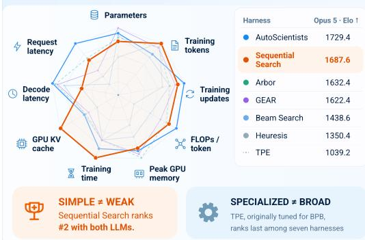

## 2 A broad idea frontier with measurable utility

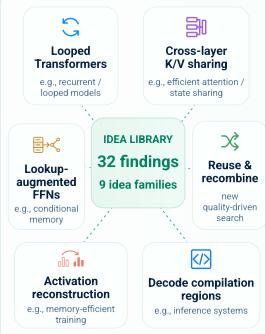

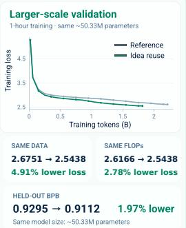  
Figure 1: Auto-Research Arena evaluates research systems and expands the idea frontier. Left: Arena diferentiates research harnesses across nine complementary objectives. Our simple Sequential Search baseline remains competitive, whereas the TPE method tailored to validation-loss minimization underperforms in this broader evaluation. Right: Multi-target research reveals a broad frontier of ideas. A program combining these discoveries achieves lower training loss than the reference program under matched data and FLOP budgets, as well as lower final held-out BPB at the same model size.

## 1 Introduction

Advances in LLMs and research harnesses have enabled increasingly capable autonomous research systems (Tang et al., 2025; Liu et al., 2026). These systems iteratively propose ideas, conduct experiments, and use the results to guide further research. Auto-research benchmarks provide a common basis for comparing these systems, but their role extends beyond evaluation. By defining clear ob jectives and constraints, a well-designed benchmark helps researchers identify, validate, and build on useful improvements. However, existing benchmarks remain limited both in evaluating research systems and in supporting broad research ideas (Chan et al., 2025; Wijk et al., 2025; Nathani et al., 2025; Karpathy, 2026; Intology, 2026).

To address this gap, we introduce Auto-Research Arena, a comprehensive benchmark for evaluating auto-research systems and advancing idea discovery in language modeling. Departing from prior benchmarks that define progress primarily through a particular objective within each research problem, Arena defines multiple research objectives within a common experimental environment. These objectives address complementary bottlenecks across the model lifecycle, including model size, data consumption, training computation and memory, and inference memory and latency. The shared environment provides a common experimental basis for evaluating whether a harness remains efective across diferent research objectives. Meanwhile, diferent objectives reward diferent types of improvements. For example, reducing model size or inference memory can count as progress even when prediction loss remains unchanged. By recognizing these complementary forms of progress, Arena supports exploration of a broader range of model designs and systems optimizations.

To support this broad range of research objectives within a unified framework, Arena specifies both what to improve and which requirements a candidate must satisfy. That is, Arena separates the standard for admissibility from the direction of improvement. Each objective is formulated as a constrained optimization problem. Constraints on model quality and relevant non-target resources determine whether a candidate is admissible. Among admissible candidates, a reduction in the selected resource metric constitutes improvement. Changing the target metric defines a diferent research objective within the same framework. This formulation supports consistent evaluation across diverse objectives, while excluding gains that violate the specified quality or resource constraints. Beyond evaluating objectives independently, Arena supports research across objectives. Separate searches can pursue diferent objectives in parallel, each exploring improvements relevant to its target. Com-patible improvements discovered in one search can then be incorporated into the starting program for a subsequent search targeting a diferent objective. This enables both parallel exploration of distinct research directions and cumulative progress through the reuse of earlier discoveries. By explicitly specifying objectives, constraints, budgets, and starting programs, Arena makes it possible to measure how prior discoveries afect subsequent research.

We evaluate six LLM-based auto-research methods and a Tree-structured Parzen Estimator base- line (Ferreira et al., 2026) across Arena’s nine objectives. Arena provides a discriminative and meaningful evaluation of research harnesses: methods exhibit clear diferences across objectives, with no single harness dominating the benchmark. Two results further support the evaluation. TPE, specialized for the original validation loss-oriented setting, performs worst in Arena’s broader multi- target evaluation. Moreover, our simple Sequential Search baseline ranks second overall with both foundation models, outperforming several substantially more sophisticated harnesses and suggesting large headroom in current auto-research system design. The recorded search trajectories help explain how these final outcomes arise. Higher-performing harnesses tend to sustain progress throughout the search budget, whereas lower-performing methods often plateau earlier or improve less consistently.

Multi-target research also exposes a substantially broader idea frontier. We empirically find that diferent objectives lead to qualitatively diferent discoveries, yielding 32 findings across nine idea families spanning model architecture, optimization, memory, and inference systems. Many of these discoveries align with active directions in LLM research. For example, when optimizing parameter eficiency, agents discover looped Transformers through weight sharing. They further learn depth- specific residual gains to adapt the residual updates across repeated applications of the shared block. This finding closely parallels recent work identifying residual adaptation as a key ingredient of looped Transformers (Wang et al., 2026). Similar connections appear across other discoveries, although alignment with existing research does not imply identical solutions. Several discoveries follow design principles similar to those of prior work but implement them through distinct mechanisms, ofering alternative approaches to the same research problems. Together, these findings show how Arena’s diverse objectives expand the range of ideas explored by autonomous research systems.

Finally, we examine whether ideas discovered through Arena’s lightweight searches remain useful beyond the search setting. The original searches train each candidate for only 10 minutes. We pro- vide the collected discoveries to a new search focused on model quality, which can select, combine, and modify these ideas. We then train the resulting model for one hour from random initialization.

Unlike the original searches, which optimize individual eficiency targets, this experiment evaluates improvements in model quality directly. Relative to the reference run, training loss decreases from 2.675 to 2.544 at matched trainin data and from 2.617 to 2.544 at matched cumulative FLOPs. Held out BPB also decreases from 0.9295 to 0.9112 at essentially the same model size. These results show that discoveries from Arena’s small-scale, multi-target searches can improve model quality through combination and adaptation. Arena thus supports both the evaluation of autonomous research sys- tems and the discovery of reusable research ideas.

## 2 Related Work

Autonomous research benchmarks. PaperBench (Starace et al., 2025) evaluates replication of published research, while EXP-Bench (Kon et al., 2026) assesses the design and execution of paperderived experiments. These benchmarks emphasize implementing and validating specified research content. More open-ended settings include MLE-bench (Chan et al., 2025) and RE-Bench (Wijk et al., 2025), which evaluate ML engineering and research, alongside MLGym (Nathani et al., 2025), MLRC-Bench (Zhang et al., 2025c), and AstaBench (Bragg et al., 2026), which support standardized experimentation and evaluation across ML and scientific tasks. Within language modeling, Karpathy’s autoresearch (Karpathy, 2026) minimizes validation loss under a fixed training-time budget, whereas NanoGPT Bench (Intology, 2026) targets faster training at a required model quality. Related benchmarks evaluate reproduction of NanoGPT improvements (Zhao et al., 2025) and correctnessconstrained computational speedups (Ouyang et al., 2025; Press et al., 2025; Shetty et al., 2025). However, existing benchmarks provide limited evaluation of auto-research systems across comple- mentary objectives. Arena instead unifies diverse objectives within a shared experimental setting, revealing how the research objective shapes both harness performance and the resulting idea frontier.

Autonomous research systems. Complementing these benchmarks, research harnesses determine how agents organize experiments and use accumulated evidence. End-to-end systems connect ideation, experimentation, and reporting (Lu et al., 2026; Tang et al., 2025), while AIDE (Jiang et al., 2025) and AIRA (Toledo et al., 2025) organize iterative code improvement through search. AutoScientists (Gao et al., 2026) coordinates decentralized teams, Arbor (Jin et al., 2026) maintains a persistent hypothesis tree, and GEAR (Jeddi et al., 2026) evolves populations of research states. Heuresis (Antoniades et al., 2026) further compares search strategies across quality, diversity, and novelty. Arena evaluates how the relative strengths of research harnesses vary across objectives.

## 3 Auto-Research Arena

Auto-Research Arena defines a family of research problems that optimize diferent resource targets within a shared language-modeling environment. Fig. 2 illustrates the research loop, from selecting a target and evaluating candidate programs to identifying each harness’s best admissible program and comparing performance across targets. In the following, we present the general formulation in Sec. 3.1 and its language-modeling instantiation in Sec. 3.2.

## 3.1 Auto-Research as Constrained Optimization

Consider a testbed with a fixed data pool, evaluator, and execution environment. An auto-research harness searches over executable programs $p \in \mathcal { P }$ , where candidate programs may modify the model architecture, optimizer, training schedule, and inference implementation.

For each objective $j ,$ Arena minimizes a resource metric $\mathrm { T a r g e t } _ { j } ( p )$ subject to a quality threshold τ (shared by all targets j), target-specific resource limits $\mathbf { b } _ { j } .$ , and correctness checks:

$$
\begin{array} { r l } { \underset { p \in \mathcal { P } } { \mathrm { m i n i m i z e } } } & { \mathrm { T a r g e t } _ { j } ( p ) } \\ { \mathrm { s u b j e c t } \mathrm { t o } } & { \mathcal { L } ( p ) < \tau , } \\ & { \mathrm { R e s o u r c e s } _ { j } ( p ) \leq \mathbf { b } _ { j } . } \end{array}\tag{1}
$$

Here, $\mathcal { L } ( p )$ denotes validation loss, for which lower values are better. The vector Resources ${ \bf \nabla } _ { j } ( p )$ contains the constrained resource measurements, and $\mathbf { b } _ { j }$ specifies their limits. Resource inequalities apply componentwise. This formulation separates admissibility from improvement: candidates qualify by satisfying the quality, resource, and correctness requirements, while lower target values indicate better outcomes among qualifying candidates.

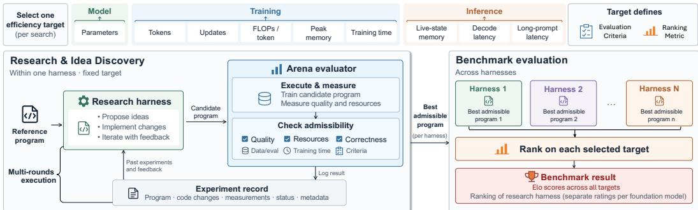  
Figure 2: Overview of Auto-Research Arena Pipeline. Each search run optimizes one of nine eficiency targets. A research harness proposes and implements changes to a reference program. Arena evaluates the resulting candidates, records outcomes, and provides feedback. The best admissible candidate determines the benchmark result.

Eficiency targets. Arena instantiates this formulation with nine objectives spanning model, training, and inference eficiency. These objectives address complementary bottlenecks in model development and deployment. Tab. 1 summarizes their measurements and practical motivations.

Each metric captures a distinct dimension of eficiency. Parameter eficiency measures the model size needed to achieve the required quality. Training eficiency measures the resources needed to reach that quality, while inference eficiency measures the resources needed to use the trained model. Optimizing these metrics separately defines distinct research problems within the same experimental environment.

## 3.2 Language-Modeling Instantiation

We instantiate Arena using Karpathy’s autoresearch language-modeling testbed (Karpathy, 2026), in which candidate solutions are compact LLM pretraining programs. We retain its fixed training-data pool and lightweight experimental setup, replacing loss minimization with the constrained formulation in Eq. 1. Each track optimizes one of nine eficiency metrics subject to requirements on model quality and relevant non-target resources.

Model quality. Following the original testbed (Karpathy, 2026), we measure language-modeling quality using validation bits per byte (BPB). A candidate is admissible only if its validation BPB is below 1.05. This threshold is slightly above the reference program’s BPB, providing flexibility for structural changes while limiting quality degradation.

Resource constraints. Each track limits relevant non-target resources to control the trade-ofs permitted during optimization. These constraints cover quantities such as model size, training FLOPs, peak training memory, and available training data. Inference tracks also constrain other serving costs. For example, the live-state-memory track imposes a latency bound, while the decode-latency track imposes a live-state-memory bound. Each track therefore measures improvement in its selected metric while requiring other resource costs to remain within specified limits.

Measurement. The Arena evaluator measures all target metrics and constrained resources directly. Depending on the target, measurements are taken after a fixed 600-second training period or when the candidate first meets the quality requirement. Training metrics include consumed tokens, FLOPs per token, peak allocated GPU memory, elapsed training time, and optimizer updates. Inference metrics are measured after training using standardized prompt and generation workloads. Appendix A provides complete metric definitions and resource constraints for all nine tracks.

Example: parameter eficiency. The parameter-eficiency track seeks the smallest model that reaches the required quality within the specified training-compute and memory budgets. The re-maining eight tracks follow the same formulation, each with its own target metric and corresponding resource constraints.

$$
\begin{array} { r l } { \underset { \boldsymbol { p } } { \mathrm { m i n i m i z e } } } & { N _ { \mathrm { p a r a m } } ( \boldsymbol { p } ) } \\ { \mathrm { s u b j e c t \ t o } } & { \mathrm { B P B } ( \boldsymbol { p } ) < 1 . 0 5 , } \\ & { \mathrm { F L O P s } ( \boldsymbol { p } ) \le 2 3 9 . 1 \mathrm { M } / \mathrm { t o k e n } , } \\ & { \mathrm { M e m } _ { \mathrm { t r a i n } } ( \boldsymbol { p } ) \le 4 4 . 0 \mathrm { G i B } . } \end{array}
$$

The BPB threshold of 1.05 permits a modest quality decrease relative to the reference program to accommodate structural changes. The compute and memory limits match the reference program’s measured costs, ensuring that parameter reductions do not exceed either resource budget.

Table 1: Eficiency targets in Auto-Research Arena. Each track minimizes one target subject to a shared model-quality threshold and target-specific resource constraints.
<table><tr><td>Target</td><td>Measured quantity</td><td>Why it matters</td></tr><tr><td>Model</td><td></td><td></td></tr><tr><td>Total parameters</td><td>Number of model parameters</td><td>Model storage and weight-memory footprint (Lan et al., 2019).</td></tr><tr><td>Training</td><td></td><td></td></tr><tr><td>Data consumption</td><td>Tokens used to reach target quality</td><td>Learning efficiency under a token budget (Hoffmann et al., 2022).</td></tr><tr><td>Optimizer updates</td><td>Updates to reach the quality threshold</td><td>Convergence in fewer updates (Gupta et al., 2018).</td></tr><tr><td>Training FLOPs</td><td>FLOPs per training token</td><td>Compute demand per token (Hoffmann et al., 2022).</td></tr><tr><td>Peak memory</td><td>Peak allocated GPU memory</td><td>Training feasibility on memory limits (Chen et al., 2016).</td></tr><tr><td>Training time</td><td>Time to reach the quality threshold</td><td>Training turnaround (Mattson et al., 2020).</td></tr><tr><td>Inference</td><td></td><td></td></tr><tr><td>Live-state memory</td><td>Memory per active request</td><td>Concurrent serving capacity (Kwon et al., 2023).</td></tr><tr><td>Decode latency</td><td>Sequential decoding latency</td><td>Autoregressive generation latency (Shazeer, 2019).</td></tr><tr><td>Long-prompt latency</td><td>Prefill + decoding latency</td><td>Long-context response latency (Zhong et al., 2024).</td></tr></table>

## 4 Experiments

We evaluate Arena along its two central roles: benchmarking autonomous research systems and supporting broad idea discovery. We then use its controlled multi-target setting to study how research evolves under diferent objectives, constraints, budgets, and research histories.

Benchmark–harness interface. Arena provides the environment, task specification, reference pro-gram, evaluator, and experiment budget, while each harness determines how to conduct the search. Starting from the reference program, a harness proposes code modifications, submits candidates for evaluation, observes the measured outcomes, and decides what to explore next. Arena records every experiment and independently reports the best recorded candidate satisfying the quality, resource, and correctness requirements, regardless of which program the harness ultimately retains. Each search receives 100 charged experiments; an experiment is charged once GPU execution begins, including runs that subsequently fail or are abandoned. Appendix B provides the full interface and protocol.

Reference baselines. We introduce two simple reference harnesses that difer primarily in how many research directions they retain. Sequential Search maintains one program and evaluates one modification at a time, adopting an admissible improvement before continuing. Beam Search retains up to four programs and evaluates two modifications of each before selecting the next frontier. Both condition subsequent proposals on the accumulated experimental history, including unsuccessful attempts. Appendix B provides their detailed proposal, selection, and stopping policies.

Tasks and resources. We evaluate all nine Arena objectives defined in Sec. 3, each with targetspecific resource constraints and the shared quality requirement BPB < 1.05. Each candidate runs on one NVIDIA A100 80GB GPU with seed 42 and up to 600 seconds of training, excluding com-pilation, validation, and the first ten warmup updates. All searches use the same approximately 631M-token ClimbMix (Diao et al., 2025) training pool and held-out BPB evaluator; training-token consumption includes repeated exposure to the data.

Models and harnesses. We evaluate six LLM-based research harnesses with Claude Opus 5 (Anthropic, 2026) and GPT-6 Astra (OpenAI, 2026), both using medium reasoning efort. In addition to Sequential Search and Beam Search, we evaluate AutoScientists (Gao et al., 2026), Arbor (Jin et al., 2026), GEAR (Jeddi et al., 2026), and Heuresis (Antoniades et al., 2026), which respectively use multi-agent coordination, hypothesis trees, evolutionary search, and diversity-preserving archives. We additionally include TPE (Ferreira et al., 2026), a non-agentic baseline restricted to a predefined hyperparameter space, in the Opus 5 experiments.

Scoring. Each objective is scored by the best recorded admissible target value, with lower values better. For training-token consumption, optimizer updates, and training time, we use the first 30- second validation checkpoint satisfying BPB < 1.05. We summarize performance across objectives with diferent units and scales using Elo ratings from pairwise harness comparisons within each objective. Appendix D gives the scoring procedure.

## 4.1 Benchmarking Auto-Research Harnesses

Tab. 2 reports the best results across Arena’s nine objectives, while Fig. 3 shows representative search trajectories.

(a) Model parameters

Table 2: Benchmark performance across nine research objectives. Lower objective values and higher Elo ratings are better; bold indicates the best result within each foundation-model group. Charged experiments reports the mean number of budgeted experiments across objectives. Elo is computed separately within each foundation-model group. TPE is a non-agentic baseline and is included only in the Opus 5 comparison.
<table><tr><td rowspan="2">Agent model</td><td rowspan="2">Harness</td><td>Model</td><td colspan="5">Training efficiency</td><td colspan="3">Inference efficiency</td><td rowspan="2">Charged experiments Elo ↑ (mean)</td><td rowspan="2"></td></tr><tr><td>Params. (M)</td><td>Tokens (M)</td><td>Updates Time</td><td>(s)</td><td>FLOPs (M/token)</td><td>Memory (GiB)</td><td>KV cache Decode Request (KiB)</td><td>(ms)</td><td>(ms)</td></tr><tr><td colspan="2">Reference starting point</td><td>50.33</td><td>398.98</td><td>761</td><td>600</td><td>239.08</td><td>43.957</td><td>33,790</td><td>465.28</td><td>641.60</td><td></td><td></td></tr><tr><td rowspan="8"></td><td>AutoScientists (Gao et al., 2026)</td><td>13.91</td><td>184.55</td><td>267</td><td>240</td><td>52.15</td><td>0.521</td><td>58.00</td><td>49.70</td><td>29.46</td><td>84.7</td><td>1729.4</td></tr><tr><td>Sequential Search</td><td>15.15</td><td>152.46</td><td>295</td><td>210</td><td>56.66</td><td>0.567</td><td>1.000</td><td>98.56</td><td>61.30</td><td>87.7</td><td>1687.6</td></tr><tr><td>Arbor (Jin et al., 2026)</td><td>14.55</td><td>159.78</td><td>337</td><td>270</td><td>58.30</td><td>0.373</td><td>94.50</td><td>57.09</td><td>57.88</td><td>54.0</td><td>1632.4</td></tr><tr><td>Opus 5 GEAR (Jeddi et al., 2026)</td><td>13.20</td><td>164.43</td><td>306</td><td>270</td><td>62.23</td><td>0.434</td><td>121.5</td><td>56.01</td><td>97.84</td><td>100.0</td><td>1622.4</td></tr><tr><td>Beam Search</td><td>14.22</td><td>197.66</td><td>335</td><td>270</td><td>69.85</td><td>0.951</td><td>68.00</td><td>65.15</td><td>180.56</td><td>96.9</td><td>1438.6</td></tr><tr><td>Heuresis (Antoniades et al., 2026)</td><td>17.83</td><td>156.17</td><td>377</td><td>270</td><td>84.15</td><td>1.582</td><td>488.5</td><td>97.82</td><td>129.03</td><td>100.0</td><td>1350.4</td></tr><tr><td>TPE (Ferreira et al., 2026)</td><td>26.35</td><td>387.71</td><td>753</td><td>510</td><td>100.27</td><td>5.949</td><td>17,790</td><td>230.74</td><td>295.39</td><td>100.0</td><td>1039.2</td></tr><tr><td>AutoScientists (Gao et al., 2026)</td><td>19.84</td><td>311.16</td><td>508</td><td>420</td><td>103.81</td><td>6.006</td><td>423.5</td><td>177.78</td><td>472.56</td><td>30.2</td><td>1298.7</td></tr><tr><td rowspan="5">GPT-6</td><td>Sequential Search</td><td>15.28</td><td>223.61</td><td>350</td><td>330</td><td>74.54</td><td>0.646</td><td>362.0</td><td>72.39</td><td>116.05</td><td>100.0</td><td>1702.4</td></tr><tr><td>Arbor (Jin et al., 2026)</td><td>18.87</td><td>263.19</td><td>405</td><td>480</td><td>77.71</td><td>1.317</td><td>3177</td><td>137.75</td><td>163.25</td><td>14.7</td><td>1459.6</td></tr><tr><td>GEAR (Jeddi et al., 2026)</td><td>18.61</td><td>159.91</td><td>302</td><td>240</td><td>67.25</td><td>0.709</td><td>51.51</td><td>62.74</td><td>47.34</td><td>100.0</td><td>1835.3</td></tr><tr><td>Beam Search</td><td>27.26</td><td>274.46</td><td>339</td><td>480</td><td>81.00</td><td>3.914</td><td>272.5</td><td>142.69</td><td>405.06</td><td>95.8</td><td>1423.3</td></tr><tr><td>Heuresis (Antoniades et al., 2026)</td><td>33.03</td><td>264.37</td><td>355</td><td>420</td><td>125.24</td><td>2.318</td><td>8193</td><td>317.78</td><td>503.57</td><td>86.8</td><td>1280.6</td></tr></table>

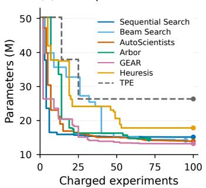

(b) Training time to quality  
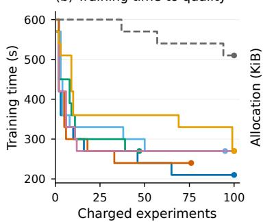

(c) GPU KV-cache allocation  
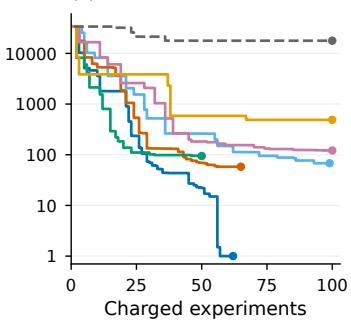  
Figure 3: Research trajectories behind the Opus 5 benchmark results. Curves track the best admissible result found as each search proceeds, ordered by charged experiments; lower is better. Counts include the reference evaluation and charged failures, and dots mark the end of each recorded search. Training time is measured at 30-second validation checkpoints, and KV-cache allocation is shown on a logarithmic scale.

Arena provides a discriminative evaluation. Research harnesses exhibit substantial diferences across Arena’s objectives, with no single method dominating the benchmark. With Opus 5, Auto-Scientists achieves the highest aggregate Elo, followed by Sequential Search and Arbor; with GPT-6, GEAR ranks first, followed by Sequential Search. The variation across objectives shows that Arena distinguishes complementary strengths of research systems rather than reducing their performance to a single research setting.

Simple search is surprisingly competitive. Despite its minimal design, Sequential Search ranks second overall with both foundation LLMs, outperforming several substantially more sophisticated harnesses. Its strong performance suggests substantial headroom in current auto-research system design: more elaborate orchestration does not yet consistently translate into stronger performance.

Specialization does not necessarily transfer across research problems. TPE provides a complementary sanity check. Designed for Karpathy’s autoresearch setting (Ferreira et al., 2026), TPE performs substantially worse than all LLM-based harnesses across Arena’s broader set of objectives. Strong performance in a specialized research setting therefore need not translate into broad research capability, illustrating the value of evaluating research systems across complementary objectives.

Research trajectories support the benchmark scores. The endpoint diferences in Tab. 2 are also reflected in the search trajectories in Fig. 3. Stronger harnesses typically make sustained progress over the experiment budget, whereas weaker methods plateau earlier or improve less consistently. For example, TPE stops improving relatively early in the parameter search, while GEAR and Auto- Scientists continue to find improvements near the end of their recorded searches. These trajectories provide complementary evidence that the benchmark scores reflect systematic diferences in research progress rather than isolated final outcomes.

Similar outcomes can hide diferent research eficiency. Endpoint performance does not fully characterize how a result is reached. On the Opus 5 training-time objective, GEAR, Arbor, Beam Search, and Heuresis all reach 270 seconds, but first attain this value after 12, 39, 50, and 99 charged experiments, respectively. Thus, harnesses with identical final scores can difer substantially in how eficiently they discover the same level of improvement.

## 4.2 A Broader Idea Frontier

Multi-target research substantially broadens the idea frontier. Beyond routine hyperparameter tunin , Kar ath ’s re orted loss-driven search identifies two architectural chan es, smear and backout (Karpathy, 2026). Across Arena’s eficiency objectives, our search catalogue contains 32 distinct findings, including 20 that were accepted as improvements during search, which we consolidate into nine idea families spanning model architecture, training, and inference. Diferent objectives expose qualitatively diferent research directions, from architectural changes under model-eficiency targets to memory and systems optimizations under training and inference targets.

The discovered idea frontier mirrors active LLM research. The breadth of Arena’s discoveries is not merely a larger collection of benchmark-specific opti- mizations: many of them reach questions central to current LLM research. A representative example emerges from parameter eficiency (Tab. 3). Agents first discover recurrent weight sharing, efectively turning the model into a looped Transformer, and further iden- tify the need to adapt residual updates across repeated depth, learning separate attention and MLP residual gains at each depth. This closely mirrors recent work studying residual adaptation as a key component of looped Transformers (Wang et al., 2026). Similar correspondences appear across attention-state reduction through cross-layer K/V sharing (Brandon et al., 2024), MQA/MLA (Shazeer, 2019; DeepSeek-AI, 2024), conditional memory (Cheng et al., 2026), optimizer-state reduction (Zhang et al., 2025d), activation-memory efficiency (Korthikanti et al., 2022), and inference optimization (Aminabadi et al., 2022). Importantly, these discoveries are not simply reproductions of existing methods: they often share the same underlying principles while arriving at diferent technical mechanisms, ofering alternative perspectives on active re-search questions. The resulting idea frontier therefore

Table 3: A representative searched idea by improving parameter eficiency. Blue highlights searched changes; more discoveries are shown in Appendix C.

Discovered idea: Loop Transformer with depth-specific residual gain

Optimization target: Parameter eficiency

BEFORE: INDEPENDENT BLOCKS   
for ℓ = 0, . . . , 7 :   
u ← h + Attnℓ(h)   
h ← u + MLPℓ(u)   
AFTER: SHARED BLOCKS, DEPTH-AWARE GAINS   
for ℓ = 0, . . . , 7 :   
u ← h + αℓ Attnℓ mod B(h)   
h ← u + βℓ MLPℓ mod B(u)

B = 1: one stored block, eight applications. The learned $\alpha _ { \ell } , \beta _ { \ell }$ control attention and MLP residual updates separately at each depth.

RELATION TO PRIOR WORK

Recent work scales residual updates with loop count   
(Wang et al., 2026); here the gains are learned   
separately for each depth.

Notation. h: hidden state; ℓ: de th; B: stored blocks.   
Schematic: normalization and auxiliary paths omitted.

demonstrates a broader value of Arena: its diverse objectives expand not only what research systems are evaluated on, but also the space of meaningful research directions they explore.

The broader idea frontier accompanies substantial measured progress. The searches producing these discoveries also achieve large admissible gains across distinct resource dimensions. In the Opus 5 group, the best programs reduce model size from 50.33M to 13.20M parameters, training computation from 239.08M to 52.15M FLOPs per token, and peak training memory from 43.96 to 0.373 GiB, while satisfying BPB < 1.05 and the corresponding resource constraints. However, these endpoint programs combine multiple changes accumulated during search, so their gains do not establish whether the discovered ideas themselves provide reusable knowledge beyond the searche that found them. We test this directly in Sec. 4.3.

## 4.3 Validating Discoveries Beyond the Search Setting

Arena discovers mechanisms under specific objectives and short experimental budgets. To assess their usefulness beyond these conditions, we first test whether a library of discovered ideas can guide a new search for better model quality. We then ask a stricter question: can winning programs from the original Arena searches retain their advantages when retrained for longer without further search?

Combining discovered ideas improves model quality. We collect discoveries across Arena’s objectives and harnesses into an idea library to guide a quality-driven search. The agent can select, modify, and combine mechanisms from diferent research trajectories rather than continue from a single winning program. We extend the training time budget to 1 hour in this search.

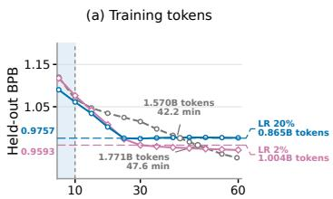

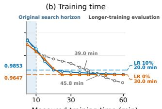  
Measured training time (min)

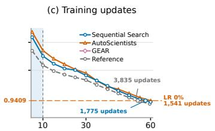  
Figure 4: Discovered programs can transfer beyond the search horizon. Programs discovered with 10- minute candidate training are retrained from random initialization for 60 minutes alongside the reference. Sev-eral retain their advantages for substantially longer than the original search horizon, although these gains can diminish later as horizon-specific training policies take efect. Curves show held-out BPB against training time. Annotated comparisons use checkpoints after the learning-rate schedule reaches its floor, except in figure (c), where AutoScientists’ final BPB defines the shared target.

The resulting design improves model quality under both matched-budget evaluations (Fig. 1). At matched training data, it reduces training loss from 2.675 to 2.544 (4.9%); at matched training FLOPs, it reduces training loss from 2.617 to 2.544 (2.8%). Final held-out BPB also decreases from 0.9295 to 0.9112 at the same model size (50.33M parameters). The resulting design selectively adapts and simplifies ideas rather than merely combining their original implementations. These re sults demonstrate that eficiency-targeted discoveries can serve as reusable model-design knowledge for improving quality. Appendix C.3 details how these ideas are selected and transformed.

Discovered programs can transfer far beyond the search horizon. We next ask a stricter question: can a program found under a short training budget be scaled directly, without further search? Arena normally evaluates candidate programs after 10 minutes of training. We select two programs from each of the training-time, token, and update objectives and retrain them from random initialization for 60 minutes alongside the reference program.

Several discoveries retain their advantages far beyond the horizon at which they were found. A token-optimized GEAR program reaches 0.9593 BPB after 30 minutes using 1.004B tokens, while the reference requires approximately 47.6 minutes and 1.771B tokens to reach the same quality, corresponding to 43.3% fewer tokens. Its quality advantage persists until approximately 51 minutes, extending to five times the original search horizon. Similarly, a training-time program discovered by AutoScientists outperforms the reference over the 15–46-minute interval and reaches 0.9647 BPB after 30 minutes, a quality level that the reference reaches only after approximately 45.8 minutes, corresponding to 34.5% less training time (Figure 4; Table 4). Reference costs at matched quality are estimated by linear interpolation.

The transfer is substantial but not indefinite. The GEAR program’s learning rate reaches its 2% floor around 27 minutes, while the AutoScientists schedule reaches zero around 24 minutes. Their early advantages consequently diminish as training continues; by 60 minutes, for example, the reference reaches 0.9295 BPB compared with 0.9478 for the GEAR program. Thus, short-horizon search can discover programs whose advantages persist for four to five times the original search horizon, while horizon-dependent training policies can ultimately limit direct extrapolation to longer training.

## 4.4 The Science of Auto-Research

Arena also enables controlled study of what shapes the auto-research process. We examine quality constraints, budget allocation between evaluation depth and search breadth, and the role of research history in cross-target search.

Constraints shape the research space. We vary the BPB threshold across 1.02, 1.05, and 2.0 for parameter- and memory-eficiency searches with Sequential Search and Beam Search (Tab. 5). Relaxing the threshold from 1.05 to 2.0 allows Sequential Search to reduce parameters from 18.94M to 0.69M, while its separate peak-memory search reduces memory from 0.83 GiB to 0.035 GiB. The additional quality slack permits substantially more aggressive eficiency improvements. Conversely, tighter thresholds restrict which structural changes remain admissible. Quality constraints thus shape not only the final results, but also which regions of the design space can be developed.

Table 4: Direct transfer beyond the search horizon. Programs discovered with 10-minute training are retrained for up to 60 minutes without further search. Resource savings compare each program’s 30-minute checkpoint with the reference at the same held-out BPB.
<table><tr><td>Objective</td><td>Harness</td><td>Resource saving</td><td>Quality advantage to</td><td>60-min BPB</td></tr><tr><td>Reference</td><td></td><td>一</td><td>一</td><td>0.9295</td></tr><tr><td rowspan="2">Training time</td><td>Seq. Search</td><td>28.5%</td><td>~44 min</td><td>0.9662</td></tr><tr><td>AutoScientists</td><td>34.5%</td><td>~46 min</td><td>0.9647</td></tr><tr><td rowspan="2">Training tokens</td><td>GEAR</td><td>43.3%</td><td>~51 min</td><td>0.9478</td></tr><tr><td>Seq. Search</td><td>34.4%</td><td>~42 min</td><td>0.9765</td></tr><tr><td rowspan="2">Training updates</td><td>AutoScientists</td><td>30.1%</td><td>一</td><td>0.9409</td></tr><tr><td>Seq. Search</td><td>39.6%</td><td>一</td><td>0.9365</td></tr></table>

Table 5: Looser quality constraints enable more aggressive eficiency gains. Results use 30 completed runs per search; bold marks each harness’s best value.
<table><tr><td rowspan="2">Harness</td><td rowspan="2">BPB Limit</td><td colspan="2">Parameters</td><td colspan="2">Peak GPU Memory</td></tr><tr><td colspan="2">Params. (M) BPB</td><td colspan="2">Memory (GiB) BPB</td></tr><tr><td rowspan="2">Beam Search</td><td>&lt; 1.02 &lt; 1.05</td><td>23.5934</td><td>1.0185</td><td>3.9753</td><td>1.0175 1.0371</td></tr><tr><td>&lt; 2.0</td><td>19.6610 0.4649</td><td>1.0448 1.5030</td><td>1.6707 0.1625</td><td>1.2312</td></tr><tr><td rowspan="2">Sequential Search</td><td>&lt; 1.02</td><td>26.4767</td><td>1.0195</td><td>6.8889</td><td>1.0162</td></tr><tr><td>&lt; 1.05</td><td>18.9399</td><td>1.0497</td><td>0.8341</td><td>1.0402</td></tr><tr><td rowspan="2"></td><td>&lt; 2.0</td><td>0.6924</td><td>1.9963</td><td>0.0348</td><td>1.7200</td></tr><tr><td></td><td></td><td></td><td></td><td></td></tr></table>

Table 6: Research can build across objectives. Each sequence continues from a program discovered under the first objective and optimizes a new objective. The second search can preserve the earlier gain or trade part of it for progress on the new objective. $\Delta _ { 2 }$ reports the change from the first-search program; negative values indicate improvements.
<table><tr><td>Research sequence</td><td>Metric</td><td>Reference</td><td>After first search</td><td>After second search</td><td> $\pmb { \Delta _ { 2 } }$ </td></tr><tr><td rowspan="2">Parameters → FLOPs</td><td>Parameters (M)</td><td>50.33</td><td>14.09</td><td>14.09</td><td>0.0%</td></tr><tr><td>Training FLOPs (M/token)</td><td>239.08</td><td>113.80</td><td>75.46</td><td>-33.7%</td></tr><tr><td rowspan="2">FLOPs → Decode latency</td><td>Training FLOPs (M/token)</td><td>239.08</td><td>66.55</td><td>66.55</td><td>0.0%</td></tr><tr><td>Uncached decode latency (ms)</td><td>552.09</td><td>520.36</td><td>65.17</td><td>-87.5%</td></tr><tr><td rowspan="2">Parameters → Training time</td><td>Parameters (M)</td><td>50.33</td><td>14.09</td><td>17.56</td><td>+24.6%</td></tr><tr><td>Time to BPB &lt; 1.05 (s)</td><td>600</td><td>570</td><td>450</td><td>-21.1%</td></tr></table>

Budget allocation creates a depth–breadth trade-of. For arameter minimization under BPB < 2.0, we vary candidate training time from 1,200 to 6,000 seconds under a shared 20 GPU-hour training budget, trading fewer, longer evaluations for more, shorter ones (Tab. 8). The shortest setting evaluates 60 candidates and finds the smallest model; longer settings yield better BPB but more parameters. These outcomes illustrate the trade-of between evaluation depth and search breadth, with diferent allocations favoring diferent quality–eficiency balances.

Cross-target research builds on prior discoveries. We initialize searches under new objectives from programs discovered under earlier objectives, transferring code while reinitializing model weights (Tab. 6). Subsequent searches can accumulate compatible gains: parameter savings are fully preserved while training FLOPs decrease by a further 33.7%, and a FLOP-optimized program preserves its FLOP count while uncached decode latency decreases by 87.5%. Cross-target continu- ation can also introduce trade-ofs: optimizing training time from the parameter-optimized program reduces time to quality by 21.1% but increases parameters by 24.6%. Prior discoveries therefore provide foundations for both cumulative gains and new trade-ofs across objectives.

Together, these studies show how constraints define admissible designs, budgets balance evaluation depth against search breadth, and research history supports cumulative gains or trade-ofs across targets. Therefore, Arena enables systematic study of how autonomous research develops over time.

## 5 Conclusion

We introduced Auto-Research Arena, a multi-target benchmark for autonomous research across nine quality-constrained language-model eficiency objectives. Arena reveals complementary harness strengths and a broad frontier of architectural and systems ideas. Discoveries can seed searches under new objectives, while a program combining selected ideas can improve model quality. Controlled studies further show how constraints, budgets, and research history shape progress. Together, these results support evaluating autonomous research across complementary objectives and studying how useful discoveries accumulate.

Limitations. Our scope is explicitly limited to auto-research in language modeling, rather than the full end-to-end research process or scientific novelty. Idea-family groupings are interpretive, and noisy system measurements require care when interpreting small diferences.

## AI use statement

LLM-based research agents are the subjects of evaluation in this work; their roles in proposing ideas, implementing programs, and conducting experiments are described in the paper.

Separately, we used AI tools to assist with literature search, compilation of experimental records, text polishing for readability and figure preparation.

We have not used generative AI tools for helping develop theoretical models or conceptual frame- works, proposing or refining hypotheses, designing or providing feedback on research methodology or experiments, implementing methods, assisting with translation, supporting qualitative and thematic data analysis, and interpreting results.

Generating synthetic data sets, formulating mathematical claims, providing critical ingredients for proving mathematical claims, assisting in the writing of proofs, cleaning and reformating dataset, are not applicable to this work.

We have reviewed AI-assisted content against the relevant literature, source code, and experimental records. We take responsibility for the final content of this work, including text, claims or artifacts produced with the aid of generative AI.

## Ethics statement

This work studies autonomous research systems in a controlled language-modeling environment. The experiments use existing language-model training data and do not involve human subjects, personal data collection, or deployment to users.

The evaluated agents can autonomously propose code changes and execute experiments, which may raise broader concerns about increasingly capable autonomous research systems. In our setting, their actions are restricted to a sandboxed ex erimental environment, a fixed ro ram interface, redefined compute budgets, and standardized evaluation. We do not evaluate or enable autonomous interaction with external s stems be ond the research environment.

We report both successful and unsuccessful research outcomes and distinguish measured improve- ments from interpretations of scientific novelty. We hope that the benchmark can support more systematic study of the capabilities and limitations of autonomous research systems.

## References

Reza Yazdani Aminabadi, Samyam Rajbhandari, Minjia Zhang, Ammar Ahmad Awan, Cheng Li, Du Li, Elton Zheng, Jef Rasley, Shaden Smith, Olatunji Ruwase, and Yuxiong He. DeepSpeed Inference: Enabling Eficient Inference of Transformer Models at Unprecedented Scale. arXiv preprint arXiv:2207.00032, 2022.

Anthropic. Introducing claude opus 5. https://www.anthropic.com/news/ claude-opus-5, July 2026. Anthropic model release announcement.

Antonis Antoniades, Deepak Nathani, Ritam Saha, Alfonso Amayuelas, Ivan Bercovich, Zhaotian Weng, Vignesh Baskaran, Kunal Bhatia, and William Yang Wang. Heuresis: Search strate- gies for autonomous AI research agents across quality, diversity and novelty. arXiv preprint arXiv:2606.25198, 2026.

Ben Bogin, Kejuan Yang, Shashank Gupta, Kyle Richardson, Erin Bransom, Peter Clark, Ashish Sabharwal, and Tushar Khot. SUPER: Evaluating agents on setting up and executing tasks from research repositories. In Proceedings of the 2024 Conference on Empirical Methods in Natural Language Processing, pp. 12622–12645, 2024.

Jonathan Bragg, Mike D’Arcy, Nishant Balepur, Dan Bareket, Bhavana Dalvi Mishra, Sergey Feldman, Dany Haddad, Jena Hwang, Peter Jansen, Varsha Kishore, Bodhisattwa Prasad Majumder,

Aakanksha Naik, Sigal Rahamimov, Kyle Richardson, Amanpreet Singh, Harshit Surana, Aryeh Tiktinsky, Rosni Vasu, Guy Wiener, Chloe Anastasiades, Stefanus Candra, Jason Dunkelberger, Daniel Emery, Rob Evans, Malachi Hamada, Regan Huf, Rodney Kinney, Matt Latzke, Jaron Lochner, Ruben Lozano-Aguilera, Ngoc-Uyen Nguyen, Smita Rao, Amber Tanaka, Brooke Vla- hos, Peter Clark, Doug Downey, Yoav Goldberg, Ashish Sabharwal, and Daniel Weld. AstaBench: Rigorous benchmarking of AI agents with a scientific research suite. In International Conference on Learning Representations, pp. 110136–110223, 2026.

William Brandon, Mayank Mishra, Aniruddha Nrusimha, Rameswar Panda, and Jonathan Ragan-Kelley. Reducing Transformer Key-Value Cache Size with Cross-Layer Attention. arXiv preprint arXiv:2405.12981, 2024.

Jun Shern Chan, Neil Chowdhury, Oliver Jafe, James Aung, Dane Sherburn, Evan Mays, Giulio Starace, Kevin Liu, Leon Maksin, Tejal Patwardhan, Aleksander Madry, and Lilian Weng. MLEbench: Evaluating machine learning agents on machine learning engineering. In The Thirteenth International Conference on Learning Representations, 2025.

Hui Chen, Miao Xiong, Yujie Lu, Wei Han, Ailin Deng, Yufei He, Jiaying Wu, Yibo Li, Yue Liu, and Bryan Hooi. MLR-Bench: Evaluating AI agents on open-ended machine learning research. In Advances in Neural Information Processing Systems, volume 38, 2025a.

Tianqi Chen, Bing Xu, Chiyuan Zhang, and Carlos Guestrin. Training Deep Nets with Sublinear Memory Cost. arXiv preprint arXiv:1604.06174, 2016.

Zhi Chen, Zhensu Sun, Yuling Shi, David Lo, and Lingxiao Jiang. Are performance-optimization benchmarks reliably measuring coding agents? arXiv preprint arXiv:2607.01211, 2026.

Ziru Chen, Shijie Chen, Yuting Ning, Qianheng Zhang, Boshi Wang, Botao Yu, Yifei Li, Zeyi Liao, Chen Wei, Zitong Lu, Vishal Dey, Mingyi Xue, Frazier N. Baker, Benjamin Burns, Daniel Adu-Ampratwum, Xuhui Huang, Xia Ning, Song Gao, Yu Su, and Huan Sun. ScienceAgentBench: Toward rigorous assessment of language agents for data-driven scientific discovery. In The Thir teenth International Conference on Learning Representations, 2025b.

Xin Cheng, Rui Tian, Wangding Zeng, Damai Dai, Qinyu Chen, Bingxuan Wang, Zhenda Xie, Kezhao Huang, Xingkai Yu, Chengqi Deng, Shangyan Zhou, Chenggang Zhao, Zhewen Hao, Yukun Li, Han Zhang, Zhengyan Zhang, Yixu Wei, M. Y Xu, Huishuai Zhang, Dongyan Zhao, and Wenfeng Liang. Conditional Memory via Scalable Lookup: A New Axis of Sparsity for Large Language Models. arXiv preprint arXiv:2601.07372, 2026.

Jiale Cui, Yueyao Yuan, Kaixi Zhong, Xiaogang Xu, Jiafei Wu, and Zhe Liu. ARAC: Bench- marking auto-research’s alignment and completeness on end-to-end researchs. arXiv preprint arXiv:2608.12788, 2026.

DeepSeek-AI. DeepSeek-V2: A strong, economical, and eficient mixture-of-experts language model, 2024.

Shizhe Diao, Yu Yang, Yonggan Fu, Xin Dong, Dan Su, Markus Kliegl, Zijia Chen, Peter Bel- cak, Yoshi Suhara, Hongxu Yin, Mostofa Patwary, Yingyan (Celine) Lin, Jan Kautz, and Pavlo Molchanov. Nemotron-CLIMB: Clustering-based iterative data mixture bootstrapping for language model pre-training. In Advances in Neural Information Processing Systems, volume 38, 2025.

Nicholas Edwards, Yukyung Lee, Yujun Audrey Mao, Yulu Qin, Sebastian Schuster, and Najoung Kim. RExBench: Can coding agents autonomously implement AI research extensions? In Proceedings ofthe 64th Annual Meeting ofthe Associationfor Computational Linguistics (Volume 1: Long Papers), pp. 16380–16417, 2026.

Haoyang Fang, Boran Han, Nick Erickson, Xiyuan Zhang, Su Zhou, Anirudh Dagar, Jiani Zhang, Ali Caner Turkmen, Tony Hu, Huzefa Rangwala, Ying Nian Wu, Yuyang (Bernie) Wang, and George Karypis. MLZero: A multi-agent system for end-to-end machine learning automation. In Advances in Neural Information Processing Systems, volume 38, pp. 69001–69070, 2025.

Fabio Ferreira, Lucca Wobbe, Arjun Krishnakumar, Frank Hutter, and Arber Zela. Can llms beat classical hyperparameter optimization algorithms? a study on autoresearch. 2026.

Shanghua Gao, Ada Fang, and Marinka Zitnik. AutoScientists: Self-organizing agent teams for long-running scientific experimentation. arXiv preprint arXiv:2605.28655, 2026.

Aniketh Garikaparthi, Manasi Patwardhan, and Arman Cohan. ResearchGym: Evaluating language model agents on real-world AI research. In ICLR 2026 Workshop on Agents in the Wild, 2026.

Juraj Gottweis, Wei-Hung Weng, Alexander Daryin, Tao Tu, Petar Sirkovic, Artiom Myaskovsky, Grzegorz Glowaty, Felix Weissenberger, Alessio Orlandi, Dan Popovici, Anil Palepu, Keran Rong, Ryutaro Tanno, Khaled Saab, Fan Zhang, Jacob Blum, Andrew Carroll, Kavita Kulkarni, Nenad Tomašev, Dina Zverinski, Ivor Rendulic, Elahe Vedadi, Florian Hasler, Luka Rimanic, Marina Boia, Ivan Budiselic, Ben Feinstein, Mathias Bellaiche, Tom Shefer, Jan Freyberg, Jeremy Rat- clif, Ottavia Bertolli, Katherine Chou, Avinatan Hassidim, Burak Gokturk, Amin Vahdat, Yuan Guan, Vikram Dhillon, Eeshit Dhaval Vaishnav, Byron Lee, Tiago R. D. Costa, José R. Penadés, Gary Peltz, Yossi Matias, James Manyika, Demis Hassabis, Yunhan Xu, Pushmeet Kohli, Annal- isa Pawlosky, Alan Karthikesalingam, and Vivek Natarajan. Accelerating scientific discovery with Co-Scientist. Nature, 655:487–496, 2026.

Vineet Gupta, Tomer Koren, and Yoram Singer. Shampoo: Preconditioned stochastic tensor op- timization. In Jennifer Dy and Andreas Krause (eds.), Proceedings of the 35th International Conference on Machine Learning, volume 80 of Proceedings of Machine Learning Research, pp. 1842–1850, 10–15 Jul 2018.

Jordan Hofmann, Sebastian Borgeaud, Arthur Mensch, Elena Buchatskaya, Trevor Cai, Eliza Rutherford, Diego de Las Casas, Lisa Anne Hendricks, Johannes Welbl, Aidan Clark, Thomas Hennigan, Eric Noland, Katherine Millican, George van den Driessche, Bogdan Damoc, Aurelia Guy, Simon Osindero, Karén Simonyan, Erich Elsen, Oriol Vinyals, Jack Rae, and Laurent Sifre. An empirical analysis of compute-optimal large language model training. In S. Koyejo, S. Mohamed, A. Agar wal, D. Belgrave, K. Cho, and A. Oh (eds.), Advances in Neural Information Processing Systems, volume 35, pp. 30016–30030, 2022.

Shengran Hu, Cong Lu, and Jef Clune. Automated design of agentic systems. In The Thirteenth International Conference on Learning Representations, 2025.

Tianyu Hua, Harper Hua, Violet Xiang, Benjamin Klieger, Sang Truong, Weixin Liang, Fan-Yun Sun, and Nick Haber. ResearchCodeBench: Benchmarking LLMs on implementing novel machine learning research code. In Advances in Neural Information Processing Systems, volume 38, 2025.

Intology. NanoGPT-Bench: Evaluating autonomous research agents on the NanoGPT speedrun. https://github.com/IntologyAI/NanoGPT-Bench, 2026. GitHub repository.

Ahmadreza Jeddi, Minh Ngoc Le, Hakki C. Karaimer, Konstantinos G. Derpanis, and Babak Taati. GEAR: Genetic AutoResearch for agentic code evolution. arXiv preprint arXiv:2605.13874, 2026.

Zhengyao Jiang, Dominik Schmidt, Dhruv Srikanth, Dixing Xu, Ian Kaplan, Deniss Jacenko, and Yuxiang Wu. AIDE: AI-driven exploration in the space of code. arXiv preprint arXiv:2502.13138, 2025.

Carlos E Jimenez, John Yang, Alexander Wettig, Shunyu Yao, Kexin Pei, Ofir Press, and Karthik Narasimhan. SWE-bench: Can language models resolve real-world github issues? In The Twelfth International Conference on Learning Representations, 2024.

Jiajie Jin, Yuyang Hu, Kai Qiu, Qi Dai, Chong Luo, Guanting Dong, Xiaoxi Li, Tong Zhao, Xiaolong Ma, Gongrui Zhang, Zhirong Wu, Bei Liu, Zhengyuan Yang, Linjie Li, Lijuan Wang, Hongjin Qian, Yutao Zhu, and Zhicheng Dou. Toward generalist autonomous research via hypothesis-tree refinement. arXiv preprint arXiv:2606.11926, 2026.

Andrej Karpathy. autoresearch: AI agents running research on single-GPU nanochat training automatically. https://github.com/karpathy/autoresearch, 2026. GitHub repository.

Patrick Tser Jern Kon, Qiuyi Ding, Jiachen Liu, Xinyi Zhu, Jingjia Peng, Jiarong Xing, Yibo Huang, Yiming Qiu, Jayanth Srinivasa, Myungjin Lee, Mosharaf Chowdhury, Matei Zaharia, and Ang Chen. EXP-bench: Can AI conduct AI research experiments? In The Fourteenth International Conference on Learning Representations, 2026.

Vijay Korthikanti, Jared Casper, Sangkug Lym, Lawrence McAfee, Michael Andersch, Mohammad Shoeybi, and Bryan Catanzaro. Reducing Activation Recomputation in Large Transformer Models. arXiv preprint arXiv:2205.05198, 2022.

Woosuk Kwon, Zhuohan Li, Siyuan Zhuang, Ying Sheng, Lianmin Zheng, Cody Hao Yu, Joseph Gonzalez, Hao Zhang, and Ion Stoica. Eficient Memory Management for Large Language Model Serving with PagedAttention. In Proceedings of the 29th Symposium on Operating Systems Principles, pp. 611–626, 2023.

Zhenzhong Lan, Mingda Chen, Sebastian Goodman, Kevin Gimpel, Piyush Sharma, and Radu Soricut. ALBERT: A Lite BERT for Self-supervised Learning of Language Representations. arXiv preprint arXiv:1909.11942, 2019.

Fei Liu, Tong Xialiang, Mingxuan Yuan, Xi Lin, Fu Luo, Zhenkun Wang, Zhichao Lu, and Qingfu Zhang. Evolution of heuristics: Towards eficient automatic algorithm design using large language model. In Proceedings ofthe 41st International Conference on Machine Learning, volume 235 of Proceedings of Machine Learning Research, pp. 32201–32223, 2024.

Jiaqi Liu, Shi Qiu, Mairui Li, Bingzhou Li, Haonian Ji, Siwei Han, Xinyu Ye, Peng Xia, Zihan Dong, Meng Chen, Congyu Zhang, Letian Zhang, Guiming Chen, Haoqin Tu, Xinyu Yang, Lu Feng, Xujiang Zhao, Haifeng Chen, Jiawei Zhou, Xiao Wang, Weitong Zhang, Hongtu Zhu, Yun Li, Jieru Mei, Hongliang Fei, Jiaheng Zhang, Linjie Li, Linjun Zhang, Yuyin Zhou, Sheng Wang, Caiming Xiong, James Zou, Zeyu Zheng, Cihang Xie, Mingyu Ding, and Huaxiu Yao. AutoResearchClaw: Self-reinforcing autonomous research with human-AI collaboration. arXiv preprint arXiv:2605.20025, 2026.

Chris Lu, Cong Lu, Robert Tjarko Lange, Yutaro Yamada, Shengran Hu, Jakob Foerster, David Ha, and Jef Clune. Towards end-to-end automation of AI research. Nature, 651:914–919, 2026.

Alisia Lupidi, Bhavul Gauri, Thomas Simon Foster, Bassel Al Omari, Despoina Magka, Alberto Pepe, Alexis Audran-Reiss, Muna Aghamelu, Nicolas Baldwin, Lucia Cipolina-Kun, Jean-Christophe Gagnon-Audet, Chee Hau Leow, Sandra Lefdal, Hossam Mossalam, Abhinav Moudgil, Saba Nazir, Emanuel Tewolde, Isabel Urrego, Jordi Armengol Estape, Amar Budhiraja, Gaurav Chaurasia, Abhishek Charnalia, Derek Dunfield, Karen Hambardzumyan, Daniel Izcovich, Martin Josifoski, Ishita Mediratta, Kelvin Niu, Parth Pathak, Michael Shvartsman, Edan Toledo, Anton Protopopov, Roberta Raileanu, Alexander Miller, Tatiana Shavrina, Jakob Foerster, and Yoram Bachrach. AIRS-Bench: a suite of tasks for frontier AI research science agents. arXiv preprint arXiv:2602.06855, 2026.

Bodhisattwa Prasad Majumder, Harshit Surana, Dhruv Agarwal, Bhavana Dalvi Mishra, Abhijeetsingh Meena, Aryan Prakhar, Tirth Vora, Tushar Khot, Ashish Sabharwal, and Peter Clark. Dis- coveryBench: Towards data-driven discovery with large language models. In The Thirteenth International Conference on Learning Representations, 2025.

Peter Mattson, Christine Cheng, Gregory Diamos, Cody Coleman, Paulius Micikevicius, David Pat- terson, Hanlin Tan , Gu-Yeon Wei, Peter Bailis, Victor Bittorf, David Brooks, Dehao Chen, Debo Dutta, Udit Gupta, Kim Hazelwood, Andy Hock, Xinyuan Huang, Daniel Kang, David Kanter, Naveen Kumar, Jefery Liao, Deepak Narayanan, Tayo Oguntebi, Gennady Pekhimenko, Lillian Pentecost, Vijay Janapa Reddi, Taylor Robie, Tom St John, Carole-Jean Wu, Lingjie Xu, Clif Young, and Matei Zaharia. MLPerf Training Benchmark. In I. Dhillon, D. Papailiopoulos, and V. Sze (eds.), Proceedings ofMachine Learning and Systems, volume 2, pp. 336–349, 2020.

Mike A. Merrill, Alexander G. Shaw, Nicholas Carlini, Boxuan Li, Harsh Raj, Ivan Bercovich, Lin Shi, Jeong Yeon Shin, Thomas Walshe, E. Kelly Buchanan, et al. Terminal-Bench: Benchmarking agents on hard, realistic tasks in command line interfaces. arXiv preprint arXiv:2601.11868, 2026.

Henry E. Miller, Matthew Greenig, Benjamin Tenmann, and Bo Wang. BioML-bench: Evaluation of AI agents for end-to-end biomedical ML. bioRxiv, 2025.

Ludovico Mitchener, Angela Yiu, Benjamin Chang, Mathieu Bourdenx, Tyler Nadolski, Arvis Sulo-vari, Eric C. Landsness, Daniel L. Barabasi, Siddharth Narayanan, Nicky Evans, Shriya Reddy, Martha Foiani, Aizad Kamal, Leah P. Shriver, Fang Cao, Asmamaw T. Wassie, Jon M. Laurent, Edwin Melville-Green, Mayk Caldas, Albert Bou, Kaleigh F. Roberts, Sladjana Zagorac, Timothy C. Orr, Miranda E. Orr, Kevin J. Zwezdaryk, Ali E. Ghareeb, Laurie McCoy, Bruna Gomes, Euan A. Ashley, Karen E. Duf, Tonio Buonassisi, Tom Rainforth, Randall J. Bateman, Michael Skarlinski, Samuel G. Rodriques, Michaela M. Hinks, and Andrew D. White. Kosmos: An AI scientist for autonomous discovery. arXiv preprint arXiv:2511.02824, 2025.

Yongyu Mu, Yuzhang Wu, Yuchun Fan, Chenglong Wang, Hengyu Li, Jiali Zeng, Qiaozhi He, Murun Yang, Fandong Meng, Jie Zhou, Tong Xiao, and Jingbo Zhu. Cross-layer Attention Sharing for Pre-trained Large Language Models. arXiv preprint arXiv:2408.01890, 2024.

Nitya Nadgir, Sayash Kapoor, Kangheng Liu, Peter Kirgis, Matilda Orona, Stephan Rabanser, Tilman Bayer, Abhishek Shetty, Yue Ling, Derrick Chan-Sew, Rumi Nakagawa, Saiteja Utpala, Zachary S. Siegel, and Arvind Narayanan. Life after benchmark saturation: A case study of CORE-Bench. arXiv preprint arXiv:2606.26158, 2026.

Deepak Nathani, Lovish Madaan, Nicholas Roberts, Nikolay Bashlykov, Ajay Menon, Vincent Moens, Mikhail Plekhanov, Amar Budhiraja, Despoina Magka, Vladislav Vorotilov, Gaurav Chaurasia, Dieuwke Hupkes, Ricardo Silveira Cabral, Tatiana Shavrina, Jakob Nicolaus Foerster, Yoram Bachrach, William Yang Wang, and Roberta Raileanu. MLGym: A new framework and benchmark for advancing AI research agents. In Second Conference on Language Modeling, 2025.

Alexander Novikov, Ngân Vu, Marvin Eisenberger, Emilien Dupont, Po-Sen Huang, Adam Zsolt˜ Wagner, Sergey Shirobokov, Borislav Kozlovskii, Francisco J. R. Ruiz, Abbas Mehrabian, M. Pawan Kumar, Abigail See, Swarat Chaudhuri, George Holland, Alex Davies, Sebastian Nowozin, Pushmeet Kohli, and Matej Balog. AlphaEvolve: A coding agent for scientific and algorithmic discovery. arXiv preprint arXiv:2506.13131, 2025.

OpenAI. GPT-6 astra: A new generation of intelligence. https://openai.com/index/ gpt-6-astra/, September 2026. OpenAI model release announcement.

Anne Ouyang, Simon Guo, Simran Arora, Alex L. Zhang, William Hu, Christopher Ré, and Azalia Mirhoseini. KernelBench: Can LLMs write eficient GPU kernels? In Proceedings of the 42nd International Conference on Machine Learning, volume 267 of Proceedings of Machine Learning Research, pp. 47356–47415, 2025.

Ofir Press and Lior Wolf. Using the Output Embedding to Improve Language Models. arXivpreprint arXiv:1608.05859, 2016.

Ori Press, Brandon Amos, Haoyu Zhao, Yikai Wu, Samuel Ainsworth, Dominik Krupke, Patrick Kidger, Touqir Sajed, Bartolomeo Stellato, Jisun Park, Nathanael Bosch, Eli Meril, Albert Steppi, Arman Zharmagambetov, Fangzhao Zhang, David Pérez-Piñeiro, Alberto Mercurio, Ni Zhan, Talor Abramovich, Kilian Lieret, Hanlin Zhang, Shirley Huang, Matthias Bethge, and Ofir Press. AlgoTune: Can language models speed up general-purpose numerical programs? In Advances in Neural Information Processing Systems, volume 38, 2025.

Ben Rank, Hardik Bhatnagar, Ameya Prabhu, Shira Eisenberg, Karina Nguyen, Matthias Bethge, and Maksym Andriushchenko. PostTrainBench: Can LLM agents automate LLM post-training? In International Conference on Machine Learning, 2026.

Bernardino Romera-Paredes, Mohammadamin Barekatain, Alexander Novikov, Matej Balog, M. Pawan Kumar, Emilien Dupont, Francisco J. R. Ruiz, Jordan S. Ellenberg, Pengming Wang, Omar Fawzi, Pushmeet Kohli, and Alhussein Fawzi. Mathematical discoveries from program search with large language models. Nature, 625:468–475, 2024.

Samuel Schmidgall, Yusheng Su, Ze Wang, Ximeng Sun, Jialian Wu, Xiaodong Yu, Jiang Liu, Michael Moor, Zicheng Liu, and Emad Barsoum. Agent Laboratory: Using LLM agents as re- search assistants. In Findings of the Association for Computational Linguistics: EMNLP 2025, pp. 5977–6043, 2025.

Noam Shazeer. Fast transformer decoding: One write-head is all you need. arXiv preprint arXiv:1911.02150, 2019.

Manish Shetty, Naman Jain, Jinjian Liu, Vijay Kethanaboyina, Koushik Sen, and Ion Stoica. GSO: Challenging software optimization tasks for evaluating SWE-Agents. In Advances in Neural Information Processing Systems, volume 38, 2025.

Zachary S. Siegel, Sayash Kapoor, Nitya Nadgir, Benedikt Stroebl, and Arvind Narayanan. CORE-Bench: Fostering the credibility of published research through a computational reproducibility agent benchmark. Transactions on Machine Learning Research, 2025. ISSN 2835-8856.

Dhruv Srikanth, Bingchen Zhao, Dixing Xu, Yuxiang Wu, and Zhengyao Jiang. Recursive selfimprovement of AI research agents. arXiv preprint arXiv:2609.26457, 2026.

Giulio Starace, Oliver Jafe, Dane Sherburn, James Aung, Jun Shern Chan, Leon Maksin, Rachel Dias, Evan Mays, Benjamin Kinsella, Wyatt Thompson, Johannes Heidecke, Amelia Glaese, and Tejal Patwardhan. PaperBench: Evaluating AI’s ability to replicate AI research. In Proceedings of the 42nd International Conference on Machine Learning, pp. 56843–56873. PMLR, 2025.

Jiabin Tang, Lianghao Xia, Zhonghang Li, and Chao Huang. AI-researcher: Autonomous scientific innovation. In Advances in Neural Information Processing Systems, 2025.

Minyang Tian, Luyu Gao, Shizhuo Dylan Zhang, Xinan Chen, Cunwei Fan, Xuefei Guo, Roland Haas, Pan Ji, Kittithat Krongchon, Yao Li, Shengyan Liu, Di Luo, Yutao Ma, Hao Tong, Kha Trinh, Chenyu Tian, Zihan Wang, Bohao Wu, Yanyu Xiong, Shengzhu Yin, Minhui Zhu, Kilian Lieret, Yanxin Lu, Genglin Liu, Yufeng Du, Tianhua Tao, Ofir Press, Jamie Callan, Eliu Huerta, and Hao Peng. SciCode: A research coding benchmark curated by scientists. In Advances in Neural Information Processing Systems, volume 37, pp. 30624–30650, 2024.

Edan Toledo, Karen Hambardzumyan, Martin Josifoski, Rishi Hazra, Nicolas Baldwin, Alexis Audran-Reiss, Michael Kuchnik, Despoina Magka, Minqi Jiang, Alisia Lupidi, Andrei Lupu, Roberta Raileanu, Tatiana Shavrina, Kelvin Niu, Jean-Christophe Gagnon-Audet, Michael Shvartsman, Shagun Sodhani, Alexander Miller, Abhishek Charnalia, Derek Dunfield, Carole- Jean Wu, Pontus Lars Erik Saito Stenetorp, Nicola Cancedda, Jakob Foerster, and Yoram Bachrach. AI research agents for machine learning: Search, exploration, and generalization in MLE-bench. In Advances in Neural Information Processing Systems, volume 38, pp. 35309– 35348, 2025.

Patara Trirat, Wonyong Jeong, and Sung Ju Hwang. AutoML-Agent: A multi-agent LLM frame- work for full-pipeline AutoML. In Proceedings ofthe 42nd International Conference on Machine Learning, volume 267 of Proceedings of Machine Learning Research, pp. 60099–60146, 2025.

George Tsoukalas, Jasper Lee, John Jennings, Jimmy Xin, Michelle Ding, Michael Jennings, Amitayush Thakur, and Swarat Chaudhuri. PutnamBench: Evaluating neural theorem-provers on the putnam mathematical competition. In Advances in Neural Information Processing Systems, vol-ume 37, pp. 11545–11569, 2024.

Xinming Tu, Tianze Wang, Yingzhou (Minta) Lu, Kexin Huang, Yuanhao Qu, and Sara Mostafavi. BenchGuard: Who guards the benchmarks? automated auditing of LLM agent benchmarks. arXiv preprint arXiv:2604.24955, 2026.

Shaowen Wang, Bingrui Li, Ge Zhang, Wenhao Huang, Shen Yan, and Jian Li. On the Residual Scaling of Looped Transformers: Stability and Transferability. arXiv preprint arXiv:2606.18524, 2026.

Jason Wei, Zhiqing Sun, Spencer Papay, Scott McKinney, Jefrey Han, Isa Fulford, Hyung Won Chung, Alex Tachard Passos, William Fedus, and Amelia Glaese. BrowseComp: A simple yet challenging benchmark for browsing agents. arXiv preprint arXiv:2504.12516, 2025.

Hjalmar Wijk, Tao Roa Lin, Joel Becker, Sami Jawhar, Neev Parikh, Thomas Broadley, Lawrence Chan, Michael Chen, Joshua M Clymer, Jai Dhyani, Elena Ericheva, Katharyn Garcia, Brian Goodrich, Nikola Jurkovic, Megan Kinniment, Aron Lajko, Seraphina Nix, Lucas Jun Koba Sato,

William Saunders, Maksym Taran, Ben West, and Elizabeth Barnes. RE-Bench: Evaluating frontier AI R&D capabilities of language model agents against human experts. In Proceedings of the 42nd International Conference on Machine Learning, volume 267 of Proceedings ofMachine Learning Research, pp. 66772–66832, 2025.

Yunze Wu, Dayuan Fu, Weiye Si, Zhen Huang, Mohan Jiang, Keyu Li, Shijie Xia, Jie Sun, Tianze Xu, Yang Xiao, Pengrui Lu, Xiaojie Cai, Lyumanshan Ye, Wenhong Zhu, Xiangkun Hu, and Pengfei Liu. InnovatorBench: Evaluating agents’ ability to conduct innovative AI research. In International Conference on Learning Representations, pp. 36144–36185, 2026.

Lei Xiong, Kun Luo, Ziyi Xia, Wenbo Zhang, Jin-Ge Yao, Zheng Liu, Jingying Shao, Jianlyu Chen, Hongjin Qian, Xi Yang, Qian Yu, Hao Li, Chen Yue, Xiaan Du, Yuyang Wang, Yesheng Liu, Haiyu Xu, and Zhicheng Dou. AutoResearchBench: Benchmarking AI agents on complex scientific literature discovery. arXiv preprint arXiv:2604.25256, 2026.

Wanghan Xu, Shuo Li, Tianlin Ye, Qinglong Cao, Yixin Chen, Hengjian Gao, Yiheng Wang, Qi Li, Kun Li, Sheng Xu, et al. ResearchClawBench: A benchmark for end-to-end autonomous scientific research. arXiv preprint arXiv:2606.07591, 2026.

Shuo Yan, Ruochen Li, Ziming Luo, Zimu Wang, Daoyang Li, Liqiang Jing, Kaiyu He, Peilin Wu, Juntong Ni, George Michalopoulos, Yue Zhang, Ziyang Zhang, Mian Zhang, Zhiyu Chen, and Xinya Du. LMR-BENCH: Evaluating LLM agent’s ability on reproducing language modeling research. In Proceedings of the 2025 Conference on Empirical Methods in Natural Language Processing, pp. 6164–6186, 2025.

Zhihang Yuan, Yuzhang Shang, Yue Song, Dawei Yang, Qiang Wu, Yan Yan, and Guangyu Sun. ASVD: Activation-aware Singular Value Decomposition for Compressing Large Language Models. arXiv preprint arXiv:2312.05821, 2023.

Pedram Zamirai, Jian Zhang, Christopher R. Aberger, and Christopher De Sa. Revisiting BFloat16 Training. arXiv preprint arXiv:2010.06192, 2020.

Jenny Zhang, Shengran Hu, Cong Lu, Robert Lange, and Jef Clune. Darwin Gödel Machine: Openended evolution of self-improving agents. arXiv preprint arXiv:2505.22954, 2025a.

Jiayi Zhang, Jinyu Xiang, Zhaoyang Yu, Fengwei Teng, XiongHui Chen, Jiaqi Chen, Mingchen Zhuge, Xin Cheng, Sirui Hong, Jinlin Wang, Bingnan Zheng, Bang Liu, Yuyu Luo, and Chenglin Wu. AFlow: Automating agentic workflow generation. In The Thirteenth International Conference on Learning Representations, 2025b.

Yunxiang Zhang, Muhammad Khalifa, Shitanshu Bhushan, Grant Murphy, Lajanugen Logeswaran, Jaekyeom Kim, Moontae Lee, Honglak Lee, and Lu Wang. MLRC-Bench: Can language agents solve machine learning research challenges? In Advances in Neural Information Processing Systems, volume 38, 2025c.

Yushun Zhang, Congliang Chen, Ziniu Li, Tian Ding, Chenwei Wu, Diederik P. Kingma, Yinyu Ye, Zhi-Quan Luo, and Ruoyu Sun. Adam-mini: Use Fewer Learning Rates To Gain More. In International Conference on Learning Representations, 2025d.

Zhengxin Zhang, Ning Wang, Sainyam Galhotra, and Claire Cardie. How far are we from true auto- research? arXiv preprint arXiv:2605.19156, 2026.

Bingchen Zhao, Despoina Magka, Minqi Jiang, Xian Li, Roberta Raileanu, Tatiana Shavrina, Jean-Christophe Gagnon-Audet, Kelvin Niu, Shagun Sodhani, Michael Shvartsman, Andrei Lupu, Alisia Lupidi, Karen Hambardzumyan, Martin Josifoski, Edan Toledo, Thomas Foster, Lucia Cipolina Kun, Derek Dunfield, Abhishek Charnalia, Alexander Miller, Oisin Mac Aodha, Jakob Foerster, and Yoram Bachrach. The automated LLM speedrunning benchmark: Reproducing NanoGPT improvements. In Advances in Neural Information Processing Systems, volume 38, 2025.

Yinmin Zhong, Shengyu Liu, Junda Chen, Jianbo Hu, Yibo Zhu, Xuanzhe Liu, Xin Jin, and Hao Zhang. DistServe: Disaggregating prefill and decoding for goodput-optimized large language model serving. In 18th USENIX Symposium on Operating Systems Design and Implementation (OSDI 24), pp. 193–210, Santa Clara, CA, July 2024.

## A Efficiency Target Definitions

The following specifications use the objective names in Table 1. Displayed resource limits are rounded; each data-pool constraint fixes the available pool rather than the number of tokens con- sumed.

## Total parameters

Why it matters. Fewer parameters shrink checkpoints and reduce model storage and transfer costs.

How we measure it. The model’s total parameter count after the fixed 600-second training schedule.

Optimize Minimize total parameters.

Maintain quality Validation BPB < 1.05 (fixed quality threshold)

Stay within limits Training FLOPs ≤239.1 M/token

Available training-data pool Fixed 631.2 M-token pool

## Training tokens to quality

Why it matters. Consuming fewer tokens reduces the data processing needed to train a model of the required quality.

How we measure it. Total training tokens consumed by the first scheduled validation check with BPB below 1.05, including warmup updates, gradient accumulation, and repeated use of data. This is token consumption, not the number of unique dataset positions visited.

Optimize Minimize consumed training tokens.

Maintain quality Validation BPB < 1.05 (fixed quality threshold)

Stay within limits Training FLOPs ≤239.1 M/token

Peak training memory ≤44.0 GiB

Available training-data pool Fixed 631.2 M-token pool

## Training FLOPs

Why it matters. Fewer FLOPs reduce training computation independently of hardware and implementation speed.

How we measure it. Forward-and-backward FLOPs per token, measured on the uncompiled model using exe-cuted operations and registered counting formulas. The count includes matrix, convolution, and attention work, but excludes optimizer updates and unregistered operations such as elementwise operations and normalization.

Optimize Minimize FLOPs per token.

Maintain quality Validation BPB < 1.05 (fixed quality threshold)

Stay within limits Total parameters ≤50.3 M

Available training-data pool Fixed 631.2 M-token pool

## Peak training memory

Why it matters. Lower memory lets training fit on devices with less capacity or use larger batches.

How we measure it. Peak PyTorch-allocated GPU memory from process setup through the reporting read, including FLOPs probing, training, and validation under the fixed 600-second schedule. Validation uses a fixed batch of 128 sequences of 2,048 tokens and can determine the peak. This is allocated memory, not allocator- reserved memory or total device usage.

Optimize Minimize peak allocated memory.

Maintain quality Validation BPB < 1.05 (fixed quality threshold)

Stay within limits Training FLOPs ≤239.1 M/token

Available training-data pool Fixed 631.2 M-token pool

## Training time

Why it matters. Shorter training time reaches the required quality sooner and captures hardware and imple-mentation efects that FLOPs miss.

How we measure it. Measured training time at the first scheduled validation check with BPB below 1.05. Startup, compilation, evaluation, and the first ten warmup updates are excluded; each subsequent update includes all accumulation microbatches and the optimizer step, with GPU synchronization at its boundaries.

Optimize Minimize measured training time.

Maintain quality Validation BPB < 1.05 (fixed quality threshold)

Stay within limits Training FLOPs ≤239.1 M/token

Total parameters ≤50.3 M

Peak training memory ≤44.0 GiB

Available training-data pool Fixed 631.2 M-token pool

## Training updates

Why it matters. Fewer updates indicate faster optimization progress, separate from the duration or arithmetic cost of each update.

How we measure it. Total logical optimizer updates completed by the first scheduled validation check with BPB below 1.05, including warmup updates. Accumulation microbatches within one update are not counted as separate updates.

Optimize Minimize optimizer updates.

Maintain quality Validation BPB < 1.05 (fixed quality threshold)

Stay within limits Training FLOPs ≤239.1 M/token

Total parameters ≤50.3 M

Peak training memory ≤44.0 GiB

Available training-data pool Fixed 631.2 M-token pool

## Live-state memory (KV cache)

Why it matters. Retained state grows with the live context and limits either context length or concurrent requests during generation.

How we measure it. The increase in PyTorch-allocated GPU memory while retaining one request state after a 1,536-token prefill and 512 decoding steps, with capacity 2,048. Measurement follows a discarded warmup request and constructs the state with CUDA graph capture disabled. It measures retained allocation rather than transient peak memory or a logical tensor-size sum, and includes allocator rounding (approximately 1 MiB in the reference measurement).

Optimize Minimize long-prompt retained GPU allocation.

Maintain quality Validation BPB < 1.05 (fixed quality threshold)

Stay within limits Request latency ≤750 ms

Training FLOPs ≤239.1 M/token

Total parameters ≤50.3 M

Peak training memory ≤44.0 GiB

Available training-data pool Fixed 631.2 M-token pool

## Decode latency

Why it matters. Lower decode latency produces generated tokens faster after the prompt has been processed.

How we measure it. Median latency for a one-token prefill followed by 512 decoding steps, measured over 30 timed passes after three warmups. The timer includes prefill and synchronized GPU completion, but excludes state allocation and reset.

Optimize Minimize latency.

Maintain quality Validation BPB < 1.05 (fixed quality threshold)

Stay within limits Retained GPU state allocation at 513 tokens ≤10 MiB

Training FLOPs ≤239.1 M/token

Total parameters ≤50.3 M

Peak training memory ≤44.0 GiB

Available training-data pool Fixed 631.2 M-token pool

Long-prompt latency (request latency)

Why it matters. Lower request latency reduces the full delay of processing a long context and generating a response.

How we measure it. Median latency for a 1,536-token prefill followed by 512 decoding steps, measured over 30 timed passes after three warmups. The timer includes prefill and synchronized GPU completion, but exclude state allocation and reset.

Optimize

Minimize latency.

Maintain quality

Validation BPB < 1.05 (fixed quality threshold)

Stay within limits

Retained GPU state allocation at 2,048 tokens ≤40 MiB

Training FLOPs ≤239.1 M/token

Total parameters ≤50.3 M

Peak training memory ≤44.0 GiB

Available training-data pool Fixed 631.2 M-token pool

Shared inference correctness requirements. The three inference tasks supply ground-truth tokens at each decodin ste and com are the resultin next-token distributions with the same model’s full forward pass. For both the one-token and 1,536-token prefill settings, the maximum total-variation distance across all 513 scored positions must not exceed 0.05. The returned request-state object must own all retained KV data, including compressed representations or replacement token history, and these data must remain on the GPU throughout the request. Memory constraints use the same retained-allocation procedure as the KV-cache objective, with capacities of 513 and 2,048 for the short- and long-prompt settings, respectively.

## B Harness Integration and Reference Baselines

This section specifies the integration interface and the two reference search policies used in Sec- tion 4. Arena provides execution, measurement, and scoring; the baselines determine proposals and retention. Their selection rules are harness choices, not requirements imposed on other integrations.

## B.1 Interface and Recorded Artifacts

Minimal interface. A harness must inspect the provided workspace and task definition, modify only the permitted program, submit experiments through Arena, read standardized results, and choose subsequent candidates. Arena defines the research problem and evaluation environment while leaving the research strategy open: an integration may retain an incumbent, beam, population, hypothesis tree, or another search state.

Recorded artifacts. Each run records the reference program, proposed ideas, candidate implementations, execution outcomes, measured metrics, admissibility decisions, and search lineage. The terminal score is computed from measured admissible outcomes; the accompanying record supports audits and post-hoc trace analysis. Charged-experiment accounting follows Section B.4, indepen dently of harness-side bookkeeping.

## B.2 Initialization

Arena prepares the environment and evaluates the reference program. The harness receives its source and measurements, the task’s objective, BPB threshold, resource constraints, measurement procedures, experiment budget, and a workspace for candidate programs and research records.

Sequential Search starts from one incumbent and proposes one candidate per round. Beam Search retains up to four programs and proposes two modifications per retained program in each generation. A full generation therefore contains eight candidate experiments; selection occurs after all outcomes are available.

A persistent controller coordinates an ideator, executor, and reviewer. The implementation calls the reviewer an evaluator, distinct from Arena’s evaluator. Agent sessions are fresh for each round or generation. Instructions, source code, task rules, and saved research history are supplied to each session, so continuation does not rely on conversational memory.

## B.3 Proposal Preparation

The ideator inspects the current code and prior experimental history, then records a proposal, rationale, timestamp, and position in that history. Edits may change architecture, attention, optimization, data processing, or training within the permitted boundary. A proposal can coordinate several edits implementing one mechanism; Sequential Search also requests follow-up experiments that could separate their contributions.

The executor implements each proposal in an isolated copy of its parent program and checks the edits before Arena’s benchmark evaluation.

## B.4 Execution and Budget Accounting

Arena checks the submitted source, protected files, available launch budget, and hardware, then runs training and task-specific evaluation. It records source, measurements, execution status, and logs. Successful execution alone does not establish admissibility.

Sequential Search uses one worker; Beam Search uses four. Parallel submission does not alter ac- counting: each candidate is one experiment. A full eight-candidate generation needs eight available slots and consumes eight launches if all reach chargeable GPU work, although at most four run si- multaneously. Local CPU checks do not replace candidate training through Arena.

The budget is 100 charged launches, including the reference evaluation. A recorded GPU-work-start marker determines charging. Once GPU work begins, crashes, out-of-memory errors, and task fail-ures still consume budget. A resolved launch without the marker is not charged; an unresolved launch reserves a slot. A normally charged reference therefore leaves at most 99 candidate experiments. The harness reads Arena’s remaining budget rather than counting its own rounds or generations. Failed experiments remain recorded.

## B.5 Review and Selection

The reviewer compares the proposal, parent and candidate code, measurements, and logs, then records feedback. Both baselines exclude failed or constraint-violating candidates from further de- velopment. Other harnesses may continue refining them, but only admissible results contribute to Arena’s score.

Unchanged-target attempts. An eficiency improvement may increase BPB while remaining below the quality threshold. Both baselines also permit limited attempts to improve quality without chang- ing the target. Target equality means exact equality of recorded values, regardless of the proposal’s description. Such attempts consume the allowance even when rejected.

Sequential Search. An admissible candidate replaces the incumbent when it strictly improves the target. At exactly equal target value, it may replace the incumbent while the allowance remains if it improves either the task-defined tie-break metric or BPB. Otherwise the incumbent is retained. The allowance starts at four unchanged-target attempts and resets only after an accepted strict target improvement; accepting a quality improvement alone does not reset it.

Beam Search. Parents remain fixed throughout a generation. After every outcome is resolved, the reviewer pools parents and new candidates, removes exact program duplicates, and excludes failures, constraint violations, and missing required ranking measurements. Parents need not be replaced when their modifications fail.

Up to two unchanged-target attempts are permitted per generation only if the best retained target strictly improved during the preceding two completed generations. This allowance is determined before proposal generation. When permitted, a parent and modification with equal target are reduced to the admissible member with lower BPB. The remaining programs are ranked by target, ordered task tie-break metrics, and finally BPB, retaining up to four. Remaining ties favor lower complexity, lower resource use, and then an older program where evidence is available. A read-only helper computes identities, admissibility checks, and ranking values; the reviewer applies the selection policy.

## B.6 Persistence, Interruption, and Stopping

Saved state retains programs, measurements, decisions, feedback, and the remaining unchanged target allowance, together with Beam generation membership and outcomes. Rejected and failed experiments remain in the history. Continuation reconciles outstanding requests with Arena and completes pending review before new proposals; recovery itself is not a new experiment.

Sequential Search normally stops when the budget is exhausted. Beam Search also stops when the remaining budget cannot cover two candidates per retained program; it does not shrink the generation or select from a partially evaluated one. Both record the stopping reason and unused budget.

Arena independently ranks all admissible recorded results and reports the best program, which need not be the final harness-selected endpoint. Computing this result requires no additional training.

## C Discovery Evidence and Supplementary Analysis

## C.1 Representative Discovery Catalogue

This catalogue presents nine representative findings, detailing their mechanisms, objectives, and relationships to prior work.

Table 7 gives mechanisms, objectives, and comparisons with prior work. These examples use the BPB thresholds specified in Table 7. Correspondences identify related research questions and tech- nical diferences, not necessarily exact rediscoveries. Endpoints combine multiple changes and do not isolate individual mechanisms’ contributions.

Table 7: Nine findings from Auto-Research Arena: six research findings (a–f) and three infrastructure engineering findings (g–i). The latter address low-precision updates, activation memory, and decode execution in large-model infrastructure. Blue highlights searched changes.  
RESEARCH FINDINGS Model and optimizer design (a–f)   
(a) Looped Transformers (b) Lookup-augmented FFNs (c) Cross-layer K/V sharing   
Depth-specific residual gains Token lookup before activation Layer-specific queries   
Parameters Training $\mathsf { F L O P S ~ M L P } _ { \ell } ( h )$ Live-state memory   
BEFORE BEFORE BEFORE   
for $\cdot \ell = 0 , \ldots , 7 :$ $z  W _ { \ell } ^ { \mathrm { u p } } h$ K, $\mathbf { V } \gets \mathrm { K V } _ { \ell } ( h )$   
$u  h + \mathrm { A t t n } _ { \ell } ( h )$ return $\dot { W } _ { \ell } ^ { \mathrm { d o w n } } \phi ( z )$ $y \gets \mathrm { A t t n } _ { \ell } ( h ; { \bf K } , { \bf V } )$   
$h  u + \mathrm { M L P } _ { \ell } ( u )$   
AFTER AFTER AFTER   
for $\cdot \ell = 0 , \ldots , 7 :$ $e \gets \mathrm { G a t e } _ { \ell } ( h ) \odot E _ { \ell } [ \tau ]$ $\mathbf { i f } \ell \in { \mathcal { P } } :$   
$u  h + \alpha \ell \mathrm { A t t n } \ell \mathrm { m o d } \ B ( h )$ $z \gets G _ { \ell } ^ { \mathrm { u p } } h + e$ $\mathbf { K } , \mathbf { V } \gets \mathrm { K V } _ { \ell } ( h )$   
$h  u + \beta _ { \ell } \mathrm { M L P } _ { \ell \mathrm { m o d } \ B } ( u )$ return $G _ { \ell } ^ { \mathrm { d o w n } } \phi ( z )$ $y \gets \mathrm { A t t n } _ { \ell } ( h ; { \bf K } , { \bf V } )$   
RELATION TO PRIOR WORK RELATION TO PRIOR WORK RELATION TO PRIOR WORK   
One block $( B = 1 ) .$ , eight uses; each Grouped FFNs receive context-gated Unequal CLA-style groups (Brandon   
depth learns residual gains, unlike token-ID features before activation; et al., 2024) share K/V with private   
loop-count scaling (Wang et al., 2026). Engram (Cheng et al., 2026) instead queries; LISA (Mu et al., 2024) instead   
retrieves hashed N-grams. shares and corrects attention weights.   
(d) Low-memory Adam (e) Shared low-rank bases (f) Unified vocabulary   
T k d t Shared reads; private projections Input / value / output   
Training memory Parameters Parameters   
BEFORE BEFORE BEFORE   
$m _ { i j } \gets \mathrm { E M A } _ { 1 } ( g _ { i j } )$ fo $\cdot p \in \{ q , k , v \}$ : $h _ { 0 }  E ^ { \mathrm { i n } } [ \tau ]$   
$v _ { i j }  \mathrm { E M A _ { 2 } } ( g _ { i j } ^ { 2 } )$ $y _ { p } \gets L _ { p } R _ { p } h$ $v _ { \ell } ^ { \mathrm { t o k } }  E _ { \ell } ^ { \mathrm { v a l } } [ \tau ]$   
$o  E ^ { \mathrm { o u t } } h$   
AFTER AFTER AFTER   
$m _ { i j } \gets \mathrm { E M A } _ { 1 } ( g _ { i j } )$ fo $\cdot p \in \{ q , k , v \}$ $h _ { 0 }  E [ \tau ]$   
$\begin{array} { r } { v _ { i }  \mathrm { E M A _ { 2 } } ( d ^ { - 1 } \sum _ { j } { g _ { i j } ^ { 2 } } ) } \end{array}$ $y _ { p } \gets L _ { p } R h$ $v _ { \ell } ^ { \mathrm { t o k } }  E [ \tau ]$   
$o \gets E h$   
RELATION TO PRIOR WORK RELATION TO PRIOR WORK RELATION TO PRIOR WORK   
Adam-mini-style (Zhang et al., 2025d) Learned Q/K/V read basis, private Input–output tying (Press & Wolf,   
token-row second moments apply to output factors; ASVD (Yuan et al., 2016) extends to token-indexed value   
input/value embeddings; first moments 2023) instead factorizes retrained residuals: one table for all three roles.   
and output-head moments remain full. weights using activation statistics.   
INFRASTRUCTURE ENGINEERING Training and inference execution (g–i)   
(g) Stochastic rounding (h) Activation reconstruction (i) Decode compilation regions   
BF16 parameter write-back Backward from retained outputs Gathers inside Q/K/V re aration   
Update precision Activation memory Decode latency   
BEFORE BEFORE BEFORE   
$w  \theta + \Delta \theta$ $r  \mathrm { R e L U } ( z )$ $e  E [ \tau ]$   
$\theta  \mathrm { R N _ { B F 1 6 } } ( w )$ $s  r ^ { 2 } ; \quad \mathrm { s a v e } ( r )$ $c , s \gets T [ t ]$   
$g _ { z } \gets 2 r \odot g _ { s }$ $q , k , v \gets \operatorname { I n } ( h , e , c , s )$   
AFTER AFTER AFTER   
$w  \theta + \Delta \theta$ $s  \phi ( z ) ; \quad \mathrm { s a v e } ( s )$ $F \gets \mathrm { C o m p i l e } ( \mathrm { P r e p } )$   
$\theta  \operatorname { S R } _ { \mathrm { B F 1 6 } } ( w )$ $g _ { z } \gets 2 \sqrt { s } \odot g _ { s }$ $q , k , v \gets F ( h , \tau , t )$   
RELATION TO PRIOR WORK RELATION TO PRIOR WORK RELATION TO PRIOR WORK   
BF16 storage is retained; stochastic Reuse retained outputs for backward; Execution-overhead optimization, as   
write-back preserves small updates in selective recomputation (Korthikanti in DeepSpeed Inference (Aminabadi   
expectation (Zamirai et al., 2020). et al., 2022) instead reruns operations et al., 2022); the baseline already has   
to save memory. CUDA graphs.   
Scope. (a,e) Beam Search and (f) Sequential Search, BPB $< 2 . 0 ; ( \mathrm { b - d , g , h } )$ Sequential Search and (i) Beam Search , $\mathrm { B P B } < 1 . 0 2 $   
Notation. h: hidden state; ℓ: depth; B: stored blocks; τ: token ID; $\phi ( z ) = \mathrm { R e L U } ( z ) ^ { 2 } ; \mathcal { P } ;$ K/V producer layers. Attn and $\mathrm { M L P } _ { \ell }$   
are full modules; supplied K/V retain layer-specific query/output projections. G: grouped projections; Eℓ: table assigned to depth ℓ; Gateℓ:   
broadcast gate. In $\mathbf { \Phi } _ { [ \mathrm { d } ) , g _ { i j } }$ is an embedding gradient with row width $\mathbf { \bar { \Phi } } _ { d } { : } \operatorname { E M A } _ { 1 , 2 }$ use Adam decay rates. In (f), E stores token vectors by row;   
o: lo its. I ${ \mathrm { { } } _ { 1 } } ( { \mathrm { { g } } } ) , \Delta \theta ;$ computed update; RN/SR: nearest/stochastic rounding. In $\mathrm { ( h ) } , g _ { x } = { \partial \mathcal { L } } / { \partial x } . \mathrm { I n ( i ) } , T [ t ] :$ rotary factors at position t;   
Prep includes both athers and Q/K/V re aration In. Normalization, other auxiliar aths, and decode-state reconstruction are omitted.

## C.2 Supplementary Protocols for Research-Process Studies

## C.2.1 Budget Allocation

Four parameter-minimization searches use BPB < 2.0 and candidate training caps of 1,200, 2,400, 4,800, and 6,000 seconds. Obtaining 60, 30, 15, and 12 completed candidates, respectively, gives 20 nominal GPU-hours per setting (Table 8). The searches share starting code, a 379,260,514-token data pool, seed 42, A100 80GB hardware, tokenizer, and held-out evaluator. Beam width four, two proposals per parent, two retuning slots, and four GPU workers are fixed.

Table 8: Searching results with varying training time. We compare Beam Search for parameter minimization with diferent training times per candidate under a fixed 20 GPU-hour budget. Shorter evaluations allow more candidates to be explored. The shortest setting finds the smallest model satisfying BPB < 2.0, while longer evaluations achieve better BPB with larger models.
<table><tr><td>Training time/candidate (s)</td><td>Completed candidates</td><td>Parameters</td><td>BPB</td></tr><tr><td>1,200</td><td>60</td><td>123,272</td><td>1.986241</td></tr><tr><td>2,400</td><td>30</td><td>3,194,960</td><td>1.201839</td></tr><tr><td>4,800</td><td>15</td><td>11,542,672</td><td>1.060628</td></tr><tr><td>6,000</td><td>12</td><td>7,864,464</td><td>1.151816</td></tr></table>

These comparisons vary duration, candidate count, explored programs, and achieved quality together; they establish neither an optimal allocation nor a causal or matched-quality efect.

## C.2.2 Cross-Target Transfer Protocol

Table 6 reports parameter-to-FLOP, FLOP-to-uncached-decode-latency, and parameter-to-training- time continuations. Program code is transferred; weights are freshly initialized. Each receiving evaluator remeasures the transferred program under its own objective and constraints. Earlier gains are not imposed as hard constraints.

There is one search per receiving objective. These selected examples demonstrate compatible im-provements and permitted trade-ofs; without matched restarts from the reference program, they es- tablish neither a causal benefit of transfer nor a transfer-success rate.

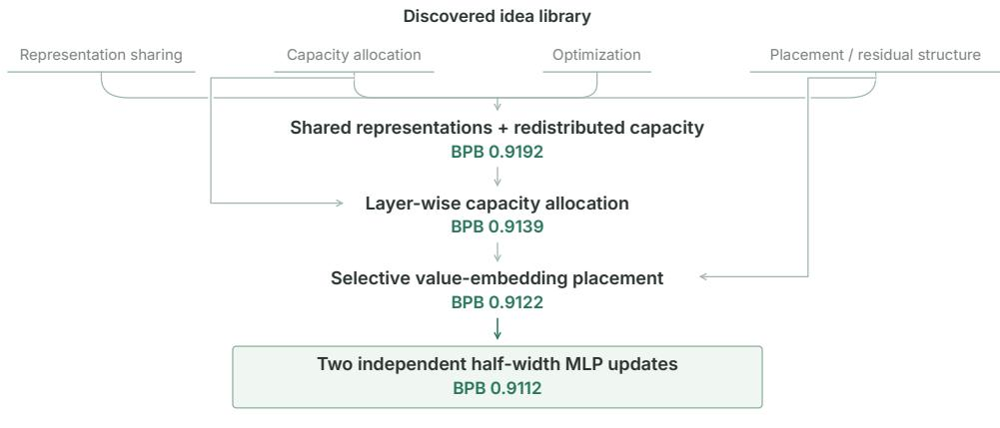  
Figure 5: The selected design emerges through reuse and reinterpretation of prior discoveries. The quality-driven search builds on mechanisms for representation sharing and capacity allocation, subsequently changing where these mechanisms act and ultimately reinterpreting the MLP update as two independent half-width sublayers. Rather than simply accumulating prior discoveries, the search selects, recombines, and modifies them into new designs.

## C.3 How Discovered Ideas Are Reused

Section 4.3 shows that ideas discovered in Arena’s short, target-specific searches can be reused to improve model quality at a larger training scale. Each candidate trains on a shared 10B-token pool for at most one hour or 2.217B tokens, whichever comes first. Here we examine how this reuse occurs. Rather than transferring a single winning program or mechanically combining all previous discoveries, the quality-driven search receives an idea library and can select, combine, modify, or discard its contents. We analyze the provenance of the selected design, representative interactions encountered during search, and how the candidate distribution evolves across search rounds.

The search draws on discoveries across objectives and harnesses. The recorded sources represented in the selected design span four research harnesses and four classes of Arena objectives: parameter eficiency, training tokens, training time, and training updates. They include mechanisms for sharing representations, allocating MLP capacity, changing optimization schedules, gating attention and value residuals, restricting context, and changing where computations are applied across depth. The resulting search is therefore not a continuation of one original objective or one harness trajectory. Instead, discoveries from heterogeneous searches form a common library of candidate research ingredients.

Reuse progressively transforms prior mechanisms. Figure 5 summarizes the main architectural progression leading to the selected design. An early improvement shares the value-embedding table and reallocates MLP capacity, reducing BPB from the reference value of 0.9295 to 0.9192. Sub-sequent search changes how capacity is distributed across depth and where value embeddings are injected, eventually reaching 0.9122. The final step changes a diferent aspect of the architecture: instead of one MLP update per block, the model applies two independent half-width MLP sublayers, reaching 0.9112 BPB. Thus, the selected design is not a direct union of library entries. The search progressively reinterprets how previously discovered mechanisms are implemented and combined.

Idea provenance spans multiple research histories. Table 9 lists the ten recorded idea sources represented in the selected search lineage. They originate from Sequential Search, GEAR, Auto- Scientists, and Heuresis, and from searches targeting parameters, training tokens, training time, and training updates. This diversity supports the intended role of the idea library: mechanisms discovered under one research objective can become hypotheses for subsequent research under another. At the same time, provenance only records where an idea entered the search; it does not establish tha every listed mechanism independently contributes to the final improvement.

Useful ideas do not combine monotonically. Representative outcomes in Table 10 reveal both positive and negative interactions. For example, simply reapplying an existing MLP adds another transfor-mation without introducing independent parameters and performs worse than the reference, whereas introducing a genuinely independent second MLP appears in the strongest final design. Other search outcomes show that individually strong modifications can lose their advantage when combined and that diferent allocations of approximately the same total MLP width can yield diferent quality. These observations are not controlled ablations, but they show why the idea library should not be viewed as a collection of independently additive improvements. Its value instead lies in providing structured hypotheses that subsequent research can test, reject, and reinterpret.

Table 9: Recorded idea sources represented in the selected search lineage. The quality-driven search draws on mechanisms originally discovered by four research harnesses under four classes of Arena objectives. The provenance records indicate where an idea entered the library, not an independent causal contribution to the final model.
<table><tr><td>Recorded idea</td><td>Source harness</td><td>Objective</td><td>Use in the quality-driven search</td></tr><tr><td>Shared value- embedding table</td><td>Sequential Search</td><td>Parameters</td><td>Shares token-dependent value represen- tations rather than maintaining separate lookup tables.</td></tr><tr><td>MLP width as a search GEAR variable</td><td></td><td>Parameters</td><td>Reallocates model capacity through MLP width rather than uniformly shrinking the</td></tr><tr><td>Reduced weight decay</td><td>GEAR</td><td>Training tokens</td><td>architecture. Changes optimization while retaining the architectural backbone.</td></tr><tr><td>Square-root cooldown</td><td>Heuresis</td><td>Training time</td><td>Changes the learning-rate schedule during later training.</td></tr><tr><td>Per-head attention out- put gate</td><td>Sequential Search</td><td>Training time</td><td>Introduces learned control over individual attention-head outputs.</td></tr><tr><td>Sparse value-residual gate channels</td><td>AutoScientists</td><td>Parameters</td><td>Restricts value-residual gating to a subset of channels.</td></tr><tr><td>Shorter attention win- dow</td><td>GEAR</td><td>Training updates</td><td>Changes the amount of context processed by attention.</td></tr><tr><td>Layer-specific MLP widths</td><td>AutoScientists</td><td>Parameters</td><td>Redistributes MLP capacity across depth while approximately preserving total width.</td></tr><tr><td>Value embeddings at se- Sequential Search lected stack depths</td><td></td><td>Training time</td><td>Moves value-residual injection layers at depth {1,3,5,7} to {0,1,6,7}.</td></tr><tr><td>Two independent half- Heuresis width MLP sublayers</td><td></td><td>Training tokens</td><td>Motivates a final design with two indepen- dent MLP updates within each block.</td></tr></table>

Table 10: Idea reuse is selective rather than additive. Representative outcomes from the quality-driven search show that plausible combinations can help or hurt. These comparisons arise from the search process and are not controlled ablations.
<table><tr><td>Representative design</td><td>BPB↓</td></tr><tr><td>Fixed reference</td><td>0.929497</td></tr><tr><td>Shared value embedding + redistributed MLP capacity</td><td>0.919165</td></tr><tr><td>Reapply the same MLP without introducing independent capacity</td><td>0.934888</td></tr><tr><td>Redistribute approximately the same total MLP width across depth</td><td>0.913908</td></tr><tr><td>Inject value embeddings only at selected stack depths</td><td>0.912195</td></tr><tr><td>Further tune the selective-injection design</td><td>0.911221</td></tr><tr><td>Two independent half-width MLP sublayers</td><td>0.911213</td></tr></table>

Search progressively moves into a stronger design region. Figure 6 shows the distribution of candidate quality across the six search rounds. None of the 56 valid candidates in the first round outperforms the fixed reference, compared with 44/56, 29/56, 50/56, 55/56, and 25/25 in subsequent rounds. The temporary broadening in the third round shows that the search does not simply accumu- late accepted improvements, while later rounds increasingly concentrate around substantially lower BPB. Across all rounds, 203 of 305 valid candidates outperform the reference, indicating that the improvement reflects a broad region of stronger designs rather than a single isolated candidate.

a Final BPB by search round  
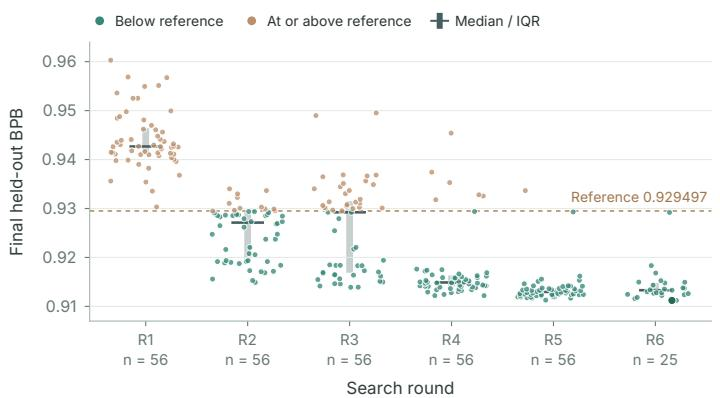

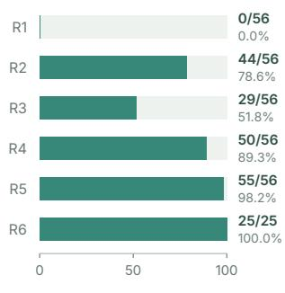  
Runs below reference (%)  
Figure 6: The quality-driven search progressively moves into a stronger region. Each point shows the final held-out BPB of one valid candidate, grouped by search round; horizontal jitter is used only to avoid overlap. Green points outperform the fixed reference (dashed line), while gray bars show the median and interquartile range within each round. The distribution shifts substantially below the reference after the first round and be- comes increasingly concentrated at lower BPB in later rounds. Overall, 203 of 305 valid candidates outperform the reference.

The exact top-ranked combination should not be overinterpreted. Although the search moves toward stronger designs overall, its best candidates are extremely close. The two best recorded can- didates achieve BPB values of 0.911213 and 0.911221, difering by only $8 \times 1 0 ^ { - 6 }$ in their one-hour evaluations. With one measurement per candidate, diferences at this scale do not establish that either design is uniquely superior to nearby alternatives. We therefore interpret the experiment as evidence that the discovered idea library guides subsequent research toward a productive region of model designs, rather than that one particular combination is uniquely optimal.

## D Elo Scores

Table 2 reports the best recorded admissible target values across nine objectives for Opus 5 and GPT-6. We aggregate these values using the same margin-aware Elo procedure, with equal weight assigned to each objective.

Training times are compared after rounding to the nearest 30-second checkpoint; matching check-points are ties. Ratings are calculated from these stored target values before display rounding or unit conversion. The two agent-model groups use separate method pools, each with a mean rating of 1500, so Elo comparisons are made within each group.

All harnesses begin each calculation with the initial rating $R = 1 5 0 0$ . Lower values are better for every included objective.

Turn best admissible results into pairwise outcomes

$$
y _ { a , b , j } = \left\{ { \begin{array} { l l } { 1 , } & { x _ { a , j } < x _ { b , j } } \\ { { \frac { 1 } { 2 } } , } & { x _ { a , j } = x _ { b , j } } \\ { 0 , } & { x _ { a , j } > x _ { b , j } } \end{array} } \right.
$$

$x _ { a , j }$ is harness $\boldsymbol { a } ^ { \prime } \boldsymbol { \mathrm { s } }$ best recorded admissible target value on objective $j . ~ y _ { a , b , j }$ is the outcome when harness a is compared with harness b: 1 for a win, $\begin{array} { l } { { \frac { 1 } { 2 } } } \end{array}$ for a tie, and 0 for a loss.

## Estimate the expected outcome from the current ratings

$$
E _ { a , b } = \frac { 1 } { 1 + 1 0 ^ { ( R _ { b } - R _ { a } ) / 4 0 0 } }
$$

$R _ { a }$ and $R _ { b }$ are the harnesses’ current ratings. $E _ { a , b }$ is the outcome expected for harness $^ { a , }$ between 0 and 1. A higher-rated harness is expected to win more often.

Measure how large the win is

$$
d _ { a , b , j } = \log \left( \frac { x _ { b , j } } { x _ { a , j } } \right) , \qquad z _ { a , b , j } = \frac { | d _ { a , b , j } | } { s _ { j } } , \qquad m _ { a , b , j } = \operatorname* { m i n } \left( 3 , \frac { \log ( 1 + z _ { a , b , j } ) } { \log 2 } \right)
$$

$d _ { a , b , j }$ is the logarithm of the ratio between the two target values. Using a ratio makes proportional improvements comparable within an objective. $s _ { j }$ is the median nonzero absolute log margin between all harness pairs on objective $j ,$ bounded below by $1 0 ^ { - 9 }$ ; it defaults to 1 when every pair is tied. It defines a typical margin for that objective. $z _ { a , b , j }$ expresses the observed margin in units of that typical margin. The margin multiplier $m _ { a , b , j }$ grows gradually with the margin and is capped at 3 so that one unusually large win cannot dominate the ranking. Exact ties have a zero multiplier and cause no rating update.

Weight objectives and update both ratings

$$
\Delta R _ { a } = K { \frac { w _ { j } } { \bar { w } } } m _ { a , b , j } \bigl ( y _ { a , b , j } - E _ { a , b } \bigr ) , \qquad R _ { a } \gets R _ { a } + \Delta R _ { a } , \qquad R _ { b } \gets R _ { b } - \Delta R _ { a }
$$

K is 32, which controls the size of each update. $w _ { j }$ is objective $j ^ { \circ } \mathrm { s }$ weight, and $w ^ { - }$ is the average objective weight. Dividing by the average keeps an ordinary comparison near the standard Elo update size. The term $y - E$ rewards results that exceed the current expectation and penalizes results that fall short.

## Reduce sensitivity to comparison order

Because Elo updates happen one comparison at a time, their order can slightly afect the result. The calculator therefore generates 4,000 permutations using NumPy’s default random generator with seed 20260902. Each pass starts all harnesses at 1500 and processes every pair once per objective; the reported score is the mean final rating across passes. The zero-sum updates preserve a cohort mean of 1500 for both agent-model groups, without a final shift or fixed maximum. The published score is a relative rating of the best recorded admissible results, not a percentage or a measurement in any resource unit.

## E Extended Related Work

## E.1 Autonomous-Research Benchmarks

Implementation, reproduction, and research tasks. Benchmarks cover repository execution, method implementation, reproduction, and expert-specified extensions (Bogin et al., 2024; Siegel et al., 2025; Hua et al., 2025; Yan et al., 2025; Starace et al., 2025; Kon et al., 2026; Edwards et al., 2026). Related capability suites assess software and command-line tasks (Jimenez et al., 2024; Merrill et al., 2026), retrieval (Wei et al., 2025; Xiong et al., 2026), scientific discovery and programming (Majumder et al., 2025; Chen et al., 2025b; Tian et al., 2024), and theorem proving (Tsoukalas et al., 2024). Arena instead leaves the improvement mechanism open and evaluates a measured optimization target under quality and resource constraints.

Open-ended research and research artifacts. Machine-learning engineering, research competitions, and paper-derived research environments support open-ended experimentation under taskspecific evaluation protocols (Chan et al., 2025; Miller et al., 2025; Wijk et al., 2025; Nathani et al., 2025; Garikaparthi et al., 2026; Lupidi et al., 2026; Wu et al., 2026; Zhang et al., 2025c). Other evaluations examine proposals, experiments, reports, alignment, and artifact support across research stages (Tang et al., 2025; Liu et al., 2026; Chen et al., 2025a; Xu et al., 2026; Cui et al., 2026; Zhang et al., 2026; Bragg et al., 2026). Arena focuses on how harness performance changes across objectives in one language-modeling environment, ranking measured endpoints and using traces as explanatory evidence.

Language-model and computational optimization. Language-model benchmarks evaluate validation loss, training speed, reproduction of historical improvements, or post-training under compute constraints (Karpathy, 2026; Intology, 2026; Zhao et al., 2025; Rank et al., 2026); systems benchmarks target kernels, numerical routines, and software performance under correctness require- ments (Ouyang et al., 2025; Press et al., 2025; Shetty et al., 2025). Arena spans nine model, training, and inference objectives with a common quality requirement and objective-specific resource limits.

Evaluation validity and reliability. Studies examine eficiency and scafold contributions after benchmark saturation (Nadgir et al., 2026), specification and evaluator inconsistencies (Tu et al., 2026), and hardware sensitivity and score aggregation (Chen et al., 2026). These concerns motivate distinguishing valid resource improvements from apparent gains caused by evaluation artifacts.

## E.2 Autonomous-Research Harnesses

End-to-end workflows. Research systems connect literature review, idea generation, implementation, experiments, analysis, and reporting (Lu et al., 2026; Tang et al., 2025; Trirat et al., 2025; Schmid all et al., 2025). The research harness orchestrates these activities around a foundation model.

Tree, archive, and evolutionary search. Harnesses allocate experiments through code trees, hypothesis trees, archives, and alternative selection policies (Jiang et al., 2025; Toledo et al., 2025; Jin et al., 2026; Antoniades et al., 2026). Population-based methods retain competing programs or heuristics and generate candidates using executable feedback, mutation, or crossover (Romera Paredes et al., 2024; Liu et al., 2024; Novikov et al., 2025; Jeddi et al., 2026). These search procedures organize exploration; performance gains alone do not establish scientific novelty.

Multi-agent coordination and persistent memory. Teams, proposal critique, execution recovery, and shared successful or failed experiments support sustained research (Gao et al., 2026; Liu et al., 2026). Semantic, episodic, and structured scientific memory provide complementary mechanisms for retaining knowledge across sessions (Fang et al., 2025; Gottweis et al., 2026; Mitchener et al., 2025).

Harness design and self-improvement. Other methods optimize agent architectures, workflows, or implementations through meta-search and recursive improvement (Hu et al., 2025; Zhang et al., 2025b;a; Srikanth et al., 2026). Their search object is the research procedure itself, rather than only the candidate experimental program.

Arena evaluates harness–model combinations across multiple optimization objectives in a shared language-modeling environment, leaving the search strategy open and retaining standardized experimental traces.