# ACCELERATING SO(2)-EQUIVARIANT MATERIALS MODELS THROUGH LOW-PRECISION EMULATION

Denghui Lu, Alexander Maeder, Alexandros Nikolaos Ziogas,

Mathieu Luisier & Manasa Kaniselvan

D-ITET, ETH Zurich, Zurich, Switzerland

{denghuilu,almaeder,alziogas,mluisier,mkaniselvan}@iis.ee.ethz.ch

## ABSTRACT

Rotationally equivariant architectures improve the physical fidelity of machinelearned (ML) universal materials models based on graph neural networks (GNNs). However, their scalability is limited by the use of non-trivial, high-precision tensor operations during both training and inference. Adopting the reduced-precision formats of matrix multiplication units (MMUs), e.g., FP8 instead of FP32, provides massive increases in throughput, up to 30× (60×) on NVIDIA Hopper (Blackwell) GPUs, but may lead to drastic loss of accuracy. Here, we introduce tailored ‘emulated’ low-precision operations under the integer Ozaki scheme to accelerate the ‘SO(2)-equivariant’ processing layers of GNNs, which dominate the runtime of (1) many state-of-the-art ML interatomic potentials (MLIPs) and (2) most universal ML Hamiltonian (MLH) models. Our framework, FlashSO(2), outperforms TF32, the most accurate native low-precision MMU format, in throughput, accuracy, and memory footprint at once. At the SO(2) layer level, it reaches 40× (7×) the throughput of MALOQ’s (UMA’s) reference implementation, an MLH (MLIP) model, sustaining up to 236 (232) effective Tflop/s on an NVIDIA GH200, 3.5× the FP32 peak. At the model level, FlashSO(2) helps train MALOQ 3.9× faster than its pure-FP32 version while reducing peak memory by 58% at no loss in accuracy. In molecular dynamics simulations with UMA, the speedup factor is 3.3×, and the peak memory is reduced by 51%. FlashSO(2) thus pushes the speed-accuracy Pareto frontier of equivariant materials models beyond the native low-precision formats and substantially lowers the resources required to exploit their scaling laws.

## 1 INTRODUCTION

Universal machine-learned (ML) models based on graph neural networks (GNNs) are revolutionizing computational materials science by bringing ab initio calculations of key properties such as energies, forces, or electronic structures to previously unfeasible atomic scales and elemental diversity. Beyond the standard ML interatomic potentials (MLIPs) (Wood et al., 2025; Fu et al., 2025; Batatia et al., 2022; Mazitov et al., 2025), which drive molecular dynamics (MD) engines, the underlying architectures have been adapted to effectively learn higher-rank matrix-valued properties including Hamiltonians (Kaniselvan et al., 2025; Li et al., 2025, 2026b; Kim et al., 2025; Zhong et al., 2023) and Hessians (Burger et al., 2025). Improvements in representation (Geiger & Smidt, 2022) and engineering of inductive biases (Batzner et al., 2022) have played a pivotal role in bringing ML materials models close to a suitable accuracy, at the level of density-functional theory (DFT), for downstream scientific applications across different fields.

Progress in universal materials models is now increasingly driven by aggressive scaling across both data volume and model capacity. Today’s largest atomic structure datasets consist of on the order of 100M structures (Fig. 1(a)). For a given set of structures, going from their simple scalar (energies) to their vector (forces) properties, up to high-rank operators (Hamiltonians, density matrices), increases the volume of training data available by several orders of magnitude. MLIP and ML Hamiltonian (MLH) prediction models are currently at typical scales of 110M parameters (Fig. 1(b)), and scaling laws indicate that their performance will continue to enhance with further increases in model size (Wood et al., 2025). Improvement along these axes thus presents the most direct avenue to further push their capabilities.

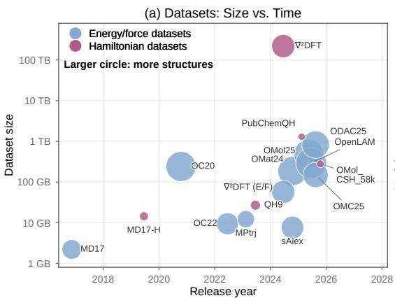

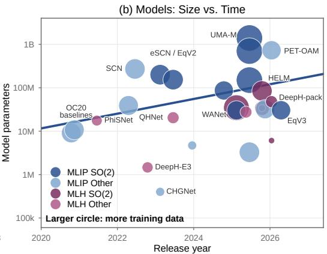  
Figure 1: Historical trends in ML materials models and data scaling. (a) Training datasets by release year and size on disk. (b) MLIP (blue) and MLH (pink) models by release year and parameter count.

Increasing the number of learnable parameters and training on terabytes of DFT datasets pose significant computational challenges that can be addressed at the theory, algorithm, and/or hardware level. Initially, the scalability of the ML architectures was tackled through mathematical simplification of their tensor operations. Passaro & Zitnick (2023) introduced a rotationally-equivariant layer, analogous to full Clebsch–Gordan Tensor Products (CGTPs) (Geiger & Smidt, 2022). By reducing the computational complexity from $O ( l _ { m a x } ^ { 6 } )$ to $O ( l _ { m a x } ^ { 3 } )$ , this innovation enabled scaling to higher maximum spherical degree $( \bar { l } _ { m a x } )$ and to a larger number of learnable parameters. These $\mathrm { \tilde { \cdot } S O \bar { ( 2 ) } }$ equivariant layers’ were adopted in several MLIPs such as eSEN (Fu et al., 2025), EquiformerV2 (Liao et al., 2023), UMA (Wood et al., 2025), and DPA4 (Li et al., 2026a). The ability to process higher spherical embedding ranks also unlocks efficient treatment of material properties involving larger $l _ { m a x } , \mathbf { e . g . }$ , electronic structures. SO(2) layers thus currently power nearly all scalable MLH models, for example DeepH-pack (Li et al., 2026b), WANet (Li et al., 2025), HELM (Kaniselvan et al., 2025), and MALOQ (Kaniselvan et al., 2026).

SO(2) layers are typically executed in FP32 precision. Despite their reduced arithmetic complexity compared to CGTPs, they still account for more than 80% of each inference step (Fig. 6(a)), leaving the hardware level as the primary remaining lever to further improve scalability. On the other hand, mainstream machine learning and large language models (LLMs) rely on lower-precision operations, e.g., FP16, BF16, or FP8 (Jacob et al., 2017; Micikevicius et al., 2017), performed on matrix multiplication units (MMUs), e.g., tensor or matrix cores. On NVIDIA Hopper GPUs, these MMUs offer 7× (TF32) to 30× (FP8) the peak throughput of general-purpose FP32 units. LLMs can exploit them because their linear and attention layers tolerate the rounding errors of reduced precision (Micikevicius et al., 2022; DeepSeek-AI, 2024; Shah et al., 2024). Symmetryconstrained GNNs lack this robustness. Although some MLIP and MLH models pretrain in BF16 to save compute time, low precision formats remain unsuitable for fine-tuning and inference as they introduce random error under rotations. Notably, BF16 alone degrades UMA’s accuracy by 20% to 50% (Wood et al., 2025). Symmetry-constrained ML materials models, therefore, spend most of their compute time in FP32 or even FP64 general-purpose units, and leave the MMUs idle.

Here, we address this gap through custom precision emulation, notably the Ozaki scheme (Ozaki et al., 2012), which reconstructs high-precision matrix products from exact low-precision ‘slice products. Specifically, we introduce FlashSO(2), a software-hardware co-designed implementation of the $\mathrm { S O } ( 2 )$ layer with the integer Ozaki emulation (Ootomo et al., 2024), where the slice count obeys equivariant constraints, the scaling follows expected tensor value distributions, while slicing and reconstruction are fused with the surrounding kernels. As a result, the SO(2) layer can run on INT8 MMUs within a $1 0 ^ { - 4 }$ equivariance tolerance, and FlashSO(2) simultaneously demonstrates better accuracy, higher throughput, and a smaller memory footprint than the native TF32 format. At the level of the $\mathrm { \bar { S O } ( 2 ) }$ layer, it reaches 40× the throughput of the reference implementation in the MALOQ MLH architecture $( l _ { m a x } = 8 )$ and 7× in the UMA-Large (UMA-L) MLIP $( l _ { m a x } = 6 )$

sustaining 236 and 232 effective Tflop/s on an NVIDIA GH200 superchip, 3.5× the FP32 peak. As the layer dominates each step, MALOQ trains 3.9× faster end-to-end than FP32 at 58% lower peak memory. UMA-Medium (UMA-M) runs training (inference) steps 2.6× (3.3×) faster, at 41% (51%) lower peak memory. A memory-lean mode called ‘MiniMem’ further cuts peak memory by 81% and extends single-GPU inference from 5.3k atoms (85.2k edges) in FP32 to 25.6k (410k edges), all while accelerating training by 1.9× compared to FP32.

## 2 RELATED WORK

Equivariant MLIP and MLH architectures Mainstream GNN-based MLIP and MLH models take advantage of spatial locality and interatomic interaction decay with increased input structure sizes, i.e., number of atoms. One of the main advances in reaching realistic physical fidelity has been the integration of rotational symmetry into the backbone architectures of these models (Batzner et al., 2022; Batatia et al., 2022; Li et al., 2026b). Doing so restricts the learnable space to physically valid representations and enforces physical properties that standard loss functions, e.g., mean absolute error, may not capture. We refer to Passaro & Zitnick (2023) for the relevant mathematical background behind the transformation of CGTPs into more computationally efficient SO(2) convolutions, which serve as the core message-passing (MP) engine across several universal MLIP and MLH architectures.

An important difference between the equivariant backbone of energy/force and Hamiltonian matrix prediction resides in the maximum angular momentum, $l _ { m a x } .$ . MLIPs treat $l _ { m a x }$ as a hyperparameter and increase it to incorporate higher-frequency intermediate information into the node/edge embeddings, which are eventually filtered out within the output head to predict scalar (energy E) and vector (force F) quantities. Meanwhile, MLH models set $l _ { m a x }$ to match the dimensionality of the data: For a given atomic orbital basis with highest orbital degree $l _ { 1 } .$ , the interaction which produces the maximum output degree is $l _ { 1 } + l _ { 1 }$ (Schutt et al.¨ , 2019). For example, datasets containing d-orbitals (l = 2: MD17 (Schutt et al.¨ , 2019), QH9 (Yu et al., 2023), or $\nabla ^ { 2 } \mathrm { D F T }$ (Khrabrov et al., 2024)) require $l _ { m a x } = 4 .$ , those containing f-orbitals (l = 3: OMol CSH 58k (Kaniselvan et al., 2025), PubChemQH (Li et al., 2025)), $l _ { m a x } = 6$ . Special datasets including complex compounds such as lanthanides, as encountered in the full OMol25 electronic structure data (Levine et al., 2025), require $l _ { m a x } = 8$ due to the presence of g-orbitals.

Acceleration of ML materials models Recent efforts to scale MLIPs to larger system sizes and longer timescales have reduced both training and inference times at the software and system level. At the software level, EquiformerV3 (Liao et al., 2026) fused the permutation matrices of its SO(2) linear layers into the Wigner-D rotations and leveraged PyTorch’s Just-In-Time compiler (torch.compile) (Ansel et al., 2024) to eliminate redundant operations, yielding a 1.75× training speedup over EquiformerV2 (Liao et al., 2023). DPA4 made conservative force training compatible with torch.compile, cutting its training time per step threefold (Li et al., 2026a). At the system level, Gao et al. (2026) ran the eSEN-omol backbone through a distributed inference framework that spreads fully solvated enzymes of 32k to 54k atoms over 8 to 32 GPUs, reaching millions of MD steps per day and 1 µs of aggregated simulation time.

Emerging SO(2)-convolution-based MLH architectures have also started to focus on scalability across structure size, orbital basis, and elemental diversity. DeepH-pack demonstrated inference on 4,096-atom amorphous Silicon systems (Li et al., 2026b). WANet integrated custom loss functions to improve scalability to elements with larger basis sets and requiring higher spherical degree (Li et al., 2025). HELM leveraged advanced batching schemes to train on the OMol CSH 58k universal Hamiltonian dataset (Kaniselvan et al., 2025). MALOQ introduced graph partitioning approaches to tackle Hamiltonians representing systems consisting of 10k+ atoms, comparable to experimentally fabricated electronic devices (Kaniselvan et al., 2026). However, the core SO(2) layer bottleneck has yet to be sped up. We note that many kernel libraries for equivariant networks, for example cuEquivariance (NVIDIA, 2024), OpenEquivariance (Bharadwaj et al., 2025), and FlashTP (Lee et al., 2025), fuse the CGTPs of SO(3) architectures such as MACE (Batatia et al., 2022) and NequIP (Batzner et al., 2022). These methods do not cover the SO(2) convolution, whose cost lies in dense matrix products per spherical order rather than in sparse coupling contractions.

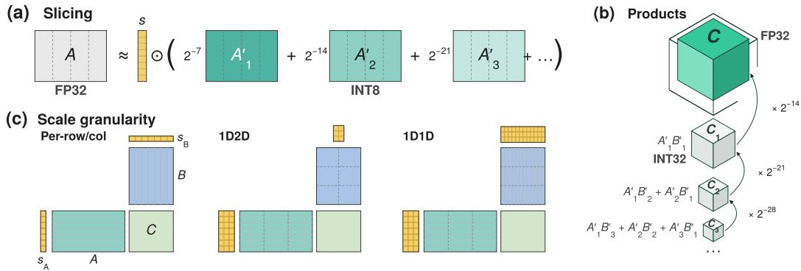  
Figure 2: Integer emulation with block scales. (a) An FP32 matrix is split into p INT8 slices. (b) The slice products ${ \bf A } _ { i } ^ { \prime } { \bf B } _ { j } ^ { \prime }$ with $i + j \le p + 1$ 1 are accumulated exactly in INT32 and summed in FP32 with weights $2 ^ { - 7 ( i + j ) }$ . (c) Block scaling refines the scales (yellow) from one per row of A and column of B in the Ozaki scheme to one per 128 entries of a row (1-D) or per $1 2 8 \times 1 2 8$ tile (2-D).

High-precision matrix product on low-precision units Precision emulation, notably the Ozaki scheme (Ozaki et al., 2012), computes a high-precision matrix product on low-precision MMUs by splitting each operand into a sum of low-precision slices. For example, the integer form of the Ozaki scheme (Ootomo et al., 2024) uses INT8 slices with INT32 accumulation, which makes the partial products exact on the INT8 MMUs of the GPU. NVIDIA has since adopted this form for FP64 emulation in its cuBLAS library on Blackwell (Schwarz et al., 2026). EmuGEMM (Lu et al., 2026) further removes the slicing and reconstruction round trips with fused kernels.

## 3 METHODS & IMPLEMENTATION

This section introduces the two ingredients of FlashSO(2) and their combination. In Section 3.1 we provide relevant background on precision emulation, which computes a high-precision matrix product from INT8 products, together with the block scaling strategy we adopt. Section 3.2 presents the implementation of the $\mathrm { S O } ( 2 )$ layer, distinguishing between the matrix products, which carry most of the arithmetic and the steps that mainly move data. Section 3.3 describes how FlashSO(2) builds emulation into this layer.

## 3.1 INTEGER EMULATION WITH BLOCK SCALING

Figure 2 illustrates the integer Ozaki scheme (Ootomo et al., 2024) with block scaling for a single matrix product $\mathbf { C } = \mathbf { A } \mathbf { B }$ , where $\mathbf { A } \in \mathbb { R } ^ { M \times K }$ and $\mathbf { B } \in \mathbb { R } ^ { K \times N }$ are given in FP32. The three steps below follow panels (a)–(c) of the figure. Steps (1) and (2) are the Ozaki scheme itself, while step (3) covers the block scaling.

(1) Scaling and slicing: INT8 MMUs multiply integers, meaning that the FP32 entries must be first converted to fixed point. Specifically, each row of A (and each column of B) is divided by the power of two just above its largest entry, giving the whole row a shared scale. Each scaled entry is then cut into p INT8 slices (Fig. 2(a)). The entry is the sum of its slices weighted by their place values i with $2 ^ { - 7 i }$ . With p slices, a setting we refer to here as ‘Emup’, an operand can theoretically keep $7 p$ bits accuracy. Notably, Emu2 keeps 14 bits, more than the 10 mantissa bits of TF32.

(2) Products and reconstruction: After slicing, the product of two operands expands into $p ^ { 2 }$ pairs of slice products ${ \bf A } _ { i } ^ { \prime } { \bf B } _ { j } ^ { \prime } .$ , one per pair of slices, each carrying the weight $2 ^ { - 7 ( i + j ) }$ (Fig. 2(b)). In practice, we only keep the products with $i + j \le p + 1$ . The result is reassembled as

$$
\begin{array} { r } { \mathbf { A B } \approx \mathrm { d i a g } ( \pmb { \mu } ) \left[ \sum _ { i + j \leq p + 1 } 2 ^ { - 7 ( i + j ) } \mathbf { A } _ { i } ^ { \prime } \mathbf { B } _ { j } ^ { \prime } \right] \mathrm { d i a g } ( \pmb { \nu } ) , } \end{array}\tag{1}
$$

where diag(µ) and diag(ν) restore the row and column scales of step (1). Each slice product ${ \bf A } _ { i } ^ { \prime } { \bf B } _ { i } ^ { \prime }$ is computed on INT8 MMUs with INT32 accumulation, which multiply and add integers exactly, avoiding the introduction of rounding errors. According to $\mathbf { E q } .$ . 1, Emu1–Emu3 cost 1, 3, and 6

INT8 MMU products, respectively. The slice count, therefore, sets precision and cost in much finer steps than native formats offer.

(3) Block scaling: The slices fix the number of bits kept by an operand, 14 for Emu2. The scales determine how well each entry uses them. With one scale per row, the bits are aligned to the largest entry of the row, and every factor of two below it costs one bit. An entry $2 ^ { 1 0 } \approx 1 0 0 0 \times$ smaller than the row maximum thus keeps only 4 bits of the 14 bits, fewer than the 7 mantissa bits of BF16. Block scaling (DeepSeek-AI, 2024) instead gives every block of 128 consecutive entries along K its own scale (Fig. 2(c)).

## 3.2 SO(2) LAYER PIPELINE

To eliminate the computational cost of full CGTPs, SO(2)-convolution architectures project 3D rotational interactions onto an aligned 2D reference frame along the interatomic edge vectors. At the beginning of each forward pass, for each directed edge $( i , j )$ , we precompute an origin-aligned Cartesian rotation matrix $g _ { i j }$ that rotates the unit edge vector $\hat { \mathbf { r } } _ { i j }$ to point along the global zˆ-axis: $g _ { i j } { \cdot } \hat { \mathbf { r } } _ { i j } = \hat { \mathbf { z } }$ , and store the corresponding Wigner-D matrix $\mathbf { D } ( g _ { i j } )$ . Then, each SO(2) layer performs the following set of operations, which are summarized schematically in Fig. 3(a).

Rotation to a common axis (S1): Features $\phi ^ { ( l ) }$ , consisting of multichannel spherical harmonic coefficients from rank $0 . . . l _ { m a x }$ along each edge, are rotated to the global zˆ-axis using the Wigner-D matrices. These matrices consist of block diagonal components (Fig. 3(a)). If $\mathbf { D } ^ { ( l ) } ( g _ { i j } )$ is the Wigner-D matrix of rank l corresponding to $g _ { i j }$ , the rotation of $\phi ^ { ( l ) }$ yields $\tilde { \phi } ^ { ( l ) } = \mathbf { D } ^ { ( l ) } ( g _ { i j } ) \bar { \phi } ^ { ( l ) }$

SO(2) Conv 1: To optimize computational execution, the rotated features first undergo a layout transformation, where they are permuted from a standard ‘l-major’ memory layout to an ‘m-major’, i.e. the feature entries are grouped by their m index. The SO(2) layer operation then transforms each m-subspace through a separate linear layer, performing up to $l _ { m a x } + 1$ GEMM operations.

Gated non-linear activation (S2): A gated activation layer is typically introduced between convolutions. In this step, the purely scalar components $( l = 0 )$ of the intermediate message undergo a standard non-linear activation $\sigma _ { \mathrm { s c a l a r } } ~ ( { \mathrm { e . g . , 5 i L U } } )$ . Doing the same to higher-order tensor components $( l > 0 )$ would break equivariance. Instead, a gating function $\sigma _ { \mathrm { g a t e } }$ is used to scale all the m-components within each feature.

SO(2) Conv 2: A second SO(2) convolution layer operates analogously to the first one, followed by a layout transformation back to l-major.

Rotation back to the global frame (S3): The resulting messages $m _ { i j } ^ { l }$ are rotated back to the global reference frame using the inverse Wigner-D transformation: $\hat { \mathbf { m } } _ { i j } ^ { ( l ) } = \mathbf { D } ^ { ( l ) } ( g _ { i j } ^ { - 1 } ) m _ { i j } ^ { l }$ . Node updates are obtained by aggregating these messages: $\begin{array} { r } { \mathbf { h } _ { i } ^ { \prime } = \mathbf { h } _ { i } + \sum _ { j \in \mathcal { N } ( i ) } \hat { \mathbf { m } } _ { i j } } \end{array}$ , where $\mathcal { N } ( \bar { i } )$ represents the neighborhood of node i within a specified cutoff.

## 3.3 OPTIMIZING PRECISION EMULATION FOR SO(2) LAYERS

The SO(2) layer of Section 3.2 proceeds in a chain of memory-bound stages. The time spent in this layer depends largely on two things: memory traffic and matrix products. FlashSO(2) addresses both with the following strategies.

(1) Raising arithmetic intensity. FlashSO(2) fuses everything around the GEMMs of the forward pass into three kernels, the dashed boxes S1 to S3 in Fig. 3(a). Inside each kernel, the intermediate results stay in registers instead of being transferred to off-chip memory in between the separate PyTorch kernels of the reference implementation. Between kernels, only INT8 slices and their scales are written. S1 gathers, rotates, and weights the edge features. S2 applies the activation and the gate, computed in its first pass over the orders m and never stored. S3 rotates the messages back and sums them into the nodes without a message buffer. The backward pass, Fig. 3(b), mirrors this. Each convolution backward runs two GEMMs per order m, the activation gradients continue in INT8, and the weight gradients dW are returned in FP32. S1 also returns $d \phi$ . This operation only needs the INT8 slices, scales, and gate logits (dashed arrows) from the forward pass, so again, no FP32 activation is stored.

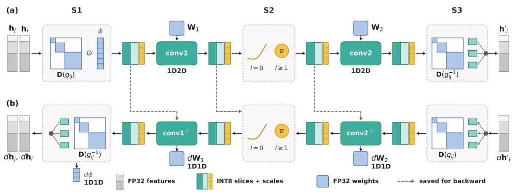  
Figure 3: FlashSO(2): the SO(2)-convolution block and its fused implementation. (a) Forward pass; each dashed box S1 to S3 is one fused kernel: Only INT8 slices and their scales pass between kernels. (b) Backward pass (read from right to left); each kernel is placed under its forward counterpart. Dashed arrows mark the tensors saved in the forward pass.

(2) Emulating high-precision products in INT8 MMUs. With the chain of operations in the SO(2) layer fused, the GEMMs (conv1/2 boxes in Fig. 3) dominate the execution time; FlashSO(2) runs them on the INT8 MMUs with the block-scaled emulation of Section 3.1. Block scaling is needed here for two reasons. The activations of the SO(2) layer spread over orders of magnitude within a row, so with one scale per row, small entries keep few bits. The weight gradient, in turn, sums over the edge dimension, which in equivariant models could exceed 65,536 $( \bar { 2 } ^ { 1 6 } )$ , at which point an INT32 sum over a whole row could overflow. One scale per block of 128 entries (Fig. 2(c)) fixes both issues. The two operands are not equally demanding: The activations and their gradients carry one scale per 128 entries of a row (1-D), whereas the evenly distributed weights need only one per 128 × 128 tile (2-D). The forward GEMM and the activation gradient are thus 1-D×2-D products, the weight gradient 1-D×1-D.

(3) Compatibility with system-level optimizations. As illustrated in Fig. 3, FlashSO(2) is a mixed precision implementation. The weights enter and leave the SO(2) layer in FP32, the INT8 slices exist only inside it, and every other module of the model, including the optimizer, runs in FP32. Therefore, FlashSO(2) is completely orthogonal to standard system-level optimizations, which apply on top of it unchanged. Torch.compile (Ansel et al., 2024) still fuses the small operations outside the layer and removes their Python overhead, and CUDA graphs still remove the launch latency of the remaining kernels. To replace standard activation check-pointing, we introduce a customized check-pointing mode, MiniMem. It recomputes the SO(2) layer in the backward pass of FlashSO(2), trading speed for further memory savings.

## 4 RESULTS

We evaluate FlashSO(2) at two levels. First, in Sections 4.1 and 4.2, we consider the SO(2) layer on its own, where we measure the equivariance error of each precision setting and compare the native and fused implementations on a roofline model. In Section 4.3, we then integrate our FlashSO(2) implementation into representative SO(2)-layer-based MLH (MALOQ (Kaniselvan et al., 2026)) and MLIP (UMA (Wood et al., 2025)) models. Despite their shared SO(2) convolution architecture, these models differ in their number of layers, $l _ { m a x }$ , and $m _ { m a x } ,$ , as discussed in Section 2. We report accuracy, training time, inference time, and peak memory. All experiments were run on a single NVIDIA GH200 superchip, except the training runs of Fig. 5(a).

## 4.1 EQUIVARIANCE ANALYSIS

Equivariant models enforce rotational symmetries through exact mathematical constants (e.g., Clebsch-Gordan coefficients), thus any rounding of the intermediate activations appears as a rotation-dependent error in the output. We quantify this error in Fig. 4(a-b) through polar plots, where the magnitude of each point represents the deviation between the model performing a rotation and a mathematically exact rotation of the target, measured as the largest component-wise residual of the equivariance identity. Figure 4(a) is concerned with MALOQ (rotating a Hamiltonian target), Fig. 4(b) with UMA (rotating a force target). In both applications, the $\mathrm { S O } ( 2 )$ layer is run at varying precisions, and an equivariance tolerance criterion of $1 0 ^ { - 4 }$ (dashed ring) is adopted, one order of magnitude below the $1 0 ^ { - 3 }$ value used by e3nn (Geiger & Smidt, 2022).

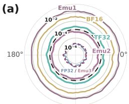

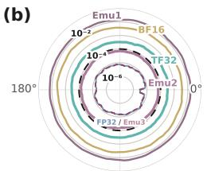

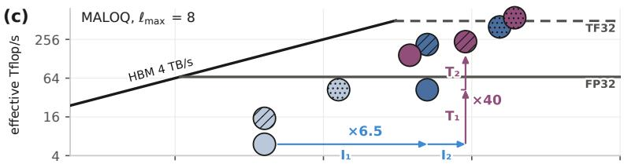

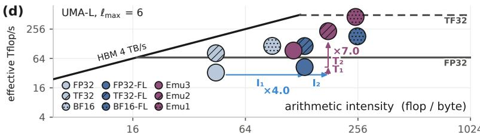  
Figure 4: Equivariance and roofline analysis of the SO(2) convolutions under low precision. Rotation-equivariance residual of the (a) MALOQ Hamiltonian output head and (b) UMA forces against the rotation angle. The dashed ring marks the $1 0 ^ { - 4 }$ tolerance. Roofline of the forward pass of (c) MALOQ and (d) UMA-Large (UMA-L) models. Light blue symbols: native implementation; dark blue: addition of fused layer(-FL); purple: fused layer with INT8 emulation (Emu1–Emu3). The arrows split the gain over the native layer into kernel fusion $( I _ { 1 }$ in intensity, $T _ { 1 }$ in throughput) and INT8 emulation $( I _ { 2 } , T _ { 2 } )$ . $I _ { 1 } = 4 . 6 ,$ $T _ { 1 } = 7 . 0 $ $I _ { 2 } = 1 . 4$ and $T _ { 2 } = 5 . 6$ in (c), and 2.9, 1.3, 1.4 and 5.5 in (d).

Among the native precision formats, only FP32 satisfies this criterion, explaining why symmetryconstrained models typically execute SO(2) layers on FP32 vector units. The native low-precision formats fail the equivariance test for both MALOQ and UMA: TF32’s results lie just outside the threshold ring, whereas BF16’s ones are two orders of magnitude further out, as our Emu1 approach. Emu2 instead stays inside the ring on both target models, and Emu3 is indistinguishable from FP32. Overall, Emu2 is the most computationally efficient setting on MMUs, while simultaneously fulfilling the tolerance criterion.

## 4.2 ROOFLINE MODELS OF THE SO(2) LAYER

We show roofline models of the native and FlashSO(2) implementation of the SO(2) layer at varying precisions, considering the embedding layout used in either MALOQ (Fig. 4(c)) or UMA (Fig. 4(d)). In both cases, we select the computationally ‘heaviest’ model settings. This corresponds to $l _ { m a x }$ up to $8 , m _ { m a x } = l _ { m a x }$ in MALOQ, and UMA’s ‘Large’ (UMA-L) configuration where $l _ { m a x } = 6 ,$ $m _ { m a x } = 2 .$ The arithmetic intensity quantifies the number of floating point operations per memory access. In both axes of Fig. 4(c-d), the number of floating point operations is counted according to FP32 arithmetic. An emulated run is therefore credited with the FP32 operations it replaces rather than the INT8 operations it executes. The arrows split the gain from the FP32 baseline to the Emu2 implementation into two steps, (1) kernel fusion $( \bar { I _ { 1 } } , T _ { 1 } )$ and (2) INT8 emulation $( I _ { 2 } , T _ { 2 } )$ .

Kernel Fusion Starting from the reference implementation, which executes the pipeline of Section 3.2 as a sequence of separate PyTorch kernels, we first isolate the performance improvements provided by kernel fusion (FL) alone, with no change in precision.

In both Fig. 4(c) and Fig. 4(d), the reference implementation is shown as the lightest blue circles. In MALOQ (UMA-L) it reaches only 6 (33) effective Tflop/s with 37 (45) flop/byte arithmetic intensity, 9% (49%) of the FP32 vector peak and 4% (18%) of what the memory bandwidth allows at this intensity. The SO(2) layer is thus neither compute nor memory bound. The kernel fusion strategy from Section 3.3 pushes the intermediate activations between the matrix products to stay in registers and shared memory. As a consequence, the arithmetic intensity rises by $I _ { 1 } = 4 . 6 \times$ (MALOQ) and 2.9× (UMA-L), the throughput by $T _ { 1 } = 7 . 0 \times$ and 1.3×, respectively. Our fused FP32 layer reaches an overall 63% of the FP32 vector peak performance in both models. At this point, the FP32 vector units are the new limit, and further gains must come from the MMUs.

INT8 Emulation Starting from the fused SO(2) layer, we now push the matrix products onto the INT8 MMUs. We use the precision emulation (Emu1–Emu3) detailed in Section 3.1. Emulation also stores the activations as INT8 slices, with two bytes per element instead of four.

Doing this further increases the arithmetic intensity by $I _ { 2 } = 1 . 4 \times$ , and throughput by $T _ { 2 } = 5 . 6 \times$ for MALOQ, while $I _ { 2 } = 1 . 4 \times$ and $T _ { 2 } = 5 . 5 \times \mathrm { f o r U M A } \mathrm { - } \dot { \mathrm { L } } .$ , as compared to the case with fused kernels. In total Emu2 delivers $I _ { 1 } \times I _ { 2 } = 6 . 5 \times$ the intensity and $T _ { 1 } \times T _ { 2 } = 4 0 \times$ the throughput of the native SO(2) layer in MALOQ, 4.0× and 7× in UMA-L, respectively. Hence, the Emu2 layer sustains 236 effective Tflop/s in MALOQ and 232 in UMA-L, 3.5× the peak performance of the FP32 unit (67 Tflop/s on GH200 GPUs). Note that Emu3 achieves 145 Tflop/s in MALOQ, 2.2× the FP32 peak, while reproducing FP32 down to its rounding floor. For comparison, in Fig. 4 we also show the performance of the fused SO(2) layer in native low-precision formats (TF32, BF16). Together, Emu2 delivers higher throughput and lower memory traffic than TF32 while staying within the equivariance tolerance, which no native low-precision format does.

## 4.3 ACCELERATING ML MATERIALS MODELS

Next, we analyze the performance of both MALOQ (Fig. 5) and the medium-model configuration of UMA, UMA-M (Fig. 6) under real usage scenarios, highlighting the benefit of $F l a s h S O ( 2 )$ over the baseline implementation of these models. For MALOQ, we focus on training, showing that FlashSO(2) can efficiently tackle the densely connected graphs and high $l _ { m a x }$ encountered by MLH models. We perform benchmarks with molecular subsets of $\nabla ^ { 2 } \mathrm { D F T } \stackrel { \sim } { ( } l _ { m a x } = 4 )$ (Khrabrov et al., 2024). For UMA-M, we focus on inference acceleration for latency-sensitive MD applications, on fcc-Cu supercells. In all benchmarks, the batch size is quantified by the number of edges, as this quantity determines the peak memory consumption. The number of atoms per batch depends on the structural distribution, and is provided in each case for reference.

Accuracy evaluation First, we demonstrate that, in contrast to native low-precision formats, the accuracy of Emu2 is sufficient for both training and inference. Figure 5(a) presents the training loss curve of MALOQ on the nablaDFT-2K subset of $\nabla ^ { 2 } \mathrm { D F T } ,$ , with the SO(2) layer kept at one precision for the whole run. We train all models to a fixed 2,400 epochs. At the end of training, the FP32 and Emu2 curves exactly coincide, while BF16 and Emu1 flatten out early and end at 4.8× and 13× the final loss of Emu2, respectively. We then take the weights trained in Emu2 and run inference at each precision on 32 held-out conformers (Fig. 5(b)). The mean absolute error (MAE) of the Hamiltonian elements against DFT is within 0.2% of the FP32 value for Emu2, but 21.6% higher with PyTorch’s global TF32 mode enabled, and $2 . 5 \times \ ( 9 . 1 \times )$ the FP32 value for BF16 (Emu1). A model trained with Emu2 can thus be deployed in FP32 without any loss, whereas a TF32 fallback for inference will generally fail.

Training acceleration For MLH models, training is especially computationally intensive due to the highly connected graphs typically required to learn edge-level matrix targets (Kaniselvan et al., 2026). When treating large structures, large volumes of embeddings are created during MP iterations, leading to high memory consumption. FlashSO(2) with Emu2 accelerates each of MALOQ’s training steps by up to 3.93× (Fig. 5(c)), with increasing gain as the input size (number of atoms/edges in the input molecular batch) grows. This speedup factor is obtained for the largest input that can be fit in memory in FP32 precision, under torch.compile. Since FlashSO(2) keeps only INT8 slices between its kernels for the backward pass, Emu2 halves the peak memory. At the input size where FP32 runs out of memory, Emu2 lowers the peak training memory of MALOQ by 58% under torch.compile. Switching to the ‘MiniMem’ mode, FlashSO(2)’s customized activation check-pointing implementation, trades part of the overall speedup for an even larger reduction in memory consumption of 78%, while remaining 3.33× faster than the FP32 reference.

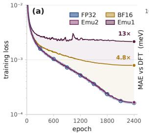

10  
(b)  
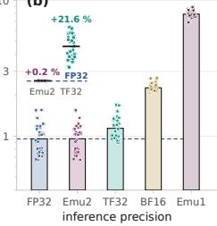

(c)  
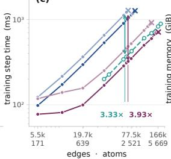

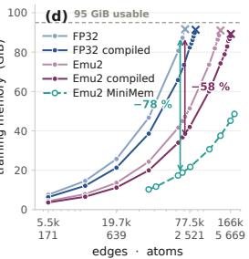

Figure 5: Accelerating MALOQ’s training. (a) Training loss curve with different precisions on the nablaDFT-2K dataset. (b) Inference error against the 32 held-out conformers, weights are trained with Emu2 in (a). Inset: MAE of the Hamiltonian elements of each molecule relative to FP32. (c) Training step time and (d) peak memory as a function of the input size (number of atoms/edges).  
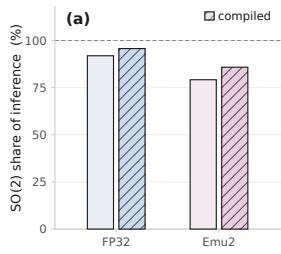

(b)  
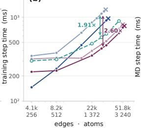

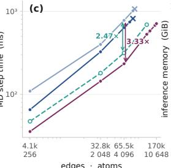

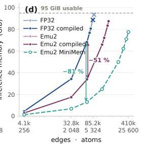  
Figure 6: Accelerating UMA-M’s inference. (a) Fraction of the inference step spent in the SO(2) layer. (b) Training step time, (c) MD step time, and (d) peak memory against the input size.

In UMA-M, where the SO(2) layer takes 79% to 91% of each training step (Fig. 6(a)), adopting Emu2 accelerates each step by 2.6×, or 1.91× with MiniMem (Fig. 6(b)).

Inference acceleration Molecular dynamics (MD) simulations with MLIPs are latency-sensitive applications, where fast inference is crucial. Inference for an MD step involves a forward pass followed by force evaluations during the backward pass. Emu2 runs the UMA-M inference step 3.33× faster than FP32 (Fig. 6(c)). This factor was measured at 65.5k edges (4.1k atoms), the largest input that the FP32 run can fit into the memory of a single GPU, under torch.compile; MiniMem is 2.47× faster than FP32 at the same structure size, while providing 81% reduction in memory footprint (Fig. 6(d)). Pure FP32 implementations exhaust the 95 GiB of the GH200 at 5.3k atoms in UMA-M inference. In comparison, MiniMem fits an MD step of 25.6k atoms (410k edges) in 78 GiB, vastly increasing the scale of MD simulations on a single GPU.

## 5 CONCLUSION & OUTLOOK

We present FlashSO(2), a customized, emulation-driven implementation of the SO(2) layer powering many of the top MLIP and MLH models in ML-accelerated computational materials science. Across the different models we evaluated, Emu2 improves over TF32, the most accurate native format of the GPU’s MMUs, on three axes at once: (i) accuracy (same as FP32), (ii) speed (1.1× faster than TF32), and (iii) memory consumption (half of TF32), thus pushing the speed-accuracy Pareto frontier beyond native reduced-precision formats of MMUs.

Along with enabling the exploitation of scaling laws at reduced computational cost, our implementation offers an avenue around several practical limitations faced by materials models today: (1) The use of short cutoff radii $( r _ { c u t } )$ in MLIPs leads to known flaws in the representation of long-range interactions. Increasing $r _ { c u t }$ is challenging as the edge connectivity grows with the cube of this parameter. By decreasing the effective memory footprint by up to 81%, Emu2 enables a 1.7× increase in cutoff for the same structure size. (2) Through cross domain pretraining, the vast quantities of available electronic structure data can be leveraged to improve the prediction of energies or forces (Kaniselvan et al., 2025). As shown in Fig. 1, generating a roughly 50 GB DFT dataset of energies and forces produces more than 100 TB of electronic structure data as intermediate products. So far, pretraining on these high-rank targets has been computationally heavy. We offer an avenue to take advantage of them at 40× the throughput of reference. Code will be released upon publication.

## AI USE STATEMENT

The author used Claude (Anthropic) to improve the grammar and readability of drafts written by the author and to help with LaTeX formatting. All technical content, results, and scientific claims are the authors’ own, and all LLM-assisted text was reviewed and verified by the authors.

## ACKNOWLEDGMENTS

This work was supported by the Swiss National Science Foundation (SNSF) under grant n° 209358 (QuaTrEx), and by the Platform for Advanced Scientific Computing (PASC) in Switzerland (BoostQT). We acknowledge the scientific support and HPC resources from CSCS under projects c33, lp16, and lp82.

## REFERENCES

Jason Ansel, Edward Yang, Horace He, Natalia Gimelshein, Animesh Jain, Michael Voznesensky, Bin Bao, Peter Bell, David Berard, Evgeni Burovski, et al. PyTorch 2: Faster machine learning through dynamic Python bytecode transformation and graph compilation. In Proceedings of the 29th ACM International Conference on Architectural Support for Programming Languages and Operating Systems, Volume 2 (ASPLOS ’24), pp. 929–947, 2024. doi: 10.1145/3620665.3640366. (cited on pages 3 and 6)

Ilyes Batatia, David P ´ eter Kov ´ acs, Gregor N. C. Simm, Christoph Ortner, and G ´ abor Cs ´ anyi. MACE: ´ Higher order equivariant message passing neural networks for fast and accurate force fields, 2022. URL https://arxiv.org/abs/2206.07697. (cited on pages 1 and 3)

Simon Batzner, Albert Musaelian, Lixin Sun, Mario Geiger, Jonathan P. Mailoa, Mordechai Kornbluth, Nicola Molinari, Tess E. Smidt, and Boris Kozinsky. E(3)-equivariant graph neural networks for data-efficient and accurate interatomic potentials. Nature Communications, 13(1), May 2022. ISSN 2041-1723. doi: 10.1038/s41467-022-29939-5. URL http://dx.doi.org/10. 1038/s41467-022-29939-5. (cited on pages 1 and 3)

Vivek Bharadwaj, Austin Glover, Aydın Buluc¸, and James Demmel. An efficient sparse kernel generator for O(3)-equivariant deep networks. In 2025 Proceedings of the Conference on Applied and Computational Discrete Algorithms (ACDA), pp. 32–46. Society for Industrial and Applied Mathematics, 2025. doi: 10.1137/1.9781611978759.3. (cited on page 3)

Andreas Burger, Luca Thiede, Nikolaj Rønne, Varinia Bernales, Nandita Vijaykumar, Tejs Vegge, Arghya Bhowmik, and Alan Aspuru-Guzik. Shoot from the hip: Hessian interatomic potentials without derivatives, 2025. URL https://doi.org/10.48550/ARXIV.2509.21624. (cited on page 1)

DeepSeek-AI. DeepSeek-V3 technical report, 2024. URL https://arxiv.org/abs/2412.19437. (cited on pages 2 and 5)

Xiang Fu, Brandon M Wood, Luis Barroso-Luque, Daniel S. Levine, Meng Gao, Misko Dzamba, and C. Lawrence Zitnick. Learning smooth and expressive interatomic potentials for physical property prediction. In Aarti Singh, Maryam Fazel, Daniel Hsu, Simon Lacoste-Julien, Felix Berkenkamp, Tegan Maharaj, Kiri Wagstaff, and Jerry Zhu (eds.), Proceedings of the 42nd International Conference on Machine Learning, volume 267 of Proceedings ofMachine Learning Research, pp. 17875–17893. PMLR, Jul 2025. URL https://proceedings.mlr.press/v267/ fu25h.html. (cited on pages 1 and 2)

Meng Gao, Armin Shayesteh Zadeh, Aniruddha Seal, Siva Dasetty, Siddarth K. Achar, Misko Dzamba, Benjamin K. Miller, Leif D. Jacobson, C. Lawrence Zitnick, Brandon M. Wood,

Zachary W. Ulissi, Daniel S. Levine, and Andrew L. Ferguson. Quantum-accurate atomistic modeling of enzyme catalysis using a machine learned potential, 2026. URL https: //arxiv.org/abs/2609.09293. (cited on page 3)

Mario Geiger and Tess Smidt. e3nn: Euclidean neural networks, 2022. URL https://doi.org/ 10.48550/ARXIV.2207.09453. (cited on pages 1, 2, and 7)

Benoit Jacob, Skirmantas Kligys, Bo Chen, Menglong Zhu, Matthew Tang, Andrew Howard, Hartwig Adam, and Dmitry Kalenichenko. Quantization and training of neural networks for efficient integer-arithmetic-only inference, 2017. URL https://arxiv.org/abs/1712.05877. (cited on page 2)

Manasa Kaniselvan, Benjamin Kurt Miller, Meng Gao, Juno Nam, and Daniel S. Levine. Learning from the electronic structure of molecules across the periodic table, 2025. URL https://arxiv. org/abs/2510.00224. (cited on pages 1, 2, 3, and 10)

Manasa Kaniselvan, Alexander Maeder, Denghui Lu, Alexandros Nikolaos Ziogas, and Mathieu Luisier. MALOQ: Massively accelerated learning of operators for quantum transport, 2026. URL https://arxiv.org/abs/2606.28911. (cited on pages 2, 3, 6, and 8)

Kuzma Khrabrov, Anton Ber, Artem Tsypin, Konstantin Ushenin, Egor Rumiantsev, Alexander Telepov, Dmitry Protasov, Ilya Shenbin, Anton Alekseev, Mikhail Shirokikh, Sergey Nikolenko, Elena Tutubalina, and Artur Kadurin. ∇2DFT: A universal quantum chemistry dataset of druglike molecules and a benchmark for neural network potentials. In The Thirty-eighth Conference on Neural Information Processing Systems Datasets and Benchmarks Track, 2024. URL https: //arxiv.org/abs/2406.14347. (cited on pages 3 and 8)

Seongsu Kim, Nayoung Kim, Dongwoo Kim, and Sungsoo Ahn. High-order equivariant flow matching for density functional theory Hamiltonian prediction, 2025. URL https://arxiv.org/abs/ 2505.18817. (cited on page 1)

Seung Yul Lee, Hojoon Kim, Yutack Park, Dawoon Jeong, Seungwu Han, Yeonhong Park, and Jae W. Lee. FlashTP: Fused, sparsity-aware tensor product for machine learning interatomic potentials. In Aarti Singh, Maryam Fazel, Daniel Hsu, Simon Lacoste-Julien, Felix Berkenkamp, Tegan Maharaj, Kiri Wagstaff, and Jerry Zhu (eds.), Proceedings of the 42nd International Conference on Machine Learning, volume 267 of Proceedings of Machine Learning Research, pp. 33143–33156. PMLR, Jul 2025. URL https://proceedings.mlr.press/v267/lee25l.html. (cited on page 3)

Daniel S. Levine, Muhammed Shuaibi, Evan Walter Clark Spotte-Smith, Michael G. Taylor, Muhammad R. Hasyim, Kyle Michel, Ilyes Batatia, Gabor Cs´ anyi, Misko Dzamba, Peter East-´ man, Nathan C. Frey, Xiang Fu, Vahe Gharakhanyan, Aditi S. Krishnapriyan, Joshua A. Rackers, Sanjeev Raja, Ammar Rizvi, Andrew S. Rosen, Zachary Ulissi, Santiago Vargas, C. Lawrence Zitnick, Samuel M. Blau, and Brandon M. Wood. The open molecules 2025 (OMol25) dataset, evaluations, and models, 2025. URL https://arxiv.org/abs/2505.08762. (cited on page 3)

Tiancheng Li, Wentao Li, Anyang Peng, Jianming Xue, Linfeng Zhang, Duo Zhang, and Han Wang. DPA4: Pushing the accuracy-cost frontier of interatomic potentials with EMFA SO(2) convolution, 2026a. URL https://arxiv.org/abs/2606.02419. (cited on pages 2 and 3)

Yang Li, Yanzhen Wang, Boheng Zhao, Xiaoxun Gong, Yuxiang Wang, Zechen Tang, Zixu Wang, Zilong Yuan, Jialin Li, Minghui Sun, Zezhou Chen, Honggeng Tao, Baochun Wu, Yuhang Yu, He Li, Felipe H. da Jornada, Wenhui Duan, and Yong Xu. DeepH-pack: A general-purpose neural network package for deep-learning electronic structure calculations, 2026b. URL https: //arxiv.org/abs/2601.02938. (cited on pages 1, 2, and 3)

Yunyang Li, Zaishuo Xia, Lin Huang, Xinran Wei, Samuel Harshe, Han Yang, Erpai Luo, Zun Wang, Jia Zhang, Chang Liu, Bin Shao, and Mark Gerstein. Enhancing the scalability and applicability of Kohn-Sham Hamiltonians for molecular systems. In The Thirteenth International Conference on Learning Representations, 2025. URL https://openreview.net/forum?id=twEvvkQqPS. (cited on pages 1, 2, and 3)

Yi-Lun Liao, Brandon Wood, Abhishek Das, and Tess Smidt. EquiformerV2: Improved equivariant transformer for scaling to higher-degree representations, 2023. URL https://arxiv.org/abs/ 2306.12059. (cited on pages 2 and 3)

Yi-Lun Liao, Alexander J. Hoffman, Sabrina C. Shen, Alexandre Duval, Sam Walton Norwood, and Tess Smidt. EquiformerV3: Scaling efficient, expressive, and general SE(3)-equivariant graph attention transformers, 2026. URL https://arxiv.org/abs/2604.09130. (cited on page 3)

Denghui Lu, Alexander Maeder, Mathieu Luisier, and Alexandros Nikolaos Ziogas. EmuGEMM: Fused tensor core kernels for precision emulation in matrix multiplication, 2026. URL https: //arxiv.org/abs/2606.25453. (cited on page 4)

Arslan Mazitov, Filippo Bigi, Matthias Kellner, Paolo Pegolo, Davide Tisi, Guillaume Fraux, Sergey Pozdnyakov, Philip Loche, and Michele Ceriotti. PET-MAD as a lightweight universal interatomic potential for advanced materials modeling. Nature Communications, 16(1), November 2025. ISSN 2041-1723. doi: 10.1038/s41467-025-65662-7. URL http://dx.doi.org/10. 1038/s41467-025-65662-7. (cited on page 1)

Paulius Micikevicius, Sharan Narang, Jonah Alben, Gregory Diamos, Erich Elsen, David Garcia, Boris Ginsburg, Michael Houston, Oleksii Kuchaiev, Ganesh Venkatesh, and Hao Wu. Mixed precision training, 2017. URL https://arxiv.org/abs/1710.03740. (cited on page 2)

Paulius Micikevicius, Dusan Stosic, Neil Burgess, Marius Cornea, Pradeep Dubey, Richard Grisenthwaite, Sangwon Ha, Alexander Heinecke, Patrick Judd, John Kamalu, Naveen Mellempudi, Stuart Oberman, Mohammad Shoeybi, Michael Siu, and Hao Wu. FP8 formats for deep learning, 2022. URL https://arxiv.org/abs/2209.05433. (cited on page 2)

NVIDIA. cuEquivariance, 2024. URL https://github.com/NVIDIA/cuEquivariance. (cited on page 3)

Hiroyuki Ootomo, Katsuhisa Ozaki, and Rio Yokota. DGEMM on integer matrix multiplication unit. The International Journal of High Performance Computing Applications, 38(4):297–313, March 2024. ISSN 1741-2846. doi: 10.1177/10943420241239588. URL http://dx.doi.org/ 10.1177/10943420241239588. (cited on pages 2 and 4)

Katsuhisa Ozaki, Takeshi Ogita, Shin’ichi Oishi, and Siegfried M. Rump. Error-free transformations of matrix multiplication by using fast routines of matrix multiplication and its applications. Numerical Algorithms, 59(1):95–118, January 2012. ISSN 1572-9265. doi: 10.1007/s11075-011-9478-1. URL http://dx.doi.org/10.1007/s11075-011-9478-1. (cited on pages 2 and 4)

Saro Passaro and C. Lawrence Zitnick. Reducing SO(3) convolutions to SO(2) for efficient equivariant GNNs. In Andreas Krause, Emma Brunskill, Kyunghyun Cho, Barbara Engelhardt, Sivan Sabato, and Jonathan Scarlett (eds.), Proceedings of the 40th International Conference on Machine Learning, volume 202 of Proceedings of Machine Learning Research, pp. 27420– 27438. PMLR, Jul 2023. URL https://proceedings.mlr.press/v202/passaro23a.html. (cited on pages 2 and 3)

Angelika Schwarz, Anton Anders, Cole Brower, Harun Bayraktar, John Gunnels, Kate Clark, RuQing G. Xu, Samuel Rodriguez, Sebastien Cayrols, Paweł Tabaszewski, and Victor Podlozhnyuk. Guaranteed DGEMM accuracy while using reduced precision tensor cores through extensions of the Ozaki scheme. In Proceedings of the Supercomputing Asia and International Conference on High Performance Computing in Asia Pacific Region (SCA/HPCAsia 2026), pp. 91–101. ACM, 2026. doi: 10.1145/3773656.3773670. (cited on page 4)

K. T. Schutt, M. Gastegger, A. Tkatchenko, K.-R. M¨ uller, and R. J. Maurer. Unifying machine¨ learning and quantum chemistry with a deep neural network for molecular wavefunctions. Nature Communications, 10(1), November 2019. ISSN 2041-1723. doi: 10.1038/s41467-019-12875-2. URL http://dx.doi.org/10.1038/s41467-019-12875-2. (cited on page 3)

Jay Shah, Ganesh Bikshandi, Ying Zhang, Vijay Thakkar, Pradeep Ramani, and Tri Dao. FlashAttention-3: Fast and accurate attention with asynchrony and lowprecision. In The Thirty-eighth Annual Conference on Neural Information Processing

Systems, 2024. URL https://proceedings.neurips.cc/paper files/paper/2024/hash/ 7ede97c3e082c6df10a8d6103a2eebd2-Abstract-Conference.html. (cited on page 2)

Brandon M Wood, Misko Dzamba, Xiang Fu, Meng Gao, Muhammed Shuaibi, Luis Barroso-Luque, Kareem Abdelmaqsoud, Vahe Gharakhanyan, John R. Kitchin, Daniel S. Levine, Kyle Michel, Anuroop Sriram, Taco Cohen, Abhishek Das, Sushree Jagriti Sahoo, Ammar Rizvi, Zachary Ward Ulissi, and C. Lawrence Zitnick. UMA: A family of universal models for atoms. In The Thirty-ninth Annual Conference on Neural Information Processing Systems, 2025. URL https://openreview.net/forum?id=SvopaNxYWt. (cited on pages 1, 2, and 6)

Haiyang Yu, Meng Liu, Youzhi Luo, Alex Strasser, Xiaofeng Qian, Xiaoning Qian, and Shuiwang Ji. QH9: A quantum Hamiltonian prediction benchmark for QM9 molecules. In Thirty-seventh Conference on Neural Information Processing Systems Datasets and Benchmarks Track, 2023. URL https://arxiv.org/abs/2306.09549. (cited on page 3)

Yang Zhong, Hongyu Yu, Mao Su, Xingao Gong, and Hongjun Xiang. Transferable equivari ant graph neural networks for the Hamiltonians of molecules and solids. npj Computational Materials, 9(1), October 2023. ISSN 2057-3960. doi: 10.1038/s41524-023-01130-4. URL http://dx.doi.org/10.1038/s41524-023-01130-4. (cited on page 1)