# ADAPT FOR PLANNING, NOT JUST PREDICTION: OPTIMISTIC TEST-TIME WORLD MODEL ADAPTATION

Akshay Mete, Dileep Kalathil, P. R. Kumar ECE Department, Texas A&M University, College Station, Texas, USA. {akshaymete,dileep.kalathil,prk}@tamu.edu

€ Webpage

§ Code

## ABSTRACT

Latent world models are typically pre-trained offline and kept frozen at test time, so planning with them can degrade under distribution shift. Test-time adaptation (TTA) can mitigate this degradation by updating the model during deployment. Unlike pre-training on fixed data, TTA for planning is closed-loop: the planner uses model rollouts to select actions, and the resulting transitions drive the next update. This raises the question: which objective should guide TTA for planning? Under a prediction-only objective, the model is fit only to the outcomes of its own actions, so it can remain wrong about the actions that would reach the goal, and low prediction error need not translate into better planning. Inspired by reward-biased maximum likelihood from adaptive control, we introduce Optimistic Test-Time Adaptation (OpTTA). Its objective has two terms, the prediction loss on observed transitions and the planner’s goal-reaching cost on its candidate rollouts, both minimized over the model parameters. The planning term biases adaptation toward models that are optimistic about reaching the goal, without any additional environment interaction. Across visual and environment shifts on manipulation, reaching and navigation tasks, OpTTA raises final planning success over the frozen model by 13.5 percentage points on average, compared with 6.9 for the prediction-only objective (AdaJEPA), when only the predictor is adapted. When the encoder is adapted as well, the gains are 13.5 and 7.5 points. These experiments span three JEPA world models with different encoders and training objectives and, for temporal straightening, both CEM and gradient-based planners. Our results suggest that test-time adaptation of world models for planning benefits from an optimistic, task-aware term in addition to the prediction loss.

## 1 INTRODUCTION

Latent world models have demonstrated success across a range of control and planning tasks (LeCun, 2022; Zhou et al., 2025; Maes et al., 2026). These world models are typically pre-trained offline and kept frozen at test time. Test-time distribution shift can degrade planning performance. A standard approach in adaptive control is to update the dynamics model online as new transitions are observed. This raises the central question: which objective should guide test-time adaptation of a world model?

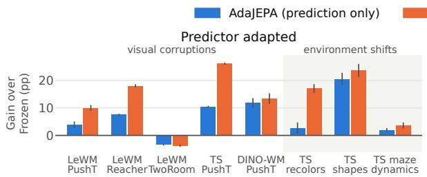

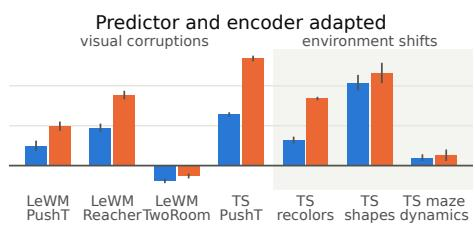  
Figure 1: Gain in final planning success over the frozen model for prediction-only adaptation (Ada-JEPA) and optimistic adaptation (OpTTA), averaged over the visual corruptions or environment shifts of each setting (Table 1). Error bars show ±1 s.e. over seeds.

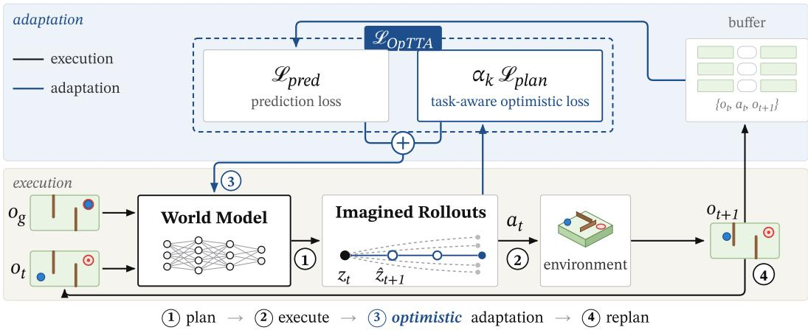  
Figure 2: Optimistic Test-Time Adaptation. At every replanning step the world model is adapted on the observed transitions, using the prediction loss plus the task-aware optimistic loss evaluated on the candidate rollouts the planner has already generated.

A straightforward choice is to minimize the latent prediction loss on transitions observed at test time. AdaJEPA (Wang et al., 2026a) follows this approach for goal-conditioned planning with JEPA world models, updating the model on recent transitions at each replanning step. Compared with a frozen model, this prediction-only adaptation can improve planning success under distribution shift. Unlike pre-training on fixed data, test-time adaptation operates in a closed loop: the planner selects actions by scoring the model’s imagined rollouts, and the resulting transitions are used for the next model update. The model is thus trained to minimize prediction loss only on the outcomes of its own action choices, so it can fit them accurately yet remain wrong about actions that would reach the goal, a closed-loop identifiability problem (Borkar & Varaiya, 1979). This mismatch between the prediction loss and the planning objective is known as objective mismatch (Lambert et al., 2020).

An early solution to this objective mismatch was reward-biased maximum likelihood (RBMLE), proposed by Kumar & Becker (1982). RBMLE estimates the model with a joint objective of two terms: the likelihood of the observed transitions and the optimal long-run reward achievable under the model. This objective is both task-aware and optimistic: it favors a model with high achievable reward while anchoring the model estimate to the observed transitions. RBMLE introduces optimism directly through the estimation objective, without the confidence sets or explicit uncertainty estimates required by upper-confidence-bound methods (Jaksch et al., 2010), making it more amenable to test-time adaptation, where calibrated uncertainty estimates are difficult to obtain for world models under distribution shift. RBMLE has so far been studied mainly in adaptive control and reinforcement learning (Kumar & Becker, 1982; Mete et al., 2021; 2026); in this paper, we propose an optimistic objective for test-time adaptation of world models used for planning.

## CONTRIBUTIONS

Optimistic Test-Time Adaptation (OpTTA). We propose the following objective for model adaptation, which balances prediction accuracy on observed transitions against the goal-reaching cost of the model’s own imagined rollouts:

$$
\begin{array} { r } { \mathcal { L } _ { \mathrm { O p T T A } } = \mathcal { L } _ { \mathrm { p r e d } } + \alpha _ { k } \mathcal { L } _ { \mathrm { p l a n } } , \qquad \alpha _ { k } \geq 0 . } \end{array}
$$

The prediction term, $\mathcal { L } _ { \mathrm { p r e d } } .$ , is the model’s latent prediction loss evaluated on recently observed test-time transitions. The planning term, $\mathcal { L } _ { \mathrm { p l a n } } .$ is the planner’s goal-reaching cost evaluated on its imagined rollouts, with gradients taken with respect to the world-model parameters rather than the actions. Here $\alpha _ { k }$ is the optimism weight at replanning step k. Choosing $\alpha _ { k } \ > \ 0$ makes adaptation optimistic by favoring model parameters under which the imagined rollouts have lower goalreaching cost, while $\mathcal { L } _ { \mathrm { p r e d } }$ anchors the model to the observed transitions; setting $\alpha _ { k } = 0$ recovers AdaJEPA’s prediction-only objective.

Optimism improves planning under distribution shift. Across three JEPA world models (LeWM, DINO-WM and temporal straightening) and 15 shifted settings spanning visual corruptions, recolorings, held-out shapes, and changes in mass and damping, optimistic adaptation (OpTTA) raises final success over the frozen model by 13.5 points on average, compared with 6.9 for prediction-only adaptation (AdaJEPA); with the encoder also adapted, the gains are 13.5 and 7.5 (Table 1; Figure 1).

## 2 RELATED WORK

Test-time adaptation of world models. Test-time adaptation is used in a wide variety of settings to address distribution shift (Sun et al., 2020; Wang et al., 2020; Hansen et al., 2020; Liang et al., 2025). Several recent works adapt world models to distribution shift (Gao et al., 2025; Wang et al., 2025; Wan et al., 2026; Park et al., 2026; Wang et al., 2026a). For latent world models used in planning, AdaJEPA (Wang et al., 2026a) proposed test-time adaptation by minimizing prediction error on observed transitions. Updating the dynamics model online as new transitions are observed is also standard in adaptive control and model-based reinforcement learning (Borkar & Varaiya, 1979; Kumar & Becker, 1982; Hafner et al., 2020; 2024; Hansen et al., 2024).

Objective mismatch. A large number of latent world models are trained and adapted to minimize prediction error, but are then used to select actions for planning or control (Hafner et al., 2020; 2024; Zhou et al., 2025; Wang et al., 2026b; Maes et al., 2026; Wang et al., 2026a). This leads to a mismatch between the model-learning objective and the control objective (Lambert et al., 2020). To address this mismatch, value-aware model-learning methods train the dynamics model using reward or value information in addition to prediction error (Farahmand et al., 2017; Farahmand, 2018; Hansen et al., 2024). These methods require a learned reward or value function, which is unavailable when adapting a pretrained world model for goal-conditioned planning. In this paper, we argue that optimism offers a practical solution to objective mismatch in test-time world-model adaptation for goal-conditioned planning.

Reward-biased maximum likelihood estimation. Reward-biased maximum likelihood estimation (RBMLE) (Kumar & Becker, 1982) was proposed to counteract the pessimistic bias that maximum-likelihood estimation can exhibit in closed-loop control (Borkar & Varaiya, 1979). It favors models with higher optimal reward while anchoring the estimate to the observed transitions. Later, upper-confidence-bound (UCB) methods implemented optimism by optimizing over a confidence set of plausible models (Auer et al., 2002; Jaksch et al., 2010), of which RBMLE can be viewed as a Lagrangian relaxation (Mete et al., 2022). Uncertainty-based optimistic approaches (Curi et al., 2020; Sukhija et al., 2025) rely on calibrated uncertainty estimates, which are diffi cult to obtain under distribution shift and limited deployment data, whereas RBMLE requires none. RBMLE has since been extended to reinforcement learning (Mete et al., 2021), linear-quadratic control (Mete et al., 2022), and, recently, online world-model-based reinforcement learning (Mete et al., 2026). Whereas Mete et al. (2026) apply RBMLE-style optimism to online reinforcement learning with rewards, OpTTA applies it to test-time adaptation of pretrained world models for goal conditioned planning.

JEPA world models. Joint-embedding predictive architectures learn representations by predicting target embeddings rather than reconstructing observations (LeCun, 2022; Assran et al., 2023; 2025). JEPA world models such as PLDM, DINO-WM, temporal straightening, and LeWM (Sobal et al., 2026; Zhou et al., 2025; Wang et al., 2026b; Maes et al., 2026) apply this principle to actionconditioned prediction for goal-conditioned planning. In this paper, we address test-time adaptation of these world models for goal-conditioned planning.

## 3 PRELIMINARIES

Latent world models. We consider a pretrained latent world model comprising an observation encoder $\mathcal { E } _ { \phi } ^ { s } .$ , an action embedding $\mathcal { E } _ { \psi } ^ { a }$ , and a latent dynamics predictor $f _ { \boldsymbol { \theta } } \mathrm { : }$

$$
z _ { t } = \mathcal { E } _ { \phi } ^ { s } ( o _ { t } ) , \qquad u _ { t } = \mathcal { E } _ { \psi } ^ { a } ( a _ { t } ) , \qquad \hat { z } _ { t + 1 } = f _ { \theta } ( z _ { t } , u _ { t } ) .
$$

Here, $o _ { t }$ and $a _ { t }$ denote the observation and action at time t, while $z _ { t }$ and $u _ { t }$ denote the corresponding latent state and action embedding. For compactness, we write $f _ { \theta } ( z _ { t } , u _ { t } )$ while suppressing its dependence on the $L$ most recent latent states and action embeddings. Rolling out the predictor from latent state $z _ { t }$ under an action sequence $a _ { t : t + n - 1 }$ of length n yields the imagined latent-state trajectory

$$
\hat { z } _ { t + k } = f _ { \theta } ( \hat { z } _ { t + k - 1 } , u _ { t + k - 1 } ) , \quad k = 1 , \dots , n , \qquad \hat { z } _ { t } = z _ { t } .\tag{1}
$$

We denote this trajectory by $\hat { z } _ { t + 1 : t + n } = \tau _ { \theta } ( z _ { t } , a _ { t : t + n - 1 } )$ ; it is differentiable with respect to both the action sequence and the predictor parameters $\theta .$

Goal-conditioned planning. At test time, the task is given by a goal image $o _ { g } ,$ encoded as $z _ { g } =$ $\mathcal { E } _ { \phi } ^ { s } ( o _ { g } )$ . Under model predictive control (MPC) with horizon $H$ , the agent scores each candidate action sequence by the weighted goal-distance cost of its imagined latent-state trajectory:

$$
\boldsymbol { J } ( a _ { t : t + H - 1 } , \theta ) = \sum _ { k = 1 } ^ { H } w _ { k } \boldsymbol { d } ( \hat { \boldsymbol { z } } _ { t + k } , \boldsymbol { z } _ { g } ) , \qquad \hat { \boldsymbol { z } } _ { t + 1 : t + H } = \tau _ { \theta } ( \boldsymbol { z } _ { t } , a _ { t : t + H - 1 } ) ,\tag{2}
$$

where the weights $w _ { k } \geq 0$ set the relative importance of each step and d is the squared Euclidean distance. At each replanning step, let $\{ a _ { t : t + H - 1 } ^ { ( m ) } \} _ { m = 1 } ^ { M }$ denote the candidate action sequences retained for adaptation. We collect each sequence and its induced latent-state trajectory in the rollout population

$$
\mathcal { P } _ { \theta } = \left\{ \left( a _ { t : t + H - 1 } ^ { ( m ) } , \tau _ { \theta } \left( z _ { t } , a _ { t : t + H - 1 } ^ { ( m ) } \right) \right) \right\} _ { m = 1 } ^ { M } .\tag{3}
$$

During adaptation, the action sequences are held fixed while their latent-state trajectories are recomputed as θ changes. Planning is performed using either the cross-entropy method (CEM) (Rubinstein, 1997) or gradient descent.

Test-time adaptation. Under test-time distribution shift, a frozen pretrained world model can produce inaccurate rollouts, degrading planning performance. AdaJEPA (Wang et al., 2026a) performs test-time adaptation for goal-conditioned planning by updating the world model from a buffer B containing up to the N most recent observed transitions $\left( o _ { i } , a _ { i } , o _ { i + 1 } \right)$ . It minimizes the one-step latent prediction loss

$$
\mathcal { L } _ { \mathrm { p r e d } } ( B ) = \frac { 1 } { | \mathcal { B } | } \sum _ { ( o _ { i } , a _ { i } , o _ { i + 1 } ) \in B } \ell \big ( f _ { \theta } ( z _ { i } , u _ { i } ) , \mathrm { s g } ( z _ { i + 1 } ) \big ) .\tag{4}
$$

Here, ℓ is the mean-squared error in latent space. A designated set Ω of observation-encoder and/or predictor parameters is updated for U gradient steps:

$$
\Omega  \Omega - \eta \nabla _ { \Omega } \mathcal { L } _ { \mathrm { p r e d } } ( B ) .\tag{5}
$$

The updated model is used for the next replanning step. Together, these steps form a plan–execute– adapt–replan loop. Adaptation is task-local: after each task, the model is reset to its pretrained parameters and the buffer is cleared.

## 4 OPTIMISTIC TEST-TIME ADAPTATION FOR LATENT WORLD MODELS

Inspired by RBMLE, we formulate test-time adaptation of latent world models as task-aware, optimistic model estimation. At replanning step k, the OpTTA model-estimation objective has two components: prediction error on the observed transitions B and goal-reaching cost on the candidate rollouts ${ \mathcal { P } } _ { \theta } { \mathrm { : } }$

$$
\mathcal { L } _ { \mathrm { O p T T A } } ( \mathcal { B } , \mathcal { P } _ { \theta } ) = \mathcal { L } _ { \mathrm { p r e d } } ( \mathcal { B } ) + \alpha _ { k } \mathcal { L } _ { \mathrm { p l a n } } ( \mathcal { P } _ { \theta } ) .\tag{6}
$$

Here, $\mathcal { L } _ { \mathrm { p r e d } }$ fits the model to observed transitions, whereas ${ \mathcal { L } } _ { \mathrm { p l a n } }$ evaluates the goal-reaching cost of imagined rollouts under candidate action sequences. The planning component is the average goal-reaching cost of the candidate rollouts:

$$
\mathcal { L } _ { \mathrm { p l a n } } ( \mathcal { P } _ { \theta } ) = \frac { 1 } { M } \sum _ { m = 1 } ^ { M } J \Bigl ( a _ { t : t + H - 1 } ^ { ( m ) } , \theta \Bigr ) .\tag{7}
$$

Algorithm 1 Optimistic Test-Time Adaptation for one task   
1: Input: pretrained model $( \mathcal { E } _ { \phi } ^ { s } , \mathcal { E } _ { \psi } ^ { a } , f _ { \theta } )$ , planner, goal observation $o _ { g } ,$ adapted parameters $\Omega ,$ and planning  
loss parameters $\Omega _ { f } \subseteq \Omega \cap \bar { \theta }$   
2: Hyperparameters: base optimism $\rho ,$ stabilizer ε, replanning budget $K _ { \mathrm { m a x } } ,$ , adaptation steps U, buffer   
capacity N, and learning rate η   
3: Restore the pretrained parameters; $\begin{array} { r l r } {  { B  \emptyset ; t  0 ; } } \end{array}$ observe $o _ { 0 }$   
4: for $k = 0 , \hat { . . . } , K _ { \mathrm { m a x } } \hat { . } \mathrm { ~ }$ do   
5: Encode the current observation and the goal: $z _ { t } \gets \mathcal { E } _ { \phi } ^ { s } ( o _ { t } ) , z _ { g } \gets \mathcal { E } _ { \phi } ^ { s } ( o _ { g } )$   
6: $( a _ { t : t + H - 1 } ^ { \star } , \mathcal { P } ) \gets \mathrm { P l a n } ( z _ { t } , z _ { g } ; \mathcal { E } _ { \psi } ^ { a } , f _ { \theta } )$ {P: candidates of CEM’s final iteration}   
7: Execute $a _ { t } ^ { \star } .$ , observe $o _ { t + 1 }$ , and append $\left( o _ { t } , a _ { t } ^ { \star } , o _ { t + 1 } \right)$ to B, retaining the N most recent transitions   
8: if the goal is reached then   
9: stop   
10: end if   
11: for $u = 1 , \ldots , U$ do   
12: Compute $\mathcal { L } _ { \mathrm { p r e d } } ( B )$ and $\mathcal { L } _ { \mathrm { p l a n } } ( \mathcal { P } )$   
13: Compute $\alpha _ { k }$ using equation 8 and stop its gradient   
14: $\Omega  \bar { \Omega } - \eta \nabla _ { \Omega } [ \bar { \mathcal { L } } _ { \mathrm { p r e d } } + \alpha _ { k } \mathcal { L } _ { \mathrm { p l a n } } ]$ $\{ { \mathcal { L } } _ { \mathrm { p l a n } }$ gradients are restricted to $\Omega _ { f } \}$   
15: end for   
16: $t \gets t + 1$   
17: end for

The coefficient $\alpha _ { k } \geq 0$ controls the strength of optimism at replanning step $k .$

With $\alpha _ { k } \ > \ 0 , \ C _ { \mathrm { p l a n } }$ favors model estimates that assign lower goal-reaching costs to candidate rollouts, while $\mathcal { L } _ { \mathrm { p r e d } }$ keeps those estimates grounded in observed transitions. The objective does not assume a particular latent world-model architecture or planner. We instantiate OpTTA within the AdaJEPA protocol, retaining its planner, transition buffer, adapted parameter set, and update schedule, but replacing its prediction-only adaptation objective with equation 6.

Thus, OpTTA leaves three configurable design choices: which model parameters to update, which imagined rollouts to include in ${ \mathcal { P } } _ { \theta }$ , and how to set $\alpha _ { k }$

Which model parameters are updated? Following AdaJEPA, OpTTA adapts a selected parameter set Ω comprising parameters of the observation encoder, the latent predictor, or both, while keeping the action-embedding parameters fixed. $\mathcal { L } _ { \mathrm { p r e d } }$ is differentiated through all parameters in Ω, whereas ${ \mathcal { L } } _ { \mathrm { p l a n } }$ is differentiated only through the predictor parameters in a selected subset $\Omega _ { f } \subseteq \Omega$

Which imagined rollouts form $\mathcal { P } _ { \theta } ?$ In our instantiation, ${ \mathcal { P } } _ { \theta }$ contains the M candidate action sequences of CEM’s final iteration at the current planning step, each with its imagined latent-state trajectory. During adaptation, the candidate action sequences are held fixed, and ${ \mathcal { L } } _ { \mathrm { p l a n } }$ is differentiated through their model-predicted trajectories with respect to $\Omega _ { f }$ , rather than the actions.

How is $\alpha _ { k }$ chosen? The gradient magnitudes of $\mathcal { L } _ { \mathrm { p r e d } }$ and ${ \mathcal { L } } _ { \mathrm { p l a n } }$ can vary substantially across world models, planners, tasks, distribution shifts, and replanning steps, so a fixed optimism weight can cause either term to dominate. We therefore set $\alpha _ { k }$ so that, on $\Omega _ { f }$ , the weighted planning gradient has approximately a scheduled magnitude relative to the prediction gradient:

$$
\alpha _ { k } = \rho \sqrt { \frac { k } { K _ { \mathrm { m a x } } } } \frac { \left\| \nabla _ { \Omega _ { f } } \mathcal { L } _ { \mathrm { p r e d } } ( \boldsymbol { B } ) \right\| _ { 2 } } { \left\| \nabla _ { \Omega _ { f } } \mathcal { L } _ { \mathrm { p l a n } } ( \mathcal { P } _ { \theta } ) \right\| _ { 2 } + \varepsilon } .\tag{8}
$$

Here, $\rho \ge 0$ controls the relative gradient contribution of the planning term, while $\sqrt { k / K _ { \operatorname* { m a x } } }$ limits optimism early and increases it over replanning steps. The stabilizer $\varepsilon > 0$ prevents division by zero. We treat $\alpha _ { k }$ as a constant when differentiating $\mathcal { L } _ { \mathrm { { O p T T A } } }$ with respect to the model parameters. We analyze how each of these design choices affects planning performance in Section 5.3. With these design choices specified, Algorithm 1 summarizes the resulting OpTTA procedure.

## 5 EXPERIMENTS

Our experiments evaluate the benefits of optimistic, task-aware world-model adaptation for goalconditioned planning under distribution shift. The evaluation spans three latent world models; ma-

nipulation, reaching, and navigation tasks; visual and environment shifts; predictor-only and joint predictor–encoder adaptation; and sampling-based and gradient-based planners.

## 5.1 SETUP

World models and tasks. We evaluate three latent world models: LeWM, temporal straightening, and DINO-WM. We evaluate goal-conditioned planning on tasks commonly used in related worldmodel work (Zhou et al., 2025; Wang et al., 2026b; Maes et al., 2026): object manipulation (PushT and PushObj), reaching (Reacher), and navigation (TwoRoom and maze tasks).

Distribution shifts. We evaluate seven visual corruptions (blur, salt-and-pepper noise, darkening, gamma, hue, contrast, and translation) and environment shifts in object color, geometry, mass, and damping. Severities are selected per checkpoint using only the frozen model. LeWM and temporal straightening results average over four severities and five seeds per corruption; DINO-WM uses one severity and three seeds.

Controlled comparison. We compare prediction-only TTA (AdaJEPA (Wang et al., 2026a)) and OpTTA against the frozen pretrained model. Both TTA methods share the initialization, planner, transition buffer, adapted parameters, and update schedule, so they differ only in the adaptation objective. We adapt either the predictor alone or the predictor and encoder jointly; DINO-WM, whose DINOv2 encoder is frozen, uses predictor adaptation only.

Protocol and metrics. Unless noted, CEM plans five actions, executes one, and replans at most 30 times. All methods share 50 start–goal episodes per seed. We report success at replan 30 (Final) and its average over replans 1–30 (Mean over replans), which measures how early tasks are solved. OpTTA uses equation 8 with ρ = 1 throughout, without setting-specific tuning.

## 5.2 PLANNING PERFORMANCE

Under distribution shift. Across both adaptation scopes, OpTTA achieves higher final success than AdaJEPA in 14 of 15 shifted settings (Table 1). Across the eight predictor-only settings, OpTTA improves over Frozen by 13.5 points on average, versus 6.9 for AdaJEPA; across the seven joint predictor–encoder settings, the gains are 13.5 and 7.5 points.

Across tasks and world models. On PushT visual corruptions, the optimistic objective yields about 2.5× the prediction-only adaptation gain in final success for both LeWM and temporal straightening with predictor-only adaptation, and about 2× the gain when the encoder is also adapted. With DINO-WM, AdaJEPA and OpTTA yield final-success adaptation gains of 11.8 and 13.4 points, respectively, on PushT visual corruptions. On Reacher visual corruptions with LeWM, the ratio is similar: 2.4× with predictor-only adaptation and 1.9× with joint adaptation. TwoRoom is a notable exception: under visual corruptions, both TTA objectives reduce final success relative to Frozen under both adaptation scopes, a failure mode discussed below.

Environment shifts. With temporal straightening, OpTTA yields positive final-success adaptation gains across PushT recolorings, PushObj shape changes, and maze dynamics under both adaptation scopes. On PushT recolorings, AdaJEPA yields final-success adaptation gains of 2.7 and 6.4 points under predictor-only and joint predictor–encoder adaptation, respectively, whereas OpTTA yields gains of 17.1 and 16.8 points. On PushObj shape changes, both TTA objectives yield large and similar gains; on maze dynamics, Frozen already achieves 85.6% final success, leaving limited room for further improvement.

Online sample efficiency. In most settings, OpTTA also accumulates success earlier within the replanning budget: its Mean over replans is higher in 13 of the 15 shifted settings (per-setting success curves in Appendix A.3).

In-distribution performance. Even without distribution shift, both TTA methods improve final success on PushT for every world model and adaptation scope, by 0.7–14.8 points for AdaJEPA and

Table 1: Planning success (%, mean $\pm \ : \mathrm { s . e . }$ over seeds). Final is success by replanning step 30, and Mean over replans is the average cumulative success rate across replanning steps 1–30. Parentheses report the adaptation gain over Frozen, paired by seed and computed before rounding. Panel (a) adapts only the predictor; panel (b) adapts both the predictor and encoder. Shifted rows average over the number of shifts in their labels, each visual corruption over four severity levels (DINO-WM: one level and three seeds); per-shift results are in Appendix A.  
(a) Predictor adapted.
<table><tr><td></td><td colspan="3">Final</td><td colspan="3">Mean over replans</td></tr><tr><td>Setting (shifts)</td><td>Frozen</td><td>AdaJEPA</td><td>OpTTA</td><td>Frozen</td><td>AdaJEPA</td><td>OpTTA</td></tr><tr><td colspan="7">In distribution</td></tr><tr><td>LeWM PushT</td><td> $8 0 . 0 { \pm } 2 . 5 $ </td><td> $8 8 . 8 { \pm } 1 . 4 \left( + 8 . 8 \right)$ </td><td> $9 2 . 0 { \pm } 1 . 9 \left( + 1 2 . 0 \right)$ </td><td> $5 9 . 1 \pm 1 . 1$ </td><td> $6 6 . 7 { \pm } 1 . 3 \ : ( + 7 . 6 )$ </td><td> $7 1 . 5 { \pm } 1 . 9 ( + 1 2 . 4 )$ </td></tr><tr><td>LeWM Reacher</td><td> $9 8 . 4 \pm 0 . 7 $ </td><td> $9 8 . 8 { \pm } 0 . 8 \left( + 0 . 4 \right)$ </td><td> $\mathbf { 1 0 0 . 0 { \scriptstyle \pm 0 . 0 \left( + 1 . 6 \right) } }$ </td><td> $7 5 . 6 { \pm } 0 . 9 $ </td><td> $7 5 . 3 { \pm } 1 . 5 \ : ( - 0 . 3 )$ </td><td> $7 7 . 6 { \pm } 0 . 6 ( + 2 . 0 )$ </td></tr><tr><td>LeWM TwoRoom</td><td> ${ \bf 9 3 . 6 { \pm } } 1 . 3$ </td><td> $9 3 . 2 { \pm } 1 . 2 \left( - 0 . 4 \right)$ </td><td> $9 1 . 2 { \pm } 0 . 5 ( - 2 . 4 )$ </td><td> ${ \bf 8 0 . 7 \pm 0 . 8 }$ </td><td> $7 9 . 7 { \scriptstyle \pm 1 . 0 \ ( - 1 . 0 ) }$ </td><td> $7 9 . 0 { \scriptstyle \pm 0 . 7 ( - 1 . 7 ) }$ </td></tr><tr><td>TS PushT</td><td> $6 8 . 4 \pm 2 . 3$ </td><td> $8 1 . 6 { \pm } 2 . 5 ( + 1 3 . 2 )$ </td><td> $9 1 . 6 { \pm } 1 . 9 \left( + 2 3 . 2 \right)$ </td><td> $4 9 . 4 \pm 1 . 2$ </td><td> $5 5 . 9 { \pm } 1 . 1 \ : ( + 6 . 5 )$ </td><td> ${ \bf 6 6 . 1 \pm 1 . 3 \ : ( + 1 6 . 7 ) }$ </td></tr><tr><td>DINO-WM PushT</td><td> $7 6 . 7 \pm 3 . 5$ </td><td> $7 7 . 3 { \pm } 5 . 2 ( + 0 . 7 )$ </td><td> ${ \bf 8 1 . 3 \pm 4 . 7 ( + 4 . 7 ) }$ </td><td> $5 8 . 9 { \pm 2 . 2 }$ </td><td> $5 9 . 7 { \scriptstyle \pm 5 . 0 ( + 0 . 8 ) }$ </td><td> ${ \bf 6 3 . 1 \pm } 3 . 9 ( + 4 . 2 ) $ </td></tr><tr><td colspan="7">Visual corruptions</td></tr><tr><td>LeWM PushT (7)</td><td> $5 8 . 5 { \pm } 0 . 8 $ </td><td> $6 2 . 4 { \pm } 1 . 0 \ : ( + 3 . 9 )$ </td><td> ${ \bf 6 8 . 5 \bot 0 . 6 ( + 1 0 . 0 ) }$ </td><td> $4 3 . 9 2 0 . 7 $ </td><td> $4 7 . 3 { \pm } 0 . 6 \ : ( + 3 . 5 )$ </td><td> ${ \pm } 2 . 9 { \pm } 0 . 5 \ : ( + 9 . 0 )$ </td></tr><tr><td>LeWM Reacher (7)</td><td> $5 2 . 8 { \pm } 0 . 5 $ </td><td> $6 0 . 3 { \pm } 0 . 5 \ : ( + 7 . 5 )$ </td><td> $7 0 . 8 { \scriptstyle \pm 0 . 7 ( + 1 8 . 0 ) }$ </td><td> $3 8 . 4 \pm 0 . 6 $ </td><td> $4 0 . 6 { \pm } 0 . 5 \ : ( + 2 . 2 )$ </td><td> $4 7 . 2 { \scriptstyle \pm 0 . 8 \ ( + 8 . 8 ) }$ </td></tr><tr><td>LeWM TwoRoom (7)</td><td> ${ \bf 6 1 . 0 \pm 1 . 7 }$ </td><td> $5 7 . 6 { \pm } 1 . 5 ( - 3 . 4 )$ </td><td> $5 7 . 2 { \pm } 1 . 5 \left( - 3 . 8 \right)$ </td><td> ${ \bf 5 1 . 9 2 1 . 8 }$ </td><td> $4 9 . 3 { \pm } 1 . 6 \left( - 2 . 6 \right)$ </td><td> $4 9 . 3 { \pm } 1 . 5 \ : ( - 2 . 6 )$ </td></tr><tr><td>TS PushT (7)</td><td> $4 7 . 8 { \pm } 1 . 5 $ </td><td> $5 8 . 3 { \pm } 1 . 2 \ : ( + 1 0 . 4 )$ </td><td> $7 4 . 0 { \pm } 1 . 3 \ : ( + 2 6 . 1 )$ </td><td> $3 4 . 0 { \pm } 1 . 3 $ </td><td> $3 8 . 2 { \pm } 1 . 1 \ : ( + 4 . 2 )$ </td><td> ${ \bf 4 9 . 5 \pm } 1 . 1 \left( + 1 5 . 6 \right)$ </td></tr><tr><td>DINO-WM PushT (7)</td><td> $4 5 . 3 { \pm } 3 . 0 $ </td><td> $5 7 . 1 \pm 4 . 5 ( + 1 1 . 8 )$ </td><td> $5 8 . 8 { \scriptstyle \pm 3 . 2 } ( { \scriptstyle + 1 3 . 4 } )$ </td><td> $3 4 . 2 { \pm } 2 . 4 $ </td><td> $4 2 . 7 { \pm } 4 . 0 \ : ( + 8 . 5 )$ </td><td> $4 4 . 8 { \scriptstyle \pm 2 . 5 ( + 1 0 . 6 ) }$ </td></tr><tr><td colspan="7">Environment shifts (TS)</td></tr><tr><td>PushT recolors (3)</td><td> $3 8 . 1 \pm 1 . 7$ </td><td> $4 0 . 8 { \pm } 1 . 6 ( + 2 . 7 )$ </td><td> ${ \pmb 5 5 . 2 \pm 0 . 8 ( + 1 7 . 1 ) }$ </td><td> $2 7 . 4 \pm 1 . 1$ </td><td> $2 6 . 9 { \pm } 0 . 6 ( - 0 . 5 )$ </td><td> ${ \bf 3 6 . 4 \pm 0 . 8 \ ( + 9 . 0 ) }$ </td></tr><tr><td>PushObj shapes (3)</td><td> $3 4 . 7 { \pm } 1 . 6 $ </td><td> $5 5 . 2 { \pm } 2 . 0 \ : ( + 2 0 . 5 )$ </td><td> ${ \pm 8 . 3 \pm 1 . 9 \left( \pm 2 3 . 6 \right) }$ </td><td> $2 4 . 5 { \pm } 1 . 0 $ </td><td> $3 8 . 2 { \pm } 1 . 7 \ : ( + 1 3 . 7 )$ </td><td> $4 3 . 0 { \pm } 1 . 3 \ : ( + 1 8 . 5 )$ </td></tr><tr><td>Maze dynamics (2)</td><td> $8 5 . 6 \pm 1 . 7$ </td><td> $8 7 . 6 { \pm } 2 . 0 \left( + 2 . 0 \right)$ </td><td> ${ \pm } 9 . 2 \pm 1 . 4 \left( + 3 . 6 \right)$ </td><td> $6 6 . 5 { \pm } 1 . 1 $ </td><td> $6 8 . 2 { \pm } 1 . 3 \ : ( { + } 1 . 7 )$ </td><td> ${ \pm } 8 . 8 { \pm } 1 . 2 \left( + 2 . 3 \right)$ </td></tr><tr><td colspan="7">(b) Predictor and encoder adapted.</td></tr><tr><td colspan="7">Final</td></tr><tr><td>Setting (shifts)</td><td>Frozen</td><td>AdaJEPA</td><td>OpTTA</td><td>Frozen</td><td>Mean over replans  $\mathrm { \ A d a J E P A }$ </td><td>OpTTA</td></tr><tr><td colspan="7">In distribution</td></tr><tr><td>LeWM PushT</td><td> $8 0 . 0 { \pm } 2 . 5 $ </td><td> $8 6 . 8 { \pm } 1 . 5 \ : ( + 6 . 8 )$ </td><td> $\mathbf { 9 0 . 4 \bot } 1 . 7 \ : ( + 1 0 . 4 )$ </td><td> $5 9 . 1 { \pm } 1 . 1 $ </td><td> $6 5 . 6 { \pm } 1 . 9 \ : ( + 6 . 5 )$ </td><td> $7 0 . 7 { \scriptstyle \pm 2 . 0 ( + 1 1 . 6 ) }$ </td></tr><tr><td>LeWM Reacher</td><td> $9 8 . 4 \pm 0 . 7 $ </td><td> $9 9 . 2 { \pm } 0 . 5 \ : ( + 0 . 8 )$ </td><td> $\mathbf { 1 0 0 . 0 { \overset { . } { \bot } } 0 . 0 \left( + 1 . 6 \right) }$ </td><td> $7 5 . 6 { \pm } 0 . 9 $ </td><td> $7 4 . 7 { \pm } 1 . 2 ( - 0 . 9 )$ </td><td> $7 7 . 1 { \pm } 0 . 6 ( + 1 . 5 )$ </td></tr><tr><td>LeWM TwoRoom</td><td> ${ \bf 9 3 . 6 { \pm } } 1 . 3$ </td><td> $9 2 . 4 { \pm } 1 . 0 \left( - 1 . 2 \right)$ </td><td> $9 1 . 6 { \pm } 0 . 7 ( - 2 . 0 )$ </td><td> ${ \bf 8 0 . 7 \pm 0 . 8 }$ </td><td> $7 9 . 0 { \pm } 0 . 8 \ : ( - 1 . 7 )$ </td><td> $7 9 . 7 { \pm } 0 . 8 ( - 1 . 1 )$ </td></tr><tr><td>TS PushT</td><td> $6 8 . 4 \pm 2 . 3$ </td><td> $8 3 . 2 { \pm } 2 . 9 \left( + 1 4 . 8 \right)$ </td><td> $\mathbf { 9 0 . 8 \pm 1 . 6 \ ( + 2 2 . 4 ) }$ </td><td> $4 9 . 4 \pm 1 . 2$ </td><td> $5 6 . 8 { \pm } 2 . 7 \ : ( + 7 . 4 )$ </td><td> ${ \bf 6 7 . 2 \pm 0 . 8 \ ( + 1 7 . 8 ) }$ </td></tr><tr><td colspan="7">Visual corruptions</td></tr><tr><td>LeWM PushT (7)</td><td> $5 8 . 5 { \pm } 0 . 8 $ </td><td> $6 3 . 5 { \pm } 0 . 8 \ : ( + 5 . 0 )$ </td><td> ${ \bf 6 8 . 4 \pm 1 . 0 \ ( + 9 . 9 ) }$ </td><td> $4 3 . 9 2 0 . 7 $ </td><td> $4 7 . 9 { \pm } 0 . 7 \ : ( + 4 . 1 )$ </td><td> ${ \bar { 5 } } 3 . \mathbf { 0 } { \pm } 0 . 8 \left( + 9 . 2 \right)$ </td></tr><tr><td>LeWM Reacher (7)</td><td></td><td> $5 2 . 8 \pm 0 . 5 6 2 . 3 \pm 1 . 1 ( + 9 . 5 )$ </td><td> ${ \bf 7 0 . 5 \pm 1 . 0 \ ( + 1 7 . 7 ) }$ </td><td> $3 8 . 4 \pm 0 . 6 $ </td><td> $4 1 . 7 { \pm } 0 . 7 \ : ( + 3 . 2 )$ </td><td> $4 7 . 1 { \pm } 0 . 7 \ : ( + 8 . 7 )$ </td></tr><tr><td>LeWM TwoRoom (7)</td><td></td><td> $\mathbf { 6 1 . 0 { \overset { . } { \bot } } 1 . 7 } \quad 5 7 . 1 { \pm } 1 . 2 ( - 3 . 8 )$ </td><td> $5 8 . 4 { \pm } 1 . 4 \left( - 2 . 6 \right)$ </td><td> ${ \bf 5 1 . 9 2 1 . 8 }$ </td><td> $4 9 . 0 { \pm } 1 . 6 ( - 2 . 9 ) $ </td><td> $5 0 . 1 { \pm } 1 . 5 \left( - 1 . 8 \right)$ </td></tr><tr><td>TS PushT (7)</td><td> $4 7 . 8 { \pm } 1 . 5 $ </td><td> $6 0 . 7 { \scriptstyle \pm 1 . 9 ( + 1 2 . 9 ) }$ </td><td> $7 4 . 7 { \scriptstyle \pm 1 . 5 ( + 2 6 . 9 ) }$ </td><td> $3 4 . 0 { \pm } 1 . 3$ </td><td> $3 9 . 6 { \pm } 1 . 4 \left( + 5 . 6 \right)$ </td><td> ${ \bf 5 0 . 8 \pm 1 . 2 \ ( + 1 6 . 8 ) }$ </td></tr><tr><td colspan="7">Environment shifts (TS)</td></tr><tr><td>PushT recolors (3)</td><td> $3 8 . 1 \pm 1 . 7$ </td><td> $4 4 . 5 { \pm } 1 . 3 \ : ( + 6 . 4 )$ </td><td> ${ \pm 4 . 9 \pm 1 . 7 ( + 1 6 . 8 ) }$ </td><td> $2 7 . 4 \pm 1 . 1$ </td><td> $2 9 . 7 { \pm } 1 . 0 \left( + 2 . 3 \right)$ </td><td> ${ \bf 3 6 . 9 { \pm } 1 . 5 \mathrm { ( + 9 . 5 ) } }$ </td></tr><tr><td>PushObj shapes (3)</td><td> $3 4 . 7 { \pm } 1 . 6 $ </td><td> $5 5 . 5 { \pm } 1 . 1 \ : ( + 2 0 . 8 )$ </td><td> ${ \pm 7 . 9 \pm 2 . 0 \left( \pm 2 3 . 2 \right) }$ </td><td> $2 4 . 5 { \pm } 1 . 0 $ </td><td> $3 8 . 1 \pm 1 . 3 ( + 1 3 . 6 ) $ </td><td> $4 2 . 5 { \scriptstyle \pm 1 . 7 \ ( + 1 8 . 0 ) }$ </td></tr><tr><td>Maze dynamics (2)</td><td> $8 5 . 6 \pm 1 . 7$ </td><td> $8 7 . 6 { \pm } 1 . 7 \ : ( + 2 . 0 )$ </td><td> ${ \pm } 8 8 . 2 { \pm } 1 . 7 \left( { + } 2 . 6 \right)$ </td><td> $6 6 . 5 { \pm } 1 . 1 $ </td><td> ${ \bf 6 8 . 0 \pm } 1 . 2 \left( + 1 . 5 \right)$ </td><td> $6 7 . 7 { \pm } 1 . 1 \ : ( + 1 . 2 )$ </td></tr></table>

4.7–23.2 points for $\mathrm { O p T T A }$ . Reacher is near ceiling for all methods $( 9 8 . 4 \mathrm { - } 1 0 0 \% )$ , and on TwoRoom both TTA methods end slightly below Frozen (93.6%), as under shift.

Gradient-based planning. With a gradient-based planner, OpTTA’s gains over Frozen on temporal-straightening PushT are similar to those with CEM (Appendix A.5).

## 5.3 ABLATIONS AND SENSITIVITY ANALYSIS

We vary OpTTA’s three design choices (Section 4) one at a time (Figure 3).

Adapted predictor block. Figure 3a adapts either the first or the last (default) transformer block of the predictor, with both objectives restricted to that block. OpTTA’s final success changes little with this choice (76.0% and 72.7% on PushT; 75.3% for both on Reacher) and is higher than AdaJEPA’s for both blocks. AdaJEPA is more sensitive to the block on PushT, where adapting the first block instead of the last raises its final success from 44.7% to 68.7%; on Reacher, its two choices reach 70.7% and 67.3%.

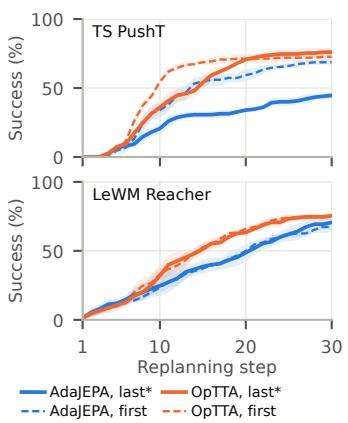  
(a) Adapted predictor block.

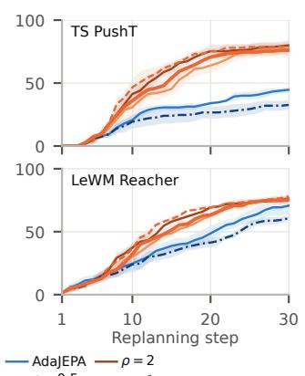  
(b) Strength and schedule of $\alpha _ { k } .$

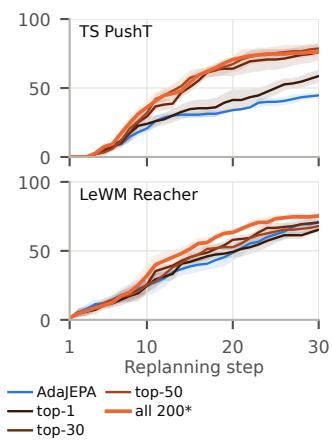  
(c) Candidate rollouts $\mathcal { P } _ { \theta }$  
Figure 3: Ablations of OpTTA’s design choices, varied one at a time (blue: AdaJEPA; orange: OpTTA; ∗: default). Rows show temporal-straightening PushT under darkening 0.7 and LeWM Reacher under darkening 0.85, with the predictor adapted; in (c), top-n keeps the n lowest-cost candidates. Cumulative success is averaged over three seeds of 50 episodes; shading shows ±1 s.e.

Strength and schedule of $\alpha _ { k }$ . Figure 3b varies $\rho$ over a fourfold range, $\rho \in \{ 0 . 5 , 1 , 2 \}$ , and removes the $\sqrt { k / K _ { \operatorname* { m a x } } }$ ramp. OpTTA is fairly robust to $\rho \colon$ final success stays within 76.0–80.0% on PushT and 75.3–76.7% on Reacher, and mean over replans within 45.2–50.9% and 45.7–48.9%, all well above AdaJEPA (44.7% and 70.7% final; 26.4% and 38.3% mean over replans). Reversing the sign of the planning term $( \rho = - 0 . 1$ , pessimism) lowers final success below AdaJEPA’s on both tasks (32.7% and 60.7%), so the gains come from optimism. Removing the ramp does not reduce final success (79.3% and 78.0%) and accumulates success earlier (mean over replans of 52.8% and 50.2%, versus 47.8% and 46.2% with the ramp).

Candidate rollouts. Figure 3c restricts ${ \mathcal { P } } _ { \theta }$ to the lowest-cost candidate (top-1) or to the 30 CEM elites (top-30), instead of all 200 candidates of CEM’s final iteration. The top-1 candidate gives OpTTA’s lowest final success on both tasks (58.7% on PushT and 65.3% on Reacher), below Ada-JEPA’s 70.7% on Reacher. The elites match all candidates in final success on PushT (76.0% each) but not on Reacher (70.7% versus 75.3%), and all candidates yield the highest mean over replans on both tasks (47.8% and 46.2%, versus 44.4% and 41.6% for the elites).

Computational cost. Table 2 reports the time of one replanning step, planning plus the adaptation update, on clean PushT. On LeWM and temporal straightening, OpTTA’s update takes about 20 ms longer than AdaJEPA’s, increasing the time per replan by 5–16%. This cost is offset by fewer replans: because OpTTA solves tasks earlier, its compute time per solved task on LeWM and temporal straightening is lower than AdaJEPA’s. On DINO-WM, this update costs nearly as much as planning. OpTTA evaluates the planning term on the candidate rollouts in batches. For LeWM and temporal straightening, all 200 candidates fit in one batch that does not saturate the GPU, so the cost barely depends on $| \mathcal { P } _ { \theta } |$ ; for DINO-WM, whose larger latent state requires more memory, we process them in four sequential batches of 50, so restricting ${ \mathcal { P } } _ { \theta }$ to the 30 CEM elites (a single batch) cuts the cost from 2.3 to 0.35 s per replan.

How optimism changes adaptation. Figure 4 helps explain OpTTA’s advantage. It does not come from fitting the agent’s own experience better: OpTTA solves more episodes than AdaJEPA, yet its prediction loss on the transitions the agent executes is not consistently lower. The difference shows up instead in what the model predicts beyond those transitions. On Reacher, OpTTA is more accurate than AdaJEPA on a goal-reaching trajectory that the agent never generated; on PushT the two are similar. On both tasks, and especially on Reacher, OpTTA’s model also becomes more optimistic, expecting its chosen plan to close more of the remaining distance to the goal. This is what optimism is meant to do: planning with an optimistic model either reaches the goal or produces transitions that the prediction loss then uses to correct the model.

Table 2: Time per replan (ms) on one RTX PRO 6000 GPU: planning, which does not depend on the method and is averaged over each row, plus the adaptation update (parentheses). $\mathrm { O p T T A _ { 3 0 } }$ restricts ${ \mathcal { P } } _ { \theta }$ to the 30 CEM elites (Figure 3c). LeWM times are wall time and include the environment step; its adaptation time is the difference to Frozen.
<table><tr><td></td><td>Frozen</td><td>AdaJEPA</td><td>OpTTA</td><td> $\mathrm { O p T T A _ { 3 0 } }$ </td><td> $\mathrm { \ A d a J E P A + e n c . }$ </td><td> $\mathrm { { O p T T A } + e n c . }$ </td></tr><tr><td>LeWM PushT</td><td>118</td><td>141 (+23)</td><td> $1 6 3 \ : ( + 4 5 )$ </td><td> $1 6 5 ( + 4 7 )$ </td><td> $1 4 9 ( + 3 1 )$ </td><td>169 (+51)</td></tr><tr><td>TS PushT</td><td>379</td><td> $3 8 9 \left( + 1 0 \right)$ </td><td> $4 1 0 ( + 3 1 )$ </td><td> $4 1 0 ( + 3 1 )$ </td><td> $3 9 4 \left( + 1 5 \right)$ </td><td>415 (+36)</td></tr><tr><td>DINO-WM PushT</td><td>2955</td><td> $2 9 7 1 \left( + 1 6 \right)$ </td><td></td><td>5233 (+2278) 3304 (+349)</td><td>NA</td><td>NA</td></tr></table>

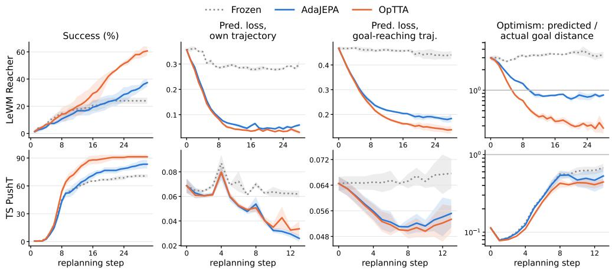  
Figure 4: Adaptation diagnostics for LeWM Reacher (top, gamma 1.5) and temporal-straightening PushT (bottom, darkening 0.85), predictor adapted; mean ± s.e. over three seeds of 50 episodes. Own-trajectory loss is measured on the newest transition before adapting on it; the goal-reaching trajectory is the dataset’s start-to-goal trajectory.

## 6 LIMITATIONS

On TwoRoom, neither AdaJEPA nor OpTTA improves over the pretrained model, and the best parameters to update vary across tasks (Figure 3a). Understanding this task dependence remains open. OpTTA also adds computation per replan, although its higher mean success indicates that it often solves tasks earlier. The performance–cost trade-off warrants further study, and Table 2 and Figure 3 show that the default configuration of OpTTA need not be optimal, despite the demonstrated adaptation gain.

## 7 CONCLUSION

We introduce OpTTA, which augments prediction-based test-time adaptation with an optimistic planning loss. Across three JEPA world models, both adaptation scopes, visual and environment shifts, and CEM and gradient-based planners, OpTTA improves final success over prediction-only adaptation in most settings. Our design of the optimism weight $\alpha _ { k }$ is practical but not necessarily optimal, and its optimal design remains an open question. More broadly, our results suggest that world-model adaptation should account for the downstream planning objective rather than prediction alone, and that optimism offers a simple way to do so.

## REFERENCES

Mahmoud Assran, Quentin Duval, Ishan Misra, Piotr Bojanowski, Pascal Vincent, Michael Rabbat, Yann LeCun, and Nicolas Ballas. Self-supervised learning from images with a joint-embedding predictive architecture. In 2023 IEEE/CVF Conference on Computer Vision and Pattern Recog nition (CVPR), pp. 15619–15629. IEEE, 2023.

Mido Assran, Adrien Bardes, David Fan, Quentin Garrido, Russell Howes, Matthew Muckley, Ammar Rizvi, Claire Roberts, Koustuv Sinha, Artem Zholus, et al. V-JEPA 2: Self-supervised video models enable understanding, prediction and planning. arXiv preprint arXiv:2506.09985, 2025.

Peter Auer, Nicolo Cesa-Bianchi, and Paul Fischer. Finite-time analysis of the multiarmed bandit problem. Machine Learning, 47(2):235–256, 2002.

Vivek Borkar and P. Varaiya. Adaptive control of Markov chains, I: Finite parameter set. IEEE Transactions on Automatic Control, 24(6):953–957, 1979.

Sebastian Curi, Felix Berkenkamp, and Andreas Krause. Efficient model-based reinforcement learning through optimistic policy search and planning. Advances in Neural Information Processing Systems, 33:14156–14170, 2020.

Amir-massoud Farahmand. Iterative value-aware model learning. In S. Bengio, H. Wallach, H. Larochelle, K. Grauman, N. Cesa-Bianchi, and R. Garnett (eds.), Advances in Neural Information Processing Systems, volume 31. Curran Associates, Inc., 2018. URL https://proceedings.neurips.cc/paper\_files/paper/2018/ file/7a2347d96752880e3d58d72e9813cc14-Paper.pdf.

Amir-Massoud Farahmand, Andre Barreto, and Daniel Nikovski. Value-aware loss function for model-based reinforcement learning. In Aarti Singh and Jerry Zhu (eds.), Proceedings of the 20th International Conference on Artificial Intelligence and Statistics, volume 54 of Proceedings of Machine Learning Research, pp. 1486–1494. PMLR, 20–22 Apr 2017. URL https:// proceedings.mlr.press/v54/farahmand17a.html.

Shenyuan Gao, Siyuan Zhou, Yilun Du, Jun Zhang, and Chuang Gan. AdaWorld: Learning adaptable world models with latent actions. In Forty-second International Conference on Machine Learning, 2025. URL https://openreview.net/forum?id=QQegZj99sk.

Danijar Hafner, Timothy Lillicrap, Jimmy Ba, and Mohammad Norouzi. Dream to control: Learning behaviors by latent imagination, 2020. URL https://arxiv.org/abs/1912.01603.

Danijar Hafner, Jurgis Pasukonis, Jimmy Ba, and Timothy Lillicrap. Mastering diverse domains through world models, 2024. URL https://arxiv.org/abs/2301.04104.

Nicklas Hansen, Rishabh Jangir, Yu Sun, Guillem Alenya, Pieter Abbeel, Alexei A Efros, Lerrel\` Pinto, and Xiaolong Wang. Self-supervised policy adaptation during deployment. arXiv preprint arXiv:2007.04309, 2020.

Nicklas Hansen, Hao Su, and Xiaolong Wang. TD-MPC2: Scalable, robust world models for continuous control. In The Twelfth International Conference on Learning Representations, 2024. URL https://openreview.net/forum?id=Oxh5CstDJU.

Thomas Jaksch, Ronald Ortner, and Peter Auer. Near-optimal regret bounds for reinforcement learning. Journal of Machine Learning Research, 11(51):1563–1600, 2010. URL http:// jmlr.org/papers/v11/jaksch10a.html.

P. R. Kumar and A. Becker. A new family of optimal adaptive controllers for Markov chains. IEEE Transactions on Automatic Control, 27:137–146, 1982. URL https://api. semanticscholar.org/CorpusID:122546614.

Nathan Lambert, Brandon Amos, Omry Yadan, and Roberto Calandra. Objective mismatch in model-based reinforcement learning. In Alexandre M. Bayen, Ali Jadbabaie, George Pappas, Pablo A. Parrilo, Benjamin Recht, Claire Tomlin, and Melanie Zeilinger (eds.), Proceedings of the 2nd Conference on Learning for Dynamics and Control, volume 120 of Proceedings of Machine Learning Research, pp. 761–770. PMLR, 10–11 Jun 2020. URL https: //proceedings.mlr.press/v120/lambert20a.html.

Yann LeCun. A path towards autonomous machine intelligence. Open Review, 2022.

Jian Liang, Ran He, and Tieniu Tan. A comprehensive survey on test-time adaptation under distribution shifts. International Journal ofComputer Vision, 133(1):31–64, 2025.

Lucas Maes, Quentin Le Lidec, Damien Scieur, Yann LeCun, and Randall Balestriero. LeWorld Model: Stable end-to-end joint-embedding predictive architecture from pixels, 2026. URL https://arxiv.org/abs/2603.19312.

Akshay Mete, Rahul Singh, Xi Liu, and P. R. Kumar. Reward biased maximum likelihood estimation for reinforcement learning. In Proceedings of the 3rd Conference on Learning for Dynamics and Control, volume 144 of Proceedings of Machine Learning Research, pp. 815–827. PMLR, 07 – 08 June 2021. URL https://proceedings.mlr.press/v144/mete21a.html.

Akshay Mete, Rahul Singh, and Panganamala Kumar. Augmented RBMLE-UCB approach for adaptive control of linear quadratic systems. In Alice H. Oh, Alekh Agarwal, Danielle Belgrave, and Kyunghyun Cho (eds.), Advances in Neural Information Processing Systems, 2022. URL https://openreview.net/forum?id=7pNV4PCjbQy.

Akshay Mete, Shahid Aamir Sheikh, Tzu-Hsiang Lin, Dileep Kalathil, and P. R. Kumar. Optimistic world models: Efficient exploration in model-based deep reinforcement learning, 2026. URL https://arxiv.org/abs/2602.10044.

Sangwu Park, Wonjoong Kim, Yeonjun In, Sein Kim, Hongseok Kang, and Chanyoung Park. Testtime training for visual foresight vision-language-action models, 2026. URL https://arxiv. org/abs/2605.08215.

Reuven Y Rubinstein. Optimization of computer simulation models with rare events. European Journal of Operational Research, 99(1):89–112, 1997.

Uladzislau Sobal, Wancong Zhang, Kyunghyun Cho, Randall Balestriero, Tim GJ Rudner, and Yann LeCun. Learning from reward-free offline data: A case for planning with latent dynamics models. Advances in Neural Information Processing Systems, 38:43905–43941, 2026.

Bhavya Sukhija, Lenart Treven, Carmelo Sferrazza, Florian Dorfler, Pieter Abbeel, and Andreas¨ Krause. SOMBRL: Scalable and optimistic model-based RL. arXiv preprint arXiv:2511.20066, 2025.

Yu Sun, Xiaolong Wang, Zhuang Liu, John Miller, Alexei Efros, and Moritz Hardt. Test-time training with self-supervision for generalization under distribution shifts. In International Conference on Machine Learning, pp. 9229–9248. PMLR, 2020.

Chi Wan, Kangrui Wang, Yuan Si, Pingyue Zhang, and Manling Li. WorldAgen: Unified stateaction prediction with test-time world model training, 2026. URL https://arxiv.org/ abs/2609.08162.

Dequan Wang, Evan Shelhamer, Shaoteng Liu, Bruno Olshausen, and Trevor Darrell. Tent: Fully test-time adaptation by entropy minimization. arXiv preprint arXiv:2006.10726, 2020.

Hang Wang, Xin Ye, Feng Tao, Chenbin Pan, Abhirup Mallik, Burhaneddin Yaman, Liu Ren, and Junshan Zhang. AdaWM: Adaptive world model based planning for autonomous driving. In The Thirteenth International Conference on Learning Representations, 2025. URL https: //openreview.net/forum?id=NEu8wgPctU.

Ying Wang, Oumayma Bounou, Yann LeCun, and Mengye Ren. AdaJEPA: An adaptive latent world model, 2026a. URL https://arxiv.org/abs/2606.32026.

Ying Wang, Oumayma Bounou, Gaoyue Zhou, Randall Balestriero, Tim G. J. Rudner, Yann Le-Cun, and Mengye Ren. Temporal straightening for latent planning. In Forty-third International Conference on Machine Learning, 2026b. URL https://openreview.net/forum?id= Ik1mKtUYlZ.

Gaoyue Zhou, Hengkai Pan, Yann LeCun, and Lerrel Pinto. DINO-WM: World models on pretrained visual features enable zero-shot planning, 2025. URL https://openreview.net/ forum?id=GARbxyCV13.

## CONTENTS

A Additional experimental results 12   
A.1 Experimental details 12   
A.2 Per-shift results . 13   
A.3 Success across replanning steps . 16   
A.4 Success across severity levels . 19   
A.5 Gradient-based planner 21

## A ADDITIONAL EXPERIMENTAL RESULTS

This appendix provides a detailed account of the experimental setup and results supporting the comparisons in Section 5.

## A.1 EXPERIMENTAL DETAILS

Evaluation unit. For visual shifts, a task–shift combination is one world-model–task pair evaluated under one corruption type after averaging over the severity levels used for that checkpoint. Seven corruptions for each of LeWM PushT, LeWM Reacher, LeWM TwoRoom, temporalstraightening PushT, and DINO-WM PushT give 35 visual combinations. Eight environmentspecific combinations additionally evaluate three object recolorings, three held-out object shapes, and two dynamics changes, yielding 43 task–shift combinations in total.

Models, tasks, and shifts. We evaluate LeWM, temporal straightening (TS), and DINO-WM on the tasks described in Section 5.1. Visual shifts comprise blur, salt-and-pepper noise, darkening, gamma, hue, contrast, and image translation. Environment-specific shifts change object color or geometry, mass, or damping. LeWM and TS results average over four severity levels selected separately for each checkpoint using only the frozen model. DINO-WM uses one level per corruption in the aggregate comparison.

Implementation. Our OpTTA implementation builds on the public AdaJEPA codebase. We retain its test-time adaptation pipeline and add the optimistic planning loss and gradient-balancing rule. The LeWM experiments are implemented in the public LeWM codebase using a faithful port of AdaJEPA’s adaptation procedure. All pretrained checkpoints used in our experiments are also publicly available.

Controlled comparison. Every comparison uses the same pretrained checkpoint, planner, start– goal pairs, transition buffer, adapted parameter set, and update schedule. The frozen model receives no parameter updates. AdaJEPA estimates the model using $\mathcal { L } _ { \mathrm { p r e d } } .$ , whereas OpTTA uses the optimistic, task-aware model-estimation objective in equation 6. Their comparison therefore isolates the adaptation objective. All primary comparisons use $\rho = 1$ in equation 8, without tuning it for individual models, planners, tasks, shifts, or severity levels.

Planning and adaptation protocol. CEM plans five actions, executes the first, and replans for at most 30 steps. Adaptation is task-local: each task begins from the pretrained weights and an empty transition buffer. LeWM and TS conditions use five seeds with 50 paired start–goal episodes per seed. DINO-WM uses three seeds with 50 episodes per seed. DINO-WM’s encoder remains frozen; for LeWM and TS, we report both predictor-only and joint predictor–encoder adaptation.

Hyperparameters. Table 3 lists the planning and adaptation hyperparameters of every run. Adaptation follows AdaJEPA (Wang et al., 2026a): at every replan, one Adam step on the last predictor block, using a buffer of the five most recent transitions (learning rates per model in the table). Ada-JEPA and OpTTA share all of these settings. OpTTA adds the base optimism $\rho ,$ the ramp $\sqrt { k / K _ { \operatorname* { m a x } } }$ the stabilizer ε, and the choice of ${ \mathcal { P } } _ { \theta }$ and $\Omega _ { f }$ , and these are the same across world models, tasks, shifts, and severity levels.

Table 3: Hyperparameters of the planning and adaptation protocol. Adaptation follows AdaJEPA (Wang et al., 2026a) and is identical for AdaJEPA and OpTTA; OpTTA adds only the optimism hyperparameters, which are the same for every world model, task, and shift. A latent step covers five environment steps (frameskip).
<table><tr><td>Hyperparameter</td><td>LeWM</td><td>TS</td><td>DINO-WM</td></tr><tr><td colspan="4">Planning (CEM; all methods)</td></tr><tr><td>Candidates per iteration M</td><td>200</td><td>200</td><td>200</td></tr><tr><td>Elites</td><td>30</td><td>30</td><td>30</td></tr><tr><td>CEM iterations</td><td>10</td><td>10</td><td>10</td></tr><tr><td>Planning horizon</td><td></td><td>5 latent steps (25 environment steps)</td><td></td></tr><tr><td>Executed per replan</td><td></td><td>first latent step (5 environment steps)</td><td></td></tr><tr><td>Replanning budget  $K _ { \mathrm { m a x } }$ </td><td>30</td><td>30</td><td>30</td></tr><tr><td>Warm start</td><td></td><td>unexecuted part of the previous plan</td><td> $\mathsf { b f l o a t l } 6 ^ { \mathrm { b } }$ </td></tr><tr><td colspan="4">Numerical precision float32 (TF32 off) float32</td></tr><tr><td colspan="4">Adaptation (AdaJEPA and OpTTA)</td></tr><tr><td>Optimizer</td><td>Adam, re-initialized at every update</td><td></td><td></td></tr><tr><td>Gradient steps per replan U</td><td></td><td>1</td><td>1</td></tr><tr><td>Transition buffer N</td><td></td><td>5 most recent transitions</td><td></td></tr><tr><td>Adapted predictor parameters</td><td>last block, final norm, output projection</td><td>last block, final norm last block, final norm</td><td></td></tr><tr><td>Predictor learning rate η Adapted encoder parametersª</td><td> $5 \times 1 0 ^ { - 5 }$  projector (BatchNorm in</td><td> $5 \times 1 0 ^ { - 4 }$  projection head</td><td> $5 \times 1 0 ^ { - 4 }$  — (frozen)</td></tr><tr><td>Encoder learning rate</td><td>eval mode)  $5 \times 1 0 ^ { - 5 }$ </td><td> $1 0 ^ { - 5 }$ </td><td></td></tr><tr><td colspan="4">Optimism (OpTTA only)</td></tr><tr><td>Base optimism ρ</td><td></td><td>1</td><td>1</td></tr><tr><td>Ramp in equation 8</td><td></td><td> $\sqrt { k / K _ { \operatorname* { m a x } } } \mathrm { w i t h } K _ { \operatorname* { m a x } } = 3 0$ </td><td></td></tr><tr><td>Stabilizer ε</td><td> $1 0 ^ { - 1 2 }$ </td><td> $1 0 ^ { - 1 2 }$ </td><td> $1 0 ^ { - 1 2 }$ </td></tr><tr><td>Candidate rollouts  $\mathcal { P } _ { \theta }$ </td><td>all  $M = 2 0 0$ </td><td>candidates of CEM&#x27;s final iteration</td><td></td></tr><tr><td>Planning-loss parameters  $\Omega _ { f }$ </td><td></td><td>adapted predictor parameters (never the encoder)</td><td></td></tr><tr><td colspan="4">Gradient-descent planner (TS only; Appendix A.5)</td></tr><tr><td>Action optimizer</td><td>Adam, learning rate 0.1, 100 steps, zero initialization</td><td></td><td></td></tr><tr><td>Horizon / executed per replan</td><td></td><td>5 / 1 latent steps, as for CEM</td><td></td></tr><tr><td>Replanning budget  $K _ { \mathrm { m a x } }$ </td><td></td><td>20</td><td></td></tr><tr><td>Optimism</td><td> $\rho = 1$ </td><td>without the ramp;  $\mathcal { P } _ { \theta }$  is the optimized plan</td><td></td></tr></table>

aJoint predictor–encoder scope only; the predictor-only scope adapts no encoder parameters.  
bAutocast for CEM’s cost evaluation (all methods) and the forward pass of ${ \mathcal { L } } _ { \mathrm { p l a n } }$ (OpTTA); the plan and the $\mathcal { L } _ { \mathrm { p r e d } }$ update stay float32.

Metrics and aggregation. Final is the percentage of episodes solved by replan 30, and Mean over replans is the average cumulative success rate across replans 1 through 30. Within each seed, we first average episodes at each severity and then average severity levels within a corruption; reported means and standard errors are computed across seeds. The visual-corruption rows in Table 1 additionally average the seven corruptions within each world-model–task setting, giving each corruption equal weight. The tables also report each adaptation method’s gain over Frozen, paired by seed within the same adaptation scope.

## A.2 PER-SHIFT RESULTS

Tables 4 and 5 disaggregate the shifted results in Table 1 by corruption type or environment change. The predictor-only table contains all 43 task–shift combinations; the joint predictor–encoder table contains the 36 combinations evaluated with LeWM and temporal straightening, since the DINO-WM encoder remains frozen.

Table 4: Predictor adapted. Planning success (%, mean ± s.e. over seeds, five seeds unless noted) per shift, in the layout of Table 1. Each visual corruption averages the severity levels listed in its label. Parentheses give the gain over Frozen, paired by seed; bold marks the best method at the printed precision.
<table><tr><td rowspan="2">Setting</td><td colspan="3">Final</td><td colspan="3">Mean over replans</td></tr><tr><td>Frozen</td><td>AdaJEPA</td><td>OpTTA</td><td>Frozen</td><td>AdaJEPA</td><td>OpTTA</td></tr><tr><td colspan="7">LeWM PushT</td></tr><tr><td>Blur (2, 4, 6, 8)</td><td></td><td>77.6±1.3 78.7±1.8(+1.1)</td><td>85.5±1.1 (+7.9)</td><td>58.7±0.7</td><td>60.3±1.1 (+1.6)</td><td>67.4±0.7 (+8.7)</td></tr><tr><td>Salt &amp; pepper (0.025, 0.05, 0.075, 0.1)</td><td></td><td>53.5±1.4 53.9±0.9(+0.4)</td><td>60.5±1.3 (+7.0)</td><td>40.5±1.0</td><td>41.5±0.7(+1.1)</td><td>46.5±0.8 (+6.0)</td></tr><tr><td>Darkening (0.95, 0.9, 0.85, 0.8)</td><td></td><td>54.8±1.2 58.2±1.7(+3.4)</td><td>61.8±0.9(+7.0)</td><td>41.8±0.8</td><td>44.8±1.2(+2.9)</td><td>48.2±0.7 (+6.4)</td></tr><tr><td>Gamma (0.5, 0.75, 1.25, 1.5)</td><td>76.7±1.7</td><td>82.6±0.5 (+5.9)</td><td>87.8±1.0(+11.1)</td><td>57.5±1.2</td><td>62.4±0.7 (+4.8)</td><td>68.4±0.8 (+10.9)</td></tr><tr><td>Hue (10, 20, 30, 40)</td><td></td><td>44.1±2.6 46.6±1.7(+2.5)</td><td>52.4±1.9(+8.3)</td><td>31.6±2.1</td><td>34.1±1.4(+2.5)</td><td>39.1±1.3(+7.5)</td></tr><tr><td>Contrast (0.5, 0.75, 1.25, 1.5)</td><td>43.5±1.4</td><td>51.4±2.2(+7.9)</td><td>58.3±0.9 (+14.8)</td><td>32.2±1.1</td><td>38.5±1.9(+6.4)</td><td>43.4±1.0(+11.2)</td></tr><tr><td>Translation (10, 20, 30, 40)</td><td>59.5±1.1</td><td>65.6±0.7 (+6.1)</td><td>73.4±0.4(+13.9)</td><td>44.8±1.0</td><td>49.7±0.5 (+4.9)</td><td>57.0±0.3 (+12.3)</td></tr><tr><td colspan="7">LeWM Reacher</td></tr><tr><td>Blur (2, 4, 6, 8)</td><td></td><td></td><td>52.5±1.6 58.0±1.6(+5.5) 69.2±0.7 (+16.7)</td><td></td><td>38.2±0.8 40.1±0.6(+1.9)</td><td>46.5±0.8 (+8.3)</td></tr><tr><td>Salt &amp; pepper (0.025, 0.05, 0.075, 0.1)</td><td></td><td>84.6±0.8 84.3±0.6(−0.3)</td><td>88.9±0.6(+4.3)</td><td>61.5±0.9</td><td>60.1±0.6(−1.5)</td><td>64.9±0.7 (+3.3)</td></tr><tr><td>Darkening (0.95, 0.9, 0.85, 0.8)</td><td></td><td>61.2±0.9 73.8±0.5 (+12.6)82.5±0.5 (+21.3)</td><td></td><td>45.4±0.6</td><td>48.8±0.9(+3.4)</td><td>55.4±0.8 (+10.0)</td></tr><tr><td>Gamma (0.5, 0.75, 1.25, 1.5)</td><td></td><td></td><td>22.5±1.6 36.8±1.2(+14.3) 54.5±1.1 (+32.0)</td><td>16.5±1.3</td><td>21.6±0.9(+5.2)</td><td>30.9±1.3 (+14.4)</td></tr><tr><td>Hue (10, 20, 30, 40)</td><td></td><td></td><td>56.5±1.5 63.5±2.2(+7.0) 72.8±2.4 (+16.3)</td><td>39.6±1.0</td><td>42.1±1.2(+2.5)</td><td>48.7±1.4(+9.1)</td></tr><tr><td>Contrast (0.5, 0.75, 1.25, 1.5)</td><td>69.0±1.1</td><td>75.3±1.0(+6.3)</td><td>85.0±0.9 (+16.0)</td><td>51.3±1.1</td><td>52.8±1.4(+1.5)</td><td>59.7±1.2(+8.4)</td></tr><tr><td>Translation (10, 20, 30, 40)</td><td></td><td>23.2±1.9 30.5±1.4(+7.3)</td><td>42.7±2.9 (+19.5)</td><td>16.6±1.3</td><td>18.9±0.5(+2.3)</td><td>24.3±1.5(+7.7)</td></tr><tr><td colspan="7">LeWM TwoRoom</td></tr><tr><td>Blur (0.5, 0.75, 1, 2)</td><td></td><td>68.7±2.4 63.1±2.3 (−5.6) 62.5±2.9 (−6.2)</td><td></td><td></td><td>58.5±2.5 54.5±2.3 (−4.0) 54.3±2.8 (−4.2)</td><td></td></tr><tr><td>Salt &amp; pepper (0.005, 0.01, 0.015, 0.025)</td><td></td><td>61.2±1.7 56.6±2.2(−4.6)</td><td>56.7±1.8(−4.5)</td><td></td><td>50.9±2.2 48.1±1.9(−2.7)</td><td>47.7±1.8(−3.1)</td></tr><tr><td>Darkening (0.2, 0.5, 0.7, 0.8)</td><td></td><td>55.2±3.2 50.0±2.1(−5.2)</td><td>49.9±2.1(−5.3)</td><td></td><td>47.3±2.8 43.8±2.1(−3.5)</td><td>43.8±1.9(−3.5)</td></tr><tr><td>Gamma (0.1, 0.15, 0.2, 0.3)</td><td></td><td>79.2±1.2 77.1±1.4(−2.1)</td><td>77.7±0.7(−1.5)</td><td></td><td>66.4±0.8 65.4±1.1 (−1.1)</td><td>65.4±1.1(−1.0)</td></tr><tr><td>Hue (30, 40, 50, 60)</td><td></td><td>64.6±2.3 65.3±2.8 (+0.7)</td><td>62.3±1.9(−2.3)</td><td></td><td>55.8±2.3 53.5±2.3 (−2.4)</td><td>53.7±1.7(−2.1)</td></tr><tr><td>Contrast (0.2, 0.4, 0.5, 0.6)</td><td></td><td>57.4±3.7 52.1±2.4(−5.3)</td><td>53.2±1.9(−4.2)</td><td></td><td>49.4±3.446.2±2.3 (−3.2)</td><td>46.5±2.1(−2.8)</td></tr><tr><td>Translation (10, 20, 30, 40)</td><td></td><td>40.6±1.0 39.1±0.9(−1.5)</td><td>38.3±1.3(−2.3)</td><td></td><td>35.1±0.8 34.0±1.2(−1.2)</td><td>33.4±1.4(−1.7)</td></tr><tr><td colspan="7">TS PushT</td></tr><tr><td>Blur (1, 2, 4, 6)</td><td></td><td></td><td>49.0±1.7 67.3±1.1 (+18.3) 81.6±0.8 (+32.6)</td><td>34.6±1.5</td><td>43.7±1.3(+9.1)</td><td>55.0±0.7 (+20.4)</td></tr><tr><td>Salt &amp; pepper (0.025, 0.05, 0.075, 0.1)</td><td></td><td></td><td>47.4±2.2 65.2±1.8(+17.8)86.7±1.8 (+39.3)</td><td>32.8±1.7</td><td>41.1±1.4(+8.4)</td><td>56.8±1.4(+24.1)</td></tr><tr><td>Darkening (0.65, 0.7, 0.75, 0.8)</td><td></td><td>50.5±2.2 50.6±1.7 (+0.1)</td><td>68.5±1.1 (+18.0)</td><td>35.1±1.6</td><td>33.2±1.1(−1.9)</td><td>45.9±1.2 (+10.8)</td></tr><tr><td>Gamma (0.3, 0.7, 2, 4)</td><td></td><td></td><td>44.0±2.0 56.0±0.8 (+12.0) 75.9±2.5 (+31.9)</td><td>31.9±1.5</td><td>35.5±0.5 (+3.6)</td><td>48.6±1.7 (+16.7)</td></tr><tr><td>Hue (10, 20, 30, 40)</td><td></td><td></td><td>43.4±2.5 52.3±2.4(+8.9) 59.5±2.8 (+16.1)</td><td>32.3±2.3</td><td>35.5±1.9(+3.2)</td><td>41.3±2.1 (+9.0)</td></tr><tr><td>Contrast (0.4, 0.8, 2, 4)</td><td></td><td></td><td>54.2±1.7 62.6±1.2 (+8.4) 80.7±1.5 (+26.5)</td><td>37.7±1.3</td><td>41.6±1.1 (+3.9)</td><td>55.1±1.5(+17.4)</td></tr><tr><td>Translation (10, 20, 30, 40)</td><td></td><td>46.4±1.9 53.8±3.3 (+7.4) 65.0±2.9 (+18.6)</td><td></td><td>33.4±1.6</td><td>36.5±2.1 (+3.1)</td><td>44.0±2.2 (+10.6)</td></tr><tr><td colspan="7">DINO-WM PushT (one level, three seeds)</td></tr><tr><td>Blur (2)</td><td></td><td></td><td>66.0±6.1 78.0±5.0 (+12.0) 78.7±5.3 (+12.7)</td><td></td><td>47.9±4.1 58.8±6.2 (+10.8)</td><td>60.4±4.5 (+12.5)</td></tr><tr><td>Salt &amp; pepper (0.001)</td><td></td><td>44.0±2.3 69.3±2.9(+25.3) 65.3±3.3 (+21.3)</td><td></td><td></td><td>33.9±2.6 47.5±2.6(+13.6)</td><td>49.8±3.1 (+15.9)</td></tr><tr><td>Darkening (0.1)</td><td></td><td>20.7±4.7 27.3±2.9 (+6.7) 31.3±1.8 (+10.7)</td><td></td><td></td><td>15.8±3.7 19.0±1.6(+3.2)</td><td>23.4±1.3(+7.6)</td></tr><tr><td>Gamma (0.2)</td><td></td><td>52.7±2.9 68.0±7.0 (+15.3) 72.7±5.7 (+20.0)</td><td></td><td></td><td>38.6±2.5 52.4±5.4(+13.8)</td><td>55.0±3.8 (+16.4)</td></tr><tr><td>Hue (180)</td><td></td><td>76.7±5.8 77.3±6.8 (+0.7) 76.0±5.3 (−0.7)</td><td></td><td></td><td>58.4±5.3 60.2±5.6(+1.8)</td><td>59.4±4.0(+1.0)</td></tr><tr><td>Contrast (2)</td><td></td><td>17.3±2.4 27.3±4.8(+10.0) 30.7±2.4(+13.3)</td><td></td><td></td><td>13.8±2.9 19.8±3.2(+6.0)</td><td>22.6±2.1 (+8.9)</td></tr><tr><td>Translation (5)</td><td></td><td>40.0±4.6 52.7±8.1 (+12.7) 56.7±2.4 (+16.7)</td><td></td><td></td><td>30.9±3.2 41.0±7.0 (+10.1)</td><td>42.6±2.6(+11.7)</td></tr><tr><td colspan="7">TS environment shifts</td></tr><tr><td>PushT, red agent</td><td></td><td>53.6±2.568.8±3.7 (+15.2)85.6±2.5 (+32.0)</td><td></td><td></td><td>40.9±2.1 46.7±2.7 (+5.9)</td><td>60.6±1.8(+19.7)</td></tr><tr><td>PushT, red anchor</td><td></td><td>44.8±2.8 42.8±3.6(−2.0) 62.0±2.1 (+17.2)</td><td></td><td></td><td>30.1±2.1 26.0±2.5(−4.1)</td><td>37.1±1.8(+7.0)</td></tr><tr><td>PushT, red block</td><td></td><td>16.0±2.2 10.8±2.6(−5.2) 18.0±3.0 (+2.0)</td><td></td><td></td><td>11.2±1.1 8.0±1.9(−3.2)</td><td>11.4±1.5(+0.3)</td></tr><tr><td>PushObj, shape i</td><td></td><td>27.6±2.5 50.4±3.4(+22.8) 54.0±3.8 (+26.4)</td><td></td><td></td><td></td><td>19.5±2.0 34.8±2.5 (+15.3) 38.8±2.7 (+19.3)</td></tr><tr><td>PushObj, shape small t</td><td></td><td>53.2±3.9 75.2±2.8 (+22.0) 78.0±3.0 (+24.8)</td><td></td><td></td><td>37.1±2.4 51.9±2.3 (+14.7)</td><td>58.2±2.0(+21.1)</td></tr><tr><td>PushObj, shape square</td><td></td><td>23.2±1.7 40.0±2.6(+16.8) 42.8±3.4(+19.6)</td><td></td><td></td><td>16.9±1.1 27.9±2.4(+11.0)</td><td>31.9±2.5 (+15.1)</td></tr><tr><td>Medium maze, low mass</td><td></td><td>90.8±1.9 92.0±1.8 (+1.2)</td><td>93.6±1.8(+2.8)</td><td></td><td>74.5±1.7 74.7±1.6(+0.3)</td><td>75.3±2.1 (+0.9)</td></tr><tr><td>Medium maze, high damping</td><td></td><td>80.4±2.4 83.2±2.6(+2.8)</td><td>84.8±2.0 (+4.4)</td><td></td><td>58.6±1.4 61.7±1.5(+3.1)</td><td>62.3±0.8 (+3.7)</td></tr></table>

Table 5: Predictor and encoder adapted (DINO-WM has no encoder variant). Planning success (%, mean ± s.e. over seeds, five seeds unless noted) per shift, in the layout of Table 1. Each visual corruption averages the severity levels listed in its label. Parentheses give the gain over Frozen, paired by seed; bold marks the best method at the printed precision.
<table><tr><td rowspan="2">Setting</td><td colspan="3">Final</td><td colspan="3">Mean over replans</td></tr><tr><td>Frozen</td><td>AdaJEPA</td><td>OpTTA</td><td>Frozen</td><td>AdaJEPA</td><td>OpTTA</td></tr><tr><td>LeWM PushT</td><td></td><td></td><td></td><td></td><td></td><td></td></tr><tr><td>Blur (2, 4, 6, 8)</td><td>77.6±1.3</td><td>80.0±1.6(+2.4)</td><td>86.5±1.0 (+8.9)</td><td>58.7±0.7</td><td>60.4±1.3(+1.7)</td><td>67.6±0.7 (+8.9)</td></tr><tr><td>Salt &amp; pepper (0.025, 0.05, 0.075, 0.1)</td><td>53.5±1.4</td><td>53.5±1.0(+0.0)</td><td>58.3±2.7 (+4.8)</td><td>40.5±1.0</td><td>41.3±1.1 (+0.8)</td><td>45.2±1.9(+4.7)</td></tr><tr><td>Darkening (0.95, 0.9, 0.85, 0.8)</td><td>54.8±1.2</td><td>59.5±2.4(+4.7)</td><td>63.9±1.8(+9.1)</td><td>41.8±0.8</td><td>45.4±1.8 (+3.6)</td><td>50.1±1.6(+8.3)</td></tr><tr><td>Gamma (0.5, 0.75, 1.25, 1.5)</td><td>76.7±1.7</td><td>81.6±1.4(+4.9)</td><td>87.7±0.9 (+11.0)</td><td>57.5±1.2</td><td>61.7±1.3(+4.1)</td><td>68.5±0.9 (+10.9)</td></tr><tr><td>Hue (10, 20, 30, 40)</td><td>44.1±2.6</td><td>49.1±1.7(+5.0)</td><td>52.3±2.1 (+8.2)</td><td>31.6±2.1</td><td>36.1±0.9(+4.5)</td><td>39.9±1.4(+8.4)</td></tr><tr><td>Contrast (0.5, 0.75, 1.25, 1.5)</td><td>43.5±1.4</td><td>53.4±1.8(+9.9)</td><td>57.7±1.1(+14.2)</td><td>32.2±1.1</td><td>39.8±1.9(+7.6)</td><td>43.8±1.0 (+11.6)</td></tr><tr><td>Translation (10, 20, 30, 40)</td><td>59.5±1.1</td><td>67.5±0.8 (+8.0)</td><td>72.4±1.3 (+12.9)</td><td>44.8±1.0</td><td>51.0±0.7 (+6.2)</td><td>56.3±1.0(+11.5)</td></tr><tr><td>LeWM Reacher</td><td></td><td></td><td></td><td></td><td></td><td></td></tr><tr><td>Blur (2, 4, 6, 8)</td><td></td><td>52.5±1.6 58.2±0.8(+5.7)</td><td>71.2±1.8(+18.7)</td><td></td><td>38.2±0.8 40.2±0.7 (+2.1)</td><td>47.8±0.9 (+9.6)</td></tr><tr><td>Salt &amp; pepper (0.025, 0.05, 0.075, 0.1)</td><td></td><td>84.6±0.8 86.9±0.9 (+2.3)</td><td>89.8±1.5(+5.2)</td><td>61.5±0.9</td><td>62.1±1.2(+0.5)</td><td>64.9±1.1 (+3.4)</td></tr><tr><td>Darkening (0.95, 0.9, 0.85, 0.8)</td><td></td><td>61.2±0.9 76.3±1.2(+15.1)</td><td>80.6±0.3 (+19.4)</td><td>45.4±0.6</td><td>50.1±1.0(+4.6)</td><td>55.0±0.8 (+9.5)</td></tr><tr><td>Gamma (0.5, 0.75, 1.25, 1.5)</td><td></td><td>22.5±1.6 40.8±2.1 (+18.3)</td><td>47.6±1.3(+25.1)</td><td>16.5±1.3</td><td>23.7±1.6(+7.2)</td><td>27.9±0.6(+11.5)</td></tr><tr><td>Hue (10, 20, 30, 40)</td><td></td><td>56.5±1.5 63.1±1.6(+6.6)</td><td>73.7±2.9 (+17.2)</td><td>39.6±1.0</td><td>42.5±0.6(+2.9)</td><td>48.7±1.5(+9.1)</td></tr><tr><td>Contrast (0.5, 0.75, 1.25, 1.5)</td><td></td><td>69.0±1.1 79.3±1.7(+10.3)</td><td>88.0±1.2 (+19.0)</td><td>51.3±1.1</td><td>54.2±0.5 (+2.9)</td><td>61.7±0.7 (+10.4)</td></tr><tr><td>Translation (10, 20, 30, 40)</td><td></td><td>23.2±1.9 31.5±2.1 (+8.3)</td><td>42.3±3.6(+19.1)</td><td>16.6±1.3</td><td>19.0±1.4(+2.4)</td><td>24.0±2.2(+7.4)</td></tr><tr><td>LeWM TwoRoom</td><td></td><td></td><td></td><td></td><td></td><td></td></tr><tr><td>Blur (0.5, 0.75, 1, 2)</td><td></td><td>68.7±2.4 59.4±2.6(−9.3)</td><td>60.2±2.3(−8.5)</td><td></td><td>58.5±2.5 51.4±2.5 (−7.1) 52.2±2.3 (−6.3)</td><td></td></tr><tr><td>Salt &amp; pepper (0.005, 0.01, 0.015, 0.025) 61.2±1.7 56.8±1.4(—4.4)</td><td></td><td></td><td>59.7±2.7(−1.5)</td><td></td><td>50.9±2.2 48.1±2.1 (−2.8) 49.7±2.3 (−1.1)</td><td></td></tr><tr><td>Darkening (0.2, 0.5, 0.7, 0.8)</td><td></td><td>55.2±3.2 51.1±1.2(−4.1)</td><td>51.2±1.7(−4.0)</td><td></td><td>47.3±2.8 44.0±1.4(−3.3)</td><td>44.9±1.8(−2.4)</td></tr><tr><td>Gamma (0.1, 0.15, 0.2, 0.3)</td><td></td><td>79.2±1.2 78.0±1.4(−1.2)</td><td>79.2±1.5(+0.0)</td><td></td><td>66.4±0.8 65.5±1.3 (−0.9)</td><td>66.9±1.0(+0.5)</td></tr><tr><td>Hue (30, 40, 50, 60)</td><td></td><td>64.6±2.3 61.9±1.8(−2.7)</td><td>62.0±1.7(−2.6)</td><td></td><td>55.8±2.3 53.3±2.0(−2.5)</td><td>53.5±1.7(−2.3)</td></tr><tr><td>Contrast (0.2, 0.4, 0.5, 0.6)</td><td></td><td>57.4±3.7 50.2±1.7(−7.2)</td><td>52.0±1.4(−5.4)</td><td></td><td>49.4±3.4 43.8±1.7(−5.5)</td><td>45.5±1.5(−3.9)</td></tr><tr><td>Translation (10, 20, 30, 40)</td><td></td><td>40.6±1.0 42.6±1.6(+2.0)</td><td>44.4±1.9(+3.8)</td><td></td><td>35.1±0.8 36.7±1.6(+1.6)</td><td>37.8±1.9(+2.7)</td></tr><tr><td>TS PushT</td><td></td><td></td><td></td><td></td><td></td><td></td></tr><tr><td>Blur (1, 2, 4, 6)</td><td></td><td>49.0±1.7 69.8±1.5(+20.8)81.3±1.4(+32.3)</td><td></td><td></td><td>34.6±1.5 46.0±1.2(+11.5) 56.8±0.9 (+22.2)</td><td></td></tr><tr><td>Salt &amp; pepper (0.025, 0.05, 0.075, 0.1)</td><td></td><td>47.4±2.2 69.8±2.3 (+22.4)86.5±2.0 (+39.1)</td><td></td><td></td><td>32.8±1.7 44.1±2.0 (+11.4) 58.7±1.6(+26.0)</td><td></td></tr><tr><td>Darkening (0.65, 0.7, 0.75, 0.8)</td><td></td><td>50.5±2.2 51.5±2.9 (+1.0) 68.7±2.7 (+18.2)</td><td></td><td></td><td>35.1±1.6 32.6±1.8 (−2.5) 45.9±2.1 (+10.8)</td><td></td></tr><tr><td>Gamma (0.3, 0.7, 2, 4)</td><td></td><td>44.0±2.0 60.7±2.2(+16.7) 76.6±1.9 (+32.6)</td><td></td><td></td><td>31.9±1.5 38.9±1.0(+7.0)</td><td>50.0±1.3 (+18.0)</td></tr><tr><td>Hue (10, 20, 30, 40)</td><td></td><td>43.4±2.5 52.7±2.4(+9.3)60.8±3.4(+17.4)</td><td></td><td></td><td>32.3±2.3 36.0±2.1 (+3.8)</td><td>42.4±2.5(+10.1)</td></tr><tr><td>Contrast (0.4, 0.8, 2, 4)</td><td></td><td>54.2±1.7 63.2±1.8 (+9.0) 81.7±1.3 (+27.5)</td><td></td><td>37.7±1.3</td><td>40.8±1.5(+3.1)</td><td>55.2±1.2(+17.6)</td></tr><tr><td>Translation (10, 20, 30, 40)</td><td></td><td>46.4±1.9 57.3±2.7(+10.9)</td><td>67.3±2.9 (+20.9)</td><td>33.4±1.6</td><td>38.6±2.1 (+5.2)</td><td>46.6±2.4 (+13.2)</td></tr><tr><td>TS environment shifts</td><td></td><td></td><td></td><td></td><td></td><td></td></tr><tr><td>PushT, red agent</td><td></td><td>53.6±2.5 77.6±3.1 (+24.0)87.6±1.9(+34.0)</td><td></td><td></td><td>40.9±2.1 52.9±2.5 (+12.1) 64.4±2.0 (+23.5)</td><td></td></tr><tr><td>PushT, red anchor</td><td></td><td>44.8±2.846.0±3.3 (+1.2)</td><td>61.6±2.1 (+16.8)</td><td></td><td>30.1±2.1 28.9±2.0(−1.2)</td><td>36.3±1.5(+6.1)</td></tr><tr><td>PushT, red block</td><td></td><td>16.0±2.2 10.0±1.1 (−6.0)</td><td>15.6±2.4(−0.4)</td><td></td><td>11.2±1.1 7.2±1.0(−3.9)</td><td>10.1±2.0(−1.1)</td></tr><tr><td>PushObj, shape i</td><td></td><td>27.6±2.553.6±3.5 (+26.0)</td><td>53.6±3.2 (+26.0)</td><td></td><td>19.5±2.0 37.1±2.1 (+17.6)38.9±2.7 (+19.3)</td><td></td></tr><tr><td>PushObj, shape small t</td><td></td><td>53.2±3.9 72.8±3.4(+19.6)</td><td>77.6±2.9 (+24.4)</td><td></td><td>37.1±2.4 49.5±2.6(+12.4) 57.4±2.6(+20.3)</td><td></td></tr><tr><td>PushObj, shape square</td><td></td><td>23.2±1.7 40.0±3.8(+16.8)</td><td>42.4±3.3 (+19.2)</td><td></td><td></td><td>16.9±1.1 27.6±1.8 (+10.8) 31.3±2.3 (+14.4)</td></tr><tr><td>Medium maze, low mass</td><td></td><td>90.8±1.9 91.2±1.5(+0.4)</td><td>92.4±1.8(+1.6)</td><td></td><td>74.5±1.7 74.3±2.3(−0.2)</td><td>74.5±1.8(−0.0)</td></tr><tr><td>Medium maze, high damping</td><td></td><td>80.4±2.4 84.0±2.4(+3.6)</td><td>84.0±1.9 (+3.6)</td><td></td><td>58.6±1.4 61.7±1.1 (+3.1)</td><td>60.9±1.0(+2.3)</td></tr></table>

## A.3 SUCCESS ACROSS REPLANNING STEPS

Figures 5–10 report cumulative success at every replanning step for each setting. For visual corruptions, curves average the severity levels used in the corresponding table row; environment shifts are shown individually. The final point of each curve is Final, and the mean of its 30 points is Mean over replans.

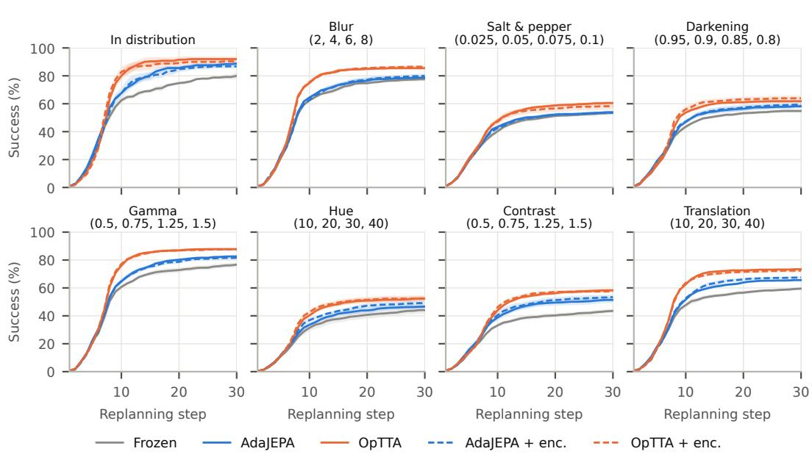  
Figure 5: LeWM PushT: cumulative success versus replanning step, in distribution and under each visual corruption, averaged over the severity levels in the panel title. Curves are means over seeds with ±1 s.e. bands; solid lines adapt the predictor, dashed lines the predictor and encoder. The mean of each curve is the table’s mean over replans, and its last point the table’s Final.

LeWM TwoRoom  
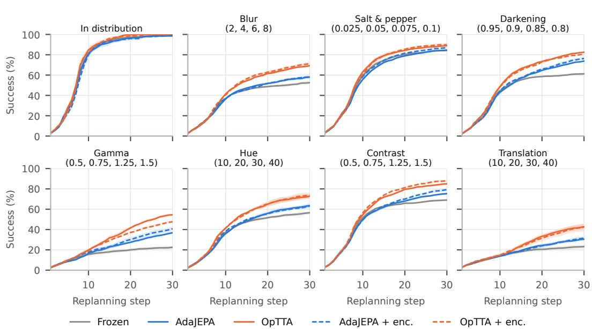  
Figure 6: LeWM Reacher: cumulative success versus replanning step, in distribution and under each visual corruption, averaged over the severity levels in the panel title. Curves are means over seeds with ±1 s.e. bands; solid lines adapt the predictor, dashed lines the predictor and encoder. The mean of each curve is the table’s mean over replans, and its last point the table’s Final.

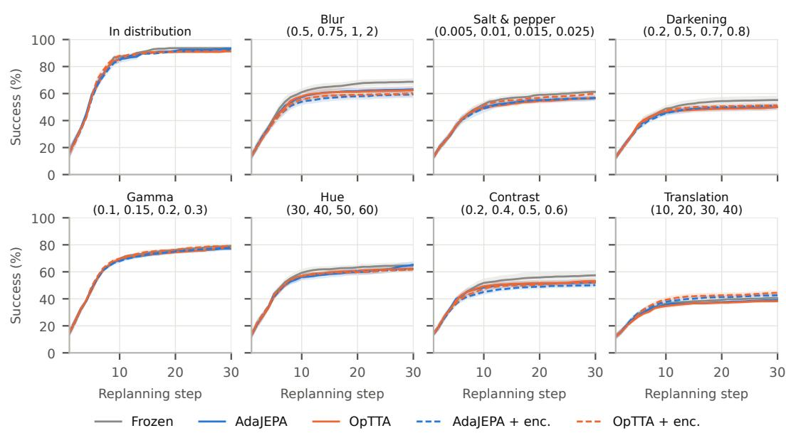  
Figure 7: LeWM TwoRoom: cumulative success versus replanning step, in distribution and under each visual corruption, averaged over the severity levels in the panel title. Curves are means over seeds with ±1 s.e. bands; solid lines adapt the predictor, dashed lines the predictor and encoder. The mean of each curve is the table’s mean over replans, and its last point the table’s Final.

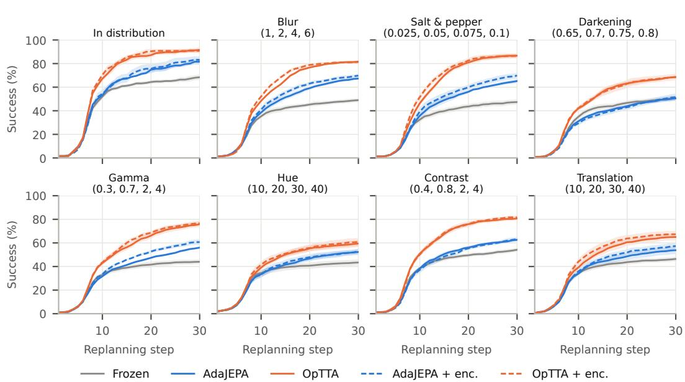  
Figure 8: TS PushT: cumulative success versus replanning step, in distribution and under each visual corruption, averaged over the severity levels in the panel title. Curves are means over seeds with ±1 s.e. bands; solid lines adapt the predictor, dashed lines the predictor and encoder. The mean of each curve is the table’s mean over replans, and its last point the table’s Final.

DINO-WM PushT (one level, three seeds)  
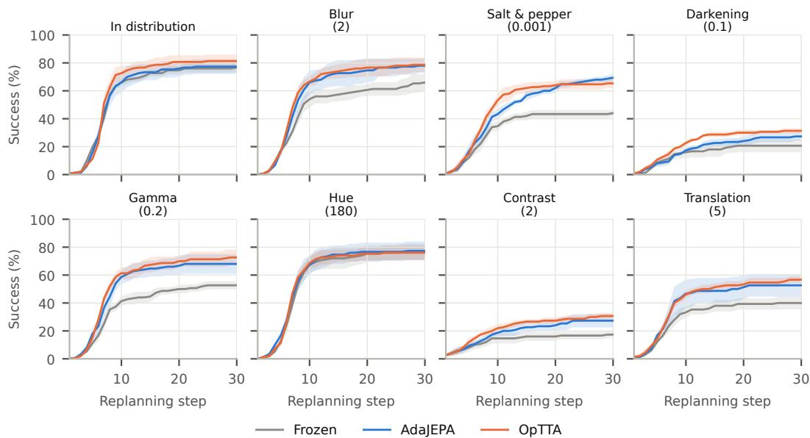  
Figure 9: DINO-WM PushT (one level, three seeds): cumulative success versus replanning step, in distribution and under each visual corruption, averaged over the severity levels in the panel title. Curves are means over seeds with ±1 s.e. bands; all lines adapt only the predictor. The mean of each curve is the table’s mean over replans, and its last point the table’s Final.

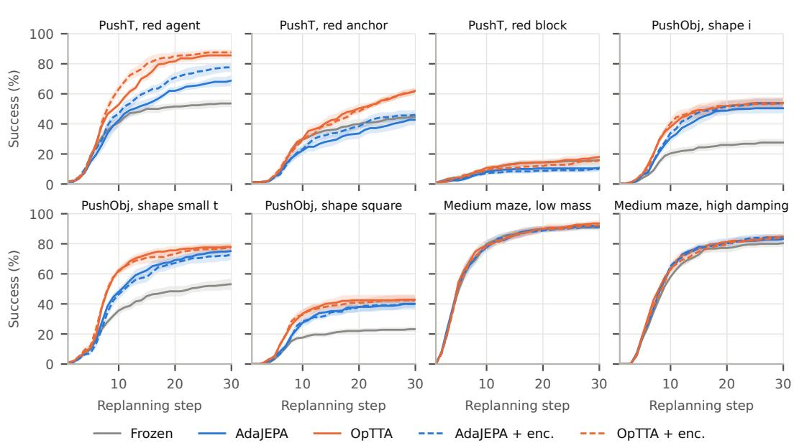  
Figure 10: TS environment shifts: cumulative success versus replanning step, each environment shift. Curves are means over seeds with ±1 s.e. bands; solid lines adapt the predictor, dashed lines the predictor and encoder. The mean of each curve is the table’s mean over replans, and its last point the table’s Final.

## A.4 SUCCESS ACROSS SEVERITY LEVELS

Figures 11–14 report final success separately at each visual-corruption severity for LeWM and temporal straightening. The clean condition is shown only as a reference and is not included in the corrupted-level averages. DINO-WM is omitted because its aggregate evaluation uses one severity level per corruption.

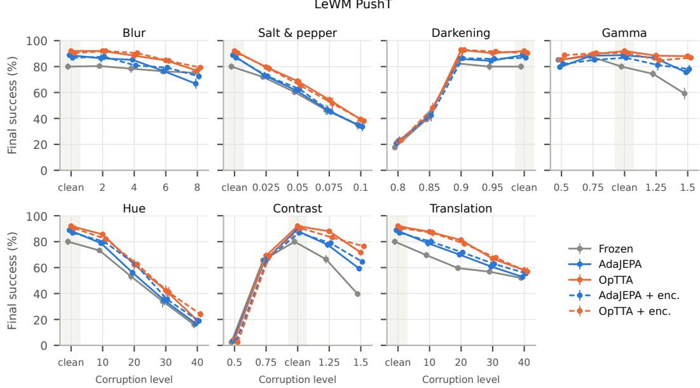  
Figure 11: LeWM PushT: final success at each level of each visual corruption, with the uncorrupted condition (clean, shaded) placed at the identity value; levels are ordered by value. Points are means over five seeds with ±1 s.e. bars; solid lines adapt the predictor, dashed lines the predictor and encoder. The mean over a panel’s four corrupted levels is the corresponding entry of Tables 4 and 5.

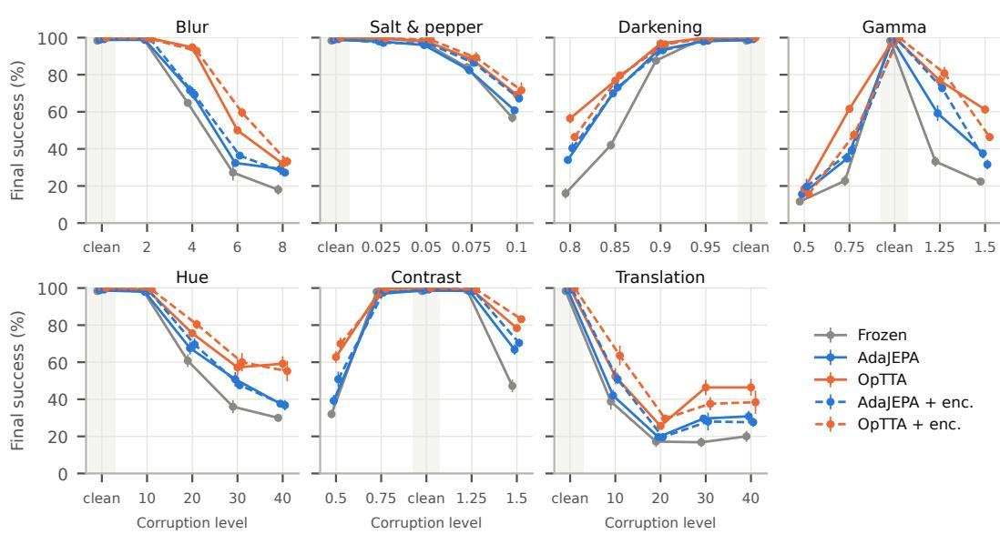  
Figure 12: LeWM Reacher: final success at each level of each visual corruption, with the uncorrupted condition (clean, shaded) placed at the identity value; levels are ordered by value. Points are means over five seeds with ±1 s.e. bars; solid lines adapt the predictor, dashed lines the predictor and encoder. The mean over a panel’s four corrupted levels is the corresponding entry of Tables 4 and 5.

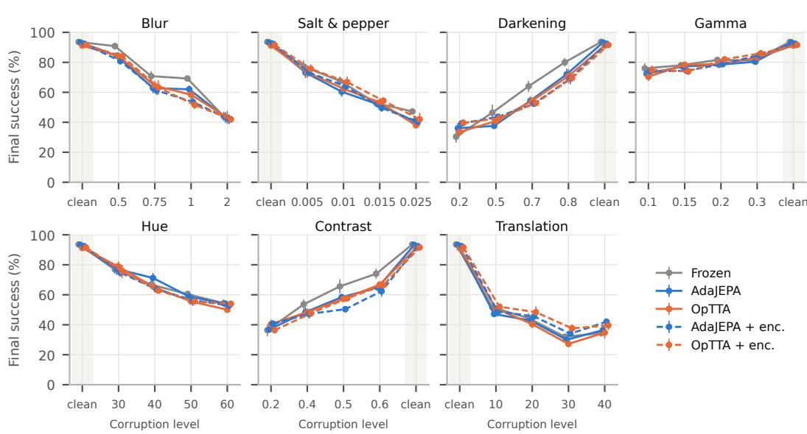  
Figure 13: LeWM TwoRoom: final success at each level of each visual corruption, with the uncorrupted condition (clean, shaded) placed at the identity value; levels are ordered by value. Points are means over five seeds with ±1 s.e. bars; solid lines adapt the predictor, dashed lines the predictor and encoder. The mean over a panel’s four corrupted levels is the corresponding entry of Tables 4 and 5.

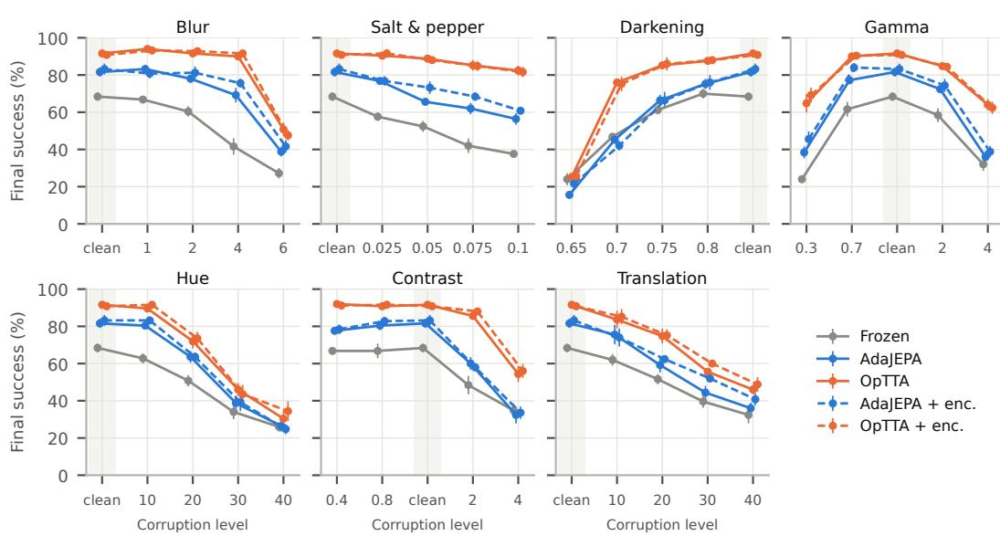  
Figure 14: TS PushT: final success at each level of each visual corruption, with the uncorrupted condition (clean, shaded) placed at the identity value; levels are ordered by value. Points are means over five seeds with ±1 s.e. bars; solid lines adapt the predictor, dashed lines the predictor and encoder. The mean over a panel’s four corrupted levels is the corresponding entry of Tables 4 and 5.

## A.5 GRADIENT-BASED PLANNER

We evaluate temporal-straightening PushT under a separate gradient-based planning protocol. The planner optimizes the action sequence directly, and ${ \mathcal { L } } _ { \mathrm { p l a n } }$ is evaluated on the optimized plan. These runs use 20 replans and constant $\rho = 1$ without the optimism ramp. Within this protocol, Frozen, AdaJEPA, and OpTTA use the same start–goal pairs and applicable adaptation settings. Thus, the comparison tests the adaptation objectives under gradient-based planning, but does not isolate planner choice relative to CEM. Table 6 reports Final at replan 20 and Mean over replans across steps 1–20, and Figure 15 shows the corresponding success curves.

Table 6: Temporal straightening on PushT with a gradient-descent planner. Planning success (%, mean $\pm \ \mathrm { s . e . }$ over five seeds of 50 episodes). The gradient-descent runs use a budget of 20 replans, so Final is success by replanning step 20 and Mean over replans is the average cumulative success rate across replanning steps 1–20; values are not directly comparable to the 30-replan Table 1. Parentheses report the adaptation gain over Frozen, paired by seed and computed before rounding. Each visual corruption averages its four severity levels.  
(a) Predictor adapted.
<table><tr><td></td><td colspan="3">Final</td><td colspan="3">Mean over replans</td></tr><tr><td>Setting</td><td>Frozen</td><td>AdaJEPA</td><td>OpTTA</td><td>Frozen</td><td>AdaJEPA</td><td>OpTTA</td></tr><tr><td>In distribution</td><td> $5 9 . 2 { \pm } 2 . 1 $ </td><td> $7 4 . 4 { \pm } 1 . 2 \ : ( + 1 5 . 2 )$ </td><td> $8 4 . 4 { \scriptstyle \pm 1 . 9 ( + 2 5 . 2 ) }$ </td><td> $4 2 . 9 2 1 . 5$ </td><td> $4 9 . 9 { \pm } 0 . 6 ( + 6 . 9 )$ </td><td> ${ \pm } 7 . 0 { \pm } 1 . 0 \left( + 1 4 . 1 \right)$ </td></tr><tr><td colspan="7">Visual corruptions</td></tr><tr><td>Blur</td><td> $4 2 . 5 { \pm } 0 . 8 $ </td><td> $6 2 . 2 { \pm } 1 . 3 \ : ( + 1 9 . 7 )$ </td><td> ${ \bf 6 9 . 5 { \pm } } 1 . 2 \left( + 2 7 . 0 \right)$ </td><td> $3 0 . 0 { \pm } 0 . 8 $ </td><td> $3 7 . 4 { \pm } 1 . 1 \ : ( + 7 . 4 )$ </td><td> $4 4 . 4 { \pm } 1 . 1 \ : ( + 1 4 . 4 )$ </td></tr><tr><td>Salt &amp; pepper</td><td> $4 8 . 4 \pm 2 . 4$ </td><td> $6 6 . 6 { \pm } 2 . 7 \ : ( + 1 8 . 2 )$ </td><td> $7 4 . 7 { \scriptstyle \pm 1 . 8 \ ( + 2 6 . 3 ) }$ </td><td> $3 2 . 4 \pm 1 . 4$ </td><td> $3 8 . 9 { \pm } 1 . 3 \ : ( + 6 . 5 )$ </td><td> $4 7 . 4 { \scriptstyle \pm 1 . 5 ( + 1 5 . 0 ) }$ </td></tr><tr><td>Darkening</td><td> $4 2 . 1 \pm 2 . 1$ </td><td> $4 8 . 5 { \pm } 2 . 8 ( + 6 . 4 )$ </td><td> $5 8 . 3 { \scriptstyle \pm 1 . 8 \ ( + 1 6 . 2 ) }$ </td><td> $2 8 . 9 { \pm } 1 . 5 $ </td><td> $2 9 . 5 { \pm } 1 . 5 \ : ( + 0 . 6 )$ </td><td> ${ \bf 3 6 . 9 { \pm } 1 . 4 \ ( + 8 . 1 ) }$ </td></tr><tr><td>Gamma</td><td> $4 0 . 4 \pm 1 . 4$ </td><td> $5 1 . 5 { \pm } 1 . 3 ( + 1 1 . 1 )$ </td><td> ${ \bf 6 2 . 4 2 1 . 6 \left( + 2 2 . 0 \right) }$ </td><td> $2 8 . 1 { \pm } 0 . 8 $ </td><td> $3 0 . 9 { \scriptstyle \pm 0 . 7 \ ( + 2 . 8 ) }$ </td><td> ${ 3 7 . 9 \pm 1 . 1 \ ( + 9 . 7 ) }$ </td></tr><tr><td>Hue</td><td> $3 5 . 0 { \pm } 1 . 1$ </td><td> $4 6 . 0 { \pm } 2 . 9 \left( + 1 1 . 0 \right)$ </td><td> ${ \pm 0 . 1 \pm 2 . 5 ( + 1 5 . 1 ) }$ </td><td> $2 4 . 7 { \pm } 0 . 8 $ </td><td> $2 9 . 0 { \pm } 1 . 8 \ : ( + 4 . 3 )$ </td><td> $3 2 . 6 { \pm } 1 . 7 \ : ( + 7 . 9 )$ </td></tr><tr><td>Contrast</td><td> $4 8 . 6 { \pm } 2 . 6 $ </td><td> $6 1 . 7 { \pm } 3 . 0 ( + 1 3 . 1 )$ </td><td> ${ \bf 7 0 . 7 { \pm } } 2 . 2 \left( { + 2 2 . 1 } \right)$ </td><td> $3 3 . 8 { \pm } 1 . 5 $ </td><td> $3 8 . 0 { \pm } 1 . 9 \ ( + 4 . 2 )$ </td><td> $4 5 . 9 { \pm } 1 . 5 ( + 1 2 . 1 ) $ </td></tr><tr><td>Translation</td><td> $4 0 . 2 { \pm } 0 . 9 $ </td><td> $4 6 . 4 { \pm } 2 . 0 \ : ( + 6 . 2 )$ </td><td> ${ \bar { \mathbf { 5 1 . 7 } } } \pm 1 . 4 \left( + 1 1 . 5 \right)$ </td><td> $2 8 . 3 { \pm } 0 . 9$ </td><td> $2 9 . 8 { \pm } 1 . 5 \left( + 1 . 5 \right)$ </td><td> $3 3 . 6 { \pm } 0 . 7 \ : ( + 5 . 3 )$ </td></tr></table>

(b) Predictor and encoder adapted.

<table><tr><td rowspan="2">Setting</td><td colspan="3">Final</td><td colspan="3">Mean over replans</td></tr><tr><td>Frozen</td><td>AdaJEPA</td><td> $\mathrm { O p T T A }$ </td><td>Frozen</td><td> $\mathrm { \Delta A d a J E P A }$ </td><td>OpTTA</td></tr><tr><td>In distribution</td><td> $5 9 . 2 { \pm } 2 . 1 $ </td><td> $7 4 . 0 { \pm } 2 . 1 \ ( + 1 4 . 8 )$ </td><td> $8 3 . 2 { \scriptstyle \pm 2 . 4 ( + 2 4 . 0 ) }$ </td><td> $4 2 . 9 2 1 . 5$ </td><td> $5 0 . 9 { \scriptstyle \pm 1 . 9 \ ( + 8 . 0 ) }$ </td><td> $\pmb { 5 6 . 4 \pm 1 . 7 ( + 1 3 . 5 ) }$ </td></tr><tr><td colspan="7">Visual corruptions</td></tr><tr><td>Blur</td><td> $4 2 . 5 { \pm } 0 . 8 $ </td><td> $6 4 . 9 { \pm } 2 . 1 \ ( + 2 2 . 4 )$ </td><td> $7 1 . 6 { \pm } 1 . 2 \ : ( + 2 9 . 1 )$ </td><td> $3 0 . 0 { \pm } 0 . 8 $ </td><td> $4 0 . 1 { \pm } 1 . 1 \ : ( + 1 0 . 1 )$ </td><td> ${ \bf 4 6 . 0 { \pm } 0 . 9 \ ( + 1 6 . 0 ) }$ </td></tr><tr><td>Salt &amp; pepper</td><td> $4 8 . 4 \pm 2 . 4$ </td><td> $6 8 . 1 \pm 2 . 7 ( + 1 9 . 7 )$ </td><td> $7 6 . 1 \pm 2 . 0 ( + 2 7 . 7 )$ </td><td> $3 2 . 4 \pm 1 . 4$ </td><td> $4 0 . 6 { \pm } 1 . 4 \ : ( + 8 . 2 )$ </td><td> $4 9 . 0 { \scriptstyle \pm 1 . 5 ( + 1 6 . 6 ) }$ </td></tr><tr><td>Darkening</td><td> $4 2 . 1 \pm 2 . 1$ </td><td> $4 8 . 3 { \pm } 3 . 4 \ : ( + 6 . 2 )$ </td><td> $5 8 . 8 { \scriptstyle \pm 2 . 3 } ( { + 1 6 . 7 } )$ </td><td> $2 8 . 9 { \pm } 1 . 5 $ </td><td> $2 9 . 5 { \pm } 2 . 0 \ : ( + 0 . 6 )$ </td><td> ${ \bf 3 6 . 9 { \pm } 1 . 7 \ : ( + 8 . 1 ) }$ </td></tr><tr><td>Gamma</td><td> $4 0 . 4 \pm 1 . 4$ </td><td> $5 4 . 7 { \pm } 0 . 8 \ : ( + 1 4 . 3 )$ </td><td> ${ \bf 6 5 . 9 2 0 . 9 \left( + 2 5 . 5 \right) }$ </td><td> $2 8 . 1 { \pm } 0 . 8 $ </td><td> $3 2 . 9 { \pm } 0 . 5 ( + 4 . 7 )$ </td><td> ${ \bf 4 0 . 6 { \pm } 0 . 6 \ ( + 1 2 . 5 ) }$ </td></tr><tr><td>Hue</td><td> $3 5 . 0 \pm 1 . 1$ </td><td> $4 5 . 7 { \scriptstyle \pm 2 . 4 ( + 1 0 . 7 ) }$ </td><td> ${ \pm 0 . 8 \pm 3 . 0 \ ( + 1 5 . 8 ) }$ </td><td> $2 4 . 7 { \pm } 0 . 8 $ </td><td> $2 8 . 9 { \pm } 1 . 7 \ : ( + 4 . 2 )$ </td><td> $3 2 . 3 { \pm } 1 . 8 \ : ( + 7 . 6 )$ </td></tr><tr><td>Contrast</td><td> $4 8 . 6 { \pm } 2 . 6 $ </td><td> $6 1 . 9 { \pm } 2 . 8 \ : ( + 1 3 . 3 )$ </td><td> $7 2 . 3 { \scriptstyle \pm 2 . 0 \ ( + 2 3 . 7 ) }$ </td><td> $3 3 . 8 { \pm } 1 . 5 $ </td><td> $3 8 . 1 \pm 1 . 5 ( + 4 . 3 )$ </td><td> $4 6 . 2 \pm 1 . 6 ( + 1 2 . 4 )$ </td></tr><tr><td>Translation</td><td> $4 0 . 2 { \pm } 0 . 9 $ </td><td> $5 0 . 4 { \pm } 2 . 2 \ ( + 1 0 . 2 )$ </td><td> $5 5 . 4 \pm 1 . 5 ( + 1 5 . 2 )$ </td><td> $2 8 . 3 { \pm } 0 . 9$ </td><td> $3 1 . 7 { \pm } 1 . 7 \ : ( + 3 . 4 )$ </td><td> $3 5 . 3 { \scriptstyle \pm 1 . 4 ( + 7 . 0 ) }$ </td></tr></table>

TS PushT, gradient-descent planner  
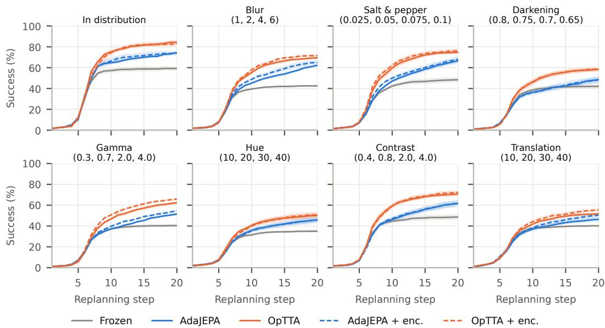  
Figure 15: Temporal straightening on PushT with a gradient-descent planner: cumulative success versus replanning step over the 20-replan budget, one panel per row of Table 6. Visual corruptions average the severity levels in the panel title. Curves are means over seeds with ±1 s.e. bands; solid lines adapt the predictor, dashed lines the predictor and encoder. The mean of each curve is the table’s mean over replans, and its last point the table’s Final.