# ADAPTIVE MEMORY INDEX EVOLUTION FOR AGENTS

Yuntong Hu1, Tongli Su1, Yuanfu Sun2, Shuo Ma3, Qiaoyu Tan2, Liang Zhao1   
1Emory University, 2New York University, 3Meituan,   
{yuntong.hu,liang.zhao}@emory.edu

## ABSTRACT

Long-horizon agents continually accumulate experience, yet retaining a memory does not guarantee access when it is needed. Existing systems can adapt both memory content and access; we isolate persistent access updates as a separately controlled adaptation layer. We formulate this target as Memory Index Evolution and instantiate it with Adaptive Memory Index Evolution (AMIE), a lightweight plug-in layer that evolves per-memory access state from deployment retrievals without modifying stored content or retraining the host memory system. AMIE distils a semantic teacher’s keep/suppress judgments into a retrieval-conditioned policy and accumulates its selective actions into bounded state that reweights subsequent host retrievals. Surprisingly, even a zero-call policy that simply accumulates retrieval frequency can match or outperform semantic policies in several settings, revealing retrieval traffic itself as a strong signal for access adaptation, while learned selectivity improves robustness when frequently retrieved memories remain useful. Across five retrieval-based hosts and three benchmarks, trained AMIE improves downstream F1 or accuracy in all 15 comparisons, by 0.70–3.37 percentage points (up to 25% relative), and improves retrieval in all 10 comparisons. Controlled analyses show that persistent competitor suppression can expose previously unseen evidence, while suppressing repeatedly useful memories creates the complementary failure mode. Together, these results establish persistent memory access as a practical adaptation layer, distinct from the content it serves, in retrieval-based agent memory systems. § Code

w/o AMIE +AMIE (trained) LoCoMo GroupMem MemBench task utility (absolute) retrieval gain (relative)

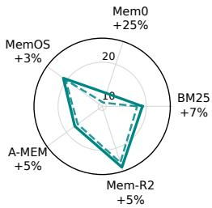  
(a) LoCoMo F1

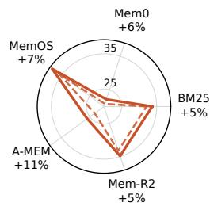  
(b) GroupMem Acc.

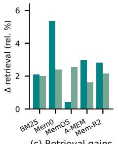  
(c) Retrieval gains

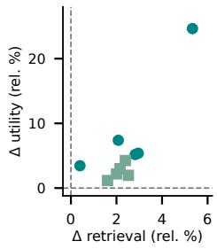  
(d) Joint gains  
Figure 1: Persistent index adaptation improves both memory access and downstream utility across heterogeneous memory systems. We evaluate three complementary memory settings: Lo-CoMo for long-horizon conversation, GroupMem for cross-channel group memory, and MemBench for personal memory. Trained AMIE improves all downstream host–benchmark comparisons and all comparisons with retrieval measurements. (a,b) Absolute LoCoMo F1 and GroupMem accuracy, with relative gains over each matched host shown at the vertices. (c) Relative retrieval gains on LoCoMo and MemBench. (d) All ten pairs measured at both levels improve in both retrieval and downstream utility, showing that the benefits of index evolution extend beyond retrieval metrics to the tasks memory ultimately serves.

## 1 INTRODUCTION

Long-horizon agents accumulate observations, decisions, and successful procedures that they must recover when a later task needs them (Yao et al., 2023; Shinn et al., 2023; Packer et al., 2023; Maharana et al., 2024; Wang et al., 2024). Retaining this experience is only part of the problem: stored information can remain intact while becoming difficult to retrieve. Consider an agent that retains the episode that solved a software failure, the kind of recurring task that realistic agent benchmarks now probe (Jimenez et al., 2024; Zhou et al., 2024; Merrill et al., 2026). As similar stack traces and configuration notes accumulate, they may rank above that episode when the failure returns. The useful experience has not been deleted or rewritten; access to it has changed.

Memory systems address long-term use through extraction, consolidation, tiers, graphs, and learned memory operations (Zhong et al., 2024; Chhikara et al., 2025; Xu et al., 2025; Zhang et al., 2025; Yan et al., 2026b; Huo et al., 2026). Existing systems may adapt both memory content and access, including recall-dependent strength, access recency, and persistent graph utilities (Zhong et al., 2024; Park et al., 2023; Feng et al., 2026). We instead isolate persistent index updates as a separately controlled layer over the host retrieval interface. This separation asks a specific question:

## Can deployment experience improve memory access without changing stored content?

Memory Index Evolution makes persistent access state an explicit adaptation target, distinct from stored content. Two agents with identical stores can encounter different query streams and benefit from different access states. A finite retrieval context makes selection consequential (Liu et al., 2024), but the adaptation target is the state carried between queries, rather than a new context budget or a replacement query-time ranker.

Adaptive Memory Index Evolution (AMIE) instantiates this layer with a trained index policy that learns which retrieved memories should accumulate suppression. We distil a semantic teacher’s judgments into a compact action model, then carry its decisions forward through bounded permemory state. The current answer context is sealed before an update is committed; only later host retrievals use the new state. We also find that replacing learned selection with unconditional counting can approach frozen-policy performance on LoCoMo BM25 and MemoryOS, showing how much access improvement retrieval traffic alone can supply in those settings. Selective actions address the complementary risk of penalising memories that remain useful.

Across five retrieval-based hosts and three benchmarks, trained AMIE improves the reported utility scores; the ten pairs with retrieval measurements also show retrieval gains (Figure 1). Matched host comparisons assess utility; controlled replays isolate the benefits and risks of suppressing recurrent competitors. State interventions, deployment swaps, and granularity analyses test the persistent access layer (Section 4). Our contributions are:

• Memory Index Evolution. We isolate persistent access state as an adaptation target complementary to stored content, with value assessed on subsequent queries (Section 2).

• Adaptive Memory Index Evolution. We train a retrieval-conditioned index policy by balanced mask distillation and couple its selective actions to bounded, persistent score updates within native host interfaces (Section 3).

• Empirical regularities. Controlled analyses reveal how retrieval history, persistent suppression, and policy selectivity govern access adaptation, and identify the structural conditions under which it can expose unseen evidence without suppressing useful memories (Section 4).

## 2 PROBLEM FORMULATION

Retrieval-based Agent Memory. Let $\mathcal { C } _ { t } = \{ m _ { 1 } , . . . , m _ { N _ { t } } \}$ denote the experience retained by an agent at time t. Given a query $q ,$ memory is useful only through the downstream task it supports. We therefore define the ideal memory support as

$$
S ^ { * } ( { q } ) \in \mathop { \arg \operatorname* { m a x } } _ { S \subseteq { \mathcal { C } _ { t } } } { \mathcal { U } } ( q , { \mathcal { A } } ( \cdot \mid q , S ) ) ,\tag{1}
$$

where A is the downstream agent or generator and U is task utility. The maximisation permits the full store as a special case; more exposed content need not improve utility. Retained content defines the available evidence, while the index determines what the host surfaces for the agent.

Content and Index Evolution. We therefore distinguish the retained content $\mathcal { C } _ { t }$ from the memory index $\mathcal { T } _ { t }$ , the state governing how that content is surfaced:

$$
\mathcal { M } _ { t } = ( \mathcal { C } _ { t } , \mathbb { Z } _ { t } ) , \qquad S _ { t } = \mathcal { R } ( q _ { t } ; \mathcal { C } _ { t } , \mathbb { Z } _ { t } ) \subseteq \mathcal { C } _ { t } .\tag{2}
$$

Here $\mathcal { R }$ denotes the host retrieval procedure; our formulation does not assume a particular implementation. The same memory objective can then be improved along two complementary axes,

$$
\underbrace { \mathcal { C } _ { t + 1 } = G ( \mathcal { C } _ { t } , \mathcal { O } _ { t } ) } _ { \mathrm { c o n t e n t e v o l u t i o n } } , \qquad \underbrace { \mathcal { T } _ { t + 1 } = F ( \mathcal { T } _ { t } , \mathcal { O } _ { t } ) } _ { \mathrm { i n d e x ~ e v o l u t i o n } } ,\tag{3}
$$

where ${ \mathcal { O } } _ { t }$ is information available from the runtime interaction. G learns what to retain; $F$ learns how retained experience should remain reachable. We isolate the latter as a separate update process learned from retrieval observations. Holding content fixed defines the controlled intervention here; it does not preclude combining index and content evolution.

Memory Index Evolution. Index evolution seeks an update rule $F$ that improves the same downstream objective as Equation 1 over a lifelong query stream:

$$
F ^ { \star } = \arg \operatorname* { m a x } _ { F } \mathbb { E } \left[ \sum _ { t = 1 } ^ { T } \mathcal { U } ( q _ { t } , \mathcal { A } ( \cdot \mid q _ { t } , \mathcal { R } ( q _ { t } ; \mathcal { C } _ { t } , \mathcal { Z } _ { t } ) ) ) \right] , \qquad \mathcal { Z } _ { t + 1 } = F ( \mathcal { Z } _ { t } , \mathcal { O } _ { t } ) .\tag{4}
$$

Because an update to $\mathcal { T } _ { t }$ affects subsequent queries, its value must be assessed prospectively rather than on the interaction that produced it. Index evolution poses three design challenges:

• C1: What signal reveals access interference? Interference depends on the queries a deployment actually issues and cannot be determined from memory content alone.

• C2: Which updates generalize forward? A persistent index update must benefit unseen queries rather than merely reinforce the interaction that produced it.

• C3: How can the index evolve in a running system? Index adaptation must operate online through the host’s retrieval interface.

## 3 ADAPTIVE MEMORY INDEX EVOLUTION

AMIE addresses the three challenges through coupled decisions about what to update, how the update persists, and where it acts. A retrieval-conditioned index policy identifies suppression actions from deployment queries and retrieved memories, supplying the interaction-grounded signal required by C1 (Section 3.1). Bounded persistent access dynamics carry these actions across queries, addressing the prospective update required by C2 (Section 3.2). In-the-flow index evolution applies this state within the host’s scored candidate interface, addressing C3 without rewriting stored content (Section 3.3).

This design factors the update in Equation 4 into a retrieval-conditioned policy and a persistent state transition:

$$
F _ { \theta } ( \mathcal { T } _ { t } , \mathcal { O } _ { t } ) = \mathsf { T } \big ( \mathcal { T } _ { t } , \pi _ { \theta } ( \mathcal { O } _ { t } ) \big ) .\tag{5}
$$

Here $\pi _ { \theta }$ selects per-memory actions and T converts them into future-access state. Since future utility is unavailable when an action is taken, teacher-mask distillation supplies a surrogate for fitting πθ; subsequent-query utility evaluates the resulting state against the prospective objective. Figure 2 shows this separation between offline policy learning and online index evolution.

## 3.1 RETRIEVAL-CONDITIONED INDEX POLICY

Predict selective updates from native retrieval feedback. The local decision is whether a surfaced memory deserves a persistent penalty, which depends on its relation to the query. The policy therefore observes $q _ { t }$ and the host’s ordered native feedback list $B _ { t }$ . This list is distinct from the answer context $S _ { t }$ , which AMIE re-ranks using existing state. The observation ${ \mathcal { O } } _ { t }$ contains the query and feedback memories’ text; future queries and reference answers are excluded. The action space is

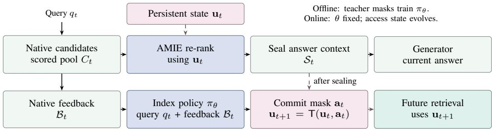  
Selected competitors lose priority; useful in-pool memories can rise on later queries.  
Figure 2: AMIE applies persistent access state to subsequent retrievals. Native candidates supply both the answer context, ranked with pre-update state, and the policy’s feedback. Dashed arrows show state access and the commit constraint: updates occur after context sealing and affect later queries.

$$
\begin{array} { r } { \mathbf { a } _ { t } = \pi _ { \theta } ( \mathcal { O } _ { t } ) , \qquad a _ { i , t } \in \{ 0 , 1 \} , \qquad a _ { i , t } = 0 \mathrm { f o r } m _ { i } \notin \mathcal { B } _ { t } . } \end{array}\tag{6}
$$

An action of one increments a memory’s suppression state; zero preserves its current state. A keep action avoids additional suppression; it does not remove an accumulated penalty or prevent changes in relative rank.

A language model predicts the action mask in one forward pass. The policy jointly encodes the query and ordered feedback memories to predict a suppression probability $p _ { \theta , i } ( \mathcal { O } _ { t } )$ for each surfaced entry. Its binary decisions map back to stable memory IDs, so a query-conditioned judgment becomes an update to a persistent object. The complete mask is emitted in one pass, without per-entry textual judgments; the backbone, prediction head, and fitting configuration are in Appendix A.5.

Teacher masks supply a surrogate for selective state updates. A teacher labels feedback memories as keep or suppress, favouring keep when uncertain about future usefulness (Figure A.2). On an offline collection $\mathcal { D }$ of observations and teacher masks, we fit the student with class-balanced binary cross-entropy:

$$
\mathcal { L } ( \theta ) = \mathbb { E } _ { ( \mathcal { O } _ { t } , \mathbf { y } _ { t } ) \sim \mathcal { D } } \left[ \frac { 1 } { | \mathcal { B } _ { t } | } \sum _ { i : m _ { i } \in \mathcal { B } _ { t } } w _ { y _ { i , t } } \ell _ { \mathrm { B C E } } \big ( p _ { \theta , i } ( \mathcal { O } _ { t } ) , y _ { i , t } \big ) \right] ,\tag{7}
$$

where $y = 1$ denotes suppress, $y = 0$ denotes keep, and $w _ { y }$ balances the two classes. At deployment, θ is fixed: adaptation occurs in the persistent index state. Fitting details and benchmark exposure are in Appendix A.5; Appendix A.7 defines the later-query evaluation criterion.

The action interface separates selectivity from persistence. The frozen selector prompts the same backbone with the mask instruction, without task-specific fitting. The count selector sets $a _ { i , t } = 1$ for every native feedback entry, using repeated exposure as a proxy for interference with no model calls. These alternatives share the trained policy’s state transition and host wrapper, isolating what learned selectivity adds (Section 4.4).

## 3.2 BOUNDED PERSISTENT ACCESS DYNAMICS

Accumulate selected actions into bounded access state. We instantiate the persistent access state with bounded multiplicative suppression. To realise the cross-query effect in Equation 4, AMIE accumulates actions by memory identity: an observation changes a retained access variable that subsequent queries can reuse. Its access state is

$$
\mathcal { T } _ { t } = \mathbf { u } _ { t } = ( u _ { 1 , t } , \ldots , u _ { N , t } ) , \qquad u _ { i , t } \in [ 0 , 1 ] .\tag{8}
$$

The underlying counters evolve as

$$
n _ { i , t } = \sum _ { \tau < t } a _ { i , \tau } , \qquad n _ { i , t + 1 } = n _ { i , t } + a _ { i , t } , \qquad n _ { i , 1 } = 0 .\tag{9}
$$

Counts are converted to bounded suppression state,

$$
u _ { i , t } = g ( n _ { i , t } ) = \frac { n _ { i , t } } { n _ { i , t } + \kappa } , \qquad \kappa > 0 ,\tag{10}
$$

where κ sets the number of selected events needed for half-saturation. Repeated decisions strengthen the penalty, while saturation bounds it. The state summarises accumulated actions, not a probability of irrelevance. It persists when a memory leaves the feedback list, allowing past competition to influence its next retrieval without re-observing the original query.

Relative access can improve without observing the target. After a host-specific monotone affinity mapping and positive query-wise scaling to $\hat { \sigma } ( q , i ) \in [ 0 , 1 ]$ , AMIE uses

$$
s _ { t } ( q , i ) = \hat { \sigma } ( q , i ) \big ( 1 - \lambda _ { p } u _ { i , t } \big ) , \qquad \lambda _ { p } \in [ 0 , 1 ] .\tag{11}
$$

The strength $\lambda _ { p }$ bounds the score reduction. An unchanged memory can rise in rank when its competitors are suppressed, even if the policy has never observed that memory. Proposition 1 formalises this conditional rank property in Appendix H. Selectivity matters because suppressing useful evidence can instead impair its later access (Appendix A.9).

## 3.3 IN-THE-FLOW INDEX EVOLUTION

A shared wrapper makes access state independently controllable. AMIE attaches to stable memory IDs and the host’s scored candidate interface, separating the evolving access layer from content construction and candidate generation:

$$
\mathcal { H } : q \mapsto [ ( m _ { i } , \sigma _ { \mathcal { H } } ( q , m _ { i } ) ) ] _ { i \in C _ { \mathcal { H } } ( q ) } ,\tag{12}
$$

and ranks the host-supplied candidate pool using the pre-update state:

$$
\begin{array} { r } { \begin{array} { c } { \mathcal { W } _ { \mathbf { u } _ { t } } ( \mathcal { H } ) ( q ) = \mathrm { T o p } _ { k , \prec } [ ( m _ { i } , \hat { \sigma } _ { \mathcal { H } } ( q , i ) ( 1 - \lambda _ { p } u _ { i , t } ) ) ] _ { i \in C _ { \mathcal { H } } ( q ) } , } \\ { \mathcal { W } _ { \mathbf { u } _ { t } } ( \mathcal { H } ) ( q ) \big | _ { \lambda _ { p } = 0 } = \mathrm { S e l e c t } _ { k , \prec } ( \mathcal { H } ( q ) ) . } \end{array} } \end{array}\tag{13}
$$

Both operators return ordered memory IDs at depth k, with the host’s tie order ≺. Setting $\lambda _ { p } = 0$ recovers the host’s selection from the same pool, enabling matched comparisons of the access layer. Monotone score adaptation preserves the host order before state is applied; host-specific attachment points are specified in Appendix A.4.

Post-sealing updates enforce the prospective adaptation target. For query t, the wrapper reads $\mathbf { u } _ { t }$ and seals the answer context $S _ { t }$ before committing the mask derived from native feedback $B _ { t }$ Only later queries use $\mathbf u _ { t + 1 }$ , so an action’s effect is carried forward rather than credited to the answer that elicited it. Native feedback also separates the update signal from AMIE’s own re-ranked context. Candidate-pool depth, feedback depth, and answer depth therefore control reach, observation, and context respectively; only in-pool memories can enter the answer context, and acquiring an expanded pool can incur additional retrieval work. This interface makes the policy and state replaceable while keeping the host’s stored content and answerer fixed.

## 4 EXPERIMENTS

## 4.1 EXPERIMENTAL SETUP

Benchmarks. LoCoMo tests long-horizon conversational memory, GroupMem tests group memory across channels, and MemBench tests personal memory (Maharana et al., 2024; Yang et al., 2026b; Tan et al., 2025). We report F1 on LoCoMo and accuracy otherwise; retrieval units and evidence mappings are defined in Appendix A.2, and dataset scopes in Table A.1.

Table 1: Retrieval scores with and without AMIE (%, higher is better). Subscripts subtract the displayed baseline; green/red intensity encodes positive/negative magnitude, not significance. Host specific retrieval units are defined in Appendix A.2.
<table><tr><td rowspan="2">Benchmark Host</td><td rowspan="2"></td><td rowspan="2"></td><td colspan="3">+AMIE</td></tr><tr><td>Host only</td><td>Trained Frozen</td><td>Count</td></tr><tr><td rowspan="5">LoCoMo (Maharana et al., 2024)</td><td>BM25 (Robertson &amp; Zaragoza, 2009)</td><td>51.94</td><td> $5 3 . 0 2 _ { + 1 . 0 8 }$ </td><td>53.21+1.27</td><td>53.41+1.47</td></tr><tr><td>Mem0 (Chhikara et al., 2025)</td><td>42.17</td><td> $4 4 . 4 2 _ { + 2 . 2 5 }$ </td><td>44.28+2.11</td><td>45.03+2.86</td></tr><tr><td>MemoryOS (Kang et al., 2025)</td><td>45.29</td><td>45.47+0.18</td><td>46.20+0.91 45.90+0.61</td><td></td></tr><tr><td>A-MEM (Xu et al., 2025)</td><td>63.27</td><td>65.14+1.87</td><td>64.73+1.46</td><td>66.02+2.75</td></tr><tr><td>Memory-R2 (Yan et al., 2026a)</td><td>65.92</td><td> $6 7 . 7 8 \substack { + 1 . 8 6 }$ </td><td>66.57+0.65</td><td>65.03-0.89</td></tr><tr><td rowspan="5">MemBench (Tan et al., 2025)</td><td>BM25 (Robertson &amp; Zaragoza, 2009)</td><td>83.94</td><td>85.62+1.68</td><td>84.71+0.77</td><td>81.82-2.12</td></tr><tr><td>Mem0 (Chhikara et al., 2025)</td><td>77.41</td><td> $7 9 . 2 6 _ { + 1 . 8 5 }$ </td><td>78.53+1.12</td><td>79.17+1.76</td></tr><tr><td>MemoryOS (Kang et al., 2025)</td><td>73.33</td><td>75.18+1.85</td><td>74.62+1.29</td><td>74.01+0.68</td></tr><tr><td>A-MEM (Xu et al., 2025)</td><td>85.83</td><td>87.21+1.38</td><td> $8 6 . 7 4 _ { + 0 . 9 1 }$ </td><td> $8 6 . 8 6 _ { + 1 . 0 3 }$ </td></tr><tr><td>Memory-R2 (Yan et al., 2026a)</td><td>79.36</td><td>81.07+1.71</td><td>80.42+1.06</td><td> $8 0 . 1 3 _ { + 0 . 7 7 }$ </td></tr></table>

Memory Hosts. We evaluate BM25 and released Mem0, MemoryOS, A-MEM, and Memory-R2 systems, covering lexical, dense, tiered, and linked retrieval interfaces. Table A.2 specifies native interfaces and AMIE attachment points. All hosts share the same generator backbone: Qwen3-32B.

Index-Evolution Policies. Trained, frozen, and count share the persistent state and host wrapper, differing in which feedback entries receive updates. Trained and frozen use the same backbone; the former learns teacher masks and the latter follows the mask prompt, while count requires no model calls. Policies were fitted or selected on LoCoMo and fixed before GroupMem and MemBench evaluation (Appendix A.5).

Implementation and Evaluation Protocol. On/off comparisons are configured to share content, candidate pools, query order, context policy, the frozen answerer, and grading; each AMIE update follows context sealing. Pool, feedback, and output depths separately determine reach, update signal, and answer context (Appendix A.4). Main tables report host-level scores; controlled replays isolate state effects, and paired intervals apply only to aligned per-question records (Appendix B, Appendix C).

## 4.2 DOES INDEX EVOLUTION IMPROVE MEMORY ACCESS AND DOWNSTREAM UTILITY?

Index evolution improves downstream utility across heterogeneous hosts. Trained AMIE improves all 15 benchmark–host utility comparisons, spanning the three memory settings and five retrieval systems (Table 2, Figure 1). Aligned LoCoMo Mem0 and MemoryOS records also yield positive paired intervals; the other host comparisons are point estimates (Appendix B).

Access gains extend to the tasks that memory serves. All 10 pairs with retrieval measurements improve both retrieval and downstream utility under trained AMIE (Table 1, Table 2). The agreement concerns aggregate metrics, not question-level mediation.

The depth diagnostic locates larger access gains near the list head. The BM25 count replay shows larger recall improvements at shallow retrieval depths and a smaller estimate when much more of the candidate pool is returned (Table C.2). Improved ranking quality corroborates this redistribution within the same pool; depth-specific intervals and the MemoryOS comparison are in Appendix C. The sweep measures retrieval, not downstream utility.

## 4.3 WHAT DOES PERSISTENT ACCESS STATE LEARN FROM RETRIEVAL HISTORY?

Observed competitors can expose evidence the policy has never seen. Counting improves recall for unexposed gold evidence in the LoCoMo BM25 replay, while label-informed competitor injection independently demonstrates the relative-access mechanism in Proposition 1 (Figure C.2,

Table 2: Downstream utility with and without AMIE (%, higher is better). F1 is used for Lo-CoMo and accuracy for GroupMem and MemBench. Subscripts and green/red shading encode signed percentage-point differences from the displayed baselines, not significance; dashes mark inapplicable arms.
<table><tr><td></td><td></td><td></td><td colspan="3">+AMIE</td></tr><tr><td>Benchmark</td><td>Host</td><td>Host only</td><td>Trained</td><td>Frozen</td><td>Count</td></tr><tr><td rowspan="6">LoCoMo (F1)</td><td>No memory</td><td>0.00</td><td></td><td></td><td></td></tr><tr><td>BM25 (Robertson &amp; Zaragoza, 2009)</td><td>17.73</td><td> $1 9 . 0 4 \substack { + 1 . 3 1 }$ </td><td> $1 8 . 4 0 \substack { + 0 . 6 7 }$ </td><td>18.27+0.54</td></tr><tr><td>Mem0 (Chhikara et al., 2025)</td><td>9.98</td><td> $1 2 . 4 4 \substack { + 2 . 4 6 }$ </td><td>12.69+2.71 12.85+2.87</td><td></td></tr><tr><td>(Maharana et al., 2024) MemoryOS (Kang et al., 2025)</td><td>20.27</td><td> $2 0 . 9 7 _ { + 0 . 7 0 }$ </td><td>20.83+0.56 20.77+0.50</td><td></td></tr><tr><td>A-MEM (Xu et al., 2025)</td><td>16.54</td><td> $1 7 . 4 3 _ { + 0 . 8 9 }$ </td><td></td><td>17.17+0.63 16.92+0.38</td></tr><tr><td>Memory-R2 (Yan et al., 2026a)</td><td>23.73</td><td> $2 4 . 9 6 _ { + 1 . 2 3 }$ </td><td> $2 4 . 2 6 _ { + 0 . 5 3 }$ </td><td> $2 4 . 5 1 _ { + 0 . 7 8 }$ </td></tr><tr><td rowspan="6">GroupMem (Acc.) (Yang et al., 2026b)</td><td>No memory</td><td>18.39</td><td></td><td></td><td></td></tr><tr><td>BM25 (Robertson &amp; Zaragoza, 2009)</td><td>32.08</td><td> $3 3 . 7 2 _ { + 1 . 6 4 }$ </td><td> $3 2 . 4 8 _ { + 0 . 4 0 }$ </td><td>31.01-1.07</td></tr><tr><td>Mem0 (Chhikara et al., 2025)</td><td>20.79</td><td> $2 2 . 1 4 \substack { + 1 . 3 5 }$ </td><td> $2 1 . 6 4 \substack { + 0 . 8 5 }$ </td><td>20.31-0.48</td></tr><tr><td>MemoryOS (Kang et al., 2025)</td><td>35.72</td><td> $3 8 . 2 7 \substack { + 2 . 5 5 }$ </td><td> $3 7 . 1 8 \substack { + 1 . 4 6 }$ </td><td>34.66-1.06</td></tr><tr><td>A-MEM (Xu et al., 2025)</td><td>23.27</td><td> $2 5 . 9 1 _ { + 2 . 6 4 }$ </td><td> $2 4 . 3 6 \substack { + 1 . 0 9 }$ </td><td>23.84+0.57</td></tr><tr><td>Memory-R2 (Yan et al., 2026a)</td><td>33.23</td><td> $3 4 . 8 1 _ { + 1 . 5 8 }$ </td><td> $3 4 . 1 7 _ { + 0 . 9 4 }$ </td><td>33.62+0.39</td></tr><tr><td rowspan="6">MemBench (Acc.) (Tan et al., 2025)</td><td>No memory</td><td>48.38</td><td></td><td></td><td></td></tr><tr><td>BM25 (Robertson &amp; Zaragoza, 2009)</td><td>78.93</td><td> $8 0 . 6 6 _ { + 1 . 7 3 }$ </td><td> $8 0 . 2 7 _ { + 1 . 3 4 }$ </td><td>78.29–0.64</td></tr><tr><td>Mem0 (Chhikara et al., 2025)</td><td>79.17</td><td> $8 2 . 5 4 _ { + 3 . 3 7 }$ </td><td> $8 1 . 8 3 _ { + 2 . 6 6 }$ </td><td>81.26+2.09</td></tr><tr><td>MemoryOS (Kang et al., 2025)</td><td>74.17</td><td> $7 5 . 6 3 _ { + 1 . 4 6 }$ </td><td> $7 4 . 8 4 _ { + 0 . 6 7 }$ </td><td>73.91–0.26</td></tr><tr><td>A-MEM (Xu et al., 2025)</td><td>81.67</td><td> $8 2 . 6 2 \substack { + 0 . 9 5 }$ </td><td> $8 1 . 3 6 _ { - 0 . 3 1 }$ </td><td>81.48–0.19</td></tr><tr><td>Memory-R2 (Yan et al., 2026a)</td><td>79.36</td><td> $8 1 . 7 4 \substack { + 2 . 3 8 }$ </td><td> $8 0 . 9 2 \substack { + 1 . 5 6 }$ </td><td>79.83+0.47</td></tr></table>

Figure D.1a). The target need not be observed or promoted: previously observed competitors can be demoted around it, whereas exposure of the target itself introduces suppression risk (Appendix D.1, Appendix D.3).

The gain resides in persistent, item-specific access state. Permuting penalties or reversing their direction removes the BM25 count advantage at matched mean score movement (Figure 3c). A state frozen after even a small fraction of past queries improves future retrieval (Table D.2), and categorymatched state outperforms swapped state over the same store (Figure D.1b,c). Reset controls, the non-monotone history-length curve, and the less decisive interleaved swap qualify these findings in Appendix C, Appendix D.2, and Appendix D.6.

Suppression reallocates access within the host’s candidate pool. The gains arise by moving existing candidates into the returned context: the largest count gains occur where missing evidence remains reachable inside the pool (Figure 3b). Candidate coverage therefore bounds this mechanism, and an admitted memory can displace useful evidence; label-assisted headroom and oracle interventions quantify these opportunities and trade-offs (Appendix D.4, Appendix D.5).

## 4.4 HOW MUCH POLICY SELECTIVITY IS NECESSARY?

Retrieval traffic alone supplies a strong adaptation signal. Count approaches frozen-policy F1 on LoCoMo BM25 and MemoryOS without model calls (Table 2). In the BM25 observation ablation, suppression rate tracks substantial variation in retrieval gain $( r = 0 . 7 9 )$ , while differences between observation regimes are smaller than within-regime seed variation (Table E.1, Appendix E). The gain retained by a rate-matched random mask further supports accumulation as a shared mech anism before semantic selection (Figure C.1a).

Selectivity helps preserve repeatedly useful memories. MemoryOS exposure strata show that semantic selection trades some unseen-evidence gain for less damage at high evidence exposure (Figure C.2); individual strata retain uncertainty (Appendix D.3). At host level, trained selection exceeds count by 3.61 points on GroupMem MemoryOS, where count loses utility (Table 2). This demonstrates the practical value of selection; GroupMem recurrence was not measured, so the replay does not identify the cause of that host’s difference.

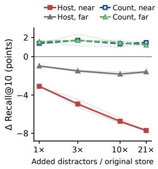  
(a) Interference, not volume

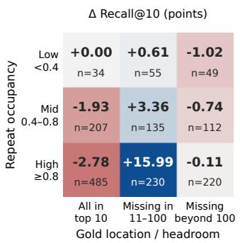  
(b) Competition × headroom

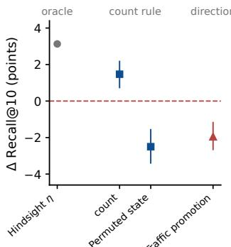  
(c) Item-specific direction  
Figure 3: Competition and state interventions in the BM25 replay. Panels compare (a) addedstore content, (b) competition and reachable headroom, and (c) oracle and direction controls. Recallpoint differences cover 1,527 questions, with conversation-cluster 95% intervals where records exist; baselines and controls are defined in Appendix C and Appendix F.1.

Learned selection has lower recorded latency than prompted selection. The student emits one mask per observation, with a median recorded policy time of about 87 ms in the Mem0 runs (Table G.1). The frozen API policy takes longer in those logs, while count makes no model calls; serving setups differ and timings exclude answer generation (Appendix G).

## 4.5 WHEN DOES INDEX EVOLUTION HELP?

Interference, rather than store volume alone, creates room for adaptation. Adding neardomain, far-domain, or duplicated content at matched volumes produces different host degradation and count-policy effects in the BM25 replay (Figure 3a). Confusable additions sustain competition, while self-duplication couples competitors to useful evidence; complete volume and seed sweeps are in Appendix F.1.

Repeated competition and reachable headroom concentrate access gains. The largest BM25 count gain occurs when recurring competitors coexist with missing evidence still inside the candidate pool (Figure 3b). The label-assisted strata in Appendix D.4 distinguish this opportunity from already-satisfied retrieval or out-of-pool evidence; occupancy alone correlates differently with gain on BM25 and MemoryOS (Appendix C). These are replay diagnostics, not an unlabelled online selection rule.

Coarse retrieval units can couple suppression to useful evidence. Re-indexing the same conversations into progressively coarser units lowers evidence purity and reduces the count advantage toward zero (Table D.7). The session-level interval spans zero, identifying separability as a risk factor rather than a universal requirement for fine-grained storage (Appendix D.7).

Retaining history and discounting stale actions are complementary. In the count replays, gradual decay improves recall over unlimited accumulation at suitable half-lives on both hosts, while repeated resets discard useful state (Figure C.1b,c). These controls suggest preserving a useful history while limiting its long-term suppression cost; decay is a diagnostic variant, not a component of the main-table policies (Appendix C).

Deployment diagnostics distinguish structural reach from empirical risk. Future retrieval and candidate coverage delimit reach; recurrence, granularity, and state lifetime are empirical risk factors (Table F.1). The strength sweep similarly identifies beneficial settings and damage from aggressive suppression (Appendix E), supporting deployment diagnostics rather than universal conditions (Appendix F).

## 5 RELATED WORK

## 5.1 ADAPTIVE AGENT MEMORY SYSTEMS

Mem0, MemoryOS, and A-MEM extract, organise, and retrieve retained experience (Chhikara et al., 2025; Kang et al., 2025; Xu et al., 2025); Memory-R1 and AtomMem learn memory operations (Yan et al., 2026b; Huo et al., 2026). Graph-structured variants organise memories as linked entities and temporal knowledge graphs (Edge et al., 2024; Rasmussen et al., 2025; Gutierrez et al.´ , 2024), and multi-user settings share memory under dynamic access control (Zhang et al., 2025; Rezazadeh et al., 2025). Persistent access adaptation also predates AMIE: MemoryBank updates recall-dependent strength, Generative Agents maintains access recency, and ExpGraph learns persistent node utilities within an evolving graph (Zhong et al., 2024; Park et al., 2023; Feng et al., 2026). Protecting earlier behaviour under later adaptation is also the concern of continual learning (Kirkpatrick et al., 2017); AMIE’s analogue protects repeatedly useful memories rather than model weights. Surveys taxonomise this design space (Zhoubian et al., 2026; Yang et al., 2026a; Guo et al., 2024). AMIE isolates index updates for separately controlled plug-in evaluation. Appendix I maps the update targets of the compared systems.

## 5.2 ADAPTIVE RETRIEVAL AND INDEX LEARNING

Retrieval-augmented generation couples a parametric reader with a non-parametric index (Lewis et al., 2020; Borgeaud et al., 2022; Gao et al., 2023). Dense retrieval, cross-encoder reranking, and adaptive or agentic retrieval improve which information a query receives (Karpukhin et al., 2020; Nogueira & Cho, 2019; Asai et al., 2024; Jiang et al., 2023; Li et al., 2026). Diversity- and fusionbased rerankers reorder a fixed candidate pool without carrying state across queries (Carbonell & Goldstein, 1998; Cormack et al., 2009), while index structures and learned indexes accelerate access without changing which items are relevant (Malkov & Yashunin, 2020; Jegou et al.´ , 2011; Kraska et al., 2018). AMIE carries per-memory state from one retrieval event to later queries, through the host’s existing candidate interface. The distinction is the independently controlled update and its prospective effect on subsequent queries.

## 5.3 LEARNING FROM RETRIEVAL FEEDBACK

A complementary line optimises memory behaviour from deployment feedback. Memory-R1 and Memory-R2 train memory operations with reinforcement learning over task outcomes (Yan et al., 2026b;a); Mem-α learns memory construction via reinforcement learning (Wang et al., 2025); indexed experience memory supports long-horizon agents through retrieval over prior trajectories (Wang et al., 2026); and proactive or unified managers learn when to write, retrieve, or consolidate (Yu et al., 2026; Wu et al., 2026; LangChain, 2025). Benchmarks increasingly probe such behaviour through incremental multi-turn interactions (Hu et al., 2026). AMIE also learns from deployment feedback, but at a different target: the index state over content that remains fixed, with teacher judgments distilled into a policy whose actions persist across subsequent retrievals.

## 6 CONCLUSION

AMIE establishes the memory index as a persistent adaptation layer distinct from stored content, distilling interference judgments into selective actions whose effects persist across subsequent host retrievals. Across heterogeneous memory hosts, AMIE consistently improves downstream utility, while controlled interventions show that suppressing persistent competitors can expose evidence the policy has never observed. Strikingly, a zero-call count policy is already competitive with semantic policies in several settings, while learned selectivity extends the benefit where unconditional suppression harms useful memories. Together, these results establish how memories are accessed as a practical adaptation axis alongside what an agent chooses to retain.

## REFERENCES

Akari Asai, Zeqiu Wu, Yizhong Wang, Avirup Sil, and Hannaneh Hajishirzi. Self-RAG: Learning to retrieve, generate, and critique through self-reflection. In The Twelfth International Conference on Learning Representations, 2024. URL https://openreview.net/forum?id= hSyW5go0v8.

Sebastian Borgeaud, Arthur Mensch, Jordan Hoffmann, Trevor Cai, Eliza Rutherford, Katie Millican, George van den Driessche, Jean-Baptiste Lespiau, Bogdan Damoc, Aidan Clark, Diego de Las Casas, Aurelia Guy, Jacob Menick, Roman Ring, Tom Hennigan, Saffron Huang, Loren Maggiore, Chris Jones, Albin Cassirer, Andy Brock, Michela Paganini, Geoffrey Irving, Oriol Vinyals, Simon Osindero, Karen Simonyan, Jack W. Rae, Erich Elsen, and Laurent Sifre. Im proving language models by retrieving from trillions of tokens. In Proceedings of the 39th International Conference on Machine Learning, volume 162 of Proceedings of Machine Learning Research, pp. 2206–2240. PMLR, 2022. URL https://proceedings.mlr.press/v162/ borgeaud22a.html.

Jaime G. Carbonell and Jade Goldstein. The use of MMR, diversity-based reranking for reordering documents and producing summaries. In Proceedings of the 21st Annual International ACM SIGIR Conference on Research and Development in Information Retrieval, pp. 335–336. ACM, 1998. doi: 10.1145/290941.291025. URL https://doi.org/10.1145/290941. 291025.

Prateek Chhikara, Dev Khant, Saket Aryan, Taranjeet Singh, and Deshraj Yadav. Mem0: Building production-ready ai agents with scalable long-term memory. In ECAI 2025 – 28th European Conference on Artificial Intelligence, volume 413 of Frontiers in Artificial Intelligence and Applications, pp. 2993–3000. IOS Press, 2025. doi: 10.3233/FAIA251160. URL https: //doi.org/10.3233/FAIA251160.

Gordon V. Cormack, Charles L. A. Clarke, and Stefan Buttcher. Reciprocal rank fusion outperforms¨ Condorcet and individual rank learning methods. In Proceedings ofthe 32nd International ACM SIGIR Conference on Research and Development in Information Retrieval, pp. 758–759. ACM, 2009. doi: 10.1145/1571941.1572114. URL https://doi.org/10.1145/1571941. 1572114.

Darren Edge, Ha Trinh, Newman Cheng, Joshua Bradley, Alex Chao, Apurva Mody, Steven Truitt, Dasha Metropolitansky, Robert Osazuwa Ness, and Jonathan Larson. From local to global: A graph rag approach to query-focused summarization. arXiv preprint arXiv:2404.16130, 2024. URL https://arxiv.org/abs/2404.16130.

Tao Feng, Chongrui Ye, Tianyang Luo, Jingjun Xu, Xueqiang Xu, Haozhen Zhang, Zhigang Hua, Yan Xie, Shuang Yang, Ge Liu, and Jiaxuan You. ExpGraph: Model-agnostic experience learning with graph-structured memory for LLM agents. arXiv preprint arXiv:2605.30712, 2026.

Yunfan Gao, Yun Xiong, Xinyu Gao, Kangxiang Jia, Jinliu Pan, Yuxi Bi, Yi Dai, Jiawei Sun, Meng Wang, and Haofen Wang. Retrieval-augmented generation for large language models: A survey. arXiv preprint arXiv:2312.10997, 2023. URL https://arxiv.org/abs/2312.10997.

Taicheng Guo, Xiuying Chen, Yaqi Wang, Ruidi Chang, Shichao Pei, Nitesh V. Chawla, Olaf Wiest, and Xiangliang Zhang. Large language model based multi-agents: A survey of progress and challenges. In Proceedings of the Thirty-Third International Joint Conference on Artificial Intelligence, pp. 8048–8057, 2024. doi: 10.24963/ijcai.2024/890. URL https://www.ijcai. org/proceedings/2024/890.

Bernal Jimenez Guti ´ errez, Yiheng Shu, Yu Gu, Michihiro Yasunaga, and Yu Su. Hipporag: Neu- ´ robiologically inspired long-term memory for large language models. In Advances in Neural Information Processing Systems, 2024.

Yuanzhe Hu, Yu Wang, and Julian McAuley. Evaluating memory in LLM agents via incremental multi-turn interactions. In International Conference on Learning Representations, 2026. URL https://openreview.net/forum?id=DT7JyQC3MR.

Yupeng Huo, Yaxi Lu, Zhong Zhang, Haotian Chen, and Yankai Lin. AtomMem: Learnable dynamic agentic memory with atomic memory operation. arXiv preprint arXiv:2601.08323, 2026. URL https://arxiv.org/abs/2601.08323.

Herve J ´ egou, Matthijs Douze, and Cordelia Schmid. Product quantization for nearest neighbor ´ search. IEEE Transactions on Pattern Analysis and Machine Intelligence, 33(1):117–128, 2011. doi: 10.1109/TPAMI.2010.57.

Zhengbao Jiang, Frank F. Xu, Luyu Gao, Zhiqing Sun, Qian Liu, Jane Dwivedi-Yu, Yiming Yang, Jamie Callan, and Graham Neubig. Active retrieval augmented generation. In Proceedings of the 2023 Conference on Empirical Methods in Natural Language Processing, pp. 7969–7992. Association for Computational Linguistics, 2023. doi: 10.18653/v1/2023.emnlp-main.495. URL https://aclanthology.org/2023.emnlp-main.495/.

Carlos E Jimenez, John Yang, Alexander Wettig, Shunyu Yao, Kexin Pei, Ofir Press, and Karthik R Narasimhan. Swe-bench: Can language models resolve real-world github issues? In ICLR, 2024.

Jiazheng Kang, Mingming Ji, Zhe Zhao, and Ting Bai. Memory os of ai agent. In Proceedings ofthe 2025 Conference on Empirical Methods in Natural Language Processing, pp. 25961–25970. Association for Computational Linguistics, 2025. doi: 10.18653/v1/2025.emnlp-main.1318. URL https://aclanthology.org/2025.emnlp-main.1318/.

Vladimir Karpukhin, Barlas Oguz, Sewon Min, Patrick Lewis, Ledell Wu, Sergey Edunov, Danqi Chen, and Wen-tau Yih. Dense passage retrieval for open-domain question answering. In Proceedings of the 2020 Conference on Empirical Methods in Natural Language Processing (EMNLP), pp. 6769–6781. Association for Computational Linguistics, 2020. doi: 10.18653/ v1/2020.emnlp-main.550. URL https://aclanthology.org/2020.emnlp-main. 550/.

James Kirkpatrick, Razvan Pascanu, Neil Rabinowitz, Joel Veness, Guillaume Desjardins, Andrei A. Rusu, Kieran Milan, John Quan, Tiago Ramalho, Agnieszka Grabska-Barwinska, Demis Hassabis, Claudia Clopath, Dharshan Kumaran, and Raia Hadsell. Overcoming catastrophic forgetting in neural networks. Proceedings ofthe National Academy ofSciences, 114(13):3521–3526, 2017. doi: 10.1073/pnas.1611835114.

Tim Kraska, Alex Beutel, Ed H. Chi, Jeffrey Dean, and Neoklis Polyzotis. The case for learned index structures. In Proceedings of the 2018 International Conference on Management of Data, pp. 489–504. ACM, 2018. doi: 10.1145/3183713.3196909. URL https://doi.org/10. 1145/3183713.3196909.

LangChain. Langmem: Long-term memory for llm applications, 2025. Software library.

Patrick Lewis, Ethan Perez, Aleksandra Piktus, Fabio Petroni, Vladimir Karpukhin, Naman Goyal, Heinrich Kuttler, Mike Lewis, Wen-tau Yih, Tim Rockt¨ aschel, Sebastian Riedel, and Douwe¨ Kiela. Retrieval-augmented generation for knowledge-intensive nlp tasks. In Advances in Neural Information Processing Systems, volume 33, pp. 9459–9474, 2020.

Zhuofeng Li, Haoxiang Zhang, Cong Wei, Pan Lu, Ping Nie, Yi Lu, Yuyang Bai, Shangbin Feng, Hangxiao Zhu, Ming Zhong, Yuyu Zhang, Jianwen Xie, Yejin Choi, James Zou, Jiawei Han, Wenhu Chen, Jimmy Lin, Dongfu Jiang, and Yu Zhang. Beyond semantic similarity: Rethinking retrieval for agentic search via direct corpus interaction. arXiv preprint arXiv:2605.05242, 2026. doi: 10.48550/arXiv.2605.05242.

Nelson F. Liu, Kevin Lin, John Hewitt, Ashwin Paranjape, Michele Bevilacqua, Fabio Petroni, and Percy Liang. Lost in the middle: How language models use long contexts. Transactions of the Associationfor Computational Linguistics, 12:157–173, 2024. doi: 10.1162/tacl a 00638. URL https://aclanthology.org/2024.tacl-1.9/.

Adyasha Maharana, Dong-Ho Lee, Sergey Tulyakov, Mohit Bansal, Francesco Barbieri, and Yuwei Fang. Evaluating very long-term conversational memory of LLM agents. In Proceedings of the 62nd Annual Meeting ofthe Associationfor Computational Linguistics (Volume 1: Long Papers), pp. 13851–13870. Association for Computational Linguistics, 2024. doi: 10.18653/v1/2024. acl-long.747. URL https://aclanthology.org/2024.acl-long.747/.

Yu A. Malkov and D. A. Yashunin. Efficient and robust approximate nearest neighbor search using hierarchical navigable small world graphs. IEEE Transactions on Pattern Analysis and Machine Intelligence, 42(4):824–836, 2020. doi: 10.1109/TPAMI.2018.2889473.

Mike A. Merrill, Alexander G. Shaw, Nicholas Carlini, Boxuan Li, Harsh Raj, et al. Terminalbench: Benchmarking agents on hard, realistic tasks in command line interfaces, 2026. URL https://arxiv.org/abs/2601.11868.

Rodrigo Nogueira and Kyunghyun Cho. Passage re-ranking with BERT. arXiv preprint arXiv:1901.04085, 2019.

Charles Packer, Sarah Wooders, Kevin Lin, Vivian Fang, Shishir G. Patil, Ion Stoica, and Joseph E. Gonzalez. Memgpt: Towards LLMs as operating systems. arXiv preprint arXiv:2310.08560, 2023.

Joon Sung Park, Joseph O’Brien, Carrie Jun Cai, Meredith Ringel Morris, Percy Liang, and Michael S. Bernstein. Generative agents: Interactive simulacra of human behavior. In Proceedings of the 36th Annual ACM Symposium on User Interface Software and Technology, pp. 1– 22, 2023. doi: 10.1145/3586183.3606763. URL https://doi.org/10.1145/3586183. 3606763. Article 2.

Preston Rasmussen, Pavlo Paliychuk, Travis Beauvais, Jack Ryan, and Daniel Chalef. Zep: A temporal knowledge graph architecture for agent memory. arXiv preprint arXiv:2501.13956, 2025. URL https://arxiv.org/abs/2501.13956.

Alireza Rezazadeh, Zichao Li, Ange Lou, Yuying Zhao, Wei Wei, and Yujia Bao. Collaborative memory: Multi-user memory sharing in LLM agents with dynamic access control. arXiv preprint arXiv:2505.18279, 2025. URL https://arxiv.org/abs/2505.18279.

Stephen Robertson and Hugo Zaragoza. The probabilistic relevance framework: BM25 and beyond. Foundations and Trends in Information Retrieval, 4(1–2):1–174, 2009. doi: 10.1561/1500000019. URL https://doi.org/10.1561/1500000019.

Noah Shinn, Federico Cassano, Ashwin Gopinath, Karthik Narasimhan, and Shunyu Yao. Reflexion: language agents with verbal reinforcement learning. In Advances in Neural Information Processing Systems, 2023.

Haoran Tan, Zeyu Zhang, Chen Ma, Xu Chen, Quanyu Dai, and Zhenhua Dong. MemBench: Towards more comprehensive evaluation on the memory of LLM-based agents. In Findings of the Association for Computational Linguistics: ACL 2025, pp. 19336–19352. Association for Computational Linguistics, 2025. doi: 10.18653/v1/2025.findings-acl.989. URL https:// aclanthology.org/2025.findings-acl.989/.

Guanzhi Wang, Yuqi Xie, Yunfan Jiang, Ajay Mandlekar, Chaowei Xiao, Yuke Zhu, Linxi Fan, and Anima Anandkumar. Voyager: An open-ended embodied agent with large language models. Transactions on Machine Learning Research, 2024. URL https://mlanthology.org/ tmlr/2024/wang2024tmlr-voyager/.

Yu Wang, Ryuichi Takanobu, Zhiqi Liang, Yuzhen Mao, Yuanzhe Hu, Julian McAuley, and Xiaojian Wu. Mem-α: Learning memory construction via reinforcement learning. arXiv preprint arXiv:2509.25911, 2025. URL https://arxiv.org/abs/2509.25911.

Zhenting Wang, Huancheng Chen, Jiayun Wang, and Wei Wei. Memex(RL): Scaling long-horizon LLM agents via indexed experience memory. arXiv preprint arXiv:2603.04257, 2026. URL https://arxiv.org/abs/2603.04257.

Yifan Wu, Lizhu Zhang, Yuhang Zhou, Mingyi Wang, Bo Peng, Serena Li, Xiangjun Fan, and Zhuokai Zhao. Remember when it matters: Proactive memory agent for long-horizon agents. arXiv preprint arXiv:2607.08716, 2026. URL https://arxiv.org/abs/2607.08716.

Wujiang Xu, Zujie Liang, Kai Mei, Hang Gao, Juntao Tan, and Yongfeng Zhang. A-MEM: Agentic memory for LLM agents. In Advances in Neural Information Processing Systems, volume 38, pp. 20004–20031, 2025. doi: 10.52202/085713-0593. URL https://doi.org/10.52202/ 085713-0593.

Sikuan Yan, Ahmed Bahloul, Ercong Nie, Susanna Schwarzmann, Riccardo Trivisonno, Volker Tresp, and Yunpu Ma. Memory-r2: Fair credit assignment for long-horizon memory-augmented llm agents, 2026a. URL https://arxiv.org/abs/2605.21768.

Sikuan Yan, Xiufeng Yang, Zuchao Huang, Ercong Nie, Zifeng Ding, Zonggen Li, Xiaowen Ma, Jinhe Bi, Kristian Kersting, Jeff Z. Pan, Hinrich Schuetze, Volker Tresp, and Yunpu Ma. Memoryr1: Enhancing large language model agents to manage and utilize memories via reinforcement learning. In Proceedings of the 64th Annual Meeting of the Association for Computational Linguistics (Volume 1: Long Papers), pp. 12805–12825. Association for Computational Linguistics, 2026b. doi: 10.18653/v1/2026.acl-long.583. URL https://aclanthology.org/2026. acl-long.583/.

An Yang, Anfeng Li, Baosong Yang, Beichen Zhang, Binyuan Hui, et al. Qwen3 technical report. arXiv preprint arXiv:2505.09388, 2025. URL https://arxiv.org/abs/2505.09388.

Chang Yang, Chuang Zhou, Yilin Xiao, Su Dong, Luyao Zhuang, Yujing Zhang, Zhu Wang, Zijin Hong, Zheng Yuan, Zhishang Xiang, Shengyuan Chen, Huachi Zhou, Qinggang Zhang, Ninghao Liu, Jinsong Su, Xinrun Wang, Yi Chang, and Xiao Huang. Graph-based agent memory: Taxonomy, techniques, and applications. arXiv preprint arXiv:2602.05665, 2026a. URL https://arxiv.org/abs/2602.05665.

Jingbo Yang, Kwei-Herng Lai, Xiaowen Wang, Shiyu Chang, Yaar Harari, and Evgeniy Gabrilovich. GroupMemBench: Benchmarking llm agent memory in multi-party conversations. arXiv preprint arXiv:2605.14498, 2026b. URL https://arxiv.org/abs/2605.14498.

Shunyu Yao, Jeffrey Zhao, Dian Yu, Nan Du, Izhak Shafran, Karthik Narasimhan, and Yuan Cao. ReAct: Synergizing reasoning and acting in language models. In International Conference on Learning Representations (ICLR), 2023.

Yi Yu, Liuyi Yao, Yuexiang Xie, Qingquan Tan, Jiaqi Feng, Yaliang Li, and Libing Wu. Agentic memory: Learning unified long-term and short-term memory management for large language model agents. In Proceedings of the 64th Annual Meeting of the Association for Computational Linguistics (Volume 1: Long Papers), pp. 21457–21483. Association for Computational Linguistics, 2026. doi: 10.18653/v1/2026.acl-long.981. URL https://aclanthology. org/2026.acl-long.981/.

Guibin Zhang, Muxin Fu, Kun Wang, Guancheng Wan, Miao Yu, and Shuicheng Yan. G-Memory: Tracing hierarchical memory for multi-agent systems. In Advances in Neural Information Processing Systems, volume 38, pp. 14587–14617, 2025. doi: 10.52202/085713-0439. URL https://doi.org/10.52202/085713-0439.

Wanjun Zhong, Lianghong Guo, Qiqi Gao, He Ye, and Yanlin Wang. Memorybank: Enhancing large language models with long-term memory. Proceedings of the AAAI Conference on Artificial Intelligence, 38(17):19724–19731, 2024. doi: 10.1609/aaai.v38i17.29946. URL https:// ojs.aaai.org/index.php/AAAI/article/view/29946.

Shuyan Zhou, Frank F. Xu, Hao Zhu, Xuhui Zhou, Robert Lo, Abishek Sridhar, Xianyi Cheng, Tianyue Ou, Yonatan Bisk, Daniel Fried, Uri Alon, and Graham Neubig. Webarena: A realistic web environment for building autonomous agents. In The Twelfth International Conference on Learning Representations, 2024.

Sining Zhoubian, Dan Zhang, Evgeny Kharlamov, and Jie Tang. Memory for large language models. arXiv preprint arXiv:2607.25380, 2026. URL https://arxiv.org/abs/2607.25380.

## A EXPERIMENT

## A.1 DATASETS

The evaluated benchmarks differ in whether and how a deployment revisits the same memory store.   
Table A.1 summarises them.

Table A.1: Benchmark statistics and evaluation scope. Counts describe the benchmark-level utility and evidence-valid scopes, not completed sample sizes for every host; retrieval requires resolvable supporting-evidence identifiers. Revisiting describes repeated access to a store, not a measured guarantee of competitor recurrence.
<table><tr><td>Benchmark</td><td>Benchmark scope (util./retr.)</td><td>Memory units</td><td>Setting</td><td>Metric</td><td>Revisiting</td></tr><tr><td>LoCoMo</td><td>1,540 /1,527</td><td>5,882 turns (10 conv.)</td><td>conversational</td><td>F1</td><td>yes</td></tr><tr><td>GroupMem</td><td>745 /-</td><td>120,000 messages (33 channels)</td><td>cross-channel workplace</td><td>Acc. (GPT-5)</td><td>yes</td></tr><tr><td>MemBench</td><td>23,137 / 23,132</td><td>~1.2M memories</td><td>personal</td><td>Acc. (MCQ)</td><td>history retrieval</td></tr></table>

LoCoMo (Maharana et al., 2024). Ten long-horizon conversations between two speakers, stored as 5,882 dialogue turns. We evaluate the 1,540 answerable category 1–4 questions and score retrieval on the 1,527 whose nonempty evidence identifiers resolve to source turns; the adversarial category is excluded, as in the official protocol. Gold evidence is the set of annotated supporting turns. Questions are presented in the released order within each conversation, and the state persists across the whole conversation. Because many questions share supporting turns, LoCoMo is the benchmark where earlier traffic informs later queries, and also the one where uncontrolled evaluation can credit an operator for memorising shared evidence, which is why we partition by gold exposure throughout (Figure C.2).

GroupMem (Yang et al., 2026b). A group-conversation memory benchmark of 120,000 workplace and technical messages across 33 channels in four domains (Finance, Technology, Manufacturing, Healthcare), with 745 questions. The benchmark releases no supporting-message ground truth and is evaluated on downstream utility only. Each domain forms one shared store serving 145– 214 questions. Recurrence was not measured, so the policy-dependent scores do not identify why counting degrades on some hosts.

MemBench (Tan et al., 2025). Each trace has one terminal multiple-choice question. In the BM25 chronological adapter, state starts at zero and resets per trace. Before ingesting an incoming message, the adapter retrieves up to ten earlier occurrences using the incoming user text (participation) or message text (observation), then updates their state. Empty queries and empty prefixes produce no retrieval event. These are explicit adapter-generated history queries, not retrieval events required by the benchmark. Memory IDs are trace-scoped; repeated source IDs receive occurrence suffixes. The terminal context uses only the accumulated history state and is sealed before any terminal-query update. Of 23,137 traces, 23,132 have resolvable gold source IDs. This documented adapter should not be inferred from history ingestion alone or assumed for other hosts without their event records.

## A.2 METRICS

Retrieval. Source-evidence recall averages $| G _ { q } \cap P ( S _ { q } ) | / | G _ { q } |$ over evidence-valid questions, where $G _ { q }$ contains distinct annotated source units and $P ( S _ { q } )$ projects returned entries to those units. The returned unit and depth are separate from the scoring unit. BM25 on LoCoMo returns ten turns. MemoryOS returns up to seven pages covering at most fourteen turns in total; recall counts the union of covered source turns before section truncation. A-MEM’s root metric scores ten selected note roots before linked expansion, where their source identities are known. For BM25 MemBench, ten occurrence slots project to distinct original message IDs: repeated IDs consume slots but contribute at most once to coverage. Questions with empty gold or any unresolved gold ID are excluded from recall, not from the state trajectory or utility evaluation. GroupMem has no supporting-message gold and is evaluated only for utility.

For generated entries, source-evidence recall requires an explicit entry-to-source projection, includ ing one-to-many mappings and the treatment of unmapped entries. The entry-to-source projection for the Mem0 and Memory-R2 scores in Table 1 remains unspecified here; reproducing these scores as source-evidence recall requires that mapping. This boundary does not affect answer-based utility scoring.

Downstream utility. LoCoMo uses the official category-specific stemmed token F1; MemBench uses exact equality with the reference choice; GroupMem accuracy uses its default GPT-5 judge. All answers within a benchmark are produced by one frozen Qwen3-32B answerer under identical decoding, and the no-memory control uses the same answerer with no supplied memories.

Uncertainty. Main-table subscripts subtract the displayed baseline; colour encodes signed magnitude. Paired intervals use per-question differences and 10,000 bootstrap draws, clustered by conversation for LoCoMo and by question for MemBench. Question-order studies report 95% t intervals over permutations. Main-table cells without aligned per-question outputs carry no significance claim.

Matched replay. The mechanism studies reproduce the BM25 LoCoMo count pair in Table 1, 51.94 → 53.41, over 1,527 evidence-valid questions in the released order. They vary state or retrieval conditions while holding the baseline protocol fixed. Its mean unrounded difference is +1.48 points, versus +1.47 from subtracting the displayed scores. MemoryOS exposure analyses use the native seven-page retrieval pair, 45.29 → 45.90; these are recall over source turns covered by pages, not a ten-turn context.

## A.3 MEMORY SYSTEM HOSTS

The control category contains answer generation without supplied memory; BM25 is the transparent sparse retriever. For each released host, we preserve its native store, candidate generator, score semantics, and expansion rules.

• Mem0 (Chhikara et al., 2025) extracts candidate facts from interactions and uses memory operations to add, update, delete, or retain stored records before retrieving them by semantic similarity.

• MemoryOS (Kang et al., 2025) organizes personalized memory across short-, mid-, and longterm tiers and manages consolidation, updating, and retrieval through its conversational interface.

• A-MEM (Xu et al., 2025) builds Zettelkasten-inspired structured notes with generated attributes and links, then retrieves note roots with native linked expansion.

• Memory-R2 (Yan et al., 2026a) jointly trains fact extraction and memory management, using local and global group-relative objectives to assign credit across long interaction horizons.

AMIE changes only persistent access weights over identifiable candidates returned by these host pipelines. The current comparison includes Mem0, MemoryOS, A-MEM, and Memory-R2 alongside BM25 on LoCoMo, GroupMem, and MemBench; GroupMem has utility results only.

## A.4 NATIVE INDEXES, AND WHERE AMIE ATTACHES TO THEM

The documented adapters expose scored candidates with stable memory IDs. The native feedback list is retained independently of re-ranking. When its entries carry suppression, the wrapper can extend the ranking pool to at most 100 candidates, preserving the native list first as a tie anchor. Mem0 and A-MEM request this larger pool through their search interfaces; MemoryOS reuses pages from the same segment search without a second stateful retrieval. Disabled-state checks reproduce native IDs and order, but do not by themselves establish matched candidate-acquisition cost or a same-expanded-pool no-op comparison. Table A.2 lists four documented interfaces; Figure A.1 illustrates these examples.

The index has a different concrete representation in each host. BM25 uses turn-level term frequencies and lengths to score query-term matches. Mem0 stores extracted fact vectors with record and user identifiers; our vector-only configuration retrieves user-filtered facts by squared $L _ { 2 }$ distance (Chhikara et al., 2025). MemoryOS indexes topic-summary vectors and page vectors within the selected mid-term segments, then merges retrieved pages with short-term history and long-term profile/knowledge context (Kang et al., 2025). Its released search uses normalized inner products, with segment and page gates of 0.1; the 0.6 threshold belongs to segment merging during construction, not query-time retrieval. A-MEM embeds enriched notes (content, context, keywords and tags) and stores links between notes (Xu et al., 2025). Our adapter preserves query rewriting and cosine root selection, invokes the released linked-context renderer on the selected roots, and then applies our 1,200-word budget. AMIE therefore changes access through persistent per-ID weights on these candidate lists; it does not rebuild any host’s underlying index.

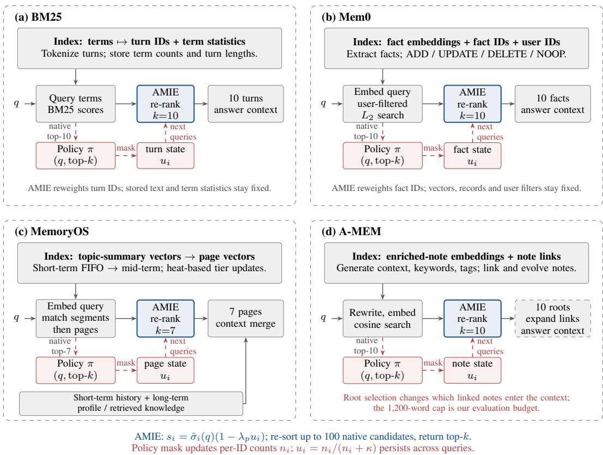  
Figure A.1: Four native-index attachment examples. Grey modules retain host behaviour, blue modules reweight candidates, and red feedback updates per-memory state for later queries. The integration settings are specified in Table A.2.

Table A.2: Host interfaces for persistent access updates. AMIE reweights the scored candidates at the listed attachment point; subsequent native expansion can propagate a root’s suppression to linked evidence.
<table><tr><td>Host</td><td>Native index / unit</td><td>Score adapter</td><td>Attachment / depth</td><td>Following stage</td></tr><tr><td>BM25</td><td>Inverted index / turn</td><td>Nonnegative BM25</td><td>Scored turn list / 10</td><td>Turn delivery</td></tr><tr><td>Mem0</td><td>Fact vectors and user filter Squared distance / fact</td><td>d ↔ 1/(1 + d)</td><td>Filtered fact list / 10</td><td>Fact delivery</td></tr><tr><td>MemoryOS</td><td>Topic and page vectors / page</td><td>Inner product; segment and page gates 0.1</td><td>Scored pages / 7</td><td>Merge history, profile, knowledge</td></tr><tr><td>A-MEM</td><td>Enriched-note vectors and links / root</td><td>Cosine s ↔ (1 + s)/2</td><td>Root list / 10</td><td>Link expansion; 1,200-word cap</td></tr></table>

The attachment unit determines what one action can affect. Suppressing a Mem0 fact changes access to that record; suppressing an A-MEM root can also remove linked evidence reached through that root. The host’s native score calibration likewise sets how strongly a given weight changes its ranking. These interface properties motivate selective updates without assigning a common failure mechanism to the host-level scores.

Table A.3: Policies sharing the AMIE action and state interface. Representative effects follow Table 1 and Table 2; serving costs follow Table G.1.
<table><tr><td>Policy</td><td>Cost / query</td><td>Representative effect</td><td>Role in the model</td></tr><tr><td>Trained</td><td>87 ms</td><td>MemoryOS F1 +0.70; Mem0 F1 +2.46</td><td>Learned selective actions</td></tr><tr><td>Frozen</td><td>24 s</td><td>MemoryOS recall +0.91</td><td>Direct semantic mask inference</td></tr><tr><td>Count</td><td>0 model calls</td><td>Mem0 F1 +2.87; BM25 R@10 +1.47</td><td>Constant all-ones action mask</td></tr></table>

## A.5 INDEX POLICIES, SELECTION, AND EXPOSURE

Shared interface. After the answer context for query t is sealed, a policy returns a binary mask over the host’s native feedback list $B _ { t } ;$ only masked entries increment $n _ { i }$ . The count rule is the allones mask. The frozen policy prompts Qwen/Qwen3-8B with the query and feedback memories text at temperature zero, without task-specific fine-tuning (Figure A.2). The trained policy uses the same student backbone with LoRA adapters and a ten-slot head, fitted by class-balanced binary cross-entropy to masks generated by GPT-5.6-Sol under the same prompt. Every arm shares the host, candidate-generation interface and pool cap, suppression form of Equation 11, and the answerer. The student’s fitting loss does not directly optimise the prospective utility criterion in Equation 15.

Model and fitting details. The teacher is GPT-5.6-Sol with fixed parameters; the student and frozen selector use Qwen/Qwen3-8B (Yang et al., 2025). The student trains LoRA adapters and a linear head while freezing the backbone’s original weights. For feedback slot j containing memory $m _ { i }$ , the final-token representation $h _ { \phi } ( \mathcal { O } _ { t } )$ gives

$$
p _ { \theta , i } ( \mathcal { O } _ { t } ) = \mathrm { s i g m o i d } \big ( \mathbf { w } _ { j } ^ { \top } h _ { \phi } ( \mathcal { O } _ { t } ) + b _ { j } \big ) , \qquad a _ { i , t } = \mathbf { 1 } \big \{ p _ { \theta , i } ( \mathcal { O } _ { t } ) \geq 0 . 5 \big \} .\tag{14}
$$

The trainable parameters are the adapters ϕ and head (W, b). The observation numbers memories in native retrieval order and clips the query to 300 characters and each memory to 200 characters before applying the chat template. The ten-slot linear head reads the final-token decoder state; only the first $b _ { t }$ logits are used for $\overline { { 0 } } \leq b _ { t } \leq 1 0$ . Unused slots are excluded from the loss and actions; feedback longer than ten is rejected rather than truncated or grouped. Overlength token sequences are also rejected after the stated text clipping. LoRA uses rank 8, scale 16, and zero dropout on the attention query and value projections. AdamW fits the adapters and head at learning rate $1 0 ^ { - 5 }$ , batch size 1, zero weight decay, and gradient clipping at 1, for two shuffled epochs. The context limit is 4096 tokens and the action threshold is 0.5. Class weights are $w _ { c } = N _ { \mathrm { f i t } } / ( 2 N _ { c } )$ , where $N _ { c }$ counts fitting slots with label c and $N _ { \mathrm { f i t } } = N _ { 0 } { + } N _ { 1 }$ . The binary loss is $\ell _ { \mathrm { B C E } } ( p , y ) = - y \log p - ( 1 - y ) \log ( 1 - p ) ;$ empty feedback contributes neither loss nor updates. The fitting set contains 3676 keep and 5344 suppress slots, giving weights 1.2269 and 0.8439 in Equation 7. We use each seed’s final checkpoint, with no validation-based early stopping.

Selection. The frozen Qwen/Qwen3-8B policy and the class-balanced Qwen/Qwen3-8B student were selected on a 638-question LoCoMo scope and then fixed across hosts and benchmarks. Student fitting used 902 observations from six conversations; trained results average the three prespecified seeds. The teacher-mask objective fits the action interface, while later-query utility evaluates the resulting access state.

Exposure status. LoCoMo supplied fitting and selection data. Selected policies and suppression strengths were fixed before the reported MemBench and GroupMem evaluations. These benchmark supplied no fitting traces; their deployment retrievals update state, and their evaluation labels score outputs without entering runtime observations. This is transfer of the fixed policy, not of memory-ID state between stores. Paired intervals describe variation within the evaluated scope; LoCoMo results therefore do not constitute independent generalisation evidence.

System: You maintain the access index of an agent’s long-term memory.   
A query was issued and the retriever returned the memories below.   
Decide, for each, whether it was retrieved DESERVEDLY (it bears on   
the query) or whether it INTRUDED (it was surfaced by lexical   
accident, generic phrasing or topical adjacency and does not bear   
on the query). Your verdict does not reorder these results. It is   
written into a persistent penalty that affects which memories this   
agent can reach for ALL FUTURE queries, so judge the memory’s   
tendency to intrude rather than its rank here, and prefer ’noop’   
when unsure: suppressing a memory that merely ranked low costs   
future access to it. Reply with JSON only: {"verdicts": [{"id": <   
int>, "a": "suppress"|"noop"}, ...]} listing only the memories you   
judge to have intruded, plus nothing else. An empty list is a   
valid and often correct answer.   
User: QUERY: {query}   
RETRIEVED:   
0. {feedback memory 0}   
1. {feedback memory 1}   
Format reminder appended after an unparseable reply: Return only JSON   
verdicts with unique integer IDs in {0, ..., k-1} and actions   
suppress/noop. Empty verdicts are valid.  
Figure A.2: Mask prompt shared by frozen Qwen/Qwen3-8B and the GPT-5.6-Sol teacher that supplies student training targets. Runtime verdicts update the persistent counts in Equation 9; they do not reorder the current list.

## A.6 POLICY AND TEACHER PROMPTS

The frozen Qwen/Qwen3-8B policy and the GPT-5.6-Sol teacher share one mask prompt (Figure A.2). The system message fixes the decision criterion; the user message carries the current query and the native feedback list, with the query clipped to 300 characters and each memory to 200; a reply that does not parse is retried with a format reminder. The teacher generates masks offline at temperature zero using this prompt. These input–mask pairs fine-tune the Qwen/Qwen3-8B student; the frozen comparator uses the prompt directly at temperature zero without this fine-tuning.

## A.7 PROSPECTIVE VALUE OF A POLICY UPDATE

Prospective criterion. An update made at step t produces $\mathcal { T } _ { t + 1 }$ , and its value is what $\mathcal { T } _ { t + 1 }$ does for the queries that follow, relative to leaving the index alone. For a fixed index, write $V ( q ; \mathcal { T } ) =$ $\mathcal { U } ( q , \mathcal { A } ( \cdot \mid q , \mathcal { R } ( q ; \mathcal { C } , \mathbb { Z } ) ) )$ for downstream task utility.

$$
\begin{array} { r } { \mathrm { V a l } ( \Delta \mathcal { T } _ { t } ) ~ = ~ \mathbb { E } _ { t } \Big [ \sum _ { \tau = t + 1 } ^ { t + H } \big ( V ( q _ { \tau } ; \mathcal { T } _ { t + 1 } ) - V ( q _ { \tau } ; \mathcal { T } _ { t } ) \big ) \Big ] , \qquad \mathcal { T } _ { t + 1 } = F ( \mathcal { T } _ { t } , \mathcal { O } _ { t } ) , } \end{array}\tag{15}
$$

Here the expectation is over future queries conditional on information available at step t. Both branches keep their index states fixed, so this criterion isolates the prospective value of one update; it is not a full trajectory objective with subsequent policy actions. This criterion defines what makes an update useful; it supplies no future information to the runtime policy. Teacher-mask imitation supplies a tractable learning objective, but does not directly optimise this prospective criterion.

## A.8 STORE, RETRIEVER, AND SCORE NORMALISATION

AMIE does not modify stored content; its policy can read the retrieved memory text. Host construction uses each system’s native content procedure.

Table B.1: Reproducible LoCoMo utility pairs. Scores and displayed $\Delta$ follow Table 2; intervals use the unrounded per-question differences and conversation-cluster 95% bootstrap.
<table><tr><td>Host</td><td>Policy</td><td>w/o AMIE</td><td>+AMIE</td><td> $\Delta$ </td><td>95% CI</td></tr><tr><td rowspan="3">Mem0</td><td>trained</td><td>9.98</td><td>12.44</td><td>+2.46</td><td> $\left[ + 1 . 6 0 , + 3 . 2 4 \right]$ </td></tr><tr><td>frozen</td><td>9.98</td><td>12.69</td><td>+2.71</td><td> $[ + 1 . 7 3 , + 3 . 5 3 ]$ </td></tr><tr><td>count</td><td>9.98</td><td>12.85</td><td>+2.87</td><td> $[ + 1 . 9 5 , + 3 . 8 0 ]$ </td></tr><tr><td rowspan="3">MemoryOS</td><td>trained</td><td>20.27</td><td>20.97</td><td>+0.70</td><td> $[ + 0 . 2 9 , + 1 . 1 4 ]$ </td></tr><tr><td>frozen</td><td>20.27</td><td>20.83</td><td>+0.56</td><td> $[ + 0 . 1 0 , + 1 . 0 1 ]$ </td></tr><tr><td>count</td><td>20.27</td><td>20.77</td><td>+0.50</td><td> $[ - 0 . 1 3 , + 1 . 0 5 ]$ </td></tr></table>

The adapters in Appendix A.4 first map native scores to nonnegative affinities (for example, inverse squared distance for Mem0 and shifted cosine for A-MEM), then apply positive query-wise scaling. The mapping preserves native preference; it is not itself necessarily a proportional normalisation. The selection identity in Equation 13 concerns IDs and tie order under the same pool. Granularity interventions group turns within the BM25 replay (Appendix D.7).

State-maintenance complexity. After sealing the answer context, the wrapper updates the state of the native feedback memories, $\mathcal { A } _ { t } = \big \{ i : m _ { i } \^ { \top } \in \mathcal { B } _ { t } \big \}$ , with $b _ { t } = | B _ { t } |$ . Thus

$$
T _ { \mathrm { u p d a t e } } = O ( b _ { t } ) , \qquad M _ { \mathrm { s t a t e } } = O ( | { \mathcal C } | ) { \mathrm { d e n s e , o r } } O \Bigl ( \bigl | \bigcup _ { \tau < t } { \mathcal B } _ { \tau } \bigr | \Bigr ) \mathrm { s p a r s e } .\tag{16}
$$

These bounds cover count-state maintenance. The bound on $u _ { i }$ is per-memory suppression magnitude, not a bound on accumulated counts or total storage. Candidate acquisition and re-ranking have separate costs, and trained/frozen policies add inference cost.

## A.9 RETRIEVAL TRAFFIC AS AN INTERFERENCE SIGNAL

Why retrieval traffic grounds the policy. The native retrieval event identifies memories that compete for limited slots. Its empirical frequency is

$$
\rho _ { i , t } = \frac { 1 } { t - 1 } \sum _ { \tau < t } { \bf 1 } [ m _ { i } \in \mathcal { B } _ { \tau } ] , \qquad t > 1 .\tag{17}
$$

This measures exposure, not harm: retrieving a frequently useful memory need not be an intrusion. Let $Z _ { i } ( q ) = 1$ indicate that a retrieved memory does not answer $q .$ Under a deployment query distribution, interference risk decomposes as

$$
\begin{array} { r l } & { \mathrm { R i s k } ( m _ { i } ) : = \operatorname* { P r } [ m _ { i } \in \mathcal { R } ( q ) \ \wedge \ Z _ { i } ( q ) = 1 ] } \\ & { \qquad = \underbrace { \operatorname* { P r } [ m _ { i } \in \mathcal { R } ( q ) ] } _ { \mathrm { e x p o s u r e } } \underbrace { \operatorname* { P r } [ Z _ { i } ( q ) = 1 \ | \ m _ { i } \in \mathcal { R } ( q ) ] } _ { \mathrm { c o n d i t i o n a l ~ i n t e r f e r e n c e } } . } \end{array}\tag{18}
$$

The count special case uses exposure alone, with $n _ { i , t } = ( t - 1 ) \rho _ { i , t }$ . Frozen and trained policies condition on observed retrieval context for selective suppression. Their masks remain proxies for harmful competition; neither imitation nor exposure alone guarantees improved utility.

## B DETAILED RESULTS

Table 1 and Table 2 are the sole source for host-comparison scores. Table B.1 adds uncertainty only for selected pairs whose stored predictions reproduce those displayed scores; the matched replay studies address the mechanism of persistent access.

## C MECHANISM CONTROLS

Control-figure protocols. Figure C.1 uses the 1,527-question BM25 replay; per-question effects use conversation-cluster 95% intervals, while the fifty-order comparisons use paired t intervals over permutations. Missing per-question records are shown as points without intervals. Figure C.2 has BM25 bucket counts $\bar { 5 } \bar { 4 2 } / 5 \bar { 8 7 } / 3 5 4 / 4 4$ and MemoryOS counts 541/470/416/100; exposure counts earlier appearances of the question’s gold among native candidates. Both protocols retain the same question order within a comparison. The recurrence intervention injects counts on 1,504 adjacent question pairs within this replay. These label-informed interventions do not supply oracle information to the online policy.

Table C.1: Fresh and reinforced evidence in the LoCoMo replay. A question is reinforced when its gold overlaps an earlier question’s gold. Values are recall-point differences from the same host.
<table><tr><td>Host</td><td>Arm</td><td> $\scriptstyle ( n = 7 8 8 )$ </td><td>fresh reinforced  $\scriptstyle ( n = 7 3 9 )$ </td></tr><tr><td>BM25</td><td>count frozen trained</td><td>+2.06 +1.14 +0.86</td><td> $+ 0 . 8 6$   ${ \bf + 1 . 4 1 }$   ${ \bf + 1 . 3 1 }$ </td></tr><tr><td>MemoryOS</td><td>count frozen trained</td><td>+0.76 +0.97 -0.00</td><td>+0.44 +0.85 +0.37</td></tr></table>

Bold: conversation-cluster 95% interval excludes zero (count fresh [+0.89, +3.23]; frozen reinforced [+0.21, +2.55]; trained reinforced [+0.42, +2.10]; frozen fresh on MemoryOS [+0.12, +1.80]).

Table C.2: Count effects across retrieval depths on BM25 and MemoryOS. Depth k counts turns for BM25 and pages for MemoryOS; recall scores source turns. Intervals are conversation-cluster 95%: the first BM25 interval including zero is at $k = 5 0$ , while all MemoryOS intervals include zero.
<table><tr><td>k</td><td>BM25</td><td>MemoryOS</td></tr><tr><td>3 5 7</td><td> $+ 2 . 1 \ [ + 0 . 8 , + 3 . 2 ]$   $+ 2 . 7 \left[ + 1 . 6 , + 3 . 9 \right]$ </td><td> $+ 1 . 2 \ [ - 0 . 4 , + 2 . 6 ]$   $+ 0 . 6 \left[ - 1 . 1 , + 2 . 2 \right]$   $+ 0 . 6 \left[ - 0 . 5 , + 1 . 9 \right]$ </td></tr><tr><td>10 20 50</td><td> $+ 1 . 5 \ : [ + 0 . 7 , + 2 . 2 ]$   $+ 1 . 7 \ [ + 0 . 7 , + 2 . 8 ]$   $+ 0 . 4 \left[ - 0 . 0 , + 0 . 9 \right]$ </td><td>capped at 7 -</td></tr><tr><td>nDCG@10</td><td> $0 . 3 8 4  0 . 4 0 9$   $+ 2 . 5 \ [ + 1 . 7 , + 3 . 2 ]$ </td><td></td></tr></table>

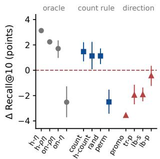  
(a) Direction and oracle controls

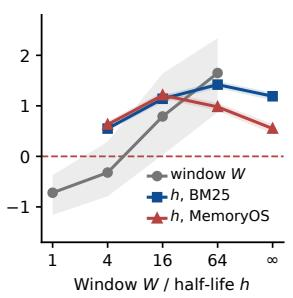

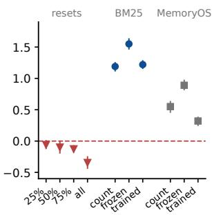  
(b) Windows and half-live  
(c) Orders and resets  
Figure C.1: Controlled state interventions on BM25 and MemoryOS. (a) BM25 oracle and direction controls; (b) windows and decay; (c) resets and order comparisons. Recall-point differences use conversation-cluster 95% intervals for per-question comparisons and paired t intervals for fifty-order comparisons; missing intervals are omitted. Appendix C defines the controls and their baselines.

Control definitions. Hindsight η (h-η) sets each memory’s state to the fraction of its nativefeedback appearances that are non-gold, using the full conversation. Hindsight $\rho \eta$ counts those non-gold appearances; online variants use only preceding observations. Hindsight count uses fullstream exposure counts, while permuted state shuffles memory-specific weights. Traffic promotion (tr-p) reverses the sign of count-based score changes; label suppression (lb-s) and label promotion (lb-p) instead target entries labelled as gold in preceding feedback. The direction controls scale their strength to match the count rule’s mean absolute score change on returned items, subject to the recorded strength cap. They are diagnostic interventions, not deployable policies. Windows retain only the preceding $\dot { W }$ feedback events; decay discounts counts with half-life h. Their gains are relative to the unmodified host. Reset effects compare clearing the state at the stated stream fractions with uninterrupted accumulation under the same question order.

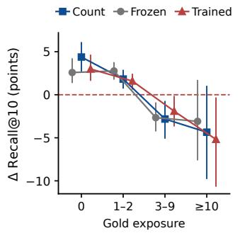  
(a) BM25: gain by gold exposure

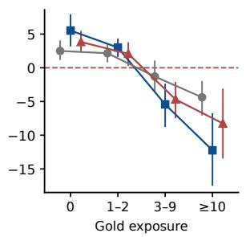  
(b) MemoryOS: gain by gold exposure

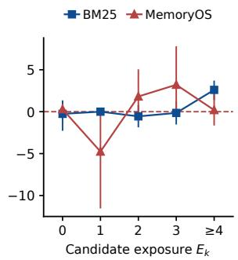  
(c) Gain by exposure Ek  
Figure C.2: Policy effects depend on evidence exposure in the LoCoMo replay. Panels (a,b) stratify BM25 and MemoryOS by prior gold exposure; (c) stratifies count effects by candidate exposure. Whiskers show conversation-cluster 95% intervals for recall-point differences.

Where the two hosts differ (Figure C.2). The frozen mask trades rather than dominates: it gives up part of the never-seen gain (paired count minus frozen $+ 1 . 8 \ [ + 0 . 6 , + 3 . 1 ]$ on BM25 and $\bar { + 3 . 0 \ [ + 1 . 5 , + 4 . 8 ] }$ on MemoryOS) and recovers it at high exposure $( \bar { - 4 } . 1 \ [ - 7 . 3 , \bar { - 1 } . 0 ]$ and −7.9 $[ - 1 1 . \dot { 8 } , - 2 . 8 ]$ on the two highest MemoryOS buckets), netting +0.2 for counting on BM25 and +0.3 for the mask on MemoryOS. A conditional-harm signal moves the cost of suppression; it does not remove it.

Depth, ranking quality, and reachable headroom (Table C.2). The same replay scored at depths $k \in \{ 3 , \tilde { 5 } , \bar { 1 0 } , 2 0 , \dot { 5 } 0 \} \ \mathrm { g i v e s } + 2 . 1 \ [ + 0 . 8 , + 3 . 2 ] , + 2 . 7 \ [ + 1 . 6 , + 3 . 9 ] , + 1 . 5 \ [ + 0 . \dot { 7 } , + 2 . 2 ] , + 1 . 7 \ [ - 0 . 0 2 ] ,$ $[ + 0 . 7 , + 2 . 8 ]$ and $+ 0 . 4 \ [ - 0 . 0 , + 0 . 9 ]$ : a head-of-list intervention whose interval first touches zero as the returned context includes more of the candidate pool. Ranking quality improves throughout $( \mathrm { n D C G @ 1 0 0 . 3 8 4 } \to 0 . 4 0 9 , + 2 . 5 [ + 1 . 7 , + 3 . 2 ] )$ . Reachable headroom (gold outside the top ten but inside the top hundred) is 27.5% on BM25 and 22.8% on MemoryOS and correlates with the perconversation gain (Spearman 0.41 and 0.32) while being nearly independent of repeat occupancy (Spearman −0.18 and −0.06).

Repeat occupancy tracks different trade-offs within each host. The share of BM25’s top ten already retrieved by earlier questions spans 0.67–0.79 across conversations and correlates with perconversation gain at Pearson +0.70 (leave-one-out 0.61–0.79). The MemoryOS correlation is negative and unstable. Occupancy therefore describes retrieved traffic; evidence headroom is needed to interpret the opportunities it creates.

Controlled recurrence. Intervening directly on 1,504 adjacent question pairs isolates the trade the state makes. Suppressing a question’s competitors helps that question (+2.00 to +5.29 points as intensity grows) and costs the next one (−0.19 to −1.03), while suppressing its useful memories is far more damaging $( - 6 . 2 7 \ \mathrm { t o } \ - 2 9 . 8 5 )$ . This asymmetry is consistent with the benefit of decay relative to unbounded accumulation and of persistence relative to per-query resets (Figure C.1).

## D REPLAY STUDIES OF THE INDEX STATE

The studies in this section share one matched replay: the main-table BM25 protocol on the 1,527 evidence-valid LoCoMo questions, released order, $\kappa { = } 3 , \lambda _ { p } { = } 0 . 5 ,$ a 100-candidate pool, and the all ones mask. Every script reproduces the published arms $( 5 1 . 9 4  5 3 . 4 1 )$ before it scores a variant, every plan is sealed before scoring, and every interval is a conversation-cluster bootstrap (10,000 draws). No model is called.

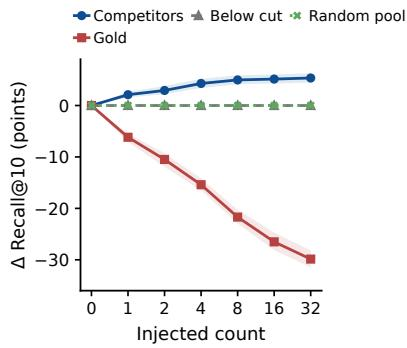  
(a) Label-informed injection

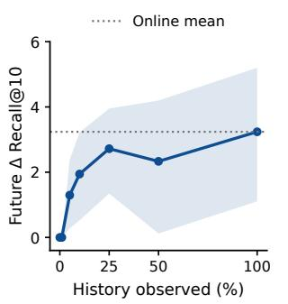  
(b) Fixed-state future evaluation

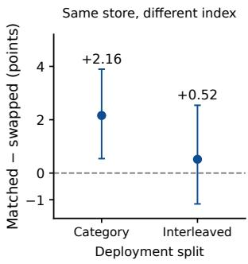  
(c) Per-deployment index  
Figure D.1: Persistent state interventions in the BM25 replay. Panels show (a) label-informed count injection on 1,527 questions, (b) frozen-state evaluation on 386 future questions, and (c) matched-minus-swapped state on 381 category-split and 387 interleaved future questions. Bands and whiskers are conversation-cluster 95% intervals on recall-point differences; injection is a diagnostic intervention, not a runtime policy.

## D.1 ACCESS HISTORY ALONE CHANGES WHAT IS RETRIEVABLE

The query, host scores, and gold labels are matched, and only the access history of one target set is changed: the operator starts from an empty state and the count of every entry in the target set is set to n before the question is scored. Table D.1 and Figure D.1a report the four target sets. Setting the competitors’ history alone raises evidence Recall@10 monotonically from 51.94 to 57.29, with 118 questions improving and none worsening at n=32; setting the same history on the gold entries costs up to 29.9 points; setting it on entries that already sit below the cut, or on random pool entries of the same score mass, changes nothing at any level. The same content therefore admits a 35-point range of recall depending only on which memories the past retrieved, which is the separation in Section 2: identical content supports different retrieval outcomes under different access states.

The natural online state sits between the two curves. Under the released order the competitors of a question carry a median count of 2 (36.5% reach 4), but so do the gold entries themselves (median 1, 16% reach 4), and the online gain of +1.48 is the net of the two: the rule earns where it demotes competitors and pays where the traffic has also counted the evidence, consistent with the exposurestratified results of Section 4.3.

Table D.1: Causal traffic injection (∆Recall@10 against the same question with an empty state, conversation-cluster 95% intervals, n=1,527). Only the count of the target set is changed; query, host scores, gold and store are identical across columns. Under the online rule the competitors natural median count is 2 and the gold entries’ is 1.
<table><tr><td>n</td><td>competitors (non-gold top ten)</td><td></td><td>gold entries of the top ten</td><td>ranks 11–20</td><td>random pool</td></tr><tr><td>1</td><td>+2.10 [+1.57, +2.68]</td><td></td><td>-6.17 [−7.12, −5.43]</td><td>0.00</td><td>0.00</td></tr><tr><td>2</td><td></td><td>+2.93 [+2.20, +3.80]</td><td>-10.49 [−11.94, -9.28]</td><td>0.00</td><td>0.00</td></tr><tr><td>4</td><td>+4.29</td><td>[+3.40, +5.19]</td><td>-15.40 [-16.53, −14.19]</td><td>0.00</td><td>0.00</td></tr><tr><td>8</td><td></td><td>+4.97 [+4.13, +5.87]</td><td>-21.69 [-22.94, -20.26]</td><td>0.00</td><td>0.00</td></tr><tr><td>16</td><td></td><td>+5.14 [+4.28, +6.05]</td><td>-26.51 [−28.13, -24.69]</td><td>0.00</td><td>0.00</td></tr><tr><td>32</td><td></td><td>+5.35 [+4.45, +6.28]</td><td>-29.86 [-31.45, -28.16]</td><td>0.00</td><td>0.00</td></tr><tr><td colspan="6">online count rule on the same questions: +1.48 [+0.70, +2.21]</td></tr></table>

## D.2 HOW MUCH TRAFFIC THE STATE NEEDS

Each conversation’s stream is split into an accumulation segment (the first 75% of questions) and a fixed future set (the last 25%, 386 evidence-valid questions, off recall 65.67). The state accumu lates over the first fraction f of the accumulation segment, is frozen, and every arm is scored on the identical future set (Table D.2, Figure D.1b). Ten observed questions yield a zero point estimate; 59 in total give +1.30 [+0.28, +2.38], 288 give +2.72 [+1.34, +3.95], and the full segment gives +3.24 [+1.11, +5.20], the same value the fully online arm reaches on that future set. The 59 observations are pooled across ten conversations (3–7 per conversation), not 59 per conversation. The point estimates suggest early benefits but are not monotone in observed traffic.

The online arm and the frozen full-history arm agree to three decimals although their top-ten lists differ on 306 of the 386 future questions: the traffic that arrives inside the future set reorders entries below the gold but changes gold recall on only four questions, and those changes cancel. On this stream the state built before the future set already contains the competitors that future set contests, which is what the persistence results of Section 4.3 would predict.

Table D.2: Traffic sufficiency on the fixed future set (386 questions; ∆Recall@10 against the unmodified host, conversation-cluster 95% intervals). The state is frozen after observing the first fraction f of each conversation’s accumulation segment; the online row keeps updating inside the future set.
<table><tr><td>f</td><td>questions observed (total)</td><td>Recall@10</td><td>∆ [95% CI]</td><td></td></tr><tr><td>0</td><td>0</td><td>65.67</td><td>0.00</td><td></td></tr><tr><td>0.01</td><td>10</td><td>65.67</td><td>0.00</td><td></td></tr><tr><td>0.05</td><td>59</td><td>66.97</td><td></td><td>+1.30 [+0.28, +2.38]</td></tr><tr><td>0.10</td><td>114</td><td>67.62</td><td></td><td>+1.94 [+0.53, +3.22]</td></tr><tr><td>0.25</td><td>288</td><td>68.39</td><td>+2.72</td><td>[+1.34, +3.95]</td></tr><tr><td>0.50</td><td>576</td><td>68.01</td><td>+2.33</td><td>[+0.12, +4.20]</td></tr><tr><td>1.00</td><td>1,154</td><td>68.91</td><td></td><td>+3.24 [+1.11, +5.20]</td></tr><tr><td>online</td><td>all</td><td>68.91</td><td></td><td>+3.24 [+1.01, +5.33]</td></tr></table>

## D.3 POLICY SELECTIVITY ACROSS COMPETITOR AND GOLD EXPOSURE

The saved per-question deltas of the three replay policies are binned by two exposure indices recomputed in released order: $E _ { k }$ , the number of native top-ten candidates previously retrieved, and the gold exposure of Figure C.2. Table D.3 and Figure D.2a report the high-competition row, which holds 1,389/1,527 (91.0%) of the questions, and the pooled low-competition cells. Where competition has been observed and the evidence has not, counting beats the semantic mask by +2.22 [+0.79, +3.90]; as soon as the evidence itself has been retrieved the sign turns, with the mask ahead by 0.89 at one or two exposures (interval touching zero) and less harmful at ten or more. Where competition has not been observed, the intervals for all three arms include zero; this does not establish equivalence to the host or absence of an effect.

These label-assisted analyses diagnose when suppression helps or harms. Counting gives the larger point estimate on unexposed evidence, whereas selectivity can reduce damage to evidence that earlier traffic retrieved. Turning the diagnosis into an online decision rule requires observable proxies for gold exposure and reachable headroom; neither quantity is available from unlabelled retrieval traffic alone.

Table D.3: Count against the semantic arms across competitor and gold exposure (BM25 replay, ∆Recall@10 against the host, conversation-cluster 95% intervals on the paired count-minus-frozen difference). $E _ { k }$ is the number of the host’s ten candidates earlier traffic had already retrieved; gold exposure is the number of earlier appearances of the question’s own gold turns.
<table><tr><td> $E _ { k }$ </td><td>gold exposure n</td><td>count</td><td>frozen</td><td>trained</td><td>count — frozen [95% CI]</td></tr><tr><td>≥4 0</td><td>439</td><td>+5.33</td><td>+3.11</td><td>+3.65</td><td>+2.22 [+0.79, +3.90]</td></tr><tr><td>≥4 1-2</td><td>559</td><td>+2.00</td><td>+2.90</td><td>+1.71</td><td>-0.89 [−1.82, +0.00]</td></tr><tr><td>≥4 3-9</td><td>345</td><td>-2.89</td><td>-2.73</td><td>-1.96</td><td>-0.16 [−1.67, +1.05]</td></tr><tr><td>≥4 ≥ 10</td><td>46</td><td>-4.16</td><td>-2.96</td><td>-4.96</td><td>-1.20 [−4.35, +0.27]</td></tr><tr><td>≤ 3 any</td><td>138</td><td>-0.07</td><td>+0.24</td><td>+0.05</td><td>intervals include zero</td></tr></table>

## D.4 AN EVOLVABILITY MAP: COMPETITION AND HEADROOM

Repeat occupancy and gold headroom describe different aspects of the BM25 replay (Table D.4). The largest count point estimate, +15.99 [+12.73, +19.00], occurs on the 230 high-occupancy questions with missing gold inside the pool. Corresponding mid- and low-occupancy estimates are +3.36 and +0.61; questions with all gold already in the top ten tend to lose. This stratification uses labels and does not establish necessary conditions for every policy or host.

A separate intervention starts with an empty state and increments only non-gold entries in the origi nal top ten. It rescues gold at ranks 11–20 (+24.7 at one increment and +62.9 at 32, n = 130) but not at deeper ranks. Because at most ten entries are intervened on, a target can pass at most those entries. The factor-of-two score bound at $\lambda _ { p } = 0 . 5$ does not imply a rank-distance bound for AMIE’s full state space: states that penalise other pool entries were not searched by this intervention.

Table D.4: Index evolvability map (online count rule, BM25 replay, ∆Recall@10 against the host, conversation-cluster 95% intervals). Rows are repeat-occupancy bins of the host’s top ten (< 0.4, $0 . 4 \mathrm { - } 0 . 8 , \geq 0 . 8 ) \mathrm { ; }$ ; columns class the question’s missing gold as already in the top ten, inside the pool at ranks 11–100, or beyond the pool.
<table><tr><td>Repeat occupancy</td><td>no gold missing</td><td>gold reachable (11–100)</td><td>gold beyond the pool</td></tr><tr><td>low (n=138)</td><td>0.00 (n=34)</td><td>+0.61 [+0.00, +1.82] (n=55)</td><td>-1.02 [−3.26, +0.00] (n=49)</td></tr><tr><td>mid (n=454)</td><td>-1.93 [−3.78, +0.00] (n=207)</td><td>+3.36 [+0.79, +6.09] (n=135)</td><td>−0.74 [−1.53, +0.00] (n=112)</td></tr><tr><td>high (n=935)</td><td>−2.78 [−3.59, −1.86] (n=485)</td><td>+15.99 [+12.73, +19.00] (n=230)</td><td>−0.11 [−0.38, +0.00] (n=220)</td></tr></table>

## D.5 HOW MUCH OF THE REACHABLE HEADROOM THE RULE CAPTURES

Table D.5 compares the online rule with three oracle references, not an exhaustive optimisation over index states. Suppressing only non-gold original top-ten entries with saturated counts gives +5.54 [+4.61, +6.46] points; the online gain is 27% of this particular intervention. Ideal selection of gold from the fixed 100-candidate pool gives +20.43 [+18.44, +22.61], while perfect recall gives +48.06. The latter two are recall upper bounds for their stated candidate access, not guarantees attainable by AMIE or improvements in generation utility.

The oracle-count intervention does not optimise every feasible state or identify a functional-form ceiling. Its gap from online counting combines oracle label access with different choices of memories to suppress; it is not an isolated estimate of the cost of unconditional counting. The saved hindsight references use future labels and are diagnostic only.

Table D.5: Oracle references for index-side recall gains. The top-ten intervention suppresses only original non-gold top-ten entries; pool and perfect-recall references have broader oracle access. Values are BM25 replay differences with conversation-cluster 95% intervals, not an optimised functional-form bound.
<table><tr><td>Arm</td><td>∆ [95% CI]</td><td>online gain / reference gain</td></tr><tr><td>online count rule</td><td>+1.48 [+0.70, +2.21]</td><td></td></tr><tr><td>hindsight ρη oracle (saved)</td><td>+2.24</td><td>66%</td></tr><tr><td>hindsight η-only oracle (saved)</td><td>+3.13</td><td>47%</td></tr><tr><td>oracle top-ten suppression</td><td>+5.54 [+4.61, +6.46]</td><td>27%</td></tr><tr><td>ideal pool recall</td><td>+20.43 [+18.44, +22.61]</td><td>7%</td></tr><tr><td>perfect-recall reference</td><td>+48.06 [+46.34, +49.81]</td><td>3%</td></tr></table>

## D.6 DEPLOYMENT-SPECIFIC INDEX STATES OVER THE SAME STORE

Two deployments share a store when two question streams run over the same conversation. The Lo-CoMo categories are different information needs over one store, so each category’s questions form a deployment; as a control, the even and odd questions of the released order form two deployments with the same distribution. For every deployment the state accumulates over the first 75% of its stream and is frozen, and its last 25% is scored under its own state, under every other deployment’s state, and under the union of the others (Figure D.1c; Table D.6). Across the category deployments the matched state beats the swapped state by +2.16 [+0.54, +3.90] on 381 paired future questions, while across the interleaved control the same comparison is +0.52 [−1.16, +2.54]. The category result supports useful deployment-specific information in the index; the interleaved result is inconclusive, rather than evidence of equivalence. Neither comparison optimises the index state or proves that the matched state is optimal.

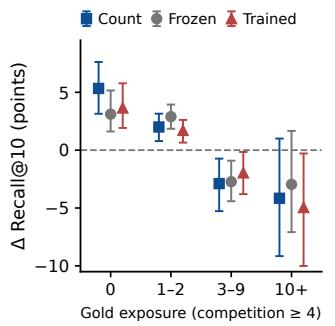  
(a) Count vs. semantic policies

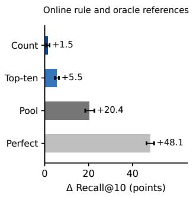  
(b) Oracle references

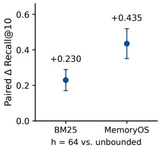  
(c) Decay across 50 orders  
Figure D.2: Selectivity, oracle references, and decay. Panels (a,b) show BM25 replay recall differences with conversation-cluster 95% intervals; (c) compares decay to unbounded counting across fifty orders with 95% t intervals. Oracle top-ten suppression is a restricted intervention, not a statespace optimum.

The control also answers the transfer question for the evolved state. Within one store the state transfers to new questions of the same deployment (the matched arms are positive on three of the four categories that have enough questions), while the transfer cost between interleaved streams is inconclusive; a per-memory state cannot transfer to a new store at all, because its entries name memories that do not exist there, so cross-store transfer is a property of policies rather than of states, and the policy result of Section 4.4 (students fitted on one host, deployed unchanged to the others) is the answer to that question.

Table D.6: Content–index swap (BM25 replay, frozen states, ∆Recall@10 against the unmodified host on each deployment’s future set, conversation-cluster 95% intervals). The paired rows pool every future question of a split and compare its own state with a state evolved on another deployment of the same store.
<table><tr><td>Split</td><td>Arm</td><td></td><td>n ∆ [95% CI]</td></tr><tr><td rowspan="5">categories (different deployments)</td><td>category 1, own state</td><td></td><td>71 +1.76 [+0.01, +3.65]</td></tr><tr><td>category 2, own state</td><td></td><td>77 +5.20 [+0.00, +11.77]</td></tr><tr><td>category 4, own state</td><td>213</td><td>+3.05 [+0.50, +5.48]</td></tr><tr><td>paired: own – other deployment&#x27;s state</td><td>381</td><td>+2.16 [+0.54, +3.90]</td></tr><tr><td>paired: own — union of the others</td><td>381</td><td>+1.12 [−1.16, +4.10]</td></tr><tr><td rowspan="3">even / odd (same distribution)</td><td>even, own state</td><td></td><td>194 +2.58 [+0.00, +5.20]</td></tr><tr><td>odd, own state</td><td></td><td>193 +3.11 [−0.50, +6.92]</td></tr><tr><td>paired: own – other deployment&#x27;s state</td><td></td><td>387 +0.52 [−1.16, +2.54]</td></tr></table>

## D.7 MEMORY GRANULARITY SETS INDEX EVOLVABILITY

The same conversations are re-indexed at unit sizes of one, two, four and eight consecutive turns of a session, and at whole sessions; a unit is gold for a question when it contains any gold turn, and the online count rule is scored against the static index at each rung with the fixed replay settings, with the retrieval depth fixed (Table D.7). Evidence purity, the share of a retrieved gold unit’s turns that are gold for the question, falls from 1.00 at turn level to 0.51, 0.27, 0.14 and 0.05, and the count gain falls with it, from +1.48 [+0.70, +2.21] to +0.48, +0.09, +0.07 and +0.04, with the numbers of questions improved and worsened becoming similar from two turns per unit on. Static recall rises across the ladder because the unit-level task becomes easier, while the measured count advantage approaches zero. When a unit mixes evidence with its surroundings, demoting the unit demotes the evidence, and suppression has no clear separation between competitor and evidence. This result identifies a risk in the evaluated count replay, not a requirement that every host use the finest unit or a guarantee that coarser units cannot benefit.

Table D.7: Granularity ladder (BM25 replay, online count rule, Recall@10 over gold units, conversation-cluster 95% intervals; recall levels are not comparable across rungs). Purity is the mean share of gold turns in a retrieved gold unit.
<table><tr><td>Unit</td><td>units</td><td>off</td><td>+count</td><td>purity</td><td>∆ [95% CI]</td><td></td><td>improved</td><td>worsened</td></tr><tr><td>1 turn</td><td>5,882</td><td>51.94</td><td>53.41</td><td>1.00</td><td>+1.48</td><td>[+0.70, +2.21]</td><td>57</td><td>30</td></tr><tr><td>2 turns</td><td>3,011</td><td>64.22</td><td>64.70</td><td>0.51</td><td>+0.48</td><td>[−0.11, +1.05]</td><td>47</td><td>45</td></tr><tr><td>4 turns</td><td>1,571</td><td>74.23</td><td>74.32</td><td>0.27</td><td>+0.09</td><td>[−0.31, +0.54]</td><td>41</td><td>40</td></tr><tr><td>8 turns</td><td>848</td><td>81.23</td><td>81.31</td><td>0.14</td><td>+0.07</td><td>[−0.58, +0.62]</td><td>31</td><td>31</td></tr><tr><td>session</td><td>272</td><td>88.91</td><td>88.95</td><td>0.05</td><td>+0.04</td><td>[−0.28, +0.29]</td><td>19</td><td>15</td></tr></table>

## E POLICY ABLATIONS

Observation regime and suppression rate. The nine student variants use the same BM25 retrieval replay as Table 1; each regime changes the information supplied to the action policy. Table E.1 reports all cells and preserves their paired intervals. Suppression rate correlates with gain $( r ~ = ~ 0 . 7 9 )$ , while average differences between observation regimes are smaller than the withinregime seed variation. A random mask matched to the frozen policy’s suppression rate also recovers much of counting’s gain in this replay, supporting accumulation as a shared source of access changes.

Table E.1: Observation ablation in the matched BM25 replay. Values are recall-point differences with conversation-cluster 95% intervals; rate is the fraction of feedback entries suppressed.
<table><tr><td>Observation</td><td>Seed</td><td>Rate (%)</td><td>∆ Recall [95% CI]</td></tr><tr><td rowspan="3">traffic stats</td><td>1</td><td>52.4</td><td>+1.05 [+0.40, +1.64]</td></tr><tr><td>2</td><td>58.6</td><td>+1.08 [+0.17, +1.88]</td></tr><tr><td>3</td><td>71.6</td><td>+1.58 [+0.88, +2.22]</td></tr><tr><td rowspan="3">stats + text</td><td>1</td><td>46.7</td><td>+1.13 [+0.49, +1.69]</td></tr><tr><td>2</td><td>49.3</td><td>+1.33 [+0.77, +1.92]</td></tr><tr><td>3</td><td>63.3</td><td>+1.50 [+0.79, +2.23]</td></tr><tr><td rowspan="3">text only</td><td>1</td><td>41.8</td><td>+1.11 [+0.28, +1.92]</td></tr><tr><td>2 3</td><td>49.7</td><td>+1.13 [+0.28, +2.15]</td></tr><tr><td></td><td>67.2</td><td>+1.66 [+0.94, +2.34]</td></tr></table>

Free parameters. A $\kappa \times \lambda$ scan over fifteen cells on the matched replay is positive across a wide plateau and collapses only where a small saturation constant meets a large strength $( \kappa { = } 0 . 5 , \lambda { = } 0 . 9 ;$ −19.95). At κ=10 and κ=30 every strength is positive, and the selected cell $( \kappa { = } 3 , \lambda { = } 0 . 5 , + 1 . 4 8 )$ sits inside the plateau; the scan was not used for selection. The plateau motivates evaluating both the update rule and its operating strength within the same host score space.

## F BOUNDARY ANALYSES

## F.1 WHY VOLUME IS NOT THE VARIABLE

The dilution model predicts that a larger store is a less accessible one. The BM25 replay shows that size alone is insufficient, because added text is not independent of the query: under BM25 far-domain documents raise the document frequency of their own vocabulary and leave the query’s terms rare, so the inverse document frequency of the terms that matter rises. Dilution and sharpening act in opposite directions, and which dominates depends on the relation between the added text and the query rather than on its quantity (Figure 3a).

Table F.1: Deployment diagnostics for persistent index adaptation. Rows combine native-host results with explicitly marked BM25 replay interventions on granularity and store content. Dashes denote unmeasured or undefined quantities.
<table><tr><td>Deployment</td><td>Host</td><td>q / store</td><td>RO</td><td>Separable unit</td><td>Headroom</td><td>Outcome</td></tr><tr><td>LoCoMo</td><td>BM25</td><td>154</td><td>0.74</td><td>yes (turns)</td><td>27.5%</td><td>helps</td></tr><tr><td>LoCoMo</td><td>Mem0</td><td>154</td><td></td><td>yes (facts)</td><td></td><td>helps</td></tr><tr><td>LoCoMo</td><td>MemoryOS</td><td>154</td><td>0.81</td><td>pages (≤ 14 turns)</td><td>22.8%</td><td>helps</td></tr><tr><td>LoCoMo</td><td>A-MEM</td><td>154</td><td></td><td>roots expand into links</td><td></td><td>all policies improve F1</td></tr><tr><td>MemBench, history adapter</td><td>BM25</td><td>1 final</td><td></td><td>yes</td><td></td><td>count loses; others gain</td></tr><tr><td>GroupMem (4 domain stores)</td><td>BM25</td><td>145-214</td><td></td><td>yes</td><td></td><td>count loses; others gain</td></tr><tr><td>LoCoMo, 21× self-duplicated</td><td>BM25</td><td>154</td><td></td><td>no (copies of evidence)</td><td></td><td>count loses in this replay</td></tr></table>

A 36-cell BM25 grid on the matched replay (three distractor families × four volumes × three seeds, every cell n=1,527 with clustered intervals) makes the separation quantitative for the rule itself. Under BM25, near-domain decay deepens monotonically with volume (−3.1, −4.9, −6.7, −7.7 points at 1×, 3×, 10×, 21×) while the count gain stays flat at +1.3 to +1.7, and far-domain decay never exceeds 2.0 points at any volume: the rule buys back a roughly constant share of a cost that grows with confusability, not with size. Two regimes locate its limits. Duplicating each conversation’s own content grows the decay from −2.0 to −6.3 points and turns the count gain from +1.2 at 1× into −1.2 at 10× and beyond, because the persistent competitors are then copies of the evidence itself. These controlled additions separate store size from the competition induced by the added content (Figure 3a).

## F.2 STRUCTURAL LIMITS AND EMPIRICAL DEPLOYMENT DIAGNOSTICS

Table F.1 separates structural limits from empirical properties. Future retrieval and pool membership constrain what an update can affect; occupancy, granularity, and calibration are measured risk factors. Return to the store is the number of questions evaluated against one persistent state: ten conversation stores and 1,540 questions on LoCoMo, one terminal question per MemBench history, preceded by the adapter’s history retrieval events (Appendix A.1). With zero initial state and no such prior events, a post-sealing update cannot change the only answer. Contested slots refers to repeated occupancy of the native feedback list. Separable units concerns the coupling between a selected unit and the useful evidence it carries or expands into. Reachable headroom is the share of gold outside the returned context but inside the candidate pool. Together these quantities describe the room for access adaptation; headroom additionally requires gold labels.

## G POLICY INFERENCE AND STATE COST

Table G.1: Recorded policy cost on native Mem0, 1,540 queries per arm. “Counters” is the number of memories the state ever touches, and “state bytes” the serialised size of the persistent index state.
<table><tr><td>Policy</td><td>Seed</td><td>Model evaluations</td><td>Median (ms)</td><td>P95 (ms)</td><td>Counters</td><td>State bytes</td></tr><tr><td>off</td><td>一</td><td>0</td><td>一</td><td>1</td><td>0</td><td>2</td></tr><tr><td>count</td><td></td><td>0</td><td></td><td></td><td>235</td><td>9,669</td></tr><tr><td>frozen</td><td></td><td>1,540</td><td>23,997</td><td>25,400</td><td>152</td><td>6,255</td></tr><tr><td></td><td>20260908</td><td>1,540</td><td>87.3</td><td>88.9</td><td>190</td><td>7,818</td></tr><tr><td>trained</td><td>20260909</td><td>1,540</td><td>86.9</td><td>88.2</td><td>187</td><td>7,712</td></tr><tr><td></td><td>20260910</td><td>1,540</td><td>86.6</td><td>88.3</td><td>216</td><td>8,890</td></tr></table>

Frozen-policy times include API pacing, retries, and network time. Student times cover the local probabilities() call, including device-to-CPU transfer; historical GPU identity was not recorded. Both exclude fitting, model loading, retrieval, and answer generation. The answerer used Qwen3-32B, BF16, deterministic decoding, batch size one, and at most 128 output tokens. State bytes measure compact UTF-8 JSON with memory-ID keys after updates, reset per conversation; they are not resident RAM. The serving conditions therefore support a recorded latency comparison, not a hardware-normalised speedup or an end-to-end agent cost estimate.

## H PROOF OF RELATIVE ACCESS MONOTONICITY

$$
\Delta s _ { t } ( q , i ) = - \lambda _ { p } \hat { \sigma } ( q , i ) \Delta u _ { i , t } , \qquad \Delta u _ { i , t } \geq 0 \Longrightarrow \Delta s _ { t } ( q , i ) \leq 0 .\tag{19}
$$

Proposition 1 (Relative access monotonicity). Fix a query q, afinite candidate pool, its nonnegative normalised base scores, a strength $\lambda _ { p } \in [ 0 , 1 ]$ , and a total order on candidate IDs for breaking ties. Let $m ^ { \star }$ be a target in that pool, and let one update satisfy $\Delta u _ { \star , t } = 0$ and $\Delta { \dot { u } } _ { j , t } ~ \ge ~ 0$ for all $j \neq \star .$ . Then under Equation 11 no competitor’s score increases, so the rank of $m ^ { \star }$ cannot worsen; and, $i f \lambda _ { p } > 0 , f o r$ every competitor mj with $\hat { \sigma } ( q , j ) > 0$ and $\Delta u _ { j , t } > 0$ , the pairwise margin $\Delta _ { \star j , t } ( q ) \dot { = } s _ { t } ( q , m ^ { \star } ) - s _ { t } ( q , m _ { j } )$ strictly increases.

We prove Proposition 1 for the same query and candidate pool before and after one state update. Scores are sorted in descending order; numerical rank starts at one, so a smaller rank is better. The base scores, suppression strength, and ID order used to break ties are held fixed throughout this comparison.

ProofofProposition 1. Write $b _ { i } = \hat { \sigma } ( q , i ) \geq 0$ and $\delta _ { i } = u _ { i , t + 1 } - u _ { i , i }$ t. By assumption, $\delta _ { \star } = 0$ and $\delta _ { j } \geq 0$ for every competitor $j .$ . From Equation 11,

$$
s _ { t + 1 } ( q , i ) - s _ { t } ( q , i ) = - \lambda _ { p } b _ { i } \delta _ { i } .\tag{20}
$$

Thus the target’s score is unchanged and every competitor’s score is nonincreasing. Subtracting the competitor’s score from the target’s gives

$$
\Delta _ { \star j , t + 1 } ( q ) - \Delta _ { \star j , t } ( q ) = \lambda _ { p } b _ { j } \delta _ { j } \geq 0 .\tag{21}
$$

This inequality is strict whenever $\lambda _ { p } > 0 , b _ { j } > 0 $ , and $\delta _ { j } ~ > ~ 0$ , proving the pairwise-margin statement.

To establish the ranking statement, let $P _ { t }$ be the set of candidates that precede $m ^ { \star }$ at step t: their scores are higher, or equal with their IDs preceding the target under the fixed tie order. Take any $j \notin \mathcal { P } _ { t } , j \neq \star$ . If its score is strictly lower than the target’s, it remains lower because it cannot increase and the target’s score stays fixed. If the scores are equal, j already loses the tie; after the update it either has a lower score or still loses the same tie. Hence no such candidate can enter $P _ { t + 1 }$ and

$$
\begin{array} { r } { P _ { t + 1 } \subseteq P _ { t } , \qquad r _ { t + 1 } ( m ^ { \star } ) = 1 + | P _ { t + 1 } | \leq 1 + | P _ { t } | = r _ { t } ( m ^ { \star } ) . } \end{array}\tag{22}
$$

The target’s numerical rank therefore cannot increase, completing the proof.

Top-k consequence and scope. For a fixed budget $k ,$ a target already in the top $k$ remains there. A previously excluded target enters exactly when $| P _ { t + 1 } | < \bar { k } \le | P _ { t } |$ . Strict pairwise-margin improvement alone does not ensure this crossing: competitors may still remain ahead. If $\lambda _ { p } = 0$ all scores and ranks are unchanged. The result compares two states on the same query; it does not assert monotonic ranks across different queries. It also does not cover a changing candidate pool, base scores, strength, tie order, or an update that suppresses the target itself. Even under the stated conditions, preserving one target’s access does not guarantee higher aggregate recall or downstream utility, since displaced memories may also be useful.

## I PRIOR SYSTEMS BY WHAT ADAPTS

Table I.1 distinguishes native adaptation from an independently controlled index intervention in the systems we evaluate as hosts. Persistent access adaptation includes changes to links, access metadata, or retrieval controls that affect later queries; it is not exclusive to AMIE. Separate indexonly policy means that learned actions explicitly update persistent access state through the host’s retrieval interface. “NR” means that this separate control is not reported in the cited design, not that the system has no index adaptation. Our contribution is the isolation and plug-in evaluation of this axis, not its first occurrence.

Table I.1: Native memory and index adaptation mechanisms in the evaluated hosts. NR: separate index-only policy not reported.
<table><tr><td>System</td><td>Native adaptation target Persistent access adaptation</td><td></td><td>Separate index-only policy</td></tr><tr><td>BM25</td><td>Static sparse retrieval</td><td>None</td><td>NR</td></tr><tr><td>Mem0 (Chhikara et al., 2025)</td><td>Fact consolidation</td><td>Updated memory records</td><td>NR</td></tr><tr><td>MemoryOS (Kang et al., 2025)</td><td>Tiered memory management</td><td>Heat and placement</td><td>NR</td></tr><tr><td>A-MEM (Xu et al., 2025)</td><td>Notes and linked metadata Links coupled to note</td><td>evolution</td><td>NR</td></tr><tr><td>Memory-R2 (Yan et al., Learned memory 2026a)</td><td>management</td><td>Reasoned insert, update, and delete operations</td><td>NR</td></tr><tr><td>AMIE</td><td>Persistent access weights Count and semantic</td><td>suppression</td><td>Explicitly isolated</td></tr></table>