# ATTENTION UNDER BOUNDED KEY–QUERY SIMI-LARITY: SPACE COMPLEXITY AND TRANSFORMER ANISOTROPY

Justin Y. Chen, Ying Feng & Piotr Indyk Massachusetts Institute of Technology (MIT). {justc,yingfeng,indyk}@mit.edu

Michael Kapralov, Ekaterina Kochetkova & Boris Prokhorov Ecole Polytechnique F ´ ed´ erale de Lausanne (EPFL).´ {firstname.lastname}@epfl.ch

## ABSTRACT

A growing body of work on KV-cache compression aims to reduce the memory requirements of autoregressive generation. These methods compress the stored context while approximately preserving attention computation, enabling generation with reduced memory consumption. Almost tight theoretical results on the worst case space complexity of attention have recently been obtained, but they are achieved by instances where queries can be perfectly aligned with keys. This directly contradicts the observed anisotropy of the key/query geometry in real transformers. In particular, it has been shown empirically that key/query cosine similarities are small even for most correlated pairs, i.e., near-perfect alignment of queries with keys does not happen in practice. In this paper, we study the space complexity of attention approximation under the assumption that key/query cosine similarities belong to a small interval around zero, i.e., a query cannot align too much with any key. We give a nearly space optimal algorithm and a corresponding space lower bound. Surprisingly, the distribution of key/query cosine similarities in our lower bound exhibits the anisotropy property empirically established and studied in the literature. Additionally, we show that the simple uniform sampling algorithm is nearly optimal for a typical range of parameters, supporting its surprising effectiveness on real datasets.

## 1 INTRODUCTION

The high memory consumption of modern large language models (LLMs) is a major challenge in their deployment, as the decoding stage of transformers requires storage of all tokens seen so far. The growing body of work on Key-Value (KV) cache compression has been proposed to address this challenge. These algorithms rely on innovative ways of approximating the attention function of the context using small space, either by quantizing the vectors, or evicting some of them to retain the most informative ones. In both cases, the goal is to approximate the value of the attention function:

$$
\mathrm { A t t n } ( K , V , q ) = \frac { \sum _ { i = 1 } ^ { n } e ^ { \langle k _ { i } , q \rangle / \sqrt { d } } v _ { i } } { \sum _ { i = 1 } ^ { n } e ^ { \langle k _ { i } , q \rangle / \sqrt { d } } } .\tag{1}
$$

where $K = ( k _ { 1 } , \ldots , k _ { n } ) \subset \mathbb { R } ^ { d }$ is the set of all keys, $V = ( v _ { 1 } , \ldots , v _ { n } ) \subset \mathbb { R } ^ { d }$ is the set of corresponding values and query $q \in \mathbb { R } ^ { d }$ is the query.

We consider randomized algorithms for token eviction that are query-oblivious. That is, before seeing the specific query, the algorithm constructs a weighted summary by selecting a random subset of token indices $I \subseteq [ n ]$ together with positive weights $w _ { i }$ (and evicts the other tokens). Given a query q, the algorithm returns

$$
{ \widehat { \mathrm { A t t n } } } ( K , V , q ) = { \frac { \sum _ { i \in I } w _ { i } e ^ { \langle k _ { i } , q \rangle / { \sqrt { d } } } v _ { i } } { \sum _ { i \in I } w _ { i } e ^ { \langle k _ { i } , q \rangle / { \sqrt { d } } } } } .\tag{2}
$$

For every fixed query q, we require

$$
\operatorname* { P r } [ | { \widehat { \mathrm { A t t n } } } ( K , V , q ) - { \mathrm { A t t n } } ( K , V , q ) | | \leq \varepsilon ] \geq { \frac { 2 } { 3 } } .\tag{3}
$$

The probability is over the randomness used to construct the summary. The query is fixed independently of this randomness; we do not require simultaneous success for all queries. Assume that $\left\| \boldsymbol { k } _ { i } \right\| \leq \check { r } _ { k }$ for every i and $\| q \| \leq r _ { q }$ . We will assume $\lVert v _ { i } \rVert \leq 1$

Query-oblivious weighted token eviction (a.k.a. coresets) has been a subject of multiple recent theoretical investigations, leading to (almost) tight bounds on the worst case space complexity Haris & Onak (2025); Liberty et al. (2026); Chen et al. (2026), see Table 2 for details. These results show that an $e ^ { r _ { k } r _ { q } / \sqrt { d } }$ dependence in the space bound is sufficient and necessary. While these results are close to optimal in the worst case, some of their implications significantly deviate from what one sees in practical instances:

1. The space lower bound of $e ^ { r _ { k } r _ { q } / \sqrt { d } }$ can be much larger than the size of the input itself, given that the values of $r _ { k } , r _ { q }$ are often on the order of 15 − 20 (see, for example, Table 3 in Kochetkova et al. (2025) and our Figure 9) and $d = 1 2 8 \colon$ in such cases, the upper bound becomes vacuous.

2. The hard distribution of the keys used to prove the lower bounds is isotropic, whereas in practice, keys and queries are known to be anisotropic, concentrating in a relatively narrow cone of the high-dimensional space Godey et al. (2024).

3. The worst case hard instances have the queries align perfectly (i.e., have a high dot product) with one of the keys; in contrast, in practice, the key-query cosine similarity is small in absolute value once the attention sink is excluded and stored separately (see e.g., Mazare et al.´ (2025) and our Figure 1).

## 1.1 OUR RESULTS

Reflecting this discrepancy, we study the space complexity of attention approximation under the following assumption:

(⋆) Every key/query cosine similarity lies in some range $[ a , b ]$ , where the magnitudes $| a | , | b | \ll 1$ i.e., no query can align significantly with any key.

Before we state our main theorem, we need to introduce some notation. Fix radius parameters $r _ { k } , r _ { q }$ Suppose $\| \boldsymbol { k } _ { i } \| \le r _ { k }$ for every $i ,$ and fix a pair of parameters $a , b \in [ - 1 , 1 ]$ . We take the admissible query set to be1

$$
Q : = \Big \{ q \in \mathbb { R } ^ { d } \colon \| q \| \leq r _ { q } , a \leq \frac { \langle k _ { i } , q \rangle } { \| k _ { i } \| \| q \| } \leq b \quad \forall i \in [ n ] \Big \} .\tag{4}
$$

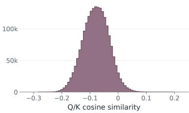  
Figure 1: Cosine similarities between the final 256 queries and preceding context keys in layer 8 of Qwen3-8B, for an 8K-token LongBench v2 input, excluding the first key (attention sink).

Let $\mathbf { O P T } _ { \mathsf { A t t n } }$ denote the optimal worst-case number of retained tokens subject to

$$
\operatorname* { P r } \left[ \left\| { \widehat { \mathrm { A t t n } } } ( K , V , q ) - { \mathrm { A t t n } } ( K , V , q ) \right\| \leq \varepsilon \right] \geq { \frac { 2 } { 3 } }
$$

for every fixed admissible q. The algorithm knows keys, values, and parameters $r _ { k } , r _ { q } , a , b$ , but not the particular query in Q. All norms are Euclidean, and all logarithms are natural. We use $\widetilde O$ and $\widetilde \Omega$ to suppress factors polylogarithmic in n.

Our main result shows that importance sampling is a nearly optimal token eviction policy for attention approximation. Surprisingly, for a wide range of parameters (see Figure 2) all importance weights can be set to 1, i.e. the most basic uniform sampling is optimal. Formally, we define two regions in the space of parameters $( a , b )$ , see also Figure 2 for an illustration:

Definition 1 (Uniform & importance sampling regimes). We say that fixed parameters $- 1 \leq a \leq$ $b \leq 1$ lie in the uniform sampling regime $i f a < 0 < b$ and $b - a \leq \textstyle { \frac { 1 + \tilde { b } } { 2 } }$

We say that fixed parameters $- 1 \leq a \leq b \leq 1$ lie in the importance sampling regime in any other case.

Our main result is as follows.

Theorem 2. Fix any constant $\varepsilon \in ( 0 , 1 / 2 ]$ independently of n, and assume $d = \omega ( \log n )$ . Fix parameters $r _ { k } , r _ { q } > 0$ and $- 1 \leq a < b \leq 1$ . Suppose $\| k \| \leq r _ { k }$ for every key, and the admissible query set $Q$ is described as Equation (4). Let $R ^ { 2 } = r _ { k } r _ { q } / \sqrt { d } ,$ then

1. In the uniform sampling regime, uniform sampling achieves asymptotically tight space bounds:

$$
\Omega \Bigl ( \operatorname* { m i n } \Big \{ n , e ^ { ( b - a ) { \bf R } ^ { 2 } } \Big \} \cdot e ^ { - o ( {  R } ^ { 2 } ) } \Bigr ) \ \le \ { \bf O } { \bf P } { \bf T } _ { \mathrm { A t t } } \ n \ \le \ { \cal O } \Bigl ( \operatorname* { m i n } \Big \{ n , e ^ { ( b - a ) { \cal R } ^ { 2 } } \Big \} \Bigr ) .
$$

2. In the importance sampling regime, importance sampling achieves asymptotically tight space bounds:

$$
\Omega \Bigl ( \operatorname* { m i n } \left\{ n , e ^ { \frac { 1 + b } { 2 } R ^ { 2 } } , e ^ { ( b - a ) R ^ { 2 } } \right\} \cdot e ^ { - o ( R ^ { 2 } ) } \Bigr ) \le \mathrm { { \bf ~ O P T } } _ { \mathrm { A t t n } } \le O \Bigl ( \operatorname* { m i n } \left\{ n , e ^ { \frac { 1 + b } { 2 } R ^ { 2 } } , e ^ { ( b - a ) R ^ { 2 } } \right\} \Bigr ) .
$$

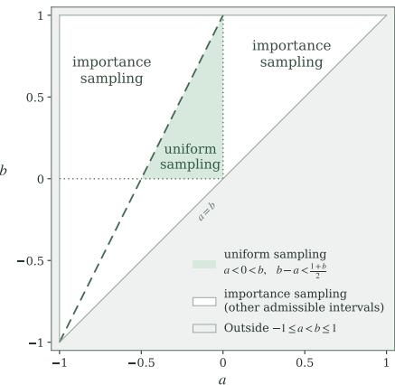

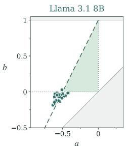  
Figure 2: Uniform sampling and importance sampling regions in parameter space.

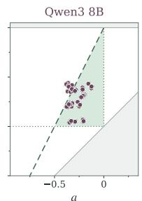

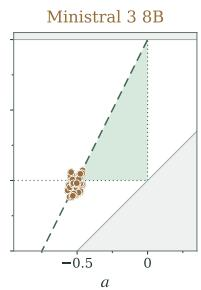  
Figure 3: Empirical bounds a and b for 8B models Llama 3.1, Qwen3, and Ministral 3. Each point represents one context (from Long-Bench v2/InfiniteBench/SCBench)–context-length (8/32/128/256 k)–layer(4/8/16/24) configuration, with endpoints a and b computed as 0.001 and 0.999 quantiles of cosine similarities distribution. Initialtoken (attention sink) is excluded. See Section F.1 for more plots.

Theorem 2 is achieved by uniform sampling when the key/query cosine similarities are small $( a <$ $0 < b$ and $\begin{array} { r } { b \mathrm { ~ - ~ } a \le \frac { 1 + \check { b } } { 2 } ) } \end{array}$ ), and by an importance sampling scheme for larger cosine similarities. Interestingly, even though uniform sampling is by no means the best token eviction policy, it is quite competitive with some earlier works on token eviction for KV cache compression, especially query-independent ones. See, for example, Table 1 in Kochetkova et al. (2025) for a comparison of SnapKV and BalanceKV with uniform sampling. The recent work of Wang et al. (2026) provides more evidence for this phenomenon. Figure 2 helps explain this from the perspective of theory: the empirical $( a , b )$ values for widely used models lie in or close to the uniform sampling regime.

In addition to the theorem statement, the proof of the theorem provides insights into another empirical phenomenon. Specifically, the anisotropy of the key/query space that has been empirically observed in the literature Godey et al. (2024) appears naturally in our lower bound instance. In our hard input distribution on key and query vectors, the keys and queries are similarly distributed except that the keys are positively shifted along a specific direction $e _ { 0 }$ while the queries are negatively shifted along $e _ { 0 }$ . This construction, which is critical to establishing a matching space lower bound, is indeed anisotropic: the keys have a large positive projection on a common direction, and the queries have a large negative projection on the same direction, similarly to distributions observed in practice (Table 1, Figure 5). See Section 2.2 for more details.

## 1.2 RELATED WORK

Related work on worst-case space complexity of attention approximation. Prior work (Haris & Onak, 2025; Liberty et al., 2026; Chen et al., 2026) has established nearly tight asymptotic bounds on the space complexity of approximating attention in the worst case. The algorithmic landscape is diverse, with approaches drawing on sketching, random sampling, discrepancy theory, and kerneldensity estimation. Provable attention approximation has also led to implemented $\mathrm { K } \dot { \mathbf { V } }$ cache compression methods. SubGen (Zandieh et al., 2024) combines online key clustering with $\ell _ { 2 }$ sampling of values to obtain approximation guarantees that exploit clustering structure, and evaluates its implementation on long-context question-answering tasks. BalanceKV (Kochetkova et al., 2025) develops a streaming compression algorithm based on geometric discrepancy and vector balancing, with both theoretical guarantees and empirical evaluations of attention approximation and end-to-end generation on long-context benchmarks. A comparison is given in Table 2. We note that the worst case setting is crucially different from our setup in that queries can be arbitrarily well aligned with key.

Table 1: Cosine similarity between mean query and key vectors. Values are means ± standard deviations across example/context-length configurations common to all models and layers.
<table><tr><td>Model</td><td>Layer 4</td><td>Layer 8</td><td>Layer 16</td><td>Layer 24</td></tr><tr><td>Llama 3.1 8B</td><td> $- 0 . 5 8 4 \pm 0 . 1 4 8$ </td><td> $- 0 . 7 2 5 \pm 0 . 0 9 8$ </td><td> $- 0 . 6 8 1 \pm 0 . 0 7 6$ </td><td> $- 0 . 6 8 8 \pm 0 . 1 0 5$ </td></tr><tr><td>Qwen3 8B</td><td> $0 . 0 6 8 \pm 0 . 0 3 7$ </td><td> $- 0 . 1 4 6 \pm 0 . 0 3 4$ </td><td> $0 . 0 2 4 \pm 0 . 0 4 4$ </td><td> $- 0 . 1 4 3 \pm 0 . 0 8 0$ </td></tr><tr><td>Ministral 3 8B</td><td> $- 0 . 7 2 4 \pm 0 . 0 4 7$ </td><td> $- 0 . 6 2 8 \pm 0 . 0 8 6$ </td><td> $- 0 . 6 1 3 \pm 0 . 0 7 8$ </td><td> $- 0 . 6 5 8 \pm 0 . 0 4 5$ </td></tr></table>

Related work on KV cache compression. We mention the lines of the most relevant work.

KV subset selection. A prominent approach to KV-cache compression retains a subset of the original key-value pairs. $_ \mathrm { H _ { 2 } O }$ combines accumulated-attention heavy hitters with recent tokens (Zhang et al., 2023), while Scissorhands uses token importance that persists across decoding steps (Liu et al., 2023). StreamingLLM keeps initial attention sinks and a sliding window of recent tokens (Xiao et al., 2024). SnapKV selects KV positions per head before generation using a window at the prompt’s end (Li et al., 2024). PyramidKV splits a fixed cache budget across layers (Cai et al., 2025), while Ada-KV splits it across heads using an attention-output error bound (Feng et al., 2025). These approaches exploit historical attention, prompt observations, or layer/head structure, rather than establishing optimal retained-token complexity under an explicit restriction on future key-query similarities.

Compressed KV representations. Another line of work reduces storage per cached vector. KIVI quantizes keys per channel and values per token (Liu et al., 2024). KVQuant combines distributionaware quantization, pre-RoPE key quantization, and separate outlier handling (Hooper et al., 2024). TurboQuant uses random rotations for data-oblivious vector quantization, with guarantees on meansquared and inner-product distortion (Zandieh et al., 2026). Palu caches low-dimensional intermediate representations from low-rank factorizations of key/value projections (Chang et al., 2025). Cartridges learns context representations through self-study (Eyuboglu et al., 2025). These representations fall outside our weighted-subset model, so our retained-token lower bounds do not apply to arbitrary quantized or low-rank encodings.

Random KV eviction. Wang et al. (2026) propose a method that reserves cache space for the input prompt and the most recent tokens, then fills the remaining slots by uniform random sampling, independently across KV heads at each eviction event. Their method is competitive with importancebased policies on reasoning benchmarks, providing further evidence that random sampling can be effective in practice.

## 2 UNIFORM SAMPLING REGIME

## 2.1 UPPER BOUND

The upper bound in the small cosine similarities regime is shown by a simple approach: sampling tokens uniformly.

Consider the small cosine similarities regime of Theorem 1, where $- 1 \leq a < 0 < b \leq 1$ and $\textstyle b - a \leq { \frac { 1 + b } { 2 } }$ . Our assumptions are $\| k _ { i } \| \leq r _ { k } , \| q \| \leq r _ { q } ,$ , and

$$
a \leq \frac { \langle k _ { i } , q \rangle } { \| k _ { i } \| \| q \| } \leq b .
$$

We write $R ^ { 2 } = r _ { k } r _ { q } / \sqrt { d } .$ Set $\begin{array} { r } { m = \left\lceil \frac { 9 6 e ^ { ( b - a ) R ^ { 2 } } } { \varepsilon ^ { 2 } } \right\rceil . \mathrm { I f } m \geq n } \end{array}$ , retain the full dataset. Otherwise, sample m tokens independently and uniformly with replacement. Writing $J _ { 1 } , \ldots , J _ { m }$ for their

Table 2: Worst-case space complexity of attention. $\widetilde { O } , \widetilde { \Omega }$ suppress $\operatorname { p o l y } ( \varepsilon ^ { - 1 } \log n )$ factors.
<table><tr><td>Reference</td><td>Model / regime</td><td>Upper bound</td><td>Lower bound</td></tr><tr><td>Kochetkova et al. (2025)</td><td>Coreset size (tokens)</td><td> $\widetilde { \cal O } \left( \sqrt { d } e ^ { 2 R ^ { 2 } } \right)$ </td><td> $\widetilde \Omega ( 1 )$ </td></tr><tr><td>Haris &amp; Onak  $( 2 0 2 5 ) ^ { \mathrm { a } }$ </td><td>Space complexity (bits)</td><td> $\widetilde O ( n d )$ </td><td> $\Omega ( n d )$ </td></tr><tr><td> $\left( 2 0 2 6 \right) ^ { \mathrm { b } }$  Liberty et al.</td><td>Coreset size (tokens)</td><td> $\widetilde { O } \left( \sqrt { d } e ^ { R ^ { 2 } + \log R + o ( \log \log R ) } \right)$ </td><td> $\widetilde \Omega \left( \sqrt { d } e ^ { R ^ { 2 } } \right)$ </td></tr><tr><td>Chen et al. (2026)º</td><td>Space complexity (bits)</td><td> $\widetilde O \left( e ^ { ( 1 + o ( 1 ) ) R ^ { 2 } } \right)$ </td><td> $\widetilde \Omega \Bigl ( e ^ { ( 1 - o ( 1 ) ) R ^ { 2 } } \Bigr )$ </td></tr><tr><td>This workd,  $\textstyle b - a \leq { \frac { 1 + b } { 2 } }$ </td><td>Coreset size (tokens)</td><td> $\widetilde O \left( e ^ { ( b - a ) R ^ { 2 } } \right)$ </td><td> $\widetilde \Omega \left( e ^ { ( b - a - o ( 1 ) ) R ^ { 2 } } \right)$ </td></tr><tr><td>This workd,  $\textstyle b - a > { \frac { 1 + b } { 2 } }$ </td><td>Coreset size (tokens)</td><td> $\tilde { O } \biggl ( e ^ { \frac { 1 + b } { 2 } R ^ { 2 } } \biggr ) $ </td><td> $\widetilde \Omega \biggl ( e ^ { ( \frac { 1 + b } { 2 } - o ( 1 ) ) R ^ { 2 } } \biggr )$ </td></tr></table>

(5)

(6)

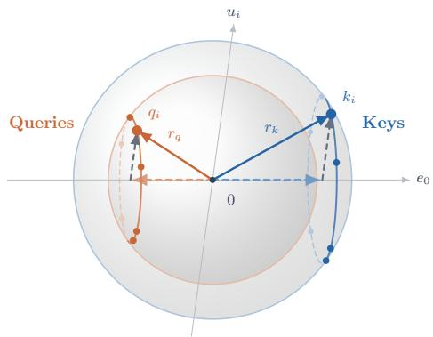  
Figure 4: A visualization of the hard instance in our lower bound construction. The keys and queries are shifted away from each other along direction $e _ { 0 }$ . Orthogonal to $e _ { 0 } { \mathrm { : } }$ , each key-query pair $( k _ { i } , q _ { i } )$ follows its own common direction $u _ { i }$

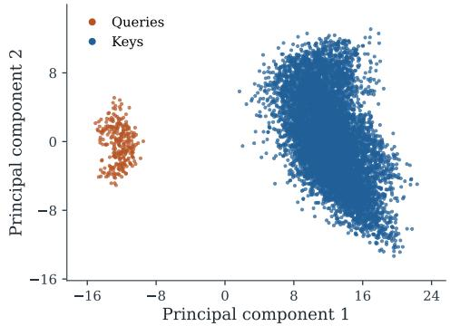  
Figure 5: Query-key geometry in Llama 3.1 8B on LongBench v2 example (8K context, layer 8, head 0). A joint PCA is fitted with equal total weight for queries and keys. Initial-token (attention sink) is excluded. See Section F.1 for further plots.

Lemma 2 (Nearly orthogonal vectors). Consider integer $M \geq 2$ and $\xi \in \mathsf { \Gamma } ( 0 , 1 )$ . Let D be an integer such that $D \geq \bar { 6 } \log ( 2 M ) / \xi ^ { 2 }$ . There exist M unit vectors $u _ { 1 } , \dotsc , u _ { M } \in \mathbb { R } ^ { D }$ such that $| \langle u _ { i } , u _ { j } \rangle | \leq \xi f o r$ every $i \neq j$

To see this, choose $u _ { 1 } , \ldots , u _ { M }$ independently and uniformly from $\{ - D ^ { - 1 / 2 } , D ^ { - 1 / 2 } \} ^ { D }$ , so that each vector has unit norm. Hoeffding’s inequality and a union bound show that the probability of any pair satisfying $| \langle u _ { i } , u _ { j } \rangle | > \xi$ is at most $M ^ { 2 } e ^ { - D \xi ^ { 2 } / 2 } < 1$ under the assumed bound on D. We give the full proof in Section C.

In order to keep all key-query cosine similarities in $[ a , b ]$ , queries and keys are anisotropically shifted away from each other along a fixed direction $e _ { 0 } . \mathbf { A }$ pair of keys and queries in the same group $k _ { i } , q _ { i }$ are (a weighted version of) $u _ { i } \pm e _ { 0 }$ where the sign on $e _ { 0 }$ differs for the key and query (along with a normalization term to set their respective norms to $r _ { k } , r _ { q } )$ .

Each query $q _ { i }$ has similarity b with its own group’s key $k _ { i }$ , while the near orthogonality caps its similarity close to a with the other groups’ keys $k _ { j }$ . The exponential in attention amplifies this gap, giving the query’s own group almost all the attention mass. We also choose nearly orthogonal value vectors, so a convex combination of other groups’ value vectors cannot well-approximate attention. The algorithm must therefore retain a key-value pair from each group with constant probability, otherwise it would fail with probability more than $\bar { 1 } / 3$ on some group’s query.

The resulting construction holds an intriguing connection to patterns in real data. In Figure 5, we see that queries and keys are separated along a common direction and otherwise hold a somewhat similar distribution though with different scales for queries and keys. These qualities also appear in our hard instance (Figure 4).

## 2.2.1 LOWER BOUND CONSTRUCTION

Goal. We construct keys and queries whose scaled inner products are $b R ^ { 2 }$ for matching pairs $( k _ { i } , q _ { i } )$ and $a ( 1 - o ( 1 ) ) R ^ { 2 }$ for nonmatching pairs $( k _ { j } , q _ { i } )$ , where $R ^ { 2 } = r _ { k } r _ { q } / \sqrt { d } .$ In Section C.1, we use this gap to make each query concentrate its attention on copies of its matching key, forcing an accurate summary to retain many key groups.

Construction. Let $e _ { 0 } , e _ { K } , e _ { Q }$ be the first three standard basis vectors. Choose m unit vectors satisfying Lemma 2 in dimension $D = d - 3$ , with pairwise inner products bounded in magnitude by $\begin{array} { r } { \xi = \sqrt { \frac { 6 \log ( 2 n ) } { D } } } \end{array}$ . Embed them into the last $d - 3$ coordinates of $\mathbb { R } ^ { d }$ , and denote the resulting

vectors by $u _ { 1 } , \ldots , u _ { m }$ . Define

$$
\begin{array} { r } { \begin{array} { r l } { k _ { i } = r _ { k } \big ( \underbrace { \sqrt { \alpha } u _ { i } } _ { \mathrm { S h a r e d ~ g r o u p ~ d i r e c t i o n } } + \underbrace { \sqrt { \beta } e _ { 0 } } _ { \mathrm { A n i s o t r o p i c ~ s h i f t } } + } & { \underbrace { \sqrt { 1 - \alpha - \beta } e _ { K } } _ { \mathrm { N o r m ~ p a d d i n g } } \big ) , } \\ { q _ { i } = r _ { q } \big ( \underbrace { \sqrt { \alpha } u _ { i } } _ { \mathrm { S h a r e d ~ g r o u p ~ d i r e c t i o n } } - \underbrace { \sqrt { \beta } e _ { 0 } } _ { \mathrm { A n i s o t r o p i c ~ s h i f t } } + } & { \underbrace { \sqrt { 1 - \alpha - \beta } e _ { Q } } _ { \mathrm { N o r m ~ p a d d i n g } } \big ) , } \end{array} } \end{array}\tag{7}
$$

where $\alpha \approx b - a$ and $\beta \approx - a$ . Specifically, we set

$$
\alpha = \frac { b - a } { 1 + \xi } , \qquad \beta = \frac { - a - \xi b } { 1 + \xi } .\tag{8}
$$

We have $\alpha \geq 0$ since $b \geq a$ . Since $a < 0$ and b are fixed and $\xi = o ( 1 )$ , for sufficiently large n we have $\xi b < - a ,$ , so $\beta > 0 .$ . Moreover, $\alpha + \beta = 2 \alpha - b \leq b - 2 a \leq 1$ . Therefore, $1 - \alpha - \beta \ge 0$ and the keys and queries are well defined with norms exactly equal to $\| \boldsymbol { k } _ { i } \| = r _ { k }$ and $\left\| q _ { i } \right\| = r _ { q } .$ The components along u and $e _ { 0 }$ serve the purpose of achieving the desired inner products while the padding along $e _ { K }$ and $e _ { Q }$ increases the norms of the keys/queries to fix the denominator of cosine similarity.

Verifying the inner products. For every $\begin{array} { r } { i , j \in [ m ] , \frac { \langle k _ { j } , q _ { i } \rangle } { \sqrt d } = \big ( \alpha \langle u _ { j } , u _ { i } \rangle - \beta \big ) R ^ { 2 } } \end{array}$ . For matching pairs, $\alpha - \beta = b$ gives

$$
{ \frac { \langle k _ { i } , q _ { i } \rangle } { \sqrt { d } } } = b R ^ { 2 } .\tag{9}
$$

For nonmatching pairs, $| \langle u _ { j } , u _ { i } \rangle | \leq \xi$ gives

$$
a R ^ { 2 } \leq \frac { \langle k _ { j } , q _ { i } \rangle } { \sqrt { d } } \leq ( a + 2 \alpha \xi ) R ^ { 2 } = a R ^ { 2 } + \frac { 2 \xi } { 1 + \xi } ( b - a ) R ^ { 2 } .\tag{10}
$$

Constructing the value vectors. Apply Lemma 2 a second time to obtain m unit value vectors $v _ { 1 } , \ldots , v _ { m } \in \mathbb { R } ^ { d }$ satisfying

$$
| \langle v _ { i } , v _ { j } \rangle | \leq { \frac { 1 } { 8 } } \qquad { \mathrm { f o r ~ a l l ~ } } i , j \in [ m ] { \mathrm { ~ w i t h ~ } } i \neq j .\tag{11}
$$

Since $m \leq n ,$ the assumption $d = \omega ( \log n )$ ensures that this is possible.

The final proof of the coreset size lower bound using these key, query and value vectors is given in Section C.

## 3 IMPORTANCE SAMPLING REGIME

## 3.1 UPPER BOUND

When the interval [a, b] is wide, the exponential in attention can make a few tokens much more influential than the rest. To account for this, uniform sampling would need to retain many tokens. We thus use importance sampling instead. Unlike uniform sampling, which treats all tokens equally, importance sampling gives higher sampling probabilities to tokens that can contribute more to attention. This is a standard idea in randomized linear algebra through leverage-score sampling Drineas et al. (2012) and in coreset construction through sensitivity sampling Braverman et al. (2021).

Since we sample before seeing the query, we want to sample a token with probability proportional to the largest possible attention it could receive. This quantity is its sensitivity: for a nonempty query set Q containing all admissible queries, define

$$
\sigma _ { i } = \operatorname* { s u p } _ { \boldsymbol { q } \in \boldsymbol { Q } } \frac { \boldsymbol { e } ^ { \langle k _ { i } , \boldsymbol { q } \rangle / \sqrt { d } } } { \sum _ { j = 1 } ^ { n } \boldsymbol { e } ^ { \langle k _ { j } , \boldsymbol { q } \rangle / \sqrt { d } } } .\tag{12}
$$

Unfortunately, these sensitivities may be difficult to compute exactly. Instead, it suffices to use sampling scores $s _ { i } \geq \sigma _ { i } , \mathrm { i . e . }$ ., upper bounds of each sensitivities. In the sampling procedure, we sample each token i with probability $\pi _ { i } ~ = ~ s _ { i } / S$ , where $\textstyle S = \sum _ { i = 1 } ^ { n } s _ { i }$ . We set the number of

samples proportional to S, so smaller sampling scores yield a smaller sample size. This leaves two tasks: compute valid sampling scores $s _ { i } \geq \sigma _ { i }$ and show that their sum S is small.

We formalize the sampling procedure in Algorithm 1. For each sampled token i, we retain the corresponding key-value pair $( k _ { i } , v _ { i } )$ together with a positive weight. If we sample the same token more than once, we keep one copy and add the weights together.

Algorithm 1 Attention compression by score-based sampling and reweighting   
Require: key-value pairs $( k _ { 1 } , v _ { 1 } ) , \ldots , ( k _ { n } , v _ { n } )$ , accuracy $0 ~ < ~ \varepsilon ~ < ~ 1$ , and sampling scores   
$s _ { 1 } , \ldots , s _ { n } > 0$   
1: $\begin{array} { r } { S \gets \sum _ { i = 1 } ^ { n } s _ { i } , \quad m \gets \lceil 9 6 S / \varepsilon ^ { 2 } \rceil } \end{array}$   
2: if m $\geq n$ then   
3: return $\{ ( k _ { i } , v _ { i } , 1 ) : i \in [ n ] \}$   
4: end if   
5: $\pi _ { i }  s _ { i } / S$ for every $i \in [ n ]$   
6: Subsample m tokens using probabilities $\pi _ { i }$ ▷ with replacement   
7: $c _ { i } \gets$ number of times token i was sampled   
8: return $\{ ( k _ { i } , v _ { i } , c _ { i } / ( m \pi _ { i } ) ) : c _ { i } > 0 \}$ ▷ one copy per token

We refer to the set returned by Algorithm 1 as the summary. Given a query q, the summary produces an estimator

$$
{ \widehat { \mathrm { A t t n } } } ( K , V , q ) = { \frac { \sum _ { i \in I } w _ { i } e ^ { \langle k _ { i } , q \rangle / { \sqrt { d } } } v _ { i } } { \sum _ { i \in I } w _ { i } e ^ { \langle k _ { i } , q \rangle / { \sqrt { d } } } } } ,\tag{13}
$$

where $I : = \{ i : c _ { i } > 0 \}$ denotes the set of retained token indices. The denominator is positive, since the summary is nonempty and all retained weights are positive.

We first state the approximation guarantee of Algorithm 1. Using a number of tokens proportional to S, the estimator from Equation (13) approximates the attention with high probability.

Lemma 3 (Approximation guarantee). Suppose $\lVert \boldsymbol { v } _ { i } \rVert \leq 1$ and $s _ { i } \ \geq \ \sigma _ { i }$ for every $i \in [ n ]$ . Then Algorithm 1 returns a weighted attention summary of size at most

$$
\operatorname* { m i n } \left\{ n , \left\lceil { \frac { 9 6 S } { \varepsilon ^ { 2 } } } \right\rceil \right\} .
$$

For every fixed query $q \in Q ,$ , its estimate satisfies

$$
\operatorname* { P r } [ | { \widehat { \mathrm { A t t n } } } ( K , V , q ) - { \mathrm { A t t n } } ( K , V , q ) | | \leq \varepsilon ] \geq { \frac { 2 } { 3 } } ,
$$

where the probability is over the sampling in Algorithm 1.

We defer the full proof of Lemma 3 to Section D. Similar to the proof of Lemma 1, we use Chebyshev’s inequality to bound the attention denominator, and use Markov’s inequality to bound the numerator of the error.

Lemma 3 reduces the problem to constructing sampling scores $s _ { i }$ whose sum S is small. To this end, we first bound the total sensitivity $\textstyle \sum _ { i = 1 } ^ { n } \sigma _ { i }$ of any query set for which all key-query inner products lie in a fixed interval. This condition is satisfied by our query set $Q$ . However, Q need not be convex, making it difficult to compute sampling scores. We therefore partition the keys and possible query norms into small ranges and, for each pair of ranges, replace the cosine-similarity constraints by fixed inner-product bounds. This partitions the problem into a collection of smaller convex relaxations on which we can approximate the sensitivities. Applying the total-sensitivity bound to these relaxations allows us to control the sum S. These two steps are formalized in Lemmas 4 and 5. Lemma 4 (Total sensitivity bound). Suppose $r _ { k } , r _ { q } > 0$ and $\| \boldsymbol { k } _ { i } \| \le r _ { k }$ for every i, and let $\mathcal { Q }$ be a nonempty compact query set such that

$$
\mathcal { Q } : = \Big \{ q \in \mathbb { R } ^ { d } : \| q \| \leq r _ { q } , \ell \leq \langle k _ { i } , q \rangle / \sqrt { d } \leq h \quad \forall i \in [ n ] \Big \} .
$$

For sensitivities $\sigma _ { i }$ defined in Equation (12) with the supremum taken over $q \in \mathcal { Q } ,$ we have

$$
\sum _ { i = 1 } ^ { n } \sigma _ { i } \leq \exp \left( \operatorname* { m i n } \left\{ h - \ell , \frac { R ^ { 2 } + h } { 2 } \right\} \right) .\tag{14}
$$

At a high level, the two terms in Equation (14) come from two different ways of controlling the total sensitivity. The first term $h - \ell$ follows from the fact that $\sigma _ { i } \le e ^ { h } / ( \dot { n } e ^ { \ell } )$ . For the second term, we pair each key $k _ { i }$ with a query $q _ { i }$ attaining its sensitivity and assign weights to these pairs proportionally to their sensitivities. Writing ¯k, q¯for the weighted mean key and query, using Jensen’s inequality, the proof gives

$$
\log \sum _ { i } \sigma _ { i } \leq h - \frac { \langle \bar { k } , \bar { q } \rangle } { \sqrt { d } } , \qquad \log \sum _ { i } \sigma _ { i } \leq R ^ { 2 } + \frac { \langle \bar { k } , \bar { q } \rangle } { \sqrt { d } } .
$$

Averaging these two bounds yields log $\textstyle \sum _ { i } \sigma _ { i } \leq ( R ^ { 2 } + h ) / 2$ . The full proof is deferred to Section D.   
It remains to construct the sampling scores.

Lemma 5 (Computing sampling scores). $L e t - 1 \leq a < b \leq 1$ and $r _ { k } , r _ { q } > 0$ , and write $R ^ { 2 } =$ $\begin{array} { r } { \frac { r _ { k } r _ { q } } { \sqrt { d } } , \kappa = \operatorname* { m i n } \left\{ b - a , \frac { 1 + b } 2 \right\} } \end{array}$ . Suppose $\| \boldsymbol { k } _ { i } \| \le r _ { k }$ for every $i \in [ n ] ,$ , and let

$$
\begin{array} { r } { \mathcal { Q } : = \left\{ q \in \mathbb { R } ^ { d } : \| q \| \leq r _ { q } , \quad a \| k _ { i } \| \| q \| \leq \langle k _ { i } , q \rangle \leq b \| k _ { i } \| \| q \| \quad \forall i \in [ n ] \right\} . } \end{array}
$$

For sensitivities $\sigma _ { i }$ defined in Equation (12) with the supremum taken over $q \in \mathcal { Q } ,$ , we can compute sampling scores $s _ { i }$ satisfying $s _ { i } \geq \sigma _ { i } f o r$ every $i \in [ n ] $ , and

$$
\sum _ { i = 1 } ^ { n } s _ { i } \le \frac { 1 2 8 e ^ { 2 } } { \kappa ^ { 2 } } e ^ { \kappa R ^ { 2 } } .
$$

Moreover, such sampling scores can be obtained by solving $n \cdot \operatorname* { m a x } \{ 1 , \lceil R ^ { 2 } \rceil \}$ convex optimization problems, using only the keys and the parameters $r _ { k } , r _ { q } , a , b .$

The full proof is deferred to Section D.

We now combine the approximation guarantee (Lemma 3) with the sampling score bound (Lemmas 4 and 5) to prove the upper bound in the importance sampling regime.

Corollary 1 (Upper bound, Item 2). Under the assumptions of Lemma $5 , \hbar x \ a , \cdot$ b independently of $n ,$ suppose $\left\| v _ { i } \right\| \leq 1$ for every $i \in [ n ]$ , and let $0 < \varepsilon < 1$ . Then Algorithm 1, with the scores constructed there, retains at most

$$
O _ { \varepsilon } \left( \operatorname* { m i n } \left\{ n , e ^ { ( b - a ) R ^ { 2 } } , e ^ { \frac { 1 + b } { 2 } R ^ { 2 } } \right\} \right)
$$

tokens and gives an additive-ε approximation to attention with probability at least $2 / 3$ for eachfixed admissible query.

Proof. By Lemma 5, the sampling scores satisfy $s _ { i } \ \geq \ \sigma _ { i }$ and $S \le 1 2 8 e ^ { 2 } \kappa ^ { - 2 } e ^ { \kappa R ^ { 2 } }$ , where $\kappa =$ min $\{ b - { \overset { \cdot } { a } } , ( 1 + b ) / 2 \}$ . Since $a , b$ are fixed, $\kappa ^ { \dot { - } 2 }$ is a constant. Substituting into Lemma 3 and absorbing $\kappa ^ { - 2 }$ into the implicit constant proves the upper bound. □

## 3.2 LOWER BOUND

The lower bound in the importance sampling regime uses the same construction and analysis as in the uniform sampling regime (Section 2.2). The only change in the theorem statement is that m must satisfy

$$
2 \leq m \leq n , \qquad m \leq \operatorname* { m i n } \left\{ e ^ { \frac { 1 + b } { 2 } R ^ { 2 } } , e ^ { ( b - a ) R ^ { 2 } } \right\} \cdot e ^ { - 2 \xi R ^ { 2 } } / 3 2 .
$$

The full statement (Theorem 4) and proof are given in Section E.

## 4 OPEN PROBLEMS

The following questions naturally arise from our work:

• Can we provably explain why transformers learn this geometry? In particular, under what assumptions on the data and training dynamics can we prove that small key–query cosine similarities and negative alignment between mean keys and queries emerge?

• Do real KV caches have other structure that our model misses? Our hard instances share some geometric features with trained models, but real caches may have additional properties that make them easier to compress.

## ACKNOWLEDGMENTS

JC,YF, PI, were supported in part by the NSF TRIPODS program (award DMS-2022448) and Wistron Corporation. Ekaterina Kochetkova and Boris Prokhorov were supported by the Swiss National Science Foundation grant 10004935 - Sublinear Algorithms for Non-linear Structures (Project MINT)

## AI USE STATEMENT

In this work, we used generative AI tools to provide critical ingredients for proving mathematical claims in the importance sampling regime, assist in the writing of proofs, propose or refine hypotheses and implement methods.

We have not used generative AI tools to help formulate mathematical claims, develop theoretical models or conceptual frameworks, design or provide feedback on research methodology or experiments, interpret results, support qualitative and thematic data analysis. Generating synthetic data sets, cleaning and reformatting datasets and assisting with translation are not applicable to this work.

Additionally, we used generative AI tools for creating scientific figures, suggesting experimental parameters, creating software code, drafting parts of the paper, sourcing/searching for information, editing to improve readability, proposing a title for the paper.

We have reviewed all AI-assisted work. We checked LLM-generated parts of the proof and rewrote it ourselves. We take responsibility for the final content of this work, including text, claims or artifacts produced with the aid of generative AI.

## REFERENCES

Vladimir Braverman, Dan Feldman, Harry Lang, Adiel Statman, and Samson Zhou. Efficient coreset constructions via sensitivity sampling. In Vineeth N. Balasubramanian and Ivor Tsang (eds.), Proceedings of The 13th Asian Conference on Machine Learning, volume 157 of Proceedings of Machine Learning Research, pp. 948–963. PMLR, 17–19 Nov 2021. URL https: //proceedings.mlr.press/v157/braverman21a.html.

Zefan Cai, Yichi Zhang, Bofei Gao, Yuliang Liu, Yucheng Li, Tianyu Liu, Keming Lu, Wayne Xiong, Yue Dong, Junjie Hu, and Wen Xiao. PyramidKV: Dynamic KV cache compression based on pyramidal information funneling. In Second Conference on Language Modeling, 2025. URL https://openreview.net/forum?id=ayi7qezU87.

Chi-Chih Chang, Wei-Cheng Lin, Chien-Yu Lin, Chong-Yan Chen, Yu-Fang Hu, Pei-Shuo Wang, Ning-Chi Huang, Luis Ceze, Mohamed Abdelfattah, and Kai-Chiang Wu. Palu: KV-cache compression with low-rank projection. In The Thirteenth International Conference on Learning Representations, 2025. URL https://proceedings.iclr.cc/paper\_files/paper/ 2025/hash/7da6e0e00702c60607a6ae05c802ef85-Abstract-Conference. html.

Justin Y. Chen, Ying Feng, Piotr Indyk, Michael Kapralov, Ekaterina Kochetkova, and Boris Prokhorov. Towards tight bounds for streaming attention, 2026. URL https://arxiv.org/ abs/2606.07205.

Petros Drineas, Malik Magdon-Ismail, Michael W. Mahoney, and David P. Woodruff. Fast approximation of matrix coherence and statistical leverage. Journal ofMachine Learning Research, 13 (111):3475–3506, 2012. URL https://www.jmlr.org/papers/v13/drineas12a. html.

Sabri Eyuboglu, Ryan Ehrlich, Simran Arora, Neel Guha, Dylan Zinsley, Emily Liu, Will Tennien, Atri Rudra, James Zou, Azalia Mirhoseini, and Christopher Re. Cartridges: Lightweight and general-purpose long context representations via self-study, 2025. URL https://arxiv. org/abs/2506.06266.

Yuan Feng, Junlin Lv, Yukun Cao, Xike Xie, and S. Kevin Zhou. Ada-KV: Optimizing KV cache eviction by adaptive budget allocation for efficient LLM inference. In Advances in Neural Information Processing Systems, volume 38, 2025. URL https://openreview.net/forum? id=tcisuhGsQZ.

Nathan Godey, Eric Villemonte de la Clergerie, and Beno´ ˆıt Sagot. Anisotropy is inherent to selfattention in transformers. In Yvette Graham and Matthew Purver (eds.), Proceedings of the 18th Conference of the European Chapter of the Association for Computational Linguistics, EACL 2024 - Volume 1: Long Papers, St. Julian’s, Malta, March 17-22, 2024, pp. 35–48. Association for Computational Linguistics, 2024. doi: 10.18653/V1/2024.EACL-LONG.3. URL https: //doi.org/10.18653/v1/2024.eacl-long.3.

Themistoklis Haris and Krzysztof Onak. Compression barriers in autoregressive transformers. In Nika Haghtalab and Ankur Moitra (eds.), The Thirty Eighth Annual Conference on Learning Theory, June 30 - July 4, 2025, Lyon, France, volume 291 of Proceedings of Machine Learning Research, pp. 2757–2785. PMLR, 2025. URL https://proceedings.mlr.press/ v291/haris25a.html.

Coleman Hooper, Sehoon Kim, Hiva Mohammadzadeh, Michael W. Mahoney, Yakun Sophia Shao, Kurt Keutzer, and Amir Gholami. KVQuant: Towards 10 million context length LLM inference with KV cache quantization. In Advances in Neural Information Processing Systems, volume 37, 2024. URL https://proceedings.neurips.cc/paper\_files/paper/2024/ hash/028fcbcf85435d39a40c4d61b42c99a4-Abstract-Conference.html.

Ekaterina Kochetkova, Kshiteej Jitesh Sheth, Insu Han, Amir Zandieh, and Michael Kapralov. Streaming attention approximation via discrepancy theory. In Advances in Neural Information Processing Systems, volume 38, 2025. URL https://papers.neurips.cc/paper\_files/paper/2025/hash/ 1de510838faddd72f79a7a0e9c564f0c-Abstract-Conference.html.

Yuhong Li, Yingbing Huang, Bowen Yang, Bharat Venkitesh, Acyr Locatelli, Hanchen Ye, Tianle Cai, Patrick Lewis, and Deming Chen. SnapKV: LLM knows what you are looking for before generation. In Advances in Neural Information Processing Systems, volume 37, 2024. URL https://proceedings.neurips.cc/paper\_files/paper/2024/ hash/28ab418242603e0f7323e54185d19bde-Abstract-Conference.html.

Edo Liberty, Alexandr Andoni, and Eldar Kleiner. Nearly optimal attention coresets. CoRR, abs/2605.05602, 2026. doi: 10.48550/ARXIV.2605.05602. URL https://doi.org/10. 48550/arXiv.2605.05602.

Zichang Liu, Aditya Desai, Fangshuo Liao, Weitao Wang, Victor Xie, Zhaozhuo Xu, Anastasios Kyrillidis, and Anshumali Shrivastava. Scissorhands: Exploiting the persistence of importance hypothesis for LLM KV cache compression at test time. In Advances in Neural Information Processing Systems, volume 36, 2023. URL https://proceedings.neurips.cc/paper\_files/paper/2023/hash/ a452a7c6c463e4ae8fbdc614c6e983e6-Abstract-Conference.html.

Zirui Liu, Jiayi Yuan, Hongye Jin, Shaochen Zhong, Zhaozhuo Xu, Vladimir Braverman, Beidi Chen, and Xia Hu. KIVI: A tuning-free asymmetric 2bit quantization for KV cache. In Proceedings of the 41st International Conference on Machine Learning, volume 235 of Proceedings of Machine Learning Research, pp. 32332–32344. PMLR, 2024. URL https: //proceedings.mlr.press/v235/liu24bz.html.

Pierre-Emmanuel Mazare, Gergely Szilvasy, Maria Lomeli, Francisco Massa, Naila Murray, Herv´ e´ Jegou, and Matthijs Douze. Inference-time sparse attention with asymmetric indexing. arXiv´ preprint arXiv:2502.08246, 2025. URL https://arxiv.org/abs/2502.08246.

Lieven Vandenberghe and Stephen Boyd. Convex optimization, volume 1. Cambridge university press Cambridge, 2004.

Heng Wang, Jielin Qiu, Wenting Zhao, Cheng Qian, Liangwei Yang, Jiawei Han, Heng Ji, Silvio Savarese, Shelby Heinecke, and Huan Wang. Random attention: Rethinking KV cache eviction for efficient reasoning. arXiv preprint arXiv:2609.03430, 2026. URL https://arxiv.org/ abs/2609.03430.

Guangxuan Xiao, Yuandong Tian, Beidi Chen, Song Han, and Mike Lewis. Efficient streaming language models with attention sinks. In The Twelfth International Conference on Learning Representations, 2024. URL https://openreview.net/forum?id=NG7sS51zVF.

Amir Zandieh, Insu Han, Vahab Mirrokni, and Amin Karbasi. SubGen: Token generation in sublinear time and memory. arXiv preprint arXiv:2402.06082, 2024. URL https://arxiv.org/ abs/2402.06082.

Amir Zandieh, Majid Daliri, Majid Hadian, and Vahab Mirrokni. TurboQuant: Online vector quantization with near-optimal distortion rate. In The Fourteenth International Conference on Learning Representations, 2026. URL https://proceedings.iclr.cc/paper\_files/paper/2026/hash/ 5c802ef38ab6e366c2ea06eee554c088-Abstract-Conference.html.

Zhenyu Zhang, Ying Sheng, Tianyi Zhou, Tianlong Chen, Lianmin Zheng, Ruisi Cai, Zhao Song, Yuandong Tian, Christopher Re, Clark Barrett, Zhangyang Wang, and´ Beidi Chen. H2O: Heavy-hitter oracle for efficient generative inference of large language models. In Advances in Neural Information Processing Systems, volume 36, 2023. URL https://proceedings.neurips.cc/paper\_files/paper/2023/ hash/6ceefa7b15572587b78ecfcebb2827f8-Abstract-Conference.html.

## A PRELIMINARIES

## A.1 STANDARD INEQUALITIES AND IDENTITIES

We record several standard inequalities and identities used in the proofs.

Lemma 6 (Markov’s inequality). Let X be a nonnegative random variable. Then,for every $t > 0 ,$

$$
\operatorname* { P r } [ X \geq t ] \leq \frac { \mathbb { E } [ X ] } { t } .
$$

In particular, for any random vector X with finite second moment,

$$
\operatorname* { P r } [ \| X \| \geq t ] \leq \frac { \mathbb { E } \| X \| ^ { 2 } } { t ^ { 2 } } .
$$

Lemma 7 (Chebyshev’s inequality). Let X be a real-valued random variable with finite variance. Then, for every $t > 0 ,$

$$
\operatorname* { P r } [ | X - \mathbb { E } X | \geq t ] \leq { \frac { \operatorname { V a r } ( X ) } { t ^ { 2 } } } .
$$

Lemma 8 (Hoeffding’s inequality). Let $X _ { 1 } , \ldots , X _ { n }$ be independent random variables such that $X _ { i } \in [ a , b ]$ for every i. Define

$$
{ \bar { X } } : = { \frac { 1 } { n } } \sum _ { i = 1 } ^ { n } X _ { i } .
$$

Then, for every $\varepsilon > 0 ,$

$$
\operatorname* { P r } \bigl ( \bigl | \bar { X } - \mathbb { E } [ \bar { X } ] \bigr | \geq \varepsilon \bigr ) \leq 2 \exp \mathopen { } \mathclose \bgroup \left( - \frac { 2 n \varepsilon ^ { 2 } } { ( b - a ) ^ { 2 } } \aftergroup \egroup \right) .
$$

Lemma 9 (Jensen’s inequality). Let $\lambda _ { 1 } , \ldots , \lambda _ { n } > 0$ satisfy $\textstyle \sum _ { i = 1 } ^ { n } \lambda _ { i } = 1$ , and let $x _ { 1 } , \ldots , x _ { n } > 0 .$ Then

$$
\log \left( \sum _ { i = 1 } ^ { n } x _ { i } \right) = \log \left( \sum _ { i = 1 } ^ { n } \lambda _ { i } { \frac { x _ { i } } { \lambda _ { i } } } \right) \geq \sum _ { i = 1 } ^ { n } \lambda _ { i } \log \left( { \frac { x _ { i } } { \lambda _ { i } } } \right) .
$$

Lemma 10 (Cauchy-Schwarz inequality). Let $\lambda _ { 1 } , \ldots , \lambda _ { n } \geq 0 ,$ , and let $x _ { 1 } , \ldots , x _ { n }$ and $y _ { 1 } , \ldots , y _ { n }$ be vectors in a Euclidean space. Then

$$
\left| \sum _ { i = 1 } ^ { n } \lambda _ { i } \langle x _ { i } , y _ { i } \rangle \right| \leq \left( \sum _ { i = 1 } ^ { n } \lambda _ { i } \| x _ { i } \| ^ { 2 } \right) ^ { 1 / 2 } \left( \sum _ { i = 1 } ^ { n } \lambda _ { i } \| y _ { i } \| ^ { 2 } \right) ^ { 1 / 2 } .
$$

Lemma 11 (Arithmetic-geometric mean inequality). For every x, $y \geq 0 ,$

$$
{ \sqrt { x y } } \leq { \frac { x + y } { 2 } } .
$$

Lemma 12 (Weighted centering). Let $w _ { 1 } , \ldots , w _ { n } \geq 0$ and let $x _ { 1 } , \ldots , x _ { n }$ be vectors in a Euclidean space. Let

$$
W = \sum _ { i = 1 } ^ { n } w _ { i } > 0 , \qquad \bar { x } = \frac { 1 } { W } \sum _ { i = 1 } ^ { n } w _ { i } x _ { i } .
$$

Then

$$
\sum _ { i = 1 } ^ { n } w _ { i } \| x _ { i } - \bar { x } \| ^ { 2 } = \sum _ { i = 1 } ^ { n } w _ { i } \| x _ { i } \| ^ { 2 } - W \| \bar { x } \| ^ { 2 } .
$$

In particular, $i f \textstyle \sum _ { i } w _ { i } = 1$ , then

$$
\sum _ { i = 1 } ^ { n } w _ { i } \| x _ { i } - { \bar { x } } \| ^ { 2 } = \sum _ { i = 1 } ^ { n } w _ { i } \| x _ { i } \| ^ { 2 } - \| { \bar { x } } \| ^ { 2 } .
$$

## A.2 CONVEX OPTIMIZATION

We record the convex optimization facts used to compute the sampling scores. The optimization guarantee below is stated in the oracle model.

Lemma 13. Let $u _ { 1 } , \ldots , u _ { N } \in \mathbb { R } ^ { d }$ and $c _ { 1 } , \ldots , c _ { N } \in \mathbb { R } .$ . Thefunction

$$
f ( x ) = \log \left( \sum _ { j = 1 } ^ { N } e ^ { \langle u _ { j } , x \rangle + c _ { j } } \right)
$$

is convex and continuously differentiable, with

$$
\nabla f ( x ) = \frac { \sum _ { j = 1 } ^ { N } e ^ { \langle u _ { j } , x \rangle + c _ { j } } u _ { j } } { \sum _ { j = 1 } ^ { N } e ^ { \langle u _ { j } , x \rangle + c _ { j } } } .
$$

The convexity statement follows from convexity of log-sum-exp and composition with an affine map; see Vandenberghe & Boyd (2004, Sections 3.1.5 and 3.2.2). The gradient formula follows by differentiation.

Lemma 14. A set defined by finitely many affine inequalities and constraints of the form

$$
\| A x + c \| \leq \langle u , x \rangle + \beta
$$

is closed and convex. Ifit is bounded, it is compact.

Proof. The function $x \mapsto \| A x + c \| - \langle u , x \rangle - \beta$ is continuous and convex. Thus its non-positive sublevel set is closed and convex, and these properties are preserved by intersection. Compactness follows from closedness and boundedness. □

Lemma 15 (Additive-accuracy convex minimization). Let $C \subseteq \mathbb { R } ^ { d }$ be a nonempty compact convex set, and let $f : C \to \mathbb { R }$ be continuous and convex. Then, for every $\eta > 0 ;$ , the convex optimization problem

$$
\operatorname* { m i n } _ { x \in C } f ( x )
$$

admits an additive-η solution; that is, there exists $\widehat { x } \in C$ satisfying

$$
\operatorname* { m i n } _ { x \in C } f ( x ) \leq f ( { \widehat { x } } ) \leq \operatorname* { m i n } _ { x \in C } f ( x ) + \eta .
$$

Proof. Since $C$ is compact and $f$ is continuous, $f$ attains its minimum on $C .$ An exact minimizer ${ \mathrm { i s } } ,$ in particular, an additive-η solution. □

## B PROOFS FROM SECTION 2.1

Lemma 1 (Upper bound, Item 1). The uniform sampling procedure described above retains at most

$$
O _ { \varepsilon } \left( \operatorname* { m i n } \left\{ n , e ^ { ( b - a ) R ^ { 2 } } \right\} \right)
$$

tokens and gives an additive-ε approximation to attention with probability at least 2/3for eachfixed admissible query.

Proof. If the algorithm retains all tokens, the estimate is exact. Otherwise, fix an admissible query $q ,$ we write the true average and the empirical average of kernels as

$$
D = \frac { 1 } { n } \sum _ { i } \exp ( \langle k _ { i } , q \rangle / \sqrt { d } ) \qquad \mathrm { a n d } \qquad \widehat { D } = \frac { 1 } { m } \sum _ { \ell = 1 } ^ { m } \exp ( \langle k _ { J _ { \ell } } , q \rangle / \sqrt { d } ) .
$$

We will show that

$$
\operatorname* { P r } \left[ \left\| \widehat { \mathrm { A t t n } } ( K , V , q ) - \mathrm { A t t n } ( K , V , q ) \right\| \leq \varepsilon \right] \geq \frac { 2 } { 3 } , \quad \mathrm { w h e r e } \quad \widehat { \mathrm { A t t n } } ( K , V , q ) : = \frac { \sum _ { \ell = 1 } ^ { m } e ^ { \langle k _ { \ell , \ell } , q \rangle / \sqrt { d } } v _ { J _ { \ell } } } { \sum _ { \ell = 1 } ^ { m } e ^ { \langle k _ { J _ { \ell } } , q \rangle / \sqrt { d } } }
$$

for uniform samples $J _ { 1 } , \cdots , J _ { m }$ . We write the attention error vector as

$$
\widehat { \mathrm { A t t n } } ( K , V , q ) - \mathrm { A t t n } ( K , V , q ) = \frac { \frac { 1 } { m } \sum _ { \ell = 1 } ^ { m } \exp ( \langle k _ { J _ { \ell } } , q \rangle / \sqrt { d } ) \big ( v _ { J _ { \ell } } - \mathrm { A t t n } ( K , V , q ) \big ) } { \widehat { D } } .
$$

We will use Chebyshev’s inequality to bound the denominator, and use Markov’s inequality to bound the norm of the numerator. By Equation (5), we have $D \geq e ^ { a R ^ { 2 } }$ . Moreover, since $J _ { 1 } , \ldots , J _ { m }$ are independent,

$$
\mathrm { V a r } ( \widehat { D } ) = \frac { 1 } { m } \mathrm { V a r } \Big ( e ^ { \langle k _ { J } , q \rangle / \sqrt { d } } \Big ) \leq \frac { 1 } { m } \mathbb { E } \Big [ e ^ { 2 \langle k _ { J } , q \rangle / \sqrt { d } } \Big ] \leq \frac { e ^ { b R ^ { 2 } } D } { m } ,
$$

where $J$ is uniform on $[ n ]$ . Thus, by Chebyshev’s inequality (Lemma 7),

$$
\mathrm { P r } [ \widehat { D } < D / 2 ] \leq 4 e ^ { b R ^ { 2 } } / ( m D ) \leq 4 e ^ { ( b - a ) R ^ { 2 } } / m \leq \varepsilon ^ { 2 } / 2 4 \leq 1 / 9 6 .
$$

On the other hand, we can bound the expected squared norm of the numerator as

$$
\begin{array} { r l } & { \mathbb { E } \Big \| \displaystyle \frac { 1 } { m } \sum _ { \ell = 1 } ^ { m } \exp ( \langle k _ { \ell , \ell } , q \rangle / \sqrt { d } ) \big ( \boldsymbol { v } _ { \ell , \ell } - \mathrm { A t t n } ( K , V , q ) \big ) \Big \| ^ { 2 } } \\ & { \qquad = \displaystyle \frac { 1 } { m n } \sum _ { i } \exp ( 2 \langle k _ { i } , q \rangle / \sqrt { d } ) \big \| \boldsymbol { v } _ { i } - \mathrm { A t n } ( K , V , q ) \big \| ^ { 2 } } \\ & { \qquad \leq \displaystyle \sum _ { m } \frac { \delta R ^ { 2 } } { m } \cdot \frac { 1 } { n } \sum _ { i } \exp ( \langle k _ { i } , q \rangle / \sqrt { d } ) \big \| \boldsymbol { v } _ { i } - \mathrm { A t n } ( K , V , q ) \big \| ^ { 2 } } \\ & { \qquad \mathrm { L e m a n 1 2 } \frac { \epsilon ^ { \beta R ^ { 2 } } } { m } \left( \frac { 1 } { n } \sum _ { i } \exp ( \langle k _ { i } , q \rangle / \sqrt { d } ) \| \boldsymbol { v } _ { i } \| ^ { 2 } - D \| \mathrm { A t n } ( K , V , q ) \| ^ { 2 } \right) } \\ & { \qquad \leq \displaystyle \frac { \epsilon ^ { \beta R ^ { 2 } } } { m } . } \end{array}
$$

Hence, by Markov’s inequality (Lemma 6), the probability that the numerator has norm larger than $\varepsilon D / 2$ is at most $4 e ^ { b R ^ { 2 } } / ( m \varepsilon ^ { 2 } D ) \leq 1 / 2 4$

Therefore, with probability at least $1 - 1 / 9 6 - 1 / 2 4 > 2 / 3$ , we have simultaneously $\widehat { D } \geq D / 2$ and numerator norm at most $\varepsilon D / 2 .$ , which implies $\| \widehat { \mathrm { A t t n } } ( K , V , q ) - \mathrm { A t t n } ( K , V , q ) \| \leq \varepsilon .$ □

## C PROOFS FROM SECTION 2.2

Here we prove a standard lemma which is used in the lower bound about packing nearly orthogonal vectors in high dimensions.

Lemma 2 (Nearly orthogonal vectors). Consider integer $M \geq 2$ and $\xi \in ( 0 , 1 ) . \ L e t \ D$ be an integer such that $\mathbf { \bar { \mathit { D } } } \geq \mathbf { \bar { 6 } } \log ( 2 M ) / \xi ^ { 2 }$ . There exist $\check { M }$ unit vectors $u _ { 1 } , \dotsc , u _ { M } \in \mathbb { R } ^ { D }$ such that $| \langle u _ { i } , u _ { j } \rangle | \leq \xi f o r e \nu e r y i \neq \bar { j }$

Proof. We will prove the result by a standard application of the probabilistic method. For all $i \in [ M ] .$ , choose each coordinate of each vector $u _ { i }$ independently and uniformly from $\{ - D ^ { - 1 / 2 } , \bar { D ^ { - 1 / 2 } } \}$ . Then, $u _ { i }$ is a unit vector. Note that for any $i \neq j , \langle u _ { i } , u _ { j } \rangle$ is the sum of $D$ independent random variables with mean zero and bounded in magnitude by $1 / \dot { D }$ . Hoeffding’s inequality (Lemma 8) gives $\operatorname* { P r } [ | \langle u _ { i } , u _ { j } \rangle | > \xi ] \leq 2 e ^ { - D \xi ^ { 2 } / 2 }$ . A union bound over the $\binom { M } { 2 }$ pairs upper bounds the failure probability by

$$
M ^ { 2 } e ^ { - D \xi ^ { 2 } / 2 } \le M ^ { 2 } e ^ { - 6 \log ( 2 M ) / 2 } = M ^ { 2 } ( 2 M ) ^ { - 3 } = \frac { 1 } { 8 M } < 1 .
$$

Therefore, such a set of vectors must exist.

## C.1 PROOF OF THEOREM 3

Here we present the proof of the lower bound in the uniform sampling regime. Refer to the main body in Section 2.2 for the construction of key, query, and value vectors.

Proof. Each group will contain $t = | n / m | \geq 1$ copies of the same key-value pair, with one additional copy in the first s groups, so that $n = t m + s$ and $0 \leq s < m$ . For $i \in \left[ m \right]$ , let $N _ { i } = t + 1$ if $\ : i \leq s \ :$ and $N _ { i } = t \mathrm { i f } \ i > s$ . The attention instance $K , V$ will have $N _ { i }$ copies of the key-value pair $( k _ { i } , v _ { i } )$ . By the setting of $t , s , N _ { i }$ , there will be exactly n key-value pairs. $\mathrm { { \bar { A } s } } t \geq 1 , N _ { j } \mathrm { { \bar { / } } } N _ { i } \leq \mathrm { { \bar { 2 } } }$ for all $i , j \in [ m ]$

At distinct query $q _ { i }$ , let $\alpha _ { i }$ be the attention mass on the copies of $( k _ { i } , v _ { i } )$ . Bounding $\langle k _ { j } , q _ { i } \rangle - \langle k _ { i } , q _ { i } \rangle$ by Equation (9) and Equation (10), we get

$$
\alpha _ { i } = \frac { N _ { i } e ^ { \langle k _ { i } , q _ { i } \rangle / \sqrt { d } } } { \sum _ { j = 1 } ^ { m } N _ { j } e ^ { \langle k _ { j } , q _ { i } \rangle / \sqrt { d } } } = \frac { 1 } { 1 + \sum _ { j \ne i } \frac { N _ { j } } { N _ { i } } e ^ { ( \langle k _ { j } , q _ { i } \rangle - \langle k _ { i } , q _ { i } \rangle ) / \sqrt { d } } } \geq \frac { 1 } { 1 + 2 ( m - 1 ) e ^ { - ( 1 - 2 \xi ) ( b - a ) H ^ { 2 } } } .
$$

Recall the condition $m \leq e ^ { ( 1 - 2 \xi ) ( b - a ) R ^ { 2 } } / 3 2$ . Then, $1 - \alpha _ { i } \leq 2 m e ^ { - ( 1 - 2 \xi ) ( b - a ) R ^ { 2 } } \leq \frac { 1 } { 1 6 }$

The attention output assigns mass $\alpha _ { i }$ to $v _ { i }$ and total mass $1 - \alpha _ { i }$ to the other value vectors. Since all value vectors have unit norm, the triangle inequality gives

$$
\| \mathrm { A t t n } ( K , V , q _ { i } ) - v _ { i } \| \leq ( 1 - \alpha _ { i } ) \operatorname* { m a x } _ { j \neq i } \| v _ { j } - v _ { i } \| \leq 2 ( 1 - \alpha _ { i } ) \leq \frac { 1 } { 8 } .\tag{15}
$$

Let $H _ { i }$ be the event that the coreset retains at least one copy of $( k _ { i } , v _ { i } )$ . On $H _ { i } ^ { c }$ , the nonnegative coreset weights imply that

$$
{ \widehat { \mathrm { A t t n } } } ( K , V , q _ { i } ) = \sum _ { j \neq i } \lambda _ { j } v _ { j } , \qquad \lambda _ { j } \geq 0 , \qquad \sum _ { j \neq i } \lambda _ { j } = 1 .
$$

Since $| \langle v _ { i } , v _ { j } \rangle | \leq 1 / 8$ by Equation (11) for every $j \neq i ,$ , we obtain

$$
\langle v _ { i } , \widehat { \mathrm { A t t n } } ( K , V , q _ { i } ) \rangle = \sum _ { j \neq i } \lambda _ { j } \langle v _ { i } , v _ { j } \rangle \leq \frac { 1 } { 8 } \sum _ { j \neq i } \lambda _ { j } = \frac { 1 } { 8 } .
$$

Since $\lVert \boldsymbol { v } _ { i } \rVert = 1$ , the Cauchy-Schwarz inequality and Equation (15) give

$$
\langle v _ { i } , \mathrm { A t t n } ( K , V , q _ { i } ) \rangle = 1 + \langle v _ { i } , \mathrm { A t t n } ( K , V , q _ { i } ) - v _ { i } \rangle \geq 1 - \| \mathrm { A t t n } ( K , V , q _ { i } ) - v _ { i } \| \geq \frac { 7 } { 8 } .
$$

On $H _ { i } ^ { c }$ , we have already shown that $\langle v _ { i } , { \widehat { \mathrm { A t t n } } } ( K , V , q _ { i } ) \rangle \leq 1 / 8$ . Since $v _ { i }$ is a unit vector, another application of the Cauchy-Schwarz inequality gives

$$
\lVert \widehat { \mathrm { A t t n } } ( K , V , q _ { i } ) - \mathrm { A t t n } ( K , V , q _ { i } ) \rVert \geq \langle v _ { i } , \mathrm { A t t n } ( K , V , q _ { i } ) \rangle - \langle v _ { i } , \widehat { \mathrm { A t t n } } ( K , V , q _ { i } ) \rangle \geq \frac { 7 } { 8 } - \frac { 1 } { 8 } = \frac { 3 } { 4 } > \varepsilon .
$$

Hence success at the fixed query $q _ { i }$ implies $H _ { i }$ . Since answering $q _ { i }$ accurately requires retaining a copy of $( k _ { i } , v _ { i } )$ , the success guarantee Equation (3) implies $\operatorname* { P r } [ \tilde { H } _ { i } ] \ge 2 / 3$ for every $i \in [ m ]$ . Since each retained pair represents at most one group,

$$
\mathbb { E } | I | \geq \sum _ { i = 1 } ^ { m } \operatorname* { P r } [ H _ { i } ] \geq \frac { 2 m } { 3 } .
$$

By definition, $\mathbf { O P T } _ { \mathsf { A t t n } }$ is the optimal worst-case number of tokens retained by an algorithm, so, from above, $\mathbf { O P T } _ { \mathsf { A t t n } } \ge 2 m / 3$ □

## D PROOFS FROM SECTION 3.1

Lemma 3 (Approximation guarantee). Suppose $\lVert \boldsymbol { v } _ { i } \rVert \leq 1$ and $s _ { i } \ \geq \ \sigma _ { i }$ for every $i \in [ n ]$ . Then Algorithm 1 returns a weighted attention summary ofsize at most

$$
\operatorname* { m i n } \left\{ n , \left\lceil { \frac { 9 6 S } { \varepsilon ^ { 2 } } } \right\rceil \right\} .
$$

For every fixed query $q \in Q$ , its estimate satisfies

$$
\operatorname* { P r } [ | { \widehat { \mathrm { A t t n } } } ( K , V , q ) - { \mathrm { A t t n } } ( K , V , q ) | | \leq \varepsilon ] \geq { \frac { 2 } { 3 } } ,
$$

where the probability is over the sampling in Algorithm 1.

Proof. If the algorithm retains all tokens, the estimate is exact. Otherwise, fix $q \in \mathcal { Q }$ and write

$$
Z = \sum _ { i = 1 } ^ { n } e ^ { \langle k _ { i } , q \rangle / \sqrt { d } } , \qquad Y = \sum _ { i = 1 } ^ { n } e ^ { \langle k _ { i } , q \rangle / \sqrt { d } } v _ { i } .
$$

Thus $\mathrm { A t t n } ( K , V , q ) = Y / Z$ . The sampled denominator and numerator in (13) are

$$
\widehat { Z } = \frac { 1 } { m } \sum _ { \ell = 1 } ^ { m } \frac { e ^ { \langle k _ { J _ { \ell } } , q \rangle / \sqrt { d } } } { \pi _ { J _ { \ell } } } , \qquad \widehat { Y } = \frac { 1 } { m } \sum _ { \ell = 1 } ^ { m } \frac { e ^ { \langle k _ { J _ { \ell } } , q \rangle / \sqrt { d } } v _ { J _ { \ell } } } { \pi _ { J _ { \ell } } } .
$$

Since each index i is sampled with probability $\pi _ { i } ,$ we have $\mathbb { E } \widehat { Z } = Z$ and $\mathbb { E } \widehat { Y } = Y$ The sensitivity upper bound gives

$$
e ^ { \langle k _ { i } , q \rangle / \sqrt { d } } \leq \sigma _ { i } Z \leq s _ { i } Z \qquad \mathrm { f o r e v e r y ~ } i \in [ n ] .\tag{16}
$$

Using $\pi _ { i } = { s _ { i } } / { S }$

$$
\mathrm { V a r } \widehat { Z } \leq \frac { 1 } { m } \sum _ { i = 1 } ^ { n } \frac { e ^ { 2 \langle k _ { i } , q \rangle / \sqrt { d } } } { \pi _ { i } } \leq \frac { S Z } { m } \sum _ { i = 1 } ^ { n } e ^ { \langle k _ { i } , q \rangle / \sqrt { d } } = \frac { S } { m } Z ^ { 2 } .
$$

Similarly, using independence and applying Lemma 12 to a centered sample, we obtain

$$
\mathbb { E } \Vert \widehat { Y } - Y \Vert ^ { 2 } = \frac { 1 } { m } \left( \sum _ { i = 1 } ^ { n } \frac { e ^ { 2 \langle k _ { i } , q \rangle / \sqrt { d } } \Vert v _ { i } \Vert ^ { 2 } } { \pi _ { i } } - \Vert Y \Vert ^ { 2 } \right) \leq \frac { 1 } { m } \sum _ { i = 1 } ^ { n } \frac { e ^ { 2 \langle k _ { i } , q \rangle / \sqrt { d } } } { \pi _ { i } } \leq \frac { S } { m } Z ^ { 2 } ,
$$

where we used $\| v _ { i } \| \leq 1$ and (16).

Using Chebyshev’s inequality (Lemma 7) for $\widehat { Z }$ and Markov’s inequality (Lemma 6) for $\| { \widehat { Y } } - Y \| ^ { 2 }$ followed by a union bound, we obtain

$$
| \widehat { Z } - Z | \leq \frac { \varepsilon } { 4 } Z , \qquad \| \widehat { Y } - Y \| \leq \frac { \varepsilon } { 4 } Z
$$

hold together with probability at least $\begin{array} { r } { 1 - \frac { 3 2 S } { m \varepsilon ^ { 2 } } \ge \frac { 2 } { 3 } } \end{array}$ , since $m = \lceil 9 6 S / \varepsilon ^ { 2 } \rceil$

On this event, ${ \widehat { Z } } \geq ( 1 - \varepsilon / 4 ) Z .$ Also, $\| Y \| \leq Z$ because $\| v _ { i } \| \leq 1$ . Therefore,

$$
\left\| \frac { \widehat { Y } } { \widehat { Z } } - \frac { Y } { Z } \right\| \leq \frac { \| \widehat { Y } - Y \| } { \widehat { Z } } + \frac { \| Y \| | \widehat { Z } - Z | } { Z \widehat { Z } } \leq \frac { \varepsilon / 2 } { 1 - \varepsilon / 4 } \leq \varepsilon ,
$$

where the last inequality uses $0 < \varepsilon < 1$ . The algorithm retains at most min $\{ n , m \}$ tokens, which gives the stated size bound. □

Lemma 4 (Total sensitivity bound). Suppose $r _ { k } , r _ { q } > 0$ and $\| \boldsymbol { k } _ { i } \| \le r _ { k }$ for every i, and let $\mathcal { Q }$ be a nonempty compact query set such that

$$
\mathcal { Q } : = \Big \{ q \in \mathbb { R } ^ { d } : \| q \| \leq r _ { q } , \ell \leq \langle k _ { i } , q \rangle / \sqrt { d } \leq h \quad \forall i \in [ n ] \Big \} .
$$

For sensitivities $\sigma _ { i }$ defined in Equation (12) with the supremum taken over $q \in \mathcal { Q } ,$ , we have

$$
\sum _ { i = 1 } ^ { n } \sigma _ { i } \leq \exp \left( \operatorname* { m i n } \left\{ h - \ell , \frac { R ^ { 2 } + h } { 2 } \right\} \right) .\tag{14}
$$

Proof. In this proof, we replace each key $k _ { i }$ by $\sqrt { r _ { q } / r _ { k } } k _ { i }$ and each query $q$ by $\sqrt { r _ { k } / r _ { q } } q$ . This preserves all inner products and hence all sensitivities, while giving both keys and queries the common norm bound $\sqrt { r _ { k } r _ { q } } = R d ^ { 1 / 4 }$ . We use the same notation for the rescaled keys and query set.

Since $\mathcal { Q }$ is compact and the attention weights are continuous, for each $i \in [ n ]$ there exists a query $q _ { i } \in \mathcal { Q }$ attaining the sensitivity of token i. We let $q _ { i }$ be a maximizing query for token $i ;$ these $q _ { 1 } , \ldots , q _ { n }$ need not be the same.

Define

$$
\lambda _ { i } = \sigma _ { i } / \sum _ { j = 1 } ^ { n } \sigma _ { j } , \qquad \bar { k } = \sum _ { i = 1 } ^ { n } \lambda _ { i } k _ { i } , \qquad \bar { q } = \sum _ { i = 1 } ^ { n } \lambda _ { i } q _ { i } .
$$

For each $i ,$ applying Jensen’s inequality (Lemma $^ { 9 , }$ with each $x _ { j }$ set to $e ^ { \langle k _ { j } , q _ { i } \rangle / \sqrt { d } } )$ gives

$$
\log \left( \sum _ { j = 1 } ^ { n } e ^ { \langle k _ { j } , q _ { i } \rangle / \sqrt { d } } \right) = \log \left( \sum _ { j = 1 } ^ { n } \lambda _ { j } \frac { e ^ { \langle k _ { j } , q _ { i } \rangle / \sqrt { d } } } { \lambda _ { j } } \right) \geq \sum _ { j = 1 } ^ { n } \lambda _ { j } \log \frac { e ^ { \langle k _ { j } , q _ { i } \rangle / \sqrt { d } } } { \lambda _ { j } } = \frac { \langle \bar { k } , q _ { i } \rangle } { \sqrt { d } } - \sum _ { j = 1 } ^ { n } \lambda _ { j } \log \lambda _ { j } .\tag{17}
$$

By the definition of $q _ { i } , \sigma _ { i } = e ^ { \langle k _ { i } , q _ { i } \rangle / \sqrt { d } } / \sum _ { j = 1 } ^ { n } e ^ { \langle k _ { j } , q _ { i } \rangle / \sqrt { d } }$ . Combining this with $\textstyle { \boldsymbol { \sigma } } _ { i } / \lambda _ { i } = \sum _ { j = 1 } ^ { n } { \boldsymbol { \sigma } } _ { j }$ we have

$$
\log \left( \sum _ { i = 1 } ^ { n } \sigma _ { i } \right) = \sum _ { i = 1 } ^ { n } \lambda _ { i } \left( \frac { \langle k _ { i } , q _ { i } \rangle } { \sqrt { d } } - \log \left( \sum _ { j = 1 } ^ { n } e ^ { \langle k _ { j } , q _ { i } \rangle / \sqrt { d } } \right) - \log \lambda _ { i } \right) .
$$

Applying Equation (17) to the right-hand side,

$$
\log \left( \sum _ { i = 1 } ^ { n } \sigma _ { i } \right) \leq \sum _ { i = 1 } ^ { n } \lambda _ { i } { \frac { \langle k _ { i } , q _ { i } \rangle } { { \sqrt { d } } } } - { \frac { \langle { \bar { k } } , { \bar { q } } \rangle } { { \sqrt { d } } } } = \sum _ { i = 1 } ^ { n } \lambda _ { i } { \frac { \langle k _ { i } - { \bar { k } } , q _ { i } - { \bar { q } } \rangle } { { \sqrt { d } } } } .\tag{18}
$$

We bound this expression in two ways. First, $\textstyle \sum _ { i } \lambda _ { i } \langle k _ { i } , q _ { i } \rangle / \sqrt { d } \ \leq \ h$ . Also, $\langle \bar { k } , \bar { q } \rangle / \sqrt { d } =$ $\begin{array} { r } { \sum _ { i , j } \lambda _ { i } \lambda _ { j } \langle k _ { i } , q _ { j } \rangle / \sqrt { d } \ge \ell , } \end{array}$ since every $q _ { j }$ belongs to $\mathcal { Q } .$ . Hence

$$
\log \left( \sum _ { i = 1 } ^ { n } \sigma _ { i } \right) \leq h - \frac { \langle \bar { k } , \bar { q } \rangle } { \sqrt { d } } \leq h - \ell .\tag{19}
$$

Second, centering the vectors (Lemma 12) gives $\begin{array} { r } { \sum _ { i } \lambda _ { i } \| k _ { i } - \bar { k } \| ^ { 2 } = \sum _ { i } \lambda _ { i } \| k _ { i } \| ^ { 2 } - \| \bar { k } \| ^ { 2 } \leq R ^ { 2 } \sqrt { d } - } \end{array}$ $\| \bar { k } \| ^ { 2 }$ , and the same bound holds for the queries. Applying Cauchy-Schwarz (Lemma 10) to (18), we obtain

$$
\begin{array} { l } { \displaystyle \log \left( \displaystyle \sum _ { i = 1 } ^ { n } \sigma _ { i } \right) \leq \frac { 1 } { \sqrt { d } } \sqrt { \left( \displaystyle \sum _ { i } \lambda _ { i } \| k _ { i } - \bar { k } \| ^ { 2 } \right) \left( \displaystyle \sum _ { i } \lambda _ { i } \| q _ { i } - \bar { q } \| ^ { 2 } \right) } } \\ { \displaystyle \qquad \leq \frac { 1 } { \sqrt { d } } \sqrt { ( R ^ { 2 } \sqrt { d } - \| \bar { k } \| ^ { 2 } ) ( R ^ { 2 } \sqrt { d } - \| \bar { q } \| ^ { 2 } ) } \leq R ^ { 2 } - \frac { \| \bar { k } \| ^ { 2 } + \| \bar { q } \| ^ { 2 } } { 2 \sqrt { d } } \leq R ^ { 2 } + \frac { \langle \bar { k } , \bar { q } \rangle } { \sqrt { d } } . } \end{array}
$$

The last two inequalities follow from the arithmetic-geometric mean inequality (Lemma 11) and Young’s inequality for inner products, $2 \langle { \bar { k } } , { \bar { q } } \rangle \geq - \| { \bar { k } } \| ^ { 2 } - \| { \bar { q } } \| ^ { 2 }$ , respectively. Averaging this bound with $\textstyle \log ( \sum _ { i = 1 } ^ { n } \sigma _ { i } ) \leq h - \langle \bar { k } , \bar { q } \rangle / \sqrt { d }$ from (19) gives

$$
\log \left( \sum _ { i = 1 } ^ { n } \sigma _ { i } \right) \leq { \frac { R ^ { 2 } + h } { 2 } } .
$$

Together with log $\begin{array} { r } { ( \sum _ { i = 1 } ^ { n } \sigma _ { i } ) \le h - \ell . } \end{array}$ , this proves the lemma.

Lemma 5 (Computing sampling scores). Let $- 1 \leq a < b \leq 1$ and $r _ { k } , r _ { q } > 0$ , and write $R ^ { 2 } =$ $\begin{array} { r } { \frac { r _ { k } r _ { q } } { \sqrt { d } } , \kappa = } \end{array}$ min $\textstyle \left\{ b - a , { \frac { 1 + b } { 2 } } \right\}$ . Suppose $\| \boldsymbol { k } _ { i } \| \le r _ { k }$ for every $i \in [ n ]$ , and let

$$
\begin{array} { r } { \mathcal { Q } : = \left\{ q \in \mathbb { R } ^ { d } : \| q \| \leq r _ { q } , \quad a \| k _ { i } \| \| q \| \leq \langle k _ { i } , q \rangle \leq b \| k _ { i } \| \| q \| \quad \forall i \in [ n ] \right\} . } \end{array}
$$

For sensitivities $\sigma _ { i }$ defined in Equation (12) with the supremum taken over $q \in \mathcal { Q } ,$ , we can compute sampling scores $s _ { i }$ satisfying $s _ { i } \geq \sigma _ { i } f o r$ every $i \in [ n ] $ , and

$$
\sum _ { i = 1 } ^ { n } s _ { i } \le \frac { 1 2 8 e ^ { 2 } } { \kappa ^ { 2 } } e ^ { \kappa R ^ { 2 } } .
$$

Moreover, such sampling scores can be obtained by solving $n \cdot \operatorname* { m a x } \{ 1 , \lceil R ^ { 2 } \rceil \}$ convex optimization problems, using only the keys and the parameters $r _ { k } , r _ { q } , a , b .$

Proof. We group keys and queries by norm, compute sampling scores within each pair of groups by convex optimization, and then bound the sum of these scores using Lemma 4.

Partitioning by norm. Set $M = \operatorname* { m a x } \{ 1 , \lceil R ^ { 2 } \rceil \}$ . Partition the keys into norm bins

$$
I _ { 1 } = \left\{ i \in [ n ] : \| k _ { i } \| \leq { \frac { r _ { k } } { M } } \right\} , \qquad I _ { u } = \left\{ i \in [ n ] : { \frac { ( u - 1 ) r _ { k } } { M } } < \| k _ { i } \| \leq { \frac { u r _ { k } } { M } } \right\} \quad ( u = 2 , \ldots , M ) .
$$

Similarly, partition the possible query norms into M intervals of width $r _ { q } / M$ , assigning each endpoint to the interval on its left and including zero in the first interval.

For $u , v \in [ M ]$ , denote

$$
A _ { u v } = \frac { R ^ { 2 } ( u - 1 ) ( v - 1 ) } { M ^ { 2 } } , \quad B _ { u v } = \frac { R ^ { 2 } u v } { M ^ { 2 } } , \quad \ell _ { u v } = \operatorname* { m i n } \{ a A _ { u v } , a B _ { u v } \} , \quad h _ { u v } = \operatorname* { m a x } \{ b A _ { u v } , b B _ { u v } \} .
$$

I $ { \mathrm { ~  ~ { ~ \cdot ~ } ~ } } i \in I _ { u }$ and an admissible query q has norm in the v-th interval, then

$$
A _ { u v } \leq \frac { \| k _ { i } \| \| q \| } { \sqrt { d } } \leq B _ { u v } , \qquad \ell _ { u v } \leq \frac { \langle k _ { i } , q \rangle } { \sqrt { d } } \leq h _ { u v } .
$$

Thus, for each nonempty $I _ { u }$ , the compact convex domain

$$
\widetilde { \mathcal { Q } } _ { u v } = \left\{ z \in \mathbb { R } ^ { d } : \| z \| \leq \frac { v r _ { q } } { M } , \quad \ell _ { u v } \leq \frac { \langle k _ { j } , z \rangle } { \sqrt { d } } \leq h _ { u v } \quad \forall j \in I _ { u } \right\}
$$

contains every admissible query whose norm lies in the v-th interval.

Bounding sensitivities locally. For $i \in I _ { u }$ , define the local sensitivity

$$
\sigma _ { i } ^ { u v } = \operatorname* { m a x } _ { z \in \mathcal { \tilde { Q } } _ { u v } } \frac { e ^ { \langle k _ { i } , z \rangle / \sqrt { d } } } { \sum _ { j \in I _ { u } } e ^ { \langle k _ { j } , z \rangle / \sqrt { d } } } ,
$$

with $\sigma _ { i } ^ { u v } = 0$ when $\widetilde { \mathcal { Q } } _ { u v }$ is empty. For an admissible query q whose norm lies in the v-th interval,

$$
\frac { e ^ { \langle k _ { i } , q \rangle / \sqrt { d } } } { \sum _ { j = 1 } ^ { n } e ^ { \langle k _ { j } , q \rangle / \sqrt { d } } } \leq \frac { e ^ { \langle k _ { i } , q \rangle / \sqrt { d } } } { \sum _ { j \in I _ { u } } e ^ { \langle k _ { j } , q \rangle / \sqrt { d } } } \leq \sigma _ { i } ^ { u v } .
$$

Consequently, $\begin{array} { r } { \sigma _ { i } \leq \sum _ { v = 1 } ^ { M } \sigma _ { i } ^ { u v } } \end{array}$

Computing the sampling scores. For $i \in I _ { u }$ , define

$$
f _ { i } ^ { u } ( z ) : = \log \left( \sum _ { j \in I _ { u } } e ^ { \langle k _ { j } - k _ { i } , z \rangle / \sqrt { d } } \right) .
$$

By Lemma 13, this objective is convex and continuously differentiable, with an explicit gradient. Whenever $\widetilde { Q } _ { u v }$ is nonempty, it is the logarithm of the reciprocal of token i’s attention weight within $I _ { u } ,$ so

$$
\operatorname* { m i n } _ { z \in \widetilde Q _ { u v } } f _ { i } ^ { u } ( z ) = - \log \sigma _ { i } ^ { u v } .
$$

Moreover, for every $z \in \widetilde { Q } _ { u v } , 0 \leq f _ { i } ^ { u } ( z ) \leq \log | I _ { u } | + h _ { u v } - \ell _ { u v }$ . The lower bound follows from the term $j = i ,$ , and the upper bound follows from the defining inner-product bounds of $\widetilde { Q } _ { u v }$

By Lemma 14 and the definition of ${ \widetilde Q } _ { u v } .$ each nonempty domain is compact and convex. Applying Lemma 15 with $\eta = \log 2 $ , we obtain $z _ { i } ^ { u v } \in \widetilde { Q } _ { u v }$ satisfying

$$
- \log \sigma _ { i } ^ { u v } \le f _ { i } ^ { u } ( z _ { i } ^ { u v } ) \le - \log \sigma _ { i } ^ { u v } + \log 2 .\tag{20}
$$

Set $s _ { i } ^ { u v } : = 2 e ^ { - f _ { i } ^ { u } ( z _ { i } ^ { u v } ) }$ . Exponentiating Equation (20) gives $\sigma _ { i } ^ { u v } \leq s _ { i } ^ { u v } \leq 2 \sigma _ { i } ^ { u v }$ . For empty domains, set $s _ { i } ^ { u v } : = 0$ , so the same inequalities hold under the convention $\sigma _ { i } ^ { u v } = 0$ . We are now ready to describe the sampling scores $s _ { i }$ . For $i \in I _ { u }$ , define

$$
s _ { i } : = \sum _ { v = 1 } ^ { M } s _ { i } ^ { u v } .
$$

Together with the local sensitivity bound, this gives $\begin{array} { r } { \sigma _ { i } \le \sum _ { v = 1 } ^ { M } \sigma _ { i } ^ { u v } \le s _ { i } \le 2 \sum _ { v = 1 } ^ { M } \sigma _ { i } ^ { u v } } \end{array}$ . Since $0 \in Q$ , we have $\sigma _ { i } \geq 1 / n$ , so the scores are positive.

Bounding the sum within each pair of bins. Write $\begin{array} { r } { D _ { u v } = B _ { u v } - A _ { u v } = \frac { R ^ { 2 } ( u + v - 1 ) } { M ^ { 2 } } \leq \frac { 2 R ^ { 2 } } { M } \leq 2 . } \end{array}$ For $x _ { + } = \operatorname* { m a x } \{ x , 0 \}$ , the endpoint definitions give

$$
\ell _ { u v } = a B _ { u v } - a _ { + } D _ { u v } , \qquad h _ { u v } = b B _ { u v } + ( - b ) _ { + } D _ { u v } .
$$

Since $a _ { + } + ( - b ) _ { + } \leq 1$

$$
h _ { u v } - \ell _ { u v } \le ( b - a ) B _ { u v } + 2 , \qquad \frac { B _ { u v } + h _ { u v } } { 2 } \le \frac { 1 + b } { 2 } B _ { u v } + 1 .
$$

The keys in $I _ { u }$ have norm at most $u r _ { k } / M .$ , and queries in $\widetilde { \mathcal { Q } } _ { u v }$ have norm at most $v r _ { q } / M$ . The product of these bounds, divided by ${ \sqrt { d } } ,$ is $B _ { u v }$ . For each nonempty domain, Lemma 4 therefore gives

$$
\sum _ { i \in I _ { u } } \sigma _ { i } ^ { u v } \le \exp \left( \operatorname* { m i n } \left\{ h _ { u v } - \ell _ { u v } , \frac { B _ { u v } + h _ { u v } } { 2 } \right\} \right) \le e ^ { \kappa B _ { u v } + 2 } .
$$

The same bound holds trivially for empty domains. Hence

$$
\sum _ { i = 1 } ^ { n } s _ { i } \le 2 e ^ { 2 } \sum _ { u = 1 } ^ { M } \sum _ { v = 1 } ^ { M } e ^ { \kappa B _ { u v } } .
$$

Summing over the bins. If $R ^ { 2 } < 1$ , then $M = 1$ , and the desired bound follows immediately. Otherwise, $M = \lceil R ^ { 2 } \rceil \leq 2 R ^ { 2 }$ . Since $u , v \leq M$

$$
B _ { u v } \leq \frac { R ^ { 2 } ( u + v ) } { 2 M } = R ^ { 2 } - \frac { R ^ { 2 } } { 2 M } \big ( ( M - u ) + ( M - v ) \big ) .
$$

Using $R ^ { 2 } / ( 2 M ) \geq 1 / 4$ , we obtain

$$
\sum _ { u = 1 } ^ { M } \sum _ { v = 1 } ^ { M } e ^ { \kappa B _ { u v } } \leq e ^ { \kappa R ^ { 2 } } \left( \sum _ { t = 0 } ^ { M - 1 } e ^ { - \kappa t / 4 } \right) ^ { 2 } \leq \frac { e ^ { \kappa R ^ { 2 } } } { ( 1 - e ^ { - \kappa / 4 } ) ^ { 2 } } .
$$

Finally, $0 < \kappa \leq 1$ and $1 - e ^ { - \kappa / 4 } \ge \kappa / 8$ /8, so

$$
\sum _ { i = 1 } ^ { n } s _ { i } \le \frac { 1 2 8 e ^ { 2 } } { \kappa ^ { 2 } } e ^ { \kappa R ^ { 2 } } .
$$

Each key participates in at most M optimization problems, giving at most nM such problems in total. □

## E PROOFS FROM SECTION 3.2

In this section, we give the proof of Theorem 4, the lower bound in the importance sampling regime. Theorem 4 (Lower bound, Item 2). Consider $r _ { k } , r _ { q } > 0 , \varepsilon \in ( 0 , 1 / 2 ] ,$ , and $- 1 \leq a < b \leq 1$ in the importance sampling regime (Theorem 1). Consider n and $d = \omega ( \log n )$ , and let $\begin{array} { r } { \xi = \sqrt { \frac { 6 \log ( 2 n ) } { d - 3 } } = } \end{array}$ $o ( 1 )$ . Pick any integer m satisfying

$$
2 \leq m \leq n , \qquad m \leq \operatorname* { m i n } \left\{ e ^ { \frac { 1 + b } { 2 } R ^ { 2 } } , e ^ { ( b - a ) R ^ { 2 } } \right\} \cdot e ^ { - 2 \xi R ^ { 2 } } / 3 2 .\tag{21}
$$

There is a fixed dataset $( K , V )$ of n key-value pairs, with keys of norm $r _ { k }$ and unit-norm values in $\mathbb { R } ^ { d }$ , together with queries $q _ { 1 } , \ldots , q _ { m }$ of norm $r _ { q } ,$ such that every key $k \in K$ satisfies

$$
a \leq { \frac { \langle k , q _ { i } \rangle } { \| k \| \| q _ { i } \| } } \leq b \qquad { \mathit { f o r } } a l l i \in [ m ] .
$$

For this dataset, satisfying Equation (3) at each of these queries requires $\mathbf { O P T } _ { \mathsf { A t t n } } \geq 2 m / 3 .$

The construction and analysis are essentially the same as that in the uniform sampling regime Section 2.2 with slightly more complicated parameter settings in order to capture all possible values of $a , b .$

Goal. We construct keys and queries such that each matching pair $( k _ { i } , q _ { i } )$ has scaled inner product $b R ^ { 2 }$ , exceeding that of every nonmatching pair $( k _ { j } , q _ { i } ) , j \neq i ,$ , by at least $( \dot { 1 } - o ( 1 ) )$ min $\{ b - a , ( 1 +$ $b ) / 2 \} R ^ { 2 }$ , where $R ^ { 2 } = r _ { k } r _ { q } / \sqrt { d } .$ . We will then use this gap to make each query concentrate its attention on copies of its matching key, forcing an accurate summary to retain many key groups.

Construction. Let $e _ { 0 } , e _ { K } , e _ { Q }$ be the first three standard basis vectors. Choose m unit vectors satisfying Lemma 2 in dimension $D = d - 3$ , with pairwise inner products bounded in magnitude by $\begin{array} { r } { \xi = \sqrt { \frac { 6 \log ( 2 n ) } { D } } } \end{array}$ . Embed them into the last $d - 3$ coordinates of $\mathbb { R } ^ { d } .$ , and denote the resulting vectors by $u _ { 1 } , \ldots , u _ { m }$ . Define

$$
\begin{array} { r l } { k _ { i } = r _ { k } \big ( \underbrace { \sqrt { \alpha } u _ { i } } _ { \begin{array} { l } { \mathrm { S h a r e d } \mathrm { g r o u p d i r e c t i o n } } \end{array} } + \underbrace { \sqrt { | \beta | } e _ { 0 } } _ { \begin{array} { l } { \mathrm { A n i s o t r o p i c s h i f t } } \end{array} } + } & { \underbrace { \sqrt { 1 - \alpha - | \beta | } e _ { K } } _ { \begin{array} { l } { \mathrm { N o r m } \mathrm { p a d d i n g } } \end{array} } \big ) , } \\ { q _ { i } = r _ { q } \big ( \underbrace { \sqrt { \alpha } u _ { i } } _ { \begin{array} { l } { \mathrm { S h a r e d } \mathrm { g r o u p d i r e c t i o n } } \end{array} } - \underbrace { \mathrm { s g n } ( \beta ) \sqrt { | \beta | } e _ { 0 } } _ { \begin{array} { l } { \mathrm { A n i s o t r o p i c s h i f t } } \end{array} } } & { + \underbrace { \sqrt { 1 - \alpha - | \beta | } e _ { Q } } _ { \begin{array} { l } { \mathrm { N o r m } \mathrm { p a d d i n g } } \end{array} } \big ) , } \end{array}\tag{22}
$$

where we set

$$
\alpha = \operatorname* { m i n } \left\{ \frac { 1 + b } { 2 } , \frac { b - a } { 1 + \xi } \right\} , \qquad \beta = \alpha - b = \operatorname* { m i n } \left\{ \frac { 1 - b } { 2 } , \frac { - a - \xi b } { 1 + \xi } \right\} .\tag{23}
$$

Note that $\alpha \geq 0$ as $b \geq - 1$ and $b \geq a$ . Note that $\alpha + | \beta | \leq 1$ as $\alpha + \beta = 2 \alpha - b \leq 2 \left( { \textstyle { \frac { 1 + b } { 2 } } } \right) - b = 1$ and $\alpha - \beta = b \leq 1$ . Therefore, $1 - \alpha - | \beta | \geq 0$ and the keys and queries are well defined with norms exactly equal to $\| \boldsymbol { k } _ { i } \| = r _ { k }$ and $\| q _ { i } \| = r _ { q }$ . The components along $u _ { i }$ and $e _ { 0 }$ serve the purpose of achieving the desired inner products while the padding along $e _ { K }$ and $e _ { Q }$ increases the norms of the keys/queries to fix the denominator of cosine similarity.

Verifying the inner products. It remains to bound the scaled inner products between queries and keys. For any $i \in [ m \bar { ] }$ ], the inner product between the matching pair is:

$$
{ \frac { \left. k _ { i } , q _ { i } \right. } { \sqrt { d } } } = \left( \alpha - \beta \right) R ^ { 2 } = b R ^ { 2 } .
$$

For any non-matching pair $i \neq j ,$

$$
\left( b - \alpha \left( 1 + \xi \right) \right) R ^ { 2 } \leq \frac { \langle k _ { i } , q _ { j } \rangle } { \sqrt { d } } = \left( \alpha \langle u _ { i } , u _ { j } \rangle - \beta \right) R ^ { 2 } \leq b R ^ { 2 } .
$$

The second choice in the minimum defining α ensures $b - \alpha \left( 1 + \xi \right) \geq a$ . Thus, every key-query cosine similarity belongs to $[ a , b ]$ , since $R ^ { 2 } { \sqrt { d } } = r _ { k } r _ { q } = \| k _ { i } \| \| q _ { j } \|$

For any $i \neq j$ , the scaled inner product between key-query pairs at the same index exceeds that of any other key-query pair by

$$
{ \frac { \langle k _ { i } , q _ { i } \rangle - \langle k _ { j } , q _ { i } \rangle } { \sqrt { d } } } \geq b R ^ { 2 } - \left( \alpha \xi - \beta \right) R ^ { 2 } = \alpha \left( 1 - \xi \right) R ^ { 2 } .
$$

By the definition of $\alpha ,$

$$
\frac { \left. k _ { i } , q _ { i } \right. - \left. k _ { j } , q _ { i } \right. } { \sqrt { d } } \geq \operatorname* { m i n } \left\{ b - a , \frac { 1 + b } { 2 } \right\} R ^ { 2 } \frac { 1 - \xi } { 1 + \xi } \geq ( 1 - 2 \xi ) \operatorname* { m i n } \left\{ b - a , \frac { 1 + b } { 2 } \right\} R ^ { 2 } .\tag{24}
$$

The last inequality uses $( 1 - x ) / ( 1 + x ) \geq 1 - 2 x$ for $x \geq 0$

Constructing the value vectors. Apply Lemma $2$ a second time to obtain m unit value vectors $v _ { 1 } , \ldots , v _ { m } \in \mathbb { R } ^ { d }$ satisfying

$$
| \langle v _ { i } , v _ { j } \rangle | \leq { \frac { 1 } { 8 } } \qquad { \mathrm { f o r ~ a l l ~ } } i , j \in [ m ] { \mathrm { ~ w i t h ~ } } i \neq j .\tag{25}
$$

Since $m \leq n ,$ the assumption $d = \omega ( \log n )$ ensures that this is possible.

## E.1 FULL CONSTRUCTION

ProofofTheorem 4. Choose $t = | n / m | \geq 1$ and $0 \leq s < m$ such that $n = t m + s$ . For $i \in [ m ]$ let $N _ { i } = t + 1 { \mathrm { ~ i f ~ } } i \leq ;$ s and $N _ { i } = t \mathrm { i f } i > s .$ The attention instance $K , V$ will have $N _ { i }$ copies of the key-value pair $( k _ { i } , v _ { i } )$ . By the setting of $t , s , N _ { i }$ , there will be exactly n key-value pairs. $\mathbf { A } \mathbf { s } \ t \geq 1$ ${ \bar { N _ { j } } } / { N _ { i } } \le \bar { 2 }$ for all $i , j \in [ m ]$

At distinct query $q _ { i } ,$ let $\alpha _ { i }$ be the attention mass on the copies of $( k _ { i } , v _ { i } )$ . By Equation (24),

$$
\alpha _ { i } = \frac { N _ { i } e ^ { \langle k _ { i } , q _ { i } \rangle / \sqrt { d } } } { \sum _ { j = 1 } ^ { m } N _ { j } e ^ { \langle k _ { j } , q _ { i } \rangle / \sqrt { d } } } = \frac { 1 } { 1 + \sum _ { j \neq i } \frac { N _ { j } } { N _ { i } } e ^ { \langle \langle k _ { j } , q _ { i } \rangle - \langle k _ { i } , q _ { i } \rangle ) / \sqrt { d } } } \geq \frac { 1 } { 1 + 2 ( m - 1 ) e ^ { - ( 1 - 2 \xi ) \operatorname* { m i n } \{ b - a , ( 1 + b ) / 2 \} R ^ { 2 } } } .
$$

Recall the condition $m \leq e ^ { ( 1 - 2 \xi ) }$ min $\{ b - a , ( 1 + b ) / 2 \} R ^ { 2 } / 3 2$ . Then,

$$
1 - \alpha _ { i } \leq 2 m e ^ { - ( 1 - 2 \xi ) \operatorname* { m i n } \{ b - a , ( 1 + b ) / 2 \} R ^ { 2 } } \leq \frac { 1 } { 1 6 } .
$$

So, attention focuses significant mass on $v _ { i } \mathrm { : }$

$$
\| \mathrm { A t t n } ( K , V , q _ { i } ) - v _ { i } \| \leq 2 ( 1 - \alpha _ { i } ) \leq \frac { 1 } { 8 } .\tag{26}
$$

The first inequality follows because all value vectors have norm one, so their distance from $v _ { i }$ is at most two.

Let $H _ { i }$ be the event that the coreset retains at least one copy of $( k _ { i } , v _ { i } )$ . On the complementary event, the approximation at $q _ { i }$ is a convex combination of the value vectors $v _ { j }$ with $j \neq i$ . This follows directly from the nonnegative weights in the definition of query-oblivious weighted token-eviction. Therefore

$$
\langle v _ { i } , { \widehat { \mathrm { A t t n } } } ( K , V , q _ { i } ) \rangle \leq { \frac { 1 } { 8 } }
$$

as all distinct value vectors are nearly orthogonal.

On the other hand, Equation (26) gives $\langle v _ { i } , \mathrm { A t t n } ( K , V , q _ { i } ) \rangle \geq 1 - 1 / 8$ . Projecting the error onto the unit vector $v _ { i }$ yields, whenever $H _ { i }$ does not hold,

$$
\begin{array} { r l } & { \| \widehat { \mathrm { A t t n } } ( K , V , q _ { i } ) - \mathrm { A t t n } ( K , V , q _ { i } ) \| \geq | \langle v _ { i } , \widehat { \mathrm { A t t n } } ( K , V , q _ { i } ) \rangle - \langle v _ { i } , \mathrm { A t t n } ( K , V , q _ { i } ) \rangle | } \\ & { \qquad \geq 1 - \displaystyle \frac { 1 } { 8 } - \frac { 1 } { 8 } = \frac { 3 } { 4 } > \varepsilon . } \end{array}
$$

Hence success at the fixed query $q _ { i }$ implies $H _ { i }$ .

The per-query guarantee of a query-oblivious weighted token-eviction policy now gives $\operatorname* { P r } [ H _ { i } ] \geq$ $2 / 3$ for each i separately. Since each retained pair represents at most one group,

$$
\mathbb { E } | I | \geq \sum _ { i = 1 } ^ { m } \operatorname* { P r } [ H _ { i } ] \geq \frac { 2 m } { 3 } .
$$

By definition, $\mathbf { O P T } _ { \mathsf { A t t n } }$ is the optimal worst-case number of tokens retained by an algorithm, so, from above, $\mathbf { O P T } _ { \mathsf { A t t n } } \ge 2 m / 3$ □

## F EXPERIMENTS

## F.1 Q/K COSINE SIMILARITY

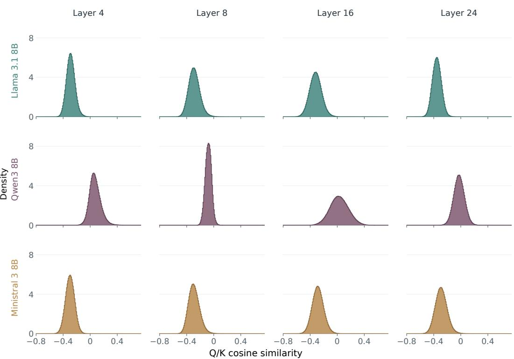  
Figure 6: Query–key cosine similarities across models and attention layers. Rows show Llama 3.1 8B, Qwen3 8B, Ministral 3 8B; columns show layers 4, 8, 16, 24. All panels use the same prepared LongBench v2 example. Each panel uses an input of 8,192 tokens and compares the final 256 queries from query head 0 against 7,935 earlier-context keys from the corresponding KV head 0. The initial key is excluded. Cosines are computed after model normalization and RoPE.

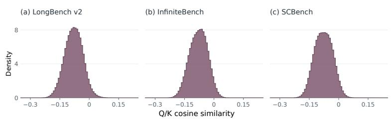  
Figure 7: Query–key cosine similarities across inputs. The plot uses Qwen3 8B at layer 8 on (a) LongBench v2, (b) InfiniteBench, (c) SCBench. Each panel uses an input of 8,192 tokens and compares the final 256 queries from query head 0 against 7,935 earlier-context keys from the corresponding KV head 0. The initial key (attention sink) is excluded. Cosines are computed after model normalization and RoPE.

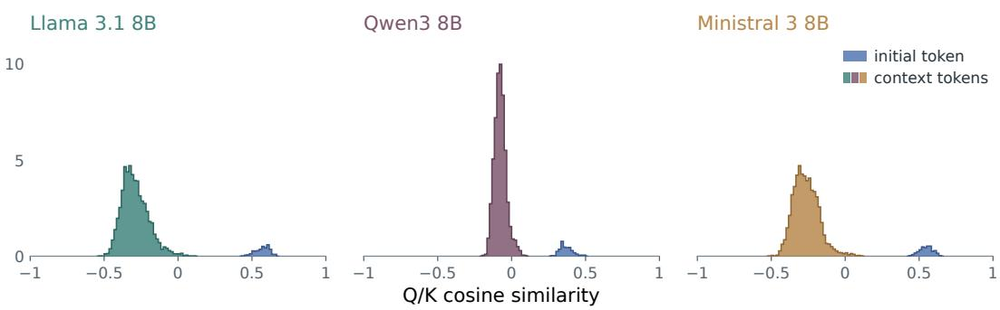  
Figure 8: Query–key cosine similarities with initial token (attention sink) Qwen3 8B at layer 8 on LongBench v2 example input of 8,192 tokens and compares the final 256 queries from query head 0 against a sample of 16 earlier-context keys from the corresponding KV head 0 and the initial key (attention sink). Cosines are computed after model normalization and RoPE.

## F.2 KEY/QUERY NORMS

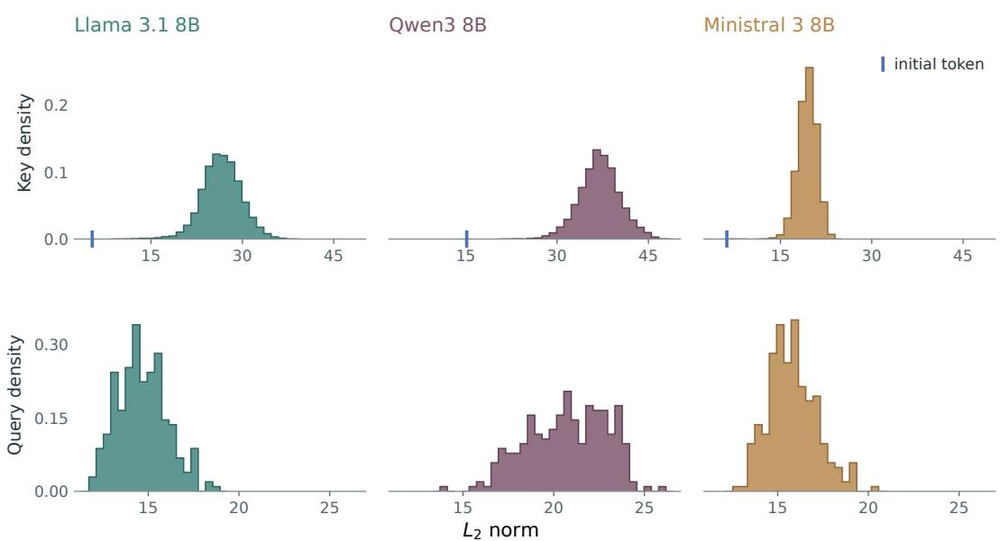  
Figure 9: Key and query magnitudes across models. Layer 8 on the LongBench v2 input (8,192 tokens). Columns show Llama 3.1 8B, Qwen3 8B, Ministral 3 8B. The top row uses 7,935 keys per model: all eligible earlier-context keys. Blue baseline marks indicate the initial key (attention sink) norm in each model. The bottom row uses the final 256 queries.