# Active Learning of Conditional Generative Models via the Transport Neural Tangent Kernel

Jayoung Ryu1 Kyunghyun Cho1 Romain Lopez1,2

1Department of Computer Science, Courant Institute School of Mathematics, Computing, and Data Science, New York University 2Department of Biology, New York University

{jayoung.ryu, kyunghyun.cho, romain.lopez}@nyu.edu

## Abstract

Many high-throughput scientific experiments produce distributional outputs, requiring conditional generative models to interpret the data, and to predict outcomes at new inputs. Acquiring experimental data at new conditions (e.g., for a new antigen or a new cell type) is often expensive, motivating the need for automated experimental design methods. However, existing active learning frameworks are limited as they assume scalar or vector-valued outputs. We first show that the Wasserstein test risk of a conditional generative task decomposes into a mean term and a shape term, demonstrating why mean-based active learning is blind to distributional shape. To capture both, we propose the transport Neural Tangent Kernel (tNTK), a tractable kernel that measures how sensitive a generative model’s predicted distribution is with respect to its parameters. The tNTK recovers the standard NTK in the deterministic limit and upper-bounds the posterior Fréchet variance of the prediction under small parameter perturbations. It admits a closedform expression for affine Gaussian transport and tractable Monte Carlo estimators otherwise. Treating the tNTK as the covariance function of a Gaussian process, we greedily select inputs that minimize the total GP posterior variance across the pool, yielding a distribution-aware active learning strategy. We evaluate this strategy across four classes of conditional generative models, including conditional flow matching and conditional Monge gap, on synthetic distributions, intent-labeled sentences, and single-cell perturbation responses. In these experiments, the tNTK outperforms the baseline NTK computed from the conditional mean, demonstrating the value of distribution-aware active learning for generative-modeling tasks.

## 1 Introduction

Decades after a logic-based “robot scientist” first autonomously characterized gene functions in yeast metabolism [1, 2], machine learning has become a standard tool for the automated design of scientific experiments. These approaches have demonstrated impact across a wide range of scientific fields, including inorganic materials synthesis [3], drug discovery [4–7], and single-cell perturbation biology [8–12]. They have also been applied to large-scale image classification [13] and to the alignment of large language models [14, 15].

We consider the setup of pool-based active learning (AL) [16, 17], in which the acquisition strategy iteratively assembles a training set $\mathcal { X } _ { \mathrm { t r a i n } }$ from a set of candidate inputs $\mathcal { X } _ { \mathrm { p o o l } } \subseteq \mathcal { X }$ . For each selected input $x \in \mathcal { X } _ { \mathrm { t r a i n } }$ , the corresponding output o ∈ O is acquired using the experimental system. The goal of an AL strategy is to assemble a training set with a fixed number of data points so that a surrogate predictive model $f ( x )$ will generalize best to unseen inputs $( \mathrm { i . e . }$ , a test set) — a problem extensively studied for classification $[ 1 3 , 1 8 - 2 2 ] \left( { \mathcal { O } } = \left\{ 1 , . . . , K \right\} \right)$ ) and regression [23–26] (single- or multi-task, $\mathcal { O } \subseteq \mathbb { R } ^ { d } )$

In many scientific applications, however, the experimental output is a probability distribution: $\mathcal { O } =$ $\mathcal { P } ( \mathcal { V } )$ for some underlying sample space $\mathcal { V } \subseteq \mathbb { R } ^ { \hat { d } }$ , observed through a finite set of samples for each input. For example, chemical or genetic perturbation assays measure genomics data for hundreds of cells per perturbation, profiling entire distributions over cell states [8]. Regulatory genomics assays capture hundreds of thousands of hypersensitive DNA sequences in the genome for each cell type [27]. In both cases, the output mean $\mathbb { E } [ y \mid x ]$ is a poor substitute for the entire output $p ( y \mid x )$ as the distribution itself is of scientific interest. For this reason, existing AL paradigms are not suited to distributional outputs because they have no other option but to reduce the output to a pre-specified scalar functional (e.g., mean or an event probability [28, 29]).

Conditional generative models such as conditional optimal transport [30, 31], flow matching [32], and diffusion models [33] are compelling options for predictive modeling of distributions. They demonstrated impressive performance for image and text generation [34, 35], as well as perturbation effect prediction [31, 36–39] and conditional DNA sequence generation [40]. Despite their adoption in these domains, no existing acquisition strategies directly leverage these generative models within an active learning framework for experimental design.

To address this gap, we develop a framework for active learning of conditional generative models that operates natively on distributional outputs. Specifically, we introduce the transport Neural Tangent Kernel (tNTK), a tractable kernel that measures the sensitivity of the predicted distribution $p _ { \theta } ( y \mid x )$ to perturbations of the model parameters θ. The tNTK admits two complementary interpretations: it upper-bounds the Fréchet posterior variance under a Laplace approximation to the parameter posterior, and it controls the metric derivative of the predicted distribution on the Wasserstein manifold. We characterize the geometric gap and show the bound is tight in dimension one. To propose the first distribution-aware active learning strategy, we treat the tNTK as a Gaussian Process (GP) covariance function, and greedily select inputs that minimize the total posterior variance across the pool, following existing kernel-based active learning frameworks [25, 26].

After introducing the necessary background (Section 2), we decompose the risk of a conditional generative prediction task into a mean and a shape term, and illustrate on a tractable 1D example that mean-based acquisition is suboptimal (Section 3). We then introduce the transport Neural Tangent Kernel (tNTK) as well as our distribution-aware AL strategy (Section 4). Finally, we conduct an empirical evaluation across four classes of conditional generative models — affine Gaussian transport, conditional quantile prediction, conditional flow matching, and conditional Monge gap — on simulated data where ground truth is available, as well as on real-world data from intent-labeled sentences and single-cell perturbation datasets (Section 5). Across 26 out of 30 settings, the tNTK outperforms baselines that operate on the conditional mean alone.

## 2 Background

## 2.1 Conditional Generative Models (CGMs)

We consider training data $\mathcal { D } = \{ ( x _ { i } , \{ y _ { i , j } \} _ { j = 1 } ^ { n _ { i } } ) \} _ { i = 1 } ^ { N }$ , where each input $x _ { i } \in \mathcal { X } _ { \operatorname { t r a i n } }$ is paired with a set of $n _ { i }$ independent and identically distributed samples $\{ y _ { i , j } \} _ { j = 1 } ^ { n _ { i } }$ drawn from an unknown conditional distribution $\mu ( x _ { i } ) \in \mathcal { P } ( \mathcal { V } )$ . Transport-based CGMs induce output distributions by pushing forward a fixed base measure $\nu \in \mathcal { P } ( \mathcal { V } )$ through a parametric map $T _ { \theta } ( x ) : \mathcal { V } \xrightarrow { } \mathcal { V }$ :

$$
\mu _ { \boldsymbol { \theta } } ( x ) = T _ { \boldsymbol { \theta } } ( x ) \# \nu ,\tag{1}
$$

where $\theta \in \mathbb { R } ^ { p }$ denotes the model parameters. Concretely, a sample from $\mu _ { \theta } ( x )$ is obtained by drawing $y \sim \nu$ and returning $T _ { \theta } ( x ) ( y )$ . This formulation covers various common families of conditional generative models, two of which we now briefly detail.

Conditional optimal transport Conditional optimal transport frameworks learn a parametric map $T _ { \theta } ( x )$ that approximates the optimal transport map from ν to $\mu ( x )$ across all input points $x \in { \mathcal { X } } _ { \operatorname { t r a i n } } .$ CondOT [30] parameterizes $\bar { T } _ { \theta } ( x ) ( y ) = \bar { \nabla } _ { y } \Phi _ { \theta } ( \bar { x } , y )$ where $\Phi _ { \theta }$ is a partially input convex neural network (PICNN) [41], which ensures that $\bar { T _ { \theta } ( x ) }$ is a valid Monge map. Conditional Monge gap [31] drops the PICNN constraint and instead trains an unconstrained neural network with two terms: a distributional loss between $T _ { \theta } ( x ) \# \nu$ and $\mu ( x )$ , and the Monge gap regularizer [42], which penalizes the suboptimality of $T _ { \theta } ( x )$ as a transport map between ν and its own pushforward. This approach improves numerical stability and empirical performance over CondOT.

Conditional flow matching (CFM) CFM $[ 3 2 ] ^ { 1 }$ learns a parametric, time- and condition-dependent vector field $v _ { \theta } ^ { t , x } : \mathcal { V } \xrightarrow { } \mathcal { V }$ by regressing on a target field $u ^ { t , x }$ constructed from a chosen conditional probability path interpolating between ν at $t = 0$ and $\mu ( x )$ at $t = 1$ . The flow $\phi ^ { t , x } ( y )$ is defined as the solution of the following ordinary differential equation:

$$
\frac { d } { d t } \phi ^ { t , x } ( y ) = v _ { \theta } ^ { t , x } ( \phi ^ { t , x } ( y ) ) , \quad \phi ^ { 0 , x } ( y ) = y .\tag{2}
$$

At inference time, samples from $\mu _ { \theta } ( x ) = ( \phi ^ { 1 , x } )$ #ν are obtained by sampling $y \sim \nu$ and integrating the ODE from $t = 0 \mathrm { ~ t o ~ } t = 1$ with initial condition $\phi ^ { 0 , x } ( y ) = y .$ . Although CFM specifically applies to the case where ν is a noise distribution, variants such as OT-CFM [43] extend CFM to cases where ν is a data distribution using optimal transport couplings.

## 2.2 Active Learning for Regression

In pool-based AL, the acquisition strategy has access to a candidate set $\mathcal { X } _ { \mathrm { p o o l } } \subseteq \mathcal { X }$ of unlabeled inputs and selects a subset $\mathcal S \subseteq \bar { \mathcal X } _ { \mathrm { p o o l } }$ for which outputs are measured with the experimental system. A key heuristic in the field is to select the input that minimizes the total posterior variance of the surrogate model $f _ { \theta }$ on the pool,

$$
x ^ { * } = \underset { x ^ { \prime } \in \mathcal { X } _ { \mathrm { p o o l } } } { \arg \operatorname* { m i n } } \sum _ { x \in \mathcal { X } _ { \mathrm { p o o l } } } \mathrm { V a r } \big [ f _ { \theta } ( x ) \mid \mathcal { X } _ { \mathrm { t r a i n } } \cup \{ x ^ { \prime } \} \big ] .\tag{3}
$$

Such candidates are often the most informative for generalization to a test set [26]. Active learning strategies for regression are further discussed in [25].

For neural network-based models, predictive uncertainty is intractable in general and must be approximated. Common approaches include approximate Bayesian inference over the model parameters [44], Monte-Carlo dropout [45], and kernel-based approximations derived from the finite-width Neural Tangent Kernel (NTK) [46, 47]:

$$
\begin{array} { r } { k _ { \theta } ^ { \mathrm { N T K } } ( x , x ^ { \prime } ) = \nabla _ { \theta } f ( x ) ^ { \top } \nabla _ { \theta } f ( x ^ { \prime } ) . } \end{array}\tag{4}
$$

The predictive distribution f after linearization around the trained parameters θ is well approximated by a Gaussian process with covariance $k _ { \theta } ^ { \mathrm { N T K } }$ . Informative candidates can then be selected using standard kernel-based acquisition strategies [25], such as the total-posterior-variance minimization described above. All of these methods assume that $f ( x )$ is a scalar or low-dimensional prediction, and do not extend to settings where the model’s output is a probability distribution.

## 3 Distributional Risk Decomposition

We illustrate the need for distribution-aware AL methods by analyzing the test risk of conditional generative models under the 2-Wasserstein loss. These derivations suggest that existing AL methods based on test risk minimization for conditional mean prediction are suboptimal. We then present a fully-tractable one-dimensional example alongside a numerical experiment.

## 3.1 Mean-shape decomposition of distributional risk

For the following theoretical derivations, we assume that distribution $\mu ( x _ { i } )$ (or equivalently, infinite samples from it) is observed for each input $x _ { i }$ . This allows us to define our training data as $\mathcal { D } =$ $\{ ( x _ { i } , \mu ( x _ { i } ) ) \} _ { i = 1 } ^ { N }$ . We also assume the availability of a posterior distribution $\theta \mid \mathcal { D }$ over the parameters

θ of a CGM that reflects uncertainty in the predicted distribution $\mu _ { \theta } ( x ) = T _ { \theta } ( x ) _ { \# } \nu$ . For a test point $x \in \mathcal { X }$ , the risk under the squared Wasserstein loss is defined as:

$$
\begin{array} { r } { \mathcal { R } ( \boldsymbol { x } , \mathcal { D } ) = \mathbb { E } _ { \boldsymbol { \theta } | \mathcal { D } } \big [ W _ { 2 } ^ { 2 } ( \mu _ { \boldsymbol { \theta } } ( \boldsymbol { x } ) , \mu ( \boldsymbol { x } ) ) \big ] , } \end{array}\tag{5}
$$

and admits the following decomposition:

Proposition 1 (Mean-shape decomposition of risk). The Wasserstein risk defined in Equation (5) decomposes as

$$
\mathcal { R } ( x , \mathcal { D } ) = \underbrace { \mathbb { E } _ { \theta | \mathcal { D } } \big [ \| m _ { \theta } ( x ) - m ( x ) \| ^ { 2 } \big ] } _ { \mathcal { R } _ { m e a n } ( x , \mathcal { D } ) } + \underbrace { \mathbb { E } _ { \theta | \mathcal { D } } \big [ W _ { 2 } ^ { 2 } ( \mu _ { \theta } ^ { c } ( x ) , \mu ^ { c } ( x ) ) \big ] } _ { \mathcal { R } _ { s h a p e } ( x , \mathcal { D } ) } ,\tag{6}
$$

where $\begin{array} { r } { m _ { \rho } = \int y d \rho ( y ) } \end{array}$ denotes the mean of ${ \bf \dot { \rho } } _ { \rho } ,$ and $\rho ^ { c }$ is obtained by centering ρ for any $\rho \in \mathcal { P } _ { 2 } ( \mathcal { V } )$

The proof is given in Appendix A.1. Classical regression-based active learning traditionally aims at (approximately) minimizing the mean-risk $\mathbb { E } _ { \boldsymbol { x } \sim p _ { \mathrm { t e s t } } } \mathcal { R } _ { \mathrm { m e a n } } ( \boldsymbol { x } , \mathcal { D } )$ [23]. Because they do not consider the additional shape-related term, these methods may perform poorly whenever shape matters.

## 3.2 One-dimensional example

The one-dimensional case is a remarkable instance since Wasserstein distances admit closed-form expressions. Let $F ^ { - 1 } ( x ; \tau )$ (resp. $F _ { \theta } ^ { - 1 } ( x ; \tau ) )$ denote the τ -th quantile of distribution $\mu ( x )$ (resp. $\mu _ { \theta } ( x ) )$ for $\tau \in [ 0 , 1 ]$ . We have the following identities:

Lemma 1 (1D posterior risk). Assume the model is unbiased at the mean and every quantile level, $i . e . , \mathbb { E } _ { \theta | \mathcal { D } } [ m _ { \theta } ( x ) ] = m ( x )$ and $\mathbb { E } _ { \theta | \mathcal { D } } [ F _ { \theta } ^ { - 1 } ( x ; \tau ) ] = F ^ { - 1 } ( x ; \tau )$ for all $x , \tau$ . Then

$$
\mathcal { R } _ { m e a n } ( x , \mathcal { D } ) = \mathrm { V a r } _ { \theta | \mathcal { D } } [ m _ { \theta } ( x ) ] , \qquad \mathcal { R } _ { s h a p e } ( x , \mathcal { D } ) = \int _ { 0 } ^ { 1 } \mathrm { V a r } _ { \theta | \mathcal { D } } [ g _ { \theta } ( x ; \tau ) ] d \tau ,\tag{7}
$$

where $g _ { \theta } ( x ; \tau ) = F _ { \theta } ^ { - 1 } ( x ; \tau ) - m _ { \theta } ( x )$ denotes the centered quantilefunction of $\dot { \mu } _ { \boldsymbol { \theta } } ( \boldsymbol { x } )$

The proof appears in Appendix A.2. The shape-related term becomes tractable as it reduces to an integral of marginal posterior variances over quantile levels $\tau \in [ 0 , 1 ]$

We numerically illustrate this on simulated data (details in Appendix D.1). Briefly, $\mu ( x )$ is a twocomponent Gaussian mixture model with mean and variance depending on x ∈ [0, 1] (Figure 1A). $m ( x )$ and $g ( x ; \tau )$ are modeled for a discrete grid of τ levels using independent Gaussian processes. This approach provides direct access to the posterior variances in (7). We run AL campaigns to compare three acquisition strategies: Wasserstein AL, which minimizes the expected total risk, mean AL, which minimizes only its mean component,

$$
\boldsymbol { x } _ { \mathrm { W } } ^ { * } = \underset { \boldsymbol { x } ^ { \prime } \in \mathcal { X } _ { \mathrm { p o o l } } } { \arg \operatorname* { m i n } } \mathbb { E } _ { \boldsymbol { x } \sim p _ { \mathrm { t e s t } } } \mathcal { R } ( \boldsymbol { x } , \mathcal { D } _ { \mathrm { t r a i n } } \cup \{ \boldsymbol { x } ^ { \prime } \} ) ,\tag{8}
$$

$$
x _ { \mathrm { m e a n } } ^ { * } = \underset { x ^ { \prime } \in \mathcal { X } _ { \mathrm { p o o l } } } { \arg \operatorname* { m i n } } \mathbb { E } _ { x \sim p _ { \mathrm { t e s t } } } \mathcal { R } _ { \mathrm { m e a n } } ( x , \mathcal { D } _ { \mathrm { t r a i n } } \cup \{ x ^ { \prime } \} ) ,\tag{9}
$$

and random sampling.

Wasserstein AL outperforms Mean AL by over an order of magnitude (Figure 1B). Mean AL still improves over random in terms of mean error (Figure 1C) but plateaus on shape error (Figure 1D). These results illustrate that ignoring distribution shape for active learning is suboptimal.

## 4 Transport Kernels for Active Learning of Conditional Distributions

For most applications of interest, neither the test risk nor the shape term from (6) is tractable. Most fundamentally, the ground-truth distribution $\mu ( x )$ is unknown at unseen inputs $\mathcal { X } _ { \mathrm { p o o l } }$ . Even if it were known, the 2-Wasserstein distance remains intractable for neural transport maps. Those represent significant challenges for distribution-aware active learning.

We circumvent these issues by considering the posterior Fréchet variance as a measure of uncertainty in a generative model’s predictions $\mu _ { \theta } ( x )$ . We bound this quantity by linearizing the transport map $T _ { \theta } ( x )$ around its parameters $\theta ,$ which yields the transport Neural Tangent Kernel (tNTK). We briefly discuss properties of the tNTK, how to estimate it efficiently, and then use it to design a distribution-aware active learning strategy.

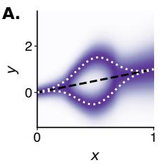

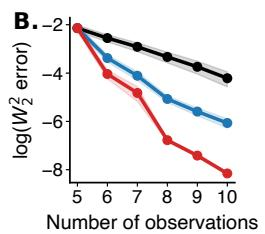

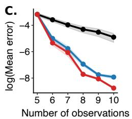

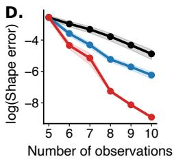  
Figure 1: Synthetic conditional density estimation. (A) Ground truth conditional density $\mu ( x ) . \left( \mathbf { B } { \mathrm { - D } } \right)$ Test error after active learning as a function of training set size: total risk (B), mean prediction error (C), and shape error (D). Results averaged over 50 random initializations; shaded bands show ±2 standard errors.

## 4.1 Quantifying model uncertainty via parameter sensitivity

We consider the posterior Fréchet variance,

$$
V _ { F } ( x ) : = \mathrm { V a r } _ { W _ { 2 } } \big [ \mu _ { \theta } ( x ) \mid \mathcal { D } \big ] = \operatorname* { i n f } _ { \rho \in \mathcal { P } _ { 2 } ( \mathcal { y } ) } \mathbb { E } _ { \theta \mid \mathcal { D } } \big [ W _ { 2 } ^ { 2 } \big ( \mu _ { \theta } ( x ) , \rho \big ) \big ] ,\tag{10}
$$

defined as the minimum mean squared Wasserstein distance from a fixed reference measure to a posterior draw $\mu _ { \theta } ( x )$ [48]. The minimizer is the Wasserstein barycenter ${ \bar { \mu } } _ { \theta } ( x )$ of the posterior law of $\mu _ { \theta } ( x ) \ [ 4 9 ]$ . The posterior Fréchet variance $V _ { F } ( x )$ has two properties that make it especially relevant for active learning. First, it lower bounds the risk $V _ { F } ( \bar { x } ) \stackrel { - } { \leq } \mathcal { R } ( x , \mathcal { D } )$ , with equality when the Wasserstein barycenter equals the data-generating distribution $\bar { \mu _ { \theta } } ( x ) = \mu ( x )$ . Second, in the deterministic limit, where $\mu _ { \theta } ( x )$ collapses to a Dirac mass at $f _ { \theta } ( x ) , \dot { V _ { F } ( x ) }$ recovers the standard posterior variance $\operatorname { V a r } _ { \theta \mid \mathcal { D } } [ f _ { \theta } ( \dot { x } ) ]$

Although $V _ { F } ( x )$ is intractable in general, since the Wasserstein barycenter of the posterior law of $\mu _ { \theta } ( x )$ has no closed form, we show that linearizing the transport map yields a tractable upper bound.

Theorem 1 (Upper bound on the posterior Fréchet variance). Let $\theta \mid \mathcal { D } \sim \mathcal { N } ( \hat { \theta } , \Sigma )$ , with $\Sigma \in \mathbb { R } ^ { p \times p }$ positive definite and $\| \Sigma \| _ { \mathrm { o p } } < 1 $ . Assume thatfor every $x \in \mathcal { X }$ andfor ν-almost every $y \in \mathcal { D }$ , the map $\theta \mapsto T _ { \theta } ( x ) ( y ) \ i s \ C ^ { 2 } ( \mathbb { R } ^ { p } )$ , and that the Jacobian $D _ { \theta } T _ { \hat { \theta } } ( x ) ( \cdot )$ and the pointwise supremum of the operator norm of the Hessian, $\begin{array} { r } { \operatorname* { s u p } _ { \theta } \| D _ { \theta } ^ { 2 } T _ { \theta } ( x ) ( \cdot ) \| _ { \mathrm { o p } } , } \end{array}$ , are in $L ^ { 2 } ( \nu )$ . Then, there exists $C ( x )$ such that:

$$
V _ { F } ( x ) \leq \mathrm { T r } \big ( G _ { \hat { \theta } } ( x ) \Sigma \big ) + C ( x ) \| \Sigma \| _ { \mathrm { o p } } ^ { 3 / 2 } ,\tag{11}
$$

where the $p \times p$ parameter sensitivity matrix at input x is

$$
G _ { \hat { \theta } } ( x ) = \int D _ { \theta } T _ { \hat { \theta } } ( x ) ( y ) ^ { \top } D _ { \theta } T _ { \hat { \theta } } ( x ) ( y ) d \nu ( y ) .\tag{12}
$$

Inequality (11) is tight to leading order when dim $( \mathcal { V } ) = 1$ and $T _ { \theta } ( x )$ is monotone in y.

The proof is given in Appendix A.3. Theorem 1 identifies that under a Laplace approximation [50, 51] to the parameter posterior, $\operatorname { T r } \bigl ( G _ { \hat { \theta } } ( x ) \Sigma \bigr )$ plays the role of a tractable measure of the predictive variance in the generative model’s predictions, in the limit of small variance. This is important given that exact computations of the Wasserstein metric tensor are otherwise intractable for neural transport maps [52, 53].

The tightness of the bound from (11) is an important consideration that we investigate in several ways. First, we give a geometric interpretation of $G _ { \theta } ( x )$ by upper-bounding the Wasserstein metric derivative of trajectories of $\mu _ { \theta } ( x )$ for small deviations around θ and characterize when the bound is tight (Appendix B). Second, for affine transport of Gaussian distributions (Appendix E.1), we find numerically that the bound is exact for $d = 1$ and overestimates the true variance by at most 70% for $d = { \mathrm { 5 0 } } , { \mathrm { i . e . } }$ , by less than a factor of two. Finally, our experiments on active learning benchmarks (Section 5) suggest that the parameter sensitivity matrix $G _ { \hat { \theta } } ( x )$ is informative for active learning across multiple model classes.

## 4.2 Transport Neural Tangent Kernel

The parameter sensitivity matrix $G _ { \theta } ( x )$ extends naturally to a pairwise object by considering two distinct inputs x and $x ^ { \prime }$ . Specifically, we define the transport Neural Tangent Kernel (tNTK) as:

$$
k _ { \theta } ( x , x ^ { \prime } ) = \int { \mathrm { T r } } \left[ D _ { \theta } T _ { \theta } ( x ) ( y ) ^ { \top } D _ { \theta } T _ { \theta } ( x ^ { \prime } ) ( y ) \right] d \nu ( y ) .\tag{13}
$$

This kernel measures the alignment between the parameter sensitivities of the transport maps at x and $x ^ { \prime }$ , integrated over the base measure ν. The diagonal of the kernel recovers the trace of the parameter sensitivity matrix, $k _ { \theta } ( x , x ) = \mathrm { T r } [ G _ { \theta } ( x ) ]$ . Under an isotropic posterior $\Sigma = \sigma ^ { 2 } I -$ the standard choice in kernel-based active learning [25] – Theorem 1 implies that

$$
V _ { F } ( x ) \leq \sigma ^ { 2 } k _ { \theta } ( x , x ) + O ( \sigma ^ { 3 } ) .\tag{14}
$$

This identifies the kernel diagonal as a tractable scalar measure of predictive uncertainty. The tNTK is positive semi-definite (Appendix A.4). When ν degenerates to a Dirac measure, $\mu _ { \theta } ( x )$ collapses to a single point and the tNTK reduces to the finite-width NTK [46], justifying the name.

Kernel Computation and Estimation The tNTK may be computed over all parameters θ or restricted to the last layer parameters. When the transport map takes the form $T _ { \theta } ( x ) \dot { ( } y ) = W ^ { \top } h _ { \theta } ( x , y )$ with penultimate features $h _ { \theta } ( x , y ) \in \mathbb { R } ^ { m }$ and a linear last layer $W \in \mathbb { R } ^ { m \times d }$ , the tNTK has a simple expression:

$$
k _ { \theta } ^ { \mathrm { I l } } ( x , x ^ { \prime } ) = d \int h _ { \theta } ( x , y ) ^ { \top } h _ { \theta } ( x ^ { \prime } , y ) d \nu ( y ) .\tag{15}
$$

The proof appears in Appendix $_ { \mathrm { A . 5 . } }$ . (15) involves the inner product of penultimate features at x and $\bar { x } ^ { \prime }$ integrated over the base measure ν and therefore represents the distributional analog of the last-layer NTK [25]. In practice, we approximate the integral with Monte Carlo samples from $\nu ,$ requiring only forward passes through the network $h _ { \theta }$

## 4.3 Kernel Decomposition for Affine Gaussian Transport Maps

We show that when $T _ { \theta } ( x )$ is an affine transport map, the tNTK admits a clean decomposition into mean- and shape-sensitivity terms.

Lemma 2. Let us assume that $T _ { \theta } ( x )$ is an affine map: $T _ { \theta } ( x ) ( y ) = b _ { \theta } ( x ) + M _ { \theta } ( x ) y$ and that the base measure ν is centered and isotropic $( i . e . , \mathbb { E } _ { y \sim \nu } [ y ] = 0$ and $\mathbb { E } _ { y \sim \nu } \big [ y y ^ { \top } \big ] = I )$ . Then

$$
k _ { \theta } ( x , x ^ { \prime } ) = \mathrm { T r } \left[ D _ { \theta } b _ { \theta } ( x ) ^ { \top } D _ { \theta } b _ { \theta } ( x ^ { \prime } ) \right] + \sum _ { j = 1 } ^ { d } \mathrm { T r } \left[ D _ { \theta } { \cal M } _ { \theta } ^ { j } ( x ) ^ { \top } D _ { \theta } { \cal M } _ { \theta } ^ { j } ( x ^ { \prime } ) \right] ,\tag{16}
$$

where $M _ { \theta } ^ { j } ( x )$ denotes the j-th column of $M _ { \theta } ( x )$

The proof appears in Appendix A.6. This decomposition mirrors the one from Proposition 1 at the kernel level: the first term captures sensitivity of the predicted mean, the second captures sensitivity of the predicted shape. Additionally, we demonstrate that when $M _ { \theta } ( x )$ is further restricted to be lowertriangular $( \mathrm { e . g . }$ , via Cholesky decomposition), for any perturbation $h \in \mathbb { R } ^ { p } , h ^ { \intercal } G _ { \theta } ( x ) ^ { \intercal }$ h coincides with the squared metric derivative at 0 of the curve $t \mapsto \mu _ { \theta + t h } ( x )$ under the Knothe–Rosenblatt (KR) transport metric (Appendix C). This suggests that in the setting of linear maps, the parameter sensitivity matrix $G _ { \theta } ( x )$ effectively captures shape variations.

## 4.4 Active Learning Methods via the Transport NTK

Let $\mathcal { X } _ { \mathrm { t r a i n } }$ denote the conditions for which we have observed output samples, and $\mathcal { X } _ { \mathrm { p o o l } }$ the set of inputs for which experimental data is not available. Treating the tNTK as the covariance function of a Gaussian process, the GP posterior variance at a test point ${ \bf { \bar { \Phi } } } _ { x ^ { \prime } }$ after conditioning on a set $\mathcal { X } _ { S } \subseteq \mathcal { X }$ is:

$$
\sigma _ { \theta } ^ { 2 } ( x ^ { \prime } \mid \mathcal { X } _ { S } ) = k _ { \theta } ( x ^ { \prime } , x ^ { \prime } ) - k _ { \theta } ( \mathcal { X } _ { S } , x ^ { \prime } ) ^ { \top } \left( k _ { \theta } ( \mathcal { X } _ { S } , \mathcal { X } _ { S } ) + \lambda I \right) ^ { - 1 } k _ { \theta } ( \mathcal { X } _ { S } , x ^ { \prime } ) ,\tag{17}
$$

where $\lambda > 0$ is a regularization parameter. We greedily select the next candidate as the one that minimizes the average posterior variance over the whole dataset:

$$
x ^ { * } = \underset { x \in \mathcal { X } _ { \mathrm { p o o l } } } { \arg \operatorname* { m i n } } ~ \frac { 1 } { \left. \mathcal { X } _ { \mathrm { p o o l } } \right. + \left. \mathcal { X } _ { \mathrm { t r a i n } } \right. } \sum _ { x ^ { \prime } \in \mathcal { X } _ { \mathrm { p o o l } } \cup \mathcal { X } _ { \mathrm { t r a i n } } } \sigma _ { \theta } ^ { 2 } \big ( x ^ { \prime } \mid \mathcal { X } _ { \mathrm { t r a i n } } \cup \left\{ x \right\} \big ) .\tag{18}
$$

We apply this rule sequentially to design an entire batch (Algorithm 1).

Algorithm 1 Active learning with the transport neural tangent kernel   
Require: Pool of conditions $x ,$ batch size $B ,$ number of rounds T, regularization $\lambda > 0$   
1: Initialize $\mathcal { X } _ { \mathrm { t r a i n } } \subset \mathcal { X }$ with $\left| \mathcal { X } _ { \mathrm { t r a i n } } \right| = B _ { 0 } ;$ set $\mathcal { X } _ { \mathrm { p o o l } } = \mathcal { X } \setminus \mathcal { X } _ { \mathrm { t r a i n } }$   
2: for $t = 1 , \dots , T$ do   
3: Fit generative model on $\chi _ { \mathrm { t r a i n } }$ to obtain parameters $\theta _ { t }$   
4: $B \gets \emptyset$ ▷ current batch   
5: $\mathcal { X } _ { C } \gets \mathcal { X } _ { \mathrm { t r a i n } }$ ▷ conditioning set   
6: for $b = 1 , 2 , \dots , B$ do   
7: $x ^ { \ast } \gets$ arg min $\sum \sigma _ { \theta _ { t } } ^ { 2 } ( x ^ { \prime } \mid \mathcal { X } _ { \mathcal { C } } \cup \{ x \} )$ ▷ select point   
$x \in \bar { \mathcal { X } } _ { \mathrm { p o o l } } \setminus B \enspace \underset { x ^ { \prime } \in \mathcal { X } } { \iff }$   
8: $B  B \cup \{ x ^ { * } \}$   
9: $\mathcal { X } _ { \mathcal { C } }  \mathcal { X } _ { \mathcal { C } } \cup \{ \stackrel { \cdot } { x } ^ { \ast } \}$   
10: $\chi _ { \mathrm { t r a i n } }  \chi _ { \mathrm { t r a i n } } \cup B$ ▷ update training set   
11: $\chi _ { \mathrm { p o o l } }  \chi _ { \mathrm { p o o l } } \setminus \mathcal { B }$ ▷ update pool   
12: return Final model parameters $\theta _ { T }$

## 5 Experiments

We investigate the empirical performance of our active learning strategy based on the tNTK, following Algorithm 1, across four conditional generative modeling tasks. We consider as baseline the selection rule in (18) applied to the NTK computed on a neural network fitting the mean of the distribution $( ^ { 6 6 } \mathrm { N T K } ^ { 3 7 } )$ and a random sampling baseline (see Appendix D.2 for more details). The NTK baseline matches BAIT [26] as defined in Holzmüller et al. [25], and is among the best active learning methods for regression tasks in Holzmüller et al. [25]. Unless mentioned otherwise, we use the Monte Carlo estimate of the last layer tNTK for all experiments with finite data (using M = 4, 096 samples). Full experimental details can be found in Appendix D.

## 5.1 Affine transport of 2D Gaussian distributions

We first investigate the active learning performance of the kernel when $G _ { \theta } ( x )$ can be computed in closed form (Lemma 2). We consider 2-dimensional isotropic Gaussian $y \sim \mathcal { N } ( 0 , I _ { 2 } )$ and conditional transport maps of the form

$$
T _ { \theta } ( x ) ( y ) = b _ { \theta } ( x ) + L _ { \theta } ( x ) y ,\tag{19}
$$

where $b _ { \theta } ( x ) \in \mathbb { R } ^ { 2 }$ is the predicted mean and $L _ { \theta } ( x ) \in \mathbb R ^ { 2 \times 2 }$ is a lower-triangular matrix with strictly positive diagonal entries, so that $\Sigma _ { \theta } ( x ) = L _ { \theta } ( \dot { x } ) \dot { L } _ { \theta } ( x ) ^ { \top }$ is a valid covariance matrix. $b _ { \theta } ( x )$ and $L _ { \theta } ( x )$ are parameterized by neural networks, and trained against the analytical Gaussian parameters observed for each input x (under an infinite-sample assumption). We generate data so that the input region $x _ { 1 } \approx 0$ has high variation in the mean but nearly constant covariance, with the opposite pattern for the region $x _ { 1 } \approx 1$ (Figure 2A-B). While the mean-based NTK does not improve over random selection, the tNTK achieves a 1.2x lower Wasserstein loss than random by the end of the campaign (Figure 2C). As in the one-dimensional example of Section 3.2, NTK improves over random in mean loss but not in covariance loss (Figure 2D-E). We further show that this result also holds for the affine transport of d-dimensional Gaussian distributions, where the tNTK outperforms NTK up to $d = 5 0$ (Appendix E.2). Model and experimental details appear in Appendix D.3.

A.  
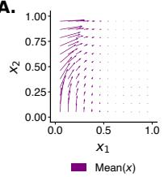

B.  
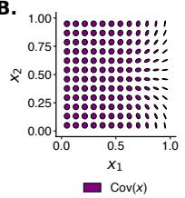

C.  
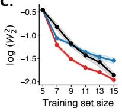

D.  
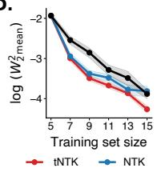

E.  
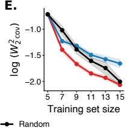  
Figure 2: Results on the synthetic Gaussian 2D dataset. (A) Ground truth conditional mean $\mathbb { E } [ y \mid x ]$ (B) Ground truth conditional covariance $\operatorname { C o v } [ y \mid x ]$ . (C) Test Wasserstein error after active learning as a function of training set size (lower is better). (D-E) Mean (D) and covariance (E) components of the test Wasserstein error. Results are averaged over 30 independent random initializations; shaded bands show standard errors.

Table 1: Change in Wasserstein test risk from iteration 0 (lower is better). For each seed, we average over $T = 5$ iterations and $K = 5$ folds; we then report mean ± standard error across $N = 1 0$ seeds, in units of $1 0 ^ { - 3 }$ . Column headers indicate $B _ { 0 } + { \bar { B } } ,$ , the initial training set size and the number of conditions added per AL round. Best mean per column shown in bold.
<table><tr><td>Dataset</td><td>Strategy</td><td>5 + 1</td><td>5 + 5</td><td>10 + 1</td></tr><tr><td rowspan="5">Gaussian mixture</td><td>Random NTK</td><td> $- 2 9 6 . 1 2 \pm 1 6 . 2 9$ </td><td> $- 6 0 9 . 6 1 \pm 1 7 . 1 0$ </td><td> $- 1 2 1 . 0 2 \pm 1 0 . 9 3$ </td></tr><tr><td></td><td> $- 4 1 6 . 4 3 \pm 1 6 . 1 5$ </td><td> $- 6 8 5 . 1 2 \pm 1 7 . 5 8$ </td><td> $- 1 6 8 . 2 8 \pm 1 1 . 2 3$ </td></tr><tr><td>NTK (mean-var)</td><td> $- 3 6 7 . 9 9 \pm 1 7 . 5 9$ </td><td> $- 6 8 6 . 2 9 \pm 1 7 . 3 9$ </td><td> $- 1 6 2 . 8 5 \pm 1 1 . 0 4$ </td></tr><tr><td>NTK (quartile)</td><td> $- 3 8 8 . 9 3 \pm 1 6 . 4 3$ </td><td> $- 6 8 1 . 2 9 \pm 1 7 . 6 2$ </td><td> $- 1 7 6 . 8 6 \pm 1 0 . 7 2$ </td></tr><tr><td>BALSA-EMD</td><td> $- 3 3 2 . 1 6 \pm 1 6 . 0 6$ </td><td> $- 5 5 2 . 5 2 \pm 1 7 . 0 7$ </td><td> $- 1 3 3 . 5 9 \pm 1 2 . 1 2$ </td></tr><tr><td rowspan="5"></td><td>tNTK</td><td> $\mathbf { - 4 2 9 . 5 2 \pm 1 6 . 3 9 }$ </td><td> $\mathbf { - 6 9 5 . 8 2 \pm 1 7 . 8 9 }$ </td><td> $\mathbf { - 2 0 5 . 0 1 \pm 1 2 . 3 8 }$ </td></tr><tr><td>Random</td><td> $- 8 9 . 0 4 \pm 1 2 . 8 8$ </td><td> $- 2 1 9 . 9 6 \pm 1 4 . 4 3$ </td><td> $- 4 1 . 0 2 \pm 7 . 4 4$ </td></tr><tr><td>NTK</td><td> $- 1 8 5 . 5 5 \pm 1 4 . 6 6$ </td><td> $- 2 5 5 . 6 5 \pm 1 5 . 2 9$ </td><td> $- 8 4 . 5 7 \pm 9 . 7 0$ </td></tr><tr><td>NTK (mean-var)</td><td> $- 1 8 6 . 5 1 \pm 1 5 . 3 1$ </td><td> $- 2 5 8 . 4 8 \pm 1 5 . 5 5$ </td><td> $- 8 6 . 8 8 \pm 9 . 6 9$ </td></tr><tr><td>NTK (quartile) BALSA-EMD</td><td> $- 1 8 2 . 6 3 \pm 1 4 . 9 7$   $- 1 5 5 . 3 7 \pm 1 3 . 6 4$ </td><td> $- 2 5 5 . 0 1 \pm 1 5 . 8 6$   $- 1 9 9 . 1 4 \pm 1 5 . 8 7$ </td><td> $- 8 8 . 3 6 \pm 9 . 6 6$   $- 7 1 . 1 4 \pm 9 . 5 7$ </td></tr><tr><td rowspan="5"></td><td>tNTK</td><td> $\mathbf { - 1 8 9 . 9 4 \pm 1 5 . 2 2 }$ </td><td> $\mathbf { - 2 6 7 . 9 3 \pm 1 5 . 3 6 }$ </td><td> $\mathbf { - 8 9 . 8 4 \pm 1 0 . 0 1 }$ </td></tr><tr><td>Random</td><td> $- 7 9 . 9 0 \pm 1 4 . 5 5$ </td><td> $- 2 8 0 . 7 7 \pm 2 1 . 7 5$ </td><td> $- 7 6 . 5 5 \pm 1 0 . 1 5$ </td></tr><tr><td>NTK</td><td> $- 1 7 8 . 4 4 \pm 1 8 . 9 8$ </td><td> $- 3 6 4 . 1 9 \pm 2 1 . 5 3$ </td><td> $- 1 5 8 . 9 4 \pm 1 0 . 9 7$ </td></tr><tr><td>NTK (mean-var)</td><td> $- 1 7 2 . 4 7 \pm 1 7 . 9 7$ </td><td> $- 3 7 2 . 4 9 \pm 2 2 . 0 6$ </td><td> $- 1 5 9 . 2 4 \pm 1 0 . 3 2$ </td></tr><tr><td>NTK (quartile)</td><td> $- 1 7 3 . 2 1 \pm 1 8 . 5 9$ </td><td> $- 3 7 5 . 4 7 \pm 2 2 . 5 7$ </td><td> $- 1 5 8 . 7 0 \pm 1 1 . 1 4$ </td></tr><tr><td rowspan="4"></td><td>BALSA-EMD</td><td> $- 7 9 . 5 1 \pm 1 4 . 2 3$ </td><td> $- 1 7 8 . 0 0 \pm 1 7 . 9 1$ </td><td> $- 1 2 4 . 1 3 \pm 9 . 3 9$ </td></tr><tr><td>tNTK</td><td> $\mathbf { - 2 2 1 . 1 8 \pm 1 7 . 1 3 }$ </td><td> $\mathbf { - 4 4 2 . 2 5 \pm 2 2 . 3 4 }$ </td><td> $\mathbf { - 2 1 2 . 7 4 \pm 1 1 . 7 3 }$ </td></tr><tr><td></td><td></td><td></td><td></td></tr></table>

## 5.2 Conditional quantile prediction

We next consider the case where dim $( \mathcal { V } ) = 1$ with $T _ { \theta } ( x )$ monotone in y. As shown in Appendix A.3, this yields the quantile representation ${ \mathrm { \dot { \cal T } } } _ { \theta } \dot { ( x ) } = F _ { \theta } ^ { - 1 } ( x ; \cdot ) \mathrm { \dot { \circ } } F _ { \nu }$ , where $F _ { \theta } ^ { - 1 } ( x ; \cdot )$ is the quantile function of $\mu _ { \theta } ( x )$ . In this setting, the bound from Theorem 1 is tight at the leading order, and the tNTK admits the following closed-form expression:

$$
k _ { \theta } ^ { \mathrm { 1 D } } ( x , x ^ { \prime } ) = \int _ { 0 } ^ { 1 } \nabla _ { \theta } F _ { \theta } ^ { - 1 } ( x ; \tau ) ^ { \top } \nabla _ { \theta } F _ { \theta } ^ { - 1 } ( x ^ { \prime } ; \tau ) d \tau .\tag{20}
$$

We discretize τ on a uniform grid and parameterize conditional quantiles $F _ { \theta } ^ { - 1 } ( x ; \tau )$ with non-crossing quantile networks [54]. We evaluate the performance of our method on one simulated and two real datasets. Simulated data are based on three-component Gaussian mixture models whose parameters are functions of the input x. Real data are based on yearly distributions of surface temperature and dew point [55], predicted from the location of the measuring station.

In this experiment, we include as baseline the NTK from multiple networks that were fitted on summary statistics of the data, such as the mean, the mean and the variance (mean-var), as well as all quartiles (quartile) of the distribution. We also report results for Bayesian Active Learning By Distribution Disagreement $( \mathrm { B A L S A } ^ { \mathrm { E M D } } )$ [56].

The tNTK consistently outperforms all baselines across differing numbers of initial conditions $( B _ { 0 } )$ and the number of conditions selected in each iteration (B) (Table 1 and Figure S2). Model and dataset details appear in Appendix D.4.

## 5.3 Conditional Flow Matching

In conditional flow matching, the transport map is the time-1 flow $T _ { \theta } ( x ) ( y ) = \phi ^ { 1 , x } ( y )$ obtained by integrating the ODE from Equation 2. We approximate the total derivative by the integration of

Table 2: Change in Sinkhorn divergence from iteration 0 (lower is better). For each seed, we average over $T = 3$ iterations and $K = 5$ folds; we then report mean ± standard error across $N = 1 0$ seeds, in units of $1 0 ^ { - 3 }$ . Column headers indicate $B _ { 0 } + { \bar { B } } ,$ , the initial training set size and the number of conditions added per AL round. Best mean per column shown in bold.
<table><tr><td>Dataset</td><td>Strategy</td><td> $5 + 1$ </td><td> $5 + 5$ </td><td>10 + 5</td></tr><tr><td rowspan="3">Radial flow</td><td>Random</td><td> $- 1 7 . 7 0 \pm 3 . 9 7$ </td><td> $- 4 0 . 2 4 \pm 8 . 4 2$ </td><td> $- 2 4 . 6 0 \pm 4 . 1 6$ </td></tr><tr><td>NTK</td><td> $- 2 6 . 7 1 \pm 6 . 3 5$ </td><td> $- 4 3 . 0 7 \pm 7 . 6 1$ </td><td> $- 2 4 . 2 4 \pm 4 . 8 6$ </td></tr><tr><td>tNTK</td><td> $\mathbf { - 3 5 . 5 0 \pm 5 . 3 6 }$ </td><td> $\mathbf { - 5 3 . 5 5 \pm 6 . 8 3 }$ </td><td> $\mathbf { - 3 8 . 3 9 \pm 5 . 0 3 }$ </td></tr><tr><td rowspan="3">Van der Pol oscillator</td><td>Random</td><td> $- 1 2 1 . 8 7 \pm 3 1 . 6 6$ </td><td> $- 3 3 6 . 3 3 \pm 3 4 . 1 7$ </td><td> $- 1 7 1 . 3 9 \pm 2 8 . 3 1$ </td></tr><tr><td>NTK</td><td> $- 1 9 6 . 3 6 \pm 3 2 . 5 9$ </td><td> $- 4 0 8 . 1 5 \pm 3 7 . 0 3$ </td><td> $- 2 2 0 . 9 8 \pm 3 3 . 0 8$ </td></tr><tr><td>tNTK</td><td> $\mathbf { - 2 0 0 . 7 3 \pm 3 7 . 1 5 }$ </td><td> $\mathbf { - 4 4 1 . 5 1 \pm 2 4 . 2 5 }$ </td><td> $\mathbf { - 2 5 9 . 9 8 \pm 3 7 . 3 7 }$ </td></tr><tr><td rowspan="3">CLINC 150</td><td>Random</td><td> $- 3 5 0 . 0 7 \pm 9 1 . 5 4$ </td><td> $- 8 8 3 . 2 3 \pm 1 5 5 . 7 4$ </td><td> $- 4 3 6 . 9 8 \pm 1 3 3 . 6 4$ </td></tr><tr><td>NTK</td><td> $- 3 0 6 . 0 1 \pm 1 1 1 . 8 4$ </td><td> $\mathbf { - 8 8 4 . 0 2 \pm 1 6 2 . 8 4 }$ </td><td> $- 4 8 0 . 6 6 \pm 9 6 . 7 5$ </td></tr><tr><td>tNTK</td><td> $\mathbf { - 6 7 2 . 8 5 \pm 1 0 7 . 6 6 }$ </td><td> $- 8 5 2 . 3 1 \pm 1 3 3 . 1 1$ </td><td> $\mathbf { - 5 8 0 . 9 4 \pm 9 3 . 7 6 }$ </td></tr></table>

$D _ { \theta } v _ { \theta } ^ { t , x }$ , and compute the tNTK as

$$
k _ { \theta } ^ { \mathrm { F l o w } } ( x , x ^ { \prime } ) = \int \operatorname { T r } \biggl [ \biggl ( \int _ { 0 } ^ { 1 } D _ { \theta } v _ { \theta } ^ { t , x } ( \phi ^ { t , x } ( y ) ) d t \biggr ) ^ { \top } \biggl ( \int _ { 0 } ^ { 1 } D _ { \theta } v _ { \theta } ^ { t , x ^ { \prime } } ( \phi ^ { t , x ^ { \prime } } ( y ) ) d t \biggr ) \biggr ] d \nu ( y ) .\tag{21}
$$

We estimate the integral over ν in (21) with Monte Carlo sampling, and compute both the inner time integration and the flow ODE for $\phi ^ { t , x } ( y )$ with Tsitouras’ $5 / 4$ adaptive Runge–Kutta method [57]. For this experiment, we use a Gaussian conditional probability path with mean $\mu _ { t } = t y _ { 1 }$ and standard deviation $\sigma _ { t } = 1 - t ,$ , where $y _ { 1 } \sim \mu ( x )$ is a target sample and the path interpolates between $\mathcal { N } ( 0 , I )$ at $t = 0$ and a Dirac at $y _ { 1 }$ at $t = 1$ , following Lipman et al. [32].

We evaluate our kernel on two simulated and one real-world dataset. The simulated systems generate particle distributions in $\mathbb { R } ^ { 2 }$ : radial flows with attractors at varying radii and steepness, and Van der Pol oscillators [58] with varying parameters and initial particle distributions; we use 100 conditions for each. For the real-world data, we use the CLINC150 intent classification dataset [59, 60]: each conditioning input is the fine-tuned MINILM [61] text embedding of an intent class label, and the target distribution is the empirical distribution of sentences in that class, embedded into an 8-dimensional latent space using PCA on BART [62] sentence embeddings.

tNTK outperforms NTK across 8 out of 9 (dataset, budget) configurations (Table 2 and Figure S3). In the remaining configuration (CLINC 150; $B _ { 0 } = 5 ; B = 5 )$ , NTK does not significantly outperform tNTK $( p > 0 . 5$ , paired t-test). This result demonstrates that the kernel remains useful even when its computation requires numerical integration of the flow ODE. Full experimental details appear in Appendix D.5.

## 5.4 Conditional Monge Gap

We use the conditional Monge gap [31, 42] to predict singlecell responses in two perturbation datasets, where mapping unperturbed cell states to perturbed cell states has often been modeled using optimal transport [63, 36]. The K562-Chemical task uses the SciPlex3 dataset [64]: x is the mean transcriptomic response in MCF7 cells (adenocarcinoma cell line) under a small-molecule drug treatment, and the target is the singlecell transcriptomic response in K562 cells (leukemia cell line) under the same treatment, embedded into a 10-dimensional latent space. The BMDM-Genetic task uses a genetic screen of bone marrow-derived macrophages: x is the imaging outcome from a matched optical pooled screen, and the target is the transcriptomic response in a 10-dimensional latent space. Data processing details appear in Appendix D.6.

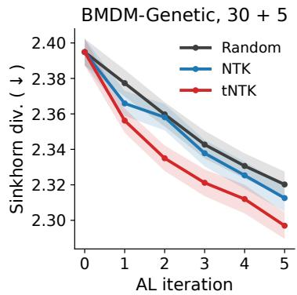  
Figure 3: Mean Sinkhorn divergence per active learning iteration across 5 folds and 10 random seeds. Shade shows standard error.

Table 3: Change in Sinkhorn divergence from iteration 0 (lower is better). For each seed, we average over $T = 5$ iterations and $K = 5$ folds; we then report mean ± standard error across $N = 1 0$ seeds, in units of $1 0 ^ { - 3 }$ . Column headers indicate $B _ { 0 } + { \bar { B } } ,$ , the initial training set size and the number of conditions added per AL round. Best mean per column shown in bold.
<table><tr><td>Dataset</td><td>Strategy</td><td colspan="3"> $B _ { 0 } + B$ </td></tr><tr><td rowspan="7">K562-Chemical</td><td rowspan="7">Random NTK</td><td>10 + 1</td><td> $1 0 + 5$ </td><td>20 + 5</td></tr><tr><td> $\mathbf { - 9 . 5 6 \pm 0 . 6 9 }$ </td><td> $- 2 9 . 0 6 \pm 1 . 0 9$ </td><td> $- 1 5 . 2 7 \pm 0 . 6 9$ </td></tr><tr><td> $- 9 . 3 3 \pm 0 . 7 5$ </td><td> $\mathbf { - 3 0 . 4 4 \pm 1 . 4 5 }$ </td><td> $- 2 0 . 0 4 \pm 0 . 8 0$ </td></tr><tr><td> $- 8 . 6 5 \pm 1 . 1 6$ </td><td> $- 3 0 . 2 6 \pm 1 . 4 8$ </td><td> $\mathbf { - 2 1 . 0 0 \pm 1 . 3 0 }$ </td></tr><tr><td> $2 0 + 1 0$ </td><td>30 + 5</td><td> $3 0 + 1 0$ </td></tr><tr><td> $- 2 4 . 1 4 \pm 1 . 2 9$ </td><td> $- 1 0 . 7 0 \pm 1 . 1 9$ </td><td> $- 1 7 . 1 9 \pm 1 . 3 4$ </td></tr><tr><td> $- 3 0 . 8 6 \pm 0 . 8 4$ </td><td> $- 1 7 . 5 7 \pm 1 . 0 6$ </td><td> $- 2 5 . 5 3 \pm 0 . 9 7$ </td></tr><tr><td rowspan="6">tNTK Random NTK</td><td> $\mathbf { - 3 1 . 6 3 \pm 1 . 2 2 }$ </td><td> $\mathbf { - 1 9 . 3 0 \pm 1 . 1 8 }$ </td><td> $\mathbf { - 2 6 . 1 3 \pm 1 . 1 3 }$ </td></tr><tr><td>10 + 1</td><td>10 + 5</td><td>20 + 5</td></tr><tr><td> $- 2 3 . 6 7 \pm 5 . 5 6$ </td><td> $- 9 8 . 8 1 \pm 6 . 3 8 $ </td><td> $- 6 7 . 7 0 \pm 5 . 2 9$ </td></tr><tr><td> $\mathbf { - 3 8 . 1 6 \pm 4 . 9 8 }$ </td><td> $- 1 2 7 . 3 0 \pm 6 . 2 4$ </td><td> $- 9 2 . 8 0 \pm 5 . 0 0$ </td></tr><tr><td> $- 3 2 . 0 1 \pm 4 . 3 3$ </td><td> $\mathbf { - 1 3 0 . 4 6 \pm 7 . 6 0 }$ </td><td> $\mathbf { - 1 0 2 . 6 3 \pm 5 . 2 0 }$ </td></tr><tr><td> $2 0 + 1 0$ </td><td>30 + 5</td><td> $3 0 + 1 0$ </td></tr><tr><td rowspan="4"></td><td>Random</td><td> $- 1 1 1 . 1 3 \pm 3 . 8 7$ </td><td> $- 4 8 . 7 3 \pm 2 . 4 1$ </td><td> $- 7 9 . 7 0 \pm 3 . 9 7$ </td></tr><tr><td>NTK</td><td> $- 1 3 0 . 3 2 \pm 5 . 7 0$ </td><td> $- 5 4 . 9 0 \pm 4 . 1 7$ </td><td> $- 9 0 . 8 6 \pm 4 . 5 4$ </td></tr><tr><td>tNTK</td><td> $\mathbf { - 1 4 4 . 9 0 \pm 3 . 5 0 }$ </td><td></td><td></td></tr><tr><td></td><td></td><td> $\mathbf { - 7 0 . 5 9 \pm 4 . 8 4 }$ </td><td> $\mathbf { - 1 0 6 . 2 5 \pm 4 . 9 1 }$ </td></tr></table>

tNTK outperforms NTK and random baselines in 9 out of 12 (dataset, budget) configurations (Table 3 and Figure S4). In the remaining cases, NTK did not outperform significantly the tNTK $( p > 0 . 1$ paired t-test).

## 6 Discussion

We introduced an active learning framework for conditional distributions based on the transport neural tangent kernel. The tNTK captures the sensitivity of a conditional generative model’s predicted distribution to perturbations of its parameters, and generalizes the NTK to distributional outputs. We derived the tNTK as an upper bound on the posterior Fréchet variance (Theorem 1) and provided a geometric interpretation on the Wasserstein manifold (Appendix B). Across four conditional generative model classes and on simulated and real datasets, total-posterior-variance-minimizing selection with the tNTK as GP covariance function outperforms the same strategy applied to the NTK of the conditional mean, as well as random sampling.

Sequential greedy total posterior variance minimization, while a principled choice, may be outperformed by selection methods explicitly designed for batch diversity [25], especially in large-batch regimes. However, the tNTK can be paired with any kernel-based selection method, so combining it with existing or novel selection strategies offers a natural extension of our framework to large-batch settings.

The framework extends naturally to other model classes, including diffusion models: in their probability-flow ODE formulation [65], the model is deterministic and the same Jacobian-integration argument as in CFM applies. Conditional normalizing flows [66] provide direct access to the inverse map and pushforward density, and score-based kernels with theoretical guarantees in the regression setting [67, 19, 25] could be extended to the distributional case as an alternative to the tNTK.

In dimensions greater than one, neither the Fréchet variance bound (Theorem 1) nor the metric derivative bound (Lemma 4) is generally tight. While we have characterized the gap and tightness conditions for the metric derivative, our experiments evaluate output dimensions only up to d = 50. How the tNTK behaves at substantially higher dimensions remains an open question.

## Acknowledgments and Disclosure of Funding

We thank Jiequn Han for early discussions about distribution-aware active learning. This work was supported through the NYU IT High Performance Computing (HPC) resources, services, and staff expertise. Jayoung Ryu was partially supported by a Betty Moore Postdoctoral Fellowship, a Google TPU Research & Education Award. Romain Lopez and Jayoung Ryu were partially supported by a Schmidt Sciences AI2050 Fellowship Award. Kyunghyun Cho was supported by the Institute of Information & Communications Technology Planning & Evaluation (IITP) with a grant funded by the Ministry of Science and ICT (MSIT) of the Republic of Korea in connection with the Global AI Frontier Lab International Collaborative Research Agreement. (No. RS-2024-00469482 & RS-2024- 00509279) Kyunghyun Cho was partly supported in part by the NYUAD Center for Interdisciplinary Data Science & AI (CIDSAI), funded by Tamkeen under the NYUAD Research Institute Award CG016.

Disclosures: Romain Lopez has been an employee of Genentech since August 31st, 2021.

## References

[1] Ross D King, Kenneth E Whelan, Ffion M Jones, Philip GK Reiser, Christopher H Bryant, Stephen H Muggleton, Douglas B Kell, and Stephen G Oliver. Functional genomic hypothesis generation and experimentation by a robot scientist. Nature, 427(6971):247–252, 2004.

[2] Ross D King, Jem Rowland, Stephen G Oliver, Michael Young, Wayne Aubrey, Emma Byrne, Maria Liakata, Magdalena Markham, Pinar Pir, Larisa N Soldatova, et al. The automation of science. Science, 324(5923):85–89, 2009.

[3] Nathan J Szymanski, Bernardus Rendy, Yuxing Fei, Rishi E Kumar, Tanjin He, David Milsted, Matthew J McDermott, Max Gallant, Ekin Dogus Cubuk, Amil Merchant, Haegyeom Kim, Anubhav Jain, Christopher J Bartel, Kristin Persson, Yan Zeng, and Gerbrand Ceder. An autonomous laboratory for the accelerated synthesis of novel materials. Nature, 624(7990): 86–91, 2023.

[4] Christopher Tosh, Mauricio Tec, Jessica B White, Jeffrey F Quinn, Glorymar Ibanez Sanchez, Paul Calder, Andrew L Kung, Filemon S Dela Cruz, and Wesley Tansey. A Bayesian active learning platform for scalable combination drug screens. Nature Communications, 16(1):156, 2025.

[5] Nathan C Frey, Isidro Hötzel, Samuel D Stanton, Ryan Kelly, Robert G Alberstein, Emily K Makowski, Karolis Martinkus, Daniel Berenberg, Jack Bevers III, Tyler Bryson, et al. Lab-inthe-loop therapeutic antibody design with deep learning. bioRxiv, 2025.

[6] Jason Yang, Ravi G Lal, James C Bowden, Raul Astudillo, Mikhail A Hameedi, Sukhvinder Kaur, Matthew Hill, Yisong Yue, and Frances H Arnold. Active learning-assisted directed evolution. Nature Communications, 16(1):714, 2025.

[7] Kaiyi Jiang, Zhaoqing Yan, Matteo Di Bernardo, Samantha R Sgrizzi, Lukas Villiger, Alisan Kayabolen, BJ Kim, Josephine K Carscadden, Masahiro Hiraizumi, Hiroshi Nishimasu, et al. Rapid in silico directed evolution by a protein language model with EVOLVEpro. Science, 387 (6732):6006, 2024.

[8] Jennifer E Rood, Anna Hupalowska, and Aviv Regev. Toward a foundation model of causal cell and tissue biology with a perturbation cell and tissue atlas. Cell, 187(17):4520–4545, 2024.

[9] Jiaqi Zhang, Louis Cammarata, Chandler Squires, Themistoklis P Sapsis, and Caroline Uhler. Active learning for optimal intervention design in causal models. Nature Machine Intelligence, 5(10):1066–1075, 2023.

[10] Kexin Huang, Romain Lopez, Jan-Christian Hütter, Takamasa Kudo, Antonio Rios, and Aviv Regev. Sequential optimal experimental design of perturbation screens guided by multi-modal priors. In Research in Computational Molecular Biology (RECOMB), pages 17–37. 2024.

[11] Jason Qin, Hans-Hermann Wessels, Carlos Fernandez-Granda, and Yuhan Hao. Active learning for efficient discovery of optimal combinatorial perturbations. In International Conference on Machine Learning, volume 267, pages 50363–50383, 13–19 Jul 2025.

[12] Benjamin DeMeo, Charlotte Nesbitt, Samuel A Miller, Daniel B Burkhardt, Inna Lipchina, Doris Fu, Peter Holderrieth, David Kim, Sergey Kolchenko, Artur Szalata, et al. Active learning framework leveraging transcriptomics identifies modulators of disease phenotypes. Science, 390(6776):8577, 2025.

[13] Ozan Sener and Silvio Savarese. Active learning for convolutional neural networks: A core-set approach. In International Conference on Learning Representations, 2018.

[14] Viraj Mehta, Syrine Belakaria, Vikramjeet Das, Ojash Neopane, Yijia Dai, Ilija Bogunovic, Barbara E Engelhardt, Stefano Ermon, Jeff Schneider, and Willie Neiswanger. Sample efficient preference alignment in LLMs via active exploration. In Second Conference on Language Modeling, 2025.

[15] William Muldrew, Peter Hayes, Mingtian Zhang, and David Barber. Active preference learning for large language models. In International Conference on Machine Learning, pages 36577– 36590. PMLR, 2024.

[16] David Cohn, Les Atlas, and Richard Ladner. Improving generalization with active learning. Machine learning, 15(2):201–221, 1994.

[17] David A Cohn, Zoubin Ghahramani, and Michael I Jordan. Active learning with statistical models. Journal of artificial intelligence research, 4:129–145, 1996.

[18] Burr Settles. Active learning literature survey. Technical report, 2009.

[19] Jordan T Ash, Chicheng Zhang, Akshay Krishnamurthy, John Langford, and Alekh Agarwal. Deep batch active learning by diverse, uncertain gradient lower bounds. In International Conference on Learning Representations, 2020.

[20] Neil Houlsby, Ferenc Huszár, Zoubin Ghahramani, and Máté Lengyel. Bayesian active learning for classification and preference learning. arXiv, 2011.

[21] Andreas Kirsch, Joost van Amersfoort, and Yarin Gal. BatchBALD: Efficient and diverse batch acquisition for deep Bayesian active learning. In Advances in Neural Information Processing Systems, 2019.

[22] Robert Pinsler, Jonathan Gordon, Eric T. Nalisnick, and José Miguel Hernández-Lobato. Bayesian batch active learning as sparse subset approximation. In Advances in Neural Information Processing Systems, 2019.

[23] Masashi Sugiyama. Active learning in approximately linear regression based on conditional expectation of generalization error. Journal of Machine Learning Research, 7(6):141–166, 2006.

[24] Roi Reichart, Katrin Tomanek, Udo Hahn, and Ari Rappoport. Multi-task active learning for linguistic annotations. In Annual Meeting of the Association for Computational Linguistics, pages 861–869, 2008.

[25] David Holzmüller, Viktor Zaverkin, Johannes Kästner, and Ingo Steinwart. A framework and benchmark for deep batch active learning for regression. Journal ofMachine Learning Research, 24(164):1–81, 2023.

[26] Jordan T. Ash, Surbhi Goel, Akshay Krishnamurthy, and Sham M. Kakade. Gone fishing: Neural active learning with Fisher embeddings. In Advances in Neural Information Processing Systems, 2021.

[27] Wouter Meuleman, Alexander Muratov, Eric Rynes, Jessica Halow, Kristen Lee, Daniel Bates, Morgan Diegel, Douglas Dunn, Fidencio Neri, Athanasios Teodosiadis, Alex Reynolds, Eric Haugen, Jemma Nelson, Audra Johnson, Mark Frerker, Michael Buckley, Richard Sandstrom, Jeff Vierstra, Rajinder Kaul, and John Stamatoyannopoulos. Index and biological spectrum of human DNase I hypersensitive sites. Nature, 584(7820):244–251, 2020.

[28] Julien Bect, David Ginsbourger, Ling Li, Victor Picheny, and Emmanuel Vazquez. Sequential design of computer experiments for the estimation of a probability of failure. Statistics and Computing, 22(3):773–793, 2012.

[29] Themistoklis P Sapsis. Output-weighted optimal sampling for Bayesian regression and rare event statistics using few samples. Proceedings ofthe Royal Society A: Mathematical, Physical and Engineering Sciences, 476(2234), 2020.

[30] Charlotte Bunne, Andreas Krause, and Marco Cuturi. Supervised training of conditional Monge maps. In Advances in Neural Information Processing Systems, volume 35, pages 6859–6872, 2022.

[31] Alice Driessen, Benedek Harsanyi, Marianna Rapsomaniki, and Jannis Born. Towards generalizable single-cell perturbation modeling via the conditional Monge gap. Nature Machine Intelligence, 2026.

[32] Yaron Lipman, Ricky T. Q. Chen, Heli Ben-Hamu, Maximilian Nickel, and Matthew Le. Flow matching for generative modeling. In International Conference on Learning Representations, 2023.

[33] Jonathan Ho, Ajay Jain, and Pieter Abbeel. Denoising diffusion probabilistic models. In Advances in Neural Information Processing Systems, 2020.

[34] Zheyuan Zhan, Defang Chen, Jian-Ping Mei, Zhenghe Zhao, Jiawei Chen, Chun Chen, Siwei Lyu, and Can Wang. Conditional image synthesis with diffusion models: A survey. Transactions on Machine Learning Research, September 2025.

[35] Xun Liang, Hanyu Wang, Yezhaohui Wang, Shichao Song, Jiawei Yang, Simin Niu, Jie Hu, Dan Liu, Shunyu Yao, Feiyu Xiong, and Zhiyu Li. Controllable text generation for large language models: A survey. arXiv, 2024.

[36] Charlotte Bunne, Stefan G Stark, Gabriele Gut, Jacobo Sarabia Del Castillo, Mitch Levesque, Kjong-Van Lehmann, Lucas Pelkmans, Andreas Krause, and Gunnar Rätsch. Learning singlecell perturbation responses using neural optimal transport. Nature Methods, 20(11):1759–1768, November 2023.

[37] Dominik Klein, Jonas Simon Fleck, Daniil Bobrovskiy, Lea Zimmermann, Sören Becker, Alessandro Palma, Leander Dony, Alejandro Tejada-Lapuerta, Guillaume Huguet, Hsiu-Chuan Lin, Nadezhda Azbukina, Fátima Sanchís-Calleja, Theo Uscidda, Artur Szalata, Manuel Gander, Aviv Regev, Barbara Treutlein, J Gray Camp, and Fabian J Theis. CellFlow enables generative single-cell phenotype modeling with flow matching. bioRxiv, 2025.

[38] Jayoung Ryu, Charlotte Bunne, Luca Pinello, Aviv Regev, and Romain Lopez. Cross-modality matching and prediction of perturbation responses with labeled Gromov-Wasserstein optimal transport. In International Conference on Artificial Intelligence and Statistics, pages 4258–4266, 2025.

[39] Martin Rohbeck, Edward De Brouwer, Charlotte Bunne, Jan-Christian Huetter, Anne Biton, Kelvin Y Chen, Aviv Regev, and Romain Lopez. Modeling complex system dynamics with flow matching across time and conditions. In The Thirteenth International Conference on Learning Representations, 2025.

[40] Lucas Ferreira DaSilva, Simon Senan, Judith F Kribelbauer-Swietek, Zain Munir Patel, Lithin Karmel Louis, Aniketh Janardhan Reddy, Sameer Gabbita, Jonathan D Rosen, Zach Nussbaum, César Miguel Valdez Córdova, Aaron Wenteler, Noah Weber, Tin M Tunjic, Martino Mansoldo, Talha Ahmad Khan, Gue-Ho Hwang, Vincent Gardeux, David T Humphreys, Cameron Smith, Matei Bejan, Peter Bromley, Will Connell, Bart Deplancke, Michael I Love, Emily S Wong, Wouter Meuleman, and Luca Pinello. Designing synthetic regulatory elements using the generative AI framework DNA-diffusion. Nature Genetics, 58(1):180–194, 2026.

[41] Brandon Amos, Lei Xu, and J. Zico Kolter. Input convex neural networks. In International Conference on Machine Learning, volume 70, pages 146–155, 2017.

[42] Théo Uscidda and Marco Cuturi. The Monge gap: a regularizer to learn all transport maps. In International Conference on Machine Learning, 2023.

[43] Alexander Tong, Kilian Fatras, Nikolay Malkin, Guillaume Huguet, Yanlei Zhang, Jarrid Rector-Brooks, Guy Wolf, and Yoshua Bengio. Improving and generalizing flow-based generative models with minibatch optimal transport. Transactions on Machine Learning Research, 2024.

[44] Vineeth Rakesh and Swayambhoo Jain. Efficacy of Bayesian neural networks in active learning. In IEEE/CVF conference on computer vision and pattern recognition, pages 2601–2609, 2021.

[45] Yarin Gal and Zoubin Ghahramani. Dropout as a Bayesian approximation: representing model uncertainty in deep learning. In International Conference on Machine Learning, volume 48, pages 1050–1059, 2016.

[46] Mohammad Emtiyaz Khan, Alexander Immer, Ehsan Abedi, and Maciej Korzepa. Approximate inference turns deep networks into Gaussian processes. In Advances in Neural Information Processing Systems, volume 32, 2019.

[47] Roman Novak, Jascha Sohl-Dickstein, and Samuel S Schoenholz. Fast finite width neural tangent kernel. In International Conference on Machine Learning, pages 17018–17044, 2022.

[48] Maurice Fréchet. Les éléments aléatoires de nature quelconque dans un espace distancié. Annales de l’institut Henri Poincaré, 10(4):215–310, 1948.

[49] Martial Agueh and Guillaume Carlier. Barycenters in the Wasserstein space. SIAM Journal on Mathematical Analysis, 43(2):904–924, 2011.

[50] David J. C. MacKay. A practical Bayesian framework for backpropagation networks. Neural Computation, 4(3):448–472, 1992.

[51] Erik Daxberger, Agustinus Kristiadi, Alexander Immer, Runa Eschenhagen, Matthias Bauer, and Philipp Hennig. Laplace redux – effortless Bayesian deep learning. In Advances in Neural Information Processing Systems, 2021.

[52] Wuchen Li and Jiaxi Zhao. Wasserstein information matrix. Information Geometry, 6(1): 203–255, 2023.

[53] Shu Liu, Wuchen Li, Hongyuan Zha, and Haomin Zhou. Neural parametric Fokker–Planck equation. SIAM Journal on Numerical Analysis, 60(3):1385–1449, 2022.

[54] Sang Jun Moon, Jong-June Jeon, Jason Sang Hun Lee, and Yongdai Kim. Learning multiple quantiles with neural networks. Journal of Computational and Graphical Statistics, 30(4): 1238–1248, 2021.

[55] NOAA National Centers for Environmental Information. Global surface summary of the day - gsod. https://www.ncei.noaa.gov/access/metadata/landing-page/bin/iso?id= gov.noaa.ncdc:C00516, 1999. Temperature data between 2023-2025.

[56] Thorben Werner and Lars Schmidt-Thieme. Bayesian active learning by distribution disagreement. arXiv, 2025.

[57] Ch Tsitouras. Runge–Kutta pairs of order 5 (4) satisfying only the first column simplifying assumption. Computers & Mathematics with Applications, 62(2):770–775, 2011.

[58] B. van der Pol. On “relaxation-oscillations”. The London, Edinburgh, and Dublin Philosophical Magazine and Journal ofScience, 7(2):978–992, 1926.

[59] Stefan Larson, Anish Mahendran, Joseph J. Peper, Christopher Clarke, Andrew Lee, Parker Hill, Jonathan K. Kummerfeld, Kevin Leach, Michael A. Laurenzano, Lingjia Tang, and Jason Mars. An evaluation dataset for intent classification and out-of-scope prediction. In Empirical Methods in Natural Language Processing (EMNLP), pages 1311–1316, 2019.

[60] CLINC150. UCI Machine Learning Repository, 2020. DOI: https://doi.org/10.24432/C5MP58.

[61] Wenhui Wang, Furu Wei, Li Dong, Hangbo Bao, Nan Yang, and Ming Zhou. MINILM: deep self-attention distillation for task-agnostic compression of pre-trained transformers. In Advances in Neural Information Processing Systems, 2020.

[62] Mike Lewis, Yinhan Liu, Naman Goyal, Marjan Ghazvininejad, Abdelrahman Mohamed, Omer Levy, Veselin Stoyanov, and Luke Zettlemoyer. BART: Denoising sequence-to-sequence pretraining for natural language generation, translation, and comprehension. In Annual Meeting of the Associationfor Computational Linguistics, pages 7871–7880, 2020.

[63] Geoffrey Schiebinger, Jian Shu, Marcin Tabaka, Brian Cleary, Vidya Subramanian, Aryeh Solomon, Joshua Gould, Siyan Liu, Stacie Lin, Peter Berube, Lia Lee, Jenny Chen, Justin Brumbaugh, Philippe Rigollet, Konrad Hochedlinger, Rudolf Jaenisch, Aviv Regev, and Eric S Lander. Optimal-transport analysis of single-cell gene expression identifies developmental trajectories in reprogramming. Cell, 176(4):928–943.e22, 2019.

[64] Sanjay R Srivatsan, José L McFaline-Figueroa, Vijay Ramani, Lauren Saunders, Junyue Cao, Jonathan Packer, Hannah A Pliner, Dana L Jackson, Riza M Daza, Lena Christiansen, Fan Zhang, Frank Steemers, Jay Shendure, and Cole Trapnell. Massively multiplex chemical transcriptomics at single-cell resolution. Science, 367(6473):45–51, 2020.

[65] Yang Song, Jascha Sohl-Dickstein, Diederik P Kingma, Abhishek Kumar, Stefano Ermon, and Ben Poole. Score-based generative modeling through stochastic differential equations. In International Conference on Learning Representations, 2021.

[66] Christina Winkler, Daniel Worrall, Emiel Hoogeboom, and Max Welling. Learning likelihoods with conditional normalizing flows. arXiv, 2019.

[67] Kamalika Chaudhuri, Sham Kakade, Praneeth Netrapalli, and Sujay Sanghavi. Convergence rates of active learning for maximum likelihood estimation. Advances in Neural Information Processing Systems, 2012.

[68] Luigi Ambrosio, Nicola Gigli, and Giuseppe Savaré. Gradient flows: In metric spaces and in the space ofprobability measures. Lectures in Mathematics. Birkhauser Verlag AG, 2004.

[69] Cédric Villani et al. Optimal transport: Old and New, volume 338. Springer, 2009.

[70] Murray Rosenblatt. Remarks on a multivariate transformation. The annals of mathematical statistics, 23(3):470–472, 1952.

[71] Herbert Knothe. Contributions to the theory of convex bodies. Michigan Mathematical Journal, 4(1):39–52, 1957.

[72] Clark R. Givens and Rae Michael Shortt. A class of Wasserstein metrics for probability distributions. Michigan Mathematical Journal, 31(2):231–240, 1984.

[73] Stefan Elfwing, Eiji Uchibe, and Kenji Doya. Sigmoid-weighted linear units for neural network function approximation in reinforcement learning. Neural Networks, 107:3–11, 2018.

[74] Dan Hendrycks and Kevin Gimpel. Gaussian error linear units (GELUs). arXiv, 2016.

[75] Zoe Piran. sciplex3. 2023. doi: 10.6084/m9.figshare.22122701.v1.

[76] Romain Lopez, Jeffrey Regier, Michael B Cole, Michael I Jordan, and Nir Yosef. Deep generative modeling for single-cell transcriptomics. Nature Methods, 15(12):1053–1058, December 2018.

[77] Takamasa Kudo, Romain Lopez, Ana M. Meireles, Antonio Rios, Paula Coelho, Vineethkrishna Chandrasekar, Dylan C. Lam, Jan-Christian Huetter, Mineto Ota, Orit Rozenblatt-Rosen, Levi Garraway, Kathryn Geiger-Shuller, Avtar Singh, Jonathan K. Pritchard, and Aviv Regev. Scalable multimodal mapping of macrophage regulatory architecture by integrating optical and transcriptomic pooled screens. bioRxiv, 2026.

[78] Ethan Weinberger, Chris Lin, and Su-In Lee. Isolating salient variations of interest in single-cell data with contrastiveVI. Nature Methods, 20(9):1336–1345, 2023.

[79] David Feldman, Avtar Singh, Jonathan L Schmid-Burgk, Rebecca J Carlson, Anja Mezger, Anthony J Garrity, Feng Zhang, and Paul C Blainey. Optical pooled screens in human cells. Cell, 179(3):787–799.e17, October 2019.

[80] Pedro C Álvarez Esteban, E del Barrio, J A Cuesta-Albertos, and C Matrán. A fixed-point approach to barycenters in Wasserstein space. arXiv, November 2015.

[81] Carsten Lüth, Till Bungert, Lukas Klein, and Paul Jaeger. Navigating the pitfalls of active learning evaluation: A systematic framework for meaningful performance assessment. In Advances in Neural Information Processing Systems, volume 36, pages 9789–9836, 2023.

## Code Availability Statement

The code to reproduce the figures and tables, as well as to run the model can be found at https: //github.com/biologicalML/transport\_ntk.

## Supplementary Materials

This appendix is organized as follows.

• Appendix A: Theoretical derivations for the motivation for distribution-aware active learning and the properties of the tNTK.

– Appendix A.1: Proof of Proposition 1 on risk decomposition.

– Appendix A.2: Proof of Lemma 1 on mean-variance decomposition of risk in one dimension.

– Appendix A.3: Proof of Theorem 1 on the upper bound of the Fréchet variance.

– Appendix A.4: Positive semi-definiteness of the tNTK.

– Appendix A.5: Simplified kernel computation for models with a linear output layer, using sensitivity to last-layer parameters.

– Appendix A.6: Proof of Lemma 2 on kernel decomposition for affine transport.

• Appendix B: Geometric interpretation of the tNTK as an upper bound on the metric derivative on the 2-Wasserstein space, and relationship to metric derivative on the Knothe–Rosenblatt distance.

– Appendix B.1: Background on curves and metric derivatives on Wasserstein space.

– Appendix B.2: The norm induced by $G _ { \theta } ( x )$ upper-bounds the metric derivative of a curve induced by parameter perturbation.

– Appendix B.3: Analysis of the gap between the bound and the metric derivative, and conditions under which it is tight.

• Appendix C: Exact metric tensor under the Knothe–Rosenblatt distance: the tNTK recovers the squared metric derivative for lower-triangular affine maps.

• Appendix D: Experimental details.

– Appendix D.1: Conditional histogram example from Section 3.2.

– Appendix D.2: NTK baseline calculation.

– Appendix D.3: Affine transport of 2D Gaussians (Section 5.1).

– Appendix D.4: Conditional quantile prediction (Section 5.2).

– Appendix D.5: Conditional flow matching (Section 5.3).

– Appendix D.6: Conditional Monge gap (Section 5.4).

• Appendix E: Additional results.

– Appendix E.1: Empirical calculation of gap of the upper bound in Theorem 1.

– Appendix E.2: Active learning results on the higher-dimensional affine Gaussian transport.

– Appendix E.3: Results on tNTK computation.

– Appendix E.4: Additional baselines for the experiments presented in the main text.

• Appendix F: Supplementary Figures.

## A Theory of the Transport Neural Tangent Kernel

## A.1 Proof of Proposition 1

Proposition 1 (Mean-shape decomposition of risk). The Wasserstein risk defined in Equation (5) decomposes as

$$
\mathcal { R } ( x , \mathcal { D } ) = \underbrace { \mathbb { E } _ { \theta | \mathcal { D } } \big [ \| m _ { \theta } ( x ) - m ( x ) \| ^ { 2 } \big ] } _ { \mathcal { R } _ { m e a n } ( x , \mathcal { D } ) } + \underbrace { \mathbb { E } _ { \theta | \mathcal { D } } \big [ W _ { 2 } ^ { 2 } ( \mu _ { \theta } ^ { c } ( x ) , \mu ^ { c } ( x ) ) \big ] } _ { \mathcal { R } _ { s h a p e } ( x , \mathcal { D } ) } ,\tag{6}
$$

where $\begin{array} { r } { m _ { \rho } = \int y d \rho ( y ) } \end{array}$ denotes the mean of $\dot { \rho } ,$ and $\rho ^ { c }$ is obtained by centering ρ for any $\rho \in \mathcal { P } _ { 2 } ( \mathcal { V } )$

Proof. We drop the dependence on x for readability. For any vector $v \in \mathcal { V }$ , we denote by $\tau _ { v } : \mathcal { V } \to \mathcal { V }$ the translation operator $\tau _ { v } ( y ) = y - v$ . For any measure $\rho \in \mathcal { P } _ { 2 } ( \mathcal { V } )$ with mean $m _ { \rho }$ , the centered measure is then $\rho ^ { c } = ( \tau _ { m _ { \rho } } ) \# \rho .$ . We extend this notation to product spaces by writing $\tau _ { v , v ^ { \prime } } ( y , y ^ { \prime } ) =$ $\left( y - v , y ^ { \prime } - v ^ { \prime } \right)$ for the translation acting on couplings.

Let $\pi \in \Pi ( \mu , \mu _ { \theta } )$ be an optimal coupling for $W _ { 2 } ^ { 2 } ( \mu , \mu _ { \theta } )$ , and let $\pi ^ { c } \in \Pi ( \mu ^ { c } , \mu _ { \theta } ^ { c } )$ be an optimal coupling for $W _ { 2 } ^ { 2 } ( \mu ^ { c } , \mu _ { \theta } ^ { c } )$ . We will use the following algebraic identity twice:

$$
\begin{array} { r } { \| ( y - m ) - ( y ^ { \prime } - m _ { \theta } ) \| ^ { 2 } = \| y - y ^ { \prime } \| ^ { 2 } + \| m _ { \theta } - m \| ^ { 2 } + 2 ( m _ { \theta } - m ) ^ { \top } ( y - y ^ { \prime } ) . } \end{array}\tag{22}
$$

Step 1: $( \tau _ { m , m _ { \theta } } ) _ { \# } \pi$ is admissible for $\mu ^ { c } , \mu _ { \theta } ^ { c } .$ . Define ${ \hat { \pi } } = { \bigl ( } \tau _ { m , m _ { \theta } } { \bigr ) } _ { \# } \pi$ . Since π has marginals $\mu$ and $\mu _ { \theta }$ , the pushforward πˆ has marginals $( \tau _ { m } ) \# \mu = \mu ^ { c }$ and $( \tau _ { m _ { \theta } } ) _ { \# } \mu _ { \theta } = \mu _ { \theta } ^ { c }$ , so $\hat { \pi } \in \Pi ( \mu ^ { c } , \bar { \mu } _ { \theta } ^ { c } )$ .

Applying (22) with $u = y - m$ and $u ^ { \prime } = y ^ { \prime } - m _ { \theta }$ , and integrating against π, using $\mathbb { E } _ { \pi } [ y ] = m$ and $\begin{array} { r } { \mathbb { E } _ { \pi } \big [ \tilde { y ^ { \prime } } \big ] = m _ { \theta } \tilde { . } } \end{array}$

$$
\iint \Vert u - u ^ { \prime } \Vert ^ { 2 } d \hat { \pi } ( u , u ^ { \prime } ) = \iint \Vert ( y - m ) - ( y ^ { \prime } - m _ { \theta } ) \Vert ^ { 2 } d \pi ( y , y ^ { \prime } )\tag{23}
$$

$$
= \underbrace { \iint \left\| y - y ^ { \prime } \right\| ^ { 2 } d \pi } _ { = W _ { \gamma } ^ { 2 } \left( \mu , \mu _ { \theta } \right) } + \left\| m _ { \theta } - m \right\| ^ { 2 } + 2 ( m _ { \theta } - m ) ^ { \top } \underbrace { { \mathbb E } _ { \pi } { \left[ y - y ^ { \prime } \right] } } _ { = m - m _ { \theta } }\tag{24}
$$

$$
= W _ { 2 } ^ { 2 } ( \mu , \mu _ { \theta } ) - \| m _ { \theta } - m \| ^ { 2 } .\tag{25}
$$

Since πˆ is admissible for $\mu ^ { c } , \mu _ { \theta } ^ { c }$ but not necessarily optimal,

$$
W _ { 2 } ^ { 2 } ( \mu ^ { c } , \mu _ { \theta } ^ { c } ) \leq W _ { 2 } ^ { 2 } ( \mu , \mu _ { \theta } ) - \| m _ { \theta } - m \| ^ { 2 } .\tag{26}
$$

Step $\pmb { 2 } \colon ( \tau _ { - m , - m _ { \theta } } ) _ { \# } \pi ^ { c }$ is admissible for $\mu , \mu _ { \theta } .$ Symmetrically, define $\widetilde { \pi } = \left( \tau _ { - m , - m _ { \theta } } \right) \# \pi ^ { c }$ . Since $\pi ^ { c }$ has marginals $\mu ^ { c }$ and $\mu _ { \theta } ^ { c }$ , the pushforward π˜ has marginals $\mu$ and $\mu _ { \theta }$ , so π˜ $\in \Pi ( \mu , \mu _ { \theta } )$

Applying (22) with $y = u + m$ and $y ^ { \prime } = u ^ { \prime } + m _ { \theta }$ , and integrating against $\pi ^ { c }$ , using $\mathbb { E } _ { \pi ^ { c } } [ u ] = 0$ and $\begin{array} { r l } { \mathbb { E } _ { \pi ^ { c } } ^ { - } [ \boldsymbol { \check { u } } ^ { \prime } ] = 0 : } & { { } } \end{array}$

$$
\iint \Vert y - y ^ { \prime } \Vert ^ { 2 } d \tilde { \pi } ( y , y ^ { \prime } ) = \iint \Vert ( u + m ) - ( u ^ { \prime } + m _ { \theta } ) \Vert ^ { 2 } d \pi ^ { c } ( u , u ^ { \prime } )\tag{27}
$$

$$
= \iint \| u - u ^ { \prime } \| ^ { 2 } d \pi ^ { c } + \| m _ { \theta } - m \| ^ { 2 } + 2 ( m _ { \theta } - m ) ^ { \top } \underbrace { { \mathbb { E } } _ { \pi ^ { c } } [ u ^ { \prime } - u ] } _ { \circ }\tag{28}
$$

$$
= W _ { 2 } ^ { 2 } \big ( \mu ^ { c } , \mu _ { \theta } ^ { c } \big )
$$

$$
= W _ { 2 } ^ { 2 } ( \mu ^ { c } , \mu _ { \theta } ^ { c } ) + \| m _ { \theta } - m \| ^ { 2 } .\tag{29}
$$

Since π˜ is admissible for $\mu , \mu _ { \theta }$ but not necessarily optimal,

$$
W _ { 2 } ^ { 2 } ( \mu , \mu _ { \theta } ) \leq W _ { 2 } ^ { 2 } ( \mu ^ { c } , \mu _ { \theta } ^ { c } ) + \| m _ { \theta } - m \| ^ { 2 } .\tag{30}
$$

Step 3: Conclusion. Combining (26) and (30),

$$
W _ { 2 } ^ { 2 } ( \mu , \mu _ { \theta } ) = W _ { 2 } ^ { 2 } ( \mu ^ { c } , \mu _ { \theta } ^ { c } ) + \| m _ { \theta } - m \| ^ { 2 } .\tag{31}
$$

Reinstating the dependence on x and taking expectations over θ ∣ D:

$$
\begin{array} { r } { \mathcal { R } ( x , \mathcal { D } ) = \mathbb { E } _ { \theta \mid \mathcal { D } } \big [ W _ { 2 } ^ { 2 } ( \mu _ { \theta } ( x ) , \mu ( x ) ) \big ] } \end{array}\tag{32}
$$

$$
= \mathbb { E } _ { \theta | \mathcal { D } } \big [ \| m _ { \theta } ( x ) - m ( x ) \| ^ { 2 } \big ] + \mathbb { E } _ { \theta | \mathcal { D } } \big [ W _ { 2 } ^ { 2 } ( \mu _ { \theta } ^ { c } ( x ) , \mu ^ { c } ( x ) ) \big ]\tag{33}
$$

$$
= \mathcal { R } _ { \mathrm { m e a n } } ( x , \mathcal { D } ) + \mathcal { R } _ { \mathrm { s h a p e } } ( x , \mathcal { D } ) ,
$$

which proves the proposition.

(34)

## A.2 Proof of Lemma 1

Lemma 1 (1D posterior risk). Assume the model is unbiased at the mean and every quantile level, $\mathsf { i . e . , E } _ { \theta \mid \mathcal { D } } [ m _ { \theta } ( \bar { x } ) ] = m ( x )$ and $\mathbb { E } _ { \theta | \mathcal { D } } [ F _ { \theta } ^ { - 1 } ( x ; \tau ) ] = F ^ { - 1 } ( x ; \tau )$ for all $x , \tau .$ . Then

$$
\mathcal { R } _ { m e a n } ( x , \mathcal { D } ) = \mathrm { V a r } _ { \theta | \mathcal { D } } [ m _ { \theta } ( x ) ] , \qquad \mathcal { R } _ { s h a p e } ( x , \mathcal { D } ) = \int _ { 0 } ^ { 1 } \mathrm { V a r } _ { \theta | \mathcal { D } } [ g _ { \theta } ( x ; \tau ) ] d \tau ,\tag{7}
$$

where $g _ { \theta } ( x ; \tau ) = F _ { \theta } ^ { - 1 } ( x ; \tau ) - m _ { \theta } ( x )$ denotes the centered quantile function of ${ \dot { \mu } } _ { \theta } ( x )$

Proof. We drop the dependence on x for readability. Throughout, all variances, covariances, and expectations are taken with respect to the posterior ${ \dot { \theta } } | { \mathcal { D } }$

Step 1: Quantile representation of $W _ { 2 } ^ { 2 }$ . For one-dimensional distributions, the squared 2- Wasserstein distance admits the closed-form quantile representation:

$$
W _ { 2 } ^ { 2 } ( \mu _ { \theta } , \mu ) = \int _ { 0 } ^ { 1 } \left( F _ { \theta } ^ { - 1 } ( \tau ) - F ^ { - 1 } ( \tau ) \right) ^ { 2 } d \tau ,\tag{35}
$$

where we remind the reader that ${ \cal F } ^ { - 1 } ( \tau )$ (resp. $F _ { \theta } ^ { - 1 } ( \tau ) )$ corresponds to the τ quantile of the distribution $\mu \left( \mathrm { r e s p . } \mu _ { \theta } \right)$ .

Step 2: Derivation of the mean risk. Under the assumption $\mathbb { E } [ m _ { \theta } ] = m$ , the squared error reduces to the posterior variance:

$$
\mathcal { R } _ { \mathrm { m e a n } } ( x , \mathcal { D } ) = \mathbb { E } \big [ ( m _ { \theta } - m ) ^ { 2 } \big ] = \mathrm { V a r } [ m _ { \theta } ] .\tag{36}
$$

Step 3: Derivation of the shape risk. The centered measures $\mu _ { \theta } ^ { c }$ and $\mu ^ { c }$ have quantile functions $g _ { \theta } ( \tau ) = F _ { \theta } ^ { - 1 } ( \tau ) - m _ { \theta }$ and $g ( \tau ) = F ^ { - 1 } ( \tau ) - m$ , respectively. Applying (35) to the centered measures:

$$
W _ { 2 } ^ { 2 } ( \mu _ { \theta } ^ { c } , \mu ^ { c } ) = \int _ { 0 } ^ { 1 } ( g _ { \theta } ( \tau ) - g ( \tau ) ) ^ { 2 } d \tau .\tag{37}
$$

Taking expectations and exchanging the integral and expectation by Fubini’s theorem:

$$
\mathcal { R } _ { \mathrm { s h a p e } } ( x , \mathcal { D } ) = \int _ { 0 } ^ { 1 } \mathbb { E } \big [ ( g _ { \theta } ( \tau ) - g ( \tau ) ) ^ { 2 } \big ] d \tau .\tag{38}
$$

Because we have that $\mathbb { E } [ m _ { \theta } ] = m$ and that for all $\tau \in [ 0 , 1 ] , \mathbb { E } [ F _ { \theta } ^ { - 1 } ( \tau ) ] = F ^ { - 1 } ( \tau )$ , it implies that $\mathbb { E } \big [ g _ { \theta } ( \tau ) \big ] = g ( \tau )$ by linearity of the expectation. Therefore, the squared error reduces to the posterior variance:

$$
\mathbb { E } \big [ ( g _ { \theta } ( \tau ) - g ( \tau ) ) ^ { 2 } \big ] = \mathrm { V a r } [ g _ { \theta } ( \tau ) ] ,\tag{39}
$$

and consequently

$$
\mathcal { R } _ { \mathrm { s h a p e } } ( x , \mathcal { D } ) = \int _ { 0 } ^ { 1 } \mathrm { V a r } [ g _ { \theta } ( \tau ) ] d \tau .\tag{40}
$$

Combining (36) and (40) proves the lemma.

## A.3 Proof of Theorem 1

Theorem 1 (Upper bound on the posterior Fréchet variance). Let $\theta \mid \mathcal { D } \sim \mathcal { N } ( \hat { \theta } , \Sigma )$ , with $\Sigma \in \mathbb { R } ^ { p \times p }$ positive definite and $\| \Sigma \| _ { \mathrm { o p } } < 1$ . Assume that for every $x \in \mathcal { X }$ andfor ν-almost every $y \in \mathcal { D } ,$ , the map $\theta \mapsto T _ { \theta } ( x ) ( y ) \ i s \ C ^ { 2 } ( \mathbb { R } ^ { p } )$ , and that the Jacobian $D _ { \theta } T _ { \hat { \theta } } ( x ) ( \cdot )$ and the pointwise supremum of the operator norm of the Hessian, $\begin{array} { r } { \operatorname* { s u p } _ { \theta } \| D _ { \theta } ^ { 2 } T _ { \theta } ( x ) ( \cdot ) \| _ { \mathrm { o p } } , } \end{array}$ , are in $L ^ { 2 } ( \nu )$ . Then, there exists $C ( x )$ such that:

$$
V _ { F } ( x ) \leq \mathrm { T r } \big ( G _ { \hat { \theta } } ( x ) \Sigma \big ) + C ( x ) \| \Sigma \| _ { \mathrm { o p } } ^ { 3 / 2 } ,\tag{11}
$$

where the $p \times p$ parameter sensitivity matrix at input x is

$$
G _ { \hat { \theta } } ( x ) = \int D _ { \theta } T _ { \hat { \theta } } ( x ) ( y ) ^ { \top } D _ { \theta } T _ { \hat { \theta } } ( x ) ( y ) d \nu ( y ) .\tag{12}
$$

Inequality (11) is tight to leading order when dim $( \mathcal { V } ) = 1$ and $T _ { \theta } ( x )$ is monotone in y.

Proof. The proof has three parts: (i) we reduce $V _ { F } ( x )$ to an integrated $L ^ { 2 } ( \nu )$ distance between transport maps, (ii) we expand the integrand in Σ and bound each term and collect the bounds, (iii) we analyze tightness.

## Part 1: Reduction to an $L ^ { 2 } ( \nu )$ functional

Reducing $V _ { F }$ to a single-draw expectation. By definition of the infimum, taking $\rho = \mu _ { \hat { \theta } } ( x )$ in (10) yields

$$
V _ { F } ( \boldsymbol { x } ) \leq \mathbb { E } _ { \boldsymbol { \theta } | \mathcal { D } } \big [ W _ { 2 } ^ { 2 } ( \mu _ { \boldsymbol { \theta } } ( \boldsymbol { x } ) , \mu _ { \hat { \boldsymbol { \theta } } } ( \boldsymbol { x } ) ) \big ] .\tag{41}
$$

The remainder of the proof bounds the right-hand side.

Synchronized coupling. We momentarily drop the dependence on x and derive an upper bound on $\dot { W } _ { 2 } ^ { 2 } ( \mu _ { \theta } , \mu _ { \hat { \theta } } )$ for fixed $\theta .$ . Let $\Phi _ { \theta . \hat { \theta } } : \mathcal { V } \xrightarrow { } \mathcal { \dot { V } } \times \mathcal { V }$ denote the map $y \mapsto ( T _ { \theta } ( y ) , T _ { \hat { \theta } } ( y ) )$ , and introduce the synchronized coupling $\pi = ( \Phi _ { \theta , \hat { \theta } } ) _ { \# } \nu .$ . The measure π is a coupling of $\mu _ { \theta }$ and $\mu _ { \hat { \theta } } { : }$ for any test function $\varphi _ { : }$ , the first marginal satisfies

$$
\int \varphi ( u ) d \pi _ { 1 } ( u ) = \int \varphi ( T _ { \theta } ( y ) ) d \nu ( y ) = \int \varphi ( u ) d \mu _ { \theta } ( u ) ,\tag{42}
$$

where we applied the pushforward identity twice, using $\mu _ { \theta } = T _ { \theta } \# \nu .$ . The same argument yield $\pi _ { 2 } = \mu _ { \hat { \theta } } , \operatorname { s o } \pi \in \Pi ( \mu _ { \theta } , \mu _ { \hat { \theta } } )$ . Applying the pushforward identity to the cost function $( u , \breve { u ^ { \prime } } ) \mapsto \| u - \ u ^ { \prime } \| ^ { 2 }$ gives the transport cost of π:

$$
\int \| u - u ^ { \prime } \| ^ { 2 } d \pi ( u , u ^ { \prime } ) = \int \| T _ { \theta } ( y ) - T _ { \hat { \theta } } ( y ) \| ^ { 2 } d \nu ( y ) .\tag{43}
$$

Because $W _ { 2 } ^ { 2 }$ is the infimum of the transport cost over all admissible couplings,

$$
W _ { 2 } ^ { 2 } ( \mu _ { \theta } , \mu _ { \hat { \theta } } ) \leq \int \| T _ { \theta } ( y ) - T _ { \hat { \theta } } ( y ) \| ^ { 2 } d \nu ( y ) .\tag{44}
$$

Reinstating the dependence on x and combining with (41),

$$
V _ { F } ( x ) \leq \mathbb { E } _ { \theta | \mathcal { D } } \Big [ \int \| T _ { \theta } ( x ) ( y ) - T _ { \hat { \theta } } ( x ) ( y ) \| ^ { 2 } d \nu ( y ) \Big ] .\tag{45}
$$

Taylor expansion around ${ \hat { \theta } } .$ We continue to drop the dependence on x and write $J ( y ) : = D _ { \theta } T _ { \hat { \theta } } ( y )$ for the Jacobian at the posterior mean. By the smoothness assumption, for ν-a.e. y and all $\theta \in \mathbb { R } ^ { p }$ , a second-order Taylor expansion gives

$$
T _ { \theta } ( y ) = T _ { \hat { \theta } } ( y ) + J ( y ) ( \theta - \hat { \theta } ) + r ( \theta , y ) ,\tag{46}
$$

where the remainder satisfies

$$
\begin{array} { r } { \Vert r ( \theta , y ) \Vert \leq \frac { 1 } { 2 } \kappa ( y ) \Vert \theta - \hat { \theta } \Vert ^ { 2 } , \qquad \kappa ( y ) : = \underset { \theta } { \operatorname* { s u p } } \Vert D _ { \theta } ^ { 2 } T _ { \theta } ( y ) \Vert _ { \mathrm { o p } } , } \end{array}\tag{47}
$$

and $\kappa \in L ^ { 2 } ( \nu )$ by assumption. Squaring and expanding the inner product,

$$
\| T _ { \theta } ( y ) - T _ { \hat { \theta } } ( y ) \| ^ { 2 } = \underbrace { \| J ( y ) ( \theta - \hat { \theta } ) \| ^ { 2 } } _ { = : A ( y , \theta ) } + \underbrace { 2 \left. J ( y ) ( \theta - \hat { \theta } ) , r ( \theta , y ) \right. } _ { = : B ( y , \theta ) } + \underbrace { \| r ( \theta , y ) \| ^ { 2 } } _ { = : C ( y , \theta ) } .\tag{48}
$$

## Part 2: Term-by-term bounds

Leading term. Since $\theta \sim \mathcal { N } ( \hat { \theta } , \Sigma )$ , we have $\mathbb { E } [ ( \theta - \hat { \theta } ) ( \theta - \hat { \theta } ) ^ { \top } ] = \Sigma$ . Using the cyclicity of the trace,

$$
\mathbb { E } \big [ A ( y , \theta ) \big ] = \mathbb { E } \big [ ( \theta - \hat { \theta } ) ^ { \top } J ( y ) ^ { \top } J ( y ) ( \theta - \hat { \theta } ) \big ] = \operatorname { T r } \big ( J ( y ) ^ { \top } J ( y ) \Sigma \big ) .\tag{49}
$$

By linearity of the trace operator,

$$
\int \mathbb { E } [ A ( y , \theta ) ] d \nu ( y ) = \operatorname { T r } \left( \left( \int J ( y ) ^ { \top } J ( y ) d \nu ( y ) \right) \Sigma \right) = \operatorname { T r } \left( G _ { \hat { \theta } } ( x ) \Sigma \right) .\tag{50}
$$

Cross term. By Cauchy–Schwarz applied pointwise in y and then in $L ^ { 2 } ( \mathbb { P } )$ ,

$$
\begin{array} { r } { \mathbb { E } | B ( y , \theta ) | \leq 2 \mathbb { E } \left[ \| J ( y ) ( \theta - \hat { \theta } ) \| ^ { 2 } \right] ^ { 1 / 2 } \mathbb { E } \left[ \| r ( \theta , y ) \| ^ { 2 } \right] ^ { 1 / 2 } . } \end{array}\tag{51}
$$

The first factor equals $\sqrt { \operatorname { T r } ( J ( y ) ^ { \top } J ( y ) \Sigma ) }$ by (49). For the second factor, applying (47),

$$
\begin{array} { r } { \mathbb { E } \left[ \| r ( \theta , y ) \| ^ { 2 } \right] \leq \frac { 1 } { 4 } \kappa ( y ) ^ { 2 } \mathbb { E } \left[ \| \theta - \hat { \theta } \| ^ { 4 } \right] . } \end{array}\tag{52}
$$

For $\theta \sim \mathcal { N } ( \hat { \theta } , \Sigma )$ , the standard fourth-moment identity gives $\begin{array} { r } { \hat { \mathsf { \Phi } } \| \theta - \hat { \theta } \| ^ { 4 } = ( \mathrm { T r } \Sigma ) ^ { 2 } + 2 \mathrm { T r } ( \Sigma ^ { 2 } ) \le } \end{array}$ $3 ( \mathrm { T r } \Sigma ) ^ { 2 } \leq \dot { 3 } p ^ { 2 } \| \dot { \Sigma } \| _ { \mathrm { o p } } ^ { 2 }$ , so

$$
\begin{array} { r } { \mathbb { E } \big [ \| r ( \theta , y ) \| ^ { 2 } \big ] \leq \frac { 3 } { 4 } p ^ { 2 } \kappa ( y ) ^ { 2 } \| \Sigma \| _ { \mathrm { o p } } ^ { 2 } . } \end{array}\tag{53}
$$

Substituting into (51) and integrating over ν via Cauchy–Schwarz,

$$
\int \mathbb { E } | B ( y , \theta ) | d \nu ( y ) \le \sqrt { 3 } p \left\| \Sigma \right\| _ { \mathrm { o p } } \int \kappa ( y ) \sqrt { \mathrm { T r } ( J ( y ) ^ { \top } J ( y ) \Sigma ) } d \nu ( y )\tag{54}
$$

$$
\leq \sqrt { 3 } p \| \Sigma \| _ { \mathrm { o p } } \| \kappa \| _ { L ^ { 2 } ( \nu ) } \sqrt { \mathrm { T r } ( G _ { \hat { \theta } } ( x ) \Sigma ) }\tag{55}
$$

$$
\leq \sqrt { 3 } p \| \kappa \| _ { L ^ { 2 } ( \nu ) } \sqrt { \mathrm { T r } ( G _ { \hat { \theta } } ( x ) ) } \| \Sigma \| _ { \mathrm { o p } } ^ { 3 / 2 } ,\tag{56}
$$

where the last step uses $\operatorname { T r } ( G _ { \hat { \theta } } ( x ) \Sigma ) \leq \operatorname { T r } ( G _ { \hat { \theta } } ( x ) ) \| \Sigma \| _ { \mathrm { o p } }$ (since $G _ { \hat { \theta } } ( x )$ is positive semi-definite) and $\operatorname { T r } ( G _ { \hat { \theta } } ( x ) ) < \bar { \infty }$ by the integrability assumption.

Quadratic remainder. Using (53) and integrating over $\nu ,$

$$
\int \mathbb { E } [ C ( y , \theta ) ] d \nu ( y ) \le \frac { 3 } { 4 } p ^ { 2 } \left. \kappa \right. _ { L ^ { 2 } ( \nu ) } ^ { 2 } \left. \Sigma \right. _ { \mathrm { o p } } ^ { 2 } \le \frac { 3 } { 4 } p ^ { 2 } \left. \kappa \right. _ { L ^ { 2 } ( \nu ) } ^ { 2 } \left. \Sigma \right. _ { \mathrm { o p } } ^ { 3 / 2 } ,\tag{57}
$$

where the last step uses $\| \Sigma \| _ { \mathrm { o p } } < 1$

Combining the bounds. Combining (45), (48), (50), (56), and (57),

$$
V _ { F } ( x ) \le \int \mathbb { E } [ A ( y , \theta ) + B ( y , \theta ) + C ( y , \theta ) ] d \nu ( y )\tag{58}
$$

$$
\begin{array} { r l } & { \leq \operatorname { T r } \left( G _ { \hat { \theta } } ( x ) \Sigma \right) + \sqrt { 3 } p \| \kappa \| _ { L ^ { 2 } ( \nu ) } \sqrt { \operatorname { T r } ( G _ { \hat { \theta } } ( x ) ) } \| \Sigma \| _ { \mathrm { o p } } ^ { 3 / 2 } + \frac { 3 } { 4 } p ^ { 2 } \| \kappa \| _ { L ^ { 2 } ( \nu ) } ^ { 2 } \| \Sigma \| _ { \mathrm { o p } } ^ { 3 / 2 } } \end{array}\tag{59}
$$

$$
= \operatorname { T r } \left( G _ { \hat { \theta } } ( x ) \Sigma \right) + C ( x ) \| \Sigma \| _ { \mathrm { o p } } ^ { 3 / 2 } ,\tag{60}
$$

where

$$
\begin{array} { r } { C ( { x } ) = \sqrt { 3 } p \| \kappa \| _ { L ^ { 2 } ( \nu ) } \sqrt { \mathrm { T r } ( G _ { \hat { \theta } } ( x ) ) } + \frac { 3 } { 4 } p ^ { 2 } \| \kappa \| _ { L ^ { 2 } ( \nu ) } ^ { 2 } , } \end{array}\tag{61}
$$

which is the claimed bound.

## Part 3: The 1D monotone case

We show that when dim $( \mathcal { V } ) = 1$ and $T _ { \theta } ( x )$ is monotone in $y ,$ the inequality (11) becomes tight in the leading order. In this setting, $V _ { F } ( x )$ admits a closed-form expression that we compute directly.

We drop the dependence on x throughout, and write $Q _ { \theta } ( \tau ) : = F _ { \mu _ { \theta } } ^ { - 1 } ( \tau )$ for the quantile function of $\mu _ { \theta }$ . Monotonicity of $T _ { \theta }$ gives the quantile representation $T _ { \theta } = Q _ { \theta } ^ { ' \circ } \ : { \circ } \ : F _ { \nu }$ , and the change of variables $\tau = F _ { \nu } ( y )$ yields the isometry

$$
W _ { 2 } ^ { 2 } ( \mu _ { \theta } , \mu _ { \theta ^ { \prime } } ) = \int _ { 0 } ^ { 1 } \left( Q _ { \theta } ( \tau ) - Q _ { \theta ^ { \prime } } ( \tau ) \right) ^ { 2 } d \tau = \| Q _ { \theta } - Q _ { \theta ^ { \prime } } \| _ { L ^ { 2 } [ 0 , 1 ] } ^ { 2 } .\tag{62}
$$

The Wasserstein-2 geometry on $\{ \mu _ { \theta } \}$ is therefore the Euclidean geometry of $L ^ { 2 } [ 0 , 1 ]$ on $\{ Q _ { \theta } \}$ , and standard $L ^ { 2 }$ identities give a closed form for the Fréchet barycenter and variance. The barycenter quantile function is $\bar { Q } ( \overline { { \tau } } ) : = \mathbb { E } _ { \theta | \mathcal { D } } [ Q _ { \theta } ( \tau ) ]$ , and the Fréchet variance is

$$
V _ { F } ( x ) = \mathbb { E } _ { \theta | \mathcal { D } } \big [ \| Q _ { \theta } - \bar { Q } \| _ { L ^ { 2 } [ 0 , 1 ] } ^ { 2 } \big ] = \int _ { 0 } ^ { 1 } \operatorname { V a r } _ { \theta | \mathcal { D } } [ Q _ { \theta } ( \tau ) ] d \tau ,\tag{63}
$$

by Fubini and the $L ^ { 2 }$ bias-variance decomposition.

The argument of Parts 1–2 now applies pointwise in $\tau \mathrm { ~ t o ~ } Q _ { \theta } ( \tau )$ instead of to $T _ { \theta } ( y )$ , with the synchronized-coupling step replaced by the isometry $( 6 2 )$ (which is exact rather than an inequality). Because Equation 50 is an equality, the upper bound from Theorem 1 is tight at leading order. More precisely, when $\left\| \Sigma \right\| _ { \mathrm { o p } } \to 0 ;$

$$
V _ { F } ( x ) = \mathrm { T r } \left( G _ { \hat { \theta } } ( x ) \Sigma \right) + O ( \| \Sigma \| _ { \mathrm { o p } } ^ { 3 / 2 } ) .\tag{64}
$$

## A.4 Positive semi-definiteness of the tNTK

Proposition 2. The tNTK $k _ { \theta } : \mathcal { X } \times \mathcal { X } $ R defined in Equation 13 is positive semi-definite.

Proof. Let $n \in \mathbb { N } ^ { * }$ , and $x _ { 1 } , \ldots , x _ { n } \in { \mathcal { X } }$ denote n input points. Let $c _ { 1 } , \ldots , c _ { n } \in$ R be weights. Writing $J _ { x } ( \boldsymbol { \dot { y } } ) = D _ { \theta } T _ { \theta } ( x ) ( \boldsymbol { y } ) \in \mathbb { R } ^ { d \times p }$ for the parameter Jacobian, we have that:

$$
\underset { i = 1 } { \overset { n } { \sum } } \sum _ { j = 1 } ^ { n } c _ { i } c _ { j } k _ { \theta } ( x _ { i } , x _ { j } ) = \underset { i , j } { \sum } c _ { i } c _ { j } \int \operatorname { T r } \left[ J _ { x _ { i } } ( y ) ^ { \top } J _ { x _ { j } } ( y ) \right] d \nu ( y )\tag{65}
$$

$$
= \int \sum _ { i , j } c _ { i } c _ { j } \left. J _ { x _ { i } } ( y ) , J _ { x _ { j } } ( y ) \right. _ { F } d \nu ( y )\tag{66}
$$

$$
= \int \left\| \sum _ { i = 1 } ^ { n } c _ { i } J _ { x _ { i } } ( y ) \right\| _ { F } ^ { 2 } d \nu ( y ) \geq 0 ,\tag{67}
$$

where $\langle \cdot , \cdot \rangle _ { F }$ and $\| \cdot \| _ { F }$ denote the Frobenius inner product and norm. The final inequality holds because the squared Frobenius norm is non-negative and ν is a positive measure. □

## A.5 Closed-form expression for the last-layer tNTK

Proposition 3. Let the transport map have a linear last layer, $T _ { \theta } ( x ) ( y ) = W ^ { \top } h _ { \theta } ( x , y )$ , where $h _ { \theta } ( x , y ) \in \mathbb { R } ^ { m }$ is the penultimate-layer output and $W \in \mathbb { R } ^ { m \times d }$ is the last-layer weight matrix. Then the tNTK (13) restricted to the last-layer parameters admits the closedform:

$$
k _ { \theta } ^ { \mathrm { I l } } ( x , x ^ { \prime } ) = d \int h _ { \theta } ( x , y ) ^ { \top } h _ { \theta } ( x ^ { \prime } , y ) d \nu ( y ) .\tag{68}
$$

Proof. For $( i , j , k ) \in [ m ] \times [ d ] \times [ d ]$ , the last-layer Jacobian satisfies

$$
\frac { \partial T _ { \theta } ^ { k } ( x ) ( y ) } { \partial W _ { i j } } = \delta _ { k j } h _ { \theta } ^ { i } ( x , y ) ,\tag{69}
$$

where $\delta _ { k j }$ is the Kronecker delta and superscripts denote scalar components: $T _ { \theta } ^ { k } ( x ) ( y )$ is the k-th component of $T _ { \theta } ( x ) ( y )$ , and $h _ { \theta } ^ { i } ( x , y )$ is the i-th component of $h _ { \theta } ( x , y )$ . Substituting into (13):

$$
k _ { \theta } ^ { \mathrm { l l } } ( x , x ^ { \prime } ) = \int \sum _ { i , j , k } \delta _ { k j } h _ { \theta } ^ { i } ( x , y ) \delta _ { k j } h _ { \theta } ^ { i } ( x ^ { \prime } , y ) d \nu ( y )\tag{70}
$$

$$
= \int \sum _ { i , j } h _ { \theta } ^ { i } ( x , y ) h _ { \theta } ^ { i } ( x ^ { \prime } , y ) d \nu ( y )\tag{71}
$$

$$
= d \int h _ { \theta } ( x , y ) ^ { \top } h _ { \theta } ( x ^ { \prime } , y ) d \nu ( y ) ,\tag{72}
$$

where the second equality uses $\begin{array} { r } { \sum _ { k } \delta _ { k j } ^ { 2 } = 1 } \end{array}$ , and the third uses that the summand is independent of j, so the sum across j contributes a factor of d. □

## A.6 Proof of Lemma 2

Lemma 2. Let us assume that $T _ { \theta } ( x )$ is an affine map: $T _ { \theta } ( x ) ( y ) = b _ { \theta } ( x ) + M _ { \theta } ( x ) y$ and that the base measure ν is centered and isotropic $( i . e . , \mathbb { E } _ { y \sim \nu } [ y ] = 0$ and $\mathbb { E } _ { y \sim \nu } \big [ y y ^ { \top } \big ] = I )$ . Then

$$
k _ { \theta } ( x , x ^ { \prime } ) = \mathrm { T r } \left[ D _ { \theta } b _ { \theta } ( x ) ^ { \top } D _ { \theta } b _ { \theta } ( x ^ { \prime } ) \right] + \sum _ { j = 1 } ^ { d } \mathrm { T r } \left[ D _ { \theta } { \cal M } _ { \theta } ^ { j } ( x ) ^ { \top } D _ { \theta } { \cal M } _ { \theta } ^ { j } ( x ^ { \prime } ) \right] ,\tag{16}
$$

where $M _ { \theta } ^ { j } ( x )$ denotes the j-th column of $M _ { \theta } ( x )$

Proof. For an affine map $T _ { \theta } ( x ) ( y ) = b _ { \theta } ( x ) + M _ { \theta } ( x ) y$ , the parameter Jacobian is linear in y:

$$
D _ { \theta } T _ { \theta } ( x ) \ d ( y ) = D _ { \theta } b _ { \theta } \ d ( x ) + \sum _ { j = 1 } ^ { d } y _ { j } D _ { \theta } M _ { \theta } ^ { j } \ d ( x ) ,\tag{73}
$$

where $M _ { \theta } ^ { j } ( x ) \in \mathbb { R } ^ { d }$ is the j-th column of $M _ { \theta } ( x )$ and $y _ { j }$ is the $j \mathrm { - t h }$ component of $y .$ . Substituting (73) into the kernel definition (13) and expanding the inner product, we get four groups of terms:

$$
k _ { \theta } ( x , x ^ { \prime } ) = \int \mathrm { T r } [ A ( x , x ^ { \prime } ) + B ( x , x ^ { \prime } ; y ) + B ( x ^ { \prime } , x ; y ) + C ( x , x ^ { \prime } ; y ) ] d \nu ( y ) ,\tag{74}
$$

where

$$
A ( x , x ^ { \prime } ) = D _ { \theta } b _ { \theta } ( x ) ^ { \top } D _ { \theta } b _ { \theta } ( x ^ { \prime } ) ,
$$

$$
B ( x , x ^ { \prime } ; y ) = D _ { \theta } b _ { \theta } ( x ) ^ { \top } \sum _ { j = 1 } ^ { d } y _ { j } D _ { \theta } M _ { \theta } ^ { j } ( x ^ { \prime } ) ,
$$

$$
C ( x , x ^ { \prime } ; y ) = \left( \sum _ { j = 1 } ^ { d } y _ { j } D _ { \theta } M _ { \theta } ^ { j } ( x ) \right) ^ { \top } \left( \sum _ { j ^ { \prime } = 1 } ^ { d } y _ { j ^ { \prime } } D _ { \theta } M _ { \theta } ^ { j ^ { \prime } } ( x ^ { \prime } ) \right) .
$$

We compute each term in turn.

Constant term A. $A ( x , x ^ { \prime } )$ is independent of $y ,$ so the integral leaves it unchanged:

$$
\int \mathrm { T r } [ A ( x , x ^ { \prime } ) ] d \nu ( y ) = \mathrm { T r } \big [ D _ { \theta } b _ { \theta } ( x ) ^ { \top } D _ { \theta } b _ { \theta } ( x ^ { \prime } ) \big ] .\tag{75}
$$

Cross terms B. The cross terms are linear in y, so under the centering assumption $\mathbb { E } [ y ] = 0$

$$
\int \mathrm { T r } [ B ( x , x ^ { \prime } ; y ) ] d \nu ( y ) = \mathrm { T r } \left[ D _ { \theta } b _ { \theta } \big ( x \big ) ^ { \top } \sum _ { j = 1 } ^ { d } \underline { { \mathbb { E } [ y _ { j } ] } } { \cal D } _ { \theta } M _ { \theta } ^ { j } \big ( x ^ { \prime } \big ) \right] = 0 ,\tag{76}
$$

and similarly $\textstyle \int \operatorname { T r } [ B ( x ^ { \prime } , x ; y ) ] d \nu ( y ) = 0$

Quadratic term C. Expanding the product and using the trace’s linearity,

$$
\mathrm { T r } \big [ C ( x , x ^ { \prime } ; y ) \big ] = \sum _ { j , j ^ { \prime } = 1 } ^ { d } y _ { j } y _ { j ^ { \prime } } \mathrm { T r } \Big [ D _ { \theta } M _ { \theta } ^ { j } ( x ) ^ { \top } D _ { \theta } M _ { \theta } ^ { j ^ { \prime } } ( x ^ { \prime } ) \Big ] .\tag{77}
$$

Integrating against ν and using the isotropy assumption $\mathbb { E } [ y y ^ { \top } ] = I$ , i.e., $\mathbb { E } \big [ y _ { j } y _ { j ^ { \prime } } \big ] = \delta _ { j j ^ { \prime } }$

$$
\int \mathrm { T r } [ C ( x , x ^ { \prime } ; y ) ] d \nu ( y ) = \sum _ { j , j ^ { \prime } = 1 } ^ { d } \delta _ { j j ^ { \prime } } \mathrm { T r } \Big [ D _ { \theta } M _ { \theta } ^ { j } ( x ) ^ { \top } D _ { \theta } M _ { \theta } ^ { j ^ { \prime } } ( x ^ { \prime } ) \Big ] = \sum _ { j = 1 } ^ { d } \mathrm { T r } \big [ D _ { \theta } M _ { \theta } ^ { j } ( x ) ^ { \top } D _ { \theta } M _ { \theta } ^ { j } ( x ^ { \prime } ) \big ] .\tag{78}
$$

Combining the terms. Summing the contributions of $A , B , B ^ { \intercal }$

$$
k _ { \theta } ( x , x ^ { \prime } ) = \mathrm { T r } \big [ D _ { \theta } b _ { \theta } ( x ) ^ { \top } D _ { \theta } b _ { \theta } ( x ^ { \prime } ) \big ] + \sum _ { j = 1 } ^ { d } \mathrm { T r } \big [ D _ { \theta } M _ { \theta } ^ { j } ( x ) ^ { \top } D _ { \theta } M _ { \theta } ^ { j } ( x ^ { \prime } ) \big ] .\tag{79}
$$

## B Geometry of parameter perturbations on the Wasserstein manifold

The parameter sensitivity matrix $G _ { \hat { \theta } } ( x )$ that appears in Theorem 1 admits a geometric interpretation as an (approximate) metric tensor on the Wasserstein manifold. This appendix makes this interpretation precise. We view a parameter perturbation $h \in \mathbb { R } ^ { p }$ as inducing a curve $t \mapsto \mu _ { \theta + t h } ( x )$ on the $2 \cdot$ Wasserstein space $\bar { W _ { 2 } } ( \mathcal { V } )$ and study its metric derivative at $t = 0 .$ . Section B.1 reviews the necessary background on metric derivatives, absolutely continuous curves, and the tangent bundle of $W _ { 2 }$ Section B.2 bounds the squared metric derivative of this curve by $h ^ { \intercal } G _ { \theta } ( x ) h$ , providing an alternative derivation of $G _ { \theta } ( x )$ via a different proof technique than Theorem 1. Section B.3 characterizes when this bound is tight: in dimension one and for monotone maps it is always exact, and in higher dimensions the gap is governed by the divergence-free component of the velocity field. The latter result points to a concrete avenue for constructing a tighter proxy in future work.

## B.1 Background on metric derivatives in Wasserstein space

We restate the key facts about absolutely continuous curves in Wasserstein space and their characterization via the continuity equation. We work throughout in $W _ { 2 } ( \mathscr { V } )$ with $\mathcal { \hat { V } } = \mathbb { R } ^ { d }$ . We need three preliminary objects: absolutely continuous curves, the metric derivative, and the tangent space of $\bar { \mathcal { P } } _ { 2 } ( \mathcal { V } )$ at a measure $\mu .$

Definition 1 (Absolutely continuous curve). A curve $( \mu _ { t } ) _ { t \in ( a , b ) } : ( a , b ) \to \mathcal { P } _ { 2 } ( \mathcal { y } )$ is absolutely continuous of second order on the open interval $( a , b )$ if there exists m ∈ $L ^ { 2 } ( a , b )$ such that

$$
W _ { 2 } ( \mu _ { s } , \mu _ { t } ) \leq \int _ { s } ^ { t } m ( r ) d r \qquad \forall a < s \leq t < b .\tag{80}
$$

The set of such curves is denoted by $A C ^ { 2 } ( a , b ; \mathcal { P } _ { 2 } ( \mathcal { V } ) )$

Definition 2 (Metric derivative). Let $( \mu _ { t } ) _ { t \in ( a , b ) } \in A C ^ { 2 } ( a , b ; \mathcal { P } _ { 2 } ( \mathcal { V } ) )$ . The metric derivative at $t \in ( a , b )$ is

$$
| \mu ^ { \prime } | ( t ) : = \operatorname* { l i m } _ { s \to t } \frac { W _ { 2 } ( \mu _ { s } , \mu _ { t } ) } { | s - t | } ,\tag{81}
$$

whenever this limit exists, and the upper metric derivative is

$$
| \mu ^ { \prime } | ^ { + } ( t ) : = \operatorname* { l i m } _ { s \to t } \operatorname* { s u p } _ { | s - t | } \frac { W _ { 2 } ( \mu _ { s } , \mu _ { t } ) } { | s - t | } ,\tag{82}
$$

which is always defined and coincides with $| \mu ^ { \prime } | ( t )$ whenever the latter exists.

Definition 3 (Tangent space). Let $\mu \in \mathcal { P } _ { 2 } ( \mathcal { V } )$ . The tangent space of $\mathcal { P } _ { 2 } ( \mathcal { D } )$ at µ is

$$
\begin{array} { r } { \operatorname { T a n } _ { \mu } \mathcal { P } _ { 2 } ( \mathcal { V } ) : = \overline { { \left\{ \nabla \phi : \phi \in C _ { c } ^ { \infty } ( \mathcal { V } ) \right\} } } ^ { L ^ { 2 } ( \mu ; \mathbb { R } ^ { d } ) } , } \end{array}\tag{83}
$$

where $C _ { c } ^ { \infty } ( \mathcal { V } )$ denotes the space ofsmoothfunctions with compact support, and the closure is taken in $L ^ { 2 } ( \mu ; \mathbb { R } ^ { d } )$ .

Results from Ambrosio et al. [68] tie these definitions together. First, the metric derivative of an absolutely continuous curve exists almost everywhere and is its minimal speed.

Proposition 4 (68, Theorem 1.1.2). Let $( \mu _ { t } ) _ { t \in ( a , b ) } \in A C ^ { 2 } ( a , b ; \mathcal { P } _ { 2 } ( y ) )$ . Then $| \mu ^ { \prime } | ( t )$ exists $f o r$ $a . e . \ t \ \in \ ( a , b )$ , and belongs to $L ^ { 2 } ( a , b )$ . Moreover, the function $t \mapsto | \mu ^ { \prime } | ( t )$ satisfies (80), and $| \mu ^ { \prime } | ( t ) \leq \dot { m } ( t ) f o r$ a.e. t for any other m satisfying (80). In this sense, $\lvert \mu ^ { \prime } \rvert$ is the smallest admissible speed bound.

Second, absolutely continuous curves are exactly those driven by a velocity field of square-integrable norm through the continuity equation. Every absolutely continuous curve admits such a field:

Theorem 2 (68, Theorem 8.3.1). Let $( \mu _ { t } ) _ { t \in ( a , b ) } \in A C ^ { 2 } ( a , b ; \mathcal { P } _ { 2 } ( \mathcal { Y } ) )$ . Then there exists a Borel vector field v∶ $( y , t ) \mapsto v _ { t } ( y )$ such that

$$
v _ { t } \in L ^ { 2 } ( \mu _ { t } ; \mathbb { R } ^ { d } ) , \qquad \| v _ { t } \| _ { L ^ { 2 } ( \mu _ { t } ) } \leq | \mu ^ { \prime } | ( t ) \quad f o r { a . e . } \ t \in ( a , b ) ,\tag{84}
$$

and the continuity equation

$$
\partial _ { t } \mu _ { t } + \nabla \cdot \left( v _ { t } \mu _ { t } \right) = 0 \qquad i n \ : \mathcal { V } \times \left( a , b \right)\tag{85}
$$

holds in the distributional sense. Moreover, $v _ { t } \in \mathrm { T a n } _ { \mu _ { t } } \mathcal { P } _ { 2 } ( \mathcal { Y } ) f o r a . e . \ t \in ( a , b )$ .

Conversely, any curve driven by a velocity field with square-integrable norm is absolutely continuous, and the norm of that field bounds the metric derivative:

Proposition 5 (68, Theorem 8.3.1). Let $\left( \mu _ { t } \right) _ { t \in \left( a , b \right) }$ be a curve in $\mathcal { P } _ { 2 } ( \mathcal { D } )$ that is continuous with respect to $W _ { 2 }$ and satisfies (85) for some Borel vector field $v _ { t }$ with $\begin{array} { r } { \int _ { a } ^ { b } \| v _ { t } \| _ { L ^ { 2 } ( \mu _ { t } ) } ^ { 2 } d t < \infty } \end{array}$ . Then $\left( \mu _ { t } \right) \in A C ^ { 2 } ( a , b ; \mathcal { P } _ { 2 } ( \mathcal { y } ) )$ and

$$
| \mu ^ { \prime } | ( t ) \leq \| v _ { t } \| _ { L ^ { 2 } ( \mu _ { t } ) } \qquad f o r a . e . \ t \in ( a , b ) .\tag{86}
$$

Third, the velocity field driving a curve is not unique: adding any field w with $\nabla \cdot \left( w _ { t } \mu _ { t } \right) = 0$ leaves (85) unchanged. By Proposition 5, every such field satisfies $\| v _ { t } \| _ { L ^ { 2 } ( \mu _ { t } ) } \geq | \mu ^ { \prime } | ( t )$ for a.e. t. The next result characterizes the fields achieving equality: they are exactly the tangent ones, and they are unique.

Proposition 6 (68, Proposition $8 . 4 . 5 )$ . Let $( \mu _ { t } ) _ { t \in ( a , b ) } \in A C ^ { 2 } ( a , b ; \mathcal { P } _ { 2 } ( y ) )$ and let $v _ { t } \in L ^ { 2 } ( \mu _ { t } ; \mathbb { R } ^ { d } )$ be a vectorfield solving (85). Then

$$
\begin{array} { r l } { \| v _ { t } \| _ { L ^ { 2 } ( \mu _ { t } ) } = | \mu ^ { \prime } | ( t ) } & { { } f o r a . e . \ t \in ( a , b ) } \end{array}\tag{87}
$$

if and only $i f v _ { t } \in \mathrm { T a n } _ { \mu _ { t } } \mathcal { P } _ { 2 } ( \mathcal { V } )$ for a.e. $t \in ( a , b )$ . Moreover, such a $v _ { t }$ is uniquely determined for a.e. $t .$

We use this characterization in Lemma 4 to identify the gap in the upper bound derived in Theorem 3.

## B.2 Metric-derivative bound

We now apply Theorem 2 to the curve traced out on $W _ { 2 } ( \mathscr { V } )$ by perturbing the parameters of the transport map. For a fixed input $x \in \mathcal { X }$ and a direction $h \in \mathbb { R } ^ { p }$ in parameter space, we consider the curve

$$
t \mapsto \mu _ { t } ^ { h } : = T _ { \theta + t h } ( x ) _ { \# } \nu .\tag{88}
$$

The main theorem below shows that the curve is absolutely continuous in $W _ { 2 } ( \mathscr { V } )$ under mild regularity on T. The metric derivative at $t = 0$ measures the local Wasserstein-rate of change of the predicted distribution under the perturbation h, which we bound by a quadratic form in h involving the parameter sensitivity matrix $G _ { \theta } ( x )$

Theorem 3 (Metric-derivative bound). Fix x ∈ X and $\textit { h } \in \mathbb { R } ^ { p } .$ . Assume there exists an open neighborhood $U \ni \theta$ such that $( \theta ^ { \prime } , y ) \mapsto T _ { \theta ^ { \prime } } ( x ) ( y )$ is $C ^ { 1 }$ on $U \times \mathcal { V }$ , that $T _ { \theta ^ { \prime } } ( x ) : \mathcal { V }  \mathcal { V }$ is a C1 diffeomorphism for every $\theta ^ { \prime } \in U$ , and that $\begin{array} { r } { \int \operatorname* { s u p } _ { \theta ^ { \prime } \in U } \| D _ { \theta } T _ { \theta ^ { \prime } } ( x ) ( y ) \| _ { \mathrm { o p } } ^ { 2 } d \nu ( y ) < \infty } \end{array}$ . Then in a neighborhood of $t = 0 ,$ , the curve

$$
\mu _ { t } ^ { h } : = T _ { \theta + t h } ( x ) _ { \# } \nu\tag{89}
$$

is absolutely continuous in $W _ { 2 } ( \mathscr { y } )$ , and its upper metric derivative at $t = 0$ satisfies

$$
| \mu _ { h } ^ { \prime } | ^ { + } ( 0 ) ^ { 2 } \leq h ^ { \top } G _ { \theta } ( x ) h ,\tag{90}
$$

where $G _ { \theta } ( x )$ is given by (12). In particular, whenever the metric derivative $| \mu _ { h } ^ { \prime } | ( 0 )$ exists, (90) holds also $f o r | \mu _ { h } ^ { \prime } | ( 0 )$

Proof. We drop the dependence on x throughout. Let $U \ni \theta$ be the open neighborhood from the hypotheses. Choose $\delta > 0$ small enough that $\bar { \theta } + t h \in U$ for all $t \in \left[ - \delta , \bar { \delta } \right]$ . We define

$$
M : = \int \operatorname* { s u p } _ { \theta ^ { \prime } \in U } \| D _ { \theta } T _ { \theta ^ { \prime } } ( y ) \| _ { \mathrm { \scriptsize { o p } } } ^ { 2 } d \nu ( y ) ,\tag{91}
$$

which is finite by the integrability assumption.

Consider the candidate vector field

$$
v _ { t } ^ { h } ( y ) : = D _ { \theta } T _ { \theta + t h } \bigl ( T _ { \theta + t h } ^ { - 1 } ( y ) \bigr ) h , \qquad t \in ( - \delta , \delta ) .\tag{92}
$$

This is well-defined: $T _ { \theta + t h }$ is a $C ^ { 1 }$ diffeomorphism for $t \in \left( - \delta , \delta \right)$ , so $T _ { \theta + t h } ^ { - 1 } ( y ) \in \mathcal { V }$ exists for every $y \in \mathcal { V }$ , and $D _ { \theta } T _ { \theta + t h }$ exists at every point of Y by joint $C ^ { 1 }$ regularity on $U \times \mathcal { V }$ . The curve $( \mu _ { t } ^ { h } )$ is continuous with respect to $W _ { 2 } ,$ , since $W _ { 2 } ( \mu _ { s } ^ { h } , \mu _ { t } ^ { h } ) \le \| T _ { \theta + s h } - T _ { \theta + t h } \| _ { L ^ { 2 } ( \nu ) } \to 0$ as $s  t$ and dominated convergence. We verify the remaining hypotheses of Proposition 5.

Step 1: $v _ { t } ^ { h }$ has bounded $L ^ { 2 } ( \mu _ { t } ^ { h } )$ norm. By definition of the $L ^ { 2 } ( \mu _ { t } ^ { h } )$ norm and the pushforward identity $\mu _ { t } ^ { h } = T _ { \theta + t h } \# \nu$

$$
\| v _ { t } ^ { h } \| _ { L ^ { 2 } ( \mu _ { t } ^ { h } ) } ^ { 2 } = \int \left\| D _ { \theta } T _ { \theta + t h } \big ( T _ { \theta + t h } ^ { - 1 } ( y ) \big ) h \right\| ^ { 2 } d \mu _ { t } ^ { h } ( y )\tag{93}
$$

$$
= \int \| D _ { \theta } T _ { \theta + t h } ( z ) h \| ^ { 2 } d \nu ( z )\tag{94}
$$

$$
= h ^ { \intercal } G _ { \theta + t h } ( x ) h ,\tag{95}
$$

where the second equality uses the change of variables $z = T _ { \theta + t h } ^ { - 1 } ( y )$ (justified by the diffeomorphism assumption), and the third equality applies the definition of G from (12). Bounding the integrand in (94) by $\begin{array} { r } { \| h \| ^ { 2 } \operatorname* { s u p } _ { \theta ^ { \prime } \in U } \| D _ { \theta } T _ { \theta ^ { \prime } } ( z ) \| _ { \mathrm { o p } } ^ { \bar { 2 } } } \end{array}$ and using (91),

$$
\| v _ { t } ^ { h } \| _ { L ^ { 2 } ( \mu _ { t } ^ { h } ) } ^ { 2 } \leq \| h \| ^ { 2 } M .\tag{96}
$$

Hence $\begin{array} { r } { \int _ { - \delta } ^ { \delta } \| v _ { t } ^ { h } \| _ { L ^ { 2 } ( \mu _ { t } ^ { h } ) } ^ { 2 } d t \leq 2 \delta \| h \| ^ { 2 } M < \infty } \end{array}$

Step $\mathbf { \delta } _ { 2 : \mathrm { ~ } v _ { t } ^ { h } }$ solves the continuity equation. For any test function $\phi \in C _ { c } ^ { \infty } ( \mathcal { V } )$ , the pushforward identity $\mu _ { t } ^ { h } = T _ { \theta + t h } \# \nu$ gives

$$
\frac { d } { d t } \int \phi ( y ) d \mu _ { t } ^ { h } ( y ) = \frac { d } { d t } \int \phi ( T _ { \theta + t h } ( z ) ) d \nu ( z ) .\tag{97}
$$

Since $\begin{array} { r l } { \nabla \phi } & { { } \quad \mathrm { i s } } \end{array}$ bounded, the derivative of the integrand is dominated by $\begin{array} { r } { \| \nabla \phi \| _ { \infty } \| h \| \operatorname* { s u p } _ { \theta ^ { \prime } \in U } \| D _ { \theta } T _ { \theta ^ { \prime } } ( z ) \| _ { \mathrm { o p } } . } \end{array}$ , which is ν-integrable by the integrability assumption. By dominated convergence, we interchange $d / d t$ and the integral, and apply the chain rule:

$$
\frac { d } { d t } \int \phi ( T _ { \theta + t h } ( z ) ) d \nu ( z ) = \int \nabla \phi ( T _ { \theta + t h } ( z ) ) ^ { \top } D _ { \theta } T _ { \theta + t h } ( z ) h d \nu ( z ) .\tag{98}
$$

Changing variables back via $y = T _ { \theta + t h } ( z )$ and using (92):

$$
\int \nabla \phi ( T _ { \theta + t h } ( z ) ) ^ { \top } D _ { \theta } T _ { \theta + t h } ( z ) h d \nu ( z ) = \int \nabla \phi ( y ) ^ { \top } v _ { t } ^ { h } ( y ) d \mu _ { t } ^ { h } ( y ) .\tag{99}
$$

Integration by parts yields:

$$
\int \nabla \phi ( y ) ^ { \top } v _ { t } ^ { h } ( y ) d \mu _ { t } ^ { h } ( y ) = - \int \phi ( y ) \nabla \cdot ( v _ { t } ^ { h } \mu _ { t } ^ { h } ) ( y ) d y .\tag{100}
$$

Combining all the equalities, we have

$$
\int \phi \partial _ { t } \mu _ { t } ^ { h } = - \int \phi \nabla \cdot \bigl ( v _ { t } ^ { h } \mu _ { t } ^ { h } \bigr ) \qquad \mathrm { f o r ~ a l l } \phi \in C _ { c } ^ { \infty } ( \mathcal { V } ) ,\tag{101}
$$

which is the weak form of the continuity equation

$$
\partial _ { t } \mu _ { t } ^ { h } + \nabla \cdot \left( v _ { t } ^ { h } \mu _ { t } ^ { h } \right) = 0 \qquad \mathrm { o n } ~ \mathcal { V } \times ( - \delta , \delta ) .\tag{102}
$$

Step 3: Conclusion. By Steps 1 and $^ { 2 , }$ Proposition 5 applies: $( \mu _ { t } ^ { h } ) _ { t \in ( - \delta , \delta ) }$ is absolutely continuous in $W _ { 2 } ( \mathscr { y } )$ , and

$$
| \mu _ { h } ^ { \prime } | ( r ) \leq \| v _ { r } ^ { h } \| _ { L ^ { 2 } ( \mu _ { r } ^ { h } ) } \qquad \mathrm { f o r ~ a . e . ~ } r \in ( - \delta , \delta ) .\tag{103}
$$

Since this bound only holds almost everywhere, we integrate it to obtain the limit superior around zero. By Proposition 4 and (103), for $0 < | s | < \delta$

$$
W _ { 2 } ( \mu _ { s } ^ { h } , \mu _ { 0 } ^ { h } ) \leq \left| \int _ { 0 } ^ { s } | \mu _ { h } ^ { \prime } | ( r ) d r \right| \leq \left| \int _ { 0 } ^ { s } \| v _ { r } ^ { h } \| _ { L ^ { 2 } ( \mu _ { r } ^ { h } ) } d r \right| .\tag{104}
$$

By (95), $\| v _ { r } ^ { h } \| _ { L ^ { 2 } ( \mu _ { r } ^ { h } ) } = \sqrt { h ^ { \intercal } G _ { \theta + r h } ( x ) h }$ , which is continuous in r: the integrand in (94) is continuous in r by joint $C ^ { 1 }$ regularity and dominated by $\begin{array} { r } { \| h \| ^ { 2 } \operatorname* { s u p } _ { \theta ^ { \prime } \in U } \| D _ { \theta } T _ { \theta ^ { \prime } } ( z ) \| _ { \mathrm { o p } } ^ { 2 } } \end{array}$ , which is integrable by (91). Dividing by ∣s∣, the right-hand side converges to $\sqrt { h ^ { \top } G _ { \theta } ( x ) h }$ as $s \to 0$ . Taking the lim sup of the left-hand side gives

$$
| \mu _ { h } ^ { \prime } | ^ { + } ( 0 ) ^ { 2 } \leq h ^ { \top } G _ { \theta } ( x ) h ,\tag{105}
$$

which is the claimed bound (90). Finally, since $| \mu _ { h } ^ { \prime } | ^ { + } ( 0 ) ~ = ~ | \mu _ { h } ^ { \prime } | ( 0 )$ whenever the latter exists (Definition 2), the bound also holds for $| \mu _ { h } ^ { \prime } | ( 0 )$ in that case.

Theorem 3 establishes that the parameter sensitivity matrix $G _ { \theta } ( x )$ approximately controls the local Wasserstein-rate of change of the predicted distribution under any parameter perturbation h: along the curve $t \mapsto T _ { \theta + t h } ( x ) \# \nu$ , the metric derivative at $t = 0$ is bounded by the quadratic form $\sqrt { h ^ { \top } G _ { \theta } ( x ) h }$

This recovers the parameter sensitivity matrix that appears in Theorem 1, but via a route that is purely geometric: rather than passing through a posterior expectation and Taylor expansion, the bound emerges from the velocity field that the parameter perturbation induces on the Wasserstein manifold.

## B.3 Gap analysis

Theorem 3 bounds the upper metric derivative $| \mu _ { h } ^ { \prime } | ^ { + } ( 0 )$ by $\| h \| _ { G _ { \theta } } ,$ but the inequality is strict in general. We characterize the gap in two cases. First, in dimension one with monotone transport maps, the bound is exact: $G _ { \theta } ( x )$ recovers the true metric derivative. Second, in higher dimensions the gap is governed by the orthogonal decomposition of the velocity field into a tangent component and a divergence-free component, with the tangent component achieving equality. The two results are summarized in Lemma 3 and Lemma 4, respectively.

## B.3.1 Tightness in dimension one

Lemma 3 (1D tightness). Under the hypotheses ofTheorem 3 with dim $( \mathcal { V } ) = 1$ , assumefurther that ν is absolutely continuous with respect to the Lebesgue measure, and that $T _ { \theta ^ { \prime } } ( x )$ monotone in y for every $\theta ^ { \prime } \in U .$ . Then, the inequality (90) becomes an equality:

$$
| \mu _ { h } ^ { \prime } | ( t ) ^ { 2 } = h ^ { \top } G _ { \theta + t h } ( x ) h \qquad f o r a l l t \in ( - \delta , \delta ) .\tag{106}
$$

Proof. Monotonicity of $T _ { \theta + t h } ( x )$ gives the quantile representation $T _ { \theta + t h } ( x ) = F _ { \theta + t h } ^ { - 1 } ( x ; \cdot ) \circ F _ { \nu }$ where $F _ { \theta + t h } ^ { - 1 } ( x ; \tau )$ is the τ -quantile of $\mu _ { t } ^ { h } = T _ { \theta + t h } ( x ) \# \nu$

Step 1: metric derivative. The 1D quantile representation of the squared 2-Wasserstein distance gives, for $s , t \in \left( - \delta , \delta \right)$

$$
W _ { 2 } ^ { 2 } ( \mu _ { t + s } ^ { h } , \mu _ { t } ^ { h } ) = \int _ { 0 } ^ { 1 } \left( F _ { \theta + ( t + s ) h } ^ { - 1 } ( x ; \tau ) - F _ { \theta + t h } ^ { - 1 } ( x ; \tau ) \right) ^ { 2 } d \tau .\tag{107}
$$

Dividing by $s ^ { 2 }$ and passing to the limit $s  0$ (interchanging limit and integral by dominated convergence),

$$
| \mu _ { h } ^ { \prime } | ( t ) ^ { 2 } = \int _ { 0 } ^ { 1 } \left| \frac { \partial } { \partial t } F _ { \theta + t h } ^ { - 1 } ( x ; \tau ) \right| ^ { 2 } d \tau .\tag{108}
$$

Step $2 \colon L ^ { 2 }$ norm of the velocity field. By (95) from the proof of Theorem $^ { 3 , }$

$$
h ^ { \top } G _ { \theta + t h } ( x ) h = \| v _ { t } ^ { h } \| _ { L ^ { 2 } ( \mu _ { t } ^ { h } ) } ^ { 2 } = \int \left\| v _ { t } ^ { h } ( y ) \right\| ^ { 2 } d \mu _ { t } ^ { h } ( y ) .\tag{109}
$$

The velocity field, defined in (92), satisfies

$$
v _ { t } ^ { h } ( y ) = D _ { \theta } T _ { \theta + t h } ( x ) ( T _ { \theta + t h } ^ { - 1 } ( x ) ( y ) ) h = \frac { \partial } { \partial t } T _ { \theta + t h } ( x ) ( T _ { \theta + t h } ^ { - 1 } ( x ) ( y ) ) ,\tag{110}
$$

where the second equality applies the chain rule to the parameterization $t \mapsto T _ { \theta + t h } ( x ) ( z )$ at fixed z. Substituting,

$$
\| v _ { t } ^ { h } \| _ { L ^ { 2 } ( \mu _ { t } ^ { h } ) } ^ { 2 } = \int \left| \frac { \partial } { \partial t } T _ { \theta + t h } ( x ) ( T _ { \theta + t h } ^ { - 1 } ( x ) ( y ) ) \right| ^ { 2 } d \mu _ { t } ^ { h } ( y ) .\tag{111}
$$

Now we use monotonicity to rewrite this in quantile form. Since $T _ { \theta + t h } ( x ) = F _ { \theta + t h } ^ { - 1 } ( x ; \cdot ) \circ F _ { \nu }$ , we have $T _ { \theta + t h } ^ { - 1 } ( x ) ( y ) = F _ { \nu } ^ { - 1 } ( F _ { \theta + t h } ( x ; y ) )$ , where $F _ { \theta + t h } ( x ; \cdot )$ is the CDF of $\mu _ { t } ^ { h }$ . Combining,

$$
\frac { \partial } { \partial t } T _ { \theta + t h } ( x ) \bigl ( T _ { \theta + t h } ^ { - 1 } ( x ) ( y ) \bigr ) = \frac { \partial } { \partial t } F _ { \theta + t h } ^ { - 1 } ( x ; F _ { \theta + t h } ( x ; y ) \bigr ) .\tag{112}
$$

Applying the change of variables $\tau = F _ { \theta + t h } \big ( x ; y \big ) \ : ( \mathrm { s o } \ : d \mu _ { t } ^ { h } ( y ) = d \tau ) \ : \mathrm { i n } \ : ( 1 1 1 )$ ,

$$
\| v _ { t } ^ { h } \| _ { L ^ { 2 } ( \mu _ { t } ^ { h } ) } ^ { 2 } = \int _ { 0 } ^ { 1 } \left| \frac { \partial } { \partial t } F _ { \theta + t h } ^ { - 1 } ( x ; \tau ) \right| ^ { 2 } d \tau .\tag{113}
$$

Comparing (108) and (113) gives $| \mu _ { h } ^ { \prime } | ( t ) ^ { 2 } = h ^ { \intercal } G _ { \theta + t h } ( x ) h .$ , which is the claimed equality.

## B.3.2 Decomposition of the velocity field in higher dimensions

Let $L ^ { 2 } ( \mu _ { t } ^ { h } ; \mathbb { R } ^ { d } )$ denote the Hilbert space of $\mathbb { R } ^ { d } .$ -valued vector fields $v : \mathcal { V } \to \mathbb { R } ^ { d }$ that are squareintegrable with respect to $\mu _ { t } ^ { h }$ , equipped with the inner product $\begin{array} { r } { \left. u , v \right. _ { L ^ { 2 } ( \mu _ { \ast } ^ { h } ) } = \int \left. u ( y ) , v ( y ) \right. d \mu _ { t } ^ { h } ( y ) } \end{array}$ The tangent space $\mathrm { T a n } _ { \mu _ { t } ^ { h } } \mathscr { P } _ { 2 } ( \mathcal { V } )$ is a closed subspace of $L ^ { 2 } ( \mu _ { t } ^ { h } ; \mathbb { R } ^ { d } )$ , and its orthogonal complement consists of the vector fields w that are divergence-free with respect to $\mu _ { t } ^ { h }$ , i.e., $\nabla \cdot \left( w \mu _ { t } ^ { h } \right) = 0$ in the distributional sense; equivalently, $\begin{array} { r } { \int \langle \nabla \phi , w \rangle d \mu _ { t } ^ { h } = 0 } \end{array}$ for every $\phi \in C _ { c } ^ { \infty } ( \mathcal { V } )$ . This is the Helmholtz–Hodge decomposition in $L ^ { 2 } ( \mu _ { t } ^ { \bar { h } } )$ [68, 69].

We may therefore consider the orthogonal projection operator

$$
\Pi : L ^ { 2 } ( \mu _ { t } ^ { h } ; \mathbb { R } ^ { d } ) \to \operatorname { T a n } _ { \mu _ { t } ^ { h } } \mathcal { P } _ { 2 } ( \mathcal { V } ) ,\tag{114}
$$

that sends each vector field to its component along Tan $_ { \cdot \mu _ { t } ^ { h } } \mathcal { P } _ { 2 } ( \mathcal { V } )$ . Given that we characterized the tangent space as the closure of gradient fields (Definition 3), the projection $\Pi ( v )$ returns the best $L ^ { 2 } \bar { ( \mu _ { t } ^ { h } ) }$ )-approximation of v by such fields. The next lemma shows that this projection characterizes the gap in Theorem 3.

Lemma 4 (Gap as the divergence-free component). Let $v _ { t } ^ { h }$ be the velocityfield defined in (92), and write

$$
v _ { t } ^ { h } = v _ { t } ^ { \tan } + w _ { t } , \qquad v _ { t } ^ { \tan } : = \Pi \bigl ( v _ { t } ^ { h } \bigr ) , \qquad w _ { t } : = v _ { t } ^ { h } - v _ { t } ^ { \tan } ,\tag{115}
$$

so that $v _ { t } ^ { \mathrm { t a n } } \ \in$ Tan $\vert _ { \mu _ { t } ^ { h } } \mathcal { P } _ { 2 } ( \mathcal { V } )$ and $w _ { t }$ is divergence-free with respect to $\mu _ { t } ^ { h }$ . Then the gap in (90) satisfies

$$
h ^ { \top } G _ { \theta + t h } ( x ) h = \| w _ { t } \| _ { L ^ { 2 } ( \mu _ { t } ^ { h } ) } ^ { 2 } + | \mu _ { h } ^ { \prime } | ( t ) ^ { 2 } , \qquad a . e . t .\tag{116}
$$

In particular, equality in (90) holds if and only if $w _ { t } = 0 ,$ , i.e., the velocity field $v _ { t } ^ { h }$ lies in the tangent space.

Proof. By orthogonality of the decomposition $v _ { t } ^ { h } = v _ { t } ^ { \tan } + w _ { t }$ in $L ^ { 2 } ( \mu _ { t } ^ { h } )$

$$
\begin{array} { r } { \| v _ { t } ^ { h } \| _ { L ^ { 2 } ( \mu _ { t } ^ { h } ) } ^ { 2 } = \| v _ { t } ^ { \mathrm { t a n } } \| _ { L ^ { 2 } ( \mu _ { t } ^ { h } ) } ^ { 2 } + \| w _ { t } \| _ { L ^ { 2 } ( \mu _ { t } ^ { h } ) } ^ { 2 } . } \end{array}\tag{117}
$$

$v _ { t } ^ { \mathrm { t a n } }$ still solves the continuity equation, as $\nabla \boldsymbol { \cdot } \left( \mu _ { t } \boldsymbol { w } _ { t } \right) = 0$ . By Theorem $^ { 6 , }$ the metric derivative coincides with the $L ^ { 2 } ( \mu _ { t } ^ { h } )$ )-norm of the tangent component:

$$
\begin{array} { r } { \lvert \mu _ { h } ^ { \prime } \rvert ( t ) ^ { 2 } = \lVert v _ { t } ^ { \mathrm { t a n } } \rVert _ { L ^ { 2 } ( \mu _ { t } ^ { h } ) } ^ { 2 } . } \end{array}\tag{118}
$$

Combining (117) and (118), and using $\| v _ { t } ^ { h } \| _ { L ^ { 2 } ( \mu _ { t } ^ { h } ) } ^ { 2 } = h ^ { \top } G _ { \theta + t h } ( x ) h$ from (95),

$$
h ^ { \top } G _ { \theta + t h } ( x ) h = | \mu _ { h } ^ { \prime } | ( t ) ^ { 2 } + \| w _ { t } \| _ { L ^ { 2 } ( \mu _ { t } ^ { h } ) } ^ { 2 } .\tag{119}
$$

The "if and only $\mathrm { i f " }$ claim follows since $\| w _ { t } \| ^ { 2 } \geq 0$ with equality iff $w _ { t } = 0$

Lemma 4 suggests a refinement of $G _ { \theta } ( x )$ : replacing $v _ { 0 } ^ { h }$ with its tangent projection $\Pi ( v _ { 0 } ^ { h } )$ gives a quadratic form $h ^ { \intercal } \tilde { G } _ { \theta } ( x ) h : = \| \Pi ( v _ { 0 } ^ { h } ) \| _ { L ^ { 2 } ( \mu _ { 0 } ^ { h } ) } ^ { 2 }$ that exactly recovers the squared metric derivative $| \mu _ { h } ^ { \prime } | ( 0 ) ^ { 2 }$ . We leave this as a future research direction.

## C Exact metric tensor under the Knothe–Rosenblatt distance

Theorem 3 bounds the metric derivative on the Wasserstein-2 manifold of the probability curve $t \mapsto \mu _ { \theta + t h } ( x )$ , evaluated at $t = 0$ by the quadratic form $h ^ { \intercal } G _ { \theta } ( x ) h$ . We now show that for lowertriangular affine transport maps $( \mathrm { e . g . }$ , obtained via Cholesky parameterization), this bound is exact under the Knothe–Rosenblatt (KR) distance [70, 71]. In this setting, $G _ { \theta } ( x )$ is the exact metric tensor, suggesting that the parameter sensitivity matrix has a precise geometric meaning beyond the loose Wasserstein-2 upper bound.

## C.1 Background: KR rearrangement, KR distance, and metric derivative

Definition 4 (Knothe–Rosenblatt rearrangement). Let $\nu , \mu$ be probability measures on $\mathbb { R } ^ { d } .$ . A Knothe– Rosenblatt rearrangementfrom ν to µ is a triangular map $\mathring { T } ^ { \mathrm { K R } } : \mathbb { R } ^ { d } \mathring {  } \mathbb { R } ^ { d }$ that is component-wise monotone in its arguments and satisfies $T _ { \# } ^ { \mathrm { K R } } \nu = \mu .$

When $\nu$ is absolutely continuous with respect to the Lebesgue measure, the KR rearrangement from ν to any target $\mu$ exists and is ν-a.e. unique [70, 71].

Definition 5 (Knothe–Rosenblatt distance). Let ν be a probability measure on $\mathbb { R } ^ { d }$ absolutely continuous with respect to the Lebesgue measure, and let $\mu _ { 1 } , \mu _ { 2 }$ be probability measures on $\mathbb { R } ^ { \dot { d } }$ with finite second moments. Let $T _ { 1 } ^ { \mathrm { K R } } , T _ { 2 } ^ { \mathrm { K R } }$ be the KR rearrangementsfrom ν to µ1, µ2 respectively. The squared Knothe–Rosenblatt distance between $\mu _ { 1 }$ and $\mu _ { 2 }$ is

$$
W _ { \mathrm { K R } } ^ { 2 } ( \mu _ { 1 } , \mu _ { 2 } ) : = \int \| T _ { 1 } ^ { \mathrm { K R } } ( y ) - T _ { 2 } ^ { \mathrm { K R } } ( y ) \| _ { 2 } ^ { 2 } d \nu ( y ) .\tag{120}
$$

Definition 6 (Metric derivative under $W _ { \mathrm { K R } } )$ . For the curve t ↦ $\mu _ { \theta } ^ { t }$ along a perturbation direction $h \in \mathbb { R } ^ { p }$ , the KR metric derivative at $t = 0$ is

$$
| \mu _ { h } ^ { \prime } | _ { \mathrm { K R } } ( 0 ) : = \operatorname* { l i m } _ { t \to 0 } \frac { W _ { \mathrm { K R } } ( \mu _ { \theta } ^ { t } , \mu _ { \theta } ^ { 0 } ) } { | t | } ,\tag{121}
$$

when the limit exists.

## C.2 KR metric derivative for lower-triangular affine pushforwards

We first specialize the KR distance to the family of lower-triangular affine pushforwards relevant to our setting.

Lemma 5 (KR distance for lower-triangular affine pushforwards). Let ν be a probability measure on $\mathbb { R } ^ { d }$ absolutely continuous with respect to the Lebesgue measure, withfinite second moments. Let $T _ { 1 } , T _ { 2 }$ be lower-triangular affine maps $T _ { i } ( y ) = b _ { i } + { \bar { L _ { i } } } y$ with $L _ { i }$ having strictly positive diagonals. Then $T _ { i }$ is the KR rearrangementfrom ν to $T _ { i \# } \nu ,$ , and

$$
W _ { \mathrm { K R } } ^ { 2 } ( T _ { 1 \# } \nu , T _ { 2 \# } \nu ) = \int \| T _ { 1 } ( y ) - T _ { 2 } ( y ) \| _ { 2 } ^ { 2 } d \nu ( y ) .\tag{122}
$$

Proof. By the discussion following Definition 4, $T _ { i }$ is triangular and component-wise monotone (since $L _ { i }$ has positive diagonal entries), hence $T _ { i }$ is a KR rearrangement from ν to $T _ { i \# } \nu _ { \cdot }$ . By the ν-a.e. uniqueness of the KR rearrangement under the absolute continuity assumption on $\nu , T _ { i }$ is the unique such map. Substituting into Definition 5 gives the claimed formula. □

We now show that in contrast to the Wasserstein-2 bound (Theorem 3), $G _ { \theta }$ exactly captures the squared metric derivative under the KR distance for lower-triangular affine pushforwards.

Theorem 4 (Exact metric tensor for lower-triangular affine maps). Let $T _ { \theta } ( y ) = b _ { \theta } + L _ { \theta } y$ be a lowertriangular affine transport map with $L _ { \theta }$ having strictly positive diagonals, and assume $\theta \mapsto \left( b _ { \theta } , L _ { \theta } \right)$ is differentiable. Assume an absolutely continuous measure ν has zero mean and identity covariance. Thenfor any perturbation direction $\dot { h } \in \mathbb { R } ^ { p }$

$$
| \mu ^ { \prime } ( \theta , h ) | _ { \mathrm { K R } } ^ { 2 } = h ^ { \top } G _ { \theta } h , \quad w h e r e \quad G _ { \theta } = \int D _ { \theta } T _ { \theta } ( y ) ^ { \top } D _ { \theta } T _ { \theta } ( y ) d \nu ( y ) .\tag{123}
$$

Proof. By Lemma 5, for any two affine maps $T _ { i } ( y ) = b _ { i } + L _ { i } y \colon$

$$
W _ { \mathrm { K R } } ^ { 2 } ( T _ { 1 \# } \nu , T _ { 2 \# } \nu ) = \int \| T _ { 1 } ( y ) - T _ { 2 } ( y ) \| ^ { 2 } d \nu ( y ) .\tag{124}
$$

Expanding $T _ { 1 } ( y ) - T _ { 2 } ( y ) = \left( b _ { 1 } - b _ { 2 } \right) + \left( L _ { 1 } - L _ { 2 } \right) y$ and using $\mathbb { E } _ { \nu } [ y ] = 0$ and $\mathbb { E } _ { \boldsymbol { \nu } } \big [ \boldsymbol { y } \boldsymbol { y } ^ { \intercal } \big ] = I$ , the cross-term vanishes and the integral evaluates to

$$
W _ { \mathrm { K R } } ^ { 2 } ( T _ { 1 \# } \nu , T _ { 2 \# } \nu ) = \left. b _ { 1 } - b _ { 2 } \right. ^ { 2 } + \left. L _ { 1 } - L _ { 2 } \right. _ { F } ^ { 2 } .\tag{125}
$$

Applying (125) to the parameter curve $T _ { \theta + t h }$ vs. $T _ { \theta }$

$$
W _ { \mathrm { K R } } ^ { 2 } \boldsymbol { \left( \mu ( \theta + t h ) , \mu ( \theta ) \right) } = \| b _ { \theta + t h } - b _ { \theta } \| ^ { 2 } + \| L _ { \theta + t h } - L _ { \theta } \| _ { F } ^ { 2 } .\tag{126}
$$

A first-order Taylor expansion of $b _ { \theta }$ and $L _ { \theta }$ in θ gives, as $t  0$

$$
\| b _ { \theta + t h } - b _ { \theta } \| ^ { 2 } = t ^ { 2 } \| D _ { \theta } b _ { \theta } h \| ^ { 2 } + o ( t ^ { 2 } ) ,\tag{127}
$$

$$
\| L _ { \theta + t h } - L _ { \theta } \| _ { F } ^ { 2 } = t ^ { 2 } \| D _ { \theta } L _ { \theta } h \| _ { F } ^ { 2 } + o ( t ^ { 2 } ) .\tag{128}
$$

Dividing by $t ^ { 2 }$ and taking the limit,

$$
\begin{array} { r } { \vert \mu ^ { \prime } ( \theta , h ) \vert _ { \mathrm { K R } } ^ { 2 } = \Vert D _ { \theta } b _ { \theta } h \Vert ^ { 2 } + \Vert D _ { \theta } L _ { \theta } h \Vert _ { F } ^ { 2 } . } \end{array}\tag{129}
$$

By Lemma 2, this equals $h ^ { \intercal } G _ { \theta } h$ where Gθ = ∫ DθTθ(y)⊺DθTθ(y) dν(y).

## D Experimental details

## D.1 Conditional Histogram Experimental Details

## D.1.1 Data Simulation

The input space is $\mathcal { X } \ : = \ : [ 0 , 1 ]$ . For each x, the conditional distribution $\mu _ { x }$ is a symmetric twocomponent Gaussian mixture

$$
\mu _ { x } = \frac { 1 } { 2 } \mathcal { N } \left( m ( x ) - d ( x ) , \sigma ^ { 2 } ( x ) \right) + \frac { 1 } { 2 } \mathcal { N } \left( m ( x ) + d ( x ) , \sigma ^ { 2 } ( x ) \right) ,\tag{130}
$$

with conditional mean $m ( x ) = x ,$ , mode half-separation $d ( x ) = \exp \left( - 2 0 ( x - 0 . 5 ) ^ { 2 } \right)$ , and component standard deviation $\sigma ( x ) = 0 . 2 ( 1 + x ) ^ { 2 }$

This design is chosen so that $m ( x )$ is smooth while the quantile functions are localized. With this setting, we anticipate that a mean-based active learning method will sample the space evenly while a quantile-based active learning method will be sensitive to areas of X where the variance changes.

## D.1.2 Gaussian Process Regression

We fit a quantile function $x \mapsto F _ { x } ^ { - 1 } ( \tau _ { j } )$ with $F _ { x } ^ { - 1 } ( \tau _ { j } ) = m _ { \theta } ( x ) + g _ { \theta } ( x ; \tau _ { j } )$ for each quantile $\tau _ { j } \in \{ \tau _ { 1 } , \dots , \tau _ { M } \}$ on a uniform grid $( M = 3 0$ , splitting [0.03, 0.97] for stability, boundaries included) independently with a Gaussian process. We estimate posterior expected variance in (40) by integrating the variance across the quantiles. For the mean strategy, we fit a Gaussian process predicting the mean and obtain the posterior expected variance. Kernel hyperparameters (amplitude and bandwidth of an RBF kernel) are pre-fitted by maximum likelihood on a dense ground-truth grid and then fixed throughout the active learning loop; this isolates the effect of the acquisition strategy from hyperparameter estimation artifacts.

## D.1.3 Active Learning Strategies

Wasserstein AL Select

$$
\begin{array} { r } { x _ { \mathrm { n e w } } = \arg \operatorname* { m i n } _ { x ^ { \prime } \in \mathcal { X } _ { \mathrm { c a n d } } } \mathbb { E } _ { x ^ { * } \sim p _ { \mathrm { t e s t } } } \int _ { 0 } ^ { 1 } \mathrm { V a r } \left[ F _ { x ^ { * } } ^ { - 1 } ( \tau ) \left| \mathcal { D } \cup \{ x ^ { \prime } \} \right. \right] d \tau , } \end{array}\tag{131}
$$

targeting the full distributional risk.

Mean AL Select

$$
x _ { \mathrm { n e w } } = \arg \operatorname* { m i n } _ { x ^ { \prime } \in \mathcal { X } _ { \mathrm { c a n d } } } \mathbb { E } _ { x ^ { * } \sim p _ { \mathrm { t e s t } } } \mathrm { V a r } [ m ( x ^ { * } ) | \mathcal { D } \cup \{ x ^ { \prime } \} ] ,\tag{132}
$$

targeting only the first term (mean) of the risk decomposition.

Random Select $x _ { \mathrm { n e w } }$ uniformly at random.

## D.1.4 Experiments

Each strategy starts from $N _ { \mathrm { i n i t } } ~ = ~ 5$ shared initial observations (including the boundary points $x = 0 . 0 0 5$ and x = 0.995) and acquires 5 additional points sequentially.

Mean Wasserstein loss (35), mean squared error between the predicted mean $\begin{array} { r } { m _ { \theta } ( x ) = \int F _ { \theta } ^ { - 1 } ( x ) d \tau } \end{array}$ and the true mean, and the mean shape error (37) across conditions are reported.

## D.2 Baselines

The NTK baseline benchmarked throughout Section 5 is the standard finite-width NTK (4) for last-layer parameters, applied to the mean-fitting network that is trained to predict the sample mean. The size of the mean-fitting network is set as identical to the transport map trained. The NTK kernels are paired with the same acquisition rule (18) as tNTK.

For the conditional quantile prediction, we have two additional baselines that use NTK of networks that each predict mean and variance, and quartiles. We also apply $\mathbf { B A L S A } ^ { \mathrm { E M D } }$ from Werner and

Schmidt-Thieme [56], which is the only work that takes the distribution into account to the best of our knowledge. $\mathrm { B } \mathrm { \dot { A } L \ddot { S } A ^ { E M D } }$ was benchmarked only for conditional quantile prediction, as it is only designed for 1-dimensional distributions.

## D.3 Affine transport of 2D Gaussian

In this section, we derive a fully analytic expression for tNTK when the conditional generative model is a two-dimensional affine map whose covariance factor is parameterized via a Cholesky decomposition, along with the experimental details for the results presented in Section 5.1. The resulting kernel requires no Monte Carlo integration over the base measure and no automatic differentiation—only inner products of intermediate features and pointwise sigmoid evaluations. We then describe the details about training and data.

## D.3.1 Affine Cholesky Parameterization

We first show the general result on the affine map with Cholesky decomposition on a d-dimensional Gaussian, with experimental details deferred to Appendix D.3.2. Let x ∈ X denote the conditioning variable and $y = \bar { ( } y _ { 1 } , \ldots , y _ { d } ) ^ { \top } \sim \nu$ a sample from the base measure $\nu = \mathcal { N } ( 0 , I _ { d } )$ . We consider a conditional transport map of the form

$$
T _ { \theta } ( x ) ( y ) \ = \ b _ { \theta } ( x ) \ + \ L _ { \theta } ( x ) y \ \in \ \mathbb { R } ^ { d } ,\tag{133}
$$

where $b _ { \theta } ( x ) \ \in \ \mathbb { R } ^ { d }$ is the predicted mean and $L _ { \theta } ( \boldsymbol { x } ) \in \mathbb { R } ^ { d \times d }$ is a lower-triangular matrix with strictly positive diagonal entries, so that $\Sigma _ { \theta } ( x ) = \dot { L _ { \theta } ( x ) } L _ { \theta } ( x ) ^ { \intercal }$ is a valid covariance matrix. The pushforward distribution is $\mu ( \theta , x ) = \mathcal { N } \big ( b _ { \theta } ( x ) , \Sigma _ { \theta } ( x ) \big )$

Both $b _ { \theta } ( x )$ and $L _ { \theta } ( x )$ are produced by a neural network with the following last-layer structure.

Backbones. Two feature extractors (which may or may not share parameters) map the input to representations

$$
h _ { \theta } ( x ) \ \in \ \mathbb { R } ^ { H } , \qquad g _ { \theta } ( x ) \ \in \ \mathbb { R } ^ { H } ,\tag{134}
$$

where $h _ { \theta }$ feeds the mean head and $g _ { \theta }$ feeds the Cholesky head. Their parameters are part of θ but are held fixed when defining the last-layer kernel.

Mean head. A linear layer with weight rows m⊺j , $\ L \in \mathbb { R } ^ { H } , \ L _ { j } = 1 , \dots ,$ d produces the mean vector:

$$
b _ { \theta } ^ { j } ( x ) \ = \ m _ { j } ^ { \top } h _ { \theta } ( x ) + b _ { j } .\tag{135}
$$

Cholesky head. A linear layer with weight rows $\boldsymbol { \ell } _ { j i } ^ { \intercal } \in \mathbb { R } ^ { H }$ and biases $k _ { j i } \in \mathbb { R }$ for $j = 1 , \ldots , d , i =$ $1 , \ldots , j$ produces the elements of the lower-triangular factor, where the softplus function $\sigma ( t ) =$ $\log ( 1 + \bar { e } ^ { t } )$ is applied to the diagonal entries $( i = j )$ .

$$
\begin{array} { r } { L _ { \theta } ( x ) \ = \ \left[ \begin{array} { c c c c } { \sigma \big ( \ell _ { 1 1 } ^ { \top } g _ { \theta } ( x ) + k _ { 1 1 } \big ) } & { 0 } & { \cdots } & { 0 } \\ { \ell _ { 2 1 } ^ { \top } g _ { \theta } ( x ) + k _ { 2 1 } } & { \sigma \big ( \ell _ { 2 2 } ^ { \top } g _ { \theta } ( x ) + k _ { 2 2 } \big ) } & { \cdots } & { 0 } \\ { \vdots } & { \vdots } & { \vdots } \\ { \ell _ { d 1 } ^ { \top } g _ { \theta } ( x ) + k _ { d 1 } } & { \cdots } & { \sigma \big ( \ell _ { d d } ^ { \top } g _ { \theta } ( x ) + k _ { d d } \big ) } \end{array} \right] . } \end{array}\tag{136}
$$

Last-layer gradients. Conditional transport can be written as

$$
T _ { \theta } ^ { j } ( x ) ( y ) = m _ { j } ^ { \intercal } h ( x ) + b _ { j } + \sum _ { i = 1 } ^ { j - 1 } ( \ell _ { j i } ^ { \intercal } g _ { \theta } ( x ) + k _ { j i } ) y _ { i } + \sigma \left( l _ { j j } ^ { \intercal } g _ { \theta } ( x ) + k _ { j j } \right) y _ { j }\tag{137}
$$

where $T _ { \theta } ^ { j } ( x ) ( y )$ denotes j-th dimension of the output. We compute the gradient of $T _ { \theta } ^ { j } ( x ) ( y )$ with respect to the last-layer parameters $\theta = \{ m , b , \ell , k \}$ . Let $\sigma ^ { \prime }$ denote the sigmoid function (the derivative

of softplus).

$$
\nabla _ { m _ { j } } T _ { \theta } ^ { j } ( x ) ( y ) = h _ { \theta } ( x )\tag{138}
$$

$$
\nabla _ { b _ { j } } T _ { \theta } ^ { j } ( x ) ( y ) = 1\tag{139}
$$

$$
\nabla _ { \ell _ { j i } } T _ { \theta } ^ { j } ( x ) ( y ) = g _ { \theta } ( x ) y _ { i } , \quad i = 1 , \dots , j - 1\tag{140}
$$

$$
\nabla _ { k _ { j i } } T _ { \theta } ^ { j } ( x ) ( y ) = y _ { i } , \quad i = 1 , \dots , j - 1\tag{141}
$$

$$
\nabla _ { \ell _ { j j } } T _ { \theta } ^ { j } ( x ) ( y ) = \sigma ^ { \prime } \left( \ell _ { j j } ^ { \top } g _ { \theta } ( x ) + k _ { j j } \right) y _ { j } g _ { \theta } ( x )\tag{142}
$$

$$
\nabla _ { k _ { j j } } T _ { \theta } ^ { j } ( x ) ( y ) = \sigma ^ { \prime } \left( \ell _ { j j } ^ { \intercal } g _ { \theta } ( x ) + k _ { j j } \right) y _ { j }\tag{143}
$$

(144)

and we have the closed-form tNTK:

$$
k _ { \theta } ( x , x ^ { \prime } ) ~ = ~ \int { \mathrm { T r } } \big [ D _ { w } T _ { \theta } ( x ) ( y ) ^ { \top } D _ { w } T _ { \theta } ( x ^ { \prime } ) ( y ) \big ] d \nu ( y ) ,\tag{145}
$$

$$
= \int \sum _ { j = 1 } ^ { d } \left( h _ { \theta } ( x ) ^ { \top } h _ { \theta } ( x ^ { \prime } ) + 1 + \sum _ { i = 1 } ^ { j - 1 } \left( g _ { \theta } ( x ) ^ { \top } g _ { \theta } ( x ^ { \prime } ) + 1 \right) y _ { i } ^ { 2 } \right.
$$

$$
+ \sigma ^ { \prime } ( \ell _ { j j } ^ { \top } g _ { \theta } ( x ) + k _ { j j } ) \sigma ^ { \prime } ( \ell _ { j j } ^ { \top } g _ { \theta } ( x ^ { \prime } ) + k _ { j j } ) ( g _ { \theta } ( x ) ^ { \top } g _ { \theta } ( x ^ { \prime } ) + 1 ) y _ { j } ^ { 2 } ) d \nu ( y )\tag{146}
$$

$$
= d \left( h _ { \theta } ^ { \top } h _ { \theta } ( x ^ { \prime } ) + 1 \right) +\tag{147}
$$

$$
\left( \left( \frac { d ( d - 1 ) } { 2 } + \sum _ { j } \sigma ^ { \prime } ( \ell _ { j j } ^ { \intercal } g _ { \theta } ( x ) + k _ { j j } ) \sigma ^ { \prime } ( \ell _ { j j } ^ { \intercal } g _ { \theta } ( x ^ { \prime } ) + k _ { j j } ) \right) ( g _ { \theta } ( x ) ^ { \intercal } g _ { \theta } ( x ^ { \prime } ) + 1 ) \right)\tag{148}
$$

## D.3.2 Training

We use a training pool of 200 conditions and 100 test conditions, with active learning batches of size $B = 2$ over 5 rounds starting from $B _ { 0 } = 5$ initial conditions. The mean and covariance heads are separate MLPs, each with 2 hidden layers and ReLU activations followed by a linear output layer of dimension 2 (mean) and 3 (Cholesky factor entries), respectively. We train both networks jointly using the analytical KL divergence between the predicted and ground-truth Gaussian as the loss:

$$
D _ { \mathrm { K L } } ( { \mathcal { N } } ( \mu _ { t } , \Sigma _ { t } ) \| { \mathcal { N } } ( \mu _ { p } , \Sigma _ { p } ) ) = { \frac { 1 } { 2 } } \left[ \mathrm { t r } ( \Sigma _ { p } ^ { - 1 } \Sigma _ { t } ) + ( \mu _ { p } - \mu _ { t } ) ^ { \top } \Sigma _ { p } ^ { - 1 } ( \mu _ { p } - \mu _ { t } ) - d + \log { \frac { \operatorname* { d e t } \Sigma _ { p } } { \operatorname* { d e t } \Sigma _ { t } } } \right]\tag{149}
$$

$$
= \frac { 1 } { 2 } \left[ \| L _ { p } ^ { - 1 } L _ { t } \| _ { F } ^ { 2 } + \| L _ { p } ^ { - 1 } ( \mu _ { p } - \mu _ { t } ) \| _ { 2 } ^ { 2 } - d + 2 \sum _ { i = 1 } ^ { d } \log ( L _ { p } ) _ { i i } - 2 \sum _ { i = 1 } ^ { d } \log ( L _ { t } ) _ { i i } \right] .\tag{150}
$$

The loss is optimized with Adam using a learning rate of 0.001 for 2000 steps. For the evaluation, the Wasserstein-2 distance between predicted and ground truth Gaussian distributions was calculated with its closed form [72].

## D.3.3 Data

Data is generated with condition covariates $\boldsymbol { x } = \left( { { x } _ { 1 } } , { { x } _ { 2 } } \right)$ that specifies $b _ { \theta } ( x )$ and $\Sigma _ { \theta } ( x )$ :

$$
b _ { \theta } ( x ) = 2 . 0 [ e ^ { - 6 x _ { 1 } x _ { 2 } } , e ^ { - 6 x _ { 1 } ( 1 - x _ { 2 } ) } ] ^ { \top }\tag{151}
$$

$$
\Sigma _ { \theta } ( x ) = \left[ \begin{array} { c c } { { \lambda _ { 1 } ^ { 2 } \cos ^ { 2 } \varphi + \lambda _ { 2 } ^ { 2 } \sin ^ { 2 } \varphi } } & { { ( \lambda _ { 1 } ^ { 2 } - \lambda _ { 2 } ^ { 2 } ) \sin \varphi \cos \varphi } } \\ { { ( \lambda _ { 1 } ^ { 2 } - \lambda _ { 2 } ^ { 2 } ) \sin \varphi \cos \varphi } } & { { \lambda _ { 1 } ^ { 2 } \sin ^ { 2 } \varphi + \lambda _ { 2 } ^ { 2 } \cos ^ { 2 } \varphi } } \end{array} \right]\tag{152}
$$

with $\varphi = \pi x _ { 2 } , \lambda _ { 1 } = 0 . 2 + 2 e ^ { - 1 0 ( 1 - x _ { 1 } ) }$ , and $\lambda _ { 2 } = 0 . 2$ . We construct 196 training conditions on a 14 × 14 Cartesian grid in $[ 0 , 1 ] ^ { 2 }$ , and 100 test conditions on a $1 0 \times 1 0$ grid uniformly spaced in $[ 1 / 2 8 , 1 - 1 / 2 8 ] ^ { 2 }$ to avoid overlap with the training grid. The Cholesky factor $L _ { \theta } ( x )$ is computed from $\Sigma _ { \theta } ( x )$

## D.4 Conditional quantile prediction

## D.4.1 Model and training

We train MLPs that produce 32 quantile values per condition following Moon et al. [54]. The MLP outputs a vector $z \in \mathbb { R } ^ { H }$ from its last hidden layer. Two linear heads then produce: (i) the smallest predicted quantile value $\hat { F } _ { \theta } ^ { - 1 } ( \tau _ { 1 } ) = h _ { \operatorname* { m i n } } ^ { \top } z + b _ { \operatorname* { m i n } } \in$ R, and (ii) 31 non-negative increments $\delta = \mathrm { s o f t p l u s } ( W z + b ) \in \mathbb { R } _ { \geq 0 } ^ { 3 1 }$ . The full vector of 32 predicted quantiles is then

$$
\hat { F } _ { \theta } ^ { - 1 } \bigl ( \tau _ { k } \bigr ) = \hat { F } _ { \theta } ^ { - 1 } \bigl ( \tau _ { 1 } \bigr ) + \sum _ { j = 1 } ^ { k - 1 } \delta _ { j } , \quad k = 1 , \ldots , 3 2 ,\tag{153}
$$

ensuring monotonicity by construction (non-crossing quantiles). The targeted quantile levels are $\tau _ { k } = ( 2 k - 1 ) / 6 4$ for $k = 1 , \ldots , 3 2 , { \mathrm { i } } . { \mathrm { e } } .$ , 32 uniformly spaced points in $[ 1 / \tilde { 6 } 4 , 1 - \tilde { 1 } / 6 4 ]$ . Empirical quantiles at these levels are computed from the per-condition samples and used as training targets.

The model is trained with squared Wasserstein-2 loss with the Adam optimizer for 200 minimum and 3000 maximum epochs with early stopping patience of 10 with validation loss. Validation loss is calculated as the loss with empirical quantile values calculated from 20% of held-out per-condition validation samples.

For each dataset, we select the model configuration and weight decay by 5-fold cross-validation over 10 conditions, choosing the combination that minimizes the squared Wasserstein-2 distance on held-out conditions. The search grid is:

• Model configurations (width, depth): (64, 2), (32, 3), (128, 3).

• Weight decay: $\{ 0 . 1 , 0 . 0 1 , 1 0 ^ { - 3 } , 1 0 ^ { - 4 } \}$

The selected hyperparameters are reported in Table S1.

Table S1: Selected hyperparameters for the conditional quantile network, per dataset.
<table><tr><td>Dataset</td><td> $B _ { 0 }$  (width, depth)</td><td># bins</td><td>Weight decay</td></tr><tr><td rowspan="2">Simulated Gaussian mixture</td><td>5</td><td>(128,3) 32</td><td> $1 0 ^ { - 4 }$ </td></tr><tr><td>10</td><td>(32,3) 32</td><td> $1 0 ^ { - 3 }$ </td></tr><tr><td rowspan="2">Temperature</td><td>5</td><td>(64,2) 32</td><td> $1 0 ^ { - 3 }$ </td></tr><tr><td>10</td><td>(32,3) 32</td><td> $1 0 ^ { - 2 }$ </td></tr><tr><td rowspan="2">Dew Point</td><td>5</td><td>(64,2) 32</td><td> $1 0 ^ { - 4 }$ </td></tr><tr><td>10</td><td>(64,2) 32</td><td> $1 0 ^ { - 1 }$ </td></tr></table>

Active learning loops of iterations 0-5 over 5 folds are run on CPU with 10 GB memory within 2 hours on an internal cluster.

## D.4.2 Data

Simulated 1D mixture Gaussian We simulate 1000 1-dimensional Gaussian mixture distribution with 3 components, where parameters are randomly selected with $\mu _ { i } \sim \mathrm { U n i f } ( - 5 , 5 ) , \sigma _ { i } \sim$ $\mathrm { U n i f } ( 1 . 0 , 1 . 5 ) \ , i \in ( 1 , 2 , 3 )$ and π ∼ Dirichlet(0.25, 0.25, 0.25). 600 samples are generated from each distribution. Condition embedding of $( \mu _ { 1 } , \sigma _ { 1 } , \pi _ { 1 } , \ldots , \mu _ { 3 } , \sigma _ { 3 } , \pi _ { 3 } )$ is generated by ordering components so that $\mu _ { 1 } \leq \mu _ { 2 } \leq \mu _ { 3 }$ for identifiability.

Temperature We take the daily surface temperature measurements between 2023 and 2025 measured across 11396 stations from NOAA National Centers for Environmental Information [55](CC0- 1.0 license). 1000 stations with no less than 256 days of measurements, with non-NaN station locations, and with the highest Wasserstein distance from the control distribution of a random Gaussian with mean and standard deviation of all measurements were selected. The distance is calculated from 256 random samples from each station and 1000 random samples from the control distribution. The resulting station had 967-971 days of measurements. (longitude, latitude, elevation) was used as 3-dimensional condition embedding for each station. Yearly temperature and each of the condition embedding dimensions were globally scaled to unit variance and 0 mean before training.

Dew point We take the daily dew point measurements from the same data source as in the Temperature dataset. 1000 stations with no less than 512 days of measurements and with non-NaN station locations were randomly selected, resulting in 515-970 days of measurements. The same condition embedding and data scaling were used as in the Temperature dataset.

## D.5 Conditional flow matching

## D.5.1 Model and training

We adapted the source code of Klein et al. $[ 3 7 ] ^ { 2 }$ with linear interpolant:

$$
\phi ^ { 0 , x } ( y _ { i } ) = y \sim \mathcal { N } ( 0 , I )\tag{154}
$$

$$
u _ { i } ^ { t , x } ( { \phi } ^ { t , x } ( y _ { i } ) ) = \frac { d } { d t } { \phi } ^ { t , x } ( y _ { i } ) = \frac { y _ { i } ^ { x } - { \phi } ^ { t , x } ( y _ { i } ) } { 1 - t }\tag{155}
$$

where $y _ { i } ^ { x }$ is a sample of condition x. We learn $v _ { \theta } ( t , x , \phi ^ { t , x } ( y _ { i } ) )$ to approximate $u _ { i } ^ { t , x } ( \phi ^ { t , x } ( y _ { i } ) )$ [32]. The flow ODE is parameterised by a velocity field

$$
v _ { \theta } ( t , x , \phi ^ { t , x } ( y _ { i } ) ) = g _ { \theta } \Bigl ( \mathrm { c o n c a t } \bigl ( f _ { \theta } ^ { \mathrm { t i m e } } ( t ) , ~ f _ { \theta } ^ { \mathrm { s a m p l e } } ( \phi ^ { t , x } ( y _ { i } ) ) , ~ f _ { \theta } ^ { \mathrm { c o n d } } ( x ) , \bigr ) \Bigr ) ,\tag{156}
$$

where $f _ { \theta } ^ { \mathrm { s a m p l e } } , f _ { \theta } ^ { \mathrm { c o n d } }$ , and $g _ { \theta }$ are MLPs with SiLU activation [73], $f _ { \theta } ^ { \mathrm { t i m e } }$ is a Fourier-feature time encoder, and the condition embedding is mean-pooled before $f _ { \theta } ^ { \mathrm { c o n d } }$ . A combination of dropout rates among (0.0, 0.5) and one of three model configurations in Table S2 for each dataset is selected to be the one with the least Sinkhorn divergence in validation conditions from the 5-fold CV of 10 randomly selected conditions.

Table S2: CellFlow model configurations
<table><tr><td>Config</td><td> $f _ { \theta } ^ { \mathrm { s a m p l e } }$ </td><td> $f _ { \theta } ^ { \mathrm { c o n d } }$ </td><td>gθ</td><td>Time frequencies</td><td> $f _ { \theta } ^ { \mathrm { t i m e } }$ </td></tr><tr><td>1</td><td>[64,64]</td><td>[64,64]</td><td>[128, 128, 128, 32]</td><td>32</td><td>[128,32]</td></tr><tr><td>2</td><td>[64,64]</td><td>[64,64]</td><td>[128, 128,128, 128]</td><td>128</td><td>[128, 128]</td></tr><tr><td>3</td><td>[256,256]</td><td>[64,64]</td><td>[512, 512, 512, 64]</td><td>64</td><td>[512, 64]</td></tr></table>

For a given set of training conditions, we hold out 20% of samples per condition as validation samples. At each training step, a 256-cell batch is sampled per condition across 128 time samples of $t ;$ one optimization step processes all training conditions jointly. The model is trained with Adam (perdataset learning rate, Table S3) for up to $n _ { \mathrm { e v a l } }$ steps; validation is run every 1000 steps on Sinkhorn divergence $( \epsilon = 0 . 1 \sigma$ , where σ is the standard deviation of cost matrix entries) over the held-out validation samples. We additionally apply a plateau-based learning-rate scheduler (patience $5 ,$ factor $0 . 5 , \operatorname* { l r } _ { \operatorname* { m i n } } = 0 . 1 \operatorname { l r } )$ to CLINC 150 dataset and early stopping with validation loss. Model parameters from the best validation step are restored when early stopping is triggered before kernel computation and test evaluation.

Table S3: Per-dataset CellFlow hyperparameters
<table><tr><td>Dataset</td><td>lr</td><td>Config</td><td>dropout rate</td><td> $n _ { \mathrm { e v a l } }$ </td><td>early-stopping patience</td></tr><tr><td>Radial flow</td><td> $5 \times 1 0 ^ { - 6 }$ </td><td>1</td><td>0</td><td>30,000</td><td>5</td></tr><tr><td>Van der Pol oscillation</td><td> $5 \times 1 0 ^ { - 5 }$ </td><td>1</td><td>0</td><td>30,000</td><td>5</td></tr><tr><td>CLINC 150</td><td> $5 \times 1 0 ^ { - 5 }$ </td><td>1</td><td>0.5</td><td>300,000</td><td>30</td></tr></table>

Active learning uses 5-fold cross-validation over conditions: each fold holds out $1 / 5$ of conditions for test evaluation, and the remaining train/validation conditions are revealed in batches across $3 ~ \mathrm { A L }$ iterations. Iteration 0 uses random initial conditions and is therefore strategy-independent; we train it once per (fold, seed) to eliminate GPU non-determinism drift across strategies.

Sinkhorn divergence for validation samples and test conditions is evaluated by integrating the flow ODE with adaptive $\mathrm { T s i t } 5 ( \mathrm { r t o l } = \mathrm { a t o l } = \dot { 1 } 0 ^ { - 5 } )$ from 256 standard-normal source samples (sampled with replacement if the number of available samples per condition is less than 256) to $t = 1$ , with $\epsilon = 0 . 0 5 \sigma$ , where σ is the standard deviation of cost matrix entries

For the kernel calculation, M = 4096 random samples from the standard normal distribution are integrated with the flow ODE with adaptive $\mathrm { T s i t } 5 \mathrm { ( r t o l ~ = ~ a t o l ~ = ~ 1 0 ^ { - 5 } ) }$ . Active learning loops of iterations 0-3 over 5 folds are run on L40S GPUs with 30GB of memory within 48 hours per seed on an internal cluster.

## D.5.2 Data

Simulated radial flow We simulated radial flow in $\mathbb { R } ^ { 2 }$ with a global attractor of concentric circles centered at the origin with radius $\sqrt { \alpha / \beta }$ , and the steepness of the attraction is controlled by $\alpha ,$ where $y \sim \mathcal { N } ( 0 , I )$

$$
\frac { d } { d t } \phi ^ { t , x } ( y ) = ( \alpha - \beta \vert \vert \phi ^ { t , x } ( y ) \vert \vert ^ { 2 } ) \phi ^ { t , x } ( y ) , \alpha , \beta > 0\tag{157}
$$

The pool comprises 100 conditions: 50 sampled with jitter around a nominal point, $\alpha \sim$ Unif(0.98, 1.02) and $\beta \mathrm { ~  ~ { ~ \sim ~ } ~ } \mathrm { U n i f } ( 2 . 4 8 , \bar { 2 } . 5 2 )$ , and 50 from the Cartesian product of $\alpha ~ \in ~ \{ 0 . 1 , 0 . 3 1 , 0 . 5 2 , \ldots , 2 . 0 \}$ (10 uniformly spaced points in [0.1, 2.0]) and $\beta \in$ {0.5, 1.625, 2.75, 3.875, 5.0} (5 uniformly spaced points in [0.5, 5.0]). For each condition, we generate 1000 particle trajectories by Euler integration of the radial flow ODE for 100 steps with $\Delta t = 0 . 0 1$ , yielding the empirical distribution at $t = 1$ . The conditioning input is $( \alpha , \beta ) \in \mathbb { R } ^ { 2 }$

Simulated Van der Pol oscillation We simulated Van der Pol oscillation for varying starting particle locations $y \sim \mathcal { N } ( [ c _ { 1 } , c _ { 2 } ] ^ { \top } , \sigma ^ { 2 } I )$ and parameter $\mu .$

$$
\frac { d x _ { 1 } } { d t } = x _ { 2 }\tag{158}
$$

$$
\frac { d x _ { 2 } } { d t } = \mu \big ( 1 - x _ { 1 } ^ { 2 } \big ) x _ { 2 } - x _ { 1 }\tag{159}
$$

Random direction and radius in the 4-sphere were sampled, where $r = \mathrm { m i n } ( \mathrm { E x p } ( 2 . 5 ) , 1 )$ , Exp denotes samples from exponential distribution, u is the uniformly randomly selected unit vector in 4-sphere, and h is the vector of half ranges for each parameter.

$$
\begin{array} { r l } { \mathrm { P a r a m e t e r : ~ } } & { { } \theta = \bigl ( \mu , c _ { 1 } , c _ { 2 } , \sigma \bigr ) = \mathrm { c l i p } \bigl ( \theta _ { 0 } + r \bigl ( u \odot h \bigr ) , \theta _ { \mathrm { m i n } } , \theta _ { \mathrm { m a x } } \bigr ) } \end{array}\tag{160}
$$

$$
\theta _ { 0 } = \left( \mu _ { 0 } , c _ { 1 , 0 } , c _ { 2 , 0 } , \sigma \right) = \left( 2 . 0 , 0 . 0 , 0 . 0 , 0 . 5 \right)\tag{161}
$$

$$
\theta _ { \mathrm { m i n } } = \left( - 0 . 5 , - 1 . 5 , - 1 . 5 , 0 . 2 \right)\tag{162}
$$

$$
\theta _ { \mathrm { m a x } } = ( 3 . 0 , 1 . 5 , 1 . 5 , 1 . 0 )\tag{163}
$$

$$
h _ { i } = \operatorname* { m a x } ( \theta _ { 0 , i } - \theta _ { \operatorname* { m i n } , i } , \theta _ { \operatorname* { m a x } , i } - \theta _ { 0 , i } )\tag{164}
$$

$\phi ^ { 3 , x } ( y )$ for 1000 particles per condition is calculated with Euler integration with 300 steps $( \Delta t =$ 0.01). θ was used as the condition embedding.

CLINC 150 CLINC 150 is an intent classification dataset with 150 intentions and 100 sentences per intention [59, 60] (CC BY 4.0 license). We embedded sentences with the BART [62] base-sized pretrained model, then embedded them into an 8-dimensional PC embedding. The label for each intent class was embedded with the fine-tuned MINILM [61]3 text encoder into 64 latent dimensions with truncate\_dim=64, then scaled to have unit variance per dimension.

## D.6 Conditional Monge gap

## D.6.1 Model and training

We adapted the source code of Driessen et al. [31]4. For each train condition, 1/5 of the samples are held out as validation samples. We train the model for 100 epochs, with one condition per batch, selecting 256 random samples for the condition with replacement. The network was trained with the

Adam optimizer with weight decay of $1 0 ^ { - 5 }$ . Monge gap regularization parameter was set to 1.0. OT regularization parameter was set to ϵσ with $\epsilon = 0 . 0 5$ for Sinkhorn divergence and $\epsilon = 0 . 1$ for Monge gap, where σ is the standard deviation of all values in the cost matrix for OT matching. The learning rate was decayed with a cosine decay schedule with constant decay per step until 50 epochs, down to 1/10 of the initial learning rate. Parameters of the epoch with the least validation loss were selected for test condition evaluation and kernel calculation.

The model separately encodes condition and sample, and concatenated results are fed to a shared MLP to predict the transported particle:

$$
T _ { \theta } \big ( x , y \big ) = g _ { \theta } \big ( \mathrm { c o n c a t } ( f _ { \theta } ^ { \mathrm { c o n d } } ( x ) , f _ { \theta } ^ { \mathrm { s a m p l e } } ( y ) ) \big )\tag{165}
$$

where $f _ { \theta } ^ { \mathrm { c o n d } } , f _ { \theta } ^ { \mathrm { s a m p l e } }$ , gθ are MLPs with GELU activation layer [74] and $f _ { \theta } ^ { \mathrm { c o n d } }$ and $f _ { \theta } ^ { \mathrm { s a m p l e } }$ has last layer activation.

Model configuration and learning rate combination are selected based on the lowest Sinkhorn divergence on the validation conditions from the 5-fold CV of n conditions, where $n = 1 0$ is the minimum initial batch size. Hyperparameter sweep was across 3 model configurations and 3 learning rates (0.01, 0.001, 0.0001).

Table S4: Conditional Monge Gap model configurations
<table><tr><td>Config</td><td> $f _ { \boldsymbol { \theta } } ^ { \mathtt { s a m p l e } }$ </td><td> $f _ { \theta } ^ { \mathsf { c o n d } }$ </td><td>gθ</td></tr><tr><td>1</td><td>[64,64]</td><td>[64, 64]</td><td>[128, 128, 128, 32]</td></tr><tr><td>2</td><td>[128,128]</td><td>[128,128]</td><td>[256,256, 256, 64]</td></tr><tr><td>3</td><td>[256,256]</td><td>[256,256]</td><td>[512, 512, 512, 64]</td></tr></table>

Table S5: Selected model configurations for Conditional Monge map datasets
<table><tr><td>Dataset</td><td>Model configuration</td><td>Learning rate</td></tr><tr><td>K562-Chemical</td><td>3</td><td>0.0001</td></tr><tr><td>BMDM-Genetic</td><td>3</td><td>0.001</td></tr></table>

Test conditions are evaluated with 3 random samples with replacement of 256 samples per condition, both from the source and target samples.

M = 4096 samples were used to obtain Monte Carlo estimates of kernels. Active learning loops of iterations 0-5 over 5 folds are run on CPU with 100GB of memory within 48 hours on an internal cluster.

## D.6.2 Datasets

K562-Chemical K562 cells and MCF7 cells from the Sciplex3 dataset [75, 64] (CC BY 4.0 license) are separately embedded into scVI [76] 10-dimensional embeddings with default parameters, and then the mean response embedding in MCF7 is used as the condition covariates. 436 kinase-dose conditions are selected that have at least 80 cells profiled in K562 and are present in MCF7, yielding 64,971 cells, with 3,359 unperturbed cells (80-255 per condition; median 138).

BMDM-Genetic We take the subset of Perturb-seq outcomes that targeted 514 genes in mouse bone marrow-derived macrophages (BMDMs) from Kudo et al. [77]. 3000 highly variable genes are selected, and a 50-dimensional salient representation [78] is obtained. The imaging outcome of the optical pooled screen [79] with matched perturbations was processed and embedded into 70 principal components and pseudo-bulked per perturbation. The top 198 perturbations that diverge the most from the control cells with the largest Wasserstein distance in the 50-dimensional latent space are selected for the experiment in this paper, leading to 73,161 cells with 25,952 unperturbed cells and 256-1,963 cells for each of the 198 selected perturbations. The response of all cells, including the unperturbed cells, was projected onto the first 10-dimensional principal components. Further details of the dataset and preprocessing are described in the original manuscript Kudo et al. [77]5.

## E Additional Results

## E.1 Empirical analysis of gap in Theorem 1

We assessed how loose the upper bound becomes as the dimension grows by analyzing the transport of d-dimensional Gaussian distributions. We compute the analytical kernel as described in Appendix D.3. We compute the Fréchet variance by obtaining the barycenter of the posterior distribution with randomly sampled parameters $\theta = \{ m , b , \ell , k \}$ with $\theta \sim \mathcal { N } ( \hat { \theta } , \sigma ^ { 2 } I _ { p } )$ .

Barycenter computation. Barycenters of M = 1000 random parameter samples are obtained with a fixed-point method in Álvarez Esteban et al. [80], until the relative Frobenius norm $F ^ { \mathrm { r e l } } =$ $\| \Sigma ^ { ( k + 1 ) } - \Sigma ^ { ( \dot { k } ) } \| _ { F } / \| \Sigma ^ { ( k ) } \| _ { F }$ converges $( F ^ { \mathrm { r e l } } \leq 1 e ^ { - 1 0 } )$

For a condition x, write $\Sigma _ { i } , i = 1 , \dots , M$ , for the covariances of the M jittered pushforward Gaussians at that condition. The Fréchet mean $\left( \mu _ { F } , \Sigma _ { F } \right)$ is computed as follows.

The mean component is closed form,

$$
\mu _ { F } = \frac { 1 } { M } \sum _ { i = 1 } ^ { M } \mu _ { i } .\tag{166}
$$

The covariance is the Álvarez-Esteban fixed point, initialized at the arithmetic mean, and iterated as

$$
\Sigma _ { F } ^ { ( 0 ) } = \frac { 1 } { M } \sum _ { i = 1 } ^ { M } \Sigma _ { i } ,\tag{167}
$$

$$
\bar { T } ^ { ( k ) } = \frac { 1 } { M } \sum _ { i = 1 } ^ { M } \big ( \Sigma _ { F } ^ { ( k ) } \big ) ^ { - 1 / 2 } \Big [ \big ( \Sigma _ { F } ^ { ( k ) } \big ) ^ { 1 / 2 } \Sigma _ { i } \big ( \Sigma _ { F } ^ { ( k ) } \big ) ^ { 1 / 2 } \Big ] ^ { 1 / 2 } \big ( \Sigma _ { F } ^ { ( k ) } \big ) ^ { - 1 / 2 } ,\tag{168}
$$

$$
\Sigma _ { F } ^ { ( k + 1 ) } = \bar { T } ^ { ( k ) } \Sigma _ { F } ^ { ( k ) } \bar { T } ^ { ( k ) } .\tag{169}
$$

Every matrix square root is evaluated spectrally on the symmetrized argument, with eigenvalues clamped before the root is taken:

$$
\begin{array} { r } { S ^ { 1 / 2 } = U \mathrm { d i a g } \big ( \sqrt { \mathrm { m a x } \big ( \lambda _ { j } , 0 \big ) } \big ) U ^ { \top } , \qquad S ^ { - 1 / 2 } = U \mathrm { d i a g } \big ( \operatorname* { m a x } \big ( \lambda _ { j } , 1 0 ^ { - 1 0 } \big ) ^ { - 1 / 2 } \big ) U ^ { \top } , } \end{array}\tag{170}
$$

where $U \mathrm { d i a g } ( \lambda ) U ^ { \top }$ is the eigendecomposition of ${ \begin{array} { c } { { \frac { 1 } { 2 } } \left( S + S ^ { \intercal } \right) } \end{array} }$

The iteration stops at the first k with

$$
\frac { \left\| \boldsymbol { \Sigma } _ { F } ^ { ( k + 1 ) } - \boldsymbol { \Sigma } _ { F } ^ { ( k ) } \right\| _ { F } } { \left\| \boldsymbol { \Sigma } _ { F } ^ { ( k ) } \right\| _ { F } } < \tau , \qquad \tau = 1 0 ^ { - 1 0 } ,\tag{171}
$$

The fixed-point iteration converged within 40 iterations across all settings. The norms are Frobenius norms taken over the stacked tensor of all conditions, so the criterion is a single pooled residual rather than one test per condition. The accepted iterate is symmetrized and factorized with a small jitter,

$$
\begin{array} { r } { \Sigma _ { F }  \frac { 1 } { 2 } \big ( \Sigma _ { F } + \Sigma _ { F } ^ { \intercal } \big ) , \qquad L _ { F } L _ { F } ^ { \intercal } = \Sigma _ { F } + 1 0 ^ { - 1 4 } I . } \end{array}\tag{172}
$$

For each dimension $d ,$ we calculate $\operatorname { T r } ( G _ { \hat { \theta } } ( x ) )$ and ${ V _ { F } ^ { \sigma } } ^ { 2 } ( x )$ per condition.

We calculate Fréchet variance from a Monte-Carlo sampling over M = 1000 draws of the last-layer perturbation. A single set of M draws is shared across all conditions and across $\sigma \in \{ 3 { \times } 1 0 ^ { - 4 } , 1 0 ^ { - 3 }$ , 3× $^  1 0 ^ { - 3 } , 1 0 ^ { - 2 } \}$ (common random numbers), and is redrawn independently for each of the three seeds of σ. For each σ and $x ,$ we independently fit the ordinary least squares regression

$$
V _ { F } ^ { \sigma ^ { 2 } } ( x ) / \sigma ^ { 2 } = a ( x ) + b ( x ) \sigma ^ { 2 }\tag{173}
$$

and report Tr $( G _ { \hat { \theta } } ( x ) ) / \hat { a } ( x ) - 1$

We find that the leading-order of the bound grows from 1 to 1.7 fold of the Fréchet variance as dimension d grows from 1 to 50 (Figure S1).

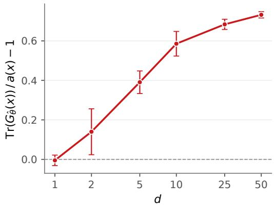  
Figure S1: Per-dimension gap in the leading order. Bars are one standard deviation over conditions (x).

## E.2 Multi-dimensional Gaussian affine transport

To test the impact of bound looseness in higher dimensions, we examined active learning performance in the affine transport of higher-dimensional Gaussians in d ∈ {5, 10, 25, 50}.

Mean field. For $k = 0 , \ldots , d - 1$

$$
\mu _ { k } ( x ) = \alpha e ^ { - \beta x _ { 1 } } \cos \Bigl ( { \frac { 2 \pi k } { d } } + \pi x _ { 2 } \Bigr ) , \qquad \alpha = 2 , \beta = 6 .
$$

All $d$ coordinates are driven by the same two scalars, so the mean field stays intrinsically twodimensional at every d.

Covariance field. The covariance is a smooth, full-rank random field built from $r = d$ random Fourier features:

$$
\Sigma ( x ) = s _ { d } ^ { 2 } \bigl ( A ( x ) A ( x ) ^ { \top } + \varepsilon I _ { d } \bigr ) , \qquad A ( x ) = I _ { d } + \sum _ { j = 1 } ^ { d } f _ { j } ( x ) B _ { j } ,
$$

$$
f _ { j } ( x ) = \sqrt { 2 / d } \cos \bigl ( \omega _ { j } ^ { \intercal } x + \phi _ { j } \bigr ) ,
$$

with $\varepsilon = 1 0 ^ { - 3 }$ and

$$
( B _ { j } ) _ { a b } ^ { \mathrm { \scriptsize ~ i i d } } \sim \mathcal { N } ( 0 , 1 / d ) , \qquad \omega _ { j } \sim \mathcal { N } \big ( 0 , ( 2 \pi \kappa ) ^ { 2 } I _ { 2 } \big ) , \qquad \phi _ { j } \sim \mathcal { U } [ 0 , 2 \pi ) , \qquad \kappa = 1 .
$$

The parameters $\{ B _ { j } , \omega _ { j } , \phi _ { j } \} _ { j = 1 } ^ { d }$ are drawn once per $d ,$ in that order, from a dedicated random generator seeded with d. They are independent of the experiment seed, so every seed sees the same ground-truth field. The scale $s _ { d }$ is calibrated so that the average per-coordinate variance is $\sigma _ { 0 } ^ { 2 } = 1$ Concretely, we draw $M = 2 0 0 0$ calibration conditions $x ^ { ( m ) } \sim \mathcal { U } [ 0 , 1 ] ^ { 2 }$ from a generator with a fixed seed and set

$$
s _ { d } ^ { 2 } = \sigma _ { 0 } ^ { 2 } \Big / \Big ( \frac { 1 } { M d } \sum _ { m = 1 } ^ { M } \mathrm { t r } \big ( A ( x ^ { ( m ) } ) A ( x ^ { ( m ) } ) ^ { \top } + \varepsilon I _ { d } \big ) \Big ) .
$$

With this normalization, the mean and covariance contribute comparably to the variability of the data at every d: the covariance accounts for 41%, 55%, 54% and 51% of the pool’s Bures–Wasserstein variability at $d = 5 , 1 0 , 2 5 , 5 0$ . The condition number of $\Sigma ( x )$ grows with d, reaching about $\mathrm { 3 \times 1 0 ^ { 3 } }$ at $d = 5 0$

Pool, test set and initial set. Let $n _ { \mathrm { p o o l } } ~ = ~ \operatorname* { m a x } ( 2 0 0 , 4 0 d ) , ~ n _ { \mathrm { t e s t } } ~ = ~ \operatorname* { m a x } ( 1 0 0 , 4 0 d )$ and $\begin{array} { r l } { m } & { { } = } \end{array}$ round $\left( { \sqrt { n _ { \mathrm { p o o l } } } } \right)$

• Pool. Take the one-dimensional grid $t _ { i } = i / ( m - 1 ) , i = 0 , \dots , m - 1$ , and perturb each node independently by $\mathcal { U } ( - 0 . 0 5 / m , \bar { 0 . } 0 5 / m )$ . The pool is the Cartesian product of this perturbed grid with itself $( m ^ { 2 }$ conditions). If $m ^ { 2 }$ exceeds $n _ { \mathrm { p o o l } } , n _ { \mathrm { p o o l } }$ of them are kept uniformly at random. The perturbation and the subsample depend on the experiment seed.

• Test set. A fixed, unperturbed $m _ { t } \times m _ { t }$ grid with $m _ { t } = \mathrm { r o u n d } ( \sqrt { n _ { \mathrm { t e s t } } } )$ and nodes equally spaced on $\textstyle { \bigl [ } { \frac { 1 } { 2 m } } , 1 - { \frac { 1 } { 2 m } } { \bigr ] }$ , i.e. offset from the pool by half a cell. It is the same for every seed.

• Initial labelled set. $b _ { 0 } = 3 d$ pool conditions drawn uniformly at random without replacement, depending on the experiment seed.

The resulting sizes are:

<table><tr><td> $d$ </td><td>5</td><td>10</td><td>25</td><td>50</td></tr><tr><td>pool</td><td>196</td><td>400</td><td>1000</td><td>2000</td></tr><tr><td>test</td><td>196</td><td>400</td><td>1024</td><td>2025</td></tr><tr><td>initial  $b _ { 0 }$ </td><td>15</td><td>30</td><td>75</td><td>150</td></tr></table>

Model, training and selection. The model has the same two-network structure as in 2D: a mean network with d outputs and a Cholesky network with $d ( d + 1 ) / 2$ outputs (softplus on the d diagonal entries). Both are ReLU MLPs with 2 hidden layers of width 64 at $d = 5$ and 3 hidden layers of width 256 for $d \ge 1 0$ . In each round, the networks are re-initialized and trained full-batch on the labeled conditions with the Bures–Wasserstein loss $\begin{array} { r } { \frac { 1 } { | S | } \sum _ { x \in S } W _ { 2 } ^ { 2 } \big ( \mathcal { N } ( \mu ( x ) , \Sigma ( x ) ) , \mathcal { N } ( \hat { \mu } ( x ) , \hat { \Sigma } ( x ) ) \big ) } \end{array}$ Training uses Adam (learning rate $1 0 ^ { - 3 }$ , weight decay $1 0 ^ { - 2 }$ , gradient-norm clipping at 1) for at most 2000 steps, with early stopping allowed after step 1000 once the training loss has not improved for 10 consecutive steps. Each d is run with 50 seeds, which set the pool perturbation and subsample, the initial set, the network initializations and the random baseline. Within a seed, all methods share the pool, test set, and initial set.

Results With $B _ { 0 } = 3 d , B = 4 .$ , we see the advantage of tNTK over NTK up to $d = 5 0$ (Table S6).

Table S6: d-dimensional Gaussian benchmark with a full-rank covariance field: test $W _ { 2 } ^ { 2 }$ (total) after the final active-learning round, starting from $b _ { 0 } = 3 d$ labeled conditions and acquiring 5 rounds of $b = 4 ;$ mean ± standard error over 50 seeds; lower is better, best per column in bold.
<table><tr><td>Method</td><td> $d = 5$ </td><td> $d = 1 0$ </td><td> $d = 2 5$ </td><td> $d = 5 0$ </td></tr><tr><td>tNTK</td><td> $\mathbf { 0 . 1 1 6 4 \pm 0 . 0 0 1 4 }$ </td><td> $\mathbf { 0 . 7 4 5 7 \pm 0 . 0 1 6 3 }$ </td><td> $\mathbf { 1 . 1 0 1 7 \pm 0 . 0 1 6 9 }$ </td><td> $\mathbf { 1 . 3 1 0 9 \pm 0 . 0 1 2 3 }$ </td></tr><tr><td>NTK</td><td> $0 . 1 4 6 9 \pm 0 . 0 0 2 8$ </td><td> $0 . 7 9 4 2 \pm 0 . 0 1 4 1$ </td><td> $1 . 1 3 4 6 \pm 0 . 0 1 5 7$ </td><td> $1 . 4 4 4 9 \pm 0 . 0 1 4 1$ </td></tr><tr><td>Random</td><td> $0 . 2 0 8 2 \pm 0 . 0 1 3 1$ </td><td> $0 . 7 7 6 3 \pm 0 . 0 2 8 7$ </td><td> $1 . 1 1 5 0 \pm 0 . 0 2 2 2$ </td><td> $1 . 4 2 1 4 \pm 0 . 0 1 6 3$ </td></tr></table>

## E.3 Results on tNTK computation

In this section, we report compute time and the Monte Carlo stability of the tNTK.

## E.3.1 Kernel compute time

We report the compute time for the tNTK calculation for the conditional Monge gap and flow matching models reported in the main text in Table S7.

## E.3.2 Kernel stability to the number of Monte Carlo samples

We tested the Monte Carlo stability of tNTK with varying numbers of samples. We measured the stability metric of the relative Frobenius error $( \| K ^ { \mathrm { f u l l } } - \check { K } ^ { \mathrm { d o w n s a m p l e d } } \| _ { F } / \| \dot { K } ^ { \mathrm { f u l l } } \| _ { F } )$ and overlap in the selected samples over 20 independent draws and report the mean in Table S8. Specifically, among the reported runs in the main paper, the MC stability is measured from the fold 0, seed 0, AL iteration 1 model. For conditional Monge gap, the reference uses all control cells (K562 3,359, BMDM 25,952), which is also what the reported runs use. Draws are without replacement, so $N \geq 3 { , } 3 5 9$ is not available for K562 (–). For conditional flow matching, the source samples are fresh $\mathcal { N } ( 0 , I )$ draws, the reference uses $N = 6 5 { , } 5 3 6$ , and the reported runs use $N = 4 { , } 0 9 6$

Table S7: Wall-clock cost of the tNTK kernel in the reported active-learning runs. Per AL iteration ≥ 1: kernel construction time (median, with 10th–90th percentile), selection time and model-fit time (medians, seconds), and the kernel’s share of the iteration, $t _ { \mathrm { k e r n e l } } / ( t _ { \mathrm { k e r n e l } } + t _ { \mathrm { s e l e c t } } + t _ { \mathrm { f i t } } )$ (median, %). N is the number of source samples the kernel averages over (conditional Monge: all control cells; CellFlow: fresh $\mathcal { N } ( 0 , I )$ draws). n is the number of AL iterations measured (fit and share use only iterations that trained the model, excluding ones restored from a checkpoint). Times come from the production runs’ own instrumentation on shared GPU nodes, including JIT compilation on the first iteration.
<table><tr><td>Dataset</td><td> $B _ { 0 } + B$ </td><td>N</td><td>Kernel (s)</td><td>Select (s)</td><td>Fit (s)</td><td>Kernel (%)</td><td>n</td></tr><tr><td colspan="8">Conditional Monge</td></tr><tr><td rowspan="6">K562-Chemical</td><td> $1 0 + 1$ </td><td>3,359</td><td>16.4 [11.6, 31.3]</td><td>0.2</td><td>1686</td><td>1.0</td><td>247</td></tr><tr><td> $1 0 + 5$ </td><td>3,359</td><td>21.1 [12.5, 29.9]</td><td>1.5</td><td>2380</td><td>0.8</td><td>177</td></tr><tr><td> $2 0 + 5$ </td><td>3,359</td><td>15.7 [12.5, 28.2]</td><td>1.3</td><td>2747</td><td>0.6</td><td>153</td></tr><tr><td> $2 0 + 1 0$ </td><td>3,359</td><td>37.6 [34.2, 45.1]</td><td>0.6</td><td>4320</td><td>0.9</td><td>250</td></tr><tr><td> $3 0 + 5$ </td><td>3,359</td><td>45.7 [36.8, 51.8]</td><td>0.3</td><td>4151</td><td>1.1</td><td>250</td></tr><tr><td> $3 0 + 1 0$ </td><td> $^ { 3 , 3 5 9 }$ </td><td>44.0 [35.4, 51.6]</td><td>0.7</td><td>5192</td><td>0.7</td><td>250</td></tr><tr><td rowspan="6">BMDM-Genetic</td><td> $1 0 + 1$ </td><td>25,952</td><td>167.1 [120.3, 199.1]</td><td>1.1</td><td>1678</td><td>8.5</td><td>250</td></tr><tr><td> $1 0 + 5$ </td><td>25,952</td><td>160.8 [117.3, 222.1]</td><td>6.3</td><td>3548</td><td>4.3</td><td>250</td></tr><tr><td> $2 0 + 5$ </td><td>25,952</td><td>129.1 [97.5, 179.2]</td><td>6.1</td><td>4160</td><td>3.0</td><td>250</td></tr><tr><td> $2 0 + 1 0$ </td><td>25,952</td><td>193.5 [150.7, 232.9]</td><td>0.6</td><td>4699</td><td>3.8</td><td>250</td></tr><tr><td> $3 0 + 5$ </td><td>25,952</td><td>213.7 [186.7, 251.9]</td><td>0.3</td><td>4593</td><td>4.4</td><td>250</td></tr><tr><td> $3 0 + 1 0$ </td><td>25,952</td><td>253.7 [146.2, 361.3]</td><td>0.8</td><td>6209</td><td>4.0</td><td>272</td></tr><tr><td>CellFlow</td><td></td><td></td><td></td><td></td><td></td><td></td><td></td></tr><tr><td rowspan="3">Radial flow</td><td> $5 + 1$ </td><td>4,096</td><td>30.9 [28.3, 39.6]</td><td>1.3</td><td>299</td><td>9.5</td><td>150</td></tr><tr><td> $5 + 5$ </td><td>4,096</td><td>31.5 [28.4, 42.1]</td><td>7.7</td><td>380</td><td>7.6</td><td>120</td></tr><tr><td> $1 0 + 5$ </td><td>4,096</td><td>31.8 [27.8, 45.0]</td><td>6.2</td><td>359</td><td>8.2</td><td>150</td></tr><tr><td rowspan="3">Van der Pol oscillator</td><td> $5 + 1$ </td><td>4,096</td><td>31.6 [26.2, 44.8]</td><td>1.2</td><td>229</td><td>13.1</td><td>150</td></tr><tr><td> $5 + 5$ </td><td>4,096</td><td>30.7 [25.5, 42.9]</td><td>6.4</td><td>278</td><td>10.1</td><td>150</td></tr><tr><td> $1 0 + 5$ </td><td>4,096</td><td>27.7 [24.8, 33.8]</td><td>6.6</td><td>255</td><td>10.1</td><td>150</td></tr><tr><td rowspan="3">CLINC 150</td><td> $5 + 1$ </td><td>4,096</td><td>40.9 [34.6, 49.1]</td><td>1.5</td><td>922</td><td>4.1</td><td>150</td></tr><tr><td> $5 + 5$ </td><td>4,096</td><td>36.8 [30.1, 51.5]</td><td>7.6</td><td>1338</td><td>2.7</td><td>150</td></tr><tr><td> $1 0 + 5$ </td><td>4,096</td><td>39.2 [29.1, 59.6]</td><td>6.2</td><td>1725</td><td>2.2</td><td>196</td></tr></table>

Table S8: Monte Carlo stability of the tNTK kernel. For each N, the kernel is rebuilt from N source samples and compared with a reference kernel. Err. is the relative Frobenius error (%). Selection % is the percentage of conditions in the selected batch of size B that also appear in the batch selected with the reference kernel (out of B). Mean over 20 independent draws.
<table><tr><td colspan="2"></td><td colspan="2">N = 256</td><td colspan="2">N = 1,024</td><td colspan="2"> $N = 4 { , } 0 9 6$ </td><td colspan="2">N = 16,384</td></tr><tr><td colspan="2">Dataset</td><td> $B _ { 0 } + B$  Err.</td><td>Selection %</td><td>Err.</td><td>Selection %</td><td>Err.</td><td>Selection %</td><td>Err.</td><td>Selection %</td></tr><tr><td colspan="2">Conditional Monge</td><td></td><td></td><td></td><td></td><td></td><td></td><td></td><td></td></tr><tr><td rowspan="6">K562-Chemical</td><td> $1 0 + 1$ </td><td>2.52</td><td>100.0</td><td>1.16</td><td>100.0</td><td></td><td></td><td></td><td></td></tr><tr><td> $1 0 + 5$ </td><td>2.52</td><td>70.0</td><td>1.16</td><td>82.0</td><td></td><td></td><td></td><td></td></tr><tr><td> $2 0 + 5$ </td><td>4.04</td><td>100.0</td><td>1.56</td><td>100.0</td><td></td><td></td><td></td><td></td></tr><tr><td> $2 0 + 1 0$ </td><td>4.04</td><td>99.5</td><td>1.56</td><td>99.5</td><td></td><td></td><td></td><td></td></tr><tr><td> $3 0 + 5$ </td><td>4.84</td><td>97.0</td><td>2.01</td><td>100.0</td><td></td><td></td><td></td><td></td></tr><tr><td> $3 0 + 1 0$ </td><td>4.84</td><td>96.0</td><td>2.01</td><td>100.0</td><td>一</td><td></td><td>一</td><td></td></tr><tr><td rowspan="6">BMDM-Genetic</td><td> $1 0 + 1$ </td><td>2.54</td><td>50.0</td><td>1.25</td><td></td><td>75.0 0.44</td><td>100.0</td><td>0.17</td><td>100.0</td></tr><tr><td> $1 0 + 5$ </td><td>2.54</td><td>33.0</td><td>1.25</td><td>73.0</td><td>0.44</td><td>97.0</td><td>0.17</td><td>100.0</td></tr><tr><td> $2 0 + 5$ </td><td>3.18</td><td>90.0</td><td>1.88</td><td>98.0</td><td>0.72</td><td>100.0</td><td>0.27</td><td>100.0</td></tr><tr><td> $2 0 + 1 0$ </td><td>3.18</td><td>86.5</td><td>1.88</td><td>91.5</td><td>0.72</td><td>100.0</td><td>0.27</td><td>100.0</td></tr><tr><td> $3 0 + 5$ </td><td>3.38</td><td>86.0</td><td>1.80</td><td>99.0</td><td>0.94</td><td>100.0</td><td>0.29</td><td>100.0</td></tr><tr><td> $3 0 + 1 0$ </td><td>3.38</td><td>88.0</td><td>1.80</td><td>94.5</td><td>0.94</td><td>99.5</td><td>0.29</td><td>100.0</td></tr><tr><td colspan="2">CellFlow</td><td></td><td></td><td></td><td></td><td></td><td></td><td></td><td></td><td></td></tr><tr><td rowspan="3">Radial flow</td><td>5+ 1</td><td>2.53</td><td>30.0</td><td>1.90</td><td></td><td>20.0 1.06</td><td></td><td>45.0</td><td>0.71</td><td>30.0</td></tr><tr><td> $5 + 5$ </td><td>2.68</td><td></td><td>78.0 2.02</td><td></td><td>83.0</td><td>1.24</td><td>80.0</td><td>1.03</td><td>84.0</td></tr><tr><td> $1 0 + 5$ </td><td>3.68</td><td>85.0</td><td>2.52</td><td></td><td>85.0 1.55</td><td></td><td>82.0</td><td>0.87</td><td>80.0</td></tr><tr><td rowspan="3">Van der Pol oscillator</td><td>5+ 1</td><td>3.62</td><td>100.0</td><td>2.72</td><td></td><td>100.0</td><td>1.47</td><td>100.0</td><td>0.99</td><td>100.0</td></tr><tr><td> $5 + 5$ </td><td>3.62</td><td></td><td>87.0 2.71</td><td></td><td>92.0</td><td>1.47</td><td>98.0</td><td>0.99</td><td>97.0</td></tr><tr><td> $1 0 + 5$ </td><td>3.50</td><td>92.0</td><td>2.44</td><td></td><td>89.0 1.44</td><td></td><td>89.0</td><td>0.87</td><td>88.0</td></tr><tr><td rowspan="3">CLINC 150</td><td>5+ 1</td><td>1.82</td><td>100.0</td><td>1.13</td><td></td><td>100.0</td><td>0.55</td><td>100.0</td><td>0.27</td><td>100.0</td></tr><tr><td>5+ 5</td><td>1.85</td><td></td><td>74.0 1.16</td><td></td><td>87.0</td><td>0.56</td><td>92.0</td><td>0.27</td><td>98.0</td></tr><tr><td> $1 0 + 5$ </td><td>1.58</td><td>71.0</td><td>0.90</td><td></td><td>91.0</td><td>0.41</td><td>100.0</td><td>0.26</td><td>100.0</td></tr></table>

## E.4 Additional baselines

We present additional baselines for the results presented in the main text. For affine transport of 2D Gaussian distributions, we also benchmarked against BatchBALD (NTK with greedy maximum determinant selection) and BADGE-style (NTK with k-means++ selection) adapted for the regression as in Holzmüller et al. [25] (Table S9). tNTK, with minimization of total posterior variance selection, outperforms all NTK-based baselines.

Table S9: 2D Gaussian: NTK-based batch-selection baselines. Decrease of $W _ { 2 } ^ { 2 }$ relative to the initial training set, averaged over AL iterations 1–5 (units $1 0 ^ { - 3 }$ ; more negative is better), mean $\pm \ \mathrm { s . e . m } ,$ . over 30 seeds.
<table><tr><td>Method</td><td> $\Delta W _ { 2 } ^ { 2 } \left( \downarrow \right)$ </td></tr><tr><td>tNTK</td><td> $- 4 3 1 . 5 8 \pm 2 6 . 6 8$ </td></tr><tr><td>NTK (BAIT; NTK + total posterior variance minimization)</td><td> $- 3 6 4 . 1 5 \pm 2 6 . 5 9$ </td></tr><tr><td>BatchBALD (NTK + maximum determinant)</td><td> $- 3 6 0 . 9 4 \pm 2 6 . 3 0$ </td></tr><tr><td>BADGE-style (NTK + k-means++)</td><td> $- 4 0 5 . 8 8 \pm 2 7 . 0 9$ </td></tr><tr><td>Random</td><td> $- 3 6 3 . 9 3 \pm 2 6 . 0 9$ </td></tr></table>

We also benchmark tNTK in a larger-batch regime with LCMD selection, which Holzmüller et al. [25] has shown to perform the best in a large-batch scenario of $B _ { 0 } = 5 , B = 2 0$ with 1 active learning iteration. In this scenario, the LCMD selection outperformed total posterior variance minimization, while tNTK outperformed NTK (Table S10). The result shows the importance of choosing the right selection algorithm in various active learning settings, as has been shown before [81]. We defer the investigation of the synergy between the tNTK and selection algorithms to future studies.

Table S10: 2D Gaussian: LCMD versus minimum total posterior variance (BAIT) as the batchselection rule. Mean ± standard error over 50 seeds is shown. The two rules are matched runs (same seeds, initial set, and round-0 model). Random ignores the kernel and the selection rule, so its row is shared.
<table><tr><td>Kernel</td><td>LCMD</td><td>Min. total posterior variance</td></tr><tr><td>tNTK</td><td> $\mathbf { 0 . 0 5 7 3 \pm 0 . 0 0 2 1 }$ </td><td> $0 . 0 7 8 8 \pm 0 . 0 0 2 6$ </td></tr><tr><td>NTK</td><td> $0 . 0 6 4 3 \pm 0 . 0 0 2 5$ </td><td> $0 . 2 1 5 3 \pm 0 . 0 0 7 2$ </td></tr><tr><td>Random</td><td></td><td> $0 . 1 2 3 4 \pm 0 . 0 0 6 1$ </td></tr></table>

The experimental settings are identical to those presented in the main text unless otherwise mentioned, and are described in detail in Appendix D.3.

## F Supplementary Figures

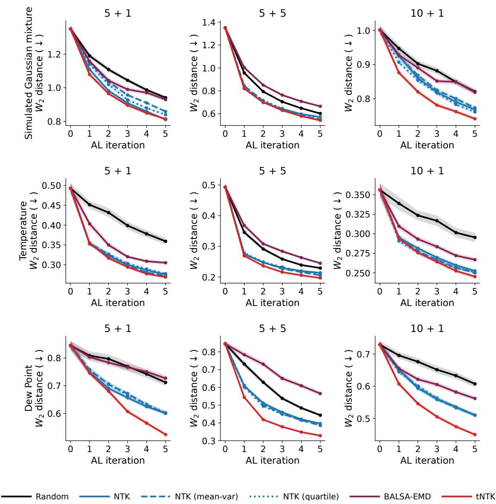  
Figure S2: Wasserstein-2 distance over active learning iterations for the conditional quantile regression experiment. Rows correspond to datasets (Simulated Gaussian mixture, Temperature, Dew Point); columns correspond to budget configurations $B _ { 0 } + B$ (initial training set size + per-round batch size). Lines show mean across 50 runs (5 folds × 10 seeds), with shaded bands showing ± standard error. Random in black, NTK in blue, tNTK in red.

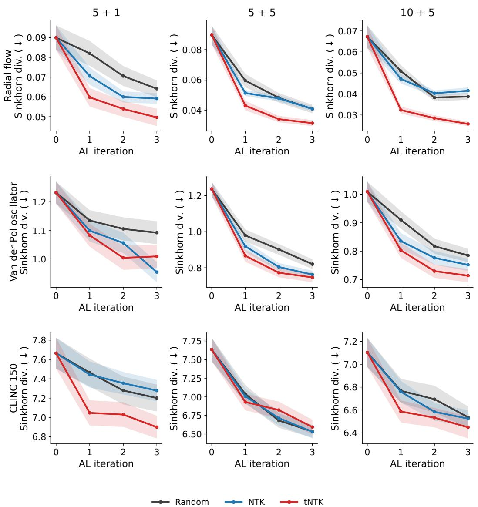  
Figure S3: Sinkhorn divergence over active learning iterations for conditional flow matching. Rows correspond to datasets (radial flow, Van der Pol oscillator, CLINC150); columns correspond to budget configurations $B _ { 0 } + B$ (initial training set size + per-round batch size). Lines show mean across 50 runs (5 folds × 10 seeds), with shaded bands showing ± standard error. Random in black, NTK in blue, tNTK in red.

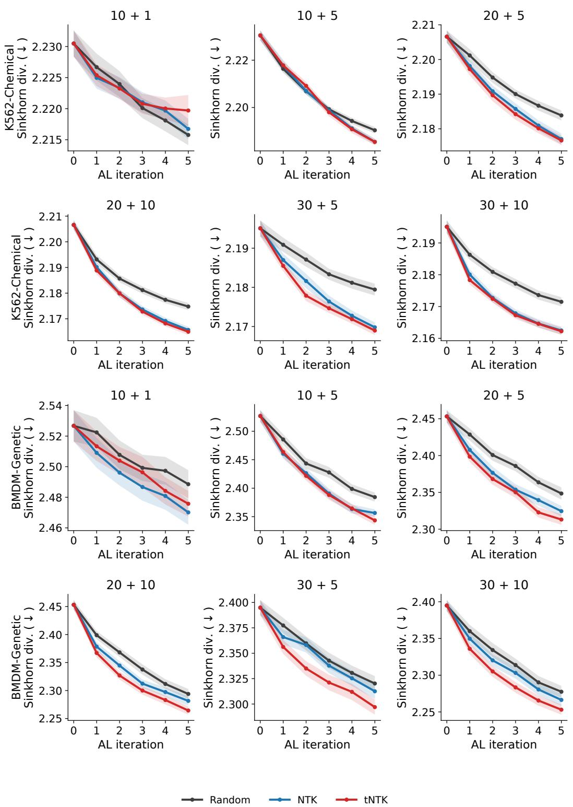  
Figure S4: Sinkhorn divergence over active learning iterations for the conditional Monge gap. Rows correspond to datasets (K562-Chemical, BMDM-Genetic); columns correspond to budget configurations $B _ { 0 } + B$ (initial training set size + per-round batch size). Lines show mean across 50 runs (5 folds × 10 seeds), with shaded bands showing ± standard error. Random in black, NTK in blue, tNTK in red.