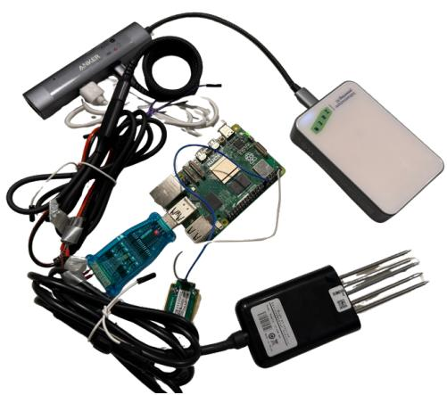
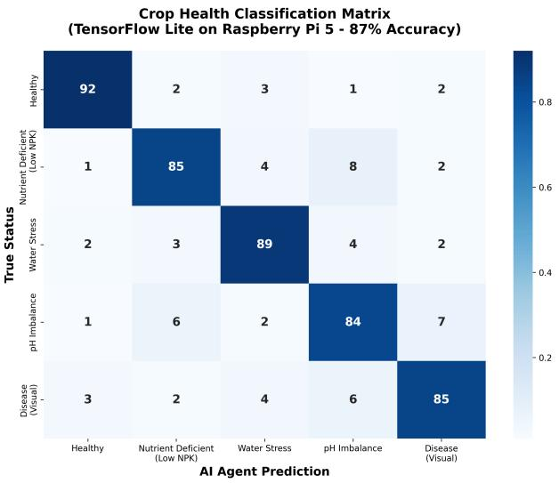
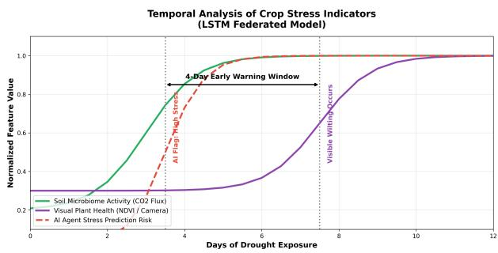

# AgriDefend: A \$205 Offline Edge Device that Detects Crop Stress Before Visible Symptoms via Multimodal AI Fusion

George Xu

Independent Researcher

Nikhil Vincent

Bothell, WA, USA

Independent Researcher

georgexu5588@gmail.com

Bothell, WA, USA

Elizabeth S. Forbes

nikhil.vincent.v@gmail.com

Univ. of Michigan, School for

Environment and Sustainability

Ann Arbor, MI, USA

forbeselizabeth.s@gmail.com

Abstract—Most in-field crop-monitoring devices sense a single modality—either a camera looking at the canopy or a probe reading the soil—and so cannot detect stress that begins below ground before it becomes visible above it. We present AgriDefend, a self-contained consumer-grade edge device that fuses both. A MobileNetV2 convolutional neural network (CNN) analyses canopy imagery, and a Random Forest classifier integrates trend features from a single soil probe: moisture, the rate of change in pH and in N, P, K, and belowground CO2 relative to ambient (a proxy for soil respiration). A logistic-regression meta-learner fuses the two into a five-class crop-health prediction, all on a Raspberry Pi 5 with no cloud or cellular link. On a controlled greenhouse drought trial with wild radish, the fused model reached 87% accuracy (R2 = 0.88, MAE = 0.05) at 1.4 s INT8 TensorFlow Lite inference, and its soil signals preceded visible wilting by about four days. The complete bill of materials is \$205, roughly a fifth of comparable commercial nodes, positioning multimodal, sustainable crop sensing as a practical consumerelectronics product for connectivity-limited settings.

Index Terms—edge AI, consumer IoT, precision agriculture, multimodal sensor fusion, TensorFlow Lite, sustainability

## I. INTRODUCTION

Agriculture is the largest human use of freshwater—about 70% of global withdrawals—and a major consumer of synthetic nitrogen and phosphorus fertilizers, while extreme weather and soil degradation add to the stress crops experience in the field [4], [7]. Precision-agriculture sensors help growers respond, but two barriers keep them out of many hands. First, most commercial systems assume the cloud: they need continuous cellular or broadband connectivity to push data to a server, which rural areas often lack. Second, commercial nodes frequently cost more than \$1,000 each.

There is also a diagnostic gap. Vision models detect visible leaf disease and water stress from RGB imagery [5], [8], and tabular models map soil chemistry to nutrient status [6], but each uses a single modality and cannot relate what happens in the soil to what the canopy shows. Because visible stress lags the deficit that causes it, one modality gives little warning. Multimodal late fusion—running a separate model per modality and combining their outputs [1]—is well suited to an image stream and a low-rate soil stream that are sampled asynchronously.

AgriDefend brings these ideas together in a low-cost consumer device. Because single-modality vision already classifies visible stress at 85–99% [5], [8], our contribution is not higher accuracy on an already-symptomatic plant but two things a lone camera or probe cannot give: (i) lead time— an asynchronous late-fusion model in which the soil branch surfaces a deficit before the canopy shows it—and (ii) stresstype discrimination across five states (Healthy, Water Stress, Nutrient Deficient, pH Imbalance, Disease), delivered on (iii) an offline-first hardware platform that runs the model for \$205 with no cloud or cellular dependency. To our knowledge this combination—canopy–soil fusion, pre-symptomatic detection, and fully offline low-cost edge deployment in one device— has not been shown before. By offline-first we mean a device that senses, infers, and serves results locally and treats any network connection as optional.

## II. RELATED WORK

Machine learning for crop health has largely grown along two separate tracks. On the vision side, convolutional networks classify visible disease and water stress from RGB imagery at 85–99% accuracy under controlled conditions [5], [8], and lightweight backbones such as MobileNet have made ondevice inference practical. On the sensing side, tabular models map soil moisture and NPK readings to nutrient status or yield [6]. Both lines are mature, yet each sees only half of the plant–soil system: a camera cannot see a developing root-zone deficit, and a soil probe cannot see a leaf lesion. Multimodal learning is the natural bridge [1], and among the usual early-, late-, and hybrid-fusion strategies, late fusion fits best when the two streams are sampled at very different rates and must be combined on resource-constrained hardware. Existing multimodal agriculture systems, however, tend to assume cloud connectivity for the fusion step or rely on research-grade instrumentation rather than a self-contained, low-cost field device. AgriDefend targets exactly that gap:

  
Fig. 1. The AgriDefend node: Arducam camera (top left), Raspberry Pi 5, the ADS1115/MAX485 bridge board (blue), an RS-485 7-in-1 soil probe (right), and a battery pack. The bridge lets the Pi read the Modbus soil sensors over RS-485.

TABLE I  
BILL OF MATERIALS (PER NODE).
<table><tr><td>Part</td><td>Qty</td><td>Cost</td></tr><tr><td>Raspberry Pi 5</td><td>1</td><td>$60</td></tr><tr><td>Arducam module</td><td>1</td><td>$25</td></tr><tr><td>RS-485 7-in-1 soil sensor</td><td>1</td><td>$75</td></tr><tr><td>MH-Z19C CO2 sensor</td><td>1</td><td>$20</td></tr><tr><td>ADS1115 &amp; MAX485 ICs</td><td>1 set</td><td>$10</td></tr><tr><td>3D-printed case</td><td>1</td><td>$15</td></tr><tr><td>Total</td><td></td><td>$205</td></tr></table>

canopy–soil late fusion, pre-symptomatic detection, and fully offline inference in one \$205 unit.

## III. SYSTEM DESIGN

## A. Hardware

A waterproof enclosure houses an RS-485 soil probe, an RS-485 Modbus RTU sensor, and the cabling. The Raspberry Pi 5 cannot read analog signals or speak RS-485 over its GPIO, so a bridge (Fig. 1) uses an ADS1115 for analog-to-digital conversion over I2C and a MAX485 to convert TTL-level UART to RS-485. An Arducam captures the visual stream. The Pi also acts as its own Wi-Fi access point (hostapd, dnsmasq); a React Native app reads live data from a local Flask API when a user joins the device’s network—no cell service or cloud account needed.

## B. Multimodal Late-Fusion Model

The visual branch captures RGB frames at 1 FPS, preprocesses with OpenCV [2] (HSV conversion, gamma correction $\gamma = 1 . 2 )$ , and feeds a MobileNetV2 backbone with a five-class head, producing a probability vector $\textbf { V } \in \ \mathbb { R } ^ { 5 }$ over {Healthy, Water Stress, Nutrient Deficient, pH Imbalance, Disease}. The soil branch samples RS-485 telemetry every 5 min into ${ \bf S } = [ \dot { p } \mathrm { H } , \Delta \mathrm { C O } _ { 2 } , \dot { N } , \dot { P } , \dot { K } , \theta ]$ , where dots denote temporal slopes and θ is volumetric moisture. Because lowcost sensors are noisy (NPK error up to ±15%), the branch uses trend features: OLS slopes over sliding windows, and a differential $\mathrm { C O _ { 2 } }$ signal

$$
\Delta \mathrm { C O } _ { 2 } ( t ) = \mathrm { C O } _ { 2 , \mathrm { s u b } } ( t ) - \overline { { \mathrm { C O } _ { 2 , \mathrm { a m b } } } } ( t )\tag{1}
$$

that isolates root-zone activity from atmospheric swings. A Random Forest $\begin{array} { r l r } { ( n _ { \mathrm { e s t } } } & { { } = } & { 2 0 0 . } \end{array}$ depth 15, class\_weight=balanced) [3] maps S to $\textbf { R } \in \ \mathbb { R } ^ { 5 }$ A logistic-regression meta-learner fuses V and R; we keep this combiner deliberately lightweight rather than using an attention- or transformer-based fusion head, because the branches sample at very different rates and are fused asynchronously, a linear combiner cannot overfit a small field dataset the way a high-capacity head can, and it adds negligible latency while yielding interpretable per-modality weights. The most recent soil vector is carried forward and fused with each incoming frame, so a prediction is available at camera rate. The final class is ${ \hat { y } } = \arg \operatorname* { m a x } \mathbf { F } $ To rule out train-on-test leakage, the meta-learner is fit only on out-of-fold predictions from the training partition, generated by 5-fold cross-validation within the training set; the validation and test partitions are never seen during fusion training. Fusion uses cross-entropy loss with balanced class weighting.

## C. Offline operation and interface

Everything a grower needs runs on the node itself. The Raspberry Pi 5 hosts its own Wi-Fi access point (hostapd, dnsmasq), so a phone joins the device directly with no router, SIM card, or cloud account; a React Native app then reads live predictions and soil-sensor trends from a local Flask API. Each node is fully self-contained, and a field of nodes has no shared gateway or server to fail. Beyond the predicted class, the app surfaces which modality drove an alert—a direct benefit of the interpretable per-modality fusion weights—so a grower can tell whether a warning came from the canopy or from the soil before acting on it. This offline-first, human-in-the-loop design is what makes AgriDefend usable as a consumer product in connectivity-limited settings rather than a lab demonstrator.

## IV. EVALUATION

## A. Accuracy

We trained on n = 3,165 wild-radish (Raphanus raphanistrum) images (80/20 split, augmentation on training only) and evaluated in a controlled greenhouse drought trial (one node per pot across 10 pots, over 7 days after final watering). Accuracy is measured against expert visual scoring together with gravimetric soil-moisture labels. The fused model reached 87% overall accuracy $( R ^ { 2 } = 0 . 8 8$ , MAE $= 0 . 0 5 )$ , with 92% precision on the Healthy class. An ablation confirms fusion helps: CNN-only 78%, RF-only 75%, full fusion 87%. The nine-point gain of fusion over the stronger single branch is larger than the gap between the two branches themselves, which suggests the image and soil streams carry complementary rather than redundant information—the metalearner recovers cases that neither modality classifies confidently alone. The 92% precision on the Healthy class also matters in practice: a field-warning tool that cries wolf quickly loses a grower’s trust, and the system stays conservative about declaring a plant stressed.

Fig. 2. Five-class confusion matrix, TensorFlow Lite on Raspberry Pi 5 (87% overall accuracy).  
  
Fig. 3. Soil $\mathrm { C O _ { 2 } }$ flux and moisture deficit rise several days before visible wilting.

## B. Edge Latency

On an identical input (224 × 224 RGB frame plus 6-feature soil vector), averaged over 50 runs, inference latency was 3.5 s via a cloud endpoint, 2.8 s for full-precision TensorFlow on a Raspberry Pi 4, and 1.4 s (±0.08 s) for INT8 TensorFlow Lite on a Raspberry Pi 5. Only the last met our 2.0 s target for realtime field use [10].

## C. Early Warning

In the drought trial, the soil branch flagged rising differential $\mathrm { C O _ { 2 } }$ and an accelerating moisture deficit at ∼day 3.5, while the CNN branch did not register visible wilting until ∼day 7.5 (Fig. 3)— an early-warning window of about four days. This ordering is what root-zone physiology predicts: as the rhizosphere dries, falling root hydraulic conductance triggers stomatal closure before turgor loss becomes visible, so a soil-side moisture and respiration signal necessarily leads the canopy symptom [11], [12].

## V. DISCUSSION

A single \$205 node costs about a fifth of a commercial competitor, so a grower could deploy a five-node mesh for less than one commercial unit and map where stress is developing across an acre. Because each unit is decentralized and offlinecapable, an array of nodes has no single gateway to fail. The contribution is not to beat single-modality accuracy on alreadyvisible stress—a well-solved problem [5], [8]—but to add the lead time and stress-type resolution a single modality cannot.

## A. Limitations and future work

We are careful not to over-claim from these numbers. Validation is greenhouse-based and covers a single species (wild radish) in one drought trial across ten pots, with ground truth from expert visual scoring and gravimetric soil-moisture labels rather than instrumented plant-physiology measurements. The five-class scheme is also dominated by water stress in this trial; the remaining classes are represented but not yet stress-tested across many field conditions. The next steps, which we are actively pursuing, are open-field deployment at multiple sites, additional crop species, per-stress-type lead-time characterization, and quantitative physiological ground truth such as leaf water potential and tissue nutrient assays. On the hardware side, LoRaWAN meshing would free nodes from local Wi-Fi range [9] and enable the distributed, gateway-free arrays that motivate the offline-first design in the first place.

## REFERENCES

[1] T. Baltrusaitis, C. Ahuja, and L.-P. Morency, “Multimodal machineˇ learning: A survey and taxonomy,” IEEE Trans. Pattern Anal. Mach. Intell., vol. 41, no. 2, pp. 423–443, 2018.

[2] G. Bradski, “The OpenCV library,” Dr. Dobb’s Journal of Software Tools, 2000.

[3] L. Breiman, “Random forests,” Machine Learning, vol. 45, no. 1, pp. 5– 32, 2001.

[4] J. A. Foley et al., “Solutions for a cultivated planet,” Nature, vol. 478, pp. 337–342, 2011.

[5] A. Kamilaris and F. X. Prenafeta-Boldu, “Deep learning in agriculture:´ A survey,” Comput. Electron. Agric., vol. 147, pp. 70–90, 2018.

[6] K. G. Liakos et al., “Machine learning in agriculture: A review,” Sensors, vol. 18, no. 8, p. 2674, 2018.

[7] J. Mateo-Sagasta, S. M. Zadeh, and H. Turral, More People, More Food, Worse Water? FAO, Rome, 2018.

[8] S. P. Mohanty, D. P. Hughes, and M. Salathe, “Using deep learning for´ image-based plant disease detection,” Front. Plant Sci., vol. 7, p. 1419, 2016.

[9] P. P. Ray, “Internet of things for smart agriculture,” J. Ambient Intell. Smart Environ., vol. 9, no. 4, pp. 395–420, 2017.

[10] W. Shi, J. Cao, Q. Zhang, Y. Li, and L. Xu, “Edge computing: Vision and challenges,” IEEE Internet Things J., vol. 3, no. 5, pp. 637–646, 2016.

[11] M. A. Ahmed, J. Passioura, and A. Carminati, “Hydraulic processes in roots and the rhizosphere pertinent to increasing yield of water-limited grain crops: a critical review,” J. Exp. Bot., vol. 69, no. 13, pp. 3255– 3265, 2018.

[12] Y. Mullers, J. A. Postma, H. Poorter, and D. van Dusschoten, “Stomatal¨ conductance tracks soil-to-leaf hydraulic conductance in faba bean and maize during soil drying,” Plant Physiol., vol. 190, no. 4, pp. 2279– 2294, 2022.