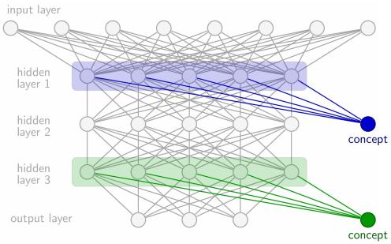
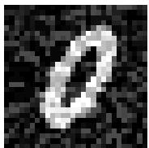
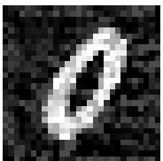
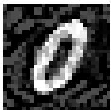
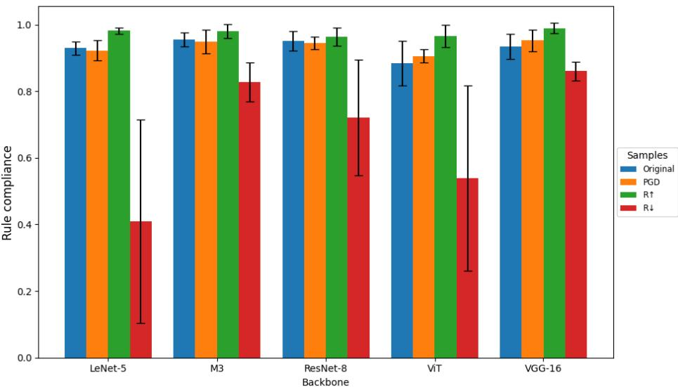

# Attack logics, not outputs: Towards efficient robustification of deep neural networks by falsifying concept-based properties

Raik Dankworth Institute of Software Engineering and Programming Languages University of Luebeck r.dankworth@uni-luebeck.de

Felix Mächtle Institute of IT Security University of Luebeck f.maechtle@uni-luebeck.de

Thomas Eisenbarth Institute of IT Security University of Luebeck thomas.eisenbarth@uni-luebeck.de

Geinsa Schwalbe Institute of Software Engineering and Programming Languages University of Luebeck gesina.schwalbe@uni-luebeck.de

## Abstract

Deep neural networks (NNs) for computer vision are vulnerable to adversarial attacks, such that minuscule malicious changes to inputs may induce unintuitive outputs. One key approach to verify and mitigate such robustness issues is to falsify expected output behavior, which enables local robustness guarantees and adversarial training. Due to the black-box nature of NNs, current attacks only falsify a class of the final output, such as flipping from stop\_sign to ¬stop\_sign. In this work we argue that robustness analysis should focus more generally on logical inconsistencies in concept-level reasoning rather than solely on output misclassification. We formalize this perspective through concept-based properties, i.e., constraints over human-interpretable concepts such as red ∧ octogonal =⇒ stop\_sign and study the falsification of such properties as a principled form of adversarial attack. Furthermore, an implementation of concept-based properties on already trained NNs is proposed using techniques from concept-based explainable artificial intelligence (C-XAI). For that we formally prove that attacks on concept-based properties are expected to have a reduced search space compared to simple class falsification, whilst arguably be more aligned with intuitive robustness targets. The practical effectiveness of our approach for logically informed adversarial training is shown in an empirical study across multiple models and datasets, including both vision and a security-relevant code processing task. Our results demonstrate that concept-level falsification generalizes classical adversarial attacks: Retraining on our novel attacks maintains robustness gains as compared to classical adversarial retraining whilst better eliminating semantic biases.

## 1 Introduction

Neural Networks (NNs) excel in processing subsymbolic inputs like images, and are increasingly being considered for use in safety-critical domains [47]. This makes it crucial to ensure their robust and intuitive generalization, at least around known training cases. One tool to evaluate vulnerability to malicious attacks are Adversarial Attacks (AAs): These craft inputs that induce incorrect or unexpected predictions of an NN f, using minimal modifications to a correctly handled input x with $\mathbf { y } = f ( \mathbf { x } )$ [57, 33, 23, 70, 72, 61, 40]. However, existing attacks solely focus on altering the model’s final output, i.e., falsify ∀x′ ∈ Nbhd(x): $f ( \mathbf { x } ^ { \prime } ) = y$ for some neighborhood Nbhd(x) around x such as an ϵ-ball. This disregards whether the prediction still conforms to high-level, interpretable properties. Common examples of known properties are sufficient conditions, e.g., red(x) ∧ octogonal(x) =⇒ stop\_sign(x) in traffic sign recognition from images x; and necessary conditions, like ¬octogonal(x) =⇒ ¬stop\_sign(x). More general, we call rules involving unary predicates that are not available from the NN outputs concept-based properties. Rich semantic rules are known to be well suited for runtime plausibility monitoring [51, 20] and respective correction of NN outputs [20, 31, 2]. In particular, they don’t constrain the local output to be correct, but the underlying general logical reasoning locally around the sample.

One reason why falsification of such informative constraints is not considered for attack generation so far is that they require outputs for all involved predicates—not only the available final output, like stop\_sign. These additional outputs however, might need a considerable amount of training data or hyperparameter tuning if added right away during the training; or, even worse, not all properties and thus not all required concepts might be known at training time due to specification gaps or later domain transfer [63]. Meanwhile, NNs automatically learn to encode task-related concepts in their intermediate outputs. For example, when trained for stop\_sign recognition, the NN may implicitly learn to identify octagons, red color, and the stop\_label. Post-hoc supervised concept-based explainability methods [4, 16, 10, 42] can recover this information in a very sample-efficient manner with minimal additions to the NN structure. We use this as key to access concepts post-hoc.

Altogether, we propose and analyze a general AA goal —the Concept-based Property Attack (Con-PAtt)—that explicitly targets falsification of symbolic concept-based properties over non-symbolic inputs. As we will show, our formulation offers a more general way to define both targeted and untargeted attacks. As opposed to classical attacks that purely change the output, our attack on ¬octogonal =⇒ ¬stop\_sign can produce an image still classified as stop\_sign, in which the octogonal concept is no longer recognized. This newly allows to uncover failure cases with semantically inconsistent yet high-confidence predictions that are invisible to standard attacks. A practical benefit we show empirically is that these semantic-aware adversarial examples do not only (1) achieve competitive robustness gains when used for adversarial training, but (2) are also better in eliminating semantic bias as compared to standard AA formulations. As we show, standard white-box attack techniques can still easily and efficiently be applied, producing meaningful attacks and a more constrained adversarial space as compared to traditional AAs.

Contributions. Our main contributions are:

• We introduce ConPAtt, a general XAI-supported adversarial attack objective that targets conceptbased properties rather than just NN outputs.

• We prove that ConPAtt generalizes both classical targeted and untargeted AA formulations, but operates on a same-sized or smaller adversarial space.

• We empirically show that ConPAtt enables semantic perturbations that achieve competitive robustness under adversarial retraining, and improved semantic bias correction in vision and language models.

## 2 Related Work

Adversarial Attacks AAs generally search within the vicinity of an input sample x for minimally perturbed variants $\tilde { x } = x + \epsilon$ ϵ that have a malicious effect on the NN’s output [27]. The perturbations can be arbitrary (digital AAs, considered here) [58, 64, 55, 62, 72, 61], or further constrained to realistic changes (physical AAs) [33, 23, 15, 34, 57, 70]. However, the minimality makes the changes often invisible or difficult to see for humans. At the methodological level, black-box approaches only require access to NN inputs and outputs [34, 57, 23, 25, 60, 70]. White-box attacks, as considered here, instead exploit NN model internals such as the gradient for a more efficient search [58, 64, 62, 33, 72, 61]. Generally, AAs can be seen as a subfield of NN verification that falsifies a continuity property [35, 56]. Thus, usual search, reachability analysis, and—most prominently— optimization techniques are applicable to find or disprove adversarial examples [27]. Regarding types of specifications beyond continuity properties, Baninajjar et al. [3] recently formally investigated local deviations between two NNs, and approaches such as Scenic [18] and VerifAI [13] demonstrate how formal specifications can be used to generate and analyze simulation-based scenarios with symbolic inputs. In contrast, our approach targets AAs on non-symbolic image inputs, which prevents the direct use of such tools but similarly requires formal specifications.

Concept-based Explainability Concept-based explainability generally aims to associate humaninterpretable concepts with representations in NN latent space [32, 44, 50]. This includes understanding which concepts are relevant to the decision and to what extent [59, 42], and how these can be accurately recognized in NNs [16, 49]. If concept definitions in form of labeled samples are available at training time, ante-hoc approaches [29, 59, 68, 41, 67] can train individual neurons to activate for the concept. We here instead consider post-hoc approaches: These train a simple model to predict the concept of interest from an NN layer’s activation [28]. Other than single-neuron-associations [5, 43], or complex models [9, 69], linear models considered here [17, 28, 21, 38] pose a good tradeoff between capturing the entanglement of representations [17, 14], interpretability [28], and favorably simple representation of the concept as halfspace in the NN’s latent space.

XAI and Verification Prior work has shown that concept-based explanation methods are vulnerable to adversarial attacks. Perturbations can mislead attribution [53] and concept-based tools [39, 6], and adversarial examples significantly alter the internal concept composition of NNs [39], confirming the general fragility of interpretability methods [19]. However, these studies target concepts in isolation, without considering their joint relation to model predictions.

Beyond highlighting vulnerabilities, concept outputs have also been used for verification. Mangal et al. [37] employed vision–language models to check concept-based properties. While expressive, this approach relies on semantic similarity in multimodal embeddings (e.g., CLIP [46]), which can introduce linguistic ambiguity as well as imprecision for similar terms with small visual differences, $\mathrm { e . g . }$ , circle versus octagon. Moreover, it is restricted to the latent space of a specific layer, although simple visual concepts may predominantly appear earlier and diminish in later layers. Cheng et al. [8] proposed specifications close to the output layer, but without decomposing them into underlying concepts and by employing an additional NN. Semantic losses [66, 2] like logic tensor networks [2] suggest to directly train concept-based rules into the network. These techniques, however, are only used for updating the NN, not for verification as done in [51], and not for AAs. Furthermore, they rely on concepts being direct outputs of the NN. Even further decoupling the verification from the NN’s learned representations and thus exacerbating training efforts, Xie et al. [65] even trained completely separate NNs for predicting the concepts. Our work also directly addresses the relationship between concepts and model outputs, a perspective that has received little attention so far [51]. However, similar to the verification testing techniques from [8, 51], we suggest to keep training and verification efforts low by using faithful explainability techniques to access concept predictions, and we newly apply the setup to AAs.

## 3 Background

Adversarial Attacks $\operatorname { L e t } \mathbf { x } \in \mathcal { X }$ be a real image, $\mathbf { y } \in \mathcal { V }$ be its true label, and $f \colon \mathcal { X }  \mathcal { Y }$ be a NN. An AA seeks an adversarial example $\mathbf { x } ^ { \mathrm { a d v } } : = \mathbf { x } + \epsilon \in \mathcal { X }$ so that its output is (sufficiently) different from the original, and the perturbation ϵ is minimal to an objective function o (usually the L1, L2, or L-infinity norm on the input for digital attacks). Sufficient difference can be formulated in terms of a y-specific partition of the output set Y into a benign output set $y + \subset y$ with $f ( \mathbf { x } ) \in \mathcal { V } ^ { + }$ , and a malicious one $\mathcal { V } ^ { - } : = \mathcal { V } \backslash \mathcal { V } ^ { + }$ . The search for the minimum perturbation ϵ then is the optimization problem

$$
\mathrm { a r g m i n } _ { \epsilon } o ( \epsilon ) \qquad \mathrm { s . t . } \ f ( { \bf x } + \epsilon ) \in \mathcal { V } ^ { - } \ .\tag{1}
$$

  
Figure 1: Post-hoc Concept Extraction: Two neurons for concept output (blue and green neurons) are post-hoc added to the trained NN (gray) using newly trained connections to hidden layers 1/3.

Adversarial attack strategies for classification are commonly categorized as targeted or untargeted, depending on the definition of the set $y - z$

$$
\mathcal { Y } ^ { - } = \left\{ \begin{array} { l l } { \{ \mathbf { y } \in \mathcal { Y } \mid \mathbf { y } \mid \mathbf { \forall } \mathcal { k } l \} , } & { \mathrm { ~ ( u n t a r g e t e d ) } , } \\ { \{ \mathbf { y } \in \mathcal { Y } \mid \mathbf { y } \vdash l ^ { \prime } \} , } & { \mathrm { ~ ( t a r g e t e d ) } , } \end{array} \right.
$$

where l denotes the true class and ${ \mathit { l } } ^ { \prime } \neq { \mathit { l } }$ the targeted incorrect class. The satisfaction relation $\mathbf { y } \mapsto l$ indicates that instance y is assigned label l by the classifier, while $\mathbf { y } \nvDash l$ denotes the negation thereof.

Post-hoc Concept Extraction Let C be a set of concepts $( { \mathrm { e . g . } } , C = \{ { \mathrm { r e d } } , { \mathrm { o r t h o g o n a l } } \} )$ , and assume a possibly small classification dataset $\mathcal { D } _ { c } = \left( \left( \mathbf { x } _ { k } , \mathbf { y } _ { c , k } \right) \right) _ { k }$ is available per concept $c \in C$ Further denote by $f _ { i \to j } \colon \mathcal { X } _ { i } \to \mathcal { X } _ { j }$ the NN part that maps from the ith to the jth layer. Through linear post-hoc concept extraction, additional concept outputs are added to the NN by attaching for each c a linear classification model $f _ { i \to c } \colon \mathcal { X } _ { i } \to \mathcal { C } _ { c } \overset {  } { = } [ 0 , 1 ]$ to the ith hidden layer as illustrated in Figure 1. Keeping the NN’s weights fixed, the weights of $f _ { i \to c }$ are trained on pairs $\big ( \big ( f _ {  i } ( \mathbf { x } _ { k } ) , \mathbf { y } _ { c , k } \big ) \big ) _ { k } .$ such that $c \mathbf { \hat { s } }$ concept function $f _ { c } = f _ { i \to c } \circ f _ { \to i } \colon \mathcal { X } \to \mathcal { C } _ { c }$ correctly predicts presence of the concept in an input image. Note that $f _ { i \to c }$ being linear, conveniently makes any subspace $\{ v \in \mathcal { X } _ { i } \mid f _ { i  c } ( \bar { v } ) > \theta \}$ an affine linear half-space. In the following, we denote by $f _ { C } = ( f _ { c } ) _ { c \in C } : \overline { { \mathcal { X } } }  \overrightarrow { \mathcal { C } } = ( \mathcal { C } _ { c } ) _ { c \in C }$ the complete prediction of all concepts, and by ${ \mathcal { Z } } = { \mathcal { y } } \times { \mathcal { C } }$ the complete output set after attaching the concept outputs.

t-Norm Fuzzy Logic The standard Boolean logical connectives (and $\land , o r \lor , n o t \neg )$ can only operate on binary truth values in $\mathbb { B } = \{ 0 , 1 \}$ . t-norm fuzzy logics extend the connectives to manyvalued truth values in $\mathbb { B } = [ 0 , 1 ]$ using a so-called t-norm $\dot { \Lambda _ { t } } \colon [ \mathsf { \bar { 0 } } , 1 ] \times [ 0 , 1 ] \to [ 0 , 1 ]$ to replace $\wedge . \ A$ valid t-norm must be monotonic, commutative and associative, have a neutral element (the 1), and match ∧ on Boolean values (0 and 1). Typical choices for a $\wedge _ { t }$ b are Product $( a \cdot b )$ , Łukasiewicz $( \operatorname* { m a x } ( 0 , a + b - 1 ) )$ , and Gödel $( \operatorname* { m i n } ( a , \dot { b } ) )$ t-norms [26], since these form a generating system for all continuous t-norms. Given a $\land _ { t } ,$ then the connectives $\neg a : = 1 - a , \vee _ { t } , \ \overset { \circ } { \Longrightarrow } \ t : [ 0 , \bar { 1 } ] ^ { \bar { 2 } } \to [ 0 , 1 ]$ can be derived and maintain desirable properties, together constituting the resulting t-norm logic.

Desirable properties for use of t-norm logic with NN classification outputs are: (1) The NN typically produces a confidence prediction in [0, 1] instead of a Boolean value, which can be propagated by t-norm fuzzy logic to the confidence of entire logical expressions. (2) The classical piece-wise continuous t-norm logic connectives are also piece-wise differentiable like ReLU activations of NNs. So, they can directly be used in backpropagation and gradient-based adversarial attacks [2].

## 4 Approach

In this chapter we first define our new notion of concept-based AAs. Then we show that standard AAs are a special case, and existing attack techniques can easily be adopted to our new attack.

## 4.1 Concept-based Property Attacks

These classical AA types can also be interpreted as special cases of property attacks, where class predictions are represented as logical literals. Using fuzzy logic (see Section 3), logical properties over model outputs are evaluated using the satisfaction relation $\mathbf { y } \mapsto \rho ,$ , which denotes that instance y satisfies property ρ. A property attack aims to falsify a given property, that is, $\mathcal { V } ^ { - } = \mathcal { V } _ { \rho } ^ { - } = \{ \mathbf { y } \in $ $\mathcal { V } \mid \mathbf { y } \mid \in \rho \}$ . Untargeted and targeted attacks correspond to properties $\rho = l$ and $\rho = \neg l$ for true class $l ,$ respectively. This perspective allows adversarial examples to be crafted with higher-order conditions $- \mathrm { e . g . }$ ., enforcing predictions of classes $l _ { 1 }$ and $l _ { 2 }$ simultaneously. The corresponding attacked property is its logical negation: $\rho = \neg l _ { 1 } \lor \neg l _ { 2 }$

The point of view of property attacks can also be applied to NNs that are enriched using XAI techniques. Additional concept outputs can be used just like the original task output of the NN to define property attacks— Concept-based Property Attacks (ConPAtt). For denoting the properties we propose to use the following intuitive and convenient implication format generalizing our introductory examples (all logical expressions can be reformulated like this, see Lemma 4.1). Note that for simplicity we shorten $f _ { c } ( { \bf x } )$ to c.

Lemma 4.1. Each logical expression φ with two disjoint literal sets C and L can be reformulated into a term ofconjunctively linked implication terms where antecedents consist only ofconjunctively linked literals ofC, and consequences consist only ofdisjunctively linked literals ofL.

Proof. Each logical expression can be reformulated into the conjunctive normal form $\varphi \equiv$ $\Lambda _ { i } ( \dot { \mathsf { V } } _ { c \in C _ { i } \subseteq C } c \bar { \mathsf { V } } _ { l \in L _ { i } \subseteq L } \dot { \mathsf { l } } )$ . Let us introduce two additional variable families $\alpha _ { i } , \beta _ { i }$ that condense the disjunctive subformulas:

$$
\alpha _ { i } : = \lnot \bigvee _ { c \in C _ { i } \subseteq C } \lnot \equiv \bigwedge _ { c \in C _ { i } \subseteq C }
$$

$$
\beta _ { i } : = \bigvee _ { l \in L _ { i } \subseteq L } l\tag{2}
$$

The subformulas can be replaced by these variables and the whole logical expression $\varphi$ reformulates to $\varphi \equiv \bigwedge _ { i } ( \neg \alpha _ { i } \lor \beta _ { i } ) \equiv \bigwedge _ { i } ^ { . } ( \alpha _ { i } \implies \beta _ { i } )$ □

Definition 4.2 (Concept-based property). A concept-based property φ is a logical expression with two disjoint literal sets C—the concept literals—and L—the task literals—in the form of conjunctively linked implication terms whose antecedents consist only of conjunctively linked concept literals and whose consequences consist only of disjunctively linked task literals.

$$
\varphi : = \bigwedge _ { i } \left( \alpha _ { i } \implies \beta _ { i } \right) ~ , \quad \mathrm { ~ w i t h ~ } \quad \alpha _ { i } : = \bigwedge _ { c \in { C _ { i } } \subseteq C } ~ \mathrm { a n d ~ } \quad \beta _ { i } : = \bigvee l\tag{3}
$$

Definition 4.3 (Concept-based Property Attack). Let $\varphi$ be a concept-based property and let o be a minimality measure for perturbations ϵ. A Concept-based Property Attack (ConPAtt) of φ is the search for an o-minimal perturbation ϵ to an input x transforms x into an adversarial example ${ \bf x } ^ { \mathrm { a d v } } = { \bf x } + { \bf \epsilon }$ which falsifies $\varphi ,$ i.e., lies in the malicious output set

$$
\mathcal { Z } ^ { - } = \mathcal { Z } _ { \varphi } ^ { - } = \{ \mathbf { z } \in \mathcal { Z } | \mathbf { z } \mathcal { k } \varphi \}\tag{4}
$$

Intuitively, a ConPAtt adversarial example $\mathbf { x } ^ { \mathrm { a d v } }$ to $\phi = ( \bigwedge _ { c } c \implies \bigvee _ { l } l )$ like red∧octogonal $\Longrightarrow$ stop\_sign, causes the NN to predict all c as true, and all l as false. This can happen if (1) some c is predicted true even though it should be false (e.g., red predicted true even though the change ϵ turned the sign gray), and/or (2) some l is predicted negative even though it should be positive (e.g., stop\_sign flipped to false).

## 4.2 ConPAtts as Generalized Adversarial Attacks

Note that falsifying one implication term is enough to falsify a concept-based property and thus, it is sufficient to consider one implication $\phi = \alpha \implies \beta$ for an attack. The set of adversarial example task outputs can be derived from this definition, i.e. $y _ { \varphi } ^ { - } : = \{ \mathbf { y } \in \mathcal { y } \mid ( \mathbf { y } , \mathbf { c } ) \in \mathcal { Z } _ { \varphi } ^ { - } \}$ . Furthermore: Corollary 4.4. Standard targeted and untargeted AAs are special cases of ConPAtt.

Proof. First note the two special cases of ConPAtt where only a single task literal is used:

1. Generalized untargeted AAs: $\alpha \implies l .$

2. Generalized targeted AAs: $\alpha \implies \neg l$

Un-/targeted AAs are generalized un-/targeted AAs with α ≡ true, i.e., no concept restriction.

A neat property of ConPAtts is that the search space is generally reduced compared to vanilla AAs:

Theorem 4.5. The task output spaces of adversarial examples for generalized untargeted/targeted AAs are smaller than or equal to thosefor standard untargeted/targeted AAs.

$$
y _ { \alpha \implies l } ^ { - } \subseteq y _ { l } ^ { - } \qquad y _ { \alpha \implies \ l , l } ^ { - } \subseteq y _ { \ l , l } ^ { - }
$$

Proof. Let us first look at generalized untargeted AA properties like $\alpha \implies l .$ Each adversarial example must lack class prediction l but requires concept predictions α, i.e., they satisfy the property $\alpha \wedge \neg l$ . In contrast to that, standard untargeted AAs only require the misclassification of l, i.e. each adversarial example satisfies ¬l and they accept adversarial examples that do not additionally fulfill α. It follows that the valid output space of adversarial examples for generalized untargeted AAs ${ \mathcal { Z } } _ { \alpha \Longrightarrow i } ^ { - }$ is smaller than or equal to that for standard untargeted AAs $\mathcal { Z } _ { l } ^ { - }$ as well as for their valid task output spaces $\mathcal { V } _ { \alpha } ^ { - } = \iota \subseteq \mathcal { V } _ { l } ^ { - }$

In this explanation, it does not matter whether both adversarial examples expect a misclassification ¬l or a specific task output l. That is why this relation also applies between generalized targeted AAs and standard targeted AAs, i.e. $\mathcal { V } _ { \alpha } ^ { - } \stackrel { \cdot } { \Longrightarrow } \neg l \subseteq \mathcal { V } _ { \neg l } ^ { - }$ □

ConPAtt Procedure ConPAtt can be easily performed with any existing AA approach. The trick is to use the result of the (partially) differentiable fuzzy operation $\varphi \circ ( \bar { f } , f _ { C } ) \colon \bar { \mathcal { X } } $ B instead of the output of the NN. This makes ConPAtt a targeted AA with the expected result false or 0 for the adversarial examples.

## 5 Evaluation

In this section, we evaluate the effectiveness of ConPAtt in terms of generalization and robustness under adversarial retraining. Overall, we aim to assess whether ConPAtt improves robustness beyond standard attacks such as PGD and whether it induces qualitatively different adversarial behavior. Following our theoretical analysis, we hence explore the intuitive hypotheses that (1) ConPAtt also practically generalizes AAs in robustification, $\mathrm { i . e . , }$ , adversarial retraining under ConPAtt achieves competitive robustness; and (2) ConPAtt is superior to the standard AA formulation in correcting semantic model bias. We focus on F1 score as the primary evaluation metric and analyze performance along two axes: (i) generalization on original data after retraining, and (ii) robustness to PGD adversarial examples. Finally, we complement vision experiments (Sections 5.1 and 5.2) with an additional study on a large language model to assess whether the observed effects extend beyond the vision domain (Section 5.3).

## 5.1 Experimental Setup

Datasets We validate and evaluate our approach on two vision benchmarks, MNIST [11], GT-SRB [54], which differ in semantic complexity and can be described by rules. In addition to these datasets, we construct a biased variant of GTSRB by introducing simple class-specific features (small static coloured rectangle pasted into the image) that create strong spurious correlations, encouraging models to rely on shortcut solutions. Both use their standard train–test splits. All models are trained with early stopping based on validation loss, and the best checkpoint is used for evaluation.

Models and Training We consider convolutional, residual, and transformer-based architectures to cover various inductive biases, namely LeNet-5 [30], M3 [1], ResNet-8 [22], VGG-16 [52] (ImageNetpretrained), and a Vision Transformer (ViT) [12]. Each architecture is trained with multiple seeds. We follow standard training procedures (details in Section B of the Appendix).

Concept Mining Concepts are learned by training linear classifiers on intermediate feature representations of each model. These classifiers predict the presence of predefined, task-specific concepts, enabling a structured representation of model internals. For MNIST, concepts correspond to geometric primitives with an explicit hierarchical structure, while for GTSRB, concepts are grouped into shape, colour, and symbol categories, using a synthetically generated dataset (details in Section B).

Table 1: F1 scores on original data after adversarial retraining. Each model is retrained using adversarial examples generated by the corresponding method. Values are reported as mean ± standard deviation across five runs. R↓ achieves performance comparable to PGD, while the wrong attack direction R↑ is consistently lower. In the biased setting, R↓ yields significant improvements over PGD for the majority of models.
<table><tr><td>Backbone</td><td>No retraining</td><td>PGD</td><td> $\mathbb { R } \downarrow$ </td><td>R↑</td></tr><tr><td>MSINST M3 ViT</td><td>LENET-5 ResNet-8 VGG-16</td><td> $. 9 8 8 _ { \pm . 0 0 3 }$   $. 9 9 2 _ { \pm . 0 0 1 }$   $. 9 8 6 _ { \pm . 0 0 5 }$   $. 9 1 6 _ { \pm . 0 1 2 }$   $. 9 9 2 _ { \pm . 0 0 1 }$ </td><td> $. 9 9 7 _ { \pm . 0 0 1 }$   $. 9 9 8 _ { \pm . 0 0 1 }$   $. 9 9 8 _ { \pm . 0 0 0 }$   $. 9 4 0 { \scriptstyle \pm . 0 1 1 }$   $. 9 8 6 _ { \pm . 0 0 6 }$   $. 9 1 3 _ { \pm . 2 5 3 }$ </td><td> $. 9 9 8 _ { \pm . 0 0 0 }$   $. 9 9 4 { \scriptstyle \pm . 0 0 1 }$   $. 9 9 8 _ { \pm . 0 0 1 }$   $. 9 9 2 _ { \pm . 0 0 2 }$   $. 9 9 8 _ { \pm . 0 0 0 }$   $. 9 9 4 { \scriptstyle \pm . 0 0 1 }$   $. 9 3 7 _ { \pm . 0 1 0 }$   $. 9 3 7 { \scriptstyle \pm . 0 1 5 }$   $. 8 5 3 { \scriptstyle \pm . 3 4 6 }$ </td></tr><tr><td>GTTSRB</td><td>LENET-5 M3 ResNet-8 ViT VGG-16</td><td> $. 9 6 8 _ { \pm . 0 0 6 }$   $. 9 8 5 _ { \pm . 0 1 6 }$   $. 8 3 1 _ { \pm . 1 1 4 }$   $. 9 1 7 _ { \pm . 0 0 7 }$   $. 8 8 0 _ { \pm . 0 0 1 }$ </td><td> $. 9 7 3 { \scriptstyle \pm . 0 0 1 }$   $. 9 9 3 _ { \pm . 0 0 1 }$   $. 9 0 7 _ { \pm . 0 1 3 }$   $. 9 3 2 _ { \pm . 0 0 7 }$   $. 9 9 0 _ { \pm . 0 0 1 }$ </td><td> $. 9 7 5 { \scriptstyle \pm . 0 0 1 }$   $. 9 9 3 _ { \pm . 0 0 1 }$   $. 9 2 7 _ { \pm . 0 2 2 }$   $. 9 3 9 _ { \pm . 0 0 4 }$   $. 9 9 2 _ { \pm . 0 0 4 }$ </td><td> $. 9 6 4 { \scriptstyle \pm . 0 0 4 }$   $. 9 9 0 _ { \pm . 0 0 2 }$   $. 9 1 9 { \scriptstyle \pm . 0 2 0 }$   $. 9 3 0 { \scriptstyle \pm . 0 0 6 }$ </td></tr><tr><td>Biased</td><td>LENET-5 M3 ResNet-8 ViT  $\mathrm { V G G } { - 1 6 }$ </td><td> $. 5 2 2 _ { \pm . 0 5 3 }$   $. 9 8 9 _ { \pm . 0 0 2 }$   $. 2 9 6 _ { \pm . 0 3 5 }$   $. 1 3 2 _ { \pm . 0 2 5 }$   $. 6 8 9 _ { \pm . 0 0 2 }$ </td><td> $. 9 6 5 { \scriptstyle \pm . 0 0 7 }$   $. 9 8 9 _ { \pm . 0 0 1 }$   $. 8 6 1 _ { \pm . 0 5 0 }$   $. 9 2 6 _ { \pm . 0 0 8 }$   $. 9 8 8 _ { \pm . 0 1 0 }$ </td><td> $. 9 6 5 { \scriptstyle \pm . 0 0 5 }$   $. 9 8 9 _ { \pm . 0 0 4 }$   $. 8 8 1 _ { \pm . 0 4 1 }$   $. 9 3 9 _ { \pm . 0 0 7 }$   $. 9 9 3 _ { \pm . 0 0 2 }$ </td><td> $. 9 9 2 _ { \pm . 0 0 2 }$   $. 9 6 4 { \scriptstyle \pm . 0 0 4 }$   $. 9 8 9 _ { \pm . 0 0 2 }$   $. 8 6 2 _ { \pm . 0 5 0 }$   $. 9 2 5 { \scriptstyle \pm . 0 1 1 }$   $. 9 9 1 { \scriptstyle \pm . 0 0 3 }$ </td></tr></table>

Adversarial Attacks We focus on PGD [36] as a strong classical baseline to generate adversarial examples; extending to additional attacks is left for future work. An ϵ-sweep on MNIST identifies $\epsilon = 0 . 3$ as a reliable trade-off between attack success and perceptual distortion, which we use across all experiments.

ConPAtt operates on a predefined set of logical rules using Gödel t-norm semantics. We consider two complementary strategies: our approach, decreasing rule compliance (R↓), and for validation increasing rule compliance (R↑). The latter corresponding to attacking the negated rule set, where an inversed effect on any ConPAtt-specific improvements is expected. This allows to assess whether ConPAtt benefits arise from training on perturbed samples in general, or whether truly semantic improvements are introduced by the attack formulation. The full rule set is provided in the appendix (Section B).

Adversarial Retraining and Evaluation Protocol To compare standard adversarial attacks with ConPAtt, we retrain models on a mixture of clean and adversarial examples generated by each attack, while keeping the concept classifiers fixed. Evaluation is conducted along two axes. First, we report F1 score on the original data to assess generalization after retraining. Second, we evaluate retraining robustness by testing adversarial examples from one attack against models retrained with another.

While rule compliance (i.e., the fraction of satisfied rules across samples and rules) is useful to characterize the effect of these attacks on semantic consistency, it does not necessarily reflect whether rules are correctly causally used for prediction. In particular, high rule compliance can arise from spurious correlations (e.g., in biased settings where concepts of interest are never predicted, only a biased feature). Hence, it is not used as a primary evaluation metric, but reported only to verify that the generated adversarial examples consistently increase or decrease rule satisfaction as intended. The complete analysis of this rule compliance is included in the Appendix (Section C).

## 5.2 Results

Generalization after Retraining Table 1 reports F1 scores on original data after adversarial retraining. Across all datasets and architectures, retraining consistently improves performance compared to the original models, excluding VGG-16 on MNIST. Comparing attack strategies, R↓ and PGD achieve comparable F1 scores, while R↑ performs slightly but consistently lower. This shows that ConPAtt benefits go beyond the ones from generally training on perturbed samples. In the biased setting, R↓ yields a significant improvement over PGD on the larger models, suggesting that targeting rule violations can mitigate shortcut learning effects.

Table 2: F1 scores on PGD adversarial examples evaluated across differently retrained models. PGD adversarial examples strongly degrade performance on non-retrained models, indicating high attack success. Models retrained with R↓ and R↑ generalize well to unseen PGD adversarial examples, although PGD-retrained models perform best due to exposure during training. Values are reported as mean ± standard deviation across five runs.
<table><tr><td>Backbone</td><td>No retraining</td><td>PGD</td><td> $\mathbb { R } \downarrow$ </td><td>R↑</td></tr><tr><td>MSINST M3 ViT</td><td>LENET-5  $. 1 0 2 _ { \pm . 0 8 4 }$   $. 3 7 3 _ { \pm . 1 1 4 }$  ResNet-8  $. 1 1 0 { \scriptstyle \pm . 0 1 3 }$   $. 4 3 0 { \scriptstyle \pm . 1 0 2 }$  VGG-16  $. 0 0 0 { \scriptstyle \pm . 0 0 0 }$ </td><td> $. 9 9 7 _ { \pm . 0 0 1 }$   $. 9 9 8 _ { \pm . 0 0 1 }$   $. 9 9 8 _ { \pm . 0 0 0 }$   $. 9 2 7 _ { \pm . 0 1 2 }$   $. 9 8 4 _ { \pm . 0 0 8 }$ </td><td> $. 9 3 8 _ { \pm . 0 3 3 }$   $. 9 9 5 _ { \pm . 0 0 1 }$   $. 9 9 4 _ { \pm . 0 0 2 }$   $. 9 1 0 { \scriptstyle \pm . 0 1 4 }$   $. 9 0 9 _ { \pm . 2 5 2 }$ </td><td> $. 9 1 9 { \scriptstyle \pm . 0 2 5 }$   $. 9 8 7 _ { \pm . 0 0 4 }$   $. 9 8 5 { \scriptstyle \pm . 0 0 5 }$   $. 9 2 3 { \scriptstyle \pm . 0 1 6 }$   $. 8 5 0 _ { \pm . 3 4 5 }$ </td></tr><tr><td>GSRB</td><td>LENET-5 M3 ResNet-8 ViT VGG-16</td><td> $. 0 5 7 _ { \pm . 0 1 2 }$   $. 1 1 4 _ { \pm . 0 2 4 }$   $. 0 0 3 _ { \pm . 0 0 2 }$   $. 0 0 0 { \scriptstyle \pm . 0 0 0 }$   $. 0 0 0 { \scriptstyle \pm . 0 0 0 }$ </td><td> $. 9 0 6 _ { \pm . 0 0 3 }$   $. 9 3 5 _ { \pm . 0 0 7 }$   $. 6 6 7 _ { \pm . 0 4 1 }$   $. 8 6 6 _ { \pm . 0 2 3 }$   $. 9 4 3 _ { \pm . 0 0 9 }$ </td><td> $. 8 2 2 _ { \pm . 0 0 9 }$   $. 7 8 8 _ { \pm . 0 2 5 }$   $. 6 6 4 _ { \pm . 0 3 7 }$   $. 6 8 9 _ { \pm . 0 2 9 }$   $. 9 3 8 _ { \pm . 0 1 3 }$ </td><td> $. 8 2 2 _ { \pm . 0 1 1 }$   $. 8 4 9 _ { \pm . 0 0 8 }$   $. 6 0 9 { \scriptstyle \pm . 0 7 6 }$   $. 6 3 7 { \scriptstyle \pm . 0 5 6 }$   $. 9 0 9 _ { \pm . 0 2 0 }$ </td></tr><tr><td>Biased</td><td>LENET-5 M3 ResNet-8 ViT VGG-16</td><td> $. 0 1 2 _ { \pm . 0 0 5 }$   $. 1 3 8 _ { \pm . 0 9 2 }$   $. 0 0 9 { \scriptstyle \pm . 0 0 6 }$   $. 0 0 0 { \scriptstyle \pm . 0 0 0 }$   $. 0 0 0 { \scriptstyle \pm . 0 0 0 }$ </td><td> $. 8 9 0 { \scriptstyle \pm . 0 1 4 }$   $. 9 0 9 _ { \pm . 0 0 4 }$   $. 6 5 9 { \scriptstyle \pm . 0 6 4 }$   $. 8 8 5 { \scriptstyle \pm . 0 1 2 }$   $. 9 4 3 _ { \pm . 0 1 4 }$ </td><td> $. 8 4 9 { \scriptstyle \pm . 0 1 0 }$   $. 7 9 4 _ { \pm . 0 4 0 }$   $. 6 4 5 { \scriptstyle \pm . 0 6 4 }$   $. 6 7 6 _ { \pm . 0 4 7 }$   $. 9 3 7 _ { \pm . 0 1 4 }$ </td><td> $. 8 6 1 { \scriptstyle \pm . 0 0 6 }$   $. 8 3 2 _ { \pm . 0 1 7 }$   $. 6 1 6 { \scriptstyle \pm . 0 7 8 }$   $. 5 9 1 { \scriptstyle \pm . 1 0 1 }$   $. 9 2 9 { \scriptstyle \pm . 0 1 1 }$ </td></tr></table>

We observe increased variance for VGG-16 on MNIST, where several training runs for R↓ and R↑ do not converge. This effect is not present for PGD-based retraining and results in higher standard deviations and lower mean for these configurations. Apart from that, maintained F1 scores after adversarial training are competitive to vanilla PGD.

Robustness to PGD Adversarial Examples Table 2 evaluates robustness by testing PGD adversarial examples across differently retrained models. As expected, PGD adversarial examples achieve very low F1 scores on the original (non-retrained) models, in some cases achieving a 100% attack success rate. However, models retrained with R↓ and R↑ generalize well to previously unseen PGD adversarial examples, achieving substantially higher F1 scores than models without robustification. While PGD-retrained models perform best on PGD adversarial examples, R↓ achieves mostly competitive results. This indicates that ConPAtt-based retraining improves robustness beyond its own attack distribution.

  
(a) PGD

  
(b) R↓

  
(c) R↑  
Figure 2: Adversarial examples generated by PGD, R↓, and R↑ for the same random selected input sample.

Semantic Properties of Adversarial Examples We also investigate rule compliance of adversarial examples generated by different attack strategies (detailed results in Section C). R↓ produces adversarial examples that cause significantly lower rule compliance than PGD on vanilla models, whereas R↑ increases rule compliance beyond both PGD and the original samples. This demonstrates that, despite relying on similar optimization procedures, the two ConPAtt variants generate semantically distinct adversarial examples, as can also be seen in Figure 2. In particular, they systematically manipulate rule satisfaction rather than producing arbitrary perturbations, highlighting a key difference to the standard AA formulation.

## 5.3 Extension to Large Language Models

To assess whether ConPAtt extends beyond image classifiers, we instantiate the same framework on a code understanding task. Thus, a Qwen-3.5 base model [45] is fine-tuned for binary vulnerability classification on a public dataset [71], and post-hoc probes are attached to its hidden layers to predict five memory-safety concepts. The concept-based property used as attack target is the standard sufficient condition for the presence of a memory safety bug, op ∧ (size ∨ ¬bounds ∨ ret\_unchk ∨ alloc\_unchk) =⇒ vuln, evaluated under the product t-norm. The entire experimental setup is described in detail in Section D of the Appendix.

Adversarial examples are created by a series of semantics-preserving transformations of the source code [48] while retaining those samples that either flip the model’s task output (standard AA) or flip the satisfaction value of the concept-based property (ConPAtt). The trained baseline is then fine-tuned on each adversarial set, mirroring the retraining protocol from Section 5.1. For robustness, five seeds are evaluated per configuration. Table 3 reports mean and standard deviation on the held-out test set.

The pattern is consistent with the vision results. Standard adversarial fine-tuning degrades clean F1 by 0.15 on average, whereas ConPAtt retraining preserves clean F1 and yields an improved score. ConPAtt also reduces the standard deviation across all metrics relative to the baseline, suggesting that targeting concept-based properties acts as a regularizer on the model’s internal representations.

Table 3: Test metrics for the baseline LLM and its two adversarially fine-tuned variants on the code vulnerability detection task. Mean ± std over five seeds.
<table><tr><td></td><td>Acc.</td><td>Prec.</td><td>Rec.</td><td>F1</td></tr><tr><td>Baseline</td><td> $. 6 4 9 _ { \pm . 0 0 8 }$ </td><td> $. 6 5 8 _ { \pm . 0 3 8 }$ </td><td> $. 5 1 4 _ { \pm . 0 9 4 }$ </td><td> $. 5 6 9 _ { \pm . 0 4 6 }$ </td></tr><tr><td>Std. AA</td><td> $. 5 8 9 { \scriptstyle \pm . 0 3 7 }$ </td><td> $. 6 8 3 _ { \pm . 1 4 0 }$ </td><td> $. 4 0 7 _ { \pm . 2 8 4 }$ </td><td> $. 4 2 3 _ { \pm . 1 6 7 }$ </td></tr><tr><td>ConPAtt</td><td> $. 6 5 0 { \scriptstyle \pm . 0 0 3 }$ </td><td> $6 4 5 { \scriptstyle \pm . 0 3 3 }$ </td><td> $. 5 5 1 { \scriptstyle \pm . 0 9 1 }$ </td><td> $. 5 8 7 _ { \pm . 0 4 0 }$ </td></tr></table>

## 6 Discussion

Regarding validation of our approach, the presented results highlight that ConPAtt generates adversarial examples in a structurally different way compared to standard attacks such as PGD. The attack on rule compliance leads to systematic changes in semantic properties, as reflected by the distinct behavior of R↓ and R↑. This indicates that adversarial perturbations can be guided by high-level structure rather than only low-level input variations. These observations are consistent with the Theorem 4.5, which shows the restriction of the adversarial search space. This restriction may bias the optimization towards semantically meaningful perturbations, providing a possible explanation for the qualitative differences observed in the generated adversarial examples.

Furthermore, regarding our strong hypothesis (2), in the biased setting we observe that R↓ outperforms PGD under adversarial retraining. It is more effective in mitigating semantic rule violations like the considered spurious correlations, even for maliciously crafted, easy-to-attack biases. For our choice of small spurious features, we find that standard attacks such as PGD can also mitigate shortcut behavior to a certain extent. Whether similar behavior holds in more complex or realistic bias scenarios or whether ConPAtt here increases the margin remains an interesting open question.

The evaluation on PGD adversarial examples further shows that models retrained with ConPAtt generalize to unseen attacks. Since these PGD adversarial examples are not observed during training, this proving our hypothesis (1): ConPAtt-based retraining can indirectly mitigate vulnerabilities that are also exploited by standard attacks.

However, our experiments also reveal limitations of rule compliance as an evaluation metric. While it captures correlations between predictions and predefined rules, it does not necessarily reflect whether these rules are causally used by the model. Unused rules can trivially receive optimal rule compliance values if the left hand of the rule is constantly false (none of the features detected). This becomes apparent in biased settings, where high rule compliance can coincide with shortcut-based decision making. As a result, novel metrics for assessing the correctness of model reasoning are needed.

Future work should further investigate and optimized convergence of ConPAtt formulations, to avoid the instability we observed for some architectures (in particular VGG-16 on MNIST).

## 7 Conclusion

In this paper, we introduce ConPAtt, a novel generalized adversarial attack goal: Instead of targeting a change in (respectively falsification of) the output class, our attacks aim to falsify the compliance of the NN with prior symbolic knowledge on sufficient indicators for an output class. We showed theoretically that standard AAs arise as a special case of our formulation and that concept-based properties can restrict the adversarial search space with increasing numbers of concepts. Beyond these theoretical properties, our experiments demonstrate that ConPAtt generates semantically structured adversarial examples that differ qualitatively from standard attacks such as PGD. Furthermore, adversarial retraining with ConPAtt improves robustness and shows promising behaviour in biased settings, while also generalizing beyond the vision domain. Overall, our results suggest that ConPAtt provide a promising direction for studying robustness, semantic consistency, and the interaction between symbolic structure and adversarial learning.

## References

[1] S. An, M. Lee, S. Park, H. Yang, and J. So. An Ensemble of Simple Convolutional Neural Network Models for MNIST Digit Recognition, Oct. 2020. arXiv:2008.10400 [cs].

[2] S. Badreddine, A. d’Avila Garcez, L. Serafini, and M. Spranger. Logic Tensor Networks. Artificial Intelligence, 303:103649, Feb. 2022.

[3] A. Baninajjar, A. Rezine, and A. Aminifar. Formal Local Implication Between Two Neural Networks. In ECAI 2025, pages 1163–1170. IOS Press, 2025.

[4] D. Bau, B. Zhou, A. Khosla, A. Oliva, and A. Torralba. Network Dissection: Quantifying Interpretability of Deep Visual Representations. pages 6541–6549, 2017.

[5] D. Bau, B. Zhou, A. Khosla, A. Oliva, and A. Torralba. Network dissection: Quantifying interpretability of deep visual representations. In Proc. 2017 IEEE Conf. Comput. Vision and Pattern Recognition, pages 3319–3327, Honolulu, HI, USA, 2017. IEEE Computer Society.

[6] D. Brown and H. Kvinge. Making Corgis Important for Honeycomb Classification: Adversarial Attacks on Concept-Based Explainability Tools. pages 620–627, 2023.

[7] M. Brunsfeld and Tree-sitter contributors. Tree-sitter: An incremental parsing system for programming tools. https://tree-sitter.github.io/tree-sitter/, 2018. Accessed: 2026-04-29.

[8] C.-H. Cheng, C.-H. Huang, T. Brunner, and V. Hashemi. Towards Safety Verification of Direct Perception Neural Networks. In 2020 Design, Automation & Test in Europe Conference & Exhibition (DATE), pages 1640–1643, Mar. 2020. ISSN: 1558-1101.

[9] J. Crabbé and M. van der Schaar. Concept Activation Regions: A Generalized Framework For Concept-Based Explanations. Advances in Neural Information Processing Systems, 35:2590–2607, Dec. 2022.

[10] J. Crabbé and M. van der Schaar. Concept Activation Regions: A Generalized Framework For Concept-Based Explanations. Advances in Neural Information Processing Systems, 35:2590–2607, Dec. 2022.

[11] L. Deng. The MNIST Database of Handwritten Digit Images for Machine Learning Research [Best of the Web]. IEEE Signal Processing Magazine, 29(6):141–142, Nov. 2012.

[12] A. Dosovitskiy, L. Beyer, A. Kolesnikov, D. Weissenborn, X. Zhai, T. Unterthiner, M. Dehghani, M. Minderer, G. Heigold, S. Gelly, J. Uszkoreit, and N. Houlsby. An Image is Worth 16x16 Words: Transformers for Image Recognition at Scale, June 2021. arXiv:2010.11929 [cs].

[13] T. Dreossi, D. J. Fremont, S. Ghosh, E. Kim, H. Ravanbakhsh, M. Vazquez-Chanlatte, and S. A. Seshia. VerifAI: A Toolkit for the Formal Design and Analysis of Artificial Intelligence-Based Systems. In I. Dillig and S. Tasiran, editors, Computer Aided Verification, pages 432–442, Cham, 2019. Springer International Publishing.

[14] M. Dreyer, E. Purelku, J. Vielhaben, W. Samek, and S. Lapuschkin. PURE: Turning Polysemantic Neurons Into Pure Features by Identifying Relevant Circuits. In CVPR2024 Workshops, XAI4CV, Seattle Convention Center, Seattle, WA, USA, June 2024. arXiv.

[15] K. Eykholt, I. Evtimov, E. Fernandes, B. Li, A. Rahmati, C. Xiao, A. Prakash, T. Kohno, and D. Song. Robust Physical-World Attacks on Deep Learning Visual Classification. pages 1625–1634, 2018.

[16] R. Fong and A. Vedaldi. Net2Vec: Quantifying and Explaining How Concepts Are Encoded by Filters in Deep Neural Networks. pages 8730–8738, 2018.

[17] R. Fong and A. Vedaldi. Net2Vec: Quantifying and explaining how concepts are encoded by filters in deep neural networks. In Proc. 2018 IEEE Conf. Comput. Vision and Pattern Recognition, pages 8730–8738, Salt Lake City, UT, USA, 2018. IEEE Computer Society.

[18] D. J. Fremont, T. Dreossi, S. Ghosh, X. Yue, A. L. Sangiovanni-Vincentelli, and S. A. Seshia. Scenic: a language for scenario specification and scene generation. In Proceedings ofthe 40th ACM SIGPLAN Conference on Programming Language Design and Implementation, PLDI 2019, pages 63–78, New York, NY, USA, June 2019. Association for Computing Machinery.

[19] A. Ghorbani, A. Abid, and J. Zou. Interpretation of Neural Networks Is Fragile. Proceedings ofthe AAAI Conference on Artificial Intelligence, 33(01):3681–3688, July 2019.

[20] E. Giunchiglia, M. Stoian, S. Khan, F. Cuzzolin, and T. Lukasiewicz. ROAD-R: The Autonomous Driving Dataset with Logical Requirements. In IJCLR 2022 Workshops, Vienna, Austria, June 2022.

[21] M. Graziani, V. Andrearczyk, and H. Müller. Regression concept vectors for bidirectional explanations in histopathology. In D. Stoyanov, Z. Taylor, S. M. Kia, I. Oguz, M. Reyes, A. Martel, L. Maier-Hein, A. F. Marquand, E. Duchesnay, T. Löfstedt, B. Landman, M. J. Cardoso, C. A. Silva, S. Pereira, and R. Meier, editors, Understanding and Interpreting Machine Learning in Medical Image Computing Applications, Lecture Notes in Computer Science, pages 124–132, Cham, 2018. Springer International Publishing.

[22] K. He, X. Zhang, S. Ren, and J. Sun. Deep Residual Learning for Image Recognition. pages 770–778, 2016.

[23] C. Hu, Y. Wang, K. Tiliwalidi, and W. Li. Adversarial Laser Spot: Robust and Covert Physical-World Attack to DNNs. In Proceedings of The 14th Asian Conference on Machine Learning, pages 483–498. PMLR, Apr. 2023. ISSN: 2640-3498.

[24] E. J. Hu, Y. Shen, P. Wallis, Z. Allen-Zhu, Y. Li, S. Wang, L. Wang, and W. Chen. Lora: Low-rank adaptation of large language models. In The Tenth International Conference on Learning Representations, ICLR 2022, Virtual Event, April 25-29, 2022. OpenReview.net, 2022.

[25] W. Huang, X. Zhao, G. Jin, and X. Huang. SAFARI: Versatile and Efficient Evaluations for Robustness of Interpretability. pages 1988–1998, 2023.

[26] P. Hájek. Metamathematics of Fuzzy Logic. Trends in Logic. Springer Netherlands, Dordrecht, 1998. ISSN: 1572-6126.

[27] S. Y. Khamaiseh, D. Bagagem, A. Al-Alaj, M. Mancino, and H. W. Alomari. Adversarial Deep Learning: A Survey on Adversarial Attacks and Defense Mechanisms on Image Classification. IEEE Access, 10:102266–102291, 2022.

[28] B. Kim, M. Wattenberg, J. Gilmer, C. Cai, J. Wexler, F. Viegas, and R. Sayres. Interpretability beyond feature attribution: Quantitative testing with concept activation vectors (TCAV). In Proc. 35th Int. Conf. Machine Learning, volume 80 of Proceedings ofMachine Learning Research, pages 2668–2677, Stockholmsmässan, Stockholm, Sweden, July 2018. PMLR.

[29] P. W. Koh, T. Nguyen, Y. S. Tang, S. Mussmann, E. Pierson, B. Kim, and P. Liang. Concept Bottleneck Models. In Proceedings of the 37th International Conference on Machine Learning, pages 5338–5348. PMLR, Nov. 2020.

[30] Y. Lecun, L. Bottou, Y. Bengio, and P. Haffner. Gradient-based learning applied to document recognition. Proceedings ofthe IEEE, 86(11):2278–2324, Nov. 1998.

[31] A. Ledaguenel, C. Hudelot, and M. Khouadjia. Improving Neural-based Classification with Logical Background Knowledge. In ECAI 2024 Workshop Proceedings, Santiago de Compostela, Spain, Feb. 2024. arXiv.

[32] J. H. Lee, G. Mikriukov, G. Schwalbe, S. Wermter, and D. Wolter. Concept-Based Explanations in Computer Vision: Where Are We and Where Could We Go? In A. Del Bue, C. Canton, J. Pont-Tuset, and T. Tommasi, editors, Computer Vision – ECCV 2024 Workshops, pages 266–287, Cham, 2025. Springer Nature Switzerland.

[33] Y. Li, Y. Li, X. Dai, S. Guo, and B. Xiao. Physical-World Optical Adversarial Attacks on 3D Face Recognition. pages 24699–24708, 2023.

[34] A. Liu, X. Liu, J. Fan, Y. Ma, A. Zhang, H. Xie, and D. Tao. Perceptual-Sensitive GAN for Generating Adversarial Patches. Proceedings ofthe AAAI Conference on Artificial Intelligence, 33(01):1028–1035, July 2019. Number: 01.

[35] C. Liu, T. Arnon, C. Lazarus, C. Strong, C. Barrett, and M. J. Kochenderfer. Algorithms for verifying deep neural networks. Foundations and Trends® in Optimization, 4(3-4):244–404, Feb. 2021.

[36] A. Madry, A. Makelov, L. Schmidt, D. Tsipras, and A. Vladu. Towards Deep Learning Models Resistant to Adversarial Attacks. Feb. 2018.

[37] R. Mangal, N. Narodytska, D. Gopinath, B. C. Hu, A. Roy, S. Jha, and C. S. Pas˘ areanu. Concept-Based ˘ Analysis of Neural Networks via Vision-Language Models. In G. Avni, M. Giacobbe, T. T. Johnson, G. Katz, A. Lukina, N. Narodytska, and C. Schilling, editors, AI Verification, pages 49–77, Cham, 2024. Springer Nature Switzerland.

[38] G. Mikriukov, G. Schwalbe, and K. Bade. Local Concept Embeddings for Analysis of Concept Distributions in Vision DNN Feature Spaces. International Journal of Computer Vision, May 2025.

[39] G. Mikriukov, G. Schwalbe, F. Motzkus, and K. Bade. Unveiling the Anatomy of Adversarial Attacks: Concept-Based XAI Dissection of CNNs. In L. Longo, S. Lapuschkin, and C. Seifert, editors, Explainable Artificial Intelligence, pages 92–116, Cham, 2024. Springer Nature Switzerland.

[40] D. Ming, P. Ren, Y. Wang, and X. Feng. Boosting the Transferability of Adversarial Attack on Vision Transformer with Adaptive Token Tuning. Nov. 2024.

[41] T. Oikarinen, S. Das, L. M. Nguyen, and T.-W. Weng. Label-free Concept Bottleneck Models. Sept. 2022.

[42] T. Oikarinen and T.-W. Weng. CLIP-Dissect: Automatic Description of Neuron Representations in Deep Vision Networks. Sept. 2022.

[43] C. Olah, A. Mordvintsev, and L. Schubert. Feature visualization. Distill, 2(11):e7, Nov. 2017.

[44] E. Poeta, G. Ciravegna, E. Pastor, T. Cerquitelli, and E. Baralis. Concept-based Explainable Artificial Intelligence: A Survey, Dec. 2023.

[45] Qwen Team. Qwen3.5: Towards native multimodal agents, February 2026.

[46] A. Radford, J. W. Kim, C. Hallacy, A. Ramesh, G. Goh, S. Agarwal, G. Sastry, A. Askell, P. Mishkin, J. Clark, G. Krueger, and I. Sutskever. Learning Transferable Visual Models From Natural Language Supervision. In Proceedings of the 38th International Conference on Machine Learning, pages 8748–8763. PMLR, July 2021. ISSN: 2640-3498.

[47] P. Rech. Artificial Neural Networks for Space and Safety-Critical Applications: Reliability Issues and Potential Solutions. IEEE Transactions on Nuclear Science, 71(4):377–404, Apr. 2024.

[48] N. Risse and M. Böhme. Uncovering the limits of machine learning for automatic vulnerability detection. In D. Balzarotti and W. Xu, editors, 33rd USENIX Security Symposium, USENIX Security 2024, Philadelphia, PA, USA, August 14-16, 2024. USENIX Association, 2024.

[49] G. Schwalbe. Verification of Size Invariance in DNN Activations Using Concept Embeddings. In I. Maglogiannis, J. Macintyre, and L. Iliadis, editors, Artificial Intelligence Applications and Innovations, volume 627, pages 374–386. Springer International Publishing, Cham, 2021.

[50] G. Schwalbe. Concept Embedding Analysis: A Review, Mar. 2022.

[51] G. Schwalbe, C. Wirth, and U. Schmid. Enabling verification of deep neural networks in perception tasks using fuzzy logic and concept embeddings, Mar. 2022.

[52] K. Simonyan and A. Zisserman. Very deep convolutional networks for large-scale image recognition. In 3rd International Conference on Learning Representations (ICLR 2015), pages 1–14. Computational and Biological Learning Society, 2015.

[53] D. Slack, S. Hilgard, E. Jia, S. Singh, and H. Lakkaraju. Fooling LIME and SHAP: Adversarial Attacks on Post hoc Explanation Methods. In Proceedings ofthe AAAI/ACM Conference on AI, Ethics, and Society, AIES ’20, pages 180–186, New York, NY, USA, Feb. 2020. Association for Computing Machinery.

[54] J. Stallkamp, M. Schlipsing, J. Salmen, and C. Igel. Man vs. computer: Benchmarking machine learning algorithms for traffic sign recognition. Neural Networks, 32:323–332, Aug. 2012.

[55] J. Su, D. V. Vargas, and K. Sakurai. One Pixel Attack for Fooling Deep Neural Networks. IEEE Transactions on Evolutionary Computation, 23(5):828–841, Oct. 2019. Conference Name: IEEE Transactions on Evolutionary Computation.

[56] Y. Sun, M. Wu, W. Ruan, X. Huang, M. Kwiatkowska, and D. Kroening. Concolic testing for deep neural networks. In Proc. 33rd ACM/IEEE Int. Conf. Automated Software Engineering, pages 109–119, Montpellier, France, 2018. ACM.

[57] N. Suryanto, Y. Kim, H. Kang, H. T. Larasati, Y. Yun, T.-T.-H. Le, H. Yang, S.-Y. Oh, and H. Kim. DTA: Physical Camouflage Attacks Using Differentiable Transformation Network. pages 15305–15314, 2022.

[58] C. Szegedy, W. Zaremba, I. Sutskever, J. Bruna, D. Erhan, I. Goodfellow, and R. Fergus. Intriguing properties of neural networks, Feb. 2014. arXiv:1312.6199 [cs].

[59] A. Wan, L. Dunlap, D. Ho, J. Yin, S. Lee, S. Petryk, S. A. Bargal, and J. E. Gonzalez. NBDT: Neural-Backed Decision Tree. Oct. 2020.

[60] D. Wang, W. Yao, T. Jiang, C. Li, and X. Chen. RFLA: A Stealthy Reflected Light Adversarial Attack in the Physical World. pages 4455–4465, 2023.

[61] K. Wang, X. He, W. Wang, and X. Wang. Boosting Adversarial Transferability by Block Shuffle and Rotation. In 2024 IEEE/CVF Conference on Computer Vision and Pattern Recognition (CVPR), pages 24336–24346, June 2024. ISSN: 2575-7075.

[62] X. Wang and K. He. Enhancing the Transferability of Adversarial Attacks Through Variance Tuning. pages 1924–1933, 2021.

[63] O. Willers, S. Sudholt, S. Raafatnia, and S. Abrecht. Safety concerns and mitigation approaches regarding the use of deep learning in safety-critical perception tasks. In A. Casimiro, F. Ortmeier, E. Schoitsch, F. Bitsch, and P. Ferreira, editors, Computer Safety, Reliability, and Security. SAFECOMP 2020 Workshops, Lecture Notes in Computer Science, pages 336–350, Cham, 2020. Springer International Publishing.

[64] D. Wu, Y. Wang, S.-T. Xia, J. Bailey, and X. Ma. Skip Connections Matter: On the Transferability of Adversarial Examples Generated with ResNets. Sept. 2019.

[65] X. Xie, K. Kersting, and D. Neider. Neuro-symbolic verification of deep neural networks. In Thirty-First International Joint Conference on Artificial Intelligence, volume 4, pages 3622–3628, July 2022.

[66] J. Xu, Z. Zhang, T. Friedman, Y. Liang, and G. Broeck. A semantic loss function for deep learning with symbolic knowledge. In Proceedings of the 35th International Conference on Machine Learning, pages 5502–5511. PMLR, July 2018.

[67] Y. Yang, A. Panagopoulou, S. Zhou, D. Jin, C. Callison-Burch, and M. Yatskar. Language in a Bottle: Language Model Guided Concept Bottlenecks for Interpretable Image Classification. pages 19187–19197, 2023.

[68] M. Yuksekgonul, M. Wang, and J. Zou. Post-hoc Concept Bottleneck Models. Sept. 2022.

[69] R. Zhang, P. Madumal, T. Miller, K. A. Ehinger, and B. I. P. Rubinstein. Invertible concept-based explanations for CNN models with non-negative concept activation vectors. In Proc. 35th AAAI Conf. Artificial Intelligence, volume 35, pages 11682–11690, virtual, 2021. AAAI Press.

[70] J. Zheng, C. Lin, J. Sun, Z. Zhao, Q. Li, and C. Shen. Physical 3D Adversarial Attacks against Monocular Depth Estimation in Autonomous Driving. pages 24452–24461, 2024.

[71] Y. Zhou, S. Liu, J. K. Siow, X. Du, and Y. Liu. Devign: Effective vulnerability identification by learning comprehensive program semantics via graph neural networks. In H. M. Wallach, H. Larochelle, A. Beygelzimer, F. d’Alché-Buc, E. B. Fox, and R. Garnett, editors, Advances in Neural Information Processing Systems 32: Annual Conference on Neural Information Processing Systems 2019, NeurIPS 2019, December 8-14, 2019, Vancouver, BC, Canada, pages 10197–10207, 2019.

[72] R. Zhu, Z. Zhang, Z. Liu, C. Xu, and S. Liang. Learning to Transform Dynamically for Better Adversarial Transferability. Jan. 2024.

  
Figure 3: Samples of the GTSRB concept dataset.

## A Concept Datasets

## A.1 MNIST Concept Dataset

We identified six concepts present in the MNIST dataset: lines, curves, circles, semicircles, right angles, and crossings. For each concept, we generated parameterized variations on a high-resolution canvas, applied global transformations, and finally downsampled the images.

1. drawing pipeline. Each concept is rendered on a 112×112 pixel canvas, then downsampled to 28 × 28 pixel with anti-aliasing (Gaussian smoothing). All drawing parameters (e.g. lengths, radii) are specified in the final 28 × 28 pixel grid.

2. Class variability For each concept we sampled drawing parameters:

• Lines: lengths of 8, 10, 12, 14, 16, and 18 pixel.

• Curves: arc angles {60◦, 75◦, 90◦, 105◦, 120◦}.

• Circles: radii of 4, 6, 8, 10, and 12 pixel with aspect ratios {0.6, 0.8, 1.0, 1.2, 1.4}.

• Semicircles: spans {150◦, 180◦, 300◦}.

• Right angles: lengths of 6, 8, and 10 pixel with deviations {80◦, 90◦, 100◦}.

• Crossings: lengths of 6, 8, and 10 pixel with intersection angles {80◦, 90◦, 100◦}.

3. Global transformations. On each instance we applied:

• rotations from 0◦ to 160◦ in 20◦ steps,

• translations of {−5, −2.5, 0, 2.5, 5}px in both x and y,

• constant scale factor s = 1.0.

4. Dataset summary. In total, we generated 1,500 labeled images with size 28 × 28px for each concept class. These samples are partitioned into fixed training (72.25%), validation (12.25%) and test datasets (15%).

## A.2 GTSRB Concept Dataset

We identified 3 groups of concepts for traffic signs — shape, color, and symbol. The concepts for the shape are triangle, inverted triangle, circle, octagon, and diamond; for the color red, blue, yellow with a white border (white\_yellow), white with a red border (white\_red) and white with black symbols (white\_black). The symbols basically correspond to the usual figures or lettering on static traffic signs, such as "STOP" or the speed limit as a lettering, but also signs such as "right/left curve", "snowflake", "roadworks" or two cars next to each other (general "no overtaking") but no place or country names. Each sample of the GTSRB concept dataset is a combination of three concepts — one from each concept group — with a random background. This dataset therefore also contains completely unrealistic images, such as a diamond-shaped, blue stop sign and a triangular, yellow 100 km/h speed limit sign (Figure 3). As a result, concept recognition cannot utilize the "clever Hans" effect. With realistic images, there would be, for example, only one sign class which is octagonal and has the word "STOP" printed on it – these two concepts would therefore be indistinguishable using realistic images.

In total, we generated 7,227 labeled RGB images with size 64 × 64px. Each symbol concept is contained at least 15 times, and all shape and color concepts are included to the same extent. These samples are partitioned into fixed training (60%), validation (20%) and test datasets (20%).

## B Experimental Setup Details

Biased Dataset Based on GTSRB, we add a coloured rectangle of $5 \times 5$ pixels on the left side of the image. The rectangle position is fixed, and the colour is derived from the label class. Each class has its own unique colour. The image size is standardized to 64 × 64 pixels before adding the bias.

Models We use the following architectures:

• LeNet-5 [30],

• M3 [1],

• ResNet-8 [22],

• VGG-16 [52] (pretrained on ImageNet),

• Vision Transformer (ViT) [12] with 8 attention heads, hidden dimension 256, dropout rate 0.1, and patch size 4.

Model Training All models are trained using the Adam optimizer with default parameters $( \beta _ { 1 } =$ $0 . 9 , \beta _ { 2 } = 0 . 9 9 9 )$ . The learning rate is set to $1 0 ^ { - 3 }$ for MNIST and $1 0 ^ { - 4 }$ for GTSRB. A batch size of 64 is used throughout all experiments.

Early stopping is applied based on validation loss with a threshold of $1 0 ^ { - 3 }$ . Each model is trained with five random seeds.

Inputs are resized using bilinear interpolation if required by the architecture. Standard data augmentation is applied during training, including random rotations, affine transformations with translation, and random resized crops.

Cross-entropy loss is used for all classification tasks. Temperature scaling is used for calibration.

Concept Mining Concept classifiers are trained on intermediate feature representations of each model using three random seeds. We consider up to three layers per architecture to capture different levels of abstraction.

For each concept, five linear classifiers with sigmoid activation are trained using balanced binary cross-entropy loss. Predictions are calibrated via temperature scaling. The final concept classifier is obtained by averaging weights and biases across the ensemble.

Concept datasets are augmented and partially mixed with original task data to mitigate domain shift.

Concept definitions are task-specific.

• MNIST:   
– curve   
– semicircle ⊂ curve   
– circle ⊂ semicircle   
– line   
– right\_angle ⊂ line   
– crossing ⊂ right\_angle   
• GTSRB:   
– octogonal   
– circle   
– diamond   
– inverted\_triangle   
– red   
– white\_yellow   
– white\_red   
– stop\_symbol   
– symbol\_30

– symbol\_50   
– symbol\_120   
– symbol\_no\_overtaking\_truck   
– symbol\_no\_overtaking\_pkw

Adversarial Attacks Adversarial examples are generated using the torchattack library. We use a standard PGD implementation with ϵ = 0.3 (determined via sweep on MNIST). Unless stated otherwise, default parameters are used.

• MNIST:   
– zero =⇒ circle   
– one =⇒ line   
– two =⇒ line ∧ semicircle   
– two =⇒ line ∧ curve   
– three =⇒ semicircle   
– four =⇒ line ∧ crossing   
– five =⇒ line ∧ right\_angle ∧ semicircle   
– five =⇒ curve ∧ right\_angle ∧ semicircle   
– six =⇒ curve ∧ circle   
– seven =⇒ line ∧ right\_angle   
– seven =⇒ line ∧ right\_angle ∧ crossing   
– eight =⇒ semicircle   
– eight =⇒ semicircle ∧ crossing   
– nine =⇒ curve ∧ circle   
– curve =⇒ zero ∨ two ∨ three ∨ five ∨ six ∨ eight ∨ nine   
– semicircle =⇒ zero ∨ two ∨ three ∨ five ∨ six ∨ eight ∨ nine   
– circle =⇒ zero ∨ six ∨ eight ∨ nine   
– line =⇒ one ∨ two ∨ four ∨ five ∨ seven   
– right\_angle =⇒ four ∨ five ∨ seven   
– crossing =⇒ four ∨ seven   
– crossing =⇒ four ∨ seven ∨ eight   
• GTSRB:   
– stop\_sign ⇐⇒ octogonal ∧ red ∧ stop\_symbol   
– speed\_limit\_30 ⇐⇒ circle ∧ white\_red ∧ symbol\_30   
– speed\_limit\_50 ⇐⇒ circle ∧ white\_red ∧ symbol\_50   
– speed\_limit\_120 ⇐⇒ circle ∧ white\_red ∧ symbol\_120   
– no\_overtaking\_trucks ⇐⇒ circle ∧ white\_red ∧   
symbol\_no\_overtaking\_truck   
– no\_overtaking ⇐⇒ circle ∧ white\_red ∧ symbol\_no\_overtaking\_pkw   
– priority\_road ⇐⇒ diamond ∧ white\_yellow   
– give\_way ⇐⇒ inverted\_triangle ∧ white\_red   
– no\_entry ⇐⇒ circle ∧ white\_red

Adversarial Retraining Models are retrained using a 1:1 mixture of clean and adversarial samples.

Reproducibility All experiments are conducted with fixed random seeds across libraries to ensure reproducibility using an NVIDIA H100 NVL GPU and a containerized PyTorch environment (version 24.11).

Table 4: Attack success rate with respect to misclassification for standard attacks and their ConPAtt variants across datasets and architectures. Results are reported as mean ± standard deviation over multiple runs.
<table><tr><td></td><td>Attack</td><td>LENET-5</td><td>M3</td><td>ResNet8</td><td>VGG-16</td><td>ViT</td></tr><tr><td></td><td>PGD</td><td> $. 8 9 8 _ { \pm . 0 8 4 }$ </td><td> $. 6 2 7 _ { \pm . 1 1 4 }$ </td><td> $. 8 9 0 _ { \pm . 0 1 3 }$ </td><td> $1 . 0 { \scriptstyle \pm . 0 0 0 }$ </td><td> $. 5 7 0 { \scriptstyle \pm . 1 0 2 }$ </td></tr><tr><td>MSINST</td><td>R↑</td><td> $. 1 7 4 _ { \pm . 0 2 8 }$ </td><td> $. 4 1 3 _ { \pm . 0 9 3 }$ </td><td> $. 8 9 3 _ { \pm . 0 1 1 }$ </td><td> $. 9 7 0 { \scriptstyle \pm . 0 0 7 }$ </td><td> $. 5 1 1 { \scriptstyle \pm . 0 9 6 }$ </td></tr><tr><td></td><td>R↓</td><td> $. 4 0 1 _ { \pm . 2 6 1 }$ </td><td> $. 3 8 1 _ { \pm . 1 4 2 }$ </td><td> $. 8 9 6 _ { \pm . 0 1 1 }$ </td><td> $. 8 6 1 _ { \pm . 0 0 2 }$ </td><td> $. 3 5 5 { \scriptstyle \pm . 0 6 5 }$ </td></tr><tr><td>GTSRB</td><td>PGD</td><td> $. 9 4 3 _ { \pm . 0 1 2 }$ </td><td> $. 8 8 6 _ { \pm . 0 2 4 }$ </td><td> $. 9 9 7 _ { \pm . 0 0 2 }$ </td><td> $1 . 0 { \scriptstyle \pm . 0 0 0 }$ </td><td> $1 . 0 { \scriptstyle \pm . 0 0 0 }$ </td></tr><tr><td></td><td>R↑</td><td> $. 8 6 5 _ { \pm . 0 2 6 }$ </td><td> $. 9 1 3 _ { \pm . 0 1 7 }$ </td><td> $1 . 0 { \scriptstyle \pm . 0 0 0 }$ </td><td> $1 . 0 { \scriptstyle \pm . 0 0 0 }$ </td><td> $1 . 0 { \scriptstyle \pm . 0 0 0 }$ </td></tr><tr><td></td><td>R↓</td><td> $. 6 8 9 _ { \pm . 0 1 0 }$ </td><td> $. 7 6 7 _ { \pm . 0 3 3 }$ </td><td> $. 9 9 4 _ { \pm . 0 0 7 }$ </td><td> $. 9 9 9 { \scriptstyle \pm . 0 0 0 }$ </td><td> $. 9 9 2 _ { \pm . 0 0 4 }$ </td></tr><tr><td>Bised</td><td>PGD</td><td> $. 9 8 8 _ { \pm . 0 0 5 }$ </td><td> $. 8 6 2 _ { \pm . 0 9 2 }$ </td><td> $. 9 9 1 _ { \pm . 0 0 6 }$ </td><td> $1 . 0 { \scriptstyle \pm . 0 0 0 }$ </td><td> $1 . 0 { \scriptstyle \pm . 0 0 0 }$ </td></tr><tr><td></td><td>R↑</td><td> $. 9 6 8 _ { \pm . 0 0 6 }$ </td><td> $. 8 8 5 { \scriptstyle \pm . 0 7 7 }$ </td><td> $. 9 9 3 _ { \pm . 0 0 8 }$ </td><td> $1 . 0 { \scriptstyle \pm . 0 0 0 }$ </td><td> $. 9 9 9 _ { \pm . 0 0 1 }$ </td></tr><tr><td></td><td>R↓</td><td> $. 8 9 7 _ { \pm . 0 1 9 }$ </td><td> $. 7 0 9 { \scriptstyle \pm . 0 5 5 }$ </td><td> $. 9 9 1 _ { \pm . 0 0 5 }$ </td><td> $. 9 9 9 { \scriptstyle \pm . 0 0 0 }$ </td><td> $. 9 9 7 _ { \pm . 0 0 2 }$ </td></tr></table>

  
Figure 4: Rule compliance of each architecture, differentiated by samples type. R↓ generates, on average, adversarial examples with the lowest rule compliance, and R↑ those with the highest.

## C CV Additional Experimental Results

Attack Success Rate Detailed results on the attack success rate of the different attack approaches are reported in Table 4.

Rule Compliance Detailed results regarding the rule compliance metric are provided in Table 5 (on original data), Table 6 (on attacked samples) and Table 7 (on samples attacked with R↑).

## D LLM Vulnerability Detection: Setup

This section details the experimental configuration of the LLM extension reported in Section 5.3.

Dataset and Task. We use the Devign benchmark [71], which contains functions extracted from large-scale open-source C projects, each labeled as vulnerable or safe. The task is binary classification at the function level. Each run draws an independent train/validation split.

Model and Training. The classifier is a 0.8 B-parameter Qwen-3.5 base model [45] extended with rank-16 LoRA adapters [24] on the query and value projections of every transformer block. The model is prompted with the candidate function and asked to output a single token (YES/NO). The

Table 5: Rule compliance on original dataset
<table><tr><td>Backbone</td><td>Original</td><td>PGD</td><td>R↓</td><td>R↑</td></tr><tr><td>MINST M3 ViT</td><td>LENET-5 ResNet-8 VGG-16</td><td> $. 9 2 6 _ { \pm . 0 0 6 }$   $. 9 8 2 _ { \pm . 0 0 2 }$   $. 9 8 7 _ { \pm . 0 0 2 }$   $. 9 5 8 { \scriptstyle \pm . 0 0 6 }$   $. 9 8 5 { \scriptstyle \pm . 0 0 1 }$ </td><td> $. 8 9 0 { \scriptstyle \pm . 0 2 2 }$   $. 9 5 7 { \scriptstyle \pm . 0 1 4 }$   $. 9 7 3 { \scriptstyle \pm . 0 0 5 }$   $. 9 0 3 _ { \pm . 0 1 7 }$   $. 8 9 7 _ { \pm . 0 2 2 }$ </td><td> $. 8 9 5 _ { \pm . 0 2 9 }$   $. 9 5 7 { \scriptstyle \pm . 0 1 4 }$   $. 9 7 5 { \scriptstyle \pm . 0 0 6 }$   $. 9 0 7 _ { \pm . 0 1 4 }$   $. 8 9 9 { \scriptstyle \pm . 0 1 0 }$ </td><td> $. 8 8 7 _ { \pm . 0 2 3 }$   $. 9 6 4 { \scriptstyle \pm . 0 0 9 }$   $. 9 7 8 { \scriptstyle \pm . 0 0 4 }$   $. 9 0 3 { \scriptstyle \pm . 0 1 4 }$   $. 8 8 9 { \scriptstyle \pm . 0 5 3 }$ </td></tr><tr><td>GTSSRB</td><td>LENET-5 M3 ResNet-8 ViT VGG-16</td><td> $. 9 3 7 _ { \pm . 0 2 1 }$   $. 9 3 8 _ { \pm . 0 0 7 }$   $. 9 4 1 _ { \pm . 0 1 2 }$   $. 8 2 7 _ { \pm . 0 1 0 }$   $. 9 1 0 { \scriptstyle \pm . 0 0 8 }$ </td><td> $. 9 0 0 { \scriptstyle \pm . 0 2 9 }$   $. 9 3 3 { \scriptstyle \pm . 0 1 6 }$   $. 9 4 0 _ { \pm . 0 1 3 }$   $. 8 2 5 { \scriptstyle \pm . 0 3 6 }$   $. 9 5 5 { \scriptstyle \pm . 0 0 1 }$ </td><td> $. 9 1 6 _ { \pm . 0 2 8 }$   $. 9 2 9 _ { \pm . 0 1 9 }$   $. 9 3 9 _ { \pm . 0 1 2 }$   $. 8 2 8 _ { \pm . 0 3 5 }$   $. 9 5 6 _ { \pm . 0 0 0 }$ </td><td> $. 9 0 6 _ { \pm . 0 2 4 }$   $. 9 2 8 { \scriptstyle \pm . 0 1 4 }$   $. 9 4 0 { \scriptstyle \pm . 0 1 2 }$   $. 8 0 5 { \scriptstyle \pm . 0 2 8 }$   $. 9 5 5 { \scriptstyle \pm . 0 0 1 }$ </td></tr><tr><td>Biased</td><td>LENET-5 M3 ResNet-8 ViT VGG-16</td><td> $. 9 2 5 { \scriptstyle \pm . 0 2 4 }$   $. 9 4 5 { \scriptstyle \pm . 0 0 4 }$   $. 9 2 6 _ { \pm . 0 1 9 }$   $. 8 6 9 _ { \pm . 0 6 7 }$   $. 9 0 8 _ { \pm . 0 1 8 }$ </td><td> $. 8 5 8 { \scriptstyle \pm . 0 3 6 }$   $. 9 3 1 { \scriptstyle \pm . 0 1 9 }$   $. 9 3 8 _ { \pm . 0 1 8 }$   $. 8 3 0 { \scriptstyle \pm . 0 2 0 }$   $. 9 5 6 _ { \pm . 0 0 0 }$ </td><td> $. 8 5 6 _ { \pm . 0 7 8 }$   $. 9 3 4 { \scriptstyle \pm . 0 1 4 }$   $. 9 3 6 _ { \pm . 0 1 8 }$   $. 8 3 0 { \scriptstyle \pm . 0 2 0 }$   $. 9 5 6 _ { \pm . 0 0 0 }$ </td><td> $. 8 5 3 { \scriptstyle \pm . 0 3 1 }$   $. 9 3 5 { \scriptstyle \pm . 0 1 4 }$   $. 9 3 8 { \scriptstyle \pm . 0 1 6 }$   $. 8 1 9 { \scriptstyle \pm . 0 4 0 }$   $. 9 5 6 _ { \pm . 0 0 0 }$ </td></tr></table>

Table 6: Rule compliance on adversarial examples of R↓

$$
. 8 3 0 { \scriptstyle \pm . 0 3 7 }
$$

$$
. 8 5 5 { \scriptstyle \pm . 0 1 1 }
$$

$$
. 8 7 2 _ { \pm . 0 2 0 }
$$

$$
. 8 5 1 { \scriptstyle \pm . 0 2 1 }
$$

$$
. 9 6 2 _ { \pm . 0 1 2 }
$$

$$
. 9 3 9 _ { \pm . 0 1 4 }
$$

$$
. 9 7 2 _ { \pm . 0 0 6 }
$$

$$
. 9 5 4 _ { \pm . 0 1 3 }
$$

$$
. 9 0 3 _ { \pm . 0 1 3 }
$$

$$
. 9 7 4 _ { \pm . 0 0 6 }
$$

$$
. 9 0 4 { \scriptstyle \pm . 0 1 9 }
$$

$$
. 8 2 1 _ { \pm . 0 0 5 }
$$

$$
. 9 0 4 _ { \pm . 0 1 1 }
$$

$$
. 8 9 7 _ { \pm . 0 2 2 }
$$

$$
. 8 9 9 { \scriptstyle \pm . 0 1 0 }
$$

$$
. 2 1 2 _ { \pm . 0 3 5 }
$$

$$
. 8 3 9 _ { \pm . 0 5 3 }
$$

$$
. 8 4 1 _ { \pm . 0 4 5 }
$$

$$
. 8 5 0 { \scriptstyle \pm . 0 7 1 }
$$

$$
. 8 8 8 _ { \pm . 0 4 8 }
$$

$$
. 8 9 0 _ { \pm . 0 4 6 }
$$

$$
. 6 0 6 _ { \pm . 1 1 6 }
$$

$$
. 9 5 5 { \scriptstyle \pm . 0 1 1 }
$$

$$
. 9 5 2 _ { \pm . 0 1 1 }
$$

$$
. 2 7 2 _ { \pm . 0 7 2 }
$$

$$
. 6 5 3 { \scriptstyle \pm . 0 7 9 }
$$

$$
. 5 6 3 { \scriptstyle \pm . 0 5 6 }
$$

$$
. 8 7 9 _ { \pm . 0 0 1 }
$$

$$
. 9 5 6 _ { \pm . 0 0 1 }
$$

$$
. 9 5 6 _ { \pm . 0 0 1 }
$$

$$
. 1 8 4 _ { \pm . 0 7 3 }
$$

$$
. 8 0 5 { \scriptstyle \pm . 0 4 6 }
$$

$$
. 7 6 8 _ { \pm . 1 2 6 }
$$

$$
. 7 7 7 _ { \pm . 0 3 5 }
$$

$$
. 8 4 1 _ { \pm . 0 2 8 }
$$

$$
. 8 4 2 _ { \pm . 0 2 9 }
$$

$$
. 6 1 6 _ { \pm . 0 6 4 }
$$

$$
. 9 5 4 _ { \pm . 0 1 6 }
$$

$$
. 4 4 1 _ { \pm . 0 9 8 }
$$

$$
. 9 5 1 { \scriptstyle \pm . 0 1 4 }
$$

$$
. 6 7 5 { \scriptstyle \pm . 0 9 8 }
$$

$$
. 8 7 9 _ { \pm . 0 0 6 }
$$

$$
. 6 4 5 { \scriptstyle \pm . 0 6 8 }
$$

$$
. 9 5 6 _ { \pm . 0 0 1 }
$$

$$
. 9 5 5 { \scriptstyle \pm . 0 0 1 }
$$

cross-entropy loss is computed only on the two-token logit subset. The baseline is trained for three epochs at learning rate $2 \bar { \times } 1 0 ^ { - 4 }$ with 10% linear warmup and linear decay, weight decay 0.01, and effective batch size 16. Adversarial fine-tuning continues from the baseline LoRA for two epochs at $5 \times 1 0 ^ { - 5 }$ on the adversarial subset only.

Concepts and Probes. The five memory-safety concepts op (unsafe memory operation), size (risky size computation), bounds (bounds check), ret\_unchk (unchecked return value of a side-effecting call), and alloc\_unchk (unchecked allocation) are extracted from the abstract syntax tree of the source code using tree-sitter [7]. A linear probe is trained per concept on mean-pooled hidden states of 3,000 training samples following the post-hoc protocol of Section 3. Ultimately the probe with the highest validation AUROC is selected. All five probes have an AUROC between 0.918 and 0.951 across runs.

Code Transformations. We use the eight semantics-preserving code transformations from Risse et al [48]: parameter rename, function rename, dead-code insertion, comment insertion, whitespace insertion, helper-function wrapping, void-call insertion, and comment removal. For each training sample we sample random transformation chains of length one to four.

Table 7: Rule compliance on adversarial examples of R↑
<table><tr><td>Backbone</td><td>Original</td><td>PGD</td><td>R↑</td></tr><tr><td>LENET-5 MINST M3 ResNet-8 ViT VGG-16</td><td> $. 9 7 2 _ { \pm . 0 0 8 }$   $. 9 5 4 _ { \pm . 0 1 6 }$   $. 9 4 6 _ { \pm . 0 0 9 }$   $. 9 2 3 _ { \pm . 0 0 6 }$   $. 9 6 7 _ { \pm . 0 0 2 }$   $. 9 8 2 _ { \pm . 0 0 5 }$ </td><td> $. 8 9 8 _ { \pm . 0 2 5 }$   $. 9 5 2 _ { \pm . 0 1 4 }$   $. 9 7 0 { \scriptstyle \pm . 0 0 8 }$   $. 9 0 5 { \scriptstyle \pm . 0 1 9 }$   $. 8 9 7 _ { \pm . 0 2 2 }$   $. 9 4 2 _ { \pm . 0 1 5 }$ </td><td> $. 9 2 2 _ { \pm . 0 2 9 }$   $. 9 6 5 { \scriptstyle \pm . 0 0 7 }$   $. 9 7 4 _ { \pm . 0 0 5 }$   $. 9 0 3 _ { \pm . 0 1 2 }$   $. 8 9 0 { \scriptstyle \pm . 0 5 3 }$   $. 9 4 3 _ { \pm . 0 1 9 }$ </td></tr><tr><td>GTSRB M3 ViT</td><td>LENET-5 ResNet-8  $. 9 9 8 _ { \pm . 0 0 1 }$  VGG-16</td><td> $. 9 9 3 _ { \pm . 0 0 1 }$   $. 9 5 3 { \scriptstyle \pm . 0 0 5 }$   $. 9 6 4 _ { \pm . 0 1 0 }$   $. 9 9 7 _ { \pm . 0 0 2 }$   $. 8 8 5 { \scriptstyle \pm . 0 3 8 }$   $1 . 0 { \scriptstyle \pm . 0 0 0 }$   $. 9 5 7 _ { \pm . 0 0 1 }$   $. 8 8 9 _ { \pm . 0 4 3 }$ </td><td> $. 9 5 2 _ { \pm . 0 0 5 }$   $. 9 6 2 _ { \pm . 0 0 6 }$   $. 8 7 5 { \scriptstyle \pm . 0 4 2 }$   $. 9 5 6 _ { \pm . 0 0 1 }$   $. 8 9 1 _ { \pm . 0 3 1 }$ </td></tr><tr><td>Bised</td><td>LENET-5 M3 ResNet-8 ViT VGG-16</td><td> $. 9 9 0 { \scriptstyle \pm . 0 0 4 }$   $. 9 9 2 _ { \pm . 0 0 5 }$   $. 9 5 3 { \scriptstyle \pm . 0 0 9 }$   $. 9 4 7 _ { \pm . 0 1 8 }$   $. 9 5 1 { \scriptstyle \pm . 0 1 7 }$   $. 9 7 6 _ { \pm . 0 1 8 }$   $. 8 8 5 { \scriptstyle \pm . 0 2 6 }$   $1 . 0 { \scriptstyle \pm . 0 0 0 }$   $. 9 5 8 { \scriptstyle \pm . 0 0 1 }$ </td><td> $. 9 5 3 { \scriptstyle \pm . 0 0 7 }$   $. 9 5 1 _ { \pm . 0 1 6 }$   $. 8 8 4 _ { \pm . 0 3 5 }$   $. 9 5 7 _ { \pm . 0 0 1 }$ </td></tr></table>

Adversarial Generation. For standard adversarial examples a candidate is retained as output-targeted if it flips the trained baseline’s YES/NO prediction; as ConPAtt-targeted if it flips the binary value of the concept-based property. Output-targeted generation yields on average 27,032 candidates per run (range 18,017 to 40,064); ConPAtt-targeted yields 2,536 (range 2,475 to 2,623). For the comparisons in Table 3, each adversarial set is uniformly subsampled to the smaller of the two counts so tha fine-tuning sees the same number of examples in both conditions.