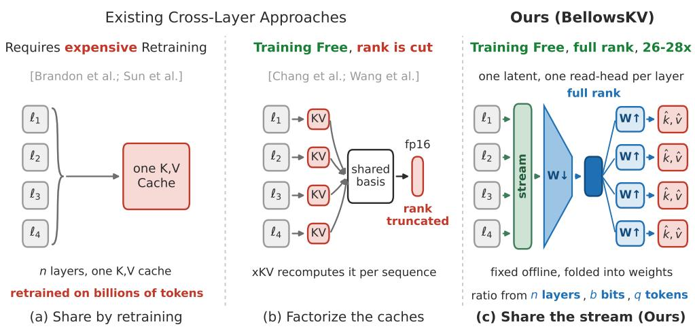
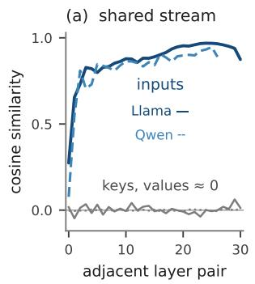
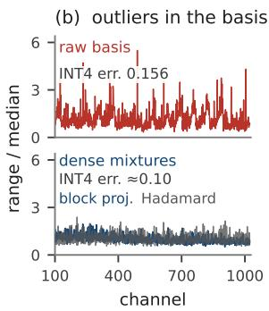
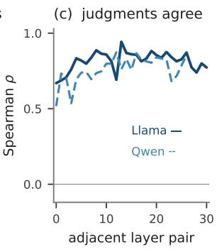
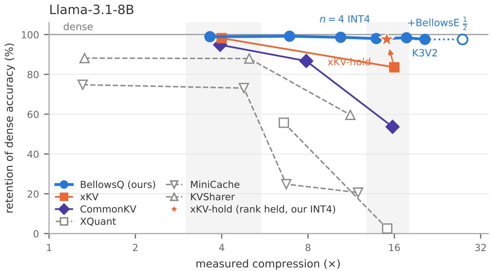
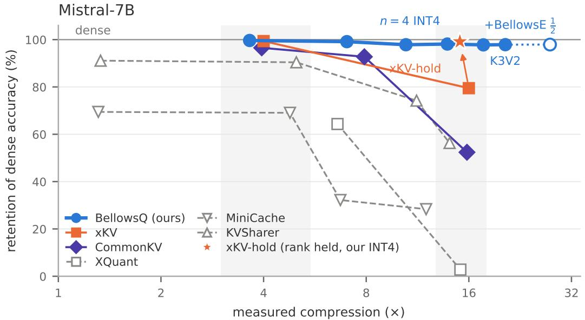
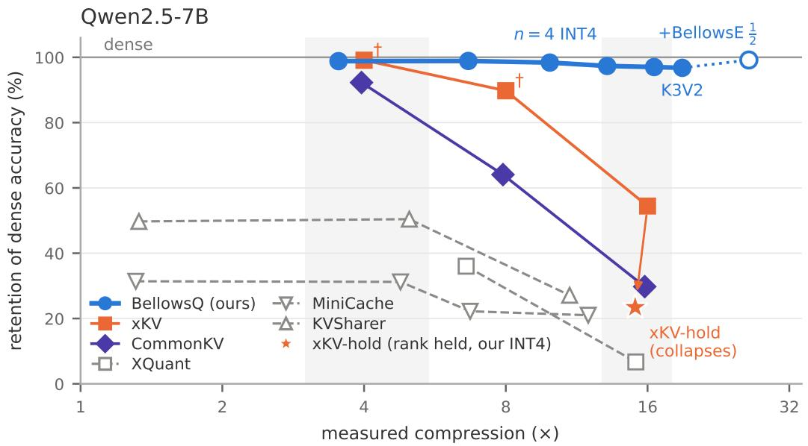
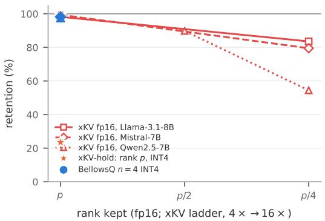

# BELLOWSKV: ONE LATENT FOR MANY LAYERS,EXPANDED ON DEMAND

Jiamu Zhang Hanjie Chen

Rice University

mz81@rice.edu hanjie@rice.edu

## ABSTRACT

Large language models (LLMs) are now widely utilized as the backbone of agents that reason over many turns, call tools, and pursue long-horizon tasks. To serve such a context without recomputing the past, a model stores the attention keys and values of all past tokens in a key-value (KV) cache. Each layer maintains its own cache and re-reads it at every generation step, so KV-cache memory can become the main bottleneck for GPU serving. Most compression methods operate within a single layer, by quantizing the cache entries, reducing the channel dimension, or evicting less important tokens from the cache. All three lose substantial accuracy at high compression ratios. A more recent line of work shares one compressed cache across adjacent layers to go beyond this limit. However, existing cross-layer methods also degrade sharply at high compression ratios. We find that the representation of KV Cache between adjacent layers are quite different, whereas the input hidden states are highly similar. We also find that, under the same memory budget, reducing the dimension of this shared latent loses far more accuracy than quantizing it. Based on these findings, we propose BellowsKV, a training-free method that maps the hidden states of n adjacent layers to one shared latent per token. At inference time, each layer read its own keys and values from this latent through a layer-specific projection. We keep the latent at full dimension and compress it in the two other ways instead: BellowsKV-Quant stores the latent at low precision, which is nearly lossless because the latent has no dominant outlier channels; BellowsKV-Evict makes one eviction decision per block, which the layers can share because they rank token importance very similarly. Across Llama-3.1-8B, Mistral-7B and Qwen2.5-7B, BellowsKV-Quant retains about 99% of full-cache accuracy at 3.6× compression and 97-98% at 13- 14×, where the strongest existing cross-layer method retains at most 84% at 16×. Code: https://github.com/MorrisZJ/BellowsKV

## 1 INTRODUCTION

The way large language models are used has shifted from answering questions to carrying out tasks. Agents debug a repository over hundreds of tool calls with the accumulated history in view (Yang et al., 2024a; Jimenez et al., 2024), assistants read and cross-reference whole document collections in one pass (Bai et al., 2024; Hsieh et al., 2024), and reasoning models think in traces tens of thousands of tokens long before they answer (OpenAI et al., 2026; Guo et al., 2025). Context windows have chased these workloads, from the 4K to 128K as the open-weight default (Grattafiori et al., 2024) and past a million tokens at the frontier (Team et al., 2024; Yang et al., 2025a). The key-value (KV) cache holds the attention keys and values of every token in the window, and each layer keeps its own cache. This way, we do not need to recompute past tokens, because we can read the cache in full at every decoding step. At this scale the cache stops being a rounding error on the weights and becomes their rival: on Llama-3.1-8B a single 131K-token sequence carries a 16.8 GB cache in 16- bit precision, slightly more than the model itself, after grouped-query attention has already shrunk it fourfold (Ainslie et al., 2023). In the real system, the LLM weights are loaded once and shared by every request in a batch, but each sequence needs its own KV cache. Serving is economical only when many sequences run at the same time (Kwon et al., 2023), so the total cache size grows with the batch size while the weights stay fixed. A batch of eight 131K-token sequences, for example, holds 134 GB of cache against 16 GB of weights. Compressing it by 4x, where most published methods operate, would still leave 33 GB. This paper targets an order of magnitude instead.

  
Figure 1: Comparison of different cross-layer KV-Cache compression methods: (a) Trainedto-share architectures reach one cache only by retraining. (b) Training-free methods factorize the caches (c) BellowsKV folds the block’s hidden states into one latent, buying the compression ratio from the numbers of shared layers, bits and tokens instead.

Nearly all existing KV cache compression methods work inside a single layer. Cached keys and values are quantized to fewer bits (Liu et al., 2024b; Su et al., 2025b; Zandieh et al., 2025; Han et al., 2025), tokens judged unimportant are evicted (Zhang et al., 2023; Li et al., 2024; Xiao et al., 2024), and feature channels are pruned or projected to lower rank (Chang et al., 2024; Saxena et al., 2024; Staniszewski & Łancucki, 2026). All three directions work at moderate compression ratios,´ but each of them is close to its limit when further compressing the cache.

Quantization loses accuracy sharply below two bits, and accuracy depends on extra machinery around the quantization methods, such as choosing the axis along which numbers share a scale, rotating the cache so that no channel dominates a scale, or keeping a sparse set of outliers in full precision (Hooper et al., 2024). Token eviction cannot be undone when regret, because a token dropped after prefill is gone for every later decoding step and for every follow-up turn, even if attention would have needed it. Reducing the channel dimension removes components of the keys and values that attention still uses. A recent position paper argues that at a matched memory budget, quantization is preferable to rank reduction (Salfati, 2026).

However, adjacent layers compute their caches from almost the same hidden states, yet every layer still stores its own cache in full. Sharing a cache across layers is therefore the natural next move, and it has recently been tried. xKV (Chang et al., 2026) factorizes the caches of a window of layers into one shared low-rank basis, recomputed for every sequence at prefill. CommonKV (Wang et al., 2025) instead derives a shared projection from the weight matrices of the grouped layers. Both work at 4x compression, but at 16x, xKV retains at most 84% of full-cache accuracy and CommonKV at most 54%. To our knowledge, no prior work explains why cross-layer methods degrade at these ratios, or what a block of layers needs in order to share one cache without losing accuracy. Appendix A reviews all three families in full, together with the architectures that are trained to share a cache.

Therefore, we propose BellowsKV, a training-free KV cache compression method built on these three measurements. For each block of n adjacent layers, we fit a single projection offline, and it maps the hidden states of the block to one latent vector per token, and each layer reconstructs its own keys and values from that latent through its own up-projection. Two operators then compress the latent: BellowsKV-Quant stores it with uniform low-bit quantization, and BellowsKV-Evict drops tokens with a single eviction decision for the whole block. Our contributions are:

• We study what a block of adjacent layers can share. The keys and values of adjacent layers are nearly orthogonal, while the hidden states they are computed from are highly similar. The representation shared by a block tolerates quantization and eviction, but not dimension reduction (Section 2).

• We propose BellowsKV, a training-free method that stores one latent per block of n layers, together with two operators that compress this latent, BellowsKV-Quant and BellowsKV-Evict (Section 3).

## 2 MOTIVATION: WHAT SHOULD A BLOCK OF LAYERS STORE?

  
Figure 2: (a) Cosine similarity between adjacent layers. The keys and values are close to zero, while the hidden states reach 0.87 on Llama and 0.82 on Qwen. (b) Per-channel dynamic range of the keys. The raw cache concentrates the range in a few channels (top). A data-free Hadamard rotation and our block-level projection are both flat (bottom), and the relative INT4 error falls from 0.156 to about 0.10. (c) Spearman correlation between the token importance scores of adjacent layers, between 0.76 and 0.80.

Every cache compression method makes two decisions: what to store, and how coarsely to store it. Existing methods only make the second: quantization, eviction and channel reduction keep one private cache per layer, as the architecture defines it, and compress that cache in place. This paper starts from the first decision. We ask what a block of n layers should store, under two requirements: every layer must still recover its own keys and values from the stored object, and the object must remain accurate when stored coarsely. Figure 2 answers with measurements on the uncompressed models, which do not assume any particular compression method.

## 2.1 ADJACENT LAYERS HAVE SIMILAR HIDDEN STATES BUT DISSIMILAR CACHE

A natural reading of cross-layer redundancy is that a later layer could reuse an earlier layer’s cache. Our measurements rule this out. Across adjacent layer pairs of both models, the per-token cosine similarity between neighboring keys is close to zero, and the same holds for values (Figure 2a). Substituting one shared key across even two layers increases perplexity significantly, even when the shared key is chosen by an oracle criteria (Appendix B.9).

The reason is that adjacent layers compute their keys and values from the same input, but with different projection matrices. Therefore, the keys and values of two adjacent layers are not similar to each other. In contrast, the hidden states remain similar across adjacent layers, and the similarity increases with depth (Figure 2a), and the same observation is also reported by Wang et al. (2025), which attribute such observation to the residual connection. These results show that the redundancy between adjacent layers exists in the inputs of the caches, and not in the caches themselves. Several architectures are trained to share one cache across a group of layers (Brandon et al., 2024; Sun et al., 2024; Zuhri et al., 2024; Wu & Tu, 2024). These architectures show that a group of layers can work with a single cache. However, they require training the attention layers on billions of tokens, which is not possible for a model that is already trained. Therefore, a block of layers should store one representation computed from its hidden states, rather than from its caches. Each layer then reconstructs its own keys and values from this representation through its own up-projection.

## 2.2 WHAT AGGREGATION REMOVES, AND THE ONE THING IT CANNOT

The requirement above fixes the structure of the shared representation. To serve n layers at once, the representation must combine the channels of all n layers into common coordinates, and it must store one entry per token for the whole block. We now ask how coarsely such a representation can be stored. We consider three forms of compression: quantization (fewer bits per number), eviction (fewer tokens), and dimension reduction (fewer coordinates per token).

Observation 1: The shared representation has no dominant outlier channels Uniform quantization fails when a few channels have a much larger dynamic range than the rest of the channels because these channels determine the scale of the group. The KV cache is known to contain such channels (Liu et al., 2024b; Hooper et al., 2024); see Figure 2b (top). A common solution is to rotate the cache before quantization, so that every stored coordinate becomes a mixture of all channels and no single channel determines the scale. However, the rotation must be applied again at every read (Ashkboos et al., 2024; Liu et al., 2025; Su et al., 2025b; Han et al., 2025; Zhou et al., 2026; Su et al., 2026). The shared representation already has this property, because every coordinate it stores is a linear combination of channels from all n layers. To verify this, we construct the block-level representation defined above and quantize it with a uniform quantization. Also, we apply the same uniform quantization to a rotated copy of the raw cache. The two are equally flat, and the quantization error of INT4 precision format is 0.10 for the shared representation against 0.156 for the raw cache (Figure 2b, bottom). Therefore, the shared representation does not need a rotation before it is stored.

Observation 2: The layers of a block agree on which tokens are important A token can be evicted only if it is unimportant, and each layer decides this from its own attention scores. We therefore compare the importance scores that the layers of a block assign to the same tokens. Adjacent layers rank tokens very similarly, with a Spearman correlation between 0.76 and 0.80, and the correlation increases with depth (Figure 2c). The same agreement between neighboring layers is also reported in previous work (Wu et al., 2025; Liu et al., 2024a; Ma et al., 2025). A single eviction decision, computed from the scores of all n layers, can therefore replace the n per-layer decisions.

Observation 3: The dimension of the shared representation cannot be reduced without a large loss of accuracy The first two properties follow from mixing the channels of n layers. However, mixing does not reduce the rank of the representation. Therefore, storing fewer coordinates per token removes information that the layers still need at read time. We do not measure this property in this section. We test it directly in Section 4.2, where we compare two ways to reach the same memory budget: reducing the dimension of the representation, and reducing the number of bits per coordinate.

These three observations define the design of BellowsKV.1 For each block of n layers, we compute one shared representation in closed form from the activation statistics of the model, and each layer reconstructs its own keys and values from this representation when it reads the cache. Observation 1 and Observation 2 lead to the two operators of BellowsKV: BellowsKV-Quant stores the representation with uniform low-bit quantization, and BellowsKV-Evict applies one eviction decision to the whole block (Section 3).

## 3 METHOD

A decoder-only transformer has L layers of attention modules with hidden width d. At layer ℓ and position t in a sequence of token, attention module reads the hidden state $\mathbf { h } _ { \ell , t } \ \in \ \mathbb { R } ^ { d }$ and forms $\mathbf { k } _ { \ell , t } = \mathbf { W } _ { K } ^ { \ell } { } ^ { \top } \mathbf { h } _ { \ell , t }$ and $\mathbf { v } _ { \ell , t } = \mathbf { W } _ { V } ^ { \ell ^ { } \top } \mathbf { h } _ { \ell , t }$ with projection matrices $\mathbf { W } _ { K } ^ { \ell } , \mathbf { W } _ { V } ^ { \ell } \in \mathbb { R } ^ { d \times p }$ , both cached for every layer and every past position, and for simplicity we write attention as single-headed with key width p. Since the construction never looks inside the key vector, the MHA and GQA (Ainslie et al., 2023) follow verbatim. Bold lowercase letters are column vectors and bold uppercase letters are matrices; [a; b] stacks a on top of b, and ∥ · ∥F is the Frobenius norm. Bias terms are present in every computation but omitted from the notation.

1The name refers to a bellows, which folds a large volume into a small one and expands it again on demand.

The L layers are partitioned into consecutive, non-overlapping blocks of n layers, $\begin{array} { r l } { B } & { { } = } \end{array}$ $( \ell _ { i } , \ell _ { i + 1 } , \dots , \ell _ { i + n - 1 } )$ ; for example, $n { = } 3$ gives the blocks $( \ell _ { 0 } , \bar { \ell _ { 1 } } , \ell _ { 2 } ^ { \cdot } ) , ( \ell _ { 3 } , \ell _ { 4 } , \ell _ { 5 } )$ , and so on, and a final block shorter than n is kept as is.

The method has two parts. The first part is a projection that is computed once per model, offline, from the activation statistics of the block, and is then held fixed for every sequence. This projection maps the hidden states of the block to one latent vector per token, which we call the consensus, and it produces all of the compression. The second part is a low-rank correction, which we call the whisper, and it is fitted at prefill for each sequence. In the following section, we write the key side only: values have their own latent and up-projections, constructed identically with $\mathbf { W } _ { V }$ in place of $\mathbf { W } _ { K } .$ , and we mark K and V explicitly only where the two appear together or are treated differently.

## 3.1 ONE LATENT PER BLOCK, ONE UP-PROJECTION PER LAYER

For a block B and token t, BellowsKV replaces the block’s n cached keys and values with two latents $\mathbf { c } _ { t } ^ { K } , \mathbf { c } _ { t } ^ { V } \in \mathbb { R } ^ { R } \left( R \ll n p \right)$ , from which each layer recovers its own key through a fixed up-projection. For example:

$$
\begin{array} { r } { \mathbf { c } _ { t } = \mathbf { W } _ { + } ^ { \top } \mathbf { h } _ { \mathcal { B } , t } , \qquad \hat { \mathbf { k } } _ { \ell _ { i } , t } = \mathbf { W } _ { \uparrow } ^ { ( i ) \top } \mathbf { c } _ { t } , \qquad \mathbf { h } _ { \mathcal { B } , t } = \left[ \mathbf { h } _ { \ell _ { 1 } , t } ; \dots ; \mathbf { h } _ { \ell _ { n } , t } \right] \in \mathbb { R } ^ { n d } , } \end{array}\tag{1}
$$

where $i \in \{ 1 , \ldots , n \}$ indexes the layers inside the block. The down-projection $\mathbf { W _ { \downarrow } } \in \mathbb { R } ^ { n d \times R }$ is shared by the whole block and applied to the vertical stack $\mathbf { h } _ { B , t }$ of its n hidden states. The upprojection $\mathbf { W } _ { \uparrow } ^ { ( i ) } \in \mathbb { R } ^ { R \times p }$ belongs to layer $\ell _ { i } .$ . It maps the shared latent back to $\hat { \mathbf { k } } _ { \ell _ { i } , t } ,$ which is an approximation of the exact key $\mathbf { k } _ { \ell _ { i } , t } = \mathbf { W } _ { K } ^ { \ell _ { i } \top } \mathbf { h } _ { \ell _ { i } , t }$ of the uncompressed model. All n layers read the same latent $\mathbf { c } _ { t } ,$ , and each layer applies its own up-projection. The values use an independent latent of the same form, $\mathbf { c } _ { t } ^ { V } = \mathbf { W } _ { \downarrow } ^ { V } { } ^ { \top } \mathbf { h } _ { B , t }$ , with its own up-projections $\mathbf { W } _ { \uparrow } ^ { V , ( i ) }$ . The construction is identical.

The cache therefore holds, per block and per token, the pair $( \mathbf { c } _ { t } ^ { K } , \mathbf { c } _ { t } ^ { V } )$ of 2R numbers in place of $2 n p ,$ plus a short per-token whisper correction (Section 3.3). All four factor sets are fixed model parameters, computed once offline (Section 3.2) and folded into the weights, so the compression itself is never recomputed per sequence; the whisper is the one per-sequence addition, and it is small. This is exactly the object Section 2 argued a block should store.

## 3.2 CALIBRATING THE PROJECTION AND THE UP-PROJECTIONS

To minimize the reconstruction error between the exact cache and the cache BellowsKV reads back from the latent, we fit the factors on calibration data. To set this up, we stack a calibration batch of S tokens into $\mathbf { H } \in \mathbb { R } ^ { S \times n d }$ with rows $\mathbf { h } _ { B , t } ^ { \top } .$ , write $\mathbf { W } = { \mathrm { b l k d i a g } } ( \mathbf { W } _ { K } ^ { \ell _ { 1 } } , \ldots , \mathbf { W } _ { K } ^ { \ell _ { n } } ) \in \mathbb { R } ^ { n d \times n p }$ for the block’s true key map, so that the block’s exact keys are the rows of HW, and collect the up-projections as $\mathbf { W } _ { \uparrow } = [ \mathbf { W } _ { \uparrow } ^ { ( 1 ) } , \dots , \mathbf { W } _ { \uparrow } ^ { ( n ) } ] \in \mathbb { R } ^ { R \times n p }$ . The objective is

$$
J ( \mathbf { W } _ { \downarrow } , \mathbf { W } _ { \uparrow } ) = \mathbb { E } _ { \mathbf { H } } { \big \| } \mathbf { H } \mathbf { W } - \mathbf { H } \mathbf { W } _ { \downarrow } \mathbf { W } _ { \uparrow } { \big \| } _ { F } ^ { 2 } .\tag{2}
$$

The data enters through one statistic, the second-moment matrix $\mathbf { G } = \mathbb { E } [ \mathbf { H } ^ { \top } \mathbf { H } ] \in \mathbb { R } ^ { n d \times n d } ,$ , whose $( i , j )$ block is the covariance between layer $\ell _ { i } \mathrm { ^ { \bullet } s }$ and layer $\ell _ { j } { ' } \mathrm { s }$ inputs. Eq. (2) has a closed-form solution. Let $\mathbf { M } \ = \ \mathbf { G } ^ { 1 / 2 } \mathbf { W }$ with thin singular value decomposition $\mathbf { M } = \mathbf { U } \pmb { \Sigma } \mathbf { V } ^ { \top }$ The offdiagonal blocks of G are the part that BellowsKV adds. If these blocks were zero, G and M would be block-diagonal, the singular value decomposition would split into n independent per-layer decompositions, and Eq. (2) would reduce to n separate per-layer low-rank caches. This per-layer construction is used by Chang et al. (2024) and Zhang et al. (2026), and it is based on the activationaware whitening of Wang et al. (2024). With them present, one set of R latent directions is fitted to serve all n layers at once. Then

$$
\mathbf { W } _ { \downarrow } ^ { \star } = \mathbf { G } ^ { - 1 / 2 } \mathbf { U } _ { : R } , \qquad \mathbf { W } _ { \uparrow } ^ { \star } = \pmb { \Sigma } _ { : R } \mathbf { V } _ { : R } ^ { \top } ,\tag{3}
$$

attains the minimum of Eq. (2) with residual $\textstyle \sum _ { i > R } \sigma _ { i } ^ { 2 }$ (Appendix B). The solution is unique up to an invertible mixing of the latent coordinates, invisible at full precision but not to a quantizer; we take the square-root split $\mathbf { W } _ { \downarrow } = \mathbf { G } ^ { - 1 / 2 } \mathbf { U } _ { : R } \boldsymbol { \Sigma } _ { : R } ^ { 1 / 2 } , \mathbf { W } _ { \uparrow } = \boldsymbol { \Sigma } _ { : R } ^ { 1 / 2 } \mathbf { V } _ { : R } ^ { \top }$ , which leaves the latent energy-ordered and so matched to the quantizer’s group-wise scales.

## 3.3 THE CACHE AT INFERENCE AND THE TWO OPERATORS

At prefill, each block runs its layers on the exact keys and values, applies Eq. (1) to the stacked hidden states, and stores $( \mathbf { c } _ { t } ^ { K } , \mathbf { c } _ { t } ^ { V } )$ in place of the block’s 2n per-layer tensors; a few sink positions, a short recent window, and every token generated at decode time stay exact and per-layer, the standard residual-window practice (Xiao et al., 2024; Liu et al., 2024b). Before storing, the block fits its whisper: a low-rank sketch (Halko et al., 2010) of the key residual $\mathbf { E } = \mathbf { K } - \hat { \mathbf { K } }$ , one small basis per sequence and a few coefficients per token. At decode, values never leave the latent: attention is linear in them, so each up-projection folds into the output projection and the layer attends in R dimensions (Ji et al., 2025). Keys are reconstructed through theirs, because the positional rotation sits between latent and score (Su et al., 2023; DeepSeek-AI et al., 2024): a low-rank product per layer that hides under the memory-bound cache read (settings and full path in Appendix B).

BellowsKV has three parameters: the number of layers per block n, the number of bits per stored value b, and the fraction of tokens kept q, and the dimension is fixed at $R = p $

BellowsKV-Quant. We quantize the latent with uniform integer quantization, using one scale per group of 128 adjacent coordinates. We apply no rotation before storing (Ashkboos et al., 2024; Su et al., 2025b) and no per-channel treatment, because the latent is already a mixture of channels from all n layers (Observation 1). The dimension stays at $R = p$ in all settings. The main experiments use two settings: $n = 2$ with INT8 and $n = 4$ with INT4, which measure $3 . 6 \times$ and $1 3 . 8 \times$ with all metadata counted (Appendix B.3).

BellowsKV-Evict. The block stores one latent vector per token, so a token receives one eviction decision per block. After prefill, each block scores every cached token by the attention mass that the most recent queries place on it. The score is summed over the layers and heads of the block, and it is computed on the keys reconstructed from the quantized latent, so that eviction uses the same keys as decoding (Zhang et al., 2023; Li et al., 2024). The scores are then max-pooled over a window of 13 positions, so that a token kept for its own score also keeps its neighbors (Li et al., 2024). The tokens with the highest scores are kept, together with the first 4 positions and the last 64 prompt positions (Xiao et al., 2024). The remaining tokens are dropped once for the whole block, with a single gathe applied to the stored latent (Appendix B.4).

## 4 EXPERIMENT

We evaluate BellowsKV on Llama-3.1-8B-Instruct, Mistral-7B-Instruct-v0.3, Qwen2.5-7B-Instruct, Qwen3-32B and Qwen3-30B-A3B, with one recipe fixed throughout (Section 3): n=2 with INT8 at the low tier and n=4 with INT4 at the high tier, no per-model tuning; the high tier is also stored at INT3 and at K3V2 (key latent 3 bits, value latent 2) to reach and pass 16×. Protocol A reports absolute scores on eight English LongBench tasks (Bai et al., 2024) under the official harness; Protocol B reports retention, each task’s score over the dense model’s in the same harness, on 4k– 32k-token inputs under the xKV authors’ harness (Chang et al., 2026). Protocal C reports agent workload: single-turn retrieve-then-read on BrowseComp-Plus Chen et al. (2025).

Every number is full-sample, every ratio counts all metadata, and every table groups rows by measured ratio and marks the best per tier. Tables abbreviate BellowsKV-Quant as BellowsQ, BellowsKV-Evict as BellowsE and the sharing-only fp16 latent as BellowsS. Each subsection tests one prediction of Section 2 where it would fail, and the last tests the decode relation the introduction promised.

## 4.1 STREAM, NOT CACHES: THE CROSS-LAYER HEAD-TO-HEAD

Section 2.1 predicts that reusing one layer’s raw keys and values in another fails and storing a latent of the stream does not, at any ratio. Protocol B runs every training-free cross-layer method we know of, placed by measured bytes (Table 1, Appendix Figures 3–5): xKV (Chang et al., 2026) and CommonKV (Wang et al., 2025) store a latent; MiniCache (Liu et al., 2024a), KVSharer (Yang et al., 2024b) and XQuant (Yang et al., 2025b) share raw caches. The raw-cache routes are broken at 1.3×, before any bits are cut; every latent method works at ∼4×; at ∼16× xKV retains at most 84% and CommonKV 54%, while BellowsQ retains 97–98% at 13–14×, at INT3 (fewer bytes than

Table 1: Protocol B: per-task retention of full-cache accuracy (%) for every operating point of every training-free cross-layer method. Rows are grouped by measured compression tier. Within each tier, the highest compression ratio is always that of BellowsQ, so a baseline with a higher average also stores more memory. best and second average per tier are marked. Task codes and settings: Appendix C.1.
<table><tr><td>Method</td><td>Comp.</td><td>Qsp</td><td>MFQ</td><td>HQA</td><td>MSQ</td><td>NQA</td><td>Gov</td><td>QMS</td><td>PsR</td><td>LCC</td><td>RBP 2Wk</td><td></td><td>Avg</td></tr><tr><td colspan="10">Llama-3.1-8B-Instruct</td><td></td><td>82.6</td><td>55.6</td><td>74.8</td></tr><tr><td>MiniCache fp16 KVSharer fp16 BellowsQ n=2 INT8 CommonKV</td><td>1.31× 1.33× 3.64× 3.95× 4.00×</td><td>72.1 91.5 95.6 92.2 96.6</td><td>72.3 96.9 97.6 90.6 98.6</td><td>74.7 93.9 99.6 98.0 96.0</td><td>86.8 98.1 99.4 100.1 102.1</td><td>55.0 78.2 95.9 89.0 97.9</td><td>82.7 73.7 98.5 89.7 97.0</td><td>89.5 97.9 102.5 96.5 100.8</td><td>70.7 99.5 100.0 99.5</td><td>80.4 85.4 98.7 98.4</td><td>84.5 99.0 97.8</td><td>70.2 101.0 91.1</td><td>88.2 98.9 94.8</td></tr><tr><td>xKV MiniCache+INT4 KVSharer+INT4 XQuant published</td><td>4.78× 4.99× 6.59× 6.72×</td><td>70.2 91.1 46.8 13.4</td><td>70.9 94.8 64.5 13.2</td><td>70.4 94.0 71.0 9.6</td><td>80.2 99.5 59.1 13.9</td><td>51.8 79.7 49.6 7.5</td><td>81.1 72.4 69.3 20.7</td><td>89.9 97.8 82.0 50.6</td><td>100.0 70.8 99.5 6.0 30.1</td><td>99.4 79.8 85.2 57.2 51.4</td><td>99.4 82.7 83.3 64.5 58.3</td><td>92.1 56.4 70.0 42.4 4.4</td><td>98.2 73.1 87.9 55.7 24.8</td></tr><tr><td>BellowsQ n=2 INT4 CommonKV BellowsQ n=3 INT4</td><td>6.90× 7.89× 10.40×</td><td>96.3 86.0 93.8</td><td>97.7 82.6 96.7</td><td>100.3 91.1 99.1</td><td>97.6 92.7 102.5</td><td>98.6 85.4 97.2</td><td>98.6 77.8 97.0</td><td>101.1 90.9 99.9</td><td>100.0 99.2 100.0</td><td>99.6 81.2 99.4</td><td>99.2 88.5 98.9</td><td>101.6 78.1 100.3</td><td>99.2 86.7 98.6</td></tr><tr><td>KVSharer+INT2 MiniCache+INT2 BellowsQ n=4 INT4</td><td>11.24× 11.96× 13.84×</td><td>53.6 11.1 94.6</td><td>67.4 13.1 99.0</td><td>63.9 5.4 99.1</td><td>79.0 10.4 96.4</td><td>69.2 9.4 96.2</td><td>30.8 20.0 93.5</td><td>78.2 39.6 98.7</td><td>57.8 11.3 100.0</td><td>59.7 46.4 99.7</td><td>59.3 56.0 99.0</td><td>37.0 4.0 101.5</td><td>59.6 20.6 98.0</td></tr><tr><td>XQuant 1-bit CommonKV xKV</td><td>15.11× 15.78×</td><td>0.0 34.6 91.4</td><td>0.1 49.7 80.9</td><td>0.0 43.0 82.4</td><td>0.0 55.6</td><td>0.0 56.5 73.3</td><td>0.0 50.5</td><td>0.0 83.0 94.4</td><td>0.0 77.9</td><td>12.3 54.4</td><td>15.4 56.8</td><td>0.0 28.0</td><td>2.5 53.6</td></tr><tr><td>BellowsQ n=4 INT3 BellowsQ n=4 K3V2</td><td>16.00× 17.65× 20.47×</td><td>94.2 91.6</td><td>98.6 96.6</td><td>98.0 97.9</td><td>87.3 101.3 100.4</td><td>98.8 99.6</td><td>75.6 93.6 93.5</td><td>98.0 98.0</td><td>95.5 100.0 100.0</td><td>92.8 101.1 99.9</td><td>86.8 98.9 99.3</td><td>58.5 99.5 96.6</td><td>83.5 98.4 97.6</td></tr><tr><td></td><td>1.31×</td><td>76.7</td><td>69.4</td><td>72.7</td><td>Mistral-7B-Instruct-v0.3 56.2</td><td>81.4</td><td>68.7</td><td>83.3</td><td>37.2</td><td>76.3</td><td>74.6</td><td></td><td></td></tr><tr><td>MiniCache fp16 KVSharer fp16 BellowsQ n=2 INT8 CommonKV</td><td>1.33× 3.64× 3.95× 4.00×</td><td>103.8 98.2 99.4 102.0</td><td>95.6 100.6 101.2 100.0</td><td>94.2 98.9 96.4 100.2</td><td>90.6 102.1 89.7</td><td>100.3 95.9 92.3</td><td>91.8 99.4 89.7</td><td>93.3 99.7 95.8</td><td>68.4 99.5 100.0</td><td>89.1 100.4 97.1</td><td>87.7 101.0 100.0</td><td>67.4 87.4 100.3 100.0</td><td>69.4 91.1 99.6 96.5</td></tr><tr><td>xKV MiniCache+INT4 KVSharer+INT4 XQuant published MiniCache all+INT4</td><td>4.78× 4.99× 6.59× 6.72×</td><td>79.0 101.1 59.1 35.2</td><td>68.6 97.1 67.7 23.3</td><td>70.6 95.1 72.8 22.1</td><td>100.4 52.7 90.2 51.1</td><td>95.2 81.4 92.9 69.9</td><td>98.2 67.9 92.5 74.9</td><td>99.5 84.0 93.2 86.9</td><td>95.9 38.8 67.9 13.3</td><td>98.3 76.5 87.6 68.2</td><td>100.2 74.8 88.0 70.4</td><td>103.2 65.4 89.0 73.5</td><td>99.4 69.1 90.4 64.3</td></tr><tr><td>BellowsQ n=2 INT4 CommonKV BellowsQ n=3 INT4</td><td>7.02× 7.90× 10.46×</td><td>98.4 90.9 96.6</td><td>98.8 93.4 100.8</td><td>98.3 98.1 99.7</td><td>23.4 101.5 84.1 100.5</td><td>39.1 95.6 101.5 92.1</td><td>18.9 98.3 79.1 94.9</td><td>50.7 99.4 95.7 96.7</td><td>19.0 98.0 95.9 96.9</td><td>49.5 99.8 93.7 98.5</td><td>42.8 100.8 93.4 99.9</td><td>30.4 101.6 94.6 99.5</td><td>32.2 99.1 92.8 97.8</td></tr><tr><td>KVSharer 37.5%+INT2 MiniCache+INT2 BellowsQ n=4 INT4</td><td>11.24× 11.99× 13.84×</td><td>90.3 34.6 93.9</td><td>79.8 18.8 103.1</td><td>82.4 21.2 99.1</td><td>73.5 23.3 97.2</td><td>89.9 28.8 96.3</td><td>78.3 21.4 93.6</td><td>88.1 45.4 99.8</td><td>17.3 11.2 97.4</td><td>77.3 43.2 98.6</td><td>69.4 40.9 101.0</td><td>70.1 23.0 99.3</td><td>74.2 28.3 98.1</td></tr><tr><td>KVSharer+INT2 XQuant 1-bit CommonKV</td><td>14.05× 15.11× 15.80×</td><td>59.3 0.0 53.1</td><td>67.9 0.5 55.8</td><td>74.6 0.0 24.9</td><td>56.6 0.0</td><td>66.2 0.0</td><td>46.5 0.1</td><td>74.6 0.0</td><td>13.9 0.0</td><td>54.9 17.2</td><td>43.2 13.0</td><td>61.7 0.0</td><td>56.3 2.8</td></tr><tr><td>xKV BellowsQ n=4 INT3</td><td>16.00×</td><td>90.4 94.8</td><td>88.5</td><td>47.8</td><td>21.1 42.1</td><td>48.8 85.2</td><td>60.2 93.0</td><td>81.0 91.8</td><td>68.9 81.7</td><td>66.2 92.7</td><td>64.3 90.0</td><td>32.0 71.1</td><td>52.4 79.5</td></tr><tr><td>BellowsQ n=4 K3V2</td><td>17.65×</td><td>96.8</td><td>101.0 100.5</td><td>99.7 99.6</td><td>95.9 95.0</td><td>96.0</td><td>93.8</td><td>97.7</td><td>96.4</td><td>97.9</td><td>101.7</td><td>100.5</td><td>97.8</td></tr><tr><td></td><td>20.47×</td><td></td><td></td><td></td><td></td><td></td><td></td><td></td><td></td><td></td><td></td><td></td><td></td></tr><tr><td></td><td></td><td></td><td></td><td></td><td></td><td></td><td></td><td></td><td></td><td></td><td></td><td></td><td></td></tr><tr><td></td><td></td><td></td><td></td><td></td><td></td><td></td><td></td><td></td><td></td><td></td><td></td><td></td><td></td></tr><tr><td></td><td></td><td></td><td></td><td></td><td></td><td></td><td></td><td></td><td></td><td></td><td></td><td></td><td></td></tr><tr><td></td><td></td><td></td><td></td><td></td><td></td><td>97.0</td><td>93.7</td><td>99.5</td><td>94.4</td><td>99.0</td><td>101.9</td><td>99.1</td><td>97.9</td></tr><tr><td></td><td></td><td></td><td></td><td></td><td></td><td></td><td></td><td></td><td></td><td></td><td></td><td></td><td></td></tr><tr><td></td><td></td><td></td><td></td><td></td><td></td><td></td><td></td><td></td><td></td><td></td><td></td><td></td><td></td></tr><tr><td></td><td></td><td></td><td></td><td></td><td></td><td></td><td></td><td></td><td></td><td></td><td></td><td></td><td></td></tr><tr><td></td><td></td><td></td><td></td><td></td><td></td><td></td><td></td><td></td><td></td><td></td><td></td><td></td><td></td></tr><tr><td></td><td></td><td></td><td></td><td></td><td>Qwen2.5-7B-Instruct</td><td></td><td></td><td></td><td></td><td></td><td></td><td></td><td></td></tr><tr><td></td><td></td><td></td><td></td><td></td><td></td><td></td><td></td><td></td><td></td><td></td><td></td><td></td><td></td></tr><tr><td></td><td></td><td></td><td></td><td></td><td></td><td></td><td></td><td></td><td></td><td></td><td></td><td></td><td></td></tr><tr><td>MiniCache fp16</td><td>1.31×</td><td>25.2</td><td>28.8</td><td>19.9</td><td></td><td></td><td></td><td></td><td></td><td></td><td></td><td></td><td></td></tr><tr><td></td><td></td><td></td><td></td><td></td><td>18.9</td><td>25.1</td><td>55.7</td><td>66.1</td><td>3.2 82.8</td><td>42.5</td><td>44.2</td><td>15.8</td><td>31.4</td></tr><tr><td>KVSharer fp16</td><td>1.33×</td><td>51.5</td><td>61.5</td><td>36.5</td><td>31.5 98.1</td><td>25.4</td><td>38.9 97.9</td><td>68.3 99.8 92.6</td><td>100.0</td><td>67.0 96.6</td><td>57.5 97.1</td><td>26.1 100.0</td><td>49.7 98.8</td></tr><tr><td>BellowsQ n=2 INT8 CommonKV xKV†</td><td>3.53× 3.95×</td><td>101.0 93.0 97.9</td><td>99.1 89.6 101.9</td><td>100.4 94.6 96.9</td><td>86.9</td><td>97.0 99.9</td></table>

xKV’s point) and at 19–20.5×, where no cross-layer point exists. The raw-cache methods already lose accuracy at 1.3×, which shows that the caches themselves are not the object to share. Our points do not fall with xKV’s at high compression, which shows that sharing itself is not the cause of the loss.

Beyond LongBench. Protocol C repeats the comparison on an agent task that must read its retrieved evidence verbatim, on two models the paper has not used, one of them a mixture of expert (Table 2), and there the rank cliff arrives two octaves earlier: xKV scores 26.5 at 8× and, on the mixture of experts, 15.5 at 4×, and CommonKV has lost half of dense by 8×. Cutting bits at full rank still costs nothing, with BellowsQ at 86.0 and 85.8 at 14.6× against dense 85.5 and 86.1, so the rule holds where the task is least forgiving.

Table 2: Protocol C: single-turn retrieve-then-read on BrowseComp-Plus on all 830 queries, with the oracle prompt at a 32,768-token budget. Results are scored by the benchmark’s own judge. The notation “–” means that the method cannot reach that compression rate. See full table in Appendix C.3
<table><tr><td></td><td></td><td></td><td colspan="3">cross-layer latent</td><td colspan="3">per-layer quantized</td></tr><tr><td>Model</td><td>Tier</td><td>Dense</td><td>BellowsQ</td><td>CommonKV</td><td>xKV</td><td>OTT</td><td>KIVI</td><td>PolarQuant</td></tr><tr><td rowspan="2">Qwen3-32B</td><td>~8×</td><td>85.54</td><td>84.22</td><td>81.08</td><td>26.51</td><td>77.95</td><td>75.42</td><td>51.93</td></tr><tr><td>~16×</td><td>85.54</td><td>86.02</td><td>66.02</td><td>8.43</td><td>一</td><td>一</td><td>一</td></tr><tr><td rowspan="2">Qwen3-30B-A3B</td><td>~8×</td><td>86.14</td><td>85.30</td><td>49.88</td><td>5.30</td><td>81.45</td><td>77.59</td><td>4.22</td></tr><tr><td>~16×</td><td>86.14</td><td>85.78</td><td>一</td><td>一</td><td>一</td><td>一</td><td>一</td></tr></table>

Table 3: Cutting rank is the cliff; the rival that holds its rank and cuts bits instead comes back. (See full table in Appendix 19)
<table><tr><td>Arm</td><td>Comp.</td><td>Llama</td><td>Mistral</td><td>Qwen</td></tr><tr><td>xKV, fp16, rank p</td><td>4.0×</td><td>98.2</td><td>99.4</td><td>99.1</td></tr><tr><td>xKV, fp16, rank  $\scriptstyle { \hat { p } } / 2$ </td><td>8.0×</td><td></td><td></td><td>89.8</td></tr><tr><td>xKV, fp16, rank p/4</td><td>16.0×</td><td>83.5</td><td>79.5</td><td>54.4</td></tr><tr><td>xKV-hold: the same basis, near-full rank, our INT4 leg</td><td>15.1×</td><td>97.6</td><td>99.2</td><td>23.4</td></tr><tr><td>BellowsQ n=4 INT4 (the frozen consensus)</td><td>13.1-13.8×</td><td>98.0</td><td>98.1</td><td>97.3</td></tr><tr><td>our construction, per-sequence SVD oracle (2.2× prefill)</td><td>15.1×</td><td>97.3</td><td>一</td><td>-</td></tr><tr><td>CommonKV, rank 81% of the width</td><td>4.0×</td><td>94.8</td><td>96.5</td><td>92.3</td></tr><tr><td>CommonKV, rank 20% of the width</td><td>15.8×</td><td>53.6</td><td>52.4</td><td>29.8</td></tr></table>

## 4.2 DIMENSION AND BIT-WIDTH AT A FIXED BUDGET

We compare two ways to reach a high compression ratio at a fixed memory budget: reducing the dimension of the shared basis, and reducing the number of bits per stored value. We run this comparison on the construction of xKV, because both settings exist for it (Table 3). xKV reaches 16× by reducing its per-sequence basis from rank p to p/4. xKV-hold keeps the same basis at near-full rank and stores it at INT4, which gives 15.1×. A third setting replaces our fixed projection with a per-sequence SVD, at 2.2× the prefill cost.

xKV-hold reaches 97.6 on Llama and 99.2 on Mistral, against 83.5 and 79.5 for xKV at 16×. The per-sequence SVD reaches 97.3 on Llama, which is below the 98.0 of the fixed projection. On Qwen, every setting that stores xKV’s basis at four bits fails, and we have no explanation for this case. The results indicate that the loss of xKV at 16× is caused by the reduced dimension. xKV-hold keeps the same shared basis, so the sharing itself is not the cause.

## 4.3 COMPARISON WITH PER-LAYER QUANTIZERS

Protocol A compares the shared latent with per-layer quantizers at matched memory. We run every official configuration of KIVI, OTT, RotateKV, TurboQuant and PolarQuant (Liu et al., 2024b; Su et al., 2025a;b; Zandieh et al., 2025; Han et al., 2025), and every BellowsKV point from 1.92× to 18.6× (Table 4).

On the latent at n=4, the loss from fp16 to INT4 is 0.1 to 0.3 points, and the loss from INT4 to INT3 is at most 1.1 points. For the rotated per-layer caches, the loss from four bits to two bits is 4.1 to 6.4 points. Note that these two comparisons do not use the same change in bit-width; the comparison at equal bit-width is given in Table 18. At ∼7× on Llama, OTT at two bits reaches 53.30 against 52.92 for BellowsKV, while storing 5% fewer bytes. Above 8×, no per-layer configuration exists, because two bits at full dimension already gives 8×.

Table 4: Protocol A: LongBench average over eight tasks under the official harness. The table reports every official configuration of KIVI, OTT, RotateKV, TurboQuant and PolarQuant, and every BellowsKV point, grouped by measured compression tier. Within every tier, the highest compression ratio is that of BellowsKV, so a per-layer quantizer with a higher average also stores more memory. No per-layer point exists above 8×, because two bits at full dimension already give 8×. Per-task results: Appendix C.2. Equal bit-width comparison: Table 18.
<table><tr><td>Method Comp. Llama</td></tr><tr><td>Mistral Qwen Dense fp16 1.00× 53.29 52.78 53.23</td></tr><tr><td>BellowsS n=2 1.9× 53.07 53.04 51.88</td></tr><tr><td>BellowsS n=3 2.9-2.9× 52.67 52.87 51.92</td></tr><tr><td>BellowsQ n=2 INT8 3.6-3.7× 53.05 52.92 52.00</td></tr><tr><td>PolarQuant r4t4v4 3.7× 53.66 53.90</td></tr><tr><td>KIVI K4V4 3.8× 53.92 52.80</td></tr><tr><td>OTT K4V4 3.8× 53.83 52.99</td></tr><tr><td>BellowsS n=4 3.8-3.9× 52.78 53.04 51.21</td></tr><tr><td></td></tr><tr><td>TurboQuant K4V4 4.0× 52.84 52.44 52.98</td></tr><tr><td>RotateKV 4-bit 4.0× 53.14</td></tr><tr><td>PolarQuant r3t3v4 4.1× 53.50 53.89</td></tr><tr><td>PolarQuant r2t2v4 4.7× 50.63 50.87</td></tr><tr><td>RotateKV 3-bit 5.3× 52.38 52.33</td></tr><tr><td>TurboQuant K4V2 5.3× 52.57 51.84 51.25</td></tr><tr><td>BellowsQ n=3 INT8  $5 . 3 – 5 . 5 \times$  52.84 53.04 51.90</td></tr></table>

<table><tr><td colspan="5">Method Comp. Llama Mistral Qwen</td></tr><tr><td>BellowsQ n=2 INT4</td><td>6.4-6.8×</td><td>52.92</td><td>52.7651.86</td><td></td></tr><tr><td>PolarQuant r2t2v2</td><td>6.7×</td><td>48.51</td><td></td><td>50.12</td></tr><tr><td>KIVI K2V2</td><td>7.1×</td><td>52.17</td><td>52.13</td><td></td></tr><tr><td>OTT K2V2</td><td>7.1×</td><td>53.30</td><td>52.51</td><td></td></tr><tr><td>TurboQuant K2V2</td><td>8.0×</td><td>46.43</td><td>48.31</td><td>47.18</td></tr><tr><td>RotateKV 2-bit</td><td>8.0×</td><td>47.00</td><td>49.01</td><td></td></tr><tr><td>BellowsQ n=2 INT3</td><td>8.0-8.6×</td><td>52.72</td><td>52.67</td><td>51.60</td></tr><tr><td>BellowsQ n=4 INT4</td><td>12.2-13.0×</td><td>52.45</td><td>52.83</td><td>51.12</td></tr><tr><td>BellowsQ n=4 INT3</td><td>15.0-16.2×</td><td>52.42</td><td>52.75</td><td>50.02</td></tr><tr><td>BellowsQ  $\scriptstyle n = 4 \ K 3 \lor 2$ </td><td>16.9-18.6×</td><td>52.27</td><td>52.87</td><td>50.28</td></tr></table>

Table 5: Protocol B retention (%) of full-cache accuracy. All routes use the same scoring rule. The per-layer baseline applies this rule independently in each layer, on the fp16 cache of that layer. The comparison at equal keep ratio is given in Table 15.
<table><tr><td>Budget</td><td>Route</td><td>Keep</td><td>Comp.</td><td>Llama</td><td>Mistral</td><td>Qwen</td></tr><tr><td>~8×</td><td>BellowsE</td><td>1/2</td><td>7.7-7.8</td><td>97.6</td><td>97.9</td><td>99.2</td></tr><tr><td></td><td>Per-layer eviction</td><td>1/8</td><td>8.0</td><td>94.7</td><td>94.9</td><td>98.3</td></tr><tr><td> ${ \sim } 1 6 \times$ </td><td>BellowsE</td><td>1/4</td><td>15.2-15.4</td><td>96.1</td><td>96.4</td><td>97.9</td></tr><tr><td></td><td>Per-layer eviction</td><td>1/16</td><td>16.0</td><td>89.5</td><td>90.7</td><td>92.6</td></tr><tr><td></td><td>BellowsQ×BellowsE</td><td>1/2</td><td>26.3–27.7</td><td>97.5</td><td>97.9</td><td>99.2</td></tr><tr><td>~30×</td><td>BellowsE</td><td>1/8</td><td>29.6–30.0</td><td>92.5</td><td>93.8</td><td>95.0</td></tr><tr><td></td><td> $\mathrm { \ x K V + I N T { 4 + p o o l e d \ S n a p K V } }$ </td><td>1/2</td><td>30.1</td><td>96.1</td><td>98.4</td><td>23.8</td></tr></table>

We also compare one eviction decision per block with the same rule applied independently in each layer (Table 5). Both routes use the same scoring rule. The per-layer baseline scores each layer on its own fp16 cache. The full grid is given in Appendix C.4.

At the same keep ratio, the per-layer baseline is better by 0.8 to 3.3 points, and it stores 3.8× more memory. At equal memory, the block-level decision is better by 0.9 to 3.0 points at about 8×, and by 5.3 to 6.6 points at about 16×. The advantage is larger at the higher compression ratio.

## 4.4 DECODE COST

The introduction promised a decode cost, with a relation bounding any reconstruct-at-read design: decode speedup $\mathit { \Omega } = \left( d _ { k v } / R \right) \times 2 \mathit { \Omega } /$ (bytes per latent value at read). n is absent, so sharing buys capacity, never speed, and a design holding $\scriptstyle R = d _ { k v }$ that reads fp16 should decode at parity. On an H100 (HuggingFace, 32k context, no custom kernel) BellowsKV decodes at 0.995× dense against a predicted 1.00×; Palu (Chang et al., 2024), the rank-cutting design with a published decode figure, reports 1.89× against a predicted 2.00× (Appendix Table 6). The freed bytes buy a 2× batch under HuggingFace and a $1 4 . 8 \times \mathrm { K V }$ pool under vLLM (above the 13.8× byte ratio for a reason we have not isolated). The measured decode speed is 0.995× that of the uncompressed cache. This confirms two properties of the design: reconstruction at read adds no measurable cost, and sharing across layers does not change decode speed.

## 5 CONCLUSION

BellowsKV starts from one measured property: what a block of layers shares is the stream behind its caches, and the aggregate drawn from it is a consensus, tame in amplitude, reliable in judgment, irreducible in dimension. One training-free construction turns it into a compressor whose two operators compose: near-dense accuracy at ratios where published cross-layer methods fail, at the decode speed of an uncompressed cache. The takeaway is the rule the experiments price: hold the rank, buy bits first, evict last.

## REFERENCES

Joshua Ainslie, James Lee-Thorp, Michiel de Jong, Yury Zemlyanskiy, Federico Lebron, and Sumit´ Sanghai. Gqa: Training generalized multi-query transformer models from multi-head checkpoints, 2023. URL https://arxiv.org/abs/2305.13245.

Saleh Ashkboos, Amirkeivan Mohtashami, Maximilian L. Croci, Bo Li, Pashmina Cameron, Martin Jaggi, Dan Alistarh, Torsten Hoefler, and James Hensman. Quarot: Outlier-free 4-bit inference in rotated llms, 2024. URL https://arxiv.org/abs/2404.00456.

Yushi Bai, Xin Lv, Jiajie Zhang, Hongchang Lyu, Jiankai Tang, Zhidian Huang, Zhengxiao Du, Xiao Liu, Aohan Zeng, Lei Hou, Yuxiao Dong, Jie Tang, and Juanzi Li. Longbench: A bilingual, multitask benchmark for long context understanding, 2024. URL https://arxiv.org/abs/ 2308.14508.

William Brandon, Mayank Mishra, Aniruddha Nrusimha, Rameswar Panda, and Jonathan Ragan Kelly. Reducing transformer key-value cache size with cross-layer attention, 2024. URL https: //arxiv.org/abs/2405.12981.

Chi-Chih Chang, Wei-Cheng Lin, Chien-Yu Lin, Chong-Yan Chen, Yu-Fang Hu, Pei-Shuo Wang, Ning-Chi Huang, Luis Ceze, Mohamed S. Abdelfattah, and Kai-Chiang Wu. Palu: Compressing kv-cache with low-rank projection, 2024. URL https://arxiv.org/abs/2407.21118.

Chi-Chih Chang, Wei-Cheng Lin, Chien-Yu Lin, Hung-Yueh Chiang, Yash Akhauri, Xilai Dai, Huiqiang Jiang, Yucheng Li, Luis Ceze, Kai-Chiang Wu, and Mohamed S. Abdelfattah. xkv: Cross-layer kv-cache compression via aligned singular vector extraction, 2026. URL https: //arxiv.org/abs/2503.18893.

Zijian Chen, Xueguang Ma, Shengyao Zhuang, Ping Nie, Kai Zou, Andrew Liu, Joshua Green, Kshama Patel, Ruoxi Meng, Mingyi Su, Sahel Sharifymoghaddam, Yanxi Li, Haoran Hong, Xinyu Shi, Xuye Liu, Nandan Thakur, Crystina Zhang, Luyu Gao, Wenhu Chen, and Jimmy Lin. Browsecomp-plus: A more fair and transparent evaluation benchmark of deep-research agent, 2025. URL https://arxiv.org/abs/2508.06600.

DeepSeek-AI, Aixin Liu, Bei Feng, Bin Wang, Bingxuan Wang, Bo Liu, Chenggang Zhao, Chengqi Dengr, Chong Ruan, Damai Dai, Daya Guo, Dejian Yang, Deli Chen, Dongjie Ji, Erhang Li, Fangyun Lin, Fuli Luo, Guangbo Hao, Guanting Chen, Guowei Li, H. Zhang, Hanwei Xu, Hao Yang, Haowei Zhang, Honghui Ding, Huajian Xin, Huazuo Gao, Hui Li, Hui Qu, J. L. Cai, Jian Liang, Jianzhong Guo, Jiaqi Ni, Jiashi Li, Jin Chen, Jingyang Yuan, Junjie Qiu, Junxiao Song, Kai Dong, Kaige Gao, Kang Guan, Lean Wang, Lecong Zhang, Lei Xu, Leyi Xia, Liang Zhao, Liyue Zhang, Meng Li, Miaojun Wang, Mingchuan Zhang, Minghua Zhang, Minghui Tang, Mingming Li, Ning Tian, Panpan Huang, Peiyi Wang, Peng Zhang, Qihao Zhu, Qinyu Chen, Qiushi Du, R. J. Chen, R. L. Jin, Ruiqi Ge, Ruizhe Pan, Runxin Xu, Ruyi Chen, S. S. Li, Shanghao Lu, Shangyan Zhou, Shanhuang Chen, Shaoqing Wu, Shengfeng Ye, Shirong Ma, Shiyu Wang, Shuang Zhou, Shuiping Yu, Shunfeng Zhou, Size Zheng, T. Wang, Tian Pei, Tian Yuan, Tianyu Sun, W. L. Xiao, Wangding Zeng, Wei An, Wen Liu, Wenfeng Liang, Wenjun Gao, Wentao Zhang, X. Q. Li, Xiangyue Jin, Xianzu Wang, Xiao Bi, Xiaodong Liu, Xiaohan Wang, Xiaojin Shen, Xiaokang Chen, Xiaosha Chen, Xiaotao Nie, Xiaowen Sun, Xiaoxiang Wang, Xin Liu, Xin Xie, Xingkai Yu, Xinnan Song, Xinyi Zhou, Xinyu Yang, Xuan Lu, Xuecheng Su, Y. Wu, Y. K. Li, Y. X. Wei, Y. X. Zhu, Yanhong Xu, Yanping Huang, Yao Li, Yao Zhao, Yaofeng Sun, Yaohui Li, Yaohui Wang, Yi Zheng, Yichao Zhang, Yiliang Xiong, Yilong Zhao, Ying He, Ying Tang, Yishi Piao, Yixin Dong, Yixuan Tan, Yiyuan Liu, Yongji Wang, Yongqiang Guo, Yuchen Zhu, Yuduan Wang, Yuheng Zou, Yukun Zha, Yunxian Ma, Yuting Yan, Yuxiang You, Yuxuan Liu, Z. Z. Ren, Zehui Ren, Zhangli Sha, Zhe Fu, Zhen Huang, Zhen Zhang, Zhenda Xie, Zhewen Hao, Zhihong Shao, Zhiniu Wen, Zhipeng Xu, Zhongyu Zhang, Zhuoshu Li, Zihan Wang, Zihui Gu, Zilin Li, and Ziwei Xie. Deepseek-v2: A strong, economical, and efficient mixture-of-experts language model, 2024. URL https://arxiv.org/abs/2405.04434.

Carl Eckart and Gale Young. The approximation of one matrix by another of lower rank. Psychometrika, 1(3):211–218, 1936.

Aaron Grattafiori, Abhimanyu Dubey, Abhinav Jauhri, Abhinav Pandey, Abhishek Kadian, Ahmad Al-Dahle, Aiesha Letman, Akhil Mathur, Alan Schelten, Alex Vaughan, Amy Yang, Angela Fan, Anirudh Goyal, Anthony Hartshorn, Aobo Yang, Archi Mitra, Archie Sravankumar, Artem Ko renev, Arthur Hinsvark, Arun Rao, Aston Zhang, Aurelien Rodriguez, Austen Gregerson, Ava Spataru, Baptiste Roziere, Bethany Biron, Binh Tang, Bobbie Chern, Charlotte Caucheteux, Chaya Nayak, Chloe Bi, Chris Marra, Chris McConnell, Christian Keller, Christophe Touret, Chunyang Wu, Corinne Wong, Cristian Canton Ferrer, Cyrus Nikolaidis, Damien Allonsius, Daniel Song, Danielle Pintz, Danny Livshits, Danny Wyatt, David Esiobu, Dhruv Choudhary, Dhruv Mahajan, Diego Garcia-Olano, Diego Perino, Dieuwke Hupkes, Egor Lakomkin, Ehab AlBadawy, Elina Lobanova, Emily Dinan, Eric Michael Smith, Filip Radenovic, Francisco Guzman, Frank Zhang, Gabriel Synnaeve, Gabrielle Lee, Georgia Lewis Anderson, Govind That-´ tai, Graeme Nail, Gregoire Mialon, Guan Pang, Guillem Cucurell, Hailey Nguyen, Hannah Kore vaar, Hu Xu, Hugo Touvron, Iliyan Zarov, Imanol Arrieta Ibarra, Isabel Kloumann, Ishan Misra Ivan Evtimov, Jack Zhang, Jade Copet, Jaewon Lee, Jan Geffert, Jana Vranes, Jason Park, Jay Ma hadeokar, Jeet Shah, Jelmer van der Linde, Jennifer Billock, Jenny Hong, Jenya Lee, Jeremy Fu, Jianfeng Chi, Jianyu Huang, Jiawen Liu, Jie Wang, Jiecao Yu, Joanna Bitton, Joe Spisak, Jong soo Park, Joseph Rocca, Joshua Johnstun, Joshua Saxe, Junteng Jia, Kalyan Vasuden Alwala, Karthik Prasad, Kartikeya Upasani, Kate Plawiak, Ke Li, Kenneth Heafield, Kevin Stone, Khalid El-Arini, Krithika Iyer, Kshitiz Malik, Kuenley Chiu, Kunal Bhalla, Kushal Lakhotia, Lauren Rantala-Yeary, Laurens van der Maaten, Lawrence Chen, Liang Tan, Liz Jenkins, Louis Martin, Lovish Madaan, Lubo Malo, Lukas Blecher, Lukas Landzaat, Luke de Oliveira, Madeline Muzzi Mahesh Pasupuleti, Mannat Singh, Manohar Paluri, Marcin Kardas, Maria Tsimpoukelli, Mathew Oldham, Mathieu Rita, Maya Pavlova, Melanie Kambadur, Mike Lewis, Min Si, Mitesh Kumar Singh, Mona Hassan, Naman Goyal, Narjes Torabi, Nikolay Bashlykov, Nikolay Bogoy chev, Niladri Chatterji, Ning Zhang, Olivier Duchenne, Onur C¸ elebi, Patrick Alrassy, Pengchuan Zhang, Pengwei Li, Petar Vasic, Peter Weng, Prajjwal Bhargava, Pratik Dubal, Praveen Krishnan, Punit Singh Koura, Puxin Xu, Qing He, Qingxiao Dong, Ragavan Srinivasan, Raj Ganapathy, Ra mon Calderer, Ricardo Silveira Cabral, Robert Stojnic, Roberta Raileanu, Rohan Maheswari, Ro hit Girdhar, Rohit Patel, Romain Sauvestre, Ronnie Polidoro, Roshan Sumbaly, Ross Taylor, Ruan Silva, Rui Hou, Rui Wang, Saghar Hosseini, Sahana Chennabasappa, Sanjay Singh, Sean Bell, Seohyun Sonia Kim, Sergey Edunov, Shaoliang Nie, Sharan Narang, Sharath Raparthy, Sheng Shen, Shengye Wan, Shruti Bhosale, Shun Zhang, Simon Vandenhende, Soumya Batra, Spencer Whitman, Sten Sootla, Stephane Collot, Suchin Gururangan, Sydney Borodinsky, Tamar Herman, Tara Fowler, Tarek Sheasha, Thomas Georgiou, Thomas Scialom, Tobias Speckbacher, Todor Mi haylov, Tong Xiao, Ujjwal Karn, Vedanuj Goswami, Vibhor Gupta, Vignesh Ramanathan, Viktor Kerkez, Vincent Gonguet, Virginie Do, Vish Vogeti, V´ıtor Albiero, Vladan Petrovic, Weiwei Chu, Wenhan Xiong, Wenyin Fu, Whitney Meers, Xavier Martinet, Xiaodong Wang, Xiaofang Wang, Xiaoqing Ellen Tan, Xide Xia, Xinfeng Xie, Xuchao Jia, Xuewei Wang, Yaelle Goldschlag, Yashesh Gaur, Yasmine Babaei, Yi Wen, Yiwen Song, Yuchen Zhang, Yue Li, Yuning Mao, Zacharie Delpierre Coudert, Zheng Yan, Zhengxing Chen, Zoe Papakipos, Aaditya Singh, Aayushi Srivastava, Abha Jain, Adam Kelsey, Adam Shajnfeld, Adithya Gangidi, Adolfo Victoria, Ahuva Goldstand, Ajay Menon, Ajay Sharma, Alex Boesenberg, Alexei Baevski, Allie Feinstein, Amanda Kallet, Amit Sangani, Amos Teo, Anam Yunus, Andrei Lupu, Andres Alvarado, An drew Caples, Andrew Gu, Andrew Ho, Andrew Poulton, Andrew Ryan, Ankit Ramchandani, An nie Dong, Annie Franco, Anuj Goyal, Aparajita Saraf, Arkabandhu Chowdhury, Ashley Gabriel, Ashwin Bharambe, Assaf Eisenman, Azadeh Yazdan, Beau James, Ben Maurer, Benjamin Leonhardi, Bernie Huang, Beth Loyd, Beto De Paola, Bhargavi Paranjape, Bing Liu, Bo Wu, Boyu Ni, Braden Hancock, Bram Wasti, Brandon Spence, Brani Stojkovic, Brian Gamido, Britt Montalvo, Carl Parker, Carly Burton, Catalina Mejia, Ce Liu, Changhan Wang, Changkyu Kim, Chao Zhou, Chester Hu, Ching-Hsiang Chu, Chris Cai, Chris Tindal, Christoph Feichtenhofer, Cynthia Gao, Damon Civin, Dana Beaty, Daniel Kreymer, Daniel Li, David Adkins, David Xu, Davide Testuggine, Delia David, Devi Parikh, Diana Liskovich, Didem Foss, Dingkang Wang, Duc Le, Dustin Holland, Edward Dowling, Eissa Jamil, Elaine Montgomery, Eleonora Presani, Emily Hahn, Emily Wood, Eric-Tuan Le, Erik Brinkman, Esteban Arcaute, Evan Dunbar, Evan Smoth ers, Fei Sun, Felix Kreuk, Feng Tian, Filippos Kokkinos, Firat Ozgenel, Francesco Caggioni, Frank Kanayet, Frank Seide, Gabriela Medina Florez, Gabriella Schwarz, Gada Badeer, Georgia Swee, Gil Halpern, Grant Herman, Grigory Sizov, Guangyi, Zhang, Guna Lakshminarayanan, Hakan Inan, Hamid Shojanazeri, Han Zou, Hannah Wang, Hanwen Zha, Haroun Habeeb, Harri son Rudolph, Helen Suk, Henry Aspegren, Hunter Goldman, Hongyuan Zhan, Ibrahim Damlaj,

Igor Molybog, Igor Tufanov, Ilias Leontiadis, Irina-Elena Veliche, Itai Gat, Jake Weissman, James Geboski, James Kohli, Janice Lam, Japhet Asher, Jean-Baptiste Gaya, Jeff Marcus, Jeff Tang, Jennifer Chan, Jenny Zhen, Jeremy Reizenstein, Jeremy Teboul, Jessica Zhong, Jian Jin, Jingyi Yang, Joe Cummings, Jon Carvill, Jon Shepard, Jonathan McPhie, Jonathan Torres, Josh Ginsburg, Junjie Wang, Kai Wu, Kam Hou U, Karan Saxena, Kartikay Khandelwal, Katayoun Zand, Kathy Matosich, Kaushik Veeraraghavan, Kelly Michelena, Keqian Li, Kiran Jagadeesh, Kun Huang, Kunal Chawla, Kyle Huang, Lailin Chen, Lakshya Garg, Lavender A, Leandro Silva, Lee Bell, Lei Zhang, Liangpeng Guo, Licheng Yu, Liron Moshkovich, Luca Wehrstedt, Madian Khabsa, Manav Avalani, Manish Bhatt, Martynas Mankus, Matan Hasson, Matthew Lennie, Matthias Reso, Maxim Groshev, Maxim Naumov, Maya Lathi, Meghan Keneally, Miao Liu, Michael L. Seltzer, Michal Valko, Michelle Restrepo, Mihir Patel, Mik Vyatskov, Mikayel Samvelyan, Mike Clark, Mike Macey, Mike Wang, Miquel Jubert Hermoso, Mo Metanat, Mohammad Rastegari, Munish Bansal, Nandhini Santhanam, Natascha Parks, Natasha White, Navyata Bawa, Nayan Singhal, Nick Egebo, Nicolas Usunier, Nikhil Mehta, Nikolay Pavlovich Laptev, Ning Dong, Norman Cheng, Oleg Chernoguz, Olivia Hart, Omkar Salpekar, Ozlem Kalinli, Parkin Kent, Parth Parekh, Paul Saab, Pavan Balaji, Pedro Rittner, Philip Bontrager, Pierre Roux, Piotr Dollar, Polina Zvyagina, Prashant Ratanchandani, Pritish Yuvraj, Qian Liang, Rachad Alao, Rachel Rodriguez, Rafi Ayub, Raghotham Murthy, Raghu Nayani, Rahul Mitra, Rangaprabhu Parthasarathy, Raymond Li, Rebekkah Hogan, Robin Battey, Rocky Wang, Russ Howes, Ruty Rinott, Sachin Mehta, Sachin Siby, Sai Jayesh Bondu, Samyak Datta, Sara Chugh, Sara Hunt, Sargun Dhillon, Sasha Sidorov, Satadru Pan, Saurabh Mahajan, Saurabh Verma, Seiji Yamamoto, Sharadh Ramaswamy, Shaun Lindsay, Shaun Lindsay, Sheng Feng, Shenghao Lin, Shengxin Cindy Zha, Shishir Patil, Shiva Shankar, Shuqiang Zhang, Shuqiang Zhang, Sinong Wang, Sneha Agarwal, Soji Sajuyigbe, Soumith Chintala, Stephanie Max, Stephen Chen, Steve Kehoe, Steve Satterfield, Sudarshan Govindaprasad, Sumit Gupta, Summer Deng, Sungmin Cho, Sunny Virk, Suraj Subramanian, Sy Choudhury, Sydney Goldman, Tal Remez, Tamar Glaser, Tamara Best, Thilo Koehler, Thomas Robinson, Tianhe Li, Tianjun Zhang, Tim Matthews, Timothy Chou, Tzook Shaked, Varun Vontimitta, Victoria Ajayi, Victoria Montanez, Vijai Mohan, Vinay Satish Kumar, Vishal Mangla, Vlad Ionescu, Vlad Poenaru, Vlad Tiberiu Mihailescu, Vladimir Ivanov, Wei Li, Wenchen Wang, Wenwen Jiang, Wes Bouaziz, Will Constable, Xiaocheng Tang, Xiaojian Wu, Xiaolan Wang, Xilun Wu, Xinbo Gao, Yaniv Kleinman, Yanjun Chen, Ye Hu, Ye Jia, Ye Qi, Yenda Li, Yilin Zhang, Ying Zhang, Yossi Adi, Youngjin Nam, Yu, Wang, Yu Zhao, Yuchen Hao, Yundi Qian, Yunlu Li, Yuzi He, Zach Rait, Zachary DeVito, Zef Rosnbrick, Zhaoduo Wen, Zhenyu Yang, Zhiwei Zhao, and Zhiyu Ma. The llama 3 herd of models, 2024. URL https://arxiv.org/abs/2407.21783.

Daya Guo, Dejian Yang, Haowei Zhang, Junxiao Song, Peiyi Wang, Qihao Zhu, Runxin Xu, Ruoyu Zhang, Shirong Ma, Xiao Bi, Xiaokang Zhang, Xingkai Yu, Yu Wu, Z. F. Wu, Zhibin Gou, Zhihong Shao, Zhuoshu Li, Ziyi Gao, Aixin Liu, Bing Xue, Bingxuan Wang, Bochao Wu, Bei Feng, Chengda Lu, Chenggang Zhao, Chengqi Deng, Chong Ruan, Damai Dai, Deli Chen, Dongjie Ji, Erhang Li, Fangyun Lin, Fucong Dai, Fuli Luo, Guangbo Hao, Guanting Chen, Guowei Li, H. Zhang, Hanwei Xu, Honghui Ding, Huazuo Gao, Hui Qu, Hui Li, Jianzhong Guo, Jiashi Li, Jingchang Chen, Jingyang Yuan, Jinhao Tu, Junjie Qiu, Junlong Li, J. L. Cai, Jiaqi Ni, Jian Liang, Jin Chen, Kai Dong, Kai Hu, Kaichao You, Kaige Gao, Kang Guan, Kexin Huang, Kuai Yu, Lean Wang, Lecong Zhang, Liang Zhao, Litong Wang, Liyue Zhang, Lei Xu, Leyi Xia, Mingchuan Zhang, Minghua Zhang, Minghui Tang, Mingxu Zhou, Meng Li, Miaojun Wang, Mingming Li, Ning Tian, Panpan Huang, Peng Zhang, Qiancheng Wang, Qinyu Chen, Qiushi Du, Ruiqi Ge, Ruisong Zhang, Ruizhe Pan, Runji Wang, R. J. Chen, R. L. Jin, Ruyi Chen, Shanghao Lu, Shangyan Zhou, Shanhuang Chen, Shengfeng Ye, Shiyu Wang, Shuiping Yu, Shunfeng Zhou, Shuting Pan, S. S. Li, Shuang Zhou, Shaoqing Wu, Tao Yun, Tian Pei, Tianyu Sun, T. Wang, Wangding Zeng, Wen Liu, Wenfeng Liang, Wenjun Gao, Wenqin Yu, Wentao Zhang, W. L. Xiao, Wei An, Xiaodong Liu, Xiaohan Wang, Xiaokang Chen, Xiaotao Nie, Xin Cheng, Xin Liu, Xin Xie, Xingchao Liu, Xinyu Yang, Xinyuan Li, Xuecheng Su, Xuheng Lin, X. Q. Li, Xiangyue Jin, Xiaojin Shen, Xiaosha Chen, Xiaowen Sun, Xiaoxiang Wang, Xinnan Song, Xinyi Zhou, Xianzu Wang, Xinxia Shan, Y. K. Li, Y. Q. Wang, Y. X. Wei, Yang Zhang, Yanhong Xu, Yao Li, Yao Zhao, Yaofeng Sun, Yaohui Wang, Yi Yu, Yichao Zhang, Yifan Shi, Yiliang Xiong, Ying He, Yishi Piao, Yisong Wang, Yixuan Tan, Yiyang Ma, Yiyuan Liu, Yongqiang Guo, Yuan Ou, Yuduan Wang, Yue Gong, Yuheng Zou, Yujia He, Yunfan Xiong, Yuxiang Luo, Yuxiang You, Yuxuan Liu, Yuyang Zhou, Y. X. Zhu,

Yanping Huang, Yaohui Li, Yi Zheng, Yuchen Zhu, Yunxian Ma, Ying Tang, Yukun Zha, Yuting Yan, Z. Z. Ren, Zehui Ren, Zhangli Sha, Zhe Fu, Zhean Xu, Zhenda Xie, Zhengyan Zhang, Zhewen Hao, Zhicheng Ma, Zhigang Yan, Zhiyu Wu, Zihui Gu, Zijia Zhu, Zijun Liu, Zilin Li, Ziwei Xie, Ziyang Song, Zizheng Pan, Zhen Huang, Zhipeng Xu, Zhongyu Zhang, and Zhen Zhang. Deepseek-r1 incentivizes reasoning in llms through reinforcement learning. Nature, 645 (8081):633–638, September 2025. ISSN 1476-4687. doi: 10.1038/s41586-025-09422-z. URL http://dx.doi.org/10.1038/s41586-025-09422-z.

Nathan Halko, Per-Gunnar Martinsson, and Joel A. Tropp. Finding structure with randomness: Probabilistic algorithms for constructing approximate matrix decompositions, 2010. URL https://arxiv.org/abs/0909.4061.

Insu Han, Praneeth Kacham, Amin Karbasi, Vahab Mirrokni, and Amir Zandieh. Polarquant: Quantizing kv caches with polar transformation, 2025. URL https://arxiv.org/abs/2502. 02617.

Coleman Hooper, Sehoon Kim, Hiva Mohammadzadeh, Michael W. Mahoney, Yakun Sophia Shao, Kurt Keutzer, and Amir Gholami. KVQuant: Towards 10 million context length LLM inference with KV cache quantization. In Advances in Neural Information Processing Systems (NeurIPS), 2024.

Cheng-Ping Hsieh, Simeng Sun, Samuel Kriman, Shantanu Acharya, Dima Rekesh, Fei Jia, Yang Zhang, and Boris Ginsburg. Ruler: What’s the real context size of your long-context language models?, 2024. URL https://arxiv.org/abs/2404.06654.

Alan Julian Izenman. Reduced-rank regression for the multivariate linear model. Journal ofMultivariate Analysis, 5(2):248–264, 1975.

Tao Ji, Bin Guo, Yuanbin Wu, Qipeng Guo, Lixing Shen, Zhan Chen, Xipeng Qiu, Qi Zhang, and Tao Gui. Towards economical inference: Enabling deepseek’s multi-head latent attention in any transformer-based llms, 2025. URL https://arxiv.org/abs/2502.14837.

Carlos E. Jimenez, John Yang, Alexander Wettig, Shunyu Yao, Kexin Pei, Ofir Press, and Karthik Narasimhan. Swe-bench: Can language models resolve real-world github issues?, 2024. URL https://arxiv.org/abs/2310.06770.

Yuhong Li, Yingbing Huang, Bowen Yang, Bharat Venkitesh, Acyr Locatelli, Hanchen Ye, Tianle Cai, Patrick Lewis, and Deming Chen. Snapkv: Llm knows what you are looking for before generation, 2024. URL https://arxiv.org/abs/2404.14469.

Akide Liu, Jing Liu, Zizheng Pan, Yefei He, Gholamreza Haffari, and Bohan Zhuang. Minicache: Kv cache compression in depth dimension for large language models, 2024a. URL https: //arxiv.org/abs/2405.14366.

Zechun Liu, Changsheng Zhao, Igor Fedorov, Bilge Soran, Dhruv Choudhary, Raghuraman Krishnamoorthi, Vikas Chandra, Yuandong Tian, and Tijmen Blankevoort. Spinquant: Llm quantiza tion with learned rotations, 2025. URL https://arxiv.org/abs/2405.16406.

Zirui Liu, Jiayi Yuan, Hongye Jin, Shaochen Zhong, Zhaozhuo Xu, Vladimir Braverman, Beidi Chen, and Xia Hu. KIVI: A tuning-free asymmetric 2bit quantization for KV cache. In International Conference on Machine Learning (ICML), 2024b.

Da Ma, Lu Chen, Situo Zhang, Yuxun Miao, Su Zhu, Zhi Chen, Hongshen Xu, Hanqi Li, Shuai Fan, Lei Pan, and Kai Yu. Compressing kv cache for long-context llm inference with inter-layer attention similarity, 2025. URL https://arxiv.org/abs/2412.02252.

Fanxu Meng, Zengwei Yao, and Muhan Zhang. Transmla: Multi-head latent attention is all you need, 2025. URL https://arxiv.org/abs/2502.07864.

Leon Mirsky. Symmetric gauge functions and unitarily invariant norms. The Quarterly Journal of Mathematics, 11(1):50–59, 1960.

OpenAI, :, Aaron Jaech, Adam Kalai, Adam Lerer, Adam Richardson, Ahmed El-Kishky, Aiden Low, Alec Helyar, Aleksander Madry, Alex Beutel, Alex Carney, Alex Iftimie, Alex Karpenko, Alex Tachard Passos, Alexander Neitz, Alexander Prokofiev, Alexander Wei, Allison Tam, Ally Bennett, Ananya Kumar, Andre Saraiva, Andrea Vallone, Andrew Duberstein, Andrew Kondrich, Andrey Mishchenko, Andy Applebaum, Angela Jiang, Ashvin Nair, Barret Zoph, Behrooz Ghorbani, Bohan Zhang, Ben Rossen, Benjamin Sokolowsky, Boaz Barak, Bob McGrew, Borys Minaiev, Botao Hao, Bowen Baker, Brandon Houghton, Brandon McKinzie, Brydon Eastman, Camillo Lugaresi, Cary Bassin, Cary Hudson, Chak Ming Li, Charles de Bourcy, Chelsea Voss, Chen Shen, Chong Zhang, Chris Koch, Chris Orsinger, Christopher Hesse, Claudia Fischer, Clive Chan, Dan Roberts, Daniel Kappler, Daniel Levy, Daniel Selsam, David Dohan, David Farhi, David Mely, David Robinson, Dimitris Tsipras, Doug Li, Dragos Oprica, Eben Freeman, Eddie Zhang, Edmund Wong, Elizabeth Proehl, Enoch Cheung, Eric Mitchell, Eric Wallace, Erik Ritter, Evan Mays, Fan Wang, Felipe Petroski Such, Filippo Raso, Florencia Leoni, Foivos Tsimpourlas, Francis Song, Fred von Lohmann, Freddie Sulit, Geoff Salmon, Giambattista Parascandolo, Gildas Chabot, Grace Zhao, Greg Brockman, Guillaume Leclerc, Hadi Salman, Haiming Bao, Hao Sheng, Hart Andrin, Hessam Bagherinezhad, Hongyu Ren, Hunter Lightman, Hyung Won Chung, Ian Kivlichan, Ian O’Connell, Ian Osband, Ignasi Clavera Gilaberte, Ilge Akkaya, Ilya Kostrikov, Ilya Sutskever, Irina Kofman, Jakub Pachocki, James Lennon, Jason Wei, Jean Harb, Jerry Twore, Jiacheng Feng, Jiahui Yu, Jiayi Weng, Jie Tang, Jieqi Yu, Joaquin Quinonero Can-˜ dela, Joe Palermo, Joel Parish, Johannes Heidecke, John Hallman, John Rizzo, Jonathan Gor don, Jonathan Uesato, Jonathan Ward, Joost Huizinga, Julie Wang, Kai Chen, Kai Xiao, Karan Singhal, Karina Nguyen, Karl Cobbe, Katy Shi, Kayla Wood, Kendra Rimbach, Keren Gu-Lemberg, Kevin Liu, Kevin Lu, Kevin Stone, Kevin Yu, Lama Ahmad, Lauren Yang, Leo Liu, Leon Maksin, Leyton Ho, Liam Fedus, Lilian Weng, Linden Li, Lindsay McCallum, Lindsey Held, Lorenz Kuhn, Lukas Kondraciuk, Lukasz Kaiser, Luke Metz, Madelaine Boyd, Maja Trebacz, Manas Joglekar, Mark Chen, Marko Tintor, Mason Meyer, Matt Jones, Matt Kaufer, Max Schwarzer, Meghan Shah, Mehmet Yatbaz, Melody Y. Guan, Mengyuan Xu, Mengyuan Yan, Mia Glaese, Mianna Chen, Michael Lampe, Michael Malek, Michele Wang, Michelle Fradin, Mike McClay, Mikhail Pavlov, Miles Wang, Mingxuan Wang, Mira Murati, Mo Bavarian, Mostafa Rohaninejad, Nat McAleese, Neil Chowdhury, Neil Chowdhury, Nick Ryder, Nikolas Tezak, Noam Brown, Ofir Nachum, Oleg Boiko, Oleg Murk, Olivia Watkins, Patrick Chao, Paul Ash bourne, Pavel Izmailov, Peter Zhokhov, Rachel Dias, Rahul Arora, Randall Lin, Rapha Gontijo Lopes, Raz Gaon, Reah Miyara, Reimar Leike, Renny Hwang, Rhythm Garg, Robin Brown, Roshan James, Rui Shu, Ryan Cheu, Ryan Greene, Saachi Jain, Sam Altman, Sam Toizer, Sam Toyer, Samuel Miserendino, Sandhini Agarwal, Santiago Hernandez, Sasha Baker, Scott McKinney, Scottie Yan, Shengjia Zhao, Shengli Hu, Shibani Santurkar, Shraman Ray Chaudhuri, Shuyuan Zhang, Siyuan Fu, Spencer Papay, Steph Lin, Suchir Balaji, Suvansh Sanjeev, Szymon Sidor, Tal Broda, Aidan Clark, Tao Wang, Taylor Gordon, Ted Sanders, Tejal Patwardhan, Thibault Sottiaux, Thomas Degry, Thomas Dimson, Tianhao Zheng, Timur Garipov, Tom Stasi, Trapit Bansal, Trevor Creech, Troy Peterson, Tyna Eloundou, Valerie Qi, Vineet Kosaraju, Vinnie Monaco, Vitchyr Pong, Vlad Fomenko, Weiyi Zheng, Wenda Zhou, Wenting Zhan, Wes McCabe, Wojciech Zaremba, Yann Dubois, Yinghai Lu, Yining Chen, Young Cha, Yu Bai, Yuchen He, Yuchen Zhang, Yunyun Wang, Zheng Shao, and Zhuohan Li. Openai o1 system card, 2026. URL https://arxiv.org/abs/2412.16720.

Samuel Salfati. Quantization dominates rank reduction for kv-cache compression, 2026. URL https://arxiv.org/abs/2604.11501.

Utkarsh Saxena, Gobinda Saha, Sakshi Choudhary, and Kaushik Roy. Eigen attention: Attention in low-rank space for kv cache compression, 2024. URL https://arxiv.org/abs/2408. 05646.

Konrad Staniszewski and Adrian Łancucki. Kv cache transform coding for compact storage in llm´ inference, 2026. URL https://arxiv.org/abs/2511.01815.

Jianlin Su, Yu Lu, Shengfeng Pan, Ahmed Murtadha, Bo Wen, and Yunfeng Liu. Roformer: Enhanced transformer with rotary position embedding, 2023. URL https://arxiv.org/abs/ 2104.09864.

Yi Su, Yuechi Zhou, Quantong Qiu, Juntao Li, Qingrong Xia, Ping Li, Xinyu Duan, Zhefeng Wang, and Min Zhang. Accurate kv cache quantization with outlier tokens tracing, 2025a. URL https: //arxiv.org/abs/2505.10938.

Zunhai Su, Zhe Chen, Wang Shen, Hanyu Wei, Linge Li, Huangqi Yu, and Kehong Yuan. Rotatekv: Accurate and robust 2-bit kv cache quantization for llms via outlier-aware adaptive rotations, 2025b. URL https://arxiv.org/abs/2501.16383.

Zunhai Su, Rui Yang, Chao Zhang, Yaxiu Liu, Yifan Zhang, Wei Wu, Jing Xiong, Dayou Du, Xialie Zhuang, Yulei Qian, Yuchen Xie, Yik-Chung Wu, Hongxia Yang, and Ngai Wong. Oscar: The occam’s razor for extreme kv cache quantization in llms and beyond, 2026. URL https: //arxiv.org/abs/2605.19660.

Yutao Sun, Li Dong, Yi Zhu, Shaohan Huang, Wenhui Wang, Shuming Ma, Quanlu Zhang, Jianyong Wang, and Furu Wei. You only cache once: Decoder-decoder architectures for language models, 2024. URL https://arxiv.org/abs/2405.05254.

Gemini Team, Petko Georgiev, Ving Ian Lei, Ryan Burnell, Libin Bai, Anmol Gulati, Garrett Tanzer, Damien Vincent, Zhufeng Pan, Shibo Wang, Soroosh Mariooryad, Yifan Ding, Xinyang Geng, Fred Alcober, Roy Frostig, Mark Omernick, Lexi Walker, Cosmin Paduraru, Christina Sorokin, Andrea Tacchetti, Colin Gaffney, Samira Daruki, Olcan Sercinoglu, Zach Gleicher, Juliette Love, Paul Voigtlaender, Rohan Jain, Gabriela Surita, Kareem Mohamed, Rory Blevins, Junwhan Ahn, Tao Zhu, Kornraphop Kawintiranon, Orhan Firat, Yiming Gu, Yujing Zhang, Matthew Rahtz, Manaal Faruqui, Natalie Clay, Justin Gilmer, JD Co-Reyes, Ivo Penchev, Rui Zhu, Nobuyuk Morioka, Kevin Hui, Krishna Haridasan, Victor Campos, Mahdis Mahdieh, Mandy Guo, Samer Hassan, Kevin Kilgour, Arpi Vezer, Heng-Tze Cheng, Raoul de Liedekerke, Siddharth Goyal, Paul Barham, DJ Strouse, Seb Noury, Jonas Adler, Mukund Sundararajan, Sharad Vikram, Dmitry Lepikhin, Michela Paganini, Xavier Garcia, Fan Yang, Dasha Valter, Maja Trebacz, Kiran Vo drahalli, Chulayuth Asawaroengchai, Roman Ring, Norbert Kalb, Livio Baldini Soares, Siddhartha Brahma, David Steiner, Tianhe Yu, Fabian Mentzer, Antoine He, Lucas Gonzalez, Bibo Xu, Raphael Lopez Kaufman, Laurent El Shafey, Junhyuk Oh, Tom Hennigan, George van den Driessche, Seth Odoom, Mario Lucic, Becca Roelofs, Sid Lall, Amit Marathe, Betty Chan, San tiago Ontanon, Luheng He, Denis Teplyashin, Jonathan Lai, Phil Crone, Bogdan Damoc, Lewis Ho, Sebastian Riedel, Karel Lenc, Chih-Kuan Yeh, Aakanksha Chowdhery, Yang Xu, Mehran Kazemi, Ehsan Amid, Anastasia Petrushkina, Kevin Swersky, Ali Khodaei, Gowoon Chen, Chris Larkin, Mario Pinto, Geng Yan, Adria Puigdomenech Badia, Piyush Patil, Steven Hansen, Dave Orr, Sebastien M. R. Arnold, Jordan Grimstad, Andrew Dai, Sholto Douglas, Rishika Sinha, Vikas Yadav, Xi Chen, Elena Gribovskaya, Jacob Austin, Jeffrey Zhao, Kaushal Patel, Paul Komarek, Sophia Austin, Sebastian Borgeaud, Linda Friso, Abhimanyu Goyal, Ben Caine, Kris Cao, Da Woon Chung, Matthew Lamm, Gabe Barth-Maron, Thais Kagohara, Kate Olszewska, Mia Chen, Kaushik Shivakumar, Rishabh Agarwal, Harshal Godhia, Ravi Rajwar, Javier Snaider, Xerxes Dotiwalla, Yuan Liu, Aditya Barua, Victor Ungureanu, Yuan Zhang, Bat-Orgil Batsaikhan, Mateo Wirth, James Qin, Ivo Danihelka, Tulsee Doshi, Martin Chadwick, Jilin Chen, Sanil Jain, Quoc Le, Arjun Kar, Madhu Gurumurthy, Cheng Li, Ruoxin Sang, Fangyu Liu, Lampros Lamprou, Rich Munoz, Nathan Lintz, Harsh Mehta, Heidi Howard, Malcolm Reynolds, Lora Aroyo, Quan Wang, Lorenzo Blanco, Albin Cassirer, Jordan Griffith, Dipanjan Das, Stephan Lee, Jakub Sygnowski, Zach Fisher, James Besley, Richard Powell, Zafarali Ahmed, Dominik Paulus, David Reitter, Zalan Borsos, Rishabh Joshi, Aedan Pope, Steven Hand, Vittorio Selo, Vihan Jain, Nikhil Sethi, Megha Goel, Takaki Makino, Rhys May, Zhen Yang, Johan Schalkwyk, Christina Butterfield, Anja Hauth, Alex Goldin, Will Hawkins, Evan Senter, Sergey Brin, Oliver Woodman, Marvin Ritter, Eric Noland, Minh Giang, Vijay Bolina, Lisa Lee, Tim Blyth, Ian Mackinnon, Machel Reid, Obaid Sarvana, David Silver, Alexander Chen, Lily Wang, Loren Maggiore, Oscar Chang, Nithya Attaluri, Gregory Thornton, Chung-Cheng Chiu, Oskar Bunyan, Nir Levine, Timothy Chung, Evgenii Eltyshev, Xiance Si, Timothy Lillicrap, Demetra Brady, Vaibhav Ag garwal, Boxi Wu, Yuanzhong Xu, Ross McIlroy, Kartikeya Badola, Paramjit Sandhu, Erica Mor eira, Wojciech Stokowiec, Ross Hemsley, Dong Li, Alex Tudor, Pranav Shyam, Elahe Rahim toroghi, Salem Haykal, Pablo Sprechmann, Xiang Zhou, Diana Mincu, Yujia Li, Ravi Addanki, Kalpesh Krishna, Xiao Wu, Alexandre Frechette, Matan Eyal, Allan Dafoe, Dave Lacey, Jay Whang, Thi Avrahami, Ye Zhang, Emanuel Taropa, Hanzhao Lin, Daniel Toyama, Eliza Ruther ford, Motoki Sano, HyunJeong Choe, Alex Tomala, Chalence Safranek-Shrader, Nora Kassner,

Mantas Pajarskas, Matt Harvey, Sean Sechrist, Meire Fortunato, Christina Lyu, Gamaleldin El sayed, Chenkai Kuang, James Lottes, Eric Chu, Chao Jia, Chih-Wei Chen, Peter Humphreys, Kate Baumli, Connie Tao, Rajkumar Samuel, Cicero Nogueira dos Santos, Anders Andreassen, Nemanja Rakicevi´ c, Dominik Grewe, Aviral Kumar, Stephanie Winkler, Jonathan Caton, Andrew´ Brock, Sid Dalmia, Hannah Sheahan, Iain Barr, Yingjie Miao, Paul Natsev, Jacob Devlin, Ferya Behbahani, Flavien Prost, Yanhua Sun, Artiom Myaskovsky, Thanumalayan Sankaranarayana Pillai, Dan Hurt, Angeliki Lazaridou, Xi Xiong, Ce Zheng, Fabio Pardo, Xiaowei Li, Dan Hor gan, Joe Stanton, Moran Ambar, Fei Xia, Alejandro Lince, Mingqiu Wang, Basil Mustafa, Al bert Webson, Hyo Lee, Rohan Anil, Martin Wicke, Timothy Dozat, Abhishek Sinha, Enrique Piqueras, Elahe Dabir, Shyam Upadhyay, Anudhyan Boral, Lisa Anne Hendricks, Corey Fry, Josip Djolonga, Yi Su, Jake Walker, Jane Labanowski, Ronny Huang, Vedant Misra, Jeremy Chen, RJ Skerry-Ryan, Avi Singh, Shruti Rijhwani, Dian Yu, Alex Castro-Ros, Beer Chang pinyo, Romina Datta, Sumit Bagri, Arnar Mar Hrafnkelsson, Marcello Maggioni, Daniel Zheng, Yury Sulsky, Shaobo Hou, Tom Le Paine, Antoine Yang, Jason Riesa, Dominika Rogozinska, Dror Marcus, Dalia El Badawy, Qiao Zhang, Luyu Wang, Helen Miller, Jeremy Greer, Lars Lowe Sjos, Azade Nova, Heiga Zen, Rahma Chaabouni, Mihaela Rosca, Jiepu Jiang, Charlie Chen, Ruibo Liu, Tara Sainath, Maxim Krikun, Alex Polozov, Jean-Baptiste Lespiau, Josh Newlan, Zeyncep Cankara, Soo Kwak, Yunhan Xu, Phil Chen, Andy Coenen, Clemens Meyer, Katerina Tsihlas, Ada Ma, Juraj Gottweis, Jinwei Xing, Chenjie Gu, Jin Miao, Christian Frank, Zeynep Cankara, Sanjay Ganapathy, Ishita Dasgupta, Steph Hughes-Fitt, Heng Chen, David Reid, Keran Rong, Hongmin Fan, Joost van Amersfoort, Vincent Zhuang, Aaron Cohen, Shixiang Shane Gu, Anhad Mohananey, Anastasija Ilic, Taylor Tobin, John Wieting, Anna Bortsova, Phoebe Thacker, Emma Wang, Emily Caveness, Justin Chiu, Eren Sezener, Alex Kaskasoli, Steven Baker, Katie Millican, Mohamed Elhawaty, Kostas Aisopos, Carl Lebsack, Nathan Byrd, Hanjun Dai, Wen hao Jia, Matthew Wiethoff, Elnaz Davoodi, Albert Weston, Lakshman Yagati, Arun Ahuja, Isabe Gao, Golan Pundak, Susan Zhang, Michael Azzam, Khe Chai Sim, Sergi Caelles, James Keel ing, Abhanshu Sharma, Andy Swing, YaGuang Li, Chenxi Liu, Carrie Grimes Bostock, Yamini Bansal, Zachary Nado, Ankesh Anand, Josh Lipschultz, Abhijit Karmarkar, Lev Proleev, Abe It tycheriah, Soheil Hassas Yeganeh, George Polovets, Aleksandra Faust, Jiao Sun, Alban Rrustemi, Pen Li, Rakesh Shivanna, Jeremiah Liu, Chris Welty, Federico Lebron, Anirudh Baddepudi, Se bastian Krause, Emilio Parisotto, Radu Soricut, Zheng Xu, Dawn Bloxwich, Melvin Johnson Behnam Neyshabur, Justin Mao-Jones, Renshen Wang, Vinay Ramasesh, Zaheer Abbas, Arthur Guez, Constant Segal, Duc Dung Nguyen, James Svensson, Le Hou, Sarah York, Kieran Mi lan, Sophie Bridgers, Wiktor Gworek, Marco Tagliasacchi, James Lee-Thorp, Michael Chang, Alexey Guseynov, Ale Jakse Hartman, Michael Kwong, Ruizhe Zhao, Sheleem Kashem, Eliz abeth Cole, Antoine Miech, Richard Tanburn, Mary Phuong, Filip Pavetic, Sebastien Cevey, Ramona Comanescu, Richard Ives, Sherry Yang, Cosmo Du, Bo Li, Zizhao Zhang, Mariko Iinuma, Clara Huiyi Hu, Aurko Roy, Shaan Bijwadia, Zhenkai Zhu, Danilo Martins, Rachel Sa putro, Anita Gergely, Steven Zheng, Dawei Jia, Ioannis Antonoglou, Adam Sadovsky, Shane Gu, Yingying Bi, Alek Andreev, Sina Samangooei, Mina Khan, Tomas Kocisky, Angelos Filos, Chintu Kumar, Colton Bishop, Adams Yu, Sarah Hodkinson, Sid Mittal, Premal Shah, Alexandre Moufarek, Yong Cheng, Adam Bloniarz, Jaehoon Lee, Pedram Pejman, Paul Michel, Stephen Spencer, Vladimir Feinberg, Xuehan Xiong, Nikolay Savinov, Charlotte Smith, Siamak Shakeri, Dustin Tran, Mary Chesus, Bernd Bohnet, George Tucker, Tamara von Glehn, Carrie Muir, Yiran Mao, Hideto Kazawa, Ambrose Slone, Kedar Soparkar, Disha Shrivastava, James Cobon-Kerr, Michael Sharman, Jay Pavagadhi, Carlos Araya, Karolis Misiunas, Nimesh Ghelani, Michae Laskin, David Barker, Qiujia Li, Anton Briukhov, Neil Houlsby, Mia Glaese, Balaji Laksh minarayanan, Nathan Schucher, Yunhao Tang, Eli Collins, Hyeontaek Lim, Fangxiaoyu Feng, Adria Recasens, Guangda Lai, Alberto Magni, Nicola De Cao, Aditya Siddhant, Zoe Ashwood, Jordi Orbay, Mostafa Dehghani, Jenny Brennan, Yifan He, Kelvin Xu, Yang Gao, Carl Saroufim, James Molloy, Xinyi Wu, Seb Arnold, Solomon Chang, Julian Schrittwieser, Elena Buchatskaya, Soroush Radpour, Martin Polacek, Skye Giordano, Ankur Bapna, Simon Tokumine, Vincen Hellendoorn, Thibault Sottiaux, Sarah Cogan, Aliaksei Severyn, Mohammad Saleh, Shantanu Thakoor, Laurent Shefey, Siyuan Qiao, Meenu Gaba, Shuo yiin Chang, Craig Swanson, Biao Zhang, Benjamin Lee, Paul Kishan Rubenstein, Gan Song, Tom Kwiatkowski, Anna Koop, Ajay Kannan, David Kao, Parker Schuh, Axel Stjerngren, Golnaz Ghiasi, Gena Gibson, Luke Vilnis, Ye Yuan, Felipe Tiengo Ferreira, Aishwarya Kamath, Ted Klimenko, Ken Franko, Kefan Xiao, Indro Bhattacharya, Miteyan Patel, Rui Wang, Alex Morris, Robin Strudel, Vivek Sharma, Pete Choy, Sayed Hadi Hashemi, Jessica Landon, Mara Finkelstein, Priya Jhakra, Justin Frye, Megan

Barnes, Matthew Mauger, Dennis Daun, Khuslen Baatarsukh, Matthew Tung, Wael Farhan, Hen ryk Michalewski, Fabio Viola, Felix de Chaumont Quitry, Charline Le Lan, Tom Hudson, Qingze Wang, Felix Fischer, Ivy Zheng, Elspeth White, Anca Dragan, Jean baptiste Alayrac, Eric Ni, Alexander Pritzel, Adam Iwanicki, Michael Isard, Anna Bulanova, Lukas Zilka, Ethan Dyer, Devendra Sachan, Srivatsan Srinivasan, Hannah Muckenhirn, Honglong Cai, Amol Mandhane, Mukarram Tariq, Jack W. Rae, Gary Wang, Kareem Ayoub, Nicholas FitzGerald, Yao Zhao, Woohyun Han, Chris Alberti, Dan Garrette, Kashyap Krishnakumar, Mai Gimenez, Anselm Lev skaya, Daniel Sohn, Josip Matak, Inaki Iturrate, Michael B. Chang, Jackie Xiang, Yuan Cao, Nishant Ranka, Geoff Brown, Adrian Hutter, Vahab Mirrokni, Nanxin Chen, Kaisheng Yao, Zoltan Egyed, Francois Galilee, Tyler Liechty, Praveen Kallakuri, Evan Palmer, Sanjay Ghe mawat, Jasmine Liu, David Tao, Chloe Thornton, Tim Green, Mimi Jasarevic, Sharon Lin, Victor Cotruta, Yi-Xuan Tan, Noah Fiedel, Hongkun Yu, Ed Chi, Alexander Neitz, Jens Heitkaemper, Anu Sinha, Denny Zhou, Yi Sun, Charbel Kaed, Brice Hulse, Swaroop Mishra, Maria Georgaki, Sneha Kudugunta, Clement Farabet, Izhak Shafran, Daniel Vlasic, Anton Tsitsulin, Rajagopal Ananthanarayanan, Alen Carin, Guolong Su, Pei Sun, Shashank V, Gabriel Carvajal, Josef Broder, Iulia Comsa, Alena Repina, William Wong, Warren Weilun Chen, Peter Hawkins, Egor Filonov, Lucia Loher, Christoph Hirnschall, Weiyi Wang, Jingchen Ye, Andrea Burns, Hardie Cate, Di ana Gage Wright, Federico Piccinini, Lei Zhang, Chu-Cheng Lin, Ionel Gog, Yana Kulizhskaya, Ashwin Sreevatsa, Shuang Song, Luis C. Cobo, Anand Iyer, Chetan Tekur, Guillermo Garrido, Zhuyun Xiao, Rupert Kemp, Huaixiu Steven Zheng, Hui Li, Ananth Agarwal, Christel Ngani, Kati Goshvadi, Rebeca Santamaria-Fernandez, Wojciech Fica, Xinyun Chen, Chris Gorgolewski, Sean Sun, Roopal Garg, Xinyu Ye, S. M. Ali Eslami, Nan Hua, Jon Simon, Pratik Joshi, Yelin Kim, Ian Tenney, Sahitya Potluri, Lam Nguyen Thiet, Quan Yuan, Florian Luisier, Alexan dra Chronopoulou, Salvatore Scellato, Praveen Srinivasan, Minmin Chen, Vinod Koverkathu, Valentin Dalibard, Yaming Xu, Brennan Saeta, Keith Anderson, Thibault Sellam, Nick Fernando, Fantine Huot, Junehyuk Jung, Mani Varadarajan, Michael Quinn, Amit Raul, Maigo Le, Ruslan Habalov, Jon Clark, Komal Jalan, Kalesha Bullard, Achintya Singhal, Thang Luong, Boyu Wang, Sujeevan Rajayogam, Julian Eisenschlos, Johnson Jia, Daniel Finchelstein, Alex Yakubovich, Daniel Balle, Michael Fink, Sameer Agarwal, Jing Li, Dj Dvijotham, Shalini Pal, Kai Kang, Jaclyn Konzelmann, Jennifer Beattie, Olivier Dousse, Diane Wu, Remi Crocker, Chen Elkind, Siddhartha Reddy Jonnalagadda, Jong Lee, Dan Holtmann-Rice, Krystal Kallarackal, Rosanne Liu, Denis Vnukov, Neera Vats, Luca Invernizzi, Mohsen Jafari, Huanjie Zhou, Lilly Taylor, Jennifer Prendki, Marcus Wu, Tom Eccles, Tianqi Liu, Kavya Kopparapu, Francoise Beaufays, Christof Angermueller, Andreea Marzoca, Shourya Sarcar, Hilal Dib, Jeff Stanway, Frank Perbet, Nejc Trdin, Rachel Sterneck, Andrey Khorlin, Dinghua Li, Xihui Wu, Sonam Goenka, David Madras, Sasha Goldshtein, Willi Gierke, Tong Zhou, Yaxin Liu, Yannie Liang, Anais White, Yunjie Li, Shreya Singh, Sanaz Bahargam, Mark Epstein, Sujoy Basu, Li Lao, Adnan Ozturel, Carl Crous, Alex Zhai, Han Lu, Zora Tung, Neeraj Gaur, Alanna Walton, Lucas Dixon, Ming Zhang, Amir Globerson, Grant Uy, Andrew Bolt, Olivia Wiles, Milad Nasr, Ilia Shumailov, Marco Selvi, Francesco Piccinno, Ricardo Aguilar, Sara McCarthy, Misha Khalman, Mrinal Shukla, Vlado Galic, John Carpenter, Kevin Villela, Haibin Zhang, Harry Richardson, James Martens, Matko Bosnjak, Shreyas Rammohan Belle, Jeff Seibert, Mahmoud Alnahlawi, Brian McWilliams, Sankalp Singh, Annie Louis, Wen Ding, Dan Popovici, Lenin Simicich, Laura Knight, Pulkit Mehta, Nishesh Gupta, Chongyang Shi, Saaber Fatehi, Jovana Mitrovic, Alex Grills, Joseph Pa gadora, Tsendsuren Munkhdalai, Dessie Petrova, Danielle Eisenbud, Zhishuai Zhang, Damion Yates, Bhavishya Mittal, Nilesh Tripuraneni, Yannis Assael, Thomas Brovelli, Prateek Jain, Mi hajlo Velimirovic, Canfer Akbulut, Jiaqi Mu, Wolfgang Macherey, Ravin Kumar, Jun Xu, Haroon Qureshi, Gheorghe Comanici, Jeremy Wiesner, Zhitao Gong, Anton Ruddock, Matthias Bauer, Nick Felt, Anirudh GP, Anurag Arnab, Dustin Zelle, Jonas Rothfuss, Bill Rosgen, Ashish Shenoy, Bryan Seybold, Xinjian Li, Jayaram Mudigonda, Goker Erdogan, Jiawei Xia, Jiri Simsa, Andrea Michi, Yi Yao, Christopher Yew, Steven Kan, Isaac Caswell, Carey Radebaugh, Andre Elisse eff, Pedro Valenzuela, Kay McKinney, Kim Paterson, Albert Cui, Eri Latorre-Chimoto, Solomon Kim, William Zeng, Ken Durden, Priya Ponnapalli, Tiberiu Sosea, Christopher A. Choquette Choo, James Manyika, Brona Robenek, Harsha Vashisht, Sebastien Pereira, Hoi Lam, Marko Velic, Denese Owusu-Afriyie, Katherine Lee, Tolga Bolukbasi, Alicia Parrish, Shawn Lu, Jane Park, Balaji Venkatraman, Alice Talbert, Lambert Rosique, Yuchung Cheng, Andrei Sozanschi, Adam Paszke, Praveen Kumar, Jessica Austin, Lu Li, Khalid Salama, Bartek Perz, Wooyeol Kim Nandita Dukkipati, Anthony Baryshnikov, Christos Kaplanis, XiangHai Sheng, Yuri Chervonyi, Caglar Unlu, Diego de Las Casas, Harry Askham, Kathryn Tunyasuvunakool, Felix Gimeno, Siim

Poder, Chester Kwak, Matt Miecnikowski, Vahab Mirrokni, Alek Dimitriev, Aaron Parisi, Dangyi Liu, Tomy Tsai, Toby Shevlane, Christina Kouridi, Drew Garmon, Adrian Goedeckemeyer, Adam R. Brown, Anitha Vijayakumar, Ali Elqursh, Sadegh Jazayeri, Jin Huang, Sara Mc Carthy, Jay Hoover, Lucy Kim, Sandeep Kumar, Wei Chen, Courtney Biles, Garrett Bingham, Evan Rosen, Lisa Wang, Qijun Tan, David Engel, Francesco Pongetti, Dario de Cesare, Dongseong Hwang, Lily Yu, Jennifer Pullman, Srini Narayanan, Kyle Levin, Siddharth Gopal, Megan Li, Asaf Aharoni, Trieu Trinh, Jessica Lo, Norman Casagrande, Roopali Vij, Loic Matthey, Bramandia Ramadhana, Austin Matthews, CJ Carey, Matthew Johnson, Kremena Goranova, Rohin Shah, Shereen Ashraf, Kingshuk Dasgupta, Rasmus Larsen, Yicheng Wang, Manish Reddy Vuyyuru, Chong Jiang, Joana Ijazi, Kazuki Osawa, Celine Smith, Ramya Sree Boppana, Taylan Bilal, Yuma Koizumi, Ying Xu, Yasemin Altun, Nir Shabat, Ben Bariach, Alex Korchemniy, Kiam Choo, Olaf Ronneberger, Chimezie Iwuanyanwu, Shubin Zhao, David Soergel, Cho-Jui Hsieh, Irene Cai, Shariq Iqbal, Martin Sundermeyer, Zhe Chen, Elie Bursztein, Chaitanya Malaviya, Fadi Biadsy, Prakash Shroff, Inderjit Dhillon, Tejasi Latkar, Chris Dyer, Hannah Forbes, Massimo Nicosia, Vitaly Nikolaev, Somer Greene, Marin Georgiev, Pidong Wang, Nina Martin, Hanie Sedghi, John Zhang, Praseem Banzal, Doug Fritz, Vikram Rao, Xuezhi Wang, Jiageng Zhang, Viorica Patraucean, Dayou Du, Igor Mordatch, Ivan Jurin, Lewis Liu, Ayush Dubey, Abhi Mohan, Janek Nowakowski, Vlad-Doru Ion, Nan Wei, Reiko Tojo, Maria Abi Raad, Drew A. Hudson, Vaishakh Keshava, Shubham Agrawal, Kevin Ramirez, Zhichun Wu, Hoang Nguyen, Ji Liu, Madhavi Sewak, Bryce Petrini, DongHyun Choi, Ivan Philips, Ziyue Wang, Ioana Bica, Ankush Garg, Jarek Wilkiewicz, Priyanka Agrawal, Xiaowei Li, Danhao Guo, Emily Xue, Naseer Shaik, Andrew Leach, Sadh MNM Khan, Julia Wiesinger, Sammy Jerome, Abhishek Chakladar, Alek Wenjiao Wang, Tina Ornduff, Folake Abu, Alireza Ghaffarkhah, Marcus Wainwright, Mario Cortes, Frederick Liu, Joshua Maynez, Andreas Terzis, Pouya Samangouei, Riham Mansour, Tomasz Ke˛pa, Franc¸ois-Xavier Aubet, Anton Algymr, Dan Banica, Agoston Weisz, Andras Orban, Alexandre Senges, Ewa Andrejczuk, Mark Geller, Niccolo Dal Santo, Valentin Anklin, Majd Al Merey, Martin Baeuml, Trevor Strohman, Junwen Bai, Slav Petrov, Yonghui Wu, Demis Hassabis, Koray Kavukcuoglu, Jeff Dean, and Oriol Vinyals. Gemini 1.5: Unlocking multimodal understanding across millions of tokens of context, 2024. URL https://arxiv.org/abs/2403.05530.

Xin Wang, Yu Zheng, Zhongwei Wan, and Mi Zhang. Svd-llm: Truncation-aware singular value decomposition for large language model compression, 2024. URL https://arxiv.org/ abs/2403.07378.

Yixuan Wang, Haoyu Qiao, Lujun Li, Qingfu Zhu, and Wanxiang Che. Commonkv: Compressing kv cache with cross-layer parameter sharing, 2025. URL https://arxiv.org/abs/2508. 16134.

Haoyi Wu and Kewei Tu. Layer-condensed kv cache for efficient inference of large language models, 2024. URL https://arxiv.org/abs/2405.10637.

Huaijin Wu, Lianqiang Li, Hantao Huang, Tu Yi, Jihang Zhang, Minghui Yu, and Junchi Yan. HShare: Fast LLM decoding by hierarchical key-value sharing. In The Thirteenth International Conference on Learning Representations, 2025. URL https://openreview.net/forum? id=Tb5PY5vwp6.

Guangxuan Xiao, Yuandong Tian, Beidi Chen, Song Han, and Mike Lewis. Efficient streaming language models with attention sinks. International Conference on Learning Representations (ICLR), 2024.

An Yang, Bowen Yu, Chengyuan Li, Dayiheng Liu, Fei Huang, Haoyan Huang, Jiandong Jiang, Jianhong Tu, Jianwei Zhang, Jingren Zhou, Junyang Lin, Kai Dang, Kexin Yang, Le Yu, Mei Li, Minmin Sun, Qin Zhu, Rui Men, Tao He, Weijia Xu, Wenbiao Yin, Wenyuan Yu, Xiafei Qiu, Xingzhang Ren, Xinlong Yang, Yong Li, Zhiying Xu, and Zipeng Zhang. Qwen2.5-1m technical report, 2025a. URL https://arxiv.org/abs/2501.15383.

Haoqi Yang, Yao Yao, Zuchao Li, Baoyuan Qi, Guoming Liu, and Hai Zhao. Xquant: Achieving ultra-low bit kv cache quantization with cross-layer compression, 2025b. URL https: //arxiv.org/abs/2510.11236.

John Yang, Carlos E. Jimenez, Alexander Wettig, Kilian Lieret, Shunyu Yao, Karthik Narasimhan, and Ofir Press. Swe-agent: Agent-computer interfaces enable automated software engineering, 2024a. URL https://arxiv.org/abs/2405.15793.

Yifei Yang, Zouying Cao, Qiguang Chen, Libo Qin, Dongjie Yang, Hai Zhao, and Zhi Chen. Kvsharer: Efficient inference via layer-wise dissimilar kv cache sharing, 2024b. URL https: //arxiv.org/abs/2410.18517.

Amir Zandieh, Majid Daliri, Majid Hadian, and Vahab Mirrokni. Turboquant: Online vector quantization with near-optimal distortion rate, 2025. URL https://arxiv.org/abs/2504. 19874.

Jiamu Zhang, Liang Wu, Kelly Wan, Hanjie Chen, and Liangjie Hong. Spectra: Pushing the kv cache beyond the 2-bit cliff via spectral transform coding, 2026. URL https://arxiv.org/ abs/2608.07915.

Zhenyu Zhang, Ying Sheng, Tianyi Zhou, Tianlong Chen, Lianmin Zheng, Ruisi Cai, Zhao Song, Yuandong Tian, Christopher Re, Clark Barrett, Zhangyang Wang, and Beidi Chen. H ´ 2o: Heavyhitter oracle for efficient generative inference of large language models, 2023. URL https: //arxiv.org/abs/2306.14048.

Zhongzhu Zhou, Donglin Zhuang, Jisen Li, Ziyan Chen, Shuaiwen Leon Song, Ben Athiwaratkun, and Xiaoxia Wu. Oscar: Offline spectral covariance-aware rotation for 2-bit kv cache quantization, 2026. URL https://arxiv.org/abs/2605.17757.

Zayd Muhammad Kawakibi Zuhri, Muhammad Farid Adilazuarda, Ayu Purwarianti, and Alham Fikri Aji. Mlkv: Multi-layer key-value heads for memory efficient transformer decoding, 2024. URL https://arxiv.org/abs/2406.09297.

## A RELATED WORKS

Work on the key-value cache divides by the object it acts on. One line keeps every entry and stores each number in fewer bits. A second line keeps full precision and stores fewer tokens. A third line changes what is stored at all and asks several layers to share one object. BellowsKV belongs to the third line, and this appendix places it against all three.

## A.1 QUANTIZING THE CACHE

The most direct way to shrink a cache is to keep every entry and spend fewer bits on each number. What makes this hard is that the cache carries channel-aligned outliers, which are a few coordinates whose dynamic range forces a shared scale that crushes everything else. One group of methods protects those coordinates. KIVI (Liu et al., 2024b) quantizes keys along the channel axis and values along the token axis, so that the numbers sharing a scale are comparable to begin with, and it reaches two bits without any training. KVQuant (Hooper et al., 2024) calibrates a non-uniform grid per channel and keeps a sparse set of outliers in full precision, which is what allows it to report context lengths in the millions. OTT (Su et al., 2025a) tracks which tokens carry the outliers as decoding proceeds and stores those exactly, and it is the one baseline in our Protocol-A field that still works at two bits.

A second group removes the outliers instead of protecting them. QuaRot (Ashkboos et al., 2024) multiplies the cache by an orthogonal matrix before quantizing, so that every stored coordinate becomes a mixture of all the others and no single channel can dominate a scale. SpinQuant (Liu et al., 2025) learns that rotation rather than drawing it at random, and RotateKV (Su et al., 2025b) adapts it to the outlier structure of each head. PolarQuant (Han et al., 2025) changes the coordinate system instead of rotating inside it and codes each key by its direction and its magnitude, while TurboQuant (Zandieh et al., 2025) replaces scalar rounding with online vector quantization at a near-optimal distortion rate. The most recent work treats the whole problem as transform coding and fits the transform to the model’s own activation statistics offline, which is the shared idea behind OSCAR (Zhou et al., 2026), OScaR (Su et al., 2026) and SPECTRA (Zhang et al., 2026), and Staniszewski & Łancucki (2026) state the coding view explicitly. Every method in this paragraph´ acts inside a single layer, and every one of them applies its transform again at each read. The latent BellowsKV stores is already a dense mixture of the channels of several layers, so it needs no rotation before storage, and Section 4.3 tests that claim against each of these methods whose released code we could run.

## A.2 EVICTING TOKENS

The second line keeps the stored numbers exact and drops tokens instead. H2O (Zhang et al., 2023) observes that a small set of heavy hitters receives most of the attention mass over a long prefix and keeps those tokens. SnapKV (Li et al., 2024) scores each cached token by the attention that the most recent queries place on it and then pools the profile over a short window, so that a token kept for its own score also keeps its neighbours. StreamingLLM (Xiao et al., 2024) shows that the first few positions act as attention sinks and must never be dropped, which is why nearly every later method, including ours, exempts a sink region and a recent window. Eviction is the one axis whose damage cannot be undone at read time, because a token that has been dropped is gone for every later query.

All of these methods decide layer by layer, since each layer owns its cache and is free to rank tokens as it likes. A smaller body of work asks whether that freedom is worth its cost. Ma et al. (2025) report that neighbouring layers attend to much the same tokens and reuse one layer’s decision in the next, and HShare (Wu et al., 2025) organises the same redundancy hierarchically across layers, heads and queries in order to speed up decoding. Our eviction operator takes this reading to it conclusion. A block of layers holds one stored object, so a token admits exactly one decision, and Section 4.3 prices that single decision against the strongest per-layer control we could build at a matched byte budget.

## A.3 SHARING THE CACHE ACROSS LAYERS

The third line changes the stored object itself, and it appears first in architectures that are trained to share. Cross-layer attention (Brandon et al., 2024) lets a group of layers read one cache, YOCO (Sun et al., 2024) caches once for an entire decoder, MLKV (Zuhri et al., 2024) shares key and value heads across layers, and LCKV (Wu & Tu, 2024) condenses the caches of many layers into one. Together they establish that a block of layers can live with a single stored object, but they reach it by retraining the attention stack on billions of tokens, which is not available to a checkpoint that is already deployed. The same holds along the head axis, where GQA (Ainslie et al., 2023) and multihead latent attention (DeepSeek-AI et al., 2024) are architectural decisions taken before training, although recent work converts a trained model to latent attention after the fact (Meng et al., 2025; Ji et al., 2025).

Training-free cross-layer compression is the direction this paper works in, and it is recent. xKV (Chang et al., 2026) factorizes the caches of a window of layers into one shared low-rank basis that it recomputes for every sequence at prefill. CommonKV (Wang et al., 2025) derives a shared projection from the grouped layers’ own weight matrices and then merges the token slots whose latents agree across the group. MiniCache (Liu et al., 2024a) merges adjacent layers by interpolating per-token unit vectors while each layer keeps its own norm, KVSharer (Yang et al., 2024b) searches for the layer pairs whose caches are most dissimilar and lets the later layer reuse the earlier one, and XQuant (Yang et al., 2025b) reuses quantization codes across layers at very low bit-widths. The single-layer limit of the same construction is a per-layer low-rank cache, which Palu (Chang et al., 2024) and Eigen Attention (Saxena et al., 2024) build on the activation-aware whitening of SVD-LLM (Wang et al., 2024), and Section 3.2 shows that our objective reduces to exactly that construction once the cross-layer blocks of the second-moment matrix are set to zero. A recent position paper argues that quantization dominates rank reduction at any matched budget (Salfati, 2026). Our measurements agree with it in the sense that matters here, because the axis that pays is the number of layers one stored object serves and not the rank at which that object is stored.

## B EXTENDED METHOD

Main Section 3 states the method; this appendix carries the proof, the gauge analysis, the full whisper and decode detail, the accounting, and the negative results.

## B.1 PROPOSITION 1: OPTIMALITY OF THE CALIBRATED CONSTRUCTION

The objective of $\operatorname { E q . } \left( 2 \right)$ is a reduced-rank regression (Izenman, 1975) with the error measured on the keys rather than on the weights.

Proposition 1. Let $\mathbf { G } = \mathbb { E } [ \mathbf { H } ^ { \top } \mathbf { H } ] \succ 0$ (enforced by a small ridge $\mathbf { G } \gets \mathbf { G } + \varepsilon \bar { g } \mathbf { I } ,$ as in Wang et al., 2024), let $\mathbf { M } : = \mathbf { G } ^ { 1 / 2 } \mathbf { W }$ have thin singular value decomposition $\mathbf { M } = \mathbf { U } \pmb { \Sigma } \mathbf { V } ^ { \top }$ , and let $R \leq \mathrm { r a n k } ( { \bf M } )$ ). The minimizers of Eq. (2) are exactly $\mathbf { W } _ { \mathrm { downarrow } } ^ { \star } = \mathbf { G } ^ { - 1 / 2 } \mathbf { U } _ { : R } \mathbf { T }$ and $\mathbf { W } _ { \uparrow } ^ { \star } = \mathbf { T } ^ { - 1 } \pmb { \Sigma } _ { : R } \mathbf { V } _ { : R } ^ { \top }$ for any invertible $\mathbf { T } \in \mathbb { R } ^ { R \times R }$ with minimum value $\textstyle \sum _ { i > R } \sigma _ { i } ^ { 2 } .$

Proof. (1) For any X, $\mathbb { E } \| \mathbf { H } \mathbf { X } \| _ { F } ^ { 2 } = \mathrm { t r } ( \mathbf { X } ^ { \top } \mathbf { G } \mathbf { X } ) = \| \mathbf { G } ^ { 1 / 2 } \mathbf { X } \| _ { F } ^ { 2 }$ ; with $\begin{array} { r } { \mathbf { X } = \mathbf { W } - \mathbf { W } _ { \downarrow } \mathbf { W } _ { \uparrow } } \end{array}$ the objective becomes the deterministic $\| \mathbf { G } ^ { 1 / 2 } ( \mathbf { W } - \mathbf { W } _ { \downarrow } \mathbf { W } _ { \uparrow } ) \| _ { F ^ { \cdot } } ^ { 2 } \mathbf { \Lambda } ( \bar { 2 } ) \mathbf { G } ^ { 1 / 2 }$ is invertible; substituting $\mathbf { A } : = \mathbf { G } ^ { 1 / 2 } \mathbf { W } _ { \downarrow } \operatorname { g i v e s } J = \| \mathbf { M } - \mathbf { A } \mathbf { W } _ { \uparrow } \| _ { F } ^ { 2 }$ . (3) $\mathbf { A W } _ { \uparrow }$ ranges over exactly the matrices of rank at most $R ,$ , so the problem is unconstrained best rank-R approximation of M; by the Eckart–Young– Mirsky theorem (Eckart & Young, 1936; Mirsky, 1960) the minimizer is $\mathbf { U } _ { : R } \dot { \mathbf { Z } } _ { : R } \mathbf { V } _ { : R } ^ { \top }$ with residual $\textstyle \sum _ { i > R } \sigma _ { i } ^ { 2 }$ . (4) Any rank-R factorization of that minimizer is unique up to an invertible right action T on A; un-whitening gives the stated pair.

Setting the cross-layer blocks of G to zero decouples the problem into n per-layer regressions, the per-layer channel-axis construction of Zhang et al. (2026), which rests on the activation-aware whitening of Wang et al. (2024). The primitive is therefore not ours; the off-diagonal blocks $\mathbf { G } _ { i j } = \mathbb { E } [ \mathbf { \check { h } } _ { \ell _ { i } } \mathbf { h } _ { \ell _ { j } } ^ { \top } ]$ are the added, load-bearing ingredient, and a per-layer method structurally cannot use them. Values use an independent pair $( \mathbf { W } _ { \downarrow } ^ { V } , \mathbf { W } _ { \uparrow } ^ { V } )$ obtained identically; biases are added after reconstruction.

## B.2 THE GAUGE, AND WHY THE SHIPPED SPLIT IS BALANCED

T is invisible at full precision, since every choice spans the same subspace at the same minimum, and matters only once the latent is quantized, because it reshapes the latent’s coordinate statistics. Two named choices. Whiten-flat (T = I): all singular-value energy sits in the fixed up-projection and the cached latent is exactly isotropic, $\mathbb { E } [ { \bf c } { \bf c } ^ { \top } ] = { \bf U } _ { : R } ^ { \top } { \bf G } ^ { - 1 / 2 } { \bf \ddot { G } G } ^ { - 1 / 2 } { \bf U } _ { : R } = { \bf I } _ { R }$ . Balanced $( \mathbf { T } = \pmb { \Sigma } _ { : R } ^ { 1 / 2 } ;$ ; shipped, and also the split of Wang et al., 2025): $\mathbb { E } [ { \mathbf { c c } ^ { \top } } ] = \pmb { \Sigma } _ { : R } ,$ , an energy-ordered latent.

The energy-ordered latent looks like what uniform quantization fears, coordinate variances spanning orders of magnitude, but a shared scale is defeated by within-group heterogeneity, not by a smooth global slope. The quantizer shares one scale per 128 adjacent coordinates; in the energy-ordered latent the spectrum decays smoothly, so each group is internally homogeneous and the per-group min–max scales absorb the ordering across groups: ordering plus grouping acts as a free piecewise variance-adaptive quantizer. Measured at the shipped operating point the balanced split is ahead of whiten-flat by a small margin (about 1.7 retention points on average), and we keep whiten-flat as an ablation arm. Two honesty notes. The margin is small, and BellowsKV’s low-bit robustness traces to the fixed activation-weighted basis, not to T. And the isotropy identity stays an analysis device: equal-variance coordinates would matter under single-scale quantization, which BellowsKV does not use.

## B.3 OPERATING POINTS AND ACCOUNTING

Uniform b-bit quantization is applied per token, per 128-channel group, asymmetric min–max (Liu et al., 2024b), with a 0.95 clip on each group’s range at the high tier only (it hurts below, $\mathsf { A p - }$ pendix B.9). The rank stays full $( R { = } p )$ at both tiers; a remainder block shorter than n is kept, never left uncompressed.

<table><tr><td>tier</td><td>block</td><td>bits</td><td>clip</td><td>per-token-per-block cost (bits)</td></tr><tr><td>low  $( \mathord { \sim } 4 \times )$ </td><td> $n { = } 2$ </td><td>INT8</td><td>1.0</td><td> $\begin{array} { r } { ( 8 R + \frac { R } { 4 } + 5 1 2 ) + ( 8 R + \frac { R } { 4 } ) } \end{array}$ </td></tr><tr><td>high  $( \sim 1 6 \times )$ </td><td> $n { = } 4$ </td><td>INT4</td><td>0.95</td><td> $\begin{array} { r } { ( 4 R + \frac { \dot { R } } { 4 } + 5 1 2 ) + ( 4 R + \frac { \dot { R } } { 4 } ) } \end{array}$ </td></tr><tr><td>top (~18×)</td><td> $n { = } 4$ </td><td>K3V2</td><td>0.95</td><td> $\begin{array} { r } { ( 3 R + \frac { \dot { R } } { 4 } + 5 1 2 ) + ( 2 R + \frac { \dot { R } } { 4 } ) } \end{array}$ </td></tr></table>

The two brackets are the key and value sides; $R / 4$ is each side’s fp16 group scale-and-zero, and 512 is the key side’s whisper coefficients (r=32 at fp16, Appendix B.6). Every reported ratio counts all of it plus the fp16 window of Appendix B.5. Measured at 32k context: 3.64× and 13.84× on Llama and Mistral, 3.53× and 13.13× on Qwen (KV width 512); the high tier at INT3 measures $1 7 . 6 5 \times$ (16.52× on Qwen) and at K3V2, $( 3 \bar { R } + \textstyle { \frac { R } { 4 } } + 5 1 2 ) + ( 2 R + \textstyle { \frac { R } { 4 } } )$ , 20.47× (18.96× on Qwen). Under Protocol A’s shorter mixed-length inputs the window’s fixed cost weighs more and the measured ratios are correspondingly lower; the Protocol-A tables state their own values. Dropping the whisper and window terms recovers the bare formula $2 ( b R + R / 4 )$

## B.4 THE EVICTION VERDICT

BellowsKV-Evict is the block-level form of attention-mass scoring (Zhang et al., 2023; Li et al., 2024); every setting below is fixed once and used unchanged on all three models.

Scoring. After prefill, the queries of the last 64 prompt positions attend to every cached position, and each cached token receives the attention mass these queries place on it, summed over the block’s n layers and all their heads. The scores are computed on the keys the block will actually read at decode, reconstructed from the quantized latent through the read-heads and whisper-corrected, not on the exact prefill keys, so the verdict sees exactly what decode will see. The summed profile is then max-pooled over a width-13 window along the sequence, so that a token kept for its own score also keeps its neighbours (Li et al., 2024).

Selection. The first 4 positions and the last 64 prompt positions are exempt and always kept (Appendix B.5). Of the remaining positions, the fraction $q$ with the highest pooled scores survives; the rest are dropped once for the whole block, a single gather applied to the latent and, in the composed operator, to its group scales and whisper coefficients alike. Because the block holds one slot per token, the gather is issued once per block rather than once per layer, so the verdict costs $1 / n$ of its per-layer counterpart and is consistent across the block by construction.

Accounting. The keep ratio $q$ is applied to the compressed cache, so the stored size per block is q times the per-token cost of Appendix B.3 plus the exempt window. BellowsE alone prunes the $n { = } 4$ fp16 latent; BellowsQ×BellowsE prunes the INT4 tier. At the paired points of Table C.4 BellowsE stores 1–5% more than the per-layer control at the same nominal budget, which is the direction that disfavours it.

The per-layer control. The control runs the identical scoring and pooling, but each layer scores on its own exact fp16 cache and keeps its own top fraction, so its verdicts differ layer to layer and its gather is issued n times. The naive stack of Section 4.3 (xKV + INT4 + SnapKV) needs a verdict pooled per xKV group for the same reason BellowsE does: per-layer verdicts cannot share one stored basis.

## B.5 THE RECENCY WINDOW

The first 4 positions and the last 64 prompt positions keep their original per-layer fp16 tensors, and decode-time tokens are appended per-layer as usual, so the recent region is exact at all times: the standard residual-window practice (Liu et al., 2024b; Xiao et al., 2024) applied at the block level. Cost: 68 prompt positions, 0.2% of a 32k context (charged in Appendix B.3). What it buys concentrates where the codec is weakest: recency-dominated tasks such as code completion and long-form generation recover 5–11 raw points at the high tier, while retrieval-style tasks are unchanged.

## B.6 THE WHISPER IN FULL

Construction. At prefill the true keys are still in hand, so the residual $\mathbf { E } = \mathbf { K } - \hat { \mathbf { K } }$ (pre-rotation, bias-free) is free to read. A randomized range finder (Halko et al., 2010) sketches its top $r { = } 3 2$ right-singular directions: draw a Gaussian $\Omega \in \mathbb { R } ^ { n p \times ( r + 8 ) }$ , form EΩ, orthonormalize, project, and take the top-r right singular vectors $\mathbf { V } _ { r } ;$ three matrix products and one tiny SVD, milliseconds per block. Stored: ${ \mathbf V } _ { r }$ once per sequence $( n p \times 3 2$ at fp16, about 0.7% of the cache at 32k) and 32 fp16 coefficients per token (the 512 bits of Appendix B.3). Every later key read adds back $\mathbf { { C } } _ { t } \mathbf { { V } } _ { r } ,$ one rank-32 product. Measured, ∥E∥ is roughly 10% of ∥K∥ and the sketch captures about three quarters of it.

What it buys. On averages the whisper is nearly free-standing: removing it costs about 0.1 mean retention points at the high tier (97.9 against 98.0, Llama, Protocol B, Table 20), and at the fp16 sharing-only points the paired no-whisper arms sit 0.05–0.4 points lower. Its value is in the tail: the largest per-task swing is 4 points (2WikiMQA, 101.5 with the whisper against 97.5 without). The whisper is a worst-case stabilizer, not an average lifter, and we claim no more for it.

Keys only, and why. A key error passes through the softmax and perturbs which positions are attended, a brittle failure worth correcting everywhere. A value error enters the convex combination $\sum _ { t } a _ { t } \mathbf { v } _ { t }$ and averages out over a long prefill. Patching values helps exactly when the prefill is long (the +V-whisper row of Table 20: 98.7 against 98.0 at 32k) and flips sign on short-prefill, generationheavy inputs, where the rank-32 structure perturbs the few vectors that dominate the average. One rule is shipped uniformly: whisper the keys, leave the values to the attention average.

## B.7 DECODE PATHS

Mode A (shipped): values absorbed, keys reconstructed. Values carry no positional rotation, so the read-head commutes with the attention-weighted sum,

$$
\sum _ { t } a _ { t } \left( \mathbf { W } _ { \uparrow } ^ { V , ( i ) \top } \mathbf { c } _ { t } ^ { V } \right) = \mathbf { W } _ { \uparrow } ^ { V , ( i ) \top } \Big ( \sum _ { t } a _ { t } \mathbf { c } _ { t } ^ { V } \Big ) ,\tag{4}
$$

the weight-absorption identity of multi-head latent attention (DeepSeek-AI et al., 2024): every layer attends directly in the R-dimensional latent, $\mathbf { W } _ { \uparrow } ^ { V , ( i ) }$ folds into the output projection, and the value path is exact up to the codec itself. Keys cannot use the identity because the positional rotation sits between the latent and the score: each key is reconstructed through its read-head, whispercorrected, rotated per head, and attended, a rank-R plus rank-32 product per layer that hides under the memory-bound cache read.

Table 6: BellowsKV decodes at parity, and the same relation prices Palu’s speedup within 6%. Decode speed and capacity (H100 SXM, HuggingFace Transformers, 32k context, no custom kernel): the reconstruct-at-read relation of Section 4.4 on both designs it covers, and what the freed bytes buy under two engines.
<table><tr><td>Design</td><td>Read path</td><td>Relation predicts</td><td>Measured / reported</td></tr><tr><td colspan="4">decode speed</td></tr><tr><td>BellowsKV</td><td> $R = d _ { k v } , { \mathrm { f p } } 1 6$ </td><td>1.00×</td><td> $0 . 9 9 5 \times ( 3 2 . 5 ~ \mathrm { t o k } / \mathrm { s } )$ </td></tr><tr><td>Palu (rank-cutting)</td><td> $R = d _ { k v } / 2 , \mathrm { f p } 1 6$ </td><td>2.00×</td><td>1.89× (reported)</td></tr><tr><td colspan="4">capacity from the freed bytes</td></tr><tr><td>HuggingFace Transformers</td><td>max batch</td><td></td><td>2×</td></tr><tr><td>vLLM paged allocator</td><td>KV pool</td><td>一 一</td><td>14.76× (6.02M tokens)</td></tr></table>

Mode B (optional restructuring, not a speedup). An MLA-style decoupled-rotation split of the key path (DeepSeek-AI et al., 2024; Meng et al., 2025; Ji et al., 2025) can move the score into the latent space. The relation of Section 4.4 shows why we do not ship it: at ${ R = d _ { k v } }$ consumed in fp16 both of its factors are one, so absorption removes arithmetic but not bytes, and measured decode is 0.995× dense either way. Only a smaller R or a sub-fp16 consumption format changes the bound, and those are exactly the moves the accuracy story forbids or defers.

## B.8 COSTS

Calibration is one-shot: one forward pass over 32 windows of 2048 tokens (half WikiText-2, half code) accumulates the second-moment blocks, then one singular value decomposition per block; about twenty minutes on one GPU per model, no gradients, and the factors fold into the weights. We fix this one corpus recipe globally rather than tuning the mix per model or task. Per sequence, the only added computation is the whisper sketch (milliseconds per block, roughly two orders of magnitude below xKV’s per-sequence full SVD; a fully per-sequence variant of our own construction costs 2.2× the prefill and scores worse, Appendix B.9). Decode adds one dequantization per block and the products of Appendix B.7.

## B.9 NEGATIVE RESULTS

Each of these was implemented, run, and rejected; they bound what the ingredients do and do not buy.

1. Sharing reconstructed keys across layers. Token-wise cosine between adjacent-layer keys is near zero (−0.002 on Qwen, +0.0016 on Llama), and substituting one shared key across even two layers inflates perplexity by three orders of magnitude under an oracle choice of the shared key (diagnostic probe). Sharing must happen one step earlier, in the latent; this is the design fact behind Section 2.1.

2. Quantization-aware read-head refit (ridge refit of $\mathbf { W } _ { \uparrow }$ against the quantized latent): flat to negative on probe cells. Proposition 1’s solution is already near-optimal, and INT4 noise on the latent is effectively unbiased for the objective.

3. Per-sequence gauge (whitening the latent per sequence around the quantizer): 96.7 against the shipped 98.0 mean retention. The per-group scales already deliver the adaptation, and the sequence-level estimate adds variance.

4. Fully per-sequence basis (this sequence’s optimal rank-R SVD in place of the calibrated consensus): 97.3 at 2.2× prefill cost, below the frozen consensus. Test-time subspace adaptation is not the active ingredient; a stable average basis plus a rank-32 correction beats a fully sequence-specific basis.

5. V-whisper as a default: the sign flips with prefill length (Appendix B.6); an ablation row, not the method.

6. Whiten-flat split as the shipped gauge: behind balanced by about 1.7 points at the operating point (Appendix B.2); kept as the ablation arm.

7. Clip below the high tier: the 0.95 range clip helps only at $n { = } 4 { \times } \mathrm { I N T } 4 ;$ at INT8 it hurts and is disabled.

8. Depth-adaptive rank allocation and non-adjacent groupings: both flat to negative in probes; consecutive blocks at uniform full rank remain the default.

## C EXTENDED EXPERIMENTS

## C.1 SETUP, ACCOUNTING, AND COVERAGE

The two protocols. Every experiment runs under one of two protocols, one per baseline family, and no number crosses between them.
<table><tr><td></td><td>Protocol A</td><td>Protocol B</td></tr><tr><td>question</td><td>absolute accuracy under compression</td><td>fraction of dense accuracy retained</td></tr><tr><td>harness</td><td>official LongBench pipeline</td><td>the harness released by the xKV authors</td></tr><tr><td>inputs</td><td>8 English tasks, mixed lengths</td><td>11 tasks, only inputs longer than 4k to- kens (up to the 32k window)</td></tr><tr><td>unit</td><td>score 0–100</td><td>retention % = score ÷ dense score</td></tr><tr><td>compared against</td><td>the quantization family</td><td>the cross-layer and eviction families</td></tr><tr><td>sample</td><td>full test sets (200/500 per task)</td><td>all qualifying samples (Table 7)</td></tr></table>

Retention is computed per task against the dense run of the same harness and campaign; values above 100% occur and are expected. Task codes: Qsp (Qasper), MFQ (MultiFieldQA-en), HQA (HotpotQA), MSQ (MuSiQue), NQA (NarrativeQA), Gov (GovReport), QMS (QMSum), PsR (Passage Retrieval-en), LCC, RBP (RepoBench-P), 2Wk (2WikiMultihopQA).

Table 7: Protocol B qualifying sample per task (inputs longer than 4k tokens and within the 32k window; the count differs per model because tokenizers differ). Every Protocol-B number in the paper uses all qualifying samples.
<table><tr><td>Model</td><td>Qsp</td><td>MFQ</td><td>HQA</td><td>MSQ</td><td>NQA</td><td>Gov</td><td>QMS</td><td>PsR</td><td>LCC</td><td>RBP</td><td>2Wk</td></tr><tr><td>Llama-3.1-8B</td><td>122</td><td>110</td><td>195</td><td>200</td><td>115</td><td>177</td><td>199</td><td>200</td><td>93</td><td>442</td><td>175</td></tr><tr><td>Mistral-7B</td><td>143</td><td>117</td><td>195</td><td>200</td><td>85</td><td>182</td><td>190</td><td>200</td><td>150</td><td>470</td><td>183</td></tr><tr><td>Qwen2.5-7B</td><td>125</td><td>111</td><td>195</td><td>200</td><td>115</td><td>180</td><td>199</td><td>200</td><td>96</td><td>444</td><td>178</td></tr></table>

BellowsKV configuration. One codec serves every table: balanced split, 32 calibration windows, full rank, sink 4 + recent 64, key whisper $r { = } 3 2$ . BellowsQ ships two tiers, n=2 INT8 (no clip) and n=4 INT4 (clip 0.95); the high tier is also stored at INT3 and at K3V2 (key latent 3 bits, value latent 2 bits) with the same codec and clip, and the ∼8× and ∼12× appendix tiers use n=2 and n=3 at INT4. BellowsE is the n=4 fp16 latent pruned by the verdict of Section 3.3; BellowsS is that latent with neither operator. The accounting formula and the measured per-model ratios are in Appendix B.3; every reported ratio counts all metadata.

Compression tiers. Every comparison table groups its rows into tiers of measured compression ratio (Table 8), sorts a tier by ratio, and marks its best and second average. A row belongs to the tier its own measured ratio falls in, never to a nominal one, so two rows between the same pair of rules are the rows to compare, and the Comp. column shows how close their bytes are. The bins are fixed once for each axis and used unchanged in the main text and the appendix.

Table 8: Compression tiers. Bins on the measured ratio (all metadata counted) that every comparison table uses; a row belongs to the tier its own measured ratio falls in, never to a nominal one. The edges are chosen so that the highest ratio inside a tier is always a BellowsKV point, which puts every within-tier comparison on the baselines’ side of the byte budget, and so that no tier holds our rows alone. Protocol A’s top tier is the one exception: no per-layer quantizer exists past 8×.
<table><tr><td>Axis</td><td>Tier</td><td>Measured ratio</td></tr><tr><td>Protocol A (quantizers)</td><td>&lt;4×</td><td>&lt;4×</td></tr><tr><td></td><td>~5×</td><td>4-6.6×</td></tr><tr><td></td><td>~8×</td><td>6.6–9.5×</td></tr><tr><td></td><td>≥12×</td><td>≥9.5× (no per-layer point exists)</td></tr><tr><td>Protocol B (sharing)</td><td>≤4×</td><td>1-3.9× (as-shipped fp16 baselines)</td></tr><tr><td></td><td>4-11×</td><td>3.9-10.9×</td></tr><tr><td></td><td>~12×</td><td>10.9-14×</td></tr><tr><td></td><td>≥14×</td><td>14-24×</td></tr><tr><td>Eviction (budget)</td><td>~2×</td><td>1.5-3×</td></tr><tr><td></td><td>~4×</td><td>3-6×</td></tr><tr><td></td><td>~8×</td><td>6-10×</td></tr><tr><td></td><td>~16×</td><td>13-20×</td></tr><tr><td></td><td>~30×</td><td>25-35×</td></tr><tr><td></td><td>~57×</td><td>50-60×</td></tr></table>

Baseline configurations. Tables 9 and 10 give every baseline configuration behind the numbers in this paper: the Protocol-A quantizers at their published settings, and the Protocol-B cross-layer methods at the settings that produce each baseline row of Table 1. Protocol-A baselines run each method’s own official code, with group size 128 and each method’s own residual-window convention. Protocol-B baselines all run inside the xKV harness on the same qualifying samples against the same dense run.

Table 9: Every Protocol-A baseline configuration, and the models it exists for. Each method runs its own official code at its published settings, with group size 128 and the method’s own residualwindow convention. ✓ marks a model the method ships modelling for; coverage on Qwen is thinner than on the other two, which is stated wherever it matters. †RotateKV’s 4-bit configuration exists only in the Mistral config set. ‡Neither PolarQuant nor TurboQuant ships a Qwen path, so the Qwen adapters are ours and quantize bias-free keys (see Compatibility fixes).
<table><tr><td>Method</td><td>Configurations run</td><td>Llama</td><td>Mistral</td><td>Qwen</td></tr><tr><td>KIVI</td><td>K4V4, K2V2</td><td>√</td><td>√</td><td>一</td></tr><tr><td>OTT</td><td>K4V4, K2V2</td><td>√</td><td>√</td><td>一</td></tr><tr><td>RotateKV</td><td>4-bit†, 3-bit, 2-bit</td><td>√</td><td>√</td><td></td></tr><tr><td>TurboQuant</td><td>K4V4, K4V2, K2V2</td><td>√</td><td>√</td><td>√‡</td></tr><tr><td>PolarQuant</td><td>r4t4v4, r3t3v4, r2t2v4, r2t2v2</td><td>√</td><td>一</td><td>√</td></tr></table>

Table 10: The setting behind every Protocol-B baseline row of Table 1, with the ratio it measures. All of them run inside the xKV harness on the same qualifying samples against the same dense run; the four training-free methods other than xKV were ported into it for this paper and the harness patches are released with the code. Where a setting differs on Qwen, whose KV width is half and which has 28 layers, the Qwen value is in parentheses; where all three differ the values are listed Llama, Mistral, Qwen. p is xKV’s full per-sequence rank. Storage bits are the method’s own composition, not ours.
<table><tr><td colspan="2"></td><td colspan="3">measured compression</td></tr><tr><td>Method</td><td>Setting</td><td>Llama</td><td>Mistral</td><td>Qwen</td></tr><tr><td>xKV</td><td>rank p, fp16</td><td>4.00×</td><td>4.00×</td><td>4.00×</td></tr><tr><td>xKV</td><td>rank p/2, fp16</td><td></td><td></td><td>8.00×</td></tr><tr><td>xKV</td><td>rank p/4, fp16</td><td>16.00×</td><td>16.00×</td><td>16.00×</td></tr><tr><td>CommonKV</td><td>r=3328 (r=1664), INT4</td><td>3.95×</td><td>3.95×</td><td>3.95×</td></tr><tr><td>CommonKV</td><td>r=1664 (r=832), INT4</td><td>7.89×</td><td>7.90×</td><td>7.89×</td></tr><tr><td>CommonKV</td><td>r=832 (r=416), INT4</td><td>15.78×</td><td>15.80×</td><td>15.78×</td></tr><tr><td>MiniCache fp16</td><td>deeper half, fp16</td><td>1.31×</td><td>1.31×</td><td>1.31×</td></tr><tr><td>MiniCache+INT4</td><td>deeper half, INT4</td><td>4.78×</td><td>4.78×</td><td>4.78×</td></tr><tr><td>MiniCache all+INT4</td><td>every pair, INT4</td><td>6.72×</td><td>6.72×</td><td>6.72×</td></tr><tr><td>MiniCache+INT2</td><td>every pair, INT2</td><td>11.96×</td><td>11.99×</td><td>11.97×</td></tr><tr><td>KVSharer fp16</td><td>8/32 shared (7/28), fp16</td><td>1.33×</td><td>1.33×</td><td>1.33×</td></tr><tr><td>KVSharer+INT4</td><td>8/32 shared (7/28), INT4</td><td>4.99×</td><td>4.99×</td><td>4.99×</td></tr><tr><td>KVSharer 37.5%+INT2</td><td>12/32 shared, INT2</td><td></td><td>11.24×</td><td></td></tr><tr><td>KVSharer+INT2</td><td>12/32 / 16/32 / 10/28 shared, INT2</td><td>11.24×</td><td>14.05×</td><td>10.93×</td></tr><tr><td>XQuant published</td><td>classical schedule</td><td>6.59×</td><td>6.59×</td><td>6.59×</td></tr><tr><td>XQuant 1-bit</td><td>1-bit everywhere, groups 64</td><td>15.11×</td><td>15.11×</td><td>15.11×</td></tr></table>

Compatibility fixes. Three baselines needed a change before they would run at all, and in each case the change removes a handicap rather than adding one. PolarQuant’s released code ships only its key-side path, which leaves values in fp16 at about 1.6×, with the Mixed K+V path present but commented out; we enable it, because the key-only path cannot reach the operating points its own paper reports. On Qwen, PolarQuant and TurboQuant quantize bias-free keys, that is k minus the rotated k-projection bias, added back at read time; the bias is a weight, so the ratio is unchanged. Qwen2.5’s key bias dominates the key norm, and both methods code direction and magnitude, so on raw keys they collapse and score higher at fewer bits; those raw-key runs are kept invalidated and are not reported. Neither method ships a Qwen path, so the Qwen adapters are ours, as are CommonKV’s Qwen merge weights, which we recomputed with the authors’ own sensitivity procedure, the perplexity increase when one layer’s keys are randomized, normalized within each group; it reproduces their shipped Llama list to a correlation of 0.99. MiniCache released no code, and its printed inequality would retain the least divergent token rows rather than the most divergent ones, so we follow its prose and its 5% budget.

Accounting. Two baselines are charged differently from their papers, in both cases because the published figure omits bytes the method actually stores. CommonKV’s official code installs the same up-projection for keys and values, so a layer’s key latent and value latent are one r-dimensional vector: we store and charge it once, and we credit its cross-layer token merge, under which the 40% of token slots whose first- and last-layer latents are least similar stay per-layer, together with the first 4 and last 128 positions, while every other slot holds one weighted average per group. Its rank is then set so that this honest ratio lands on the tier. XQuant’s published “1.375-bit” figure excludes scales and zeros, which at group 32 add a full bit per value; our ratio counts them and the 128-token residual.

Coverage. Protocol-A coverage is uneven because KIVI, OTT and RotateKV ship no Qwen modelling and PolarQuant ships no Mistral modelling; Table 9 states which rows exist, and Qwen’s Protocol-A field is thinner than the other two models’ wherever it matters. On the Protocol-B side, xKV’s Qwen runs at rank p and $p / 2$ lack the MuSiQue cell, so their averages are over ten tasks and carry a † wherever they appear. KVSharer’s Qwen rows are low at every setting because its own strategy search makes layer 0 the donor for layers 1–3, its most dissimilar pairs, and the model does not tolerate that at long inputs. For every Protocol-B row, sharing is applied to the cache read at decode and prefill attention is exact.

Table 1 in the main text is the complete Protocol-B picture: every operating point of every method on every model, tier by tier (bins in Table 8), including the baselines’ as-published fp16 settings and every low-bit setting they compose with. KVSharer’s largest shared set with INT2 lands at 14.1× on Mistral and near 11× on Llama and Qwen, so the same setting sits in different tiers on different models; the table follows the measured ratio. Figures 3–5 draw the same rows as a frontier, one figure per model: retention against measured compression, one line per method.

  
Figure 3: On Llama the cross-layer axis stalls at 16× because rank is cut, and holding the rank recovers it. Protocol B retention of dense accuracy against measured compression, one line per training-free cross-layer method over all of its registered operating points, one harness, full sample. Filled markers are the latent methods and hollow grey markers the raw-cache methods; the shaded bands are the ∼4× and ∼16× tiers of Table 1. The star is xKV-hold, xKV’s own basis kept at near-full rank and stored with our INT4 leg instead of truncated (Section 4.2); the hollow blue circle is BellowsQ composed with a keep-1/2 verdict (Section 4.3). †10 tasks.

Figure 4: Mistral repeats the pattern: every latent method works at ∼4×, only the full-rank latent survives past 12×, and the transplant recovers xKV to within a point of the consensus. Axes, series and markers as in Figure 3.  
  
Figure 5: Qwen is where the rivals fall furthest and where the transplant collapses. xKV loses more than forty points between 4× and 16×, and xKV-hold, which recovers on the other two models, drops to 23.4% here, for a cause we have not isolated (Section 4.2). Axes, series and markers as in Figure 3.

The CommonKV numbers. Under the accounting above CommonKV is a working 4× method. An earlier version of this comparison, taken from its own harness, charged two latents per layer and gave the merge no credit, which placed its 4× point at a rank where the method has already collapsed. What the corrected rows then test is whether the axis extends, which is this paper’s question, and the mechanism at 16× is the one Section C.6 prices: the per-layer latent must fall to a rank below the viability floor before the bytes are saved.

## C.2 PROTOCOL A: FULL LEADERBOARDS

Tables 11–13 give the complete Protocol-A picture per model, tier by tier: every BellowsKV configuration from 1.92× to 18.6× (BellowsS rows are the sharing-only fp16 latent; BellowsQ rows add uniform bits, and the K3V2 row keeps the key latent at 3 bits while storing the value latent at 2) against every official baseline configuration. The ≥12× tier holds our rows alone, the one tier in the paper that does: a per-layer quantizer at full rank bottoms out at 2 bits, which is 8×, and going further forces rank truncation, the regime Section C.6 shows collapsing, so no per-layer point exists there to compare with. Every other tier, here and in Table 1, holds at least one baseline and has a BellowsKV point as its highest ratio (Table 8).

Table 11: Protocol A, Llama-3.1-8B. Absolute LongBench scores, full test sets, every BellowsKV point and every official baseline configuration, grouped by measured compression tier (rules separate tiers; bins in Table 8); within a tier rows are sorted by ratio and the best and second Avg are marked. Baselines run each method’s official code; PolarQuant runs its Mixed K+V path, and on Qwen it and TurboQuant quantize bias-free keys (Appendix C.1).
<table><tr><td>Method</td><td>Comp.</td><td>Qasper</td><td>QMSum</td><td>MNews</td><td>TREC</td><td>TQA</td><td>SAMSum</td><td>LCC</td><td>RB-P</td><td>Avg</td></tr><tr><td>Dense fp16</td><td>1.00×</td><td>46.57</td><td>25.19</td><td>27.03</td><td>72.50</td><td>91.65</td><td>43.47</td><td>63.38</td><td>56.55</td><td>53.29</td></tr><tr><td>BellowsS n=2</td><td>1.95×</td><td>46.76</td><td>25.32</td><td>26.08</td><td>72.50</td><td>91.28</td><td>43.90</td><td>62.38</td><td>56.32</td><td>53.07</td></tr><tr><td>BellowsS n=3</td><td>2.90×</td><td>45.25</td><td>25.13</td><td>25.90</td><td>72.50</td><td>91.44</td><td>43.69</td><td>62.28</td><td>55.15</td><td>52.67</td></tr><tr><td>PolarQuant r4t4v4</td><td>3.66×</td><td>46.01</td><td>25.56</td><td>26.69</td><td>72.50</td><td>91.86</td><td>42.88</td><td>65.38</td><td>58.44</td><td>53.66</td></tr><tr><td>BellowsQ n=2 INT8</td><td>3.67×</td><td>46.47</td><td>25.39</td><td>26.19</td><td>72.50</td><td>91.28</td><td>43.77</td><td>62.52</td><td>56.28</td><td>53.05</td></tr><tr><td>KIVI K4V4</td><td>3.76×</td><td>46.11</td><td>25.14</td><td>27.11</td><td>72.50</td><td>92.42</td><td>44.10</td><td>65.05</td><td>58.91</td><td>53.92</td></tr><tr><td>OTT K4V4</td><td>3.76×</td><td>46.47</td><td>25.30</td><td>26.66</td><td>72.50</td><td>91.73</td><td>43.73</td><td>64.96</td><td>59.28</td><td>53.83</td></tr><tr><td>BellowsS n=4</td><td>3.84×</td><td>46.30</td><td>24.97</td><td>25.26</td><td>72.50</td><td>91.49</td><td>44.70</td><td>61.23</td><td>55.80</td><td>52.78</td></tr><tr><td>TurboQuant K4V4</td><td>4.00×</td><td>45.87</td><td>25.21</td><td>26.79</td><td>73.00</td><td>91.06</td><td>43.68</td><td>62.44</td><td>54.65</td><td>52.84</td></tr><tr><td>PolarQuant r3t3v4</td><td>4.13×</td><td>45.60</td><td>25.38</td><td>26.60</td><td>72.50</td><td>92.16</td><td>42.44</td><td>65.36</td><td>57.97</td><td>53.50</td></tr><tr><td>PolarQuant r2t2v4</td><td>4.74×</td><td>42.52</td><td>24.37</td><td>25.46</td><td>66.00</td><td>91.50</td><td>40.91</td><td>61.13</td><td>53.18</td><td>50.63</td></tr><tr><td>RotateKV 3-bit</td><td>5.33×</td><td>45.67</td><td>24.69</td><td>26.85</td><td>73.50</td><td>90.34</td><td>42.86</td><td>61.42</td><td>53.71</td><td>52.38</td></tr><tr><td>TurboQuant K4V2</td><td>5.33×</td><td>43.94</td><td>25.14</td><td>26.29</td><td>71.50</td><td>91.23</td><td>42.87</td><td>62.57</td><td>57.01</td><td>52.57</td></tr><tr><td>BellowsQ n=3 INT8</td><td>5.42×</td><td>45.62</td><td>25.74</td><td>25.55</td><td>72.50</td><td>91.53</td><td>44.06</td><td>62.03</td><td>55.67</td><td>52.84</td></tr><tr><td>PolarQuant r2t2v2</td><td>6.74×</td><td>41.66</td><td>24.03</td><td>23.54</td><td>59.00</td><td>92.25</td><td>38.88</td><td>58.23</td><td>50.46</td><td>48.51</td></tr><tr><td>BellowsQ n=2 INT4</td><td>6.75×</td><td>46.40</td><td>24.90</td><td>26.06</td><td>72.50</td><td>91.27</td><td>44.29</td><td>61.82</td><td>56.16</td><td>52.92</td></tr><tr><td>KIVI K2V2</td><td>7.11×</td><td>42.60</td><td>24.73</td><td>26.45</td><td>71.50</td><td>91.14</td><td>43.42</td><td>61.75</td><td>55.80</td><td>52.17</td></tr><tr><td>OTT K2V2</td><td>7.11×</td><td>44.98</td><td>24.81</td><td>26.61</td><td>72.50</td><td>91.85</td><td>43.95</td><td>64.25</td><td>57.44</td><td>53.30</td></tr><tr><td>TurboQuant K2V2</td><td>8.00×</td><td>40.50</td><td>23.17</td><td>24.63</td><td>62.00</td><td>86.96</td><td>42.82</td><td>48.80</td><td>42.57</td><td>46.43</td></tr><tr><td>RotateKV 2-bit</td><td>8.00×</td><td>37.92</td><td>23.41</td><td>26.38</td><td>61.00</td><td>87.64</td><td>39.71</td><td>53.47</td><td>46.50</td><td>47.00</td></tr><tr><td>BellowsQ n=2 INT3</td><td>8.53×</td><td>45.89</td><td>25.30</td><td>25.80</td><td>72.50</td><td>91.60</td><td>44.29</td><td>60.80</td><td>55.62</td><td>52.72</td></tr><tr><td>BellowsQ n=4 INT4</td><td>12.73×</td><td>45.65</td><td>24.86</td><td>25.63</td><td>72.50</td><td>91.18</td><td>44.66</td><td>60.47</td><td>54.62</td><td>52.45</td></tr><tr><td>BellowsQ n=4 INT3</td><td>15.85×</td><td>44.39</td><td>25.09</td><td>25.57</td><td>72.50</td><td>91.38</td><td>44.03</td><td>61.01</td><td>55.40</td><td>52.42</td></tr><tr><td>BellowsQ n=4 K3V2</td><td>18.07×</td><td>44.13</td><td>25.18</td><td>25.60</td><td>72.00</td><td>90.65</td><td>44.41</td><td>60.65</td><td>55.51</td><td>52.27</td></tr></table>

Table 12: Protocol A, Mistral-7B. Absolute LongBench scores, full test sets, every BellowsKV point and every official baseline configuration, grouped by measured compression tier (rules separate tiers; bins in Table 8); within a tier rows are sorted by ratio and the best and second Avg are marked. Baselines run each method’s official code; PolarQuant runs its Mixed K+V path, and on Qwen it and TurboQuant quantize bias-free keys (Appendix C.1).
<table><tr><td>Method</td><td>Comp.</td><td>Qasper</td><td>QMSum</td><td>MNews</td><td>TREC</td><td>TQA</td><td>SAMSum</td><td>LCC</td><td>RB-P</td><td>Avg</td></tr><tr><td>Dense fp16</td><td>1.00×</td><td>38.15</td><td>25.57</td><td>26.43</td><td>76.00</td><td>88.59</td><td>47.46</td><td>59.46</td><td>60.56</td><td>52.78</td></tr><tr><td>BellowsS n=2</td><td>1.96×</td><td>38.75</td><td>25.62</td><td>26.06</td><td>76.00</td><td>88.81</td><td>46.78</td><td>60.36</td><td>61.97</td><td>53.04</td></tr><tr><td>BellowsS n=3</td><td>2.91×</td><td>38.20</td><td>25.04</td><td>25.75</td><td>76.00</td><td>89.57</td><td>47.17</td><td>59.84</td><td>61.41</td><td>52.87</td></tr><tr><td>BellowsQ n=2 INT8</td><td>3.69×</td><td>38.49</td><td>25.34</td><td>25.81</td><td>76.00</td><td>88.56</td><td>46.74</td><td>60.42</td><td>61.99</td><td>52.92</td></tr><tr><td>OTT K4V4</td><td>3.76×</td><td>37.95</td><td>25.80</td><td>26.50</td><td>76.00</td><td>88.89</td><td>47.08</td><td>60.40</td><td>61.30</td><td>52.99</td></tr><tr><td>KIVI K4V4</td><td>3.76×</td><td>36.88</td><td>25.42</td><td>26.58</td><td>76.00</td><td>88.89</td><td>47.09</td><td>60.53</td><td>60.99</td><td>52.80</td></tr><tr><td>BellowsS n=4</td><td>3.86×</td><td>37.67</td><td>25.42</td><td>25.17</td><td>76.00</td><td>90.07</td><td>46.47</td><td>60.60</td><td>62.92</td><td>53.04</td></tr><tr><td>RotateKV 4-bit</td><td>4.00×</td><td>39.62</td><td>24.91</td><td>26.48</td><td>77.50</td><td>88.31</td><td>46.94</td><td>59.88</td><td>61.49</td><td>53.14</td></tr><tr><td>TurboQuant K4V4</td><td>4.00×</td><td>37.77</td><td>25.59</td><td>25.73</td><td>76.00</td><td>88.23</td><td>46.25</td><td>58.69</td><td>61.29</td><td>52.44</td></tr><tr><td>RotateKV 3-bit</td><td>5.33×</td><td>34.46</td><td>25.75</td><td>26.63</td><td>76.00</td><td>87.90</td><td>45.93</td><td>59.98</td><td>61.96</td><td>52.33</td></tr><tr><td>TurboQuant K4V2</td><td>5.33×</td><td>35.64</td><td>24.59</td><td>26.14</td><td>76.50</td><td>89.53</td><td>46.36</td><td>56.38</td><td>59.61</td><td>51.84</td></tr><tr><td>BellowsQ n=3 INT8</td><td>5.46×</td><td>39.24</td><td>24.92</td><td>25.63</td><td>76.00</td><td>89.57</td><td>47.40</td><td>59.98</td><td>61.60</td><td>53.04</td></tr><tr><td>BellowsQ n=2 INT4</td><td>6.81×</td><td>37.45</td><td>25.56</td><td>25.65</td><td>76.00</td><td>88.56</td><td>46.84</td><td>59.73</td><td>62.26</td><td>52.76</td></tr><tr><td>KIVI K2V2</td><td>7.11×</td><td>36.94</td><td>24.43</td><td>25.86</td><td>76.00</td><td>89.27</td><td>46.83</td><td>58.75</td><td>58.96</td><td>52.13</td></tr><tr><td>OTT K2V2</td><td>7.11×</td><td>36.55</td><td>24.66</td><td>26.36</td><td>76.00</td><td>89.47</td><td>47.03</td><td>60.25</td><td>59.79</td><td>52.51</td></tr><tr><td>RotateKV 2-bit</td><td>8.00×</td><td>31.06</td><td>24.24</td><td>26.04</td><td>72.50</td><td>85.35</td><td>42.75</td><td>55.79</td><td>54.37</td><td>49.01</td></tr><tr><td>TurboQuant K2V2</td><td>8.00×</td><td>34.83</td><td>23.12</td><td>25.06</td><td>71.50</td><td>85.96</td><td>44.64</td><td>50.24</td><td>51.13</td><td>48.31</td></tr><tr><td>BellowsQ n=2 INT3</td><td>8.63×</td><td>39.19</td><td>25.30</td><td>26.05</td><td>76.00</td><td>88.72</td><td>45.93</td><td>59.22</td><td>60.99</td><td>52.67</td></tr><tr><td>BellowsQ n=4 INT4</td><td>12.98×</td><td>38.27</td><td>25.56</td><td>24.81</td><td>75.50</td><td>89.57</td><td>46.67</td><td>60.09</td><td>62.13</td><td>52.83</td></tr><tr><td>BellowsQ n=4 INT3</td><td>16.25×</td><td>35.95</td><td>25.49</td><td>25.34</td><td>76.00</td><td>90.32</td><td>47.03</td><td>60.03</td><td>61.88</td><td>52.75</td></tr><tr><td>BellowsQ n=4 K3V2</td><td>18.59×</td><td>37.83</td><td>25.23</td><td>24.55</td><td>76.00</td><td>89.82</td><td>46.88</td><td>60.47</td><td>62.21</td><td>52.87</td></tr></table>

Table 13: Protocol A, Qwen2.5-7B. Absolute LongBench scores, full test sets, every BellowsKV point and every official baseline configuration, grouped by measured compression tier (rules separate tiers; bins in Table 8); within a tier rows are sorted by ratio and the best and second Avg are marked. Baselines run each method’s official code; PolarQuant runs its Mixed K+V path, and on Qwen it and TurboQuant quantize bias-free keys (Appendix C.1).
<table><tr><td>Method</td><td>Comp.</td><td>Qasper</td><td>QMSum</td><td>MNews</td><td>TREC</td><td>TQA</td><td>SAMSum</td><td>LCC</td><td>RB-P</td><td>Avg</td></tr><tr><td>Dense fp16</td><td>1.00×</td><td>43.52</td><td>23.61</td><td>23.98</td><td>71.50</td><td>89.64</td><td>45.98</td><td>60.77</td><td>66.82</td><td>53.23</td></tr><tr><td>BellowsS n=2</td><td>1.92×</td><td>42.82</td><td>24.16</td><td>23.68</td><td>71.00</td><td>88.67</td><td>45.05</td><td>56.66</td><td>63.01</td><td>51.88</td></tr><tr><td>BellowsS n=3</td><td>2.86×</td><td>42.99</td><td>23.50</td><td>23.48</td><td>71.00</td><td>89.00</td><td>45.12</td><td>58.00</td><td>62.25</td><td>51.92</td></tr><tr><td>BellowsQ n=2 INT8</td><td>3.57×</td><td>43.22</td><td>24.06</td><td>23.58</td><td>71.00</td><td>88.60</td><td>44.91</td><td>57.27</td><td>63.34</td><td>52.00</td></tr><tr><td>PolarQuant r4t4v4</td><td>3.66×</td><td>43.94</td><td>24.42</td><td>25.52</td><td>72.00</td><td>89.46</td><td>45.76</td><td>63.68</td><td>66.41</td><td>53.90</td></tr><tr><td>BellowsS n=4</td><td>3.78×</td><td>42.20</td><td>23.80</td><td>22.94</td><td>71.00</td><td>88.15</td><td>44.65</td><td>55.44</td><td>61.51</td><td>51.21</td></tr><tr><td>TurboQuant K4V4</td><td>4.00×</td><td>42.65</td><td>23.53</td><td>23.89</td><td>72.00</td><td>88.38</td><td>45.72</td><td>61.34</td><td>66.33</td><td>52.98</td></tr><tr><td>PolarQuant r3t3v4</td><td>4.13×</td><td>44.13</td><td>24.02</td><td>25.54</td><td>72.00</td><td>90.10</td><td>46.49</td><td>64.07</td><td>64.75</td><td>53.89</td></tr><tr><td>PolarQuant r2t2v4</td><td>4.74×</td><td>38.51</td><td>22.70</td><td>24.87</td><td>69.00</td><td>89.54</td><td>44.25</td><td>60.61</td><td>57.45</td><td>50.87</td></tr><tr><td>BellowsQ n=3 INT8</td><td>5.28×</td><td>43.01</td><td>23.87</td><td>23.43</td><td>71.00</td><td>88.34</td><td>45.47</td><td>58.31</td><td>61.75</td><td>51.90</td></tr><tr><td>TurboQuant K4V2</td><td>5.33×</td><td>42.56</td><td>23.27</td><td>23.53</td><td>72.00</td><td>88.29</td><td>45.30</td><td>55.14</td><td>59.88</td><td>51.25</td></tr><tr><td>BellowsQ n=2 INT4</td><td>6.41×</td><td>42.05</td><td>24.13</td><td>23.48</td><td>71.50</td><td>88.91</td><td>45.48</td><td>56.31</td><td>63.05</td><td>51.86</td></tr><tr><td>PolarQuant r2t2v2</td><td>6.74×</td><td>37.63</td><td>23.09</td><td>25.41</td><td>67.50</td><td>88.08</td><td>44.44</td><td>58.11</td><td>56.74</td><td>50.12</td></tr><tr><td>TurboQuant K2V2</td><td>8.00×</td><td>36.18</td><td>21.85</td><td>22.25</td><td>66.50</td><td>81.39</td><td>42.92</td><td>55.44</td><td>50.93</td><td>47.18</td></tr><tr><td>BellowsQ n=2 INT3</td><td>8.01×</td><td>41.80</td><td>23.37</td><td>23.59</td><td>70.50</td><td>89.26</td><td>44.97</td><td>57.24</td><td>62.09</td><td>51.60</td></tr><tr><td>BellowsQ n=4 INT4</td><td>12.15×</td><td>41.84</td><td>23.54</td><td>22.60</td><td>71.00</td><td>88.60</td><td>45.45</td><td>55.98</td><td>59.98</td><td>51.12</td></tr><tr><td>BellowsQ n=4 INT3</td><td>14.96×</td><td>41.21</td><td>23.85</td><td>22.17</td><td>70.50</td><td>87.21</td><td>44.76</td><td>53.26</td><td>57.18</td><td>50.02</td></tr><tr><td>BellowsQ n=4 K3V2</td><td>16.92×</td><td>40.13</td><td>24.44</td><td>23.84</td><td>71.00</td><td>86.45</td><td>45.74</td><td>53.27</td><td>57.40</td><td>50.28</td></tr></table>

## C.3 PROTOCOL C: FULL LEADERBOARDS

Table 14: Protocol C Full Table Single-turn retrieve-then-read on BrowseComp-Plus: the benchmark’s oracle prompt filled to 32,768 tokens with its own mined hard negatives, all 830 queries, greedy, the identical context for every method so dense is the ceiling. Score is the benchmark’s own judge and Comp. is measured compression with all metadata counted.
<table><tr><td>Method</td><td>Comp.</td><td>Score</td></tr><tr><td colspan="3">Qwen3-32B</td></tr><tr><td>Dense fp16</td><td>1.00×</td><td>85.54</td></tr><tr><td>PolarQuant†</td><td>3.66×</td><td>83.49</td></tr><tr><td>KIVI†</td><td>3.76×</td><td>84.94</td></tr><tr><td> $\mathbf { x K V } ^ { \dagger }$ </td><td>4.00×</td><td>78.07</td></tr><tr><td>PolarQuant†</td><td>6.74×</td><td>51.93</td></tr><tr><td> $\mathrm { O T T ^ { \dag } }$ </td><td>7.11×</td><td>77.95</td></tr><tr><td> $\mathrm { K I V I } ^ { \dagger }$ </td><td>7.11×</td><td>75.42</td></tr><tr><td>BellowsQ</td><td>7.42×</td><td>84.22</td></tr><tr><td>CommonKV†</td><td>7.96×</td><td>81.08</td></tr><tr><td> $\mathbf { x K V } ^ { \dagger }$ </td><td>8.00×</td><td>26.51</td></tr><tr><td>SPECTRA</td><td>9.31×</td><td>81.45</td></tr><tr><td>SPECTRA</td><td>11.90×</td><td>78.92</td></tr><tr><td>BellowsQ</td><td>14.61×</td><td>86.02</td></tr><tr><td>CommonKV†</td><td>15.91×</td><td>66.02</td></tr><tr><td> $\mathbf { x K V } ^ { \dagger }$ </td><td>16.00×</td><td>8.43</td></tr><tr><td colspan="3">Qwen3-30B-A3B-Instruct-2507</td></tr><tr><td>Dense fp16</td><td>1.00×</td><td>86.14</td></tr><tr><td> $\mathbf { x K V } ^ { \dagger }$ </td><td>2.00×</td><td>82.77</td></tr><tr><td> $\mathrm { P o l a r Q u a n t } ^ { \dagger }$ </td><td>3.66×</td><td>80.84</td></tr><tr><td> $\mathbf { x K V } ^ { \dagger }$ </td><td>4.00×</td><td>15.54</td></tr><tr><td>SPECTRA</td><td>5.36×</td><td>85.66</td></tr><tr><td>SPECTRA</td><td>5.58×</td><td>83.13</td></tr><tr><td> $\mathrm { P o l a r Q u a n t } ^ { \dagger }$ </td><td>6.74×</td><td>4.22</td></tr><tr><td>OTT†</td><td>7.11×</td><td>81.45</td></tr><tr><td>KIVI†</td><td>7.11×</td><td>77.59</td></tr><tr><td>BellowsQ</td><td>7.42×</td><td>85.30</td></tr><tr><td>CommonKV†</td><td>7.96×</td><td>49.88</td></tr><tr><td>xKV†</td><td>8.00×</td><td>5.30</td></tr><tr><td>BellowsQ</td><td>14.61×</td><td>85.78</td></tr></table>

## C.4 THE EVICTION GRID IN FULL

Table 15 is the complete grid behind Section 4.3, all three models and every budget tier from ${ \sim } 2 \times$ to ${ \sim } 5 7 \times$ , each cell with its measured compression. Rows in one tier are the equal-memory pairs; no pair is byte-exact, BellowsE stores 1–5% more than the control at the paired points, and the margins are several times that gap. The ∼2× and ∼4× tiers hold only the control (BellowsE’s shallowest point is already ∼8×), and the same-keep-ratio comparison, where the control wins by 0.8–3.3 points while storing 3.8× more, is read across tiers: the BellowsE row of one tier against the control row two tiers below. Table 16 prices the two currencies directly: from either keep ratio, pruning four times harder buys ∼4× for 2.6–7.8 points, while sharing across four layers buys ∼3.9× for 0.8–1.7 points.

Table 15: The eviction axis by budget tier (Protocol B, full sample; retention %). Every route runs the identical verdict; rows are grouped by measured compression so that each tier compares like with like: the per-layer control prunes its own fp16 cache, BellowsE prunes the shared latent, and at ∼30× the composed point meets the naive stack and deep eviction. Comp. spans the three models (Qwen’s KV width differs). Best per tier in bold.
<table><tr><td>Budget</td><td>Route</td><td>Keep</td><td>Comp.</td><td>Llama</td><td>Mistral</td><td>Qwen</td></tr><tr><td> ${ \sim } 2 \times$ </td><td>Per-layer eviction</td><td>1/2</td><td>2.0</td><td>98.4</td><td>99.4</td><td>100.9</td></tr><tr><td> ${ \sim } 4 \times$ </td><td>Per-layer eviction</td><td>1/4</td><td>4.0</td><td>97.3</td><td>97.7</td><td>99.5</td></tr><tr><td rowspan="2"> ${ \sim } 8 \times$ </td><td>BellowsE</td><td>1/2</td><td>7.7-7.8</td><td>97.6</td><td>97.9</td><td>99.2</td></tr><tr><td>Per-layer eviction</td><td>1/8</td><td>8.0</td><td>94.7</td><td>94.9</td><td>98.3</td></tr><tr><td rowspan="2"> ${ \sim } 1 6 \times$ </td><td>BellowsE</td><td>1/4</td><td>15.2–15.4</td><td>96.1</td><td>96.4</td><td>97.9</td></tr><tr><td>Per-layer eviction</td><td>1/16</td><td>16.0</td><td>89.5</td><td>90.7</td><td>92.6</td></tr><tr><td rowspan="3"> ${ \sim } 3 0 \times$ </td><td>BellowsQ×BellowsE</td><td>1/2</td><td>26.3-27.7</td><td>97.5</td><td>97.9</td><td>99.2</td></tr><tr><td>BellowsE</td><td>1/8</td><td>29.6–30.0</td><td>92.5</td><td>93.8</td><td>95.0</td></tr><tr><td>xKV+INT4+pooled SnapKV</td><td>1/2</td><td>30.1</td><td>96.1</td><td>98.4</td><td>23.8</td></tr><tr><td> ${ \sim } 5 7 \times$ </td><td>BellowsE</td><td>1/16</td><td>56.6-57.4</td><td>87.3</td><td>87.6</td><td>90.1</td></tr></table>

Table 16: The exchange rate between the two currencies. Retention points paid to buy ${ \sim } 4 \times$ by pruning four times harder, against points paid to buy ∼3.9× by sharing across four layers at a fixed keep ratio.
<table><tr><td>From keep</td><td>Model</td><td>prune harder</td><td>share</td></tr><tr><td>1/2</td><td>Llama-3.1-8B</td><td>3.74</td><td>0.82</td></tr><tr><td rowspan="5">1/4</td><td>Mistral-7B</td><td>4.47</td><td>1.45</td></tr><tr><td>Qwen2.5-7B</td><td>2.63</td><td>1.74</td></tr><tr><td>Llama-3.1-8B</td><td>7.80</td><td>1.24</td></tr><tr><td>Mistral-7B</td><td>7.02</td><td>1.28</td></tr><tr><td>Qwen2.5-7B</td><td>6.87</td><td>1.57</td></tr></table>

Table 17 is the ${ \sim } 3 0 \times$ class of Section 4.3 on all three models: the composed operating point against the naive stack and the deep-eviction arm.

Table 17: The ${ \sim } 3 0 \times$ budget class, all three models (Protocol B, full sample; retention %). The composed point stores slightly more than the stack’s nominal ratio (27.7/26.3× against 30.1×, a 9–13% byte gap in its favour); the stack’s verdict is pooled per group because per-layer verdicts cannot share a basis. Setup in Appendix C.1.
<table><tr><td>Route</td><td>Comp.</td><td>Llama</td><td>Mistral</td><td>Qwen</td></tr><tr><td>BellowsQ×BellowsE (evict 1/2)</td><td>27.7/26.3</td><td>97.5</td><td>97.9</td><td>99.2</td></tr><tr><td>naive stack: xKV+INT4+pooled SnapKV</td><td>30.1</td><td>96.1</td><td>98.4</td><td>23.8</td></tr><tr><td>BellowsE alone (fp16, evict 1/8)</td><td>30.0/29.6</td><td>92.5</td><td>93.8</td><td>95.0</td></tr></table>

## C.5 EQUAL BIT-WIDTH ON THE QUANTIZATION AXIS

The tiered tables of Appendix C.2 are the equal-memory comparison: rows in one tier store the same bytes to within the tier’s width. Table 18 asks the complementary question by holding the bit-width fixed and varying only what is quantized, each layer’s own cache or one latent shared by n layers, which prices the sharing factor itself at equal bits.

Table 18: Equal bit-width (Protocol A, full sample). At a fixed bit-width the only difference is what is quantized: each layer’s own cache, or one latent shared by n layers. LongBench average and measured compression. Qwen’s per-layer baselines are PolarQuant and TurboQuant, both with bias-free keys (Appendix C.1).
<table><tr><td>Bits</td><td>Method</td><td>Comp.</td><td>Avg</td><td>vs best baseline</td></tr><tr><td colspan="5">Llama-3.1-8B-Instruct (dense 53.29)</td></tr><tr><td>INT4</td><td>KIVI</td><td>3.76</td><td>53.92</td><td></td></tr><tr><td></td><td>OTT</td><td>3.76</td><td>53.83</td><td></td></tr><tr><td></td><td>PolarQuant</td><td>3.66</td><td>53.66</td><td></td></tr><tr><td></td><td>TurboQuant</td><td>4.00</td><td>52.84</td><td></td></tr><tr><td></td><td>BellowsQ n=2</td><td>6.75</td><td>52.92</td><td>-1.00 at 1.8× its compression</td></tr><tr><td>INT3</td><td>BellowsQ n=4</td><td>12.73</td><td>52.45</td><td>-1.47 at 3.4× its compression</td></tr><tr><td></td><td>RotateKV</td><td>5.33</td><td>52.38</td><td></td></tr><tr><td></td><td>BellowsQ n=2</td><td>8.53</td><td>52.72</td><td>+0.34 at 1.6× its compression</td></tr><tr><td></td><td>BellowsQ n=4</td><td>15.85</td><td>52.42</td><td>+0.04 at 3.0× its compression</td></tr><tr><td colspan="5">Mistral-7B-Instruct-v0.3 (dense 52.78)</td></tr><tr><td>INT4</td><td>RotateKV</td><td>4.00</td><td>53.14</td><td></td></tr><tr><td></td><td>OTT</td><td>3.76</td><td>52.99</td><td></td></tr><tr><td></td><td>KIVI</td><td>3.76</td><td>52.80</td><td></td></tr><tr><td></td><td>TurboQuant</td><td>4.00</td><td>52.44</td><td></td></tr><tr><td></td><td>BellowsQ n=2</td><td>6.81</td><td>52.76</td><td>-0.38 at 1.7× its compression</td></tr><tr><td></td><td>BellowsQ n=4</td><td>12.98</td><td>52.83</td><td>-0.31 at 3.2× its compression</td></tr><tr><td>INT3</td><td>RotateKV</td><td>5.33</td><td>52.33</td><td></td></tr><tr><td></td><td>BellowsQ n=2</td><td>8.63</td><td>52.67</td><td>+0.34 at 1.6× its compression</td></tr><tr><td></td><td>BellowsQ n=4</td><td>16.25</td><td>52.75</td><td>+0.42 at 3.0× its compression</td></tr><tr><td colspan="5">Qwen2.5-7B-Instruct (dense 53.23)</td></tr><tr><td>INT4</td><td>PolarQuant</td><td>3.66</td><td>53.90</td><td></td></tr><tr><td></td><td>TurboQuant</td><td>4.00</td><td>52.98</td><td></td></tr><tr><td></td><td>BellowsQ n=2</td><td>6.41</td><td>51.86</td><td>-2.04 at 1.8× its compression</td></tr><tr><td>INT3</td><td>BellowsQ n=4</td><td>12.15</td><td>51.12</td><td>-2.78 at 3.3× its compression</td></tr><tr><td></td><td>BellowsQ n=2</td><td>8.01</td><td>51.60</td><td>no valid baseline at this bit-width</td></tr><tr><td></td><td>BellowsQ n=4</td><td>14.96</td><td>50.02</td><td>no valid baseline at this bit-width</td></tr></table>

## C.6 ADAPTIVITY AND WHISPER, PER TASK

Table 3 in the main text holds the rank ladder and the transplant of Section 4.2, Table 19 the transplant per task on all three models, and Figure 6 draws xKV’s rank ladder against the rank kept. Table 20 holds the adaptivity and whisper rows behind Section 4.2 per task. The whisper reading is in Appendix B.6: its average effect is small (±0.1 at the high tier), its value is the worst case (the 2WikiMQA column), and the V-whisper row’s gain at 32k flips sign on short-prefill inputs, which is why it is not the method.

Table 19: The transplant, per task. Protocol B retention (%) of xKV at 16× (fp16, rank $p / 4 ) .$ xKV-hold (the same per-sequence basis at near-full rank with our INT4 leg, 15.1×) and BellowsQ n=4 INT4, all three models. The recovery lands on the tasks truncation had cost; on Qwen the arm collapses on every task.
<table><tr><td>Arm</td><td>Comp.</td><td>Qsp</td><td>MFQ</td><td>HQA</td><td>MSQ</td><td>NQA</td><td>Gov</td><td>QMS</td><td>PsR</td><td>LCC</td><td>RBP</td><td>2Wk</td><td>Avg</td></tr><tr><td colspan="10">Llama-3.1-8B-Instruct</td><td></td><td></td><td></td><td></td></tr><tr><td>xKV (fp16, rank p/4)</td><td>16.00×</td><td>91.4</td><td>80.9</td><td>82.4</td><td>87.3</td><td>73.3</td><td>75.6</td><td>94.4</td><td>95.5</td><td>92.8</td><td>86.8</td><td>58.5</td><td>83.5</td></tr><tr><td>xKV-hold</td><td>15.06×</td><td>97.5</td><td>95.4</td><td>96.0</td><td>100.9</td><td>96.5</td><td>96.4</td><td>99.2</td><td>99.5</td><td>101.6</td><td>97.4</td><td>92.9</td><td>97.6</td></tr><tr><td>BellowsQ n=4 INT4</td><td>13.84×</td><td>94.6</td><td>99.0</td><td>99.1</td><td>96.4</td><td>96.2</td><td>93.5</td><td>98.7</td><td>100.0</td><td>99.7</td><td>99.0</td><td>101.5</td><td>98.0</td></tr><tr><td colspan="10">Mistral-7B-Instruct-v0.3</td><td></td><td></td><td></td><td></td></tr><tr><td>xKV (fp16, rank p/4)</td><td>16.00×</td><td>90.4</td><td>88.5</td><td>47.8</td><td>42.1</td><td>85.2</td><td>93.0</td><td>91.8</td><td>81.7</td><td>92.7</td><td>90.0</td><td>71.1</td><td>79.5</td></tr><tr><td>xKV-hold BellowsQ n=4 INT4</td><td>15.06× 13.84×</td><td>99.8 93.9</td><td>103.0 103.1</td><td>99.9 99.1</td><td>101.5</td><td>93.7</td><td>99.4</td><td>96.9</td><td>94.9</td><td>99.8</td><td>98.9</td><td>102.9</td><td>99.2</td></tr><tr><td></td><td></td><td></td><td></td><td></td><td>97.2</td><td>96.3</td><td>93.6</td><td>99.8</td><td>97.4</td><td>98.6</td><td>101.0</td><td>99.3</td><td>98.1</td></tr><tr><td colspan="10">Qwen2.5-7B-Instruct</td><td></td><td></td><td></td><td></td></tr><tr><td>xKV (fp16, rank p/4)</td><td>16.00×</td><td>63.0</td><td>69.6</td><td>26.1</td><td>22.2</td><td>38.2</td><td>80.8</td><td>78.3</td><td>48.5</td><td>74.7</td><td>61.5</td><td>35.9</td><td>54.4</td></tr><tr><td>xKV-hold</td><td>15.06×</td><td>17.3</td><td>16.5</td><td>26.9</td><td>28.3</td><td>22.3</td><td>10.2</td><td>31.6</td><td>30.2</td><td>21.1</td><td>29.2</td><td>24.1</td><td>23.4</td></tr><tr><td>BellowsQ n=4 INT4</td><td>13.13×</td><td>100.8</td><td>97.3</td><td>98.6</td><td>99.2</td><td>96.8</td><td>93.6</td><td>99.9</td><td>99.0</td><td>92.6</td><td>94.5</td><td>98.6</td><td>97.3</td></tr></table>

  
Figure 6: The rank cliff on the rival’s own ladder. Protocol-B retention of xKV’s fp16 basis against the rank kept $( p , p / 2 , p / 4 ,$ i.e. 4×, 8×, 16×), three models, with xKV-hold (the same basis at rank p stored at INT4, 15.1×) and BellowsQ n=4 INT4 at full rank. Cutting rank falls; cutting bits at full rank does not, except on Qwen, where every arm that stores xKV’s basis at four bits collapses (Section 4.2).

Table 20: Adapting to the sequence buys nothing the frozen consensus lacks, and the whisper’s value is the worst case, not the mean. Adaptivity and whisper ablation, per task (Llama-3.1-8B, Protocol B, full sample), the rows behind Section 4.2; the oracle re-decides the basis per sequence at 2.2× prefill cost. Setup in Appendix C.1.
<table><tr><td>Variant</td><td>Comp.</td><td>Qsp</td><td>MFQ</td><td>HQA</td><td>MSQ</td><td>NQA</td><td>Gov</td><td>QMS</td><td>PsR</td><td>LCC</td><td>RBP</td><td>2Wk</td><td>Avg</td></tr><tr><td>BellowsQ (final)</td><td>13.84</td><td>94.6</td><td>99.0</td><td>99.1</td><td>96.4</td><td>96.2</td><td>93.5</td><td>98.7</td><td>100.0</td><td>99.7</td><td>99.0</td><td>101.5</td><td>98.0</td></tr><tr><td>+ V-whisper</td><td>13.13</td><td>94.9</td><td>99.1</td><td>98.2</td><td>98.5</td><td>99.3</td><td>95.2</td><td>100.7</td><td>99.5</td><td>101.0</td><td>98.9</td><td>100.7</td><td>98.7</td></tr><tr><td>— whisper</td><td>13.90</td><td>93.3</td><td>97.5</td><td>99.0</td><td>97.1</td><td>97.5</td><td>95.4</td><td>100.4</td><td>100.0</td><td>100.7</td><td>98.6</td><td>97.5</td><td>97.9</td></tr><tr><td>+ per-sequence gauge</td><td>13.90</td><td>93.2</td><td>94.8</td><td>99.5</td><td>98.5</td><td>93.5</td><td>92.3</td><td>98.6</td><td>99.0</td><td>99.1</td><td>97.8</td><td>97.8</td><td>96.7</td></tr><tr><td>per-seq SVD oracle</td><td>15.06</td><td>91.6</td><td>92.8</td><td>98.8</td><td>99.5</td><td>95.3</td><td>99.9</td><td>99.5</td><td>99.5</td><td>96.3</td><td>96.4</td><td>101.2</td><td>97.3</td></tr><tr><td>xKV-hold (+ our INT4)</td><td>15.06</td><td>97.5</td><td>95.4</td><td>96.0</td><td>100.9</td><td>96.5</td><td>96.4</td><td>99.2</td><td>99.5</td><td>101.6</td><td>97.4</td><td>92.9</td><td>97.6</td></tr><tr><td>8× point (n=2, INT4)</td><td>6.90</td><td>96.3</td><td>97.7</td><td>100.3</td><td>97.6</td><td>98.6</td><td>98.6</td><td>101.1</td><td>100.0</td><td>99.6</td><td>99.2</td><td>101.6</td><td>99.2</td></tr><tr><td>12× point (n=3, INT4)</td><td>10.40</td><td>93.8</td><td>96.7</td><td>99.1</td><td>102.5</td><td>97.2</td><td>97.0</td><td>99.9</td><td>100.0</td><td>99.4</td><td>98.9</td><td>100.3</td><td>98.6</td></tr></table>