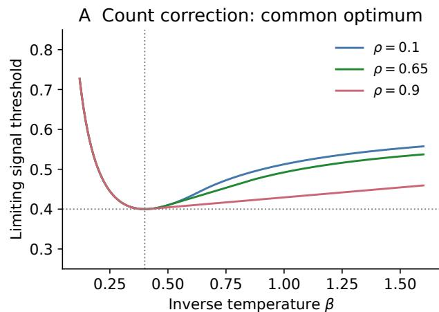
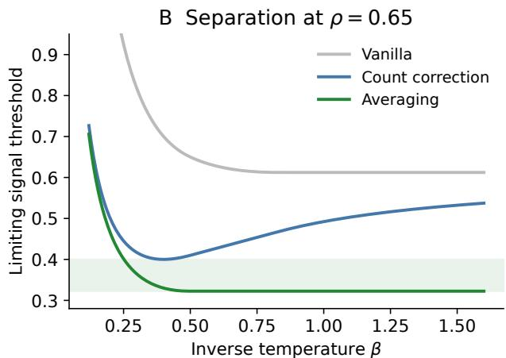
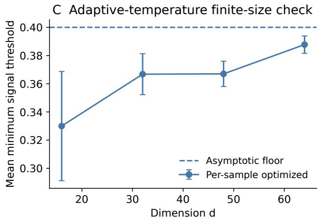
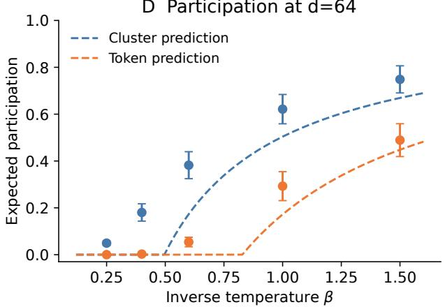
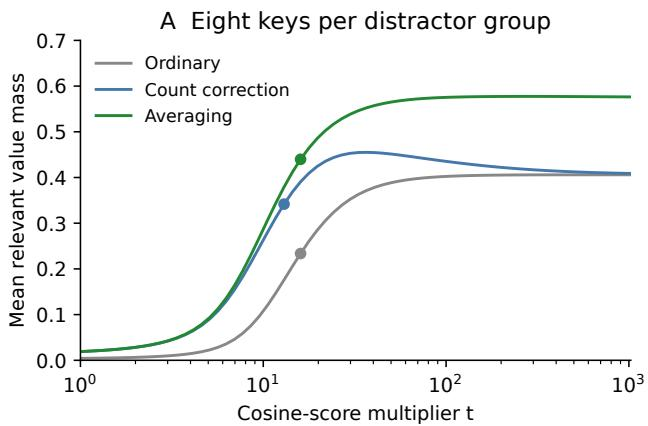
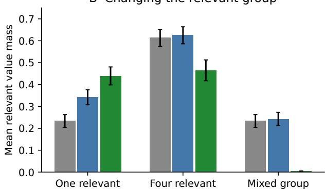

# BEYOND DEDUPLICATION: SHARP RETRIEVAL LIMITS FOR ATTENTION WITH CORRELATED DISTRACTORS

HEEHYUN PARK

Abstract. Redundant context afects attention through two distinct mechanisms: repeated items add normalization mass, while score variation within correlated groups can produce extreme individ ual scores. We separate these efects in a planted retrieval model with exponentially many Gaussian distractors arranged in known, exponentially large clusters. The model is a two-level generalized random energy model, whose classical free energy yields exact retrieval thresholds. Gaussian interpolation further shows that increasing positive correlation at fixed token count lowers the distractor free energy, unlike adding duplicates. Our main result identifies a sharp limitation of subtracting log cluster size from pre-softmax scores: this correction removes multiplicity but retains within cluster extremes. Even a temperature chosen after observing all scores cannot lower the required signal below $\sqrt { 2 \alpha _ { 1 } }$ , where α1 is the exponential rate of the number of clusters. Averaging scores before exponentiation instead suppresses these fluctuations and achieves $\sqrt { 2 \rho \alpha _ { 1 } }$ , where ρ is the within-cluster correlation. The gap persists after adding exponentially many singleton distractors, so group size alone does not identify the target, and extends to fixed finite hierarchies of light-tailed independent-increment scores. Finite-sample, stability, and participation results complement the asymptotic analysis. A controlled retrieval experiment with frozen sentence embeddings supports this distinction while delineating its scope: averaging helps when the relevant item is a singleton, but can discard useful evidence when a relevant group contains multiple matching items.

## 1. Introduction

Repeated passages, related keys, and duplicated records can change attention even when the quality of an individual query–key score stays fixed. Two interventions are easily conflated: correlating a fixed collection of scores, and adding more copies of existing scores. Their efects need not have the same sign. A theory that attributes every redundancy failure to positive correlation risks recommending the wrong intervention.

We analyze one softmax retrieval step with a planted relevant item and a hierarchical Gaussian distractor ensemble. Our objective is to characterize the signal strength needed for its attention mass to approach one. We treat the hierarchy as a supplied partition, as could arise from document or record identifiers. Inferring semantic groups from learned keys is a separate problem. We also include exponentially many singleton distractors so that group sizes alone need not identify the target. The model permits exact comparisons of ordinary attention, subtraction of log cluster size, and averaging scores before exponentiation.

Our main result identifies what count correction leaves behind: dividing a cluster’s weight by its size does not suppress its largest individual scores. Count correction therefore has a sharp signal threshold that cannot be lowered even by choosing the temperature after observing all scores (Theorem 4.1). Averaging the scores first achieves a strictly smaller threshold (Theorem 5.1). The hidden-singleton result removes identification from group size alone, and the deeper and non-Gaussian results extend this same comparison. Finite-sample and stability bounds describe its scope. The free energy and concentration transitions themselves come from classical random energy model (REM) and generalized random energy model (GREM) calculations [4, 8, 9]; we provide self-contained proofs. Finally, a frozen-encoder experiment tests the two operations on natural sentences, including cases where averaging relevant scores hurts retrieval.

Relation to prior work. The Gibbs interpretation of attention and its connection to associative memory are established [18]. REM methods already yield precise softmax and initialization analyses [10, 13]. Long-context scaling depends on the score geometry [6], and gap-counting unifies several concentration scales [14]. Training-driven transitions [16], correlated Hopfield equilibria [20], and clustered self-attention dynamics [12] concern diferent observables or dynamics. Our observable is the mass of an externally planted item after a single retrieval step. This distinction does not make the underlying GREM calculation new.

Likewise, correcting sampling density is an established idea, including in PointConv [22]. ToMe explicitly accounts for multiplicity through a + log m adjustment after merging [2]; Double-P uses size-weighted centroids to approximate token attention [17]. We study a diferent objective: equal prior mass for supplied groups. LUCID addresses correlated-key interference through preconditioning [11]. We do not introduce a general density correction or token-merging architecture. Our focus is their sharp retrieval limits in an explicit probabilistic model.

## 2. Model and normalization

We model retrieval against a collection of distractor tokens that arrive in correlated clusters. We begin with equally sized distractor clusters; Proposition 13.2 later treats unequal cluster sizes through a fixed finite collection of distractor types. The ambient dimension is $d ,$ and we study the high-dimensional limit $d \to \infty$ through integers. A distractor is indexed by a pair $( a , j )$ : the index a identifies its cluster and $j$ identifies the token within that cluster. There are $M _ { d }$ clusters and $m _ { d }$ tokens in every cluster, where

$$
M _ { d } = \lceil e ^ { \alpha _ { 1 } d } \rceil , \quad m _ { d } = \lceil e ^ { \alpha _ { 2 } d } \rceil , \qquad \alpha = \alpha _ { 1 } + \alpha _ { 2 } .\tag{2.1}
$$

Thus $\alpha _ { 1 }$ is the exponential growth rate of the number of distinct clusters, α2 is the exponential growth rate of the multiplicity within each cluster, and the total number of distractors is $N _ { d } =$ $M _ { d } m _ { d } \asymp e ^ { \alpha d }$

To represent similarity inside a cluster, assign to each cluster a shared Gaussian factor $G _ { a }$ and to each token a token-specific Gaussian factor $H _ { a j }$ . All of these variables are mutually independent $N ( 0 , 1 )$ random variables, and the distractor score is

$$
X _ { a j } = \sqrt { \rho d } G _ { a } + \sqrt { ( 1 - \rho ) d } H _ { a j } ,\tag{2.2}
$$

where $0 < \rho < 1$ . The term $G _ { a }$ shifts every score in cluster a together, whereas $H _ { a j }$ distinguishes individual tokens within that cluster. Hence each $X _ { a j }$ is marginally $N ( 0 , d )$ , two diferent tokens in the same cluster have covariance $\rho d$ (and correlation $\rho )$ , and tokens in diferent clusters are independent. The endpoints give useful intuition: $\rho = 0$ would make all distractor scores independent, while $\rho = 1$ would make the tokens within a cluster exact score duplicates. Equation (2.2) is therefore a two-level Gaussian random-energy model for repeated or near-duplicate distractors.

Alongside these distractors, let $X _ { * }$ denote the score of the single relevant, or planted, item. At inverse temperature $\beta > 0$ , ordinary softmax attention assigns that item the mass

$$
\mathcal { Z } _ { d } ( \beta ) = \sum _ { a = 1 } ^ { M _ { d } } \sum _ { j = 1 } ^ { m _ { d } } e ^ { \beta X _ { a j } } , \quad L _ { d } ( \beta ) = d ^ { - 1 } \log \mathcal { Z } _ { d } ( \beta ) , \qquad A _ { * } = \frac { e ^ { \beta X _ { * } } } { e ^ { \beta X _ { * } } + \mathcal { Z } _ { d } ( \beta ) } .\tag{2.3}
$$

Here $\mathcal { Z } _ { d }$ is the total unnormalized attention weight of the distractors and $L _ { d }$ is its log weight per dimension. The exact normalized log-odds against the planted item are

$$
\frac { 1 } { \beta d } \log \frac { 1 - A _ { * } } { A _ { * } } = \frac { L _ { d } ( \beta ) } { \beta } - \frac { X _ { * } } { d } .\tag{2.4}
$$

Thus a negative limiting right-hand side gives retrieval, while a positive limit gives failure. We assume only $X _ { * } / d \overset { \mathbb { P } } { \to } s \in \mathbb { R }$ : the constant s is the planted item’s asymptotic score advantage on the order-d scale. We do not require $X _ { * }$ to be independent of the distractors. Retrieval means $A _ { * } \stackrel { \mathbb { P } } {  } 1$ ， and all probability statements refer to the score ensemble.

The score model can be realized as a query–key dot product $X _ { a j } = q ^ { \top } k _ { a j }$ . Here $q \in \mathbb { R } ^ { d }$ is a deterministic query vector with $\| q \| ^ { 2 } = d ,$ and $k _ { a j } \in \mathbb { R } ^ { d }$ is the key of token j in cluster a. Let $z _ { a } \sim N ( 0 , I _ { d } )$ be the random vector shared by cluster $a ,$ , and let $\epsilon _ { a j } \sim N ( 0 , I _ { d } )$ be the token-specific random vector; all vectors $z _ { a }$ and $\epsilon _ { a j }$ are mutually independent. Setting $k _ { a j } = \sqrt { \rho } z _ { a } + \sqrt { 1 - \rho } \epsilon _ { a j }$ gives the score distribution in (2.2). A planted key $k _ { * }$ can be chosen so that $q ^ { \top } k _ { * } = s d .$ . Under conventional scaled dot-product attention, the pre-softmax score is $t _ { d } q ^ { \top } k / \sqrt { d }$ for a dimensiondependent sharpening factor $t _ { d } .$ so our $\beta$ equals $t _ { d } / \sqrt { d }$ . Thus fixed $\beta$ corresponds to $t _ { d } = \beta \sqrt { d }$ , and cannot be identified with fixed conventional scaling. A learned query depending on these keys need not satisfy the assumed law.

Define the one-level free energy for variance vd,

$$
f ( \beta ; a , v ) = \left\{ \begin{array} { l l } { a + \beta ^ { 2 } v / 2 , } & { \beta \le \sqrt { 2 a / v } , } \\ { \beta \sqrt { 2 a v } , } & { \beta \ge \sqrt { 2 a / v } , } \end{array} \right. \quad \quad f ( \beta ; a , 0 ) = a .\tag{2.5}
$$

We use inverse temperature: larger $\beta$ means sharper attention.

## 3. Exact thresholds and the sign of correlation

Theorem 3.1 (Classical two-level free energy, specialized). For fixed $\beta > 0$ , define

$$
F ( \beta ) = \left\{ \begin{array} { l l } { f ( \beta ; \alpha , 1 ) , } & { \rho \leq \alpha _ { 1 } / \alpha , } \\ { f ( \beta ; \alpha _ { 1 } , \rho ) + f ( \beta ; \alpha _ { 2 } , 1 - \rho ) , } & { \rho > \alpha _ { 1 } / \alpha . } \end{array} \right.\tag{3.1}
$$

Then the normalized distractor log-partition function $L _ { d } ( \beta ) = d ^ { - 1 }$ log $\mathcal { Z } _ { d } ( \beta )$ converges to $F ( \beta )$ in probability and in $L ^ { 1 }$ . Equivalently, with $I _ { 1 } ( x ) = x ^ { 2 } / ( 2 \rho )$ and $I _ { 2 } ( y ) = y ^ { 2 } / [ 2 ( 1 - \rho ) ]$ ，

$$
{ \cal F } ( \beta ) = \operatorname * { m a x } _ { \stackrel { I _ { 1 } ( x ) \leq \alpha _ { 1 } } { I _ { 1 } ( x ) + I _ { 2 } ( y ) \leq \alpha } } \{ \alpha - I _ { 1 } ( x ) - I _ { 2 } ( y ) + \beta ( x + y ) \} .\tag{3.2}
$$

Consequently, $A _ { * } \stackrel { \mathbb { P } } { \to } 1 \ i f \ s > F ( \beta ) / \beta$ , and $A _ { * } \stackrel { \mathbb { P } } {  } 0 \ i f \ s < F ( \beta ) / \beta$

In (3.2), x is the order-d deviation of the cluster-level parent shared by all tokens in a cluster, while y is the token-specific child deviation. The first constraint requires that such a rare parent exist among the $M _ { d }$ clusters; the second is the total entropy constraint requiring that a parent–child path with deviations $( x , y )$ exist among all $M _ { d } m _ { d }$ tokens. Replacing the second constraint with $I _ { 2 } ( y ) \le \alpha _ { 2 }$ for every parameter choice gives an incorrect answer in the merged regime.

To describe the freezing transitions, define

$$
b _ { 1 } = \sqrt { 2 \alpha _ { 1 } / \rho } , \qquad b _ { 2 } = \sqrt { 2 \alpha _ { 2 } / ( 1 - \rho ) } , \qquad b = \sqrt { 2 \alpha } .\tag{3.3}
$$

If $\rho \le \alpha _ { 1 } / \alpha$ , the parent constraint imposes no additional restriction on the optimizer and the free energy matches that of an i.i.d. REM with the same marginal variance, although the scores remain correlated. If $\rho > \alpha _ { 1 } / \alpha$ , equivalently $b _ { 1 } < b _ { 2 }$ , parent and child freezing occur separately, and the three branches of $F$ are

$$
F ( \beta ) = \left\{ \begin{array} { l l } { \alpha + \beta ^ { 2 } / 2 , } & { \beta \le b _ { 1 } , } \\ { \beta \sqrt { 2 \rho \alpha _ { 1 } } + \alpha _ { 2 } + \beta ^ { 2 } ( 1 - \rho ) / 2 , } & { b _ { 1 } \le \beta \le b _ { 2 } , } \\ { \beta \big ( \sqrt { 2 \rho \alpha _ { 1 } } + \sqrt { 2 ( 1 - \rho ) \alpha _ { 2 } } \big ) , } & { \beta \ge b _ { 2 } . } \end{array} \right.\tag{3.4}
$$

The surface $\beta s = F ( \beta )$ is deliberately excluded from the retrieval dichotomy. The first-order limit alone does not determine its behavior.

Theorem 3.2 (Correlation comparison). At any finite d, with fixed $M _ { d }$ clusters and $m _ { d }$ tokens per cluster, and for $0 < \rho < 1$ , define the distractor-only token weights $p _ { a j } = e ^ { \beta X _ { a j } } / \mathcal { Z } _ { d }$ and cluster weights $\begin{array} { r } { P _ { a } = \sum _ { j } p _ { a j } } \end{array}$ . Then

$$
\frac { \partial } { \partial \rho } \mathbb { E } L _ { d } ( \beta ) = - \frac { \beta ^ { 2 } } { 2 } \mathbb { E } \left[ \sum _ { a } P _ { a } ^ { 2 } - \sum _ { a , j } p _ { a j } ^ { 2 } \right] \leq 0 .\tag{3.5}
$$

In particular $F ( \beta ; \rho ) \leq F ( \beta ; 0 ) = f ( \beta ; \alpha , 1 )$ . For a common limiting signal s, i.i.d. success $\beta s >$ $f ( \beta ; \alpha , 1 )$ implies success for every $\rho \in [ 0 , 1 ]$

The finite-d derivative compares models with the same number of tokens and the same marginal $N ( 0 , d )$ distribution for every score; only the correlation between tokens in the same cluster changes. It says that the expected log distractor weight decreases as $\rho$ increases. It does not say that $\mathcal { Z } _ { d }$ decreases for every realized score array, and an ordering of the mean alone does not order finite-sample retrieval probabilities. The asymptotic threshold comparison additionally uses concentration and convergence to the deterministic free energy $F .$ . Adding a literal duplicate is a diferent operation: it adds another positive term to $\mathcal { Z } _ { d }$ and therefore increases the softmax denominator.

What actually condenses? Let $\begin{array} { r } { P _ { \mathrm { c l } } = \sum _ { a } P _ { a } ^ { 2 } } \end{array}$ and $\begin{array} { r } { P _ { \mathrm { t o k } } = \sum _ { a , j } p _ { a j } ^ { 2 } } \end{array}$ . These are conditional probabilities that two independent draws from the same distractor attention distribution choose the same cluster or token. Their expectations have the following limits (proof in Section 10):

$$
\begin{array} { r } { ( \mathbb { E } P _ { \mathrm { c l } } , \mathbb { E } P _ { \mathrm { t o k } } ) \longrightarrow \left\{ ( ( 1 - b _ { 1 } / \beta ) _ { + } , ( 1 - b _ { 2 } / \beta ) _ { + } ) , \quad b _ { 1 } < b _ { 2 } , \right. } \\ { ( ( 1 - b / \beta ) _ { + } , ( 1 - b / \beta ) _ { + } ) , \qquad b _ { 1 } \ge b _ { 2 } . } \end{array}\tag{3.6}
$$

Here $x _ { + } = \operatorname* { m a x } ( x , 0 )$ . In the intermediate phase $b _ { 1 } < \beta < b _ { 2 }$ , cluster participation is nonvanishing but maximum token mass tends to zero. Neither maximum cluster mass nor maximum token mass tends to one at any fixed finite $\beta \colon$ their respective participation expectations remain strictly below one. These are distractor phases, distinct from the external planted-item transition.

## 4. Count correction has a finite optimal temperature

Ordinary softmax assigns one unnormalized weight $e ^ { \beta X _ { a j } }$ to every token, so a cluster can receive more total mass simply because it contains more tokens. Count correction removes this multiplicity advantage using the supplied partition: a token with score X in a group of size m receives corrected weight ${ \check { e } } ^ { \beta X } / m$ , equivalently subtracting log m from its pre-softmax score $\beta X$

We first consider the balanced model in which every distractor cluster has size $m _ { d }$ and the planted item forms a singleton group. Each distractor weight is therefore divided by $m _ { d } ,$ while the planted weight is unchanged. Define the count-corrected planted mass and its fixed-temperature signal threshold by

$$
A _ { * } ^ { \mathrm { c n t } } = \frac { e ^ { \beta X _ { * } } } { e ^ { \beta X _ { * } } + \mathcal { Z } _ { d } ( \beta ) / m _ { d } } , \qquad h _ { \mathrm { c n t } } ( \beta ) = \frac { F ( \beta ) - \alpha _ { 2 } } { \beta } .\tag{4.1}
$$

Applying the log-odds identity (2.4) with the corrected distractor denominator $\mathcal { Z } _ { d } / m _ { d }$ gives

$$
\frac { 1 } { \beta d } \log \frac { 1 - A _ { * } ^ { \mathrm { c n t } } } { A _ { * } ^ { \mathrm { c n t } } } \stackrel { \mathbb { P } } {  } h _ { \mathrm { c n t } } ( \beta ) - s .\tag{4.2}
$$

Thus count-corrected retrieval succeeds when $s > h _ { \mathrm { c n t } } ( \beta )$ and fails when $s < h _ { \mathrm { c n t } } ( \beta )$ . By Theorem 3.1, the ordinary-attention threshold is $F ( \beta ) / \beta ;$ ; since $d ^ { - 1 } \log m _ { d } \to \alpha _ { 2 }$ , count correction lowers it by exactly $\alpha _ { 2 } / \beta$

The correction does not change relative weights within or between the equally sized distractor clusters. If every group, including the relevant group, had the same size, the same additive shift would be applied to every pre-softmax score and the softmax weights would not change. In the

present basic model the planted item is the unique singleton, so group size alone reveals its location;   
Corollary 5.2 removes this shortcut by adding exponentially many singleton distractors.

Theorem 4.1 (Optimal correction and adaptive-temperature lower bound). For $\alpha _ { 1 } , \alpha _ { 2 } > 0$ and $0 < \rho < 1$ , the fixed-temperature retrieval threshold $h _ { \mathrm { c n t } } ( \beta )$ is minimized uniquely at $\beta _ { \mathrm { o p t } } = \sqrt { 2 \alpha _ { 1 } }$

$$
\operatorname* { m i n } _ { \beta > 0 } h _ { \mathrm { c n t } } ( \beta ) = \sqrt { 2 \alpha _ { 1 } } .\tag{4.3}
$$

Thus, no fixed $\beta$ retrieves when $s ~ < ~ \sqrt { 2 \alpha _ { 1 } }$ , whereas the fixed choice $\beta = \sqrt { 2 \alpha _ { 1 } }$ retrieves when $s > \sqrt { 2 \alpha _ { 1 } }$ . Moreover, even if $\beta$ is selected after observing the realized distractor scores,

$$
\operatorname* { i n f } _ { \beta > 0 } \frac { \log \mathcal { Z } _ { d } ( \beta ) - \log m _ { d } } { \beta d } \stackrel { \mathbb { P } } {  } \sqrt { 2 \alpha _ { 1 } } .\tag{4.4}
$$

If $s ~ < ~ \sqrt { 2 \alpha _ { 1 } }$ , then $\begin{array} { r } { \operatorname* { s u p } _ { \beta > 0 } A _ { * } ^ { \mathrm { c n t } } ( \beta ) \ \stackrel { \mathbb { P } } { \to } \ 0 . } \end{array}$ , even when $\beta$ is chosen after observing all scores. $I f$ $s > \sqrt { 2 \alpha _ { 1 } }$ , the fixed choice in (4.3) gives $A _ { * } ^ { \mathrm { c n t } } \overset { \mathbb { P } } {  } 1$

Proof idea; complete proof in Section 11. Before the first freezing point, $h _ { \mathrm { c n t } } ( \beta ) ~ = ~ \alpha _ { 1 } / \beta + \beta / 2$ whose derivative $- \alpha _ { 1 } / \beta ^ { 2 } + 1 / 2$ changes from negative to positive at $\beta = \sqrt { 2 \alpha _ { 1 } }$ . This value occurs before the first freezing point in both regimes of (3.1), and direct diferentiation shows that every later formula for $h _ { \mathrm { c n t } }$ is increasing. For the data-dependent choice of $\beta ,$ convergence is uniform when $\beta$ stays in a fixed bounded interval. Jensen’s inequality rules out $\beta  0$ , while the maximum distractor score rules out $\beta \to \infty ;$ hence a minimizing sequence cannot escape to either endpoint. ■

Increasing $\beta$ makes the softmax place more weight on the largest scores. For count-corrected weights $e ^ { \beta X } / m$ , the required signal $h _ { \mathrm { c n t } } ( \beta )$ decreases until $\beta = \sqrt { 2 \alpha _ { 1 } }$ and then increases; choosing a larger $\beta$ therefore requires a stronger planted signal rather than improving retrieval. With $M _ { d }$ independent $N ( 0 , d )$ distractor scores, the smallest s permitting retrieval after optimizing $\beta$ is also $\sqrt { 2 \alpha _ { 1 } }$ , although the required s at a particular fixed $\beta$ generally difers between the two models.

If one could instead use only the $M _ { d }$ noise-free cluster components $\sqrt { \rho d } G _ { a }$ , the smallest required signal would be $\sqrt { 2 \rho \alpha _ { 1 } }$ . Count correction does not attain this smaller value because it divides out cluster size but retains the token-specific noise $\sqrt { ( 1 - \rho ) d } H _ { a j } ;$ the averaging method below suppresses that noise.

Proposition 4.2 (Upper bound on finite-sample failure probability). $I f X _ { * } = s d$ deterministically, then for any $0 < \varepsilon < 1$ 2

$$
{ \mathbb P } \{ A _ { * } ^ { \mathrm { c n t } } \le 1 - \varepsilon \} \le \operatorname* { m i n } \left\{ 1 , \frac { 1 - \varepsilon } { \varepsilon } M _ { d } \exp \left[ d ( \beta ^ { 2 } / 2 - \beta s ) \right] \right\} .\tag{4.5}
$$

For $s > 0$ , the exponent is minimized at $\beta = s$ , giving $M _ { d } e ^ { - d s ^ { 2 } / 2 } ( 1 - \varepsilon ) / \varepsilon$ . The bound needs only marginal $N ( 0 , d )$ distractor scores and does not assume their independence.

Let $\alpha _ { 1 , d } = d ^ { - 1 }$ log $M _ { d }$ . The upper bound in (4.5) decreases exponentially with d when

$$
\alpha _ { 1 , d } + \frac { \beta ^ { 2 } } { 2 } - \beta s < 0 .\tag{4.6}
$$

This is possible exactly when $s ^ { 2 } > 2 \alpha _ { 1 , d }$ , and then (4.6) is equivalent to

$$
s - \sqrt { s ^ { 2 } - 2 \alpha _ { 1 , d } } < \beta < s + \sqrt { s ^ { 2 } - 2 \alpha _ { 1 , d } } .\tag{4.7}
$$

Thus this upper bound is useful only when $\beta$ is neither too small nor too large. A small $\beta$ leaves substantial total mass on the many distractors, while a large $\beta$ amplifies rare high distractor scores in the moment bound. The proposition gives no failure claim outside this interval; only this particular upper bound ceases to guarantee success there.

## 5. Averaging removes token-specific score noise

Count correction replaces each cluster’s total weight $\sum _ { j } e ^ { \beta X _ { a j } }$ by the average of its exponentiated token scores, $m _ { d } ^ { - 1 } \sum _ { j } e ^ { \beta X _ { a j } }$ . This removes the factor caused by cluster size, but a single unusually large token-specific component $H _ { a j }$ can still dominate the average. Averaging scores first performs a diferent operation: for each cluster a, compute

$$
\bar { X } _ { a } = \frac { 1 } { m _ { d } } \sum _ { j = 1 } ^ { m _ { d } } X _ { a j } ,\tag{5.1}
$$

and then assign one attention weight $e ^ { \beta \bar { X } _ { a } }$ to that cluster. The planted item remains a singleton with score $X _ { * }$ . Define

$$
\mathcal { Z } _ { d } ^ { \mathrm { a v g } } = \sum _ { a } e ^ { \beta \bar { X } _ { a } } , \quad A _ { * } ^ { \mathrm { a v g } } = \frac { e ^ { \beta X _ { * } } } { e ^ { \beta X _ { * } } + \mathcal { Z } _ { d } ^ { \mathrm { a v g } } } , \quad h _ { \mathrm { a v g } } ( \beta ) = \frac { f ( \beta ; \alpha _ { 1 } , \rho ) } { \beta } .\tag{5.2}
$$

Here $\mathcal { Z } _ { d } ^ { \mathrm { a v g } }$ is the total distractor weight after replacing every cluster by its mean score, $A _ { * } ^ { \mathrm { a v g } }$ is the resulting planted-item mass, and $h _ { \mathrm { a v g } } ( \beta )$ will be the required planted signal at fixed $\beta .$

Under the Gaussian score model in (2.2), averaging gives

$$
\bar { X } _ { a } = \sqrt { \rho d } G _ { a } + \sqrt { ( 1 - \rho ) d } \frac { 1 } { m _ { d } } \sum _ { j = 1 } ^ { m _ { d } } H _ { a j } .\tag{5.3}
$$

The second term is Gaussian with variance $( 1 - \rho ) d / m _ { d }$ , so it becomes negligible on the order-d scale because $m _ { d }$ grows exponentially. Thus the averaged cluster scores asymptotically behave like the $M _ { d }$ independent shared components $\sqrt { \rho d } G _ { a }$ . This is the Gaussian model used for the asymptotic formulas in the theorem below; the finite-score comparison in its first sentence does not require Gaussian scores.

Theorem 5.1 (Count correction versus averaging). For every fixed collection of token scores, $\mathcal { Z } _ { d } ^ { \mathrm { a v g } } \leq$ $\mathcal { Z } _ { d } / m _ { d }$ and $A _ { * } ^ { \mathrm { a v g } } \geq A _ { * } ^ { \mathrm { c n t } }$ . Under the Gaussian score model in (2.2),

$$
d ^ { - 1 } \log \mathcal { Z } _ { d } ^ { \mathrm { a v g } } \stackrel { \mathbb { P } } { \to } f ( \beta ; \alpha _ { 1 } , \rho ) , \qquad \frac { 1 } { \beta d } \log \frac { 1 - A _ { * } ^ { \mathrm { a v g } } } { A _ { * } ^ { \mathrm { a v g } } } \stackrel { \mathbb { P } } { \to } h _ { \mathrm { a v g } } ( \beta ) - s .\tag{5.4}
$$

Thus averaging retrieves when $s > h _ { \mathrm { a v g } } ( \beta )$ and fails when $s < h _ { \mathrm { a v g } } ( \beta )$ . Optimizing over $\beta$ gives

$$
\operatorname* { i n f } _ { \beta > 0 } h _ { \mathrm { a v g } } ( \beta ) = \sqrt { 2 \rho \alpha _ { 1 } } < \sqrt { 2 \alpha _ { 1 } } = \operatorname* { i n f } _ { \beta > 0 } h _ { \mathrm { c n t } } ( \beta ) .\tag{5.5}
$$

Consequently, if $\sqrt { 2 \rho \alpha _ { 1 } } < s < \sqrt { 2 \alpha _ { 1 } }$ , averaging retrieves with any fixed $\beta \geq b _ { 1 }$ , while count correction fails even if its $\beta$ is selected after observing all distractor scores.

The first two inequalities follow from Jensen’s inequality. They mean that, for the same fixed token scores, averaging before exponentiation gives a distractor denominator no larger than count correction and therefore gives the planted item at least as much attention mass.

The asymptotic improvement is stronger: averaging suppresses the token-specific noise that count correction leaves inside $m _ { d } ^ { - 1 } \sum _ { j } e ^ { \beta X _ { a j } }$ . The interval of signals where averaging succeeds and count correction fails has width ${ \sqrt { 2 \alpha _ { 1 } } } ( 1 - { \sqrt { \rho } } )$ . This result assumes that the groups are supplied correctly and that the planted item is a singleton; it does not claim that arbitrary clustering or merging improves attention.

Hidden-singleton variant. In the basic model, the planted item is the only singleton group, so its group size reveals its identity before any scores are examined. To remove this shortcut, add $L _ { d } =$ $\lceil e ^ { a _ { 0 } d } \rceil$ independent $N ( 0 , d )$ distractor scores, each in its own singleton group, where $0 < a _ { 0 } < \alpha _ { 1 }$ Place the planted item uniformly at random among these $L _ { d } + 1$ singleton groups and hide its location. Define the two critical signal levels

$$
c _ { \mathrm { a v g , 0 } } : = \operatorname* { m a x } \{ \sqrt { 2 \rho \alpha _ { 1 } } , \sqrt { 2 a _ { 0 } } \} < c _ { \mathrm { c n t } } : = \sqrt { 2 \alpha _ { 1 } } .\tag{5.6}
$$

Corollary 5.2 (Hidden-singleton separation). In this augmented model, count correction fails for every data-dependent choice of β when $s < c _ { \mathrm { c n t } }$ , while the fixed choice $\beta = c _ { \mathrm { c n t } }$ retrieves when $s > c _ { \mathrm { c n t } }$ . Averaging retrieves whenever $s \mathrm { ~ > ~ } c _ { \mathrm { a v g , 0 } }$ using any fixed $\beta \ge \operatorname* { m a x } \{ b _ { 1 } , \sqrt { 2 a _ { 0 } } \}$ . Hence every $s \in ( c _ { \mathrm { a v g } , 0 } , c _ { \mathrm { c n t } } )$ is retrieved by averaging and missed by count correction for every choice of $\beta . \mathrm { ~ \ } I f a _ { 0 } \leq \rho \alpha _ { 1 }$ , then $c _ { \mathrm { a v g } , 0 } = \sqrt { 2 \rho \alpha _ { 1 } }$ and the original separation interval is unchanged. A method that observes only the partition, and not the scores, identifies the target with probability at most $1 / ( L _ { d } + 1 )$

Proof idea; complete proof in Section 12. The augmented distractor denominator is the sum of the original clustered contribution and the new singleton contribution. After taking $d ^ { - 1 } \log$ , this sum has the larger of their two limiting values. Adding distractors can only decrease the planted mass, so the adaptive-temperature failure result for count correction remains valid. For averaging, the clustered representatives require signal $\sqrt { 2 \rho \alpha _ { 1 } }$ and the singleton distractors require signal ${ \sqrt { 2 a _ { 0 } } } ;$ their maximum is $c _ { \mathrm { a v g , 0 } }$ . The partition-only bound follows because the hidden target is uniform among the $L _ { d } + 1$ singleton groups. ■

The hidden-singleton construction removes identification from group size alone, but it still assumes that the target is a singleton rather than a member of a mixed relevant–irrelevant group.

## 6. Practical meaning and scope

The theory assumes that the groups are supplied; it does not infer them from the keys. Subject to that assumption, the conclusions are stable to small errors, but the two corrections have diferent computational and semantic consequences.

Imperfect group statistics. Only relative count errors matter for count correction. If positive estimates satisfy

$$
\operatorname* { m a x } _ { i \neq * } \left| \log ( \widehat { m } _ { i } / m _ { i } ) - \log ( \widehat { m } _ { * } / m _ { * } ) \right| \leq r _ { d } ,\tag{6.1}
$$

then using the estimated counts changes $\log [ ( 1 - A _ { * } ) / A _ { * } ]$ , the log ratio of total distractor mass to planted mass, by at most $r _ { d }$ . In other words, if D is this log ratio under the true counts and $\widehat { D }$ is the same quantity under the estimated counts, then $| \widehat { D } - D | \le r _ { d }$ . Likewise, if every averaged score has error at most $u _ { d } ,$ , the corresponding log ratio changes by at most $2 \beta u _ { d }$ . Thus errors smaller than order d do not change the fixed-β conclusions away from the success–failure boundary. These bounds assume the groups are already available; they do not justify any particular clustering procedure.

Cost and interpretation. Count correction still scores all $N _ { d }$ tokens, so its per-query cost remains $O ( N _ { d } d )$ . Averaging can instead precompute $M _ { d }$ centroids in $O ( N _ { d } d )$ time and then score only those centroids in $O ( M _ { d } d )$ time per query. If all values have norm at most $R ,$ target mass $A _ { * }$ guarantees output error at most $2 R ( 1 - A _ { * } )$ . This makes successful mass retrieval suficient for value recovery, but not necessary. It also explains an important limitation: averaging may erase the target when a supplied group mixes relevant and irrelevant items.

## 7. How broadly does the result apply?

The key result is a gap between the smallest planted signals required by the two methods: averaging succeeds above $\sqrt { 2 \rho \alpha _ { 1 } }$ , whereas count correction requires $\sqrt { 2 \alpha _ { 1 } }$ , as shown in (5.5).

A fixed finite score array. Before taking $d \to \infty$ , consider one realized collection of distinct distractor scores $x _ { 1 } , \ldots , x _ { N _ { d } }$ as fixed numbers. Their softmax weights at temperature $\beta$ are $p _ { i } ( \beta ) =$ $e ^ { \beta x _ { i } } / \sum _ { j } e ^ { \beta x _ { j } }$ , and their entropy $S ( p ) = - \textstyle \sum _ { i } p _ { i }$ log $p _ { i }$ measures how broadly the distractor attention is spread. Proposition 15.1 shows that the best count-correction temperature is exactly the point where $S ( p ( \beta ) ) = \log m _ { d }$ , or equivalently where the efective number $e ^ { \bar { S } ( p ) }$ of attended distractors is $m _ { d }$ . This optimization identity is known as entropic value-at-risk (EVaR); it is an existing result used here as an oracle benchmark, not a new contribution.

Deeper and non-Gaussian hierarchies. The two-level model has clusters and tokens, but the same comparison holds for any fixed number of Gaussian levels, such as source, document, passage, and token (Theorem 16.1). Gaussianity can also be relaxed when each level contributes independent light-tailed increments. For an increment $Y _ { \ell } .$ , the cumulant generating function is $\Lambda _ { \ell } ( t ) = \log \mathbb { E } e ^ { t Y _ { \ell } }$ ; it records the exponential-tail behavior that determines the retrieval threshold. For a Gaussian increment it is simply a quadratic function of t, recovering the square-root formulas above. Theorem 17.1 proves the analogous count-versus-averaging gap for this non-Gaussian class. Full assumptions and proofs are in Sections 15–17; the results do not cover arbitrary learned score distributions or unknown groups.

## 8. Experiments and limitations

The Gaussian simulations check the formulas within the stated model: finite-array temperature optimization approaches the predicted threshold, and cluster and token participation approach their respective limits. Separate constrained optimizations reproduce the free energy across 120 parameter settings and check the finite-array, deeper-hierarchy, and non-Gaussian extensions. Figure 1 and the full protocols are in Section 14. We next test the two operations on learned sentence scores.

Frozen sentence retrieval. We use BANKING77, a collection of banking questions with 77 intent labels [5], and the frozen all-MiniLM-L6-v2 sentence encoder [21]. Training sentences supply the keys; disjoint subsets of the oficial test split supply 308 validation and 924 evaluation queries. Scores are cosine similarities. Each context contains all 77 intents, initially with one relevant key and 38 singleton distractors. The other 38 intents contribute four or eight same-intent keys, or eight exact copies. Labels supply the groups; same-intent sentences need not be paraphrases. Three seeded context draws are shared by all methods. These are controlled contexts, not the standard intent-classification benchmark.

Ordinary attention and count correction weight individual keys. Averaging uses one mean score and one mean value per group, without renormalizing the mean key. Each value indicates its key’s intent, so the relevant coordinate of the output is the total relevant value mass, equal to $A _ { * }$ when the target is a singleton. Each method independently selects a cosine-score multiplier from 81 values in [0.25, 1024] by minimizing validation negative log relevant value mass. Evaluation queries are not used for this choice. Full settings, uncertainty estimates, and additional metrics are in Appendix A. Multiplicity and score variation. Exact copies make count correction and averaging identical, as expected. With eight distinct keys per distractor group, their mean relevant masses are instead 0.342 and 0.440 after separate temperature selection (Table 1); the paired gain is 0.098 with 95% interval [0.088, 0.108]. Selecting one random representative per group gives 0.375, so retaining only one key does not explain the full gain. However, a label-aware oracle that chooses the best countcorrection temperature separately for each evaluation query attains 0.511. Thus the learned-score experiment supports the distinction between the operations, but does not establish the theorem’s all-temperature separation for these sentence scores.

When averaging loses relevant evidence. Giving the relevant intent four distinct keys reverses the comparison: count correction achieves 0.626 relevant mass and averaging 0.465. Variation within a relevant group can contain useful matches to the query. Moving three distractor keys into the singleton’s group is more damaging: averaging reduces relevant mass to 0.005, versus 0.243 for count correction. Here averaging also dilutes the relevant value to one quarter of the group’s value. These cases are outside the singleton-target guarantee and show why group membership alone does not justify averaging.

Table 1. Mean relevant value mass on 924 evaluation queries. Each method uses its own validation-selected temperature. The last column gives the paired averagingminus-count diference with a 95% intent-block bootstrap interval. Groups are supplied using dataset labels.
<table><tr><td>Context</td><td>Ordinary</td><td>Count</td><td>Average</td><td></td><td>Difference [95% interval]</td></tr><tr><td>One key per intent</td><td>0.379</td><td>0.379</td><td>0.379</td><td></td><td>+0.000 [+0.000, +0.000]</td></tr><tr><td>Exact copies (8)</td><td>0.288</td><td>0.379</td><td>0.379</td><td></td><td>+0.000 [+0.000, +0.000]</td></tr><tr><td>Same intent (4)</td><td>0.267</td><td>0.345</td><td>0.406</td><td></td><td>+0.062 [+0.056, +0.067]</td></tr><tr><td>Same intent (8)</td><td>0.234</td><td>0.342</td><td>0.440</td><td></td><td>+0.098 [+0.088, +0.108]</td></tr><tr><td>Four relevant keys</td><td>0.614</td><td>0.626</td><td>0.465</td><td></td><td>-0.161 [−0.181, -0.142]</td></tr><tr><td>Mixed relevant group</td><td>0.234</td><td>0.243</td><td>0.005</td><td></td><td>-0.238 [−0.269, -0.208]</td></tr></table>

What remains outside the theory. The model assumes exponentially many distractors, supplied groups, and a singleton target. Its exact phase diagram assumes Gaussian scores, while the non-Gaussian result still requires independent increments and strong tail conditions. The temperature scaling also difers from conventional fixed scaled-dot-product attention. Our sentence experiment uses bounded cosine scores and label-supplied groups; it does not validate these asymptotic assumptions or a grouping algorithm. Appendix B reports a causal intervention on pre-softmax self-attention logits in a frozen DistilBERT model. It confirms that averaging suppresses withingroup score extremes in actual attention, but its downstream efects are small, metric-dependent, and position-sensitive in a task on which the model performs near chance; it therefore does not support a general performance advantage.

Count correction removes multiplicity while retaining variation within a group. Averaging removes that variation as well. The theory shows why this yields a strict retrieval advantage against grouped distractors; the experiment shows why the same operation can remove useful evidence from a relevant group.

## 9. Free energy and Gaussian comparison: complete proofs

All limits below hold with the ceiling definitions in (2.1). More generally, only $d ^ { - 1 } \log M _ { d } \to \alpha _ { 1 }$ and $d ^ { - 1 } \log m _ { d } \to \alpha _ { 2 }$ are needed.

## 9.1. Counting states subject to prefix constraints.

Lemma 9.1 (Two-level counting principle). Let $U _ { a } \sim N ( 0 , v _ { 1 } d )$ and $V _ { a j } \sim N ( 0 , v _ { 2 } d )$ be mutually independent, where $v _ { 1 } , v _ { 2 } > 0$ . For $X _ { a j } = U _ { a } + V _ { a j }$ , the limiting free energy is

$$
\operatorname* { m a x } _ { x ^ { 2 } / ( 2 v _ { 1 } ) \le \alpha _ { 1 } \atop x ^ { 2 } / ( 2 v _ { 1 } ) + y ^ { 2 } / ( 2 v _ { 2 } ) \le \alpha } \left\{ \alpha - \frac { x ^ { 2 } } { 2 v _ { 1 } } - \frac { y ^ { 2 } } { 2 v _ { 2 } } + \beta ( x + y ) \right\} .\tag{9.1}
$$

Convergence holds in probability and in $L ^ { 1 }$ .

Proof. Write $I _ { 1 } ( x ) = x ^ { 2 } / ( 2 v _ { 1 } )$ and $I _ { 2 } ( y ) = y ^ { 2 } / ( 2 v _ { 2 } )$ . For a fixed interval B of positive length,

$$
{ \frac { 1 } { d } } \log \mathbb { P } ( U _ { a } / d \in B ) \longrightarrow - \operatorname* { i n f } _ { x \in B } I _ { 1 } ( x ) .\tag{9.2}
$$

This follows directly by integrating the density $\sqrt { d / ( 2 \pi v _ { 1 } ) } \exp [ - d x ^ { 2 } / ( 2 v _ { 1 } ) ]$ ; using interior subintervals establishes the lower bound. The identical statement holds for $V _ { a j } / d$

Upper bound. Choose R large enough that $R ^ { 2 } / ( 2 v _ { 1 } ) > \alpha _ { 1 } + 1$ and $R ^ { 2 } / ( 2 v _ { 2 } ) > \alpha + 1$ . A union bound makes the probability that any $U _ { a } / d$ or $V _ { a j } / d$ leaves $[ - R , R ]$ tend to zero exponentially. Partition this compact interval into finitely many bins of width at most δ. For a pair of bins $B , C _ { i }$ put $r _ { 1 } = \operatorname* { i n f } _ { B } I _ { 1 } , r _ { 2 } = \operatorname* { i n f } _ { C } I _ { 2 }$ , and let $K _ { B }$ be the number of parents in $B ,$ and $T _ { B C }$ the number of pairs in $B \times C$ . By (9.2),

$$
\mathbb { E } K _ { B } = e ^ { d \left( \alpha _ { 1 } - r _ { 1 } + o \left( 1 \right) \right) } , \qquad \mathbb { E } T _ { B C } = e ^ { d \left( \alpha - r _ { 1 } - r _ { 2 } + o \left( 1 \right) \right) } .\tag{9.3}
$$

Fix $\eta > 0$ . Markov’s inequality, followed by a union bound over the finite bins, shows with probability tending to one that bins with $r _ { 1 } > \alpha _ { 1 } + \eta$ or $r _ { 1 } + r _ { 2 } > \alpha + \eta$ are empty, and all other bins satisfy

$$
\begin{array} { r } { T _ { B C } \leq \exp \{ d [ \operatorname* { m a x } ( \alpha - r _ { 1 } - r _ { 2 } , 0 ) + \eta ] \} . } \end{array}\tag{9.4}
$$

The number of bins contributes $o ( 1 )$ to $L _ { d }$ . Bound the exponential weight of every state in $B \times C$ by $\exp [ \beta d \operatorname* { s u p } _ { B \times C } ( x + y ) ]$ and sum these bounds. First let $d \to \infty$ , then let $\eta , \delta \downarrow 0 .$ . Compactness and continuity show that the resulting upper bound is the maximum in (9.1). On the limiting feasible set the entropy term is nonnegative, so the positive-part operation disappears. Relaxed feasible sets converge to the stated feasible set by compactness.

Lower bound. Fix $( x , y )$ satisfying both constraints strictly. Choose small intervals $B , C$ around these coordinates. Their costs $r _ { i }$ satisfy $r _ { 1 } < \alpha _ { 1 }$ and $r _ { 1 } + r _ { 2 } < \alpha$ . The parent count is binomial with exponentially growing mean, so its relative error tends to zero; in particular $d ^ { - 1 }$ log $K _ { B } \stackrel { \mathbb { P } } {  } \alpha _ { 1 } - r _ { 1 }$ Conditional on all parent variables, the $K _ { B } m _ { d }$ child indicators for $V _ { a j } / d \in \mathrm { ~ \it C ~ }$ are independent Bernoulli variables. Their conditional total mean has exponential rate $\alpha - r _ { 1 } - r _ { 2 } > 0$ . A binomial Chernof bound therefore gives

$$
{ \frac { 1 } { d } } \log T _ { B C } \sp { \mathbb { P } } \to \alpha - r _ { 1 } - r _ { 2 } .\tag{9.5}
$$

Independence of child trials holds even when several share the same selected parent, since the selection used only the $U _ { a }$ . No condition $r _ { 2 } < \alpha _ { 2 }$ is required. Multiplying this count by the least weight in the bin and shrinking the intervals gives the variational lower bound at $( x , y )$ . Every feasible boundary point is approached by strictly feasible points via $( x , y ) \mapsto t ( x , y ) , t \uparrow 1$ , because both entropy budgets are positive. Continuity proves the lower bound for the maximum.

$L ^ { 1 }$ convergence. The elementary inequalities

$$
| L _ { d } | \leq d ^ { - 1 } \log N _ { d } + \beta d ^ { - 1 } \operatorname* { m a x } _ { a , j } | X _ { a j } |\tag{9.6}
$$

and the union bound P(max $| X _ { a j } | / d > u ) \le 2 N _ { d } \exp [ - d u ^ { 2 } / ( 2 ( v _ { 1 } + v _ { 2 } ) ) ]$ show uniform boundedness of the second moments of the right-hand side. Hence $L _ { d }$ is uniformly integrable, and its convergence in probability to a constant implies $L ^ { 1 }$ convergence. ■

## 9.2. Evaluation of the variational formula.

Proof of Theorem 3.1. Apply Lemma 9.1 with $v _ { 1 } = \rho , v _ { 2 } = 1 - \rho$ . It remains to solve its strictly concave optimization problem. Symmetry permits $x , y \geq 0$

If $\rho \leq \alpha _ { 1 } / \alpha$ , ignore the prefix constraint temporarily. On the total-cost disk, the maximizer is

$$
( x , y ) = ( \rho t , ( 1 - \rho ) t ) , \qquad t = \operatorname* { m i n } ( \beta , \sqrt { 2 \alpha } ) .\tag{9.7}
$$

Its prefix cost is $\rho t ^ { 2 } / 2 \le \rho \alpha \le \alpha _ { 1 }$ , so it also solves the constrained problem. Substitution gives $f ( \beta ; \alpha , 1 )$

If $\rho > \alpha _ { 1 } / \alpha$ , then $b _ { 1 } < b _ { 2 }$ . For $\beta \le b _ { 1 } , \ ( x , y ) = ( \beta \rho , \beta ( 1 - \rho ) )$ is feasible and unconstrained optimal. For $b _ { 1 } \leq \beta \leq b _ { 2 }$ , take

$$
x = \sqrt { 2 \rho \alpha _ { 1 } } , \qquad y = \beta ( 1 - \rho ) .\tag{9.8}
$$

The prefix constraint is active and the total constraint is feasible because $y ^ { 2 } / [ 2 ( 1 - \rho ) ] \leq \alpha _ { 2 }$ . With multipliers $\lambda _ { 1 } = \beta / b _ { 1 } - 1 \ge 0$ for the prefix cost and $\lambda _ { 2 } = 0$ for the total cost, the stationarity equations are satisfied. For $\beta \geq b _ { 2 }$ , choose

$$
x = \sqrt { 2 \rho \alpha _ { 1 } } , \qquad y = \sqrt { 2 ( 1 - \rho ) \alpha _ { 2 } } .\tag{9.9}
$$

Both constraints are active. Multipliers $\lambda _ { 2 } = \beta / b _ { 2 } - 1$ and $\lambda _ { 1 } = \beta / b _ { 1 } - \beta / b _ { 2 }$ are nonnegative and satisfy stationarity. These are suficient conditions because the objective is concave and the feasible set is convex. Substitution gives (3.4), with the formulas agreeing at all boundaries.

Finally, write $D _ { d } = \log \mathcal { Z } _ { d } - \beta X _ { * }$ . Then $D _ { d } / d \stackrel { \mathbb { P } } {  } F - \beta s$ and $A _ { * } = ( 1 + e ^ { D _ { d } } ) ^ { - 1 }$ . A strictly negative or positive limiting exponent proves the two retrieval conclusions without any independence requirement on $X _ { * }$ ■

## 9.3. Finite-size concentration and retrieval margins.

Proposition 9.2 (Gaussian concentration). For every u $, > 0$

$$
\begin{array} { r } { \mathbb { P } \{ | L _ { d } - \mathbb { E } L _ { d } | \ge u \} \le 2 \exp [ - d u ^ { 2 } / ( 2 \beta ^ { 2 } ) ] . } \end{array}\tag{9.10}
$$

Let $e _ { d } = | \mathbb { E } L _ { d } - F | \to 0$ and $t _ { d } ( r ) = \mathbb { P } ( | X _ { * } / d - s | > r )$ . Except on an event of probability at most $2 e ^ { - d u ^ { 2 } / ( 2 \beta ^ { 2 } ) } + t _ { d } ( r )$

$$
\left| d ^ { - 1 } \log \frac { 1 - A _ { * } } { A _ { * } } - ( F - \beta s ) \right| \leq e _ { d } + u + \beta r .\tag{9.11}
$$

Thus a positive margin $\beta s - F > e _ { d } + u + \beta r$ implies $1 - A _ { * } \le \exp [ - d ( \beta s - F - e _ { d } - u - \beta r ) ]$ on this event.

Proof. As a function of the independent standard Gaussian array (G, H),

$$
\sum _ { a } ( \partial _ { G _ { a } } \log \mathcal { Z } _ { d } ) ^ { 2 } + \sum _ { a , j } ( \partial _ { H _ { a j } } \log \mathcal { Z } _ { d } ) ^ { 2 } = \beta ^ { 2 } d \left[ \rho \sum _ { a } P _ { a } ^ { 2 } + ( 1 - \rho ) \sum _ { a , j } p _ { a j } ^ { 2 } \right] \leq \beta ^ { 2 } d .\tag{9.12}
$$

Consequently $L _ { d }$ is $\beta / \sqrt { d } \mathrm { - L i p s c h i t z }$ . The standard Gaussian Lipschitz concentration inequality [3] gives (9.10). Intersect this concentration event with $| X _ { * } / d - s | \leq r$ and use the exact log-odds identity to get (9.11). No explicit rate is asserted for the deterministic bias $\textstyle e _ { d } ;$ this statement must not be read as a rate to the limiting threshold without that bias term.

## 9.4. Gaussian interpolation.

Lemma 9.3 (Covariance diferentiation). For a diferentiable positive-definite covariance path $C ( t )$ and a centered Gaussian vector $Y ( t )$ , the log-sum-exp $\begin{array} { r } { g ( y ) = \log \sum _ { i } e ^ { \beta y _ { i } } } \end{array}$ satisfies

$$
\frac { d } { d t } \mathbb { E } g ( Y ( t ) ) = \frac { 1 } { 2 } \sum _ { i , j } C _ { i j } ^ { \prime } ( t ) \mathbb { E } \partial _ { i } \partial _ { j } g ( Y ( t ) ) .\tag{9.13}
$$

Proof. The Gaussian density has Fourier transform $\exp [ - \xi ^ { \top } C ( t ) \xi / 2 ]$ . Diferentiating shows that its time derivative is $\begin{array} { r } { \frac { 1 } { 2 } \sum _ { i j } C _ { i j } ^ { \prime } \partial _ { i } \partial _ { j } } \end{array}$ of the density. Integrate twice by parts. The derivatives of log-sum-exp through order two are bounded and its value grows at most linearly, so Gaussian tails justify diferentiation and remove boundary terms. Singular endpoints follow by continuity; the identity itself is only needed in the interior. ■

Proof of Theorem 3.2. At fixed d, $C _ { i i } ^ { \prime } ( \rho ) = 0 , C _ { i j } ^ { \prime } ( \rho ) = d$ for distinct tokens in the same cluster, and all other entries are zero. Since

$$
\partial _ { i } \partial _ { j } g = \beta ^ { 2 } ( p _ { i } { \bf 1 } _ { i = j } - p _ { i } p _ { j } ) ,\tag{9.14}
$$

Lemma 9.3 gives

$$
\begin{array} { r } { d ^ { - 1 } \partial _ { \rho } \mathbb { E } \log \mathcal { Z } _ { d } = - \frac { 1 } { 2 } \beta ^ { 2 } \mathbb { E } \sum _ { a } \displaystyle \sum _ { j \neq k } p _ { a j } p _ { a k } = - \frac { 1 } { 2 } \beta ^ { 2 } \mathbb { E } ( P _ { \mathrm { c l } } - P _ { \mathrm { t o k } } ) . } \end{array}\tag{9.15}
$$

Integrate this nonpositive derivative. Continuity in $\rho$ extends the comparison to zero and one. Then pass to the limit using $L ^ { 1 }$ convergence (the endpoints also follow directly from one-level REMs). The claimed retrieval implication follows from Theorem 3.1. ■

## 10. Participation without an incorrect winner-take-all claim

Proposition 10.1 (Expected participation). Equation (3.6) holds for every fixed $\beta > 0$ and $0 <$ $\rho < 1$ . A strictly positive limiting participation expectation does not assert a deterministic limiting participation value.

Proof. Temporarily replace $\rho , 1 - \rho$ by independent positive variances $v _ { 1 } , v _ { 2 }$ . Covariance diferentiation gives the exact identities

$$
\partial _ { v _ { 1 } } \mathbb { E } L _ { d } = \frac { \beta ^ { 2 } } { 2 } ( 1 - \mathbb { E } P _ { \mathrm { c l } } ) , \qquad \partial _ { v _ { 2 } } \mathbb { E } L _ { d } = \frac { \beta ^ { 2 } } { 2 } ( 1 - \mathbb { E } P _ { \mathrm { t o k } } ) .\tag{10.1}
$$

For the first identity the diferentiated covariance is d for all pairs in the same cluster, including equal indices; for the second it is d only on the diagonal.

We justify passing derivatives to the limit rather than exchanging them without an argument. Parameterize $v _ { i } = t _ { i } ^ { 2 }$ with $t _ { i } > 0$ . For each realized standard Gaussian array, the function

$$
\left( t _ { 1 } , t _ { 2 } \right) \longmapsto d ^ { - 1 } \log \sum _ { a , j } \exp \Bigl \{ \beta \sqrt { d } \bigl ( t _ { 1 } G _ { a } + t _ { 2 } H _ { a j } \bigr ) \Bigr \}
$$

is convex, hence so is its expectation. Lemma 9.1 gives pointwise convergence at every positive $( t _ { 1 } , t _ { 2 } )$ . If a sequence of diferentiable convex functions converges pointwise on an open interval to a function diferentiable at t, then its derivatives at t converge: bound each derivative between the two secant slopes at $t \pm h$ , pass to the limit, and then send $h \downarrow 0$ . Apply this separately in each amplitude coordinate and use $\partial _ { v _ { i } } = ( 2 t _ { i } ) ^ { - 1 } \partial _ { t _ { i } }$   
i

For completeness the general-variance limiting free energy is

$$
F ( \beta ; v _ { 1 } , v _ { 2 } ) = \left\{ \begin{array} { l l } { f ( \beta ; \alpha _ { 1 } , v _ { 1 } ) + f ( \beta ; \alpha _ { 2 } , v _ { 2 } ) , } & { \alpha _ { 1 } / v _ { 1 } < \alpha _ { 2 } / v _ { 2 } , } \\ { f ( \beta ; \alpha , v _ { 1 } + v _ { 2 } ) , } & { \alpha _ { 1 } / v _ { 1 } \geq \alpha _ { 2 } / v _ { 2 } . } \end{array} \right.\tag{10.2}
$$

This follows from the same maximization as before. It is diferentiable in both positive variances, including the boundaries: the unfrozen derivative is $\beta ^ { 2 } / 2$ , and the frozen derivative of $f ( \beta ; a , v )$ is $\beta \sqrt { a / ( 2 v ) }$ . They agree at $\beta = \sqrt { 2 a / v }$ . At the hierarchy-merging boundary $\alpha _ { 1 } / v _ { 1 } = \alpha _ { 2 } / v _ { 2 }$ the derivatives of the two displayed expressions also agree. Using these derivatives in $( 1 0 . 1 )$ at $v _ { 1 } = \rho , v _ { 2 } = 1 - \rho$ proves (3.6). ■

For a probability vector w, $\begin{array} { r } { ( \operatorname* { m a x } _ { i } w _ { i } ) ^ { 2 } \leq \sum _ { i } w _ { i } ^ { 2 } \leq \operatorname* { m a x } _ { i } w _ { i } , } \end{array}$ Thus vanishing expected token participation implies $\operatorname* { m a x } _ { a , j } p _ { a j } \stackrel { \mathbb { P } } {  }$ 0 by Markov’s inequality. If the maximum mass tended to one in probability, its participation would tend to one in probability and, being bounded, in expectation. Formula (3.6) rules that out for both tokens and clusters at finite $\beta .$ The positive cluster-participation limit in the intermediate regime implies a nonvanishing probability of a macroscopic cluster weight, not that one cluster absorbs all mass with probability tending to one. The richer random cascade description is classical [4] and is not needed for these statements.

## 11. Count correction and optimal temperature: complete proofs

The count-corrected log odds are exactly

$$
\log \frac { 1 - A _ { * } ^ { \mathrm { c n t } } } { A _ { * } ^ { \mathrm { c n t } } } = \log \mathcal { Z } _ { d } - \log m _ { d } - \beta X _ { * } .\tag{11.1}
$$

Their normalized limit is $F - \alpha _ { 2 } - \beta s _ { \mathrm { { \scriptsize ~ \cdot ~ } } }$ , giving the fixed-temperature threshold in (4.1).

## 11.1. The unique limiting optimum.

Lemma 11.1 (Shape of the corrected threshold). For $0 < \rho < 1 , h _ { \mathrm { c n t } }$ is strictly decreasing on $( 0 , \sqrt { 2 \alpha _ { 1 } } )$ and strictly increasing on $( \sqrt { 2 \alpha _ { 1 } } , \infty )$

Proof. In the merged regime, before $b = { \sqrt { 2 \alpha } }$

$$
h _ { \mathrm { c n t } } ( \beta ) = \frac { \alpha _ { 1 } } { \beta } + \frac { \beta } { 2 } , \quad h _ { \mathrm { c n t } } ^ { \prime } ( \beta ) = - \frac { \alpha _ { 1 } } { \beta ^ { 2 } } + \frac { 1 } { 2 } .\tag{11.2}
$$

After b, $h _ { \mathrm { c n t } } ( \beta ) = \sqrt { 2 \alpha } - \alpha _ { 2 } / \beta$ has positive derivative. Since $\sqrt { 2 \alpha _ { 1 } } < b$ , the unique optimum lies in the first branch.

In the split regime, the first branch ends at $b _ { 1 } = \sqrt { 2 \alpha _ { 1 } / \rho } > \sqrt { 2 \alpha _ { 1 } }$ and has the identical expression. In the middle branch,

$$
h _ { \mathrm { c n t } } ( \beta ) = \sqrt { 2 \rho \alpha _ { 1 } } + \frac { \beta ( 1 - \rho ) } { 2 } ,\tag{11.3}
$$

which is strictly increasing. In the last branch,

$$
h _ { \mathrm { c n t } } ( \beta ) = v - \frac { \alpha _ { 2 } } { \beta } , \qquad v = \sqrt { 2 \rho \alpha _ { 1 } } + \sqrt { 2 ( 1 - \rho ) \alpha _ { 2 } } ,\tag{11.4}
$$

which is again strictly increasing. Continuity at the joins completes the claim. Evaluating the first branch at $\sqrt { 2 \alpha _ { 1 } }$ gives (4.3). ■

## 11.2. Uniform control over all temperatures.

Lemma 11.2 (Maximum scores and compact uniform convergence). Let $V _ { d } = d ^ { - 1 } \operatorname* { m a x } _ { a , j } X _ { a j }$ and $\begin{array} { r } { B _ { d } = ( N _ { d } d ) ^ { - 1 } \sum _ { a , j } X _ { a j } } \end{array}$ . Then $B _ { d } \stackrel { \mathbb { P } } {  } 0 , V _ { d } \stackrel { \mathbb { P } } {  } v$ , where

$$
v = \left\{ \begin{array} { l l } { \sqrt { 2 \alpha } , } & { \rho \leq \alpha _ { 1 } / \alpha , } \\ { \sqrt { 2 \rho \alpha _ { 1 } } + \sqrt { 2 ( 1 - \rho ) \alpha _ { 2 } } , } & { \rho > \alpha _ { 1 } / \alpha . } \end{array} \right.\tag{11.5}
$$

For each $0 < t < T < \infty$ , sup $\nu _ { \beta \in [ t , T ] } | L _ { d } ( \beta ) - F ( \beta ) | \overset { \mathbb { P } } {  } 0$

Proof. The variance of $B _ { d }$ is $\rho / ( M _ { d } d ) + ( 1 - \rho ) / ( N _ { d } d )$ , so the first assertion follows. For any fixed $\beta > 0$

$$
L _ { d } ( \beta ) / \beta - \log N _ { d } / ( \beta d ) \leq V _ { d } \leq L _ { d } ( \beta ) / \beta .\tag{11.6}
$$

The limits of the two bounding expressions tend to the common value v as the fixed number $\beta \to \infty$ This is a two-step squeeze: for any error tolerance choose a suficiently large fixed $\beta$ first, then take $d \to \infty$ . It proves $V _ { d } \xrightarrow { \mathbb { P } }$ v without assuming a joint limit theorem.

The random Lipschitz constant of $L _ { d }$ as a function of $\beta$ is at most $d ^ { - 1 } \operatorname* { m a x } | X _ { a j } |$ , which is bounded in probability by the Gaussian union bound in Lemma 9.1. The deterministic function $F$ is uniformly continuous on [t, T]. On an event where the random Lipschitz constant is bounded, use a finite fine grid, pointwise convergence at its points, and continuity between them. First refine the grid and then increase the Lipschitz bound. This gives the stated compact uniform convergence. ■

Proof of Theorem $4 . 1 .$ Lemma 11.1 proves the deterministic optimum. Let $c = { \sqrt { 2 \alpha _ { 1 } } }$ and

$$
H _ { d } ( \beta ) = \frac { \log \mathcal { Z } _ { d } ( \beta ) - \log m _ { d } } { \beta d } .\tag{11.7}
$$

The upper bound for the infimum follows by evaluating $H _ { d }$ at $\beta = c$ . For the lower bound we must exclude temperatures tending to zero or infinity. Jensen’s inequality and the largest-term bound give, simultaneously for every $\beta > 0$

$$
H _ { d } ( \beta ) \geq \frac { \log M _ { d } } { \beta d } + B _ { d } , \qquad H _ { d } ( \beta ) \geq V _ { d } - \frac { \log m _ { d } } { \beta d } .\tag{11.8}
$$

The limiting $v$ in (11.5) is strictly greater than $c .$ In the merged case this follows from $\alpha _ { 2 } > 0 ;$ in the split case it also follows from strict increase of $h _ { \mathrm { c n t } }$ after its minimum and lim $\iota _ { \beta \to \infty } h _ { \mathrm { c n t } } ( \beta ) = v$ Choose a small fixed $t > 0$ with $\alpha _ { 1 } / ( 2 t ) > c + 1$ , and a large fixed $T$ with $v - ( \alpha _ { 2 } + 1 ) / T > c$ . By Lemma 11.2, (11.8) bounds $H _ { d }$ above $c - \epsilon$ uniformly on $( 0 , t )$ and $( T , \infty )$ with probability tending to one, for any $\epsilon > 0$ . On $[ t , T ]$ , compact uniform convergence gives inf $H _ { d } \geq$ inf $h _ { \mathrm { c n t } } - \epsilon = c - \epsilon$ with probability tending to one. Together with the upper bound, this proves $( 4 . 4 )$

To establish failure uniformly over temperatures when $s < c ,$ fix $\delta = ( c - s ) / 4 > 0$ . With probability tending to one, $H _ { d } ( \beta ) \geq c - \delta$ for every $\beta$ and $X _ { * } / d \le s + \delta$ . For $\beta \ge t > 0 , ( 1 1 . 1 )$ is at least $t d ( c - s - 2 \delta )$ . For small temperatures use Jensen’s inequality directly in the log odds, rather than divide by $\beta \colon$

$$
d ^ { - 1 } \log \frac { 1 - A _ { * } ^ { \mathrm { c n t } } } { A _ { * } ^ { \mathrm { c n t } } } \geq d ^ { - 1 } \log M _ { d } + \beta ( B _ { d } - X _ { * } / d ) .\tag{11.9}
$$

Choose $t > 0$ additionally satisfying $t ( | s | + 2 ) < \alpha _ { 1 } / 4$ . On the events $| B _ { d } | \leq 1 , | X _ { * } / d | \leq | s | + 1$ ， and $d ^ { - 1 }$ log $M _ { d } \ge \alpha _ { 1 } / 2$ , this last bound is at least $\alpha _ { 1 } / 4$ for all $0 < \beta < t$ . The minimum log odds over all temperatures therefore diverges to $+ \infty$ in probability. This proves $\operatorname* { s u p } _ { \beta } A _ { * } ^ { \mathrm { c n t } } \ \stackrel { \mathbb { P } } { \to } 0$ . Above the floor, the fixed-temperature threshold at $\beta = c$ proves success. ■

Proof of Proposition $4 . 2 .$ The event $A _ { * } ^ { \mathrm { c n t } } \leq 1 - \varepsilon$ is equivalent to $\mathcal { Z } _ { d } / m _ { d } \geq [ \varepsilon / ( 1 - \varepsilon ) ] e ^ { \beta s d }$ . Marginal Gaussian moment generating functions give

$$
\mathbb { E } ( \mathcal { Z } _ { d } / m _ { d } ) = M _ { d } \exp ( \beta ^ { 2 } d / 2 ) ,\tag{11.10}
$$

irrespective of dependence. Markov’s inequality proves (4.5). Completing the square $\beta ^ { 2 } / 2 - \beta s =$ $( \beta - s ) ^ { 2 } / 2 - s ^ { 2 } / \bar { 2 }$ gives the minimizing positive temperature when $s > 0$ . This minimizes the upper bound for a given s, whereas $\beta = \sqrt { 2 \alpha _ { 1 } }$ minimizes the asymptotic signal threshold; these are diferent optimization problems. ■

## 12. Averaging, estimation error, and value recovery

Proof of Theorem 5.1. For every cluster, Jensen’s inequality gives $e ^ { \beta \bar { X } _ { a } } \leq m _ { d } ^ { - 1 } \sum _ { j } e ^ { \beta X _ { a j } }$ . Summing proves the samplewise denominator and attention comparisons.

To identify the limiting free energy, write

$$
\bar { X } _ { a } = \sqrt { \rho d } G _ { a } + R _ { a } , \qquad R _ { a } \sim N \big ( 0 , ( 1 - \rho ) d / m _ { d } \big ) .\tag{12.1}
$$

The $R _ { a }$ are independent of the parent array and independent across clusters. For every $u > 0$

$$
\mathbb { P } \left\{ \operatorname* { m a x } _ { a } \left| R _ { a } \right| > u d \right\} \leq 2 M _ { d } \exp \left[ - \frac { u ^ { 2 } d m _ { d } } { 2 ( 1 - \rho ) } \right] \longrightarrow 0 .\tag{12.2}
$$

Since log-sum-exp is Lipschitz in the sup norm,

$$
| d ^ { - 1 } \log \mathcal { Z } _ { d } ^ { \mathrm { a v g } } - d ^ { - 1 } \log \sum _ { a } e ^ { \beta \sqrt { \rho d } G a } | \leq \frac { \beta } { d } \operatorname* { m a x } _ { a } | R _ { a } | \overset { \mathbb { P } } {  } 0 .\tag{12.3}
$$

The one-level version of the bin-counting proof in Lemma 9.1 gives free energy $f ( \beta ; \alpha _ { 1 } , \rho )$ for the remaining sum. Its ratio to $\beta$ decreases to $\sqrt { 2 \rho \alpha _ { 1 } }$ at $b _ { 1 }$ and equals that constant thereafter. Equations (5.5) and the separation interval follow from Theorem 4.1 and the log-odds retrieval argument. ■

Proof of Corollary 5.2. Let $Z _ { 0 , d }$ be the partition function of the $L _ { d }$ singleton distractors. Its normalized logarithm tends to $f ( \beta ; a _ { 0 } , 1 )$ . For positive $U , V ,$ , max(log U, log $V ) \ \leq \ \log ( U + V ) \ \leq$ max $( \log U , \log V ) + \log 2$ . Thus the augmented fixed-temperature thresholds are

$$
h _ { \mathrm { c n t , 0 } } ( \beta ) = \operatorname* { m a x } \{ h _ { \mathrm { c n t } } ( \beta ) , f ( \beta ; a _ { 0 } , 1 ) / \beta \} , \qquad h _ { \mathrm { a v g , 0 } } ( \beta ) = \operatorname* { m a x } \{ h _ { \mathrm { a v g } } ( \beta ) , f ( \beta ; a _ { 0 } , 1 ) / \beta \} .\tag{12.4}
$$

At $c = \sqrt { 2 \alpha _ { 1 } }$ , the singleton REM is frozen since $a _ { 0 } < \alpha _ { 1 }$ , so $f ( c ; a _ { 0 } , 1 ) / c = \sqrt { 2 a _ { 0 } } < c$ . Therefore the first threshold has minimum c at the same unique temperature, because it is bounded below by $h _ { \mathrm { c n t } }$ and equals c there. The empirical infimum has lower bound the original empirical infimum and upper bound its augmented value at $c ,$ both tending to $c .$ Adding singleton distractors decreases planted mass for every realized array and temperature, so the original adaptive-temperature failure bound still applies uniformly. Fixed temperature c retrieves above the floor.

Each component of $h _ { \mathrm { a v g , 0 } }$ decreases to its respective floor and reaches that floor at a finite temperature. Both have reached their floors at any fixed $\beta \geq \operatorname* { m a x } \{ b _ { 1 } , \sqrt { 2 a _ { 0 } } \}$ , proving (5.6) and the strict separation. Finally, conditional on the partition alone, the random target location is uniform over the $L _ { d } + 1$ singleton groups. Any possibly randomized guess based only on the partition therefore has success probability at most $1 / ( L _ { d } + 1 )$ . This is an identification statement about partition information, not a lower bound on arbitrary score-based retrieval algorithms. ■

Proposition 12.1 (Deterministic relative-log-error bound). For any scores and positive group counts $m _ { i } ,$ define exact count-corrected weights proportional to $e ^ { \beta X _ { i } } / m _ { i }$ . Let D and $\widehat { D }$ be the log odds against the planted item using $m _ { i }$ and $\widehat { m } _ { i }$ , respectively. Under (6.1), $| \widehat { D } - D | \le r _ { d }$ . For averaging, if every representative score (including the singleton) has error at most $u _ { d } ,$ , the corresponding log odds change by at most $2 \beta u _ { d }$

Proof. Put $e _ { i } = \log ( \widehat { m } _ { i } / m _ { i } )$ . The estimated odds sum is

$$
\sum _ { i \neq * } e ^ { \beta ( X _ { i } - X _ { * } ) } \frac { m _ { * } } { m _ { i } } e ^ { - ( e _ { i } - e _ { * } ) } .\tag{12.5}
$$

Each positive summand is within a factor $e ^ { \pm r _ { d } }$ of its exact value, as is their sum. Taking logarithms proves the claim. In the averaging case, errors in each score diference lie in $[ - 2 u _ { d } , 2 u _ { d } ]$ ; the same argument applies. Dividing by d proves stability of strict fixed-temperature limiting margins when the bounds are $o _ { \mathbb { P } } ( d )$ . The adaptive-temperature theorem is not asserted under arbitrary error sequences on the strength of this fixed-temperature argument. ■

Proposition 12.2 (Value error). For weights $A _ { i } \geq 0 , \textstyle \sum _ { i } A _ { i } = 1$ , and values with $\left\| v _ { i } \right\| \leq R$

$$
\left\| \sum _ { i } A _ { i } v _ { i } - v _ { * } \right\| \leq 2 R ( 1 - A _ { * } ) .\tag{12.6}
$$

The same conclusion holds after averaging values within supplied groups $i f$ the target is a singleton. Hence successful attention-mass retrieval implies vanishing bounded-value error in probability and in mean square.

Proof. Subtract $v _ { * } \sum _ { i } A _ { i }$ , cancel the target term, and apply the triangle inequality and $\| v _ { i } - v _ { * } \| \leq$ $2 R .$ . Group-averaged values also lie in the radius-R ball. Squaring and bounded convergence (or uniform integrability plus convergence in probability) proves the mean-square assertion. ■

## 13. Extensions and boundary cases

13.1. Partial correction and a second optimization boundary. Let $0 < \gamma \leq 1$ and subtract γ log $m _ { d }$ . The retrieval threshold is $h _ { \gamma } ( \beta ) = [ F ( \beta ) - \gamma \alpha _ { 2 } ] / \beta$

Proposition 13.1 (Optimal partial correction). Set $c _ { \gamma } = \alpha _ { 1 } + ( 1 - \gamma ) \alpha _ { 2 }$ and assume $0 < \rho < 1$ . If $\rho c _ { \gamma } \leq \alpha _ { 1 }$ , then

$$
\beta _ { \gamma } = \sqrt { 2 c _ { \gamma } } , \qquad \operatorname* { m i n } _ { \beta > 0 } h _ { \gamma } ( \beta ) = \sqrt { 2 c _ { \gamma } } .\tag{13.1}
$$

If $\rho c _ { \gamma } > \alpha _ { 1 }$ , then

$$
\beta _ { \gamma } = \sqrt { \frac { 2 ( 1 - \gamma ) \alpha _ { 2 } } { 1 - \rho } } , \qquad \operatorname* { m i n } _ { \beta > 0 } h _ { \gamma } ( \beta ) = \sqrt { 2 \rho \alpha _ { 1 } } + \sqrt { 2 ( 1 - \rho ) ( 1 - \gamma ) \alpha _ { 2 } } .\tag{13.2}
$$

The formulas agree at equality. The minimizer is unique for $\gamma > 0$

Proof. In the merged regime the first branch is $c _ { \gamma } / \beta + \beta / 2$ , whose optimum lies strictly before $\sqrt { 2 \alpha }$ The last branch is $\sqrt { 2 \alpha } - \gamma \alpha _ { 2 } / \beta _ { \mathrm { ; } }$ , strictly increasing. Also $\rho \leq \alpha _ { 1 } / \alpha$ implies $\rho c _ { \gamma } < \alpha _ { 1 }$ . In the split regime, the first branch has the same expression. Its optimum lies at or before $b _ { 1 }$ precisely when $\rho c _ { \gamma } \leq \alpha _ { 1 }$ . The middle branch is

$$
\sqrt { 2 \rho \alpha _ { 1 } } + \frac { ( 1 - \gamma ) \alpha _ { 2 } } { \beta } + \frac { \beta ( 1 - \rho ) } { 2 } .\tag{13.3}
$$

Under the reverse strict inequality its optimum in (13.2) lies strictly between $b _ { 1 }$ and $b _ { 2 }$ . Otherwise its derivative is nonnegative from $b _ { 1 }$ onward. The last branch $v - \gamma \alpha _ { 2 } / \beta$ is strictly increasing. The derivative signs and continuity prove the formulas and uniqueness. The case $\gamma = 1$ always satisfies (13.1). ■

## 13.2. Unequal multiplicities and a relevant group.

Proposition 13.2 (Finitely many distractor types). Let there be a fixed number T of distractor types. Type t has rates $a _ { 1 t } , a _ { 2 t } > 0 ,$ , correlation $\rho _ { t } \in ( 0 , 1 )$ , and scores $\mu _ { t } d + \sigma _ { t } X _ { a j } ^ { ( t ) }$ , where $X ^ { ( t ) }$ follows (2.2) with those parameters and $\sigma _ { t } > 0$ . Apply exponent-γ count correction to every cluster. Suppose the relevant group consists of $r _ { d }$ exact copies, with $d ^ { - 1 } \log r _ { d } \to a _ { * } \geq 0$ , each score $X _ { * } / d \stackrel { \mathbb { P } } { \to } s$ . Its total attention mass $A _ { \mathrm { r e l } }$ satisfies

$$
\frac { 1 } { d } \log \frac { 1 - A _ { \mathrm { r e l } } } { A _ { \mathrm { r e l } } } \stackrel { \mathbb { P } } {  } \operatorname* { m a x } _ { 1 \leq t \leq T } \{ \beta \mu _ { t } + F _ { t } ( \beta \sigma _ { t } ) - \gamma a _ { 2 t } \} - \beta s - ( 1 - \gamma ) a _ { \ast } .\tag{13.4}
$$

A strictly negative limit implies success and a strictly positive limit implies failure. Cross-type independence is unnecessary if each type has the stated marginal model.

Proof. Each corrected type partition has the asserted exponent by Theorem 3.1. The logarithm of a sum of $T$ positive numbers difers from their maximum log by at most log $T = o ( d )$ . A union bound gives simultaneous component convergence. The relevant numerator is $r _ { d } ^ { 1 - \gamma } e ^ { \beta X _ { * } }$ ∗. Subtract its logarithm and use the logistic identity. ■

Full correction removes the relevant group’s multiplicity advantage as well as distractor multiplicities. Individual relevant-token mass is $A _ { \mathrm { r e l } } / r _ { d }$ , so semantic-group retrieval and retrieval of one specific token are diferent objectives.

## 13.3. Exact and approximate replication.

Proposition 13.3 (Uniqueness within scalar count rules). Suppose a group of m identical scores x contributes mw $( m ) e ^ { \beta x }$ , with $w ( m ) > 0$ depending only on integer size. Invariance of this contribution under every integer replication factor is equivalent to $w ( m ) = w ( 1 ) / m$ . For arbitrary scores, replicating the whole list leaves $m ^ { - 1 } \dot { \Sigma } _ { j } e ^ { \beta x _ { j } }$ unchanged. Replicating selected nonidentical members need not preserve $i t .$

Proof. Replicate a singleton m times to get $m w ( m ) = w ( 1 )$ ; the converse is immediate. Replication of a whole list multiplies its exponential sum and its size by the same factor. Selective replication changes the empirical distribution of scores. ■

$\mathrm { I f ~ } | x _ { j } - \bar { x } | \leq u$ for all group members, Jensen’s inequality and the termwise upper bound give

$$
0 \leq \log \left( m ^ { - 1 } \sum _ { j } e ^ { \beta x _ { j } } \right) - \beta \bar { x } \leq \beta u .\tag{13.5}
$$

Thus uniformly $o ( d )$ score spread makes count correction and averaging equivalent at the exponential scale. With fixed $\rho < 1$ and exponentially many children, that uniform spread need not be $o ( d )$

## 13.4. No universal efective context length.

Corollary 13.4. If $\rho > \alpha _ { 1 } / \alpha$ , no temperature-independent rate $a _ { \mathrm { e f f } }$ satisfies $F ( \beta ) = f ( \beta ; a _ { \mathrm { e f f } } , 1 )$ for every $\beta > 0$

Proof. Sending $\beta \downarrow 0$ forces $a _ { \mathrm { e f f } } = \alpha$ . But $b _ { 1 } < \operatorname* { m i n } ( b _ { 2 } , \sqrt { 2 \alpha } )$ , and on the nonempty interval between them,

$$
f ( \beta ; \alpha , 1 ) - F ( \beta ) = \frac { \rho } { 2 } ( \beta - b _ { 1 } ) ^ { 2 } > 0 .\tag{13.6}
$$

This contradicts equality. The strict split condition is essential; in the merged regime the iid free energy holds. ■

13.5. Endpoint and scaling checks. At $\rho = 0$ , all scores are iid and $F = f ( \beta ; \alpha , 1 )$ . Count correction still has unique optimum $\sqrt { 2 \alpha _ { 1 } }$ . Averaging has limiting free energy $\alpha _ { 1 }$ , hence threshold $\alpha _ { 1 } / \beta$ and infimum zero as $\beta \to \infty$ . At $\rho = 1$

$$
\mathcal { Z } _ { d } = m _ { d } \sum _ { a } e ^ { \beta \sqrt { d } G _ { a } } , \qquad F = \alpha _ { 2 } + f ( \beta ; \alpha _ { 1 } , 1 ) .\tag{13.7}
$$

Count correction and averaging coincide exactly. Their minimum is $\sqrt { 2 \alpha _ { 1 } }$ , attained by every $\beta \geq$ $\sqrt { 2 \alpha _ { 1 } }$ , so uniqueness in Theorem 4.1 excludes this endpoint.

At fixed $\beta ,$ a correction with uniformly $o ( d )$ log weight cannot change an of-boundary threshold. Fixed or subexponential multiplicities therefore cannot generate the order-d correction studied here. The two-level model assumes $\alpha _ { 2 } > 0$ rather than a fixed number of duplicates.

For conventional scaled dot-product pre-softmax scores $t _ { d } X / \sqrt { d } ,$ a finite-size plug-in choice is

$$
t _ { \mathrm { o p t } , d } = \sqrt { 2 \log M _ { d } } , \qquad \beta _ { \mathrm { o p t } , d } = \sqrt { 2 \log M _ { d } / d } \longrightarrow \sqrt { 2 \alpha _ { 1 } } .\tag{13.8}
$$

Compact uniform convergence justifies this plug-in choice. The scale depends on marginal Gaussian variance and on supplied groups; it is not a universal scaling law for bounded or normalized attention models.

D Participation at d=64  

  
Figure 1. Analytical retrieval thresholds and finite-size Gaussian checks. Dashed lines in the simulation panels are infinite-size predictions; markers are empirical means with 1.96 standard errors. These are synthetic model checks.

## 14. Numerical verification

Figure 1 retains the four Gaussian diagnostics. Panel A shows the common count-correction optimum as correlation changes. Panel B compares the required signals for ordinary attention, count correction, and averaging. Panel C optimizes the temperature for each finite array and compares the required signal to the asymptotic limit. Panel D distinguishes cluster participation from token participation.

The numerical checks use NumPy, SciPy, and Matplotlib on CPU. The theory-verification study uses seed 20260910 and 120 parameter configurations: $\alpha _ { 1 } , \alpha _ { 2 }$ log-uniform on $[ e ^ { - 3 } , e ^ { 0 . 5 } ]$ , ρ uniform on [0.015, 0.985], and $\beta$ log-uniform on $[ e ^ { - 3 } , e ^ { 2 } ]$ . SLSQP optimizes the variational problem from two starting points, independently of its closed-form case distinction. Scalar optimization checks the count and partial-count optima. Additional checks cover covariance monotonicity, Jensen comparisons, replication, bounded count errors, and the finite-sample interpolation identity. The last check has Monte Carlo sampling error and is not symbolic verification.

The finite-array simulation uses seed 271828 with

$$
( \alpha _ { 1 } , \alpha _ { 2 } , \rho ) = ( 0 . 0 8 , 0 . 1 2 , 0 . 6 5 ) , \qquad d \in \{ 1 6 , 3 2 , 4 8 , 6 4 \} ,
$$

and 64 independent arrays at each dimension. It evaluates $\beta \in \{ 0 . 2 5 , 0 . 4 , 0 . 6 , 1 , 1 . 5 \}$ on each shared array. The largest array has $1 6 8 \times 2 1 6 5 = 3 6 3 7 2 0$ distractor scores. Each per-array optimum is searched on [0.025, 4]; this bounded search is not the all-temperature proof. Plot error bars are 1.96 times the sample standard error, interpreted as descriptive normal approximations.

A separate extension-verification study uses seed 314159 to compare entropy-root calibration with scalar optimization and a separately constrained 20-dimensional entropy optimization on 20 arrays. It also checks the high-temperature tangent bound by directly optimizing the prefix-constrained variational problem for 40 hierarchies of depths three through five. The maximum entropy-duality discrepancy was about $5 . 1 \times 1 0 ^ { - 6 }$ ; solver success is not a proof.

The non-Gaussian verification uses seed 161803 and 30 hierarchies of depths two through five, with independent level-specific Poisson rates and jump sizes. It compares the cumulant optimum with direct prefix-constrained optimization and checks the averaged root floor through a separate rate-function inversion.

Agreement with a Gaussian simulator checks the stipulated model’s implementation, not its validity for trained heads. The separate frozen-sentence experiment is described in Appendix $\operatorname { A } ;$ no training experiment or implemented LUCID comparison is claimed.

## 15. A finite-array entropy characterization

Let $\begin{array} { r } { \widehat { \mu } = N ^ { - 1 } \sum _ { i } \delta _ { x _ { i } } } \end{array}$ be the empirical score law. In the tail-probability convention, define the classical entropic value-at-risk [1] by

$$
\mathrm { E V a R } _ { q } ( \widehat { \mu } ) = \operatorname* { i n f } _ { \beta > 0 } \frac { \log \int e ^ { \beta x } d \widehat { \mu } ( x ) - \log q } { \beta } .\tag{15.1}
$$

Our optimized threshold is exactly $d ^ { - 1 } \operatorname { E V a R } _ { 1 / M } ( \widehat { \mu } )$ . Its entropy dual below is the standard relativeentropy dual: $D ( p \| \mathrm { U n i f } _ { N } ) \le \log M$ is equivalent to $S ( p ) \geq \log m$ . We give a direct finite-array proof for clarity and do not claim this identity as new. The empirical limit in Theorem 4.1 concerns dependent triangular arrays with an exponentially vanishing tail probability; replacing their empirical law by a Gaussian population law requires that theorem, not just the identity.

Proposition 15.1 (EVaR identity and exact temperature calibration). Fix $N = M m$ real distractor scores $x _ { 1 } , \ldots , x _ { N }$ , with $M , m > 1$ and a unique largest score. Let $\begin{array} { r } { p _ { i } ( \beta ) = e ^ { \beta x _ { i } } / \sum _ { j } e ^ { \beta x _ { j } } } \end{array}$ and let $\begin{array} { r } { S ( p ) = - \sum _ { i } p _ { i } \log p _ { i } } \end{array}$ . Then

$$
H ( \beta ) = { \frac { \log \sum _ { i } e ^ { \beta x _ { i } } - \log m } { \beta d } }\tag{15.2}
$$

has a unique minimum, attained at the unique solution ${ \widehat { \beta } } > 0$ of

$$
S ( p ( { \widehat { \beta } } ) ) = \log m .\tag{15.3}
$$

Moreover, with $\Delta _ { N }$ the probability simplex,

$$
\operatorname* { m i n } _ { \beta > 0 } H ( \beta ) = \frac { 1 } { d } \operatorname* { m a x } _ { \substack { p \in \Delta _ { N } } } \sum _ { i } p _ { i } x _ { i } .\tag{15.4}
$$

For a given planted score $x _ { * } ,$ , a temperature with $A _ { * } ^ { \mathrm { c n t } } > 1 / 2$ exists if and only if $x _ { * } / d$ exceeds this minimum.

Proof. Diferentiation gives

$$
H ^ { \prime } ( \beta ) = \frac { \log m - S ( p ( \beta ) ) } { \beta ^ { 2 } d } , \qquad \frac { d } { d \beta } S ( p ( \beta ) ) = - \beta \operatorname { V a r } _ { p ( \beta ) } ( x ) < 0 .\tag{15.5}
$$

Strict inequality follows because the scores are nonconstant and every Gibbs weight is positive. Entropy decreases continuously from log N to zero, the latter using uniqueness of the maximum. Since 0 < log m < log N, there is exactly one root, and the derivative changes from negative to positive there.

For any probability vector $p ,$ nonnegativity of relative entropy gives the Gibbs variational inequality

$$
\log \sum _ { i } e ^ { \beta x _ { i } } \ge \beta \sum _ { i } p _ { i } x _ { i } + S ( p ) ,\tag{15.6}
$$

with equality at the Gibbs vector. If $S ( p ) \geq \log m$ , it implies $\begin{array} { r } { H ( \beta ) \geq d ^ { - 1 } \sum _ { i } p _ { i } x _ { i } } \end{array}$ . At the optimizing Gibbs vector, the entropy constraint is an equality and so is the inequality, proving (15.4). The last assertion is the exact log-odds criterion $\beta ( x _ { * } - d H ( \beta ) ) > 0$ ■

This is a finite deterministic identity, independent of Gaussian assumptions or the correlation structure. It characterizes the strongest temperature-tuning baseline used in the lower bound. It uses the distractor subset, so it should not be presented as a deployable target-blind estimator without addressing how that subset is identified. Gaussian arrays with $\rho < 1$ have a unique maximum almost surely. Compact convergence and the strict limiting minimizer imply $\widehat { \beta } \ \stackrel { \mathbb { P } } {  } \ \sqrt { 2 \alpha _ { 1 } }$ in our model; tightness follows from the endpoint bounds in (11.8).

## 16. The same separation for any fixed finite hierarchy

Theorem 16.1 (Hierarchical universality of the count-correction floor). Fix $K \geq 2$ , entropy rates $a _ { 1 } , \ldots , a _ { K } > 0$ , and variances $v _ { 1 } , \dotsc , v _ { K } \dotsc 0$ summing to one. At level $\ell ,$ each tree node has $n _ { \ell , d } = \lceil e ^ { a _ { \ell } d } \rceil$ children. Give every level-ℓ edge an independent $N ( 0 , v _ { \ell } d )$ score; each leaf score is the sum along its path. Group leaves by their first edge. The number of groups has rate $a _ { 1 }$ , and every group has size $\begin{array} { r } { m _ { d } = \prod _ { \ell = 2 } ^ { K } n _ { \ell , d } } \end{array}$

For count correction by $m _ { d } ,$ , the limiting threshold has the unique minimum $\sqrt { 2 a _ { 1 } }$ at inverse temperature $\sqrt { 2 a _ { 1 } }$ . Its empirical infimum over all temperatures converges in probability to $\sqrt { 2 a _ { 1 } }$ and no adaptive temperature retrieves a singleton signal below this floor. Averaging all leaves of each first-level group has limiting threshold $f ( \beta ; a _ { 1 } , v _ { 1 } ) / \beta _ { ; }$ , with minimum $\sqrt { 2 v _ { 1 } a _ { 1 } }$

Proof. Write $\begin{array} { r } { A _ { j } = \sum _ { \ell \leq j } a _ { \ell } , V _ { j } = \sum _ { \ell \leq j } v _ { \ell } } \end{array}$ , and $A = A _ { K }$ . The finite-hierarchy counting formula is

$$
F _ { K } ( \boldsymbol { \beta } ) = \underset { \underset { x \in \mathbb { R } ^ { K } } { x \in \mathbb { R } ^ { K } } } { \operatorname* { m a x } } \left\{ A - \underset { \ell = 1 } { \overset { K } { \sum } } \frac { x _ { \ell } ^ { 2 } } { 2 v _ { \ell } } + \beta \underset { \ell = 1 } { \overset { K } { \sum } } x _ { \ell } \right\} .\tag{16.1}
$$

Here is an explicit extension of the proof of Lemma 9.1. On a compact coordinate box, use finitely many bins at each level. The expected count of paths in a specified sequence of the first $j$ bins has exponent $\begin{array} { r } { A _ { j } - \sum _ { \ell < j } r _ { \ell } , } \end{array}$ where $r _ { \ell }$ is the infimum of the level-ℓ Gaussian rate in that bin. Markov’s inequality eliminates any prefix with negative exponent bounded away from zero, and bounds the leaf count with its total entropy exponent. A union bound over levels and bins proves the upper bound. For strict prefix inequalities, induction over levels proves the lower bound: conditional on selected level- $\cdot ( j - 1 )$ paths, their independent outgoing edges supply a binomial number of extensions with exponentially positive mean of rate $\begin{array} { r } { A _ { j } - \sum _ { \ell \leq j } r _ { \ell } } \end{array}$ Chernof bounds and the induction give the desired leaf-count exponent. Shrinking bins and approximating boundary points by scalar contractions completes the argument. There are finitely many levels. Gaussian union bounds control coordinate tails, and the same second-moment bound as in Lemma 9.1 gives $L ^ { 1 }$ convergence. This proves (16.1) without invoking an unproved hierarchy limit.

The unconstrained optimizer is $x _ { \ell } = \beta v _ { \ell }$ . It is feasible for

$$
0 \leq \beta \leq b _ { 0 } : = \operatorname* { m i n } _ { 1 \leq j \leq K } \sqrt { 2 A _ { j } / V _ { j } } .\tag{16.2}
$$

Every $A _ { j } / V _ { j } > a _ { 1 } \mathrm { : }$ for $j = 1$ use $v _ { 1 } < 1$ , and for $j \geq 2$ use $A _ { j } > a _ { 1 }$ and $V _ { j } \leq 1$ . Thus $b _ { 0 } > c : = \sqrt { 2 a _ { 1 } }$ and on a neighborhood of $c , F _ { K } ( \beta ) = A + \beta ^ { 2 } / 2$ . Since (16.1) is a supremum of afine functions of

$\beta , F _ { K }$ is convex. Its supporting line at c is

$$
F _ { K } ( \beta ) \geq F _ { K } ( c ) + F _ { K } ^ { \prime } ( c ) ( \beta - c ) = A - a _ { 1 } + c \beta .\tag{16.3}
$$

This proves $[ F _ { K } ( \beta ) - ( A - a _ { 1 } ) ] / \beta \ge c$ , with equality at c. Equality at a diferent point would force linearity on the segment to $^ { c , }$ contradicting strict quadratic convexity in a neighborhood of $c .$ The minimizer is therefore unique.

For the adaptive statement, the average score divided by d has variance $\begin{array} { r l } { ~ } & { { } \sum _ { \ell = 1 } ^ { K } v _ { \ell } / [ d \prod _ { j = 1 } ^ { \ell } n _ { j , d } ] \to } \end{array}$ 0. The largest score divided by d converges to $v _ { \mathrm { m a x } } = \mathrm { l i m } _ { \beta \to \infty } F _ { K } ( \beta ) / \beta$ by the same largest-term squeeze. This limiting slope is strictly larger than c: choose $c < \beta _ { 0 } < b _ { 0 }$ , where $F _ { K } ^ { \prime } ( \beta _ { 0 } ) = \beta _ { 0 } > c ,$ and use convexity to bound the asymptotic slope below by $\beta _ { 0 }$ . Sup-norm score bounds give compact uniform convergence. The Jensen and maximum-term estimates (11.8), replacing α with $A - a _ { 1 }$ now give convergence of the empirical infimum. The identical small-temperature log-odds argument in Theorem 4.1 establishes failure uniformly in temperature below the floor.

For averaging within one root group, the level-ℓ contribution for $\ell \geq 2$ averages $\textstyle \prod _ { j = 2 } ^ { \ell } n _ { j , d }$ independent edge scores, with equal coeficients; each edge has the same number of descendant leaves. The total residual variance is $d w _ { d }$ , where

$$
w _ { d } = \sum _ { \ell = 2 } ^ { K } \frac { v _ { \ell } } { \prod _ { j = 2 } ^ { \ell } n _ { j , d } } \leq ( 1 - v _ { 1 } ) / n _ { 2 , d } \longrightarrow 0 .\tag{16.4}
$$

A Gaussian union bound over the root groups bounds the maximum residual divided by d by $o _ { \mathbb { P } } ( 1 )$ because its tail exponent is $d u ^ { 2 } / ( 2 w _ { d } )$ while the group count grows only as $e ^ { a _ { 1 } d }$ . The remaining independent root scores have variance $v _ { 1 } d ,$ giving $f ( \beta ; a _ { 1 } , v _ { 1 } )$ . This completes all assertions. ■

This extension shows that the optimized separation is not an artifact of choosing exactly two Gaussian levels. It still requires a fixed finite hierarchy, positive exponential branching rates, fixed Gaussian edge variances, supplied first-level groups, and a singleton relevant item.

## 17. Beyond Gaussian scores: a cumulant characterization

The optimized separation extends to a class of non-Gaussian hierarchies. Non-Gaussian GREM free energies and level-dependent rate functions are classical [15]. This extension uses exponentia tilting and large deviations [7]; it does not assert a new large-deviation principle or a new EVaR duality.

Theorem 17.1 (Count correction and averaging for light-tailed hierarchies). Use the fixed K-level tree and positive branching rates $a _ { 1 } , \dots , a _ { K }$ of Theorem 16.1. Replace every level-ℓ Gaussian edge score by $\textstyle \sum _ { r = 1 } ^ { d } Y _ { \ell , e , r }$ . All increments are independent, with a common level-dependent distribution. Assume each increment is centered and nondegenerate, its cumulant generating function

$$
\Lambda _ { \ell } ( t ) = \log \mathbb { E } e ^ { t Y _ { \ell , e , r } }\tag{17.1}
$$

is finite for every $t \in \mathbb { R }$ , and $\Lambda _ { \ell } ^ { \prime } ( t ) \to \pm \infty$ as $t  \pm \infty$ . Put $\begin{array} { r } { \Lambda = \sum _ { \ell } \Lambda _ { \ell } , \ A _ { j } = \sum _ { \ell < j } a _ { \ell } , } \end{array}$ and $A = A _ { K }$ . Let $\beta _ { c } , \beta _ { r } > 0$ be the unique solutions

$$
\beta _ { c } \Lambda ^ { \prime } ( \beta _ { c } ) - \Lambda ( \beta _ { c } ) = a _ { 1 } , \qquad \beta _ { r } \Lambda _ { 1 } ^ { \prime } ( \beta _ { r } ) - \Lambda _ { 1 } ( \beta _ { r } ) = a _ { 1 } .\tag{17.2}
$$

For inverse-count correction of each first-level group, the limiting threshold has the unique minimum

$$
c _ { \mathrm { c n t } } = \Lambda ^ { \prime } ( \beta _ { c } ) \quad a t \beta _ { c } .\tag{17.3}
$$

The empirical infimum over all positive temperatures converges in probability to $c _ { \mathrm { c n t } }$ . For $X _ { * } / d \stackrel { \mathbb { P } } {  }$ $s ~ < ~ c _ { \mathrm { c n t } }$ , the supremum of the planted mass over all temperatures tends to zero; for $s > c _ { \mathrm { c n t } }$ temperature $\beta _ { c }$ retrieves.

Averaging the leaves of each first-level group has optimized threshold

$$
c _ { \mathrm { a v g } } = \Lambda _ { 1 } ^ { \prime } ( \beta _ { r } ) < c _ { \mathrm { c n t } } .\tag{17.4}
$$

For every $s \in ( c _ { \mathrm { a v g } } , c _ { \mathrm { c n t } } )$ , averaging retrieves at each fixed $\beta \geq \beta _ { r }$ , whereas no temperature for count correction retrieves. A supplied partition and a singleton target are still required.

Proof. Properties of the rate functions. Finiteness of the moment generating functions on R justifies diferentiation of every order on compact intervals, by domination using nearby exponential moments. Nondegeneracy implies $\Lambda _ { \ell } ^ { \prime \prime } ( t ) > 0$ : this derivative is the variance under exponential tilting. Centering implies $\Lambda _ { \ell } ( 0 ) = \Lambda _ { \ell } ^ { \prime } ( 0 ) = 0$ and $\Lambda _ { \ell } ( t ) > 0$ for $t \neq 0$ . Define

$$
I _ { \ell } ( x ) = \operatorname* { s u p } _ { t \in \mathbb { R } } \{ t x - \Lambda _ { \ell } ( t ) \} , \qquad J _ { \ell } ( t ) = t \Lambda _ { \ell } ^ { \prime } ( t ) - \Lambda _ { \ell } ( t ) .\tag{17.5}
$$

The derivative-range assumption makes the optimizer in $I _ { \ell } ( x )$ finite and unique for every real $x ,$ and $I _ { \ell }$ is continuous and strictly convex, with $I _ { \ell } ( 0 ) = 0$ . It is superlinear: for any $T > 0$ $I _ { \ell } ( x ) \ge T | x | - \operatorname* { m a x } ( \Lambda _ { \ell } ( T ) , \Lambda _ { \ell } ( - T ) )$ . For $t > 0 , J _ { \ell } ^ { \prime } ( t ) = t \Lambda _ { \ell } ^ { \prime \prime } ( t ) > 0$ , and $J _ { \ell } ( t ) \to \infty$ , since for $t \geq 1$ its derivative is at least $\Lambda _ { \ell } ^ { \prime \prime } ( t )$ and $\Lambda _ { \ell } ^ { \prime } ( t ) \to \infty$ . Thus both roots in $( 1 7 . 2 )$ exist uniquely.

The hierarchical counting formula. For an edge average $\bar { Y } _ { d } = d ^ { - 1 } \sum _ { r } Y _ { r }$ and any $x ,$ choose t with $\Lambda _ { \ell } ^ { \prime } ( t ) = x$ . Under the tilted product law with density $\begin{array} { r } { \exp ( t \sum _ { r } Y _ { r } ^ { - } - d \Lambda _ { \ell } ( t ) ) } \end{array}$ , the law of large numbers gives $\bar { Y } _ { d } \to x$ . For the interval $B _ { \epsilon } ( x ) = ( x - \epsilon , x + \epsilon )$ , change of measure therefore yields

$$
\operatorname* { l i m i n f } _ { d \to \infty } \frac { 1 } { d } \log \mathbb { P } \{ \bar { Y } _ { d } \in B _ { \epsilon } ( x ) \} \geq - I _ { \ell } ( x ) - | t | \epsilon .\tag{17.6}
$$

An exponential Markov bound on each small interval gives the matching local upper bound as its width tends to zero. Compactness permits a finite cover, and exponential Markov bounds at arbitrary fixed positive and negative t control the tails. These are the usual exponential-tilting ingredients of Cramér’s theorem, written here to specify the probabilities needed in the counting argument. They apply to lattice increments too; fixed nonempty open intervals around x have tilted probability tending to one.

Apply the prefix-bin counting proof of Theorem 16.1, replacing each quadratic cost by $I _ { \ell } .$ . The conditional extension counts are still binomial, since edge increments on diferent outgoing edges are independent. For strict prefix costs, all conditional means grow exponentially. For the upper bound, any prefix of cost exceeding its branching rate is eliminated by Markov’s inequality, and surviving leaf counts obey the total cost bound. Boundary points are approached by $x \mapsto u x , u \uparrow 1$ , since convexity and $I _ { \ell } ( 0 ) = 0$ give $I _ { \ell } ( u x ) \leq u I _ { \ell } ( x )$ and all $A _ { j } > 0$ . Tails of the exponentially many edges are negligible after taking a suficiently large compact box: for level ℓ a union bound is bounded by

$$
2 \Big ( \prod _ { j \leq \ell } n _ { j , d } \Big ) \exp \{ d [ \operatorname* { m a x } ( \Lambda _ { \ell } ( t ) , \Lambda _ { \ell } ( - t ) ) - t R ] \}\tag{17.7}
$$

for the event that an edge magnitude exceeds $d R$ . Consequently,

$$
L _ { d } ( \beta ) \xrightarrow [ ] { \mathbb { P } } F _ { K } ( \beta ) = \operatorname* { m a x } _ { \substack { x \in \mathbb { R } ^ { K } } } \left\{ A - \sum _ { \ell } I _ { \ell } ( x _ { \ell } ) + \beta \sum _ { \ell } x _ { \ell } \right\} .\tag{17.8}
$$

This feasible set is compact by superlinearity. The same tail bounds imply bounded second moments for the maximum absolute leaf score divided by $d ,$ giving $L ^ { 1 }$ convergence as well.

A strictly interior optimizer and its supporting line. The unconstrained optimizer in (17.8) is $x _ { \ell } = \Lambda _ { \ell } ^ { \prime } ( \beta )$ . Its level costs are $J _ { \ell } ( \beta )$ . $\mathrm { A t } ~ \beta _ { c }$ , their sum is $a _ { 1 }$ . For the first prefix, $J _ { 1 } ( \beta _ { c } ) < a _ { 1 }$ because every other $J _ { \ell } ( \beta _ { c } ) > 0$ . For every $j \geq 2$ , the prefix cost is at most $a _ { 1 } < A _ { j }$ . All constraints are therefore strict. They remain strict in a neighborhood of $\beta _ { c } .$ , where

$$
F _ { K } ( \beta ) = A + \Lambda ( \beta ) , \qquad F _ { K } ^ { \prime } ( \beta ) = \Lambda ^ { \prime } ( \beta ) .\tag{17.9}
$$

The variational expression is convex in $\beta .$ Its supporting line at $\beta _ { c }$ yields, for every $\beta > 0$

$$
F _ { K } ( \beta ) \ge A - a _ { 1 } + \beta \Lambda ^ { \prime } ( \beta _ { c } ) ,\tag{17.10}
$$

where (17.2) was used for the intercept. Equality holds at $\beta _ { c }$ . Equality at another point would force an afine segment adjacent to $\beta _ { c }$ , contradicting $\Lambda ^ { \prime \prime } > 0$ there. This proves the unique limiting optimum.

Temperatures chosen from the realized array. The average of all leaf scores divided by d has mean zero and variance

$$
{ \frac { 1 } { d } } \sum _ { \ell = 1 } ^ { K } { \frac { \Lambda _ { \ell } ^ { \prime \prime } ( 0 ) } { \prod _ { j \leq \ell } n _ { j , d } } } \longrightarrow 0 .\tag{17.11}
$$

The maximum absolute score divided by d is bounded in probability by the preceding exponentialmoment bounds. Thus the same finite-grid argument as Lemma 11.2 gives uniform convergence of $L _ { d }$ on compact temperature intervals. The maximum score divided by d tends to $v = \operatorname* { l i m } _ { \beta \to \infty } F _ { K } ( \beta ) / \beta$ by the largest-term squeeze. Moreover $v > c _ { \mathrm { c n t } }$ : choose $\beta _ { 0 } > \beta _ { c }$ in the strict-feasibility neighborhood, where $F _ { K } ^ { \prime } ( \beta _ { 0 } ) = \Lambda ^ { \prime } ( \beta _ { 0 } ) > \Lambda ^ { \prime } ( \beta _ { c } )$ , and use convexity. The two endpoint bounds (11.8), now with d−1 log $m _ { d }  A - a _ { 1 }$ , exclude temperatures escaping to zero or infinity. They establish convergence of the empirical infimum. The proof of uniform failure in Theorem 4.1 only uses these bounds, compact convergence, the vanishing average, and $X _ { * } / d \stackrel { \mathbb { P } } { \to } s ;$ each hypothesis has just been verified. Its separate Jensen bound on the log odds for small temperatures gives su ${ \mathrm { 9 } } _ { \beta > 0 } A _ { * } ^ { \mathrm { c n t } } \ \stackrel { \mathbb { P } } { \to } 0$ below the floor. The fixed-temperature log-odds limit proves success above it.

Averaging and the strict gap. Within a root group, put $\begin{array} { r } { q _ { \ell , d } = \prod _ { j = 2 } ^ { \ell } n _ { j , d } } \end{array}$ for $\ell \geq 2$ . The residual mean $R _ { a }$ is the sum, over levels, of the averages of $q _ { \ell , d }$ independent edge scores. Hence, exactly,

$$
\frac { 1 } { d } \log \mathbb { E } e ^ { t R _ { a } } = \sum _ { \ell = 2 } ^ { K } q _ { \ell , d } \Lambda _ { \ell } ( t / q _ { \ell , d } ) \longrightarrow 0\tag{17.12}
$$

for every fixed real t, since $\Lambda _ { \ell } ( z ) = \Lambda _ { \ell } ^ { \prime \prime } ( 0 ) z ^ { 2 } / 2 + o ( z ^ { 2 } )$ at zero. For $u > 0$ , choose a fixed $t > a _ { 1 } / u$ A union bound and exponential Markov inequalities at t and −t give

$$
{ \mathbb P } \{ \operatorname* { m a x } _ { a } \left| R _ { a } \right| > d u \} \le 2 n _ { 1 , d } \exp \{ - d t u + o ( d ) \} \longrightarrow 0 .\tag{17.13}
$$

Averaging therefore leaves the one-level root free energy

$$
F _ { \mathrm { a v g } } ( \beta ) = \operatorname* { m a x } _ { I _ { 1 } ( x ) \leq a _ { 1 } } \{ a _ { 1 } - I _ { 1 } ( x ) + \beta x \} .\tag{17.14}
$$

For positive $\beta ,$ the optimizer is $\Lambda _ { 1 } ^ { \prime } ( \beta )$ until $\beta _ { r }$ and the rightmost feasible point $c _ { \mathrm { a v g } } ~ = ~ \Lambda _ { 1 } ^ { \prime } ( \beta _ { r } )$ thereafter. Thus the threshold decreases to $c _ { \mathrm { a v g } }$ and equals it for $\beta \geq \beta _ { r }$ . In particular

$$
c _ { \mathrm { a v g } } = \operatorname* { m i n } _ { \beta > 0 } \frac { a _ { 1 } + \Lambda _ { 1 } ( \beta ) } { \beta } .\tag{17.15}
$$

At the count optimum,

$$
c _ { \mathrm { c n t } } = \frac { a _ { 1 } + \Lambda _ { 1 } ( \beta _ { c } ) } { \beta _ { c } } + \frac { \sum _ { \ell = 2 } ^ { K } \Lambda _ { \ell } ( \beta _ { c } ) } { \beta _ { c } } > c _ { \mathrm { a v g } } ,\tag{17.16}
$$

because the second summand is strictly positive. This proves the gap and all retrieval assertions. ■

Concrete non-Gaussian example. Let $Y _ { \ell } = b _ { \ell } ( P _ { \ell } ^ { + } - P _ { \ell } ^ { - } )$ for independent Poisson variables of mean $\lambda _ { \ell } / 2$ , with $b _ { \ell } , \lambda _ { \ell } > 0$ . Then

$$
\Lambda _ { \ell } ( t ) = \lambda _ { \ell } ( \cosh ( b _ { \ell } t ) - 1 ) , \qquad I _ { \ell } ( x ) = \frac { x } { b _ { \ell } } \operatorname { a r s i n h } \frac { x } { \lambda _ { \ell } b _ { \ell } } - \sqrt { ( x / b _ { \ell } ) ^ { 2 } + \lambda _ { \ell } ^ { 2 } } + \lambda _ { \ell } .\tag{17.17}
$$

These distributions meet every hypothesis and allow direct numerical optimization of (17.8). For Gaussian increments $\Lambda _ { \ell } ( t ) = v _ { \ell } t ^ { 2 } / 2$ with $\textstyle \sum _ { \ell } v _ { \ell } = 1$ , Theorem 17.1 recovers exactly $\beta _ { c } = c _ { \mathrm { c n t } } =$ $\sqrt { 2 a _ { 1 } }$ and $c _ { \mathrm { a v g } } = { \sqrt { 2 v _ { 1 } a _ { 1 } } }$ . The dependence on the leaf marginal cumulant, rather than its variance

alone, matters beyond Gaussian scores. Heavy-tailed increments without exponential moments and bounded-support saturation regimes are not covered by this theorem.

## Disclosure of AI-assisted work

In this work, the author used generative AI tools to assist with writing mathematical proofs, proposing and refining hypotheses, designing and evaluating the research methodology and numerical experiments, implementing the methods and verification code. The author also used generative AI tools to improve the manuscript’s clarity, structure, and formatting. The author takes full responsibility for the final content of the paper, including all text, claims, proofs, code, and artifacts produced with the assistance of generative AI.

## Appendix A. Frozen-encoder experiment: protocol and additional results

Data and representation. BANKING77 contains 10,003 training and 3,080 test sentences across $7 7$ intents [5]. We process the oficial training split first and test split second, discarding repeated texts after lowercasing and collapsing whitespace, including test texts already encountered in training. This removes four training and eight test rows. With seed 20260913, we select 32 training sentences per intent as a key pool, then four validation and 12 evaluation queries per intent from the test split. Validation and evaluation share the intent vocabulary and key pool, but no normalized query text. We retain all selected queries regardless of retrieval outcome. The resulting scores are not an oficial BANKING77 benchmark result. Dataset labels construct the controlled contexts and evaluate outputs; the retrieval functions receive scores, groups, and values, without the query label.

We use the oficial float32 ONNX export of the all-MiniLM-L6-v2 sentence encoder on CPU. The pinned revision is 1110a243fdf4706b3f48f1d95db1a4f5529b4d41. Following the model card [21], we apply attention-mask mean pooling and normalize the resulting 384-dimensional sentence vectors. The maximum input length is 256 tokens. The 3,696 selected sentences are encoded in batches of ${ \mathrm { 3 2 } } ;$ no parameters are trained. Cosine scores are computed from these vectors. A group score is the arithmetic mean of its member scores, equivalently the dot product with the mean of the normalized key vectors, without normalizing that mean again. BANKING77 is distributed under CC BY 4.0 and the encoder under Apache 2.0. Model pretraining overlap has not been audited. We recorded the model revision, download URLs, and SHA256 hashes during the experiment.

Paired contexts. For each seed in {11, 23, 47}, we randomly order each intent’s 32 keys. For each target intent, we choose 38 of the other 76 intents to form larger distractor groups; the remaining 38 are singleton distractors. Queries of the same intent share these draws. The six conditions use the same ordering: one key per intent; eight copies of the first key in the selected distractor groups; four distinct keys; eight distinct keys; eight distractor keys with four relevant keys; and a mixed relevant group. In the last condition, three keys are moved from the first selected distractor group into the relevant singleton’s group. This preserves the token set and leaves five keys in the donor group. Context sizes are respectively 77, 343, 191, 343, 346, and 343 keys. This construction deliberately controls whether relevant keys are averaged; it does not estimate a partition or sample naturally occurring context frequencies.

Methods and values. With cosine score $c _ { i } ,$ multiplier $t ,$ and supplied group size $m _ { i }$ , ordinary and corrected token weights are proportional to $e ^ { t c _ { i } }$ and $e ^ { t c _ { i } } / m _ { i }$ . Averaging assigns weight $e ^ { t \bar { c } _ { g } }$ and value $\bar { v } _ { g }$ to group $g .$ Individual values are the 77-dimensional one-hot intent vectors. Thus the output’s relevant coordinate sums the attention on relevant values; with several relevant keys it is not a single-token mass. A fourth baseline selects one member uniformly per group and applies softmax with equal group priors. Its selection uses the context seed, not query scores. In the mixed condition it may discard the sole relevant key, yielding zero relevant mass and infinite negative log mass. It therefore has no finite validation objective there; its deterministic smallest-grid fallback is archived but excluded from Table 2.

Temperature and uncertainty. Each method and condition selects one t from 81 logarithmically spaced values between 0.25 and 1024 by minimizing mean validation negative log relevant value mass over the 308 queries and three seeds. The same chosen value is applied to all evaluation queries and context seeds. All three primary methods choose an interior grid point. The multiplier t acts on cosine scores; we do not identify it with the Gaussian $\beta$ or fit the asymptotic square-root thresholds to these bounded scores. Table 2 reports top-1 accuracy of the output intent at the same selected multiplier. Figure 2 shows evaluation curves descriptively, without using them to select temperatures. Bootstrap intervals use 2,000 paired resamples of the $7 7$ intent blocks (seed 8831), after averaging the three context seeds within each query. They describe variation across these intents conditional on this encoder, corpus, and key draws; the 2,772 query-context pairs are not treated as independent queries.

B Changing the relevant group  
  
Figure 2. Frozen sentence scores. A: evaluation temperature curves for eight-key distractor groups; dots mark independently validation-selected temperatures. B: relevant value mass after changing the relevant group, with 95% intent-block bootstrap intervals. The reversal for four relevant keys occurs even though all four carry the correct intent label.

An all-temperature oracle. For singleton-target conditions we additionally give count correction the true relevant position and optimize its relevant mass separately for each evaluation query. With distractor scores $c _ { i }$ and target score $c _ { * }$ , minimize the convex log-odds function log $\begin{array} { r } { \sum _ { i \neq * } \exp [ t ( c _ { i } - } \end{array}$ $c _ { * } ) ] / m _ { i }$ over $t \geq 0$ . Its derivative is monotone, so bracketing and scalar root finding locate an interior minimum; the implementation also handles the limits at zero and infinity. This objective maximizes mass for a known target and difers from minimizing the signal threshold in Proposition 15.1. With eight-key distractor groups, oracle count correction has mean mass 0.511, above calibrated averaging’s 0.440. Only seven of the 2,772 evaluation query-context pairs have averaging mass above 0.9 while the count oracle cannot reach 0.9. Moreover, the oracle optimum is at infinity for 40.7% of these pairs. Finite optimal calibration across queries must therefore not be confused with the theorem’s unique finite threshold optimum. The experiment does not establish an asymptotic or uniform all-temperature lower bound on learned scores.

Failures and checks. With four relevant keys, averaging loses 0.161 mean relevant mass against count correction, with paired 95% interval [−0.181, −0.142]. High-scoring individual matches can be useful on the relevant side even with correct intent groups. The mixed condition also changes the value: only one quarter of the averaged target-group value is relevant, so its relevant mass cannot exceed $1 / 4 .$ . The three contaminating keys share one other intent; its output coordinate is always at least three times the target’s, making zero top-1 accuracy structural in this stress test. We do not interpret it as a separate empirical discovery. For singleton-target contexts, Jensen ordering holds at every evaluated temperature; exact-copy invariance and equality of all methods on all-singleton contexts hold to $1 . 1 \times 1 0 ^ { - 1 3 }$ . Independent small-array tests compare mixed values with direct softmax sums and check interior and endpoint oracle solutions against dense temperature search.

Table 2. Temperature t, mean relevant value mass V, and top-1 output-intent accuracy (%) at that temperature. Temperatures minimize validation negative log relevant value mass, not top-1 error.
<table><tr><td>Context</td><td>Method</td><td>t</td><td>V</td><td>Accuracy (%)</td></tr><tr><td>One key per intent</td><td>Ordinary</td><td>14.42</td><td>0.379</td><td>51.8</td></tr><tr><td>One key per intent</td><td>Count correction</td><td>14.42</td><td>0.379</td><td>51.8</td></tr><tr><td>One key per intent</td><td>Averaging</td><td>14.42</td><td>0.379</td><td>51.8</td></tr><tr><td>One key per intent</td><td>One representative</td><td>14.42</td><td>0.379</td><td>51.8</td></tr><tr><td>Exact copies (8)</td><td>Ordinary</td><td>17.75</td><td>0.288</td><td>36.3</td></tr><tr><td>Exact copies (8)</td><td>Count correction</td><td>14.42</td><td>0.379</td><td>51.8</td></tr><tr><td>Exact copies (8)</td><td>Averaging</td><td>14.42</td><td>0.379</td><td>51.8</td></tr><tr><td>Exact copies (8)</td><td>One representative</td><td>14.42</td><td>0.379</td><td>51.8</td></tr><tr><td>Same intent (4)</td><td>Ordinary</td><td>14.42</td><td>0.267</td><td>39.4</td></tr><tr><td>Same intent (4)</td><td>Count correction</td><td>13.00</td><td>0.345</td><td>53.5</td></tr><tr><td>Same intent (4)</td><td>Averaging</td><td>14.42</td><td>0.406</td><td>56.7</td></tr><tr><td>Same intent (4)</td><td>One representative</td><td>14.42</td><td>0.381</td><td>53.3</td></tr><tr><td>Same intent (8)</td><td>Ordinary</td><td>16.00</td><td>0.234</td><td>33.1</td></tr><tr><td>Same intent (8)</td><td>Count correction</td><td>13.00</td><td>0.342</td><td>53.2</td></tr><tr><td>Same intent (8)</td><td>Averaging</td><td>16.00</td><td>0.440</td><td>57.6</td></tr><tr><td>Same intent (8)</td><td>One representative</td><td>14.42</td><td>0.375</td><td>51.6</td></tr><tr><td>Four relevant keys</td><td>Ordinary</td><td>21.86</td><td>0.614</td><td>72.1</td></tr><tr><td>Four relevant keys</td><td>Count correction</td><td>21.86</td><td>0.626</td><td>72.8</td></tr><tr><td>Four relevant keys</td><td>Averaging</td><td>19.70</td><td>0.465</td><td>59.1</td></tr><tr><td>Four relevant keys</td><td>One representative</td><td>14.42</td><td>0.366</td><td>50.3</td></tr><tr><td>Mixed relevant group</td><td>Ordinary</td><td>16.00</td><td>0.234</td><td>33.1</td></tr><tr><td>Mixed relevant group</td><td>Count correction</td><td>16.00</td><td>0.243</td><td>34.2</td></tr><tr><td>Mixed relevant group</td><td>Averaging</td><td>4.59</td><td>0.005</td><td>0.0</td></tr></table>

Implementation details. The evaluation pipeline first loads the pinned public assets, then computes frozen sentence scores, constructs the seeded contexts, selects temperatures on the validation queries, and reports the evaluation metrics. During the experiment we recorded the exact row IDs and texts, frozen scores, every context, all temperature curves, per-query values, selected temperatures, uncertainty intervals, and package versions. Downloaded model weights and raw source data remained in a local cache. The protocol was written before inspecting retrieval results; the oracle rescue fraction is an additional descriptive analysis. This single-encoder, single-dataset study neither isolates correlation at fixed marginal score distributions nor tests internal attention heads, context-length scaling, or unknown-group recovery.

## Appendix B. Frozen-transformer internal-attention diagnostic

This diagnostic asks whether count correction and averaging remain mechanically distinct inside an actual pretrained transformer. It is deliberately secondary to the frozen sentence-retrieval study in Section 8: the intervention is causal, but the model is weak on the controlled task and the downstream results do not support a general advantage for averaging.

Model and task. We freeze the masked-language model distilbert-base-uncased [19] at revision 12040accade4e8a0f71eabdb258fecc2e7e948be. Synthetic prompts define an eight-color associative retrieval task. Marked answer positions form the supplied groups and every other active token is a singleton. The locked evaluation contains 80 query specifications, three context seeds, and paired forward and reversed group orders, giving 1,920 prompt instances. The all-singleton control, four repeated exact facts, four distinct related facts, and four relevant answer positions test identity, singleton, and multiple-relevant regimes.

Table 3. Frozen DistilBERT layer-6 attention intervention. Means average three context seeds and two reversed orders within 80 queries; brackets are paired 95% bootstrap intervals. $\Delta$ is averaging minus count correction.
<table><tr><td>Condition</td><td> $\tau _ { \mathrm { c n t } } / \tau _ { \mathrm { a v g } }$ </td><td>∆ relevant mass</td><td>∆ candidate prob.</td></tr><tr><td>All singleton</td><td>1/1</td><td>.00000</td><td>.00000</td></tr><tr><td>Repeated facts (4)</td><td>1/1</td><td>.00032 [.00030,.00035]</td><td>-.00215 [-.00253,-.00181]</td></tr><tr><td>Related (4), selected</td><td>2/1</td><td>-.00139 [-.00291,.00001]</td><td>-.02042 [-.03285,-.00946</td></tr><tr><td>Related (4), native</td><td>1/1</td><td>.00018 [.00017,.00020]</td><td>-.00159 [-.00186,-.00133]</td></tr><tr><td>Four relevant</td><td>1/1</td><td>-.00083 [-.00093,-.00074]</td><td>.00054 [.00014,.00098]</td></tr></table>

Internal intervention. At the masked-token query row, we replace the actual softmax computation in all 12 heads of validation-selected layer 5, the final DistilBERT layer. Ordinary attention applies softmax to the token logits. Count correction subtracts the log supplied group size from each member logit. Averaging applies softmax to group-mean logits and combines group-mean projected values. Every other model operation and parameter remains unchanged. Layer and temperature choices were fixed from 24 validation query specifications before the 80 evaluation specifications were generated and hash-locked. Intervals below use 5,000 paired bootstrap resamples of query specifications after averaging context seeds and the two orders.

Mechanistic result. At the native temperature, averaging raises singleton relevant attention mass above count correction for every prompt in both repeated and related groups. The mean gains are small but resolved: $3 . 2 1 \times 1 0 ^ { - 4 }$ for repeated facts and $1 . 8 2 \times 1 0 ^ { - 4 }$ for related facts. Related groups also have larger within-group extremes: the mean maximum-minus-mean logit is 0.443, compared with 0.391 for repeated facts, while the corresponding log-mean-exp-minus-mean gaps are 0.0811 and 0.0676. Thus the score variation targeted by averaging is present in actual self-attention logits.

Repeated textual facts are not identical score–value copies inside the transformer. Absolute positions and prior contextualization give their marked tokens diferent logits and projected values. Consequently, the exact-copy equality from the abstract finite-array model applies only to an artificial control with identical logits and values; that control passes to floating-point tolerance, but repetition in a transformer need not satisfy it.

Downstream result and scope. Increased relevant attention mass does not improve the frozen model’s masked-token prediction. At the common native temperature, averaging lowers the correct candidate probability relative to count correction for both repeated and related singleton conditions. After validation-only calibration, related-group count correction selects temperature 2 while averaging selects 1, and averaging is lower by 0.0204 with paired 95% interval $\left[ - 0 . 0 3 2 9 , - 0 . 0 0 9 4 6 \right]$ Candidate top-1 accuracy is inconclusive, and secondary full-vocabulary probability and rank change direction under separate calibration. Target position also changes the selected-temperature mass comparison. With four relevant positions, averaging lowers total relevant mass, while its candidateprobability increase is only $5 . 4 2 \times 1 0 ^ { - 4 } ;$ ordinary attention has the highest candidate probability in that condition.

The model is barely above the eight-way random baseline: its all-singleton candidate accuracy is 0.131, versus 0.125 at chance. Only one small English masked-language model, one synthetic task, the final layer, and oracle-supplied groups are tested, with all heads intervened together. These facts limit what either the downstream nulls or reversals imply about capable retrieval heads. Finite bounded logits on these prompts do not verify the Gaussian phase transition, the all-temperature separation, or the hierarchical extension. The diagnostic establishes only that the two operations are internally distinct and that their downstream efects here are small, metric-dependent, and often adverse.

Implementation and audit. The locked evaluation used 6,240 forward passes in 165 seconds on a GTX 1080 and produced 11,520 metric rows. During the experiment we recorded model and asset hashes, exact prompts, the protocol lock, temperatures, per-prompt outputs, and audit results. The audit checks source and protocol hashes, row uniqueness, probability bounds, temperature locks, singleton equality, native Jensen inequalities, and deterministic reanalysis. Model weights remained in a local cache.

## References

1. Amir Ahmadi-Javid, Entropic value-at-risk: A new coherent risk measure, Journal of Optimization Theory and Applications 155 (2012), no. 3, 1105–1123.

2. Daniel Bolya, Cheng-Yang Fu, Xiaoliang Dai, Peizhao Zhang, Christoph Feichtenhofer, and Judy Hofman, Token merging: Your ViT but faster, International Conference on Learning Representations, 2023.

3. Stéphane Boucheron, Gábor Lugosi, and Pascal Massart, Concentration inequalities: A nonasymptotic theory of independence, Oxford University Press, 2013.

4. Anton Bovier and Irina Kurkova, Derrida’s generalised random energy models 1: Models with finitely many hierarchies, Annales de l’Institut Henri Poincaré, Probabilités et Statistiques 40 (2004), no. 4, 439–480.

5. Iñigo Casanueva, Tadas Temcinas, Daniela Gerz, Matthew Henderson, and Ivan Vulić, Eficient intent detection with dual sentence encoders, Proceedings of the 2nd Workshop on Natural Language Processing for Conversational AI, 2020, pp. 38–45.

6. Shi Chen, Zhengjiang Lin, Yury Polyanskiy, and Philippe Rigollet, Critical attention scaling in long-context transformers, 2025.

7. Amir Dembo and Ofer Zeitouni, Large deviations techniques and applications, 2 ed., Springer, 2010, Corrected printing of the 1998 edition.

8. Bernard Derrida, Random-energy model: Limit of a family of disordered models, Physical Review Letters 45 (1980), no. 2, 79–82.

9. , A generalization of the random energy model which includes correlations between energies, Journal de Physique Lettres 46 (1985), no. 9, L401–L407.

10. Elvis Dohmatob, Understanding softmax attention layers: Exact mean-field analysis on a toy problem, Advances in Neural Information Processing Systems, vol. 38, 2025.

11. Sai Surya Duvvuri, Nirmal Patel, Nilesh Gupta, and Inderjit S. Dhillon, LUCID: Attention with preconditioned representations, 2026.

12. Qucheng Gao, Zuyi Yang, and Xiao Chen, Clustered attractor manifolds and dynamical condensation in self-attention, 2026.

13. Alessio Giorlandino and Sebastian Goldt, Two failure modes of deep transformers and how to avoid them: A unified theory of signal propagation at initialisation, 2025.

14. Tomohiro Hayase and Ryo Karakida, A unified framework for critical scaling of inverse temperature in self-attention, 2026.

15. N. K. Jana and B. V. Rao, Generalized random energy model II, Journal of Statistical Physics 127 (2007), 841–850.

16. Itay Lavie, Kirsten Fischer, Andrey Lekov, Frederic Van Maele, Zohar Ringel, and Moritz Helias, Phase transitions in attention: A bayesian theory of copy head emergence, 2026.

17. Wentao Ni, Kangqi Zhang, Zhongming Yu, Oren Nelson, Mingu Lee, Hong Cai, Fatih Porikli, Jongryool Kim, Zhijian Liu, and Jishen Zhao, Double-P: Hierarchical top-p sparse attention for long-context LLMs, 2026.

18. Hubert Ramsauer, Bernhard Schäfl, Johannes Lehner, Philipp Seidl, Michael Widrich, Thomas Adler, Lukas Gruber, Markus Holzleitner, Milena Pavlović, Geir Kjetil Sandve, Victor Greif, David Kreil, Michael Kopp, Günter Klambauer, Johannes Brandstetter, and Sepp Hochreiter, Hopfield networks is all you need, International Conference on Learning Representations, 2021.

19. Victor Sanh, Lysandre Debut, Julien Chaumond, and Thomas Wolf, DistilBERT, a distilled version of BERT: Smaller, faster, cheaper and lighter, 2019.

20. Vincenzo Maria Schimmenti and Matteo Ciarchi, A bifurcation theory for the equilibria of modern hopfield networks, 2026.

21. Sentence Transformers, all-MiniLM-L6-v2: Model card, 2021, Frozen revision and export hashes recorded with the experiments.

22. Wenxuan Wu, Zhongang Qi, and Fuxin Li, PointConv: Deep convolutional networks on 3d point clouds, Proceedings of the IEEE/CVF Conference on Computer Vision and Pattern Recognition, 2019.

Department of Computer Science and Engineering, Pennsylvania State University Email address: hbp5148@psu.edu