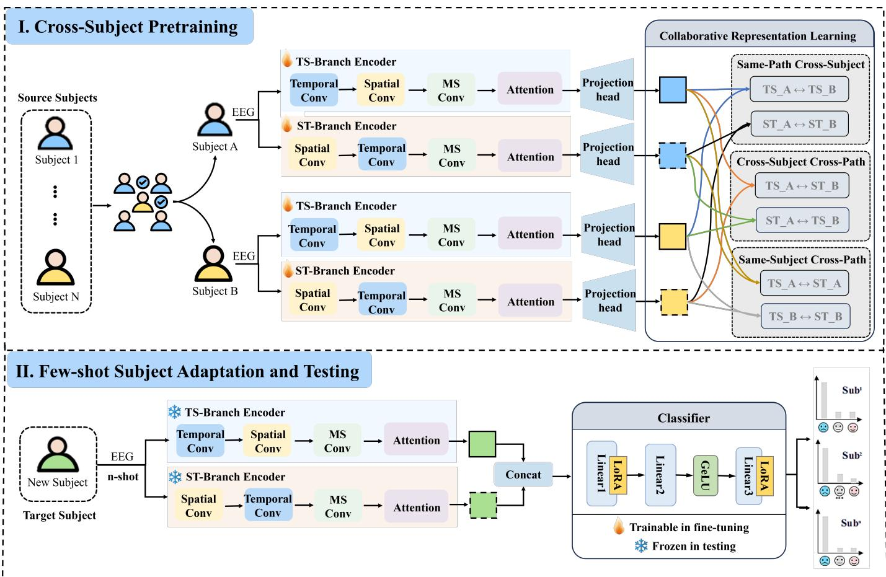
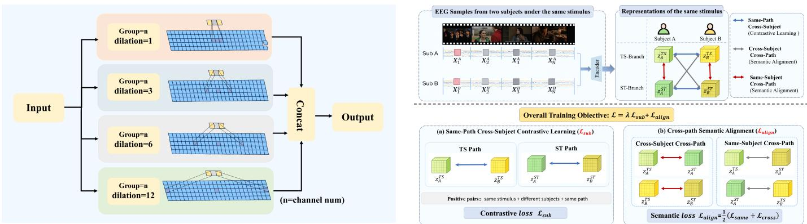
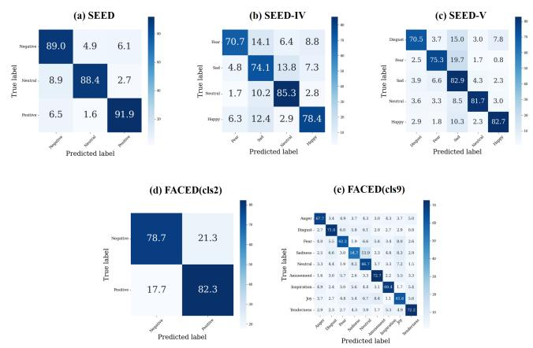
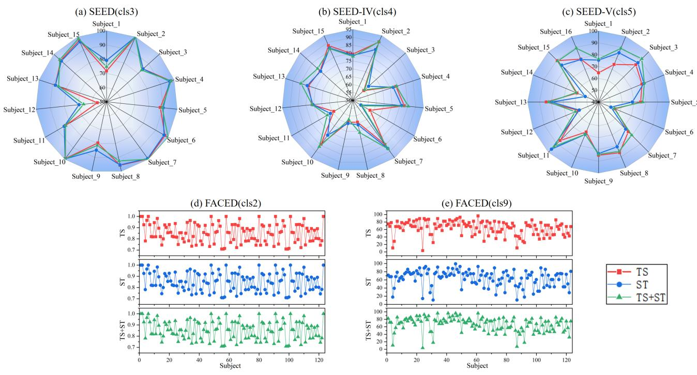
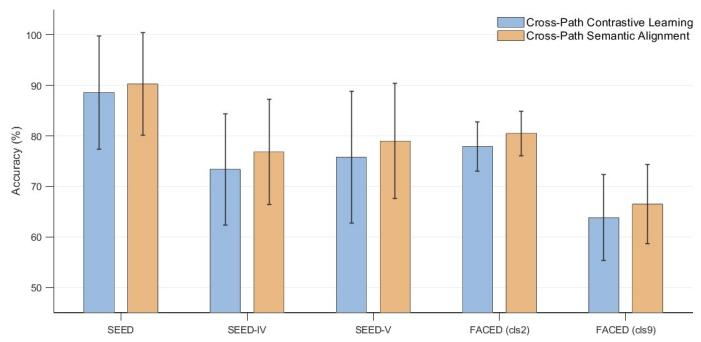
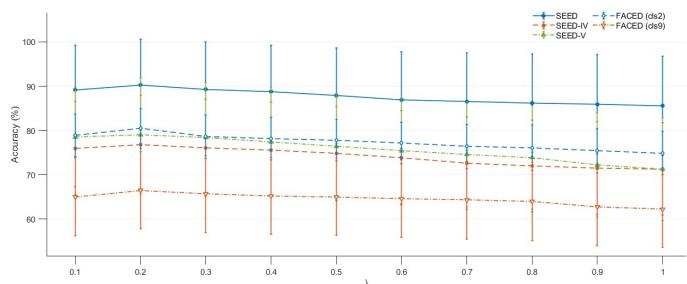
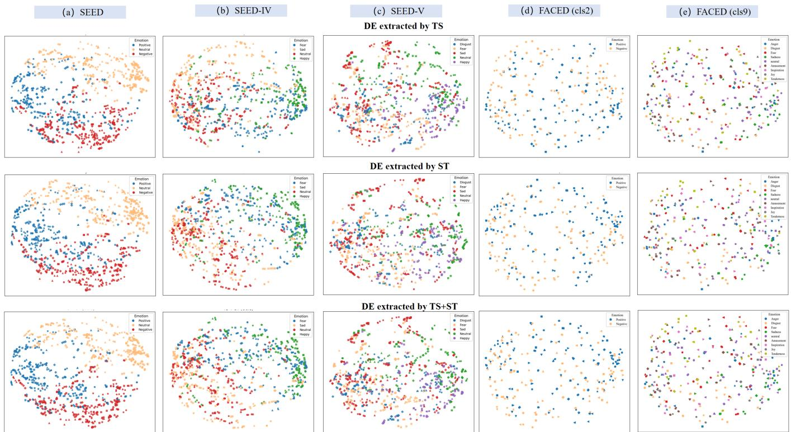

# Beyond Modeling Order: Dual-Path Spatiotemporal Representation Learning for Cross-Subject EEG Emotion Recognition

Zehui Xiao, Yi Zheng, Guixing Fu, Wenkai Lu, Lingfei He, Tao Tan, Yue Liu, Silun Wang, Junhai Xu, and Mengting Liu

Abstract—Cross-subject generalization remains a major challenge for EEG-based emotion recognition due to pronounced inter-subject variability in neural activity and emotion-related spatiotemporal patterns. Existing methods mainly alleviate intersubject differences through distribution alignment or contrastive learning, while paying limited attention to representation bias associated with fixed spatiotemporal modeling orders. We hypothesize that high-level emotion representations of the same EEG signal should remain consistent across different spatiotemporal modeling paths. Based on this hypothesis, we propose a Dual-Path Spatiotemporal Contrastive Learning (DP-STCL) framework for cross-subject EEG emotion recognition.DP-STCL employs two complementary encoders with independent parameters, namely a Temporal-to-Spatial (TS) path and a Spatialto-Temporal (ST) path, to model EEG spatiotemporal information under different integration orders. During representation learning, the same emotional stimulus is used to establish crosssubject associations, while three complementary relations jointly constrain representation variations across subjects and modeling paths. This promotes stable and discriminative stimulus-related emotion representations. To further handle limited labeled targetsubject data, we introduce a LoRA-based few-shot adaptation strategy with low parameter overhead. Extensive cross-subject experiments on SEED, SEED-IV, SEED-V, and FACED show that DP-STCL consistently outperforms the compared methods, demonstrating its effectiveness in improving cross-subject EEG emotion recognition.

Index Terms—Cross-subject emotion recognition, EEG, contrastive learning, spatiotemporal representation learning, fewshot adaptation.

## I. INTRODUCTION

LECTROENCEPHALOGRAPHY EEG-based emotion tive computing and brain-computer interfaces, with applications in mental health assessment, human-computer interaction, and intelligent healthcare [1]–[5]. In recent years, deep learning methods have significantly improved the performance of EEG-based emotion recognition [6]–[10]. However, these models often rely heavily on the training subjects and show substantial performance degradation when applied to unseen subjects. This performance degradation is largely caused by substantial inter-individual variability in EEG signals. Different subjects exhibit considerable differences in neural activity patterns, spatial distributions, signal statistics, and noise levels [11]–[13]. Therefore, improving generalization to unseen subjects is critical for practical EEG emotion recognition. To address this issue, existing research has primarily focused on reducing inter-subject distribution differences, employing methods such as domain adaptation, transfer learning, and domain-adversarial learning to mitigate statistical shifts between subjects through feature distribution matching or domain-invariant representation learning [12], [14]–[18]. In recent years, contrastive learning has also been applied to EEG representation learning by constructing positive relations across different views or subjects to encourage the learning of shared representations [13], [19]–[22]. Although these methods improve cross-subject generalization,they mainly focus on reducing subject-related variation while paying limited attention to how EEG spatiotemporal information itself is modeled.

Emotion-related EEG activity inherently exhibits complex spatiotemporal coupling: spatial coordination patterns among brain regions evolve dynamically over time, while local temporal dynamics can in turn shape and reorganize spatial interactions across regions [23], [24]. Inter-subject variability further increases the diversity of these spatiotemporal patterns, making them difficult to characterize using a single fixed modeling scheme [11]–[13]. However, existing methods typically adopt a predefined spatiotemporal modeling order, such as spatial-to-temporal or temporal-to-spatial processing [25], [26]. Because temporal and spatial information are strongly coupled, applying these operations in different orders may emphasize different aspects of the same EEG signal. A single modeling order may therefore introduce a structural preference toward the features emphasized by that path and overlook complementary spatiotemporal patterns. Furthermore, for the same EEG segment, different spatiotemporal modeling paths may capture local features with different emphases, but their highlevel emotion-related representations should remain consistent or compatible. In other words, if the model truly learns stable stimulus-related emotion representations rather than modelingpath bias introduced by the information integration order, the representations produced by different modeling paths should ultimately converge toward a shared high-level semantic space.

Based on these considerations, we propose a Dual-Path Spatiotemporal Contrastive Learning (DP-STCL) framework for cross-subject EEG emotion recognition. DP-STCL employs two complementary encoders with independent parameters: a Temporal-to-Spatial (TS) path and a Spatial-to-Temporal (ST) path. The TS branch first applies temporal convolution to EEG signals to capture multiscale temporal dynamics and then models dependencies across brain regions through spatial convolution. In contrast, the ST branch first applies spatial convolution to aggregate whole-brain spatial information and then models its temporal evolution through temporal convolution. Through this dual-path design, the model learns EEG spatiotemporal features from different perspectives, thereby enhancing representation diversity and robustness. During representation learning, the same emotional stimulus is used as the basis for establishing cross-subject relations, and three complementary relations are constructed to account for subject variation and differences between the two modeling paths. The same-subject cross-path relation enhances the consistency between representations of the same EEG sample obtained through the TS and ST modeling paths, thereby reducing modeling path bias introduced by different information integration orders. The same-path cross-subject relation encourages different subjects exposed to the same emotional stimulus to form similar representations, thereby reducing subjectspecific variations. The cross-subject cross-path relation further promotes the stability of emotion representations when both the subject and the modeling path vary simultaneously. Through the joint constraints of these three relations, the model learns more stable, subject-invariant, and discriminative emotion representations, thereby improving the generalization ability of cross-subject EEG emotion recognition.

Furthermore, although subject invariant representations can improve a model’s generalization to unseen subjects, individual differences may still persist in practical applications and cannot be fully eliminated through a unified representation. At the same time, acquiring a large amount of labeled EEG data for new subjects is typically costly. Therefore, this paper further addresses individual adaptation when only a small number of labeled samples are available for the target subject. Building upon a frozen pretrained dual-path encoder, we adopt a strategy that combines few-shot classification with Low-Rank Adaptation (LoRA) [27]–[29]. Specifically, we first freeze the parameters of the pretrained encoder and train only the classifier on data from multiple subjects. Subsequently, in the few-shot setting for a target subject, we fine-tune only the LoRA parameters in the classifier, thereby achieving efficient subject adaptation with very few labeled samples. This design significantly reduces training costs and the risk of overfitting in downstream tasks while maintaining the model’s generalization performance.

The main contributions of this paper are summarized as follows:

• We propose a dual-path spatiotemporal contrastive learning framework for cross-subject EEG emotion recognition. The framework exploits the spatiotemporal structural characteristics of EEG signals through two complementary modeling paths, including a temporal feature driven spatial correlation mining paradigm and a spatial pattern driven temporal dynamics mining paradigm.

• We use the same emotional stimulus as the basis for establishing cross-subject associations and explicitly model three complementary relations, including samepath cross-subject, same-subject cross-path, and crosssubject cross-path relations. Same-path cross-subject rela tions are optimized through contrastive learning, whereas same-subject and cross-subject cross-path relations are incorporated into semantic alignment. These complementary relations jointly constrain representation stability under subject variation and modeling-path variation, thereby learning more robust emotion-related representations for cross-subject recognition.

• We introduce a subject adaptation strategy that combines few-shot learning with LoRA in downstream tasks, enabling efficient cross-subject emotion recognition under limited sample conditions.

• Extensive experiments on multiple public EEG emotion datasets demonstrate the effectiveness and superiority of the proposed method for cross-subject emotion recognition.

## II. RELATED WORK

## A. Cross-Subject Emotion Recognition

Traditional EEG emotion recognition primarily relies on supervised learning with handcrafted features and conventional classifiers. In single-subject settings, frequency-domain energy, time-domain features, and nonlinear indices combined with classifiers such as support vector machines can achieve good performance [30], [31]. Deep learning methods have further improved single-subject emotion recognition by using convolutional neural networks (CNNs) and recurrent neural networks (RNNs) to capture spatial and temporal patterns [6], [8], [25], [32]. For example, 2D CNNs model regional relationships from spatial topological maps, while LSTMs capture dynamic information in time series. Transformer architectures have also been introduced to model long-range dependencies and improve multi-emotion recognition. However, in crosssubject scenarios, differences in EEG statistical distributions and spatial patterns can cause substantial performance degradation when models are directly applied to unseen subjects [12], [17].

Various cross-subject adaptation strategies, including domain adaptation [12], transfer learning [17], and domainadversarial learning [18], have been proposed to mitigate distribution shifts between subjects. Many methods align feature distributions across subjects to learn more consistent representations [12], [14]–[18]. Although these approaches improve cross-subject generalization, they still pay limited attention to the spatiotemporal structure and semantic consistency of EEG signals. This limitation motivates the structured contrastive learning mechanism proposed in this paper.

## B. Contrastive Learning for EEG Representation Learning

Contrastive learning learns discriminative representations by constructing positive and negative sample pairs and has achieved significant success in computer vision [33], [34]. In recent years, it has also been increasingly applied to EEG representation learning. Existing methods commonly use data augmentation or temporal transformations to construct different views of the same signal as positive pairs [19]–[21], [33]. Banville et al. learned EEG representations using selfsupervised contrastive objectives and improved downstreamtask performance [19]. Jiang et al. applied self-supervised contrastive learning to EEG-based sleep staging, further demonstrating its effectiveness in EEG time-series modeling [21]. Shen et al. proposed CLISA [13], which improves crosssubject emotion recognition by maximizing the similarity between representations of different subjects exposed to the same emotional stimulus. More recently, Xie et al. proposed temporal asynchronous alignment-based contrastive learning to account for inter-subject temporal misalignment in crosssubject EEG emotion recognition [22]. Overall, these studies demonstrate the effectiveness of contrastive learning for robust cross-subject EEG representation learning.

## C. Spatiotemporal Feature Modeling and Dual-Path Architectures

EEG signals exhibit distinct spatiotemporal coupling characteristics, with emotional information involving both temporal dynamics and spatial coordination across brain regions. Effectively capturing this structure is therefore important for EEG representation learning. Previous studies have typically used CNNs or CNN-RNN architectures to extract local spatiotemporal features, but direct integration of temporal and spatial information may limit the modeling of their structural relationships [25], [32]. Hierarchical temporal structures and attention mechanisms have been introduced to enhance temporal dependency modeling [26], [35]. Spatiotemporal attention can dynamically assign weights according to input signals to improve feature representation [35], while graph-based neural networks exploit topological structures to model spatial relationships among brain regions [36]–[38]. However, existing methods typically adopt fixed spatiotemporal modeling schemes or information integration orders and rarely represent EEG spatiotemporal structures from complementary modeling paths. Motivated by this limitation, this paper draws on multiview learning [39] and models the Temporal-to-Spatial and Spatial-to-Temporal paths in parallel. The two paths characterize EEG spatiotemporal structure under different integration orders and provide complementary representations. Cross-path consistency constraints further guide the two paths toward stable representations in a shared semantic space.

## III. METHODS

## A. Overall Framework

To address inter-subject variability and representation bias associated with fixed spatiotemporal modeling orders, we propose the Dual-Path Spatiotemporal Contrastive Learning (DP-STCL) framework, as illustrated in Fig. 1. DP-STCL contains two independent encoding paths, namely the Temporalto-Spatial (TS) path and the Spatial-to-Temporal (ST) path, which model the same EEG signal under different information integration orders. The resulting high-level representations are jointly optimized through same-path cross-subject contrastive learning and cross-path semantic alignment. Specifically, three complementary relations are constructed to account for subject variation and modeling-path variation, including samepath cross-subject, same-subject cross-path, and cross-subject cross-path relations. After pretraining, the projection heads are removed, and the features extracted by the TS and ST encoders are used for downstream emotion classification. For few-shot adaptation to an unseen target subject, the pretrained encoders are frozen, and Low-Rank Adaptation (LoRA) is introduced into the classifier for parameter-efficient adaptation.

## B. Dual-Path Spatiotemporal Feature Encoding

We construct two spatiotemporal encoding paths, $f _ { \mathrm { T S } } ( \cdot )$ and $f _ { \mathrm { S T } } ( \cdot )$ , with independent parameters. The two paths do not represent actual information propagation directions in brain activity, but model the same spatiotemporally coupled EEG signal using different information integration orders.

1) Dual-Path Spatiotemporal Encoding: Both paths consist of temporal and spatial encoding operations. Let $\tau ^ { p } ( \cdot )$ and $S ^ { p } ( \cdot )$ denote the temporal and spatial encoding operations of path $p \in \{ \mathrm { T S } , \mathrm { S T } \}$ , respectively:

$$
\begin{array} { r } { T ^ { p } ( H ) = \phi ( \mathrm { B N } ( \mathrm { C o n v } _ { t } ^ { p } ( H ) ) ) , } \\ { S ^ { p } ( H ) = \phi ( \mathrm { B N } ( \mathrm { C o n v } _ { s } ^ { p } ( H ) ) ) , } \end{array}\tag{1}
$$

where $\mathrm { C o n v } _ { t } ^ { p } ( \cdot )$ and $\mathrm { C o n v } _ { s } ^ { p } ( \cdot )$ denote convolution along the temporal dimension and across EEG channels, respectively. $\mathrm { B N } ( \cdot )$ denotes batch normalization, and $\phi ( \cdot )$ denotes a nonlinear activation function.

The TS and ST paths use the same types of encoding operations but apply them in different orders with independently learned parameters. Specifically, the TS path first extracts temporal dynamics and then models cross-channel spatial dependencies, whereas the ST path follows the reverse order:

$$
\begin{array} { r } { H _ { \mathrm { T S } } = { \cal S } ^ { \mathrm { T S } } \left( { \cal T } ^ { \mathrm { T S } } ( X ) \right) , } \\ { H _ { \mathrm { S T } } = { \cal T } ^ { \mathrm { S T } } \left( { \cal S } ^ { \mathrm { S T } } ( X ) \right) . } \end{array}\tag{2}
$$

2) Multiscale Temporal Enhancement and Feature $P r o \mathrm { - }$ jection: To capture emotion-related dynamics at different temporal scales, multiscale dilated temporal convolutions are incorporated into both paths. As illustrated in Fig. 2, parallel temporal convolution branches with different dilation rates capture temporal dependencies over multiple receptive-field scales, and their outputs are concatenated to form an enhanced temporal representation. A temporal attention mechanism then weights temporal positions to emphasize emotion-relevant segments. After pooling, the high-level feature from each path is mapped into a shared representation space through an independent projection head and further $\ell _ { 2 } \cdot$ -normalized for subsequent cross-subject contrastive learning and cross-path semantic alignment.

  
Fig. 1. Overall framework of the proposed DP-STCL for cross-subject EEG emotion recognition. The framework consists of cross-subject pretraining with dual-path spatiotemporal encoding, same-path cross-subject contrastive learning, and cross-path semantic alignment, followed by few-shot subject adaptation with LoRA and emotion recognition for the target subject.

  
Fig. 2. Illustration of the multiscale dilated temporal convolution module. Parallel temporal convolution branches with different dilation rates capture temporal dependencies at multiple receptive-field scales, and their outputs are concatenated to form the enhanced representation.  
Fig. 3. Illustration of the proposed collaborative representation learning scheme, including same-path cross-subject contrastive learning and cross-path semantic alignment.

## C. Cross-Subject and Cross-Path Collaborative Representation Learning

After dual-path spatiotemporal encoding, the TS and ST representations are jointly optimized through same-path crosssubject contrastive learning and cross-path semantic alignment, as illustrated in Fig. 3. The former promotes subject-invariant and stimulus-discriminative representations within each path, whereas the latter aligns the two paths through same-subject and cross-subject cross-path relations.

1) Same-Path Cross-Subject Contrastive Learning: Let a mini-batch contain N EEG samples. For the n-th sample, let $z _ { n } ^ { p }$ denote the normalized projected representation generated by path $p \in \{ \mathrm { T S } , \mathrm { S T } \}$ . To unify the two paths, each view is represented as $\boldsymbol { v } = ( n , p )$ , with the corresponding normalized representation $\begin{array} { r } { \bar { z } _ { v } \ = \ z _ { n } ^ { p } . } \end{array}$ Each view v is associated with a stimulus label $y _ { v } ,$ , subject label $s _ { v } ,$ and path label $p _ { v }$ . All normalized TS and ST representations in the mini-batch form the representation set B.

Same-path cross-subject contrastive learning aims to learn stimulus-related representations that are robust to subject variation within each path. For an anchor $v ,$ representations from the same stimulus, different subjects, and the same path are treated as positive samples. The corresponding positive set is defined as

$$
P _ { \mathrm { s u b } } ( v ) = \left\{ u \neq v \mid y _ { u } = y _ { v } , s _ { u } \neq s _ { v } , p _ { u } = p _ { v } \right\} .\tag{3}
$$

To restrict contrastive learning to the same path, define the path-specific candidate set as ${ { B } _ { p } } \mathrm { ~ = ~ } \left\{ a \in \mathcal { B } \mid { { p } _ { a } } = { { p } } \right\}$ . For each positive sample $u \in P _ { \mathrm { s u b } } ( v )$ , the pairwise contrastive loss is defined as

$$
\ell ( v , u ) = - \log \frac { \exp ( \sin ( \bar { z } _ { v } , \bar { z } _ { u } ) / \tau ) } { \displaystyle \sum _ { a \in \mathcal { B } _ { p _ { v } } } \exp ( \sin ( \bar { z } _ { v } , \bar { z } _ { a } ) / \tau ) } .\tag{4}
$$

where $\mathrm { s i m } ( \cdot , \cdot )$ denotes the similarity function and $\tau$ is the temperature parameter. The denominator contains only representations from the same path as the anchor, so the contrastive objective is optimized separately for the TS and ST paths.

Valid anchors in path $p$ are collected as $V _ { p } = \{ v \in B _ { p }$ $| P _ { \mathrm { s u b } } ( v ) | > 0 \}$ . The losses are first averaged over all crosssubject positive samples for each anchor, then over all valid anchors within each path, and finally over the TS and ST paths:

$$
\mathcal { L } _ { \mathrm { s u b } } = \frac { 1 } { 2 } \sum _ { p \in \{ \mathrm { T S } , \mathrm { S T } \} } \frac { 1 } { | \mathcal { V } _ { p } | } \sum _ { v \in \mathcal { V } _ { p } } \frac { 1 } { | P _ { \mathrm { s u b } } ( v ) | } \sum _ { u \in P _ { \mathrm { s u b } } ( v ) } \ell ( v , u ) .\tag{5}
$$

This objective reduces subject-specific variation while preserving stimulus-discriminative information within each path.

2) Cross-Path Semantic Alignment: Based on the representations learned through same-path cross-subject contrastive learning, we further align the TS and ST representations under the same stimulus to reduce discrepancies caused by different modeling orders. Unlike the contrastive objective, cross-path semantic alignment introduces no negative samples and directly minimizes the mean squared error (MSE) between paired representations. According to subject identity, crosspath alignment is divided into same-subject and cross-subject relations.

Let $n ( v )$ denote the sample index corresponding to view v. For same-subject cross-path alignment, the TS and ST representations of the same EEG sample form the pair set

$$
Q _ { \mathrm { s a m e } } = \{ ( v , u ) \mid n ( v ) = n ( u ) , p _ { v } = \mathrm { T S } , p _ { u } = \mathrm { S T } \} .\tag{6}
$$

For cross-subject cross-path alignment, representations from the same stimulus but different subjects and different paths are paired:

$$
\begin{array} { c } { { Q _ { \mathrm { c r o s s } } = \left\{ ( v , u ) \mid y _ { v } = y _ { u } , s _ { v } \right\} = s _ { u } , } } \\ { { p _ { v } = \mathrm { T S } , p _ { u } = \mathrm { S T } \} . } } \end{array}\tag{7}
$$

The corresponding alignment losses are

$$
\begin{array} { r l } & { \mathcal { L } _ { \mathrm { s a m e } } = \displaystyle \frac { 1 } { | Q _ { \mathrm { s a m e } } | } \sum _ { ( v , u ) \in Q _ { \mathrm { s a m e } } } \mathrm { M S E } ( \bar { z } _ { v } , \bar { z } _ { u } ) , } \\ & { \mathcal { L } _ { \mathrm { c r o s s } } = \displaystyle \frac { 1 } { | Q _ { \mathrm { c r o s s } } | } \sum _ { ( v , u ) \in Q _ { \mathrm { c r o s s } } } \mathrm { M S E } ( \bar { z } _ { v } , \bar { z } _ { u } ) . } \end{array}\tag{8}
$$

Since cross-subject pairs are generally more numerous, the two relation types are averaged separately and then equally weighted to avoid pair-count imbalance:

$$
\mathcal { L } _ { \mathrm { a l i g n } } = \frac { 1 } { 2 } \left( \mathcal { L } _ { \mathrm { s a m e } } + \mathcal { L } _ { \mathrm { c r o s s } } \right) .\tag{9}
$$

The final pretraining objective combines same-path crosssubject contrastive learning and cross-path semantic alignment:

$$
\begin{array} { r } { \mathcal { L } = \mathcal { L } _ { \mathrm { s u b } } + \lambda \mathcal { L } _ { \mathrm { a l i g n } } , } \end{array}\tag{10}
$$

where λ controls the contribution of cross-path semantic alignment. Together, the two objectives reduce subject-specific and modeling-path variations while preserving stimulusdiscriminative representations.

## D. LoRA-Based Few-Shot Subject Adaptation

Despite cross-subject pretraining, residual individual differences may remain for unseen subjects. To enable few-shot subject adaptation, we freeze the pretrained encoder and adapt only the downstream classifier in a parameter-efficient manner.

Let $f _ { \theta } ( \cdot )$ denote the pretrained EEG encoder. After removing the projection heads, its output $h = f _ { \theta } ( x ) \in \mathbb { R } ^ { d _ { \mathrm { i n } } }$ is used as the downstream feature, while the encoder parameters θ remain frozen during adaptation. For a linear classifier with weight matrix $W \in \bar { \mathbb { R } } ^ { d _ { \mathrm { o u t } } \times d _ { \mathrm { i n } } }$ , Low-Rank Adaptation (LoRA) introduces a trainable low-rank update:

$$
y = \left( W + { \frac { \alpha } { r } } B A \right) h ,\tag{11}
$$

where $A \in \mathbb { R } ^ { r \times d _ { \mathrm { i n } } } , B \in \mathbb { R } ^ { d _ { \mathrm { o u t } } \times r }$ , and $r \ll \operatorname* { m i n } ( d _ { \mathrm { i n } } , d _ { \mathrm { o u t } } )$ Here, r denotes the low-rank dimension and $\alpha / r$ controls the update scale. During adaptation, W remains frozen and only $A$ and B are optimized, reducing the number and degrees of freedom of trainable parameters under limited labeled data. Using only a few labeled samples from the target subject, this constrained update adapts the classifier while preserving the pretrained representation space. Overall, DP-STCL separates cross-subject representation learning from parameter-efficient target-subject adaptation, allowing the encoder to preserve shared representations while the low-rank classifier accounts for residual subject-specific variation.

## IV. RESULT

This section evaluates DP-STCL on four public EEG emotion datasets: SEED [30], [31], SEED-IV [40], SEED-V [41], and FACED [42]. We report cross-subject performance comparisons, ablation studies, few-shot adaptation results, and model efficiency analyses.

## A. Dataset

SEED contains 62-channel EEG recordings from 15 subjects across three sessions. Fifteen movie clips in each session elicit positive, neutral, and negative emotions, yielding a threeclass emotion recognition task.

SEED-IV contains EEG recordings from 15 subjects over three sessions. Each session includes 24 video trials covering four emotions: neutral, sadness, fear, and happiness. We therefore evaluate four-class emotion recognition on this dataset.

SEED-V extends SEED to five emotion categories: joy, sadness, disgust, fear, and neutral. It contains 62-channel EEG recordings from 16 subjects, each completing three sessions with 15 movie trials per session. We evaluate fiveclass emotion recognition on SEED-V.

FACED contains 32-channel EEG recordings from 123 subjects and covers nine emotion categories: anger, fear, disgust, sadness, pleasure, inspiration, joy, tenderness, and neutral. Each subject completed 28 emotion-induction trials. We evaluate both nine-class recognition and binary valence classification, where pleasure, inspiration, joy, and tenderness are treated as positive emotions, and anger, fear, disgust, and sadness as negative emotions.

## B. Experimental Setup

For FACED, we followed the official preprocessing protocol and downsampled the EEG signals to 250 Hz. For SEED, SEED-IV, and SEED-V, the signals were downsampled to 125 Hz, bandpass filtered at 0.5–47 Hz, and segmented into trials according to stimulus onset and offset.

Noisy channels were detected using two amplitude-duration criteria, with $( m , n ) ~ = ~ ( 3 , 0 . 4 )$ for long-duration artifacts and (30, 0.01) for large transient artifacts, where m denotes the amplitude multiple of the median and n the corresponding duration proportion. The detected noisy channels were interpolated using their three nearest neighboring channels. Independent Component Analysis (ICA) was then applied, and components labeled by EEGLAB as eye- or muscle-related with confidence above 0.8 were removed.

Sliding-window segmentation used window/step sizes of 5/2 s for FACED, 30/15 s for SEED, 25/9 s for SEED-IV, and 22/11 s for SEED-V, yielding an average of 13 samples per trial for each dataset.

SEED, SEED-IV, and SEED-V were evaluated using leaveone-subject-out validation, with one subject used for testing and the remaining subjects for training in each round. For FACED, 10-fold cross-subject validation was adopted by dividing the 123 subjects into nine groups of 12 subjects and one group of 15 subjects. During pretraining, the learning rate and weight decay were set to $7 \times 1 0 ^ { - 4 }$ and $1 . 5 \times 1 0 ^ { - 4 }$ , respectively, with 30 training rounds and an early-stopping patience of 10 rounds.

## C. Effectiveness of Dual-Path Spatiotemporal Contrastive Pretraining

To evaluate the effectiveness of DP-STCL, we compare it with the DE+MLP baseline and representative cross-subject methods, including DSAN [43], DMMR [44], MS-MDA [45], ADAST [46], GMoE [47], PGCN [48], GMSS [49], CLISA [13], MSHCL [50], and DAEST [51].

TABLE I  
CROSS-SUBJECT EMOTION RECOGNITION PERFORMANCE ON THE SEED, SEED-IV, AND SEED-V DATASETS. RESULTS MARKED WITH † ARE REPRODUCED; OTHERS ARE FROM ORIGINAL PAPERS.
<table><tr><td>Method</td><td></td><td>SEED (Acc%) SEED-IV (Acc%) SEED-V (Acc%)</td><td></td></tr><tr><td>DE+MLP</td><td> $7 9 . 9 \pm 8 . 7$ </td><td> $5 9 . 3 \pm 1 7 . 2$ </td><td> $5 9 . 3 \pm 1 7 . 2$ </td></tr><tr><td>DSAN [43]</td><td> $8 4 . 1 \pm 7 . 6$ </td><td> $6 2 . 2 \pm 1 4 . 2$ </td><td> $5 9 . 3 \pm 1 6 . 8$ </td></tr><tr><td>DMMR [44]</td><td> $8 8 . 3 \pm 5 . 6 $ </td><td> $7 2 . 7 \pm 8 . 0$ </td><td>/</td></tr><tr><td>MS-MDA [45]</td><td> $8 4 . 5 \pm 7 . 5$ </td><td> $6 4 . 3 \pm 1 1 . 1$ </td><td> $5 8 . 2 \pm 1 2 . 3$ </td></tr><tr><td>ADAST [46]</td><td> $8 7 . 3 \pm 2 . 1$ </td><td> $5 3 . 7 \pm 1 3 . 6$ </td><td> $5 0 . 7 \pm 1 4 . 0$ </td></tr><tr><td>GMoE [47]</td><td> $8 4 . 6 \pm 9 . 3$ </td><td> $7 1 . 2 \pm 8 . 5$ </td><td> $7 6 . 3 \pm 9 . 2$ </td></tr><tr><td>PGCN [48]</td><td> $8 4 . 6 \pm 8 . 7$ </td><td> $7 3 . 7 \pm 7 . 2$ </td><td> $6 5 . 2 \pm 1 0 . 1$ </td></tr><tr><td>GMSS [49]</td><td> $8 6 . 3 \pm 6 . 9$ </td><td> $6 2 . 6 \pm 1 0 . 3$ </td><td>1</td></tr><tr><td>CLISA† [13]</td><td> $8 6 . 4 \pm 6 . 4$ </td><td>1</td><td> $6 7 . 3 \pm 1 3 . 0$ </td></tr><tr><td>DAEST† [51]</td><td> $8 7 . 7 \pm 3 . 6$ </td><td> $7 3 . 8 \pm 8 . 7$ </td><td> $7 0 . 2 \pm 1 2 . 5$ </td></tr><tr><td>DP-STCL</td><td> ${ \bf 9 0 . 3 \pm 1 0 . 2 }$ </td><td> ${ \bf 7 6 . 8 \pm 1 0 . 4 }$ </td><td> ${ \bf 7 9 . 0 \pm 1 1 . 4 }$ </td></tr></table>

TABLE II

CROSS-SUBJECT EMOTION RECOGNITION PERFORMANCE ON THE FACED DATASET
<table><tr><td>Method</td><td>FACED (cls2) (Acc%)</td><td>FACED (cls9) (Acc%)</td><td>Source of Result</td></tr><tr><td>DE+MLP</td><td> $6 0 . 9 \pm 3 . 2$ </td><td> $2 1 . 7 \pm 2 . 2$ </td><td>Baseline</td></tr><tr><td>SimCLR</td><td>1</td><td> $3 0 . 2 \pm 2 . 7$ </td><td>Reproduced Results in [33]</td></tr><tr><td>MSHCL</td><td> $7 7 . 0 \pm 3 . 6$ </td><td> $4 5 . 7 \pm 3 . 4$ </td><td>Original Results in [50]</td></tr><tr><td>CLISA</td><td> $6 7 . 8 \pm 4 . 1$ </td><td> $4 2 . 4 \pm 3 . 1$ </td><td>Reproduced Results in [13]</td></tr><tr><td>DAEST</td><td> $7 7 . 8 \pm 5 . 8$ </td><td> $6 2 . 3 \pm 8 . 1$ </td><td>Reproduced Results in [51]</td></tr><tr><td>DP-STCL</td><td> ${ \bf 8 0 . 5 \pm 4 . 4 }$ </td><td> ${ \bf 6 6 . 5 \pm 7 . 8 }$ </td><td>Results from this paper</td></tr></table>

Table I presents the cross-subject emotion recognition accuracy of DP-STCL and the competing methods on the SEED, SEED-IV, and SEED-V datasets. As shown in the table, DP-STCL consistently achieves higher accuracy than the compared methods across all three datasets. To further evaluate the generalizability of DP-STCL, we conducted binary classification (cls2) and nine-class classification (cls9) experiments on the FACED dataset, with the results reported in Table II. DP-STCL also achieved strong performance on FACED.

To provide a more intuitive visualization of DP-STCL’s classification performance across different emotion categories, we plotted confusion matrices for the SEED, SEED-IV, SEED-V, and FACED datasets, as shown in Fig. 4.

## D. Effectiveness of Dual-Path Spatiotemporal Modeling

To evaluate the dual-path architecture and joint training mechanism, we compare single-path independent training with DP-STCL dual-path joint training, as reported in Table III. In the former, the TS-only and ST-only models are trained separately using same-path cross-subject contrastive learning. In the latter, the two paths are jointly optimized with crosspath semantic alignment, and the individual TS and ST results are obtained by evaluating each branch of the jointly trained model rather than by separately retraining the two branches.

TABLE III  
ABLATION RESULTS FOR DUAL-PATH SPATIOTEMPORAL MODELING AND THE JOINT TRAINING MECHANISM
<table><tr><td>Training Strategy</td><td>Test Repr.</td><td> $\mathbf { S E E D \ ( A c c \% ) }$ </td><td>SEED-IV (Acc%)</td><td>SEED-V (Acc%)</td><td>FACED cls2 (Acc%)</td><td>FACED cls9 (Acc%)</td></tr><tr><td rowspan="2">Single-Path Independent Training</td><td>ST-only</td><td> $8 8 . 9 \pm 9 . 2 $ </td><td> $7 3 . 5 \pm 9 . 5$ </td><td> $7 3 . 6 \pm 1 2 . 5$ </td><td> $7 8 . 5 \pm 4 . 5$ </td><td> $6 3 . 0 \pm 7 . 5$ </td></tr><tr><td>TS-only</td><td> $8 7 . 1 \pm 9 . 4$ </td><td> $7 4 . 3 \pm 9 . 9$ </td><td> $7 4 . 2 \pm 1 0 . 8$ </td><td> $7 8 . 0 \pm 4 . 2$ </td><td> $6 2 . 5 \pm 7 . 0$ </td></tr><tr><td rowspan="3">DP-STCL Dual-Path Joint Training</td><td>ST</td><td> $8 9 . 5 \pm 1 0 . 5$ </td><td> $7 4 . 9 \pm 9 . 1$ </td><td> $7 5 . 2 \pm 1 2 . 3$ </td><td> $7 9 . 8 \pm 4 . 5$ </td><td> $6 4 . 1 \pm 7 . 4$ </td></tr><tr><td>TS</td><td> $8 9 . 3 \pm 1 1 . 0$ </td><td> $7 5 . 7 \pm 9 . 9$ </td><td> $7 5 . 3 \pm 1 0 . 7$ </td><td> $7 9 . 0 \pm 4 . 5$ </td><td> $6 4 . 0 \pm 7 . 0$ </td></tr><tr><td>TS+ST</td><td> ${ \bf 9 0 . 3 \pm 1 0 . 2 }$ </td><td> ${ \bf 7 6 . 8 \pm 1 0 . 4 }$ </td><td> ${ \bf 7 9 . 0 \pm 1 1 . 4 }$ </td><td> ${ \bf 8 0 . 5 \pm 4 . 4 }$ </td><td> ${ \bf 6 6 . 5 \pm 7 . 8 }$ </td></tr></table>

  
Fig. 4. Confusion matrices for emotion classification on the SEED, SEED-IV, SEED-V, and FACED datasets.

Both independently trained paths achieve competitive performance, while their relative advantages vary across datasets, supporting the complementarity of the two spatiotemporal modeling orders. Joint training further improves both individual branches across all five tasks. Compared with independent training, the jointly trained ST branch improves by 0.6–1.6 percentage points, while the TS branch improves by 1.0–2.2 points. This indicates that the benefit of DP-STCL is not solely due to feature fusion at inference, but also arises from improved branch representations during collaborative training. Fig. 5 further shows the subject-wise accuracy distributions of the jointly trained TS, ST, and fused representations.

The fused TS+ST representation achieves the highest accuracy across all five tasks in Table III. Relative to the stronger jointly trained single branch, fusion yields gains of 0.8, 1.1, 3.7, 0.7, and 2.4 percentage points on SEED, SEED-IV, SEED-V, FACED cls2, and FACED cls9, respectively. The larger gains on SEED-V and FACED cls9 further suggest that the two paths retain complementary discriminative information despite cross-path semantic alignment.

## E. Analysis of the Cross-Path Semantic Alignment Strategy

We further analyze the cross-path semantic alignment strategy by examining the choice of cross-path learning objective and the weight of semantic alignment.

We first compare two cross-path learning objectives while keeping same-path cross-subject contrastive learning unchanged. The first applies a SimCLR-style contrastive objective to TS–ST representations, whereas the proposed strategy uses MSE-based semantic alignment for same-stimulus crosspath pairs. All other network and training configurations are kept identical. As shown in Fig. 6, MSE-based semantic alignment consistently outperforms cross-path contrastive learning across the evaluated datasets. Since $\mathcal { L } _ { \mathrm { s u b } }$ already provides stimulus discrimination within each path, introducing additional positive-negative competition across TS and ST may impose overly strong constraints on their structurally different representations. In contrast, $\mathcal { L } _ { \mathrm { a l i g n } }$ aligns same-stimulus crosspath representations without introducing cross-path negative samples. This allows cross-path learning to reduce representation discrepancies caused by different modeling orders while preserving the complementary information captured by the two paths.

We next examine the sensitivity to the semantic alignment weight λ, which controls the contribution of $\mathcal { L } _ { \mathrm { a l i g n } }$ during pretraining. As shown in Fig. 7, λ = 0.2 yields stable and relatively strong performance across the evaluated datasets. When $\lambda = 0 ,$ , training relies solely on same-path cross-subject contrastive learning, leaving no explicit cross-path constraint. A moderate increase in λ reduces representation discrepancies between the two paths and promotes collaborative learning. However, an excessively large λ may overemphasize path consistency and compress discriminative differences between the TS and ST representations, thereby weakening their complementarity. These results indicate that $\mathcal { L } _ { \mathrm { s u b } }$ serves as the primary discriminative objective, while $\mathcal { L } _ { \mathrm { a l i g n } }$ acts as a complementary semantic bridge between the two paths.

## F. Few-Shot Performance Analysis

We evaluate few-shot adaptation under 3-shot, 5-shot, and 10-shot settings by comparing Full-finetune, Head-only, and LoRA on SEED, SEED-IV, SEED-V, FACED (cls2), and FACED (cls9). The classification results are reported in Table IV.

Full-finetune updates the entire network using labeled target-subject samples. Head-only keeps the feature encoder fixed and updates the classification head, whereas LoRA freezes the pretrained parameters and optimizes only the lowrank updates introduced into the classifier.

As shown in Table IV, Full-finetune achieves the highest classification accuracy across all evaluated datasets and shot settings, reflecting the greater adaptation flexibility obtained by updating the entire network. LoRA nevertheless remains close to Full-finetune while requiring substantially fewer trainable parameters. In particular, relatively small performance gaps are observed on SEED, SEED-IV, and FACED across different few-shot settings, indicating that low-rank adaptation can effectively accommodate residual subject-specific variation without modifying the pretrained encoder.

  
Fig. 5. Subject-wise accuracy distribution of dual-path spatiotemporal modeling.

  
Fig. 6. Performance comparison of different cross-path learning strategies across datasets.

  
Fig. 7. Sensitivity analysis of the cross-path semantic alignment weight λ across datasets.

LoRA also consistently outperforms Head-only across the evaluated datasets and shot settings. Since both strategies keep the pretrained encoder fixed, this improvement is more reasonably attributed to the constrained low-rank update rather than greater adaptation freedom. By restricting classifier adaptation to a compact low-rank subspace, LoRA can reduce the risk of overfitting under limited labeled data while preserving the pretrained representation. Overall, LoRA achieves competitive adaptation performance with substantially lower parameterupdate overhead than Full-finetune, providing a favorable balance between target-subject adaptation and parameter efficiency in few-shot cross-subject EEG emotion recognition.

## G. t-SNE Visualization of Learned Representations

To visually analyze the discriminability of different feature representations for emotion classification and their crosssubject consistency, we visualize the features extracted from the TS branch, the ST branch, and their fused TS + ST representation using t-SNE, as shown in Fig. 8. The three rows correspond to the TS, ST, and TS + ST representations, respectively, while the columns present the results on SEED, SEED-IV, SEED-V, FACED (cls2), and FACED (cls9). The visualization provides further evidence for the effectiveness of the proposed dual-path spatiotemporal modeling strategy. By jointly modeling Temporal-to-Spatial and Spatial-to-Temporal interactions, the model learns more stable and discriminative emotion-related EEG representations, which contributes to improved classification performance.

  
Fig. 8. t-SNE visualization of the representations extracted by the TS branch, ST branch, and fused TS + ST representation on the five emotion recognition tasks.

TABLE IV  
COMPARISON OF CLASSIFICATION ACCURACY UNDER DIFFERENT FEW-SHOT SETTINGS AND PARAMETER UPDATE STRATEGIES
<table><tr><td>Dataset</td><td>Method</td><td>3-shot  $( \mathbf { A c c } \% )$ </td><td>5-shot  $( \mathbf { A c c } \% )$ </td><td>10-shot  $( \mathbf { A c c } \% )$ </td></tr><tr><td rowspan="3">SEED</td><td>LoRA</td><td> $9 1 . 1 \pm 7 . 9$ </td><td> $9 1 . 2 \pm 7 . 9$ </td><td> $9 1 . 3 \pm 7 . 5$ </td></tr><tr><td>Head-only</td><td> $7 7 . 8 \pm 1 0 . 4$ </td><td> $7 9 . 8 \pm 9 . 2$ </td><td> $7 9 . 9 \pm 1 0 . 7$ </td></tr><tr><td>Full-finetune</td><td> $9 1 . 6 \pm 7 . 2$ </td><td> $9 2 . 8 \pm 6 . 2$ </td><td> $9 4 . 3 \pm 5 . 1$ </td></tr><tr><td rowspan="3">SEED-IV</td><td>LoRA</td><td> $7 7 . 2 \pm 9 . 6$ </td><td> $7 7 . 9 \pm 8 . 4$ </td><td> $8 3 . 6 \pm 5 . 5$ </td></tr><tr><td>Head-only</td><td> $6 3 . 1 \pm 9 . 5$ </td><td> $6 0 . 8 \pm 1 0 . 8$ </td><td> $6 2 . 7 \pm 1 0 . 1$ </td></tr><tr><td>Full-finetune</td><td> $7 7 . 5 \pm 9 . 3$ </td><td> $7 8 . 6 \pm 8 . 4$ </td><td> $8 5 . 8 \pm 5 . 9$ </td></tr><tr><td rowspan="3">SEED-V</td><td>LoRA</td><td> $7 9 . 2 \pm 1 1 . 0$ </td><td> $8 0 . 1 \pm 1 1 . 3$ </td><td> $8 3 . 9 \pm 1 1 . 0$ </td></tr><tr><td>Head-only</td><td> $6 0 . 4 \pm 1 2 . 3$ </td><td> $5 9 . 7 \pm 1 2 . 1$ </td><td> $6 1 . 5 \pm 1 1 . 6$ </td></tr><tr><td>Full-finetune</td><td> $8 0 . 3 \pm 1 0 . 8$ </td><td> $8 1 . 0 \pm 1 0 . 6 $ </td><td> $8 4 . 7 \pm 1 0 . 0$ </td></tr><tr><td rowspan="3">FACED (cls2)</td><td>LoRA</td><td> $8 2 . 8 \pm 9 . 9$ </td><td> $8 7 . 4 \pm 8 . 7$ </td><td> $9 2 . 9 \pm 5 . 7$ </td></tr><tr><td>Head-only</td><td> $6 5 . 2 \pm 1 0 . 9$ </td><td> $6 4 . 8 \pm 1 1 . 8$ </td><td> $6 4 . 8 \pm 1 0 . 4$ </td></tr><tr><td>Full-finetune</td><td> $8 4 . 2 \pm 9 . 1$ </td><td> $8 8 . 3 \pm 7 . 8$ </td><td> $9 4 . 1 \pm 5 . 3$ </td></tr><tr><td rowspan="3">FACED (cls9)</td><td>LoRA</td><td> $8 0 . 4 \pm 1 0 . 8$ </td><td> $8 6 . 0 \pm 1 4 . 4$ </td><td> $9 1 . 8 \pm 1 1 . 1$ </td></tr><tr><td>Head-only</td><td> $3 6 . 4 \pm 1 2 . 2$ </td><td> $3 6 . 0 \pm 1 3 . 7$ </td><td> $3 6 . 1 \pm 1 2 . 1$ </td></tr><tr><td>Full-finetune</td><td> $8 2 . 6 \pm 1 0 . 3$ </td><td> $8 7 . 4 \pm 1 4 . 6$ </td><td> $9 3 . 0 \pm 1 0 . 5$ </td></tr></table>

## V. CONCLUSION

This paper proposes DP-STCL for cross-subject EEG emotion recognition to address inter-subject variability and the limitations of fixed spatiotemporal modeling orders. The framework employs complementary Temporal-to-Spatial and Spatial-to-Temporal encoding paths. During representation learning, same-path cross-subject relations reduce subjectspecific variation, while same-subject and cross-subject crosspath relations promote semantic consistency across different modeling orders. Their joint optimization enables the two paths to preserve complementary characteristics while converging toward a shared high-level semantic space. For downstream adaptation, the pretrained encoder is frozen and LoRA is introduced into the classifier, enabling parameterefficient adaptation to unseen subjects with limited labeled data.

Experiments on SEED, SEED-IV, SEED-V, and FACED demonstrate that DP-STCL achieves strong recognition performance across different cross-subject emotion classification settings. The results further support the effectiveness of stimulus-based cross-subject associations, collaborative dualpath learning, and low-rank few-shot adaptation for learning stable and transferable EEG representations. Future work will incorporate brain-region topology into the dual-path architecture, investigate generalization to unseen stimuli, and extend the framework to cross-device, cross-session, and multimodal physiological signal scenarios.

## REFERENCES

[1] R. W. Picard, Affective Computing. Cambridge, MA, USA: MIT Press, 1997.

[2] R. A. Calvo and S. K. D’Mello, “Affect detection: An interdisciplinary review of models, methods, and their applications,” IEEE Transactions on Affective Computing, vol. 1, no. 1, pp. 18–37, 2010.

[3] E. Niedermeyer and F. H. Lopes da Silva, Eds., Electroencephalography: Basic Principles, Clinical Applications, and Related Fields, 5th ed. Philadelphia, PA, USA: Lippincott Williams & Wilkins, 2005.

[4] R. Jenke, A. Peer, and M. Buss, “Feature extraction and selection for emotion recognition from EEG,” IEEE Transactions on Affective Computing, vol. 5, no. 3, pp. 327–339, 2014.

[5] S. Koelstra, C. Muhl, M. Soleymani, J.-S. Lee, A. Yazdani, T. Ebrahimi,¨ T. Pun, A. Nijholt, and I. Patras, “DEAP: A database for emotion analysis using physiological signals,” IEEE Transactions on Affective Computing, vol. 3, no. 1, pp. 18–31, 2012.

[6] P. Bashivan, I. Rish, M. Yeasin, and N. Codella, “Learning representations from EEG with deep recurrent-convolutional neural networks,” in International Conference on Learning Representations (ICLR), 2016.

[7] R. T. Schirrmeister, J. T. Springenberg, L. D. J. Fiederer, M. Glasstetter, K. Eggensperger, M. Tangermann, F. Hutter, W. Burgard, and T. Ball, “Deep learning with convolutional neural networks for EEG decoding and visualization,” Human Brain Mapping, vol. 38, no. 11, pp. 5391– 5420, 2017.

[8] V. J. Lawhern, A. J. Solon, N. R. Waytowich, S. M. Gordon, C. P. Hung, and B. J. Lance, “EEGNet: A compact convolutional neural network for EEG-based brain-computer interfaces,” Journal of Neural Engineering, vol. 15, no. 5, p. 056013, 2018.

[9] A. Craik, Y. He, and J. L. Contreras-Vidal, “Deep learning for electroencephalogram (EEG) classification tasks: A review,” Journal of Neural Engineering, vol. 16, no. 3, p. 031001, 2019.

[10] Y. Roy, H. Banville, I. Albuquerque, A. Gramfort, T. H. Falk, and J. Faubert, “Deep learning-based electroencephalography analysis: A systematic review,” Journal of Neural Engineering, vol. 16, no. 5, p. 051001, 2019.

[11] X. Li, D. Song, P. Zhang, Y. Zhang, Y. Hou, and B. Hu, “Exploring EEG features in cross-subject emotion recognition,” Frontiers in Neuroscience, vol. 12, p. 162, 2018.

[12] H. Li, Y.-M. Jin, W.-L. Zheng, and B.-L. Lu, “Cross-subject emotion recognition using deep adaptation networks,” in Neural Information Processing, ser. Lecture Notes in Computer Science, vol. 11305. Springer, 2018, pp. 403–413.

[13] X. Shen, X. Liu, X. Hu, D. Zhang, and S. Song, “Contrastive learning of subject-invariant EEG representations for cross-subject emotion recognition,” IEEE Transactions on Affective Computing, vol. 14, no. 3, pp. 2496–2511, 2023.

[14] Y. Ganin, E. Ustinova, H. Ajakan, P. Germain, H. Larochelle, F. Laviolette, M. Marchand, and V. Lempitsky, “Domain-adversarial training of neural networks,” Journal of Machine Learning Research, vol. 17, no. 59, pp. 1–35, 2016.

[15] S. J. Pan and Q. Yang, “A survey on transfer learning,” IEEE Transactions on Knowledge and Data Engineering, vol. 22, no. 10, pp. 1345– 1359, 2010.

[16] E. Tzeng, J. Hoffman, K. Saenko, and T. Darrell, “Adversarial discriminative domain adaptation,” in Proceedings of the IEEE Conference on Computer Vision and Pattern Recognition (CVPR), 2017, pp. 7167– 7176.

[17] J. Li, S. Qiu, Y.-Y. Shen, C.-L. Liu, and H. He, “Multisource transfer learning for cross-subject EEG emotion recognition,” IEEE Transactions on Cybernetics, vol. 50, no. 7, pp. 3281–3293, 2020.

[18] Y. Li, W. Zheng, Y. Zong, Z. Cui, T. Zhang, and X. Zhou, “A bihemisphere domain adversarial neural network model for EEG emotion recognition,” IEEE Transactions on Affective Computing, vol. 12, no. 2, pp. 494–504, 2021.

[19] H. Banville, I. Albuquerque, A. Hyvarinen, G. Moffat, D.-A. Engemann,¨ and A. Gramfort, “Self-supervised representation learning from electroencephalography signals,” in 2019 IEEE 29th International Workshop on Machine Learning for Signal Processing (MLSP). IEEE, 2019, pp. 1–6.

[20] M. N. Mohsenvand, M. R. Izadi, and P. Maes, “Contrastive representation learning for electroencephalogram classification,” in Proceedings of the Machine Learning for Health NeurIPS Workshop, ser. Proceedings of Machine Learning Research, vol. 136. PMLR, 2020, pp. 238–253.

[21] X. Jiang, J. Zhao, B. Du, and Z. Yuan, “Self-supervised contrastive learning for EEG-based sleep staging,” in 2021 International Joint Conference on Neural Networks (IJCNN). IEEE, 2021, pp. 1–8.

[22] Y. Xie, Y. Zheng, Z. Xiao, W. Lu, and M. Liu, “Cross-subject EEG emotion recognition based on temporal asynchronous alignment contrastive learning,” 2026.

[23] M. Liu, R. A. Backer, R. C. Amey, E. E. Splan, A. Magerman, and C. E. Forbes, “Context matters: Situational stress impedes functional reorganization of intrinsic brain connectivity during problem-solving,” Cerebral Cortex, vol. 31, no. 4, pp. 2111–2124, 2021.

[24] M. Liu, R. A. Backer, R. C. Amey, and C. E. Forbes, “How the brain negotiates divergent executive processing demands: Evidence of network reorganization in fleeting brain states,” NeuroImage, vol. 245, p. 118653, 2021.

[25] T. Zhang, W. Zheng, Z. Cui, Y. Zong, and Y. Li, “Spatial-temporal recurrent neural network for emotion recognition,” IEEE Transactions on Cybernetics, vol. 49, no. 3, pp. 839–847, 2019.

[26] Y. Li, W. Zheng, L. Wang, Y. Zong, and Z. Cui, “From regional to global brain: A novel hierarchical spatial-temporal neural network model for EEG emotion recognition,” IEEE Transactions on Affective Computing, vol. 13, no. 2, pp. 568–578, 2022.

[27] E. J. Hu, Y. Shen, P. Wallis, Z. Allen-Zhu, Y. Li, S. Wang, L. Wang, and W. Chen, “LoRA: Low-rank adaptation of large language models,” in International Conference on Learning Representations (ICLR), 2022.

[28] J. Snell, K. Swersky, and R. S. Zemel, “Prototypical networks for fewshot learning,” in Advances in Neural Information Processing Systems, vol. 30, 2017, pp. 4077–4087.

[29] O. Vinyals, C. Blundell, T. Lillicrap, K. Kavukcuoglu, and D. Wierstra, “Matching networks for one shot learning,” in Advances in Neural Information Processing Systems, vol. 29, 2016, pp. 3630–3638.

[30] W.-L. Zheng and B.-L. Lu, “Investigating critical frequency bands and channels for EEG-based emotion recognition with deep neural networks,” IEEE Transactions on Autonomous Mental Development, vol. 7, no. 3, pp. 162–175, 2015.

[31] R.-N. Duan, J.-Y. Zhu, and B.-L. Lu, “Differential entropy feature for EEG-based emotion classification,” in 2013 6th International IEEE/EMBS Conference on Neural Engineering (NER). IEEE, 2013, pp. 81–84.

[32] Y. Yang, Q. Wu, M. Qiu, Y. Wang, and X. Chen, “Emotion recognition from multi-channel EEG through parallel convolutional recurrent neural network,” in 2018 International Joint Conference on Neural Networks (IJCNN). IEEE, 2018, pp. 1–7.

[33] T. Chen, S. Kornblith, M. Norouzi, and G. Hinton, “A simple framework for contrastive learning of visual representations,” in Proceedings of the 37th International Conference on Machine Learning, ser. Proceedings of Machine Learning Research, vol. 119. PMLR, 2020, pp. 1597–1607.

[34] K. He, H. Fan, Y. Wu, S. Xie, and R. Girshick, “Momentum contrast for unsupervised visual representation learning,” in Proceedings of the IEEE/CVF Conference on Computer Vision and Pattern Recognition (CVPR), 2020, pp. 9729–9738.

[35] W. Tao, C. Li, R. Song, J. Cheng, Y. Liu, F. Wan, and X. Chen, “EEGbased emotion recognition via channel-wise attention and self attention,” IEEE Transactions on Affective Computing, vol. 14, no. 1, pp. 382–393, 2023.

[36] T. Song, W. Zheng, P. Song, and Z. Cui, “EEG emotion recognition using dynamical graph convolutional neural networks,” IEEE Transactions on Affective Computing, vol. 11, no. 3, pp. 532–541, 2020.

[37] Z. Li, J. Zhang, Y. Zeng, J. Lin, D. Zhang, J. Zhang, D. Xu, H. Kim, B. Liu, and M. Liu, “SurfGNN: A robust surface-based prediction model with interpretability for coactivation maps of spatial and cortical features,” Medical Image Analysis, vol. 107, no. Pt A, p. 103793, 2026.

[38] Y. Zeng, J. Lin, Z. Li, Z. Xiao, C. Wang, X. Ge, C. Wang, G. Huang, and M. Liu, “Adaptive node feature extraction in graph-based neural networks for brain diseases diagnosis using self-supervised learning,” NeuroImage, vol. 297, p. 120750, 2024.

[39] S. Sun, “A survey of multi-view machine learning,” Neural Computing and Applications, vol. 23, no. 7–8, pp. 2031–2038, 2013.

[40] W.-L. Zheng, W. Liu, Y. Lu, B.-L. Lu, and A. Cichocki, “Emotionmeter: A multimodal framework for recognizing human emotions,” IEEE Transactions on Cybernetics, vol. 49, no. 3, pp. 1110–1122, 2019.

[41] W. Liu, J.-L. Qiu, W.-L. Zheng, and B.-L. Lu, “Comparing recognition performance and robustness of multimodal deep learning models for multimodal emotion recognition,” IEEE Transactions on Cognitive and Developmental Systems, vol. 14, no. 2, pp. 715–729, 2022.

[42] J. Chen, X. Wang, C. Huang, X. Hu, X. Shen, and D. Zhang, “A large finer-grained affective computing EEG dataset,” Scientific Data, vol. 10, no. 1, p. 740, 2023.

[43] Y. Zhu, F. Zhuang, J. Wang, G. Ke, J. Chen, J. Bian, H. Xiong, and Q. He, “Deep subdomain adaptation network for image classification,” IEEE Transactions on Neural Networks and Learning Systems, vol. 32, no. 4, pp. 1713–1722, 2021.

[44] Y. Wang, B. Zhang, and Y. Tang, “DMMR: Cross-subject domain generalization for EEG-based emotion recognition via denoising mixed mutual reconstruction,” in Proceedings of the AAAI Conference on Artificial Intelligence, vol. 38, no. 1, 2024, pp. 628–636.

[45] H. Chen, M. Jin, Z. Li, C. Fan, J. Li, and H. He, “MS-MDA: Multisource marginal distribution adaptation for cross-subject and cross-session EEG emotion recognition,” Frontiers in Neuroscience, vol. 15, p. 778488, 2021.

[46] E. Eldele, M. Ragab, Z. Chen, M. Wu, C.-K. Kwoh, X. Li, and C. Guan, “ADAST: Attentive cross-domain EEG-based sleep staging framework

with iterative self-training,” IEEE Transactions on Emerging Topics in Computational Intelligence, vol. 7, no. 1, pp. 210–221, 2023.

[47] B. Li, Y. Shen, J. Yang, Y. Wang, J. Ren, T. Che, J. Zhang, and Z. Liu, “Sparse mixture-of-experts are domain generalizable learners,” in International Conference on Learning Representations (ICLR), 2023.

[48] M. Jin, C. Du, H. He, T. Cai, and J. Li, “PGCN: Pyramidal graph convolutional network for EEG emotion recognition,” IEEE Transactions on Multimedia, vol. 26, pp. 9070–9082, 2024.

[49] Y. Li, J. Chen, F. Li, B. Fu, H. Wu, Y. Ji, Y. Zhou, Y. Niu, G. Shi, and W. Zheng, “GMSS: Graph-based multi-task self-supervised learning for EEG emotion recognition,” IEEE Transactions on Affective Computing, vol. 14, no. 3, pp. 2512–2525, 2023.

[50] J. Chang, Z. Zhang, Y. Qian, and P. Lin, “Multi-scale hyperbolic contrastive learning for cross-subject EEG emotion recognition,” IEEE Transactions on Affective Computing, vol. 16, no. 3, pp. 1716–1731, 2025.

[51] X. Shen, R. Gan, K. Wang, S. Yang, Q. Zhang, Q. Liu, D. Zhang, and S. Song, “Dynamic-attention-based EEG state transition modeling for emotion recognition,” IEEE Transactions on Affective Computing, vol. 16, no. 4, pp. 3552–3568, 2025.