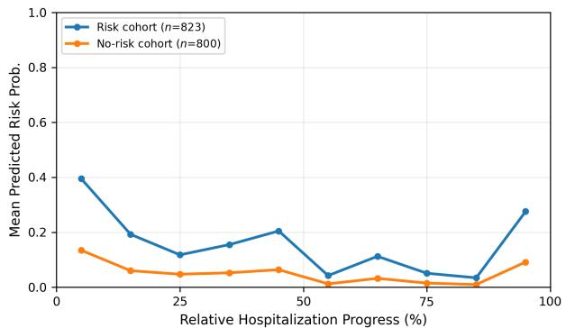

# Beyond Physical Illness: Can Clinical Narratives Reveal Emerging Mental Health Risks in Chronically Ill Patients?

Sudeshna Jana✉   
TCS Research   
Kolkata, India   
sudeshna.jana@tcs.com

Siddhartha Laha Jadavpur University Kolkata, India siddharthalaha0@gmail.com

Tirthankar Dasgupta   
TCS Research   
India   
dasgupta.tirthankar@tcs.com   
Manjira Sinha   
TCS Research   
India   
sinha.manjira@tcs.com   
Pabitra Mitra   
IIT Kharagpur   
India   
pabitra@cse.iitkgp.ac.in

## Abstract

Mental-health risks such as depression, dementia, and suicidal ideation can emerge during hospitalization among chronically ill patients and may worsen without timely recognition and interven tion. However, most existing mental health studies focus on patients with established psychiatric conditions rather than patients hospi talized primarily for physical illness. In this work, we investigate whether latent mental-health risk in chronically ill patients can be inferred from longitudinal clinical narratives. We construct a weakly supervised cohort around 4,000 patients from MIMIC-III using mental-health evidence extracted from discharge summaries. A hierarchical state-space framework derives mental-health represen tations from day-wise clinical narratives and models their temporal evolution for risk estimation throughout hospitalization. Preliminary results demonstrate improved binary risk prediction using the proposed representations and show distinct model derived risk trajectories between risk and no-risk cohorts, providing a foundation for studying emerging mental-health risks in chronically ill patients.

## CCS Concepts

• Applied computing → Health informatics; • Computing methodologies → Information extraction.

## Keywords

Mental-health risk, Chronic illness, Clinical narratives, State-space models, Longitudinal EHRs.

## ACM Reference Format:

Sudeshna Jana, Siddhartha Laha, Manjira Sinha, Tirthankar Dasgupta, and Pabitra Mitra. 2026. Beyond Physical Illness: Can Clinical Narratives Reveal Emerging Mental Health Risks in Chronically Ill Patients?. In . ACM, New York, NY, USA, 3 pages. https://doi.org/10.1145/nnnnnnn.nnnnnnn

## 1 Introduction

Chronic illness can be accompanied by substantial mental health challenges, including depression, cognitive impairment, dementia, and self-harm risk. [1, 10] These conditions may emerge during hospitalization alongside the primary physical illness and can change rapidly in response to disease severity, medications, sleep disruption, and other clinical stressors. While some risks may be transient, others may persist beyond the acute hospitalization and have long consequences. Early recognition of such risks is therefore important for timely clinical intervention and patient safety. However, existing mental health research using clinical data has largely focused on populations with established psychiatric conditions, whereas the emergence of mental health risks among critically ill patients without a primary psychiatric diagnosis remains comparatively underexplored.[7, 11]

Electronic health records (EHRs) provide rich longitudinal insights into a patient’s hospitalization, encompassing clinical conditions, treatments, diagnoses, adverse events, and care plans.[4] Nursing notes, in particular, are recorded throughout hospitalization and may routinely capture behavioral, cognitive, and afective signals associated with emerging mental-health concerns. However, identifying mental-health risk from these narratives presents two key challenges. First, these information is interwoven with extensive clinical information related to patients’ medical history, medications, procedures, and physiological conditions, making it dificult to isolate mental-health specific signals. Second, explicit mental-health related documentation are typically unavailable, making direct supervised learning of day-wise risk dificult.

In this work, we address these challenges through a framework for inferring latent mental-health risk from longitudinal clinical narratives of ICU patients. The framework first constructs a weakly supervised cohort by extracting mental-health evidence from discharge summaries. Day-wise nursing narratives are then transformed into mental-health specific representations, which are subsequently modeled over time to estimate risk throughout hospitalization. This formulation enables investigation of not only whether a patient exhibits mental-health risk, but also how early such risk can be identified during the hospital stay.

The major contributions ofthis work are: (1) a weakly supervised cohort ofapproximately 4,000 ICU patients with evidence ofmentalhealth risks, constructed from MIMIC-III; (2) a hierarchical statespace framework that learns mental-health-specific representations from day-wise clinical narratives; and (3) a temporal risk inference model that estimates mental-health risk throughout hospitalization and characterizes its model derived temporal trajectory.

Table 1: Top five mental-health risks in the cohort, showing the number of patients with Past + Cur. evidence in both prior history and current hospitalization, Cur.-only evidence during the current hospitalization without identified prior history, and most frequent primary diagnoses.
<table><tr><td>Risk</td><td>Past + Cur.</td><td>Cur.-only</td><td>Top primary diseases</td></tr><tr><td>Depression</td><td>616</td><td>892</td><td>CHF; Sepsis</td></tr><tr><td>self-harm risk</td><td>356</td><td>524</td><td>Carcinoma; Sepsis</td></tr><tr><td>hallucination</td><td>17</td><td>373</td><td>Sepsis; Pneumonia</td></tr><tr><td>Dementia</td><td>985</td><td>328</td><td>Pneumonia; MI</td></tr><tr><td>Memory impairment</td><td>67</td><td>182</td><td>MI; Sepsis</td></tr></table>

## 2 Cohort Construction

As our primary data source, we use the publicly available MIMIC-III v1.4 dataset [5], which contains records of approximately 40,000 critically ill patients. To construct the mental-health risk cohort, discharge summaries are used as the primary source of patient-level evidence, as they provide a comprehensive details of the hospitalization and consolidate relevant diagnoses, clinical events, patient history and discharge condition. Each discharge summary is processed using GPT-4o mini [9, 13] with a structured prompt to identify explicit mental-health markers, extract their supporting evidence phrases, and determine their temporal context. Specifically, each identified marker is classified as either past history or associated with the current hospitalization, enabling us to distinguish pre-existing risks from those documented during the hospital stay. The extracted evidence phrases are subsequently analyzed to identify the corresponding mental-health risks or conditions. To reduce semantic redundancy among extracted markers, we employ an LLMbased concept-mapping agent coupled with the UMLS API [2]. For each extracted risk keyword, the agent retrieves candidate UMLS concepts and computes their cosine similarity with the keyword, selecting the highest-scoring concept as the standardized representation. This process consolidates semantically similar expressions, such as “suicidal thoughts” and “thoughts ofkilling himself”, under a common clinical concept “suicidal ideation”. The resulting patientlevel labels retain the standardized concept, supporting evidence, and temporal context, providing weak supervision for subsequent mental-health risk modeling. We identified 4,113 patients with at least one of 143 unique mental-health risk markers.

## 2.1 Latent Mental-Health Risk Inference

For each patient, nursing notes are documented at the day level to capture clinical evolution throughout hospitalization. We employ ClinicalMamba [12], a state-space sequence model designed for long clinical texts with selective information retention, to encode each day’s narrative into a clinical representation capturing multiple aspects of the patient’s condition, including physical and psychological information. Since these representations contain both mental-health related and broader clinical information, a shared projection followed by two parallel heads produces a mental-health representation $z _ { \mathrm { m } }$ and a contextual representation $z _ { \mathrm { c } } .$ We jointly optimize the two representations using three complementary objectives. A class-weighted binary cross-entropy loss ${ \mathcal { L } } _ { \mathrm { m } }$ encourages $z _ { \mathrm { m } }$ to capture information predictive of the identified mental-health risks. A reconstruction loss ${ \mathcal { L } } _ { \mathrm { r } }$ reconstructs the original clinical representation from $[ z _ { \mathrm { m } } ; z _ { \mathrm { c } } ]$ , preserving clinically relevant information across the two representations. An orthogonality loss $\mathcal { L } _ { 0 }$ minimizes the cosine similarity between $z _ { \mathrm { m } }$ and $z _ { \mathrm { c } }$ for patients with identified mental-health risks, encouraging separation between mental-health specific and contextual information. The overall objective is $\begin{array} { r } { \mathcal { L } = \mathcal { L } _ { \mathrm { m } } + \lambda _ { \mathrm { r } } \mathcal { L } _ { \mathrm { r } } + \lambda _ { \mathrm { o } } \mathcal { L } _ { \mathrm { o } } , } \end{array}$ where $\lambda _ { \mathrm { r } }$ and $\lambda _ { \mathrm { o } }$ control the relative contributions of the reconstruction and orthogonality objectives and are learned jointly with the model parameters.

Table 2: Binary mental-health risk prediction results.
<table><tr><td>Note Repres. + Temporal Model</td><td>F1</td><td>AUROC</td><td>AUPRC</td></tr><tr><td>Clinical Mamba + SSM</td><td>0.61</td><td>0.67</td><td>0.62</td></tr><tr><td>Clinical Mamba + LSTM</td><td>0.63</td><td>0.75</td><td>0.71</td></tr><tr><td>Clinical Mamba + Transformer</td><td>0.63</td><td>0.78</td><td>0.67</td></tr><tr><td>Mental-health + SSM</td><td>0.71</td><td>0.82</td><td>0.82</td></tr><tr><td>Mental-health + LSTM</td><td>0.75</td><td>0.85</td><td>0.82</td></tr><tr><td>Mental-health + Transformer</td><td>0.78</td><td>0.86</td><td>0.85</td></tr></table>

  
Figure 1: Predicted mental-health risk across relative hospitalization progress.

The resulting sequence of daily mental-health representations is then processed by a temporal Transformer encoder [6] to model their evolution throughout hospitalization. The Transformer produces a risk probability for each hospitalization day and a final patient-level risk estimate. While the final prediction provides overall hospitalization risk, the day-wise probabilities characterize the temporal trajectory and allow the earliest model detected elevation in risk to be examined.

## 3 Preliminary Results

The experiments use 8,113 admissions, comprising 4,113 admissions with identified mental-health risk and 4,000 without risk. We evaluate binary patient-level risk prediction using the original Clinical Mamba representations and the proposed mental-health representations with three temporal architectures: SSM [8], LSTM [3], and Transformer [6]. As shown in Table 2, the mental-health representations consistently outperform the corresponding other representations across all temporal models. This suggests that isolating mental-health specific information from the broader clinical representation provides a more informative basis for downstream risk prediction.

In a further analysis, we examine the day-wise risk probabilities. To account for varying lengths of stay, predictions are normalized to relative hospitalization progress and averaged within intervals separately for the risk and no-risk cohorts. Figure 1 presents the resulting model-derived risk trajectories, with the risk cohort generally exhibiting higher predicted risk throughout hospitalization.

## 4 Conclusion

This work presents a framework for inferring latent mental-health risk from longitudinal clinical narratives of chronically ill patients. Preliminary results show that mental-health-specific representations improve patient-level risk prediction and reveal distinct temporal risk trajectories between risk and non-risk cohorts. Future work will extend the framework beyond binary risk detection to identify specific mental-health risks and model their trajectories throughout hospitalization, capturing how patients’ mental states emerge and evolve over time. We will further investigate interpretable approaches to identify the key clinical factors contributing to these changes, providing insight into not only what mentalhealth risk emerges and when, but also how it evolves and why.

## References

[1] Adnan Akif, MMA Shalahuddin Qusar, and Md Rabiul Islam. 2024. The impact of chronic diseases on mental health: an overview and recommendations for care programs. Current psychiatry reports 26, 7 (2024), 394–404.

[2] Olivier Bodenreider. 2004. The unified medical language system (UMLS): integrating biomedical terminology. Nucleic acids research 32, suppl\_1 (2004), D267–D270.

[3] Steven Elsworth and Stefan Güttel. 2020. Time series forecasting using LSTM networks: A symbolic approach. arXiv preprint arXiv:2003.05672 (2020).

[4] R Scott Evans. 2016. Electronic health records: then, now, and in the future. Yearbook ofmedical informatics 25, S 01 (2016), S48–S61.

[5] Alistair EW Johnson, Tom J Pollard, Lu Shen, Li-wei H Lehman, Mengling Feng, Mohammad Ghassemi, Benjamin Moody, Peter Szolovits, Leo Anthony Celi, and Roger G Mark. 2016. MIMIC-III, a freely accessible critical care database. Scientific data 3, 1 (2016), 160035.

[6] Bryan Lim, Sercan Ö Arık, Nicolas Loef, and Tomas Pfister. 2021. Temporal fusion transformers for interpretable multi-horizon time series forecasting. International journal offorecasting 37, 4 (2021), 1748–1764.

[7] David Nickson, Caroline Meyer, Lukasz Walasek, and Carla Toro. 2023. Prediction and diagnosis ofdepression using machine learning with electronic health records data: a systematic review. BMC medical informatics and decision making 23, 1 (2023), 271.

[8] Syama Sundar Rangapuram, Matthias W Seeger, Jan Gasthaus, Lorenzo Stella, Yuyang Wang, and Tim Januschowski. 2018. Deep state space models for time series forecasting. Advances in neural information processing systems 31 (2018).

[9] C Mahony Reategui-Rivera and Joseph Finkelstein. 2025. Evaluation of the performance of a large language model to extract signs and symptoms from clinical notes. In Envisioning the Future ofHealth Informatics and Digital Health. SAGE Publications 1 Oliver’s Yard, 55 City Road, London, EC1Y 1SP, 71–75.

[10] Amelia J Scott, Ashleigh B Correa, Madelyne A Bisby, and Blake F Dear. 2023. Depression and anxiety trajectories in chronic disease: a systematic review and meta-analysis. Psychotherapy and Psychosomatics 92, 4 (2023), 227–242.

[11] Zhenxing Xu, Veer Vekaria, Fei Wang, Judith Cukor, Chang Su, Prakash Adekkanattu, Pascal Brandt, Guoqian Jiang, Richard C Kiefer, Yuan Luo, et al. 2023. Using machine learning to predict antidepressant treatment outcome from electronic health records. Psychiatric Research and Clinical Practice 5, 4 (2023), 118–125.

[12] Zhichao Yang, Avijit Mitra, Sunjae Kwon, and Hong Yu. 2024. Clinicalmamba: A generative clinical language model on longitudinal clinical notes. In Proceedings of the 6th Clinical Natural Language Processing Workshop. 54–63.

[13] Nan Zhang, Zaijie Sun, Yuchen Xie, Haiyang Wu, and Cheng Li. 2024. The latest version ChatGPT powered by GPT-4o: what will it bring to the medical field? International journal ofsurgery (London, England) 110, 9 (2024), 6018.