# Biology-Guided Context-Aware Residual Propagation for Spatial Gene Expression Prediction from Histology

Vu Van An Hanoi University of Science and Technology Hanoi, 10000, Vietnam an.vv2416109@sis.hust.edu.vn

Ho Viet Duc Luong Hanoi University of Science and Technology Hanoi, 10000, Vietnam luonghvd@soict.hust.edu.vn

Long D. Nguyen   
Victoria University of Wellington   
Wellington, 6012, New Zealand duylong.nguyen@vuw.ac.nz Binh P. Nguyen   
Victoria University of Wellington   
Wellington, 6012, New Zealand binh.p.nguyen@vuw.ac.nz

## Abstract

Spatial transcriptomics provides spatially resolved molecular profiling, but its cost, limited throughput and experimental complexity hinder routine large-scale use. Predicting spatial gene expression from hematoxylin-and-eosinstained histology images offers a scalable alternative, yet remains challenging because histology provides only an indirect morphological view of molecular activity. Existing methods typically decode expression from visual features in a single stage, even when enhanced with spatial aggregation, retrieval or multi-resolution fusion. This formulation is restrictive because spot-level expression reflects not only local morphology but also cellular identity, neighborhood composition and tissue-level organization. We propose BCARP, a Biology-guided Context-Aware Residual Propagation framework for histology-guided spatial transcriptomics prediction. Instead of directly predicting gene expression from histology embeddings, BCARP treats them as morphology visual priors and progressively refines spot representations in a transcriptomics-oriented latent space. Each refinement step integrates nuclei-guided local cellular context with prototype-guided global context propagation, enabling information exchange across both neighboring and spatially distant spots. A pattern-scale decoderfurther separates spatial expression into pattern prediction from raw expression with scale calibration. Evaluated on three ST datasets and ten HEST-1k cohorts, BCARP achieves the highest mean correlation-based performance against other baselines. Numerical results support biology-guided localglobal residual propagation as an effective alternative to visual decodingfor histology-to-transcriptomics prediction.

## 1. Introduction

Spatial transcriptomics (ST) enables spatially resolved molecular profiling by measuring gene expression while preserving tissue coordinates [10, 31]. Unlike bulk RNA sequencing, which averages signals over tissue regions, ST quantifies mRNA expression across spatial “spots” and reveals how expression patterns are organized within histological architecture. This perspective is critical for biomedical studies, where disease progression, immune response, tumor microenvironment and cell-cell interactions are often spatially structured [16], and it bridges conventional histopathology and transcriptomic profiling [20].

Despite its value, ST remains costly, experimentally demanding and limited in coverage and throughput [26], whereas hematoxylin-and-eosin (H&E)-stained whole-slide images (WSIs) are routinely collected in clinical workflows [36]. This gap motivates histology-guided ST prediction, which estimates spatial gene expression directly from H&E images. Beyond patch-based regression such as ST-Net [12], recent methods enrich the visual representation in complementary ways: graph-based models such as MERGE [8] connect spots through spatial and morphological relations; multi-resolution models such as TRIPLEX [5] and M2OST [29] fuse target-spot, neighborhood and slide-level views; mclSTExp [23] performs contrastive cross-modal alignment for retrieval-based inference; EGN [34] refines targets with globally similar exemplars; and STFlow [14] models the whole-slide expression distribution with flow matching.

Despite this diversity, these approaches largely share a one-stage visual decoding paradigm: contextual information is aggregated into a histology representation, which is then mapped to expression in a single prediction step.

This implicitly assumes that the extracted representation is already aligned with the transcriptomic factors underlying spot-level expression. In practice, expression is not determined solely by the appearance of the central patch; it is also shaped by local cellular composition, neighborhood microenvironment and broader tissue organization [1, 10, 18]. Histology-guided prediction should therefore go beyond direct visual regression and progressively refine morphology-derived features into transcriptomicsoriented representations.

To this end, we propose BCARP, a Biology-guided Context-Aware Residual Propagation framework. BCARP projects frozen pathology foundation embeddings into a task-oriented latent space and treats them as histology anchors. Instead of decoding these anchors in one step, it iteratively refines them through a local-global residual propagation loop: local cellular context encoders use nucleiderived supervision to inject cell-type and neighborhoodcomposition information, while a prototype-guided global module combines learnable global priors with spot-level self-attention to model long-range tissue organization. A pattern-scale decoder then separates spatial expressionpattern estimation from raw-expression scale calibration. We evaluate BCARP on HER2ST [1], Skin [18] and ST-Net [12] under a unified spot-level protocol, and on ten HEST-1k cohorts [17] following the STFlow [14] evaluation suite, spanning multiple organs and cancer types. BCARP outperforms representative baselines, reduces poorly predicted genes, and is further validated by component and refinement-depth ablations. Our contributions are summarized as follows:

• We propose BCARP, a residual propagation framework for multi-step context-aware refinement in histologyguided spatial transcriptomics prediction.

• We design a local-global refinement mechanism that combines nuclei-derived local cellular supervision, learnable global context priors and spot-level self-attention to transform histology anchors into transcriptomics-oriented representations.

• We conduct comprehensive experiments on three widely used ST datasets and ten curated HEST-1k cohorts, showing that BCARP improves overall cross-cohort performance, achieving the highest mean PCC-M and best mean rank while exhibiting cohort-dependent gains.

## 2. Related Work

Deep learning has become central to WSI analysis, enabling histology images to be represented at cellular, patch and slide levels. Early specialized models focus on local biological structures; for example, HoVer-Net [9] performs nuclear instance segmentation and classification by predicting horizontal and vertical distance maps, providing nucleilevel cues for downstream tissue analysis. Beyond individual cells, graph-based approaches such as HEAT [2] model WSIs as heterogeneous graphs with nucleus-type node attributes and semantic edge relations, capturing contextual interactions among cellular components. In parallel, self-supervised pathology encoders have been developed to learn transferable patch representations from large unannotated WSI collections. CTransPath [30] combines Convolutional Neural Network and Swin Transformer architectures with semantically relevant contrastive learning, while recent large-scale models such as UNI [3], Phikonv2 [6] and Virchow2 [38] scale DINO-style pretraining to massive pathology datasets and provide strong visual features for diverse diagnostic and biomarker prediction tasks. Other methods further improve WSI-level representation by aggregating patch embeddings into compact morphologica prototypes, as in PANTHER [28] or by aligning histology images with pathology text, as in CONCH [22].

Predicting spatial gene expression from H&E-stained histology images offers a scalable alternative to experimental spatial transcriptomics. ST-Net [12] formulates the task as patch-level regression, ignoring inter-spot dependencies and broader tissue organization; subsequent work introduces spatial modeling, retrieval, graph construction, multiscale encoding, multimodal alignment and distributionlevel prediction. THItoGene [19] models dependencies among spatial locations, while BG-TRIPLEX [27] adds boundary, edge and nuclei cues through cross-attention. Among the methods we adopt as baselines, MERGE [8] constructs multi-faceted hierarchical graphs that connect spots by both spatial proximity and morphological similarity; TRIPLEX [5] fuses target-spot, neighborhood and whole-slide views; M2OST [29] regresses a central spot from multi-magnification patches through a many-to-one Transformer, and therefore operates on image crops rather than pre-extracted features; mclSTExp [23] aligns H&E and spatial-transcriptomic representations by contrastive learning and infers expression through retrieval; EGN [34] refines target representations using globally similar exemplars; and STFlow [14] models the whole-slide joint distribution with flow matching under a zero-inflated negativebinomial prior. Beyond these, MMAP [24] summarizes slide-level context with a prototype bank, ASIGN [37] extends imputation to 3D tissue, and GHIST [7] and Histo-Cell [35] predict at cellular resolution.

## 3. Methodology

Figure 1 illustrates the overall pipeline of BCARP. Let a tissue section contain N spatial transcriptomics spots. We denote the frozen histology embeddings as $\mathbf { E } \in \mathbb { R } ^ { \hat { N } \times d _ { \epsilon } }$ , the spatial coordinates as $\mathbf { P } \in \mathbb { R } ^ { N \times 2 }$ and the normalized coordinates as Pe , obtained by normalizing each coordinate axis by its maximum value. BCARP predicts G target genes, with $\mathbf { Y } ^ { \mathrm { p r o c } } \in \mathbb { R } ^ { N \times G }$ denoting the spatially smoothed target for expression-pattern supervision and $\mathbf { Y } ^ { \mathrm { r a w } } \in \mathbb { R } ^ { N \times G }$ denoting the raw-count target.

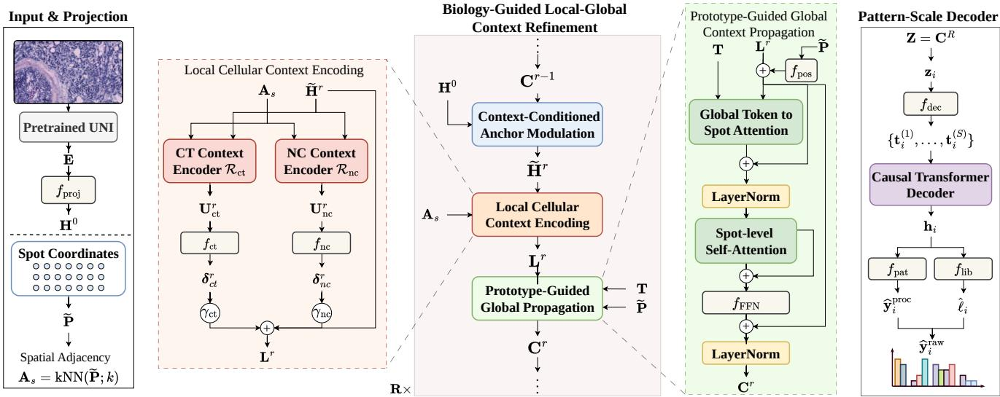  
Figure 1. Pipeline overview of BCARP. Frozen histology foundation embeddings are first projected into a shared latent space, then iteratively refined through context-conditioned modulation, local biological encoding and prototype-guided global context propagation. The final representation is passed to a pattern-scale gene expression decoder to generate calibrated spatial gene expression predictions.

## 3.1. Histology Embedding Projection and Biology-Guided Local-Global Context Refinement

Histology embedding projection Frozen pathology foundation embeddings provide strong morphology-aware features but are not directly optimized for spatial gene expression prediction. BCARP therefore maps them into a transcriptomics-oriented latent space using a lightweight MLP projector $f _ { \mathrm { p r o j } } ( \cdot )$ as $\mathbf { H } ^ { 0 } \ = \ f _ { \mathrm { p r o j } } \left( \mathbf { E } \right)$ then $\mathbf { H } ^ { 0 } \in \mathbb { R } ^ { N \times d }$ where d is the hidden dimension. The projected state $\mathbf { H } ^ { 0 }$ serves as a stable histology-derived anchor, from which BCARP repeatedly constructs contextconditioned views and refines them with local cellular and global context priors before decoding gene expression.

Context-aware histology anchor refinement Spatial gene expression is influenced by not only local morphology but also cellular identity, neighborhood composition, and tissue-level organization [7]. To capture these dependencies, BCARP performs R context-conditioned refinement steps over $\mathbf { H } ^ { 0 }$ using context-conditioned anchor modulation. Let $\mathbf { C } ^ { r } \in \mathbb { R } ^ { \breve { N } \times d }$ denote the context state after step r, with $\mathbf { C } ^ { 0 } = \mathbf { 0 }$ . At step r, we first aggregate the previous context into a section-level summary:

$$
\bar { \mathbf { c } } ^ { r - 1 } = \frac { 1 } { N } \sum _ { i = 1 } ^ { N } \mathbf { C } _ { i } ^ { r - 1 } , \qquad \bar { \mathbf { c } } ^ { r - 1 } \in \mathbb { R } ^ { d } .\tag{1}
$$

The summary is transformed into feature-wise modulations:

$$
[ \beta ^ { r } , \gamma ^ { r } , \mathbf { a } ^ { r } ] = f _ { \mathrm { m o d } } \left( \mathrm { L N } \left( \bar { \mathbf { c } } ^ { r - 1 } \right) \right) , \beta ^ { r } , \gamma ^ { r } , \mathbf { a } ^ { r } \in \mathbb { R } ^ { d } ,\tag{2}
$$

where $\beta ^ { r } , \gamma ^ { r }$ and $\mathbf { a } ^ { r }$ denote shift, scale and gate parameters, respectively, LN denotes LayerNorm, and $f _ { \mathrm { m o d } } ( \cdot )$ is a MLP. These parameters are broadcast to all spots and used to construct a context-modulated histology state:

$$
\widetilde { \mathbf { H } } ^ { r } = \mathbf { H } ^ { 0 } + \operatorname { t a n h } \left( \mathbf { a } ^ { r } \right) \odot \left[ \mathrm { L N } \left( \mathbf { H } ^ { 0 } \right) \odot \left( 1 + \gamma ^ { r } \right) + \beta ^ { r } \right] ,\tag{3}
$$

where $\odot$ denotes element-wise multiplication. This gated modulation preserves the original morphology-derived representation while allowing accumulated context to adaptively reshape it at each refinement step. The resulting state $\widetilde { \mathbf { H } } ^ { r }$ is then passed to the local and global refinement modules, yielding the update path: ${ \bf C } ^ { r - 1 } \to \widetilde { { \bf H } } ^ { r } \to { \bf L } ^ { r } \to { \bf C } ^ { r }$ 7 where ${ \bf L } ^ { r }$ is the locally refined representation obtained from nuclei-guided cellular context encoding and $\mathbf { C } ^ { r }$ is updated after prototype-guided global context propagation.

Local cellular context encoding The local stage injects cellular and microenvironmental cues into the contextmodulated spot representation. BCARP first constructs a fixed spatial adjacency from normalized spot coordinates by connecting each spot to its k nearest spatial neighbors:

$$
\mathbf { A } _ { s } = \mathrm { k N N } ( \widetilde { \mathbf { P } } ; k ) , \qquad \mathbf { A } _ { s } \in \{ 0 , 1 \} ^ { N \times N } .\tag{4}
$$

The adjacency ${ \bf A } _ { s }$ is computed once and shared across all refinement steps. It only specifies the local propagation structure, while the node features are dynamically given by the context-modulated states $\widetilde { \mathbf { H } } ^ { r }$ at step r.

To provide biological supervision, BCARP derives two auxiliary local targets from H&E-based nuclei analysis. We apply HoVer-Net [9] to detect nuclei and assign each nucleus a cell-type pseudo-label. For each spot i, we collect nuclei whose centroids fall within a fixed radius around its coordinate $\mathbf { p } _ { i }$ . Let $T$ denote the number of cell-type categories and let $n _ { i t }$ be the number of nuclei of type t in the neighborhood of spot i. We define the neighborhoodcomposition target and dominant cell-type target as

$$
\mathbf { q } _ { i } = \left[ \frac { n _ { i t } } { \sum _ { t ^ { \prime } = 1 } ^ { T } n _ { i t ^ { \prime } } + \epsilon } \right] _ { t = 1 } ^ { T } , \qquad c _ { i } = \arg \operatorname* { m a x } _ { t } n _ { i t } .\tag{5}
$$

Here $\mathbf { q } _ { i }$ represents the local cell-type composition, while $c _ { i }$ summarizes the dominant local phenotype. These targets are used only for training-time auxiliary supervision. Given $\widetilde { \mathbf { H } } ^ { r }$ and $\mathbf { A } _ { s } ,$ BCARP uses two GNN-based local context encoders, indexed by $b \in \{ \mathrm { c t } , \mathrm { n c } \}$ , where ct is cell-type and nc denotes neighborhood-composition context:

$$
{ \bf U } _ { b } ^ { r } = \mathcal { R } _ { b } \big ( \widetilde { \bf H } ^ { r } , { \bf A } _ { s } \big ) , \qquad { \bf O } _ { b } ^ { r } = f _ { \mathrm { h e a d } , b } \left( { \bf U } _ { b } ^ { r } \right) ,\tag{6}
$$

where $\mathbf { U } _ { h } ^ { r } \in \mathbb { R } ^ { N \times d _ { r } }$ denotes graph-updated local features, $\mathbf { O } _ { b } ^ { r } \ \in \ \check { \mathbb { R } } ^ { N \times T }$ denotes auxiliary logits and $f _ { \mathrm { h e a d } , b }$ is an MLP. The cell-type branch and neighborhood-composition branch are supervised by $c _ { i }$ and $\mathbf { q } _ { i }$ , respectively. The corresponding predictions are

$$
\widehat { \mathbf { Y } } _ { \mathrm { c t } } ^ { r } = \mathrm { s o f t m a x } \left( \mathbf { O } _ { \mathrm { c t } } ^ { r } \right) , \qquad \widehat { \mathbf { Y } } _ { \mathrm { n c } } ^ { r } = \mathrm { s o f t m a x } \left( \mathbf { O } _ { \mathrm { n c } } ^ { r } \right) .\tag{7}
$$

Hidden features from both branches are projected back to the BCARP hidden dimension via an MLP projector $f _ { b }$ and injected into the main refinement trajectory:

$$
\begin{array} { r } { \pmb { \delta } _ { b } ^ { r } = f _ { b } \left( \mathbf { U } _ { b } ^ { r } \right) , \qquad \pmb { \delta } _ { b } ^ { r } \in \mathbb { R } ^ { N \times d } , \qquad b \in \{ \mathrm { c t } , \mathrm { n c } \} . } \end{array}\tag{8}
$$

We obtain locally refined state by gated residual injection:

$$
{ \bf L } ^ { r } = \widetilde { { \bf H } } ^ { r } + \sum _ { b \in \{ \mathrm { c t , n c } \} } \gamma _ { b } \delta _ { b } ^ { r } , \quad \gamma _ { b } = \mathrm { t a n h } \left( \alpha _ { b } \right) ,\tag{9}
$$

where $\alpha _ { b }$ is a learnable residual-gate parameter for branch $b .$ This design allows BCARP to preserve context-modulated histology representation while injecting the cellular phenotype and the local microenvironmental mixture.

Prototype-guided global context propagation Local graph encoding captures proximal biological context, but spatial gene expression may depend on broader tissue-level organization. BCARP introduces a small set of learnable global-context prototypes to provide a shared globalcontext interface. Each spot is allowed to retrieve global prior token information and then exchange the enriched information with other spots through self-attention. We first ground the locally refined representation in tissue geometry.

Let $f _ { \mathrm { p o s } }$ be a spatial positional encoder that maps normalized spot coordinates to d-dimensional positional features:

$$
\mathbf { X } ^ { r } = \mathbf { L } ^ { r } + f _ { \mathrm { p o s } } ( \widetilde { \mathbf { P } } ) , \qquad \mathbf { X } ^ { r } \in \mathbb { R } ^ { N \times d } ,\tag{10}
$$

where $\mathbf { X } ^ { r }$ is the spatially grounded spot representation at refinement step r. To present the attention operations compactly, we define a multi-head cross-attention operator $\mathcal { A } ( \mathbf { M } , \mathbf { N } )$ , where M provides queries and N provides keys and values. For the m-th attention head, we compute

$$
\mathcal { A } _ { m } ( \mathbf { M } , \mathbf { N } ) = \mathrm { s o f t m a x } \left( \frac { \mathbf { M } \mathbf { W } _ { Q } ^ { m } \left( \mathbf { N } \mathbf { W } _ { K } ^ { m } \right) ^ { \top } } { \sqrt { d _ { h } } } \right) \mathbf { N } \mathbf { W } _ { V } ^ { m } ,\tag{11}
$$

where $H$ is the number of attention heads and $d _ { h } = d / H$ is the dimension of each head. The outputs of all attention heads are concatenated to the d-dimensional feature:

$$
\begin{array} { r } { \pmb { \mathcal { A } } ( \mathbf { M } , \mathbf { N } ) = \operatorname { C o n c a t } \big ( \mathcal { A } _ { 1 } ( \mathbf { M } , \mathbf { N } ) , \dots , \mathcal { A } _ { H } ( \mathbf { M } , \mathbf { N } ) \big ) . } \end{array}\tag{12}
$$

When $\mathbf { M } \equiv \mathbf { N } ,$ this reduces to standard multi-head selfattention. BCARP maintains $K _ { \mathrm { c t x } }$ learnable global prototype tokens, denoted as $\mathbf { T } \in \mathbb { R } ^ { K _ { \mathrm { c t x } } \times d }$ , which serve as trainable global context priors without requiring predefined biological classes or physical tissue centroids. At each refinement step, every spot first attends to these tokens, then fuses the retrieved global context through residual normalization, using global-token-to-spot attention module:

$$
{ \bf O } _ { \mathrm { c t x } } ^ { r } = { \mathcal A } \left( { \bf X } ^ { r } , { \bf T } \right) , \quad \bar { \bf X } _ { \mathrm { c t x } } ^ { r } = \mathrm { L N } \left( { \bf X } ^ { r } + { \bf O } _ { \mathrm { c t x } } ^ { r } \right) .\tag{13}
$$

This attention provides each spot with a weighted combination of learned global prototype-context anchors, while the residual normalization injects this global prior into the spatially grounded spot representation before spot-level interaction. After receiving prototype-guided global priors, the enriched spot representations exchange and propagate information through spot-level self-attention module:

$$
\mathbf { G } ^ { r } = \mathcal { A } \left( \bar { \mathbf { X } } _ { \mathrm { c t x } } ^ { r } , \bar { \mathbf { X } } _ { \mathrm { c t x } } ^ { r } \right) , \qquad \mathbf { G } ^ { r } \in \mathbb { R } ^ { N \times d } .\tag{14}
$$

We obtain next context state by a residual feed-forward as:

$$
\mathbf { C } ^ { r } = \mathrm { L N } \big ( \mathbf { X } ^ { r } + f _ { \mathrm { F F N } } \big ( \bar { \mathbf { X } } _ { \mathrm { c t x } } ^ { r } + \mathbf { G } ^ { r } \big ) \big ) .\tag{15}
$$

The residual path preserves the spatially grounded local state, while the feed-forward branch incorporates both token-routed global context and spot-level attention output.

## 3.2. Pattern-Scale Gene Expression Decoder

BCARP decodes the final refined spot representation $\mathbf { Z } =$ $\mathbf { C } ^ { R } \in \mathbb { R } ^ { N \times d }$ with a pattern-scale gene expression decoder. The decoder factorizes prediction into two complementary components including a pattern branch that estimates relative spatial gene expression structure and a scale branch that calibrates this structure to the raw-count expression space.

For each spot $i ,$ let $\mathbf { z } _ { i } \in \mathbb { R } ^ { d }$ denote the i-th row of $\mathbf { Z } .$ We first map $\mathbf { z } _ { i }$ into the decoder space and expand it into a short sequence of S hierarchy tokens by adding learnable scale embeddings:

$$
\mathbf { t } _ { i } ^ { ( s ) } = f _ { \mathrm { d e c } } \left( \mathbf { z } _ { i } \right) + \mathbf { e } ^ { ( s ) } , \qquad s = 1 , \ldots , S .\tag{16}
$$

The scale embeddings induce a compact coarse-to-fine hierarchy over gene groups. A causal transformer decoder processes this sequence, allowing later tokens to condition on earlier decoding states:

$$
\mathbf { u } _ { i } ^ { ( 1 ) } , \ldots , \mathbf { u } _ { i } ^ { ( S ) } = \operatorname { D e c o d e r } \big ( \mathbf { t } _ { i } ^ { ( 1 ) } , \ldots , \mathbf { t } _ { i } ^ { ( S ) } \big ) ,\tag{17}
$$

where $\mathbf { h } _ { i } = \mathbf { u } _ { i } ^ { ( S ) }$ is used for the spot-level decoding state.

Pattern branch Given the decoding state $\mathbf { h } _ { i } .$ , the pattern branch predicts a non-negative processed expression vector:

$$
\widehat { \mathbf { y } } _ { i } ^ { \mathrm { p r o c } } = \widehat { \mathbf { p } } _ { i } = \mathrm { s o f t p l u s } \left( f _ { \mathrm { p a t } } \left( \mathbf { h } _ { i } \right) \right) , \qquad \widehat { \mathbf { p } } _ { i } \in \mathbb { R } _ { + } ^ { G } .\tag{18}
$$

Stacking the predictions over all spots gives the processed pattern prediction $\widehat { \mathbf { Y } } ^ { \mathrm { p r o c } } \in \mathbb { R } _ { + } ^ { N \times \dot { G } }$ . This branch is supervised by the spatially smoothed expression target $\mathbf { Y } ^ { \mathrm { p r o c } }$

Scale calibration branch To calibrate the predicted pattern to the raw-count scale, we normalize $\widehat { \mathbf { p } } _ { i }$ into a genewise composition $\widehat { \pmb { \pi } } _ { i } = \widehat { \pmb { p } } _ { i } / ( \mathbf { 1 } ^ { \top } \widehat { \mathbf { p } } _ { i } + \epsilon )$ . Here, $\widehat { \pi } _ { i }$ represents the predicted proportion of the total expression assigned to each gene at spot i. In parallel, a library-size head predicts a positive spot-level raw-count scale:

$$
\widehat { \ell } _ { i } = \exp \left( \mathrm { s o f t p l u s } \left( f _ { \mathrm { l i b } } \left( \mathbf { h } _ { i } \right) \right) \right) - 1 , \qquad \widehat { \ell } _ { i } \in \mathbb { R } _ { + } .\tag{19}
$$

The calibrated raw-count prediction is obtained by rescaling the gene-wise composition with the predicted library size:

$$
\begin{array} { r } { \widehat { \mathbf { y } } _ { i } ^ { \mathrm { r a w } } = \widehat { \ell } _ { i } \widehat { \pmb { \pi } } _ { i } \in \mathbb { R } _ { + } ^ { G } . } \end{array}\tag{20}
$$

Stacking over all spots gives the predicted raw-count matrix $\widehat { \mathbf { Y } } ^ { \mathrm { r a w } } \in \mathbb { R } _ { + } ^ { N \times \mathbf { \bar { G } } }$ , where each entry $\widehat { Y } _ { i g } ^ { \mathrm { r a w } }$ denotes the predicted raw expression count of gene g at spot i.

This factorization separates relative gene expression pattern learning from spot-specific raw-count calibration. The pattern branch predicts how expression is distributed across genes, while the scale branch estimates the total count level of each spot and their product yields the final gene-wise raw-count prediction.

## 3.3. Objective

BCARP is trained with a multi-task objective that combines processed pattern supervision, raw-count calibration

and local biological guidance. The processed pattern loss is $\mathcal { L } _ { \mathrm { p r o c } } = \mathcal { L } _ { \mathrm { P C C } } + \lambda _ { \mathrm { h u b e r } } \mathcal { L } _ { \mathrm { H u b e r } }$ , where

$$
\mathcal { L } _ { \mathrm { P C C } } = 1 - \frac { 1 } { G } \sum _ { g = 1 } ^ { G } \mathrm { C o r r } \left( \widehat { \mathbf { Y } } _ { : , g } ^ { \mathrm { p r o c } } , \mathbf { Y } _ { : , g } ^ { \mathrm { p r o c } } \right) ,\tag{21}
$$

$$
{ \mathcal { L } } _ { \mathrm { H u b e r } } = { \mathrm { H u b e r } } _ { \delta } \left( { \widehat { \mathbf { Y } } } ^ { \mathrm { p r o c } } , \mathbf { Y } ^ { \mathrm { p r o c } } \right) .\tag{22}
$$

For raw-count calibration, $\widehat { \mathbf { Y } } ^ { \mathrm { r a w } }$ is supervised by the raw UMI target $\mathbf { Y } ^ { \mathrm { r a w } }$ using a negative-binomial likelihood:

$$
\mathcal { L } _ { \mathrm { N B } } = - \frac { 1 } { N G } \sum _ { i = 1 } ^ { N } \sum _ { g = 1 } ^ { G } \log p _ { \mathrm { N B } } \left( Y _ { i g } ^ { \mathrm { r a w } } \mid \widehat { Y } _ { i g } ^ { \mathrm { r a w } } , \theta _ { g } \right) ,\tag{23}
$$

where $\widehat { Y } _ { i q } ^ { \mathrm { r a w } }$ is used as the predicted count-rate parameter and $\theta _ { g }$ is the gene-wise dispersion. We further apply a logspace MSE loss to align the calibrated prediction with the raw-count scale:

$$
\mathcal { L } _ { \mathrm { l o g M S E } } = \mathrm { M S E } \left( \log \left( 1 + \widehat { \mathbf { Y } } ^ { \mathrm { r a w } } \right) , \log \left( 1 + \mathbf { Y } ^ { \mathrm { r a w } } \right) \right) .\tag{24}
$$

The decoder loss is

$$
{ \mathcal { L } } _ { \mathrm { d e c } } = { \mathcal { L } } _ { \mathrm { p r o c } } + \lambda _ { \mathrm { N B } } { \mathcal { L } } _ { \mathrm { N B } } + \lambda _ { \mathrm { l o g M S E } } { \mathcal { L } } _ { \mathrm { l o g M S E } }\tag{25}
$$

The local biological branches are supervised by HoVer-Netderived pseudo-labels. The cell-type loss is averaged over refinement steps:

$$
\mathcal { L } _ { \mathrm { c t } } = \frac { 1 } { R } \sum _ { r = 1 } ^ { R } \mathrm { C E } \left( \widehat { \mathbf { Y } } _ { \mathrm { c t } } ^ { r } , \mathbf { c } \right) ,\tag{26}
$$

where $\mathbf { c } = \{ c _ { i } \} _ { i = 1 } ^ { N }$ denotes the dominant cell-type pseudolabels. The neighborhood-composition loss is the average KL divergence between the soft composition target $\mathbf { q } _ { i }$ and the predicted distribution $\widehat { \mathbf { Y } } _ { n c , i } ^ { r } \mathrm { ; }$

$$
\mathcal { L } _ { \mathrm { { n c } } } = \frac { 1 } { R } \sum _ { r = 1 } ^ { R } \frac { 1 } { N } \sum _ { i = 1 } ^ { N } \sum _ { t = 1 } ^ { T } q _ { i t } \left[ \log q _ { i t } - \log \widehat { \mathbf { Y } } _ { n c , i t } ^ { r } \right] .\tag{27}
$$

The final training objective is

$$
\begin{array} { r } { \mathcal { L } = \mathcal { L } _ { \mathrm { d e c } } + \lambda _ { \mathrm { c t } } \mathcal { L } _ { \mathrm { c t } } + \lambda _ { \mathrm { n c } } \mathcal { L } _ { \mathrm { n c } } . } \end{array}\tag{28}
$$

## 4. Experiments

## 4.1. Settings

Datasets and preprocessing We evaluate BCARP on three established whole-slide spatial transcriptomics benchmarks, HER2ST [1], Skin [18], and ST-Net [12], as well as ten HEST-1k [17] cohorts, spanning nine organs and eight cancer types. Each sample consists of an H&E-stained histology image with spatially resolved gene expression, where each spot is associated with a tissue coordinate, a spot-centered image patch, and an expression vector. For HER2ST, Skin, and ST-Net, we follow the unified spot-level protocol of MERGE [8]: all methods use the same patientlevel splits, 224 × 224 spot-centered patches, tissue coordinates, and 250-gene target panel after gene filtering. For HEST-1k, we use the predefined patient-grouped splits for each cohort and select up to 250 highly variable genes, resulting in 250 genes for eight cohorts, 197 genes for LUNG, and 98 genes for PAAD. We apply SPCS smoothing [21] to obtain processed expression targets for pattern-oriented supervision, while retaining raw-count targets for calibrationoriented objectives. All evaluation metrics are computed in the same log(1 + x)-transformed raw expression space.

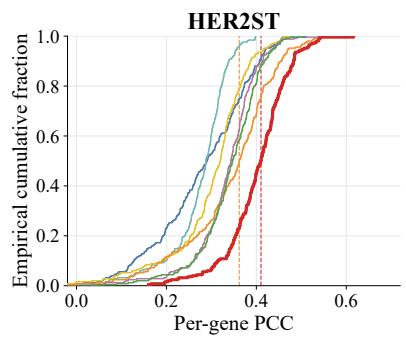

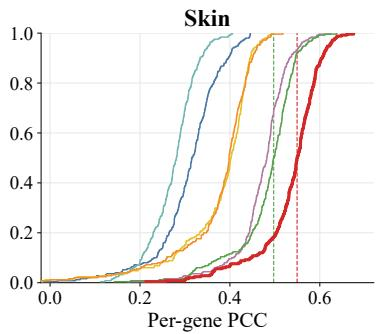

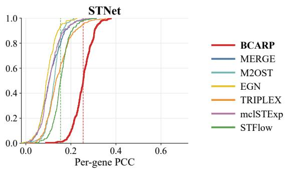  
Figure 2. ECDF curves show the distribution of fold-averaged per-gene PCC on HER2ST, Skin and ST-Net datasets. Dashed vertical lines indicate the average per-gene PCC of BCARP and the highest competing baseline.

Table 1. Performance comparison on HER2ST, Skin and ST-Net datasets. PCC-H and PCC-M denote average per-gene PCC over highly variable genes and all target genes, respectively. MSE and MAE measure prediction error in expression space, and RVD measures the relative deviation in expression variance between predictions and ground truth. Among the method baselines, best results are shown in bold and second-best results are underlined; the frozen-feature references are reported for context and are excluded from this ranking
<table><tr><td></td><td colspan="3">HER2ST</td><td colspan="3">Skin</td><td colspan="3">ST-Net</td></tr><tr><td>Model</td><td></td><td>PCC-H↑ PCC-M↑ MSE↓ MAE↓</td><td>RVD↓</td><td></td><td></td><td>PCC-H↑ PCC-M↑ MSE↓ MAE↓ RVD↓</td><td></td><td>PCC-H↑ PCC-M↑ MSE↓ MAE↓ RVD↓</td><td></td></tr><tr><td colspan="10">Frozen-feature references</td></tr><tr><td>ResNet50+Ridge</td><td>0.2249</td><td>0.2291</td><td>1.07820.82240.9039</td><td>0.2695</td><td>0.3260</td><td>1.35650.90500.8581</td><td>0.0985</td><td>0.0890</td><td>0.9762 0.7862 0.9125</td></tr><tr><td>UNI+Ridge</td><td>0.2583</td><td>0.2598</td><td>1.0579 0.8144 0.8840</td><td>0.2895</td><td>0.3262</td><td>1.3382 0.8968 0.8812</td><td>0.1096</td><td>0.0936</td><td>0.9666 0.7821 0.9223</td></tr><tr><td>UNI+MLP</td><td>0.3474</td><td>0.3316</td><td>1.0030 0.7890 0.8452</td><td>0.3029</td><td>0.3604</td><td>1.2547 0.8670 0.8368</td><td>0.1843</td><td>0.1633</td><td>0.9195 0.7609 0.8644</td></tr><tr><td>UNI+Decoder</td><td>0.4249</td><td>0.3721</td><td>0.94310.77240.8188</td><td>0.5392</td><td>0.4930</td><td>1.44550.95381.4511</td><td>0.2319</td><td>0.1868</td><td>0.82830.7351 0.7685</td></tr><tr><td colspan="10">Method baselines</td></tr><tr><td>M2OST</td><td>0.3121</td><td>0.2756</td><td>0.9853 0.7696 2.1442</td><td>0.2933</td><td>0.2739</td><td>1.3818 0.9210 0.5739</td><td>0.1544</td><td>0.1239</td><td>0.7667 0.6978 1.5675</td></tr><tr><td>MERGE</td><td>0.2913</td><td>0.2800</td><td>1.08850.8274 0.8910</td><td>0.2827</td><td>0.3084</td><td>1.35980.9052 0.9074</td><td>0.1214</td><td>0.1108</td><td>0.95290.7776 0.9234</td></tr><tr><td>EGN</td><td>0.3884</td><td>0.2874</td><td>1.2141 0.9953 0.8857</td><td>0.4039</td><td>0.3704</td><td>0.95050.87340.8988</td><td>0.1098</td><td>0.1111</td><td>0.9826 0.7723 0.9673</td></tr><tr><td>TRIPLEX</td><td>0.3581</td><td>0.3427</td><td>1.07240.81560.8990</td><td>0.3337</td><td>0.3749</td><td>1.33330.89470.9137</td><td>0.1602</td><td>0.1450</td><td>0.96940.78060.9263</td></tr><tr><td>mclSTExp</td><td>0.3856</td><td>0.3356</td><td>0.95280.7589 0.8143</td><td>0.5212</td><td>0.4722</td><td>1.49830.9862 0.4445</td><td>0.1269</td><td>0.1097</td><td>0.86590.7375 0.8548</td></tr><tr><td>STFlow</td><td>0.3888</td><td>0.3410</td><td>0.8464 0.7252 0.8555</td><td>0.5137</td><td>0.4832</td><td>1.19830.86540.4951</td><td>0.1971</td><td>0.1565</td><td>0.74040.68970.7245</td></tr><tr><td>BCARP (Ours)</td><td>0.4567</td><td>0.4032</td><td>0.8381 0.7191 0.7084</td><td>0.5852</td><td>0.5328</td><td>1.1818 0.8620 0.2656</td><td>0.3046</td><td>0.2423</td><td>0.6761 0.6590 0.7500</td></tr></table>

Baselines and implementation details We compare BCARP with representative histology-guided expression prediction methods covering graph modeling, multiresolution fusion, contrastive retrieval, exemplar refinement, whole-slide generative modeling, and frozen-feature prediction. The method baselines include MERGE [8], TRIPLEX [5], mclSTExp [23], EGN [34], STFlow [14], and M2OST [29]. For fairness, baselines that support pre-extracted features are evaluated with the same frozen UNI [3] embeddings used by BCARP, replacing their original image encoders. STFlow is already based on UNI features, while M2OST is not encoder-matched because its patch-tokenized multi-field-of-view design requires image crops as input. We further include frozen-feature reference baselines to isolate the effect of the visual backbone and prediction head. On the main datasets, UNI+Ridge, UNI+MLP, and UNI+Decoder evaluate frozen UNI embeddings with increasingly expressive predictors. On HEST-1k, we follow the standard ridge-probe protocol and compare UNI, ResNet50 [13], Virchow2 [38], GigaPath [33] and CONCH [22] embeddings under the same ridge-regression head. Source code is publicly available at https:// github.com/anvuv/BCARP.

Table 2. PCC-M performance across the ten HEST-1k cohorts. Mean denotes the average PCC-M across cohorts, and Mean Rank denotes the average within-cohort rank, where lower is better. Best results are shown in bold, and second-best results are underlined.
<table><tr><td rowspan="2">Model</td><td rowspan="2">SKCM</td><td rowspan="2">LUNG</td><td rowspan="2">PAAD</td><td rowspan="2">READ</td><td rowspan="2">COAD</td><td rowspan="2">LYMPH</td><td rowspan="2">CCRCC</td><td rowspan="2">IDC</td><td rowspan="2">PRAD</td><td rowspan="2">HCC</td><td rowspan="2">Mean</td><td rowspan="2">Mean Rank↓</td></tr><tr><td></td></tr><tr><td>Frozen-feature ridge probes</td><td></td><td></td><td></td><td></td><td></td><td></td><td></td><td></td><td></td><td></td><td></td><td></td></tr><tr><td>ResNet50+Ridge</td><td>0.5561</td><td>0.5310</td><td>0.3963</td><td>0.0738</td><td>0.3463</td><td>0.2642</td><td>0.1729</td><td>0.5564</td><td>0.2005</td><td>0.0676</td><td>0.3165</td><td>10.8</td></tr><tr><td>CONCH+Ridge</td><td>0.6138</td><td>0.5819</td><td>0.4585</td><td>0.1941</td><td>0.4214</td><td>0.3131</td><td>0.1816</td><td>0.5995</td><td>0.3031</td><td>0.0780</td><td>0.3745</td><td>7.7</td></tr><tr><td>UNI+Ridge</td><td>0.6340</td><td>0.5833</td><td>0.4863</td><td>0.1987</td><td>0.4289</td><td>0.3020</td><td>0.2077</td><td>0.6212</td><td>0.2308</td><td>0.0868</td><td>0.3780</td><td>6.3</td></tr><tr><td>GigaPath+Ridge</td><td>0.6025</td><td>0.5876</td><td>0.4823</td><td>0.2084</td><td>0.4324</td><td>0.2958</td><td>0.1967</td><td>0.6122</td><td>0.2886</td><td>0.0948</td><td>0.3801</td><td>6.2</td></tr><tr><td>Virchow2+Ridge</td><td>0.6334</td><td>0.6005</td><td>0.4805</td><td>0.2051</td><td>0.4220</td><td>0.3029</td><td>0.2250</td><td>0.6411</td><td>0.2753</td><td>0.1118</td><td>0.3898</td><td>5.4</td></tr><tr><td>Method baselines</td><td></td><td></td><td></td><td></td><td></td><td></td><td></td><td></td><td></td><td></td><td></td><td></td></tr><tr><td>M2OST</td><td>0.5651</td><td>0.5572</td><td>0.3623</td><td>0.0666</td><td>0.0144</td><td>0.1952</td><td>0.1149</td><td>0.4944</td><td>0.2584</td><td>0.1155</td><td>0.2744</td><td>10.4</td></tr><tr><td>MERGE</td><td>0.5361</td><td>0.4594</td><td>0.3751</td><td>0.1411</td><td>0.3242</td><td>0.3120</td><td>0.2220</td><td>0.5209</td><td>0.2759</td><td>0.1140</td><td>0.3281</td><td>9.0</td></tr><tr><td>EGN</td><td>0.6451</td><td>0.5774</td><td>0.4586</td><td>0.1590</td><td>0.4355</td><td>0.2420</td><td>0.1922</td><td>0.6028</td><td>0.2299</td><td>0.0945</td><td>0.3637</td><td>7.9</td></tr><tr><td>mclSTExp</td><td>0.5998</td><td>0.5901</td><td>0.4603</td><td>0.2304</td><td>0.4411</td><td>0.3243</td><td>0.2141</td><td>0.5965</td><td>0.3296</td><td>0.1141</td><td>0.3900</td><td>4.9</td></tr><tr><td>TRIPLEX</td><td>0.6766</td><td>0.6042</td><td>0.4690</td><td>0.1664</td><td>0.4415</td><td>0.3145</td><td>0.2337</td><td>0.6157</td><td>0.3279</td><td>0.0723</td><td>0.3922</td><td>4.3</td></tr><tr><td>STFlow</td><td>0.6968</td><td>0.6315</td><td>0.4940</td><td>0.2629</td><td>0.4343</td><td>0.3134</td><td>0.2266</td><td>0.6118</td><td>0.3153</td><td>0.1790</td><td>0.4166</td><td>2.6</td></tr><tr><td>BCARP (Ours)</td><td>0.6604</td><td>0.6162</td><td>0.4857</td><td>0.2572</td><td>0.4491</td><td>0.3820</td><td>0.2471</td><td>0.5949</td><td>0.3487</td><td>0.1754</td><td>0.4217</td><td>2.5</td></tr></table>

## 4.2. Comparative Results

Table 1 reports that BCARP obtains the highest PCC-H and PCC-M on all three datasets. On HER2ST, BCARP reaches 0.4567/0.4032, compared with 0.3888/0.3410 for STFlow and 0.3581/0.3427 for TRIPLEX, the strongest method baselines on this dataset. On Skin, BCARP reaches 0.5852/0.5328 against 0.5137/0.4832 for STFlow. The largest improvement is on ST-Net, where BCARP obtains 0.3046/0.2423 while no competing method exceeds 0.1971/0.1565. This indicates that BCARP recovers the spatial layout of expression more faithfully, rather than only reducing pointwise numerical error. BCARP achieves the lowest MAE across all three datasets, the lowest RVD on HER2ST and Skin, and the lowest MSE on HER2ST and ST-Net. UNI+Ridge and UNI+MLP remain well below all refinement-based methods, but UNI+Decoder is a strong reference: it reaches 0.4249/0.3721 on HER2ST and 0.5392/0.4930 on Skin, which is competitive with, and on Skin better than, every method baseline. This indicates that a substantial part of the achievable correlation is already carried by frozen pathology embeddings with decoder.

Table 2 extends the comparison to ten HEST-1k cohorts [17], which cover a wider range of organs, cancer types and acquisition platforms. BCARP obtains the highest mean PCC-M (0.4217) and the best mean within-cohort rank (2.5), followed by STFlow (0.4166, 2.6). The two methods are complementary across cohorts: BCARP ranks first on 4/10 cohorts. The largest single-cohort gain is on LYMPH, where BCARP reaches 0.3820 against 0.3243 for the next best method, a cohort in which tissue organization is strongly structured but the local morphological signal is comparatively weak. We also observe that the ridge probes are competitive in this setting and that Virchow2+Ridge ranks first on IDC (0.6411), where BCARP reaches 0.5949. This is consistent with the small size of several HEST cohorts, in which a high-capacity refinement model has fewer spots per section to exploit and a linear probe over strong frozen features is a robust alternative. Overall, the HEST results indicate that the advantage of BCARP transfers beyond the three widely used benchmarks, though the per-cohort margins over STFlow are small and cohort-dependent.

Gene-level distribution analysis Average correlation can be driven by a small subset of well-predicted genes, so we further examine the full distribution of fold-averaged pergene PCC using empirical cumulative distribution functions (ECDFs) in Figure 2. A rightward shift of the ECDF indicates that a larger fraction of genes is predicted above any given correlation level. On all three datasets the BCARP curve lies to the right of every baseline over essentially the entire range, and the shift is most pronounced in the lower half of the distribution: the fraction of genes falling below weak correlation values is markedly reduced.

Qualitative analysis Figure 3 compares predicted and measured FN1 expression on three HER2ST test slides spanning the range of prediction difficulty. On the easiest slide, all methods localise the expressed region and differ only marginally, with STFlow slightly ahead of BCARP. On a moderately difficult slide, BCARP follows the boundary of the expressed region most closely, though all methods overestimate expression across the section and the margin between them is small. On the hardest slide, every method fails, returning nearly inverted or unstructured maps.

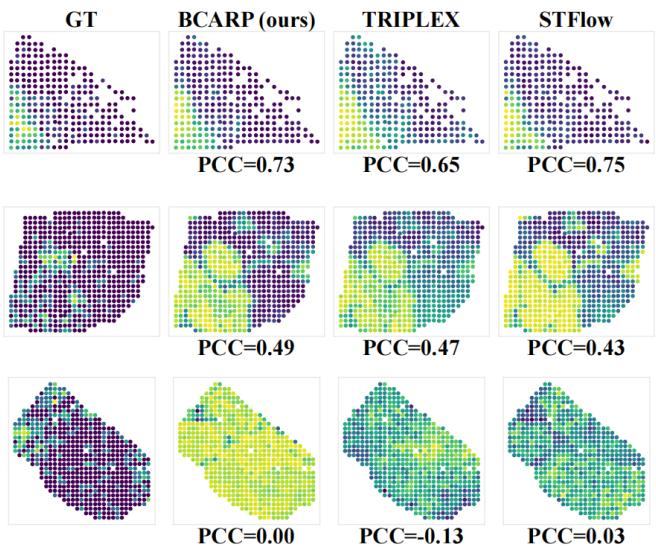  
Figure 3. Qualitative comparison on HER2ST for FN1 on 3 slides.

Table 3. Component ablation on HER2ST.
<table><tr><td>Variant</td><td>PCC-H↑</td><td>PCC-M↑</td><td>MSE↓</td><td>MAE↓</td><td>RVD↓</td></tr><tr><td>Full</td><td>0.4567</td><td>0.4032</td><td>0.8381</td><td>0.7191</td><td>0.7084</td></tr><tr><td colspan="6">Main components</td></tr><tr><td>w/o Proj.</td><td>0.4283</td><td>0.3772</td><td>0.9029</td><td>0.7512</td><td>0.8592</td></tr><tr><td>w/o CMod</td><td>0.4379</td><td>0.3864</td><td>0.9608</td><td>0.7751</td><td>0.7870</td></tr><tr><td>w/o Local</td><td>0.4421</td><td>0.3882</td><td>0.8873</td><td>0.7498</td><td>0.8138</td></tr><tr><td>w/o Global</td><td>0.4330</td><td>0.3799</td><td>0.9264</td><td>0.7646</td><td>0.8092</td></tr><tr><td>w/o Pos.</td><td>0.4424</td><td>0.3884</td><td>0.8988</td><td>0.7507</td><td>0.8285</td></tr><tr><td>w/o Dec.</td><td>0.4571</td><td>0.4037</td><td>0.9484</td><td>0.7736</td><td>1.6684</td></tr><tr><td colspan="6">Local-branch ablations</td></tr><tr><td>w/o NC</td><td>0.4591</td><td>0.4041</td><td>0.8531</td><td>0.7338</td><td>0.7552</td></tr><tr><td>w/o CT</td><td>0.4585</td><td>0.4013</td><td>0.8941</td><td>0.7534</td><td>0.7483</td></tr><tr><td colspan="6">Global-module ablations</td></tr><tr><td>w/o Prototype</td><td>0.4586</td><td>0.4061</td><td>0.8538</td><td>0.7282</td><td>0.8123</td></tr><tr><td>w/o Self-Attn.</td><td>0.4554</td><td>0.4032</td><td>0.8679</td><td>0.7323</td><td>0.7724</td></tr><tr><td>w/o Global Attn.</td><td>0.4319</td><td>0.3803</td><td>0.8878</td><td>0.7448</td><td>0.9665</td></tr></table>

## 4.3. Ablation Analysis

Component ablation Table 3 evaluates the contribution of each BCARP component on HER2ST. We denote the projector, context modulation, local context encoder, global propagation stage, positional encoding, and pattern-scale decoder as Proj., CMod, Local, Global, Pos., and Dec., respectively. For global-module ablations, w/o Global removes the full global stage; w/o Global Attn. removes both prototype attention and spot self-attention but keeps the residual update; w/o Prototype and w/o Self-Attn. remove only the corresponding attention component. The w/o Dec. variant replaces the pattern-scale decoder with a standard MLP head. Removing Proj., CMod, Local, Global, or Pos. consistently weakens performance, showing that BCARP benefits from task-oriented projection, iterative anchor modulation, local biological guidance, long-range context propagation, and explicit tissue geometry. Removing Dec. preserves correlation but substantially worsens MSE, MAE, and RVD, suggesting that the decoder mainly improves expression-scale calibration. For the local branches, w/o CT retains only NC, while w/o NC retains only CT. These results show that neither branch uniformly improves PCC individually, while the complete local module yields better expression-error and variance fidelity. The globalmodule ablations similarly indicate complementary effects of prototype attention and spot-level self-attention.

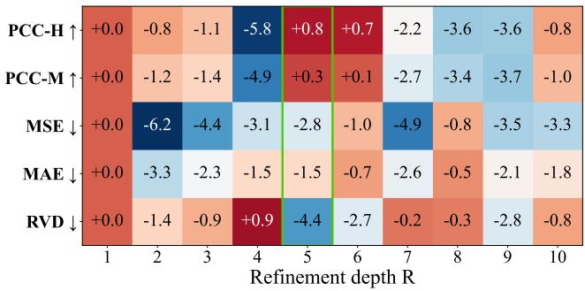  
Figure 4. Relative percentage change of each metric under different refinement depths compared with R = 1 on ST-Net dataset.

Effect of refinement depth Figure 4 analyzes the effect of refinement depth R, with all metrics reported relative to the reference R = 1 on ST-Net dataset. Relatively, R = 5 improves PCC-H/PCC-M by 0.8%/0.3% and reduces MSE, MAE and RVD by 2.8%, 1.5% and 4.4%, respectively. This indicates that a small number of refinement steps can already provide strong performance, while moderate additional refinement improves calibration and maintains competitive correlation. We therefore use R = 5 as default.

## 5. Conclusion

This paper introduced BCARP, a biology-guided contextaware residual propagation framework for histology-guided spatial transcriptomics prediction. BCARP treats frozen pathology embeddings as morphology-derived anchors and progressively refines them with nuclei-guided local cellular context, prototype-guided global propagation, and a pattern-scale decoder. Across HER2ST, Skin, ST-Net, and ten HEST-1k cohorts, BCARP achieves strong correlationbased performance, including the highest mean PCC-M across the HEST-1k cohorts. Ablations show that anchor conditioning and local–global propagation support correlation, while the decoder and nuclei-guided branches contribute more strongly to scale fidelity. However, limitations remain: local supervision relies on HoVer-Net pseudolabels and may be affected by nuclei detection/classification errors and cross-tissue domain shift, while morphologyonly evidence limits prediction for genes weakly associated with H&E appearance. Future work will study label-noise robustness, complementary molecular supervision, adaptive refinement, and efficient attention.

## References

[1] Alma Andersson, Ludvig Larsson, Linnea Stenbeck, Fredrik Salmen, Anna Ehinger, Sunny Z Wu, Ghamdan Al-Eryani,´ Daniel Roden, Alex Swarbrick, Ake Borg, et al. Spa-˚ tial deconvolution of HER2-positive breast cancer delineates tumor-associated cell type interactions. Nature Communications, 12(1):6012, 2021. 2, 5, 11, 14, 16, 17, 19

[2] Tsai Hor Chan, Fernando Julio Cendra, Lan Ma, Guosheng Yin, and Lequan Yu. Histopathology whole slide image analysis with heterogeneous graph representation learning. In 2023 IEEE/CVF Conference on Computer Vision and Pattern Recognition (CVPR), page 15661–15670. IEEE, 2023. 2

[3] Richard J. Chen, Tong Ding, Ming Y. Lu, Drew F. K. Williamson, Guillaume Jaume, Andrew H. Song, Bowen Chen, Andrew Zhang, Daniel Shao, Muhammad Shaban, Mane Williams, Lukas Oldenburg, Luca L. Weishaupt, Judy J. Wang, Anurag Vaidya, Long Phi Le, Georg Gerber, Sharifa Sahai, Walt Williams, and Faisal Mahmood. Towards a general-purpose foundation model for computational pathology. Nature Medicine, 30(3):850–862, 2024. 2, 6, 11, 13, 14, 15

[4] Weiqing Chen, Pengzhi Zhang, Tu N Tran, Yiwei Xiao, Shengyu Li, Vrutant V Shah, Hao Cheng, Kristopher W Brannan, Keith Youker, Li Lai, et al. A visual–omics foundation model to bridge histopathology with spatial transcriptomics. Nature Methods, pages 1–15, 2025. 14

[5] Youngmin Chung, Ji Hun Ha, Kyeong Chan Im, and Joo Sang Lee. Accurate spatial gene expression prediction by integrating multi-resolution features. In Proceedings of the IEEE/CVF Conference on Computer Vision and Pattern Recognition, pages 11591–11601, 2024. 1, 2, 6, 11, 13, 14, 15, 16

[6] Alexandre Filiot, Paul Jacob, Alice Mac Kain, and Charlie Saillard. Phikon-v2, a large and public feature extractor for biomarker prediction. arXiv preprint arXiv:2409.09173, 2024. 2

[7] Xiaohang Fu, Yue Cao, Beilei Bian, Chuhan Wang, Dinny Graham, Nirmala Pathmanathan, Ellis Patrick, Jinman Kim, and Jean Yee Hwa Yang. Spatial gene expression at singlecell resolution from histology using deep learning with ghist. Nature Methods, 22(9):1900–1910, 2025. 2, 3

[8] Aniruddha Ganguly, Debolina Chatterjee, Wentao Huang, Jie Zhang, Alisa Yurovsky, Travis Steele Johnson, and Chao Chen. MERGE: Multi-faceted hierarchical graphbased GNN for gene expression prediction from whole slide histopathology images. In Proceedings of the IEEE/CVF Conference on Computer Vision and Pattern Recognition (CVPR), pages 15611–15620, 2025. 1, 2, 6, 11, 13, 14, 15

[9] Simon Graham, Quoc Dang Vu, Shan E. Ahmed Raza, Ayesha Azam, Yee Wah Tsang, Jin Tae Kwak, and Nasir Rajpoot. Hover-net: Simultaneous segmentation and classi-

fication of nuclei in multi-tissue histology images. Medical Image Analysis, 58:101563, 2019. 2, 4, 14, 15, 18

[10] Gunsagar S Gulati, Jeremy Philip D’Silva, Yunhe Liu, Linghua Wang, and Aaron M Newman. Profiling cell iden tity and tissue architecture with single-cell and spatial transcriptomics. Nature Reviews Molecular Cell Biology, 26(1): 11–31, 2025. 1, 2

[11] Deniz Gurarslan, Oscar Camargo, Omer Zeyveli, Yasin Almalioglu, Yanjun Li, Mehmet Turan, and Tamer Kahveci. Storm: spatial transcriptomics optimization by resolution via matrix factorization. Briefings in Bioinformatics, 27(3), 2026. 14

[12] Bryan He, Ludvig Bergenstrahle, Linnea Stenbeck,˚ Abubakar Abid, Alma Andersson, Ake Borg, Jonas˚ Maaskola, Joakim Lundeberg, and James Zou. Integrating spatial gene expression and breast tumour morphology via deep learning. Nature Biomedical Engineering, 4(8): 827–834, 2020. 1, 2, 5, 11, 13, 14, 16, 17, 19

[13] Kaiming He, Xiangyu Zhang, Shaoqing Ren, and Jian Sun. Deep residual learning for image recognition. In 2016 IEEE Conference on Computer Vision and Pattern Recognition (CVPR), page 770–778. IEEE, 2016. 6, 14

[14] Tinglin Huang, Tianyu Liu, Mehrtash Babadi, Wengong Jin, and Rex Ying. Scalable generation of spatial transcriptomics from histology images via whole-slide flow matching. In Forty-second International Conference on Machine Learn ing, 2025. 1, 2, 6, 13, 14, 15

[15] Fabian Horst, Moritz Rempe, Lukas Heine, Constantin Sei-¨ bold, Julius Keyl, Giulia Baldini, Selma Ugurel, Jens Siveke, Barbara Grunwald, Jan Egger, and Jens Kleesiek. Cellvit:¨ Vision transformers for precise cell segmentation and classification. Medical Image Analysis, 94:103143, 2024. 15, 18

[16] Sanjay Jain and Michael T Eadon. Spatial transcriptomics in health and disease. Nature reviews nephrology, 20(10): 659–671, 2024. 1

[17] Guillaume Jaume, Paul Doucet, Andrew H. Song, Ming Y. Lu, Cristina Almagro-Perez, Sophia J. Wagner, Anurag J. Vaidya, Richard J. Chen, Drew F. K. Williamson, Ahrong Kim, and Faisal Mahmood. Hest-1k: A dataset for spatial transcriptomics and histology image analysis. In Advances in Neural Information Processing Systems, 2024. 2, 5, 7, 11, 13

[18] Andrew Ji, Adam Rubin, Kim Thrane, Sizun Jiang, David Reynolds, et al. Multimodal analysis of composition and spatial architecture in human squamous cell carcinoma. Cell, 182, 2020. 2, 5, 11, 14, 16, 17, 19

[19] Yuran Jia, Junliang Liu, Li Chen, Tianyi Zhao, and Yadong Wang. Thitogene: a deep learning method for predicting spatial transcriptomics from histological images. Briefings in Bioinformatics, 25(1), 2023. 2

[20] Suchithra Kunhoth, Somaya Al-maadeed, Younes Akbari, and Rafif Mahmood Al Saady. Computational methods for breast cancer molecular profiling using routine histopathology: a review. Archives of Computational Methods in Engineering, 33(2):2299–2321, 2026. 1

[21] Yusong Liu, Tongxin Wang, Ben Duggan, Michael Sharp nack, Kun Huang, Jie Zhang, Xiufen Ye, and Travis S John

son. Spcs: a spatial and pattern combined smoothing method for spatial transcriptomic expression. Briefings in Bioinfor matics, 23(3):bbac116, 2022. 6

[22] Ming Y. Lu, Bowen Chen, Drew F. K. Williamson, Richard J. Chen, Ivy Liang, Tong Ding, Guillaume Jaume, Igor Odintsov, Long Phi Le, Georg Gerber, Anil V. Parwani, Andrew Zhang, and Faisal Mahmood. A visual-language foundation model for computational pathology. Nature Medicine, 30(3):863–874, 2024. 2, 6, 14

[23] Wenwen Min, Zhiceng Shi, Jun Zhang, Jun Wan, and Changmiao Wang. Multimodal contrastive learning for spatial gene expression prediction using histology images. Briefings in Bioinformatics, 25(6):bbae551, 2024. 1, 2, 6, 13, 14, 15

[24] Hai Dang Nguyen, Nguyen Dang Huy Pham, The Minh Duc Nguyen, Dac Thai Nguyen, Hang Thi Nguyen, and Duong M. Nguyen. MMAP: A Multi-Magnification and Prototype-Aware Architecture for Predicting Spatial Gene Expression, page 381–395. Springer Nature Singapore, 2026. 2

[25] Minxing Pang, Kenong Su, and Mingyao Li. Leveraging information in spatial transcriptomics to predict superresolution gene expression from histology images in tumors. bioRxiv, 2021. Preprint. 13, 14

[26] Tancredi Massimo Pentimalli, Nikos Karaiskos, and Nikolaus Rajewsky. Challenges and opportunities in the clinical translation of high-resolution spatial transcriptomics. Annual Review of Pathology: Mechanisms of Disease, 20(1):405– 432, 2025. 1

[27] Mingcheng Qu, Yuncong Wu, Donglin Di, Anyang Su, Tonghua Su, Yang Song, and Lei Fan. Boundary-guided learning for gene expression prediction in spatial transcriptomics. In 2024 IEEE International Conference on Bioinformatics and Biomedicine (BIBM), page 445–450. IEEE, 2024. 2

[28] Andrew H. Song, Richard J. Chen, Tong Ding, Drew F.K. Williamson, Guillaume Jaume, and Faisal Mahmood. Morphological prototyping for unsupervised slide representation learning in computational pathology. In 2024 IEEE/CVF Conference on Computer Vision and Pattern Recognition (CVPR), page 11566–11578. IEEE, 2024. 2

[29] Hongyi Wang, Xiuju Du, Jing Liu, Shuyi Ouyang, Yen-Wei Chen, and Lanfen Lin. M2ost: Many-to-one regression for predicting spatial transcriptomics from digital pathology images. Proceedings of the AAAI Conference on Artificial Intelligence, 39(7):7709–7717, 2025. 1, 2, 6, 13, 14, 15

[30] Xiyue Wang, Sen Yang, Jun Zhang, Minghui Wang, Jing Zhang, Wei Yang, Junzhou Huang, and Xiao Han. Transformer-based unsupervised contrastive learning for histopathological image classification. Medical Image Analysis, 81:102559, 2022. 2

[31] Cameron G Williams, Hyun Jae Lee, Takahiro Asatsuma, Roser Vento-Tormo, and Ashraful Haque. An introduction to spatial transcriptomics for biomedical research. Genome Medicine, 14(1):68, 2022. 1

[32] Ronald Xie, Kuan Pang, Sai Chung, Catia Perciani, Sonya MacParland, Bo Wang, and Gary Bader. Spatially resolved gene expression prediction from histology images via bi-

modal contrastive learning. In Advances in Neural Information Processing Systems, 2023. 13, 14

[33] Hanwen Xu, Naoto Usuyama, Jaspreet Bagga, Sheng Zhang, Rajesh Rao, Tristan Naumann, Cliff Wong, Zelalem Gero, Javier Gonzalez, Yu Gu, Yanbo Xu, Mu Wei, Wenhui Wang,´ Shuming Ma, Furu Wei, Jianwei Yang, Chunyuan Li, Jian feng Gao, Jaylen Rosemon, Tucker Bower, Soohee Lee, Roshanthi Weerasinghe, Bill J. Wright, Ari Robicsek, Brian Piening, Carlo Bifulco, Sheng Wang, and Hoifung Poon. A whole-slide foundation model for digital pathology from real-world data. Nature, 630(8015):181–188, 2024. 6, 14

[34] Yan Yang, Md Zakir Hossain, Eric A Stone, and Shafin Rah man. Exemplar guided deep neural network for spatial transcriptomics analysis of gene expression prediction. In 2023 IEEE/CVF Winter Conference on Applications of Computer Vision (WACV), page 5028–5037. IEEE, 2023. 1, 2, 6, 13, 14, 15, 16

[35] Peng Zhang, Chaofei Gao, Zhuoyu Zhang, Zhiyuan Yuan, Qian Zhang, Ping Zhang, Shiyu Du, Weixun Zhou, Yan Li, and Shao Li. Systematic inference of super-resolution cell spatial profiles from histology images. Nature Communications, 16(1), 2025. 2

[36] Yibo Zhang, Shilong Liu, Jun Chen, Ruanqi Chen, Zijian Yang, Ruyu Sheng, Xin Li, Taolue Wang, Hongyu Liu, Fan Yang, et al. Deep learning-based histomorphological sub typing and risk stratification of small cell lung cancer from hematoxylin and eosin-stained whole slide images. Genome Medicine, 17(1):98, 2025. 1

[37] Junchao Zhu, Ruining Deng, Tianyuan Yao, Juming Xiong, Chongyu Qu, Junlin Guo, Siqi Lu, Mengmeng Yin, Yu Wang, Shilin Zhao, et al. Asign: an anatomy-aware spatial imputation graphic network for 3d spatial transcriptomics. In Proceedings of the Computer Vision and Pattern Recognition Conference, pages 30829–30838, 2025. 2

[38] Eric Zimmermann, Eugene Vorontsov, Julian Viret, Adam Casson, Michal Zelechowski, George Shaikovski, Neil Tenenholtz, James Hall, David Klimstra, Razik Yousfi, et al. Virchow2: Scaling self-supervised mixed magnification models in pathology. arXiv preprint arXiv:2408.00738, 2024. 2, 6, 14

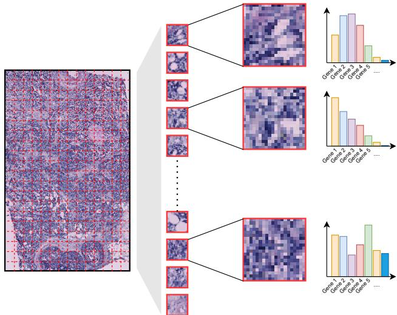  
Figure 5. Spatial Transcriptomics Prediction from Histology

## APPENDICES

## A. Problem Formulation

As illustrated in Figure 5, given a whole-slide H&E image, we represent its spatial-transcriptomics (ST) annotation as a set of spots ${ \mathcal { S } } = \{ ( \mathbf { x } _ { i } , \mathbf { p } _ { i } , \mathbf { y } _ { i } ) \} _ { i = 1 } ^ { N }$ , where $\mathbf { x } _ { i }$ is the spotcentered histology patch, $\mathbf { p } _ { i } \in \mathbb { R } ^ { 2 }$ is its tissue coordinate and $\mathbf { y } _ { i } \in \mathbb { R } ^ { G }$ is the measured expression vector over G target genes of spot i. Histology-guided spatial transcriptomics prediction seeks a mapping:

$$
\boldsymbol { F } : \{ ( \mathbf { x } _ { j } , \mathbf { p } _ { j } ) \} _ { j = 1 } ^ { N } \longmapsto \widehat { \mathbf { Y } } \in \mathbb { R } ^ { N \times G } , \qquad \widehat { \mathbf { y } } _ { i } = \widehat { \mathbf { Y } } _ { i , : } .\tag{29}
$$

Here, F predicts the section-level expression matrix ${ \widehat { \mathbf { Y } } } .$ , and its i-th row $\widehat { \mathbf { y } } _ { i }$ approximates the ground-truth expression profile $\mathbf { y } _ { i }$ of spot i.

Predicting gene expression strictly from highly localized morphology is inherently ill-posed. Transcriptomic profiling is highly susceptible to technical artifacts, noise and dropout events (where expressed genes are falsely recorded as zeros). Furthermore, the expression profile of a single spot is heavily dependent not only on its own cellular composition but also on the broader tissue microenvironment and intercellular signaling. To address this, BCARP treats frozen pathology-foundation embeddings as morphologyderived anchors. These anchors are progressively refined through a dual mechanism: biology-guided local context encoding and prototype-guided global context propagation, with the aim of improving both local biological consistency and whole-section spatial context.

## B. Dataset Statistics

Table 10 reports, for every fold, the held-out partition, the number of training and test slides and the corresponding number of spatial spots. In total, the evaluation spans 289,413 annotated spots across thirteen datasets and diverse tissue morphologies.

To prevent patient-level information leakage, all experiments use patient-disjoint cross-validation, in which every tissue section from a given patient is assigned exclusively to either the training or the test partition. HER2ST [1] contains eight patients and is split into eight folds with one held-out patient per fold; Skin [18] contains four patients and is split into four folds, again one patient per fold; ST-Net [12] contains twenty-three patients, which we group into eight folds so that each fold holds out two to three patients. Together these three datasets contribute 52,918 annotated spots.

We additionally evaluate on ten cohorts of the HEST-1k [17], spanning skin, lung, pancreas, bowel, lymph node, kidney, breast, prostate and liver, and acquired with either Visium or Xenium. For these cohorts we adopt the official patient-grouped folds released, which adds a further 236,495 spots and 29 folds.

Target genes. For HER2ST, Skin, and ST-Net, every method is trained and evaluated on the same fixed 250-gene panel following the MERGE [8] protocol. This panel corresponds to the 250 most-expressed genes per dataset introduced by TRIPLEX [5] and reused by MERGE [8], and all metrics are computed in the shared log(1 + x) space. For the highly variable gene (HVG) analysis, we additionally report results on a 50-gene subset per dataset. The HVG subset is selected by a different criterion, gene-wise variability computed from the training spots only. For completeness, we list in Figure 6 the 250-gene subsets used for each ST dataset. For the HEST-1k cohorts we select up to 250 highly variable genes per cohort from the training slides only, following the same criterion as above. The resulting panel contains 250 genes for the eight Visium cohorts, but is capped by the probe set on the two Xenium cohorts, giving 197 genes for LUNG and 98 for PAAD.

## C. Baseline Reproduction

Two reproduction protocols. The scores reported in this section are not identical to those in Table 1 of the main paper, and the difference is deliberate. In the main paper, every baseline whose architecture consumes pre-extracted patch features is re-run with the same frozen UNI [3] embeddings as BCARP, so that the comparison isolates the prediction head from the choice of visual backbone. In this supplement, we instead retain each baseline’s native architecture and visual encoder: every method keeps the patch encoder, feature dimensionality and architectural choices prescribed by its original paper or public code, and only the data splits, the spot-centered patches, the target gene panel and the evaluation metrics are standardised. The main-paper protocol asks how the prediction architectures

## 250-gene subset for the STNet dataset

RPS3, TFF3, IGLL5, RPL18A, RPLP1, RPS18, TMSB10, GAPDH, H2AI, KRT19, RPL19, RPL37A, RPL8, RPLP2, RPS14, NHERF1, RPL28 ERBB2 RPS19 MGP ACTB. RPS15 MUC1 RPS12 COX6C RPL13. AZGP1 S100A9 RPL18 RPS2 RPL36. RPL35 UBA52 HLA-B S2 S O CS 3 C S 38 C S S2 0 S8 SS 2 3 S EEF2. RPLP0. HSPB1, P4HB. RPS6, IFI27, IGFBP2. PABPC1, IGFBP5. RPS28. PSAP, RPS16. S100A8. C4B. SERF2. RPL30. RPL27A. HLA-C. RPS24. RPS29. TAGLN. CALR. RPL11, FASN. BEST1, RPL29. ACTG1, RPL31, RPS27A. CCND1, SNHG25. RPL12. HLA-A. A2M. COL1A1, RPL23, RPS5, RPL3, RPS9, FN1, RPL 7A, KRT18, PPP1CA, RPL37. FAU, GPX4, BST2, MZT2B, PSMD3, CD74, HL A-E, XBP1. SYNGR2, AEBP1, NDUFA13, RPL15, CLU, RPL32, PRDX2, RPL27, LGALS3BP, RPL23A, BSG, RPS3A, HLA-DRA, CLDN3, KRT8. HSP90AB1, RPL9. RPL35A. EVL. TAPBP. TPT1. ALDOA. S100A11. GNAS. CD81, ATP6V0B, MZT2A. LY6E. PLXNB2. IFITM3. BGN. C1OA. EIF4A1, CFL1, NBEAL1, MYL9, ELF3, H3-3B, GRINA, SDC1, PTMA, IFI6, RPL5, ATP6AP1, CD63, PRSS8, NDUFA11, EDF1, RPL34, OAZ1 UOCRO APOC1 GNB2 TAGLN2 MALAT1 RPS25. S100A6 SLC25A6 RPL14. BCAP31 UBC C3 PRDX1 JSG15 RPS23 TUBA1B. COL1A2. VIM. TIMP1. STARD10. FXYD3. TMSB4X. PPDPF. PTPRF. ATP1A1. TUFM. H1-10. FLNA. RPL4. CRIP2, RPS13. RPL24 RPL7, ARHGDIA, POLR2L, RPS7, SPDEF, COX8A, ENO1, RPS20, RPS15A, NDUFB9, GAS5, IGFBP4, CYBA, GSTP1, MYL6, RPS10, GRN, EIF3C, COX6B1, UBB, LAPTM5, SPARC, JUP, RPL41, ELOB, LMNA, C12orf57, UQCR11, EIF5A, EEF1D, RHOC, PTMS, SEC61A1, CTSB, RPSA, ATG10, SELENOW, SPINT2, COX4I1, LMAN2, ATP5F1E, TPI1, GUK1, SH3BGRL3, UBE2M, RPL39, PFDN5, SSR2, ZNF90, TSPO, TLE5, PLD3, RPL10A, CAPNS1, CHCHD2, RPL6, EEF1A1, LGALS1, ATP5MC2, EIF4G1, GNAI2, TUBB, COX5B, ACTN4

## 250-gene subset for the HER2ST dataset

IGKC, IGHG3, IGLC2, ERBB2, TMSB10, IGHA1, MUCL1, IGHM, IGLC3, PSMB3, ACTG1, GAPDH, CISD3, ACTB, PTPRF, FN1, MIEN1, IGHG4, SERF2, APOE, TPT1, TFF3, PFN1, SLC9A3R1, BEST1, FTH1, CALML5, HLA-B, S100A9, COL1A1, B2M, MGP, FTL, RACK1, DDX5. CALR. KRT19. COL1A2. SSR4, PSMD3. PSAP. FASN. HLA-A. PPP1R1B. PHB. IGHG1. CTSD. HLA-C. CD74. FAU. S100A8. S100A6, KRT81, PCGF2, UBA52, PABPC1, EEF2, P4HB, GNAS, TAGLN2, GRB7, COL3A1, HLA-DRA, NDUFB9, MYL6, AEBP1, STARD3, MLIT6 FFE1D HLA-E TUBA1B XBP1 SYNGR2 TRAE4 S100A14 PTMS CRIP2 ADAM15 CD24 SLC25A6 CEL1 AP000769 1 KRT7, ATP5E, GRINA, SCD, PRDX1, FLNA, EIF4G1, LASP1, ISG15, CD63, MDK, OAZ1, AZGP1, CLDN3, GNB2, GPX4, FNBP1L, IFI27, MUC1, KIAA0100. HSPB1, LMNA. TAGLN. CST3. SDC1, ATP6V0B, MMP14, S100A11. APOC1, KRT18. HNRNPA2B1, PLXNB2, ALDOA SPARC. COX6C. PERP. SPINT2. PRRC2A. PPDPF. AES. VMP1, MZT2B. EDF1. VIM. BGN. TSPO. PPP1CA. SPDEF. C1OA. TUBB. MIDN. PRSS8, LAPTM5, COX7C, C3, BST2, ATP1A1, EIF4G2, ELOVL1, SCAND1, ORMDL3, HSP90AB1, ATG10, CHCHD2, INTS1, CCT3, SEC61A1, LAPTM4A, HSP90AA1, TAPBP, MYL9. BSG. COL6A2, POSTN, TIMP1, PLD3, CTSB, A2M, CAL M2, CD99, CD81, IGEBP2 CLDN4, UOCRO, HSPA8, UBC, DHCR24, H2AFI, CYBA, NUCKS1, CIB1, MAPKAPK2, LY6E, IDH2, MMACHC, ZYX, PGAP3, ITB, COX6B1 ATP5B. PTMA. COPE. LGALS3. NBL1, H1FX. UBE2M. LGALS1, ACTN4. NUPR1, SH3BGRL3. PEBP1, RALY, PFDN5. COPS9. TXNIP. ENO1, SNRPB, GUK1, COL18A1, COX4I1, HSP90B1, NACA, KDELR1, PSMB4, ERGIC1, LMAN2, STARD10, JUP, SSR2, SEPW1, CHPF, DBI, PFKL, LGALS3BP, COX5B, ARHGDIA, MYH9, C12orf57, SLC2A4RG, LSM4, TYMP, PTBP1, ATP5G2, VCP, GNAI2, NDUFB7, C1OB, TCEB2, RABAC1, GRN, EIF3B, NDUFA3, C4orf48, UQCR11, FKBP2, ROMO1, ATP6AP1, HM13, AP2S1, SERINC2, RRBP1, PSMD8, COX8A. RHOC. SDF4. BCAP31. TPI1. NDUFA11

## 250-gene subset for the Skin dataset

KRT14, S100A9, S100A8, KRT6A, KRT16, KRT6B, KRT5, KRT6C, KRT17, MT-CO2, S100A2, SPRR1B, S100A7, MT-CO1, KRT1, KRT10, MT-CO3. ACTB. PERP. LGALS7B. COL1A1, FABP5. EEF1A1, LGALS7, SFN. RPLP1, RPS12. RPLP2. GIB2. KRTDAP. B2M, MT-ND4. HLA-B ACTG1 TPT1 RPS17 MT-ATP6 CSTA PEN1 COL3A1 RPS24 RPL37A DSP RPL13 RPS8 COL1A2 RPS18 RPLP0 RPL13A RPS6, CSTB, DMKN, MT-ND1, RPL28, SPRR2A, KRT2, RPS27, TMSB10, RPL32, RPL31, RPS14, RPL11, MT-ND3, RPS19, AQP3, RPL36, RPL27A, MT-CYB, RPL3, RPS29, RPS11, RPS27A, RPS28, ENO1, CALML5, SBSN, JUP, RPL27, RPL8, RPL9, DSC2, RPS2, RPL34, LY6D CXCL14. LDHA. TMSB4X, RPL7A. GSTP1. S100A7A. RPL23, RPL19. RPL6. ANXA1, ANXA2, RACK1, RPS3. S100A11, RPS25. RPL37. CD74, YWHAZ, SLPI, RPS23, PKP1, RPL12, RPS13, UBA52, PI3, RPS15A, RPL39, RPL35A, VIM, RPL29, S100A14, RPL38, GJA1, RPL10, PABPC1, PTMA, RPS4X, SPARC, MMP1, RPL18, HSPB1, RPS3A, RPS7, PPIA, RPL18A, HLA-A, S100A6, MYL6, RPL4, S100A10 FLG. IFI27. RPL24. GIB6. SH3BGRL3. IVL. RPL15. RPL7. RPL26. EEF2. MT-ND2. RPL5. SDC1. DSC3. RPS20. HLA-DRA. RPL41. RPS16 NACA, FTL, PKM, MYH9, RPL21, ITM2B, LYPD3, S100A16, UBC, SPINK5, CNFN, H3F3B, COL6A1, AC090498.1, RPL14, FAU, TXN, RPL22. COL17A1, DSG1. RPSA. CD44. CD24. HSPA8. TRIM29. SPRR2E. TMEM45A. FGFBP1. TAGLN2. ALDOA. DSG3. RPS21. TGFBI. ATP1B3, CST3. KLK7, AHNAK. DYNLL1. RPS5. CFL1. SERPINB3. LMNA, EIF1, NDRG1. FLNA, NPM1, LGALS1, EIF5A. YWHAO. MT2A RPS9, SPRR2D, CALML3, CLCA2, RPL10A, CALM1, EIF4G2, ATP1A1, TPI1, POLR2L, HNRNPA2B1, PRDX1, DSTN, HSP90AA1, SLC2A1, EEF1B2, FXYD3, ATP5E, MYL12B, CTSB. LAD1, GRN, IGFBP4, COL6A2, RPS26, HLA-C, OAZ1, PSAP, HSP90AB1, ARPC2, IFITM3. HNRNPK, ITGA6, PGK1, CTSD, CD63, GNAS, PPDPF, RTN4, ACTN4, RPL35, LCE3D, DST, TYMP, BTF3, CD59, HLA-E, TMBIM6

Figure 6. List of the 250 genes used in all experiments on the three ST datasets.

compare under a common foundation encoder, whereas the supplementary protocol evaluates the corresponding native architectures under the same data and metric setting. The resulting per-gene correlations differ accordingly, in both directions and by method-dependent amounts. The two tables should therefore be read side by side.

To ensure a fair comparison, every competing method is reproduced under a single experimental protocol that follows MERGE [8]: identical patient-level splits, the same spot-centred patches, the same 250-gene target panel and the same evaluation metrics. Architectures are reimplemented from their official publications or public source code whenever available and hyperparameters follow the original recommendations while sharing a common optimization protocol. Because BCARP uses frozen UNI embeddings, we additionally include UNI+MLP and UNI+Decoder probes to separate the contribution of the refinement loop from that of the pattern-scale decoder. The reproduced baselines are:

• UNI [3]+MLP – frozen UNI [3] embeddings are mapped directly to gene expression using a standalone MLP predictor.

• UNI+Decoder - frozen UNI embeddings decoded directly by the pattern-scale decoder, without iterative refinement, local biological modelling or global context propagation.

• ST-Net [12] - a CNN regression framework (DenseNet-121 backbone with a linear head) that predicts per-spot expression from histology patches without explicit spatial context.

• HisToGene [25] - a transformer that models dependencies among neighbouring spots through spatial attention.

• BLEEP [32] - a contrastive multimodal framework that aligns histology and transcriptomics in a shared embedding space; following MERGE [8], we use a ResNet18 patch encoder, the same backbone adopted in MERGE [8] and TRIPLEX [5].

• TRIPLEX [5] - a multi-resolution architecture fusing target-patch, neighborhood and whole-slide visual information.

• EGN [34] - an exemplar-guided framework that retrieves similar transcriptomic patterns from reference samples to refine predictions.

• MERGE [8] - a hierarchical graph neural network with spatial graph reasoning and multi-scale tissue aggregation, reproduced from its official source code.

• M2OST [29] - a many-to-one regression transformer that jointly consumes patches from several magnification levels of the WSI pyramid to predict the expression of their common spot.

• STFlow [14] - a flow-matching model that generates the section-level expression matrix through a small number

of iterative transport steps.

• mclSTExp [23] - a contrastive method that retrieves expression profiles from a training bank of spot embeddings.

We standardize data splits, patches, target genes and evaluation metrics across all methods. Training settings are kept as consistent as possible while respecting method-specific architectural requirements.

Frozen-feature ridge probes. On the HEST-1k cohorts the frozen-feature references reported in the main paper follow the ridge-probe protocol released with the benchmark [17]: patch embeddings are extracted once per spot with the corresponding foundation encoder and regressed onto the target panel with an ℓ2-regularised linear head, using the benchmark’s default regularisation strength rather than a per-cohort tuned value. All encoders are compared under exactly this protocol, so differences between them reflect the embeddings and not the head.

On the reproduction of MERGE. The MERGE results in our evaluation are not directly comparable to its published numbers because the protocols differ along several axes. The original MERGE experiments train and evaluate on SPCS-smoothed expression using eight-fold crossvalidation across tissue sections. In contrast, our evaluation uses patient-disjoint folds and computes every reported metric against the raw expression target after the log(1 + x) transform; SPCS is retained only as training-time pattern supervision. In addition, the encoder-controlled results in Table 1 of the main paper replace supported visual encoders with frozen UNI features. This is particularly relevant to MERGE because its hierarchical graph includes featurespace clustering, so changing the visual representation may also alter graph construction. To separate these effects, Supplementary Table 4 retains each baseline’s native architecture and encoder while using our patient-disjoint splits, target panel, and raw-log evaluation. The main-paper table additionally controls the visual backbone using UNI where the architecture permits. The resulting MERGE scores should therefore be interpreted as protocol-specific reproductions rather than direct replications or contradictions of its published results.

## D. Implementation Details

## D.1. Preprocessing and supervision targets

For each spot we crop a 224×224 H&E patch centred on its tissue coordinate and extract a frozen UNI [3] embedding $\mathbf { e } _ { i } \in \mathbb { R } ^ { d _ { e } }$ with $d _ { e } = 1 0 2 4$ . Two complementary expression targets are used: a spatially smoothed target Yproc, obtained with the two-factor SPCS smoothing used by MERGE [8] and used here to supervise the pattern branch and the raw-count target $\mathbf { Y } ^ { \mathrm { r a w } }$ , retained for the calibration objectives. Spatial structure is encoded once per section as a fixed k-nearest-neighbour graph ${ \bf A } _ { s } = \mathrm { k N N } ( \widetilde { \bf P } ; k )$ built on max-normalised coordinates $\widetilde { \mathbf { P } } ;$ this adjacency is shared across all refinement steps and only specifies the local propagation structure.

Table 4. Performance comparison across the three ST datasets under their native architectural and encoder configurations. Bold indicates the best result and underlining indicates the second-best result; frozen-feature references are excluded from this ranking.
<table><tr><td></td><td colspan="3">HER2ST [1]</td><td colspan="3">Skin [18]</td><td colspan="3">ST-Net [12]</td></tr><tr><td>Model</td><td>PCC-H↑ PCC-M↑ MSE↓</td><td></td><td>MAE↓ RVD↓</td><td>PCC-H↑ PCC-M↑</td><td>MSE↓</td><td>MAE↓ RVD↓</td><td>PCC-H↑ PCC-M↑</td><td>MSE↓</td><td>MAE↓ RVD↓</td></tr><tr><td colspan="10">Frozen-feature reference models</td></tr><tr><td>ResNet50+Ridge</td><td>0.2249</td><td>0.2291</td><td>1.0782 0.8224 0.9039</td><td>0.2695</td><td>0.3260</td><td>1.3565 0.9050 0.8581</td><td>0.0985</td><td>0.0890</td><td>0.9762 0.7862 0.9125</td></tr><tr><td>UNI+Ridge</td><td>0.2583</td><td>0.2598</td><td>1.0579 0.81440.8840</td><td>0.2895</td><td>0.3262</td><td>1.3382 20.89680.8812</td><td>0.1096</td><td>0.0936</td><td>0.96660.7821 0.9223</td></tr><tr><td>UNI+MLP</td><td>0.3474</td><td>0.3316</td><td>1.0030 0.7890 0.8452</td><td>0.3029</td><td>0.3604</td><td>1.2547 0.8670 0.8368</td><td>0.1843</td><td>0.1633</td><td>0.9195 0.7609 0.8644</td></tr><tr><td>UNI+Decoder</td><td>0.4249</td><td>0.3721</td><td>0.9431 0.7724 0.8188</td><td>0.5392</td><td>0.4930</td><td>1.4455 50.9538 1.4511</td><td>0.2319</td><td>0.1868</td><td>0.8283 0.7351 0.7685</td></tr><tr><td colspan="10">Method baselines s (native configurations)</td></tr><tr><td>ST-Net [12]</td><td>0.3239</td><td>0.2430</td><td>1.2587 1.0033 2.8133</td><td>0.3787</td><td>0.3352</td><td>1.0002 0.8652 3.3435</td><td>0.1730</td><td>0.1509</td><td>0.7911 0.7141 0.8978</td></tr><tr><td>HisToGene [25]</td><td>0.2882</td><td>0.2058</td><td>1.3942 1.0733 1.1019</td><td>0.3076</td><td>0.2429</td><td>0.9210 0.8270 0.7557</td><td>0.1149</td><td>0.1090</td><td>0.8884 0.7562 0.8821</td></tr><tr><td>BLEEP [32]</td><td>0.2846</td><td>0.2129</td><td>0.8423 0.7962 1.6538</td><td>0.3694</td><td>0.3044</td><td>0.8024 0.7678 1.8789</td><td>0.0430</td><td>0.0351</td><td>0.8572 0.7396 3.0336</td></tr><tr><td>EGN [34]</td><td>0.2698</td><td>0.2749</td><td>1.3371 0.8856 0.8857</td><td>0.2655</td><td>0.3154</td><td>1.54250.9433 0.8988</td><td>0.0967</td><td>0.0817</td><td>1.17140.84620.9673</td></tr><tr><td>TRIPLEX [5]</td><td>0.3581</td><td>0.3427</td><td>1.07240.81560.8990</td><td>0.3337</td><td>0.3749</td><td>1.3333 0.8947 0.9137</td><td>0.1602</td><td>0.1450</td><td>0.9694 0.7806 0.9263</td></tr><tr><td>mclSTExp [23]</td><td>0.3627</td><td>0.3133</td><td>1.0260 0.78674.8984</td><td>0.4675</td><td>0.4253</td><td>1.9257 1.1175 1.1858</td><td>0.1451</td><td>0.1177</td><td>0.85650.73275.6416</td></tr><tr><td>M2OST [29]</td><td>0.3121</td><td>0.2756</td><td>0.9853 0.7696 2.1442</td><td>0.2933</td><td>0.2739</td><td>1.38180.9210 0.5739</td><td>0.1544</td><td>0.1239</td><td>0.76670.69781.5675</td></tr><tr><td>MERGE [8]</td><td>0.1699</td><td>0.1618</td><td>1.5830 1.0489 0.8077</td><td>0.1750</td><td>0.1656</td><td>1.92481.1878 0.8823 0.4951</td><td>0.0672</td><td>0.0558</td><td>0.8466 0.7431 0.9111</td></tr><tr><td>STFlow [14]</td><td>0.3888</td><td>0.3410</td><td>0.8464 0.7252 0.8555</td><td>0.5137</td><td>0.4832</td><td>1.19830.8654</td><td>0.1971</td><td>0.1565</td><td>0.7404 0.6897 0.7245</td></tr><tr><td>BCARP (Ours)</td><td>0.4567</td><td>0.4032</td><td>0.8381 0.7191 0.7084</td><td>0.5852</td><td>0.5328</td><td>1.18180.86200.2656</td><td>0.3046</td><td>0.2423</td><td>0.6761 0.6590 0.7500</td></tr></table>

## D.2. Nuclei-derived biological supervision

Auxiliary local targets are derived from H&E nuclei analysis with HoVer-Net [9], which detects nuclei and assigns each a cell-type pseudo-label. For each spot i we aggregate nuclei whose centroids fall within a fixed radius ρ (in pixels, measured on the same patch grid as the 224×224 crops) of $\mathbf { p } _ { i }$ . Letting $n _ { i t }$ be the number of type-t nuclei in this neighborhood and T the number of categories, the neighborhoodcomposition target and dominant cell-type target are

$$
\mathbf { q } _ { i } = \big [ \frac { n _ { i t } } { \sum _ { t ^ { \prime } = 1 } ^ { T } n _ { i t ^ { \prime } } + \epsilon } \big ] _ { t = 1 } ^ { T } , \qquad c _ { i } = \arg \operatorname* { m a x } _ { t } n _ { i t } .\tag{30}
$$

These quantities are used only as training-time auxiliary supervision and are not required at inference.

## D.3. Architecture and optimization

BCARP is implemented in PyTorch. A lightweight MLP projects each frozen UNI [3] embedding from its $d _ { e } ~ =$ 1024-dimensional space into a $\begin{array} { r l r } { d } & { { } = } & { 5 1 2 } \end{array}$ -dimensional transcriptomics-oriented latent space, which serves as the histology anchor. The anchor is refined for $R = 5$ contextconditioned steps; each step applies context-conditioned anchor modulation, two GraphSAGE local context encoders (cell-type and neighborhood-composition, hidden width $d _ { r } = 2 5 6 )$ and prototype-guided global propagation with $K _ { \mathrm { c t x } } = 5 0$ learnable global tokens and $H = 8$ attention heads (head dimension $d _ { h } = 6 4 )$ . The refined representation is decoded by the pattern-scale decoder using $S = 6$ hierarchy tokens. HoVer-Net [9] targets use radius ρ = 128 pixels and $T = 6$ nuclei categories. The model is trained with AdamW (learning rate $1 \times 1 0 ^ { - 4 }$ , weight decay $1 \times 1 0 ^ { - 2 } )$ , batch size 1 WSI, for at most 100 epochs, with a ReduceLROnPlateau schedule (factor 0.5, patience 7) on a single RTX 5070 Ti GPU. The configuration is summarised in Table 5.

Foundation model controls. The HEST ridge-probe comparison uses ResNet50 [13], UNI [3], Virchow2 [38], CONCH [22], and GigaPath [33] embeddings with the same linear head and fixed regularisation setting. We also examined OmiCLIP/Loki [4] and STORM [11]. Loki (built on OmiCLIP) uses a transcriptomic reference bank at prediction time and therefore follows a different referenceassisted setting. We attempted to reproduce STORM using its released implementation but could not establish a reliable matched reproduction under our protocol, so we do not report potentially configuration-dependent numbers.

## D.4. Evaluation metrics

Let ${ \mathbf { Y } } ^ { \mathrm { r a w } } , \hat { \mathbf { Y } } ^ { \mathrm { r a w } } \in \mathbb { R } ^ { N \times G }$ be the ground-truth and predicted raw-count matrices over N test spots and G genes. Unless otherwise noted, all metrics are computed after the log(1 + x) transform; we denote the transformed matrices by

$$
\mathbf { Y } ^ { \mathrm { l o g } } : = \mathrm { l o g } \big ( 1 + \mathbf { Y } ^ { \mathrm { r a w } } \big ) , \qquad \hat { \mathbf { Y } } ^ { \mathrm { l o g } } : = \mathrm { l o g } \big ( 1 + \hat { \mathbf { Y } } ^ { \mathrm { r a w } } \big ) ,\tag{31}
$$

and write $\mathbf { Y } _ { i g } ^ { \mathrm { l o g } }$ and $\hat { \mathbf { Y } } _ { i g } ^ { \mathrm { l o g } }$ for i-th spot and g-th gene.

Table 5. Hyperparameter configuration of BCARP.  
Foundation Backbone   
Pathology foundation encoder: UNI [3]   
Spot patch size: 224   
Embedding dimension $d _ { e } \colon 1 0 2 4$   
Refinement iterations R: 5   
Biology-guided Context Modeling   
Spatial neighbors k: 8   
HoVer-Net [9] neighborhood radius $\rho \colon$ 128 px   
Cell-type categories T: 6   
Local encoder: GraphSAGE   
Local hidden dimension $d _ { r } \colon 2 5 6$   
Global prototype tokens $K _ { \mathrm { c t x } } \mathrm { : }$ 50   
Attention heads H: 8   
Head dimension $d _ { h } \colon$ 64   
Decoder   
Hierarchical decoder scales S: 6   
Dropout: 0.1   
Training   
Optimizer: AdamW   
Learning rate: $1 \times 1 0 ^ { - 4 }$   
Weight decay: $1 \times 1 0 ^ { - 2 }$   
Batch size: 1 WSI   
Epochs: 100 (max)   
Learning-rate scheduler: ReduceLROnPlateau   
(factor 0.5, patience 7)   
Hardware: RTX 5070 Ti   
Loss   
Huber threshold δ: 1.0   
$\lambda _ { \mathrm { H u b e r } } { : }$ 0.5   
$\lambda _ { \mathrm { N B } } \colon$ 0.05   
λlogMSE: 0.1   
$\lambda _ { \mathrm { c t } } \colon 0 \ldots 0 5$   
$\lambda _ { \mathrm { n c } } \mathrm { : } ~ 0 . 0 5$

Table 6. Impact of the nuclei-analysis backend on HER2ST. All other settings are identical; only the pseudo-label generator changes.
<table><tr><td>Labels</td><td>PCC-H↑</td><td>PCC-M↑</td><td>MSE↓</td><td>MAE↓</td><td>RVD↓</td></tr><tr><td>HoVer-Net [9]</td><td>0.4567</td><td>0.4032</td><td>0.8381</td><td>0.7191</td><td>0.7084</td></tr><tr><td>CellViT [15]</td><td>0.4634</td><td>0.4060</td><td>0.8769</td><td>0.7426</td><td>0.6998</td></tr></table>

For each held-out fold, metrics are computed using only the spots in that fold. Dataset-level scores in the main tables are the arithmetic mean of the corresponding fold-level scores. For PCC, we first compute each gene’s correlation within a fold and then average over the valid genes in the corresponding gene set.

Table 7. Computational cost on a single RTX 5070 Ti.
<table><tr><td>Method / component</td><td>Trainable (M)</td><td>E2E / slide (s)</td><td>Peak (GB)</td></tr><tr><td colspan="4">Baselines based on UNI embedding</td></tr><tr><td>UNI+Ridge</td><td>0.26</td><td>1.28</td><td>0.22</td></tr><tr><td>mclSTExp [23]</td><td>41.46</td><td>1.29</td><td>0.75</td></tr><tr><td>MERGE [8]</td><td>21.53</td><td>1.29</td><td>0.84</td></tr><tr><td>STFlow [14]</td><td>1.35</td><td>1.32</td><td>1.03</td></tr><tr><td>TRIPLEX [5]</td><td>63.12</td><td>1.57</td><td>6.88</td></tr><tr><td>EGN [34]</td><td>77.01</td><td>1.59</td><td>3.80</td></tr><tr><td>BCARP (ours)</td><td>21.10</td><td>1.37</td><td>1.35</td></tr><tr><td colspan="4">Native image encoder (no UNI)</td></tr><tr><td>M2OST [29]</td><td>7.04</td><td>0.85</td><td>11.75</td></tr></table>

Per-gene Pearson correlation (PCC-M, PCC-H). For each gene we compute the PCC across spots,

$$
\mathrm { P C C } _ { g } = \frac { \sum _ { i } ( \hat { \mathbf { Y } } _ { i g } ^ { \mathrm { l o g } } - \bar { \hat { \mathbf { Y } } } _ { g } ^ { \mathrm { l o g } } ) ( \mathbf { Y } _ { i g } ^ { \mathrm { l o g } } - \bar { \mathbf { Y } } _ { g } ^ { \mathrm { l o g } } ) } { \sqrt { \sum _ { i } ( \hat { \mathbf { Y } } _ { i g } ^ { \mathrm { l o g } } - \bar { \hat { \mathbf { Y } } } _ { g } ^ { \mathrm { l o g } } ) ^ { 2 } } \sqrt { \sum _ { i } ( \mathbf { Y } _ { i g } ^ { \mathrm { l o g } } - \bar { \mathbf { Y } } _ { g } ^ { \mathrm { l o g } } ) ^ { 2 } } } ,\tag{32}
$$

where $\bar { \hat { \mathbf { Y } } } _ { g } ^ { \mathrm { l o g } }$ and $\bar { \mathbf { Y } } _ { g } ^ { \mathrm { l o g } }$ are averaged across all spots. We report PCC-M as the mean of $\mathrm { P C C } _ { g }$ over all valid target genes (G = 250 for HER2ST, Skin, and ST-Net), and PCC-H as the mean over the 50-gene HVG subset for these three datasets. For HEST-1k, PCC-M is averaged over the cohortspecific target panel described in Sec. B.

Relative variance distance (RVD). Because a high PCC in log-space does not by itself guarantee faithful expression recovery, we consider RVD, which measures how well the prediction preserves the per-gene heterogeneity of the data:

$$
\mathrm { R V D } = \frac { 1 } { G } \sum _ { g = 1 } ^ { G } \frac { \left( \mathrm { V a r } ( \hat { \mathbf { Y } } _ { : , g } ^ { \mathrm { l o g } } ) - \mathrm { V a r } ( \mathbf { Y } _ { : , g } ^ { \mathrm { l o g } } ) \right) ^ { 2 } } { \left( \mathrm { V a r } ( \mathbf { Y } _ { : , g } ^ { \mathrm { l o g } } ) \right) ^ { 2 } } ,\tag{33}
$$

where $\mathrm { V a r } ( \cdot )$ is the across-spot variance. Lower RVD indicates that the predicted expression reproduces the spatial variance of the ground truth more faithfully. For all correlation metrics higher is better; for MSE, MAE and RVD lower is better.

Absolute-error metrics.

$$
\mathrm { M S E } = \frac { 1 } { N G } \sum _ { i , g } \left( \hat { \mathbf { Y } } _ { i g } ^ { \mathrm { l o g } } - \mathbf { Y } _ { i g } ^ { \mathrm { l o g } } \right) ^ { 2 } ,\tag{34}
$$

$$
\mathrm { M A E } = \frac { 1 } { N G } \sum _ { i , g } \left| \hat { \mathbf { Y } } _ { i g } ^ { \mathrm { l o g } } - \mathbf { Y } _ { i g } ^ { \mathrm { l o g } } \right| .\tag{35}
$$

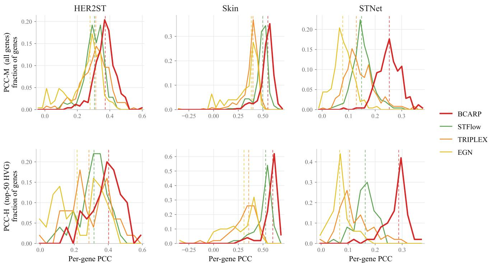

Figure 7. Distribution of fold-averaged per-gene Pearson correlation coefficients (PCC-H and PCC-M) across HER2ST [1], ST-Net [12] and Skin [18]. BCARP generally shifts the per-gene correlation distributions toward higher values across both the full target panel and the HVG subset.  
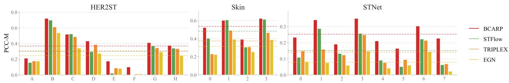  
Figure 8. Per-fold PCC-M performance across the three ST datasets.

## E. Experimental Analysis

Per-gene correlation distributions. Figure 7 compares the fold-averaged per-gene PCC distributions over the full panel and over the highly variable subset. Beyond shifting the bulk of genes toward higher correlation, BCARP also trims the left tail. This is visible on Skin [18], the only cohort whose distribution extends below zero, where a nonnegligible fraction of genes have PCC below zero under TRIPLEX [5] and EGN [34] while almost all of BCARP’s genes remain positive. STFlow is the closest competitor throughout, and the gap to it is much smaller than the gap to TRIPLEX and EGN: on Skin the two distributions overlap substantially and BCARP’s advantage is a modest rightward shift of the mode rather than a separation. The same ordering holds on HER2ST [1], again with considerable overlap. The separation is cleanest on ST-Net [12], where the BCARP histogram is essentially disjoint from all three baselines, which concentrate between 0.08 and 0.16 while BCARP peaks near 0.25-0.30.

Per-fold stability. Figures 8 and 9 report per-fold PCC-M. On the three ST datasets, BCARP is highest in every fold, and the separation is most decisive on ST-Net [12], where it leads at all eight folds, by more than a factor of two at folds 0 and 7 and by a narrower margin elsewhere. The clearest exception is the HER2ST [1] folds corresponding to patients E and F (folds 4-5), where all methods drop sharply and BCARP’s margin narrows; this points to specific tissue morphologies that remain difficult for every model rather than to instability of BCARP itself. On the HEST-1k cohorts the picture is more balanced and we report it as such: BCARP and STFlow trade the lead fold by fold, with STFlow ahead on HCC, PAAD, READ 1 and LUNG 0, and BCARP ahead on LYMPH IDC, PRAD and most CCRCC folds. On IDC all four methods are within a narrow band and BCARP is not the strongest. BCARP’s advantage on HEST-1k is therefore reflected in its aggregate cross-cohort performance rather than uniform dominance within individual cohorts, consistent with the meanrank comparison in Table 5 of the main paper.

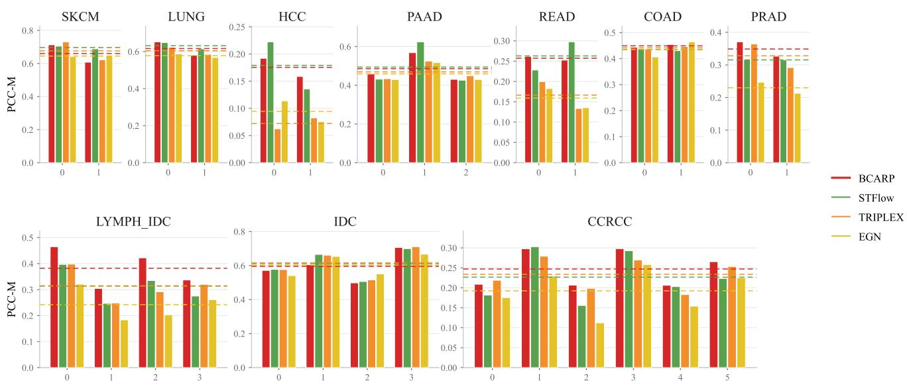  
Figure 9. Per-fold PCC-M performance across the ten HEST-1k cohorts. Dashed lines mark each method’s cohort mean.

Table 8. Refinement-depth ablation as relative change (%) of each metric with respect to the anchor R = 1.
<table><tr><td>Dataset</td><td>Metric</td><td>1</td><td>2</td><td>3</td><td>4</td><td>5</td><td>6</td><td>7</td><td>8</td><td>9</td><td>10</td></tr><tr><td rowspan="5">HER2ST [1]</td><td>PCC-H↑</td><td>+0.0</td><td>+5.4</td><td>+6.3</td><td>+8.1</td><td>+7.9</td><td>+7.9</td><td>+7.4</td><td>+8.5</td><td>+8.1</td><td>+7.6</td></tr><tr><td>PCC-M↑</td><td>+0.0</td><td>+5.7</td><td>+6.1</td><td>+7.8</td><td>+7.5</td><td>+7.5</td><td>+7.4</td><td>+8.4</td><td>+7.7</td><td>+7.4</td></tr><tr><td>MSE↓</td><td>+0.0</td><td>-6.8</td><td>-2.0</td><td>-5.1</td><td>-5.7</td><td>-2.3</td><td>-2.5</td><td>-7.4</td><td>-3.9</td><td>-3.8</td></tr><tr><td>MAE↓</td><td>+0.0</td><td>-4.2</td><td>-0.7</td><td>-1.9</td><td>-2.5</td><td>-1.0</td><td>-1.4</td><td>-3.7</td><td>-1.6</td><td>-1.7</td></tr><tr><td>RVD↓</td><td>+0.0</td><td>-14.3</td><td>+18.4</td><td>-12.6</td><td>+1.7</td><td>+7.1</td><td>+11.6</td><td>-11.7</td><td>+7.9</td><td>+10.2</td></tr><tr><td rowspan="5">Skin [18]</td><td>PCC-H↑</td><td>+0.0</td><td>+1.2</td><td>+1.2</td><td>+1.6</td><td>+1.0</td><td>+1.1</td><td>+1.5</td><td>+1.8</td><td>+1.1</td><td>+1.1</td></tr><tr><td>PCC-M↑</td><td>+0.0</td><td>+0.7</td><td>+0.6</td><td>+0.7</td><td>+0.2</td><td>+0.2</td><td>+1.1</td><td>+0.8</td><td>+0.3</td><td>+0.3</td></tr><tr><td>MSE↓</td><td>+0.0</td><td>-5.5</td><td>+24.8</td><td>+29.4</td><td>+29.0</td><td>+28.2</td><td>+0.8</td><td>+31.9</td><td>+27.3</td><td>+29.4</td></tr><tr><td>MAE↓</td><td>+0.0</td><td>-3.9</td><td>+9.9</td><td>+13.0</td><td>+12.7</td><td>+12.3</td><td>-0.5</td><td>+14.4</td><td>+11.5</td><td>+13.0</td></tr><tr><td>RVD↓</td><td>+0.0</td><td>+14.1</td><td>-8.7</td><td>+9.8</td><td>+3.5</td><td>+11.7</td><td>+12.5</td><td>+15.5</td><td>-0.2</td><td>+10.2</td></tr><tr><td rowspan="5">ST-Net [12]</td><td>PCC-H↑</td><td>+0.0</td><td>-0.8</td><td>-1.1</td><td>-5.8</td><td>+0.8</td><td>+0.7</td><td>-2.2</td><td>-3.6</td><td>-3.6</td><td>-0.8</td></tr><tr><td>PCC-M↑</td><td>+0.0</td><td>-1.2</td><td>-1.4</td><td>-4.9</td><td>+0.3</td><td>+0.1</td><td>-2.7</td><td>-3.4</td><td>-3.7</td><td>-1.0</td></tr><tr><td>MSE↓</td><td>+0.0</td><td>-6.2</td><td>-4.4</td><td>-3.1</td><td>-2.8</td><td>-1.0</td><td>-4.9</td><td>-0.8</td><td>-3.5</td><td>-3.3</td></tr><tr><td>MAE↓</td><td>+0.0</td><td>-3.3</td><td>-2.3</td><td>-1.5</td><td>-1.5</td><td>-0.7</td><td>-2.6</td><td>-0.5</td><td>-2.1</td><td>-1.8</td></tr><tr><td>RVD↓</td><td>+0.0</td><td>-1.4</td><td>-0.9</td><td>+0.9</td><td>-4.4</td><td>-2.7</td><td>-0.2</td><td>-0.3</td><td>-2.8</td><td>-0.8</td></tr><tr><td rowspan="5">Average</td><td>PCC-H↑</td><td>+0.0</td><td>+2.0</td><td>+2.1</td><td>+1.3</td><td>+3.2</td><td>+3.2</td><td>+2.2</td><td>+2.2</td><td>+1.9</td><td>+2.7</td></tr><tr><td>PCC-M↑</td><td>+0.0</td><td>+1.8</td><td>+1.8</td><td>+1.2</td><td>+2.7</td><td>+2.6</td><td>+1.9</td><td>+1.9</td><td>+1.4</td><td>+2.2</td></tr><tr><td>MSE↓</td><td>+0.0</td><td>-6.2</td><td>+6.1</td><td>+7.1</td><td>+6.8</td><td>+8.3</td><td>-2.2</td><td>+7.9</td><td>+6.6</td><td>+7.4</td></tr><tr><td>MAE↓</td><td>+0.0</td><td>-3.8</td><td>+2.3</td><td>+3.2</td><td>+2.9</td><td>+3.5</td><td>-1.5</td><td>+3.4</td><td>+2.6</td><td>+3.2</td></tr><tr><td>RVD↓</td><td>+0.0</td><td>-0.6</td><td>+2.9</td><td>-0.6</td><td>+0.3</td><td>+5.4</td><td>+7.9</td><td>+1.2</td><td>+1.6</td><td>+6.5</td></tr></table>

Table 9. Sensitivity to the number of global prototype tokens $K _ { \mathrm { c t x } }$ on HER2ST. Mean Imp. denotes the mean sign-corrected relative improvement across the five metrics, where decreases in MSE, MAE, and RVD are counted as positive improvements.
<table><tr><td> $K _ { \mathrm { c t x } }$ </td><td>PCC-H↑</td><td>PCC-M↑</td><td>MSE↓</td><td> $\mathbf { M A E } \downarrow$ </td><td> $\mathbf { R V D \downarrow }$ </td><td>Mean Imp.↑</td></tr><tr><td>0</td><td>0.4586</td><td>0.4061</td><td>0.8538</td><td>0.7282</td><td>0.8123</td><td>0.00%</td></tr><tr><td>5</td><td>0.4608 (+0.5%)</td><td>0.4076 (+0.4%)</td><td>0.8933 (+4.6%)</td><td>0.7507 (+3.1%)</td><td>0.7522 (−7.4%)</td><td>+0.11%</td></tr><tr><td>10</td><td>0.4509 (−1.7%)</td><td>0.3941 (−3.0%)</td><td>0.8807 (+3.2%)</td><td>0.7435 (+2.1%)</td><td>0.9480 (+16.7%)</td><td>-5.32%</td></tr><tr><td>25</td><td>0.4534 (−1.1%)</td><td>0.4043 (−0.4%)</td><td>0.9277 (+8.7%)</td><td>0.7657 (+5.1%)</td><td>0.8649 (+6.5%)</td><td>-4.37%</td></tr><tr><td>50</td><td>0.4567 (−0.4%)</td><td>0.4032 (−0.7%)</td><td>0.8381 (−1.8%)</td><td>0.7191 (−1.2%)</td><td>0.7084 (−12.8%)</td><td>+2.95%</td></tr><tr><td>100</td><td>0.4374 (-4.6%)</td><td>0.3891 (−4.2%)</td><td>0.8903 (+4.3%)</td><td>0.7537 (+3.5%)</td><td>0.7987 (−1.7%)</td><td>-2.98%</td></tr><tr><td>200</td><td>0.4530 (−1.2%)</td><td>0.3999 (−1.5%)</td><td>0.8591 (+0.6%)</td><td>0.7357 (+1.0%)</td><td>0.8464 (+4.2%)</td><td>-1.72%</td></tr></table>

Computational cost. Table 7 reports three quantities measured under distinct conditions. Trainable parameters count only those updated by the optimiser and exclude the frozen encoder on which most methods depend. End-toend latency covers the full inference path, encoder forward pass included, measured on a representative HER2ST section containing N = 712 spots. Peak memory is the maximum allocator high-water mark observed over a single training epoch across the evaluated datasets. For methods using frozen UNI embeddings, the shared encoder dominates end-to-end latency. Against the 1.28 s per-slide cost of UNI+Ridge, BCARP adds only 0.09 s, while the most expensive UNI-based heads add approximately 0.3 s. Since UNI embeddings can be extracted once and cached, this shared cost is amortized during training. M2OST does not use a separate frozen UNI encoder and therefore has the lowest measured end-to-end latency, but it incurs the largest peak memory footprint. BCARP remains within the same memory range as the other embedding-based heads while training fewer parameters than mclSTExp, TRIPLEX, and EGN.

Sensitivity to the number of global prototype tokens. Table 9 varies $K _ { \mathrm { c t x } } ,$ taking $K _ { \mathrm { c t x } } ~ = ~ 0$ , a prototype-free global stage that retains spot-level self-attention, as the reference. The response is not monotonic. Correlation peaks at a very small number of tokens: $K _ { \mathrm { c t x } } = 5$ gives the best PCC-H and PCC-M, and both are marginally above the prototype-free baseline, which indicates that the prototypeguided component contributes only modestly to correlation on HER2ST. Its contribution is concentrated instead in variance fidelity, where $K _ { \mathrm { c t x } } = 5 0$ reduces RVD by 12.8% relative to the baseline, the largest single improvement in the table, while also being the only setting that improves both absolute-error metrics. Aggregated over the five metrics, $K _ { \mathrm { c t x } } = 5 0$ is the only configuration with a clearly positive mean improvement (+2.95%) and we adopt it as the default. We note that four of the six non-zero token budgets score below the prototype-free baseline, so the benefit of prototype-guided propagation is token-budget dependent rather than monotonic in $K _ { \mathrm { c t x } }$

Sensitivity to the nuclei-analysis backend. The neighborhood-composition and cell-type targets of Equation (30) depend on an off-the-shelf nuclei segmentation model. To check our conclusions, we regenerate both targets with CellViT [15] and retrain BCARP on HER2ST (Table 6). All other settings are identical and only the pseudo-label generator changes. The two sources give closely comparable results, and the differences do not point uniformly in one direction: CellViT is slightly better on the correlation metrics and on RVD, while HoVer-Net [9] is better on both absolute-error metrics. The CellViT experiment is therefore used as a post-hoc robustness check rather than for model selection. Since the two backends yield comparable downstream performance without a consistent winner across metrics, we retain HoVer-Net for consistency with all main experiments. These results indicate that BCARP’s HER2ST performance is not highly sensitive to the choice between the two tested nuclei-analysis backends, although broader cross-tissue robustness remains to be studied.

Table 10. Detailed cross-validation splits by fold. For HER2ST, Skin and ST-Net, test partitions are identified by patient; all sections from a patient are assigned exclusively to the training or the test partition. For the HEST-1k cohorts we adopt the official patient-grouped folds released with the benchmark and identify test partitions by HEST slide ID.
<table><tr><td>Dataset</td><td>Fold</td><td>Test partition</td><td>Train slides</td><td>Test slides</td><td>Train spots / Test spots</td></tr><tr><td>ST datasets</td><td></td><td></td><td></td><td></td><td></td></tr><tr><td rowspan="8">HER2ST [1]</td><td>0</td><td>A</td><td>30</td><td>6</td><td>11,555 / 2,065</td></tr><tr><td>1</td><td>B</td><td>30</td><td>6</td><td>11,908 / 1,712</td></tr><tr><td>2</td><td>C</td><td>30</td><td>6</td><td>12,534 / 1,086</td></tr><tr><td>3</td><td>D</td><td>30</td><td>6</td><td>11,787 / 1,833</td></tr><tr><td>4</td><td>E</td><td>33</td><td>3</td><td>11,891 / 1,729</td></tr><tr><td>5</td><td>F</td><td>33</td><td>3</td><td>11,522 / 2,098</td></tr><tr><td>6</td><td>G</td><td>33</td><td>3</td><td>12,249 / 1,371</td></tr><tr><td>7</td><td>H</td><td>33</td><td>3</td><td>11,894 / 1,726</td></tr><tr><td rowspan="5">Skin [18]</td><td>0</td><td>P10_rep</td><td>9</td><td>3</td><td>6,980 / 1,691</td></tr><tr><td>1</td><td>P2_rep</td><td>9</td><td>3</td><td>6,721 / 1,950</td></tr><tr><td>2</td><td>P5_rep</td><td>9</td><td>3</td><td>7,039 / 1,632</td></tr><tr><td>3</td><td>P9_rep</td><td>9</td><td>3</td><td>5,273 / 3,398</td></tr><tr><td></td><td></td><td></td><td></td><td></td></tr><tr><td rowspan="8">ST-Net [12]</td><td>0</td><td>BC23209 C/D, BC23377 C/D, BC23901 C/D</td><td>60</td><td>8</td><td>27,215 / 3,412</td></tr><tr><td>1 2</td><td>BC23268 C/D, BC23450 D/E, BC23903 C/D</td><td>59</td><td>9</td><td>26,896 /3,731</td></tr><tr><td>3</td><td>BC23269 C/D, BC23506 C/D, BC23944 D/E</td><td>59</td><td>9</td><td>26,616 /4,011</td></tr><tr><td>4</td><td>BC23270 D/E, BC23508 D/E, BC24044 D/E</td><td>59</td><td>9</td><td>26,598 / 4,029</td></tr><tr><td>5</td><td>BC23272 D/E, BC23567 D/E, BC24105 C/D</td><td>59</td><td>9</td><td>26,248 / 4,379</td></tr><tr><td>6</td><td>BC23277 D/E, BC23803 D/E, BC24220 D/E</td><td>59</td><td>9</td><td>26,587 / 4,040</td></tr><tr><td>7</td><td>BC23287 C/D, BC23810 D/E, BC24223 D/E</td><td>59</td><td>9</td><td>26,490 / 4,137</td></tr><tr><td></td><td>BC23288 D/E, BC23895 C/D</td><td>62</td><td>6</td><td>27,739 / 2,888</td></tr><tr><td>HEST-1k cohorts</td><td></td><td></td><td></td><td></td><td></td></tr><tr><td rowspan="2">SKCM</td><td>0</td><td>TENX117</td><td>1</td><td>1</td><td>1,741 / 1,293</td></tr><tr><td>1</td><td>TENX115</td><td>1</td><td>1</td><td>1,293 / 1,741</td></tr><tr><td rowspan="3">LUNG</td><td>0</td><td>TENX141</td><td>1</td><td>1</td><td></td></tr><tr><td>1</td><td>TENX118</td><td>1</td><td>1</td><td>1,944 / 3,262 3,262 / 1,944</td></tr><tr><td>0</td><td></td><td></td><td></td><td></td></tr><tr><td rowspan="3">PAAD</td><td>1</td><td>TENX116 TENX140</td><td>2 2</td><td>1</td><td>5,561 / 2,010</td></tr><tr><td>2</td><td>TENX126</td><td>2</td><td>1 1</td><td>3,961 / 3,610 5,620 / 1,951</td></tr><tr><td>0</td><td></td><td></td><td></td><td></td></tr><tr><td rowspan="3">READ COAD</td><td>1</td><td>ZEN48, ZEN49</td><td>2</td><td>2</td><td>3,819 / 4,588</td></tr><tr><td></td><td>ZEN36, ZEN40</td><td>2</td><td>2</td><td>4,588 / 3,819</td></tr><tr><td>0 1</td><td>TENX147-TENX149</td><td>1</td><td>3</td><td>5,079 / 10,572</td></tr><tr><td></td><td></td><td>TENX111</td><td>3</td><td>1</td><td>10,572 / 5,079</td></tr><tr><td rowspan="5">LYMPH_IDC</td><td>0 1</td><td>NCBI684</td><td>3</td><td>1</td><td>14,972 / 4,992</td></tr><tr><td>2</td><td>NCBI683</td><td>3</td><td>1</td><td>14,972 / 4,992 14,976 / 4,988</td></tr><tr><td>3</td><td>NCBI682</td><td>3</td><td>1</td><td></td></tr><tr><td></td><td>NCBI681</td><td>3</td><td>1</td><td>14,972 / 4,992</td></tr><tr><td>0</td><td>INT13-INT15, INT24</td><td>20</td><td>4</td><td>55,849 / 18,371</td></tr><tr><td rowspan="7">CCRCC</td><td>1</td><td>INT9-INT12</td><td>20</td><td>4</td><td>67,651 / 6,569</td></tr><tr><td>2</td><td>INT6-INT8, INT23</td><td>20</td><td>4</td><td>63,464 / 10,756</td></tr><tr><td>3</td><td>INT2-INT5</td><td>20</td><td>4</td><td>67,098 / 7,122</td></tr><tr><td>4</td><td>INT1, INT20-INT22</td><td>20</td><td>4</td><td>59,472 / 14,748</td></tr><tr><td>5</td><td>INT16-INT19</td><td>20</td><td>4</td><td>57,566 / 16,654</td></tr><tr><td>0</td><td></td><td>3</td><td>1</td><td></td></tr><tr><td>1</td><td>TENX99</td><td></td><td></td><td>14,775 / 20,761</td></tr><tr><td rowspan="4">IDC</td><td>2</td><td>TENX95</td><td>3</td><td>1</td><td>27,776 / 7,760</td></tr><tr><td>3</td><td>NCBI785</td><td>3</td><td>1</td><td>31,526 /4,010</td></tr><tr><td></td><td>NCBI783</td><td>3</td><td>1</td><td>32,531 / 3,005</td></tr><tr><td>0</td><td>MEND154, MEND156-MEND162</td><td>15</td><td>8</td><td>36,819 / 25,891</td></tr><tr><td rowspan="2">PRAD</td><td>1</td><td>MEND139-MEND153</td><td>8</td><td>15</td><td>25,891 / 36,819</td></tr><tr><td>0</td><td>NCBI643</td><td>1</td><td>1</td><td>1,941 / 2,255</td></tr><tr><td rowspan="2">HCC</td><td></td><td></td><td></td><td></td><td></td></tr><tr><td>1</td><td>NCBI642</td><td>1</td><td>1</td><td>2,255 / 1,941</td></tr></table>

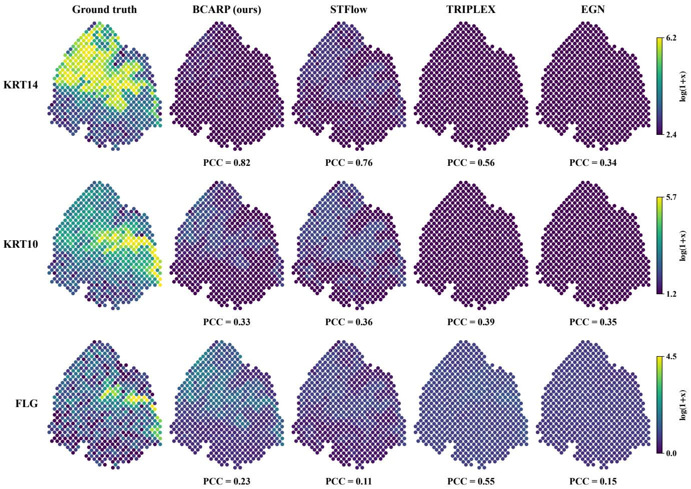  
Figure 10. Qualitative comparison of predicted expression for three marker genes on Skin sample P2 rep3.

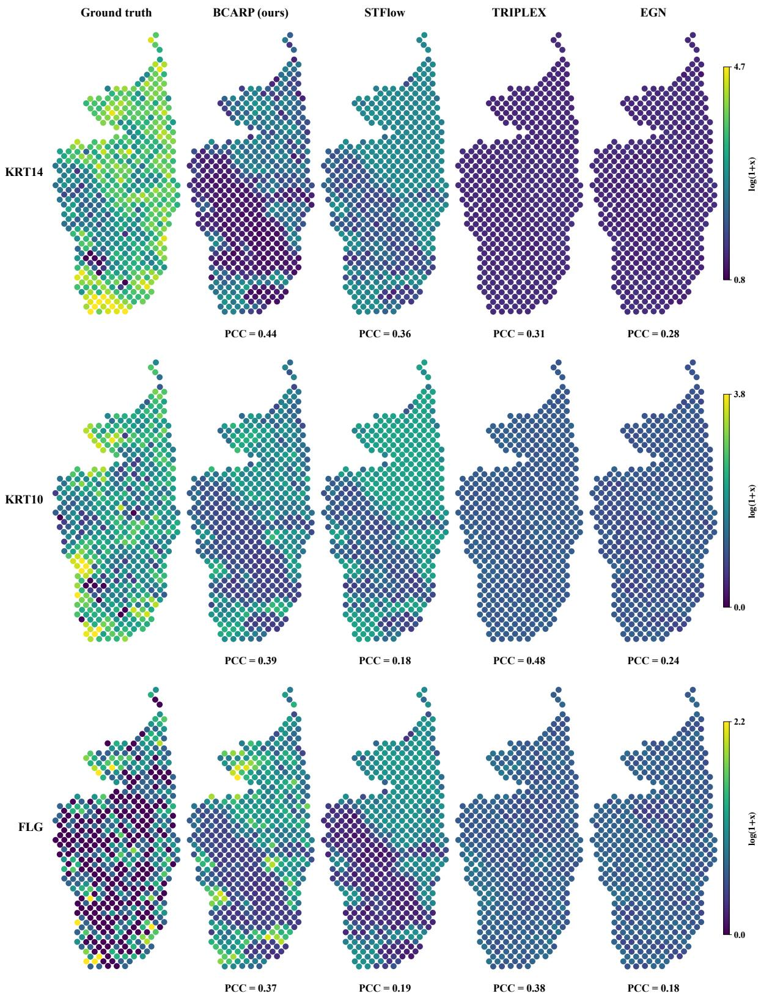  
Figure 11. Qualitative comparison of predicted expression for three marker genes on Skin sample P5 rep2.

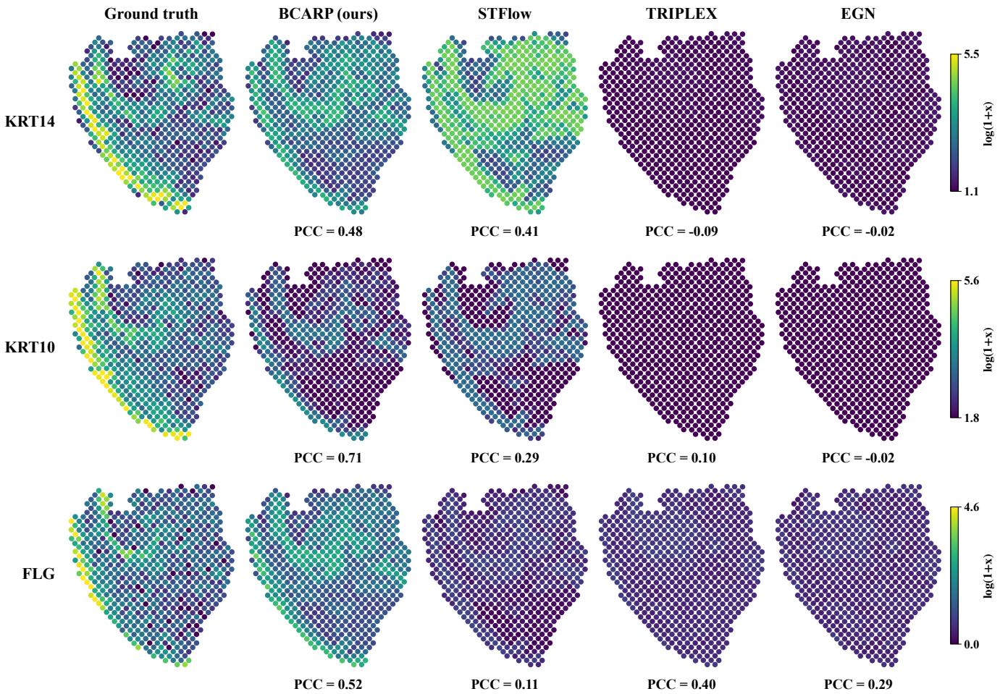  
Figure 12. Qualitative comparison of predicted expression for three marker genes on Skin sample P10 rep2