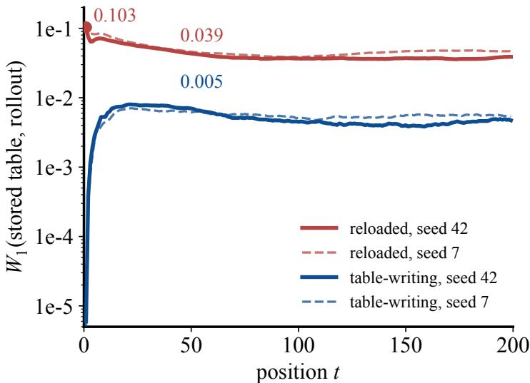
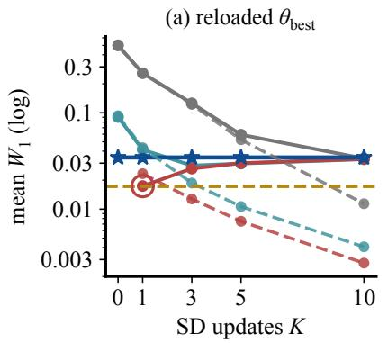
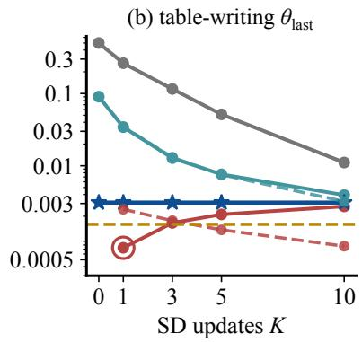
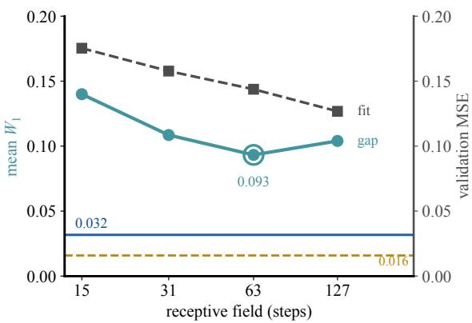

# Checkpoint Reload Explains Most of the Measured State Gap in Two State Discovery Reproductions

Weijia Han∗ University of Washington

Lisha Qu∗ University of Washington

## Abstract

Temporal models that maintain per-sequence latent states during training must reconstruct those states when the stored table is unavailable at inference. This creates a basic consistency question: do the reconstructed states agree with those formed during training? We study this question for State Discovery in World Machine, which updates stored states in parallel each epoch but performs inference by sequential rollout from an all-zero start. On Toy1D, we analyze two pairedcheckpoint runs whose decoded-state MSE is 27 to 36 percent above the published value. We compare the stored table with rollouts under the best-validation checkpoint reloaded after training and the last-epoch weights that wrote the table. Matching the rollout to the table-writing weights removes 90 to 91 percent of the mean per-dimension Wasserstein-1 distance. Causal distillation and frozen SD updates do not satisfy their pre-specified criteria under either checkpoint. Overall, checkpoint reload accounts for most of the measured gap in these runs.

## 1 Introduction

Latent world models compress observation histories into states used for prediction and control, in cluding recurrent state-space models [Hafner et al., 2019, 2025] and recent robust latent control systems [Hansen et al., 2024, Sun et al., 2024]. Related work connects state and history through self-predictive abstractions [Ni et al., 2024] and regularizes latent dynamics to make action effects more systematic [Saanum et al., 2024]. Recent studies examine latent-variable recovery [Zhang et al., 2025], context inferred from interaction [Roder et al., 2025], and horizon-aware or in-context¨ dynamics [Wan et al., 2026, Wang et al., 2026]. These advances make the state-construction procedure itself consequential. When training stores a state for each sequence but inference must re construct it from a cold start, evaluating the learned representation requires knowing whether the two states are consistent. World Machine [do Nascimento et al., 2026] is a concrete instance. Its State Discovery (SD) procedure writes the core’s output back to a per-sequence state table after each epoch. At inference, the core instead runs sequentially from an all-zero start. The original paper notes the repeated updates and all-zero start but does not name or measure this gap.

Recurrent experience replay provides a close analogue: parameter lag can make stored recurrent states stale, while burn-in recomputes them under newer weights [Kapturowski et al., 2019]. Our setting differs because the state table is written during validation and the mismatch appears after early stopping reloads a different checkpoint.

We ask whether SD guarantees agreement (Section 2), how much of the gap remains under a shared checkpoint (Section 3), and whether causal distillation or frozen refinement can reduce the residual without the table (Sections 4 and 5). Checkpoint reload accounts for nine tenths of the measured gap, while neither procedure meets its pre-specified success criteria.

## 2 The State Discovery Update

Notation. Each sequence carries a per-timestep latent state $w _ { t } \in [ - 1 , 1 ] ^ { d }$ under the model’s tanh bound, observations $^ { O , }$ and a shared core $F _ { \theta }$ . Stored state updating and cold-start inference are

$$
\begin{array} { c c } { { \Phi _ { \theta } ( w ) = \mathrm { s h i f t } ( F _ { \theta } ( w , o ) ) , } } & { { } } \\ { { w  \Phi _ { \theta } ( w ) , } } & { { w _ { 0 } \ \mathrm { r e m a i n s \ f i x e d } , } } \\ { { \widehat { w } _ { 0 } = 0 , } } & { { \widehat { w } _ { t + 1 } = F _ { \theta } ( \widehat { w } , o ) _ { t } . } } \end{array}
$$

The shift moves the core’s per-timestep output forward by one position. Position 0 is replaced with the input state rather than blended with it, which is the REPLACE convention. The first two lines constitute $\mathrm { S D ^ { \prime } s ^ { \cdots } E { \cdot } s t e p ^ { \prime \prime } }$ as we read it. They perform fixed-point iteration without a likelihood comparison, candidate scoring, or an explicit arg max.

Observation 1. A hard assignment can be viewed as the $T  0$ limit of a temperature-scaled soft assignment concentrating on arg ma ${ \bf x } _ { w } p _ { \theta } ( o , w )$ [Dempster et al., 1977, Celeux and Govaert, 1992]. SD evaluates no $p _ { \theta } ( o , w )$ at candidate states and compares no candidates; it therefore should not be interpreted as an arg max. EM’s monotone-improvement guarantee does not transfer: its fixed points need not maximize any $p _ { \theta } ( o , w )$ . It is per-sample latent-state iteration without an encoder or cross-sequence prior, related in form to direct latent-code optimization schemes [Bojanowski et al., 2018, Park et al., 2019].

## 3 Measuring the Train-Inference Gap Under Both Checkpoints

Toy1D is the upstream synthetic benchmark. We train World Machine with SD enabled and compare the stored and cold-start state populations on the same 8000 held-out items. The stored population is the validation state table, updated each epoch without gradient flow. The cold-start population is a fresh sequential rollout of the trained model. We report pooled and position-resolved 1-Wasserstein distance, denoted $W _ { 1 }$ , together with a held-out linear probe. Appendix A gives the full benchmark and split construction; Table 2 lists the configuration.

Unless stated otherwise, population summaries use all 8000 validation items. Table 1 and the procedures in Sections 4 and 5 use a fixed 1600-item analysis subset. In Table 1, transient $W _ { 1 }$ is the maximum over positions 1–15; the receptive-field sweep instead uses positions 1 through the corresponding receptive field. Means over positions 30–199 are descriptive late-position summaries.

Two checkpoints. The upstream early stopper reloads the best validation checkpoint after the final validation pass has written the stored table. The resulting comparison has three state populations:
<table><tr><td>Population</td><td>Construction</td><td>Checkpoint</td></tr><tr><td>Stored table</td><td>Parallel SD update during the final validation pass</td><td> $\theta _ { \mathrm { l a s t } }$ </td></tr><tr><td>Reloaded rollout</td><td>Sequential rollout from zero after checkpoint reload</td><td> $\theta _ { \mathrm { b e s t } }$ </td></tr><tr><td>Matched rollout</td><td>Sequential rollout from zero using weights saved before reload</td><td> $\theta _ { \mathrm { l a s t } }$ </td></tr></table>

The trainer normally discards $\theta _ { \mathrm { l a s t } }$ , so we save it before reload and roll the cold start under both checkpoints (Appendix $\mathbf { A } )$ . With a causal core and position 0 pinned to zero, the table and rollout should agree at position 1 when they share one checkpoint. They agree to numerical precision under $\theta _ { \mathrm { l a s t } }$ but not under $\theta _ { \mathrm { b e s t } }$ (Figure 1).

Reproduction context. The analyzed runs do not match the published error, as quantified in Section 6. A separate reproduction run supplies the receptive-field sweep. Table 3 reports all four runs.

Checkpoint reload creates most of the gap. Under $\theta _ { \mathrm { b e s t } }$ , the position-resolved gap is largest near the start and then decays (Figure 1). Under $\theta _ { \mathrm { l a s t } }$ , the same table is about one tenth as far from the rollout. Matching the checkpoint removes 91 and 90 percent of the gap for the two seeds, respectively. Item by item, RMS error falls from 0.36 to 0.14 for seed $^ { 4 2 }$ and from 0.43 to 0.16 for seed 7. Table 1 gives the analysis-split comparison, and Table 4 reports the complete values.

  
Figure 1: Per-position $W _ { 1 }$ , stored table versus cold-start rollout (log axis, positions 1 to 199), seed 42 solid, seed $\bar { 7 }$ dashed, under $\theta _ { \mathrm { b e s t } }$ (red) and $\theta _ { \mathrm { l a s t } }$ (blue); labels: the seed-42 position-1 value and the seed-42 means over positions 30 to 199.

Probe safeguard. On the item-level split, stored and cold-start states both permit linear recovery of the decoded coordinate. Because sibling windows can span the split, we treat this as a permissive safeguard, not evidence of cross-sequence generalization (Appendix A).

## 4 Distillation into a Causal TCN Does Not Remove the Gap

To test whether the residual is an ordinary amortization gap [Cremer et al., 2018], we train a causal TCN encoder [Bai et al., 2018] that maps causal observation windows to stored SD states. An exploratory four-RF sweep on the first seed-42 run is mixed-checkpoint: its table uses $\theta _ { \mathrm { l a s t } }$ , whereas its rollout baseline uses reloaded $\theta _ { \mathrm { b e s t } }$ . We use it only for receptive-field trends; checkpoint-controlled evidence comes from the $\mathrm { R F } { - } 6 3$ student in the two paired runs. Success requires cuts of at least 50 percent in both mean and transient $W _ { 1 }$ , with probe $\dot { R } ^ { 2 }$ within 0.01.

None meets the success criterion. In the exploratory sweep, mean and transient $W _ { 1 }$ are larger than the rollout baseline at every RF. Pointwise fitting error falls with wider context, but mean $W _ { 1 }$ remains at least 2.9 times the rollout gap at its best RF (Figure 3). In the paired RF-63 comparisons, the mean- $. W _ { 1 }$ cut is negative for both seeds under both checkpoints, and the student is also farther from the table item by item (Table 1; Appendix B).

## 5 Frozen SD Updates Do Not Meet the Success Criterion

Because distillation does not close the gap, we next test iterative refinement [Kim et al., 2018, Marino et al., 2018] by applying K frozen parallel SD updates using $\Phi _ { \theta }$ from Section 2. We use the same analysis split and four initialization types: random states, the distilled student, cold start, and the stored table. The pre-specified comparison applies five updates to the student under each checkpoint. Appendix C lists all pre-specified and exploratory update counts.

Cold start is a fixed point by construction. For the sequential rollout ${ \widehat { w } } ,$ causality gives $\Phi _ { \theta } ( \widehat { w } ) =$ wb analytically, and the implementation agrees to six decimals. More generally, from any initialization with $w _ { 0 } = 0 ,$ , K updates force positions 1 through K to their cold-start values; refinement is measured on the remaining positions (Appendix C).

The student fails after five updates under both checkpoints. Under $\theta _ { \mathrm { b e s t } }$ , it produces only a modest, seed-dependent change and misses the 50 percent threshold. Under $\theta _ { \mathrm { l a s t } } .$ , its marginal $\dot { W } _ { 1 }$ remains 2.5 to 4.7 times the rollout residual instead of falling below half. Its transient- $. W _ { 1 }$ cut also falls short, as do all other student update counts (Table 1, Appendix C).

Table 1: Main comparison on the fixed 1600-item analysis subset. Paired entries give seed 42 followed by seed 7 in parentheses. Mean $W _ { 1 }$ and transient $W _ { 1 }$ (maximum over positions 1–15) measure distance from the stored table, so lower values are better. Cut is the reduction in mean $W _ { 1 }$ relative to the rollout under the same checkpoint.
<table><tr><td>Condition</td><td>Checkpoint</td><td>Mean W1</td><td>Cut (%)</td><td>Transient W1</td><td>Probe R²</td></tr><tr><td>Cold-start rollout</td><td> $\theta _ { \mathrm { b e s t } }$ </td><td>0.03440 (0.03768)</td><td>一</td><td>0.10368 (0.11391) 0.9038 (0.8758)</td><td></td></tr><tr><td>Cold-start rollout</td><td> $\theta _ { \mathrm { l a s t } }$ </td><td>0.00309 (0.00325)</td><td></td><td>0.00819 (0.00724)0.9075 (0.8777)</td><td></td></tr><tr><td>TCN, RF 63</td><td> $\theta _ { \mathrm { b e s t } }$ </td><td>0.09046 (0.12383)</td><td>-163.0 (-228.6)</td><td>0.32190 (0.37755)0.9012 (0.8543)</td><td></td></tr><tr><td>TCN, RF 63</td><td> $\theta _ { \mathrm { l a s t } }$ </td><td>0.09046 (0.12383)</td><td>-2829.6 (-3704.4)</td><td>0.32190 (0.37755) 0.9012 (0.8543)</td><td></td></tr><tr><td>TCN + 5 SD updates</td><td> $\theta _ { \mathrm { b e s t } }$ </td><td>0.02975 (0.03868)</td><td>+13.5 (−2.7)</td><td>0.10368 (0.11391) 0.9070 (0.8745)</td><td></td></tr><tr><td>TCN + 5 SD updates</td><td> $\theta _ { \mathrm { l a s t } }$ </td><td>0.00761 (0.01542)</td><td>-146.4 (-373.6)</td><td>0.03596 (0.03853) 0.9095 (0.8747)</td><td></td></tr></table>

Success requires 50 percent cuts in both $W _ { 1 }$ measures and probe $\mathrm { \mathbf { R } } ^ { 2 }$ within 0.01 of stored-state baselines (0.9076, 0.8762). Each probe uses its row’s states. One RF-63 student is scored against both checkpoints; transient detail is in Appendix C.

Stored-table initialization. The stored table is not a fixed point under either checkpoint. Under $\theta _ { \mathrm { l a s t } } ,$ the K=1 stored row is the only row that clears every threshold for both seeds; under $\theta _ { \mathrm { b e s t } }$ it does not. Because this control begins from the scored table, it is not an inference procedure, and the criterion applies to student rows. By K=10, the reloaded-checkpoint trajectories approach 0.03–0.05 from the table; no comparable floor appears under the table-writing checkpoint over the evaluated update counts (Figure 2, Appendix C).

  
Figure 2: Frozen SD-update trajectories for seed 42 under (a) reloaded $\theta _ { \mathrm { b e s t } }$ and (b) table-writing $\theta _ { \mathrm { l a s t } }$ . Solid: from the table; dashed: from cold start; gold: 50 percent threshold. By $K { = } 1 0$ , (a) approaches 0.03; no comparable floor is observed in (b) through $K { = } 1 0$ (seed 7 and definitions: Appendix C).

## 6 Discussion and Limitations

The shared-checkpoint residual exceeds the numerical floor by more than fifty thousandfold, but its mechanism remains unknown. Among table-free methods, the $\theta _ { \mathrm { l a s t } }$ rollout is closest; refinement does not improve both measures at once. Matching the rollout to the table-writing checkpoint removes nine tenths of the gap here, but the size of this effect elsewhere is unknown.

Limitations. The paired analysis covers two seeds on one benchmark; their decoded-state MSE is 36 and 27 percent above the published value, so checkpoint separation at that value remains unknown. The RF sweep uses one seed-42 run without a saved $\theta _ { \mathrm { l a s t } } ;$ its mixed-checkpoint baseline eases the success threshold, although the RF-63 student fails under both checkpoints. Marginal $W _ { 1 }$ ignores item pairing; Appendix A reports paired errors but not their distributions or downstream costs. No eligible student met the pre-specified success criterion.

## References

Shaojie Bai, J. Zico Kolter, and Vladlen Koltun. An empirical evaluation of generic convolutional and recurrent networks for sequence modeling. arXiv preprint arXiv:1803.01271, 2018.

Piotr Bojanowski, Armand Joulin, David Lopez-Paz, and Arthur Szlam. Optimizing the latent space of generative networks. In Proceedings of the 35th International Conference on Machine Learning (ICML), 2018.

Gilles Celeux and Gerard Govaert. A classification EM algorithm for clustering and two stochastic´ versions. Computational Statistics & Data Analysis, 14(3):315–332, 1992.

Chris Cremer, Xuechen Li, and David Duvenaud. Inference suboptimality in variational autoencoders. In Proceedings ofthe 35th International Conference on Machine Learning (ICML), 2018.

A. P. Dempster, N. M. Laird, and D. B. Rubin. Maximum likelihood from incomplete data via the EM algorithm. Journal of the Royal Statistical Society: Series B (Methodological), 39(1):1–38, 1977.

Elton Cardoso do Nascimento, Alexandre da Silva Simoes, Esther Luna Colombini, Ricardo Ribeiro˜ Gudwin, and Paula Dornhofer Paro Costa. World Machine: Towards generative world modeling for time-series. arXiv preprint arXiv:2605.23025, 2026.

Danijar Hafner, Timothy Lillicrap, Ian Fischer, Ruben Villegas, David Ha, Honglak Lee, and James Davidson. Learning latent dynamics for planning from pixels. In Proceedings of the 36th International Conference on Machine Learning (ICML), 2019.

Danijar Hafner, Jurgis Pasukonis, Jimmy Ba, and Timothy Lillicrap. Mastering diverse control tasks through world models. Nature, 640:647–653, 2025. doi: 10.1038/s41586-025-08744-2.

Nicklas Hansen, Hao Su, and Xiaolong Wang. TD-MPC2: Scalable, robust world models for continuous control. In Proceedings of the Twelfth International Conference on Learning Representations (ICLR), 2024.

Steven Kapturowski, Georg Ostrovski, John Quan, Remi Munos, and Will Dabney. Recurrent expe- ´ rience replay in distributed reinforcement learning. In Proceedings of the Seventh International Conference on Learning Representations (ICLR), 2019.

Yoon Kim, Sam Wiseman, Andrew C. Miller, David Sontag, and Alexander M. Rush. Semiamortized variational autoencoders. In Proceedings of the 35th International Conference on Machine Learning (ICML), 2018.

Joseph Marino, Yisong Yue, and Stephan Mandt. Iterative amortized inference. In Proceedings of the 35th International Conference on Machine Learning (ICML), 2018.

Tianwei Ni, Benjamin Eysenbach, Erfan Seyedsalehi, Michel Ma, Clement Gehring, Aditya Mahajan, and Pierre-Luc Bacon. Bridging state and history representations: Understanding selfpredictive RL. In Proceedings of the Twelfth International Conference on Learning Representations (ICLR), 2024.

Jeong Joon Park, Peter Florence, Julian Straub, Richard Newcombe, and Steven Lovegrove. DeepSDF: Learning continuous signed distance functions for shape representation. In Proceedings ofthe IEEE/CVF Conference on Computer Vision and Pattern Recognition (CVPR), 2019.

Frank Roder, Jan Benad, Manfred Eppe, and Pradeep Banerjee. Dynamics-aligned latent imagina-¨ tion in contextual world models for zero-shot generalization. In Advances in Neural Information Processing Systems (NeurIPS), volume 38, 2025. doi: 10.52202/085713-2438.

Tankred Saanum, Peter Dayan, and Eric Schulz. Simplifying latent dynamics with softly stateinvariant world models. In Advances in Neural Information Processing Systems (NeurIPS), volume 37, 2024. doi: 10.52202/079017-1212.

Ruixiang Sun, Hongyu Zang, Xin Li, and Riashat Islam. Learning latent dynamic robust representations for world models. In Proceedings of the 41st International Conference on Machine Learning (ICML), pages 47234–47260, 2024.

Shenghua Wan, Le Gan, and De-Chuan Zhan. Learning to be uncertain: Pre-training world models with horizon-calibrated uncertainty. In Proceedings of the Fourteenth International Conference on Learning Representations (ICLR), 2026.

Fan Wang, Zhiyuan Chen, Yuxuan Zhong, Sunjian Zheng, Pengtao Shao, Bo Yu, Shaoshan Liu, Jianan Wang, Ning Ding, Yang Cao, and Yu Kang. Context and diversity matter: The emergence of in-context learning in world models. In Proceedings ofthe Fourteenth International Conference on Learning Representations (ICLR), 2026.

Tianren Zhang, Guanyu Chen, and Feng Chen. When do neural networks learn world models? In Proceedings of the 42nd International Conference on Machine Learning (ICML), pages 74639– 74670, 2025.

## A Experimental and Evaluation Details

This appendix separates the experimental setting, reproduction quality, checkpoint construction, and evaluation measures. Seed 42 is reported before seed 7 throughout.

## A.1 Training and data

The configuration follows the published setup and retains the reproduction’s state-save behavior. The upstream ShortTimeRecaller is an auxiliary short-horizon decoder whose parameters use the fixed base learning rate rather than the cosine schedule, matching the published training behavior.

Table 2: Toy1D training and data configuration.
<table><tr><td>Setting</td><td>Specification</td></tr><tr><td>Model and state</td><td>128-dimensional states; 200-position context; two segments; four at- tention heads; ALiBi positional encoding; tanh activation; REPLACE state saving</td></tr><tr><td>Optimizer</td><td>AdamW with weight decay  $5 \times 1 0 ^ { - 5 }$ </td></tr><tr><td>Training</td><td>1000 epochs with batch size 256  $1 0 ^ { - 3 }$ </td></tr><tr><td>Learning rate</td><td>Base rate with cosine warm restarts every 25 optimizer steps; the schedule advances once per batch</td></tr><tr><td>Toy1D generation</td><td>10000 sequences of 1000 steps from a damped linear system with a 3- dimensional latent state</td></tr><tr><td>Observations</td><td>Random 2-channel linear readout with noise standard deviation 0.1; the objective decodes latent dimension 0</td></tr><tr><td>Data split</td><td>First 60% of sequences for training, next 20% for validation, and final 20% for testing; 2000 validation sequences with four 200-step windows give 8000 validation items</td></tr></table>

Settings not listed in Table 2 are inherited unchanged from the published Toy1D configuration. The exploratory RF sweep ran on an NVIDIA RTX A5000 with internal implementation commit a039ac8. The paired runs used the same Slurm GPU node and PyTorch 2.13.0+cu126 at internal implementation commit b10bb81. The available experiment log reports CUDA compatibility 12.4 but does not preserve the exact NVIDIA driver version or GPU model. All reported state populations use the validation table; training-split states are not measured.

## A.2 Reproduction quality

The pre-specified reproduction band allowed a 20 percent deviation from the published decodedstate MSE of 0.34348. Table 3 reports the four completed runs.

The August 20 log specified the 20 percent reproduction band, and the August 21 distillation protocol specified the 50 percent mean- and transient- $. W _ { 1 }$ cuts and 0.01 probe slack. The pre-specified August 24 plan retained these thresholds for frozen updates and designated the K=5 student as primary. The September 2 entry specified the paired-checkpoint analysis order, validity checks, and decision rule before inspection of the corresponding outputs.

Both seed 42 repetitions lie outside the band. Seed 7 lies inside it in the first repetition and outside it in the second. The result therefore varies across repetitions as well as seeds, and four runs cannot characterize the two sources of variation separately. Because the two seed 7 repetitions used different PyTorch/CUDA builds, we cannot separate stochastic variation from software-version effects. All four training runs completed 1000 epochs without numerical failure and produced complete evaluation records. The two paired-analysis runs used the same compute environment and ran concurrently for 13 hours each. They were designated for paired-checkpoint analysis because they were instrumented to preserve $\theta _ { \mathrm { l a s t } } ;$ ; this choice preceded inspection of their outcomes. The initial strictload conversion of both pre-reload snapshots failed because each retained 40 training-only auxiliary decoder tensors. We repeated only conversion and downstream evaluation from the unchanged snap shots; no training or parameter updates were repeated.

Across the four runs, decoded-state MSE is 2.0 to 35.7 percent above the published value. The paired-analysis runs miss it by 35.7 and 27.3 percent.

Table 3: Completed reproduction runs and their use in the paired-checkpoint analysis.
<table><tr><td>Seed</td><td>Repetition</td><td>Decoded-state MSE</td><td>Used in paired analysis</td></tr><tr><td>42</td><td>first</td><td>0.46419</td><td>no</td></tr><tr><td>42</td><td>second</td><td>0.46621</td><td>yes</td></tr><tr><td>7</td><td>first</td><td>0.35051</td><td>no</td></tr><tr><td>7</td><td>second</td><td>0.43723</td><td>yes</td></tr></table>

## A.3 Checkpoints and numerical verification

The final validation pass writes the stored table under $\theta _ { \mathrm { l a s t } }$ . Early stopping then reloads $\theta _ { \mathrm { b e s t } }$ For this analysis, $\theta _ { \mathrm { l a s t } }$ was preserved immediately before the reload and used for a second coldstart rollout. The saved $\theta _ { \mathrm { l a s t } }$ snapshots also contained training-only auxiliary heads. Conversion removed only those 40 tensors when reconstructing the inference models; all remaining parameters were preserved exactly.

The matched-checkpoint identity was verified before we examined the comparison results. At position 1, $W _ { 1 }$ under $\theta _ { \mathrm { l a s t } }$ is 0.0000059 for seed 42 and 0.0000051 for seed 7. Under $\theta _ { \mathrm { b e s t } }$ , the corresponding values are 0.103433 and 0.112888. Across all refinement updates, every cold-start row remains within 0.00000015 of its matched rollout. After one update, the differences are 0.00000005 and 0.00000006, and they increase monotonically with the number of updates.

## A.4 Distribution and paired comparisons

Table 4 collects the main distributional and item-level comparisons.

Table 4: Distributional and paired checkpoint comparisons. Pooled mean $W _ { 1 }$ uses all 8000 validation items; paired MSE and RMS use the fixed 1600-item analysis subset.
<table><tr><td>Measure</td><td>Seed 42</td><td>Seed 7</td></tr><tr><td>Pooled mean  $W _ { 1 } .$  reloaded  $\theta _ { \mathrm { b e s t } }$ </td><td>0.03438</td><td>0.03759</td></tr><tr><td>Pooled mean  $W _ { 1 }$  , table-writing  $\theta _ { \mathrm { l a s t } }$ </td><td>0.00313</td><td>0.00361</td></tr><tr><td>Per-item MSE, reloaded  $\theta _ { \mathrm { b e s t } }$ </td><td>0.12779</td><td>0.18355</td></tr><tr><td>Per-item MSE, table-writing  $\theta _ { \mathrm { l a s t } }$ </td><td>0.01889</td><td>0.02635</td></tr><tr><td>Per-item RMS, reloaded  $\theta _ { \mathrm { b e s t } }$ </td><td>0.36</td><td>0.43</td></tr><tr><td>Per-item RMS, table-writing  $\theta _ { \mathrm { l a s t } }$ </td><td>0.14</td><td>0.16</td></tr></table>

Under $\theta _ { \mathrm { b e s t } } .$ , the position-resolved curve is zero at position 0, reaches 0.10343 and 0.11289 at position 1, and averages 0.039 and 0.045 over positions 30 through 199. This window was selected after the primary analysis and is used only for descriptive reporting. Under $\theta _ { \mathrm { l a s t } }$ , the curve is zero to four decimals at positions 0 and 1. It peaks at 0.00801 at position 21 and 0.00706 at position 22, then averages 0.005 and 0.006 over positions 30 through 199. Matching the checkpoint removes 91 and 90 percent of the pooled distance.

Marginal $W _ { 1 }$ ignores item pairing, so the paired comparison uses the corresponding stored and rollout states on the 1600-row split. The matched MSE values are 15 and 14 percent of the reloaded values and 1.7 and 2.4 percent of the random-initialization values of 1.12 and 1.11. The RMS comparison gives a 62 percent reduction for both seeds.

## A.5 Probe protocol

The probe is an ordinary least-squares linear map from the 128-dimensional state to the decoded generative coordinate. It is fit on 80 percent of the 8000 items and scored on the held-out 20 percent, giving $R ^ { 2 } \ : = \ : 0 . 9 0 9 5$ for seed 42 and 0.8818 for seed 7. Because the split is over items, sibling windows from one sequence can occur on both sides, which makes this estimate optimistic. We therefore use the probe as a permissive safeguard rather than as evidence of cross-sequence generalization. On the 1600-row split of Sections 4 and 5, the same probe is fit on 1280 rows and scored on 320. It gives 0.9076 on stored states for seed 42 and 0.8762 for seed 7. On cold-start states, the scores are 0.9038 and 0.8758 under $\theta _ { \mathrm { b e s t } }$ , and 0.9075 and 0.8777 under $\theta _ { \mathrm { l a s t } }$

Together, these checks establish the evaluation populations and the two checkpoints used by the main comparisons.

## B Distillation Sweep and Paired-Checkpoint Results

This appendix asks whether wider causal context improves recovery of the stored-state distribution. The first seed 42 sweep is mixed-checkpoint: its table was written under $\theta _ { \mathrm { l a s t } }$ , its rollout baseline uses reloaded $\theta _ { \mathrm { b e s t } }$ , and it preserves no $\theta _ { \mathrm { l a s t } }$ for a matched rollout. Its mean $W _ { 1 }$ is 0.03170 on the 1600 analysis rows.

  
Figure 3: Mixed-checkpoint TCN sweep on the first seed-42 run: the table uses $\theta _ { \mathrm { l a s t } }$ and the rollout baseline uses reloaded $\theta _ { \mathrm { b e s t } }$ . Dashed: validation MSE; solid: mean $W _ { 1 }$ ; labels: RF 63, rollout gap, and 50 percent threshold.

## B.1 Sweep result

Table 5: Receptive-field sweep on 1600 analysis items (first seed-42 run).
<table><tr><td>Receptive field</td><td>Item coverage (%)</td><td>Mean  $W _ { 1 }$ </td><td>Cut (%)</td><td>Validation plateau</td></tr><tr><td>15</td><td>7.5</td><td>0.13997</td><td>-341.5</td><td>0.175</td></tr><tr><td>31</td><td>15.5</td><td>0.10851</td><td>-242.3</td><td>0.158</td></tr><tr><td>63</td><td>31.5</td><td>0.09324</td><td>-194.1</td><td>0.144</td></tr><tr><td>127</td><td>63.5</td><td>0.10398</td><td>-228.0</td><td>0.127</td></tr></table>

Item coverage is the receptive field as a percentage of the 200-position item. Validation plateau is the mean validation MSE over the final ten recorded epochs. Validation descent is the decrease over the final 20 percent of training.

Mean $W _ { 1 }$ is larger than the rollout gap at every receptive field. Transient $W _ { 1 }$ is also larger, with cuts from −147.1 to −332.4 percent. Validation descent over the final 20 percent of training ranges from 0.0016 to 0.0030. Pointwise fitting error decreases monotonically with wider context, while mean $W _ { 1 }$ is lowest at receptive field 63. The difference between receptive fields 63 and 127 is not interpreted.

Probe $R ^ { 2 }$ improves through receptive field 63 and then decreases slightly at receptive field 127. For receptive fields 15, 31, 63, and 127, the changes are $- 0 . 0 4 6 6 , \ : - 0 . 0 2 6 3 , \ : - 0 . 0 0 9 5$ , and −0.0132, respectively; only receptive field 63 meets the 0.01 slack. Thus the student preserves information about the decoded coordinate without recovering the stored-state distribution. The probe has lim ited discriminating power because its target is close to the decoded coordinate used by the training objective. At receptive field 63 in the paired-checkpoint runs, the probe criterion is met for seed 42 but not for seed $7 .$ The complete success criterion is not met for either seed because the mean- and transient- $W _ { 1 }$ cuts are negative under both checkpoints.

## B.2 Result on the paired-analysis runs

For each second repetition, one student is distilled from the stored table and evaluated under both checkpoints. Its probe $R ^ { 2 }$ change from the stored-state probe is −0.0064 for seed 42 and −0.0218 for seed 7. For both seeds, the transient maximum over positions 1 through 63 occurs within positions 1 through 15. The values therefore equal those reported in Table 1: 0.32190 and 0.37755. The remaining values appear in Table 1.

Item by item, the student’s RMS distance from the table is 0.35 and 0.42. The matched-rollout values are 0.14 and 0.16, so the student is 2.5 to 2.6 times farther from the table. In marginal $W _ { 1 }$ , it is 29 to 38 times farther than the matched rollout.

## B.3 Non-comparable RF-190 configuration

A separate receptive field 190 run is not included in the sweep because it also changes the kernel size from 3 to 4, confounding the receptive-field comparison. For transparency, its validation loss was still decreasing at the end of training: its final-20-percent descent is 0.01472, 5 to 9 times the other runs’ values. Its final-ten-epoch mean validation MSE is 0.19688, and its mean $W _ { 1 }$ is 0.19170.

The sweep therefore shows better pointwise fitting with wider context but no recovery of the storedstate distribution.

## C Refinement Trajectories by Initialization

This appendix asks where repeated frozen SD updates move each initialization. Results use the second repetitions and 1600 validation rows. The reported update counts are $K \in \{ 0 , 1 , 3 , 5 , 1 0 \}$ with $K { = } \bar { 1 } 0$ treated as exploratory. Tables 6 and 7 report mean $W _ { 1 }$ to the stored table and to the matched cold-start rollout. The first random replicate is shown; three random replicates agree within 0.0004 at every $K$

## C.1 Fixed-point identity

For the sequential rollout ${ \widehat { w } } ,$ causality gives $\Phi _ { \theta } ( \widehat { w } ) = \widehat { w }$ analytically. The numerical implementation agrees with this identity to six decimal places at every K under both checkpoints and both seeds. From any initialization with $w _ { 0 } = 0$ , K updates rewrite positions 1 through K with the cold-start values. The measured rate therefore concerns the remaining 199 − K positions, while position 0 stays pinned.

## C.2 Trajectory interpretation

Under the reloaded checkpoint, every initialization approaches the matched rollout. At $K { = } 1 0$ , the means across three random replicates are 0.03358 and 0.04566 from the stored table. Under both checkpoints and both seeds, cold-start rows remain within 0.00000015 of the matched rollout at every K. By $K { = } 1 0$ , the reloaded-checkpoint trajectories approach values between 0.03 and 0.05 from the table. No comparable floor appears under $\theta _ { \mathrm { l a s t } }$ over the evaluated update counts; the student reaches 1.3 to 1.9 times the rollout residual at exploratory $K { = } 1 0$

## C.3 Pre-specified comparison

At K=5 under $\theta _ { \mathrm { l a s t } }$ , the student remains 2.5 to 4.7 times the rollout residual in marginal $W _ { 1 }$ and 1.6 to 1.7 times the residual item by item. One update from the stored table under $\theta _ { \mathrm { b e s t } }$ moves it by 51 and 68 percent of the stored-to-cold-start distance. Under $\theta _ { \mathrm { l a s t } }$ , the corresponding shares are 24 and 25 percent of a distance eleven times smaller. The $K { = } 1$ stored-table row under $\theta _ { \mathrm { l a s t } }$ is the only row that clears every threshold, with mean cuts of 76 and 75 percent, transient cuts of 57 and 54 percent, and probe change within 0.0001. It starts from the table against which it is scored, so it is not an inference procedure; the success criterion was pre-specified for student rows only.

## C.4 Transient and paired comparisons

Under the reloaded checkpoint, the transient equals the rollout’s from $K \ge 3 \colon 0 . 1 0 3 6 8$ for seed 42 and 0.11391 for seed 7. The rollout maximum is at position 1, which every update rewrites, and positions 2 to 15 fall below it by K=3. Therefore, the transient-W column in Table 1 cannot distinguish the $\theta _ { \mathrm { b e s t } }$ refinement row from the rollout baseline. Under the table-writing checkpoint, the rollout transient is 0.00819 and 0.00724, while the student falls from 0.32190 to 0.01252 and from 0.37755 to 0.01246 across $K = 0 \mathrm { t o } 1 0$

At K=10, student versus matched rollout per-item RMS is 0.16 versus 0.14 for seed 42 and 0.21 versus 0.16 for seed 7. After ten reloaded updates, table versus matched rollout RMS is 0.16 versus 0.14 and 0.19 versus 0.16. Thus the marginal agreement in Tables 6 and 7 does not imply paired agreement.

Together, the trajectories show that repeated updates reduce differences due to initialization but do not make the student match the stored table under either checkpoint.

Table 6: Frozen E-step trajectories under the reloaded $\theta _ { \mathrm { b e s t } }$ on 1600 validation rows. Each panel reports mean $W _ { 1 }$ to the stored table and to the matched rollout. The result at K=10 is exploratory.  
Seed 42
<table><tr><td>Initialization</td><td>Reference</td><td>K=0</td><td>K=1</td><td> $K { = } 3$ </td><td> $K { = } 5$ </td><td> $K { = } 1 0$ </td></tr><tr><td>random</td><td>stored table</td><td>0.50136</td><td>0.25726</td><td>0.12551</td><td>0.05930</td><td>0.03356</td></tr><tr><td></td><td>matched rollout</td><td>0.49663</td><td>0.25860</td><td>0.12230</td><td>0.05252</td><td>0.01138</td></tr><tr><td>student</td><td>stored table</td><td>0.09046</td><td>0.04140</td><td>0.02833</td><td>0.02975</td><td>0.03292</td></tr><tr><td></td><td>matched rollout</td><td>0.09316</td><td>0.04338</td><td>0.01867</td><td>0.01065</td><td>0.00407</td></tr><tr><td>stored</td><td>stored table</td><td></td><td>0.01738</td><td>0.02636</td><td>0.03003</td><td>0.03321</td></tr><tr><td></td><td>matched rollout</td><td></td><td>0.02336</td><td>0.01276</td><td>0.00748</td><td>0.00276</td></tr><tr><td>cold start</td><td>stored table</td><td>0.03440</td><td>0.03440</td><td>0.03440</td><td>0.03440</td><td>0.03440</td></tr><tr><td></td><td>matched rollout</td><td>0.00000</td><td>0.00000</td><td>0.00000</td><td>0.00000</td><td>0.00000</td></tr><tr><td colspan="7">Seed 7</td></tr><tr><td>Initialization</td><td>Reference</td><td>K=0</td><td> $K { = } 1$ </td><td> $K { = } 3$ </td><td> $K { = } 5$ </td><td> $K { = } 1 0$ </td></tr><tr><td>random</td><td>stored table</td><td>0.46405</td><td>0.27336</td><td>0.13337</td><td>0.08090</td><td>0.04565</td></tr><tr><td></td><td>matched rollout</td><td>0.46045</td><td>0.26865</td><td>0.12028</td><td>0.06338</td><td>0.01923</td></tr><tr><td>student</td><td>stored table</td><td>0.12383</td><td>0.06375</td><td>0.04213</td><td>0.03868</td><td>0.03792</td></tr><tr><td></td><td>matched rollout</td><td>0.11951</td><td>0.05582</td><td>0.02659</td><td>0.01630</td><td>0.00607</td></tr><tr><td>stored</td><td>stored table</td><td></td><td>0.02573</td><td>0.03210</td><td>0.03442</td><td>0.03701</td></tr><tr><td></td><td>matched rollout</td><td></td><td>0.02359</td><td>0.01335</td><td>0.00821</td><td>0.00318</td></tr><tr><td>cold start</td><td>stored table</td><td>0.03768</td><td>0.03768</td><td>0.03768</td><td>0.03768</td><td>0.03768</td></tr><tr><td></td><td>matched rollout</td><td>0.00000</td><td>0.00000</td><td>0.00000</td><td>0.00000</td><td>0.00000</td></tr></table>

Table 7: Frozen E-step trajectories under the table-writing $\theta _ { \mathrm { l a s t } }$ on 1600 validation rows. Each panel reports mean $W _ { 1 }$ to the stored table and to the matched rollout. The result at K=10 is exploratory.
<table><tr><td>Initialization</td><td>Reference</td><td>K=0</td><td>K=1</td><td>K=3</td><td> $K { = } 5$ </td><td> $K { = } 1 0$ </td></tr><tr><td>random</td><td>stored table</td><td>0.50136</td><td>0.26321</td><td> $0 . 1 1 5 6 0$ </td><td>0.05148</td><td>0.01109</td></tr><tr><td></td><td>matched rollout</td><td>0.50129</td><td>0.26321</td><td>0.11548</td><td>0.05126</td><td>0.01100</td></tr><tr><td>student</td><td>stored table</td><td>0.09046</td><td>0.03424</td><td>0.01274</td><td>0.00761</td><td>0.00393</td></tr><tr><td></td><td>matched rollout</td><td>0.09072</td><td>0.03475</td><td>0.01307</td><td>0.00752</td><td>0.00320</td></tr><tr><td>stored</td><td>stored table</td><td></td><td>0.00073</td><td>0.00162</td><td>0.00212</td><td>0.00273</td></tr><tr><td></td><td>matched rollout</td><td></td><td>0.00250</td><td>0.00173</td><td>0.00129</td><td>0.00077</td></tr><tr><td>cold start</td><td>stored table</td><td>0.00309</td><td>0.00309</td><td>0.00309</td><td>0.00309</td><td>0.00309</td></tr><tr><td></td><td>matched rollout</td><td>0.00000</td><td>0.00000</td><td>0.00000</td><td>0.00000</td><td>0.00000</td></tr><tr><td colspan="7">Seed 7</td></tr><tr><td>Initialization</td><td>Reference</td><td>K=0</td><td>K=1</td><td>K=3</td><td>K=5</td><td>K=10</td></tr><tr><td>random</td><td>stored table</td><td>0.46405</td><td>0.25355</td><td>0.11581</td><td>0.06218</td><td>0.01775</td></tr><tr><td></td><td>matched rollout</td><td>0.46435</td><td>0.25378</td><td>0.11559</td><td>0.06156</td><td>0.01695</td></tr><tr><td>student</td><td>stored table</td><td>0.12383</td><td>0.05250</td><td>0.02432</td><td>0.01542</td><td>0.00625</td></tr><tr><td></td><td>matched rollout</td><td>0.12420</td><td>0.05287</td><td>0.02476</td><td>0.01578</td><td>0.00617</td></tr><tr><td>stored</td><td>stored table</td><td></td><td>0.00080</td><td>0.00178</td><td>0.00235</td><td>0.00298</td></tr><tr><td></td><td>matched rollout</td><td></td><td>0.00263</td><td>0.00188</td><td>0.00147</td><td>0.00099</td></tr><tr><td>cold start</td><td>stored table</td><td>0.00325</td><td>0.00325</td><td>0.00325</td><td>0.00325</td><td>0.00325</td></tr><tr><td></td><td>matched rollout</td><td>0.00000</td><td>0.00000</td><td>0.00000</td><td>0.00000</td><td>0.00000</td></tr></table>