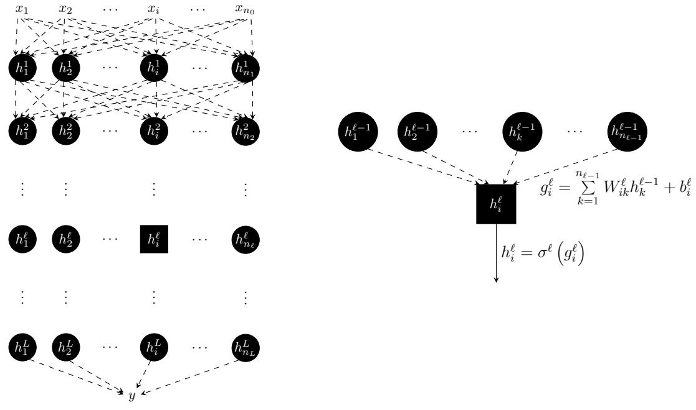
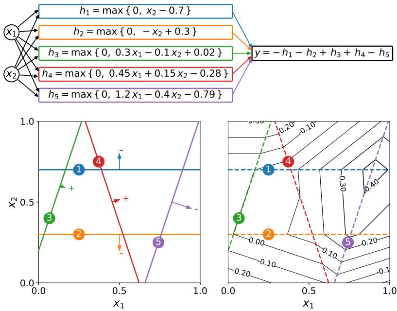
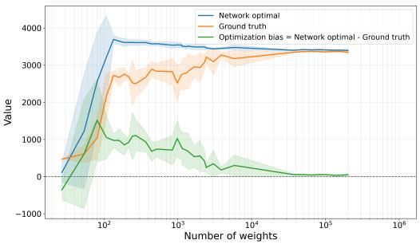
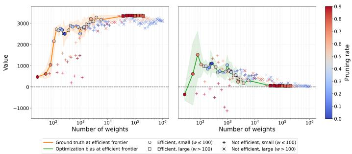
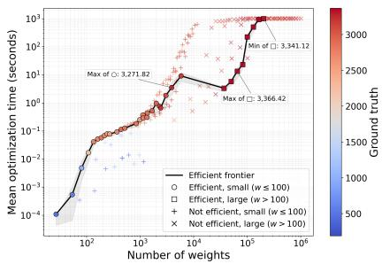
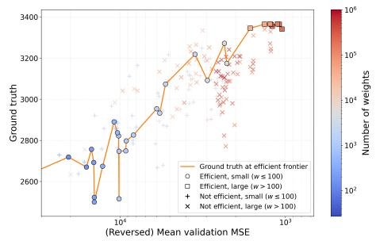
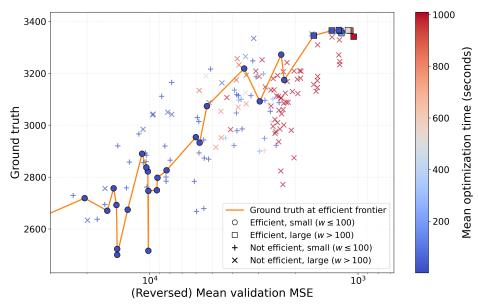
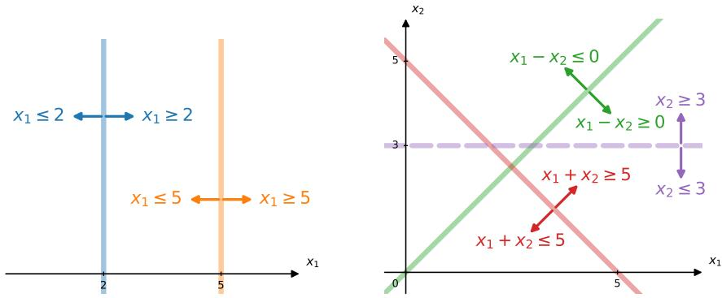
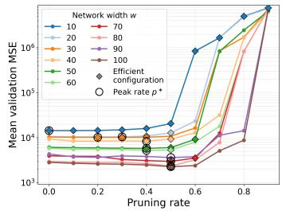
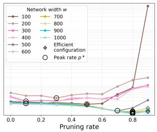

# Constraint Learning by Optimizing over Trained Neural Networks: A Pragmatic Tutorial

Jiaxiao Fang and Thiago Serra

University of Iowa

October 2026

## Abstract

Constraint learning is an emerging paradigm of modeling optimization problems with the help of machine learning. In this paradigm, trained machine learning models are embedded into the optimization model. For example, we can learn constraints empirically from available data, or we can avoid using a nonlinear objective function by learning a simpler approximation for it. Neural networks become a compelling option if the machine learning models must capture more elaborate and nuanced relationships. However, optimization models embedding neural networks may become too large or too slow to solve. In this tutorial, we present practical considerations for an efective and eficient use of constraint learning with neural networks and validate it with a case study highlighting the benefit of smaller and sparser networks.

Keywords: Constraint learning, Mixed-integer programming, Neural networks, Piecewise-linear optimization, Rectified linear units, Surrogate models

## 1 Introduction

We may not fully understand how neural networks arrive at a conclusion, but we know that they can handle complex tasks better than more intuitive counterparts, such as decision trees (Baldi et al., 2014, LeCun et al., 2015). That fits into a broader narrative outlined in Sutton’s manifesto The Bitter Lesson about how general-purpose methods backed by massive computation led to the most efective advances in AI, from playing chess and Go at competitive levels to achieving reliable results in speech recognition and computer vision (Sutton, 2019). And this narrative begets the question: what if some parts of a mathematical optimization model were learned with neural networks? In machine learning, the cost of producing a model (training) is generally orders of magnitude above the cost of using it (inference). However, if neural networks are embedded into a mathematical optimization model and possibly queried several times while solving the optimization model, then the inference cost adds up to another order of magnitude. This tutorial is about when to use neural networks in optimization models—and how to circumvent their computational cost.

We define as constraint learning the use of neural networks, or other machine learning models, as a proxy for some parts of a mathematical optimization model. However, that term is also used more generally for the automatic process of learning the model of a problem in Constraint Programming (CP)1 (Kolb, 2016, Lombardi and Milano, 2018). As observed by Raedt et al. (2018), constraint learning stands for an inductive (probabilistic) approach of learning constraints, in contrast to the deductive (provable) approach used for inferring valid constraints (cuts). When machine learning is involved, this probabilistic approach translates into approximating through data a complex or unknown constraint or term of the objective function. The special case of using neural networks has been first explored in CP models by Bartolini et al. (2011) and in mathematical optimization models by Say et al. (2017) and Cheng et al. (2017), to which many other studies followed in both communities.

Curiously, the term constraint learning would only find its way into mathematical optimization six years later, but would soon become widely used as a synonym for embedding neural networks in optimization models.2 However, other terms have been used to denote special or general cases of constraint learning. While Lombardi et al. (2017) suggested denoting the use of general-purpose machine learning models for constraint learning as empirical model learning, the practice of using simpler models to approximate complex or unknown relationships in engineering has been generally denoted as surrogate modeling (Bhosekar and Ierapetritou, 2018, Grimstad and Andersson, 2019).

Naming controversies aside, there are some important considerations for achieving a successful use of constraining learning with neural networks. This tutorial covers them in the following order:

• We discuss why neural networks can be helpful; what type of neural network to use and how to incorporate them in mathematical optimization models; and where they have been applied in Why, What, and Where to Use Neural Networks in Modeling? This is our summary of positives.

• We briefly discuss when neural networks exceed the modeling needs and we present alternatives for such cases in When Not to Use a Neural Network in Optimization Models? This is our warning.

• Most importantly, we discuss what technical choices lead to a more effective use by illustrating those choices with experiments on a synthetic dataset in How to Use Neural Networks in Optimization Models? This is our practical advice, which we support with experimental results.

• Finally, we briefly discuss advanced topics and related areas beyond the scope of this tutorial in Other Topics in Constraint Learning and at the AI–Optimization Interface.

## 2 Why, What, and Where to Use Neural Networks in Modeling?

For our purposes, it is convenient to think of a trained neural network as a function $\hat { f } : \mathbb { R } ^ { n _ { 0 } } \to \mathbb { R }$ used to approximate an unknown function $f ,$ and so we may refer to $\hat { f }$ as a proxy function with respect to $f .$ Moreover, it is suficient to consider a feedforward neural network, such as illustrated in Figure 1. There are certainly more sophisticated architectures that could be used for a neural network, but we will justify along this section why we do not recommend starting with them.

  
Figure 1: Left: Structure of a feedforward neural network with input $\pmb { x } \in \mathbb { R } ^ { n _ { 0 } }$ hidden layers $\ell = 1$ to L with $n _ { \ell }$ neurons each, and output $y \in \mathbb { R }$ . Right: Formula for output $h _ { i } ^ { \ell }$ of neuron i in layer ℓ from activation function $\sigma ^ { \ell } : \mathbb { R } \to \mathbf { \ell } .$ R and preactivation output $g _ { i } ^ { \ell } ,$ which uses previous layer output $\pmb { h } ^ { \ell - 1 }$ , neuron weights $\boldsymbol { W } _ { i * } ^ { \ell }$ , and bias $b _ { i } ^ { \ell } .$ . For details, see Neural Network Structure and Mapping (in Appendix).

In the case of an optimization problem over decision variables in x that is otherwise linear and with decision variables that are continuous $( \pmb { x } \in \mathbb { R } ^ { n } )$ ， integer $( { \pmb x } \in \mathbb { Z } ^ { n } )$ , or mixed-integer $( \pmb { x } \in \mathbb { Z } ^ { p } \times \mathbb { R } ^ { n - p } )$ , a neural network can model a constraint or term of the objective function as follows:

$$
\begin{array} { r l r } { \operatorname* { m a x } } & { } & { c ^ { T } x } \\ { \mathrm { s . t . } } & { } & { A x \leq b } \\ & { } & { \hat { f } ( x ) \leq d } \end{array}\tag{1}
$$

$$
\begin{array} { r l } { \operatorname* { m a x } } & { { } \boldsymbol { c } ^ { T } \boldsymbol { x } + \hat { f } ( \boldsymbol { x } ) } \end{array}
$$

$$
{ \mathrm { s . t . } } \qquad A x \leq b\tag{2}
$$

For example, we can think of $\hat { f }$ as an estimate of resource consumption capped at some value d in (1) or of profit in (2). Note that $\hat { f }$ does not necessarily need to involve all decision variables in x.

## 2.1 Why Use a Neural Network?

There are two main types of applications for constraint learning:

(i) When there is no formula mapping x to y, but we can estimate it from the available data.

(ii) When the formula mapping x to y is known, but it cannot be easily handled by a solver if stated in the optimization model. In this case, we can generate data and treat it as in (i).

Hence, we resort to machine learning to formulate the part of a mathematical optimization model that is either (i) unknown or (ii) intractable. Working with an unknown relationship based on the available data, such as in forecasting, is a common application of machine learning. Working with parts of a model that make an optimization problem harder to solve, such as with certain nonlinear functions or probability distributions, is an area of growing application of machine learning. We survey the constraint learning literature related to both in Where Have Neural Networks Been Used?

What makes neural networks particularly appealing in this context is that they are known to be universal function approximators, meaning that they can approximate most functions to an chosen precision ε. For example, suppose that we want to approximate a function $f$ with a neural network that produces a function $\hat { f }$ after being trained. For any valid x, approximating to such a precision means that $| f ( { \pmb x } ) - \hat { f } ( { \pmb x } ) | \leq \varepsilon$ . In other words, it is theoretically possible that the output of the neural network will not difer from f by more than ε. Finding such a neural network has been shown to be possible if there is a minimum number of neurons per layer (width) and a suficient number of layers (depth); or, conversely, a minimum depth and a suficient width instead (Huchette et al., 2026). However, we may end up working with neural networks that might not be as wide or deep; and we may depend on training algorithms that have limited theoretical guarantees. Nevertheless, the successful use of neural networks across a wide variety of domains is evidence that we may still obtain very satisfactory results in practice.

By considering neural networks as approximators in constraint learning, we are hoping to find a compromise to make it easier to solve optimization problems. In fact, approximations are already widely used in nonlinear and stochastic optimization. In nonlinear optimization, piecewise-linear functions are often used to approximate nonlinear functions (McCormick, 1976, Mangasarian et al., 2005, Vielma et al., 2010, Misener and Floudas, 2010, Huchette and Vielma, 2023), and we can indeed train neural networks to produce piecewise-linear functions. We illustrate in Figure 2 an example of a neural network on $\pmb { x } \in [ 0 , 1 ] ^ { 2 }$ (top) whose output y is piecewise-linear and depicted by contour plots (bottom right). We leave other parts of this figure, as well as the case of modeling probability distributions with neural networks, to be discussed in What Type of Neural Network Should I Use?

  
Figure 2: Top: Visual description of neural network used as example. Bottom left: Lines partitioning the space based on what inputs produce a positive output for each neuron, with the arrow pointing to the positive side, the length of the arrow proportional to the magnitude of the weights, and the arrow label denoting the influence on y. Bottom right: Contour plots of y over the lines associated with neural activations. The example and plots are adapted from Tong et al. (2026).

## 2.2 What Type of Neural Network Should I Use?

In short, we recommend a feedforward neural network in which the activation function is the Rectified Linear Unit $( R e L U ) \colon \sigma ^ { \ell } ( u ) = \operatorname* { m a x } \{ 0 , u \}$ . Now we proceed with the longer answer.

Why is ReLU a Good Choice? When we embed a neural network into an optimization model, we are efectively simulating the neural network within that model. However, unless the activation function $\sigma ^ { \ell }$ is a nonlinear function, the neural network is no more expressive than a linear regression.3 But we should be careful with our choice for $\sigma ^ { \ell }$ because nonlinear optimization models can be considerably more dificult to solve. As mentioned before, piecewiselinear approximations are commonly used to approach nonlinear optimization problems. That is because we can formulate piecewise-linear functions using only binary variables and linear constraints (Vielma et al., 2010), as we illustrate after this discussion with formulation (3). Hence, we can keep using only linear constraints and therefore a formulation based on (1) or (2) yields a Mixed-Integer Linear Programming (MILP) model, which is more tractable than its nonlinear counterpart.

The ReLU is convenient because it is a popular and relatively simple piecewiselinear function, consisting of the maximum between zero and the preactivation output of the neuron. ReLU started being adopted in deep neural networks by Nair and Hinton (2010) and Glorot et al. (2011) and in few years became the most commonly used activation function (LeCun et al., 2015, Ramachandran et al., 2018), only losing space with the emergence of the architectures currently used for generative artificial intelligence in transformers (Vaswani et al., 2017) and difusion models (Ho et al., 2020). In machine learning folklore, the ReLU is “nonlinear enough, but no more than necessary.”

By “nonlinear enough”, we mean that with the ReLU we can already model complex and nuanced relationships. Let us turn back to Figure 2 to understand this in more detail. At the top of Figure 2, we have a hidden layer with 5 neurons, each with its own parameters influencing its output. For example, the output of the first neuron is $h _ { 1 } ^ { 1 } = \operatorname* { m a x } \{ 0 , x _ { 2 } - 0 . 7 \}$ , implying that its output is positive $( h _ { 1 } ^ { 1 } > 0 )$ only when $x _ { 2 } - 0 . 7 > 0 \ ( \mathrm { i . e . , } \ x _ { 2 } > 0 . 7 )$ . In other words, the first neuron has no influence on the neural network output when $x _ { 2 } \leq 0 . 7$ At the bottom ${ \it l e f t }$ of Figure 2, this translates into the horizontal blue line at $x _ { 2 } = 0 . 7$ , which has an arrow pointing upwards to indicate the side where the neuron influences the network output. When we increase the value of $x _ { 2 }$ beyond 0.7, an increment of $\delta$ to $x _ { 2 }$ implies an increment of $\delta$ to $h _ { 1 } ^ { 1 }$ . Because of the negative influence of $h _ { 1 } ^ { 1 }$ on the network output $y ,$ an increment of δ to $x _ { 2 }$ implies a decrement of δ to y. At the bottom right of Figure 2, we see that the contour plots above $x _ { 2 } = 0 . 7$ are more horizontal and that the network output goes down as we increase x2. This reflects the influence of the first neuron on the network output.

Considering the influence of all five neurons in Figure 2, we have a piecewiselinear function with 12 pieces in $\pmb { x } \in [ 0 , 1 ] ^ { 2 }$ . Each one of those pieces, which is known as a linear region in machine learning, corresponds to a diferent subset of neurons influencing the network output. Hence, we may think that every extra neuron doubles the number of linear regions. That exponential growth may indeed happen at first, but it slows down when a layer has more neurons than inputs and becomes polynomial for a fixed number of layers, as we will discuss later. Still, the number of linear regions may keep growing exponentially with the number of layers (Huchette et al., 2026). This expressive power makes ReLU networks very appealing for modeling and approximation.

How to Embed a ReLU in a Mathematical Optimization Model? When we consider optimization and neural networks, there is an interesting contrast between training and constraint learning:

• In training, the inputs are fixed and we change the parameters (sets of weights and bias) to obtain values for the preactivation output and output that should match the training set.

• In constraint learning, the parameters are fixed and we change the inputs to obtain values for the preactivation output and output that would produce solutions that are feasible and better.

We believe that it is important for the reader to understand how a neural network gets embedded into an optimization model, especially for discussing what design choices are more efective afterwards. But later the reader may use frameworks that automate this embedding, such as MeLOn (Schweidtmann et al., 2020), JANOS (Bergman et al., 2022), OMLT (Ceccon et al., 2022), OCL (Fajemisin et al., 2024), MathOptAI.jl (Parker et al., 2024), Gurobi Machine Learning (Gurobi Optimization, 2025), and PySCIPOpt-ML (Turner et al., 2025).

Modeling Each Neuron We will describe two equivalent formulations for modeling each neuron, as presented in Serra et al. (2018) and Fischetti and Jo (2018). The first uses only algebraic expressions, which makes it implementable in any MILP solver. The second also uses logic expressions, which can be very convenient if they are supported by the solver.

For every neuron i in every layer $\ell ,$ the row of weights $\boldsymbol { W } _ { i * } ^ { \ell }$ and the bias $b _ { i } ^ { \ell }$ of the neuron are constant; whereas the input $\pmb { h } ^ { \ell - 1 }$ , preactivation output $g _ { i } ^ { \ell }$ , and output $h _ { i } ^ { \ell }$ are decision variables. Hence, we formulate the algebraic mapping from the input $\pmb { h } ^ { \ell - 1 }$ to the output $h _ { i } ^ { \ell }$ as follows:

$$
\sum _ { k = 1 } ^ { n \ell - 1 } W _ { i k } ^ { \ell } h _ { k } ^ { \ell - 1 } + b _ { i } ^ { \ell } = g _ { i } ^ { \ell }\tag{3a}
$$

$$
g _ { i } ^ { \ell } = h _ { i } ^ { \ell } - \bar { h } _ { i } ^ { \ell }
$$

$$
h _ { i } ^ { \ell } \leq H _ { i } ^ { \ell } z _ { i } ^ { \ell }\tag{3b}
$$

(3c)

$$
\bar { h } _ { i } ^ { \ell } \leq \bar { H } _ { i } ^ { \ell } ( 1 - z _ { i } ^ { \ell } )\tag{3d}
$$

$$
h _ { i } ^ { \ell } \geq 0\tag{3e}
$$

$$
\bar { h } _ { i } ^ { \ell } \geq 0\tag{3f}
$$

$$
z _ { i } ^ { \ell } \in \{ 0 , 1 \}\tag{3g}
$$

With constraint $\mathrm { ( 3 a ) }$ , we model how the output $h _ { k } ^ { \ell - 1 }$ of every neuron k in layer $\ell - 1$ contributes to the preactivation output $g _ { i } ^ { \ell }$ of neuron i in layer ℓ. With the remaining constraints, (3b) to $\left( 3 \mathrm { g } \right)$ , we model the relationship between that preactivation output $g _ { i } ^ { \ell }$ and the neuron output $h _ { i } ^ { \ell }$ . The central element in those constraints is the binary decision variable $z _ { i } ^ { \ell }$ modeling if the neuron is active:

• If we set $z _ { i } ^ { \ell } = 1$ , then constraints (3b) to (3g) simplify as follows:

$$
\left\{ \begin{array} { c } { { g _ { i } ^ { \ell } = h _ { i } ^ { \ell } - \bar { h } _ { i } ^ { \ell } } } \\ { { h _ { i } ^ { \ell } \leq H _ { i } ^ { \ell } } } \\ { { \bar { h } _ { i } ^ { \ell } \leq 0 } } \\ { { h _ { i } ^ { \ell } \geq 0 } } \\ { { \bar { h } _ { i } ^ { \ell } \geq 0 } } \\ { { ( z _ { i } ^ { \ell } = 1 ) } } \end{array} \right\} \Rightarrow \left\{ \begin{array} { c } { { g _ { i } ^ { \ell } = h _ { i } ^ { \ell } - \bar { h } _ { i } ^ { \ell } } } \\ { { 0 \leq h _ { i } ^ { \ell } \leq H _ { i } ^ { \ell } } } \\ { { \bar { h } _ { i } ^ { \ell } = 0 } } \end{array} \right\} \Rightarrow \left\{ \begin{array} { c } { { g _ { i } ^ { \ell } = h _ { i } ^ { \ell } } } \\ { { 0 \leq h _ { i } ^ { \ell } \leq H _ { i } ^ { \ell } } } \\ { { ( \cdot \cdot g _ { i } ^ { \ell } \geq 0 ) } } \end{array} \right\}\tag{4}
$$

In the first step, we reduce the terms that are dependent on $z _ { i } ^ { \ell } ,$ turning $H _ { i } ^ { \ell } z _ { i } ^ { \ell }$ into $H _ { i } ^ { \ell }$ and $\bar { H } _ { i } ^ { \ell } ( 1 - z _ { i } ^ { \ell } )$ into 0. In the second step, we combine the constraints bounding $h _ { i } ^ { \ell }$ and $\bar { h } _ { i } ^ { \ell }$ respectively into $0 \leq h _ { i } ^ { \ell } \leq H _ { i } ^ { \ell }$ and $\bar { h } _ { i } ^ { \ell } = 0$ Finally, we state that $\dot { g _ { i } ^ { \ell } } = h _ { i } ^ { \ell }$ because $\bar { h } _ { i } ^ { \ell } = 0$ , which implies that $g _ { i } ^ { \ell } \geq 0$

• Otherwise, if we set $z _ { i } ^ { \ell } = 0$ , then constraints (3b) to (3g) simplify as follows:

$$
\left\{ \begin{array} { c } { g _ { i } ^ { \ell } = h _ { i } ^ { \ell } - \bar { h } _ { i } ^ { \ell } } \\ { h _ { i } ^ { \ell } \leq 0 } \\ { \bar { h } _ { i } ^ { \ell } \leq \bar { H } _ { i } ^ { \ell } } \\ { h _ { i } ^ { \ell } \geq 0 } \\ { \bar { h } _ { i } ^ { \ell } \geq 0 } \\ { z _ { i } ^ { \ell } = 1 } \end{array} \right\} \Rightarrow \left\{ \begin{array} { c } { g _ { i } ^ { \ell } = h _ { i } ^ { \ell } - \bar { h } _ { i } ^ { \ell } } \\ { 0 \leq \bar { h } _ { i } ^ { \ell } \leq \bar { H } _ { i } ^ { \ell } } \\ { h _ { i } ^ { \ell } = 0 } \end{array} \right\} \Rightarrow \left\{ \begin{array} { c } { g _ { i } ^ { \ell } = - \bar { h } _ { i } ^ { \ell } } \\ { 0 \leq \bar { h } _ { i } ^ { \ell } \leq \bar { H } _ { i } ^ { \ell } } \\ { ( \cdot \cdot g _ { i } ^ { \ell } \leq 0 ) } \end{array} \right\}\tag{5}
$$

In the first step, we reduce the terms that are dependent on $z _ { i } ^ { \ell } ,$ turning $H _ { i } ^ { \ell } z _ { i } ^ { \ell }$ into 0 and $\bar { H } _ { i } ^ { \ell } ( 1 - z _ { i } ^ { \ell } )$ into $\bar { H } _ { i } ^ { \ell }$ . In the second step, we combine the constraints bounding $h _ { i } ^ { \ell }$ and $\bar { h } _ { i } ^ { \ell }$ respectively into $h _ { i } ^ { \ell } = 0$ and $\bar { 0 } \leq \bar { h } _ { i } ^ { \ell } \leq \bar { H } _ { i } ^ { \ell }$ . Finally, we state that $g _ { i } ^ { \ell } = - \bar { h } _ { i } ^ { \ell }$ because $h _ { i } ^ { \ell } = 0$ , which implies that $g _ { i } ^ { \ell } \leq 0$

In terms of the ReLU function $h _ { i } ^ { \ell } = \operatorname* { m a x } \{ 0 , g _ { i } ^ { \ell } \} , z _ { i } ^ { \ell } = 1$ corresponds to the case in which the neuron is active and $h _ { i } ^ { \ell } = g _ { i } ^ { \ell }$ ; whereas $z _ { i } ^ { \ell } = 0$ corresponds to the case in which the neuron is inactive and $h _ { i } ^ { \ell } = 0 . { } ^ { 4 }$ However, this formulation is only valid if, for any possible input $\pmb { h } ^ { \ell - 1 }$ , we assure that $g _ { i } ^ { \ell } \leq H _ { i } ^ { \ell }$ in the first case (since $h _ { i } ^ { \ell } \leq H _ { i } ^ { \ell } )$ and $g _ { i } ^ { \ell } \geq - \bar { H } _ { i } ^ { \ell }$ in the second case (since $\bar { h } _ { i } ^ { \ell } \leq H _ { i } ^ { \ell } )$ ). Hence, the values of $H _ { i } ^ { \ell }$ and $\bar { H } _ { i } ^ { \ell }$ should be large enough. Those are the big–M constants used in the big–M constraints (3c) and (3d): when $z _ { i } ^ { \ell } = 1$ , it is as if constraint (3c) did not exist; and likewise for constraint (3d) when $z _ { i } ^ { \ell } = 0$ . Still, those constants should be preferably as small as possible.5

As you may have guessed, or may have painfully experienced yourself, handling big–M constants is not very convenient: making them too large leads to numerical issues and making them too small leads to an invalid formulation. Many modern solvers support indicator constraints for expressing big–M constraints and delegating the calculations involved to the solver. To formulate as in Fischetti and Jo (2018) but with the notation above, we replace constraints (3c) and (3d) as follows:

$$
z _ { i } ^ { \ell } = 0 \to h _ { i } ^ { \ell } \leq 0\tag{3c’}
$$

$$
z _ { i } ^ { \ell } = 1  \bar { h } _ { i } ^ { \ell } \leq 0\tag{3d’}
$$

Modeling the Entire Network Now we can efectively model the function $f ( { \pmb x } )$ represented by a neural network using Mixed-Integer Linear Programming (MILP) as follows:

$$
\pmb { x } = \pmb { h } ^ { 0 }\tag{6a}
$$

$$
( 3 a ) \quad \quad \forall \quad \ell \in \{ 1 , \dots , L + 1 \} ,
$$

$$
i \in \{ 1 , \ldots , n _ { \ell } \}\tag{6b}
$$

$$
( 3 b ) \mathrm { ~ t o ~ } ( 3 g ) \quad \forall \quad \ell \in \{ 1 , \ldots , L \} ,
$$

$$
i \in \{ 1 , \ldots , n _ { \ell } \}\tag{6c}
$$

$$
g _ { 1 } ^ { L + 1 } = y\tag{6d}
$$

The whole-network formulation models the preactivation output $g _ { i } ^ { \ell }$ of each neuron i in layer ℓ in terms of its input $\pmb { h } ^ { \ell - 1 }$ with constraint (6b) and the output $h _ { i } ^ { \ell }$ in terms of $g _ { i } ^ { \ell }$ with constraint (6c). Both constraints are applied to the L hidden layers with ReLU activation, but only the first one is applied to the output neuron in layer $L + 1$ . We do not apply the ReLU activation to this last neuron because it would prevent us from representing negative outputs with $f ( { \pmb x } )$ . The other two constraints, (6a) and (6d), are just “syntax sug $\mathrm { u r } ^ { \dag }$ between the internal naming of the network decision variables at each end, $\bar { \pmb { h } } ^ { 0 }$ and $g _ { 1 } ^ { L + 1 }$ and the external naming of decision variables in Figure 1 and formulations (1) and (2), x and y. Hence, we can model either formulations (1) or (2) as an

MILP by denoting f(x) as y along with the constraints in (6) for binding x to y.

What About Other Choices? Readers who are more familiar with machine learning may have questions because they have seen more sophisticated architectures elsewhere, such as other activation functions that have gained popularity recently, convolutional neural networks as a bare minimum in computer vision, and transformers as the standard architecture in contemporary natural language processing. Continuing with the longer answer, we will now discuss if and how other common architectures and variants are amenable for use in constraint learning as presented here.

First, there are other activation functions that are also piecewise-linear, and as such they can also be modeled using a MILP formulation (Vielma et al., 2010). Some of the most popular examples include the leaky ReLU (Maas et al., 2013), parametric ReLU (He et al., 2015), and maxout (Goodfellow et al., 2013); with a formulation for the latter described in Serra et al. (2018).

Second, there are some popular activation functions used to shape the network output as a probability, such as the sigmoid $\sigma ( u ) = \frac { 1 } { 1 + e ^ { - u } }$ (Rumelhart et al., 1986) for single (scalar) outputs.6 Unlike the original setting that we described in Figure 1 and refined in Neural Network Structure and Mapping (in Appendix), in this case we are also applying an activation function to the internal representation of the network output $\bar { g } _ { 1 } ^ { L + 1 }$ , i.e., $y = \sigma ^ { L + 1 } \left( g _ { 1 } ^ { L + 1 } \right) =$ $\frac { 1 } { 1 + e ^ { - g _ { 1 } ^ { L + 1 } } }$ . If the neural network models a constraint as in formulation (1), i.e., $f ( { \pmb x } ) \leq d$ for d constant, then we can reformulate the sigmoid output as a linear constraint: $f ( \pmb { x } ) = \frac { 1 } { 1 + e ^ { - g _ { 1 } ^ { L + 1 } } } \leq d$ implies that $g _ { 1 } ^ { L + 1 } \geq \ln ( d ) - \ln ( 1 - d )$ In turn, if the neural network models the entire objective function, as in formulation (2) but with $\begin{array} { r } { \mathbf { c } = \mathbf { 0 } , } \end{array}$ i.e., the objective function is simply max $f ( { \pmb x } )$ , then we can use the monotonicity of the sigmoid function to maximize (or minimize) directly on $g _ { 1 } ^ { L + 1 }$ . In other words, we maximize $g _ { 1 } ^ { L + 1 }$ instead of $y = \sigma ^ { L + 1 } ( g _ { 1 } ^ { L + 1 } )$ . Other possibilities, such as an objective of the form max $\pmb { c } ^ { T } \pmb { x } + f ( \pmb { x } )$ for $\mathbf { c } ^ { T } \neq \mathbf { 0 }$ would require a more sophisticated approach, which is beyond the scope of this tutorial.

Third, there are other types neural networks in which the same parameters are applied over multiple parts of the input. For example, that is the case of convolutional neural networks used in computer vision (LeCun et al., 1998), where a filter consisting of a small set of parameters is applied to multiple regions centered on diferent pixels of the image. This concept is generalized to other forms of structured data with graph convolutional networks (Kipf and Welling, 2017), where a filter is applied to the neighborhood of each node of a graph representing the data. In both cases, every filter is equivalent to multiple neurons in terms of our setting in this tutorial, each of which applying the same transformation but to diferent regions of the input. Therefore, it is also possible to work in constraint learning with convolutional and graph convolutional neural networks with piecewise-linear activation functions. In fact, Zhang et al. (2024) extend the OMLT framework for that purpose. But because every filter corresponds to multiple neurons, this compact representation may disguise the much larger MILP formulations that are produced—to the point that it may become dificult to solve them, as we will see in How to Use Neural Networks in Optimization Models?

Finally, and less fortuitously, some other activation functions that have gained popularity in recent years are not piecewise-linear, such as the Gaussian Error Linear Unit (GELU) (Hendrycks and Gimpel, 2016), the Sigmoidweighted Linear Unit (SiLU) (Elfwing et al., 2018), and Swish (Ramachandran et al., 2018). However, they are more often associated with generative models (Shazeer, 2020) and with improving predictive performance in large-scale models. Since one of the tacit premises of constraint learning is that of using the neural network as a more tractable approximation for nonlinear parts of a formulation, which entails the use of modestly-sized models and activation functions more amenable to optimization, those activations would be less appealing in this case.

## 2.3 Where Have Neural Networks Been Used?

Neural networks have been used in many constraint learning applications, most notably to represent chemical engineering processes and power systems dynamics. We outline a non-exhaustive list of references in Table 1 by approximate chronological order, briefly describing the type of optimization problem approached and the purpose of the neural network within that optimization model. References presenting multiple applications (Schweidtmann and Mitsos, 2019, Dumouchelle et al., 2022, 2024b,a, Liu and Oliveira, 2025) are separated with horizontal lines for ease of reading.

We have deliberately excluded from Table 1 other optimization problems discussed in those and in other references if the optimization model embeds another type of predictive model; such cases are briefly outlined in When Not to Use a Neural Network in Optimization Models? For brevity, we have also excluded more recent references revisiting the same settings with a diferent approach.

On the other hand, we have deliberately included some references in Table 1 describing applications in which a neural network is used but not explicitly embedded in an optimization model; such cases correspond to the first four rows. All of them are applied optimization problems in chemical engineering, sharing the common theme of using a neural network as a surrogate for a complex system. Among them, the closest to the constraint learning setting is Fahmi and Cremaschi (2012), which uses a disjunctive programming formulation. Most of them predate the popularization of the ReLU activation in neural networks, which was a turning point because the ReLU activation can be embedded in more tractable optimization models than the activation functions used earlier.

<table><tr><td rowspan=1 colspan=1>Reference</td><td rowspan=1 colspan=1>Type of problem(s)</td><td rowspan=1 colspan=1>Prediction(s) involved</td></tr><tr><td rowspan=1 colspan=1>Huang et al. (2003)Fernandes (2006)Fahmi and Cremaschi (2012)Sant Anna et al. (2017)Lombardi et al. (2017)Say et al. (2017)</td><td rowspan=1 colspan=1>Catalyst compositionSynthesis of a specific oil productBiodiesel production plant designPSA operation for N2/CH4 separationComputational workload dispatchHVAC, navigation, reservoir control</td><td rowspan=1 colspan=1>Catalytic performanceOutcome of a catalytic processUnit operation, thermodynamics, mixingNitrogen/methane purity and recoveryProcessor efficiency for assignmentState transition in sensors</td></tr><tr><td rowspan=1 colspan=1>Schweidtmann and Mitsos (2019)</td><td rowspan=1 colspan=1>Operation of a fermentation processOperating point of a compressor plantOperating point of a cumene process</td><td rowspan=1 colspan=1>Fermentation outcomeCompressor power consumptionProcess-unit outputs throughout the plant</td></tr><tr><td rowspan=1 colspan=1>Grimstad and Andersson (2019)Bergman et al. (2022)Kody et al. (2022)Murzakhanov et al. (2022)</td><td rowspan=1 colspan=1>Offshore oil well operationScholarship allocationUnit commitmentAC power flow dispatch</td><td rowspan=1 colspan=1>Well production, pipeline pressure dropScholarship acceptanceAC power-flow solutionSafisfaction of security constraints</td></tr><tr><td rowspan=1 colspan=1>Dumouchelle et al. (2022)</td><td rowspan=1 colspan=1>Facility locationInvestment decisionServer allocationPooling</td><td rowspan=1 colspan=1>Customer demandReturn on investmentClient demandProduct demand</td></tr><tr><td rowspan=1 colspan=1>Alcántara and Ruiz (2023a)Alcántara and Ruiz (2023b)McDonald et al. (2024)Kronqvist et al. (2024)</td><td rowspan=1 colspan=1>Energy productionElectricity pricingMolecular designDay-ahead power generation &amp; trade</td><td rowspan=1 colspan=1>Node voltageDemand, day-ahead price, solar generationMolecule boiling pointOptimal intra-day generation</td></tr><tr><td rowspan=1 colspan=1>Dumouchelle et al. (2024b)</td><td rowspan=1 colspan=1>First-stage robust knapsack decisionFirst-stage investment decision</td><td rowspan=1 colspan=1>Optimal second-stage objectiveOptimal second-stage objective</td></tr><tr><td rowspan=1 colspan=1>Dumouchelle et al. (2024a)</td><td rowspan=1 colspan=1>Knapsack minimization for a leaderNetwork nodes to protectDonation allocationNetwork design</td><td rowspan=1 colspan=1>Optimal knapsack value for a followerProfit following network attackReturn on projects developed by recipientTotal network travel time</td></tr><tr><td rowspan=1 colspan=1>Maragno et al. (2025)Liu and Dvorkin (2025)</td><td rowspan=1 colspan=1>Diet planningData center allocation</td><td rowspan=1 colspan=1>Diet palatabilityElectricity price</td></tr><tr><td rowspan=1 colspan=1>Liu and Oliveira (2025)</td><td rowspan=1 colspan=1>Jet engine turbine blade designConversion of natural gas to H2</td><td rowspan=1 colspan=1>Maximum blade temperatureH2 and N2 concentrations, other process outputs</td></tr><tr><td rowspan=1 colspan=1>Feng et al. (2026)Klimek et al. (2026)Lüthje et al. (2026)Vahabzadeh et al. (2026)</td><td rowspan=1 colspan=1>Wind farm planningKerosene productionDesign and operation of Carnot batteriesUnderground hydrogen storage and operation</td><td rowspan=1 colspan=1>Wind power productionThermochemical and catalytic subprocessesThermodynamic propertiesHydrogen recovery factor</td></tr></table>

Table 1: Applications from constraint learning studies in which neural networks are used.

## 3 When Not to Use a Neural Network in Optimization Models?

We have seen that a neural network can be a very expressive model for function approximation, which can be helpful in many applications. However, we may not need to always go that far. For example, there are many studies based on embedding much simpler predictive models into optimization models, such as the non-exhaustive list of references illustrated in Table 2. We list the types of models by perceived complexity, citing earlier or most relevant references using each type.

Before training any neural network, it might be wise to run at least a linear regression and evaluate how good the predictions and decision quality can be with it. Moreover, as we will see next, the size of a neural network may afect how long it takes to solve the optimization model embedding it, sometimes in a prohibitive way if we are not careful. Hence, smaller and simpler can be better.

<table><tr><td>Type of predictive model</td><td>References</td></tr><tr><td>Linear regression</td><td>Bertsimas et al. (2016), Verwer et al. (2017)</td></tr><tr><td>Logistic regression</td><td>Bergman et al. (2022)</td></tr><tr><td>Support vector machine</td><td>Hooshmand and Nikoomanesh (2025)</td></tr><tr><td>Multivariate adaptive regression spline</td><td>Martinez et al. (2017)</td></tr><tr><td>Regression tree</td><td>Verwer et al. (2017), Ammari et al. (2023)</td></tr><tr><td>Decision tree</td><td>Bonfietti et al. (2015), Lombardi et al. (2017), Kudła and Pawlak (2018)</td></tr><tr><td>Random forest</td><td>Bonfietti et al. (2015)</td></tr></table>

Table 2: Constraint learning studies in which other types of predictive models are embedded.

## 4 How to Use Neural Networks in Optimization Models?

So far we have discussed the potential applications, expressive power, and modeling convenience of embedding neural networks in MILP models. But as we have just alluded to in the previous section, dimensioning the neural network properly is crucial for a successful use in constraint learning.

## 4.1 The Efect of Neural Network Design Choices

In order to choose more appropriate neural networks to embed in optimization models, we may benefit from insights from both the machine learning and the mathematical optimization communities. In what follows, we will discuss three dimensions that we believe are reasonably well understood by those communities, although what each community knows may not be fully realized by the other.

Dimension 1: Number of neurons. The total number of neurons $N =$ $\scriptstyle \sum _ { \ell = 1 } ^ { L } n _ { \ell }$ is perhaps one of the best metrics to start discussing performance tradeofs in constraint learning; but also one for which the priorities of machine learning and the mathematical optimization practitioners may not be fully aligned.

From a machine learning perspective, more neurons is better: it is intuitive that a neural network with more neurons is more expressive; and we can say even more if the activation function is the ReLU. Consider again the example in Figure 2 and the explanation about linear regions in Page 7: we can think of a neural network with ReLU activations as a piecewise-linear function, where each piece corresponds to a diferent combination of neurons being active or inactive. If we have N neurons, then we may potentially have a piecewise-linear function with $2 ^ { N }$ pieces. Indeed, at some point we may also have too many neurons and the neural network may actually overfit for its purpose, meaning that it performs well on the data used for training because of memorization instead of generalization, and by consequence it does not perform as well on unseen data. The neural network may also become too expensive to train or use at that point. However, as we will see next, we are unlikely to reach such a point in constraint learning because of other adverse efects.

From a mathematical optimization perspective, less neurons is faster: it is intuitive that solving an optimization model embedding a larger neural network takes longer. If we consider the formulation $( \mathrm { 3 a ) \mathrm { - } ( 3 g ) }$ mapping inputs to output of each neuron with ReLU activation, one of the main issues is the use of big M constraints (3c) and (3d), for which the values of the constants $H _ { i } ^ { \ell }$ and $\bar { H } _ { i } ^ { \ell }$ must be as large as the variables $h _ { i } ^ { \ell }$ and $\bar { h } _ { i } ^ { \ell }$ could ever be for any valid input. At a microscopic $\mathrm { l e v e l } ^ { 7 }$ , the main issue with such big M constraints is what happens in the linear relaxation when those output variables take much smaller values. For example, if we relax the binary variable $z _ { i } ^ { \ell }$ to be continuous between zero and one, then we can satisfy constraint (3c) with $h _ { i } ^ { \ell } = 1$ and $z _ { i } ^ { \ell } = 0 . 0 0 1$ in a formulation where $H _ { i } ^ { \ell } = 1 0 0 0 ;$ although $h _ { i } ^ { \ell } > 0$ requires $z _ { i } ^ { \ell } = 1$ . When a solution with many binary variables having small values is obtained at a node of the branch-and-bound tree, we get very limited guidance on how to branch next. Because we may risk exploring as many as $2 ^ { \overset { \smile } { N } }$ branch-and-bound nodes, solver runtime may induce a smaller choice of $N$ than training, use, or overfitting would.

Dimension 2: Size of the input. Although less evident, the size of the input n of a neural network is an important metric; and one for which a smaller size can be advantageous from both perspectives. Even if the size of the input is not typically under our control, understanding its efect helps explaining why neural networks that are otherwise identical yield very diferent results. Intuitively, a dataset with fewer dimensions may require a smaller neural network, but that is just the tip of the iceberg.

From a machine learning perspective, fewer inputs means a simpler model: the neural network is modeling a function on a smaller domain. When we use the ReLU activation function, that surprisingly translates to modeling a piecewise-linear function with fewer pieces. Consider one more time the example in Figure 2, where a neural network with 5 neurons models a function with 12 pieces. If every piece, also known as a linear region, is defined by a combination of which neurons are active or not, then we could potentially have as many as $2 ^ { 5 } = 3 2$ regions. However, for a neural network with two inputs, we can only define up to 16 regions with five neurons in a single hidden layer; no matter how we change the network parameters8. Similarly, a small network input also afects the number of regions defined by neurons after the first layer and, more generally, any hidden layer being too narrow also afects the number of regions defined by the layers that follow it (Huchette et al., 2026). Serra et al. (2018) coined it as the bottleneck efect.

From a mathematical optimization perspective, fewer linear regions means a smaller feasible set: if every linear region corresponds to a diferent assignment to the binary variables in z, then having fewer linear regions means that more of the binary assignments to z are infeasible. When it comes to solving the

MILP formulation by using branch-and-bound, we are likely to reach infeasible nodes more often with a neural network having fewer inputs in the formulation. Hence, even if the formulation is weak because of the big M constraints, we may not need to go very deep before coming across dead ends with the branchand-bound algorithm. For the same reason, local search methods that explore their neighborhood more thoroughly—and thus resemble more the enumerative approach of the branch-and-bound algorithm—tend to be more competitive when the neural network has smaller input size. For smaller inputs, the method by Perakis and Tsiourvas (2022) tends to produce better solutions in comparison to the method by Tong et al. (2024), and the latter tends to produce better solutions in comparison to the method by Tong et al. (2026). Conversely, we can find better solutions within a fixed time limit for optimization models embedding larger neural networks, and especially neural networks with larger input size, if we use heuristics that move faster from solution to solution; hence reversing the order of preference among the heuristics cited above. Moreover, we encourage the reader to be less afraid of trying larger neural networks when the input is smaller simply because the solver runtime is not going to be impacted as much.

Yet from a modeling perspective, this means that identifying any form of dimensionality reduction can be beneficial if we would like to use an MILP solver. Part of the modeling process consists of identifying what would be the inputs of the neural network, each input also being known as a feature among machine learning practitioners. For example, if we observe that two features are highly correlated, meaning that one can be a proxy for the other, then there might be also a benefit to solver runtime if one of those were to be dropped from the neural network that will be trained.

Dimension 3: Connectivity between neurons. We often observe neural networks being measured and compared in terms of their number of parameters. For example, the number of parameters is often used as a proxy for the capability of generative models: when a new and arguably more capable model is announced, its larger number of parameters is often emphasized. Indeed, more capable neural networks tend to have larger dimensions, and therefore it seems intuitive that having a larger number of parameters should be better. However, reducing the number of parameters of a neural network can be beneficial. This is usually done with network pruning, where we fix some of the parameters, typically the weights, to zero after training and keep them at zero going forward.

From a machine learning perspective, the training of larger neural networks is often more successful for at least a couple of reasons. First, training is solved as an unconstrained optimization problem using first-order methods, where the objective function is known as the loss function; and larger neural networks define a smoother loss, yielding better convergence (Li et al., 2018, Sun et al., 2020). Second, having more neurons per layer prevents the layers from becoming entirely inactive and stall training (Riera et al., 2022). But after training, we can remove as much as half of the parameters of suficiently large neural networks and still recover or improve upon the original predictive performance by retraining after pruning, which is known as finetuning (Hoefler et al., 2021); where “suficiently large” depends on what we train the neural network for (Liebenwein et al., 2021), and finetuning is generally brief because the loss landscape from zeroing out pretrained networks yields a faster convergence (Jin et al., 2022). But curiously, and also fortunately, the number of linear regions is not afected by a moderate amount of pruning (Cai et al., 2023). Finally, a simple heuristic known as magnitude pruning, which consists of removing the weights with smallest absolute value, tends to be very efective for moderate pruning (Pham et al., 2026).

From a mathematical optimization perspective, MILP solvers have been historically designed to exploit the sparsity in models. Dey et al. (2018) observe that the number of nonzero coeficients in constraints is often very small in benchmark problems, and that Linear Programming (LP) solvers rely on linear algebra routines that can be made more eficient by exploiting matrix sparsity. One such example is the study by Crowder et al. (1983) that first solved several large-scale but sparse LP models. Validating how this trend continued to influence MILP solvers design, Walter (2014) empirically verified a significant slowdown when models are augmented with a few dense constraints. In fact, some of the applications previously mentioned in Where Have Neural Networks Been Used? have deliberately applied network pruning to exploit the benefit of sparsity in MILP solvers (Say et al., 2017, Kody et al., 2022) and recent methodological studies have considered this topic in more detail (Cacciola et al., 2024, Pham et al., 2026, Lastrucci et al., 2026).

## 4.2 A Case Study

Having discussed mathematical formulations, potential applications, and hypothetical design choices of constraint learning, here we stand, poor fools, barely wiser in practice than before!9

We address this gap with a computational experiment. We use a hypothetical problem with a synthetic dataset generated from a function of our choosing because that allows us to compare neural network predictions with actual outcomes (i.e., the ground truth). This is typically not necessary when neural networks are used for prediction because we can reserve part of the dataset (the validation set) for comparing diferent neural networks. However, the solution coming out of the optimization model may assign inputs to the neural network that are outside the dataset.

In this example, we will focus on two factors mentioned in The Efect of Neural Network Design Choices, (i) number of neurons and (ii) connectivity between neurons, illustrating how they afect prediction quality, decision quality, and computational runtime. Those factors often require empirical calibration in constraint learning. The other factor, size of the input, would be harder to illustrate with a single example without an extensive discussion about dimensionality reduction.

Some technical details are intentionally omitted from the description below for ease of reading. For more details, we refer the reader to Details About Dataset Generation and to Additional Details About Computational Experiments (both in Appendix). Moreover, we note that this experiment is simply intended to substantiate our discussion, hence why we are focusing on a single problem.

The Problem A firm must decide how to spend their marketing budget for advertising a product across eight channels: television; radio; social media, including which platform to use; influencer sponsorship; billboard advertising; browser advertising; email advertising; and event sponsorship. Those decisions are influenced by product price, sales in the last month, and the marketing budget of the largest competitor; which we assume as exogenous parameters (i.e., not under our control). The goal is to maximize the estimated revenue from advertising decisions based on historical data associating past advertising decisions and exogenous parameters with product sales.

The Optimization Model To describe a model for this problem, we first introduce some notation. Problem dimensions:

$n _ { c } = 8 \colon$ the number of advertising channels.

$n _ { p } = 5 \mathrm { : }$ the number of social media platforms.

$n _ { e } = 3 \mathrm { : }$ the number of exogenous parameters.

Bounds on the problem data:

$l _ { i } ^ { c } \in \mathbb { R } _ { + }$ : lower bound on spending in channel i for $i = 1 , \dots , n _ { c }$

$u _ { i } ^ { c } \in \mathbb { R } _ { + }$ : upper bound on spending in channel i for $i = 1 , \dots , n _ { c }$

$l _ { i } ^ { e } \in \mathbb { R } _ { + } { : }$ : lower bound of exogenous parameter i for $i = 1 , \ldots , n _ { e }$

$u _ { i } ^ { e } \in \mathbb { R } _ { + }$ : upper bound of exogenous parameter i for $i = 1 , \ldots , n _ { e }$

Decision variables:

$x _ { i } \colon$ how much the firm spends in channel i for $i = 1 , \ldots , n _ { c }$

$z _ { i } \mathrm { : }$ if social media platform i is used for $i = 1 , \ldots , n _ { p }$

Instance data:

$B \in \mathbb { R } _ { + }$ : marketing budget for advertising the product.

$\xi _ { i } \in \mathbb { R } _ { + } ,$ : observed value for exogenous parameter i for $i = 1 , \ldots , n _ { e }$

Now we can formulate this problem as follows:

$$
\begin{array} { r l } { \operatorname* { m a x } } & { { } f ( \pmb { x } , \pmb { z } , \pmb { \xi } ) } \end{array}
$$

$$
\mathrm { s . t . } \sum _ { i = 1 } ^ { n _ { c } } x _ { i } \le B\tag{7a}
$$

(7b)

$$
\sum _ { i = 1 } ^ { n _ { p } } z _ { i } = 1\tag{7c}
$$

$$
\pmb { l } ^ { c } \leq \pmb { x } \leq \pmb { u } ^ { c }\tag{7d}
$$

$$
z \in \{ 0 , 1 \} ^ { n _ { p } }\tag{7e}
$$

Where function $f : \mathbb { R } _ { + } ^ { n _ { c } + n _ { p } + n _ { e } }  \mathbb { R }$ models revenue based on the values assigned to the decision variables in vectors x and z as well as on the values of the exogenous parameters in vector $\xi .$

The Dataset As a reminder, in constraint learning we work under the assumption that we cannot optimize directly over $f$ even if we know the exact expression for $f ,$ which is why we replace it by a proxy function $\hat { f }$ learned with a neural network. Hence, we constructed a nonlinear function $f$ intended to capture diminishing returns from spending more in each channel, diferent revenue peaks based on what social media platform is used, and declining revenue with price and competitor spending. Then we generated a synthetic dataset with observations of the form $\left( \bar { x _ { 1 } } , \bar { x _ { 2 } } , \ldots , x _ { n _ { c } } ^ { - } , \bar { z _ { 1 } } , \ldots , z _ { n _ { p } } ^ { - } , \bar { \xi _ { 1 } } , \ldots , \bar { \xi _ { n _ { e } } } , f ( \bar { x } , \bar { z } , \bar { \xi } ) + \varepsilon \right)$ where ε is a small fluctuation based on random noise. This dataset is partitioned into training and validation sets, which are used for obtaining and evaluating neural networks to be used as a proxy function $\hat { f }$ in the place of $f .$ . The validation set is only used to evaluate neural network predictions. For evaluating downstream decisions based on a neural network acting as a proxy, we use the ground truth function $f$ directly. Other details can be found in Details About Dataset Generation (in Appendix).

Neural Networks Evaluated Using 10 diferent random seeds to initialize the network parameters, we trained fully connected neural networks with $L = 2$ hidden layers, each layer $\ell \in \{ 1 , 2 \}$ having width $n _ { \ell } = w$ . We trained small neural networks with $w = 1 0 , 2 0 , \ldots$ , 100 neurons as well as large neural networks10 with $w = 1 0 0 , 2 0 0 , \ldots , 1 , 0 0 0$ neurons. To each trained network, we applied magnitude pruning to remove a fraction $p$ of the weights, with pruning rate $p = 0 . 0 , 0 . 1 , . . . , 0 . 9$ and, except for $p = 0 . 0$ , finetuned the pruned network. Given the number of seeds, widths, and pruning rates used in the computational experiment, we trained a total of 1,900 neural networks. We use the number of weights as one of the metrics for comparing these neural networks in terms of size. The number of weights is calculated as

$$
W ( d , w , p ) = ( d w + w ^ { 2 } + w ) ( 1 - p )\tag{8}
$$

for an input size $d ,$ width $w$ in the two hidden layers, and pruning rate $p .$ Other details can be found in Additional Details About Computational Experiments (in Appendix).

Predictive Accuracy Does the number of weights tell us everything, or at least something, about predictive accuracy?11 We start by comparing (a) the number of weights W(d, w, p) for diferent choices of width w and pruning rate $p$ with (b) predictive performance in Mean Squared Error (MSE) on the validation set, averaging across random seeds. Indeed, we observe a size–accuracy tradeof: the configurations that are not dominated by any other in both criteria define an eficient frontier, within which no other configuration is more accurate if smaller or less accurate if larger. Figure 3 illustrates all 190 $( w , p )$ configurations evaluated, where the eficient frontier contains 34 of those configurations. Although the most accurate configurations have a larger number of weights (see right side of the eficient frontier), note how those configurations at the eficient frontier tend to have higher pruning rates (see the markers becoming more red than blue). In other words: even if predictive performance improves with the number of weights, the most accurate models are pruned. Hence, there is a connection between the two metrics, but this connection is insuficient as a proxy for network accuracy: the configurations with the largest number of weights, which have almost 10 times more weights than any configuration at the eficient frontier, perform in line with small networks. So we turn to network pruning to understand the nuance of this relationship.

Efect of Pruning on Accuracy Can we always predict the efect of pruning in accuracy, or at least understand how it changes as neural networks get $\mathrm { l a r g e r ? ^ { 1 2 } }$ We refine our understanding about this dichotomy between (i) more accurate networks being larger and (ii) the most accurate networks being pruned by directly comparing, for networks with each width $w ,$ the pruning rate $p$ with their predictive performance. Figure 4 presents line chars for networks with width 10, 50, 100, and 1,000, with each configuration (w, p) at the eficient frontier being circled. By presenting the results in this way, we can take advantage of the following: if a line chart contains points at the eficient frontier, then the pruning rate $p ^ { * }$ with most accurate networks is the leftmost point. Figure 10 (in Appendix) presents the results across all widths, to which we may refer for generality. From the plots, we note that $p ^ { * }$ tends to increase with w. In fact, Figures 4 and 10 show three pattens regarding which pruning rates are at the eficient frontier, depending on $w ,$ , and those patterns help us understand how the pruning rate p vary along the eficient frontier in Figure 3:

• When the neural network dimensions are very small, any reduction in the number of weights worsens network accuracy, and so pruning is not beneficial. That happens in Figure 10 for $w = 1 0$ , where pruning more implies lower accuracy, and therefore all choices of $p$ are on the eficient frontier. In Figure $^ { 3 , }$ that explains the leftmost points (up to $3 \times 1 0 ^ { 3 }$ weights), going from red to blue $( p = 0 . 9$ to $p = 0 . 0 )$ with the number of weights.

• For other small networks, the neural network is slightly more accurate with a low pruning rate $p ^ { * }$ , and so moderate pruning is beneficial. That happens in Figure 10 for $w = 2 0$ to $w = 1 0 0$ , where some choices between $p = 0 . 2$ and $p = 0 . 6$ are on the eficient frontier. In Figure $^ { 3 , }$ that explains the middle segment of the eficient frontier (from $\mathrm { 3 \times 1 0 ^ { 3 } }$ to $1 0 ^ { 4 }$ weights) going from red to neutral $( p = 0 . 0$ to $p = 0 . 5 )$ , albeit with some fluctuations (such as $p = 0 . 6$ in between).

• For large networks, the neural network becomes pronouncedly more accurate with a high pruning rate $p ^ { * }$ , and so aggressive pruning is beneficial. That happens in Figure 10 for $w = 5 0 0$ to $w = 1 , 0 0 0$ , where only choices with $p = 0 . 8$ and $p = 0 . 9$ are on the eficient frontier. Although the most beneficial pruning rate $p ^ { * }$ keeps increasing, it never reaches the largest choice $( p ^ { * } \leq 0 . 8$ for $w \leq 1 0 0 0 )$ . In Figure 3, that explains the final segment of the eficient frontier (from $1 0 ^ { \overset { . } { 4 } }$ weights onward) having a drastic shift towards red $( p = 0 . 9 )$ while the largest parameter- $e f f i c i e n t ^ { { \bar { 1 } } 3 }$ network configuration (the rightmost point) has a slightly lower, but still high, pruning rate $( p = 0 . 8 )$ .

From a predictive accuracy perspective, network pruning is therefore not only beneficial, but actually necessary to obtain large neural networks that are more parameter-eficient. However, we have not yet put that in the context of solving optimization models in constraint learning.

Decision Quality and Optimization Bias If neural networks with more weights and adequate pruning are better for prediction, are they also better for optimization? To answer this question, we carry out the following sequence of steps with each neural network that we trained or pruned:

1. We solve the problem with the neural network by maximizing $\hat { f } ( { \pmb x } , z , { \pmb \xi } )$ subject to constraints $\mathrm { ( 7 b ) }$ to $\mathrm { ( 7 e ) ^ { 1 4 } }$ . That gives us a solution $( { \pmb x } ^ { * } , z ^ { * } )$ with the network optimal value $\hat { f } ( x ^ { * } , z ^ { * } , \pmb { \xi } )$

2. We measure how good that solution actually is through the ground truth value $f ( x ^ { * } , z ^ { * } , \xi )$

3. We measure the disagreement between the two by simply taking their diference, which Lombardi et al. (2017) defines as the optimization bias $\beta : = \hat { f } ( { \pmb x } ^ { * } , z ^ { * } , { \pmb \xi } ) - f ( { \pmb x } ^ { * } , z ^ { * } , { \pmb \xi } )$

When solving the optimization models, we set a time limit of 1,000 seconds to avoid spending too long with configurations that may not be the most parameter-eficient. As we will see from the plots, that time limit was suficient for our experiments.

Based on the values that we observe for configurations at the eficient frontier in Figure 5, we can draw some conclusions for suficiently large neural networks. First, and not very surprisingly, larger networks naturally yield better solutions because the ground truth value tends to increase and the optimization bias tends to decrease. Second, and as expected from Lombardi et al. (2017), the optimization bias is typically positive in this case because the optimal solution from the neural network tends to be a solution that the neural network overestimates in maximization problems. Finally, and a little more subtly, the network optimal value can be useful on its own to evaluate decision quality because it slowly decreases and approaches the ground truth value in larger networks. Since the network optimal is the only of those three values that we would always have in practice,15 we may use it for an educated guess about the benefit of using even larger networks.

  
Figure 5: Comparison of decision quality with number of weights for configurations at the eficient frontier (as line charts with error bars). Using the solution obtained with the optimization model, we evaluate it as an input of the embedded network and compare it with the ground truth.

Moreover, Figure 6 shows that configurations at the eficient frontier are also more efective for optimization: the ground truth values for other configurations are often smaller or at best have comparable values if better, despite the optimization bias oscillating above and below the curve defined by the eficient frontier.

Comparing Runtime and Decision Quality While the benefit in terms of both accuracy and decision quality diminishes when neural networks get suficiently large, what happens to solver runtime? Figure 7 shows a steady increase in solver runtimes as networks get large. The diminishing benefit of using more solver runtime with a larger network becomes more pronounced if we consider the small diference in ground truth value across the large networks at the eficient frontier.

Predictive Accuracy vs. Decision Quality For a complementary view, what would happen if we primarily used accuracy for selecting which neural networks to embed? Figure 8 shows that there is indeed a positive correlation between predictive accuracy and decision quality, meaning a negative correlation between the log of mean validation MSE (reversed in the plot) and ground truth value, but also that this correlation does not tell the full story. By repeating this plot twice with the color gradient contrasting by diferent metrics, we can also dissuade the reader about why the configurations corresponding to points above the line chart defined by the eficient frontier are not advisable: those are networks with more weights and with longer solution time for either the same validation (i.e., by fixing the x axis) or for the same ground truth value (i.e., by fixing the y axis).

Figure 6: Comparison of decision quality with number of weights for configurations at the eficient frontier (as a line chart; the same ones from Figure 5) vs. other configurations (as a scatter plot), contrasted by pruning rate (as a color gradient). For ground truth value, 104 configurations are below the curve defined by the eficient frontier, 15 are above, and 37 are outside the range. For optimization bias, 84 of those configurations are above the curve, 35 are below, and 37 are outside the range.  
  
Figure 7: Comparison of solution time with number of weights at the eficient frontier (as a line chart) vs. other configurations (as a scatter plot), contrasted by ground truth values (as a color gradient).

  
Figure 8: Comparison of ground truth value with predictive accuracy at the eficient frontier (as a line chart) vs. other configurations (as a scatter plot), contrasted on the left by the number of weights and on the right by solution time (as a color gradient in both; the plots are otherwise identical). The plots exclude configurations with mean validation MSE above $\mathrm { 3 \times 1 0 ^ { 4 } }$ . The correlation across for the points shown at the eficient frontier is -0.9535, dropping to -0.7885 for all points.

## 5 Other Topics in Constraint Learning and at the AI–Optimization Interface

So far in this tutorial, we have only covered the fundamentals of constraint learning with neural networks. Inspired by a Sesame Street book, we have intentionally left this “Everything Else”16 section at the end to (i) provide references for additional topics; and (ii) briefly discuss other prominent forms of integrating optimization with machine learning and Artificial Intelligence (AI).

We begin with directions that have been explored to improve or expand constraint learning:

(i) We can reduce the solver runtime for the MILP formulation described in the tutorial if we can use smaller values for its big M constants, often called activation bounds. Because finding the smallest possible value becomes as expensive as solving the entire model, there is extensive work on developing cost-efective bounding methods. Some of this work is described in On Calculating (Pre) Activation Bounds for Neurons with ReLU Activation (in Appendix).

(ii) We can use entirely diferent MILP formulations for embedding neural networks, or at least generate cutting planes based on the same mechanism yielding such formulations. Those formulations are often much larger but are also tighter, meaning that they may require exploring fewer branchand-bound nodes before concluding that an optimal solution has been found. Some of those formulations are mentioned in Other Formulations for the ReLU (in Appendix).

(iii) We can restrict the neural network to learn only convex proxy functions by using an Input-Convex Neural Network (ICNN) (Amos et al., 2017). This is a popular architecture, but not the only one ensuring convexity (Gagneux et al., 2025). ICNNS have been used in many studies where a convex approximation is suficient (Chen et al., 2020, Rosemberg et al., 2024, Liu et al., 2026a,b) because their optimization can be done more eficiently (Duchesne et al., 2021).

(iv) We can use convexification techniques to work more eficiently with activation functions that are not piecewise-linear, which entail Mixed-Integer Non-Linear Programming (MINLP) embedding formulations. For example, this is possible in the MAiNGO solver (Bongartz et al., 2018) through the MeLOn framework (Schweidtmann et al., 2020). Convex envelopes for S-shaped activation functions are studied in more detail by Carrasco and Muñoz (2026).

(v) We can avoid the complexities associated with embedding the neural network in the optimization model by using a weaker form of integration, such as by evaluating the neural network from a callback (Parker et al., 2024), which nevertheless may further limit claims of optimality or limit access to network parameters or gradients by the optimization algorithm.

(vi) We can reduce the influence of incorrect predictions of the neural network in the solutions produced by the optimization model in some ways. First, we can use multiple neural networks (an ensemble) to map inputs to the average output across those networks (Wang et al., 2023). Second, we can restrict the inputs and output that can be produced by the model to what is observed in the dataset, such as by only allowing inputs within the convex hull of samples (Shi et al., 2024) or by similarly accounting for both inputs and output (Zhu and Burer, 2026). Finally, in the case that access to the ground truth function is available, we may also generate additional samples to retrain the neural network (Liu and Oliveira, 2025).

In a related approach known as Decision-Focused Learning (DFL), predictors such as neural networks are trained with the primary goal of improving decision quality of the optimization model rather than predictive accuracy alone (Wilder et al., 2019, Elmachtoub and Grigas, 2022, Mandi et al., 2024, Sadana et al., 2025), which is a form of end-to-end learning (Donti et al., 2017). In the context of embedding neural networks in optimization models, this modification may be beneficial, provided that repeatedly solving the optimization model during training is suficiently inexpensive.

There are other forms in which prediction and optimization can be combined. First, the optimization model can be represented as a diferentiable layer of the neural network (Amos and Kolter, 2017, Agrawal et al., 2019, Ferber et al., 2020). That brings along the cost of solving an optimization problem in inference (forward pass) and performing something similar to sensitivity analysis by diferentiating on an optimal solution in training (backward pass). Second, the neural network may be used to produce decisions directly, in what is often denoted an optimization proxy (Chen et al., 2024b,c). While it is only possible to ensure a worst-case optimality gap or feasibility straight from the neural network in some special cases, feasible solutions can be obtained by postprocessing and optimization proxies can be used in many settings where a short runtime is critically important.

More broadly, machine learning and AI in general have been applied in many diferent ways to mathematical optimization. Some of this work taps into the long-standing application of machine learning to improve optimization solvers and algorithms in general, recently discussed in a survey by Bengio et al. (2021), but dating back to earlier work such as Hutter et al. (2009) and Kadioglu et al. (2010). In the last years, we have seen a growing use of Large Language Models (LLMs) in optimization. To mention a few noteworthy cases, LLMs have been used to explain why optimization models are infeasible (Chen et al., 2024a); generate models based on problem descriptions (AhmadiTeshnizi et al., 2024); configure solver parameters based on problem structure (Lawless et al., 2025); and explain a model and answer what-if questions to end users (Chen et al., 2026).

Last, but not least, optimization is usually how training in machine learning is framed. To mention but one reference for the interested reader, consider Gambella et al. (2021).

## 6 Conclusion

In this tutorial, we have shown how neural networks can be beneficial when used for constraint learning, which consists of embedding a machine learning model as part of an optimization model. We have discussed the fundamentals of this type of approach, what technical choices are often made, which applications have been explored, how to calibrate a neural network for more efective and eficient results, and what references to consider for advanced topics related to constraint learning. This is currently an active topic of research, for which reason we recommend the reader to stay alert to new developments. May your problems have good approximations and fast solutions!

## Acknowledgements

We would like to thank for the feedback of those who attended presentations of this work the Analytics+ 2025, ICS 2026, and CORS 2026 conferences and the MIP 2026 workshop; as well as in seminars at the University of Iowa’s Tippie College of Business and Western University’s Ivey Business School.

## Appendix

The sections below provide more references, context, and detailed mathematical formulations. They are mentioned when relevant in the main text of the tutorial. We believe that they are not necessary in a first read, but that they may become more relevant as the reader keeps refining their understanding and needs further background on the topics.

## A About CP

Constraint Programming (CP) is a discipline of modeling and solving combinatorial problems based on backtracking, logical inference, and specialized domain propagation algorithms (Dechter, 2003). CP has many parallels with mathematical optimization (Hooker, 2012); and tends to be a competitive alternative when obtaining feasible solutions is dificult, such as in scheduling problems (Laborie et al., 2018). Lustig and Puget (2001) present a qualitative discussion of the merits and diferences between CP and mathematical optimization. While this tutorial is focused on mathematical optimization, we will refer the reader to some papers using CP due to its complementary strengths.

## B Adopting the Term Constraint Learning in Mathematical Optimization

The term constraint learning has been widely adopted since 2023 by publications describing mathematical optimization models embedding machine learning models, which in most cases are neural networks, including Alcántara and Ruiz (2023a,b), Fajemisin et al. (2024), Sang et al. (2024), Song et al. (2024), Shi et al. (2024), Cacciola et al. (2024), Maragno et al. (2025), Hooshmand and Nikoomanesh (2025), Zhu and Burer (2026), Pham et al. (2026), and Tong et al. (2026).

## C Neural Network Structure and Mapping

The neural network in Figure 1 maps every input $\pmb { x } = [ x _ { 1 } \ x _ { 2 } \ \hdots \ x _ { n _ { 0 } } ] ^ { T } \in \mathbb { R } ^ { n _ { 0 } }$ to an output $y \in \mathbb { R }$ . This mapping is supported by $L$ hidden layers, denoted by $\ell = 1$ to $\ell = L$ . The ℓ-th hidden layer has $n _ { \ell }$ neurons, denoted by $i = 1$ to $i = n _ { \ell }$ . Those neurons produce intermediary outputs $\mathbf { \Psi } \mathbf { \Sigma } \mathbf { \Sigma } \mathbf { \Sigma } \mathbf { \Sigma } \mathbf { \Sigma } \mathbf { \Sigma } \mathbf { \Sigma } \mathbf { \Sigma } \mathbf { \Sigma } \mathbf { \Sigma } \mathbf { \Sigma } \mathbf { \Sigma } \mathbf { \Sigma } \mathbf { \Sigma } \mathbf { \Sigma } \mathbf { \Sigma } \mathbf { \Sigma } \mathbf { \Sigma } \mathbf { \Sigma } \mathbf { \Sigma } \mathbf { \Sigma } \mathbf { \Sigma } \mathbf { \Sigma } \mathbf { \Sigma } \mathbf { \Sigma } \mathbf { \Sigma } \mathbf { \Sigma } \mathbf { \Sigma } \mathbf { \Sigma } \mathbf { \Sigma } \mathbf { \Sigma } \mathbf { \Sigma } \mathbf { \Sigma } \mathbf { \Sigma } \mathbf { \Sigma } \mathbf { \Sigma } \mathbf { \Sigma } \mathbf { \Sigma } \mathbf { \Sigma } \mathbf { \Sigma } \mathbf { \Sigma } \mathbf { \Sigma } \mathbf { \Sigma } \mathbf { \Sigma } \mathbf { \Sigma } \mathbf { \Sigma } \mathbf { \Sigma } \mathbf { \Sigma } \mathbf { \Sigma } \mathbf { \Sigma } \mathbf { \Sigma } \mathbf { \Sigma } \mathbf { \Sigma } \mathbf { \Sigma } \mathbf { \Sigma } \mathbf { \Sigma } \mathbf { \Sigma } \mathbf { \Sigma } \mathbf { \Sigma } \mathbf { \Sigma } \mathbf { \Sigma } \mathbf { \Sigma } \mathbf { \Sigma } \mathbf { \Sigma } \mathbf { \Sigma } \mathbf { \Sigma } \mathbf { \Sigma } \mathbf { \Sigma } \mathbf { \Sigma } \mathbf { \Sigma } \mathbf { \Sigma } \mathbf { \Sigma } \mathbf { \Sigma } \mathbf { \Sigma } \mathbf { \Sigma } \mathbf { \Sigma } \mathbf { \Sigma } \mathbf { \Sigma } \mathbf { \Sigma } \mathbf { \Sigma } \mathbf { \Sigma } \mathbf { \Sigma } \mathbf { \Sigma } \mathbf { \Sigma } \mathbf { \Sigma } \mathbf { \Sigma } \Sigma \mathbf { \Sigma } \mathbf \Sigma \Sigma \Sigma \mathbf { } \Sigma \mathbf { \Sigma } \Sigma \mathbf \Sigma \Sigma \Sigma \Sigma \Sigma \Sigma \mathbf \Sigma \Sigma \Sigma \Sigma \Sigma \mathbf \Sigma \Sigma \Sigma \Sigma \Sigma \Sigma \Sigma \mathbf \Sigma \Sigma \Sigma \Sigma \Sigma \Sigma \Sigma \mathbf \Sigma \Sigma \Sigma \Sigma \Sigma \Sigma \Sigma \Sigma \mathbf \Sigma \Sigma \Sigma \Sigma \Sigma \Sigma \Sigma \Sigma \Sigma \Sigma \mathbf \Sigma \Sigma \Sigma \Sigma \Sigma \Sigma \Sigma \Sigma \Sigma \Sigma \Sigma \mathbf \Sigma \Sigma \Sigma \Sigma \Sigma \Sigma \Sigma \Sigma \Sigma \Sigma \Sigma \Sigma \Sigma \Sigma \Sigma \Sigma$ For simplicity, we can think of x as $ { \boldsymbol { h } } ^ { 0 }$ . Every hidden layer has a matrix of weights $W ^ { \ell }$ and a bias vector $\smash {  { b ^ { \ell } } }$ . Using the i-th column of weights $\boldsymbol { W } _ { i * } ^ { \ell }$ and the i-th bias element $b _ { i } ^ { \ell } .$ , we calculate the preactivation output $g _ { i } ^ { \ell } = \sum _ { j = 1 } ^ { n _ { \ell - 1 } } W _ { i j } ^ { \ell } h _ { j } ^ { \ell } + b _ { i } ^ { \ell }$ Every hidden layer also has an activation function $\sigma ^ { \ell } : \mathbb { R }  \mathbb { R }$ , with which the obtain intermediary output $h _ { i } ^ { \ell } = \sigma ^ { \ell } ( g _ { i } ^ { \ell } )$ . For the output layer, we similarly use a matrix of weights $W ^ { L + 1 }$ and a bias vector $\pmb { b } ^ { L + 1 }$ , which become a vector and scalar since $y$ is a scalar. We do not use an activation function for the output; and thus, for simplicity, we can think of $y$ as $g _ { 1 } ^ { L + 1 }$

## D Why Use a Nonlinear Activation Function?

Every neuron i in layer ℓ calculates a preactivation output $g _ { i } ^ { \ell }$ based on a linear function on the output $\pmb { h } ^ { \ell - 1 }$ from the previous layer using the set of weights $\boldsymbol { W } _ { i * } ^ { \ell }$ and the bias $b _ { i } ^ { \ell } ;$ then its output is given by $h _ { i } ^ { \ell } = \sigma ^ { \ell } ( g _ { i } ^ { \ell } )$ . In other words, the output of every neuron is the composition of the activation function with a linear transformation of its inputs.

If we were to bypass the activation function by directly outputting the preactivation output $( h _ { i } ^ { \ell } = g _ { i } ^ { \ell } )$ , then the entire neural network would be equivalent to a linear transformation. The same would happen with any linear activation function $\sigma ^ { \ell } ( u ) = a u + b$ because the composition of two linear functions is also a linear function. Hence, we need a nonlinear activation function to make the neural networks more expressive than a linear regression.

## E On Calculating (Pre) Activation Bounds for Neurons with ReLU Activation

We would like to find small but valid values for $\bar { H } _ { i } ^ { \ell }$ and $H _ { i } ^ { \ell } .$ , which should be such that $- \bar { H } _ { i } ^ { \ell } \le g _ { i } ^ { \ell }$ and $g _ { i } ^ { \ell } \leq H _ { i } ^ { \ell }$ . These are the values commonly referred in the literature as activation bounds, which we prefer to define as pre-activation bounds. However, they can only be defined if we bound the inputs of the neural network. To simplify notation, let $- \bar { H } _ { i } ^ { 0 }$ and $H _ { i } ^ { 0 }$ be finite lower and upper bounds of each input $x _ { i } = h _ { i } ^ { 0 }$ of the neural network.

First we explain how to find the smallest possible values. Because this is going to be as expensive as solving the optimization model in which they depend, we will discuss some alternatives afterwards. The smallest possible values can be obtained by solving

$$
H _ { i } ^ { \ell ^ { \prime } } = \operatorname* { m a x } g _ { i } ^ { \ell ^ { \prime } }\tag{9a}
$$

$$
( 3 a )
$$

$$
\forall \quad \ell \in \{ 1 , \dots , \ell ^ { \prime } \} ,
$$

$$
i \in \{ 1 , \ldots , n _ { \ell } \}\tag{9b}
$$

$$
\left( 3 b \right) \mathrm { t o } \ \left( 3 g \right)
$$

$$
\forall \quad \ell \in \{ 1 , \dots , \ell - 1 \} ,\tag{9c}
$$

$$
i \in \{ 1 , \ldots , n _ { \ell } \}
$$

$$
- \bar { H } _ { i } ^ { 0 } \leq h _ { 0 } ^ { i } \leq H _ { i } ^ { 0 }
$$

$$
\forall i \in \left\{ 1 , \ldots , n _ { 0 } \right\}\tag{9d}
$$

and

$$
\bar { H } _ { i } ^ { \ell ^ { \prime } } = - \operatorname* { m i n } g _ { i } ^ { \ell ^ { \prime } }\tag{10a}
$$

$$
( 3 a )
$$

$$
\forall \quad \ell \in \{ 1 , \dots , \ell ^ { \prime } \} ,
$$

$$
i \in \{ 1 , \ldots , n _ { \ell } \}\tag{10b}
$$

$$
\left( 3 b \right) \mathrm { t o } \ \left( 3 g \right)
$$

$$
\forall \quad \ell \in \{ 1 , \dots , \ell - 1 \} ,\tag{10c}
$$

$$
i \in \{ 1 , \ldots , n _ { \ell } \}
$$

$$
- \bar { H } _ { i } ^ { 0 } \leq h _ { 0 } ^ { i } \leq H _ { i } ^ { 0 }
$$

$$
\forall i \in \left\{ 1 , \ldots , n _ { 0 } \right\}\tag{10d}
$$

We assume that $\bar { H } _ { i } ^ { \ell } > 0$ , since otherwise the neuron is never truly inactive; and that $H _ { i } ^ { \ell } > 0$ , since otherwise the neuron is never truly active. In case either assumption fails, we can simplify the MILP formulation by fixing the neuron state. Note also that we need to solve those models for the first ℓ layers before calculating activation bounds for layer $\ell + 1$

Moving to the other extreme, one of the simplest ways to obtain valid bound is by calculating the maximum contributions for each item within the summation the defines the preactivation output, through what is commonly denoted as interval arithmetic. For a neuron i in layer $\ell > 2$ , we calculate the bounds as

$$
H _ { i } ^ { \ell } = \sum _ { j = 1 } ^ { n _ { \ell - 1 } } \operatorname* { m a x } \{ W _ { i j } ^ { \ell } H _ { j } ^ { \ell - 1 } , 0 \} + b _ { i } ^ { \ell }\tag{11}
$$

$$
\bar { H } _ { i } ^ { \ell } = \sum _ { j = 1 } ^ { n _ { \ell - 1 } } \operatorname* { m i n } \{ W _ { i j } ^ { \ell } H _ { j } ^ { \ell - 1 } , 0 \} + b _ { i } ^ { \ell }\tag{12}
$$

For the first layer, given that zero is not necessarily a valid lower bound of each input to the neuron, we use

$$
H _ { i } ^ { \ell } = \sum _ { j = 1 } ^ { n _ { \ell - 1 } } \operatorname* { m a x } \{ W _ { i j } ^ { \ell } H _ { j } ^ { \ell - 1 } , W _ { i j } ^ { \ell } \bar { H } _ { j } ^ { \ell - 1 } \} + b _ { i } ^ { \ell }\tag{13}
$$

$$
\bar { H } _ { i } ^ { \ell } = \sum _ { j = 1 } ^ { n _ { \ell - 1 } } \operatorname* { m i n } \{ W _ { i j } ^ { \ell } H _ { j } ^ { \ell - 1 } , W _ { i j } ^ { \ell } \bar { H } _ { j } ^ { \ell - 1 } \} + b _ { i } ^ { \ell }\tag{14}
$$

Many authors have explored calibrations balancing the tightening of the bounds with the runtime to find such bounds, sometimes aiming for a compromise that would reduce the runtime of solving the optimization model embedding the entire neural network (Cheng et al., 2017, Serra et al., 2018, Fischetti and Jo, 2018, Grimstad and Andersson, 2019, Liu et al., 2021, Badilla et al., 2023, Zhao et al., 2024, Hojny et al., 2024, Sosnin and Tsay, 2024).

## F Using the Softmax Function in Linear Optimization Models

The softmax is an activation function used for shaping the output of a neural network as a probability distribution (Bridle, 1990) by taking all inputs of the layer to which it is applied into account to produce the same number of outputs with

$$
\sigma ^ { \ell } ( { \pmb u } ) _ { i } = \frac { e ^ { u _ { i } } } { \displaystyle \sum _ { j = 1 } ^ { n _ { \ell } } e ^ { u _ { j } } } .
$$

Note that this moves away from our premise in the tutorial of working with neural networks having a scalar output.

While we cannot directly embed an entire neural network with softmax into a linear optimization model, we may still apply linear optimization in some cases where softmax is only used at the last layer. For example, this is typically what happens when a neural network with ReLU in all other layers is trained for classification and has an output element for each class. One application of linear optimization in that case is network verification against adversarial inputs: given an input x¯ that is correctly classified as belonging to class i (and thus $f ( { \bar { x } } _ { i } ) \geq f ( { \bar { x } } _ { i } )$ for every output element $j \neq i )$ , we may look for a small perturbation ε such that $\bar { \boldsymbol { x } } + \varepsilon$ gets classified as belonging to another specific class $j$ . Informally, this relates to solve the optimization problem max $y _ { j } - y _ { i }$ subject to ${ \pmb x } = \bar { \pmb x } + { \pmb \varepsilon }$ and $\begin{array} { r } { \pmb { y } = \pmb { f } ( \pmb { x } ) } \end{array}$ , where $y _ { j } > y _ { i }$ (a positive objective function value) implies that the incorrect class $j$ has a higher value than the correct class i. Because the largest inputs of the softmax layer correspond to the largest outputs of the softmax layer, we can drop the softmax layer from the verification problem and replace $y _ { j }$ and $y _ { i }$ with the corresponding inputs of the softmax layer, say $g _ { i } ^ { L }$ and $g _ { j } ^ { L }$ , and still ensure that an adversarial perturbation will be obtained from solving it to optimality if such a perturbation exists.

## G Other Formulations for the ReLU

At a macroscopic level, size is not everything, but we need to balance the size of a formulation with the strength of its linear relaxation. For example, let us consider classic Traveling Salesperson Problem (TSP), where the number of constraints of the Miller–Tucker–Zemlin (MTZ) formulation is quadratic on the number of cities (Miller et al., 1960) while the Dantzig–Fulkerson– Johnson (DFG) formulation has an exponential number (Dantzig et al., 1954), but the latter can be solved reasonably faster because the former has a very weak linear relaxation (Balas, 1985)—meaning that it allows many more fractional solutions. Drawing an analogy with the TSP, formulation $( \mathrm { 3 a ) \mathrm { - } ( 3 g ) }$ would be the equivalent of MTZ, but we do not have a practical equivalent of DFG. Nevertheless, we do know how to use general-purpose lifting techniques to produce a stronger extended formulation, as illustrated in Huchette (2018), and then applied for generating cutting planes in Anderson et al. (2020) and manageably larger, but moderately stronger, formulations in Tsay et al. (2021) that are generalized in Kronqvist et al. (2026).

## H How Does Geometry Constrain the Number of Linear Regions?

The neural network in Figure 2, with two inputs $( n _ { 0 } = 2 )$ and five neurons in a single hidden layer $( L = 1$ and ${ { n } _ { 1 } } = 5 )$ , defines 12 linear regions. Given that each linear region is defined by a combination of which neurons are active or not, then we could potentially have as many as $2 ^ { 5 } = 3 2$ regions for $n _ { 0 } = 2  \it$ $L = 1$ , and $n _ { 1 } = 5$ . However, we cannot go further than 16 in this case.

So why 16 instead of 32? There is a geometric argument for it, which is easier to understand with a simpler example first. Consider Figure 9, where we define half-spaces in one dimension (left) and two dimensions (right). In one dimension, we can define half-spaces overlapping at the point $x _ { 1 } = 2 \ ( x _ { 1 } \leq 2$ and $x _ { 1 } \geq 2 )$ and at the point $x _ { 1 } = 5 \left( x _ { 1 } \leq 5 \right)$ and $x _ { 1 } \geq 5 )$ . However, there is one combination of these half-spaces that is not feasible $( x _ { 1 } \leq 2$ and $x _ { 1 } \geq 5 )$ , for which reason we only define three regions with overlapping boundaries $( x _ { 1 } \leq 2 , 2 \leq x _ { 1 } \leq 5$ and $x _ { 1 } \geq 5 )$ . In two dimensions, we can now define half-spaces overlapping at lines. If we pick two of the lines shown, say $x _ { 1 } - x _ { 2 } = 0$ and $x _ { 1 } + x _ { 2 } = 5$ , we can see four regions with overlapping boundaries. But if we consider the three lines, hence including $x _ { 2 } = 3$ , we can see only seven regions instead of eight because one combination is infeasible $\left( x _ { 1 } \textrm { -- } x _ { 2 } \textrm { \ -- } 0 \right.$ and $x _ { 1 } + x _ { 2 } \leq 5$ with $x _ { 2 } \ \geq \ 3 )$ Geometrically, this is because the third line cannot go through the interior of more than three regions defined by the other two lines. More generally, if we have a d-dimensional space and n equalities defining half-spaces in it, the maximum number of regions that we can define is $\textstyle \sum _ { i = 0 } ^ { d } { \binom { n } { i } }$ (Zaslavsky, 1975). In other words, the dimension of the space afects how many full-dimensional regions we can get by splitting it into half-spaces: we can only get 2n regions with n inequalities if $d \geq n$ . Returning to the previous example: with $n _ { 0 } = 2  \it$ , every neuron in layer 1 draws a line $\begin{array} { r } { \left( \sum _ { j = 1 } ^ { n _ { 1 } } W _ { i j } ^ { 1 } x _ { j } + b _ { i } ^ { 1 } = 0 \right) } \end{array}$ between the half-space in x where the neuron is active $\begin{array} { r } { \left( \sum _ { j = 1 } ^ { n _ { 1 } } W _ { i j } ^ { 1 } x _ { j } + b _ { i } ^ { 1 } \ge 0 \right) } \end{array}$ and the half-space where the neuron is inactive $\left( \textstyle \sum _ { j = 1 } ^ { n _ { 1 } } W _ { i j } ^ { 1 } x _ { j } + b _ { i } ^ { 1 } \le 0 \right)$ ; and with $n _ { 1 } = 5$ neurons, we can only define up to $\begin{array} { r } { \sum _ { i = 0 } ^ { n _ { 0 } } { \binom { n _ { 1 } } { i } } = 1 6 } \end{array}$ regions.

## I Details About Dataset Generation

We have generated 10,000 observations, which were split at a 80:20 ratio between the training and validation sets.

The observation values were obtained as follows. For the spending values of the eight advertising channels, the values were generated from a uniform distribution with minimum bound 0 and maximum bounds of 120 for television, 100 for radio, 300 for social media, 200 for influencer sponsorship, 80 for billboard advertising, 100 for browser advertising, 40 for email advertising, and 60 for event sponsorship. For the choice of social media, we have used 5 binary columns, randomly setting all but one to zero (a one-hot encoding). For the exogenous parameters, product price was generated from a normal distribution with mean 500 and standard deviation 20, rounded to two decimal places; sales in the last month was generated from a normal distribution with mean 2500 and standard deviation 200; and marketing budget of the largest competitor was generate from a uniform distribution with bounds 0 and 1,000. The product sales are evaluated using the ground truth function $f ,$ to be discussed next, to which we added a random noise generated from a normal distribution with mean 0 and standard deviation 1, and then we rounded to the nearest integer.

  
Figure 9: Geometric illustration of how defining half-spaces with hyperplanes in more ways than the number of dimensions does not imply that every intersection of half-spaces is feasible. Left: two partitionings in one dimension lead to a maximum of 3 regions instead of 4. Right: three partitionings in two dimensions lead to a maximum of 7 regions instead of 8.

The ground truth function $f$ was defined as follows. Let x denote the vector of spending values, with $x _ { 1 }$ for television, $x _ { 2 }$ for radio, $x _ { 3 }$ for social media, $x _ { 4 }$ for influencer sponsorship, $x _ { 5 }$ for billboard advertising, $x _ { 6 }$ for browser advertising, $x _ { 7 }$ for email advertising, and $x _ { 8 }$ for event sponsorship. Let $z \in [ 0 , 1 ] ^ { 5 }$ denote the vector of social media choice. Let $\boldsymbol { \xi }$ denote the vector of exogenous parameters, with $\xi _ { 1 }$ for product price, $\xi _ { 2 }$ for sales in the last month, and $\xi _ { 3 }$ for marketing budget of the largest competitor. We define the advertising-response component as

$$
\begin{array} { c } { { \displaystyle R ( { \pmb x } , { \pmb z } ) = 1 0 0 \ell ( { \pmb x } _ { 1 } ) + 5 0 \ell ( { \pmb x } _ { 2 } ) + 1 0 0 \sum _ { i = 1 } ^ { 5 } z _ { i } \ell \big ( g _ { i } ( { \pmb x } _ { 3 } ) \big ) } } \\ { { \displaystyle ~ + ~ 1 3 0 \ell ( { \pmb x } _ { 4 } ) + 3 0 \ell ( { \pmb x } _ { 5 } ) + 6 0 \ell ( { \pmb x } _ { 6 } ) } } \\ { { \displaystyle ~ + ~ 9 0 \ell ( { \pmb x } _ { 7 } ) + 2 0 \ell ( { \pmb x } _ { 8 } ) } } \end{array}
$$

where

$$
\ell ( u ) = \log _ { 2 } \left( \operatorname* { m a x } \{ u , 1 \} \right)
$$

and

$$
g _ { i } ( u ) = a _ { i } u - b _ { i } u ^ { 2 }
$$

with $a = [ 6 . 6 6 , 2 . 2 2 , 1 . 3 3 , 0 . 9 5 , 0 . 6 6 ] ^ { T }$ and $b = [ 0 . 1 1 1 , 0 . 0 1 2 , 0 . 0 0 4 , 0 . 0 0 2 , 0 . 0 0 1 ] ^ { T }$ We define the contextual contribution as

$$
C ( \pmb { \xi } ) = \frac { 1 0 0 0 0 } { \xi _ { 1 } } - 0 . 1 2 \xi _ { 3 }
$$

and combine those components into the ground truth function

$$
f ( \pmb { x } , z , \pmb { \xi } ) = 0 . 2 \xi _ { 2 } + 0 . 8 [ R ( \pmb { x } , z ) + C ( \pmb { \xi } ) ] .
$$

## J Additional Details About Computational Experiments

All numerical experiments were implemented in Python 3.10.8 using PyTorch 2.13.0 for training the neural networks and Gurobi 9.5.2 for solving the MILP models. The experiments were conducted on a dual-socket compute node at the University of Iowa’s Argon cluster, with 56 physical CPU cores, 112 hardware threads, and approximately 512 GB of system memory. The source code and example dataset are publicly available at https://github.com/fangjiaxiao/ constraint-learning-nn-experiments.

Each MILP was solved using a single Gurobi thread, with up to 10 independent optimization tasks executed concurrently. Each MILP was solved with a time limit of 1,000 seconds and a relative MIP gap tolerance of 1%. We measured wall-clock time for each optimization task, including loading, MILP construction, and solver execution. The maximum budget B was set to 500 and the exogenous parameters were set to their mean value on the dataset.

Each model was trained for up to 1,000 epochs using the Adam optimizer, with a batch size of $^ { 6 4 , }$ a learning rate of $1 0 ^ { - 3 }$ , and a weight decay of $1 0 ^ { - 4 }$ Training minimized the mean squared error, with early stopping after 30 consecutive epochs without improvement in validation MSE. After pruning, each model was fine-tuned for up to 200 epochs using the same optimizer settings, with early stopping after 20 consecutive epochs without improvement in validation MSE. The checkpoint with the lowest validation MSE was retained at each stage.

## K Additional Results

Figure 10 complements Figure 4 by showing the results for all network widths used in the experiments.

  
Figure 10: Comparison of predictive quality with pruning rate p (as a line chart for each width w) in small (left) and large (right) neural networks. The pruning rate p∗ with smallest validation error for each width w is circled. The configurations at the eficient frontier are diamond-shaped.

## References

A. Agrawal, B. Amos, S. Barratt, S. Boyd, S. Diamond, and J. Z. Kolter. Diferentiable convex optimization layers. In Advances in Neural Information Processing Systems (NeurIPS), volume 32, 2019. URL https://proceedings.neurips.cc/paper/2019/hash/ 9ce3c52fc54362e22053399d3181c638-Abstract.html.

A. AhmadiTeshnizi, W. Gao, H. Brunborg, S. Talaei, C. Lawless, and M. Udell. OptiMUS-0.3: Using large language models to model and solve optimization problems at scale. arXiv preprint arXiv:2407.19633, 2024. URL https:// arxiv.org/abs/2407.19633.

A. Alcántara and C. Ruiz. On data-driven chance constraint learning for mixedinteger optimization problems. Applied Mathematical Modelling, 121:445–462, 2023a. doi:10.1016/j.apm.2023.04.032.

A. Alcántara and C. Ruiz. A neural network-based distributional constraint learning methodology for mixed-integer stochastic optimization. Expert Systems with Applications, 232:120895, 2023b. doi:10.1016/j.eswa.2023.120895.

B. L. Ammari, E. S. Johnson, G. Stinchfield, T. Kim, M. Bynum, W. E. Hart, J. Pulsipher, and C. D. Laird. Linear model decision trees as surrogates in optimization of engineering applications. Computers & Chemical Engineering, 178, 2023. doi:10.1016/j.compchemeng.2023.108347.

B. Amos and J. Z. Kolter. OptNet: Diferentiable optimization as a layer in neural networks. In Proceedings of the 34th International Conference on Machine Learning (ICML), 2017. URL https://proceedings.mlr.press/v70/ amos17a.html.

B. Amos, L. Xu, and J. Z. Kolter. Input convex neural networks. In Proceedings of the 34th International Conference on Machine Learning, 2017. URL https: //proceedings.mlr.press/v70/amos17b.html.

R. Anderson, J. Huchette, W. Ma, C. Tjandraatmadja, and J. P. Vielma. Strong mixed-integer programming formulations for trained neural networks. Mathematical Programming, 183:3–39, 2020. doi:10.1007/s10107-020-01474-5.

F. Badilla, M. Goycoolea, G. Muñoz, and T. Serra. Computational tradeofs of optimization-based bound tightening in ReLU networks. arXiv preprint arXiv:2312.16699, 2023. URL https://arxiv.org/abs/2312.16699.

E. Balas. On the facial structure of scheduling polyhedra. In R. W. Cottle, editor, Mathematical Programming Essays in Honor of George B. Dantzig Part I, pages 179–218. 1985. doi:10.1007/BFb0121051.

P. Baldi, P. Sadowski, and D. Whiteson. Searching for exotic particles in highenergy physics with deep learning. Nature Communications, 5(4308), 2014. doi:10.1038/ncomms5308.

A. Bartolini, M. Lombardi, M. Milano, and L. Benini. Neuron constraints to model complex real-world problems. In Proceedings of the 17th International Conference on Principles and Practice of Constraint Programming (CP), 2011. doi:10.1007/978-3-642-23786-7\_11.

Y. Bengio, A. Lodi, and A. Prouvost. Machine learning for combinatorial optimization: A methodological tour d’horizon. European Journal of Operational Research, 290(2):405–421, 2021. doi:10.1016/j.ejor.2020.07.063.

D. Bergman, T. Huang, P. Brooks, A. Lodi, and A. U. Raghunathan. JANOS: An integrated predictive and prescriptive modeling framework. INFORMS Journal on Computing, 34(2):807–816, 2022. doi:10.1287/ijoc.2020.1023.

D. Bertsimas, A. O’Hair, S. Relyea, and J. Silberholz. An analytics approach to designing combination chemotherapy regimens for cancer. Management Science, 62(5):1511–1531, 2016. doi:10.1287/mnsc.2015.2363.

A. Bhosekar and M. Ierapetritou. Advances in surrogate based modeling, feasibility analysis, and optimization: A review. Computers & Chemical Engineering, 108:250–267, 2018. doi:https://doi.org/10.1016/j.compchemeng.2017.09.017.

A. Bonfietti, M. Lombardi, and M. Milano. Embedding decision trees and random forests in constraint programming. In Proceedings of the 12th International Conference on the Integration of AI and OR Techniques in Constraint Programming (CPAIOR), 2015. doi:10.1007/978-3-319-18008-3\_6.

D. Bongartz, J. Najman, S. Saß, and A. Mitsos. MAiNGO: McCormickbased algorithm for mixed-integer nonlinear global optimization. Technical report, RWTH Aachen University, 2018. URL https://publications. rwth-aachen.de/record/738492.

J. S. Bridle. Probabilistic interpretation of feedforward classification network outputs, with relationships to statistical pattern recognition. In F. Fogelman-Soulié and J. Hérault, editors, Neurocomputing: Algorithms, Architectures and Applications, pages 227–236. 1990. doi:10.1007/978- 3-642-76153-9\_28. URL https://link.springer.com/chapter/10.1007/ 978-3-642-76153-9\_28.

M. Cacciola, A. Frangioni, and A. Lodi. Structured pruning of neural networks for constraints learning. Operations Research Letters, 57:107194, 2024. doi:10.1016/j.orl.2024.107194.

J. Cai, K.-N. Nguyen, N. Shrestha, A. Good, R. Tu, X. Yu, S. Zhe, and T. Serra. Getting away with more network pruning: From sparsity to geometry and linear regions. In Proceedings of the 20th International Conference on the Integration of Constraint Programming, Artificial Intelligence, and Operations Research (CPAIOR), 2023. doi:10.1007/978-3-031-33271-5\_14.

P. Carrasco and G. Muñoz. Tightening convex relaxations of trained neural networks: A unified approach for convex and S-shaped activations. Mathematical Programming, 2026. doi:10.1007/s10107-026-02363-z. In print.

F. Ceccon, J. Jalving, J. Haddad, A. Thebelt, C. Tsay, C. D. Laird, and R. Misener. OMLT: Optimization & machine learning toolkit. Journal of Machine Learning Research, 23(349):1–8, 2022. URL https://jmlr.org/ papers/v23/22-0277.html.

H. Chen, G. E. Constante-Flores, and C. Li. Diagnosing infeasible optimization problems using large language models. INFOR: Information Systems and Operational Research, 62(4):573–587, 2024a. doi:10.1080/03155986.2024.2385189.

H. Chen, G. E. Constante-Flores, K. S. I. Mantri, S. M. Kompalli, A. S. Ahluwalia, and C. Li. OptiChat: Bridging optimization models and practitioners with large language models. INFORMS Journal on Data Science, 5 (3):199–220, 2026. doi:10.1287/ijds.2025.0074.

W. Chen, M. Tanneau, and P. Van Hentenryck. End-to-end feasible optimization proxies for large-scale economic dispatch. IEEE Transactions on Power Systems, 39(2):4723–4734, 2024b. doi:10.1109/TPWRS.2023.3317352.

W. Chen, H. Zhao, M. Tanneau, and P. Van Hentenryck. Compact optimality verification for optimization proxies. In Proceedings of the International Conference on Machine Learning (ICML), 2024c. URL https: //proceedings.mlr.press/v235/chen24bj.html.

Y. Chen, Y. Shi, and B. Zhang. Data-driven optimal voltage regulation using input convex neural networks. Electric Power Systems Research, 189, 2020. doi:https://doi.org/10.1016/j.epsr.2020.106741.

C.-H. Cheng, G. Nührenberg, and H. Ruess. Maximum resilience of artificial neural networks. In Proceedings of the 15th International Symposium on Automated Technology for Verification and Analysis (ATVA), 2017. doi:10.1007/978-3-319-68167-2\_18.

H. Crowder, E. L. Johnson, and M. Padberg. Solving large-scale zero-one linear programming problems. Operations Research, 31(5):803–834, 1983. doi:10.1287/opre.31.5.803.

G. Dantzig, R. Fulkerson, and S. Johnson. Solution of a large-scale travelingsalesman problem. Journal of the Operations Research Society of America, 2 (4):393–410, 1954. doi:10.1287/opre.2.4.393.

R. Dechter. Constraint Processing. Morgan Kaufmann, 2003. ISBN 978- 1558608900.

S. S. Dey, M. Molinaro, and Q. Wang. Analysis of sparse cutting planes for sparse MILPs with applications to stochastic MILPs. Mathematics of Operations Research, 43(1):304–332, 2018. doi:10.1287/moor.2017.0866.

P. L. Donti, B. Amos, and J. Z. Kolter. Task-based end-to-end model learning in stochastic optimization. In Advances in Neural Information Processing Systems (NeurIPS), volume 30, 2017.

L. Duchesne, Q. Louveaux, and L. Wehenkel. Supervised learning of convex piecewise linear approximations of optimization problems. In Proceedings of the 29th European Symposium on Artificial Neural Networks, Computational Intelligence and Machine Learning (ESANN), 2021. doi:10.14428/ESANN/2021.ES2021-74.

J. Dumouchelle, R. Patel, E. B. Khalil, and M. Bodur. Neur2SP: Neural two-stage stochastic programming. In Advances in Neural Information Processing Systems (NeurIPS), volume 35, 2022. URL https://proceedings.neurips.cc/paper\_files/paper/2022/hash/ 9793671e4be9858a69a32545204d59d1-Abstract-Conference.html.

J. Dumouchelle, E. Julien, J. Kurtz, and E. B. Khalil. Neur2BiLO: Neural bilevel optimization. In Advances in Neural Information Processing Systems (NeurIPS), volume 37, 2024a. URL https://proceedings.neurips.cc/paper\_files/paper/2024/hash/ 9ddb899a45c889af822fbc49957807ec-Abstract-Conference.html.

J. Dumouchelle, E. Julien, J. Kurtz, and E. B. Khalil. Neur2RO: Neural two-stage robust optimization. In Proceedings of the 12th International Conference on Learning Representations (ICLR), 2024b. URL https://proceedings.iclr.cc/paper\_files/paper/2024/hash/ 28fdc4c3fa25412b7a1f25e6602217c4-Abstract-Conference.html.

S. Elfwing, E. Uchibe, and K. Doya. Sigmoid-weighted linear units for neural network function approximation in reinforcement learning. Neural Networks, 107:3–11, 2018. doi:https://doi.org/10.1016/j.neunet.2017.12.012. Special issue on deep reinforcement learning.

A. N. Elmachtoub and P. Grigas. Smart “predict, then optimize”. Management Science, 68(1):9–26, 2022. doi:10.1287/mnsc.2020.3922.

I. Fahmi and S. Cremaschi. Process synthesis of biodiesel production plant using artificial neural networks as the surrogate models. Computers & Chemical Engineering, 46:105–123, 2012. doi:10.1016/j.compchemeng.2012.06.006.

A. O. Fajemisin, D. Maragno, and D. den Hertog. Optimization with constraint learning: A framework and survey. European Journal of Operational Research, 314(1):1–14, 2024. doi:10.1016/j.ejor.2023.04.041.

W. Feng, A. Alcántara, and C. Ruiz. Risk-averse wind farms placement via quantile constraint learning. Computers & Operations Research, 194, 2026. doi:10.1016/j.cor.2026.107584.

A. Ferber, B. Wilder, B. Dilkina, and M. Tambe. MIPaaL: Mixed integer program as a layer. In Proceedings of the Thirty-Fourth AAAI Conference on Artificial Intelligence (AAAI), 2020. doi:10.1609/aaai.v34i02.5509.

F. A. N. Fernandes. Optimization of Fischer-Tropsch synthesis using neural networks. Chemical Engineering & Technology, 29(4):449–453, 2006. doi:10.1002/ceat.200500310.

M. Fischetti and J. Jo. Deep neural networks and mixed integer linear optimization. Constraints, 23(3):296–309, 2018. doi:10.1007/s10601-018-9285-6.

A. Gagneux, M. Massias, E. Soubies, and R. Gribonval. Convexity in ReLU neural networks: Beyond ICNNs? Journal of Mathematical Imaging and Vision, 67, 2025. doi:10.1007/s10851-025-01253-x.

C. Gambella, B. Ghaddar, and J. Naoum-Sawaya. Optimization problems for machine learning: A survey. European Journal of Operational Research, 290 (3):807–828, 2021. doi:10.1016/j.ejor.2020.08.045. URL https://doi.org/ 10.1016/j.ejor.2020.08.045.

X. Glorot, A. Bordes, and Y. Bengio. Deep sparse rectifier neural networks. In Proceedings of the 14th International Conference on Artificial Intelligence and Statistics (AISTATS), 2011. URL https://proceedings.mlr.press/ v15/glorot11a.html.

I. J. Goodfellow, D. Warde-Farley, M. Mirza, A. Courville, and Y. Bengio. Maxout networks. In Proceedings of the 30th International Conference on Machine Learning (ICML), 2013. URL https://proceedings.mlr.press/ v28/goodfellow13.html.

B. Grimstad and H. Andersson. ReLU networks as surrogate models in mixed-integer linear programs. Computers & Chemical Engineering, 131:106580, 2019. ISSN 0098-1354. doi:https://doi.org/10.1016/j.compchemeng.2019.106580.

Gurobi Optimization. Gurobi Machine Learning. https://github.com/ Gurobi/gurobi-machinelearning, 2025. Accessed: 2025-02-09.

K. He, X. Zhang, S. Ren, and J. Sun. Delving deep into rectifiers: Surpassing human-level performance on ImageNet classification. In Proceedings of the IEEE International Conference on Computer Vision (ICCV), pages 1026– 1034, 2015. doi:10.1109/ICCV.2015.123.

D. Hendrycks and K. Gimpel. Gaussian error linear units (GELUs). arXiv preprint arXiv:1606.08415, 2016. URL https://arxiv.org/abs/1606. 08415.

J. Ho, A. N. Jain, and P. Abbeel. Denoising difusion probabilistic models. In Advances in Neural Information Processing Systems (NeurIPS), volume 33, 2020. URL https://proceedings.neurips.cc/paper/2020/hash/ 4c5bcfec8584af0d967f1ab10179ca4b-Abstract.html.

T. Hoefler, D. Alistarh, T. Ben-Nun, N. Dryden, and A. Peste. Sparsity in deep learning: Pruning and growth for eficient inference and training in neural networks. Journal of Machine Learning Research, 2021. URL https: //jmlr.org/papers/v22/21-0366.html.

C. Hojny, S. Zhang, J. S. Campos, and R. Misener. Verifying message-passing neural networks via topology-based bounds tightening. In Proceedings of the 41st International Conference on Machine Learning (ICML), 2024. URL https://proceedings.mlr.press/v235/hojny24a.html.

J. N. Hooker. Integrated Methods for Optimization, volume 170 of International Series in Operations Research & Management Science. Springer, 2nd edition, 2012. ISBN 978-1441942586.

F. Hooshmand and M. Nikoomanesh. Integration of machine constraint learning methods within optimization models. Applied Mathematical Modelling, 146, 2025. doi:10.1016/j.apm.2025.116184.

K. Huang, X.-L. Zhan, F.-Q. Chen, and D.-W. Lü. Catalyst design for methane oxidative coupling by using artificial neural network and hybrid genetic algorithm. Chemical Engineering Science, 58(1):81–87, 2003. doi:10.1016/S0009- 2509(02)00432-3.

J. Huchette. Advanced mixed-integer programming formulations: Methodology, computation, and application. PhD thesis, Massachusetts Institute of Technology, 2018.

J. Huchette and J. P. Vielma. Nonconvex piecewise linear functions: Advanced formulations and simple modeling tools. Operations Research, 2023. doi:10.1287/opre.2019.1973.

J. Huchette, G. Muñoz, T. Serra, and C. Tsay. When deep learning meets polyhedral theory: A survey. INFORMS Journal on Computing, 2026. doi:10.1287/ijoc.2024.0902. In print.

F. Hutter, H. H. Hoos, K. Leyton-Brown, and T. Stützle. ParamILS: An automatic algorithm configuration framework. Journal of Artificial Intelligence Research, 36:267–306, 2009. doi:10.1613/jair.2861.

T. Jin, D. Roy, M. Carbin, J. Frankle, and G. Dziugaite. On neural network pruning’s efect on generalization. In Advances in Neural Information Processing Systems (NeurIPS), volume 35, 2022. URL https://proceedings.neurips.cc/paper\_files/paper/2022/hash/ f7ede9414083fceab9e63d9100a80b36-Abstract-Conference.html.

S. Kadioglu, Y. Malitsky, M. Sellmann, and K. Tierney. ISAC: Instance-specific algorithm configuration. In Proceedings of the 19th European Conference on Artificial Intelligence (ECAI), 2010. doi:10.3233/978-1-60750-606-5-751.

T. N. Kipf and M. Welling. Semi-supervised classification with graph convolutional networks. In Proceedings of the 5th International Conference on Learning Representations (ICLR), 2017. URL https://openreview.net/forum? id=SJU4ayYgl.

A. Klimek, C. Plate, S. Sager, K. Sundmacher, and C. Ganzer. Superstructure optimization with embedded neural networks for sustainable aviation fuel production. Chemical Engineering Journal, 535, 2026. doi:10.1016/j.cej.2026.175172.

A. Kody, S. Chevalier, S. Chatzivasileiadis, and D. Molzahn. Modeling the AC power flow equations with optimally compact neural networks: Application to unit commitment. Electric Power Systems Research, 213, 2022. doi:10.1016/j.epsr.2022.108282.

S. Kolb. Learning constraints and optimization criteria. In Proceedings of the AAAI 2016 Workshop on Declarative Learning-Based Programming. AAAI Press, 2016. URL https://aaai.org/papers/aaaiw-ws0235-16-12651/.

J. Kronqvist, B. Li, J. Rolfes, and S. Zhao. Alternating mixed-integer programming and neural network training for approximating stochastic twostage problems. In Machine Learning, Optimization, and Data Science, 2024. doi:10.1007/978-3-031-53966-4\_10.

J. Kronqvist, R. Misener, and C. Tsay. P-Split Formulations: A Class of Intermediate Formulations between Big-M and Convex Hull for Disjunctive Constraints. Mathematical Programming, 218:57–94, 2026. doi:10.1007/s10107- 025-02232-1. URL https://doi.org/10.1007/s10107-025-02232-1.

P. Kudła and T. P. Pawlak. One-class synthesis of constraints for mixed-integer linear programming with C4.5 decision trees. Applied Soft Computing, 68: 1–12, 2018. doi:10.1016/j.asoc.2018.03.025.

P. Laborie, J. Rogerie, P. Shaw, and P. Vilím. IBM ILOG CP Optimizer for scheduling: 20+ years of scheduling with constraints at IBM/ILOG. Constraints, 23(2):210–250, 2018. doi:10.1007/s10601-018-9281-x.

G. Lastrucci, T. Karia, V. Schulte, D. Bongartz, and A. M. Schweidtmann. Pruning for eficient deterministic global optimization over trained ReLU neural networks. arXiv preprint arXiv:2603.23299, 2026. URL https: //arxiv.org/abs/2603.23299.

C. Lawless, Y. Li, A. Wikum, M. Udell, and E. Vitercik. LLMs for cold-start cutting plane separator configuration. In Proceedings of the 22nd International Conference on the Integration of Constraint Programming, Artificial Intelligence, and Operations Research (CPAIOR), 2025. doi:10.1007/978-3- 031-95976-9\_4.

Y. LeCun, L. Bottou, Y. Bengio, and P. Hafner. Gradient-based learning applied to document recognition. Proceedings of the IEEE, 86(11):2278–2324, 1998. doi:10.1109/5.726791.

Y. LeCun, Y. Bengio, and G. Hinton. Deep learning. Nature, 521(7553):436–444, 2015. doi:10.1038/nature14539.

H. Li, Z. Xu, G. Taylor, C. Studer, and T. Goldstein. Visualizing the loss landscape of neural nets. In Advances in Neural Information Processing Systems (NeurIPS), volume 31, 2018. URL https://proceedings.neurips.cc/ paper/2018/hash/a41b3bb3e6b050b6c9067c67f663b915-Abstract.html.

L. Liebenwein, C. Baykal, B. Carter, D. Giford, and D. Rus. Lost in pruning: The efects of pruning neural networks beyond test accuracy. In Proceedings of the 4th Conference on Machine Learning and Systems (MLSys), 2021. URL https://proceedings.mlsys.org/paper\_files/paper/2021/ hash/521437c574a2bb7fcc20b222700b4181-Abstract.html.

C. Liu, T. Arnon, C. Lazarus, C. Strong, C. Barrett, M. J. Kochenderfer, et al. Algorithms for verifying deep neural networks. Foundations and Trends® in Optimization, 2021.

X. Liu and V. Dvorkin. Optimization over trained neural networks: Diferenceof-convex algorithm and application to data center scheduling. IEEE Control Systems Letters, 9:835–840, 2025. doi:10.1109/LCSYS.2025.3577571.

Y. Liu and F. Oliveira. Simulator-based surrogate optimisation employing adaptive uncertainty-aware sampling. Computers & Chemical Engineering, 201, 2025. doi:10.1016/j.compchemeng.2025.109243.

Y. Liu, J. Kronqvist, and F. Oliveira. Input convex neural networks as surrogates in mathematical optimisation. arXiv preprint arXiv:2608.09707, 2026a. URL https://arxiv.org/abs/2608.09707.

Y. Liu, F. Oliveira, and J. Kronqvist. ICNN-enhanced 2SP: Leveraging input convex neural networks for solving two-stage stochastic programming. EURO Journal on Computational Optimization, 14, 2026b. ISSN 2192-4406. doi:10.1016/j.ejco.2026.100141.

M. Lombardi and M. Milano. Boosting combinatorial problem modeling with machine learning. In Proceedings of the 27th International Joint Conference on Artificial Intelligence (IJCAI), 2018. doi:10.24963/ijcai.2018/772.

M. Lombardi, M. Milano, and A. Bartolini. Empirical decision model learning. Artificial Intelligence, 244:343–367, 2017. doi:10.1016/j.artint.2016.01.005.

I. J. Lustig and J.-F. Puget. Program does not equal program: Constraint programming and its relationship to mathematical programming. Interfaces, 31(6):29–53, 2001. doi:10.1287/inte.31.6.29.9647.

J. Lüthje, M. Langiu, and A. Mitsos. Working fluid screening for ORC-based Carnot batteries by deterministic global optimization of design and nominal operation. Optimization Engineering, 27:587–616, 2026. doi:10.1007/s11081- 025-10026-9.

A. L. Maas, A. Y. Hannun, and A. Y. Ng. Rectifier nonlinearities improve neural network acoustic models. In Proceedings of the 30th International Conference on Machine Learning Workshop (ICML), 2013. URL https://ai.stanford. edu/\~amaas/papers/relu\_hybrid\_icml2013\_final.pdf.

J. Mandi, J. Kotary, S. Berden, M. Mulamba, V. Bucarey, T. Guns, and F. Fioretto. Decision-focused learning: Foundations, state of the art, benchmark and future opportunities. Journal of Artificial Intelligence Research, 81:1623–1701, 2024. doi:10.1613/jair.1.15320.

O. L. Mangasarian, J. B. Rosen, and M. E. Thompson. Global minimization via piecewise-linear underestimation. Journal of Global Optimization, 32(1): 1–9, 2005. doi:10.1007/s10898-004-5907-1.

D. Maragno, H. Wiberg, D. Bertsimas, S. I. Birbil, D. den Hertog, and A. O. Fajemisin. Mixed-integer optimization with constraint learning. Operations Research, 73(2):1011–1028, 2025. doi:10.1287/opre.2021.0707.

N. Martinez, H. Anahideh, J. M. Rosenberger, D. Martinez, V. C. P. Chen, and B. P. Wang. Global optimization of non-convex piecewise linear regression splines. Journal of Global Optimization, 68:563–586, 2017. doi:10.1007/s10898-016-0494-5.

G. P. McCormick. Computability of global solutions to factorable nonconvex programs: Part I convex underestimating problems. Mathematical Programming, 10(1):147–175, 1976. doi:10.1007/BF01580665.

T. McDonald, C. Tsay, A. M. Schweidtmann, and N. Yorke-Smith. Mixedinteger optimisation of graph neural networks for computer-aided molecular design. Computers & Chemical Engineering, 185:108660, 2024. doi:10.1016/j.compchemeng.2024.108660.

C. E. Miller, A. W. Tucker, and R. A. Zemlin. Integer programming formulation of traveling salesman problems. Journal of the ACM, 7(4):326329, 1960. doi:10.1145/321043.321046.

R. Misener and C. A. Floudas. Piecewise-linear approximations of multidimensional functions. Journal of Optimization Theory and Applications, 145(1): 120–147, 2010. doi:10.1007/s10957-009-9626-0.

I. Murzakhanov, A. Venzke, G. S. Misyris, and S. Chatzivasileiadis. Neural networks for encoding dynamic security-constrained optimal power flow. In Proceedings of the 11th Bulk Power Systems Dynamics and Control Symposium (IREP), Banf, Canada, 2022. URL https://arxiv.org/abs/2003.07939.

V. Nair and G. E. Hinton. Rectified linear units improve restricted Boltzmann machines. In Proceedings of the 27th International Conference on Machine Learning (ICML), pages 807–814, 2010. URL https://icml.cc/ Conferences/2010/papers/432.pdf.

R. B. Parker, O. Dowson, N. LoGiudice, M. Garcia, and R. Bent. Formulations and scalability of neural network surrogates in nonlinear optimization problems. arXiv preprint arXiv:2412.11403, 2024. URL https: //arxiv.org/abs/2412.11403.

G. Perakis and A. Tsiourvas. Optimizing objective functions from trained ReLU neural networks via sampling. arXiv preprint arXiv:2205.14189, 2022. URL https://arxiv.org/abs/2205.14189.

H. Pham, A. Ren, I. Tahir, J. Tong, and T. Serra. Optimization over trained (and sparse) neural networks: A surrogate within a surrogate. In Proceedings of the 23rd International Conference on the Integration of Constraint Programming, Artificial Intelligence, and Operations Research (CPAIOR), 2026. doi:10.1007/978-3-032-27242-3\_25.

L. D. Raedt, A. Passerini, and S. Teso. Learning constraints from examples. In Proceedings of the Thirty-Second AAAI Conference on Artificial Intelligence (AAAI), 2018. doi:10.1609/aaai.v32i1.12217.

P. Ramachandran, B. Zoph, and Q. V. Le. Searching for activation functions. arXiv preprint arXiv:1710.05941, 2018. URL https://arxiv.org/abs/1710. 05941.

C. Riera, C. Rey, T. Serra, E. Puertas, and O. Pujol. Training thinner and deeper neural networks: Jumpstart regularization. In Proceedings of the 19th International Conference on the Integration of Constraint Programming, Artificial Intelligence, and Operations Research (CPAIOR), 2022. doi:10.1007/978-3-031-08011-1\_23.

A. Rosemberg, M. Tanneau, B. Fanzeres, J. Garcia, and P. Van Hentenryck. Learning optimal power flow value functions with input-convex neural networks. Electric Power Systems Research, 235:110643, 2024. doi:10.1016/j.epsr.2024.110643.

D. E. Rumelhart, G. E. Hinton, and R. J. Williams. Learning representations by back-propagating errors. Nature, 323:533–536, 1986. doi:10.1038/323533a0.

U. Sadana, A. Chenreddy, E. Delage, A. Forel, E. Frejinger, and T. Vidal. A survey of contextual optimization methods for decision-making under uncertainty. European Journal of Operational Research, 320(2):271–289, 2025. doi:10.1016/j.ejor.2024.03.020.

L. Sang, Y. Xu, and H. Sun. Encoding carbon emission flow in energy management: A compact constraint learning approach. IEEE Transactions on Sustainable Energy, 15(1):123–135, 2024. doi:10.1109/TSTE.2023.3274735.

H. R. Sant Anna, A. G. Barreto, F. W. Tavares, and M. B. de Souza. Machine learning model and optimization of a psa unit for methanenitrogen separation. Computers & Chemical Engineering, 104:377–391, 2017. doi:10.1016/j.compchemeng.2017.05.006.

B. Say, G. Wu, Y. Q. Zhou, and S. Sanner. Nonlinear hybrid planning with deep net learned transition models and mixed-integer linear programming. In Proceedings of the 26th International Joint Conference on Artificial Intelligence (IJCAI), 2017. doi:10.24963/ijcai.2017/104.

A. M. Schweidtmann and A. Mitsos. Deterministic global optimization with artificial neural networks embedded. Journal of Optimization Theory and Applications, 180:925–948, 2019. doi:10.1007/s10957-018-1396-0.

A. M. Schweidtmann, L. Netze, D. Bongartz, and A. Mitsos. The MeLOn toolbox: Machine learning models for optimization. https://www.pi-research. org/research/software/melon/, 2020. Accessed: 2026-10-21.

T. Serra, C. Tjandraatmadja, and S. Ramalingam. Bounding and counting linear regions of deep neural networks. In Proceedings of the 35th International Conference on Machine Learning (ICML), 2018. URL https: //proceedings.mlr.press/v80/serra18b.html.

N. Shazeer. GLU variants improve transformer. arXiv preprint arXiv:2002.05202, 2020. URL https://arxiv.org/abs/2002.05202.

C. Shi, M. Emadikhiav, L. Lozano, and D. Bergman. Constraint learning to define trust regions in predictive-model embedded optimization. INFORMS Journal on Computing, 36(6):1382–1399, 2024. doi:10.1287/ijoc.2022.0312.

Y. Song, G. Chen, and H. Zhang. Constraint learning-based optimal power dispatch for active distribution networks with extremely imbalanced data. CSEE Journal of Power and Energy Systems, 10(1):51–65, 2024. doi:10.17775/CSEEJPES.2023.05970.

P. Sosnin and C. Tsay. Scaling mixed-integer programming for certification of neural network controllers using bounds tightening. In Proceedings of the 63rd Conference on Decision and Control (CDC), 2024. doi:10.1109/CDC56724.2024.10886078.

N. Stiles and D. Wilcox. Grover and the Everything in the Whole Wide World Museum. Random House, New York, 1974.

R. Sun, D. Li, S. Liang, T. Ding, and R. Srikant. The global landscape of neural networks: An overview. IEEE Signal Processing Magazine, 37, 2020. doi:10.1109/MSP.2020.3004124.

R. Sutton. The bitter lesson, March 2019. URL http://www.incompleteideas. net/IncIdeas/BitterLesson.html. Accessed: 2026-10-24.

J. Tong, J. Cai, and T. Serra. Optimization over trained neural networks: Taking a relaxing walk. In Proceedings of the 21st International Conference on the Integration of Constraint Programming, Artificial Intelligence, and Operations Research (CPAIOR), 2024. doi:10.1007/978-3-031-60599-4\_14.

J. Tong, Y. Zhu, T. Serra, and S. Burer. Optimization over trained neural networks: Going large with gradient-based algorithms. In Proceedings of the 23rd International Conference on the Integration of Constraint Programming, Artificial Intelligence, and Operations Research (CPAIOR), 2026. doi:10.1007/978-3-032-27242-3\_35.

C. Tsay, J. Kronqvist, A. Thebelt, and R. Misener. Partition-based formulations for mixed-integer optimization of trained ReLU neural networks. In Advances in Neural Information Processing Systems (NeurIPS), volume 34, 2021. URL https://proceedings.neurips.cc/paper/2021/hash/ 17f98ddf040204eda0af36a108cbdea4-Abstract.html.

M. Turner, A. Chmiela, T. Koch, and M. Winkler. PySCIPOpt-ML: Embedding trained machine learning models into mixed-integer programs. In Proceedings of the 22nd International Conference on the Integration of Constraint Programming, Artificial Intelligence, and Operations Research (CPAIOR), 2025. doi:10.1007/978-3-031-95976-9\_14.

E. Vahabzadeh, F. Nazari, G. D. Patrón, A. Pourakaberian, C. Tsay, and V. Niasar. Technoeconomic optimisation of hydrogen geological storage in

uk depleted gas reservoirs. Energy Conversion and Management, 370, 2026. doi:10.1016/j.enconman.2026.122077.

A. Vaswani, N. Shazeer, N. Parmar, J. Uszkoreit, L. Jones, A. N. Gomez, Ł. Kaiser, and I. Polosukhin. Attention is all you need. In Advances in Neural Information Processing Systems (NeurIPS), volume 30, 2017. URL https: //proceedings.neurips.cc/paper/7181-attention-is-all-you-need.

S. Verwer, Y. Zhang, and Q. C. Ye. Auction optimization using regression trees and linear models as integer programs. Artificial Intelligence, 244:368–395, 2017. doi:10.1016/j.artint.2015.05.004.

J. P. Vielma, S. Ahmed, and G. Nemhauser. Mixed-integer models for nonseparable piecewise-linear optimization: Unifying framework and extensions. Operations Research, 58(2):303–315, 2010. doi:10.1287/opre.1090.0721.

J. W. von Goethe. Faust. Project Guthenberg, 2005. URL https://www. gutenberg.org/ebooks/14591.

M. Walter. Sparsity of lift-and-project cutting planes. In S. Helber, M. Breitner, D. Rösch, C. Schön, J.-M. Graf von der Schulenburg, P. Sibbertsen, M. Steinbach, S. Weber, and A. Wolter, editors, Operations Research Proceedings 2012, pages 9–14, Cham, 2014. Springer. doi:10.1007/978-3-319- 00795-3\_2.

K. Wang, L. Lozano, C. Cardonha, and D. Bergman. Optimizing over an ensemble of trained neural networks. INFORMS Journal on Computing, 35(3): 652–674, 2023. doi:10.1287/ijoc.2023.1285.

B. Wilder, B. Dilkina, and M. Tambe. Melding the data-decisions pipeline: Decision-focused learning for combinatorial optimization. In Proceedings of the AAAI Conference on Artificial Intelligence (AAA), 2019. doi:10.1609/aaai.v33i01.33011658.

T. Zaslavsky. Facing Up to Arrangements: Face-Count Formulas for Partitions of Space by Hyperplanes. American Mathematical Society, 1975.

S. Zhang, J. S. Campos, C. Feldmann, F. Sandfort, M. Mathea, and R. Misener. Augmenting optimization-based molecular design with graph neural networks. Computers & Chemical Engineering, 186, 2024. doi:10.1016/j.compchemeng.2024.108684.

H. Zhao, H. Hijazi, H. Jones, J. Moore, M. Tanneau, and P. V. Hentenryck. Bound tightening using rolling-horizon decomposition for neural network verification. In Proceedings of the 21st International Conference on the Integration of Constraint Programming, Artificial Intelligence, and Operations Research (CPAIOR), 2024. doi:10.1007/978-3-031-60599-4\_20.

Y. Zhu and S. Burer. An extended validity domain for constraint learning. INFORMS Journal on Computing, 2026. doi:10.1287/ijoc.2024.0815. In print.