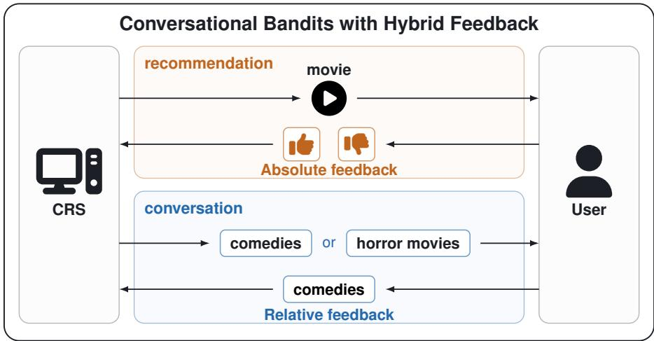
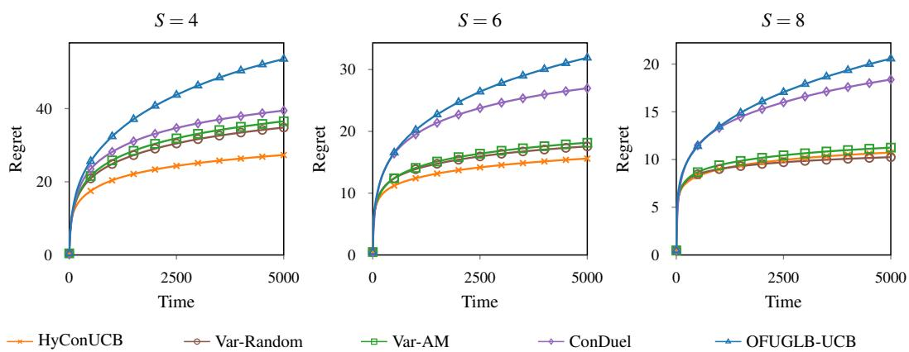
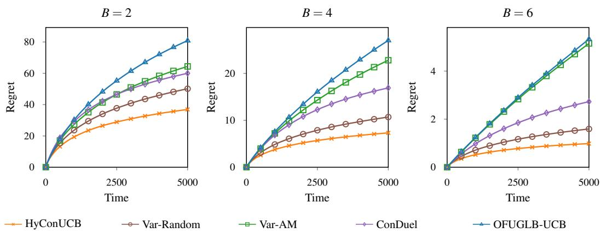
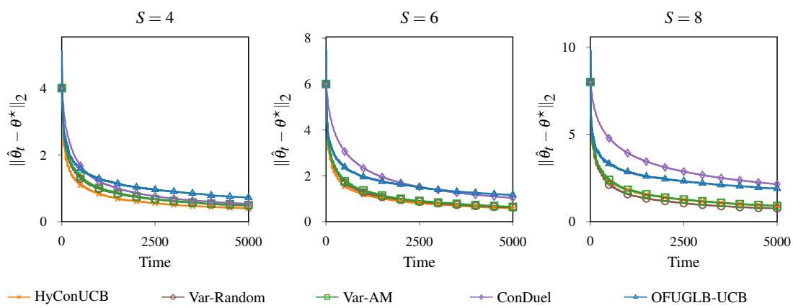
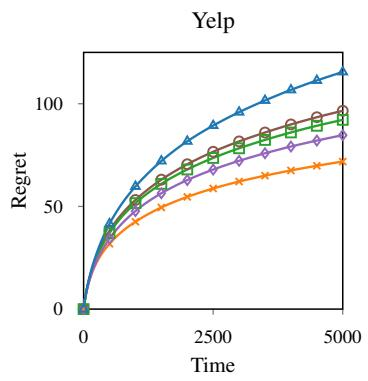
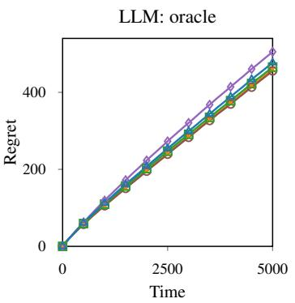
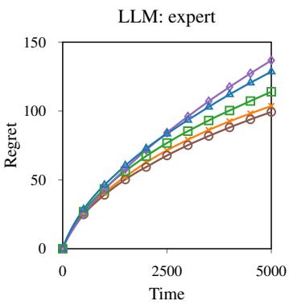

# Conversational Generalized Linear Bandits with Hybrid Feedback

Yurui Zou1 Qirun Zeng2 Jinhang Zuo2

1University of Science and Technology of China, Hefei, China 2City University of Hong Kong, Hong Kong SAR, China

zyurui@mail.ustc.edu.cn qirun.zeng@my.cityu.edu.hk jinhang.zuo@cityu.edu.hk

## Abstract

Conversational bandits improve recommendations by actively querying users about key-terms to elicit their item preferences. However, existing methods typically assume homogeneous feedback for items and key-terms, using either absolute rewards or pairwise comparisons. In practice, item feedback often takes the form of clicks or ratings, while comparisons are more natural for key-terms. To address this gap, we study conversational generalized linear bandits with hybrid feedback, combining absolute item rewards and relative key-term comparisons. We propose Conversational UCB with Hybrid Feedback (HyConUCB), which constructs unified confidence bounds from heterogeneous feedback and adaptively selects key-term comparisons by balancing information gain and directional coverage. Through a refined regret analysis that jointly exploits both feedback sources, we establish a regret bound that improves upon reward-only and adapted dueling-only benchmarks. Experiments on synthetic and real-world datasets validate the effectiveness of our algorithm.

## 1 Introduction

Conversational recommender systems (CRSs) improve recommendation quality by actively interacting with users to elicit their preferences. Unlike traditional recommender systems that primarily learn from feedback on recommended items, CRSs can proactively query users about key-terms associated with groups of items, such as movie genres or news categories. These additional interactions help alleviate the cold-start problem by enabling more efficient preference learning. To formalize this process, Zhang et al. [1] introduced conversational contextual bandits, where the learner sequentially recommends items (i.e., arms) and observes user feedback in the form of rewards. In addition, the learner can occasionally initiate conversations by querying users about selected key-terms and collect ing additional feedback. By jointly leveraging item-level and key-term-level feedback, conversational bandits can learn user preferences more efficiently and improve recommendation performance.

Existing conversational bandit methods primarily consider two types of user feedback: absolute rewards and pairwise comparisons. Early studies on conversational contextual bandits [1] assume that users provide absolute feedback, such as clicks or ratings, for both recommended items and queried key-terms. More recently, Yang et al. [2] introduced conversational dueling bandits, where user preferences are elicited through pairwise comparisons of items and key-terms. While both feedback types provide valuable preference information, assuming a homogeneous feedback form may not fully reflect practical recommendation scenarios. In particular, users can readily provide absolute feedback on recommended items, whereas pairwise comparisons are often more natural for abstract key-terms. This motivates the study of conversational bandits with hybrid feedback, combining absolute item rewards and relative key-term comparisons.

Table 1: Regret bound comparison between HyConUCB and homogeneous-feedback benchmarks.
<table><tr><td>Algorithm</td><td>Leading term Lower-order term</td></tr><tr><td>Reward-only [4]  $\tilde { O } \left( d \sqrt { T / \kappa _ { \star } } \right)$ </td><td> $\tilde { O } ( \kappa d ^ { 2 } )$ </td></tr><tr><td>ConDuel (adapted) [2]  $\tilde { O } \left( \tilde { \kappa } d \sqrt { T / \kappa _ { \star } } \right)$ </td><td> ${ \cal \tilde { O } } ( \kappa ^ { 2 } d ^ { 2 } )$ </td></tr><tr><td>HyConUCB (ours)  $\begin{array} { r } { \tilde { O } \left( d \sqrt { \frac { T / \kappa _ { \star } } { 1 + \eta \bar { v } ^ { - 1 } } } \right) } \end{array}$ </td><td> $\tilde { O } \left( d ^ { 2 } / ( \kappa ^ { - 1 } + \eta ) \right)$ </td></tr></table>

We consider T rounds with $b ( t ) = \lfloor \rho t \rfloor$ cumulative conversational queries, where ρ controls the query frequency. We report the case $r = d ,$ where d is the feature dimension and r is the dimension spanned by conversational queries (see Eq. (10) for general r). Here, $\kappa ^ { - 1 }$ and $\kappa _ { \star } ^ { - 1 }$ denote the worst-case and average optimal-arm curvatures, respectively; v¯ is the maximum reward curvature; and $\eta = \sigma \rho d / 4$ measures conversational information. The ConDuel bound is obtained by adapting its analysis to our setting. O˜ hides logarithmic factors and fixed constants.

For example, in a movie recommender system illustrated in Fig. 1, users may click on or rate recommended movies, providing absolute feedback on items. Meanwhile, the system can occasionally ask users to compare movie genres, such as “Do you prefer comedies or horror movies?”, obtaining relative feedback on key-terms. Combining these two feedback types allows the system to learn user preferences more effectively without requiring pairwise comparisons for every recommendation. However, integrating heterogeneous feedback into conversational bandits with theoretical guarantees remains challenging, as absolute rewards and pairwise comparisons follow different statistical observation models. Existing work has only partially addressed this problem [3].

  
Figure 1: An illustration of conversational bandits with hybrid feedback in a movie recommender system. Users provide absolute feedback on recommended movies through likes or dislikes. The system also occasionally asks users to compare movie genres, such as comedies and horror movies, to elicit relative preferences.

Motivated by these observations, we study conversational generalized linear bandits with hybrid feedback, focusing on absolute arm rewards and relative key-term comparisons 1. We adopt generalized linear models (GLMs) to capture diverse user responses within a unified framework. To overcome the limitations of existing conversational dueling bandits [2], whose confidence bounds depend on the global worst-case curvature, we extend the confidence sequence construction of Lee et al. [4] to conversational bandits setting, handling heterogeneous arm and key-term feedback without this dependence in the confidence radius. Building on these confidence sequences, we propose Conversational UCB with Hybrid Feedback (HyConUCB), which selects arms using upper confidence bounds and adaptively queries key-term pairs by balancing information gain and directional coverage. Through a refined regret analysis that jointly exploits information from both feedback sources, we establish improved regret guarantees over reward-only and adapted dueling-only benchmarks, as summarized in Table 1. Our analysis explicitly quantifies the benefits of conversational feedback. We also demonstrate the effectiveness of HyConUCB through experiments on synthetic and real-world datasets.

Our main contributions are summarized as follows:

• We formulate conversational generalized linear bandits (GLBs) with hybrid feedback, integrating absolute arm rewards and relative key-term comparisons under a unified generalized linear model. This framework captures heterogeneous user feedback commonly encountered in conversational recommendation systems.

• We develop HyConUCB, which constructs time-uniform confidence sequences from heterogeneous feedback without relying on global worst-case curvature scaling. The algorithm combines UCB-based arm selection with an adaptive key-term querying strategy that balances information gain and directional coverage.

• We establish improved regret guarantees through a refined analysis that jointly exploits information from both feedback sources. In particular, we develop a new elliptical potential bound that incorporates conversational information despite the nonlinear curvature of GLMs, yielding improved regret bounds over reward-only and adapted dueling-only benchmarks.

• We conduct extensive experiments on synthetic data and two real-world datasets, Yelp and xRouteBench, covering restaurant recommendation and LLM routing. The results demonstrate the effectiveness of HyConUCB in reducing cumulative regret and improving preference estimation, highlighting the benefits of hybrid feedback across different settings.

## 2 Related Work

Our work builds on several research areas, and we review some recent work in the most related areas.

Conversational Bandits. Zhang et al. [1] introduced ConUCB, which augments item feedback with key-term queries to accelerate preference learning. Building on this framework, Xie et al. [3] proposed RelativeConUCB to incorporate relative key-term feedback. Although its feedback configuration is similar to ours, RelativeConUCB is a simple empirical extension of ConUCB [1] and does not establish regret guarantees. Wang et al. [5] proposed ConLinUCB, jointly estimating user preferences from arm-level and key-term-level feedback. Based on this framework, Yang et al. [2] studied conversational dueling GLBs and Liu et al. [6] developed more effective query strategies for linear conversational bandits. However, the former’s regret analysis yields a suboptimal bound in the GLM setting and the latter’s techniques cannot be directly extended to GLBs because of the nonlinear terms introduced by GLMs. We therefore develop new techniques for regret analysis in conversational GLBs. To the best of our knowledge, we provide the first regret guarantees for conversational bandits with hybrid feedback.

Generalized Linear Bandits. In a canonical generalized linear model, an exponential-family response has natural parameter ${ \pmb x } ^ { \top } { \pmb \theta } ^ { \star }$ and mean $\bar { \mu } ( { \pmb x } ^ { \top } { \pmb \theta } ^ { \star } )$ , where $\pmb { \theta } ^ { \star }$ is unknown [7]. Filippi et al. [8] introduced GLM-UCB for generalized linear bandits and established regret guarantees. Subsequent work has improved confidence estimation and regret analysis in GLBs, including through the use of self-concordance [9]. In particular, Lee et al. [4] developed a unified likelihood-ratio confidence sequence for GLMs, with convex confidence regions and an ellipsoidal relaxation under self-concordance. We adapt this confidence construction to the joint likelihood of absolute arm rewards and relative key-term feedback.

Relative and Hybrid Feedback. Relative feedback has been widely studied in bandit learning and preference-based learning [10–12]. Relative key-term feedback has also been studied in conversational recommendation [2, 3]. More recently, Wang et al. [13] studied stochastic bandits that combine reward and dueling feedback. He et al. [14] considered hybrid bandits with heterogeneous offline and online feedback, and Zeng et al. [15] took a step further by studying best-arm identification in GLBs with hybrid feedback, where a shared latent parameter $\dot { \theta ^ { \star } }$ links absolute rewards and relative comparisons. We adopt this shared-parameter formulation to represent user preferences, while focusing on regret minimization and studying hybrid feedback across the item and key-term levels: absolute rewards on items and relative comparisons between key-terms.

## 3 Problem Formulation

## 3.1 Generalized Linear Model

We formulate both types of feedback using GLMs, so we begin by introducing the generalized linear model (GLM). In a canonical GLM, the conditional distribution of observation y, given a natural parameter u $\in \mathbb { R }$ , belongs to an exponential family and is specified by

$$
p ( y \mid u ) = \exp \left\{ { \frac { y u - m ( u ) } { a } } + c ( y ) \right\} .
$$

Here m is the log-partition function, a is the known dispersion factor and c is the log base measure. We use $p ( y \mid u )$ to denote the conditional probability density or mass function of y given u. A fundamental property of GLMs is that the conditional mean of y is given by

$$
\mathbb { E } [ y \mid u ] = m ^ { \prime } ( u ) = : \mu ( u ) ,
$$

where $\mu ( \cdot )$ is the mean function (inverse link function). For convenience, we define $\begin{array} { r } { \nu ( u ) : = \frac { \dot { \mu } ( u ) } { a } } \end{array}$

## 3.2 Conversational Generalized Linear Bandits with Hybrid Feedback

We consider a sequential decision-making problem where the learner interacts with a user over T rounds. Let A denote a set of K arms and K denote a set of P key-terms. The relationship between the arms and the key-terms can be characterized by a weighted bipartite graph $( A , K , W )$ whose nodes are divided into two sets $\mathcal { A }$ and $\kappa .$ and weighted edges are represented by the matrix $\pmb { W } = : [ W _ { a , k } ] _ { K \times P }$ with $W _ { a , k }$ representing the relationship between arm a and key-term k.

At round t, the learner observes a candidate set $\boldsymbol { A } _ { t } \subseteq \boldsymbol { A }$ . It then selects an arm $a _ { t } \in \mathcal A _ { t }$ and receives an absolute reward $r _ { t }$ from the user. Each arm is associated with a d-dimensional feature vector $\mathbf { \nabla } _ { \mathbf { x } _ { a } . }$ The corresponding feature vector pool at round t is $\mathcal { X } _ { t }$ . We write $\pmb { x } _ { t } = \pmb { x } _ { a _ { t } }$ for the feature vector of the selected arm. Let $\| \pmb { x } _ { a } \| _ { 2 } \le 1$ for every arm feature. The user’s preference is represented by a vector $\theta ^ { \star } \in \Theta$ , where $\begin{array} { r } { \Theta : = \{ \pmb { \theta } \in \mathbb { R } ^ { d } : \| \pmb { \theta } \| _ { 2 } \leq S \} } \end{array}$ . Then the reward is defined as

$$
r _ { t } \sim p _ { \mathrm { c } } ( \cdot | \mathbf { x } _ { t } ^ { \top } \pmb \theta ^ { \star } ) .\tag{1}
$$

The learner obtains additional user feedback through key-term conversations. We set the conversational feedback to be relative, that is, the learner selects a pair of key-terms and receives the dueling result of them.

We define the key-term feature vector as

$$
\tilde { \mathbf { \pmb { x } } } _ { k } : = \frac { \sum _ { a \in \mathcal { A } } W _ { a , k } \pmb { x } _ { a } } { \sum _ { a \in \mathcal { A } } W _ { a , k } } .
$$

A nondecreasing integer-valued function $b ( t )$ , with $b ( 0 ) = 0$ , is defined to model the frequency of conversations. Before selecting an arm, the learner conducts $q _ { t } = b ( t ) - b ( t - 1 )$ ) conversations. For each $i \in \{ 1 , 2 , . . . , q _ { t } \}$ , the learner selects a key-term pair $( \bar { k } _ { t , i } , k _ { t , i } ^ { \prime } ) \in \mathcal { K } ^ { 2 }$ . Define its comparison feature vector as

$$
\tilde { \mathbf { d } } _ { t , i } : = \tilde { \mathbf { x } } _ { k _ { t , i } } - \tilde { \mathbf { x } } _ { k _ { t , i } ^ { \prime } } .
$$

Thus $\lvert | \tilde { d } _ { t , i } \rvert | _ { 2 } \leq 2$ , and the learner observes the dueling feedback $\tilde { o } _ { t , i } \in \{ 0 , 1 \}$ with distribution

$$
\tilde { \sigma } _ { t , i } \sim p _ { \mathrm { d } } \left( \cdot \mid \tilde { d } _ { t , i } ^ { \top } \pmb \theta ^ { \star } \right) ,\tag{2}
$$

where $\tilde { o } _ { t , i } = 1$ indicates preference for $k _ { t , i }$

Both arm reward and conversational dueling feedback are modeled as GLMs with a shared parameter $\pmb { \theta } ^ { \star }$ , but possibly different mean functions $\mu _ { \mathrm { c } }$ and $\mu _ { \mathrm { d } }$ . We use subscripts c and d to distinguish reward and dueling quantities. We define the feedback modality to be c for absolute feedback and d for relative feedback.

Let the query pool $\mathcal { Q } : = \{ q _ { e } \} _ { e = 1 } ^ { N _ { q } }$ contain all pairwise differences $\tilde { \pmb { x } } _ { k } - \tilde { \pmb { x } } _ { k ^ { \prime } }$ from the key-term pool, and let $U : = \operatorname { s p a n } ( \mathcal { Q } )$ and ${ \bar { r } } = \dim ( U )$ . Unlike prior works that assume full-dimensional conversational coverage $\dot { ( r = d ) } \left[ 2 , 5 \right]$ , our algorithm also applies when conversations cover only a subspace $( r < d )$

Under the conversational GLBs with hybrid feedback problem described above, our objective is to minimize the cumulative regret in $\dot { T }$ rounds. Let $\mathbf { \Delta } \mathbf { x } _ { t , \star } = \arg \operatorname* { m a x } _ { \mathbf { \Delta x } \in \mathcal { X } _ { t } } \mathbf { \Delta } \mathbf { x } ^ { \top } \pmb { \theta } ^ { \star }$ . Following the definition in Filippi et al. [8], we define the regret as

$$
R ( T ) = \sum _ { t = 1 } ^ { T } \left\{ \mu _ { \mathrm { c } } ( ( \boldsymbol { x } _ { t , \star } ) ^ { \top } \pmb { \theta } ^ { \star } ) - \mu _ { \mathrm { c } } ( \boldsymbol { x } _ { t } ^ { \top } \pmb { \theta } ^ { \star } ) \right\} .
$$

Following Lee et al. [4], Zeng et al. [15], we assume that the log-partition functions $m _ { \mathrm { c } } , m _ { \mathrm { d } }$ are three times continuously differentiable, with $\dot { \mu } _ { \mathrm { c } } , \dot { \mu } _ { \mathrm { d } } > 0$ . For modality $j ~ \in ~ \{ \mathrm { c } , \mathrm { d } \}$ , we use a self-concordance bound $R _ { s }$ and curvature bound $R _ { \dot { \mu } } { : }$

$$
| \ddot { \mu } _ { j } ( u ) | \leq R _ { s } \dot { \mu } _ { j } ( u ) , \qquad R _ { \dot { \mu } } = \operatorname* { m a x } _ { j \in \{ \mathrm { c } , \mathrm { d } \} } \operatorname* { s u p } _ { u } \dot { \mu } _ { j } ( u ) .
$$

## 4 Hybrid Conversational UCB Algorithm

## 4.1 Confidence Sequences

We construct confidence sequences for the unknown user preference vector $\pmb { \theta } ^ { \star }$ . Following the procedure in Zeng et al. [15] and Lee et al. [4], we first give a likelihood-ratio–based confidence sequence. Then we relax it to ellipsoidal confidence sequence which is more suitable for our algorithm design and analysis.

Define the cumulative negative log-likelihood function at round t as

$$
\begin{array} { r l } & { { \mathcal L } _ { t } ( \pmb { \theta } ) = \displaystyle \sum _ { s < t } \frac { - r _ { s } { \pmb x } _ { s } ^ { \top } \pmb { \theta } + m _ { \mathrm { c } } ( { \pmb x } _ { s } ^ { \top } \pmb { \theta } ) } { a _ { \mathrm { c } } } } \\ & { + \displaystyle \sum _ { s \leq t } \displaystyle \sum _ { i = 1 } ^ { q _ { s } } \frac { - \tilde { o } _ { s , i } { \tilde { d } } _ { s , i } ^ { \top } \pmb { \theta } + m _ { \mathrm { d } } ( { \tilde { d } } _ { s , i } ^ { \top } \pmb { \theta } ) } { a _ { \mathrm { d } } } . } \end{array}\tag{3}
$$

Following Lee et al. [4], we define $\begin{array} { r } { \hat { \pmb { \theta } } _ { t } \in \arg \operatorname* { m i n } _ { { \pmb { \theta } } \in \Theta } \mathcal { L } _ { t } ( { \pmb { \theta } } ) } \end{array}$ and

$$
\mathcal { C } _ { t } : = \{ \pmb { \theta } \in \Theta : \mathcal { L } _ { t } ( \pmb { \theta } ) - \mathcal { L } _ { t } ( \hat { \pmb { \theta } } _ { t } ) \leq \beta _ { t } ^ { 2 } \} ,
$$

where

$$
\begin{array} { l } { \displaystyle \beta _ { t } ^ { 2 } : = \log \frac 2 \delta + \operatorname* { i n f } _ { c \in ( 0 , 1 ] } \left\{ d \log \frac 1 c + 2 S L _ { t } c \right\} } \\ { \displaystyle \qquad \leq \log \frac 2 \delta + d \log \left( e \vee \frac { 2 e S L _ { t } } { d } \right) . } \end{array}
$$

and $L _ { t }$ is the Lipschitz constant of $\mathcal { L } _ { t }$ on Θ.

Lemma 4.1. With probability at least $\begin{array} { r } { 1 - \frac { \delta } { 2 } } \end{array}$ , we have $\theta ^ { \star } \in \mathcal { C } _ { t }$ for all $t \leq T$

ProofSketch. To prove it, we index the arm rewards and key-term comparisons in their actual order of observation. Before arm selection in round t, there are $\bar { N _ { t } } = t - 1 + \bar { b ( t ) }$ observations. Write the resulting sequence as $( j _ { n } , z _ { n } , y _ { n } ) _ { n = 1 } ^ { N _ { t } }$ , where $j _ { n } \in \{ \mathrm { c } , \mathrm { d } \}$ denotes the modality and $( z _ { n } , y _ { n } )$ denotes $( \boldsymbol { \mathbf { \mathit { x } } } _ { s } , \boldsymbol { \mathbf { \mathit { r } } } _ { s } )$ for an arm reward or $( \tilde { d } _ { s , i } , \tilde { o } _ { s , i } )$ for a key-term comparison. Eventually, we have

$$
\mathcal { L } _ { t } ( \pmb { \theta } ) = \sum _ { n = 1 } ^ { N _ { t } } \frac { - y _ { n } z _ { n } ^ { \top } \pmb { \theta } + m _ { j _ { n } } ( z _ { n } ^ { \top } \pmb { \theta } ) } { a _ { j _ { n } } } .
$$

This function has the same form as the cumulative negative log-likelihood function in Zeng et al. [15]. Applying Zeng et al. [15, Lemma 3.1] gives Lemma 4.1. □

Algorithm 1 HyConUCB   
Require: The weighted bipartite graph $( \mathcal { A } , \mathcal { K } , W )$ , conversational frequency function b(t), parame  
ter norm bound S   
1: Construct the query pool Q.   
2: for $t = 1 , \ldots , \mathbf { \bar { \boldsymbol { T } } } \mathbf { d } \mathbf { \dot { \mathbf { o } } }$   
3: Set $q _ { t } \gets b ( t ) - b ( t - 1 )$   
4: for $i = 1 , \ldots , q _ { t }$ do   
5: Solve query distribution $\mathbf { \Delta } _ { \mathbf { p } _ { t , i } }$ according to Eq. (5).   
6: Sample $( k _ { t , i } , k _ { t , i } ^ { \prime } )$ according to $\mathbf { \Delta } _ { \mathbf { \mathcal { P } } _ { t , i } }$   
7: Query $( k _ { t , i } , k _ { t , i } ^ { \prime } )$ and observe $\tilde { o } _ { t , i } ,$ and set $\mathcal { F } _ { t - 1 } \gets \mathcal { F } _ { t - 1 } \cup ( k _ { t , i } , k _ { t , i } ^ { \prime } , \tilde { o } _ { t , i } )$   
8: end for   
9: Compute $\hat { \pmb { \theta } } _ { t } \in$ arg min $\pmb { \theta } \in \Theta _ { . } \mathcal { L } _ { t } ( \pmb { \theta } )$   
10: Select $a _ { t } \in$ arg ma $\mathbf { x } _ { a \in \mathcal { A } _ { t } } \left\{ \pmb { x } _ { a } ^ { \top } \hat { \pmb { \theta } } _ { t } + \gamma _ { t } \Vert \pmb { x } _ { a } \Vert _ { \pmb { H } _ { t } ^ { - 1 } } \right\}$   
11: Observe $r _ { t }$ and set $\mathcal { F } _ { t } \gets \dot { \mathcal { F } } _ { t - 1 } \cup ( a _ { t } , r _ { t } )$   
12: end for

Let $\lambda > 0$ . The regularized joint Hessian at $\hat { \pmb { \theta } } _ { t }$ is

$$
\begin{array} { r l r } {  { H _ { t } = \lambda I _ { d } + \nabla ^ { 2 } \mathcal { L } _ { t } ( \hat { \pmb { \theta } } _ { t } ) } } \\ & { } & { = \lambda I _ { d } + \displaystyle \sum _ { s < t } \nu _ { \mathrm { c } } ( \pmb { x } _ { s } ^ { \top } \hat { \pmb { \theta } } _ { t } ) \pmb { x } _ { s } \pmb { x } _ { s } ^ { \top } + \displaystyle \sum _ { s \leq t } \sum _ { i = 1 } ^ { q _ { s } } \nu _ { \mathrm { d } } ( \tilde { d } _ { s , i } ^ { \top } \hat { \pmb { \theta } } _ { t } ) \tilde { d } _ { s , i } \tilde { d } _ { s , i } ^ { \top } . } \end{array}\tag{4}
$$

Following the ellipsoidal construction of Lee et al. [4, Theorem 3.2], let $\gamma _ { t } ^ { 2 } : = 2 ( 1 + 2 S R _ { s } ) ( 4 \lambda S ^ { 2 } +$ $\beta _ { t } ^ { 2 } )$ , we define

$$
\mathcal { E } _ { t } : = \{ \pmb { \theta } \in \mathbb { R } ^ { d } : \| \pmb { \theta } - \hat { \pmb { \theta } } _ { t } \| _ { \pmb { H } _ { t } } ^ { 2 } \leq \gamma _ { t } ^ { 2 } \} .
$$

Lemma 4.2. For every $t \leq T , \mathcal { C } _ { t } \subseteq \mathcal { E } _ { t }$ . Consequently, with probability at least $\begin{array} { r } { 1 - \frac { \delta } { 2 } , \theta ^ { \star } \in \mathcal { E } _ { t } , } \end{array}$ for all $t \leq T$

The proof is given in Appendix A.1.

## 4.2 Algorithm Design

Building on the confidence sequences above, we present the Conversational UCB with Hybrid Feedback algorithm (HyConUCB; Algorithm 1). The central idea of HyConUCB is to balance information gain and directional coverage in key-term selection, while employing the UCB principle for arm selection.

At each round t, the learner first conducts $q _ { t } = b ( t ) - b ( t - 1 )$ conversations to gather additional information about user preferences through key-term comparisons. It then updates its parameter estimate using both arm rewards and key-term comparisons, and selects an arm according to the UCB principle.

We first describe the key-term selection rule. For information gain, we adopt the MaxInp principle [16]. This principle selects the key-term that maximizes the information uncertainty, $\mathrm { i . e . , } \left( k _ { t , i } , k _ { t , i } ^ { \prime } \right) \in$ arg m $\mathrm { a x } _ { k , k ^ { \prime } \in \mathcal { K } } \| \widetilde { \pmb { x } } _ { k } - \widetilde { \pmb { x } } _ { k ^ { \prime } } \| _ { M _ { t , i } ^ { - 1 } }$ , where $M _ { t , i }$ is the joint Hessian immediately before query i in round $t .$

For each query $\mathbf { \mathfrak { q } } _ { e } \in \mathcal { Q } .$ , calculate

$$
a _ { t , i , e } = \Vert \pmb { q _ { e } } \Vert _ { M _ { t , i } ^ { - 1 } } ^ { 2 } \quad \mathrm { a n d } \quad s _ { t , i , e } = \frac { a _ { t , i , e } } { \operatorname* { m a x } _ { f } a _ { t , i , f } } \in [ 0 , 1 ] ,
$$

where $\boldsymbol { a } _ { t , i , e }$ is the MaxInp score of $\pmb q _ { e }$

Next we consider directional coverage. For a query distribution p on $\mathcal { Q } .$ the matrix $V ( p ) =$ $\textstyle \sum _ { e } p _ { e } q _ { e } q _ { e } ^ { \intercal }$ summarizes how the sampled query features cover different directions. Its eigenvalues reflect how strongly the queries explore the corresponding eigenvector directions. To encourage

coverage of every direction in $U _ { : }$ , we use the minimum eigenvalue of this matrix restricted to $U .$ Define

$$
j ( \pmb { p } ) = \lambda _ { \mathrm { m i n } , U } ( V ( \pmb { p } ) ) ,
$$

where $\lambda _ { \operatorname* { m i n } , U }$ denotes the minimum eigenvalue restricted to $U .$

Finally, we solve

$$
p _ { t , i } \in \arg \operatorname* { m a x } _ { p \in \Delta _ { N _ { q } } } \left\{ \sum _ { e } p _ { e } s _ { t , i , e } + \xi \log j ( p ) \right\} , \qquad 0 < \xi < 1 .\tag{5}
$$

According to $\mathbf { \Delta } _ { \mathbf { p } _ { t , i } }$ , we sample $\tilde { d } _ { t , i }$ from $\mathcal { Q } .$

The first term in Eq. (5) favors queries with large MaxInp scores, while the second term encourages information coverage in the least-observed direction. The parameter $\xi$ controls this trade-off. So the resulting query rule balances the information gain and directional coverage. It also guarantees the conditional information lower bound in Lemma 4.3. The proof is provided in Appendix A.2.

After completing the conversational queries, the learner computes the updated parameter estimate $\widehat { \pmb { \theta } } _ { t }$ using all feedback observed so far. Based on Lemma 4.2, we define the UCB score of each arm $a \in \mathcal { A } _ { t }$ as

$$
u _ { t , a } : = \pmb { x } _ { a } ^ { \top } \hat { \pmb { \theta } } _ { t } + \gamma _ { t } \| \pmb { x } _ { a } \| _ { H _ { t } ^ { - 1 } } .
$$

The learner then selects an arm that maximizes the UCB score, i.e.,

$$
a _ { t } \in \operatorname * { a r g m a x } _ { a \in \mathcal { A } _ { t } } u _ { t , a } ,
$$

breaking ties arbitrarily. Finally, the learner observes the arm reward $r _ { t }$ , which is incorporated into the parameter estimation in subsequent rounds.

Lemma 4.3. Let $\mathcal F _ { t } : = \sigma \big ( a _ { s } , r _ { s } \big ) , \{ ( k _ { s , i } , k _ { s , i } ^ { \prime } , \widetilde { o } _ { s , i } ) \} _ { i = 1 } ^ { q _ { s } } : 1 \le s \le t \Big )$ denote the σ-algebra generated by the history through the end of round t. Under the query rule in $E q . \ ( 5 )$ , there exists a constant $\sigma > 0$ such that, almost surely,for every $t \in [ T ]$

$$
\mathbb { E } \left[ \sum _ { i = 1 } ^ { q _ { t } } \nu _ { \mathrm { d } } ( \tilde { d } _ { t , i } ^ { \top } \theta ^ { \star } ) \tilde { d } _ { t , i } \tilde { d } _ { t , i } ^ { \top } \Bigg | \mathcal { F } _ { t - 1 } \right] \succeq \sigma q _ { t } { P _ { U } } ,\tag{6}
$$

where $P _ { U }$ is the orthogonal projection matrix onto $U .$

## 5 Regret Analysis

In this section, we establish a regret bound for HyConUCB. We use the notations

$$
\begin{array} { r l } & { \kappa = \underset { t \leq T , { x \in \mathcal X } _ { t } , \theta \in \Theta } { \operatorname* { m a x } } \frac { 1 } { \dot { \mu } _ { \mathrm { c } } ( { x } ^ { \top } \theta ) } , \qquad \kappa _ { \star } = T / \displaystyle \sum _ { t = 1 } ^ { T } \dot { \mu } _ { \mathrm { c } } ( ( { x } _ { t , \star } ) ^ { \top } \pmb \theta ^ { \star } ) , } \\ & { \bar { v } = \underset { t \leq T , { x \in \mathcal X } _ { t } } { \operatorname* { m a x } } \dot { \mu } _ { \mathrm { c } } ( { x } ^ { \top } \pmb \theta ^ { \star } ) , \qquad R _ { \mu , \star } = \underset { t < T , { x \in \mathcal X } _ { t } } { \operatorname* { s u p } } | \mu _ { \mathrm { c } } ( { x } ^ { \top } \pmb \theta ^ { \star } ) | . } \end{array}
$$

For the analysis, set $\begin{array} { r l r } { \bar { \gamma } _ { T } } & { { } = } & { \operatorname* { m a x } _ { t \leq T } \gamma _ { t } } \end{array}$ , qmax $= \quad \operatorname* { m a x } \{ 1 , q _ { 1 } , . . . , q _ { T } \}$ and $\begin{array} { r l } { G _ { T } } & { { } = } \end{array}$ max $\left\{ R _ { s } \bar { \gamma } _ { T } , \sqrt { R _ { \dot { \mu } } / a _ { \mathrm { c } } } \right\}$

For $\varepsilon > 0$ , define

$$
\begin{array} { l } { { n _ { 0 } \displaystyle \triangleq \frac { 4 } { \sigma } \operatorname* { m a x } \left\{ 8 q _ { \mathrm { m a x } } \displaystyle \frac { R _ { \dot { \mu } } } { a _ { \mathrm { d } } } \log \displaystyle \frac { 2 r T } { \delta } , 1 6 \left( 1 + \operatorname* { m a x } _ { s \le T } \beta _ { s } ^ { 2 } \right) \left( \displaystyle \frac { 1 } { \varepsilon } + \frac { R _ { s } } { 2 } \right) ^ { 2 } \right\} , } } \\ { { t _ { 0 } \triangleq \big | \{ t \le T : b ( t ) < n _ { 0 } \} \big | . } } \end{array}
$$

Let

$$
\begin{array} { l } { \displaystyle { D _ { T } ( h ) : = ( d - r ) \log \left( 1 + \frac { T h } { 2 \lambda ( d - r ) } \right) } } \\ { \displaystyle { + r \sum _ { t = 1 } ^ { T } \log \left( 1 + \frac { h } { 2 \lambda r + ( t - 1 ) h + e ^ { - R _ { s } \varepsilon } \sigma r b ( t ) / 2 } \right) . } } \end{array}\tag{7}
$$

We now establish the theoretical guarantees of Algorithm 1.

Theorem 5.1. With probability at least $1 - \delta ,$ , Algorithm 1 satisfies

$$
\begin{array} { r l r } {  { R ( T ) \le 2 R _ { \mu , \star } t _ { 0 } + 8 e ^ { 3 / 2 } \sqrt { a _ { \mathrm { c } } } \bar { \gamma } _ { T } \sqrt { D _ { T } ( \bar { \nu } / a _ { \mathrm { c } } ) T / \kappa _ { \star } } } } \\ & { } & { \quad + \ 1 6 e ^ { 3 } a _ { \mathrm { c } } R _ { s } \bar { \gamma } _ { T } ^ { 2 } D _ { T } ( \bar { \upsilon } / a _ { \mathrm { c } } ) + \frac { 3 2 R _ { \mu , \star } a _ { \mathrm { c } } \kappa G _ { T } ^ { 2 } } { \log 2 } D _ { T } ( 1 / ( a _ { \mathrm { c } } \kappa ) ) . } \end{array}\tag{8}
$$

Proof Sketch. There are two main challenges in the regret analysis of conversational generalized linear bandits. First, the information contributed by each observation is weighted by a nonlinear term, that is, the joint Hessian contains curvature weights such as $\nu _ { \mathrm { c } } ( \pmb { x } _ { s } ^ { \top } \hat { \pmb { \theta } } _ { t } )$ . The analysis of ConDuel [2] handles this dependence by scaling based on the global worst-case curvature, which introduces a factor κ into the confidence width and leads to a suboptimal confidence set.

Thanks to the confidence sequences in Lee et al. [4], we can now obtain tighter confidence sequences whose radii do not explicitly depend on κ. The second challenge is to retain the information from both arm rewards and key-term comparisons when bounding the elliptical potential sum

$$
\sum _ { t = 1 } ^ { T } \| \pmb { x } _ { t } \| _ { \pmb { H } _ { t } ^ { - 1 } } ^ { 2 } .\tag{9}
$$

Although ConDuel and ConLinUCB combine both sources when estimating the user parameter, key steps in their regret analyses lower-bound the joint information matrix using only one source [2, 5]. Such bounds do not retain the full information from both feedback sources. Moreover, the techniques developed for linear conversational bandits, including those of Liu et al. [6], do not directly handle the curvature weights in our joint Hessian. These limitations motivate us to develop more effective techniques for regret analysis.

Our first step is to construct a tractable lower surrogate for $\pmb { H } _ { t }$ . Let $\bar { \theta } _ { s }$ minimize $\dot { \mu } _ { \mathrm { c } } ( \pmb { x } _ { s } ^ { \top } \pmb \theta )$ over $\textstyle \bigcup _ { \ell = s } ^ { T } { \mathcal { C } } _ { \ell } .$ , as in Eq. (18), and define

$$
V _ { t } \triangleq 2 \lambda I _ { d } + \sum _ { s < t } \nu _ { \mathrm { c } } ( { \pmb x } _ { s } ^ { \top } \bar { \pmb \theta } _ { s } ) { \pmb x } _ { s } { \pmb x } _ { s } ^ { \top } + \frac { e ^ { - R _ { s } \varepsilon } \sigma b ( t ) } { 2 } P _ { U } .
$$

Lemma 5.2. With probability at least $1 - \delta ,$ for every $t _ { 0 } < t \leq T$ , we have

$$
H _ { t } \succeq \frac { 1 } { 2 } V _ { t } .
$$

Lemma 5.2 replaces the comparison term in the joint Hessian by an information lower bound, which is more convenient for later analysis.

We next bound the potential sum. To jointly exploit information from both the arm side and the key-term side, we modify the classical elliptical potential lemma and get Theorem 5.3.

Theorem 5.3. Let $h > 0$ and $\bar { \pmb { \theta } } _ { 1 } , \dots , \bar { \pmb { \theta } } _ { T } \in \Theta$ satisfy $\nu _ { \mathrm { c } } ( \pmb { x } _ { t } ^ { \top } \bar { \pmb { \theta } } _ { t } ) \leq h .$ . Then

$$
\sum _ { t = 1 } ^ { T } \log \Big ( 1 + \nu _ { \mathrm { c } } ( \boldsymbol { x } _ { t } ^ { \top } \bar { \boldsymbol { \theta } } _ { t } ) \| \boldsymbol { x } _ { t } \| _ { { \boldsymbol { V } } _ { t } ^ { - 1 } } ^ { 2 } \Big ) \leq D _ { T } ( h ) ,
$$

where $D _ { T } ( h )$ is defined in Eq. (7). The same bound holds for arbitrary coefficients $w _ { t } \in [ 0 , h ]$ in place of $\nu _ { \mathrm { c } } ( \pmb { x } _ { t } ^ { \top } \bar { \pmb { \theta } } _ { t } )$ , with the same replacements in $V _ { t }$

Combining these results with the regret decomposition similar to Lee et al. [4] yields the final regret bound. Detailed proofs are given in Appendix B. □

Regret order. Now we give the regret order of HyConUCB. Consider $b ( t ) = \lfloor \rho t \rfloor$ with $\rho > 0 ,$ , and define $\eta \triangleq \sigma \rho r / 4$ . Let $\tilde { O }$ hide logarithmic factors and constants depending on $S , \lambda , \varepsilon ,$ and the GLM

coefficients. In this case, our regret bound is

$$
\begin{array} { c } { { R ( T ) = \tilde { \cal O } \biggl ( \underbrace { \sqrt { \frac { d ( d - r ) T } { \kappa _ { \star } } } + \kappa d ( d - r ) } _ { { U } ^ { \perp } } } } \\ { { + \underbrace { \sqrt { \frac { d r T } { \kappa _ { \star } ( 1 + \eta / \bar { v } ) } } + \frac { d r } { \kappa ^ { - 1 } + \eta } } _ { U } \biggr ) . } } \end{array}\tag{10}
$$

The two groups represent the contributions from subspace $U ^ { \perp }$ and $U ,$ , respectively. Conversations improve the contribution from $U ,$ while the contribution from $U ^ { \perp }$ retains its reward-only order. It is intuitive because the conversational information only covers this subspace.

We derive this regret order by bounding $D _ { T } ( h )$ . For $h > 0$ , the second term of $D _ { T } ( h )$ satisfies

$$
\begin{array} { r } { D _ { T } ( h ) ^ { ( 2 ) } \leq \left( 1 + \frac { e ^ { - R _ { s } \varepsilon } \sigma } { 4 \lambda } \right) \frac { r h } { h + 2 e ^ { - R _ { s } \varepsilon } \eta } } \\ { \times \log \left( 1 + \frac { T ( h + 2 e ^ { - R _ { s } \varepsilon } \eta ) } { 2 \lambda r } \right) } \end{array}
$$

The proof is given in Appendix C.1. Combining this bound with the first term of $D _ { T } ( h )$ gives

$$
D _ { T } ( h ) = \tilde { O } \left( ( d - r ) + r \frac { h } { h + \eta } \right) .\tag{11}
$$

Substituting Eq. (11) into Theorem 5.1 gives Eq. (10).

Regret comparisons. We compare our bound with the reward-only benchmark and ConDuel. For an explicit comparison, consider the r-dimensional subspace U only. The reward-only bound [4] has a contribution from U of $\tilde { O } \left( \sqrt { \frac { d r T } { \kappa _ { \star } } } + \kappa d r \right)$ . Compared with it, our leading term is reduced by a factor of $1 / \sqrt { 1 + \eta / \bar { v } }$ . If $\sigma = \Omega ( 1 / d )$ , the lower-order term in Eq. (10) is ${ \cal \tilde { O } } ( d ^ { 2 } )$ , removing κ from the reward-only lower-order term. The condition $\sigma = \Omega ( 1 / d )$ is attainable, as illustrated in Appendix C.2.

Next, we adapt the analysis of ConDuel [2] to our regret definition and arm-selection rule, retaining its confidence set construction and approach to bounding the potential sum in Eq. (9). This gives a contribution from U of $\begin{array} { r } { \tilde { O } \left( \kappa \sqrt { \frac { d r T } { \kappa _ { \star } } } + \kappa ^ { 2 } d r \right) } \end{array}$ . Relative to our bound, this bound has an additional factor of κ in both its leading and lower-order terms. This factor is from its suboptimal confidence set. Moreover, it does not exhibit the improvement over the reward-only benchmark captured by η in Eq. (10), while our new potential sum bounding techniques establish this improvement for our algorithm.

## 6 Extension to Reverse Configuration

The hybrid feedback setting considered above can also be extended to reverse configuration: users compare arms and provide absolute feedback on a single key-term at a time. Let $\pmb { d } _ { a , b } = \pmb { x } _ { a } - \pmb { x } _ { b }$ and $\pmb { d } _ { t } = \pmb { d } _ { a _ { t } , a _ { t } ^ { \prime } }$ . At each round, the learner collects $q _ { t }$ responses $\tilde { r } _ { t , i } \sim p _ { \mathrm { c } } ( \cdot \mid z _ { t , i } ^ { \top } \pmb \theta ^ { \star } )$ , with $\begin{array} { r } { \boldsymbol { z } _ { t , i } = \tilde { \mathbf { x } } _ { k _ { t , i } } } \end{array}$ for $i = 1 , \ldots , q _ { t }$ , then selects $( a _ { t } , a _ { t } ^ { \prime } )$ and observes $o _ { t } \sim p _ { \mathrm { d } } ( \cdot \mid d _ { t } ^ { \top } \pmb \theta ^ { \star } )$

The cumulative negative log-likelihood is

$$
\begin{array} { r l } & { { \mathcal L } _ { t } ( \pmb \theta ) = \displaystyle \sum _ { s < t } \frac { - o _ { s } { d _ { s } ^ { \top } \pmb \theta } + m _ { \mathrm { d } } ( { d _ { s } ^ { \top } \pmb \theta } ) } { a _ { \mathrm { d } } } } \\ & { ~ + \displaystyle \sum _ { s \leq t } \displaystyle \sum _ { i = 1 } ^ { q _ { s } } \frac { - \tilde { r } _ { s , i } z _ { s , i } ^ { \top } \pmb \theta + m _ { \mathrm { c } } ( z _ { s , i } ^ { \top } \pmb \theta ) } { a _ { \mathrm { c } } } . } \end{array}\tag{12}
$$

Using this loss and its Lipschitz constant $L _ { t } .$ , construct the likelihood-ratio confidence sequence and its ellipsoidal relaxation as in Section 4.1. Lemmas 4.1 and 4.2 still apply, with appropriate adjustments to the feature-norm bounds for the two feedback types.

For each conversation, apply Eq. (5) to the pool of single key-term feature vectors. The argument of Lemma 4.3 yields the same form of conditional information lower bound on the span of these vectors, with the absolute-feedback curvature weights.

For arm selection, first retain arms that are not confidently worse than any competitor:

$$
\mathcal { P } _ { t } = \big \{ a \in \mathcal { A } _ { t } : d _ { b , a } ^ { \top } \hat { \theta } _ { t } \leq \gamma _ { t } \| d _ { b , a } \| _ { H _ { t } ^ { - 1 } } , \forall b \in \mathcal { A } _ { t } \big \} .
$$

Then select the pair with the largest uncertainty in its utility difference:

$$
\left( a _ { t } , a _ { t } ^ { \prime } \right) \in \arg \operatorname* { m a x } _ { a , b \in \mathcal { P } _ { t } } \left\| \pmb { x } _ { a } - \pmb { x } _ { b } \right\| _ { H _ { t } ^ { - 1 } } .
$$

Following Saha [16], we define the cumulative dueling regret as

$$
R _ { \mathrm { d u e l } } ( T ) = \sum _ { t = 1 } ^ { T } \left( \pmb { x } _ { t , \star } - \frac { \pmb { x } _ { a _ { t } } + \pmb { x } _ { a _ { t } ^ { \prime } } } { 2 } \right) ^ { \top } \pmb { \theta } ^ { \star } .\tag{13}
$$

On the confidence event, an optimal arm belongs to $\mathcal { P } _ { t }$ , so this selection rule bounds the instantaneous regret by $2 \gamma _ { t } \lVert d _ { t } \rVert _ { H _ { \epsilon } ^ { - 1 } }$ , following the MaxInp analysis of Saha [16, Theorem 3]. Summing over rounds and applying Cauchy–Schwarz gives

$$
\begin{array} { r l } & { R _ { \mathrm { d u e l } } ( T ) = \displaystyle \sum _ { t = 1 } ^ { T } \left( { \boldsymbol x } _ { t , \star } - \frac { { \boldsymbol x } _ { a _ { t } } + { \boldsymbol x } _ { a _ { t } ^ { \prime } } } { 2 } \right) ^ { \top } { \boldsymbol \theta } ^ { \star } } \\ & { \qquad \le 2 \bar { \boldsymbol \gamma } _ { T } \sqrt { T \displaystyle \sum _ { t = 1 } ^ { T } \| { \boldsymbol d } _ { t } \| _ { H _ { t } ^ { - 1 } } ^ { 2 } } . } \end{array}\tag{14}
$$

We bound the potential sum in Eq. (14) by adapting Lemma 5.2 and Theorem $5 . 3 ,$ with arm differences and single key-term feature vectors replacing arm features and key-term differences, respectively. The proofs follow the same arguments as before and are omitted for brevity.

## 7 Experiments

In this section, we describe experimental settings and results on both synthetic data and real-world data. We set the trade-off parameter of HyConUCB to $\xi ~ = ~ 0 . 0 5$ and use the mean functions $\mu _ { \mathrm { c } } ( x ) = \mu _ { \mathrm { d } } ( x ) = 1 / ( 1 + e ^ { - x } )$

Baselines. We compare our algorithm with the following baselines:

• ConDuel [2]: ConDuel is designed for conversational dueling bandits, in which both armlevel and key-term-level observations are dueling feedback. To adapt it to our experimental setting, we modify its arm-selection rule to a UCB rule.

• OFUGLB-UCB [4]: OFUGLB is developed for generalized linear bandits in Lee et al. [4]. We adapt its original optimism in the face of uncertainty (OFU) rule to a UCB rule, which is more suitable for our conversational bandit setting.

• Var-Random: A variant of our algorithm that selects a key-term pair uniformly at random.

• Var-AM: A variant of our algorithm that obtains absolute conversational feedback. Its MLE and confidence sequences are adjusted accordingly. For query i in round $t ,$ it selects

$$
k _ { t , i } \in \underset { k \in \mathcal { K } } { \arg \operatorname* { m a x } } \left\| \tilde { \pmb { x } } _ { k } \right\| _ { M _ { t , i } ^ { - 1 } } ,
$$

where $M _ { t , i }$ is defined in Section 4.

## 7.1 Experiments on Synthetic Data

Data Generation. We construct the synthetic data following Zhang et al. [1]. We set the dimension to $d = 1 0 ,$ the number of users to $\dot { N } = 1 0 0$ , the size of the key-term pool to $| \kappa | = 5 0 0$ , and the size of the arm pool to $\lvert A \rvert = 5 0 0 0$ . We generate the arm feature vectors as follows. First, for each key-term $k \in \mathcal { K }$ , we sample a pseudo-feature vector $\dot { \pmb x } _ { k } \in \mathbb { R } ^ { d }$ , whose coordinates are drawn independently from the uniform distribution $\mathcal { U } ( - 1 , 1 )$ . For each arm $a \in [ K ]$ , we randomly sample an integer $m _ { a } \in \{ 1 , 2 , 3 \}$ and then select uniformly without replacement a subset $\kappa _ { a } \subseteq \kappa$ such that $| { \mathcal { K } } _ { a } | = m _ { a }$ . The weights are defined by $\begin{array} { r } { W _ { a , \dot { k } } = \frac { 1 } { m _ { a } } \mathbf { 1 } \{ k \stackrel { \cdot } { \in } \mathcal { K } _ { a } \} } \end{array}$ . For each arm a, we first draw an unnormalized feature vector from $\begin{array} { r } { \bar { \mathbf { x } } _ { a } \sim \mathcal { N } \left( \sum _ { k \in \mathcal { K } _ { a } } W _ { a , k } \dot { \mathbf { x } } _ { k } , \sigma _ { x } ^ { 2 } I _ { d } \right) } \end{array}$ , where $\sigma _ { x } = 0 . 0 2$ and then normalize it as $\begin{array} { r } { \pmb { x } _ { a } = \frac { \pmb { \bar { x } } _ { a } } { \| \pmb { \bar { x } } _ { a } \| _ { 2 } } } \end{array}$ . Thus, every arm satisfies $\| \pmb { x } _ { a } \| _ { 2 } = 1$ . After generating all arm features, we compute the feature vector of each key-term k as $\begin{array} { r } { \tilde { \pmb { x } } _ { k } = \frac { \sum _ { a \in \mathcal { A } } W _ { a , k } \pmb { x } _ { a } } { \sum _ { a \in \mathcal { A } } W _ { a , k } } } \end{array}$ . Finally, for each user $u \in [ N ]$ , we independently sample $\pmb { g } _ { u } \sim \mathcal { N } ( \mathbf { 0 } , \pmb { I } _ { d } )$ and define the user parameter as $\begin{array} { r } { \pmb { \theta } _ { u } ^ { \star } = S \frac { \pmb { g } _ { u } } { \| \pmb { g } _ { u } \| _ { 2 } } \operatorname { f o r } \dot { S } \in \{ 4 , 6 , 8 \} } \end{array}$ . In our simulations, we set the time horizon to $T = \hat { 5 } 0 0 0$ and the conversation-frequency function to $\begin{array} { r } { b ( t ) = 1 0 \left| \frac { t } { 5 0 } \right| } \end{array}$ . At each round t, we randomly select 100 arms from A without replacement to form $\boldsymbol { A } _ { t }$ . The same At is presented to all algorithms.

Cumulative Regret. We repeat each experiment over 10 random seeds, averaging over all users within each run. As shown in Fig. 2, HyConUCB reduces the final mean cumulative regret by more than 40% relative to OFUGLB-UCB, the reward-only baseline, for every tested value of S. HyConUCB achieves the lowest final mean regret for S = 4 and $S = 6 ,$ while Var-Random performs slightly better for $S = 8 . \ : \mathrm { { A s } } \ : S$ increases, ConDuel’s advantage over OFUGLB-UCB narrows. This pattern is consistent with ConDuel’s sensitivity to the worst-case curvature, which can become small as the parameter norm grows.

  
Figure 2: Cumulative regret on synthetic data for different values of the parameter norm bound S. The advantage of HyConUCB and its variants over other baselines becomes more distinct as S increases, consistent with our theoretical analysis.

Parameter Estimation Error. We measure estimation accuracy by the mean error $\lVert \hat { { \boldsymbol { \theta } } } _ { t } - { \boldsymbol { \theta } } ^ { \star } \rVert _ { 2 }$ , with smaller values indicating more accurate estimates. Fig. 3 shows that the error generally decreases over time for all algorithms. HyConUCB achieves the lowest final mean error for $S = 4$ and S = 6 and remains competitive for $S = 8$ , where Var-Random achieves the lowest error and Var-AM also finishes slightly below HyConUCB. Across all three settings, HyConUCB yields more accurate estimates than OFUGLB-UCB, demonstrating the benefit of conversational feedback for parameter estimation.

  
Figure 4: Cumulative regret on synthetic data for different values of the common intercept B. As B increases, relative feedback becomes more informative than absolute feedback. The deteriorating performance of Var-AM is consistent with this trend.

  
Figure 3: Parameter estimation error on synthetic data for different values of S. Lower values indicate more accurate estimates. HyConUCB and its variants generally achieve lower estimation errors than other baselines.

Advantage of Hybrid Feedback. To examine the benefit of hybrid feedback, we use the common intercept construction in Appendix C.2. More concretely, we first generate the relative arm features $\pmb { u } _ { a } \in \mathbb { R } ^ { r }$ and user directions $\pmb { v } _ { u } \in \mathbb { R } ^ { r }$ using the sampling procedure above and normalize both to unit length, so that $\| \pmb { u } _ { a } \| _ { 2 } = \| \pmb { v } _ { u } \| _ { 2 } = 1$ . We then set $d = r + 1$ and construct $\begin{array} { r } { { \pmb x } _ { a } = \frac { 1 } { \sqrt { 2 } } ( 1 , { \pmb u } _ { a } ) } \end{array}$ and $\pmb { \theta } _ { u } ^ { \star } = \sqrt { 2 } ( B , C \pmb { v } _ { u } )$ . Consequently, we have $S = \sqrt { 2 ( B ^ { 2 } + C ^ { 2 } ) }$ and $\pmb { x } _ { a } ^ { \top } \pmb { \theta } _ { u } ^ { \star } = \pmb { B } + \pmb { C } \pmb { u } _ { a } ^ { \top } \pmb { v } _ { u }$ . We set $r = 1 0 , d = 1 1 , C = 1$ , and vary $B \in \{ 2 , 4 , 6 \}$ . The common intercept B cancels out in key-term comparisons, making relative feedback more informative than absolute responses in this setting.

Fig. 4 shows that HyConUCB achieves the lowest final mean cumulative regret for all three values of B. ConDuel also outperforms OFUGLB-UCB, consistent with the value of relative conversational feedback in this setting. As B increases, Var-AM’s relative advantage over OFUGLB-UCB diminishes, and their regret curves nearly coincide at $B = 6$ . While Var-AM performs similarly to HyConUCB in the preceding synthetic experiments, it falls further behind HyConUCB here. This larger performance gap provides further evidence for the benefit of hybrid feedback in this setting.

## 7.2 Experiments on the Yelp Dataset

Data Generation. We conduct experiments on the Yelp dataset, which we preprocess following Zhang et al. [1]. We retain restaurants with at least 50 reviews and users with at least 100 reviews, and then randomly select 100 users for the simulations. Each restaurant is treated as an arm, and its associated categories are treated as key-terms. The 500 key-terms with the largest restaurant coverage are retained. We construct restaurant feature vectors from the city, categories, star rating, review count, and 34 additional common business attributes, and then apply PCA to obtain 10-dimensional arm feature vectors. Finally, we convert the original five-point ratings into binary feedback. For each user u, we estimate the preference parameter by solving the following ℓ2-ball-constrained leastsquares problem: $\begin{array} { r } { \pmb { \theta } _ { u } ^ { \star } = \arg \operatorname* { m i n } _ { \| \pmb { \theta } \| _ { 2 } \leq S } \sum _ { a \in \mathbb { Z } _ { u } } \left( y _ { u , a } - x _ { a } ^ { \top } \pmb { \theta } \right) ^ { 2 } } \end{array}$ . We set $S = 2$ because preliminary unconstrained estimates show that 93 of the 100 users have parameter norms below 2. Both arm and conversational feedback are generated using $\pmb { \theta } _ { u } ^ { \star }$ . For each user, we run $T = 5 { , } 0 0 0$ rounds and compute cumulative regret.

Results. We repeat this experiment 10 times, and Fig. 5a shows the mean cumulative regret. Hy-ConUCB achieves the lowest cumulative regret on the Yelp dataset. ConDuel performs second best, followed by Var-AM and Var-Random, whereas OFUGLB-UCB has the highest cumulative regret.

  
(a) Yelp regret.

  
(b) LLM oracle regret. Var-AM ConDuel

  
(c) LLM expert regret. OFUGLB-UCB  
Figure 5: Results on real-world data. For LLM routing, oracle regret in panel (b) grows approximately linearly, making differences between algorithms less apparent. We therefore use expert regret in panel (c) as our primary metric.

## 7.3 Experiments on LLM Routing

In large language model (LLM) routing systems, a router selects an LLM from the candidate pool to answer a query. We formulate LLM routing as a conversational bandit problem, treating candidate LLMs as arms and task categories as key-terms.

Dataset. We conduct our experiments on the xRouteBench dataset [17], using its llmrouter\_generic configuration. This configuration contains 13 tasks and 18 candidate LLMs. For each question, the dataset records the performance score of every candidate LLM. We divide the data into a 60% training split, a 20% validation split, and a 20% test split. The validation split is used for preliminary evaluation and hyperparameter selection. We select 4 tasks and 4 models. Hence, $P \overset { = } { = } K = 4$ . Our choice of $K = 4$ is consistent with the small model pools used in prior LLM routing studies, including RouteLLM with two models [18], MetaLLM with four models [19], and greedy LinUCB with six models [20]. For each selected task, we designate the model with the highest accuracy on that task as its expert. The selected tasks and their expert models are ARC-Challenge (Qwen3-Coder-Next), GSM8K (Llama-4-Maverick), MATH (Mistral-Small-3-24B-Instruct), and MMLU (Llama-3.3-70B-Instruct-Turbo).

Feature and Feedback Construction. We construct the feature vectors as follows. First, we use BAAI/bge-small-en-v1.5 to obtain a query embedding. We then train a classifier using data from the training split. The classifier takes a query embedding as input and outputs a probability vector $\pmb { p } _ { t } \in \mathbb { R } ^ { 4 }$ , whose components represent the predicted probabilities for the four task categories. We append a constant coordinate of 1 to $\mathbf { \nabla } _ { \pmb { p } _ { t } }$ to obtain $\boldsymbol { h _ { t } } ~ \in ~ \mathbb { R } ^ { 5 }$ . For each model $k ,$ we define ${ \pmb v } _ { t , k } = { \pmb e } _ { k } \otimes { \pmb h } _ { t }$ . Finally, we normalize this vector and append a global intercept, yielding $\pmb { x } _ { t , k } \in \mathbb { R } ^ { 2 1 }$ Hence, d = 21.

For arm feedback, we use the logged outcomes in the dataset. We associate each task with its designated expert model. Thus the weight matrix $W = I _ { 4 }$ . Because the dataset does not contain conversational feedback records, we generate this feedback synthetically. We first estimate the user parameter $\pmb { \theta } ^ { \star }$ via maximum likelihood using the training split. It should be noted that $\pmb { \theta } ^ { \star }$ is used exclusively to generate conversational feedback, while arm-side rewards are taken directly from the dataset’s logged model outcomes. Because the resulting estimate has norm $\lVert \pmb \theta ^ { \star } \rVert _ { 2 } \approx 5 . 5 0 4$ , we set $S = 6$ . During the online experiment, we generate conversational feedback according to Eq. (2). We run each experiment for $\bar { T } = 5 , 0 0 0$ rounds on the test split and set the conversation-frequency function $b ( t ) = \ \overline { { \lfloor t / 5 \rfloor } }$

Metrics. Let $Q _ { t }$ denote the query at round $t ,$ and let $r _ { Q _ { t } , k } \in \{ 0 , 1 \}$ indicate whether model k answers it correctly. Define the cumulative oracle regret

$$
R _ { T } = \sum _ { t = 1 } ^ { T } \left( \operatorname* { m a x } _ { k } r _ { Q _ { t } , k } - r _ { Q _ { t } , a _ { t } } \right) .
$$

However, it can grow linearly even when the task expert is always selected, because another model may answer a query correctly when the task expert answers it incorrectly. So we take the cumulative expert regret $R _ { T } ^ { \mathrm { e x p e r t } }$ as our primary metric. Let $k ^ { \mathrm { e x p e r t } } ( Q _ { t } )$ be the expert model on query $Q _ { t }$ . Define

$$
R _ { T } ^ { \mathrm { e x p e r t } } = \sum _ { t = 1 } ^ { T } \left( r _ { Q _ { t } , k ^ { \mathrm { e x p e r t } } ( Q _ { t } ) } - r _ { Q _ { t } , a _ { t } } \right) .
$$

This metric measures the gap between the selected model and the task expert.

Results. We repeat the experiment over 200 random seeds and report the mean cumulative oracle and expert regret in Fig. 5b and Fig. 5c, respectively. HyConUCB and its variants outperform other baselines in terms of final mean cumulative regret, with Var-Random ranking first, followed closely by HyConUCB and then Var-AM. ConDuel incurs the highest regret, slightly higher than that of OFUGLB-UCB.

## 8 Concluding Remarks

In this paper, we formulate the conversational generalized linear bandits with hybrid feedback problem. We develop time-uniform confidence sequences for heterogeneous arm and key-term feedback and propose the HyConUCB algorithm. Our theoretical analysis shows that HyConUCB can achieve a tighter regret bound than the reward-only benchmark and prior conversational generalized linear bandit methods. Experiments on synthetic and real-world datasets further demonstrate its effectiveness.

Several directions remain open. From the hybrid feedback perspective, we consider a setting in which arm interactions and key-term queries use different feedback types. A natural extension is a fully hybrid setting, in which both channels support absolute and relative feedback and the learner can adaptively select the feedback type.

From the conversation perspective, we assume that conversations incur no cost and schedule them according to a fixed frequency function. In practice, however, conversations may incur costs. Developing algorithms that account for these costs and adaptively decide when to conduct conversations is therefore a promising direction for future work.

## References

[1] Xiaoying Zhang, Hong Xie, Hang Li, and John C.S. Lui. Conversational contextual bandit: Algorithm and application. In Proceedings ofThe Web Conference 2020, WWW ’20, page 662–672, New York, NY, USA, 2020. Association for Computing Machinery. ISBN 9781450370233. doi: 10.1145/3366423.3380148. URL https://doi.org/10.1145/3366423.3380148.

[2] Shuhua Yang, Hui Yuan, Xiaoying Zhang, Mengdi Wang, Hong Zhang, and Huazheng Wang. Conversational dueling bandits in generalized linear models. In Proceedings ofthe 30th ACM SIGKDD Conference on Knowledge Discovery and Data Mining, KDD ’24, page 3806–3817, New York, NY, USA, 2024. Association for Computing Machinery. ISBN 9798400704901. doi: 10.1145/3637528.3671892.

[3] Zhihui Xie, Tong Yu, Canzhe Zhao, and Shuai Li. Comparison-based conversational recommender system with relative bandit feedback. In Proceedings of the 44th International ACM SIGIR Conference on Research and Development in Information Retrieval, SIGIR ’21, page 1400–1409, New York, NY, USA, 2021. Association for Computing Machinery. ISBN 9781450380379. doi: 10.1145/3404835.3462920.

[4] Jungyhun Lee, Se-Young Yun, and Kwang-Sung Jun. A unified confidence sequence for generalized linear models, with applications to bandits. In Proceedings ofthe 38th International Conference on Neural Information Processing Systems, NIPS ’24, Red Hook, NY, USA, 2024. Curran Associates Inc. ISBN 9798331314385.

[5] Zhiyong Wang, Xutong Liu, Shuai Li, and John C.S. Lui. Efficient explorative key-term selection strategies for conversational contextual bandits. In Proceedings of the Thirty-Seventh AAAI Conference on Artificial Intelligence and Thirty-Fifth Conference on Innovative Applications of Artificial Intelligence and Thirteenth Symposium on Educational Advances in Artificial Intelligence, AAAI’23/IAAI’23/EAAI’23. AAAI Press, 2023. ISBN 978-1-57735-880-0. doi: 10.1609/aaai.v37i8.26225.

[6] Maoli Liu, Zhuohua Li, Xiangxiang Dai, and John C.S. Lui. Leveraging the power of conversations: Optimal key term selection in conversational contextual bandits. In Proceedings of the 31st ACM SIGKDD Conference on Knowledge Discovery and Data Mining V.2, KDD ’25, page 1833–1844, New York, NY, USA, 2025. Association for Computing Machinery. ISBN 9798400714542. doi: 10.1145/3711896.3737025.

[7] Peter McCullagh and John A. Nelder. Generalized Linear Models. Chapman & Hall/CRC Monographs on Statistics and Applied Probability. Routledge, New York, NY, 2 edition, 2019. ISBN 978-1-351-44584-9. doi: 10.1201/9780203753736. URL https://doi.org/10.1201/ 9780203753736.

[8] Sarah Filippi, Olivier Cappé, Aurélien Garivier, and Csaba Szepesvári. Parametric bandits: the generalized linear case. In Proceedings of the 24th International Conference on Neural Information Processing Systems - Volume 1, NIPS’10, page 586–594, Red Hook, NY, USA, 2010. Curran Associates Inc.

[9] Yoan Russac, Louis Faury, Olivier Cappé, and Aurélien Garivier. Self-concordant analysis of generalized linear bandits with forgetting. In Arindam Banerjee and Kenji Fukumizu, editors, Proceedings of The 24th International Conference on Artificial Intelligence and Statistics, volume 130 of Proceedings ofMachine Learning Research, pages 658–666. PMLR, 13–15 Apr 2021.

[10] Yisong Yue and Thorsten Joachims. Beat the mean bandit. In Proceedings of the 28th International Conference on International Conference on Machine Learning, ICML’11, page 241–248, Madison, WI, USA, 2011. Omnipress. ISBN 9781450306195.

[11] Yisong Yue, Josef Broder, Robert Kleinberg, and Thorsten Joachims. The k-armed dueling bandits problem. Journal ofComputer and System Sciences, 78(5):1538–1556, 2012.

[12] Yanan Sui, Masrour Zoghi, Katja Hofmann, and Yisong Yue. Advancements in dueling bandits. In Proceedings of the 27th International Joint Conference on Artificial Intelligence, IJCAI’18, page 5502–5510. AAAI Press, 2018. ISBN 9780999241127.

[13] Xuchuang Wang, Qirun Zeng, Jinhang Zuo, Xutong Liu, Mohammad Hajiesmaili, John C.S. Lui, and Adam Wierman. Fusing reward and dueling feedback in stochastic bandits. In Aarti Singh, Maryam Fazel, Daniel Hsu, Simon Lacoste-Julien, Felix Berkenkamp, Tegan Maharaj, Kiri Wagstaff, and Jerry Zhu, editors, Proceedings ofthe 42nd International Conference on Machine Learning, volume 267 of Proceedings of Machine Learning Research, pages 65346–65367. PMLR, 13–19 Jul 2025. URL https://proceedings.mlr.press/v267/wang25eh.html.

[14] Qijia He, Minghan Wang, Xutong Liu, Zhiyong Wang, and Fang Kong. Learning across the gap: Hybrid multi-armed bandits with heterogeneous offline and online data. Advances in Neural Information Processing Systems, 38:20138–20182, 2026.

[15] Qirun Zeng, Xuchuang Wang, Jiayi Shen, Xutong Liu, Fang Kong, and Jinhang Zuo. Best arm identification in generalized linear bandits via hybrid feedback, 2026.

[16] Aadirupa Saha. Optimal algorithms for stochastic contextual preference bandits. Advances in Neural Information Processing Systems, 34:30050–30062, 2021.

[17] Tao Feng, Fangxu Yu, Haozhen Zhang, Zhongjie Dai, Liangqi Yuan, Zijie Lei, Weizhi Zhang, Kunlun Zhu, Haodong Yue, Keyang Xuan, Ge Liu, and Jiaxuan You. Llmrouter: Unified infrastructure for developing, evaluating, and deploying llm routers, 2026. URL https: //arxiv.org/abs/2608.06867.

[18] Isaac Ong, Amjad Almahairi, Vincent Wu, Wei-Lin Chiang, Tianhao Wu, Joseph E Gonzalez, M Kadous, and Ion Stoica. Routellm: Learning to route llms from preference data. In Y. Yue, A. Garg, N. Peng, F. Sha, and R. Yu, editors, International Conference on Learning Representations, volume 2025, pages 34433– 34448, 2025. URL https://proceedings.iclr.cc/paper\_files/paper/2025/file/ 5503a7c69d48a2f86fc00b3dc09de686-Paper-Conference.pdf.

[19] Quang H. Nguyen, Thinh Dao, Duy C. Hoang, Juliette Decugis, Saurav Manchanda, Nitesh V. Chawla, and Khoa D. Doan. Metallm: A high-performant and cost-efficient dynamic framework for wrapping llms, 2025.

[20] Manhin Poon, Xiangxiang Dai, Xutong Liu, Fang Kong, John C.S. Lui, and Jinhang Zuo. Online multi-llm selection via contextual bandits under unstructured context evolution. In Proceedings of the Fortieth AAAI Conference on Artificial Intelligence and Thirty-Eighth Conference on Innovative Applications of Artificial Intelligence and Sixteenth Symposium on Educational Advances in Artificial Intelligence, AAAI’26/IAAI’26/EAAI’26. AAAI Press, 2026. ISBN 978-1-57735-906-7. doi: 10.1609/aaai.v40i29.39672. URL https://doi.org/10.1609/ aaai.v40i29.39672.

[21] Joel A. Tropp. User-friendly Tail Boundsfor Matrix Martingales, January 2011.

## A Auxiliary Results

## A.1 Ellipsoidal Confidence Sequence

ProofofLemma 4.2. Since Θ is convex and $\widehat { \pmb { \theta } } _ { t }$ minimizes $\mathcal { L } _ { t }$ over Θ, we have for $\pmb \theta \in \Theta$

$$
\begin{array} { r } { \nabla \mathcal { L } _ { t } ( \widehat { \pmb { \theta } } _ { t } ) ^ { \top } ( \pmb { \theta } - \widehat { \pmb { \theta } } _ { t } ) \geq 0 . } \end{array}
$$

Every observation feature v in $\mathcal { L } _ { t }$ satisfies $\| \pmb { v } \| _ { 2 } \le 2$ , and hence $| \pmb { v } ^ { \top } ( \pmb { \theta } - \widehat { \pmb { \theta } } _ { t } ) | \leq 4 S$ . By Lemma D.1 in Lee et al. [4], we have

$$
\int _ { 0 } ^ { 1 } ( 1 - s ) \dot { \mu } \big ( { \boldsymbol v } ^ { \top } ( ( 1 - s ) \widehat { { \boldsymbol \theta } _ { t } } + s { \boldsymbol \theta } ) \big ) d s \geq \frac { \dot { \mu } ( { \boldsymbol v } ^ { \top } \widehat { { \boldsymbol \theta } _ { t } } ) } { 2 ( 1 + 2 S R _ { s } ) } .
$$

By Taylor’s formula and the first-order optimality condition, we obtain

$$
\begin{array} { r l } & { \beta _ { t } ^ { 2 } \geq \mathcal L _ { t } ( \theta ) - \mathcal L _ { t } ( \widehat \theta _ { t } ) } \\ & { \quad \geq \displaystyle \int _ { 0 } ^ { 1 } ( 1 - s ) \| \theta - \widehat \theta _ { t } \| _ { \nabla ^ { 2 } \mathcal L _ { t } ( ( 1 - s ) \widehat \theta _ { t } + s \theta ) } ^ { 2 } d s } \\ & { \quad \geq \displaystyle \frac { \| \theta - \widehat \theta _ { t } \| _ { \nabla ^ { 2 } \mathcal L _ { t } ( \widehat \theta _ { t } ) } ^ { 2 } } { 2 ( 1 + 2 S R _ { s } ) } . } \end{array}
$$

Adding the regularization term and using $\lVert \pmb \theta - \widehat \theta _ { t } \rVert _ { 2 } \leq 2 S$ therefore gives

$$
\begin{array} { r l r } {  { \| \theta - \widehat { \theta } _ { t } \| _ { H _ { t } } ^ { 2 } \leq 2 ( 1 + 2 S R _ { s } ) \beta _ { t } ^ { 2 } + 4 \lambda S ^ { 2 } } } \\ & { } & { \leq 2 ( 1 + 2 S R _ { s } ) ( \beta _ { t } ^ { 2 } + 4 \lambda S ^ { 2 } ) = \gamma _ { t } ^ { 2 } . } \end{array}
$$

Thus $\mathcal C _ { t } \subseteq \mathcal E _ { t }$ , which completes the proof.

## A.2 Guarantees for the Query Selection Rule

Suppress the query indices and write $\begin{array} { r } { A ( \pmb { p } ) = \sum _ { e } p _ { e } s _ { e } } \end{array}$ and $j _ { \mathrm { g e o } } = \operatorname* { m a x } _ { p \in \Delta _ { N _ { a } } } j ( p ) > 0$ . Let $p ^ { \star }$ solve Eq. (5). For $e _ { \mathrm { m a x } } \in$ arg maxe $s _ { e }$ and $p _ { \tau } = ( 1 - \tau ) \mathbf { { p } } ^ { \star } + \tau \delta _ { e _ { \mathrm { m a x } } }$ , we have $j ( \dot { p } _ { \tau } ) \geq ( 1 - \tau ) j ( p ^ { \star } )$ Optimality of $p ^ { \star }$ therefore gives

$$
0 \geq \tau \{ 1 - A ( p ^ { \star } ) \} + \xi \log ( 1 - \tau ) .
$$

Dividing by τ and letting $\tau \downarrow 0$ yields

$$
A ( { p } ^ { \star } ) \geq 1 - \xi .\tag{15}
$$

Thus, the expected MaxInp score under $p ^ { \star }$ is at least $1 - \xi$

Next, take $p ^ { \mathrm { g e o } } \in$ arg maxp∈ $\Delta _ { N _ { q } } j ( p )$ and set $\pmb { p } _ { \tau } = ( 1 - \tau ) \pmb { p } ^ { \star } + \tau \pmb { p } ^ { \mathrm { g e o } }$ . Since $A ( p ) \in [ 0 , 1 ]$ and $j$ is concave, optimality gives

$$
0 \geq - \tau + \xi \log \left( 1 + \tau \left\{ { \frac { j _ { \mathrm { g e o } } } { j ( p ^ { \star } ) } } - 1 \right\} \right) .
$$

Again dividing by τ and letting $\tau \downarrow 0$ gives

$$
j ( p ^ { \star } ) \geq \frac { \xi } { 1 + \xi } j _ { \mathrm { g e o } } .\tag{16}
$$

Equations (15) and Eq. (16) formalize the balance in the query rule: the first preserves the MaxInp score, while the second guarantees coverage of the query subspace. Next, we prove Lemma 4.3.

Let $c _ { \star } = \mathrm { m i n } _ { e } \nu _ { \mathrm { d } } ( \pmb q _ { e } ^ { \top } \pmb \theta ^ { \star } ) > 0 ,$ and let H be the history immediately before the current query, including earlier queries in the same round. Then

$$
\begin{array} { r l r } {  { \mathbb { E } \Big [ \nu _ { \mathrm { d } } ( \tilde { d } ^ { \top } \pmb { \theta } ^ { \star } ) \tilde { d } \tilde { d } ^ { \top } \ | \ \mathcal { H } \Big ] = \sum _ { e } p _ { e } ^ { \star } \nu _ { \mathrm { d } } ( \pmb { q } _ { e } ^ { \top } \pmb { \theta } ^ { \star } ) \pmb { q } _ { e } \pmb { q } _ { e } ^ { \top } } } \\ & { } & { \succeq c _ { \star } V ( \pmb { p } ^ { \star } ) \succeq \displaystyle \frac { \xi } { 1 + \xi } c _ { \star } j _ { \mathrm { g e o } } P _ { U } . } \end{array}
$$

Thus each query satisfies the information bound with

$$
\sigma = \frac { \xi } { 1 + \xi } c _ { \star } j _ { \mathrm { g e o } } .\tag{17}
$$

Summing over the $q _ { t }$ queries proves Lemma 4.3.

## A.3 Statistical Guarantees

Lemma A.1. For $j \in \{ \mathrm { c } , \mathrm { d } \}$ and any $u , v ,$

$$
\frac { m _ { j } ( u ) + m _ { j } ( v ) } { 2 } - m _ { j } \left( \frac { u + v } { 2 } \right) \geq \frac { \dot { \mu } _ { j } ( u ) ( u - v ) ^ { 2 } } { 8 ( 1 + R _ { s } | u - v | / 2 ) ^ { 2 } } .
$$

Proof. For $s \in [ 0 , 1 ]$ , self-concordance gives

$$
m _ { j } ^ { \prime \prime } ( u + s ( v - u ) ) \geq \dot { \mu } _ { j } ( u ) e ^ { - s R _ { s } | u - v | } .
$$

Taylor’s formula therefore gives

$$
\begin{array} { r l } & { \frac { m _ { j } ( u ) + m _ { j } ( v ) } { 2 } - m _ { j } \left( \frac { u + v } { 2 } \right) } \\ & { \quad = ( u - v ) ^ { 2 } \Bigg ( \int _ { 0 } ^ { 1 / 2 } \frac { s } { 2 } m _ { j } ^ { \prime \prime } ( u + s ( v - u ) ) d s } \\ & { \qquad + \int _ { 1 / 2 } ^ { 1 } \frac { 1 - s } { 2 } m _ { j } ^ { \prime \prime } ( u + s ( v - u ) ) d s \Bigg ) } \\ & { \quad \geq \frac { \tilde { \mu } _ { j } ( u ) } { 2 R _ { s } ^ { 2 } } \left( 1 - e ^ { - R _ { s } | u - v | / 2 } \right) ^ { 2 } } \\ & { \quad \geq \frac { \tilde { \mu } _ { j } ( u ) ( u - v ) ^ { 2 } } { 8 ( 1 + R _ { s } | u - v | / 2 ) ^ { 2 } } . } \end{array}
$$

The last step uses $e ^ { - x / 2 } \leq ( 1 + x / 2 ) ^ { - 1 }$

Lemma A.2. Let

$$
{ \bf { F } } _ { t } ^ { q } = \sum _ { s = 1 } ^ { t } \sum _ { i = 1 } ^ { q _ { s } } { \nu _ { \mathrm { { d } } } ( \tilde { d } _ { s , i } ^ { \top } \pmb { \theta } ^ { \star } ) \tilde { d } _ { s , i } \tilde { d } _ { s , i } ^ { \top } } .
$$

For every $t \leq T$

$$
\mathbb { P } \left( F _ { t } ^ { q } \notin \frac { \sigma b ( t ) } { 2 } P _ { U } \right) \le r \exp \left( - \frac { a _ { \mathrm { d } } \sigma b ( t ) } { 3 2 q _ { \operatorname* { m a x } } R _ { \dot { \mu } } } \right) .
$$

Consequently, with probability at least $1 - \delta / 2$

$$
\begin{array} { c } { F _ { t } ^ { q } \succeq \displaystyle \frac { \sigma b ( t ) } { 2 } P _ { U } f o r a l l t \leq T w i t h } \\ { b ( t ) \geq \displaystyle \frac { 3 2 q _ { \mathrm { m a x } } R _ { \dot { \mu } } } { a _ { \mathrm { d } } \sigma } \log \displaystyle \frac { 2 r T } { \delta } . } \end{array}
$$

Proof. Set ${ \cal F } _ { \mathrm { 0 } } ^ { q } \ = \ { \bf 0 }$ and restrict matrices to $U ,$ an r-dimensional space. The round increments $X _ { s } = ( F _ { s } ^ { q } - \mathbf { \check { F } } _ { s - 1 } ^ { q } ) | _ { U }$ satisfy

$$
\mathbf { 0 } \preceq X _ { s } \preceq \frac { 4 q _ { \operatorname* { m a x } } R _ { \dot { \mu } } } { a _ { \mathrm { d } } } I _ { U } , \qquad \mathbb { E } [ X _ { s } \mid \mathcal { F } _ { s - 1 } ] \succeq \sigma q _ { s } I _ { U } ,
$$

by $\lVert \tilde { \mathbf { d } } _ { s , i } \rVert _ { 2 } \leq 2 , \nu _ { \mathrm { d } } \leq R _ { \dot { \mu } } / a _ { \mathrm { d } }$ , and Lemma 4.3. Hence the conditional expectations sum $\textstyle \sum _ { s = 1 } ^ { t } \mathbb { E } [ X _ { s } \mid$ $\mathcal { F } _ { s - 1 } ]$ is at least $\sigma b ( t ) \dot { \pmb { I } } _ { U }$ . Then by adapted matrix Chernoff inequality [21, Theorem $3 . 1 ]$ , with relative deviation $1 / 2$ and the bounds above, we have

$$
\mathbb { P } \left( F _ { t } ^ { q } \notin \frac { \sigma b ( t ) } { 2 } P _ { U } \right) \le r \exp \left( - \frac { a _ { \mathrm { d } } \sigma b ( t ) } { 3 2 q _ { \operatorname* { m a x } } R _ { \dot { \mu } } } \right) .
$$

Here all query directions lie in $U ,$ so the restriction controls exactly the claimed lower bound. Under the stated threshold, the right-hand side is at most $\delta / ( 2 T )$ . A union bound on $T$ proves the simultaneous conclusion. □

Let $\mathcal { E }$ be the intersection of the simultaneous events in Lemmas 4.1 and A.2, so that $\mathbb { P } ( \mathcal { E } ) \geq 1 - \delta$

Lemma A.3. On E, for every $t _ { 0 } < t \leq T$

$$
\operatorname* { s u p } _ { \pmb { \theta } \in \mathcal { C } _ { t } } \operatorname* { s u p } _ { \pmb { v } \in \cal U } | \pmb { v } ^ { \top } ( \pmb { \theta } - \pmb { \theta } ^ { \star } ) | \leq \varepsilon .
$$

Proof. Fix $t > t _ { 0 }$ and $\pmb \theta \in \mathcal { C } _ { t }$ on E. Monotonicity of b gives $b ( t ) \geq n _ { 0 }$ , so the bound in Lemma A.2 applies. Since $\theta , \theta ^ { \star } \in \mathcal { C } _ { t }$ and their midpoint lies in Θ, optimality of $\dot { \pmb { \theta } } _ { t }$ gives

$$
\frac { \mathcal { L } _ { t } ( \pmb { \theta } ) + \mathcal { L } _ { t } ( \pmb { \theta } ^ { \star } ) } { 2 } - \mathcal { L } _ { t } \left( \frac { \pmb { \theta } + \pmb { \theta } ^ { \star } } { 2 } \right) \leq \beta _ { t } ^ { 2 } .
$$

The linear terms in the losses cancel. The remaining terms are nonnegative by convexity of $m _ { \mathrm { c } }$ and $m _ { \mathrm { d } }$ . Keeping the query terms gives

$$
\frac { 1 } { a _ { \mathrm { d } } } \sum _ { s < t } \sum _ { i = 1 } ^ { q _ { s } } \left[ \frac { m _ { \mathrm { d } } ( \tilde { d } _ { s , i } ^ { \top } \theta ) + m _ { \mathrm { d } } ( \tilde { d } _ { s , i } ^ { \top } \theta ^ { \star } ) } { 2 } - m _ { \mathrm { d } } \left( \frac { \tilde { d } _ { s , i } ^ { \top } ( \theta + \theta ^ { \star } ) } { 2 } \right) \right] \leq \beta _ { t } ^ { 2 } .
$$

Every query satisfies $| \tilde { d } _ { s , i } ^ { \top } ( \pmb { \theta } - \pmb { \theta } ^ { \star } ) | \leq u$ , where $u = 2 \lVert P _ { U } ( \pmb \theta - \pmb \theta ^ { \star } ) \rVert _ { 2 }$ . By Lemmas A.1 and $\mathbf { A . } 2 .$

$$
\beta _ { t } ^ { 2 } \geq \frac { ( \pmb \theta - \pmb \theta ^ { \star } ) ^ { \top } \pmb { F } _ { t } ^ { q } ( \pmb \theta - \pmb \theta ^ { \star } ) } { 8 ( 1 + R _ { s } u / 2 ) ^ { 2 } } \geq \frac { \sigma b ( t ) } { 6 4 } \frac { u ^ { 2 } } { ( 1 + R _ { s } u / 2 ) ^ { 2 } } .
$$

The definition of $n _ { 0 }$ gives

$$
b ( t ) \geq n _ { 0 } \geq \frac { 6 4 ( 1 + \operatorname* { m a x } _ { s \leq T } \beta _ { s } ^ { 2 } ) } { \sigma } \left( \frac { 1 } { \varepsilon } + \frac { R _ { s } } { 2 } \right) ^ { 2 } .
$$

Combining these bounds, and using $\beta _ { t } ^ { 2 } \le 1 + \operatorname* { m a x } _ { s \le T } \beta _ { s } ^ { 2 }$ , yields

$$
\frac { u } { 1 + R _ { s } u / 2 } \leq \frac { \varepsilon } { 1 + R _ { s } \varepsilon / 2 } .
$$

The function $u / ( 1 + R _ { s } u / 2 )$ is increasing for $u \geq 0 , \mathrm { s o } u \leq \varepsilon$ . For every $v \in U$ with $\| \pmb { v } \| _ { 2 } \le 2$

$$
\begin{array} { r } { | v ^ { \top } ( \theta - \theta ^ { \star } ) | = | v ^ { \top } P _ { U } ( \theta - \theta ^ { \star } ) | \leq 2 \| P _ { U } ( \theta - \theta ^ { \star } ) \| _ { 2 } = u \leq \varepsilon . } \end{array}
$$

## B The Regret Analysis

Proof of Theorem 5.1. Work on $\mathcal { E } ,$ , which is defined in Section A.3. Following Lee et al. [4, Appendix E], choose

$$
\begin{array} { r } { \bar { \pmb \theta } _ { t } \in \underset { \pmb \theta \in \bigcup _ { \ell = t } ^ { T } \mathcal { C } _ { \ell } } { \arg \operatorname* { m i n } } \dot { \mu } _ { \mathrm { c } } ( \pmb x _ { t } ^ { \top } \pmb \theta ) . } \end{array}\tag{18}
$$

Let $\Delta _ { t } = \mu _ { \mathrm { c } } ( ( { \pmb x } _ { t , \star } ) ^ { \top } { \pmb \theta } ^ { \star } ) - \mu _ { \mathrm { c } } ( { \pmb x } _ { t } ^ { \top } { \pmb \theta } ^ { \star } )$ , and define

$$
\mathcal { T } = \left\{ t _ { 0 } < t \leq T : \| x _ { t } \| _ { V _ { t } ^ { - 1 } } \leq \frac { 1 } { 4 G _ { T } } \right\} , \qquad R _ { \mathcal { T } } = \sum _ { t \in \mathcal { T } } \Delta _ { t } .
$$

Lemma B.2 and $\Delta _ { t } \leq 2 R _ { \mu , }$ ⋆ give

$$
R ( T ) \leq R _ { \mathcal { T } } + 2 R _ { \mu , \star } t _ { 0 } + \frac { 3 2 R _ { \mu , \star } a _ { \mathrm { c } } \kappa G _ { T } ^ { 2 } } { \log 2 } D _ { T } ( 1 / ( a _ { \mathrm { c } } \kappa ) ) .\tag{19}
$$

By the confidence ellipsoid and UCB selection, $( { \pmb x } _ { t , \star } ) ^ { \top } { \pmb \theta } ^ { \star } \leq { \pmb x } _ { t } ^ { \top } \hat { \pmb \theta } _ { t } + \gamma _ { t } \| { \pmb x } _ { t } \| _ { H _ { t } ^ { - } }$ 1. Thus Lemma 5.2 gives, for $t > t _ { 0 }$

$$
0 \leq \left( \pmb { x } _ { t , \star } - \pmb { x } _ { t } \right) ^ { \top } \pmb { \theta } ^ { \star } \leq 2 \gamma _ { t } \| \pmb { x } _ { t } \| _ { \pmb { H } _ { t } ^ { - 1 } } \leq 2 \sqrt { 2 } \bar { \gamma } _ { T } \| \pmb { x } _ { t } \| _ { \pmb { V } _ { t } ^ { - 1 } } .
$$

On $\tau ,$ we have

$$
R _ { s } ( \pmb { x } _ { t , \star } - \pmb { x } _ { t } ) ^ { \top } \pmb { \theta } ^ { \star } \leq 2 \sqrt { 2 } R _ { s } \bar { \gamma } _ { T } \| \pmb { x } _ { t } \| _ { { \pmb V } _ { t } ^ { - 1 } } \leq \frac { 1 } { \sqrt { 2 } } \leq \frac { 3 } { 4 } .
$$

Integrating Lemma B.1 over this gap yields

$$
\Delta _ { t } = \int _ { x _ { t } ^ { \top } \theta ^ { \star } } ^ { ( x _ { t , \star } ) ^ { \top } \theta ^ { \star } } \dot { \mu } _ { \mathrm { c } } ( u ) d u \leq 2 \sqrt { 2 } e ^ { 3 / 4 } \bar { \gamma } _ { T } \dot { \mu } _ { \mathrm { c } } ( x _ { t } ^ { \top } \theta ^ { \star } ) \| x _ { t } \| _ { V _ { t } ^ { - 1 } } .
$$

For $t \in \tau$ , choose $\ell _ { t } ~ \geq ~ t$ with $\bar { \theta } _ { t } \ \in \mathcal { C } _ { \ell _ { t } }$ . Both $\bar { \pmb { \theta } } _ { t }$ and $\pmb { \theta } ^ { \star }$ belong to this confidence set, so $\lVert \bar { { \boldsymbol { \theta } } } _ { t } - { \boldsymbol { \theta } } ^ { \star } \rVert _ { H _ { \ell _ { t } } } \leq 2 \gamma _ { \ell _ { t } }$ . Since $V _ { \ell _ { t } } \succeq V _ { t } ,$ , Lemma 5.2 implies

$$
| { \pmb x } _ { t } ^ { \top } ( \bar { { \pmb \theta } } _ { t } - { \pmb \theta } ^ { \star } ) | \leq 2 \gamma _ { \ell _ { t } } \| { \pmb x } _ { t } \| _ { { \pmb H } _ { \ell _ { t } } ^ { - 1 } } \leq 2 \sqrt { 2 } \bar { \gamma } _ { T } \| { \pmb x } _ { t } \| _ { { \pmb V } _ { t } ^ { - 1 } } \leq \frac { \bar { \gamma } _ { T } } { \sqrt { 2 } G _ { T } } .
$$

Using $R _ { s } \bar { \gamma } _ { T } \leq G _ { T }$ and Lemma B.1, we obtain

$$
\dot { \mu } _ { \mathrm { c } } ( \mathbf { x } _ { t } ^ { \top } \bar { \pmb \theta } _ { t } ) \geq e ^ { - 3 / 4 } \dot { \mu } _ { \mathrm { c } } ( \mathbf { x } _ { t } ^ { \top } \pmb \theta ^ { \star } ) .
$$

Also, self-concordance gives, for $z \leq z ^ { \star }$

$$
{ \dot { \mu } } _ { \mathrm { c } } ( z ) - { \dot { \mu } } _ { \mathrm { c } } ( z ^ { \star } ) \leq R _ { s } \int _ { z } ^ { z ^ { \star } } { \dot { \mu } } _ { \mathrm { c } } ( u ) d u = R _ { s } \{ { \mu } _ { \mathrm { c } } ( z ^ { \star } ) - { \mu } _ { \mathrm { c } } ( z ) \} .
$$

Consequently,

$$
\begin{array} { r l } & { a _ { \mathrm { c } } \displaystyle \sum _ { t \in \mathcal { T } } \nu _ { \mathrm { c } } ( { \pmb x } _ { t } ^ { \top } \bar { \pmb \theta } _ { t } ) \leq \displaystyle \sum _ { t \in \mathcal { T } } \dot { \mu } _ { \mathrm { c } } ( { \pmb x } _ { t } ^ { \top } { \pmb \theta } ^ { \star } ) } \\ & { \qquad \le \displaystyle \sum _ { t \in \mathcal { T } } \dot { \mu } _ { \mathrm { c } } ( ( { \pmb x } _ { t , \star } ) ^ { \top } { \pmb \theta } ^ { \star } ) + R _ { s } R _ { \mathcal { T } } } \\ & { \qquad \le T / \kappa _ { \star } + R _ { s } R _ { \mathcal { T } } . } \end{array}
$$

Combining these bounds and applying Cauchy–Schwarz gives

$$
\begin{array} { r l } & { R _ { T } \leq 2 \sqrt { 2 } e ^ { 3 / 2 } a _ { \mathrm { c } } \bar { \gamma } _ { T } \displaystyle \sum _ { t \in \mathcal { T } } \nu _ { \mathrm { c } } ( { \boldsymbol { x } _ { t } ^ { \top } } \bar { \boldsymbol { \theta } } _ { t } ) \| { \boldsymbol { x } } _ { t } \| _ { V _ { t } ^ { - 1 } } } \\ & { \leq 2 \sqrt { 2 } e ^ { 3 / 2 } \sqrt { a _ { \mathrm { c } } } \bar { \gamma } _ { T } \sqrt { T / \kappa _ { \star } + R _ { s } R _ { T } } \sqrt { \displaystyle \sum _ { t \in \mathcal { T } } \nu _ { \mathrm { c } } ( { \boldsymbol { x } _ { t } ^ { \top } } \bar { \boldsymbol { \theta } } _ { t } ) \| { \boldsymbol { x } } _ { t } \| _ { V _ { t } ^ { - 1 } } ^ { 2 } } } \\ & { \leq 4 e ^ { 3 / 2 } \sqrt { a _ { \mathrm { c } } } \bar { \gamma } _ { T } \sqrt { D _ { T } ( \bar { \boldsymbol { v } } / a _ { \mathrm { c } } ) ( T / \kappa _ { \star } + R _ { s } R _ { T } ) } . } \end{array}
$$

The last step uses Theorem 5.3 with $h = \bar { v } / a _ { \mathrm { c } }$ and $u \leq 2 \log ( 1 + u )$ for $0 \leq u \leq 1 ;$ indeed, on $\tau .$

$$
u = \nu _ { \mathrm { c } } ( { \pmb x } _ { t } ^ { \top } \bar { \pmb \theta } _ { t } ) \| { \pmb x } _ { t } \| _ { { \pmb V } _ { t } ^ { - 1 } } ^ { 2 } \leq \frac { R _ { { \dot { \mu } } } / a _ { \mathrm { c } } } { 1 6 G _ { T } ^ { 2 } } \leq \frac { 1 } { 1 6 } .
$$

Applying ${ \begin{array} { r } { { \sqrt { x y } } \leq { \frac { x + y } { 2 } } } \end{array} }$ yields

$$
R _ { T } \leq 8 e ^ { 3 / 2 } \sqrt { a _ { \mathrm { c } } } \bar { \gamma } _ { T } \sqrt { D _ { T } ( \bar { v } / a _ { \mathrm { c } } ) T / \kappa _ { \star } } + 1 6 e ^ { 3 } a _ { \mathrm { c } } R _ { s } \bar { \gamma } _ { T } ^ { 2 } D _ { T } ( \bar { v } / a _ { \mathrm { c } } ) .
$$

Combining this with Eq. (19) proves Eq. (8).

ProofofLemma 5.2. For $s < t ,$ , the definition of $\bar { \theta } _ { s }$ and $ { \hat { \theta } } _ { t } \in  { \mathcal { C } } _ { t }$ give $\nu _ { \mathrm { c } } ( \pmb { x } _ { s } ^ { \top } \hat { \pmb { \theta } } _ { t } ) \geq \nu _ { \mathrm { c } } ( \pmb { x } _ { s } ^ { \top } \bar { \pmb { \theta } } _ { s } )$ . For $t > t _ { 0 } ,$ , Lemma A.3 gives $\begin{array} { r } { | \tilde { d } _ { s , i } ^ { \top } ( \hat { \pmb \theta } _ { t } - { \pmb \theta } ^ { \star } ) | \leq \varepsilon . } \end{array}$ So, by Lemma B.1,

$$
\nu _ { \mathrm { d } } ( \tilde { d } _ { s , i } ^ { \top } \hat { \pmb \theta } _ { t } ) \geq e ^ { - R _ { s } \varepsilon } \nu _ { \mathrm { d } } ( \tilde { d } _ { s , i } ^ { \top } { \pmb \theta } ^ { \star } ) .
$$

Hence, by Lemma A.2,

$$
\begin{array} { r l } & { H _ { t } \succeq \lambda I _ { d } + \displaystyle \sum _ { s < t } \nu _ { \mathrm { c } } ( x _ { s } ^ { \top } \bar { \theta } _ { s } ) x _ { s } x _ { s } ^ { \top } + e ^ { - R _ { s } \varepsilon } F _ { t } ^ { q } } \\ & { \succeq \lambda I _ { d } + \displaystyle \sum _ { s < t } \nu _ { \mathrm { c } } ( x _ { s } ^ { \top } \bar { \theta } _ { s } ) x _ { s } x _ { s } ^ { \top } + \frac { e ^ { - R _ { s } \varepsilon } \sigma b ( t ) } { 2 } P _ { U } \succeq \frac { 1 } { 2 } V _ { t } . } \end{array}
$$

Proof of Theorem 5.3. We prove the general situation for arbitrary $w _ { t } \in [ 0 , h ]$ and $V _ { t } = 2 \lambda I _ { d } +$ $\begin{array} { r } { \sum _ { s < t } w _ { s } \pmb { x } _ { s } \pmb { x } _ { s } ^ { \top } + \frac { e ^ { - R _ { s } \varepsilon } \sigma } { 2 } b ( t ) \pmb { P } _ { U } } \end{array}$ . Set $J _ { 0 } = 2 \lambda I _ { d }$ and $\pmb { J } _ { t } = \pmb { V } _ { t } + w _ { t } \pmb { x } _ { t } \pmb { x } _ { t } ^ { \top }$ . By the determinant lemma and telescoping, we can get

$$
\begin{array} { l } { \displaystyle \Phi _ { T } : = \sum _ { t = 1 } ^ { T } \log ( 1 + w _ { t } \| \pmb { x } _ { t } \| _ { { \pmb { V } } _ { t } ^ { - 1 } } ^ { 2 } ) } \\ { \displaystyle \ = \log \frac { \operatorname* { d e t } \pmb { J } _ { T } } { \operatorname* { d e t } \pmb { J } _ { 0 } } - \sum _ { t = 1 } ^ { T } \log \frac { \operatorname* { d e t } \pmb { V } _ { t } } { \operatorname* { d e t } \pmb { J } _ { t - 1 } } . } \end{array}
$$

Let $Q _ { U } , Q _ { \perp }$ have orthonormal columns spanning $U , U ^ { \perp }$ , respectively. Define ${ \mathsf { B } } _ { t } = { Q } _ { U } ^ { \top } { J } _ { t } { Q } _ { U }$ and $\mathsf { F } _ { t } = Q _ { \perp } ^ { \top } J _ { t } Q _ { \perp }$ . Schur complements give

$$
\operatorname * { d e t } { \pmb J _ { t } } \leq \operatorname * { d e t } { \pmb { \mathsf { B } } _ { t } } \operatorname * { d e t } { \pmb { \mathsf { F } } _ { t } } , \qquad \pmb { Q } _ { U } ^ { \top } \pmb { J } _ { t } ^ { - 1 } \pmb { Q } _ { U } \succeq \pmb { \mathsf { B } } _ { t } ^ { - 1 } .
$$

When $r = d ,$ we have det ${ \cal J } _ { t } = \operatorname* { d e t } { \bf B } _ { t }$ and $Q _ { U } ^ { \top } J _ { t } ^ { - 1 } Q _ { U } = { \bf B } _ { t } ^ { - 1 }$ . For the ease of telescoping later, we set $\begin{array} { r } { z _ { t } = 2 \lambda r + t h + \frac { e ^ { - R _ { s } \varepsilon } \sigma } { 2 } r b ( t ) } \end{array}$ . Then

$$
\begin{array} { l } { \operatorname { t r } \mathbf { B } _ { t } = 2 \lambda r + \displaystyle \sum _ { s \leq t } w _ { s } \| Q _ { U } ^ { \top } x _ { s } \| _ { 2 } ^ { 2 } + \displaystyle \frac { e ^ { - R _ { s } \varepsilon } \sigma } { 2 } r b ( t ) \leq z _ { t } , } \\ { \operatorname { t r } \mathbf { F } _ { t } \leq 2 \lambda ( d - r ) + t h \qquad ( r < d ) . } \end{array}
$$

Let $D _ { \perp } = ( d - r ) \log ( 1 + T h / ( 2 \lambda ( d - r ) ) )$ for $r < d ,$ and $D _ { \perp } = 0$ for $r = d .$ . By det $\begin{array} { r } { A \le \left( \frac { \operatorname { t r } A } { m } \right) ^ { m } } \end{array}$ we have

$$
\log \frac { \operatorname* { d e t } J _ { T } } { \operatorname* { d e t } J _ { 0 } } \leq D _ { \perp } + r \log \frac { z _ { T } } { z _ { 0 } } .
$$

Since $\begin{array} { r } { V _ { t } = J _ { t - 1 } + \frac { e ^ { - R _ { s } \varepsilon } \sigma } { 2 } q _ { t } P _ { U } } \end{array}$ , the determinant lemma gives

$$
\begin{array} { r l } & { \log \displaystyle \frac { \operatorname* { d e t } V _ { t } } { \operatorname* { d e t } J _ { t - 1 } } = \log \operatorname* { d e t } \left( I _ { r } + \frac { e ^ { - R _ { s } \varepsilon } \sigma } { 2 } q _ { t } Q _ { U } ^ { \top } J _ { t - 1 } ^ { - 1 } Q _ { U } \right) } \\ & { \qquad \geq \log \operatorname* { d e t } \left( I _ { r } + \frac { e ^ { - R _ { s } \varepsilon } \sigma } { 2 } q _ { t } \mathbf { B } _ { t - 1 } ^ { - 1 } \right) } \\ & { \qquad \geq r \log \left( 1 + \frac { e ^ { - R _ { s } \varepsilon } \sigma r q _ { t } } { 2 \operatorname* { t r } \mathbf { B } _ { t - 1 } } \right) \geq r \log \left( 1 + \frac { e ^ { - R _ { s } \varepsilon } \sigma r q _ { t } } { 2 z _ { t - 1 } } \right) . } \end{array}
$$

The second inequality holds by the convexity of $f ( x ) = \log ( 1 + c q _ { t } / x ) { \mathrm { ~ o n ~ } } ( 0 , \infty )$ . Finally, $z _ { t } =$ $\begin{array} { r } { z _ { t - 1 } + \frac { e ^ { - R _ { s } \varepsilon } \sigma } { 2 } r q _ { t } + h } \end{array}$ implies

$$
\begin{array} { l } { { \Phi _ { T } \leq D _ { \perp } + r \displaystyle \sum _ { t = 1 } ^ { T } \log \frac { z _ { t } } { z _ { t - 1 } + \frac { e ^ { - R _ { s } \varepsilon } \sigma } { 2 } r q _ { t } } } } \\ { { \ = D _ { \perp } + r \displaystyle \sum _ { t = 1 } ^ { T } \log \left( 1 + \frac { h } { 2 \lambda r + ( t - 1 ) h + \frac { e ^ { - R _ { s } \varepsilon } \sigma } { 2 } r b ( t ) } \right) } } \\ { { \ = D _ { T } ( h ) . } } \end{array}
$$

Taking $w _ { t } = \nu _ { \mathrm { c } } ( \pmb { x } _ { t } ^ { \top } \bar { \pmb { \theta } } _ { t } )$ proves the stated case.

Lemma B.1. For $j \in \{ \mathrm { c } , \mathrm { d } \}$ and all $a , b ,$

$$
e ^ { - R _ { s } | a - b | } \dot { \mu } _ { j } ( b ) \le \dot { \mu } _ { j } ( a ) \le e ^ { R _ { s } | a - b | } \dot { \mu } _ { j } ( b ) .
$$

The same inequalities holdfor $\nu _ { j } = \dot { \mu } _ { j } / a _ { j }$

Proof. Self-concordance gives $| ( \log \dot { \mu } _ { j } ) ^ { \prime } | \le R _ { s }$ . Integrating between $a , b$ and exponentiating proves the claim. □

Lemma B.2. On E,

$$
\left| \left\{ t _ { 0 } < t \leq T : \| x _ { t } \| _ { V _ { t } ^ { - 1 } } > \frac { 1 } { 4 G _ { T } } \right\} \right| \leq \frac { 1 6 a _ { \mathrm { c } } \kappa G _ { T } ^ { 2 } } { \log 2 } D _ { T } ( 1 / ( a _ { \mathrm { c } } \kappa ) ) .
$$

Proof. Define

$$
\tilde { V } _ { t } = 2 \lambda I _ { d } + \frac { 1 } { a _ { \mathrm { c } } \kappa } \sum _ { s < t } \pmb { x } _ { s } \pmb { x } _ { s } ^ { \top } + \frac { e ^ { - R _ { s } \varepsilon } \sigma b ( t ) } { 2 } P _ { U } .
$$

Since $V _ { t } \succeq \tilde { V } _ { t } .$ , every round counted in the lemma satisfies

$$
\frac { 1 } { a _ { \mathrm { c } } \kappa } \| \pmb { x } _ { t } \| _ { \tilde { \pmb { V } } _ { t } ^ { - 1 } } ^ { 2 } > \frac { 1 } { 1 6 a _ { \mathrm { c } } \kappa G _ { T } ^ { 2 } } .
$$

Theorem 5.3, with $w _ { t } = h = 1 / ( a _ { \mathrm { c } } \kappa )$ , gives

$$
\begin{array} { r l r } {  {  \{ t _ { 0 } < t \leq T : \| \pmb { x } _ { t } \| _ { \pmb { V } _ { t } ^ { - 1 } } > \frac { 1 } { 4 G _ { T } } \}  \log ( 1 + \frac { 1 } { 1 6 a _ { \mathrm { c } } \kappa G _ { T } ^ { 2 } } ) } } \\ & { } & { \leq \sum _ { t = 1 } ^ { T } \log ( 1 + \frac { 1 } { a _ { \mathrm { c } } \kappa } \| \pmb { x } _ { t } \| _ { \tilde { \pmb { V } } _ { t } ^ { - 1 } } ^ { 2 } ) \leq D _ { T } ( 1 / ( a _ { \mathrm { c } } \kappa ) ) . } \end{array}
$$

Since $a _ { \mathrm { c } } \kappa G _ { T } ^ { 2 } \geq \kappa R _ { \dot { \mu } } \geq 1$ , applying log $( 1 + u ) \geq$ u log 2 for $u \in [ 0 , 1 ]$ proves the bound. □

## C Additional Discussions

## C.1 Potential Bound under Linear Query Schedules

Suppose $b ( t ) = \lfloor \rho t \rfloor$ with $\rho > 0$ and $h > 0$ . Write

$$
z _ { t } = 2 \lambda r + ( t - 1 ) ( h + 2 e ^ { - R _ { s } \varepsilon } \eta ) .
$$

Replacing $\lfloor \rho t \rfloor$ by $\rho t$ increases each denominator in $D _ { T } ( h ) ^ { ( 2 ) }$ by less than $e ^ { - R _ { s } \varepsilon } \sigma r / 2$ , so each new denominator is at most $1 + \frac { e ^ { - R _ { s } \varepsilon } \sigma } { 4 \lambda }$ times its original value. Using log $( 1 + c x ) \leq c \log ( 1 + x )$ for $c \geq 1$ and $x \ge 0$ , we obtain

$$
D _ { T } ( h ) ^ { ( 2 ) } \leq \left( 1 + \frac { e ^ { - R _ { s } \varepsilon } \sigma } { 4 \lambda } \right) r \sum _ { t = 1 } ^ { T } \log \left( 1 + \frac { h } { z _ { t } + 2 e ^ { - R _ { s } \varepsilon } \eta } \right) .
$$

By concavity of the logarithm,

$$
\log \left( 1 + \frac { h } { z _ { t } + 2 e ^ { - R _ { s } \varepsilon } \eta } \right) \leq \frac { h } { h + 2 e ^ { - R _ { s } \varepsilon } \eta } \log \frac { z _ { t + 1 } } { z _ { t } } .
$$

Telescoping the sum yields

$$
\sum _ { t = 1 } ^ { T } \log \frac { z _ { t + 1 } } { z _ { t } } = \log \left( 1 + \frac { T ( h + 2 e ^ { - R _ { s } \varepsilon } \eta ) } { 2 \lambda r } \right) ,
$$

which completes the proof.

## C.2 A Good Case

We give a concrete setting in which pairwise conversational feedback is much more informative than absolute arm reward. Consider the logistic special case $\mu _ { \mathrm { c } } ( z ) = \mu _ { \mathrm { d } } ( z ) = 1 / ( 1 + e ^ { - z } )$ , with $a _ { \mathrm { c } } = a _ { \mathrm { d } } = 1$ and $R _ { s } = 1$ . Let

$$
{ \pmb x } _ { a } = \frac { 1 } { \sqrt { 2 } } ( 1 , { \pmb u } _ { a } ) , \qquad { \pmb \theta } ^ { \star } = \sqrt { 2 } ( B , C { \pmb v } ) ,
$$

where $\pmb { u } _ { a } , \pmb { v } \in \mathbb { R } ^ { d - 1 } , \| \pmb { u } _ { a } \| _ { 2 } = \| \pmb { v } \| _ { 2 } = 1$ , and $B , C > 0$ . Therefore,

$$
\begin{array} { r l r } & { } & { \| \pmb { \theta } ^ { \star } \| _ { 2 } = \sqrt { 2 ( B ^ { 2 } + C ^ { 2 } ) } , \qquad \| \pmb { x } _ { a } \| _ { 2 } = 1 } \\ & { } & { \pmb { x } _ { a } ^ { \top } \pmb { \theta } ^ { \star } = \pmb { B } + C \pmb { u } _ { a } ^ { \top } \pmb { v } \in [ B - C , B + C ] . } \end{array}
$$

For $B \geq C$ , all arm utilities are nonnegative. Since the logistic curvature $\dot { \mu } _ { \mathrm { c } } ( z ) = \mu _ { \mathrm { c } } ( z ) ( 1 - \mu _ { \mathrm { c } } ( z ) )$ decreases on [0, ∞), we have

$$
\dot { \mu } _ { \mathrm { c } } ( \pmb { x } _ { a } ^ { \top } \pmb { \theta } ^ { \star } ) \leq \dot { \mu } _ { \mathrm { c } } ( B - C ) \leq e ^ { - ( B - C ) } .
$$

Thus, the information in an absolute arm response can decay exponentially with the common intercept $B .$

The definition of key-term vectors gives

$$
\tilde { { \pmb x } } _ { k } = \frac { 1 } { \sqrt { 2 } } ( 1 , \tilde { { \pmb u } } _ { k } ) , \qquad \| \tilde { { \pmb u } } _ { k } \| _ { 2 } \leq 1 .
$$

Suppose the relative key-term vectors $\tilde { \boldsymbol { u } } _ { k }$ include $\{ \pm e _ { j } \} _ { j = 1 } ^ { r }$ , where $e _ { j }$ are the standard basis vectors of $\mathbb { R } ^ { d - 1 }$ . In a pairwise comparison, the common intercept cancels out:

$$
\pmb { q } _ { k , k ^ { \prime } } = \tilde { \pmb { x } } _ { k } - \tilde { \pmb { x } } _ { k ^ { \prime } } = \frac { 1 } { \sqrt { 2 } } ( 0 , \tilde { \pmb { u } } _ { k } - \tilde { \pmb { u } } _ { k ^ { \prime } } ) , \qquad \pmb { q } _ { k , k ^ { \prime } } ^ { \top } \pmb { \theta } ^ { \star } = C \big ( \tilde { \pmb { u } } _ { k } - \tilde { \pmb { u } } _ { k ^ { \prime } } \big ) ^ { \top } \pmb { v } .
$$

Consequently,

$$
\begin{array} { r } { \vert \pmb { q } _ { k , k ^ { \prime } } ^ { \top } \pmb { \theta } ^ { \star } \vert \leq 2 C , \qquad \dot { \mu } _ { \mathrm { d } } ( \pmb { q } _ { k , k ^ { \prime } } ^ { \top } \pmb { \theta } ^ { \star } ) \geq \dot { \mu } _ { \mathrm { d } } ( 2 C ) , } \end{array}
$$

and this lower bound is independent of B.

For fixed C and a large B, we have $\begin{array} { r } { c _ { \star } = \operatorname* { m i n } _ { e } \nu _ { \mathrm { d } } ( \pmb { q } _ { e } ^ { \top } \pmb { \theta } ^ { \star } ) \geq \dot { \mu } _ { \mathrm { d } } ( 2 C ) = O ( 1 ) } \end{array}$ , where $c _ { \star }$ is defined in Appendix A.2. Uniformly sampling the corresponding opposite pairs gives $V ( p ) = 2 P _ { U } / r$ , so $j _ { \mathrm { g e o } } \geq 2 / r$ , where $j _ { \mathrm { g e o } }$ is defined in Appendix A.2. Thus, for fixed $\xi > 0$ , Eq. (17) yields

$$
\sigma = \frac { \xi } { 1 + \xi } c _ { \star } j _ { \mathrm { g e o } } \geq \frac { \xi } { 1 + \xi } \frac { 2 \dot { \mu } _ { \mathrm { d } } ( 2 C ) } { r } = \Omega ( 1 / r ) .
$$