# DEPTH IMPROVES TRAINING-TIME SCALING FOR DIF-FICULT TASKS IN DEEP LINEAR NETWORKS

Taishi Watanabe   
Kyoto University   
taishi.watanabe.63w@st.kyoto-u.ac.jp   
Ryo Karakida   
AIST   
Institute of Science Tokyo   
karakida.ryo@aist.go.jp   
Jun-nosuke Teramae   
Kyoto University   
teramae@acs.i.kyoto-u.ac.jp

## ABSTRACT

Neural scaling laws describe the predictable power-law dependence of model performance on training time, dataset size, and model scale, with the exponents quantifying how performance changes with resources. Recent theory has shown how scaling exponents are shaped by the data distribution and the structure of the learning task, but whether network depth can improve training-time scaling has remained unsettled. Through a refined analysis of deep linear networks, we clarify that the task spectrum determines when increasing network depth improves training-time scaling. For spectrally difficult tasks, increasing depth improves the asymptotic training-time scaling exponent, whereas for easy tasks, the exponent remains independent of depth, with depth affecting only a logarithmic correction at the boundary between these regimes. Remarkably, we find that a reparameterization of time governed by the predictor norm provides a unified description of the dynamics across task difficulties. Under this reparameterization, the loss follows a common scaling law whose exponent is independent of depth. Numerical experiments on a task derived from benchmark image data and with nonlinear networks exhibit qualitatively consistent task-dependent effects of depth on training-time scaling. Our findings advance the theoretical understanding of how task structure shapes the effects of network architecture on learning and offer a basis for studying scaling behavior across broader classes of neural networks.

## 1 INTRODUCTION

Performance in modern deep learning often improves predictably as training resources increase. Across a wide range of models and tasks, learning curves have often been observed to follow power laws with respect to training time, dataset size, and model scale (Hestness et al., 2017; Kaplan et al., 2020; Hoffmann et al., 2022). These empirical power-law relationships, commonly referred to as neural scaling laws, provide useful guidance for extrapolating performance to larger training scales and for allocating limited computational resources. Identifying what determines the exponents of these scaling laws is therefore an important step toward a theoretical understanding of learning in large neural networks.

Recent theory has clarified how scaling exponents are shaped by the structure of the data and the learning task (Berthier et al., 2020; Bordelon & Pehlevan, 2022; Maloney et al., 2022; Bordelon et al., 2024). For example, in kernel methods and random-feature models, scaling exponents depend on the spectral structure of the data and the target function (Spigler et al., 2020; Bordelon et al., 2020; Canatar et al., 2021; Defilippis et al., 2024). More recently, Bordelon et al. (2025) analyzed a twolayer model on power-law tasks and showed that training-time scaling depends on task difficulty. By comparison, the role of network architecture in determining these exponents remains less well characterized.

Depth provides a particularly direct way to study architectural effects on scaling. Deep linear networks are a fundamental model for studying the effects of depth (Baldi & Hornik, 1989; Fukumizu, 1998; Saxe et al., 2013). Although depth does not change the class of functions represented by the network, factorization across multiple layers induces nonlinear optimization dynamics, and this setting has enabled detailed analyses of convergence, optimization, and implicit bias (Arora et al., 2019; Du & Hu, 2019; Gidel et al., 2019; Gissin et al., 2020; Tarmoun et al., 2021). In particular, Arora et al. (2018) showed that network depth modifies the preconditioner governing the end-to-end predictor dynamics and can thereby accelerate optimization. Their explicit acceleration result, however, is based on $\ell _ { p }$ regression with $p > 2 ,$ , rather than the standard squared loss. More directly for scaling laws, Bordelon & Pehlevan (2025) derived scaling exponents for deep linear networks using a self-consistency argument inherited from the two-layer analysis of Bordelon et al. (2025), predicting no depth-induced acceleration in training-time scaling, with the same asymptotic exponent across depths. However, this argument directly applies the scaling relation obtained in the two-layer setting to general depth, without establishing its validity beyond two layers. Thus, even in deep linear networks, whether and when depth improves the training-time scaling exponent under standard squared loss has remained open.

In this work, we resolve this question through a refined analysis of deep linear networks on tasks with power-law spectral structure. By explicitly tracking the end-to-end predictor dynamics induced by the multilayer parameterization, we characterize the role of depth in training-time scaling. Our contributions are as follows:

• Depth improves training-time scaling for spectrally difficult tasks. We show that increasing depth can improve asymptotic training-time scaling under squared loss. For spectrally difficult tasks, where the target has relatively large components along low-eigenvalue directions of the data covariance, the decay exponent of the loss strictly increases with depth under sufficiently small random initialization (Theorem 4.5). We further show that the same asymptotic scaling extends to standard random initialization and characterize finitedimensional effects that can delay its onset (Section 5).

• Predictor-norm time reparameterization separates the effects of task spectrum and depth. We introduce a reparameterized time defined through the predictor norm (Theorem 4.2). In this time coordinate, the loss has the same asymptotic scaling exponent across depths, determined solely by the task spectrum (Theorem 4.4).

• Predictor-norm growth distinguishes three task regimes. We prove that the predictor norm grows polynomially, logarithmically, or remains bounded depending on the task spectrum (Theorem 4.3). This characterization shows how predictor growth changes with task difficulty and, through the relation between reparameterized time and training time, determines the depth dependence of the training-time scaling law (Theorem 4.5).

Finally, experiments on a regression task derived from benchmark image data and on nonlinear ReLU networks exhibit qualitatively similar depth dependence across task regimes. These results provide a theoretical basis for studying how architecture and task structure jointly determine scaling laws in more complex neural networks.

## 2 RELATED WORK

Theory of Scaling Laws and Spectral Learning Curves. Scaling laws have been derived analytically in a range of tractable learning models with structured spectra. Convergence rates have been characterized through spectral and regularity conditions on the data and target (Caponnetto & De Vito, 2007; Pillaud-Vivien et al., 2018; Cui et al., 2021). Sample-size learning curves have also been characterized in terms of the kernel eigenspectrum and the decomposition or alignment of the target in the associated eigenbasis (Spigler et al., 2020; Bordelon et al., 2020; Canatar et al., 2021).

Beyond sample-size scaling, theoretical work has characterized training-time scaling (Berthier et al., 2020; Bordelon & Pehlevan, 2022; Kramp et al., 2026). Scaling with dataset and model size (Maloney et al., 2022; Bahri et al., 2024; Lin et al., 2024; Defilippis et al., 2024; Atanasov et al., 2026) and compute-optimal scaling (Bordelon et al., 2024; Paquette et al., 2024) have also been studied.

Recent theoretical work has also begun to characterize scaling laws in nonlinear models with struc tured data or targets. These analyses include problems with structured or anisotropic data spectra (Worschech & Rosenow, 2025; Braun et al., 2026), as well as single- and multi-index models in which scaling laws emerge from the sequential acquisition of target components (Ren et al., 2025; Ben Arous et al., 2025; Defilippis et al., 2026). More directly related to our setting, Bordelon et al. (2025) analyzed a two-layer linear model on power-law tasks and showed that the training-time scaling exponent depends on task difficulty.

Deep Linear Networks and the Role of Depth. Deep linear networks provide a tractable setting for studying the role of depth in learning dynamics. Although the predictor remains linear in the input, its factorization across multiple layers induces nonlinear parameter dynamics that depend on depth. Early work characterized the loss landscapes and learning dynamics (Baldi & Hornik, 1989; Fukumizu, 1998; Saxe et al., 2013). Subsequent work studied convergence (Arora et al., 2019; Du & Hu, 2019), generalization (Lampinen & Ganguli, 2019; Advani et al., 2020), and implicit bias (Gidel et al., 2019; Gissin et al., 2020). Later work further characterized how initialization scale and layer balance shape the learning regime of deep linear networks (Woodworth et al., 2020; Tarmoun et al., 2021; Min et al., 2021; Jacot et al., 2021; Braun et al., 2022; Atanasov et al., 2022; Kunin et al., 2024; Domine et al., 2025).

An explicit mechanism by which depth can accelerate optimization was identified by Arora et al. (2018), who showed that additional layers modify the end-to-end predictor dynamics through a preconditioner. Their acceleration result, however, crucially exploits the structure of the $\ell _ { p }$ loss for $p > 2 .$ . For $\ell _ { p }$ regression, the prediction-error dynamics involve a multiplicative interaction between the predictor-dependent preconditioning induced by depth and an error-dependent weighting arising from the $\ell _ { p }$ loss. In their ill-conditioned two-coordinate example, the dominant coordinate constrains the global step size in the shallow parameterization, causing the other coordinate to converge much more slowly. In the deep parameterization, progress along the dominant coordinate increases the predictor norm, which raises the effective step size for the remaining coordinate and accelerates its convergence. At the same time, the shrinking error-dependent factor on the dominant coordinate suppresses its own update through the ℓ -dependent factor, preserving stability. For squared loss, this error-dependent factor is absent, so the mechanism underlying their acceleration result does not directly extend.

Most closely related to our setting, Bordelon & Pehlevan (2025) study learning on power-law structured tasks in deep linear networks and derive an asymptotic training-time scaling exponent that varies with task structure but not with network depth. Their scaling analysis builds on the selfconsistency framework developed for the two-layer model in Bordelon et al. (2025). One component of this framework, the relation between the decay of the spectral error modes and the accumulated kernel scale, also applies beyond two layers. The depth dependence enters through the way layer growth determines the kernel scale. In the two-layer model, the kernel scale is determined by contributions from the hidden and readout layers, so its overall scale depends linearly on their growth. For deeper factorizations, however, each contribution to the kernel involves products across multiple layers, so the resulting kernel-growth relation depends on the number of layers. Their general-depth analysis nevertheless determined the scaling exponent using the two-layer kernel-growth relation without deriving its multilayer counterpart. Although the two analyses concern different settings and are therefore not directly comparable, they leave open whether and when depth changes trainingtime scaling under standard squared loss.

## 3 PROBLEM SETUP

Notation. For nonnegative quantities $f$ and $^ { g , }$ we write $f \lesssim g \mathrm { i f } f \leq C g$ , and $f \asymp g$ if cg $\leq f \leq$ $C g$ , for positive constants $c , C$ uniform in the parameters under consideration. We define $f \gtrsim g$ analogously. We take the maximum of an empty family of nonnegative quantities to be zero.

Data distribution. We consider a supervised regression problem with training data $\{ ( \pmb { x } _ { i } , y _ { i } ) \} _ { i = 1 } ^ { n }$ where $\pmb { x } _ { i } \in \mathbb { R } ^ { d }$ and $y _ { i } \in \mathbb { R }$ . The inputs $\mathbf { \Delta } _ { \mathbf { \mathcal { X } } _ { i } }$ are drawn i.i.d. from a distribution with zero mean and covariance

$$
\Sigma = \mathrm { d i a g } ( \lambda _ { 1 } , \ldots , \lambda _ { d } ) , \qquad \lambda _ { i } = c _ { \lambda } i ^ { - a } .\tag{1}
$$

Here, $c _ { \lambda } > 0$ and $a > 0$ . The labels are generated by the linear model $y _ { i } = \beta ^ { \top } x _ { i } , \mathrm { w i t h }$

$$
\beta = ( \beta _ { 1 } , \ldots , \beta _ { d } ) ^ { \top } , \qquad \beta _ { i } = c _ { \beta } i ^ { - b } ,\tag{2}
$$

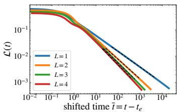  
(a) $p = 0 . 6$

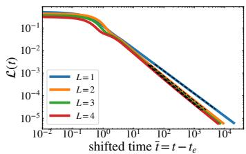  
(b) p = 1.0

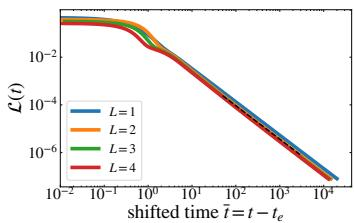  
(c) $p = 1 . 4$  
Figure 1: Increasing depth improves the training-time scaling exponent for difficult tasks with $p < 1$ affects only the logarithmic correction at the boundary $p = 1$ , and leaves the power-law exponent unchanged for easy tasks with $p > 1$ . Dashed lines indicate the asymptotic training-time scaling laws given by Theorem 4.5.

where $c _ { \beta } > 0$ and $b \in \mathbb { R }$

We define the task exponent $p = ( a + 2 b - 1 ) / a$ and assume $p > 0$ . This condition ensures that $\beta ^ { \top } \Sigma \beta = c _ { \lambda } c _ { \beta } ^ { 2 } \sum _ { i = 1 } ^ { d } i ^ { - a p - 1 }$ remains bounded as $d \to \infty$ . The exponent $p$ characterizes the task spectrum and distinguishes the task regimes analyzed below. The case $p = 1$ (equivalently, $b = 1 / 2 )$ separates the polynomially divergent and bounded regimes of the target norm, with $\| \beta \| ^ { 2 }$ growing logarithmically at the boundary.

Model. We parameterize the predictor using a linear network with $L \geq 1$ layers:

$$
f _ { \pmb \theta } ( \pmb x ) = \pmb \theta ^ { \top } \pmb x , \qquad \pmb \theta = ( \pmb W _ { L } \cdot \cdot \cdot \pmb W _ { 1 } ) ^ { \top } .\tag{3}
$$

Here $W _ { k } \in \mathbb { R } ^ { n _ { k } \times n _ { k - 1 } }$ , where $n _ { k }$ denotes the width of the k-th layer. We set $n _ { 0 } = d$ and $n _ { L } = 1$ and assume $n _ { k } \asymp c$ d for $1 \le k < L$ . To track the scale associated with the depth-L factorization, we write $\sigma = \| \pmb { \theta } \| ^ { 1 / L }$ . Depth does not change the represented class of linear predictors. For $L \geq 2 ,$ , the factorized parameterization induces nonlinear dynamics.

Training algorithm and initialization. We train all layers jointly by population gradient flow for the squared loss $\begin{array} { r } { \small \mathcal { L } ( \pmb { \theta } ) = \frac { 1 } { 2 } \| \pmb { \Sigma } ^ { 1 / 2 } ( \pmb { \beta } - \pmb { \theta } ) \| ^ { 2 } } \end{array}$ . For $j \geq k$ , write $W _ { j : k } = W _ { j } \cdot \cdot \cdot W _ { k }$ with the conventions $W _ { 0 : 1 } = I$ and $\bar { W _ { L : L + 1 } } = 1$ . For $1 \leq k \leq L ,$ the layer dynamics are

$$
\frac { d } { d t } \boldsymbol { W } _ { k } = - \nabla _ { \boldsymbol { W } _ { k } } \mathcal { L } = \boldsymbol { W } _ { L : k + 1 } ^ { \top } ( \boldsymbol { \Sigma } ( \beta - \pmb { \theta } ) ) ^ { \top } \boldsymbol { W } _ { k - 1 : 1 } ^ { \top } .\tag{4}
$$

All entries are initialized independently according to $( W _ { k } ( 0 ) ) _ { i j } \sim { \mathcal { N } } ( 0 , s ^ { 2 } / n _ { k - 1 } )$ for $1 \le k \le L$ where $s > 0$ is the initialization scale.

## 4 DEPTH-DEPENDENT TRAINING-TIME SCALING UNDER SMALL INITIALIZATION

In this section, we derive the training-time loss scaling under sufficiently small random initialization and characterize when network depth improves the asymptotic decay exponent. The precise assumptions on the initialization scale s used in the analysis are stated in Theorem B.1. To focus on the subsequent power-law scaling phase while accounting for the initial dynamics near the origin, we introduce a time $t _ { \mathrm { e } } ,$ defined precisely below, and use the shifted training time $\bar { t } = t - t _ { \mathrm { e } }$

Numerical observation. Figure 1 shows the loss as a function of t¯ for representative values of $p$ below, at, and above 1. For $p < 1$ , increasing depth produces a steeper power-law decay of the loss. $\mathbf { A } \mathbf { t } p = 1$ , the effect of depth is weaker, and for $p > 1$ , the power-law exponent does not change.

Overview of the analysis. We proceed in several steps. We first analyze the end-to-end predictor dynamics and introduce the rescaled predictor $z = \sigma ^ { - ( L - 1 ) } \theta$ , which cancels the leading depth-dependent anisotropy of the preconditioner (Section 4.1). We next analyze the initial escape phase and characterize the dependence of the time $t _ { \mathrm { e } }$ on the initialization scale (Section 4.2). In the subsequent power-law scaling phase, we introduce the reparameterized time τ and analyze the dynamics in three steps. We first characterize the growth of the predictor norm as a function of τ (Section 4.3.1), then derive the loss scaling in τ and show that its exponent is independent of depth (Section 4.3.2), and finally translate this law back to the shifted training time t¯(Section 4.3.3).

## 4.1 DEPTH-DEPENDENT PRECONDITIONING AND RESCALED PREDICTOR DYNAMICS

In this subsection, we introduce the rescaled predictor $z = \sigma ^ { - ( L - 1 ) } \theta$ and derive its dynamics, for which the leading depth-dependent anisotropy of the end-to-end preconditioner is canceled. Since the loss depends on the network parameters only through the end-to-end predictor θ, we begin with its dynamics, in which the effect of depth appears through a preconditioner. Specifically,

$$
\frac { d \pmb { \theta } } { d t } = \pmb { K } _ { L } \pmb { \Sigma } ( \pmb { \beta } - \pmb { \theta } ) .\tag{5}
$$

The preconditioner induced by the factorization is $\begin{array} { r } { \pmb { K } _ { L } = \sum _ { k = 1 } ^ { L } \| \pmb { W } _ { L : k + 1 } \| ^ { 2 } \pmb { W } _ { k - 1 : 1 } ^ { \top } \pmb { W } _ { k - 1 : 1 } } \end{array}$ . From Equation (4), the adjacent-layer Gram differences are conserved: $\begin{array} { r } { \frac { d } { d t } ( \boldsymbol { W _ { k } } \boldsymbol { W } _ { k } ^ { \top } ) = \frac { d } { d t } ( \boldsymbol { W } _ { k + 1 } ^ { \top } \boldsymbol { W } _ { k + 1 } ) } \end{array}$ We quantify this imbalance by $\begin{array} { r } { \varepsilon = \operatorname* { m a x } _ { 1 \leq k < L } \| \boldsymbol { W } _ { k } \boldsymbol { W } _ { k } ^ { \top } - \boldsymbol { W } _ { k + 1 } ^ { \top } \boldsymbol { W } _ { k + 1 } \| _ { \mathrm { o p } } } \end{array}$ . When $\varepsilon / \sigma ^ { 2 }$ is small, this near-balance keeps all layers at the common scale $\sigma ,$ so each term in $K _ { L }$ has overall scale $\sigma ^ { 2 ( L - 1 ) }$ . As shown in Theorem A.4, we get

$$
\pmb { K } _ { L } = \sigma ^ { 2 ( L - 1 ) } \left( \pmb { I } + ( L - 1 ) \pmb { P _ { \theta } } + \Delta \pmb { K } _ { L } \right) .\tag{6}
$$

Here, for $\theta \ \ne \ 0$ , we define $P _ { \pmb { \theta } } ~ = ~ { \pmb { \theta } } { \pmb { \theta } } ^ { \top } / \| { \pmb { \theta } } \| ^ { 2 }$ , the orthogonal projector onto $\operatorname { s p a n } \{ \pmb \theta \}$ , and $\| \Delta \overline { { K } } _ { L } \| _ { \mathrm { o p } } = O ( \varepsilon / \sigma ^ { 2 } )$ . Equation (6) shows that, for $L \ \geq \ 2$ , the leading part of the preconditioner is anisotropic, with the depth dependence appearing through the rank-one term $( \bar { L _ { \mathbf { \alpha } } } - 1 ) P _ { \theta }$ This motivates the rescaling $z = \sigma ^ { - ( L - 1 ) } \theta$ . Defining $\begin{array} { r } { \pmb { J _ { L } } = \sigma ^ { L - 1 } \partial _ { \pmb { \theta } } \pmb { z } = \pmb { I } - \frac { L - 1 } { L } \pmb { P _ { \theta } } } \end{array}$ , we have $J _ { L } ( I + ( L - 1 ) P _ { \theta } ) = I $ , so the leading anisotropic factor is exactly canceled in the dynamics of $_ { z . }$ Lemma 4.1 (Rescaled predictor dynamics). For $z = \sigma ^ { - ( L - 1 ) } \theta ,$ , the dynamics satisfy

$$
\frac { d z } { d t } = ( I + J _ { L } \Delta \overline { { K } } _ { L } ) \Sigma ( \sigma ^ { L - 1 } \beta - \sigma ^ { 2 ( L - 1 ) } z ) .\tag{7}
$$

See Section A.3 for the derivation.

## 4.2 ESCAPE FROM THE ORIGIN

Before analyzing the power-law scaling phase, we characterize the initial escape from the origin. In particular, we determine how the time $t _ { \mathrm { e } }$ at which the predictor scale σ has reached an $O ( 1 )$ scale depends on the initialization scale $s .$ From Equation $( 7 )$ , when $\sigma \ll 1$ , the relaxation term is lower order and the forcing term has scale $\sigma ^ { L - 1 }$ , suggesting $l \sigma / d t \approx \sigma ^ { L - 1 }$ . Hence the time $t _ { \mathrm { e } }$ satisfies

$$
t _ { \mathrm { e } } \asymp \left\{ \begin{array} { l l } { 1 , } & { L = 1 , } \\ { \log ( 1 / s ) , } & { L = 2 , } \\ { s ^ { - ( L - 2 ) } , } & { L \geq 3 . } \end{array} \right.\tag{8}
$$

A rigorous derivation is given in Theorem B.4. We therefore measure the subsequent dynamics using the shifted time $\bar { t } = t - t _ { \mathrm { e } }$

## 4.3 PREDICTOR NORM AND LOSS SCALING

To characterize the loss scaling in the power-law scaling phase, we introduce a reparameterized time in which the leading spectral dynamics take a common form across depths. This separates the common spectral scaling in reparameterized time from the depth-dependent conversion back to training time.

Corollary 4.2 (Dynamics in reparameterized time). We define the time reparameterization

$$
\tau ( t ) = \int _ { 0 } ^ { t } \sigma ( v ) ^ { 2 ( L - 1 ) } d v .\tag{9}
$$

Then the rescaled predictor satisfies:

$$
\frac { d z } { d \tau } = - \Sigma z + \sigma ^ { - ( L - 1 ) } \Sigma \beta + f _ { K } ,\tag{10}
$$

where $\pmb { f } _ { K } = \pmb { J } _ { L } \Delta \overline { { K } } _ { L } \pmb { \Sigma } \left( \sigma ^ { - ( L - 1 ) } \beta - z \right)$

See Section A.3 for the derivation. The relaxation term −Σz is independent of depth. Depth enters only through the predictor scale σ and the perturbation $f _ { K }$ . The subsequent analysis therefore reduces to characterizing the growth of the predictor norm and the resulting spectral learning dynamics in τ .

Since $\lambda _ { d } \asymp d ^ { - a }$ is the smallest eigenvalue of Σ, the slowest spectral time scale is of order $d ^ { a }$ We therefore fix a sufficiently small constant $c _ { 0 } > 0$ and set $\tau _ { + } = c _ { 0 } d ^ { a }$ Let $t _ { + } ~ > ~ t _ { \mathrm { e } }$ be the corresponding time defined by $\tau ( t _ { + } ) = \tau _ { + }$ , and set $\bar { t } _ { + } = t _ { + } - t _ { \mathrm { e } } .$ . We restrict the analysis in this subsection to $t _ { \mathrm { e } } \leq t \leq t _ { + }$ , equivalently $\tau _ { \mathrm { e } } \leq \tau \leq \tau _ { + }$ with $\tau _ { \mathrm { e } } = \tau ( t _ { \mathrm { e } } )$ , before effects associated with the smallest eigenvalue become relevant. Beyond this window, the loss decays exponentially in reparameterized time (see Theorem C.4).

## 4.3.1 SCALING OF THE PREDICTOR NORM

The relation between reparameterized time τ and training time is controlled by the predictor scale, since $d \tau / d t = \sigma ^ { 2 ( L - 1 ) }$ . We therefore characterize $\sigma ( \tau ) = \| \pmb { \theta } ( \tau ) \| ^ { 1 / L }$ through the spectral dynamics of the predictor. Applying the variation of constants formula to the dynamics above and using $\pmb { \theta } = \sigma ^ { L - 1 } \widetilde { \mathbf { \Gamma } } z$ , we obtain

$$
\pmb \theta ( \tau ) = \sigma ( \tau ) ^ { L - 1 } \int _ { 0 } ^ { \tau } e ^ { - ( \tau - v ) \pmb \Sigma } \pmb \Sigma \pmb \beta \sigma ( v ) ^ { - ( L - 1 ) } d v + \pmb R ( \tau ) ,\tag{11}
$$

where $R ( \tau )$ collects the effects of initialization and the conserved layer imbalance (see Theorem B.6 for its exact representation). Under sufficiently small initialization, $R ( \tau )$ does not change the predictor-norm scaling derived below, as shown in Section D.

In the i-th eigendirection, the exponential factor $e ^ { - ( \tau - v ) \lambda _ { i } }$ suppresses contributions from times v much earlier than τ, over a time scale $1 / \lambda _ { i }$ . The behavior therefore changes around $\tau \lambda _ { i } \asymp 1$ For $\tau \lambda _ { i } \gg 1$ , the integral is dominated by v near τ , giving $\theta _ { i } ( \tau ) \ \approx { \mathrm { ~ \bar { \beta } } } _ { i }$ For $\tau \lambda _ { i } ~ \ll ~ 1$ we have $e ^ { - ( \tau - v ) \lambda _ { i } } ~ \approx ~ 1$ , so $\begin{array} { r } { \theta _ { i } ( \tau ) ~ \approx ~ \beta _ { i } \lambda _ { i } \sigma ( \tau ) ^ { L - 1 } \int _ { 0 } ^ { \tau } \sigma ( v ) ^ { - ( L - 1 ) } d v } \end{array}$ To obtain the scaling behavior, we make the self-consistent ansatz $\begin{array} { r } { \sigma ( \tau ) ^ { L - 1 } \int _ { 0 } ^ { \tau } \sigma ( v ) ^ { - ( L - 1 ) } d v \asymp \tau } \end{array}$ . This gives $\theta _ { i } ( \tau ) \asymp \beta _ { i } \tau \lambda _ { i }$ . Combining the two cases and summing over the eigendirections gives $\| \pmb \theta ( \tau ) \| ^ { 2 } \asymp$ $\textstyle \sum _ { i = 1 } ^ { d } \beta _ { i } ^ { 2 }$ min $\{ \tau \lambda _ { i } , 1 \} ^ { 2 }$ . Substituting $\lambda _ { i } = c _ { \lambda } i ^ { - a }$ and $\beta _ { i } = c _ { \beta } i ^ { - b }$ into this expression, we obtain Proposition 4.3 (Predictor-norm scaling, informal). Under sufficiently small initialization, there exists a constant $\tau _ { 0 } > 0 ;$ , independent of d and s, such that, for all sufficiently large d, with high probability, uniformlyfor $\tau _ { 0 } \leq \tau \leq \tau _ { + }$

$$
\| \pmb \theta ( \tau ) \| ^ { 2 } \asymp \left\{ \begin{array} { l l } { \tau ^ { 1 - p } , } & { p < 1 , } \\ { \log \tau , } & { p = 1 , } \\ { 1 , } & { p > 1 . } \end{array} \right.\tag{12}
$$

The resulting scaling of $\smash { \sigma ( \tau ) ~ = ~ \| \pmb { \theta } ( \tau ) \| ^ { 1 / L } }$ satisfies the assumed relation, confirming the selfconsistency of the ansatz. A rigorous derivation is given in Theorem D.3 and does not rely on the self-consistency ansatz. Figure 2 illustrates the three regimes for the squared predictor norm: polynomial growth, logarithmic growth, and bounded behavior, respectively.

## 4.3.2 COMMON SPECTRAL LAW FOR THE LOSS

We next derive the loss scaling in reparameterized time τ and show that its scaling exponent depends on the task spectrum but is independent of network depth. The same spectral threshold $\tau \lambda _ { i } \asymp 1$ that controls the predictor norm also determines which eigendirections contribute to the loss. Recall that $\begin{array} { r } { \mathcal { L } ( \tau ) = \frac { 1 } { 2 } \sum _ { i = 1 } ^ { d } \lambda _ { i } ( \beta _ { i } - \theta _ { i } ( \tau ) ) ^ { 2 } } \end{array}$ . For $\tau \lambda _ { i } \gg 1$ , the corresponding mode is essentially learned, with $\theta _ { i } ( \tau ) \approx { \bar { \beta } } _ { i }$ , whereas for $\tau \lambda _ { i } \ll 1$ , it remains largely unlearned, with $\beta _ { i } - \theta _ { i } ( \tau ) \asymp \beta _ { i }$ . Thus, to leading order, the loss is governed by the unresolved spectral tail $\sum { _ { \lambda _ { i } \le _ { 1 / \tau } \lambda _ { i } \beta _ { i } ^ { 2 } } }$ . Under $\lambda _ { i } = c _ { \lambda } i ^ { - a }$ and $\beta _ { i } = c _ { \beta } i ^ { - b }$ , this tail is governed by the exponent $p = ( a + 2 b - 1 ) / a$

Proposition 4.4 (Common spectral law for the loss, informal). Under sufficiently small initializa tion, there exists a constant $\tau _ { 0 } > 0 ,$ , independent $o f d$ and s, such that, for sufficiently large d, with high probability, uniformlyfor $\tau _ { 0 } \leq \tau \leq \tau _ { + }$

$$
\begin{array} { r } { \mathcal { L } ( \tau ) \asymp \tau ^ { - p } . } \end{array}\tag{13}
$$

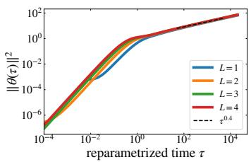  
(a) p = 0.6

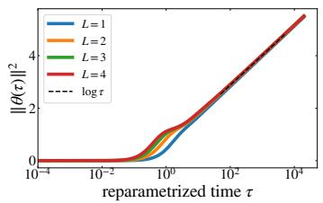  
(b) p = 1.0

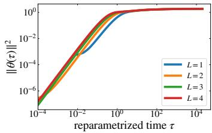  
(c) $p = 1 . 4$

Figure 2: Growth of the squared predictor norm distinguishes three task regimes: polynomial growth for difficult tasks with $p < 1$ , logarithmic growth at the boundary $p = 1$ , and bounded behavior for easy tasks with $p > 1$ . Dashed lines indicate the asymptotic scaling laws given by Theorem 4.3. Panel (b) uses a linear vertical axis to make the logarithmic growth visible.  
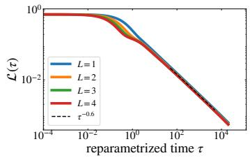  
(a) $p = 0 . 6$

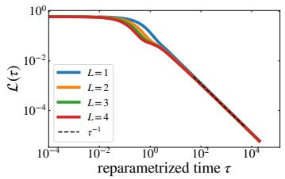  
(b) $p = 1 . 0$

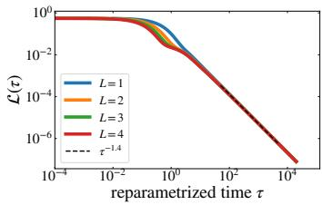  
(c) $p = 1 . 4$  
Figure 3: In reparameterized time, the loss follows a common depth-independent spectral scaling law, with exponent determined solely by the task spectrum. Dashed lines indicate the asymptotic reparameterized-time scaling laws given by Theorem 4.4.

A rigorous proof is given in Theorem E.6. Thus, in reparameterized time, the loss decays with the same power-law exponent p across all depths. Figure 3 illustrates this common scaling numerically.

## 4.3.3 TRAINING-TIME LOSS SCALING

We finally translate the loss scaling in reparameterized time τ back to the shifted training time $\bar { t } = t - t _ { \mathrm { e } }$ and determine how the resulting training-time scaling depends on network depth. Since $d \tau / d \bar { t } = \sigma ^ { 2 ( L - 1 ) }$ , the predictor-norm scaling in Theorem 4.3 determines the relation between τ and t¯. Combining this relation with the loss scaling in Theorem 4.4 gives the following result.

Theorem 4.5 (Training-time loss scaling, informal). Under sufficiently small initialization, there exists a constant $\begin{array} { r } { \bar { t } _ { 0 } > 0 , } \end{array}$ independent of d and s, such that, for sufficiently large $d ,$ with high probability, uniformly for $\bar { t } _ { 0 } \leq \bar { t } \leq \bar { t } _ { + }$

$$
\begin{array} { r } { \mathcal { L } ( t _ { \mathrm { e } } + \bar { t } ) \asymp \left\{ \begin{array} { l l } { \bar { t } ^ { - p L / [ 1 + p ( L - 1 ) ] } , } & { p < 1 , } \\ { \bar { t } ^ { - 1 } ( \log \bar { t } ) ^ { - ( L - 1 ) / L } , } & { p = 1 , } \\ { \bar { t } ^ { - p } , } & { p > 1 . } \end{array} \right. } \end{array}\tag{14}
$$

A rigorous proof is given in Theorem F.1. For $p \ < \ 1$ , the decay exponent $p L / [ 1 + p ( L - 1 ) ]$ increases with depth. For $p > 1$ , the power-law exponent is independent of depth, while at $p = 1$ depth affects only the logarithmic correction. Figure 4 summarizes the resulting dependence of the decay exponent on the task exponent p and network depth.

## 5 STANDARD INITIALIZATION AND FINITE-SIZE EFFECTS FOR DIFFICULT TASKS

Having shown that depth improves the training-time scaling exponent for difficult tasks under sufficiently small initialization, we next ask whether this improvement persists under standard initialization. We focus on the difficult-task regime $p < 1$ , where the predictor norm grows polynomially

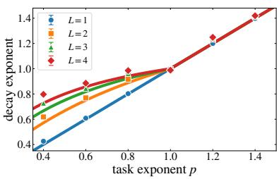  
Figure 4: Task difficulty determines the magnitude of the depth-induced improvement in the training-time power-law exponent. Solid curves show the asymptotic exponents given by Theorem 4.5. Markers show numerical estimates averaged over five random seeds at dimension $d \ = \ 2 0 4 8$ , and error bars show one standard deviation across seeds. At $p = 1$ , we account for the logarithmic correction by fitting $\overline { { \mathscr { L } ( t ) ( \log \bar { t } ) ^ { ( L - 1 ) / L } } }$ to a power law.

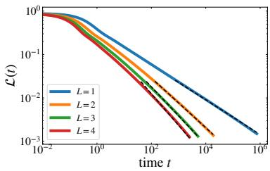  
(a) Loss dynamics

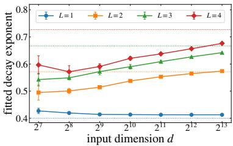  
(b) Finite-size effects on the fitted decay exponent  
Figure 5: The depth-dependent asymptotic scaling under standard initialization $( s \ : = \ : 1 )$ emerges with increasing dimension, while finite-size effects make this scaling harder to observe in deeper networks. (a) Loss dynamics for the $p = 0 . 4$ task at dimension $d = 8 1 9 2$ . Dashed lines show the asymptotic power-law decay predicted by Theorem 5.1, with exponents corresponding to the asymptotic values shown by the dotted horizontal lines in panel (b). (b) As dimension increases, the fitted decay exponents approach these asymptotic values. Markers show the mean over five random seeds, and error bars show one standard deviation across seeds.

during training. This growth makes the effect of the $O ( 1 )$ initialization scale asymptotically negligible.

Corollary 5.1 (Training-time loss scaling under standard initialization, informal). Suppose $p < 1$ and consider standard initialization with $s = 1$ . There exists a constant $t _ { 0 } > 0 ,$ , independent $o f d ,$ such that,for sufficiently large d, with high probability, uniformlyfor $t _ { 0 } \leq t \leq t _ { + }$ ，

$$
\mathscr { L } ( t ) \asymp t ^ { - p L / [ 1 + p ( L - 1 ) ] } .\tag{15}
$$

A rigorous proof is given in Theorem F.2. Figure 5a shows that the loss decays faster with increasing depth, consistent with the predicted depth dependence.

At finite input dimension, however, the predicted asymptotic scaling may not be clearly observable. Figure 5b shows the fitted decay exponent as a function of the input dimension d. As d increases, the fitted exponents approach their asymptotic predictions, but this convergence becomes slower with increasing depth. To understand this finite-size effect, recall that the power-law scaling window is restricted to $\tau \leq \tau _ { + } = c _ { 0 } d ^ { a }$ Within this window, the largest asymptotic scale available to the squared predictor norm is $\tau _ { + } ^ { 1 - p } \asymp d ^ { a ( 1 - p ) } = d ^ { 1 - 2 b }$ . Although this quantity diverges as $d \to \infty$ for $p < 1$ , the divergence becomes slower as p ↑ 1. Moreover, the corresponding per-layer scale grows only as $\sigma ( \tau _ { + } ) \stackrel { \smile } { \sim } d ^ { a ( 1 - p ) / ( 2 L ) } = d ^ { ( 1 - 2 b ) / \bar { ( } 2 L ) }$ . This suggests that, as depth L increases, the per-layer scale separates more slowly from its $O ( 1 )$ initialization scale. Consequently, especially for large L or for $p$ close to 1, increasingly large dimensions may be required for the asymptotic power-law scaling to emerge clearly, making the ideal depth-dependent exponent difficult to observe at finite input dimension.

## 6 EXPERIMENTS ON REAL DATA AND NONLINEAR NETWORKS

Finally, we numerically examine whether the task-dependent effect of depth extends beyond the analytically tractable setting to real data and nonlinear networks.

First, we train deep linear networks with standard initialization $( s = 1 )$ on a regression task constructed from CIFAR-5M (Nakkiran et al., 2021), whose empirical task spectrum is approximately power-law with $p _ { \mathrm { e f f } } \approx 0 . 4 7 8$ , placing it in the $p < 1$ regime. As shown in Figure 6, the loss decay becomes steeper with increasing depth in training time. The loss trajectories nearly collapse under the predictor-norm time reparameterization, while the squared predictor norm exhibits approximately the predicted polynomial growth.

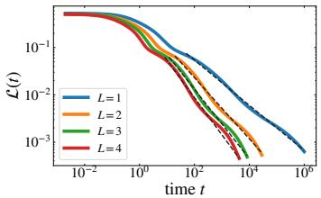  
(a) Loss in training time t

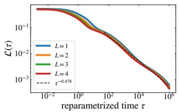  
(b) Loss in reparameterized time τ

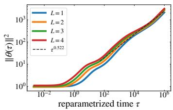  
(c) Growth of squared predictor norm

Figure 6: The depth-dependent acceleration persists on a task derived from benchmark image data. (a) In training time, the loss decays faster with increasing depth. (b) In reparameterized time, the loss trajectories nearly collapse onto a common spectral scaling law. (c) The squared predictor norm exhibits the predicted polynomial growth. Dashed lines show the theoretical slopes obtained from $p _ { \mathrm { e f f } } \approx 0 . 4 7 8 \colon$ $p _ { \mathrm { e f f } } L / [ 1 \bar { + } \dot { p } _ { \mathrm { e f f } } ( L - \bar { 1 } ) ]$ in $( \mathbf { a } ) , p _ { \mathrm { e f f } }$ in (b), and $1 - p _ { \mathrm { e f f } }$ in (c).  
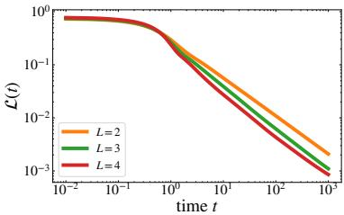  
(a) p = 0.6

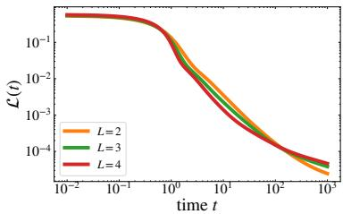  
(b) $p = 1 . 4$  
Figure 7: The task-dependent effect of depth persists qualitatively in nonlinear ReLU networks. (a) For the difficult task with $p = 0 . 6 ,$ deeper networks achieve lower loss at late training times. (b) For the easy task with $p = 1 . 4 ,$ the loss trajectories converge and cross, with no consistent late-time advantage from increasing depth.

We also test ReLU MLPs on the synthetic power-law tasks used in our theoretical analysis. As shown in Figure 7, for the difficult $p = 0 . 6$ task, the loss trajectories separate at late training times, with deeper networks attaining lower loss, whereas for the easy $p = 1$ .4 task the trajectories remain much closer and show no systematic advantage with increasing depth. These observations are qualitatively consistent with the task-dependent trend predicted by our theory, although the distinction is less pronounced than for the deep linear networks.

## 7 CONCLUSION

In this work, we showed for the first time that task difficulty explains the previously unresolved depth dependence of convergence in the most fundamental setting of deep linear networks trained with MSE loss. That is, increasing network depth improves the asymptotic training-time scaling exponent for spectrally difficult tasks. A time reparameterization defined through the predictor norm reveals that the loss follows a depth-independent spectral scaling law in reparameterized time, while depth changes its relation to training time. This also explains why depth does not improve the power-law exponent for easy tasks.

Our analysis has several limitations. The theory assumes a linear teacher and student and population gradient flow, while our results for standard initialization are limited to difficult tasks. It remains to understand how the mechanisms identified here extend to more general task structures, nonlinear networks, and finite-sample training with discrete-time stochastic optimization.

Even in deep linear networks, explicitly accounting for task structure can substantially complicate a sharp characterization of the training dynamics. Our results show that this structure can qualitatively change how network depth affects training-time scaling. These results provide a basis for studying such architectural effects in broader classes of neural networks.

## AI USE STATEMENT

In this work, we used generative AI tools to help refine and formalize aspects of the theoretical framework and presentation, to refine the formulation of some mathematical statements and technical assumptions, and to assist with writing and formalizing proofs. The central research hypotheses, core mathematical ideas, and main theoretical mechanisms were developed by the authors. We also used generative AI tools to generate and edit code implementing numerical experiments, fitting procedures, and plotting routines, and for translation. The experimental settings and comparisons were specified by the authors. Additionally, we used generative AI tools to suggest some experimental parameters, to draft and edit parts of the manuscript, and to identify relevant literature and examine specific mathematical arguments in prior work. The authors reviewed and verified all AI-assisted text, mathematical claims and proofs, code, experimental results, analyses, and citations, and take responsibility for the final content.

## REPRODUCIBILITY STATEMENT

The assumptions, technical derivations, and complete proofs for the theoretical results are provided in Sections A to F. Details for reproducing the numerical experiments are provided in Section G, including experimental setups, data processing, optimization settings, and fitting procedures.

## ACKNOWLEDGMENTS

T.W. was supported by JST BOOST (Grant Number JPMJBS2407). R.K. was supported by JST FOREST (Grant Number JPMJFR226Q), JST BOOST (Grant Number JPMJBY25B0), JSPS KAK-ENHI (Grant Numbers JP23K16965 and JP22H05116), and FRONTia, a Japanese national program led by METI and NEDO. J.T. was supported by JSPS KAKENHI (Grant Number JP24K15104).

## REFERENCES

Madhu S Advani, Andrew M Saxe, and Haim Sompolinsky. High-dimensional dynamics of generalization error in neural networks. Neural Networks, 132:428–446, 2020.

Sanjeev Arora, Nadav Cohen, and Elad Hazan. On the optimization of deep networks: Implicit acceleration by overparameterization. In International conference on machine learning, pp. 244– 253. PMLR, 2018.

Sanjeev Arora, Nadav Cohen, Noah Golowich, and Wei Hu. A convergence analysis of gradient descent for deep linear neural networks. In International Conference on Learning Representations, 2019.

Alexander Atanasov, Blake Bordelon, and Cengiz Pehlevan. Neural networks as kernel learners: The silent alignment effect. In International Conference on Learning Representations, 2022.

Alexander Atanasov, Jacob A Zavatone-Veth, and Cengiz Pehlevan. Scaling and renormalization in high-dimensional regression. Journal of Statistical Mechanics: Theory and Experiment, 2026(4): 043404, 2026.

Yasaman Bahri, Ethan Dyer, Jared Kaplan, Jaehoon Lee, and Utkarsh Sharma. Explaining neural scaling laws. Proceedings ofthe National Academy ofSciences, 121(27):e2311878121, 2024.

Pierre Baldi and Kurt Hornik. Neural networks and principal component analysis: Learning from examples without local minima. Neural networks, 2(1):53–58, 1989.

Gerard Ben Arous, Murat Erdogdu, Nuri Mert Vural, and Denny Wu. Learning quadratic neural networks in high dimensions: SGD dynamics and scaling laws. In Advances in Neural Information Processing Systems, volume 38, pp. 146725–146812, 2025.

Raphael Berthier, Francis Bach, and Pierre Gaillard. Tight nonparametric convergence rates for¨ stochastic gradient descent under the noiseless linear model. Advances in Neural Information Processing Systems, 33:2576–2586, 2020.

Blake Bordelon and Cengiz Pehlevan. Learning curves for SGD on structured features. In International Conference on Learning Representations, 2022.

Blake Bordelon and Cengiz Pehlevan. Deep linear network training dynamics from random initialization: Data, width, depth, and hyperparameter transfer. In Proceedings ofthe 42nd International Conference on Machine Learning, volume 267 of Proceedings ofMachine Learning Research, pp. 4968–4997. PMLR, 2025.

Blake Bordelon, Abdulkadir Canatar, and Cengiz Pehlevan. Spectrum dependent learning curves in kernel regression and wide neural networks. In International Conference on Machine Learning, pp. 1024–1034. PMLR, 2020.

Blake Bordelon, Alexander Atanasov, and Cengiz Pehlevan. A dynamical model of neural scaling laws. In Proceedings ofthe 41st International Conference on Machine Learning, volume 235 of Proceedings ofMachine Learning Research, pp. 4345–4382. PMLR, 2024.

Blake Bordelon, Alexander Atanasov, and Cengiz Pehlevan. How feature learning can improve neural scaling laws. In International Conference on Learning Representations, 2025.

Guillaume Braun, Bruno Loureiro, Minh Ha Quang, and Masaaki Imaizumi. Fast escape, slow convergence: Learning dynamics of phase retrieval under power-law data. In International Conference on Learning Representations, 2026.

Lukas Braun, Clementine Domin´ e, James Fitzgerald, and Andrew Saxe. Exact learning dynamics of´ deep linear networks with prior knowledge. Advances in Neural Information Processing Systems, 35:6615–6629, 2022.

Abdulkadir Canatar, Blake Bordelon, and Cengiz Pehlevan. Spectral bias and task-model alignment explain generalization in kernel regression and infinitely wide neural networks. Nature communications, 12(1):2914, 2021.

Andrea Caponnetto and Ernesto De Vito. Optimal rates for the regularized least-squares algorithm. Foundations ofComputational mathematics, 7(3):331–368, 2007.

Hugo Cui, Bruno Loureiro, Florent Krzakala, and Lenka Zdeborova. Generalization error rates´ in kernel regression: The crossover from the noiseless to noisy regime. Advances in Neural Information Processing Systems, 34:10131–10143, 2021.

Leonardo Defilippis, Bruno Loureiro, and Theodor Misiakiewicz. Dimension-free deterministic equivalents and scaling laws for random feature regression. Advances in Neural Information Processing Systems, 37:104630–104693, 2024.

Leonardo Defilippis, Florent Krzakala, Bruno Loureiro, and Antoine Maillard. Optimal scaling laws in learning hierarchical multi-index models. arXiv preprint arXiv:2602.05846, 2026.

Clementine Domine, Nicolas Anguita, Alexandra M Proca, Lukas Braun, Daniel Kunin, Pedro Mediano, and Andrew Saxe. From lazy to rich: Exact learning dynamics in deep linear networks. In International Conference on Learning Representations, 2025.

Simon Du and Wei Hu. Width provably matters in optimization for deep linear neural networks. In International Conference on Machine Learning, pp. 1655–1664. PMLR, 2019.

Kenji Fukumizu. Effect of batch learning in multilayer neural networks. In Proceedings of the 5th International Conference on Neural Information Processing, pp. 67–70, 1998.

Gauthier Gidel, Francis Bach, and Simon Lacoste-Julien. Implicit regularization of discrete gradient dynamics in linear neural networks. Advances in Neural Information Processing Systems, 32, 2019.

Daniel Gissin, Shai Shalev-Shwartz, and Amit Daniely. The implicit bias of depth: How incremental learning drives generalization. In International Conference on Learning Representations, 2020.

Joel Hestness, Sharan Narang, Newsha Ardalani, Gregory Diamos, Heewoo Jun, Hassan Kianinejad, Md Mostofa Ali Patwary, Yang Yang, and Yanqi Zhou. Deep learning scaling is predictable, empirically. arXiv preprint arXiv:1712.00409, 2017.

Jordan Hoffmann, Sebastian Borgeaud, Arthur Mensch, Elena Buchatskaya, Trevor Cai, Eliza Rutherford, Diego de Las Casas, Lisa Anne Hendricks, Johannes Welbl, Aidan Clark, et al. Training compute-optimal large language models. arXiv preprint arXiv:2203.15556, 2022.

Arthur Jacot, Franc¸ois Ged, Berfin S¸ims¸ek, Clement Hongler, and Franck Gabriel. Saddle-to-saddle´ dynamics in deep linear networks: Small initialization training, symmetry, and sparsity. arXiv preprint arXiv:2106.15933, 2021.

Jared Kaplan, Sam McCandlish, Tom Henighan, Tom B Brown, Benjamin Chess, Rewon Child, Scott Gray, Alec Radford, Jeffrey Wu, and Dario Amodei. Scaling laws for neural language models. arXiv preprint arXiv:2001.08361, 2020.

Jakob Kramp, Javed Lindner, and Moritz Helias. Dynamics of neural scaling laws in random feature regression with powerlaw-distributed kernel eigenvalues. arXiv preprint arXiv:2602.23039, 2026.

Daniel Kunin, Allan Raventos, Clementine Carla Juliette Domin ´ e, Feng Chen, David Klindt, An-´ drew M Saxe, and Surya Ganguli. Get rich quick: exact solutions reveal how unbalanced initializations promote rapid feature learning. In The Thirty-eighth Annual Conference on Neural Information Processing Systems, 2024.

Andrew K. Lampinen and Surya Ganguli. An analytic theory of generalization dynamics and transfer learning in deep linear networks. In International Conference on Learning Representations, 2019.

Licong Lin, Jingfeng Wu, Sham M Kakade, Peter L Bartlett, and Jason D Lee. Scaling laws in linear regression: Compute, parameters, and data. Advances in Neural Information Processing Systems, 37:60556–60606, 2024.

Alexander Maloney, Daniel A Roberts, and James Sully. A solvable model of neural scaling laws. arXiv preprint arXiv:2210.16859, 2022.

Hancheng Min, Salma Tarmoun, Rene Vidal, and Enrique Mallada. On the explicit role of initializa-´ tion on the convergence and implicit bias of overparametrized linear networks. In International Conference on Machine Learning, pp. 7760–7768. PMLR, 2021.

Preetum Nakkiran, Behnam Neyshabur, and Hanie Sedghi. The deep bootstrap framework: Good online learners are good offline generalizers. In International Conference on Learning Representations, 2021.

Elliot Paquette, Courtney Paquette, Lechao Xiao, and Jeffrey Pennington. 4+ 3 phases of computeoptimal neural scaling laws. Advances in Neural Information Processing Systems, 37:16459– 16537, 2024.

Loucas Pillaud-Vivien, Alessandro Rudi, and Francis Bach. Statistical optimality of stochastic gradient descent on hard learning problems through multiple passes. Advances in Neural Information Processing Systems, 31, 2018.

Yunwei Ren, Eshaan Nichani, Denny Wu, and Jason Lee. Emergence and scaling laws in SGD learning of shallow neural networks. In Advances in Neural Information Processing Systems, volume 38, pp. 38227–38309, 2025.

Andrew M Saxe, James L McClelland, and Surya Ganguli. Exact solutions to the nonlinear dynamics of learning in deep linear neural networks. arXiv preprint arXiv:1312.6120, 2013.

Stefano Spigler, Mario Geiger, and Matthieu Wyart. Asymptotic learning curves of kernel methods: empirical data versus teacher–student paradigm. Journal of Statistical Mechanics: Theory and Experiment, 2020(12):124001, 2020.

Salma Tarmoun, Guilherme Franca, Benjamin D Haeffele, and Rene Vidal. Understanding the dynamics of gradient flow in overparameterized linear models. In International Conference on Machine Learning, pp. 10153–10161. PMLR, 2021.

Alexander Wei, Wei Hu, and Jacob Steinhardt. More than a toy: Random matrix models predict how real-world neural representations generalize. In International conference on machine learning, pp. 23549–23588. PMLR, 2022.

Blake Woodworth, Suriya Gunasekar, Jason D Lee, Edward Moroshko, Pedro Savarese, Itay Golan, Daniel Soudry, and Nathan Srebro. Kernel and rich regimes in overparametrized models. In Conference on Learning Theory, pp. 3635–3673. PMLR, 2020.

Roman Worschech and Bernd Rosenow. Analyzing neural scaling laws in two-layer networks with power-law data spectra. In International Conference on Learning Representations, 2025.

## CONTENTS

Introduction 1   
2 Related Work 2   
Problem Setup 3   
4 Depth-Dependent Training-Time Scaling under Small Initialization 4   
4.1 Depth-Dependent Preconditioning and Rescaled Predictor Dynamics 5   
4.2 Escape from the origin 5   
4.3 Predictor Norm and Loss Scaling 5   
4.3.1 Scaling of the predictor norm 6   
4.3.2 Common spectral law for the loss 6   
4.3.3 Training-time loss scaling 7   
5 Standard Initialization and Finite-Size Effects for Difficult Tasks 7   
6 Experiments on Real Data and Nonlinear Networks 8   
7 Conclusion 9   
A Gradient-Flow Dynamics, Preconditioner Geometry, and Initialization Bounds 15   
A.1 Exact Gradient-Flow Dynamics . 15   
A.2 Layer Balance and Preconditioner Geometry 16   
A.3 Rescaled Predictor Dynamics and Time Reparameterization 18   
A.4 Gaussian Initialization 19   
B From Initialization to the Onset of the Power-Law Scaling Phase 20   
B.1 Escape from the Origin under Small Initialization 20   
B.2 Standard Initialization 24   
C Spectral Estimates and Auxiliary Loss Bounds 25   
C.1 Spectral Scaling and Tail Estimates 25   
C.2 Loss Bounds via Spectral Cutoffs 27   
D Predictor-Norm Scaling in Reparameterized Time 28   
E Common Spectral Law for the Loss 34   
E.1 Difficult Tasks . 34   
E.2 Boundary and Easy Tasks 35   
E.3 Common Spectral Law under Small Initialization 40   
F Training-Time Loss Scaling 40

## G Experimental Details

G.1 Synthetic Power-Law Experiments . . . 41

G.2 Extensions beyond the Theoretical Setting . . 42

Throughout the appendices, $c , C > 0$ denote generic constants that may change from line to line. Unless otherwise specified, they do not depend on d or on the variables quantified in the corresponding estimate.

## A GRADIENT-FLOW DYNAMICS, PRECONDITIONER GEOMETRY, AND INITIALIZATION BOUNDS

This section establishes the gradient-flow identities, preconditioner estimates, and Gaussian initialization bounds used throughout the analysis.

## A.1 EXACT GRADIENT-FLOW DYNAMICS

We write $\pmb { g } : = \pmb { \Sigma } ( \beta - \pmb { \theta } )$ and $r : = \| \pmb { \theta } \| = \sigma ^ { L }$ . On any interval on which $r > 0 .$ , write ${ \widehat { \pmb { \theta } } } : = { \pmb { \theta } } / r$ The preconditioner induced by the factorization is

$$
K _ { L } : = \sum _ { k = 1 } ^ { L } \| W _ { L : k + 1 } \| ^ { 2 } W _ { k - 1 : 1 } ^ { \top } W _ { k - 1 : 1 } .\tag{16}
$$

For every $1 \le k \le L$ , using $\nabla _ { \pmb { \theta } } \mathcal { L } = - \pmb { g }$ and applying the chain rule to the factorization $\theta =$ $( W _ { L : k + 1 } W _ { k } W _ { k - 1 : 1 } ) ^ { \top }$ , we obtain

$$
\frac { d } { d t } W _ { k } = W _ { L : k + 1 } ^ { \top } \pmb { g } ^ { \top } W _ { k - 1 : 1 } ^ { \top } .\tag{17}
$$

Differentiating the layer product and using Equation (17) yields

$$
\frac { d } { d t } \pmb \theta = \sum _ { k = 1 } ^ { L } \| \pmb W _ { L : k + 1 } \| ^ { 2 } \pmb W _ { k - 1 : 1 } ^ { \top } \pmb W _ { k - 1 : 1 } \pmb g = \pmb K _ { L } \pmb g .\tag{18}
$$

Together with $\nabla _ { \pmb { \theta } } \mathcal { L } = - \pmb { g } _ { \pmb { \theta } }$ , this gives

$$
\frac { d } { d t } \mathcal { L } = - g ^ { \top } K _ { L } g = - \sum _ { k = 1 } ^ { L } \left\| \frac { d } { d t } W _ { k } \right\| _ { \mathrm { F } } ^ { 2 } .\tag{19}
$$

The last equality follows by taking the squared Frobenius norm of both sides of Equation (17) and summing over the layers.

On such an interval, define the normalized preconditioner by

$$
\overline { { { K } } } _ { L } : = \sigma ^ { - 2 \left( L - 1 \right) } K _ { L } .\tag{20}
$$

Since $d \tau / d t = \sigma ^ { 2 ( L - 1 ) } > 0$ on this interval, reparameterizing the predictor and loss identities in terms of τ gives

$$
\frac { d } { d \tau } \pmb \theta = \overline { { { \pmb K } } } _ { L } \pmb g ,\tag{21}
$$

$$
\frac { d } { d \tau } \mathcal { L } = - \pmb { g } ^ { \top } \overline { { \pmb { K } } } _ { L } \pmb { g } .\tag{22}
$$

Lemma A.1. For every finite d and any initialization, the gradient-flow system in Equation (17) admits a unique solutionfor all $t \geq 0$

Proof. The vector field is polynomial in the weights and hence locally Lipschitz. Therefore, the system admits a unique local solution. Let $[ 0 , T _ { \mathrm { m a x } } ^ { - } )$ be the maximal interval of existence of this

solution. For every $T < T _ { \operatorname* { m a x } }$ , the Cauchy–Schwarz inequality and Equation (19) give

$$
\begin{array} { r l } {  { ( \sum _ { k = 1 } ^ { L } \| W _ { k } ( T ) - W _ { k } ( 0 ) \| _ { \mathrm { F } } ^ { 2 } ) ^ { 1 / 2 } \leq \int _ { 0 } ^ { T } ( \sum _ { k = 1 } ^ { L } \| \frac { d } { d t } W _ { k } \| _ { \mathrm { F } } ^ { 2 } ) ^ { 1 / 2 } d t } } \\ & { \leq \sqrt { T } ( \mathcal { L } ( 0 ) - \mathcal { L } ( T ) ) ^ { 1 / 2 } } \\ & { \leq \sqrt { T \mathcal { L } ( 0 ) } . } \end{array}\tag{23}
$$

If co $T _ { \mathrm { m a x } } < \infty$ , then Equation (23) shows that every weight matrix rehe standard continuation criterion for ODEs. Therefore $T _ { \mathrm { m a x } } = \infty$ ded on. $[ 0 , T _ { \mathrm { m a x } } )$ x ,

## A.2 LAYER BALANCE AND PRECONDITIONER GEOMETRY

To quantify the deviation from layer balance at initialization, define

$$
\varepsilon : = \operatorname* { m a x } _ { 1 \leq k < L } \big \| \boldsymbol { W } _ { k } ( 0 ) \boldsymbol { W } _ { k } ( 0 ) ^ { \top } - \boldsymbol { W } _ { k + 1 } ( 0 ) ^ { \top } \boldsymbol { W } _ { k + 1 } ( 0 ) \big \| _ { \mathrm { o p } } .\tag{24}
$$

Lemma A.2. For every $1 \leq k < L$ and every $t \geq 0 ,$

$$
\begin{array} { r } { W _ { k } ( t ) W _ { k } ( t ) ^ { \top } - W _ { k + 1 } ( t ) ^ { \top } W _ { k + 1 } ( t ) = W _ { k } ( 0 ) W _ { k } ( 0 ) ^ { \top } - W _ { k + 1 } ( 0 ) ^ { \top } W _ { k + 1 } ( 0 ) . } \end{array}\tag{25}
$$

Consequently, at every $t \geq 0 ,$

$$
\operatorname* { m a x } _ { 1 \leq k < L } \big \| \pmb { W } _ { k } ( t ) \pmb { W } _ { k } ( t ) ^ { \top } - \pmb { W } _ { k + 1 } ( t ) ^ { \top } \pmb { W } _ { k + 1 } ( t ) \big \| _ { \mathrm { o p } } = \varepsilon .\tag{26}
$$

Proof. Using Equation (17) together with $W _ { k : 1 } = W _ { k } W _ { k - 1 : 1 }$ and $W _ { L : k + 1 } = W _ { L : k + 2 } W _ { k + 1 }$ gives

$$
\frac { d } { d t } \big ( \pmb { W } _ { k } \pmb { W } _ { k } ^ { \top } \big ) = \pmb { W } _ { L : k + 1 } ^ { \top } \pmb { g } ^ { \top } \pmb { W } _ { k : 1 } ^ { \top } + \pmb { W } _ { k : 1 } \pmb { g } \pmb { W } _ { L : k + 1 } = \frac { d } { d t } \big ( \pmb { W } _ { k + 1 } ^ { \top } \pmb { W } _ { k + 1 } \big ) .\tag{27}
$$

Hence the difference in Equation (25) has zero derivative. Evaluating it at $t = 0$ yields both claims.

Define

$$
\Delta \overline { { K } } _ { L } : = \overline { { K } } _ { L } - I - ( L - 1 ) P _ { \theta } .\tag{28}
$$

Suppose that $r > 0$ . Set $\rho _ { L } = 1$ and, for $k = L , L - 1 , \ldots , 1$ , recursively define

$$
\sigma _ { k } : = \| \boldsymbol { W } _ { k } ^ { \top } \rho _ { k } \| , \quad \rho _ { k - 1 } : = \frac { \boldsymbol { W } _ { k } ^ { \top } \rho _ { k } } { \sigma _ { k } } , \quad \boldsymbol { W } _ { k } ^ { \bot } : = ( I - \rho _ { k } \rho _ { k } ^ { \top } ) \boldsymbol { W } _ { k } .\tag{29}
$$

A backward induction shows simultaneously that this recursion is well defined and that

$$
W _ { L : k + 1 } = \left( \prod _ { j = k + 1 } ^ { L } \sigma _ { j } \right) \rho _ { k } ^ { \top } ,\tag{30}
$$

for $0 \le k \le L$ . Indeed, the identity holds at $k = L$ by the convention $W _ { L : L + 1 } = 1$ . If it holds at k and $\sigma _ { k } = 0$ , then $W _ { L : k } = 0$ and hence $W _ { L : 1 } = 0$ , contradicting $r > 0$ . Thus $\sigma _ { k } > 0$ , and the defining relation $\pmb { W } _ { k } ^ { \top } \pmb { \rho } _ { k } = \sigma _ { k } \pmb { \rho } _ { k - 1 }$ yields the identity at $k - 1$

By construction, each $\rho _ { k }$ is a unit vector and

$$
\begin{array} { r } { \pmb { W } _ { k } = \sigma _ { k } \pmb { \rho } _ { k } \pmb { \rho } _ { k - 1 } ^ { \top } + \pmb { W } _ { k } ^ { \bot } , \qquad \pmb { \rho } _ { k } ^ { \top } \pmb { W } _ { k } ^ { \bot } = 0 . } \end{array}\tag{31}
$$

Taking $k = 0$ in Equation (30) and comparing with $\pmb { W } _ { L : 1 } = \pmb { \theta } ^ { \top } = r \widehat { \pmb { \theta } ^ { \top } }$ gives

$$
\prod _ { k = 1 } ^ { L } \sigma _ { k } = r = \sigma ^ { L } , \qquad \rho _ { 0 } = \widehat { \pmb { \theta } } .\tag{32}
$$

Lemma A.3. There exists a constant $C > 0 ,$ , depending only on L, such that at every timefor which $r > 0 ,$ , the decomposition in Equation (31) satisfies

$$
\operatorname* { m a x } _ { 1 \leq k \leq L } \| W _ { k } ^ { \perp } \| _ { \mathrm { o p } } ^ { 2 } \leq C \varepsilon , \qquad \operatorname* { m a x } _ { 1 \leq k \leq L } | \sigma _ { k } ^ { 2 } - \sigma ^ { 2 } | \leq C \varepsilon .\tag{33}
$$

Consequently, for any fixed $M > 0 , i f \varepsilon \leq M \sigma ^ { 2 }$ , then

$$
\sigma _ { k } \asymp \sigma ,\tag{34}
$$

for $1 \leq k \leq L ,$ , where the comparison constants depend only on L and M.

Proof. The orthogonality in the decomposition gives

$$
\begin{array} { r } { \pmb { W } _ { k + 1 } ^ { \top } \pmb { W } _ { k + 1 } = \sigma _ { k + 1 } ^ { 2 } \pmb { \rho } _ { k } \pmb { \rho } _ { k } ^ { \top } + ( \pmb { W } _ { k + 1 } ^ { \bot } ) ^ { \top } \pmb { W } _ { k + 1 } ^ { \bot } . } \end{array}\tag{35}
$$

Taking the quadratic form of the adjacent Gram difference along $\rho _ { k }$ and using Equation (26), we obtain

$$
| \sigma _ { k } ^ { 2 } - \sigma _ { k + 1 } ^ { 2 } | \leq \| \mathbf { W } _ { k + 1 } ^ { \perp } \| _ { \mathrm { o p } } ^ { 2 } + \varepsilon .\tag{36}
$$

Projecting the same Gram difference onto the orthogonal complement of $\rho _ { k }$ gives

$$
\begin{array} { r } { \| \pmb { W } _ { k } ^ { \perp } \| _ { \mathrm { o p } } ^ { 2 } \le \| \pmb { W } _ { k + 1 } ^ { \perp } \| _ { \mathrm { o p } } ^ { 2 } + \varepsilon . } \end{array}\tag{37}
$$

Since $W _ { L } ^ { \perp } = 0$ , backward induction shows that

$$
\| \mathbf { W } _ { k } ^ { \perp } \| _ { \mathrm { o p } } ^ { 2 } \le C \varepsilon ,\tag{38}
$$

for $1 \le k \le L$ . Combining $| \sigma _ { k } ^ { 2 } - \sigma _ { k + 1 } ^ { 2 } | \leq \| \mathbf { W } _ { k + 1 } ^ { \perp } \| _ { \mathrm { o p } } ^ { 2 } + \varepsilon$ with the bounds on $\| \mathbfcal { W } _ { k } ^ { \perp } \| _ { \mathrm { o p } } ^ { 2 }$ above shows that the values $\sigma _ { 1 } ^ { 2 } , \dots , \sigma _ { L } ^ { 2 }$ differ pairwise by at most Cε. Their geometric mean is $\sigma ^ { 2 }$ by Equation (32), so

$$
| \sigma _ { k } ^ { 2 } - \sigma ^ { 2 } | \le C \varepsilon ,\tag{39}
$$

for $1 \le k \le L$

$\operatorname { I f } \varepsilon \leq M \sigma ^ { 2 }$ , this bound gives

$$
\begin{array} { r } { \sigma _ { k } ^ { 2 } \le \sigma ^ { 2 } + C \varepsilon \le ( 1 + C M ) \sigma ^ { 2 } . } \end{array}\tag{40}
$$

Using Equation (32) and applying this upper bound to all factors other than $\sigma _ { k } ^ { 2 }$ gives

$$
\sigma _ { k } ^ { 2 } = \frac { \sigma ^ { 2 L } } { \prod _ { j \neq k } \sigma _ { j } ^ { 2 } } \geq ( 1 + C M ) ^ { - ( L - 1 ) } \sigma ^ { 2 } .\tag{41}
$$

These two bounds prove the claimed comparison.

Proposition A.4. Fix $M > 0 ,$ , and suppose that $r > 0$ and $\varepsilon \le M \sigma ^ { 2 }$ . Then there exist constants $c , C > 0 ,$ , depending only on L and M, such that

$$
\| \Delta \overline { { K } } _ { L } \| _ { \mathrm { o p } } \leq C \frac { \varepsilon } { \sigma ^ { 2 } }\tag{42}
$$

and

$$
c I \preceq \overline { { K } } _ { L } \preceq C I .\tag{43}
$$

Proof. Fix a time satisfying the assumptions of the proposition. By Theorem $\mathrm { A . } 3 ,$ , for every $1 \leq$ $k \leq L$ , the layer amplitudes are comparable to $\sigma ,$ , while $| \sigma _ { k } ^ { 2 } - \sigma ^ { 2 } | \le C \varepsilon$ and $\| \dot { \pmb { W } } _ { k } ^ { \perp } \| _ { \mathrm { o p } } ^ { 2 } \dot { \leq } C \bar { \varepsilon }$ Together with the decomposition in Equation (31), these bounds imply

$$
\begin{array} { r } { \| \mathbf { W } _ { k } \| _ { \mathrm { o p } } ^ { 2 } \leq C \sigma ^ { 2 } , } \end{array}\tag{44}
$$

for $1 \le k \le L$

For $1 \leq j < L ,$ define

$$
\begin{array} { r } { E _ { j } : = W _ { j - 1 : 1 } ^ { \top } ( W _ { j } ^ { \bot } ) ^ { \top } W _ { j } ^ { \bot } W _ { j - 1 : 1 } \succeq 0 . } \end{array}\tag{45}
$$

By Theorem A.3 and Equation (44),

$$
\| E _ { j } \| _ { \mathrm { o p } } \leq \| W _ { j - 1 : 1 } \| _ { \mathrm { o p } } ^ { 2 } \| W _ { j } ^ { \perp } \| _ { \mathrm { o p } } ^ { 2 } \leq C \sigma ^ { 2 ( j - 1 ) } \varepsilon .\tag{46}
$$

The backward recursion gives

$$
W _ { j - 1 : 1 } ^ { \top } \pmb { \rho } _ { j - 1 } = \left( \prod _ { k = 1 } ^ { j - 1 } \sigma _ { k } \right) \pmb { \rho } _ { 0 } .\tag{47}
$$

Combining this identity with the orthogonality of the transverse component yields

$$
W _ { j : 1 } ^ { \top } W _ { j : 1 } = \left( \prod _ { k = 1 } ^ { j } \sigma _ { k } ^ { 2 } \right) \rho _ { 0 } \rho _ { 0 } ^ { \top } + E _ { j } .\tag{48}
$$

Substituting Equation (30) and Equation (48) into Equation (16), and then using Equation (32), yields

$$
\overline { { { \bf K } } } _ { L } = \frac { \sigma ^ { 2 } } { \sigma _ { 1 } ^ { 2 } } I _ { d } + \sum _ { k = 2 } ^ { L } \frac { \sigma ^ { 2 } } { \sigma _ { k } ^ { 2 } } P _ { \theta } + \sum _ { k = 2 } ^ { L } \sigma ^ { - 2 ( L - 1 ) } \left( \prod _ { j = k + 1 } ^ { L } \sigma _ { j } ^ { 2 } \right) { \bf E } _ { k - 1 } .\tag{49}
$$

For every $1 \le k \le L$ , the amplitude bounds imply

$$
\left| \frac { \sigma ^ { 2 } } { \sigma _ { k } ^ { 2 } } - 1 \right| = \frac { | \sigma ^ { 2 } - \sigma _ { k } ^ { 2 } | } { \sigma _ { k } ^ { 2 } } \leq C \frac { \varepsilon } { \sigma ^ { 2 } } .\tag{50}
$$

For every $2 \le k \le L$ , Theorem A.3 and Equation (46) give

$$
\left\| \sigma ^ { - 2 \left( L - 1 \right) } \left( \prod _ { j = k + 1 } ^ { L } \sigma _ { j } ^ { 2 } \right) E _ { k - 1 } \right\| _ { \mathrm { o p } } \leq C { \frac { \varepsilon } { \sigma ^ { 2 } } } .\tag{51}
$$

Subtracting $I _ { d } + ( L - 1 ) P _ { \theta }$ from Equation (49) and bounding each resulting term by Equations (50) and (51), we obtain

$$
\| \Delta \overline { { K } } _ { L } \| _ { \mathrm { o p } } \leq C \frac { \varepsilon } { \sigma ^ { 2 } } .\tag{52}
$$

This establishes Equation (42).

Finally, all terms on the right-hand side of Equation (49) are positive semidefinite. Thus the amplitude comparison in Theorem A.3, together with Equation (49), gives $\overline { { K } } _ { L } \succeq c I$ . The same comparison, Equations (49) and (51), and $\varepsilon / \sigma ^ { 2 } \le M$ give $\overline { { K } } _ { L } \preceq C I$ □

## A.3 RESCALED PREDICTOR DYNAMICS AND TIME REPARAMETERIZATION

We prove Theorems 4.1 and 4.2 and record the resulting variation of constants formula. Throughout this subsection, we work on an interval on which $r > 0$

Proof of Theorem 4.1. Recall that $r = \sigma ^ { L }$

$$
z = \sigma ^ { - ( L - 1 ) } \theta ,\tag{53}
$$

and

$$
\pmb { J } _ { L } = \sigma ^ { L - 1 } \frac { \partial z } { \partial \pmb { \theta } } = \pmb { I } - \frac { L - 1 } { L } \pmb { P } _ { \pmb { \theta } } .\tag{54}
$$

By Equation (28), $\overline { { { \cal K } } } _ { L } = I + ( L - 1 ) P _ { \theta } + \Delta \overline { { { \cal K } } } _ { L }$ . Since $P _ { \theta } ^ { 2 } = P _ { \theta }$ , we have $J _ { L } ( I + ( L - 1 ) P _ { \theta } ) = I$ Moreover, $\partial z / \partial \pmb { \theta } = \sigma ^ { - ( L - 1 ) } J _ { L }$ . By Equations (18) and (20), we have

$$
\frac { d \pmb { \theta } } { d t } = \pmb { K } _ { L } \pmb { g } = \sigma ^ { 2 ( L - 1 ) } \pmb { K } _ { L } \pmb { g } .\tag{55}
$$

We therefore obtain

$$
\begin{array} { l } { \displaystyle \frac { d z } { d t } = \sigma ^ { - ( L - 1 ) } J _ { L } \frac { d \theta } { d t } } \\ { = \sigma ^ { L - 1 } J _ { L } \big ( I + ( L - 1 ) P _ { \theta } + \Delta \overline { { K } } _ { L } \big ) g } \\ { = \sigma ^ { L - 1 } ( I + J _ { L } \Delta \overline { { K } } _ { L } ) g } \\ { = ( I + J _ { L } \Delta \overline { { K } } _ { L } ) \Sigma \big ( \sigma ^ { L - 1 } \beta - \sigma ^ { 2 ( L - 1 ) } z \big ) . } \end{array}\tag{56}
$$

Proof of Theorem 4.2. Differentiating Equation (9) gives $d \tau / d t = \sigma ^ { 2 ( L - 1 ) }$ . Combining this identity with Theorem 4.1, we obtain

$$
\frac { d z } { d \tau } = ( I + J _ { L } \Delta \overline { { K } } _ { L } ) \Sigma \big ( \sigma ^ { - ( L - 1 ) } \beta - z \big ) .\tag{57}
$$

Hence,

$$
\frac { d z } { d \tau } = - \Sigma z + \sigma ^ { - ( L - 1 ) } \Sigma \beta + f _ { K } ,\tag{58}
$$

where the forcing term in the corollary statement is given by

$$
\pmb { f } _ { K } = \pmb { J } _ { L } \Delta \overline { { \pmb { K } } } _ { L } \pmb { \Sigma } \left( \sigma ^ { - ( L - 1 ) } \beta - z \right) .\tag{59}
$$

For any $0 \leq \tau _ { 0 } < \tau$ , the corresponding variation of constants formula is

$$
z ( \tau ) = e ^ { - ( \tau - \tau _ { 0 } ) \Sigma } z ( \tau _ { 0 } ) + \int _ { \tau _ { 0 } } ^ { \tau } e ^ { - ( \tau - v ) \Sigma } \sigma ( v ) ^ { - ( L - 1 ) } \Sigma \beta d v + \int _ { \tau _ { 0 } } ^ { \tau } e ^ { - ( \tau - v ) \Sigma } f _ { K } ( v ) d v .\tag{60}
$$

The perturbation term also satisfies the following pointwise bound. For any fixed $M > 0$ , at every time at which $\varepsilon \le M \sigma ^ { 2 }$ , Theorem $\mathrm { A . 4 }$ and $\| J _ { L } \| _ { \mathrm { o p } } = 1$ imply

$$
\| f _ { K } \| \leq \sigma ^ { - ( L - 1 ) } \| J _ { L } \| _ { \mathrm { o p } } \| \Delta \overline { { K } } _ { L } \| _ { \mathrm { o p } } \| g \| \leq C \varepsilon \sigma ^ { - ( L + 1 ) } \| g \| .\tag{61}
$$

## A.4 GAUSSIAN INITIALIZATION

Recall that the initial weight matrices are independent across layers, with i.i.d. entries within each layer distributed as $( W _ { k } ( \bar { 0 } ) ) _ { i j } \sim \mathcal { N } ( 0 , s ^ { 2 } / { n _ { k - 1 } } )$ for $1 \le k \le L$

Lemma A.5. Fix L, and suppose that $n _ { k } \asymp d$ for $1 \le k < L$ and that $s > 0$ . There exist constants $c , C > 0$ , independent of d, s, and $\eta _ { 0 } ,$ such that, for every fixed $\eta _ { 0 } > 0$ and all sufficiently large d, thefollowing bounds hold with probability at least $1 - \dot { C } \mathrm { e x p } ( - \dot { c } \operatorname* { m i n } \{ 1 , \eta _ { 0 } ^ { 2 } \} d )$

$$
\sigma ( 0 ) ^ { 2 } \asymp s ^ { 2 } ,\tag{62}
$$

$$
\varepsilon \lesssim s ^ { 2 } ,\tag{63}
$$

$$
\operatorname* { m a x } _ { 1 \leq k \leq L } \| W _ { k } ( 0 ) \| _ { \mathrm { o p } } \lesssim s , \qquad \| W _ { L : 2 } ( 0 ) \| \asymp s ^ { L - 1 } ,\tag{64}
$$

and

$$
\left| \mathcal { L } ( 0 ) - \frac { 1 } { 2 } \| \Sigma ^ { 1 / 2 } \beta \| ^ { 2 } \right| \leq C ( \eta _ { 0 } r ( 0 ) + \eta _ { 0 } ^ { 2 } r ( 0 ) ^ { 2 } ) .\tag{65}
$$

Moreover, on the same event, $i f s = 1$ and η0 is sufficiently small, then

$$
\left\| \mathbf { \boldsymbol { g } } ( 0 ) \right\| \geq c .\tag{66}
$$

Proof. Write ${ \pmb W } _ { k } ( 0 ) = s { \pmb G } _ { k }$ , where the entries of $G _ { k }$ are i.i.d. $\mathcal { N } ( 0 , 1 / n _ { k - 1 } )$ . Since L is fixed and $n _ { k } \asymp d$ for $k < L$ , the standard Gaussian operator-norm bound and a union bound over the layers give

$$
\operatorname* { m a x } _ { 1 \leq k \leq L } \| W _ { k } ( 0 ) \| _ { \mathrm { o p } } \leq C s\tag{67}
$$

with probability at least $1 - C e ^ { - c d }$ . Consequently,

$$
\varepsilon \leq \operatorname* { m a x } _ { 1 \leq k < L } \big ( \| W _ { k } ( 0 ) \| _ { \mathrm { o p } } ^ { 2 } + \| W _ { k + 1 } ( 0 ) \| _ { \mathrm { o p } } ^ { 2 } \big ) \leq C s ^ { 2 } ,\tag{68}
$$

proving Equation (63) and the first bound in Equation (64).

For $1 \leq k \leq L ,$ set $q _ { k } : = \| W _ { L : k } ( 0 ) \|$ , with $q _ { L + 1 } : = 1$ . Conditioned on $W _ { L : k + 1 } ( 0 )$ , the coordinates of $W _ { L : k + 1 } ( 0 ) W _ { k } ( 0 )$ are independent centered Gaussians with variance $s ^ { 2 } q _ { k + 1 } ^ { 2 } / n _ { k - 1 }$ . Hence, conditionally,

$$
q _ { k } ^ { 2 } \stackrel { \mathrm { d } } { = } s ^ { 2 } q _ { k + 1 } ^ { 2 } \frac { \chi _ { n _ { k - 1 } } ^ { 2 } } { n _ { k - 1 } } .\tag{69}
$$

Applying standard chi-square concentration successively for $k = L , L - 1 , \ldots , 1$ , together with a union bound over the layers, yields

$$
q _ { k } \asymp s ^ { L - k + 1 } ,\tag{70}
$$

with probability at least $1 - C e ^ { - c d }$ . In particular, $\| W _ { L ; 2 } ( 0 ) \| = q _ { 2 } \asymp s ^ { L - 1 }$ and $r ( 0 ) = q _ { 1 } \asymp s ^ { L }$ Since $\sigma ( 0 ) ^ { 2 } = r ( 0 ) ^ { 2 / L }$ , this proves Equation (62) and the remaining bound in Equation (64).

It remains to control the loss. Conditioned on $W _ { L : 2 } ( 0 )$ , the end-to-end predictor is a centered isotropic Gaussian vector:

$$
\pmb { \theta } ( 0 ) \stackrel { \mathrm { d } } { = } \frac { s \| \pmb { W } _ { L : 2 } ( 0 ) \| } { \sqrt { d } } h , \qquad h \sim \mathcal { N } ( \mathbf { 0 } , \pmb { I } _ { d } ) ,\tag{71}
$$

where h is independent of $W _ { L : 2 } ( 0 )$ . Thus, $\widehat { \pmb { \theta } } ( 0 )$ is uniformly distributed on $\mathbb { S } ^ { d - 1 }$ . Since $a > 0$ and $p > 0$ , we have $\| \Sigma \| _ { \mathrm { o p } } = c _ { \lambda } , \| \Sigma \beta \| \lesssim 1$ , and $\operatorname { t r } \Sigma = o ( d )$ . Recall that $\widehat { \pmb { \theta } } ( 0 ) = { \pmb h } / \lVert { \pmb h } \rVert$ , Gaussian norm concentration gives $\| h \| ^ { 2 } \geq d / 2$ except with probability $C e ^ { - c d }$ . The map $h \mapsto \| \Sigma ^ { 1 / 2 } h \|$ is ${ \sqrt { c _ { \lambda } } } { \mathrm { - L i p s c h i t z } } ,$ and $\mathbb { E } [ \| \Sigma ^ { 1 / 2 } h \| ] \le \sqrt { \mathrm { t r } \Sigma }$ . Gaussian concentration therefore gives

$$
\operatorname* { P r } \left( \| \Sigma ^ { 1 / 2 } h \| > \sqrt { \operatorname { t r } \Sigma } + \eta _ { 0 } \sqrt { d } \right) \le \exp \left( - \frac { \eta _ { 0 } ^ { 2 } d } { 2 c _ { \lambda } } \right) .\tag{72}
$$

For every fixed $\eta _ { 0 } > 0$ , we have $\operatorname { t r } \Sigma \leq \eta _ { 0 } ^ { 2 } d$ for all sufficiently large d. Combining these estimates with Gaussian concentration for $\langle \Sigma \beta , h \rangle$ and $h _ { 1 }$ , and taking a union bound, gives

$$
\begin{array} { r } { | \langle \Sigma \beta , h \rangle | \leq C \eta _ { 0 } \sqrt { d } , \qquad h ^ { \top } \Sigma h \leq 4 \eta _ { 0 } ^ { 2 } d , \qquad | h _ { 1 } | \leq \eta _ { 0 } \sqrt { d / 2 } } \end{array}\tag{73}
$$

with failure probability at most $C \exp ( - c \operatorname* { m i n } \{ 1 , \eta _ { 0 } ^ { 2 } \} d )$ , for every fixed $\eta _ { 0 } > 0$ and all sufficiently large d. Dividing the first and third inequalities by $\| h \|$ and the second by $\| \pmb { h } \| ^ { 2 }$ therefore yields

$$
| \langle \Sigma \beta , \widehat { \pmb { \theta } } ( 0 ) \rangle | \leq C \eta _ { 0 } , \qquad \widehat { \pmb { \theta } } ( 0 ) ^ { \top } \Sigma \widehat { \pmb { \theta } } ( 0 ) \leq C \eta _ { 0 } ^ { 2 } , \qquad | \widehat { \theta } _ { 1 } ( 0 ) | \leq \eta _ { 0 } ,\tag{74}
$$

with probability at least $1 - C$ exp(−c min $\{ 1 , \eta _ { 0 } ^ { 2 } \} d )$ . It follows that

$$
\begin{array} { r l r } {  { \bigg \vert \mathcal { L } ( 0 ) - \frac { 1 } { 2 } \| \Sigma ^ { 1 / 2 } \beta \| ^ { 2 } \bigg \vert \leq r ( 0 ) \vert \langle \Sigma \beta , \widehat { \pmb { \theta } } ( 0 ) \rangle \vert + \frac { 1 } { 2 } r ( 0 ) ^ { 2 } \widehat { \pmb { \theta } } ( 0 ) ^ { \top } \Sigma \widehat { \pmb { \theta } } ( 0 ) } } \\ & { } & { \leq C \big ( \eta _ { 0 } r ( 0 ) + \eta _ { 0 } ^ { 2 } r ( 0 ) ^ { 2 } \big ) , } \end{array}\tag{75}
$$

which proves Equation (65).

Finally, suppose that $s = 1$ . On the intersection of the high-probability events used to establish Equations (70) and (74), we have $r ( 0 ) \leq C$ and $| \widehat { \theta } _ { 1 } ( 0 ) | \le \eta _ { 0 }$ . Since $\lambda _ { 1 } = c _ { \lambda }$ and $\beta _ { 1 } = c _ { \beta } > 0$

$$
| g _ { 1 } ( 0 ) | = \lambda _ { 1 } | \beta _ { 1 } - r ( 0 ) \widehat { \theta } _ { 1 } ( 0 ) | \geq c _ { \lambda } ( c _ { \beta } - C \eta _ { 0 } ) .\tag{76}
$$

Choosing $\eta _ { 0 } > 0$ sufficiently small gives $\begin{array} { r } { \| \pmb { g } ( 0 ) \| \ge | g _ { 1 } ( 0 ) | \ge c . } \end{array}$ , proving Equation (66).

## B FROM INITIALIZATION TO THE ONSET OF THE POWER-LAW SCALING PHASE

Throughout this section, fix $\eta _ { 0 } ~ > ~ 0$ sufficiently small for all arguments below and work on the high-probability event in Theorem A.5.

## B.1 ESCAPE FROM THE ORIGIN UNDER SMALL INITIALIZATION

We now state the precise small-initialization assumption used in the main text.

Assumption B.1 (Small initialization). Let $0 < \delta _ { 0 } \leq 1$ be sufficiently small. For any fixed $0 < \delta \leq$ $\delta _ { 0 }$ , assume that d and the initialization scale $s > 0$ satisfy

$$
s ^ { 2 } \leq \left\{ \begin{array} { l l } { \delta , } & { p < 1 , } \\ { \delta ( \log d ) ^ { - ( L - 1 ) / L } , } & { p = 1 , } \\ { \delta d ^ { - a ( p - 1 ) } , } & { p > 1 . } \end{array} \right.\tag{77}
$$

The escape estimates below require only a dimension-independent upper bound on s. The full condition in Theorem B.1 is first used in the proof of Theorem D.3 to control initialization effects uniformly up to $\tau _ { + } = c _ { 0 } d ^ { a }$

We also define

$$
\Phi ( \pmb \theta ) : = \langle \pmb \Sigma \pmb \beta , \pmb \theta \rangle - \frac { 1 } { 2 } \pmb \theta ^ { \top } \pmb \Sigma \pmb \theta = \frac { 1 } { 2 } \| \pmb \Sigma ^ { 1 / 2 } \pmb \beta \| ^ { 2 } - \mathcal L ( \pmb \theta ) .\tag{78}
$$

Proposition B.2. There exist fixed constants $s _ { 0 } > 0 , 0 < \tau _ { \mathrm { e } } <$ min $\{ 1 , c _ { \lambda } ^ { - 1 } \}$ , and $c , C ~ > ~ 0 _ { \mathrm { { \scriptsize ~ \cdot } } }$ independent ofd and s, such that,for all sufficiently large d, $i f 0 < s \leq s _ { 0 }$ , then for $0 \leq \tau \leq \tau _ { \mathrm { e } }$

$$
c ( s ^ { L } + \tau ) \leq r ( \tau ) \leq C ( s ^ { L } + \tau ) ,\tag{79}
$$

and

$$
\mathcal { L } ( \tau _ { \mathrm { e } } ) \leq \frac { 1 } { 2 } \| \Sigma ^ { 1 / 2 } \beta \| ^ { 2 } - c .\tag{80}
$$

Proof. Let $s _ { 0 } > 0$ be chosen sufficiently small below, and suppose that $0 < s \le s _ { 0 }$ . By Equations (62), (63), and (65), $\sigma ( 0 ) \asymp s$ and $\varepsilon \lesssim \sigma ( 0 ) ^ { 2 }$ for all sufficiently large d. After decreasing $s _ { 0 }$ if necessary, we also have $\sigma ( 0 ) \leq 1$ , so Equation (65) gives

$$
\Phi ( \pmb { \theta } ( 0 ) ) \geq - C \eta _ { 0 } \sigma ( 0 ) ^ { L } .\tag{81}
$$

We define

$$
u ( t ) : = \int _ { 0 } ^ { t } \sigma ( v ) ^ { L - 1 } d v .\tag{82}
$$

On any interval on which $\sigma > 0$ , we have $d u / d t = \sigma ^ { L - 1 } > 0$ . Hence $u$ is strictly increasing and admits an inverse $t ( u )$ on its image. With a slight abuse of notation, we write $\pmb { \theta } ( u ) \dot { = } \pmb { \theta } ( t ( u ) )$ . Then

$$
\frac { d z } { d u } = J _ { L } \overline { { { K } } } _ { L } g ,\tag{83}
$$

and

$$
\frac { d } { d u } \Phi ( \pmb \theta ( u ) ) = \sigma ^ { L - 1 } \pmb { g } ^ { \top } \overline { { \pmb { K } } } _ { L } \pmb { g } .\tag{84}
$$

Step 1: Growth in the u-parameterization. We split the argument into two substeps. On $[ 0 , u _ { 1 } ]$ we show that σ remains comparable to $\sigma ( 0 )$ and that $\Phi ( \pmb \theta ( u _ { 1 } ) ) > 0$ . On $[ u _ { 1 } , u _ { * } ]$ , we use this positivity to derive a lower bound for $\Phi ( \pmb { \theta } ( u ) ) ^ { \mathrm { 1 } / L }$ . We first record estimates common to both substeps. Since $\| g - \Sigma \beta \| \leq C r = C \sigma ^ { L }$ and $\| \Sigma \beta \| \asymp 1$ , we may fix $\sigma _ { * } > 0$ sufficiently small so that $\| \pmb { g } \| \asymp 1$ whenever $\sigma \leq \sigma _ { * }$

For any fixed $\gamma \in ( 0 , 1 ]$ , as long as $\gamma \sigma ( 0 ) \leq \sigma \leq \sigma _ { * }$ , the bound $\varepsilon \lesssim \sigma ( 0 ) ^ { 2 }$ implies $\varepsilon \le C _ { \gamma } \sigma ^ { 2 }$ Hence Equation (43) gives

$$
\frac { d } { d u } \Phi ( \pmb \theta ( u ) ) \geq c _ { \gamma } \sigma ^ { L - 1 } .\tag{85}
$$

Moreover, combining Equation (83) with $\| z \| = \sigma , \| J _ { L } \| _ { \mathrm { o p } } = 1$ , and the same kernel bound yields

$$
\left| \frac { d \sigma } { d u } \right| \leq \left. \frac { d z } { d u } \right. \leq C _ { \gamma } .\tag{86}
$$

Step 1-1: The interval $0 \leq u \leq u _ { 1 }$ . We first apply the preceding bounds with $\gamma = 1 / 2$ . Choose a fixed $h \in ( 0 , 1 ]$ such that $C _ { 1 / 2 } h \leq 1 / 4$ , and set $u _ { 1 } : = h \sigma ( 0 )$ . Then, as long as $\begin{array} { r } { \frac 1 2 \sigma ( 0 ) \le \sigma \le \sigma _ { \ast } } \end{array}$

$$
| \sigma ( u ) - \sigma ( 0 ) | \le C _ { 1 / 2 } u \le C _ { 1 / 2 } h \sigma ( 0 ) \le \frac { 1 } { 4 } \sigma ( 0 ) .\tag{87}
$$

This implies

$$
\frac { 3 } { 4 } \sigma ( 0 ) \leq \sigma ( u ) \leq \frac { 5 } { 4 } \sigma ( 0 ) .\tag{88}
$$

Using $\sigma ( 0 ) \lesssim s ,$ , decrease $s _ { 0 }$ if necessary so that $5 \sigma ( 0 ) / 4 < \sigma _ { : }$ for all sufficiently large d whenever $0 < s \le s _ { 0 }$ . Thus neither $\sigma = \sigma ( 0 ) / 2$ nor $\sigma = \sigma _ { \ast }$ can be reached before $u _ { 1 }$ . By continuity, the bounds hold throughout $0 \leq u \leq u _ { 1 }$

Integrating Equation (85) over this interval gives

$$
\begin{array} { l } { \displaystyle \Phi ( \pmb \theta ( u _ { 1 } ) ) \geq \Phi ( \pmb \theta ( 0 ) ) + c _ { 1 / 2 } \int _ { 0 } ^ { u _ { 1 } } \sigma ( v ) ^ { L - 1 } d v } \\ { \displaystyle \qquad \geq - C \eta _ { 0 } \sigma ( 0 ) ^ { L } + c _ { 1 / 2 } h \left( \frac 3 4 \right) ^ { L - 1 } \sigma ( 0 ) ^ { L } . } \end{array}\tag{89}
$$

Since $\eta _ { 0 }$ is sufficiently small,

$$
\Phi ( \pmb \theta ( u _ { 1 } ) ) \geq c \sigma ( 0 ) ^ { L } > 0 .\tag{90}
$$

For every $\theta ,$

$$
\Phi ( \pmb \theta ) \leq \langle \pmb \Sigma \beta , \pmb \theta \rangle \leq C \sigma ^ { L } .\tag{91}
$$

Therefore $\sigma ( u _ { 1 } ) \geq c \sigma ( 0 )$ . We may thus fix $\gamma _ { * } \in ( 0 , 1 / 2 )$ sufficiently small so that

$$
\sigma ( u _ { 1 } ) \geq 2 \gamma _ { * } \sigma ( 0 ) .\tag{92}
$$

Step 1-2: The interval $u _ { 1 } \leq u \leq u _ { * }$ . We now apply the preceding bounds with $\gamma = \gamma _ { * }$ . As long as $\gamma _ { * } \sigma ( 0 ) \leq \sigma \leq \sigma ,$ ∗ after $u _ { 1 }$ , Equation (85) shows that $\Phi ( \pmb \theta ( u ) )$ remains positive. Moreover, Equations (85) and (91) give

$$
\frac { d } { d u } \Phi ( \pmb \theta ( u ) ) ^ { 1 / L } = \frac { 1 } { L } \Phi ( \pmb \theta ( u ) ) ^ { - ( L - 1 ) / L } \frac { d } { d u } \Phi ( \pmb \theta ( u ) ) \geq c .\tag{93}
$$

Integrating this inequality from $u _ { 1 }$ to u gives

$$
\begin{array} { r l } & { \Phi ( \pmb \theta ( u ) ) ^ { 1 / L } \geq \Phi ( \pmb \theta ( u _ { 1 } ) ) ^ { 1 / L } + c ( u - u _ { 1 } ) } \\ & { \qquad \geq c \sigma ( 0 ) + c ( u - u _ { 1 } ) } \\ & { \qquad \geq c ( \sigma ( 0 ) + u ) . } \end{array}\tag{94}
$$

Combining this with Equation (91) gives $\sigma ( u ) \geq c ( \sigma ( 0 ) + u )$

On the other hand, integrating Equation (86) gives

$$
\begin{array} { l } { \displaystyle \sigma ( u ) \leq \sigma ( u _ { 1 } ) + \int _ { u _ { 1 } } ^ { u } \left| \frac { d \sigma } { d v } \right| d v } \\ { \displaystyle \qquad \leq \frac { 5 } { 4 } \sigma ( 0 ) + C _ { \gamma _ { * } } ( u - u _ { 1 } ) } \\ { \displaystyle \qquad \leq C ( \sigma ( 0 ) + u ) . } \end{array}\tag{95}
$$

Choose a fixed $u _ { * } > 0$ sufficiently small that $C _ { \gamma _ { * } } u _ { * } \le \sigma _ { * } / 4$ . After decreasing $s _ { 0 }$ if necessary, we have $u _ { 1 } < u _ { * }$ and $5 \sigma ( 0 ) / 4 + C _ { \gamma _ { * } } u _ { * } < \sigma _ { * }$ for all sufficiently large d whenever $0 < s \le s _ { 0 }$ . Since $u \mapsto \Phi ( \pmb \theta ( u ) )$ is nondecreasing, Equations (90) and (91) and the choice of $\gamma _ { * }$ give $\sigma ( u ) \geq 2 \gamma _ { * } \sigma ( 0 )$ Moreover, $\sigma ( u ) \leq 5 \sigma ( 0 ) / 4 + C _ { \gamma _ { * } } u _ { * } < \sigma _ { * }$ . Hence neither boundary $\sigma = \gamma _ { * } \sigma ( 0 )$ nor $\sigma = \sigma _ { * }$ can be reached before $u _ { * } .$ . By continuity, the estimates hold throughout $u _ { 1 } \leq u \leq u _ { * }$ . Combining this with step 1-1, we obtain

$$
\sigma ( u ) \asymp \sigma ( 0 ) + u\tag{96}
$$

for $0 \leq u \leq u _ { * }$

Step 2: Conversion to the τ-parameterization. Since $d \tau / d u = \sigma ^ { L - 1 } > 0 \qquad $ , the map $u \mapsto \tau ( u )$ is strictly increasing on $[ 0 , u _ { * } ]$ . Combining $d \tau / d u = \sigma ^ { L - 1 }$ with Equation (96) and integrating from 0 to u yields

$$
\tau ( u ) \asymp ( \sigma ( 0 ) + u ) ^ { L } - \sigma ( 0 ) ^ { L } .\tag{97}
$$

Since $u _ { * } > 0$ is fixed, Equation (97) gives $\tau ( u _ { * } ) \gtrsim u _ { * } ^ { L } > 0$ . On the other hand, since $u _ { 1 } = h \sigma ( 0 )$ the same estimate gives $\tau ( u _ { 1 } ) \lesssim \sigma ( 0 ) ^ { L } \lesssim s ^ { L }$ . We may therefore fix $0 ~ < ~ \tau _ { \mathrm { e } } ~ <$ min $\{ 1 , c _ { \lambda } ^ { - 1 } \}$

sufficiently small and then decrease $s _ { 0 }$ if necessary so that $\tau ( u _ { 1 } ) < \tau _ { \mathrm { e } } < \tau ( u _ { * } )$ for all sufficiently large d whenever $0 < s \le s _ { 0 }$

For such $d ,$ the monotonicity of $\tau ( u )$ implies that, for every $0 \leq \tau \leq \tau _ { \mathrm { e } } .$ , there exists a unique $u \in [ 0 , u _ { * } ]$ such that $\tau = \tau ( u )$ . Combining Equations (96) and $( 9 7 )$ , we obtain

$$
r ( \tau ) = \sigma ( u ) ^ { L } \asymp ( \sigma ( 0 ) + u ) ^ { L } \asymp \sigma ( 0 ) ^ { L } + \tau \asymp s ^ { L } + \tau ,\tag{98}
$$

which proves Equation (79).

Moreover, the unique u corresponding to $\tau _ { \mathrm { e } }$ satisfies $u > u _ { 1 }$ . Applying Equations (94) and (97) at this value of u gives

$$
\Phi ( \pmb \theta ( \tau _ { \mathrm { e } } ) ) \geq c ( \sigma ( 0 ) ^ { L } + \tau _ { \mathrm { e } } ) \geq c .\tag{99}
$$

The definition of Φ now proves Equation (80).

Let $s _ { 0 }$ and $\tau _ { \mathrm { e } }$ be the constants given by Theorem B.2. Decreasing $s _ { 0 }$ if necessary, we may assume that $s _ { 0 } < 1$ . Let $t _ { \mathrm { e } }$ denote the unique time at which $\tau ( t _ { \mathrm { e } } ) = \tau _ { \mathrm { e } }$

Corollary B.3. Suppose $0 < s \le s _ { 0 }$ . Then there exist constants $c , c ^ { \prime } , C > 0 ,$ , independent of d, s, and $\tau ,$ , such that, for all sufficiently large d and every $\tau \geq \tau _ { \mathrm { e } }$

$$
\sigma ( \tau ) ^ { 2 } \geq c ^ { \prime } ,\tag{100}
$$

and

$$
c { \pmb I } \preceq { \pmb K } _ { L } ( \tau ) \preceq C { \pmb I } .\tag{101}
$$

Proof. For every $t \geq t _ { \mathrm { e } }$ , monotonicity of the loss and Equation (80) give

$$
c ^ { \prime } \leq \Phi ( \theta ( t _ { \mathrm { e } } ) ) \leq \Phi ( \theta ( t ) ) \leq \langle \Sigma \beta , \theta ( t ) \rangle \leq C \sigma ( t ) ^ { L } .\tag{102}
$$

Hence $\sigma ( t ) ^ { 2 } \geq c ^ { \prime }$ for every $t \geq t _ { \mathrm { e } }$

Since $\varepsilon \lesssim s ^ { 2 } \leq s _ { 0 } ^ { 2 }$ and $\sigma ( t ) ^ { 2 } \geq c ^ { \prime }$ , there exists a fixed $M > 0$ , independent of $d , s ,$ and $t ,$ such that $\varepsilon \le M \sigma ( t ) ^ { 2 }$ . Applying Theorem A.4 gives $\mathbf { \nabla } : I \preceq \overline { { K } } _ { L } ( t ) \preceq C I$

To return to the τ-parameterization, note that $d \tau / d t \geq ( c ^ { \prime } ) ^ { L - 1 } , \ s \circ \tau ( t )  \infty$ . Since $\tau$ is strictly increasing and $\tau ( t _ { \mathrm { e } } ) = \tau _ { \mathrm { e } }$ , it defines a bijection from $[ t _ { \mathrm { e } } , \infty )$ onto $\lbrack \tau _ { \mathrm { e } } , \infty )$ . Reparameterizing the preceding bounds by τ proves Equations (100) and (101). □

Corollary B.4. Suppose $0 < s \le s _ { 0 }$ . Then,for all sufficiently large d,

$$
t _ { \mathrm { e } } \asymp \left\{ \begin{array} { l l } { 1 , } & { L = 1 , } \\ { \log ( 1 / s ) , } & { L = 2 , } \\ { s ^ { - ( L - 2 ) } , } & { L > 2 . } \end{array} \right.\tag{103}
$$

Proof. For $0 \leq \tau \leq \tau _ { \mathrm { e } }$

$$
\frac { d t } { d \tau } = \sigma ( \tau ) ^ { - 2 ( L - 1 ) } = r ( \tau ) ^ { - 2 ( L - 1 ) / L } \asymp ( s ^ { L } + \tau ) ^ { - 2 ( L - 1 ) / L } \asymp ( s ^ { 2 L } + \tau ^ { 2 } ) ^ { - ( L - 1 ) / L } .\tag{104}
$$

Integrating from 0 to $\tau _ { \mathrm { e } }$ and changing variables via $\tau = s ^ { L } x .$ , we obtain

$$
t _ { \mathrm { e } } \asymp \int _ { 0 } ^ { \tau _ { \mathrm { e } } } ( s ^ { 2 L } + \tau ^ { 2 } ) ^ { - ( L - 1 ) / L } d \tau = s ^ { 2 - L } \int _ { 0 } ^ { \tau _ { \mathrm { e } } s ^ { - L } } ( 1 + x ^ { 2 } ) ^ { - ( L - 1 ) / L } d x .\tag{105}
$$

For $L = 1$ , the time reparameterization satisfies $\tau = t , \mathrm { { s o } } t _ { \mathrm { { e } } } = \tau _ { \mathrm { { e } } } \asymp 1$ . If $L = 2$ , then $( L -$ $1 ) / L = 1 / 2$ , and the integral is comparable to $\log ( 1 / s )$ . If $L > 2 ,$ , then $( L - 1 ) / L > 1 / 2$ , so the integral is bounded above and below by positive constants for all sufficiently small s. This proves Equation (103). □

To isolate the contribution accumulated up to $\tau _ { \mathrm { e } } ,$ , define

$$
\pmb { \xi } _ { \mathrm { e } } : = z ( \tau _ { \mathrm { e } } ) - \int _ { 0 } ^ { \tau _ { \mathrm { e } } } e ^ { - ( \tau _ { \mathrm { e } } - v ) \pmb { \Sigma } } \sigma ( v ) ^ { - ( L - 1 ) } \pmb { \Sigma } \beta d v .\tag{106}
$$

Corollary B.5. Suppose $0 < s \le s _ { 0 }$ . Then, for all sufficiently large d,

$$
\| { \pmb { \xi } } _ { \mathrm { e } } \| \le C s .\tag{107}
$$

Proof. By Equation $( 7 9 )$ and $\varepsilon \lesssim s ^ { 2 } .$ , we have $\varepsilon \le C \sigma ( \tau ) ^ { 2 }$ for $0 \leq \tau \leq \tau _ { \mathrm { e } } .$ , so Equation (61) applies throughout this interval. Moreover, by the monotonicity of the loss, $\| \pmb { g } \| ^ { 2 } \leq 2 \| \hat { \Sigma } \| _ { \mathrm { o p } } \mathcal { L } \leq C$ Therefore,

$$
\int _ { 0 } ^ { \tau _ { \mathrm { e } } } \| f _ { K } ( \tau ) \| d \tau \leq C \varepsilon \int _ { 0 } ^ { \tau _ { \mathrm { e } } } ( s ^ { L } + \tau ) ^ { - ( L + 1 ) / L } d \tau \leq C L \frac { \varepsilon } { s } \leq C s .\tag{108}
$$

Set $\tau _ { 0 } = 0$ and $\tau = \tau _ { \mathrm { e } }$ in Equation (60), and substitute the resulting expression into Equation (106). This yields

$$
\pmb { \xi } _ { \mathrm { e } } = e ^ { - \tau _ { \mathrm { e } } \pmb { \Sigma } } \pmb { z } ( 0 ) + \int _ { 0 } ^ { \tau _ { \mathrm { e } } } e ^ { - ( \tau _ { \mathrm { e } } - v ) \pmb { \Sigma } } \pmb { f } _ { K } ( v ) d v .\tag{109}
$$

Using $\| z ( 0 ) \| \le \sigma ( 0 ) \le C s$ and Equation (108), we conclude that $\| \pmb { \xi } _ { \mathrm { e } } \| \le C s$

Corollary B.6. Suppose $0 < s \le s _ { 0 }$ , and let d be sufficiently large. For each $\tau \geq \tau _ { \mathrm { e } } ,$ , define $R ( \tau )$ by

$$
\pmb { R } ( \tau ) : = \sigma ( \tau ) ^ { L - 1 } \left[ e ^ { - ( \tau - \tau _ { \mathrm { e } } ) \pmb { \Sigma } } \pmb { \xi } _ { \mathrm { e } } + \int _ { \tau _ { \mathrm { e } } } ^ { \tau } e ^ { - ( \tau - v ) \pmb { \Sigma } } \pmb { f } _ { K } ( v ) d v \right] .\tag{110}
$$

Then

$$
\pmb \theta ( \tau ) = \sigma ( \tau ) ^ { L - 1 } \int _ { 0 } ^ { \tau } e ^ { - ( \tau - v ) \pmb \Sigma } \pmb \Sigma \pmb \beta \sigma ( v ) ^ { - ( L - 1 ) } d v + \pmb R ( \tau ) .\tag{111}
$$

Proof. Applying Equation (60) with $\tau _ { 0 } = \tau _ { \mathrm { e } }$ , substituting the definition of $\xi _ { \mathrm { e } }$ from Equation (106), and using $e ^ { - ( \tau - \tau _ { \mathrm { e } } ) \hat { \Sigma } } e ^ { - ( \tau _ { \mathrm { e } } - v ) \hat { \Sigma } } = e ^ { - ( \bar { \tau } - v ) \hat { \Sigma } }$ , we obtain

$$
z ( \tau ) = e ^ { - ( \tau - \tau _ { \mathrm { e } } ) \Sigma } \xi _ { \mathrm { e } } + \int _ { 0 } ^ { \tau } e ^ { - ( \tau - v ) \Sigma } \sigma ( v ) ^ { - ( L - 1 ) } \Sigma \beta d v + \int _ { \tau _ { \mathrm { e } } } ^ { \tau } e ^ { - ( \tau - v ) \Sigma } f _ { K } ( v ) d v .\tag{112}
$$

Multiplying Equation (112) by $\sigma ( \tau ) ^ { L - 1 }$ and using Equation (53) together with the definition of R in Equation (110) gives Equation (111). □

The first term in $R ( \tau )$ propagates $\xi _ { \mathrm { e } } ,$ , which incorporates the effects of initialization and the kernel perturbation accumulated over $[ 0 , \tau _ { \mathrm { e } } ]$ . The second term accounts for the kernel perturbation accumulated over $[ \tau _ { \mathrm { e } } , \tau ]$

## B.2 STANDARD INITIALIZATION

For $s = 1$ , the initialization estimates give $\sigma ( 0 ) ^ { 2 } \asymp 1$ . The next lemma shows that $\sigma ( \tau ) ^ { 2 }$ remains bounded below by a positive constant and that $\overline { { K } } _ { L } ( \tau )$ remains uniformly comparable to the identity for all $\tau \geq 0$

Lemma B.7. Suppose that $s = 1$ . Then there exist constants c, $C > 0 ,$ , independent of d and τ , such that thefollowing bounds holdfor all sufficiently large d and all $\tau \geq 0 .$

$$
\sigma ( \tau ) ^ { 2 } \geq c ,\tag{113}
$$

and

$$
c I \preceq \overline { { K } } _ { L } ( \tau ) \preceq C I .\tag{114}
$$

Proof. By Equation (64), max $\mathbf { \rho } _ { : k } \parallel W _ { k } ( 0 ) \parallel _ { \mathrm { o p } } \leq C$ and $\| \mathbf { W } _ { L : 2 } ( 0 ) \| \ge c .$ . Moreover, Equations (62) and (66) give $r ( 0 ) \geq c$ and $\| \mathbf { \boldsymbol { g } } ( 0 ) \| \ge c .$ Furthermore, Equations (62) and (65) imply $\mathcal { L } ( 0 ) ~ \leq$ $\begin{array} { r l r } {  { \frac { 1 } { 2 } \| \Sigma ^ { 1 / 2 } \beta \| ^ { 2 } + C \eta _ { 0 } } } \end{array}$ . By the Cauchy–Schwarz inequality and Equation (19),

$$
\left( \sum _ { k = 1 } ^ { L } \| W _ { k } ( t ) - W _ { k } ( 0 ) \| _ { \mathrm { F } } ^ { 2 } \right) ^ { 1 / 2 } \leq \sqrt { t \mathcal { L } ( 0 ) } \leq C \sqrt { t }\tag{115}
$$

for all $t \geq 0$ . In particular, $\| \mathbf { W } _ { k } ( t ) \| _ { \mathrm { o p } } \leq C$ for all $1 \le k \le L$ and $0 \leq t \leq 1$ . Thus

$$
\begin{array} { r l r } {  { \vert r ( t ) - r ( 0 ) \vert + \vert \| W _ { L : 2 } ( t ) \| - \| W _ { L : 2 } ( 0 ) \| \vert + \| \pmb { g } ( t ) - \pmb { g } ( 0 ) \| } } \\ & { } & { \leq C \sum _ { k = 1 } ^ { L } \Vert W _ { k } ( t ) - W _ { k } ( 0 ) \Vert _ { \mathrm { o p } } \leq C \sqrt { t } . } \end{array}\tag{116}
$$

Choose a sufficiently small fixed $t _ { s } > 0$ . Then

$$
\operatorname* { m i n } \{ r ( t ) , \| W _ { L : 2 } ( t ) \| , \| g ( t ) \| \} \geq c\tag{117}
$$

for all $0 \leq t \leq t _ { s }$ . By Equations (19) and (117),

$$
\begin{array} { r l } & { \frac { d \mathcal { L } } { d t } = - \pmb { g } ( t ) ^ { \top } \pmb { K } _ { L } ( t ) \pmb { g } ( t ) } \\ & { \qquad \le - \| \pmb { W } _ { L : 2 } ( t ) \| ^ { 2 } \| \pmb { g } ( t ) \| ^ { 2 } } \\ & { \qquad \le - c . } \end{array}\tag{118}
$$

Since $\eta _ { 0 }$ is sufficiently small, integrating the preceding inequality over [0, ts] gives

$$
\begin{array} { l } { \displaystyle \mathcal { L } ( t _ { s } ) \leq \mathcal { L } ( 0 ) - c t _ { s } } \\ { \displaystyle \qquad \leq \frac { 1 } { 2 } \| \Sigma ^ { 1 / 2 } \beta \| ^ { 2 } + C \eta _ { 0 } - c t _ { s } } \\ { \displaystyle \qquad \leq \frac { 1 } { 2 } \| \Sigma ^ { 1 / 2 } \beta \| ^ { 2 } - c . } \end{array}\tag{119}
$$

Since the loss is nonincreasing, for all $t \geq t _ { s }$ , we have

$$
c \leq \frac { 1 } { 2 } \| \Sigma ^ { 1 / 2 } \beta \| ^ { 2 } - { \mathcal { L } } ( t ) \leq \langle \Sigma \beta , \theta ( t ) \rangle \leq C r ( t ) .\tag{120}
$$

Equation (117) covers $0 \leq t \leq t _ { s }$ , whereas Equation (120) applies for $t \geq t _ { s }$ . Hence $\sigma ( t ) ^ { 2 } \geq c$ for all $t \geq 0$

Finally, Equation $( 6 3 )$ and the preceding lower bound give $\varepsilon / \sigma ( t ) ^ { 2 } \leq C$ . Applying Theorem A.4, we obtain $c I \preceq \overline { { K } } _ { L } ( t ) \preceq C I$ . Moreover, $\begin{array} { r } { \frac { d \tau } { d t } = \sigma ( t ) ^ { 2 ( L - 1 ) } \geq c , } \end{array}$ so $\tau ( t ) \to \infty$ . Hence these estimates give the stated bounds in the τ -parameterization. □

## C SPECTRAL ESTIMATES AND AUXILIARY LOSS BOUNDS

We first characterize the scaling of $S _ { d } ( \tau )$ and estimate the components of the target vector $\beta$ above and below a spectral cutoff. We then use these estimates to bound the loss $ { \mathcal { L } } ( \tau )$

## C.1 SPECTRAL SCALING AND TAIL ESTIMATES

Fix a constant $c _ { 0 } > 0$ sufficiently small that $( c _ { \lambda } c _ { 0 } ) ^ { 1 / a } < 1 / 2$ , and set

$$
\tau _ { + } : = c _ { 0 } d ^ { a } .\tag{121}
$$

Define

$$
S _ { d } ( \tau ) : = \sum _ { i = 1 } ^ { d } \beta _ { i } ^ { 2 } \operatorname* { m i n } \{ \tau \lambda _ { i } , 1 \} ^ { 2 } .\tag{122}
$$

The function $S _ { d }$ is continuous and nondecreasing.

Lemma C.1. For all sufficiently large d, we have

$$
S _ { d } ( \tau ) \asymp \tau ^ { 2 }\tag{123}
$$

for $0 \leq \tau \leq c _ { \lambda } ^ { - 1 }$ , and

$$
S _ { d } ( \tau ) \asymp \left\{ \begin{array} { l l } { ( 1 + \tau ) ^ { 1 - p } , } & { p < 1 , } \\ { 1 + \log ( 1 + \tau ) , } & { p = 1 , } \\ { 1 , } & { p > 1 } \end{array} \right.\tag{124}
$$

for $c _ { \lambda } ^ { - 1 } \leq \tau \leq \tau _ { + }$

Proof. By the definitions of $\beta _ { i }$ and $\lambda _ { i }$

$$
S _ { d } ( \tau ) = c _ { \beta } ^ { 2 } \sum _ { i = 1 } ^ { d } i ^ { - 2 b } \operatorname* { m i n } \{ c _ { \lambda } \tau i ^ { - a } , 1 \} ^ { 2 } .\tag{125}
$$

When $0 \leq \tau \leq c _ { \lambda } ^ { - 1 }$ , we have $c _ { \lambda } \tau i ^ { - a } \leq 1$ for all $i ,$ and since $2 a + 2 b = 1 + a ( 1 + p ) > 1$

$$
S _ { d } ( \tau ) = c _ { \lambda } ^ { 2 } c _ { \beta } ^ { 2 } \tau ^ { 2 } \sum _ { i = 1 } ^ { d } i ^ { - ( 2 a + 2 b ) } \asymp \tau ^ { 2 } .\tag{126}
$$

To prove Equation (124), we first consider $2 ^ { a } c _ { \lambda } ^ { - 1 } \leq \tau \leq \tau _ { + }$ and set $k : = \lfloor ( c _ { \lambda } \tau ) ^ { 1 / a } \rfloor$ . The remaining fixed interval $[ c _ { \lambda } ^ { - 1 } , 2 ^ { a } c _ { \lambda } ^ { - 1 } ]$ will be handled by monotonicity. The lower bound on τ implies $k \geq 2$ and the choice of $c _ { 0 }$ ensures $k < d / 2$ . Moreover, $k \asymp \tau ^ { 1 / a }$ . By the definition of $k ,$

$$
S _ { d } ( \tau ) = c _ { \beta } ^ { 2 } \sum _ { i = 1 } ^ { k } i ^ { - 2 b } + c _ { \lambda } ^ { 2 } c _ { \beta } ^ { 2 } \tau ^ { 2 } \sum _ { i = k + 1 } ^ { d } i ^ { - ( 2 a + 2 b ) } .\tag{127}
$$

Integral comparisons, together with $k \asymp \tau ^ { 1 / a }$ and $( 1 - 2 b ) / a = 1 - p .$ , give

$$
\sum _ { i = 1 } ^ { k } i ^ { - 2 b } \asymp 1 + \int _ { 1 } ^ { k } x ^ { - 2 b } d x \asymp \left\{ \begin{array} { l l } { ( 1 + \tau ) ^ { 1 - p } , } & { p < 1 , } \\ { 1 + \log ( 1 + \tau ) , } & { p = 1 , } \\ { 1 , } & { p > 1 , } \end{array} \right.\tag{128}
$$

and

$$
\tau ^ { 2 } \sum _ { i = k + 1 } ^ { d } i ^ { - ( 2 a + 2 b ) } \asymp \tau ^ { 2 } \int _ { k } ^ { d } x ^ { - ( 2 a + 2 b ) } d x \asymp \tau ^ { 2 } k ^ { 1 - ( 2 a + 2 b ) } \asymp \tau ^ { 1 - p } .\tag{129}
$$

Thus, for $2 ^ { a } c _ { \lambda } ^ { - 1 } \leq \tau \leq \tau _ { + }$

$$
S _ { d } ( \tau ) \asymp \left\{ \begin{array} { l l } { ( 1 + \tau ) ^ { 1 - p } , } & { p < 1 , } \\ { 1 + \log ( 1 + \tau ) , } & { p = 1 , } \\ { 1 , } & { p > 1 . } \end{array} \right.\tag{130}
$$

It remains to consider $c _ { \lambda } ^ { - 1 } \leq \tau \leq 2 ^ { a } c _ { \lambda } ^ { - 1 }$ . By Equation (123), $S _ { d } ( c _ { \lambda } ^ { - 1 } ) \asymp 1$ , while the preceding calculation gives $S _ { d } ( 2 ^ { a } c _ { \lambda } ^ { - 1 } ) \asymp 1$ . Since $S _ { d }$ is nondecreasing, it follows that $S _ { d } ( \tau ) \asymp 1$ throughout this fixed interval. For τ in this interval, each case on the right-hand side of Equation (124) is also comparable to one, which completes the proof. □

For $\mu > 0 ;$ , define

$$
\begin{array} { r } { P _ { \leq \mu } : = \mathrm { d i a g } \big ( \mathbf { 1 } _ { \{ \lambda _ { i } \leq \mu \} } \big ) _ { i = 1 } ^ { d } , \qquad P _ { > \mu } : = I _ { d } - P _ { \leq \mu } . } \end{array}\tag{131}
$$

Fix constants $c _ { \mu } > 2 ^ { a } c _ { \lambda }$ and $0 < \mu _ { \star } \leq 2 ^ { - a } c _ { \lambda }$

Lemma C.2. For all sufficiently large d and every $\mu > 0 ;$ , we have

$$
\left\| P _ { \leq \mu } \Sigma ^ { 1 / 2 } \beta \right\| ^ { 2 } \lesssim \mu ^ { p } .\tag{132}
$$

$I f c _ { \mu } d ^ { - a } \leq \mu \leq \mu _ { \star }$ , we also have

$$
\left\| P _ { \leq \mu } \Sigma ^ { 1 / 2 } \beta \right\| ^ { 2 } \asymp \mu ^ { p } ,\tag{133}
$$

and

$$
\left\| P _ { > \mu } \beta \right\| ^ { 2 } \asymp \left\{ \begin{array} { l l } { \mu ^ { - ( 1 - p ) } , } & { p < 1 , } \\ { 1 + \log ( c _ { \lambda } / \mu ) , } & { p = 1 , } \\ { 1 , } & { p > 1 . } \end{array} \right.\tag{134}
$$

Proof. For $\mu > 0$ , define $N _ { \mu } : = | \{ i : \lambda _ { i } > \mu \} |$ |. If $\lambda _ { d } \leq \mu < c _ { \lambda }$ , then $N _ { \mu } + 1 = \lceil ( c _ { \lambda } / \mu ) ^ { 1 / a } \rceil \ \stackrel { } { > }$ ≍ $\mu ^ { - 1 / a }$ . Since $a + 2 b = 1 + a p > 1$

$$
\sum _ { \lambda _ { i } \leq \mu } \lambda _ { i } \beta _ { i } ^ { 2 } = c _ { \lambda } c _ { \beta } ^ { 2 } \sum _ { i = N _ { \mu } + 1 } ^ { d } i ^ { - ( a + 2 b ) } \lesssim ( N _ { \mu } + 1 ) ^ { - ( a + 2 b - 1 ) } \lesssim \mu ^ { p } .\tag{135}
$$

If $\mu < \lambda _ { d }$ , the left-hand side is zero. If $\mu \geq c _ { \lambda }$ , the sum is bounded above by a convergent series.   
Thus, this upper bound holds for all $\mu > 0 .$ , establishing Equation (132).

Next, suppose $c _ { \mu } d ^ { - a } \leq \mu \leq \mu _ { \star }$ . For sufficiently large $d ,$ we have $2 \leq N _ { \mu } + 1 \leq d / 2$ and $N _ { \mu } + 1 \asymp \mu ^ { - 1 / a }$ . In particular, $2 ( N _ { \mu } + 1 ) \leq d ,$ so

$$
\sum _ { i = N _ { \mu } + 1 } ^ { d } i ^ { - ( a + 2 b ) } \geq \sum _ { i = N _ { \mu } + 1 } ^ { 2 ( N _ { \mu } + 1 ) } i ^ { - ( a + 2 b ) } \geq ( N _ { \mu } + 1 ) \{ 2 ( N _ { \mu } + 1 ) \} ^ { - ( a + 2 b ) } \asymp ( N _ { \mu } + 1 ) ^ { - ( a + 2 b - 1 ) } .\tag{136}
$$

Therefore, by $N _ { \mu } + 1 \asymp \mu ^ { - 1 / a }$ and $( a + 2 b - 1 ) / a = p ,$

$$
\sum _ { \lambda _ { i } \le \mu } \lambda _ { i } \beta _ { i } ^ { 2 } = c _ { \lambda } c _ { \beta } ^ { 2 } \sum _ { i = N _ { \mu } + 1 } ^ { d } i ^ { - ( a + 2 b ) } \asymp \mu ^ { p } .\tag{137}
$$

This proves Equation (133).

Finally, under the same bounds on $\mu ,$ we have $N _ { \mu } \asymp \mu ^ { - 1 / a }$ and $1 \leq N _ { \mu } \leq d / 2$ . Therefore, since $( 1 - 2 b ) / a = 1 - p \ /$

$$
\| P _ { > \mu } \beta \| ^ { 2 } = c _ { \beta } ^ { 2 } \sum _ { i = 1 } ^ { N _ { \mu } } i ^ { - 2 b } < \left\{ \begin{array} { l l } { \mu ^ { - ( 1 - p ) } , } & { p < 1 , } \\ { 1 + \log ( c _ { \lambda } / \mu ) , } & { p = 1 , } \\ { 1 , } & { p > 1 . } \end{array} \right.\tag{138}
$$

## C.2 LOSS BOUNDS VIA SPECTRAL CUTOFFS

We now combine the preceding spectral bound for $\beta$ with a bound on $r ( \tau )$ to control the loweigenvalue contribution to the loss. For $\mu > 0$ , define

$$
\mathscr { L } _ { \leq \mu } ( \tau ) : = \frac { 1 } { 2 } \| P _ { \leq \mu } \Sigma ^ { 1 / 2 } ( \beta - \theta ( \tau ) ) \| ^ { 2 } .\tag{139}
$$

The triangle inequality, the bound $\lambda _ { i } \leq \mu$ on the range of $P _ { \leq \mu } .$ , and $r ( \tau ) = \lVert \pmb { \theta } ( \tau ) \rVert$ give

$$
\mathcal { L } _ { \leq \mu } ( \tau ) \leq \| P _ { \leq \mu } \Sigma ^ { 1 / 2 } \beta \| ^ { 2 } + \| P _ { \leq \mu } \Sigma ^ { 1 / 2 } \pmb \theta ( \tau ) \| ^ { 2 }\tag{140}
$$

$$
\leq \| P _ { \leq \mu } \Sigma ^ { 1 / 2 } \beta \| ^ { 2 } + \mu r ( \tau ) ^ { 2 } .
$$

Lemma C.3. Let $c _ { K } > 0$ and $0 \leq \tau _ { 0 } \leq \tau _ { 1 }$ . Assume that $\overline { { { K } } } _ { L } ( \tau ) \succeq c _ { K } I$ throughout $[ \tau _ { 0 } , \tau _ { 1 } ]$ ]. Then, for any positive continuous function $\mu \colon [ \tau _ { 0 } , \tau _ { 1 } ]  ( 0 , \infty )$ and every $\tau \in [ \tau _ { 0 } , \tau _ { 1 } ]$ ,

$$
\mathcal { L } ( \tau ) \leq \exp \left( - 2 c _ { K } \int _ { \tau _ { 0 } } ^ { \tau } \mu ( w ) d w \right) \mathcal { L } ( \tau _ { 0 } ) + 2 c _ { K } \int _ { \tau _ { 0 } } ^ { \tau } \exp \left( - 2 c _ { K } \int _ { v } ^ { \tau } \mu ( w ) d w \right) \mu ( v ) \mathcal { L } _ { \leq \mu ( v ) } ( v ) d v .\tag{141}
$$

In particular, for any fixed $\alpha > 0 ,$ , setting $\mu ( v ) = \alpha / \{ 2 c _ { K } ( 1 + v ) \}$ gives

$$
\mathcal { L } ( \tau ) \leq \left( \frac { 1 + \tau _ { 0 } } { 1 + \tau } \right) ^ { \alpha } \mathcal { L } ( \tau _ { 0 } ) + \alpha ( 1 + \tau ) ^ { - \alpha } \int _ { \tau _ { 0 } } ^ { \tau } ( 1 + v ) ^ { \alpha - 1 } \mathcal { L } _ { \leq \mu ( v ) } ( v ) d v .\tag{142}
$$

Proof. For $\tau _ { 0 } \leq v \leq \tau _ { 1 }$ , the identity ${ \pmb g } ( v ) = \Sigma ( \beta - { \pmb \theta } ( v ) )$ gives

$$
\begin{array} { r l } & { \| \pmb { g } ( v ) \| ^ { 2 } = \| \pmb { \Sigma } ( \beta - \pmb { \theta } ( v ) ) \| ^ { 2 } } \\ & { \qquad \ge \mu ( v ) \| \pmb { P } _ { > \mu ( v ) } \pmb { \Sigma } ^ { 1 / 2 } ( \beta - \pmb { \theta } ( v ) ) \| ^ { 2 } } \\ & { \qquad = 2 \mu ( v ) \left( \mathcal { L } ( v ) - \mathcal { L } _ { \le \mu ( v ) } ( v ) \right) . } \end{array}\tag{143}
$$

Therefore,

$$
\begin{array} { r l r } {  { \frac { d } { d v } \mathcal { L } ( v ) = - \pmb { g } ( v ) ^ { \top } \overline { { \mathbf { K } } } _ { L } ( v ) \pmb { g } ( v ) } } \\ & { } & { \leq - c _ { K } \| \pmb { g } ( v ) \| ^ { 2 } } \\ & { } & { \leq - 2 c _ { K } \mu ( v ) ( \mathcal { L } ( v ) - \mathcal { L } _ { \leq \mu ( v ) } ( v ) ) . } \end{array}\tag{144}
$$

Multiplying the resulting differential inequality by the integrating factor exp $\begin{array} { r } { \left( 2 c _ { K } \int _ { \tau _ { 0 } } ^ { v } \mu ( w ) d w \right) } \end{array}$ and integrating from $\tau _ { 0 }$ to τ yields Equation (141). The polynomial form Equation (142) follows by substituting the specified $\mu ( v )$ . □

If $\overline { { \pmb { K } } } _ { L }$ remains uniformly positive definite, the smallest eigenvalue $\lambda _ { d }$ of Σ gives the following exponential bound beyond $\tau _ { + }$

Corollary C.4. Suppose that there exist constants $\tau _ { 0 } \geq 0$ and $c _ { K } > 0 ,$ independent ofd, such that, for all sufficiently large d, $\overline { { { \cal K } } } _ { L } ( \tau ) \succeq c _ { K } I$ for every $\tau \geq \tau _ { 0 }$ . Then, for all sufficiently large d and every $\tau \geq \tau _ { + }$

$$
\begin{array} { r } { \mathcal { L } ( \tau ) \leq \mathcal { L } ( \tau _ { + } ) \exp \bigl ( { - 2 c _ { K } c _ { \lambda } d ^ { - a } ( \tau - \tau _ { + } ) } \bigr ) . } \end{array}\tag{145}
$$

Proof. By Equation (22) and the assumed lower bound on $\overline { { K } } _ { L }$ , for every $v \geq \tau _ { 0 }$

$$
\begin{array} { r l } & { \cfrac { d } { d v } \mathcal { L } ( v ) = - { \pmb g } ( v ) ^ { \top } \overline { { \pmb K } } _ { L } ( v ) { \pmb g } ( v ) } \\ & { \qquad \le - c _ { K } \| { \pmb g } ( v ) \| ^ { 2 } } \\ & { \qquad \le - c _ { K } \lambda _ { d } \| { \pmb \Sigma } ^ { 1 / 2 } ( \beta - \pmb \theta ( v ) ) \| ^ { 2 } } \\ & { \qquad = - 2 c _ { K } \lambda _ { d } \mathcal { L } ( v ) . } \end{array}\tag{146}
$$

For all sufficiently large $d ,$ we have $\tau _ { + } \geq \tau _ { 0 }$ . Applying Gronwall’s inequality on ¨ $[ \tau _ { + } , \tau ]$ and using $\lambda _ { d } = c _ { \lambda } d ^ { - a }$ proves the claim. 口

For sufficiently small initialization, Theorem B.3 shows that the preceding corollary applies with $\tau _ { 0 } = \tau _ { \mathrm { e } }$ . Hence the loss decays exponentially beyond $\tau _ { + } = c _ { 0 } d ^ { a }$ . For $s = 1$ , Theorem B.7 shows that it applies with $\tau _ { 0 } = 0$ , so the same conclusion holds.

## D PREDICTOR-NORM SCALING IN REPARAMETERIZED TIME

Fix a constant $\tau _ { \circ } > 0 .$ , independent of d and s. For all sufficiently large d, we have $\tau _ { \circ } \leq \tau _ { + }$ . Since $\tau _ { \circ }$ is fixed, Theorem C.1 gives $S _ { d } ( \tau _ { \circ } ) \asymp 1$ . To treat small and standard initialization in a unified way, we establish predictor-norm and loss bounds under the following conditions. Suppose that the initial predictor scale satisfies

$$
\begin{array} { r } { \sigma ( \tau _ { \circ } ) \lesssim S _ { d } ( \tau _ { \circ } ) ^ { 1 / ( 2 L ) } . } \end{array}\tag{147}
$$

Assume also that the initial loss satisfies

$$
\mathcal { L } ( \tau _ { \circ } ) \lesssim \frac { S _ { d } ( \tau _ { \circ } ) } { 1 + \tau _ { \circ } } .\tag{148}
$$

For $\tau _ { \circ } \leq \tau \leq \tau _ { + }$ , we also assume the uniform lower bounds

$$
\sigma ( \tau ) \gtrsim 1\tag{149}
$$

and

$$
\begin{array} { r } { \overline { { \mathbf { K } } } _ { L } ( \tau ) \succeq c _ { K } \pmb { I } . } \end{array}\tag{150}
$$

These conditions are verified in the proofs of Theorems D.3 and D.4. The following lemma derives a loss bound from an upper bound on σ.

Lemma D.1. Let $C _ { + } \geq 1$ and $\tau _ { 1 } \in [ \tau _ { \circ } , \tau _ { + } ] .$ . Suppose that Equation (148) holds and that, for $\tau _ { 0 } \le \tau \le \tau _ { 1 } , \overline { { { \cal K } } } _ { L } ( \tau ) \succeq c _ { K } I$ and

$$
\begin{array} { r } { \sigma ( \tau ) \le C _ { + } S _ { d } ( \tau ) ^ { 1 / ( 2 L ) } . } \end{array}\tag{151}
$$

Then, for $\tau _ { \circ } \leq \tau \leq \tau _ { 1 }$

$$
\mathcal { L } ( \tau ) \leq C ( 1 + C _ { + } ^ { 2 L } ) \frac { S _ { d } ( \tau ) } { 1 + \tau } .\tag{152}
$$

Here C is independent of $C _ { + }$ and $\tau _ { 1 }$

Proof. For $\tau _ { \circ } \leq v \leq \tau _ { 1 }$ , set

$$
\mu ( v ) : = \frac { p + 1 } { 2 c _ { K } ( 1 + v ) } .\tag{153}
$$

Since $\tau _ { \circ } > 0$ is fixed, the monotonicity of $S _ { d }$ and Equations (123) and (124) give, for $\tau _ { \circ } \leq v \leq \tau _ { 1 }$

$$
( 1 + v ) ^ { - p } \lesssim \frac { S _ { d } ( v ) } { 1 + v } .\tag{154}
$$

Using the upper bound in Theorem C.2 together with Equations (140) and (151), we obtain

$$
\mathcal { L } _ { \leq \mu ( v ) } ( v ) \leq C ( 1 + v ) ^ { - p } + C C _ { + } ^ { 2 L } \frac { S _ { d } ( v ) } { 1 + v } \leq C ( 1 + C _ { + } ^ { 2 L } ) \frac { S _ { d } ( v ) } { 1 + v } .\tag{155}
$$

Using Equation (142) with $\tau _ { 0 } = \tau _ { \circ }$ and $\alpha = p + 1$ gives

$$
\mathcal { L } ( \tau ) \leq \left( \frac { 1 + \tau _ { \circ } } { 1 + \tau } \right) ^ { p + 1 } \mathcal { L } ( \tau _ { \circ } ) + C ( 1 + C _ { + } ^ { 2 L } ) ( 1 + \tau ) ^ { - ( p + 1 ) } \int _ { \tau _ { \circ } } ^ { \tau } ( 1 + v ) ^ { p - 1 } S _ { d } ( v ) d v .\tag{156}
$$

By Equation (148) and the monotonicity of $S _ { d }$

$$
\left( \frac { 1 + \tau _ { \circ } } { 1 + \tau } \right) ^ { p + 1 } \mathcal { L } ( \tau _ { \circ } ) \lesssim \left( \frac { 1 + \tau _ { \circ } } { 1 + \tau } \right) ^ { p } \frac { S _ { d } ( \tau _ { \circ } ) } { 1 + \tau } \leq \frac { S _ { d } ( \tau ) } { 1 + \tau } .\tag{157}
$$

The same monotonicity and $p > 0$ give

$$
( 1 + \tau ) ^ { - ( p + 1 ) } \int _ { \tau _ { \circ } } ^ { \tau } ( 1 + v ) ^ { p - 1 } S _ { d } ( v ) d v \leq S _ { d } ( \tau ) ( 1 + \tau ) ^ { - ( p + 1 ) } \int _ { \tau _ { \circ } } ^ { \tau } ( 1 + v ) ^ { p - 1 } d v \lesssim \frac { S _ { d } ( \tau ) } { 1 + \tau } .\tag{158}
$$

Combining these bounds proves Equation (152).

Write $\psi ( t ) : = 1 + \log ( 1 + t )$ and define

$$
\psi _ { p } ( t ) : = \left\{ \begin{array} { l l } { 1 , } & { p < 1 , } \\ { \psi ( t ) ^ { ( L - 1 ) / L } , } & { p = 1 , } \\ { \psi ( t ) , } & { p > 1 . } \end{array} \right.\tag{159}
$$

Proposition D.2. Suppose that Equations (147) to (150) hold. Assume in addition that, for some fixed $\bar { \varepsilon } > 0$

$$
\varepsilon \psi _ { p } ( \tau _ { + } ) \leq \bar { \varepsilon } .\tag{160}
$$

Then, for $\tau _ { \circ } \leq \tau \leq \tau _ { + }$

$$
\sigma ( \tau ) \asymp S _ { d } ( \tau ) ^ { 1 / ( 2 L ) } .\tag{161}
$$

Moreover, throughout the same interval,

$$
{ \mathcal { L } } ( \tau ) \lesssim \frac { S _ { d } ( \tau ) } { 1 + \tau } .\tag{162}
$$

In particular,

$$
\begin{array} { r } { \mathcal L ( \tau ) \lesssim \left\{ \begin{array} { l l } { ( 1 + \tau ) ^ { - p } , } & { p < 1 , } \\ { \psi ( \tau ) ( 1 + \tau ) ^ { - 1 } , } & { p = 1 , } \\ { ( 1 + \tau ) ^ { - 1 } , } & { p > 1 . } \end{array} \right. } \end{array}\tag{163}
$$

The implicit constants may depend on $\bar { \varepsilon } , \tau _ { \circ } $ , and the constants in Equations (147) to (150), but are independent of d, s, and τ .

Proof.

Step 1: Upper bound for $\sigma ( \tau )$ . By Equation (147), we may choose $A \geq 1$ large enough that $\sigma ( \tau _ { \circ } ) < A S _ { d } ( \tau _ { \circ } ) ^ { 1 / ( 2 L ) }$ . We will impose further lower bounds on A below. Suppose for contradiction that $\sigma ( \tau ) \geq 2 A S _ { d } ( \tau ) ^ { 1 / ( 2 L ) }$ for some $\tau \in [ \tau _ { \circ } , \tau _ { + } ]$ , and let

$$
\tau ^ { \dagger } : = \operatorname* { m i n } \left\{ \tau \in [ \tau _ { \circ } , \tau _ { + } ] : \sigma ( \tau ) \geq 2 A S _ { d } ( \tau ) ^ { 1 / ( 2 L ) } \right\} .\tag{164}
$$

Then $\tau ^ { \dagger } > \tau _ { \circ }$ and, by continuity, $\sigma ( \tau ^ { \dagger } ) = 2 A S _ { d } ( \tau ^ { \dagger } ) ^ { 1 / ( 2 L ) }$ . Define

$$
\tau _ { - } : = \operatorname* { m a x } \left\{ \tau \in [ \tau _ { \circ } , \tau ^ { \dagger } ] : \sigma ( \tau ) \leq A S _ { d } ( \tau ) ^ { 1 / ( 2 L ) } \right\} .\tag{165}
$$

The defining set is nonempty and closed. By maximality and continuity, $\sigma ( \tau _ { - } ) = A S _ { d } ( \tau _ { - } ) ^ { 1 / ( 2 L ) }$ The definitions of $\tau _ { - }$ and $\bar { \tau } ^ { \dagger }$ imply that, for $\dot { \tau } _ { - } \le \tau \le \bar { \tau ^ { \dagger } }$

$$
A S _ { d } ( \tau ) ^ { 1 / ( 2 L ) } \leq \sigma ( \tau ) \leq 2 A S _ { d } ( \tau ) ^ { 1 / ( 2 L ) } .\tag{166}
$$

By Equation $( 1 6 0 ) , \varepsilon \leq \bar { \varepsilon } .$ . Moreover, the monotonicity of $S _ { d }$ and Theorem C.1 give $S _ { d } ( \tau ) \geq$ $\dot { S _ { d } } ( \tau _ { \circ } ) \gtrsim 1$ on this interval. Thus, after increasing A if necessary, depending only on $\bar { \varepsilon }$ and this fixed lower bound, we have, throughout the same interval,

$$
\frac { \varepsilon } { \sigma ( \tau ) ^ { 2 } } \leq \frac { \varepsilon } { A ^ { 2 } S _ { d } ( \tau ) ^ { 1 / L } } \leq 1 .\tag{167}
$$

Hence Theorem A.4 applies on this interval with $M = 1$ , and the resulting constants are independent of A.

By the definition of $\tau ^ { \dagger }$ , Equation (151) holds with $C _ { + } = 2 A$ up to this time. Therefore, Theorem D.1 gives, for $\tau _ { \circ } \leq \tau \leq \tau ^ { \dagger }$

$$
\mathcal { L } ( \tau ) \leq C A ^ { 2 L } \frac { S _ { d } ( \tau ) } { 1 + \tau } .\tag{168}
$$

Applying Equation (60) from $\tau _ { - } .$ , we obtain

$$
\sigma ( \tau ^ { \dagger } ) \leq \left\| e ^ { - ( \tau ^ { \dagger } - \tau _ { - } ) \Sigma } z ( \tau _ { - } ) \right\| + \left\| \int _ { \tau _ { - } } ^ { \tau ^ { \dagger } } e ^ { - ( \tau ^ { \dagger } - v ) \Sigma } \sigma ( v ) ^ { - ( L - 1 ) } \Sigma \beta d v \right\| + \left\| \int _ { \tau _ { - } } ^ { \tau ^ { \dagger } } e ^ { - ( \tau ^ { \dagger } - v ) \Sigma } f _ { K } ( v ) d v \right\| .
$$

We now estimate each term separately.

(169)

Step 1-1: The term involving $z ( \tau _ { - } )$

$$
\| e ^ { - ( \tau ^ { \dagger } - \tau _ { - } ) \Sigma } z ( \tau _ { - } ) \| \le \sigma ( \tau _ { - } ) \le A S _ { d } ( \tau ^ { \dagger } ) ^ { 1 / ( 2 L ) } .\tag{170}
$$

Step 1-2: The term involving $\beta .$ From Equation (166), for $\tau _ { - } \leq \tau \leq \tau ^ { \dagger }$ we have

$$
\sigma ( \tau ) ^ { - ( L - 1 ) } \leq A ^ { - ( L - 1 ) } S _ { d } ( \tau ) ^ { - ( L - 1 ) / ( 2 L ) } .\tag{171}
$$

$\mathrm { I f ~ } \tau ^ { \dagger } \leq 4 .$ , then $S _ { d } ( \tau ) \gtrsim 1$ for $\smash { \tau _ { - } \ \le \ \tau \le \ \tau ^ { \dagger } }$ . Therefore, since $\| e ^ { - u \pmb { \Sigma } } \| _ { \mathrm { o p } } \le 1$ for $u \geq 0$ and $\| \Sigma \beta \| \lesssim 1$ , we obtain

$$
\left\| \int _ { \tau _ { - } } ^ { \tau ^ { \dagger } } e ^ { - ( \tau ^ { \dagger } - v ) \Sigma } \sigma ( v ) ^ { - ( L - 1 ) } \Sigma \beta d v \right\| \leq C A ^ { - ( L - 1 ) } S _ { d } ( \tau ^ { \dagger } ) ^ { 1 / ( 2 L ) } .\tag{172}
$$

Next, we consider the case $\tau ^ { \dagger } > 4 .$

First, consider $v \in$ [max $\{ \tau _ { - } , \tau ^ { \dagger } / 2 \} , \tau ^ { \dagger } ]$ . In this interval, $v \asymp \tau ^ { \dagger }$ , so by Equation (124), $S _ { d } ( v ) \asymp$ $S _ { d } ( \tau ^ { \dagger } )$ ). Therefore,

$$
\begin{array} { r l } & { \left\| \displaystyle \int _ { \operatorname* { m a x } \{ \tau _ { - } , \tau ^ { \dagger } / 2 \} } ^ { \tau ^ { \dagger } } e ^ { - ( \tau ^ { \dagger } - v ) \Sigma } \sigma ( v ) ^ { - ( L - 1 ) } \Sigma \beta d v \right\| ^ { 2 } \leq C A ^ { - 2 ( L - 1 ) } S _ { d } ( \tau ^ { \dagger } ) ^ { - ( L - 1 ) / L } \displaystyle \sum _ { i = 1 } ^ { d } \beta _ { i } ^ { 2 } \operatorname* { m i n } \{ \tau ^ { \dagger } \lambda _ { i } , 1 \} ^ { 2 } } \\ & { \qquad \leq C A ^ { - 2 ( L - 1 ) } S _ { d } ( \tau ^ { \dagger } ) ^ { 1 / L } . } \end{array}\tag{173}
$$

Next, suppose $\tau _ { - } \leq \tau ^ { \dagger } / 2$ and consider $v \in [ \tau _ { - } , \tau ^ { \dagger } / 2 ]$ . In this range, $e ^ { - ( \tau ^ { \dagger } - v ) \lambda _ { i } } \leq e ^ { - \tau ^ { \dagger } \lambda _ { i } / 2 }$ By Equation (124), for $p < 1$

$$
\int _ { \tau _ { 0 } } ^ { \tau ^ { \dagger } / 2 } S _ { d } ( v ) ^ { - ( L - 1 ) / ( 2 L ) } d v \lesssim \int _ { \tau _ { 0 } } ^ { \tau ^ { \dagger } / 2 } ( 1 + v ) ^ { - ( L - 1 ) ( 1 - p ) / ( 2 L ) } d v \lesssim \tau ^ { \dagger } ( 1 + \tau ^ { \dagger } ) ^ { - ( L - 1 ) ( 1 - p ) / ( 2 L ) } .\tag{174}
$$

For $p = 1$

$$
\begin{array} { r l } {  { \int _ { \tau _ { 0 } } ^ { \tau ^ { \dagger } / 2 } S _ { d } ( v ) ^ { - ( L - 1 ) / ( 2 L ) } d v \lesssim \int _ { \tau _ { 0 } } ^ { \sqrt { \tau \tau ^ { \dagger } } } \psi ( v ) ^ { - ( L - 1 ) / ( 2 L ) } d v + \int _ { \sqrt { \tau \tau ^ { \dagger } } } ^ { \tau ^ { \dagger } / 2 } \psi ( v ) ^ { - ( L - 1 ) / ( 2 L ) } d v } } \\ & { \lesssim \sqrt { \tau ^ { \dagger } } + \tau ^ { \dagger } \psi ( \tau ^ { \dagger } ) ^ { - ( L - 1 ) / ( 2 L ) } } \\ & { \lesssim \tau ^ { \dagger } S _ { d } ( \tau ^ { \dagger } ) ^ { - ( L - 1 ) / ( 2 L ) } . } \end{array}\tag{175}
$$

For $p > 1$

$$
\int _ { \tau _ { \circ } } ^ { \tau ^ { \dagger } / 2 } S _ { d } ( v ) ^ { - ( L - 1 ) / ( 2 L ) } d v \lesssim \tau ^ { \dagger } .\tag{176}
$$

Therefore,

$$
\int _ { \tau _ { 0 } } ^ { \tau ^ { \dagger } / 2 } S _ { d } ( v ) ^ { - ( L - 1 ) / ( 2 L ) } d v \lesssim \tau ^ { \dagger } S _ { d } ( \tau ^ { \dagger } ) ^ { - ( L - 1 ) / ( 2 L ) } .\tag{177}
$$

Moreover,

$$
( \tau ^ { \dagger } ) ^ { 2 } \sum _ { i = 1 } ^ { d } \beta _ { i } ^ { 2 } \lambda _ { i } ^ { 2 } e ^ { - \tau ^ { \dagger } \lambda _ { i } } \stackrel { < } { \sim } \sum _ { i = 1 } ^ { d } \beta _ { i } ^ { 2 } \operatorname* { m i n } \{ \tau ^ { \dagger } \lambda _ { i } , 1 \} ^ { 2 } \stackrel { < } { \sim } S _ { d } ( \tau ^ { \dagger } ) .\tag{178}
$$

Hence,

$$
\begin{array} { r l } & { \left\| \int _ { \tau - } ^ { \tau ^ { \dagger } / 2 } e ^ { - ( \tau ^ { \dagger } - v ) \Sigma } \sigma ( v ) ^ { - ( L - 1 ) } \Sigma \beta d v \right\| ^ { 2 } \leq C A ^ { - 2 ( L - 1 ) } \left( \tau ^ { \dagger } S _ { d } ( \tau ^ { \dagger } ) ^ { - ( L - 1 ) / ( 2 L ) } \right) ^ { 2 } \displaystyle \sum _ { i = 1 } ^ { d } \beta _ { i } ^ { 2 } \lambda _ { i } ^ { 2 } e ^ { - \tau ^ { \dagger } \lambda _ { i } } } \\ & { \qquad \leq C A ^ { - 2 ( L - 1 ) } S _ { d } ( \tau ^ { \dagger } ) ^ { 1 / L } . } \end{array}\tag{179}
$$

Combining Equations (173) and (179) when $\tau _ { - } \leq \tau ^ { \dagger } / 2$ , and using Equation (173) alone otherwise, we obtain

$$
\left\| \int _ { \tau _ { - } } ^ { \tau ^ { \dagger } } e ^ { - ( \tau ^ { \dagger } - v ) \Sigma } \sigma ( v ) ^ { - ( L - 1 ) } \Sigma \beta d v \right\| \leq C A ^ { - ( L - 1 ) } S _ { d } ( \tau ^ { \dagger } ) ^ { 1 / ( 2 L ) } .\tag{180}
$$

Step 1-3: The term involving $f _ { K }$ . By Equations (61) and (167), for $\tau _ { - } \leq \tau \leq \tau ^ { \dagger }$

$$
\| f _ { K } ( \tau ) \| \le C \varepsilon \sigma ( \tau ) ^ { - ( L + 1 ) } \| \pmb { g } ( \tau ) \| .\tag{181}
$$

For $j \geq 0 ,$ , set $x _ { j } : = 2 ^ { j } ( 1 + \tau _ { - } ) - 1$ , and let $J : = \operatorname* { m a x } \{ j \geq 0 : x _ { j } \leq \tau ^ { \dagger } \}$ . For $0 \le j \le J$ , the Cauchy–Schwarz inequality and Equations (22), (150), and (168) give

$$
\begin{array} { r l r } {  { \int _ { x _ { j } } ^ { \operatorname* { m i n } \{ x _ { j + 1 } , \tau ^ { \dagger } \} } \| g ( v ) \| d v \leq ( 1 + x _ { j } ) ^ { 1 / 2 } \{ \int _ { x _ { j } } ^ { \operatorname* { m i n } \{ x _ { j + 1 } , \tau ^ { \dagger } \} } \| g ( v ) \| ^ { 2 } d v \} ^ { 1 / 2 } } } \\ & { } & { \leq c _ { K } ^ { - 1 / 2 } ( 1 + x _ { j } ) ^ { 1 / 2 } \{ \mathcal { L } ( x _ { j } ) - \mathcal { L } ( \operatorname* { m i n } \{ x _ { j + 1 } , \tau ^ { \dagger } \} ) \} ^ { 1 / 2 } } \\ & { } & { \leq C A ^ { L } S _ { d } ( x _ { j } ) ^ { 1 / 2 } . } \end{array}\tag{182}
$$

Since $S _ { d }$ is nondecreasing, Equations (166) and (181) now imply

$$
\begin{array} { r l } & { \displaystyle \int _ { x _ { j } } ^ { \operatorname* { m i n } \{ x _ { j + 1 } , \tau ^ { \dagger } \} } \| f _ { K } ( v ) \| d v \leq C \varepsilon A ^ { - ( L + 1 ) } S _ { d } ( x _ { j } ) ^ { - ( L + 1 ) / ( 2 L ) } \int _ { x _ { j } } ^ { \operatorname* { m i n } \{ x _ { j + 1 } , \tau ^ { \dagger } \} } \| g ( v ) \| d v } \\ & { \qquad \leq C \frac { \varepsilon } { A } S _ { d } ( x _ { j } ) ^ { - 1 / ( 2 L ) } . } \end{array}\tag{183}
$$

These intervals cover $[ \tau _ { - } , \tau ^ { \dagger } ]$ . We next use Theorem C.1 and $1 + x _ { j } = 2 ^ { j } ( 1 + \tau _ { - } )$ For $p < 1$

$$
\begin{array} { r l } { \displaystyle \sum _ { j = 0 } ^ { J } S _ { d } ( x _ { j } ) ^ { - 1 / ( 2 L ) } \lesssim \displaystyle \sum _ { j = 0 } ^ { J } ( 1 + x _ { j } ) ^ { - ( 1 - p ) / ( 2 L ) } } & { } \\ { \displaystyle } & { \lesssim \displaystyle \sum _ { j = 0 } ^ { J } 2 ^ { - j ( 1 - p ) / ( 2 L ) } } \\ { \displaystyle } & { \lesssim 1 \lesssim S _ { d } ( \tau ^ { \dagger } ) ^ { 1 / ( 2 L ) } . } \end{array}\tag{184}
$$

For $p = 1$ , we have $S _ { d } ( x _ { j } ) \gtrsim 1 + j$ and $J + 1 \lesssim \psi ( \tau ^ { \dagger } )$ . Therefore,

$$
\begin{array} { r l } {  { \sum _ { j = 0 } ^ { J } S _ { d } ( x _ { j } ) ^ { - 1 / ( 2 L ) } \lesssim \sum _ { j = 0 } ^ { J } ( 1 + j ) ^ { - 1 / ( 2 L ) } } } \\ & { \lesssim ( 1 + J ) ^ { 1 - 1 / ( 2 L ) } } \\ & { \lesssim \psi ( \tau ^ { \dagger } ) ^ { 1 - 1 / ( 2 L ) } } \\ & { \lesssim S _ { d } ( \tau ^ { \dagger } ) ^ { 1 / ( 2 L ) } \psi ( \tau ^ { \dagger } ) ^ { ( L - 1 ) / L } . } \end{array}\tag{185}
$$

For $p > 1$ , we have $S _ { d } ( x _ { j } ) \asymp 1$ and $J + 1 \lesssim \psi ( \tau ^ { \dagger } )$ . Hence,

$$
\sum _ { j = 0 } ^ { J } S _ { d } ( x _ { j } ) ^ { - 1 / ( 2 L ) } \lesssim J + 1 \lesssim \psi ( \tau ^ { \dagger } ) \lesssim S _ { d } ( \tau ^ { \dagger } ) ^ { 1 / ( 2 L ) } \psi ( \tau ^ { \dagger } ) .\tag{186}
$$

Combining the three cases gives

$$
\sum _ { j = 0 } ^ { J } S _ { d } ( x _ { j } ) ^ { - 1 / ( 2 L ) } \leq C S _ { d } ( \tau ^ { \dagger } ) ^ { 1 / ( 2 L ) } \psi _ { p } ( \tau ^ { \dagger } ) .\tag{187}
$$

Since $\psi _ { p }$ is nondecreasing and $\tau ^ { \dagger } \leq \tau _ { + }$ , Equation (160) gives $\varepsilon \psi _ { p } ( \tau ^ { \dagger } ) \le \bar { \varepsilon }$ . Summing Equation $( 1 8 \dot { 3 } )$ over $j$ and using Equation (187), we obtain

$$
\int _ { \tau _ { - } } ^ { \tau ^ { \dagger } } \| f _ { K } ( v ) \| d v \le C \frac { \varepsilon } { A } \psi _ { p } ( \tau ^ { \dagger } ) S _ { d } ( \tau ^ { \dagger } ) ^ { 1 / ( 2 L ) } \le C \frac { \bar { \varepsilon } } { A } S _ { d } ( \tau ^ { \dagger } ) ^ { 1 / ( 2 L ) } .\tag{188}
$$

Step 1-4: Completion of the upper bound. Substituting Equations (170), (180), and (188) into Equation (169) gives

$$
\sigma ( \tau ^ { \dag } ) = 2 A S _ { d } ( \tau ^ { \dag } ) ^ { 1 / ( 2 L ) } \leq \left( 1 + C A ^ { - L } + C \bar { \varepsilon } A ^ { - 2 } \right) A S _ { d } ( \tau ^ { \dag } ) ^ { 1 / ( 2 L ) } .\tag{189}
$$

Fixing A sufficiently large so that $C A ^ { - L } + C \bar { \varepsilon } A ^ { - 2 } < 1 / 2$ makes the right-hand side strictly smaller than $\bar { 2 } A S _ { d } ( \tau ^ { \dagger } ) ^ { 1 / ( 2 \bar { L } ) }$ , a contradiction. Thus the set defining $\tau ^ { \dagger }$ is empty. Hence, for $\tau _ { \circ } \leq \tau \leq \tau _ { + }$

$$
\begin{array} { r } { \sigma ( \tau ) \leq 2 A S _ { d } ( \tau ) ^ { 1 / ( 2 L ) } . } \end{array}\tag{190}
$$

Applying Theorem D.1 with $C _ { + } = 2 A$ and $\tau _ { 1 } = \tau _ { + }$ to Equation (190) gives

$$
\mathcal { L } ( \tau ) \leq C \frac { S _ { d } ( \tau ) } { 1 + \tau } .\tag{191}
$$

This proves Equation (162).

Step 2: Lower bound for $\sigma ( \tau )$ . Let $B$ be a fixed constant chosen large enough so that $B > 2 c _ { \mu } c _ { 0 }$ and set $\mu ( \tau ) : = B / ( 1 + \tau )$ . Then,

$$
\| P _ { > \mu ( \tau ) } ( \beta - \theta ( \tau ) ) \| ^ { 2 } \leq \frac { 2 } { \mu ( \tau ) } \mathcal { L } ( \tau ) = \frac { 2 ( 1 + \tau ) } { B } \mathcal { L } ( \tau ) \leq \frac { C } { B } S _ { d } ( \tau ) .\tag{192}
$$

Define

$$
\tau _ { B } : = \left\{ \begin{array} { l l } { \displaystyle \operatorname* { m a x } \left\{ \tau _ { \circ } , c _ { \lambda } ^ { - 1 } , \frac { B } { \mu _ { \star } } - 1 , \left( \frac { B } { c _ { \lambda } } \right) ^ { 2 } - 1 \right\} , } & { \displaystyle p = 1 , } \\ { \displaystyle \operatorname* { m a x } \left\{ \tau _ { \circ } , c _ { \lambda } ^ { - 1 } , \frac { B } { \mu _ { \star } } - 1 \right\} , } & { \displaystyle p \neq 1 . } \end{array} \right.\tag{193}
$$

For $\tau _ { B } \ \leq \ \tau \ \leq \ \tau _ { + }$ , the definition of $\tau _ { B }$ gives $\mu ( \tau ) \ \leq \ \mu _ { \star }$ . Moreover, since $\tau \leq \tau _ { + } = c _ { 0 } d ^ { a }$ and $B > 2 c _ { \mu } c _ { 0 }$ , for all sufficiently large d we have $\mu ( \tau ) \geq B / ( 1 + \tau _ { + } ) \geq c _ { \mu } d ^ { - a }$ . Therefore, Theorem C.2 applies with $\mu ( \tau ) = \dot { B } / ( 1 \dot { + } \tau )$ and gives

$$
\| P _ { > \mu ( \tau ) } \beta \| ^ { 2 } \gtrsim \left\{ \begin{array} { l l } { B ^ { - ( 1 - p ) } ( 1 + \tau ) ^ { 1 - p } , } & { p < 1 , } \\ { 1 + \log \frac { c _ { \lambda } ( 1 + \tau ) } { B } , } & { p = 1 , } \\ { 1 , } & { p > 1 . } \end{array} \right.\tag{194}
$$

In the case $p = 1$ , since $\tau \geq \tau _ { B }$ , we have $1 + \tau \geq ( B / c _ { \lambda } ) ^ { 2 }$ and thus

$$
1 + \log \frac { c _ { \lambda } ( 1 + \tau ) } { B } \geq \frac { 1 } { 2 } \{ 1 + \log ( 1 + \tau ) \} .\tag{195}
$$

Therefore, by Equation (124),

$$
\| P _ { > \mu ( \tau ) } \beta \| ^ { 2 } \geq \left\{ { \begin{array} { l l } { c B ^ { - ( 1 - p ) } S _ { d } ( \tau ) , } & { p < 1 , } \\ { c S _ { d } ( \tau ) , } & { p \geq 1 . } \end{array} } \right.\tag{196}
$$

Thus, by choosing B sufficiently large,

$$
\begin{array} { r l } {  { \sigma ( \tau ) ^ { L } = \| \pmb { \theta } ( \tau ) \| } } \\ & { \ge \| \pmb { P } _ { > \mu ( \tau ) } \pmb { \theta } ( \tau ) \| } \\ & { \ge \| \pmb { P } _ { > \mu ( \tau ) } \pmb { \beta } \| - \| \pmb { P } _ { > \mu ( \tau ) } ( \beta - \pmb { \theta } ( \tau ) ) \| } \\ & { \ge \{ ( c B ^ { - ( 1 - p ) / 2 } - C B ^ { - 1 / 2 } ) S _ { d } ( \tau ) ^ { 1 / 2 } , \quad p < 1 ,  } \\ & { \ge  ( c - C B ^ { - 1 / 2 } ) S _ { d } ( \tau ) ^ { 1 / 2 } , \qquad p \ge 1  } \\ & { \ge c S _ { d } ( \tau ) ^ { 1 / 2 } . } \end{array}\tag{197}
$$

For $p \ < \ 1$ , choose $B$ so that $C B ^ { - p / 2 } \ \leq \ c / 2 ;$ for $p \geq 1$ , choose $B$ so that $C B ^ { - 1 / 2 } \ \leq \ c / 2$ With B thus fixed, the last inequality follows after adjusting c. Hence $\sigma ( \tau ) \geq c S _ { d } ( \tau ) ^ { 1 / ( 2 L ) }$ for $\tau _ { B } \leq \tau \leq \tau _ { + }$

On the remaining fixed interval $\tau _ { \circ } \leq \tau \leq \operatorname* { m i n } \{ \tau _ { B } , \tau _ { + } \}$ , the monotonicity of $S _ { d }$ and Equation (124) give $S _ { d } ( \tau ) \lesssim 1$ because $\tau _ { B }$ is fixed, while Equation (149) gives $\sigma ( \tau ) \stackrel { . } { \sim } 1$ . After decreasing c if necessary, the lower bound holds throughout $[ \tau _ { \circ } , \tau _ { + } ]$ . Together, this lower bound and Equation (190) prove Equation (161). Finally, combining Equations (124) and (162) proves Equation (163).

The following corollary gives a precise version of Theorem 4.3.

Corollary D.3 (Predictor-norm scaling under small initialization). Consider Gaussian initialization satisfying Theorem B.1. Then there exist constants $c , C , \tau _ { 0 } > 0 ,$ , independent of d, s, and τ, such that,for all sufficiently large $d ,$ with probability at least $1 - C e ^ { - c d }$ , uniformlyfor $\tau _ { 0 } \leq \tau \leq \tau _ { + }$

$$
\| \pmb \theta ( \tau ) \| ^ { 2 } \asymp \left\{ \begin{array} { l l } { \tau ^ { 1 - p } , } & { p < 1 , } \\ { \log \tau , } & { p = 1 , } \\ { 1 , } & { p > 1 . } \end{array} \right.\tag{198}
$$

Proof. Work on the event in Theorem A.5, which has probability at least $1 - C e ^ { - c d }$ , and set $\tau _ { 0 } =$ $\tau _ { \mathrm { e } }$ . Equations (79) and (123) give Equation (147), while loss monotonicity and Theorem $_ { \mathrm { A . 5 } }$ give Equation (148). The uniform lower bounds Equations (149) and (150) follow from Theorem B.3. It remains to verify the additional condition Equation (160) of Theorem D.2.

By Theorem $\mathrm { A } . 5 , \varepsilon \lesssim s ^ { 2 } . \mathrm { I f } p < 1$ , then $\psi _ { p } ( \tau ) = 1$ , so $\varepsilon \psi _ { p } ( \tau _ { + } ) \lesssim s ^ { 2 } \lesssim \delta$ . If $p = 1$ , then $\psi _ { p } ( \tau _ { + } ) \lesssim ( \log d ) ^ { ( L - 1 ) / L }$ , and Theorem B.1 gives $\varepsilon \psi _ { p } ( \tau _ { + } ) \lesssim s ^ { 2 } ( \log d ) ^ { ( L - 1 ) / L } \lesssim \delta .$ If $p > 1$ then $\psi _ { p } ( \tau _ { + } ) \lesssim \log d .$ . Since $a ( p - 1 ) > 0$ , for all sufficiently large $d ,$ log d $\lesssim d ^ { a ( p - 1 ) }$ , and hence Theorem B.1 gives $\varepsilon \psi _ { p } ( \tau _ { + } ) \lesssim s ^ { 2 } d ^ { a ( p - 1 ) } \lesssim \delta$ . Thus, after choosing the threshold $\delta _ { 0 }$ in Theorem B.1 sufficiently small, all the conditions of Theorem D.2 are satisfied.

Theorem D.2 therefore gives $\sigma ( \tau ) \asymp S _ { d } ( \tau ) ^ { 1 / ( 2 L ) }$ . Since $\| \pmb \theta ( \tau ) \| = \sigma ( \tau ) ^ { L }$

$$
\| \pmb \theta ( \tau ) \| ^ { 2 } = \sigma ( \tau ) ^ { 2 L } \asymp S _ { d } ( \tau ) .\tag{199}
$$

Combining this relation with Theorem C.1, and increasing $\tau _ { 0 }$ by a fixed amount if necessary, proves the corollary.

Corollary D.4. Suppose $p < 1$ and consider Gaussian initialization with $s = 1$ . Then there exist constants $c , C , \tau _ { 0 } > 0 ,$ , independent ofd and τ, such that,for all sufficiently large d, with probability at least $1 - C e ^ { - c d }$ , uniformly for $\tau _ { 0 } \leq \tau \leq \tau _ { + }$ -，

$$
\| \pmb \theta ( \tau ) \| ^ { 2 } \asymp \tau ^ { 1 - p } .\tag{200}
$$

Proof. Work on the event in Theorem A.5, and set $\tau _ { \circ } = c _ { \lambda } ^ { - 1 }$ . Then Equation (123) gives $S _ { d } ( \tau _ { \circ } )$ ≍ 1. Loss monotonicity and Theorem A.5 give $\begin{array} { r } { \mathcal { L } ( v ) \lesssim 1 } \end{array}$ and hence $\| \bar { \pmb g } ( \ b v ) \| \lesssim 1$ for $0 \leq v \leq \tau _ { \circ }$ Thus, Equations (21) and (114) give

$$
r ( \tau _ { \circ } ) \leq r ( 0 ) + \int _ { 0 } ^ { \tau _ { \circ } } \| \overline { { \mathbf { K } } } _ { L } ( v ) \pmb { g } ( v ) \| d v \lesssim 1 .\tag{201}
$$

Hence $\sigma ( \tau _ { \circ } ) \lesssim 1$ . Since $\tau _ { \circ }$ is fixed and $S _ { d } ( \tau _ { \circ } ) \asymp 1$ , this estimate verifies Equation (147), while the loss bound above verifies Equation (148). The uniform lower bounds Equations (149) and (150) follow from Theorem B.7.

Since $p < 1$ , we have $\psi _ { p } ( \tau ) = 1$ , while Theorem $_ { \mathrm { A . 5 } }$ gives $\varepsilon \lesssim 1$ . Hence Equation (160) holds for some fixed $\bar { \varepsilon } > 0$ , independent of d. Theorem D.2 therefore yields

$$
\| \pmb \theta ( \tau ) \| ^ { 2 } = \sigma ( \tau ) ^ { 2 L } \asymp S _ { d } ( \tau ) .\tag{202}
$$

By Theorem $ { \mathrm { C } } . 1 , S _ { d } ( \tau ) \asymp ( 1 + \tau ) ^ { 1 - p }$ , and the result follows after choosing a fixed $\tau _ { 0 }$ sufficiently large. □

## E COMMON SPECTRAL LAW FOR THE LOSS

## E.1 DIFFICULT TASKS

For $p < 1$ , we derive the loss scaling from the predictor-norm and loss bounds established in Theorem D.2.

Proposition E.1. Suppose that $p < 1$ and that the conditions of Theorem D.2 hold. Then

$$
\mathscr { L } ( \tau ) \asymp ( 1 + \tau ) ^ { - p }\tag{203}
$$

for $\tau _ { \circ } \leq \tau \leq \tau _ { + }$

Proof. From Theorem D.2 and Equation (124), we have

$$
S _ { d } ( \tau ) \asymp ( 1 + \tau ) ^ { 1 - p }\tag{204}
$$

for $\tau _ { \circ } \leq \tau \leq \tau _ { + }$ . Therefore, from Equation (163),

$$
\begin{array} { r } { \mathscr { L } ( \tau ) \lesssim ( 1 + \tau ) ^ { - p } . } \end{array}\tag{205}
$$

Next, we consider the lower bound. Fix $\mu _ { 0 } > 0$ sufficiently small. In particular, we take $\mu _ { 0 }$ so small that $\mu _ { 0 } / ( 1 + \tau _ { \circ } ) \leq \mu _ { \star }$ . With $c _ { \mu }$ and $\mu _ { 0 }$ fixed, reduce $c _ { 0 }$ further if necessary so that $2 c _ { \mu } c _ { 0 } < \mu _ { 0 }$ Set $\mu ( \tau ) : = \mu _ { 0 } / ( 1 + \tau )$ . For any $\tau _ { \circ } \leq \tau \leq \tau _ { + }$ , we have $\mu ( \tau ) \leq \mu _ { 0 } / ( 1 + \tau _ { \circ } ) \leq \mu _ { \star }$ . Moreover, for sufficiently large $d , 1 + \tau _ { + } \leq 2 \tau _ { + }$ , so

$$
\mu ( \tau ) \geq \frac { \mu _ { 0 } } { 1 + \tau _ { + } } \geq \frac { \mu _ { 0 } } { 2 c _ { 0 } } d ^ { - a } \geq c _ { \mu } d ^ { - a } .\tag{206}
$$

Therefore, $c _ { \mu } d ^ { - a } \leq \mu ( \tau ) \leq \mu ,$ . The lower bound in Theorem C.2 gives

$$
\begin{array} { r } { \| P _ { \leq \mu ( \tau ) } \Sigma ^ { 1 / 2 } \beta \| \gtrsim \mu _ { 0 } ^ { p / 2 } ( 1 + \tau ) ^ { - p / 2 } . } \end{array}\tag{207}
$$

From Theorem D.2 and Equation (124), for $\tau _ { \circ } \leq \tau \leq \tau _ { + }$ we have $r ( \tau ) ^ { 2 } = \sigma ( \tau ) ^ { 2 L } \lesssim ( 1 + \tau ) ^ { 1 - p }$ so

$$
\| P _ { \leq \mu ( \tau ) } \Sigma ^ { 1 / 2 } \pmb \theta ( \tau ) \| \leq \mu ( \tau ) ^ { 1 / 2 } r ( \tau ) \lesssim \mu _ { 0 } ^ { 1 / 2 } ( 1 + \tau ) ^ { - p / 2 } .\tag{208}
$$

Consequently,

$$
\begin{array} { r } { \| P _ { \leq \mu ( \tau ) } \Sigma ^ { 1 / 2 } \pmb \theta ( \tau ) \| \lesssim \mu _ { 0 } ^ { ( 1 - p ) / 2 } \| \pmb P _ { \leq \mu ( \tau ) } \Sigma ^ { 1 / 2 } \pmb \beta \| . } \end{array}\tag{209}
$$

Since $p < 1$ , taking $\mu _ { 0 }$ sufficiently small gives

$$
\| P _ { \leq \mu ( \tau ) } \Sigma ^ { 1 / 2 } \pmb \theta ( \tau ) \| \leq \frac { 1 } { 2 } \| P _ { \leq \mu ( \tau ) } \pmb \Sigma ^ { 1 / 2 } \beta \| .\tag{210}
$$

Therefore,

$$
\begin{array} { l } { \| P _ { \leq \mu ( \tau ) } \Sigma ^ { 1 / 2 } ( \beta - \pmb \theta ( \tau ) ) \| \geq \| P _ { \leq \mu ( \tau ) } \Sigma ^ { 1 / 2 } \beta \| - \| P _ { \leq \mu ( \tau ) } \Sigma ^ { 1 / 2 } \pmb \theta ( \tau ) \| } \\ { \qquad \geq \displaystyle \frac { 1 } { 2 } \| P _ { \leq \mu ( \tau ) } \Sigma ^ { 1 / 2 } \beta \| } \\ { \qquad \gtrsim \mu _ { 0 } ^ { p / 2 } ( 1 + \tau ) ^ { - p / 2 } . } \end{array}\tag{211}
$$

Hence, for $\tau _ { \circ } \leq \tau \leq \tau _ { + }$

$$
\mathcal { L } ( \tau ) \geq \frac { 1 } { 2 } \| P _ { \leq \mu ( \tau ) } \Sigma ^ { 1 / 2 } ( \beta - \pmb \theta ( \tau ) ) \| ^ { 2 } \geq c ( 1 + \tau ) ^ { - p } .\tag{212}
$$

## E.2 BOUNDARY AND EASY TASKS

Throughout this subsection, suppose that $p \geq 1$ and that Theorem B.1 holds. We choose $0 < \delta _ { 0 } \le s _ { 0 } ^ { 2 }$ sufficiently small to satisfy the conditions imposed below, and fix an arbitrary $0 < \delta \leq \delta _ { 0 }$ . For all sufficiently large $d ,$ we work on the event in Theorem $\mathrm { A . 5 }$ , which has probability at least $1 - C e ^ { - c d }$ We use Theorem D.2 with $\tau _ { \mathrm { { o } } } = \tau _ { \mathrm { { e } } }$ , as established in the proof of Theorem D.3.

Lemma E.2. Suppose $0 < s \le s _ { 0 }$ . Then, for all sufficiently large d and every $\tau _ { \mathrm { e } } \leq \tau \leq \tau _ { + }$

$$
\begin{array} { l } { \displaystyle \beta - \pmb \theta ( \tau ) = \left( I - \sigma ( \tau ) ^ { L - 1 } \pmb \Sigma \int _ { 0 } ^ { \tau } e ^ { - ( \tau - v ) \pmb \Sigma } \sigma ( v ) ^ { - ( L - 1 ) } d v \right) \beta } \\ { \displaystyle - \sigma ( \tau ) ^ { L - 1 } e ^ { - ( \tau - \tau _ { \mathrm { e } } ) \pmb \Sigma } \xi _ { \mathrm { e } } - \sigma ( \tau ) ^ { L - 1 } \int _ { \tau _ { \mathrm { e } } } ^ { \tau } e ^ { - ( \tau - v ) \pmb \Sigma } f _ { K } ( v ) d v . } \end{array}\tag{213}
$$

Proof. Substitute Equation (110) into Equation (111) and rearrange.

Lemma E.3. Suppose that $p \geq 1$ and that $\sigma ( \tau ) \asymp ( s ^ { L } + \tau ) ^ { 1 / L } f o r 0 \leq \tau \leq \tau _ { \mathrm { e } }$ and $\sigma ( \tau ) \asymp$ $S _ { d } ( \tau ) ^ { 1 / ( 2 L ) } f o r \tau _ { \mathrm { e } } \le \tau \le \tau _ { + }$ . Then, for every $\tau _ { \mathrm { e } } \leq \tau \leq \tau _ { + }$ and every eigenvalue $\lambda _ { i } o f \Sigma$

$$
1 - C \lambda _ { i } ( 1 + \tau ) \le 1 - \sigma ( \tau ) ^ { L - 1 } \lambda _ { i } \int _ { 0 } ^ { \tau } e ^ { - ( \tau - v ) \lambda _ { i } } \sigma ( v ) ^ { - ( L - 1 ) } d v \le 1 .\tag{214}
$$

Proof. Note that $e ^ { - ( \tau - v ) \lambda _ { i } } \leq 1$ for all $0 \leq v \leq \tau$ . Since $\sigma ( v ) \gtrsim ( s ^ { L } + v ) ^ { 1 / L }$ for $0 \leq v \leq \tau _ { \mathrm { e } }$

$$
\int _ { 0 } ^ { \tau _ { \mathrm { e } } } \sigma ( v ) ^ { - ( L - 1 ) } d v \leq C \int _ { 0 } ^ { \tau _ { \mathrm { e } } } ( s ^ { L } + v ) ^ { - ( L - 1 ) / L } d v \leq C .\tag{215}
$$

For $p = 1$ , combining $\sigma ( \tau ) \asymp S _ { d } ( \tau ) ^ { 1 / ( 2 L ) }$ with Theorem C.1 gives $\sigma ( \tau ) ^ { L - 1 } \asymp \psi ( \tau ) ^ { ( L - 1 ) / ( 2 L ) }$ for $\tau _ { \mathrm { e } } \leq \tau \leq \tau _ { + }$

Since $\psi ( v ) \geq 1$ and

$$
\psi ( v ) = 1 + \log ( 1 + v ) \geq 1 + \frac { 1 } { 2 } \log ( 1 + \tau ) \geq \frac { 1 } { 2 } \psi ( \tau )\tag{216}
$$

holds for $v \geq \sqrt { 1 + \tau } - 1$ , we obtain

$$
\begin{array} { r l } {  { \int _ { \tau _ { \mathrm { e } } } ^ { \tau } \psi ( v ) ^ { - ( L - 1 ) / ( 2 L ) } d v \le \int _ { 0 } ^ { \sqrt { 1 + \tau } - 1 } \psi ( v ) ^ { - ( L - 1 ) / ( 2 L ) } d v + \int _ { \sqrt { 1 + \tau } - 1 } ^ { \tau } \psi ( v ) ^ { - ( L - 1 ) / ( 2 L ) } d v } } \\ & { \le \sqrt { 1 + \tau } + C ( 1 + \tau ) \psi ( \tau ) ^ { - ( L - 1 ) / ( 2 L ) } } \\ & { \le C ( 1 + \tau ) \psi ( \tau ) ^ { - ( L - 1 ) / ( 2 L ) } . } \end{array}\tag{217}
$$

Therefore,

$$
\begin{array} { c } { \displaystyle \sigma ( \tau ) ^ { L - 1 } \int _ { \tau _ { \mathrm { e } } } ^ { \tau } \sigma ( v ) ^ { - ( L - 1 ) } d v \leq C \psi ( \tau ) ^ { ( L - 1 ) / ( 2 L ) } \int _ { \tau _ { \mathrm { e } } } ^ { \tau } \psi ( v ) ^ { - ( L - 1 ) / ( 2 L ) } d v } \\ { \leq C ( 1 + \tau ) . } \end{array}\tag{218}
$$

The contribution from $[ 0 , \tau _ { \mathrm { e } } ]$ is at most ${ \cal { C } } \sigma ( \tau ) ^ { L - 1 } \leq { \cal { C } } ( 1 + \tau )$ , so the same bound holds over the full interval $[ 0 , \tau ]$

For $p > 1$ , using the same argument and the fact that $\sigma ( \tau ) \asymp 1$ , we get

$$
\sigma ( \tau ) ^ { L - 1 } \int _ { 0 } ^ { \tau } \sigma ( v ) ^ { - ( L - 1 ) } d v \leq C ( 1 + \tau ) .\tag{219}
$$

Therefore,

$$
0 \leq \sigma ( \tau ) ^ { L - 1 } \lambda _ { i } \int _ { 0 } ^ { \tau } e ^ { - ( \tau - v ) \lambda _ { i } } \sigma ( v ) ^ { - ( L - 1 ) } d v \leq C \lambda _ { i } ( 1 + \tau ) .\tag{220}
$$

This proves Equation (214).

Define

$$
\overline { { \mathcal { L } } } _ { p } : = \operatorname* { s u p } _ { \tau _ { \mathrm { e } } \leq \tau \leq \tau _ { + } } ( 1 + \tau ) ^ { p } \mathcal { L } ( \tau ) .\tag{221}
$$

Lemma E.4. Under the assumptions stated at the beginning of this subsection, for $\tau _ { \mathrm { e } } \leq \tau \leq \tau _ { + }$ and $\mu > 0 _ { ; }$ , we have

$$
\begin{array} { r l } & { \left\| P _ { \leq \mu } \Sigma ^ { 1 / 2 } \sigma ( \tau ) ^ { L - 1 } \left( e ^ { - ( \tau - \tau _ { \mathrm { e } } ) \Sigma } \xi _ { \mathrm { e } } + \displaystyle \int _ { \tau _ { \mathrm { e } } } ^ { \tau } e ^ { - ( \tau - v ) \Sigma } f _ { K } ( v ) d v \right) \right\| } \\ & { \qquad \leq C \mu ^ { 1 / 2 } \left( s S _ { d } ( \tau _ { + } ) ^ { ( L - 1 ) / ( 2 L ) } + \varepsilon \overline { { \mathcal { L } } } _ { p } ^ { 1 / 2 } S _ { d } ( \tau _ { + } ) ^ { ( L - 1 ) / L } \right) . } \end{array}\tag{222}
$$

Proof. From Theorem D.2, for $\tau _ { \mathrm { e } } \leq \tau \leq \tau _ { + }$

$$
\sigma ( \tau ) ^ { 2 } \asymp S _ { d } ( \tau ) ^ { 1 / L } \asymp \left\{ \begin{array} { l l } { \psi ( \tau ) ^ { 1 / L } , } & { p = 1 , } \\ { 1 , } & { p > 1 . } \end{array} \right.\tag{223}
$$

Step 1: Upper bound for $\begin{array} { r l } { \int _ { \tau _ { \alpha } } ^ { \tau _ { + } } \| f _ { K } ( v ) \| d v } \end{array}$ . If $L = 1$ , then $\varepsilon = 0$ and hence $\mathbf { \mathscr { f } } _ { K } \equiv \mathbf { 0 }$ , so Equation (229) holds immediately. For the remainder of this step, assume $L \geq 2 \AA$

Define $x _ { j } : = 2 ^ { j } \tau _ { \mathrm { e } } \operatorname { f o r } j = 0 , 1 , . .$ . and let $J : = \operatorname* { m a x } \{ j \geq 0 : x _ { j } \leq \tau _ { + } \}$ . Then, we can decompose $\begin{array} { r } { [ \tau _ { \mathrm { e } } , \tau _ { + } ] \mathrm { a s } \bigcup _ { j = 0 } ^ { J - 1 } [ x _ { j } , 2 x _ { j } ] \cup [ x _ { J } , \tau _ { + } ] = \bigcup _ { j = 0 } ^ { J } [ x _ { j } , \mathrm { m i n } \{ 2 x _ { j } , \tau _ { + } \} ] . } \end{array}$

The Cauchy–Schwarz inequality and Equations (22) and (150) give

$$
\begin{array} { r l r } {  { \int _ { x _ { j } } ^ { \operatorname* { m i n } \{ 2 x _ { j } , \tau _ { + } \} } \| g ( \boldsymbol { v } ) \| d \boldsymbol { v } \le x _ { j } ^ { 1 / 2 } \{ \int _ { x _ { j } } ^ { \operatorname* { m i n } \{ 2 x _ { j } , \tau _ { + } \} } \| g ( \boldsymbol { v } ) \| ^ { 2 } d \boldsymbol { v } \} ^ { 1 / 2 } } } \\ & { } & { \le c _ { K } ^ { - 1 / 2 } x _ { j } ^ { 1 / 2 } \{ \mathcal { L } ( x _ { j } ) - \mathcal { L } ( \operatorname* { m i n } \{ 2 x _ { j } , \tau _ { + } \} ) \} ^ { 1 / 2 } } \\ & { } & { \le C \overline { { \mathcal { L } } } _ { p } ^ { 1 / 2 } ( 1 + x _ { j } ) ^ { ( 1 - p ) / 2 } . } \end{array}\tag{224}
$$

From Theorem D.2 and the monotonicity of $S _ { d } ,$ for $x _ { j } \leq v \leq$ min $\{ 2 x _ { j } , \tau _ { + } \}$ we have

$$
\sigma ( v ) ^ { - ( L + 1 ) } \leq C S _ { d } ( v ) ^ { - ( L + 1 ) / ( 2 L ) } \leq C S _ { d } ( x _ { j } ) ^ { - ( L + 1 ) / ( 2 L ) } .\tag{225}
$$

Therefore,

$$
\begin{array} { r l } {  { \int _ { x _ { j } } ^ { \operatorname* { m i n } \{ 2 x _ { j } , \tau _ { + } \} } \| f _ { K } ( v ) \| d v \le C \varepsilon \operatorname* { s u p } _ { x _ { j } \le v \le \operatorname* { m i n } \{ 2 x _ { j } , \tau _ { + } \} } \sigma ( v ) ^ { - ( L + 1 ) } \int _ { x _ { j } } ^ { \operatorname* { m i n } \{ 2 x _ { j } , \tau _ { + } \} } \| g ( v ) \| d v } } \\ & { \le C \varepsilon \bar { \mathcal { L } } _ { p } ^ { 1 / 2 } ( 1 + x _ { j } ) ^ { ( 1 - p ) / 2 } S _ { d } ( x _ { j } ) ^ { - ( L + 1 ) / ( 2 L ) } . } \end{array}\tag{226}
$$

For $p = 1$ , we have $( 1 + x _ { j } ) ^ { ( 1 - p ) / 2 } = 1$ . Using $S _ { d } ( x _ { j } ) \asymp \psi ( x _ { j } ) \asymp 1 + j$ and $J + 1 = 1 +$ $\begin{array} { r } { \left\lfloor \log _ { 2 } \frac { \tau _ { + } } { \tau _ { \mathrm { e } } } \right\rfloor \le C \psi ( \tau _ { + } ) } \end{array}$ , we get

$$
\begin{array} { r l r } {  { \sum _ { j = 0 } ^ { J } ( 1 + j ) ^ { - ( L + 1 ) / ( 2 L ) } \le 1 + \int _ { 0 } ^ { J } ( 1 + x ) ^ { - ( L + 1 ) / ( 2 L ) } d x } } \\ & { } & \\ & { } & { \le C ( 1 + J ) ^ { ( L - 1 ) / ( 2 L ) } } \\ & { } & { \le C S _ { d } ( \tau _ { + } ) ^ { ( L - 1 ) / ( 2 L ) } . } \end{array}\tag{227}
$$

For $p > 1$ , because $S _ { d } ( x _ { j } ) \asymp 1$ , it follows that

$$
\sum _ { j = 0 } ^ { J } ( 1 + x _ { j } ) ^ { ( 1 - p ) / 2 } S _ { d } ( x _ { j } ) ^ { - ( L + 1 ) / ( 2 L ) } \leq C \sum _ { j \geq 0 } 2 ^ { j ( 1 - p ) / 2 } \leq C .\tag{228}
$$

Therefore,

$$
\int _ { \tau _ { \mathrm { e } } } ^ { \tau _ { + } } \| \mathbf { \mathscr { f } } _ { K } ( v ) \| d v \leq C \varepsilon \overline { { \mathscr { L } } } _ { p } ^ { 1 / 2 } S _ { d } ( \tau _ { + } ) ^ { ( L - 1 ) / ( 2 L ) } .\tag{229}
$$

Step 2: Upper bound for the two terms involving $\xi _ { \mathrm { e } }$ and $f _ { K }$ . From Equation (107) and $\bar { \sigma ( \tau ) } ^ { L - 1 } \overset { \bar { } \cdot \bar { } } { \leq } \bar { C } S _ { d } ( \tau _ { + } ) ^ { ( L - 1 ) / ( 2 L ) }$ , we get

$$
\begin{array} { r } { \Big \| P _ { \leq \mu } \Sigma ^ { 1 / 2 } \sigma ( \tau ) ^ { L - 1 } e ^ { - ( \tau - \tau _ { \mathrm { e } } ) \Sigma } \pmb { \xi } _ { \mathrm { e } } \Big \| \leq \mu ^ { 1 / 2 } \sigma ( \tau ) ^ { L - 1 } \| \pmb { \xi } _ { \mathrm { e } } \| \leq C \mu ^ { 1 / 2 } s S _ { d } ( \tau _ { + } ) ^ { ( L - 1 ) / ( 2 L ) } . } \end{array}\tag{230}
$$

From Equation (229), we get

$$
\begin{array} { r } { \displaystyle \left\| P _ { \leq \mu } \Sigma ^ { 1 / 2 } \sigma ( \tau ) ^ { L - 1 } \displaystyle \int _ { \tau _ { \mathrm { e } } } ^ { \tau } e ^ { - ( \tau - v ) \Sigma } f _ { K } ( v ) d v \right\| \leq \mu ^ { 1 / 2 } \sigma ( \tau ) ^ { L - 1 } \displaystyle \int _ { \tau _ { \mathrm { e } } } ^ { \tau } \| f _ { K } ( v ) \| d v } \\ { \leq C \mu ^ { 1 / 2 } \varepsilon \overline { { \mathcal { L } } } _ { p } ^ { 1 / 2 } S _ { d } ( \tau _ { + } ) ^ { ( L - 1 ) / L } . } \end{array}\tag{231}
$$

Proposition E.5. Suppose $p \geq 1$ and consider Gaussian initialization satisfying Theorem B.1. Then there exist constants $c , C > 0$ such that, for all sufficiently large d, with probability at least $1 - C e ^ { - c d }$ , uniformly for $\tau _ { \mathrm { e } } \leq \tau \leq \tau _ { + }$

$$
\begin{array} { r } { \mathcal { L } ( \tau ) \asymp ( 1 + \tau ) ^ { - p } . } \end{array}\tag{232}
$$

The implicit constants are uniform over $0 < \delta \leq \delta _ { 0 }$

Proof. Fix $\alpha > p . \ \mathrm { L e t } \ \tau _ { 0 } \geq \operatorname* { m a x } \{ \tau _ { \mathrm { e } } , 2 \}$ be sufficiently large that $\alpha / ( 2 c _ { K } ( 1 + \tau _ { 0 } ) ) \le \mu _ { \star }$ . Define $\mu ( v ) : = \alpha / ( 2 c _ { K } ( 1 + v ) ) \mathrm { f o r } v \geq \tau _ { 0 }$

Step 1: Upper bound for $ { \mathcal { L } } ( \tau )$ . For $\tau _ { 0 } \leq v \leq \tau _ { + }$ , using Equation (214) and the upper bound in Theorem C.2, we obtain

$$
\begin{array} { r } { \left\| P _ { \leq \mu ( v ) } \Sigma ^ { 1 / 2 } \left[ I - \sigma ( v ) ^ { L - 1 } \Sigma \int _ { 0 } ^ { v } e ^ { - ( v - w ) \Sigma } \sigma ( w ) ^ { - ( L - 1 ) } d w \right] \beta \right\| \leq C \mu ( v ) ^ { p / 2 } . } \end{array}\tag{233}
$$

Therefore, combining this with Equation (222), we have

$$
\begin{array} { r l } & { \mathcal { L } _ { \leq \mu ( v ) } ( v ) = \displaystyle \frac { 1 } { 2 } \| P _ { \leq \mu ( v ) } \Sigma ^ { 1 / 2 } ( \beta - \theta ( v ) ) \| ^ { 2 } } \\ & { \qquad \leq C \left( \mu ( v ) ^ { p } + \mu ( v ) s ^ { 2 } S _ { d } ( \tau _ { + } ) ^ { ( L - 1 ) / L } + \mu ( v ) \varepsilon ^ { 2 } \overline { { \mathcal L } } _ { p } S _ { d } ( \tau _ { + } ) ^ { 2 ( L - 1 ) / L } \right) } \\ & { \qquad \leq C \left[ ( 1 + v ) ^ { - p } + ( 1 + v ) ^ { - 1 } \left( s ^ { 2 } S _ { d } ( \tau _ { + } ) ^ { ( L - 1 ) / L } + \varepsilon ^ { 2 } \overline { { \mathcal L } } _ { p } S _ { d } ( \tau _ { + } ) ^ { 2 ( L - 1 ) / L } \right) \right] . } \end{array}\tag{234}
$$

Applying Equation (142) of Theorem C.3 with initial time $\tau _ { 0 } .$ , we obtain, for $\tau _ { 0 } \leq \tau \leq \tau _ { + }$ ，

$$
\begin{array} { r l } & { \mathcal { L } ( \tau ) \leq \left( \frac { 1 + \tau _ { 0 } } { 1 + \tau } \right) ^ { \alpha } \mathcal { L } ( \tau _ { 0 } ) } \\ & { \qquad + C ( 1 + \tau ) ^ { - \alpha } \int _ { \tau _ { 0 } } ^ { \tau } ( 1 + v ) ^ { \alpha - p - 1 } d v } \\ & { \qquad + C ( 1 + \tau ) ^ { - \alpha } \int _ { \tau _ { 0 } } ^ { \tau } ( 1 + v ) ^ { \alpha - 2 } \left[ s ^ { 2 } S _ { d } ( \tau _ { + } ) ^ { ( L - 1 ) / L } + \varepsilon ^ { 2 } \overline { { \mathcal { L } } } _ { p } S _ { d } ( \tau _ { + } ) ^ { 2 ( L - 1 ) / L } \right] d v } \\ & { \leq C ( 1 + \tau ) ^ { - \alpha } + \frac { C } { \alpha - p } ( 1 + \tau ) ^ { - p } } \\ & { \qquad + \frac { C } { \alpha - 1 } ( 1 + \tau ) ^ { - 1 } \left( s ^ { 2 } S _ { d } ( \tau _ { + } ) ^ { ( L - 1 ) / L } + \varepsilon ^ { 2 } \overline { { \mathcal { L } } } _ { p } S _ { d } ( \tau _ { + } ) ^ { 2 ( L - 1 ) / L } \right) } \\ & { \leq C \left[ ( 1 + \tau ) ^ { - p } + ( 1 + \tau ) ^ { - 1 } \left( s ^ { 2 } S _ { d } ( \tau _ { + } ) ^ { ( L - 1 ) / L } + \varepsilon ^ { 2 } \overline { { \mathcal { L } } } _ { p } S _ { d } ( \tau _ { + } ) ^ { 2 ( L - 1 ) / L } \right) \right] . } \end{array}\tag{235}
$$

For $\tau \in [ \tau _ { \mathrm { e } } , \tau _ { 0 } ]$ , we have $( 1 + \tau ) ^ { p } { \mathcal { L } } ( \tau ) \leq C$ . For sufficiently large $d ,$ we have $\tau _ { 0 } \leq \tau _ { + }$ . Thus, multiplying both sides of Equation (235) by $( 1 + \tau ) ^ { p }$ , we obtain

$$
\overline { { \mathcal { L } } } _ { p } \leq C _ { 0 } + C _ { 1 } \left( s ^ { 2 } S _ { d } ( \tau _ { + } ) ^ { ( L - 1 ) / L } + \varepsilon ^ { 2 } \overline { { \mathcal { L } } } _ { p } S _ { d } ( \tau _ { + } ) ^ { 2 ( L - 1 ) / L } \right) ( 1 + \tau _ { + } ) ^ { p - 1 }\tag{236}
$$

for some constants $C _ { 0 } , C _ { 1 } > 0$

For $p = 1$ , we have $S _ { d } ( \tau _ { + } ) \asymp$ log d. Combining this with Equation (77) and $\varepsilon \lesssim s ^ { 2 } .$ , we obtain

$$
\begin{array} { r l } & { s ^ { 2 } S _ { d } ( \tau _ { + } ) ^ { ( L - 1 ) / L } + \varepsilon ^ { 2 } S _ { d } ( \tau _ { + } ) ^ { 2 ( L - 1 ) / L } } \\ & { \quad \le C \left[ s ^ { 2 } ( \log d ) ^ { ( L - 1 ) / L } + \{ s ^ { 2 } ( \log d ) ^ { ( L - 1 ) / L } \} ^ { 2 } \right] } \\ & { \quad \le C ( \delta + \delta ^ { 2 } ) . } \end{array}\tag{237}
$$

For $p > 1$ , we have $S _ { d } ( \tau _ { + } ) \asymp 1$ . Since Equation (77) gives $s ^ { 2 } d ^ { a ( p - 1 ) } \leq \delta$ and $s ^ { 2 } \leq \delta ,$

$$
\begin{array} { r } { \left( s ^ { 2 } S _ { d } ( \tau _ { + } ) ^ { ( L - 1 ) / L } + \varepsilon ^ { 2 } S _ { d } ( \tau _ { + } ) ^ { 2 ( L - 1 ) / L } \right) ( 1 + \tau _ { + } ) ^ { p - 1 } \leq C ( 1 + s ^ { 2 } ) s ^ { 2 } d ^ { a ( p - 1 ) } \leq C ( \delta + \delta ^ { 2 } ) . } \end{array}\tag{238}
$$

We further require $\delta _ { 0 }$ to be sufficiently small that, for every $0 < \delta \leq \delta _ { 0 }$ and all sufficiently large $d ,$

$$
C _ { 1 } s ^ { 2 } S _ { d } ( \tau _ { + } ) ^ { ( L - 1 ) / L } ( 1 + \tau _ { + } ) ^ { p - 1 } \leq C _ { 0 } , \qquad C _ { 1 } \varepsilon ^ { 2 } S _ { d } ( \tau _ { + } ) ^ { 2 ( L - 1 ) / L } ( 1 + \tau _ { + } ) ^ { p - 1 } \leq \frac { 1 } { 2 } .\tag{239}
$$

Substituting these bounds into Equation (236), we deduce

$$
\overline { { \mathcal { L } } } _ { p } \leq 2 C _ { 0 } + \frac { 1 } { 2 } \overline { { \mathcal { L } } } _ { p } .\tag{240}
$$

Hence, $\overline { { \mathcal { L } } } _ { p } \leq 4 C _ { 0 }$ . Therefore, by the definition of ${ \overline { { \mathcal { L } } } } _ { p }$ in Equation (221), for $\tau _ { \mathrm { e } } \leq \tau \leq \tau _ { + }$ ,

$$
\begin{array} { r } { \mathscr { L } ( \tau ) \lesssim ( 1 + \tau ) ^ { - p } . } \end{array}\tag{241}
$$

Step 2: Lower bound for $ { \mathcal { L } } ( \tau )$ . Fix a sufficiently small constant $\mu _ { 0 } > 0$ such that $\mu _ { 0 } \leq \mu _ { \star }$ . If necessary, we decrease $c _ { 0 }$ further to ensure that $4 c _ { \mu } c _ { 0 } < \mu _ { 0 }$ . By step 1, we have $\overline { { \mathcal { L } } } _ { p } \ \leq C$ . For any $\tau _ { \mathrm { e } } \leq \tau \leq \tau _ { + }$ , choose $\mu ( \tau ) \in [ \mu _ { 0 } / ( 2 ( 1 + \tau ) ) , \dot { \mu } _ { 0 } / ( 1 + \tau ) ]$ ]. For sufficiently large $d ,$ we have $1 + \tau _ { + } \leq 2 \tau _ { + }$ . Therefore,

$$
c _ { \mu } d ^ { - a } \leq \frac { \mu _ { 0 } } { 4 c _ { 0 } } d ^ { - a } \leq \frac { \mu _ { 0 } } { 2 ( 1 + \tau _ { + } ) } \leq \frac { \mu _ { 0 } } { 2 ( 1 + \tau ) } \leq \mu ( \tau ) \leq \frac { \mu _ { 0 } } { 1 + \tau } \leq \mu _ { 0 } \leq \mu _ { \star } .\tag{242}
$$

For every coordinate i such that $\lambda _ { i } ( 1 + \tau ) \le \mu _ { 0 }$ , Theorem E.3 shows that the coefficient multiplying $\beta _ { i }$ in the first term on the right-hand side of Equation (213) is at least $1 - C \mu _ { 0 }$ . Since $\mu _ { 0 }$ is sufficiently small, we may assume that $1 - C \mu _ { 0 } \geq 1 / 2$ , so this coefficient is at least $1 / 2$ . Combining this with the lower bound in Theorem C.2, we obtain

$$
\begin{array} { r l } & { \left\| P _ { \leq \mu ( \tau ) } \Sigma ^ { 1 / 2 } \left[ I - \sigma ( \tau ) ^ { L - 1 } \Sigma \int _ { 0 } ^ { \tau } e ^ { - ( \tau - v ) \Sigma } \sigma ( v ) ^ { - ( L - 1 ) } d v \right] \beta \right\| \geq \frac { 1 } { 2 } \| P _ { \leq \mu ( \tau ) } \Sigma ^ { 1 / 2 } \beta \| } \\ & { \qquad \geq c \mu ( \tau ) ^ { p / 2 } } \\ & { \qquad \quad \gtrsim ( 1 + \tau ) ^ { - p / 2 } . } \end{array}\tag{243}
$$

On the other hand, by Theorem E.4,

$$
\begin{array} { r l } & { \left\| P _ { \leq \mu ( \tau ) } \Sigma ^ { 1 / 2 } \sigma ( \tau ) ^ { L - 1 } \left( e ^ { - ( \tau - \tau _ { \mathrm { e } } ) \Sigma } \xi _ { \mathrm { e } } + \int _ { \tau _ { \mathrm { e } } } ^ { \tau } e ^ { - ( \tau - v ) \Sigma } f _ { K } ( v ) d v \right) \right\| } \\ & { ~ \leq C \mu ( \tau ) ^ { 1 / 2 } \left( s S _ { d } ( \tau _ { + } ) ^ { ( L - 1 ) / ( 2 L ) } + \varepsilon S _ { d } ( \tau _ { + } ) ^ { ( L - 1 ) / L } \right) } \\ & { ~ \leq C \mu _ { 0 } ^ { - ( p - 1 ) / 2 } \mu ( \tau ) ^ { p / 2 } ( 1 + \tau _ { + } ) ^ { ( p - 1 ) / 2 } \left( s S _ { d } ( \tau _ { + } ) ^ { ( L - 1 ) / ( 2 L ) } + \varepsilon S _ { d } ( \tau _ { + } ) ^ { ( L - 1 ) / L } \right) } \end{array}\tag{244}
$$

and, as in the arguments for Equations (237) and (238),

$$
\begin{array} { r l } & { ( 1 + \tau _ { + } ) ^ { ( p - 1 ) / 2 } \left\{ s S _ { d } ( \tau _ { + } ) ^ { ( L - 1 ) / ( 2 L ) } + \varepsilon S _ { d } ( \tau _ { + } ) ^ { ( L - 1 ) / L } \right\} } \\ & { \quad \le \sqrt { 2 } \left[ \left\{ s ^ { 2 } S _ { d } ( \tau _ { + } ) ^ { ( L - 1 ) / L } + \varepsilon ^ { 2 } S _ { d } ( \tau _ { + } ) ^ { 2 ( L - 1 ) / L } \right\} ( 1 + \tau _ { + } ) ^ { p - 1 } \right] ^ { 1 / 2 } } \\ & { \quad \le C ( \delta + \delta ^ { 2 } ) ^ { 1 / 2 } . } \end{array}\tag{245}
$$

Finally, since the spectral cutoff $\mu _ { 0 }$ has already been fixed, we require $\delta _ { 0 }$ to be sufficiently small that

$$
C \mu _ { 0 } ^ { - ( p - 1 ) / 2 } ( \delta _ { 0 } + \delta _ { 0 } ^ { 2 } ) ^ { 1 / 2 } \le \frac { c } { 2 } ,\tag{246}
$$

where c is the constant in the lower bound for the first term above. Therefore, for every $0 < \delta \leq \delta _ { 0 }$ and all sufficiently large d, Equation (213) gives

$$
\| P _ { \leq \mu ( \tau ) } \Sigma ^ { 1 / 2 } ( \beta - \pmb \theta ( \tau ) ) \| \geq c \mu ( \tau ) ^ { p / 2 } .\tag{247}
$$

Therefore, for $\tau _ { \mathrm { e } } \leq \tau \leq \tau _ { + }$ ，

$$
\begin{array} { r l } {  { \mathcal { L } ( \tau ) \geq \mathcal { L } _ { \leq \mu ( \tau ) } ( \tau ) } } \\ & { = \frac { 1 } { 2 } \| P _ { \leq \mu ( \tau ) } \Sigma ^ { 1 / 2 } ( \beta - \theta ( \tau ) ) \| ^ { 2 } } \\ & { \geq c \mu ( \tau ) ^ { p } } \\ & { \gtrsim ( 1 + \tau ) ^ { - p } . } \end{array}\tag{248}
$$

Step 3: Combining the upper and lower bounds. Combining Equations (241) and (248) yields the desired conclusion.

## E.3 COMMON SPECTRAL LAW UNDER SMALL INITIALIZATION

Combining the cases $p < 1$ and $p \geq 1$ gives the common spectral loss law under small initialization.   
The following proposition gives a precise version of Theorem 4.4.

Proposition E.6 (Common spectral law under small initialization). Consider Gaussian initialization satisfying Theorem B.1. Then there exist constants $c , C > 0 ,$ , independent of d, s, and τ , such that, for all sufficiently large d, with probability at least $1 - C e ^ { - c d }$ , uniformly for $\tau _ { \mathrm { e } } \leq \tau \leq \tau _ { + }$

$$
\begin{array} { r } { \mathcal { L } ( \tau ) \asymp ( 1 + \tau ) ^ { - p } . } \end{array}\tag{249}
$$

Proof. If $p \ < \ 1$ , the proof of Theorem D.3 verifies that, under Theorem B.1, the conditions of Theorem D.2 hold with $\tau _ { \mathrm { { o } } } = \tau _ { \mathrm { { e } } }$ . Theorem E.1 therefore gives $\mathscr { L } ( \tau ) \asymp ( 1 + \tau ) ^ { - p }$ for $\tau _ { \mathrm { e } } \leq \tau \leq \tau _ { + }$ If $p \geq 1$ , the same conclusion follows directly from Theorem E.5. Combining the two cases proves the claim. □

## F TRAINING-TIME LOSS SCALING

Using the predictor-norm estimates in Section D, we relate reparameterized time τ to training time t. We then express the spectral loss laws in Theorems E.1 and E.6 in terms of training time.

The following theorem gives a precise version of Theorem 4.5.

Theorem F.1 (Training-time loss scaling under small initialization). Consider Gaussian initialization satisfying Theorem B.1. Let $t _ { \mathrm { e } }$ be defined by $\tau ( t _ { \mathrm { e } } ) = \tau _ { \mathrm { e } } ,$ , set $\bar { t } = t - t _ { \mathrm { e } } ,$ , and let $t _ { + }$ be defined by $\tau ( t _ { + } ) = \tau _ { + }$ , with $\bar { t } _ { + } : = t _ { + } - t _ { \mathrm { e } } .$ . Then there exist constants $c , C , \bar { t } _ { 0 } > 0 ;$ , independent of $d , s ,$ and $\dot { \bar { t } } ,$ such that,for all sufficiently large d, with probability at least $1 - C e ^ { - c d }$ , uniformlyfor $\bar { t } _ { 0 } \leq \bar { t } \leq \bar { t } _ { + }$ we have

$$
\begin{array} { r } { \mathcal { L } ( t _ { \mathrm { e } } + \bar { t } ) \asymp \left\{ \begin{array} { l l } { \bar { t } ^ { - p L / [ 1 + p ( L - 1 ) ] } , } & { p < 1 , } \\ { \bar { t } ^ { - 1 } ( \log \bar { t } ) ^ { - ( L - 1 ) / L } , } & { p = 1 , } \\ { \bar { t } ^ { - p } , } & { p > 1 . } \end{array} \right. } \end{array}\tag{250}
$$

Proof. By Equation (9), dτ $\cdot / d t = \sigma ^ { 2 ( L - 1 ) }$ . Since $\bar { t } = t - t _ { \mathrm { e } }$ and $\| \pmb \theta \| = \sigma ^ { L }$ , we obtain

$$
\frac { d \bar { t } } { d \tau } = \sigma ^ { - 2 ( L - 1 ) } = \| \pmb { \theta } ( \tau ) \| ^ { - 2 ( L - 1 ) / L } .\tag{251}
$$

Equivalently,

$$
\bar { t } = \int _ { \tau _ { \mathrm { e } } } ^ { \tau } \| \pmb { \theta } ( v ) \| ^ { - 2 ( L - 1 ) / L } d v .\tag{252}
$$

Choose a sufficiently large fixed constant $\tau _ { 0 } > \tau _ { \mathrm { e } }$ such that the bounds in Theorem D.3 hold for all $\tau _ { 0 } \leq \tau \leq \tau _ { + }$ . By Theorem B.3, we get $\sigma ( \tau ) ^ { 2 } \geq c > 0$ for $\tau \geq \tau _ { \mathrm { e } } .$ . Therefore,

$$
\int _ { \tau _ { \mathrm { e } } } ^ { \tau _ { 0 } } \| \pmb \theta ( v ) \| ^ { - 2 ( L - 1 ) / L } d v = \int _ { \tau _ { \mathrm { e } } } ^ { \tau _ { 0 } } \sigma ( v ) ^ { - 2 ( L - 1 ) } d v = O ( 1 ) .\tag{253}
$$

Consequently,

$$
\bar { t } = O ( 1 ) + \int _ { \tau _ { 0 } } ^ { \tau } \| \pmb { \theta } ( v ) \| ^ { - 2 ( L - 1 ) / L } d v .\tag{254}
$$

Since the $O ( 1 )$ term is uniform in d and $s ,$ we may choose the fixed constant $\bar { t } _ { 0 } > 0$ sufficiently large so that, for $\bar { t } \geq \bar { t } _ { 0 }$ , this term can be absorbed into the comparisons below.

Combining Theorem D.3 with Equation (254), we obtain, for t¯ $\leq \bar { t } \leq \bar { t } _ { + }$ ，

$$
\begin{array} { r } { \bar { t } \asymp \left\{ \int _ { \tau _ { 0 } } ^ { \tau } v ^ { - ( 1 - p ) ( L - 1 ) / L } d v , p < 1 , \right. } \\ { \int _ { \tau _ { 0 } } ^ { \tau } ( \log v ) ^ { - ( L - 1 ) / L } d v , p = 1 , } \\ { \left. \int _ { \tau _ { 0 } } ^ { \tau } d v , p > 1 . \right. } \end{array}\tag{255}
$$

Evaluating these integrals gives

$$
\bar { t } \asymp \left\{ \begin{array} { l l } { \tau ^ { [ 1 + p ( L - 1 ) ] / L } , } & { p < 1 , } \\ { \tau ( \log \tau ) ^ { - ( L - 1 ) / L } , } & { p = 1 , } \\ { \tau , } & { p > 1 . } \end{array} \right.\tag{256}
$$

For $p = 1$ , the estimate $\begin{array} { r } { \int _ { \tau _ { 0 } } ^ { \tau } ( \log v ) ^ { - ( L - 1 ) / L } d v \asymp \tau ( \log \tau ) ^ { - ( L - 1 ) / L } } \end{array}$ follows from the same splitting argument used in Equation (217). The relations in Equation (256) can be inverted as

$$
\tau \asymp \left\{ \begin{array} { l l } { \bar { t } ^ { L / [ 1 + p ( L - 1 ) ] } , } & { p < 1 , } \\ { \bar { t } ( \log \bar { t } ) ^ { ( L - 1 ) / L } , } & { p = 1 , } \\ { \bar { t } , } & { p > 1 . } \end{array} \right.\tag{257}
$$

In the case $p = 1$ , we used the fact that $\bar { t } \asymp \tau ( \log \tau ) ^ { - ( L - 1 ) / L }$ implies log $\bar { t } \asymp$ log τ . Finally, Theorem E.6 gives $\ L ( \tau ) \asymp \tau ^ { - p }$ on this interval. Substituting Equation (257) yields

$$
\begin{array} { r } { \mathcal { L } ( t _ { \mathrm { e } } + \bar { t } ) \asymp \left\{ \begin{array} { l l } { \bar { t } ^ { - p L / [ 1 + p ( L - 1 ) ] } , } & { p < 1 , } \\ { \bar { t } ^ { - 1 } ( \log \bar { t } ) ^ { - ( L - 1 ) / L } , } & { p = 1 , } \\ { \bar { t } ^ { - p } , } & { p > 1 . } \end{array} \right. } \end{array}\tag{258}
$$

The following corollary gives a precise version of Theorem 5.1.

Corollary F.2 (Training-time loss scaling under standard initialization for difficult tasks). Suppose $p < 1$ and consider Gaussian initialization with $s = 1$ . Let $t _ { + }$ be defined by $\tau ( t _ { + } ) = \tau _ { + }$ . Then there exist constants $c , C , t _ { 0 } > 0$ , independent ofd and t, such that,for all sufficiently large d, with probability at least $1 - C e ^ { - c d }$ , uniformly for $t _ { 0 } \leq t \leq t _ { + }$ , we have $\begin{array} { r } { \dot { \mathcal { L } } ( t ) \asymp t ^ { - p L / [ 1 + \stackrel {  } { p } ( L - \stackrel {  } { 1 } ) ] } . } \end{array}$

Proof. Let $\tau _ { 0 } > 0$ be the fixed constant in Theorem D.4. Then $\| \pmb \theta ( \tau ) \| ^ { 2 } \asymp \tau ^ { 1 - p }$ uniformly for $\tau _ { 0 } \leq \tau \leq \tau _ { + }$ , while Theorem E.1 gives $ { \mathcal { L } } ( \tau ) \asymp \tau ^ { - p }$ . By Equation (9), dτ $/ d t = \sigma ^ { 2 ( L - 1 ) }$ , and $\| \pmb \theta \| = \sigma ^ { L }$

By Theorem B.7, the training time elapsed over $0 \leq \tau \leq \tau _ { 0 }$ is bounded uniformly in d. Choosing $t _ { 0 }$ sufficiently large, we therefore obtain, uniformly for $t _ { 0 } \leq t \leq t _ { + }$ ，

$$
t = O ( 1 ) + \int _ { \tau _ { 0 } } ^ { \tau } \| \theta ( v ) \| ^ { - 2 ( L - 1 ) / L } d v \asymp \int _ { \tau _ { 0 } } ^ { \tau } v ^ { - ( 1 - p ) ( L - 1 ) / L } d v \asymp \tau ^ { [ 1 + p ( L - 1 ) ] / L } .\tag{259}
$$

Therefore,

$$
\tau \asymp t ^ { L / [ 1 + p ( L - 1 ) ] }\tag{260}
$$

and substituting this into $\ L ( \tau ) \asymp \tau ^ { - p }$ gives

$$
\mathscr { L } ( t ) \asymp t ^ { - p L / [ 1 + p ( L - 1 ) ] } .\tag{261}
$$

## G EXPERIMENTAL DETAILS

## G.1 SYNTHETIC POWER-LAW EXPERIMENTS

Figures 1 to 3. These three figures use the same trajectories. We set $a = 2$ and $c _ { \lambda } = c _ { \beta } = 1$ take $d \ : = \ : 2 0 4 8$ , and use $p ~ \in ~ \mathsf { \bar { \{ 0 . 6 , 1 . 0 , 1 . 4 \} } }$ , or equivalently $b \in \{ 0 . 1 , 0 . 5 , 0 . 9 \}$ . We consider $L \in \{ 1 , 2 , 3 , 4 \}$ , with every hidden layer having width $d ,$ and initialize each layer with scale $s =$ $d ^ { - 1 / 2 }$ . We minimize the exact population loss by gradient descent with a learning rate of 0.01 and accumulate τ by the trapezoidal rule. Each curve is from a single random initialization. We set $\tau _ { \mathrm { e } } = 0 . 1$ and use the corresponding interpolated value of $t _ { \mathrm { e } }$ in the shifted time $\bar { t } = t - t _ { \mathrm { e } }$ . The corresponding loss curves without a time shift are shown in Figure 8.

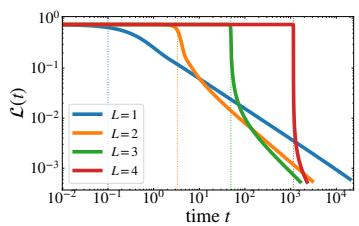  
(a) p = 0.6

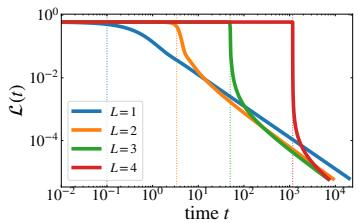  
(b) p = 1.0

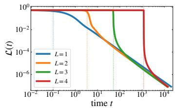  
(c) p = 1.4  
Figure 8: The same trajectories as in Figure 1 are shown in training time t, without a time shift. Vertical dotted lines mark $t _ { \mathrm { e } } ,$ where $\tau ( t _ { \mathrm { e } } ) \bar { { } } = 0 . 1$ , for $L = 1 , 2 , 3 , 4$

Figure 4. We use the same task, dimension, widths, initialization scale, and optimization settings as above, now with $p \in \{ 0 . 4 , 0 . 6 , 0 . 8 , 1 . 0 , 1 . 2 , 1 . 4 \}$ and five random seeds for each $L \in \{ 1 , 2 , 3 , 4 \}$ For $p \neq 1$ , over $5 0 \le \tau \le 5 0 0 0$ , we fit log $\mathcal { L } = \dot { \log { A } } - q \log ( \bar { t } - B )$ by least squares over A, $B ,$ and $q ,$ with $B <$ < min t¯. $\mathbf { A } \mathbf { t } p = 1$ , we interpolate each trajectory at logarithmically spaced values of τ over the same window and fit log $\begin{array} { r } { \mathcal { L } ( \bar { t } ) \dot { + } \frac { L - 1 } { L } \log \log \bar { \bar { t } } = \dot { \log \cal A } - \overline { { q \log ( \bar { t } - \dot { B _ { \mathrm { } } } ) } } } \end{array}$ by least squares over A, B, and $q ,$ again with $B < \operatorname* { m i n } { \bar { t } } .$ The markers and error bars show the mean and sample standard deviation of q over the five seeds. Since even the largest standard deviation across seeds is approximately 0.004, the error bars are smaller than the markers.

Figure 5. We set $a \ = \ 2 . 2 5 .$ $\textit { b } = \ - 0 . 1 7 5$ $c _ { \lambda } ~ = ~ c _ { \beta } ~ = ~ 1$ , so that $p \ = \ 0 . 4$ , and use $L ~ \in ~ \{ 1 , 2 , 3 , 4 \}$ with hidden width d and standard initialization $\begin{array} { c c c c } { \boldsymbol { s } } & { = } & { \boldsymbol { 1 } . } & { \mathsf { W e } } \end{array}$ use $d \in$ $\{ 1 2 8 , 2 5 6 , 5 1 2 , 1 \dot { 0 } 2 4 , 2 0 4 8 , 4 0 9 6 , 8 1 9 2 \}$ ; panel (a) displays $d = 8 1 9 2 ,$ whereas panel (b) uses the full dimension sweep. For each pair $( L , d )$ , we use five random seeds for initialization. All runs use gradient descent with a learning rate of 0.002. To select a fitting window before the finitedimensional spectral cutoff, we use the decoupled-mode proxy

$$
\mathcal { L } _ { \mathrm { p r o x y } } ( \tau ) : = \frac { 1 } { 2 } \sum _ { i \geq 1 } \lambda _ { i } \beta _ { i } ^ { 2 } e ^ { - 2 \lambda _ { i } \tau } .\tag{262}
$$

This is the loss obtained by approximating each residual mode as $\beta _ { i } - \theta _ { i } ( \tau ) = \beta _ { i } e ^ { - \lambda _ { i } \tau }$ . Since $\lambda _ { i } \beta _ { i } ^ { 2 } = c _ { \lambda } c _ { \beta } ^ { 2 } i ^ { - 1 - a p }$ , the fraction of this infinite-dimensional proxy carried by the modes $i > d ,$ which are absent from the dimension-d experiment, is approximated by

$$
r _ { \mathrm { t a i l } } ( \tau ; p , d ) : = \frac { \sum _ { i > d } \lambda _ { i } \beta _ { i } ^ { 2 } e ^ { - 2 \lambda _ { i } \tau } } { \sum _ { i \geq 1 } \lambda _ { i } \beta _ { i } ^ { 2 } e ^ { - 2 \lambda _ { i } \tau } } \approx \frac { \int _ { d } ^ { \infty } x ^ { - 1 - a p } e ^ { - 2 c _ { \lambda } \tau x ^ { - a } } d x } { \int _ { 0 } ^ { \infty } x ^ { - 1 - a p } e ^ { - 2 c _ { \lambda } \tau x ^ { - a } } d x } = P \left( p , \frac { 2 c _ { \lambda } \tau } { d ^ { a } } \right) .\tag{263}
$$

Here, for $\alpha > 0$ and $x \geq 0$ , the regularized lower incomplete gamma function is

$$
P ( \alpha , x ) = { \frac { \int _ { 0 } ^ { x } u ^ { \alpha - 1 } e ^ { - u } d u } { \int _ { 0 } ^ { \infty } u ^ { \alpha - 1 } e ^ { - u } d u } } ,\tag{264}
$$

and $P ^ { - 1 } ( \alpha , \cdot )$ denotes its inverse with respect to the second argument. Setting $r _ { \mathrm { t a i l } } = 0 . 1$ and using $a = 2 . 2 5 , p = 0 . 4$ , and $c _ { \lambda } = 1$ gives $\tau _ { \mathrm { m a x } } = d ^ { 2 . 2 5 } P ^ { - \tilde { 1 } } ( 0 . 4 , 0 . 1 ) / 2$ , and we set $\tau _ { \operatorname* { m i n } } ~ =$ max $\lbrace 1 , \tau _ { \mathrm { m a x } } / 1 0 0 0 \rbrace$ . Each run stops at the first iterate with $\tau \geq \tau _ { \mathrm { m a x } }$ . For each seed, we linearly interpolate t and $\mathcal { L }$ as functions of τ at logarithmically spaced points in this window and fit log ${ \mathcal { L } } =$ log $A - q \log t$ by ordinary least squares, without a time shift. In panel (a), the theoretical lines have fixed exponents $\overset { \cdot } { p } L / [ 1 + \overset { \cdot } { p } ( L - \overset { \cdot } { 1 } ) ]$ and heights fitted in log space using the fitting points from all five seeds. Panel (b) reports the mean and sample standard deviation of the fitted exponents over the five seeds.

## G.2 EXTENSIONS BEYOND THE THEORETICAL SETTING

Figure 6. We use all $N = 5 , 0 0 2 , 2 4 0$ examples in the five parts of CIFAR-5M. Each $3 2 \times 3 2 \times 3$ RGB image is scaled by $1 / 2 5 5 \AA$ , flattened, and centered by subtracting the empirical mean, giving $d = 3 0 7 2$ We likewise center the airplane-versus-rest target and compute the full empirical covariance Σ and the input–target cross moment e. We rescale the inputs so that $\| \pmb { \Sigma } \| _ { \mathrm { o p } } = 1$ and rescale the target direction so that $e ^ { \top } \pmb { \Sigma } ^ { \dagger } e = 1$ . We report the excess empirical squared loss relative to the best linear predictor, equivalently the squared loss against the corresponding realizable linear teacher. In the covariance eigenbasis, this teacher has coefficients $\beta _ { i } = e _ { i } / \lambda _ { i }$ . Motivated by Wei et al. (2022), who study eigenvalue decay and target alignment in neural representations, we estimate the effective task exponent $p _ { \mathrm { e f f } }$ by fitting

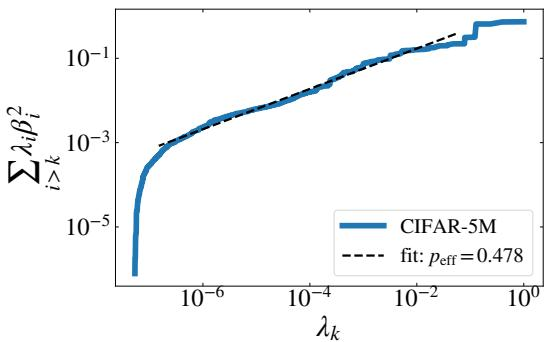  
Figure 9: The tail sum $\textstyle \sum _ { i > k } \lambda _ { i } \beta _ { i } ^ { 2 }$ versus $\lambda _ { k }$ for the CIFAR-5M task. The dashed line is a powerlaw fit with $p _ { \mathrm { e f f } } \approx 0 . 4 7 8$ , using $1 0 \leq k \leq$ round $\lvert ( 0 . 9 d ) = 2 7 6 5$

$$
\sum _ { i > k } \lambda _ { i } \beta _ { i } ^ { 2 } \propto \lambda _ { k } ^ { p _ { \mathrm { e f f } } }\tag{265}
$$

using ordinary least squares in log–log coordinates. The fit uses the unique integer ranks obtained by rounding logarithmically spaced values from 10 to $\operatorname { r o u n d } ( 0 . 9 d ) = 2 7 6 5$ . The upper limit omits approximately the last 10% of ranks from the fit to reduce finite-dimensional endpoint effects. This gives $p _ { \mathrm { e f f } } \approx 0 . 4 7 8$ , as shown in Figure 9. We train networks with $L \in \{ 1 , 2 , 3 , 4 \}$ and hidden width 3072 from random initialization at scale $s = 1$ , using full-batch gradient descent on these empirical sufficient statistics. All runs use a learning rate of 0.002 and continue to $\tau = 1 0 ^ { 6 }$ . Each curve is from a single random initialization.

Figure 7. We draw fresh Gaussian inputs from the synthetic task with $a = 2 , c _ { \lambda } = c _ { \beta } = 1$ , and $d = 2 0 4 8$ , and generate noiseless targets $y = \beta ^ { \top } x$ . We use $b = 0 . 1$ for $p = 0 . 6$ and $b = 0 . 9$ for $p = 1 . 4$ . The bias-free MLPs have $\bar { L } \in \{ 2 , 3 , 4 \}$ trainable linear maps, hidden width 2048, ReLU activations after the first $L - 1$ maps, and a scalar linear output. The hidden maps use standard He initialization and the output map uses standard fan-in initialization, both at scale one. Each curve is from a single random initialization. We train by online SGD for 100,000 steps with fresh batches of size 4096 and a learning rate of 0.01, without momentum or weight decay. We evaluate the loss on a fixed set of 65,536 independent samples.