# Detecting bus delays and service anomalies in Niterói with autoencoder latent feature representations

Matheus Germano and Claudio E. C. Campelo

Systems and Computing Department, Federal University of Campina Grande (UFCG), Campina Grande, PB, Brazil

Abstract. Bus riders judge service by two failures: single trips that run late, and days on which the whole system misbehaves. We ask whether one unsupervised representation of raw GPS telemetry can serve both diagnoses on the NetMob 2026 Niterói bus dataset. An autoencoder compresses each trip into a 64-dimensional latent vector; the frozen encoder feeds supervised delay classifiers, and the reconstruction error serves as an anomaly score. Two findings are negative. First, the latent representation does not improve delay detection: gradient boosting on per-trip summary features reaches 0.846  0.013 ROC-AUC against 0.838  0.016 for the best latent setup, and the gap becomes significant once the preprocessing filters are relaxed. Second, two of the three external checks of the anomaly score were circular. Retraining without rainfall removes the rain association (5.4% against 5.0% flagged, p = 0.84) and an apparent citywide disruption on 23 March. What survives is a day-level signal stable across three autoencoders (Spearman ρ  0.96), driven mostly by day type, with degraded-telemetry days still separable within weekday and weekend strata. The alarm threshold limits detection more than the score does: a pooled percentile cut flags 5.7% of trips on the worst degraded day, while re-scaling within each bus line flags 29.3%. The delay model rests almost entirely on one feature, no latent dimension is individually interpretable, and 22 chronic line-directions carry half of all delayed trips.

## 1. INTRODUCTION

Riders judge a bus system by two failures: trips that run late, and days when service as a whole misbehaves; travellers value reliability on a par with travel time itself [1]. We ask whether a single unsupervised representation of raw GPS telemetry can[ support both diagnoses at once on the NetMob 2026 challenge data from Niterói [2]. Our approach transfers the latent feature representation learning pipeline of Duncan and Chen [3], originally built to detect internet censorship in network trafic: an autoencoder (AE) is trained to compress each trip into a low-dimensional latent vector, the frozen encoder then feeds lightweight supervised classifiers for delay detection, and the same AE’s reconstruction error doubles as an unsupervised service anomaly score. Autoencoders are long established [4] and have been applied to anomalous bus trajectories [5]; here we reuse one label-free representation for both tasks. This is particularly useful when timetable-based comparisons are unreliable — for example, when schedule joins are missing or outdated, when service runs at variable intervals, or when trips are evaluated before they are complete.

## A. Motivation for a learned model

The General Transit Feed Specification (GTFS) [6] is the standard open format in which transit agencies publish their timetables. A feed is a set of CSV files describing the routes, the stops, the trips run on each route, and the scheduled arrival time at every stop of every trip. Where such a feed exists, a deterministic comparison against it would identify delays directly, so a learned classifier needs justifying.

GTFS is used in this work to construct the delay labels and is excluded from the model inputs. We keep the two apart on purpose, to block leakage. A model handed schedule deviation as a feature would simply recover a label computed from that same input, and would then be measuring arithmetic instead of the quality of the representation. Every input channel is derived from GPS telemetry, weather, or headway. None is derived from the schedule.

Given that separation, the learned model targets three op erating conditions a deterministic comparison does not cover. The first is a missing or stale schedule join. Our join succeeds for over 99% of trips here, but that rate belongs to a curated challenge dataset, not to a live feed. The second is frequencybased service, where no per-trip scheduled time exists to difer ence against. The third is scoring a trip before it finishes, since a deterministic median-delay comparison needs the completed trip while a model reading telemetry prefixes does not. We test that advantage directly in Section 5.G.

## B. Contributions

1. A complete, leakage-controlled pipeline from raw GPS to trip-level delay labels and trip-level anomaly scores, reporting how many trips each quality gate removes (Section 3).

2. A direct comparison of latent representations against rawfeature baselines under identical folds, with paired significance tests (Section 5). The result is negative for the latent representation and we report it as such.

3. An ablation showing that two of our three original anomaly validations were circular, driven by rainfall being simultaneously an AE input and the external validator (Section 7).

4. A stratified analysis separating day type from service disruption in the day-level anomaly signal (Section 7.E).

5. A study of alarm thresholds showing that the threshold rule limits detection far more than the score does (Section 7.G).

6. An attribution analysis of what the delay model uses, and a probe showing that no individual latent dimension is interpretable (Section 6).

7. A network-level account of where the delays sit, including a negative result for passenger demand and a null result for trip-to-trip propagation (Section 8).

## 2. DATA

We use three sources, all for the period 11–31 March 2026:

The NetMob26 mobility feed [2] provides high-frequency vehicle tracking, between 0.07 and 1.13 million GPS points per day (median about 0.8 million) and 13,850,467 rows in total across the 19 dates present. Dated GTFS schedule snap shots [6] are used only to derive delay labels. Hourly weather from the public municipal feed supplies rainfall in mm/h.

Two dates in the nominal range (18 and 19 March) are absent from the feed. A further 23 trips carry a service\_date of 10 March, the result of late-night trips whose service day rolls back past midnight; grouping is done on service\_date, which therefore has 20 distinct values while the calendar dates of trip starts number 19.

## 3. PREPROCESSING

## A. Label derivation

The dataset carries no delay annotations, so the label is derived. Each GPS trip report is joined to its scheduled GTFS trip by matching identifiers per direction against the dated snapshot, map-matched onto the route shape, and stop arrival times are interpolated where along-route progress crosses each stop position.

The Transit Capacity and Quality of Service Manual [7] defines a fixed-route service as on-time when it runs no more than 5 minutes behind schedule. Adopting this industry boundary, we mark a trip delayed when its median stop delay against the schedule is at least 5 minutes, which labels 20.9% of the retained trips. Figure 1 shows where that cut falls. It sits on the flank of a single broad peak rather than in a gap, so the share is a smooth function of the boundary rather than a stable feature of the data: moving the rule to four minutes would label 25.2% of trips and moving it to six would label 17.7%. Noth ing downstream depends on the exact position, because every comparison in this report uses the same labels throughout. We additionally require at least five matched stops and 50% stop coverage before trusting that median. Coverage here is the share of scheduled stops between the first and last along-route positions reached by the GPS trace. It measures how much of the route was observed, not the accuracy of the positions. A bus picked up late by the feed, or dropped early, scores low even when every point it did report is precise.

## B. Quality gates

Table 1 reports every gate with its exact threshold and the number of candidate trip instances it removes.

Of the retained 22,605 trip instances across 20 service dates, 20.9% are labelled delayed. The complement matters as much, since 41.1% of candidate instances never reach the dataset. We examine the two largest contributors below, the stop rule and the multi-vehicle deduplication, and both turn out to be defensible. The remaining four, of-route removal (5.5%), implausible duration (3.1%), schedule mismatch (2.9%) and too-fewpoints (1.4%), are applied on the argument that each removes a trace we cannot interpret. We test them collectively rather than one at a time in Section 5.E, by relaxing every threshold at once and rebuilding, and the conclusions do not depend on any of them. What that design cannot tell us is how much each individual gate contributes.

Every one of these gates removes traces that are short, bro ken or geometrically odd, and a genuinely disrupted trip is more likely to produce exactly such a trace. If that were happening the retained sample would be biased toward normal operation, which would matter most for the anomaly analysis in Section 7, since a detector evaluated on a population with the worst trips filtered out looks better behaved than it is.

The concern is testable in two ways that do not need delay labels for the discarded trips. If the gates exclude disrupted operation, then days with heavy filtering should look artificially punctual among the trips that survive. They do not, since the Spearman rank correlation [8] between a day’s drop rate and the delay rate of its retained trips is $\rho = + 0 . 6 6 8 \ ( p = 0 . 0 0 2 )$ the opposite sign to the one the concern predicts. Nor do the known degraded-telemetry days lose more trips than normal days (42.8% against 40.4%, $p = 0 . 7 6 )$ . The second test uses labels we do have. The relaxed rebuild of Section 3.D recovers 4,889 trips the stop rule had discarded, and those trips are delayed 17.8% of the time against 20.9% for the trips that were kept. On both tests the discarded population is, if anything, less disrupted than the retained one.

One residual signal runs the other way, since days with higher drop rates carry slightly lower median anomaly scores among their surviving trips $( \rho = - 0 . 5 0 7 , p = 0 . 0 2 7 )$ , which is the pattern filtering-out-the-unusual would produce. We are reluctant to read much into it, because the anomaly score is itself dominated by day type (Section 7.E) and the drop rate tracks telemetry volume, so the two are confounded through the calendar. The delay-side evidence is the cleaner of the two and it does not support the concern.

The dominant gate is stop coverage (17.2%), followed by the multi-vehicle deduplication (11.1% of instances). The first removes trips whose delay median would not be trustworthy, the second removes duplicate views of a trip rather than the trip itself, and neither selects on operating condition, as the tests above and Section 3.E show.

## C. Sequence construction

Each trip becomes a 64 12 array of 1-minute bins. The bin width matches the telemetry, which reports every 30 to 60 seconds, so one minute is the finest grid that does not mostly interpolate between observations. The window of 64 bins is a compromise, since trips have a median duration of 86 minutes and only 24.6% finish inside 64 minutes, so three quarters of trips are truncated and the model sees their first hour rather than the whole route. We accept that because the alternative, a window long enough for the 90th percentile at 141 minutes, would more than double the sequence length and leave most cells padded — and because Section 5.G shows performance is already near its ceiling at a quarter of the route, so the discarded tail carries little additional signal. The 12 channels are the quantities derivable from GPS, weather and network structure that do not encode the label. Three are kinematic (speed, acceleration and heading change) and three describe route geometry (progress fraction, progress rate and cross-track error). One records dwell, the fraction of the bin spent below 0.5 m/s. Four carry context: time of day as a sine and cosine pair, a weekend flag and hourly rainfall. The last is a network term, the headway to the preceding trip of the same line and direction, capped at 60 minutes.

No schedule-derived quantity enters the features, so the delay label cannot leak into the representation.

Padding and masking. Trips shorter than 64 minutes are zero-padded and carry an explicit length, so both the pooled latent and the reconstruction error are masked to real timesteps. Padding contributes nothing to either.

Missing values. Empty bins are filled from the interpolated along-route progress; cross-track error is carried forward; rainfall is forward-filled from the hourly feed.

Task framing. Each trip is scored after it has finished, from the first 64 minutes of its trajectory. The task as posed is therefore retrospective classification rather than early prediction.

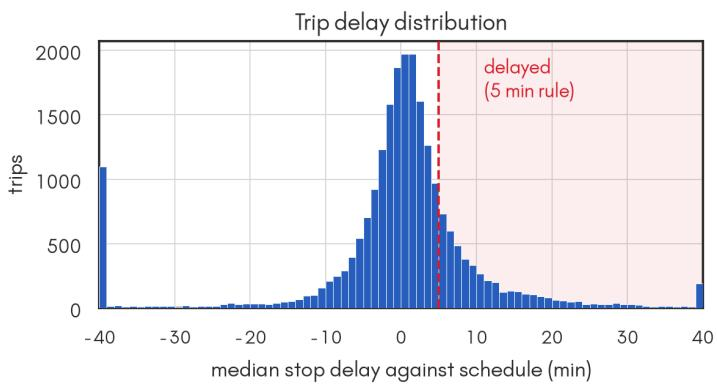

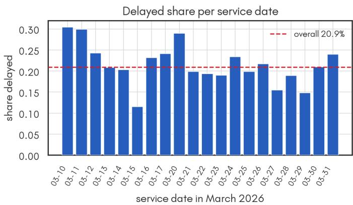  
Fig. 1. How the delay label is made. Left, the distribution of median stop delay against the schedule over the 22,605 retained trips, with the five-minute rule marked. The threshold falls on the shoulder of a broad unimodal distribution rather than at a natural gap, so the delayed share responds smoothly to where it is placed. The axis is clipped at 40 minutes and the 5.6% of trips beyond that are stacked into the end bins. Right, the delayed share of each of the 20 service dates against the overall rate of 20.9%. The day-to-day spread is what makes service date the grouping variable for cross-validation (Section 4.C).

Table 1. Quality gates and how many trips each removes. Percentages are of the 38,411 candidate trip instances. Gates are ap plied in the order listed; each count is the number of instances that gate removed from what reached it. †The multi-vehicle row is a deduplication rather than a rejection, since the segment with the most points is kept and the others discarded, so the trip survives. See Section 3.E. ‡The midnight-flip row is a reassignment: 835 trips that crossed midnight were moved to the adjacent service day and kept.
<table><tr><td>Gate</td><td>Threshold</td><td>Dropped</td><td>%</td></tr><tr><td>No GTFS match</td><td>no schedule join for trip id/direction</td><td>0</td><td>0.00</td></tr><tr><td>Too few points</td><td>&lt; 10 GPS points</td><td>526</td><td>1.37</td></tr><tr><td>Implausible duration</td><td>outside 8 min–3 h</td><td>1,186</td><td>3.09</td></tr><tr><td>Off-route</td><td>&gt; 40% of points &gt; 200 m from shape</td><td>2,112</td><td>5.50</td></tr><tr><td>Low stop coverage</td><td>&lt; 5 matched stops or &lt; 50% coverage</td><td>6,609</td><td>17.21</td></tr><tr><td>Multi-vehicle trip id†</td><td>same trip id served by several vehicles</td><td>4,267</td><td>11.11</td></tr><tr><td>Midnight flip†</td><td>trip reassigned to adjacent service day</td><td>0</td><td>0.00</td></tr><tr><td>Day-letter mismatch</td><td>calendar day vs service-pattern letter</td><td>0</td><td>0.00</td></tr><tr><td>Schedule mismatch</td><td>snapshot inconsistent with observed trip</td><td>1,106</td><td>2.88</td></tr><tr><td colspan="2">Retained</td><td>22,605</td><td>58.9</td></tr></table>

## D. Sensitivity to the stop-coverage rule

The stop rule discards more trips than any other gate, so we test it directly. Splitting the two clauses apart shows the work is done almost entirely by one of them. Of the 6,609 removals, 3,710 (9.66% of candidates) fail only the 50% coverage test and 2,797 (7.28%) fail both, while just 102 trips (0.27%) fail only the five-stop floor. The rule is 41.8% of all rejections in the pipeline. Surviving trips are not crowded against the threshold, with median coverage 0.931, and only 2.4% of them sit between 0.50 and 0.55.

To test whether the discarded trips carry usable labels we rebuilt the dataset with the rule relaxed to a single matched stop, recovering 4,889 trips for a total of 27,494, and scored the two populations separately (Table 2). The recovered trips are exactly the marginal ones, with median coverage 0.250 against 0.931 for the trips already kept, and a median of three matched stops in the lowest coverage band.

A model trained on strict data loses a lot of ground on the recovered trips, falling from 0.850 to 0.785 ROC-AUC and from 0.648 to 0.522 PR-AUC, which is what a median taken over three stops should look like. Yet adding those trips to training changes nothing on clean test data (0.848 against 0.850), so the gate is protecting the labels rather than the model. The head line numbers are therefore not an artefact of the gate; relaxing it would mainly add noise to the evaluation. Thus, we keep the rule.

Table 2. RAW-STATS+XGBoost under the relaxed rule, mean over five folds. Training on the recovered trips is harmless; scoring on them is not.
<table><tr><td>Train / test split</td><td>ROC-AUC</td><td>PR-AUC</td></tr><tr><td>strict train, strict test</td><td>0.850</td><td>0.648</td></tr><tr><td>strict train, recovered test</td><td>0.785</td><td>0.522</td></tr><tr><td>relaxed train, strict test</td><td>0.848</td><td>0.643</td></tr><tr><td>relaxed train, all test</td><td>0.853</td><td>0.641</td></tr></table>

On the relaxed data, scored by a weather-free CNN-AE retrained there, the anomaly results survive the same treatment. The weekend efect, the degraded-day separation within both day strata, and the ranking of threshold rules all reproduce (per-line calibration again lifts the 22 March alarm rate most, to 25.4%), and the day-level ordering matches the strict one at Spearman $\rho = 0 . 9 9 1$ The rain ablation reproduces almost exactly, since with rainfall in the input 11.7% of rain-hour trips are flagged against 4.4% dry, and retraining without it flattens this to 5.1% against 5.0% $( p = 0 . 9 7 )$ , the same collapse reported in Section 7.B on the strict data. The chronic line-directions of Section 8 also hold, with 24 pairs carrying 57.7% of delayed trips.

That test covers one model, while the claim this report rests on is the comparison between representations, so we retrained the CNN-AE on the relaxed data as well and repeated it. Raw features win by a wider margin there, with RAW-STATS+XGBoost reaching 0.853 0.011 ROC-AUC and 0.641 0.025 PR-AUC against 0.839 0.016 and 0.623 0.023 for CNN-AE+XGBoost, a paired diference of 0.0141 (p = 0.028) and 0.0173 $\left( { p = 0 . 0 3 3 } \right)$ . On the strict dataset neither gap was significant $( p = 0 . 2 1 3 \mathrm { R O C - A U C } )$ ; with the discarded trips restored it is. The central negative result of this report is therefore not an artefact of the stop rule, and if anything the rule was flattering to the autoencoder.

## E. Trips served by more than one vehicle

The multi-vehicle counter in Table 1 is not a rejection like the other gates. When a tripId appears under several vehicle identifiers, the pipeline keeps the segment with the most GPS points and drops the rest, so the trip survives and what is lost is every other vehicle’s view of it. The 4,267 figure counts superseded instances, not discarded trips.

Across the period, 2,456 trip identifiers are served by more than one vehicle, usually two (2,139 cases) or three (244), with a small tail of identifiers shared by many vehicles, up to 73. Most are not duplicated identifiers, because in 88% of cases the segments do not overlap in time at all, which is the signature of a genuine vehicle change mid-service rather than a data fault. Only 2.2% overlap substantially.

The cost is that the kept segment is often a minority of the trip. Measured against the span covered by all vehicles together, the retained segment has a median ratio of 0.63, falls below 0.80 for 75.9% of these trips and below 0.50 for 31.1%. In total 71.4% of the GPS points recorded on these trips are thrown away. The efect is concentrated, with line 45 alone accounting for 13.9% of the cases.

This matters for the delay label, because these trips are visibly diferent. Among retained trips, those touched by the dedu plication are delayed 28.6% of the time against 18.9% for the rest. Their mean coverage is barely lower (0.879 against 0.899), but that comparison is conditioned on survival, because the trips whose kept segment was too short were already removed by the stop rule. So deduplication is not what drives the coverage loss, yet a fifth of the dataset is still built from partial trajectories whose missing portion was recorded under another identifier.

We therefore checked whether this biases the results, since discarding 71.4% of the points on a fifth of the data is not ob viously harmless. It does not move the headline. Excluding every afected trip from both training and test changes RAW-STATS+XGBoost from 0.846 to 0.853 0.025 ROC-AUC, inside the cross-fold spread, so no conclusion in this report depends on them. Per trip, though, the model is measurably worse on them, at 0.810 ROC-AUC against 0.854 on singlevehicle trips. Comparisons of PR-AUC between the two groups are not meaningful, because their delayed prevalence difers (0.283 against 0.190) and PR-AUC rises with prevalence by construction.

Truncated trips sit lower in mean(progress\_frac) than untruncated ones at the same label, by 0.043 among on-time trips, and lower is the direction that predicts delay, which is the mechanism behind that gap. Against a label separation of roughly

0.14 in that feature, the truncation shift is around a third as large, which is enough to push truncated on-time trips toward false positives.

The elevated delay rate on these trips admits two explanations. Either it is real, with buses relieved mid-service because they are already running late, or it is an artefact of taking the median over a partial trajectory. Both are consistent with the observed rate, so we distinguished them by rebuilding the dataset with the segments stitched together in time order rather than discarded, which is admissible because 88% of these cases are sequential hand-overs with no temporal overlap. The merged dataset contains 22,417 trips with a delayed share of 20.5%. Among the afected trips, the delay rate falls from 28.6% to 26.8%, while the rate for the remainder is unchanged at 18.9%. Truncation therefore accounts for under a fifth of the gap; the remainder is attributable to the trips themselves. This is consistent with the interpretation that buses already running late are more likely to be relieved mid-service.

## 4. METHOD

## A. Autoencoders

Two AE variants are compared under one scafold, both with a 64-dimensional latent space. The CNN-AE is a onedimensional convolutional [9] autoencoder [4]. Its encoder stacks 3 Conv1d blocks (kernel size 5, “same” padding) over the time axis, then a $1 \times 1$ convolution to a per-timestep latent $z _ { \mathrm { s e q } } ,$ with length-masked mean pooling down to z. The decoder broadcasts z over T with a learned positional embedding. The LSTM-AE is a sequence-to-sequence recurrent [10] autoencoder, as applied to bus trajectories by Zhang et al. [5].

Both are trained for 20 epochs, batch size 64, learning rate $1 0 ^ { - 3 }$ , with Adam [11].

## B. Downstream classifiers

For each fold the AE is trained unsupervised on the training split only. The frozen encoder then produces a pooled latent z for four classifiers (MLP [12], XGBoost [13], random forest [14], logistic regression) and a latent sequence $z _ { \mathrm { s e q } }$ for two recurrent classifiers (LSTM [10], GRU [15]).

## C. Cross-validation

Evaluation uses StratifiedGroupKFold [16] with 5 folds grouped by service date. Day-level efects (weather, trafic, telemetry quality, and as Section 7.E shows, day type) are the main leakage channel, so every model is scored only on unseen days.

Metrics. We report ROC-AUC [17] and the area under the precision–recall curve, computed as average precision. At a delayed-class prevalence of 20.9% the two can disagree, and PR-AUC is the more informative of the pair under class imbalance [18], so we lead with it wherever they conflict. Paired comparisons over the five folds use the t-test [19] alongside the Wilcoxon signed-rank test [20]; group comparisons that do not assume normality use the Mann–Whitney U test [21] and rank correlations use Spearman’s ρ [8].

Hyperparameters. No systematic search was performed. All models use fixed settings taken from their respective literature. Section 5.D tests whether tuning changes any of the conclusions.

## D. Anomaly score

Each trip is scored by the AE of the fold in which it was held out, so no trip is scored by a model that saw it during training.

Because every fold has its own AE, raw reconstruction errors are not comparable across folds. The heavy-tailed MSE is therefore log-transformed and standardised within each fold before pooling; the threshold is applied once to the pooled score. Figure 2 shows the per-fold reconstruction curves behind this step. The autoencoders settle on similar, though not identical, error scales, with one clear exception. Fold 5 holds out 23 March, the heaviest rain of the period, and its validation error stays roughly four times higher than the other folds for the whole run (1.11 against 0.28 to 0.33 at the last epoch). Retraining without the rainfall channel brings it back into line at 0.28. The autoencoder cannot reconstruct rare rainfall values, the same mechanism that Section 7.B shows contaminating the anomaly score.

## 5. DELAY DETECTION RESULTS

## A. Comparison of representations

Because this comparison tests the premise of the work, we run it over five representations under identical folds. The first two are the proposed pipeline, the CNN-AE and LSTM-AE latents. RAW-STATS is a plain tabular baseline, the per-trip mean, standard deviation, minimum and maximum of each of the 12 channels over the real timesteps, 48 features in all. RAW-FLAT feeds the flattened 64 12 = 768-dimensional raw sequence straight to the tabular models. SimCLR [22] is a contrastive encoder trained on the same folds, a learned representation with no reconstruction objective.

Table 3 reports all metrics for all configurations.

## B. Paired significance tests

Diferences between the best configurations are small relative to cross-fold variability, so point estimates alone cannot support a claim of superiority. Table 4 reports paired tests over the five folds. With $n \ = \ 5 ,$ the Wilcoxon signed-rank test has a minimum attainable p of 0.031; we report both it and the paired t-test.

## C. Interpretation

The latent representation does not improve accuracy. RAW-STATS+XGBoost is the best configuration overall on ROC-AUC, PR-AUC and F1. Against the best latent configuration neither gap reaches significance on this dataset $( p _ { t } = 0 . 2 1 3 \mathrm { R O C - A U C } , p _ { t } = 0 . 0 8 7 \mathrm { P R - A U C } )$ , though PR-AUC, the more informative metric at 20.9% prevalence, comes closer. The separation does become significant once the preprocessing filters are relaxed and the dataset grows (Section 5.E), which is where that claim rests. A simple per-trip summary of the same 12 channels is at least as good as, and on the precision– recall trade-of slightly better than, a learned 64-dimensional embedding.

The latent space does buy linear separability. Logistic regression gains +0.033 PR-AUC over RAW-STATS $( p _ { t } =$ 0.001) and +0.064 over RAW-FLAT, the weaker of the two raw baselines, against ROC-AUC gains of only +0.008 and +0.027. This is the clearest benefit we can defend. The autoencoder rearranges the trip into a space where a straight-line decision boundary works far better than it does on the raw channels. Whether that matters in practice depends on whether a linear model is required, whether for interpretability, for speed, or for running on small hardware.

Reconstruction beats contrastive, and convolution beats recurrence. CNN-AE+XGBoost beats Sim-CLR+XGBoost by +0.019 ROC-AUC $\left( { { p } _ { t } } = 0 . 0 7 2 \right)$ and +0.034 PR-AUC $( p _ { t } = 0 . 0 1 7 )$ , so the PR-AUC advantage holds while the ROC-AUC one does not reach significance. It beats LSTM-AE+XGBoost by +0.024 ROC-AUC $( p _ { t } = 0 . 0 0 7 )$ . The same CNN-over-LSTM ordering holds for every classifier in Table 3, but the paired test was run only on the best pair. Within the CNN-AE, random forest and XGBoost are indistinguishable $\left( { { p } _ { t } } = 0 . 7 2 4 \right)$

## D. Efect of hyperparameter tuning

Every number above uses literature defaults, so the comparison between representations is a comparison of untuned models. We ran a grid search with selection nested inside each fold, so candidates are scored on an inner split taken from that fold’s training days only, the winner is refit on the full training split, and only then is it scored on the outer test fold, so no configuration sees a test day before being chosen.

Tuning helps, but not enough to disturb the conclusion. Random forest gains the most (+0.008 ROC-AUC, +0.015 PR-AUC, both $p \ < \ 0 . 0 1 )$ and XGBoost gains little (+0.002 and +0.007, $p = 0 . 1 7 1$ and $p = 0 . 0 9 4 )$ . Logistic regression moves in opposite directions on the two metrics, 0.0013 ROC-AUC $( p ~ = ~ 0 . 0 3 2 )$ and +0.0022 PR-AUC $( p \ : = \ : 0 . 0 2 3 )$ ; both clear $p < 0 . 0 5$ because the per-fold diferences are extremely consistent, but the magnitudes are two orders below anything that would change a decision. The tuned RAW-STATS+XGBoost reaches 0.848 ROC-AUC, still above the best latent configuration’s untuned 0.838, so the ordering between raw features and latent features is unafected. The search was run on the classifier side only; the AE architecture itself was not searched, and that remains a limitation.

## E. Robustness to preprocessing and architecture

The comparison above rests on one dataset and one autoencoder configuration, so we varied both.

Relaxing the preprocessing does not rescue the latent representation; it widens the gap (Table 5). Putting back the trips the stop rule discards gives a diference of 0.014 ROC-AUC $( p = 0 . 0 2 8 )$ , stitching the multi-vehicle segments gives 0.010 $( p = 0 . 1 5 5 )$ , and loosening every gate at once, which recovers 7,941 extra trips for a total of 30,546, gives 0.024 (p = 0.067) with $\mathrm { P R - A U C ~ a t } ~ - 0 . 0 3 1 ~ ( p ~ = ~ 0 . 0 4 0 )$ The direction is the same in all four datasets and the magnitude grows as filtering relaxes, while the autoencoder’s cross-fold spread widens from 0.016 to 0.042 and the raw baseline stays steady. The delayed share barely moves across all of this, 20.91% on the fully relaxed data against 20.92% on the strict data, which is further evidence that the filters are not selecting on the label.

Nor is the gap an artefact of the architecture we happened to pick (Table 6). Sweeping latent dimension over 16, 32, 64 and 128 and depth over two, three and four convolutional blocks, the best configuration reaches 0.8377 ROC-AUC, still short of the raw baseline’s 0.8459. The default used throughout this report, 64 dimensions and three blocks, scores 0.8375, within 0.0002 of the best setting; doubling the latent space to 128 adds nothing, cutting it to 16 costs 0.011, and a fourth block hurts. We report this as a sweep rather than a nested selection on purpose, because the useful statement is not which setting wins but that none of them reaches the baseline, which holds whatever protocol would have chosen among them.

## F. Latent space structure

Figure 3 shows a t-SNE [23] projection of out-of-fold CNN-AE latents. The five visible lobes are an artefact of pooling five fold-specific encoders rather than structure in the data, and a single globally trained AE (Section 7.D) cannot produce them. Within each lobe, delayed trips concentrate at distinct margins rather than scattering uniformly, and trips of the same service date cluster together.

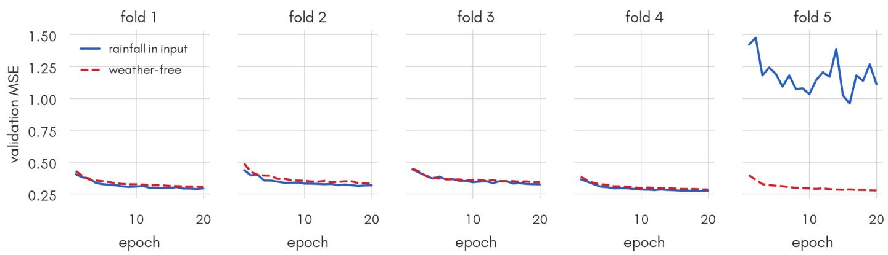  
Fig. 2. Validation reconstruction MSE per fold, for the CNN-AE with rainfall in the input (solid) and without it (dashed). Fold 5 holds out 23 March, the 11.8 mm/h rain day. With rainfall as an input its error runs roughly four times higher than any other fold and never settles; drop the channel and the fold behaves like the rest. Error scales difer enough between folds that pooling raw MSE would confound fold identity with anomaly, which is why we standardise within each fold.

Table 3. Delay detection on unseen days: mean SD over the five day-grouped folds. Delayed-class prevalence is 0.209. F1 is binary F1 on the delayed (positive) class. Best value per column in bold.
<table><tr><td>Representation</td><td>Classifier</td><td>ROC-AUC</td><td>PR-AUC</td><td>Precision</td><td>Recall</td><td>F1</td></tr><tr><td>CNN-AE</td><td>MLP</td><td> $0 . 8 2 4 \pm 0 . 0 2 1$ </td><td> $0 . 5 9 3 \pm 0 . 0 5 4$ </td><td> $0 . 4 3 7 \pm 0 . 0 3 2$ </td><td> $0 . 7 3 8 \pm 0 . 0 7 2$ </td><td> $0 . 5 4 8 \pm 0 . 0 3 7$ </td></tr><tr><td>CNN-AE</td><td>XGBoost</td><td> $0 . 8 3 8 \pm 0 . 0 1 6$ </td><td> $0 . 6 2 9 \pm 0 . 0 5 1$ </td><td> $0 . 5 3 9 \pm 0 . 0 5 6$ </td><td> $0 . 6 3 7 \pm 0 . 0 5 4$ </td><td> $0 . 5 8 1 \pm 0 . 0 3 9$ </td></tr><tr><td>CNN-AE</td><td>RF</td><td> $0 . 8 3 9 \pm 0 . 0 1 5$ </td><td> $0 . 6 2 1 \pm 0 . 0 5 3$ </td><td> $0 . 5 4 6 \pm 0 . 0 5 7$ </td><td> $0 . 6 1 2 \pm 0 . 0 6 2$ </td><td> $0 . 5 7 4 \pm 0 . 0 3 9$ </td></tr><tr><td>CNN-AE</td><td>LR</td><td> $0 . 8 1 1 \pm 0 . 0 1 7$ </td><td> $0 . 5 6 4 \pm 0 . 0 5 4$ </td><td> $0 . 4 4 6 \pm 0 . 0 4 3$ </td><td> $0 . 6 9 4 \pm 0 . 0 5 7$ </td><td> $0 . 5 4 1 \pm 0 . 0 4 0$ </td></tr><tr><td>CNN-AE</td><td>LSTM</td><td> $0 . 8 2 6 \pm 0 . 0 2 0$ </td><td> $0 . 6 0 1 \pm 0 . 0 5 2$ </td><td> $0 . 4 4 8 \pm 0 . 0 4 0$ </td><td> $0 . 7 3 8 \pm 0 . 0 5 8$ </td><td> $0 . 5 5 7 \pm 0 . 0 4 1$ </td></tr><tr><td>CNN-AE</td><td>GRU</td><td> $0 . 8 2 8 \pm 0 . 0 2 3$ </td><td> $0 . 6 0 7 \pm 0 . 0 5 2$ </td><td> $0 . 4 3 7 \pm 0 . 0 5 0$ </td><td> $\mathbf { 0 . 7 5 2 \pm 0 . 0 4 8 }$ </td><td> $0 . 5 5 2 \pm 0 . 0 4 8$ </td></tr><tr><td>LSTM-AE</td><td>MLP</td><td> $0 . 8 0 1 \pm 0 . 0 1 9$ </td><td> $0 . 5 4 8 \pm 0 . 0 6 7$ </td><td> $0 . 4 2 1 \pm 0 . 0 5 3$ </td><td> $0 . 6 9 8 \pm 0 . 0 8 5$ </td><td> $0 . 5 2 2 \pm 0 . 0 4 8$ </td></tr><tr><td>LSTM-AE</td><td>XGBoost</td><td> $0 . 8 1 4 \pm 0 . 0 1 6$ </td><td> $0 . 5 7 5 \pm 0 . 0 6 2$ </td><td> $0 . 4 7 1 \pm 0 . 0 5 3$ </td><td> $0 . 6 5 0 \pm 0 . 0 5 4$ </td><td> $0 . 5 4 4 \pm 0 . 0 4 4$ </td></tr><tr><td>LSTM-AE</td><td>RF</td><td> $0 . 8 1 9 \pm 0 . 0 1 7$ </td><td> $0 . 5 7 6 \pm 0 . 0 6 1$ </td><td> $0 . 4 7 6 \pm 0 . 0 5 5$ </td><td> $0 . 6 4 5 \pm 0 . 0 6 4$ </td><td> $0 . 5 4 5 \pm 0 . 0 4 7$ </td></tr><tr><td>LSTM-AE</td><td>LR</td><td> $0 . 7 8 5 \pm 0 . 0 1 6$ </td><td> $0 . 5 1 2 \pm 0 . 0 5 7$ </td><td> $0 . 4 0 3 \pm 0 . 0 4 3$ </td><td> $0 . 7 0 3 \pm 0 . 0 4 8$ </td><td> $0 . 5 1 2 \pm 0 . 0 4 5$ </td></tr><tr><td>LSTM-AE</td><td>LSTM</td><td> $0 . 8 0 9 \pm 0 . 0 2 0$ </td><td> $0 . 5 5 9 \pm 0 . 0 6 8$ </td><td> $0 . 4 1 8 \pm 0 . 0 4 8$ </td><td> $0 . 7 1 7 \pm 0 . 0 8 8$ </td><td> $0 . 5 2 6 \pm 0 . 0 4 7$ </td></tr><tr><td>LSTM-AE</td><td>GRU</td><td> $0 . 8 0 8 \pm 0 . 0 1 8$ </td><td> $0 . 5 5 4 \pm 0 . 0 5 9$ </td><td> $0 . 4 0 7 \pm 0 . 0 5 5$ </td><td> $0 . 7 5 1 \pm 0 . 0 5 9$ </td><td> $0 . 5 2 5 \pm 0 . 0 4 8$ </td></tr><tr><td>RAW-STATS</td><td>XGBoost</td><td> $\mathbf { 0 . 8 4 6 \pm 0 . 0 1 3 }$ </td><td> $\mathbf { 0 . 6 3 7 \pm 0 . 0 5 3 }$ </td><td> $0 . 5 3 7 \pm 0 . 0 5 4$ </td><td> $0 . 6 5 5 \pm 0 . 0 6 1$ </td><td> $\mathbf { 0 . 5 8 7 \pm 0 . 0 3 9 }$ </td></tr><tr><td>RAW-STATS</td><td>RF</td><td> $0 . 8 3 4 \pm 0 . 0 1 8$ </td><td> $0 . 6 1 0 \pm 0 . 0 6 3$ </td><td> $0 . 5 2 5 \pm 0 . 0 6 5$ </td><td> $0 . 6 3 0 \pm 0 . 0 7 2$ </td><td> $0 . 5 6 9 \pm 0 . 0 4 8$ </td></tr><tr><td>RAW-STATS</td><td>LR</td><td> $0 . 8 0 3 \pm 0 . 0 1 2$ </td><td> $0 . 5 3 1 \pm 0 . 0 4 8$ </td><td> $0 . 4 3 6 \pm 0 . 0 3 7$ </td><td> $0 . 6 9 0 \pm 0 . 0 5 4$ </td><td> $0 . 5 3 4 \pm 0 . 0 3 9$ </td></tr><tr><td>RAW-FLAT</td><td>XGBoost</td><td> $0 . 8 4 5 \pm 0 . 0 1 5$ </td><td> $0 . 6 3 2 \pm 0 . 0 5 3$ </td><td> $\mathbf { 0 . 5 6 8 \pm 0 . 0 5 0 }$ </td><td> $0 . 6 0 6 \pm 0 . 0 5 6$ </td><td> $0 . 5 8 5 \pm 0 . 0 4 6$ </td></tr><tr><td>RAW-FLAT</td><td>RF</td><td> $0 . 8 4 2 \pm 0 . 0 1 8$ </td><td> $0 . 6 2 2 \pm 0 . 0 5 8$ </td><td> $0 . 5 3 7 \pm 0 . 0 6 0$ </td><td> $0 . 6 3 2 \pm 0 . 0 5 6$ </td><td> $0 . 5 7 8 \pm 0 . 0 4 4$ </td></tr><tr><td>RAW-FLAT</td><td>LR</td><td> $0 . 7 8 4 \pm 0 . 0 1 7$ </td><td> $0 . 5 0 0 \pm 0 . 0 5 9$ </td><td> $0 . 4 2 4 \pm 0 . 0 4 1$ </td><td> $0 . 6 7 4 \pm 0 . 0 4 0$ </td><td> $0 . 5 2 0 \pm 0 . 0 3 8$ </td></tr><tr><td>SimCLR</td><td>MLP</td><td> $0 . 8 2 4 \pm 0 . 0 1 5$ </td><td> $0 . 5 9 6 \pm 0 . 0 5 4$ </td><td> $0 . 4 2 4 \pm 0 . 0 4 3$ </td><td> $0 . 7 4 7 \pm 0 . 0 4 9$ </td><td> $0 . 5 4 1 \pm 0 . 0 4 5$ </td></tr><tr><td>SimCLR</td><td>XGBoost</td><td> $0 . 8 1 9 \pm 0 . 0 2 2$ </td><td> $0 . 5 9 5 \pm 0 . 0 6 3$ </td><td> $0 . 5 0 4 \pm 0 . 0 5 8$ </td><td> $0 . 6 0 9 \pm 0 . 0 5 2$ </td><td> $0 . 5 5 0 \pm 0 . 0 4 8$ </td></tr><tr><td>SimCLR</td><td>RF</td><td> $0 . 8 1 5 \pm 0 . 0 2 3$ </td><td> $0 . 5 8 2 \pm 0 . 0 6 8$ </td><td> $0 . 5 0 8 \pm 0 . 0 4 6$ </td><td> $0 . 5 9 1 \pm 0 . 0 7 2$ </td><td> $0 . 5 4 4 \pm 0 . 0 4 7$ </td></tr><tr><td>SimCLR</td><td>LR</td><td> $0 . 8 0 7 \pm 0 . 0 1 6$ </td><td> $0 . 5 5 6 \pm 0 . 0 5 7$ </td><td> $0 . 4 4 1 \pm 0 . 0 5 4$ </td><td> $0 . 6 8 8 \pm 0 . 0 5 0$ </td><td> $0 . 5 3 5 \pm 0 . 0 4 7$ </td></tr></table>

## G. Early prediction from trip prefixes

fined until the trip ends. This is the strongest operational case in the report for a model that reads telemetry, here the rawfeature baseline, and it agrees with Section 6, where the dominant features are averages of speed and along-route progress, which stabilise well before a trip finishes.

Section 1.A argues that a learned model is useful partly because it can score a trip that is still running, where the deterministic schedule comparison needs the completed trip. We test it by truncating every trip to the first 25%, 50% and 75% of its own real length, zero the remainder and shorten the recorded length, then rerun the whole comparison on the same day-grouped folds. Table 7 reports the result.

## 6. FEATURE ATTRIBUTION

At a quarter of the route the model already holds 93.8% of the discriminative power it reaches with the complete trajectory, and at half the route $9 7 . 7 \% ,$ so most of the signal is available early. The schedule comparison can say nothing at either point, because the median stop delay it needs is not de-

We take the best delay model, RAW-STATS+XGBoost, whose 48 features are the mean, standard deviation, minimum and maximum of each of the 12 input channels over the real timesteps, so every feature has a plain physical reading. On the same day-grouped folds we compute permutation impor tance [24] and SHAP values [25], and fit a logistic regression on the standardised features to get coeficients with Wald standard errors and p-values. Figure 4 shows the result.

Permuting mean(progress\_frac), the average along-route position of the bus across its time bins, costs 0.271 ROC-AUC, roughly eight times the next feature. Its coeficient is 1.82, so a trip that sits further along its route on average is much less likely to be labelled delayed. mean(speed\_mps) follows at 0.032 with a coeficient of 0.62, and min(progress\_frac) at 0.023 with +0.58. SHAP values give the same ordering for these three features and place headway fourth, as permutation importance does.

Table 4. Paired comparisons over the five folds. Positive diference favours the first model. $p _ { t }$ is the paired t-test, $p _ { W }$ the Wilcoxon signed-rank test.
<table><tr><td>Comparison</td><td>Metric</td><td>Difference</td><td>pt</td><td>pw</td></tr><tr><td>CNN-AE+XGBoost vs RAW-STATS+XGBoost</td><td>ROC-AUC</td><td>-0.0076</td><td>0.213</td><td>0.188</td></tr><tr><td>CNN-AE+XGBoost vs RAW-STATS+XGBoost</td><td>PR-AUC</td><td>-0.0082</td><td>0.087</td><td>0.062</td></tr><tr><td>CNN-AE+XGBoost vs RAW-FLAT+XGBoost</td><td>ROC-AUC</td><td>-0.0064</td><td>0.264</td><td>0.312</td></tr><tr><td>CNN-AE+XGBoost vs RAW-FLAT+XGBoost</td><td>PR-AUC</td><td>-0.0027</td><td>0.510</td><td>0.438</td></tr><tr><td>CNN-AE+RF vs RAW-STATS+RF</td><td>ROC-AUC</td><td>+0.0053</td><td>0.365</td><td>0.625</td></tr><tr><td>CNN-AE+RF vs RAW-STATS+RF</td><td>PR-AUC</td><td>+0.0108</td><td>0.262</td><td>0.312</td></tr><tr><td>CNN-AE+LR vs RAW-STATS+LR</td><td>ROC-AUC</td><td>+0.0079</td><td>0.244</td><td>0.312</td></tr><tr><td>CNN-AE+LR vs RAW-STATS+LR</td><td>PR-AUC</td><td>+0.0332</td><td>0.001</td><td>0.062</td></tr><tr><td>CNN-AE+XGBoost vs SimCLR+XGBoost</td><td>ROC-AUC</td><td>+0.0189</td><td>0.072</td><td>0.125</td></tr><tr><td>CNN-AE+XGBoost vs SimCLR+XGBoost</td><td>PR-AUC</td><td>+0.0340</td><td>0.017</td><td>0.062</td></tr><tr><td>CNN-AE+XGBoost vs LSTM-AE+XGBoost</td><td>ROC-AUC</td><td>+0.0242</td><td>0.007</td><td>0.062</td></tr><tr><td>CNN-AE+RF vs CNN-AE+XGBoost</td><td>ROC-AUC</td><td>+0.0008</td><td>0.724</td><td>0.812</td></tr></table>

Table 5. Raw features against the latent representation across four versions of the dataset. Each row is a full rebuild of the preprocessing followed by a fresh autoencoder and a fresh baseline on the same day-grouped folds. Diferences are CNN-AE minus RAW-STATS, so negative favours the raw features; $p _ { t }$ is a paired t-test over the five folds.
<table><tr><td colspan="5">ROC-AUC</td><td colspan="3">PR-AUC</td></tr><tr><td>Dataset</td><td>Trips</td><td>Delayed</td><td>RAW-STATS</td><td>CNN-AE</td><td> $\Delta \left( p _ { t } \right)$ </td><td>RAW-STATS</td><td>CNN-AE</td><td> $\Delta \left( p _ { t } \right)$ </td></tr><tr><td>strict (reported)</td><td>22,605</td><td>20.92%</td><td> $0 . 8 4 6 \pm 0 . 0 1 3$ </td><td> $0 . 8 3 8 \pm 0 . 0 1 6$ </td><td>−0.008 (0.213)</td><td> $0 . 6 3 7 \pm 0 . 0 5 3$ </td><td> $0 . 6 2 9 \pm 0 . 0 5 1$ </td><td>−0.008 (0.087)</td></tr><tr><td>stop rule relaxed</td><td>27,494</td><td>20.36%</td><td> $0 . 8 5 3 \pm 0 . 0 1 1$ </td><td> $0 . 8 3 9 \pm 0 . 0 1 6$ </td><td> $- 0 . 0 1 4 \left( \mathbf { 0 . 0 2 8 } \right)$ </td><td> $0 . 6 4 1 \pm 0 . 0 2 5$ </td><td> $0 . 6 2 3 \pm 0 . 0 2 3$ </td><td>−0.017 (0.033)</td></tr><tr><td>multi-vehicle merged</td><td>22,417</td><td>20.52%</td><td> $0 . 8 4 7 \pm 0 . 0 1 5$ </td><td> $0 . 8 3 7 \pm 0 . 0 2 2$ </td><td>−0.010 (0.155)</td><td> $0 . 6 3 9 \pm 0 . 0 5 3$ </td><td> $0 . 6 2 7 \pm 0 . 0 6 4$ </td><td>−0.013 (0.191)</td></tr><tr><td>all gates relaxed</td><td>30,546</td><td>20.91%</td><td> $0 . 8 5 4 \pm 0 . 0 2 3$ </td><td>0.830 ± 0.042</td><td>−0.024 (0.067)</td><td> $0 . 6 5 2 \pm 0 . 0 5 5$ </td><td> $0 . 6 2 0 \pm 0 . 0 7 4$ </td><td>−0.031 (0.040)</td></tr></table>

Table 6. Autoencoder architecture sweep, CNN-AE+XGBoost, mean over the five folds, ordered by descending latent dimension then depth. No configuration reaches the raw-feature baseline.
<table><tr><td>Latent dim</td><td>Conv blocks</td><td>ROC-AUC</td><td>PR-AUC</td></tr><tr><td>128</td><td>3</td><td>0.8377</td><td>0.6326</td></tr><tr><td>64</td><td>4</td><td>0.8338</td><td>0.6198</td></tr><tr><td>64</td><td>3</td><td>0.8375</td><td>0.6292</td></tr><tr><td>64</td><td>2</td><td>0.8366</td><td>0.6298</td></tr><tr><td>32</td><td>3</td><td>0.8344</td><td>0.6237</td></tr><tr><td>16</td><td>3</td><td>0.8262</td><td>0.6078</td></tr><tr><td>RAW-STATS+XGBoost</td><td></td><td>0.8459</td><td>0.6370</td></tr></table>

The row in bold is not an autoencoder. 64  3 is the configuration used throughout this report.

The model is mostly detecting that a bus moved slowly and did not get far, which is close to what being delayed means. It is a valid signal and it is learned without ever seeing the schedule, but it is not a discovery about the causes of delay.

The contextual channels we expected to matter do not appear. Rainfall and the time-of-day encodings are absent in the top ten except a single weak min(tod\_sin) term, and headway, although fourth by permutation importance, fails to reach significance in every fold. Only 10 of the 48 features are significant across all five folds.

## A. Interpretability of latent dimensions

The same question can be put to the learned representation, so we correlated each of the 64 CNN-AE latent dimensions with the delay label and fitted a single-dimension logistic probe to each. No axis is individually meaningful, since the strongest dimension reaches only 0.606 ROC-AUC on its own and the largest point-biserial correlation with the label is $| r | = 0 . 1 4 7 ;$ with no dimension above 0.20, while all 64 together reach 0.771. The representation spreads the delay signal across many dimensions rather than isolating it on a few, so it cannot be read axis by axis. This matches the delay-detection result, in that the value of the latent space lies in compression and linear separability rather than in interpretability.

Table 7. Delay detection from a prefix of the trip, RAW-STATS+XGBoost, mean SD over the five folds. The last column is the share of the full-trip discriminative power retained, measured above the 0.5 chance baseline.
<table><tr><td>Route seen</td><td>ROC-AUC</td><td>PR-AUC</td><td>Skill retained</td></tr><tr><td>25%</td><td> $0 . 8 2 4 \pm 0 . 0 1 1$ </td><td> $0 . 5 8 1 \pm 0 . 0 4 6$ </td><td>93.8%</td></tr><tr><td>50%</td><td> $0 . 8 3 8 \pm 0 . 0 1 2$ </td><td> $0 . 6 2 0 \pm 0 . 0 4 8$ </td><td>97.7%</td></tr><tr><td>75%</td><td> $0 . 8 4 4 \pm 0 . 0 1 2$ </td><td> $0 . 6 3 5 \pm 0 . 0 5 1$ </td><td>99.6%</td></tr><tr><td>100%</td><td> $0 . 8 4 6 \pm 0 . 0 1 3$ </td><td> $0 . 6 3 7 \pm 0 . 0 5 3$ </td><td>100%</td></tr></table>

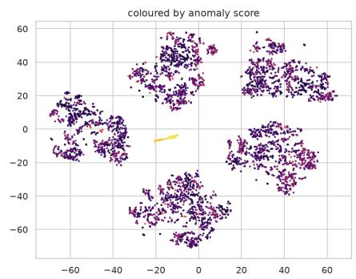

t-SNE of CNN-AE out-of-fold latents (unsupervised)  
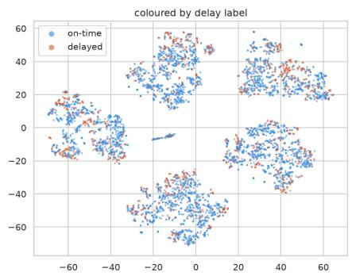

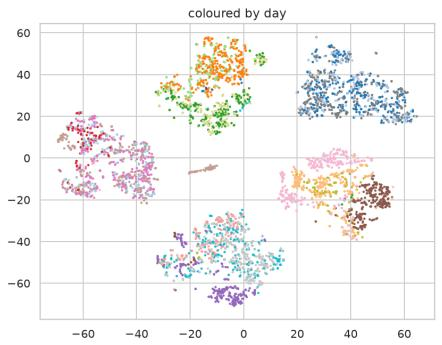  
Fig. 3. t-SNE of 5,000 out-of-fold CNN-AE latents, coloured by anomaly score (left), delay label (centre) and service date (right). The five lobes correspond to the five fold-specific encoders.

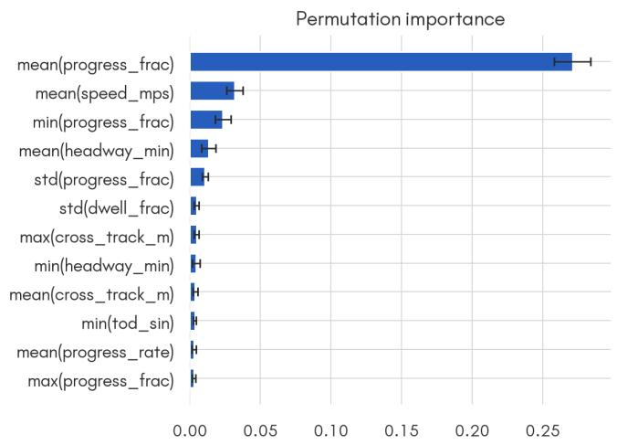  
drop in ROC-AUC when the feature is permuted

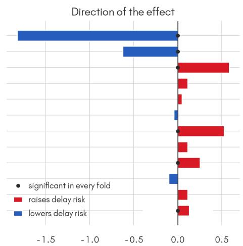  
logistic coefficient (standardised features)  
Fig. 4. What the delay model uses. Left, the drop in ROC-AUC when each feature is permuted, averaged over the five folds with the cross-fold standard deviation as the error bar. Right, the logistic coeficient on standardised features, which gives the direction of each efect; a dot marks the features that reach $p < 0 . 0 5$ in every fold.

## 7. SERVICE ANOMALY RESULTS

## A. Agreement between representations

The two AEs largely agree on what is abnormal. Their outof-fold scores correlate at Pearson r = 0.876 on the log scale (Spearman $\rho = 0 . 8 9 6 )$ , and of the 1,131 trips each flags at the 95th percentile, 705 are shared (Jaccard 0.45). Figure 5 shows the joint distribution.

## B. Circularity of the rainfall validation

The anomaly score was initially validated against three external signals, namely days with known degraded telemetry, rainfall, and an apparent citywide disruption on 23 March. Rainfall, however, is itself an input channel to the autoencoder, so a rain-linked score may reflect reconstruction dificulty on a rare input value rather than disrupted service.

We tested this directly by retraining the CNN-AE on the 11 non-weather channels and repeating every validation. Table 8 reports the result.

The rain association vanishes once rainfall leaves the input. Rain-hour trips are then flagged at 5.4% against 5.0% for dry hours $( p = 0 . 8 4 )$ ; Figure 6 shows the association as it looked before the ablation, under both weather-inclusive models. The 23 March “citywide disruption” vanishes just as completely. That window’s median score falls from +5.43 to 0.22, and none of its trips stay in the global top 20. What we had read as a fleet-wide operational event was the autoencoder failing to reconstruct a rare input value.

The third degraded day, 28 March, has only 449 trips and scores below the normal-day median under both variants (weather-free day-median 0.48, rank 17 of 19), so degraded telemetry does not always raise the reconstruction error. It is excluded from that row and included in the weekend stratum of Table 10, where the efect is carried by 22 March.

A reconstruction error computed over a channel set that contains the checking variable cannot establish an operational anomaly. The check and the input have to stay separate.

## C. Efect of schedule-derived input channels

The report keeps GTFS strictly on the label side. To show why, we added a schedule-derived channel to the autoencoder input and retrained, in two variants. The first uses start\_deviation\_sec, how early or late the bus left, which an operator genuinely knows at dispatch and which is not the label. The second uses median\_delay\_sec, the quantity the label is thresholded from, as the strongest possible leak. Table 9

Table 8. Weather-free ablation. Each validation is recomputed with the CNN-AE retrained without the rainfall channel. Two of the three original signals do not survive. The degraded-day row uses 20 and 22 March; see the text for 28 March.
<table><tr><td>Validation</td><td>With rainfall</td><td>Without rainfall</td><td>Verdict</td></tr><tr><td>Degraded days (20, 22 Mar), median score</td><td> $+ 0 . 3 7 \lor \mathbb { s } - 0 . 2 1$ </td><td> $+ 0 . 5 0 \lor { \mathbb { S } } - 0 . 2 0$ </td><td>survives</td></tr><tr><td>one-sided Mann-Whitney</td><td> $p = 9 \times 1 0 ^ { - 1 2 2 }$ </td><td> $p = 6 \times 1 0 ^ { - 1 1 8 }$ </td><td></td></tr><tr><td>Rain-hour flag rate vs dry</td><td> $1 2 . 2 \% \lor \mathbb { S } 4 . 4 \%$ </td><td> $5 . 4 \% \times 5 . 0 \%$ </td><td>does not survive</td></tr><tr><td>significance</td><td> $p = 2 . 8 \times 1 0 ^ { - 2 3 }$ </td><td> $p = 0 . 8 4$ </td><td></td></tr><tr><td>23 Mar 15:30–17:00 window, median score</td><td> $+ 5 . 4 3$ </td><td>-0.22</td><td>does not survive</td></tr><tr><td>trips in global top-20</td><td>20/20</td><td>0/20</td><td></td></tr><tr><td>Day-level ordering (Spearman between variants)</td><td> $\rho = 0 . 9 6 1$ </td><td></td><td>survives</td></tr></table>

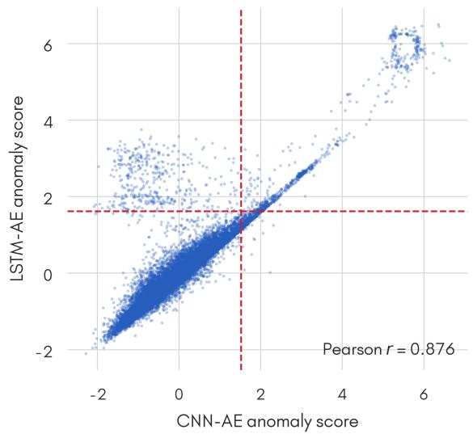  
Fig. 5. CNN-AE versus LSTM-AE anomaly scores, standardised log reconstruction error, so zero is the average trip. Dashed lines mark each model’s 95th percentile flagging threshold (1.53 for the CNN-AE, 1.61 for the LSTM-AE). Trips in the upper-right quadrant are flagged by both models, those in the of-diagonal quadrants by only one.

reports both.

Both variants inflate delay detection enormously, from 0.838 to 0.961 and then to 0.989 ROC-AUC. The second number is the expected one, since a model handed the quantity its label is computed from recovers that label almost perfectly, which measures arithmetic rather than representation quality. The first is more interesting, because start deviation is legitimate operational data, and it still lifts the score by 0.12. A bus that leaves late tends to stay late, so including it turns the task into something much closer to reading the schedule than to learning from telemetry.

We expected the reconstruction error to partly reproduce the delay label once schedule information entered the input. It does not, and the error’s ability to rank delayed trips stays at chance in all three settings (0.505, 0.519, 0.515). The dam age falls on the supervised side, where the classifiers read the schedule straight out of the latent vector, rather than on the unsupervised score. The two tasks do stop being independent, but by a diferent route than we assumed.

## D. A single global autoencoder

Training a separate AE inside each fold gives five encoders, five error scales that must be standardised before pooling, and the five artificial lobes in Figure 3. The alternative is a single AE fitted once on a historical slice, with cross-validation only on the classifiers. We trained the AE on the earliest 40% of service dates and cross-validated the classifiers on the later days, keeping the two sets of days disjoint so nothing the AE saw can reach a classifier test fold.

Table 9. Adding a schedule channel to the AE input. Delay detection becomes close to trivial, while the reconstruction error stays uninformative about the label. Mean over the five folds.
<table><tr><td colspan="2">AE input ROC-AUC</td><td rowspan="2">PR-AUC</td><td rowspan="2">recon. AUC</td></tr><tr><td></td><td></td></tr><tr><td>12 ch., no schedule + start deviation</td><td>0.838 0.961</td><td>0.629</td><td>0.505</td></tr><tr><td></td><td></td><td>0.887</td><td>0.519</td></tr><tr><td>+ median stop delay</td><td>0.989</td><td>0.964</td><td>0.515</td></tr></table>

GLOBAL-AE+XGBoost reaches $0 . 8 3 3 \pm 0 . 0 2 1$ ROC-AUC and $0 . 6 1 6 \pm 0 . 0 2 9 ~ \mathrm { P R \mathrm { - } A U C } ,$ against $0 . 8 3 8 \pm 0 . 0 1 6$ and 0.629 0.051 for the per-fold arrangement, a diference well inside the cross-fold spread and obtained while training on only 40% of the days. What it buys is structural, since the reconstruction error now lives on a single scale (history mean 0.3150, held-out mean 0.4867), so the within-fold standardisation step of Section 4.D is no longer needed and the fold lobes of Figure 3 cannot arise. For a deployed system this is the better arrangement, since it matches how the model would be used, fitting the representation on history and applying it going forward.

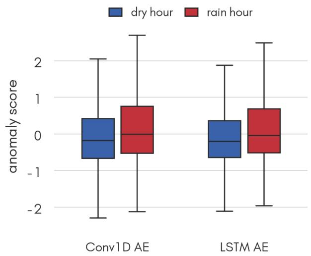  
Fig. 6. Anomaly score by rain condition for the weatherinclusive models. The association shown here is the one the ablation in Table 8 removes; it is reproduced to document what the original validation looked like.

## E. Day type versus service disruption

Having removed the weather confound, we examined what drives the day-level ordering. Figure 7 shows day-median scores for both variants with weekends shaded and known degraded days marked.

The dominant factor is day type rather than disruption. Weekend days occupy ranks 1, 2, 3, 4 and 7 of 19. At trip level the weekend median score is +0.178 against 0.286 for weekdays (one-sided Mann–Whitney $p = 1 . 2 \times 1 0 ^ { - 2 0 5 } )$ , with flag rates of 6.1% and 4.6%. This is expected, since Sunday service genuinely difers in frequency, routing and dwell behaviour. It does mean that a plain reading of the day ranking would mistake “Sunday” for “disrupted”.

The degraded-telemetry signal nevertheless survives stratification. Table 10 separates the two efects.

22 March remains the highest-scoring day even when com pared only against other Sundays (+0.740 vs +0.206, p = ${ \bar { 5 } } . 2 \times 1 0 ^ { - 4 { \bar { 2 } } } )$ . Its telemetry volume was 65,993 GPS rows against about a million on a normal weekday and half a million on the other two Sundays, by far the most severe drop in the period.

## F. What the score detects

Combining the ablation and the stratification, we can now separate the three phenomena that the reconstruction error had been mixing together.

1. Telemetry degradation. Detected, and separable from day type. This is a data-quality problem rather than a service problem, so it works as a positive control that shows the score is sensitive. It says nothing about whether the method finds operational faults.

2. Rare input values (weather). Detected, but only in a circular way. The signal disappears once the variable leaves the input, so it carries no operational meaning.

3. Genuine operational disruption. Not demonstrated. We have no validated instance of the score detecting a real service disruption. The one candidate (23 March) was an artefact.

The anomaly score is, on this evidence, a detector of unusual days. What makes a day unusual is mostly its day type, and secondarily any telemetry degradation. Establishing that it detects service disruption requires ground-truth disruption labels, which this dataset does not carry.

## G. Threshold calibration

The choice of a global 95th-percentile threshold merits explanation. The percentile sets an inspection budget rather than estimating an anomaly rate. At 5% of 22,605 trips it gives roughly 57 alerts per service day, a number an operator can review. There is no ground truth against which 5% could be calibrated as a rate.

We compared four rules on the existing weather-free scores. No retraining is required; this is pure post-hoc thresholding.

The first, global-p95, is the current rule, one pooled 95th percentile. The second, dynamic, is an absolute cut at µ + 1.645σ calibrated leave-one-day-out. The third and fourth restandardise the score before applying that same cut, per-line

within each bus line and per-hour within each hour of the day.   
Table 11 compares the four.

The global percentile is dominated by diferences between bus lines. Some lines simply reconstruct worse than others, so a pooled cut spends most of its alarm budget on those lines whatever the day. On the most severely degraded day in the dataset it flags 5.7% of trips, essentially the baseline rate.

Re-standardising each score within its own line raises that to 29.3%, a 4.8 lift over its own overall rate of 6.1%. The dynamic mean/SD threshold helps far less (1.5 ) than per-line calibration does. Figure 8 shows the full per-day picture.

In practice, then, the alarm threshold limits detection far more than the score does. An operator running this system would gain more from per-line scaling than from any change of representation we tested.

## 8. NETWORK-LEVEL DISTRIBUTION OF DELAY

The analyses so far treat trips as interchangeable. This section asks where in the network the delays sit, whether passenger demand explains them, and whether delay spreads from one trip to the next.

## A. Concentration by line-direction

Against a network delay rate of 20.9%, individual lines range from 1.4% to 48.8%, a factor of 35. Thirteen of the 41 lines with at least 50 trips are chronically late in the sense that the Wilson [26] lower bound of their delay rate sits above the network rate; the worst are line 55A at 48.8% (95% CI 42.3– 55.5), line 31 at 46.1% and line 62 at 44.0%.

Aggregating by line hides the real structure, because the two directions of the same line often behave nothing alike. Line 48 is delayed 13.6% of the time in one direction and 69.7% in the other; line 35 runs 8.2% against 59.8%. The worst linedirections, 38A direction 1 at 75.0% and 46 direction 1 at 72.7%, carry median delays of eight to twelve minutes, so these are not marginal cases sitting just over the five-minute boundary. Figure 9 (left) ranks them with their intervals.

Concentration follows the same pattern, since ranked by line the top ten carry 51.4% of delayed trips but also 45.5% of all trips, which is barely any concentration at all. Ranked by linedirection, 22 chronic pairs account for 27.3% of trips and 50.7% of every delayed trip in the dataset, an enrichment of 1.86 , with an internal delay rate of 38.9%. Half the delay problem lives in about a quarter of the service, and it is addressable by direction.

## B. Passenger demand

We aggregated all 6,790,681 boarding transactions into 30,136 line-by-hour cells and attached them to 85.7% of trips. A pertrip join is impossible: the ticketing vehicle\_number has no overlap with the AVL vehicle identifier, and the ticket records carry no direction field.

Taken at face value the demand features help a little, lifting PR-AUC from 0.6370 0.0528 to $0 . 6 4 6 7 \pm 0 . 0 5 3 7 .$ , an improvement in all five folds $( p \ = \ 0 . 0 1 3 )$ , with ROC-AUC moving $+ 0 . 0 0 2 9 \ ( p \ = \ 0 . 1 1 0 )$ . The control changes the reading completely. A single integer identifying the line beats the whole demand block (+0.0124 PR-AUC, $p = 1 . 0 \times 1 0 ^ { - 4 } )$ , and once that line identifier is present the demand features add nothing ( 0.0012 ROC-AUC, p = 0.465; 0.0018 PR-AUC, $p = 0 . 5 6 8 )$ The apparent gain was demand acting as a proxy for which line the trip belonged to. At the aggregation the join permits, 567 MB of ticketing data adds no predictive power beyond a line label.

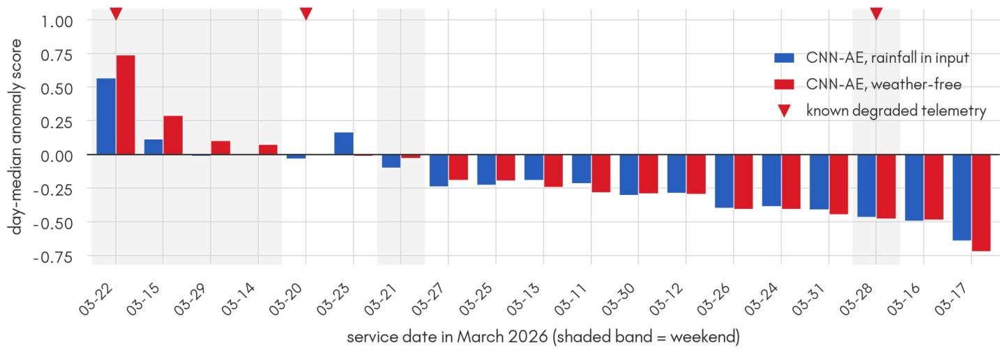  
Fig. 7. Day-median anomaly score, sorted by the weather-free variant. Weekends (shaded) occupy five of the top seven positions.

Table 10. Degraded versus normal days, stratified by day type (weather-free CNN-AE). The degraded-day efect holds within both strata, so it is not an artefact of 22 March being a Sunday.
<table><tr><td>Stratum</td><td>Degraded median</td><td>Normal median</td><td>one-sided p</td></tr><tr><td>Weekdays</td><td> $+ 0 . 0 0 2 \left( n = 6 1 2 \right)$ </td><td> $- 0 . 2 9 5 \left( n = 1 5 , 8 6 0 \right)$ </td><td> $9 . 5 \times 1 0 ^ { - 8 }$ </td></tr><tr><td>Weekends</td><td> $+ 0 . 4 1 8 \left( n = 1 , 4 9 4 \right)$ </td><td> $+ 0 . 1 1 0 \left( n = 4 , 6 3 9 \right)$ </td><td> $4 . 1 \times 1 0 ^ { - 1 4 }$ </td></tr><tr><td>22 Mar vs other Sundays</td><td> $+ 0 . 7 4 0 \left( n = 1 , 0 4 5 \right)$ </td><td> $+ 0 . 2 0 6 \left( n = 2 , 0 0 5 \right)$ </td><td> $5 . 2 \times 1 0 ^ { - 4 2 }$ </td></tr></table>

Table 11. Threshold rules evaluated on the weather-free CNN-AE scores. The diagnostic case is 22 March, the most severely degraded day.
<table><tr><td>Rule</td><td>Overall</td><td>22 Mar</td><td>Lift</td></tr><tr><td>global-p95</td><td>5.0%</td><td>5.7%</td><td>1.1×</td></tr><tr><td>dynamic</td><td>6.8%</td><td>10.3%</td><td>1.5×</td></tr><tr><td>per-line</td><td>6.1%</td><td>29.3%</td><td>4.8×</td></tr><tr><td>per-hour</td><td>6.6%</td><td>10.3%</td><td>1.6×</td></tr></table>

## C. Delay propagation

Consecutive trips on the same line and direction look strongly coupled, with 50.6% of trips following a delayed predecessor being delayed themselves against 13.1% otherwise, a relative risk of 3.86. Almost all of that is shared conditions rather than transmission. The only mechanism this data can identify is a hand-over between consecutive trips run by the same vehi cle, and there the excess disappears, since a within-line-day permutation test gives $z = - 0 . 7 7 \ ( p = 0 . 8 2 6 )$ and a Mantel– Haenszel [27] odds ratio of 0.829. The residual association is carried by pairs run by diferent vehicles and vanishes once the hour of day enters the stratum, which is what a common cause looks like rather than a cascade.

Headway behaves non-monotonically, with 31.2% of trips delayed below five minutes of headway, 13.4% between fifteen and twenty, and 27.6% again between forty-five and sixty, the U-shape in Figure 9 (right). A Spearman correlation of +0.060 is significant and close to meaningless on such a relationship. Lines that share stops do co-vary more than lines that do not (mean correlation +0.139 against +0.069, Mann–Whitney $p = 0 . 0 0 1 0 )$ , so spatial structure exists. Co-variation across a corridor is not by itself evidence of transmission along it, but the timing distinguishes the two. Aggregating each line to hourly delay rates over 3,177 line-hour cells and correlating every ordered pair of the 23 lines with enough hours, the samehour correlation is +0.163 while the same pairs at one hour of lag fall to +0.126, a drop of 0.037 (paired t over 451 pairs, $p = 1 . 6 \times 1 0 ^ { - 5 } )$ . The smallest drop this design could detect at 80% power is about 0.024, so the comparison is adequately powered and the efect is about one and a half times that floor. Lines move together in the same hour rather than one leading another, which is the signature of a shared cause such as trafic or weather rather than delay travelling along a corridor. Together with the null result on same-vehicle hand-over, the evidence points consistently at common conditions rather than propagation.

## D. Operational implications

Delay is concentrated by line-direction rather than spread evenly, the anomaly threshold works far better when calibrated per line (Section 7.G), and most of the delay signal is present after a quarter of the route (Section 5.G). Together these three findings describe a per-line early-warning monitor rather than a network-wide one, a monitor that scores trips against their own line’s normal behaviour, acts before the trip completes, and concentrates attention on the twenty-odd line-directions that carry half the problem. What the evidence does not support is a demand-driven intervention, since demand adds nothing once the line is known, or a cascade-control strategy, since we could not detect transmission between consecutive trips.

## 9. DISCUSSION

## A. Supported claims

One label-free representation can indeed be learned once and reused for both a supervised and an unsupervised task, and that reuse works. For delay detection, however, the representation is not what moves performance. Raw per-trip statistics with gradient boosting are at least as accurate, and the representation earns its place only through linear separability, which matters when a linear model is required. The day-level anomaly signal is the stronger result. It survives the choice of autoencoder, appearing under three separately trained en coders, one of which sees no weather at all, and it is partly shared by a contrastive encoder with no reconstruction objec tive. Per-line threshold calibration is worth more than any change of representation we measured.

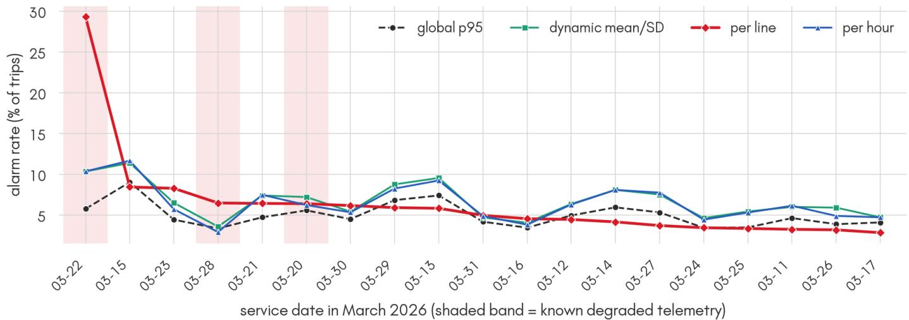  
Fig. 8. Alarm rate per service date under the four threshold rules. Known degraded days shaded. Per-line calibration is the only rule that makes 22 March stand out.

Outside that framing, the delay model turns out to rest almost entirely on one feature, the average along-route position of the bus, which carries roughly eight times the importance of the next and amounts to detecting that a bus moved slowly and did not get far. That is a valid signal learned without ever seeing the schedule, but it is close to a restatement of what being delayed means rather than an explanation of it, and the contextual channels we expected to matter, rainfall and time of day, do not appear. The learned representation is no more interpretable, since no single latent dimension exceeds 0.61 ROC-AUC on its own while all 64 together reach 0.771, so the signal is distributed rather than axis-aligned. At the network level, delay concentrates by line-direction rather than by line, with 22 chronic pairs carrying half of all delayed trips from a quarter of the service, while 6.8 million boarding transactions add nothing once the line identity is known and trip-to-trip propagation cannot be detected at all.

Three claims that might be read into this work are not supported by it. We have no validated case of the method detecting a genuine service disruption. The anomaly score is substantially a day-type signal, so it should not be read as a mainly operational one. And the latent representation does not improve delay prediction accuracy.

## B. Deployment conditions

The pipeline is worth its extra complexity when (i) schedule data is unreliable or absent, so the deterministic comparison is unavailable; (ii) a single representation must serve several downstream tasks, so one encoder serves all of them; or (iii) a linear downstream model is required. Where a reliable GTFS feed exists and only retrospective delay classification is needed, the deterministic comparison is simpler and the raw-feature

baseline is more accurate.

## C. Practical use

Three parts of this work transfer directly to an agency running the same kind of feed. The first is the labelling pipeline. A raw GPS archive carries no delay annotations, and Section 3 derives them from a dated GTFS snapshot by map-matching each trace to its route shape and interpolating a stop arrival wherever along-route progress crosses a stop, which turns an unlabelled archive into a supervised dataset with no manual annotation. The gate thresholds in Table 1 and the coverage rule of Section 3.D are the part worth copying, since they decide how much of the archive survives and we report what each one costs.

The second is the monitor of Section 8.D, whose cheapest half is the threshold rule. Re-scaling each trip’s anomaly score within its own bus line, instead of against one network-wide cut, lifts the alarm rate on the worst degraded day from 5.7% to 29.3%. That is a few lines of arithmetic over scores an agency already has, and it beat every change of representation we tried. Scoring a trip from its first quarter keeps 93.8% of the discriminative power of the finished trip, so the same monitor can raise an alert while the bus is still running, which a schedule comparison cannot do because the median stop delay it needs is undefined until the trip ends.

The third is a target list of 22 line-directions, which carry half of all delayed trips from just over a quarter of the service. The two directions of one line often behave nothing alike, with line 48 delayed 13.6% of the time one way and 69.7% the other, so scheduling and field attention is better spent by direction than by line.

The negative results are worth as much, because each one closes of an expensive avenue. An agency does not need to join ticketing data to predict delay, since 6.8 million boarding transactions add nothing once the line is known. It should not build a cascade-control strategy on this evidence, since we could not detect delay transmission between consecutive trips. It does not need representation learning to classify delay, since 48 summary statistics with gradient boosting match the autoencoder. And the circularity we ran into generalises well past transit, in that an anomaly score cannot be validated against a variable that is also one of its own inputs, because the check then confirms nothing beyond the model’s dificulty with rare

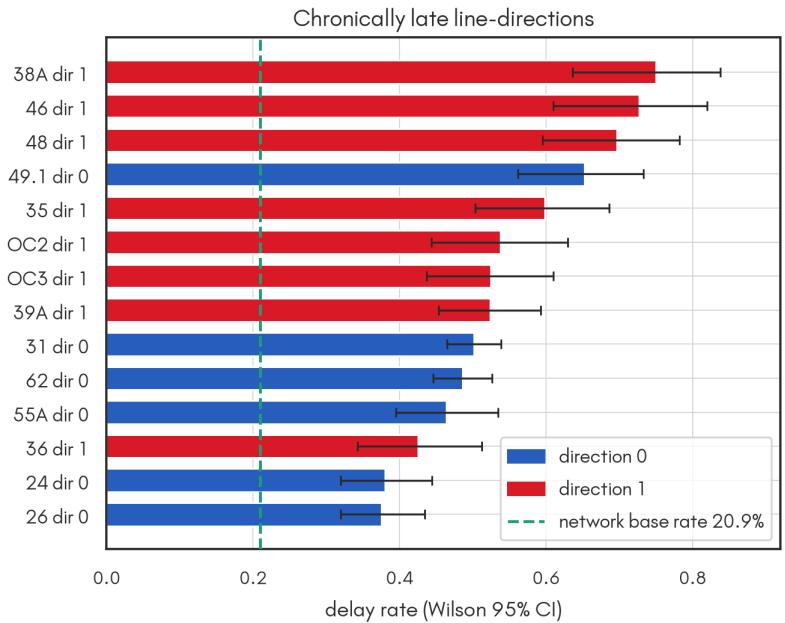

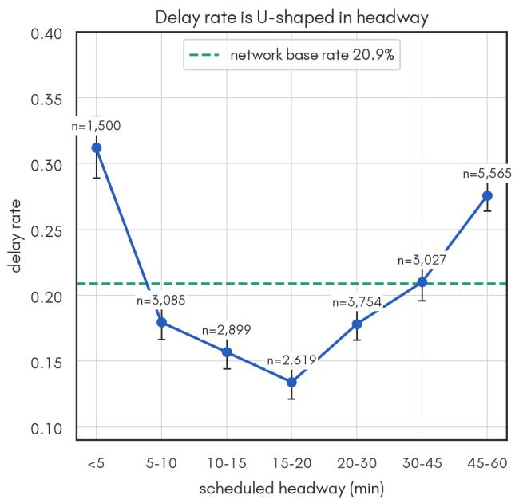  
Fig. 9. Where the delay sits in the network. Left, the 14 worst of the 22 chronically late line-directions, with delay rate and its Wilson 95% interval, coloured by direction of travel; the dashed line is the network rate of 20.9%. The two directions of a line are ranked separately and often fall far apart. Right, delay rate against scheduled headway, with the number of trips in each band. The relation is U-shaped, so a single rank correlation describes it poorly.

values.

## D. Limitations

The central limitation is that we have no ground truth for disruption, so every anomaly check here is a proxy. The day-level conclusions rest on 19 to 20 service dates, six of them weekends, and the paired tests run at $n = 5 .$ , where the Wilcoxon floor of $p = 0 . 0 3 1$ stops us resolving anything finer than “holds in every fold”. All of it comes from one city in one month, March 2026 in Niterói, which happens to include an unusual stretch of degraded telemetry. We tested whether the quality gates bias the anomaly analysis and found no support for it (Sec tion 3.B). The remaining gates were relaxed collectively rather than individually, so their separate contributions are not iso lated. A nested search (Section 5.D) moves the metrics slightly and leaves the ordering between raw and latent features intact, and a sweep over the autoencoder’s own latent dimension and depth (Section 5.E) does not change it either.

## 10. CONCLUSION

We aimed to show that one unsupervised representation could serve both delay detection and service anomaly detection. The representation does serve both, but the evidence does not support the stronger claim we began with.

For delay detection, gradient boosting on a per-trip summary of the same twelve channels matches, or slightly outperforms, the learned representation (0.846 vs 0.838 ROC-AUC). This diference is not statistically meaningful on the strict dataset, but becomes significant when the preprocessing filters are relaxed. The latent space earns its place only through linear separability.

For anomaly detection, two of our three original checks turned out to be circular, because rainfall served as an input channel and as the external check at the same time. Removing it from the input erased both the rain association and an ap parent citywide disruption. What remains is a day-level signal that is stable across three independently trained autoencoders but is driven mostly by day type (weekends hold five of the top seven positions), with telemetry degradation separable within strata. We have no validated instance of the score detecting genuine service disruption.

The delay model is dominated by a single feature amounting to “the bus moved slowly and did not get far”, and no latent dimension is individually interpretable, so neither the raw nor the learned representation explains delay so much as detects it. At the network level the problem is concentrated: 22 chronic line-directions carry half of all delayed trips, while passenger demand adds nothing beyond the line label and trip-to-trip propagation is undetectable.

The most useful result concerns the alarm threshold, where re-scaling scores within each bus line lifts the alarm rate on the worst degraded day from 5.7% to 29.3%, a 4.8 gain over its own baseline rate that no change of representation we tested came close to matching. Taken with the concentration by linedirection and the availability of most of the signal after a quarter of the route, this points at a per-line, early-warning monitor as the deployable form of the work.

## DATA AND CODE AVAILABILITY

The dataset was obtained under the NetMob 2026 Data Challenge terms and is available from the organisers to admitted participants. Weather data are from the public municipal feed.

All analysis code is openly available at https://github.com/ mttgermano/Netmob2026. The dataset repository is at https: //github.com/lprm-ufes/Netmob2026.

The numbers in this report can be reproduced from the artifacts in code/artifacts\_\* and the exp\_\*.py scripts. The specific scripts behind the results here are ablation\_norain.py (Section 7.B), threshold\_calib.py (Section 7.G), baseline\_raw.py (Section 5) and make\_report\_figs.py (Figures 1, 2, 4, 5, 6, 7 and 8), exp\_e10\_fig.py (Figure 9) and 03\_anomaly\_analysis.ipynb (Figure 3). exp\_gatebias\_leadlag.py covers the gate-bias checks of Section 3.B and the lead–lag comparison of Section 8.

## REFERENCES

of data from retrospective studies of disease,” J. National Cancer Inst. 22, 719–748 (1959).

1. J. Bates, J. Polak, P. Jones, and A. Cook, “The valuation of reliability for personal travel,” Transp. Res. Part E: Logist. Transp. Rev. 37, 191–229 (2001).

2. F. Domingos, H. T. Marques-Neto, B. Pereira, et al., “The Net-Mob26 dataset: A high-resolution multi-source view of public bus mobility in Niterói,” arXiv preprint arXiv:2605.20263 (2026).

3. S. P. Duncan and H. Chen, “Detecting network-based internet censorship via latent feature representation learning,” Comput. & Secur. 128, 103138 (2023).

4. G. E. Hinton and R. R. Salakhutdinov, “Reducing the dimensionality of data with neural networks,” Science 313, 504–507 (2006).

5. X. Zhang, Y. Zheng, Z. Zhao, et al., “Deep learning detection of anomalous patterns from bus trajectories for trafic insight analy sis,” Knowledge-Based Syst. 217, 106833 (2021).

6. MobilityData, “General transit feed specification (gtfs) schedule reference,” https://gtfs.org/documentation/schedule/reference/ (2024). Originally the Google Transit Feed Specification.

7. Transportation Research Board, “Transit capacity and quality of service manual,” 3rd ed., TCRP Report 165 (2013).

8. C. Spearman, “The proof and measurement of association between two things,” The Am. J. Psychol. 15, 72–101 (1904).

9. Y. LeCun, L. Bottou, Y. Bengio, and P. Hafner, “Gradient-based learning applied to document recognition,” Proc. IEEE 86, 2278– 2324 (1998).

10. S. Hochreiter and J. Schmidhuber, “Long short-term memory,” Neural Comput. 9, 1735–1780 (1997).

11. D. P. Kingma and J. Ba, “Adam: A method for stochastic optimization,” in Proc. 3rd Int. Conf. Learning Representations (ICLR), (2015).

12. D. E. Rumelhart, G. E. Hinton, and R. J. Williams, “Learning representations by back-propagating errors,” Nature 323, 533–536 (1986).

13. T. Chen and C. Guestrin, “XGBoost: A scalable tree boosting system,” in Proc. 22nd ACM SIGKDD Conf. on Knowledge Discovery and Data Mining, (2016), pp. 785–794.

14. L. Breiman, “Random forests,” Mach. Learn. 45, 5–32 (2001).

15. K. Cho, B. van Merriënboer, C. Gulcehre et al., “Learning phrase representations using RNN encoder–decoder for statistical machine translation,” in Proc. EMNLP, (2014), pp. 1724–1734.

16. F. Pedregosa, G. Varoquaux, A. Gramfort et al., “Scikit-learn: Machine learning in Python,” J. Mach. Learn. Res. 12, 2825–2830 (2011).

17. T. Fawcett, “An introduction to ROC analysis,” Pattern Recognit. Lett. 27, 861–874 (2006).

18. J. Davis and M. Goadrich, “The relationship between precisionrecall and ROC curves,” in Proc. 23rd Int. Conf. Machine Learning (ICML), (2006), pp. 233–240.

19. Student, “The probable error of a mean,” Biometrika 6, 1–25 (1908).

20. F. Wilcoxon, “Individual comparisons by ranking methods,” Biom. Bull. 1, 80–83 (1945).

21. H. B. Mann and D. R. Whitney, “On a test of whether one of two random variables is stochastically larger than the other,” The Ann. Math. Stat. 18, 50–60 (1947).

22. T. Chen, S. Kornblith, M. Norouzi, and G. Hinton, “A simple framework for contrastive learning of visual representations,” in Proc. 37th Int. Conf. Machine Learning (ICML), vol. 119 of PMLR (2020), pp. 1597–1607.

23. L. van der Maaten and G. Hinton, “Visualizing data using t-sne,” J. Mach. Learn. Res. 9, 2579–2605 (2008).

24. A. Fisher, C. Rudin, and F. Dominici, “All models are wrong, but many are useful: Learning a variable’s importance by studying an entire class of prediction models simultaneously,” J. Mach. Learn. Res. 20, 1–81 (2019).

25. S. M. Lundberg and S.-I. Lee, “A unified approach to interpreting model predictions,” in Advances in Neural Information Processing Systems 30 (NIPS), (2017), pp. 4765–4774.

26. E. B. Wilson, “Probable inference, the law of succession, and statistical inference,” J. Am. Stat. Assoc. 22, 209–212 (1927).

27. N. Mantel and W. Haenszel, “Statistical aspects of the analysis