# Dream to Assist: Intent-Conditioned World Models for Shared Vehicle Control

Jonathan DeCastro1, Thomas Balch1, Emily Sumner1, Deepak Gopinath1, Laporsha Dees1, Patricio Reyes Gomez1, Elliot Weiss2, Megan Applegate-Kenton1, Todd Rowell1, John Leonard3, Avinash Balachandran2, and Guy Rosman1

1Toyota Research Institute, Cambridge, MA 02139, USA 2Toyota Research Institute, Los Altos, CA 94022, USA 3Massachusetts Institute of Technology, Cambridge, MA 02139, USA

Abstract. Assistive agents in shared-control settings face a dual challenge: acting proactively to align with the human’s intentions while remaining legible enough for the human to comprehend and fluently respond in real time. We present DREAM2ASSIST, a model-based reinforcement learning framework for tightly-coupled shared decision making that addresses both sides of this challenge. Our approach extends a recurrent state-space world model with intent inference, enabling an assistive policy trained via fictitious co-play to anticipate and support discrete human objectives without overriding human agency. Beyond the computational framework, we describe the full deployment pipeline needed to translate a world-modelbased policy into a safe, human-centered system in a resource-efficient way. Crucially, we address the sim-to-real-human gap via policy down-selection and reward restructuring within an iterative human-machine interface design. We validate the framework through three human-subjects studies and a preliminary on-vehicle deployment spanning two qualitatively distinct domains: high-speed racing (N = 30) and urban driving with richer intent structure (N = 10). Our results demonstrate that intent conditioning yields measurable improvements in torque alignment and collision rate. We surface key design insights and practices for deploying learning-based assistive agents in safety-critical, real-time human-robot teaming.

Keywords: Shared autonomy, intent inference, world models, human-robot interaction, reinforcement learning

## 1 Introduction

In shared control contexts where a human and AI assistant share the same embodiment, assistive agents face a fundamental challenge: to act proactively while remaining aligned with human intent, the agent must anticipate what the human is trying to accomplish before it intervenes. If it does so in ways that conflict with the human’s intentions, assistance can be perceived as interference rather than support. An effective embodied assistant needs to reason both about the task itself (e.g. the end-goal or overall performance of the team) as well as the human users’ objectives while performing the task.

This problem is even more apparent in safety-critical, real-time domains, where the human-AI team has to be aligned (Hadfield-Menell et al., 2016) and fluent (Hoffman, 2019), the AI has to be understood by the human (Sakai and Nagai, 2022), and the system must avoid risky events (Jamieson et al., 2022), performance degradation (Endsley, 2023), or loss of user confidence (Abbink et al., 2018). Meeting these requirements simultaneously demands tight integration of policy design, interface design, and human evaluation, and probing how algorithmic choices affect the human’s experience of the system as a collaborative partner.

In this work, we present DREAM2ASSIST, a model-based reinforcement learning (RL) framework for real-time shared control. The core idea is to extend a recurrent state-space world model (RSSM) with an intent predictor that infers the human partner’s discrete objectives from observed behavior, and to condition the assistive policy’s reward on the inferred intent. We instantiate this framework in the domain of shared vehicle control, where the driver and the AI actuate the same steering, throttle, and brake controls. The result is a policy that is capable of steering with the human’s intent in mind rather than merely completing the task, which we quantify via torque alignment.

Because real human partners are expensive and variable, such policies are typically trained against simulated human models in simulation; however deploying them with real humans exposes a domain gap between synthetic and real partner behavior and requires more than algorithmic refinement. We describe the full, data-driven deployment pipeline for bridging assistive agents trained in simulation and the target assistive embodiment. In particular, we show the considerations, criteria, and processes needed to fuse robotic machine learning (ML) approaches and human-centric work in order to provide a balance of system performance, safety, and user satisfaction in time-constrained, tightly coupled, human-robot interaction (HRI).

In an initial version of this work (DeCastro et al., 2025), we have shown that a value-aligned assistive policy with intentconditioned recurrent state space model (RSSM) improves alignment in synthetic settings. This paper further extends the framework to real human partners: we extend our results to allow evaluation with 40+ human participants across three formal studies and more than 30 informal pilots, addressing human factors considerations such as explainability and cognitive load in providing the right level of assistance to the

driver.

We validate DREAM2ASSIST across two qualitatively distinct deployment contexts, probing how intent-recognition embedded into such systems’ fictitious play with the human enables better performance from real humans, leading to improved overtake success on high-speed straightaways, greater torque alignment with driver intent, and lower collision rates. A preliminary deployment on a physical vehicle platform $( N = 3 )$ demonstrates policy transfer with no retraining.

In summary, we make the following contributions:

• We extend DREAM2ASSIST, presented in DeCastro et al. (2025), with human-data augmentation, reward restructuring, and safety filtering, enabling deployment with real human partners in real-time, safety-critical settings.

• We propose a structured deployment pipeline for translating learned interactive policies from simulation to human-centered systems, combining automated policy screening, counterfactual log-replay evaluation, and human-in-the-loop vetting with a coupled iterative interface-design process. We formulate key performance indicators for physical HRI in common multi-agent driving scenarios.

• We validate DREAM2ASSIST across two domains via human subject evaluations in high-speed racing $( N _ { 1 } = 2 4 $ $N _ { 2 } = 6 )$ and surprise-rich urban scenarios $( N = 1 0 )$ demonstrating that intent conditioning produces measurable improvements over the no-intent-conditioning baseline in torque alignment and collision avoidance under double-blind conditions.

• We explore early findings of our approach in a real test vehicle $( N = 3 )$ .

## 2 Related Work

The approach we present lies at the intersection of several fields, namely ML and RL for HRI, shared control approaches in driving, and interface approaches for time-critical humanmachine interactions. While we focus on shared-embodiment driving, our framework is equally applicable to turn-taking HRI settings.

## 2.1 Machine Learning Approaches for HRI

Significant work has been done on sharing control (Abbink et al., 2018) and human-robot interaction (Sheridan, 2016; Onnasch and Roesler, 2021), exploring topics ranging from ergonomics and physiology to language-based strategic teaming. Prior research has presented learning-based approaches (Semeraro et al., 2023) to human-robot interactions. These works focus on a range of topics, including joint-representation learning (Xie et al., 2021; Reddy et al., 2018; Tucker et al., 2022; Karamcheti et al., 2022; Bobu et al., 2023; Sucholutsky et al., 2023; Parekh and Losey, 2023; Jeon et al., 2020), data-efficiency (Strouse et al., 2021), intent or plan modeling (Kelley, 2013; Thill and Ziemke, 2017; Losey et al., 2018;

Cheng et al., 2020; Rudenko et al., 2020b; Hoffman et al., 2024), hypothesis-space specification and explanation (Sucholutsky et al., 2023; Bobu et al., 2020; Setchi et al., 2020), alignment (Hoffman, 2019; Dragan et al., 2013), or other cognitive and social motivations (Lebiere et al., 2013; Mutlu et al. 2016; Admoni and Scassellati, 2017). Other works focused on specific approaches for planning and control, including imitation learning (Cardenas-Perez et al., 2024; Shi, 2025), model-predictive planning (Schwarting et al., 2017; Zhang et al., 2025), or reinforcement learning (Reddy et al., 2018; Akalin and Loutfi, 2021; Xiao et al., 2026). We go beyond prior work by embedding intent inference directly within the world model’s latent dynamics, conditioning the assistive policy’s reward on the inferred intent. We further evaluate the full pipeline with human partners in real time.

## 2.2 Planning for Shared Control in Driving

In the context of driving, shared control has been explored for planning approaches (Bobier et al., 2010; Bobier and Gerdes, 2013; Talbot et al., 2023; Schwarting et al., 2017; Benloucif et al., 2019; Liang et al., 2021; Dann et al., 2021; Jiang et al., 2021; Macke et al., 2021) and learning-based approaches (Griffiths and Gillespie, 2005; Mulder et al., 2012; Balachandran et al., 2016; Broad et al., 2017; Ghasemi, 2018). Prior work has also considered incorporating game-theory into shared control (Ghasemi, 2018; Jugade et al., 2019), as well as explicit human-centric design considerations (Deng et al., 2022; Xie et al., 2022). We refer readers to (Marcano et al., 2020; Sarabia et al., 2023) for comprehensive reviews. Beyond shared control, significant literature explored intent prediction in driving, see (Lefèvre et al., 2014; Rudenko et al., 2020a), and references therein.

Recent work has proposed a shared-control model using model-predictive control that leverages predicted trajectory information (Talbot et al., 2023), therefore implicitly capturing driver intent. Additional recent work has augmented a model-predictive controller with the ability to explicitly infer driver intent (Weiss and Christian Gerdes, 2023), enabling the controller to share the steering, throttle, and brake actions with a human. In our approach, we capture discrete driver intent in a way that is conducive to semantically-meaningful, multi-modal continuous behaviors (e.g., going left or right around an obstacle). Further, by framing our task as a multiagent reinforcement-learning problem, our proposed solution can extend to multiple agents planning (Busoniu et al., 2008; Huh and Mohapatra, 2023) much more naturally than prior work. Finally, we frame our decision-making approach within a recurrent state-space model (Hafner et al., 2019a) which is extended to infer the human’s objective, building on recent work that has explored hierarchical or hybrid state abstractions (Zholus et al., 2022; Gumbsch et al., 2023).

## 2.3 HRI and Interfaces in Time-Critical Settings

Deploying assistive interactions in real-time safety-critical settings includes challenges beyond policy design – accounting for human behaviors within the interaction due to latency (MacKenzie and Ware, 1993; McRuer and Krendel, 1974; Xu et al., 2017; Rieger and Manzey, 2022; Semeraro et al., 2023).

Challenges in design often include mode confusion and awareness under time stress, first contact usability with short exposure, HMI signal design for rapid perception, as well as experimental design validity in such conditions (Albers et al., 2020; Dong et al., 2024). Situation awareness frameworks (Endsley, 1995) have been widely applied to understand failures in human-automation teaming under time pressure and have been adapted for driving (Walker et al., 2008) and to HRI more broadly (van de Merwe et al., 2024). The timing and modality of feedback signals are particularly consequential in high-speed settings, with haptic feedback shown to convey urgent cues with lower cognitive overhead (Ploch et al., 2017). Transparency and explainability of AI actions present an additional design dimension (Sakai and Nagai, 2022; Setchi et al., 2020), with trajectories often used to convey robotic intent for shared control interactions (Brooks and Szafir, 2020).

While these aspects have been covered in existing literature, the integration of learning-based time-critical human-in-theloop systems expands the design space, while reducing our ability to control the concepts the system exposes to the user, requiring careful probing of the common assumptions on these aspects.

## 2.4 Design Metaphors for Shared Control

The behavior of a partially automated vehicle is intelligible to the driver only if the driver has formed an accurate mental model of how it works (Norman, 2013); design metaphors are a long-standing tool for inducing such a model by grounding novel functions in familiar imagery. The most influential metaphor in shared driving control is Flemisch et al.’s H-Metaphor (Flemisch et al., 2003), which casts the driver–vehicle relationship as horse-and-rider, with continuously variable “loose-rein” and “tight-rein” coupling enacted through bidirectional haptic communication. The H-Metaphor was subsequently realized as a concrete haptic-multimodal interaction architecture (H-mode) for cooperative guidance and control (Altendorf et al., 2015), and generalized by Flemisch and colleagues into a unifying framework spanning joint action, cooperative guidance, and shared/traded/supervisory control (Flemisch et al., 2019).

Adjacent metaphors recast the same problem from different perspectives: van Paassen et al. enumerate the design choices of haptic shared control through the lens of an instructor teaching a student to fly (van Paassen et al., 2017). Ju proposes that many driver–vehicle directives are best modelled as implicit interactions of the kind a passenger has with the driver (Ju, 2015); and Zhang et al. argue that drivers should be framed as the commander of a crewed vehicle rather than as a passive fallback (Zhang et al., 2021). DREAM2ASSIST may be characterized by a modified commander-crew metaphor, where the driver (a “hands-on” captain) leads through action, and the assistive policy must infer the driver’s high-level intent from observed behavior and resolve it into assistive continuous controls. It can override when the inferred intent would lead to an unsafe outcome.

## 3 Technical Approach

## 3.1 Preliminaries

We frame the model-based reinforcement learning (MBRL) problem as a two-player (human ego driver and assistive agent ego driver) partially-observable Markov decision process (POMDP) defined by the tuple $\begin{array} { r l } { M } & { { } = } \end{array}$ $\langle \mathcal { X } ^ { \kappa } , \mathcal { O } ^ { \dot { \kappa } } , \mathcal { A } ^ { \kappa } , \mathcal { T } ^ { \kappa } , \mathcal { R } ^ { \kappa } , \gamma \rangle ^ { \kappa = H , A }$ where, for agent $\kappa \_ { \in }$ $\{ H , A \}$ (for the human and AI agent, respectively), $\mathcal { X } ^ { \kappa }$ denotes the space of latent world states spaces, ${ \mathcal { O } } ^ { \kappa }$ denotes the observation space with observations generated according to an emission function $e ^ { \kappa } : \mathcal { X } ^ { \kappa } \mapsto \mathcal { O } ^ { \kappa } , \mathcal { A } ^ { \kappa }$ denotes the agent’s (continuous or discrete) actions, $\mathcal T ^ { \kappa } : \mathcal X ^ { \kappa } \times \mathcal A ^ { \kappa } \mapsto [ 0 , 1 ]$ is the transition probability, $\mathcal { R } ^ { \kappa } : \mathcal { X } ^ { \kappa } \times \mathcal { A } ^ { \kappa } \times \mathcal { X } ^ { \kappa } \mapsto \mathbb { I }$ R is a reward function, and $\gamma \in [ 0 , 1 ]$ is a discount factor. We aim to train both agents such that they maximize their expected returns $\begin{array} { r } { R ^ { \kappa } = \mathbb { E } \left\lceil \sum _ { t = 1 } ^ { T } r _ { t } ^ { \kappa } \right\rceil } \end{array}$

Crucially, in the semi-cooperative shared control setting, each reward $\boldsymbol { r } _ { t } ^ { \kappa }$ is factored into sub-components, with both sharing the same task (driving) rewards, but where $r _ { t } ^ { H }$ contains an additional term for a human’s objective, and $r _ { t } ^ { A }$ contains additional terms to weaken its contribution in relation to the human’s and enforces alignment to the human.

We assume access to a set of task rewards $r _ { t } ^ { t a s k }$ , and a set of policies that capture human behaviors $\Pi _ { i } ^ { H }$ for each intent $i \in \mathcal { V }$ . Here, task refers to the domain-level objective shared by both agents (e.g., completing the race, navigating the town) (Michon, 1985), while intent refers to the human’s local, moment-to-moment objective within that task (e.g., passing the car ahead vs. staying behind it). For each intent (e.g. passing, changing lanes, stopping, etc.), we then assume a label of human intent, or local objectives, that the human could be deciding at any given time point.

The intent space Y is domain-dependent; in this work, we consider the intent space to be discrete to match different maneuvers that could be taken. In racing, $\mathcal { V } =$ {pass, stay behind}: the driver either intends to overtake the lead vehicle or remain behind it. In urban driving, Y combines lateral and longitudinal components: $\mathcal { V } = \ \{ \mathrm { l e f t , r i g h t } \} \ \times$ {go, slow, stop}, capturing both the direction of avoidance and the desired speed response to a hazard. The reward terms conditioned on intent are defined in Secs. 3.3–3.5 and detailed per domain in Appendix B.

## 3.2 DREAM2ASSIST

The computational backbone of DREAM2ASSIST underlying our work learns a common latent representation in the structure of a recurrent state space model (RSSM) (Hafner et al., 2023, 2019b) to build a hybrid discrete/continuous state of the human partner’s behavior, their rewards, and intent for achieving certain goals. RSSMs have been shown to be suitable for many domains (e.g. locomotion, Atari, Minecraft).

We extend the usual RSSM formulation to jointly represent behavior and intent, conditioning the assistant’s reward on the inferred human objective. To accommodate both a human and assistive agent operating in a collaborative setting, we train the assistive agent alongside human agents, with both agents sharing actions taken in an environment. Each agent receives a reward for each action taken, and each are trained to (1) build an accurate RSSM and (2) learn how to act in order to maximize its own expected returns (Sutton and Barto, 2018). One challenge in collaboration is that part of the assistive agent’s world model includes aspects of the future human’s plan, such as preferences, desires, and goals of the human (these are often collectively referred to as objectives (Bobu et al., 2020) or intents (Losey et al., 2018) in the literature, and we will use these terms interchangeably in the paper), which are often unknown and only weakly observed by their behavior (Bobu et al., 2020). We extend the RSSM formulation to allow it to be supervised on a diverse set of humans, whose objectives are known and labeled, to force the representation to be jointly aware of the behavior and intent across a variety of human types and physical environments. We then devise a scheme that feeds in inferred human intent into the assistant’s reward function.

In order to allow the system to maintain an ability to reason over the preferences of the human independent of that of the joint human-robot system, our approach considers both the human driver and the assistive agent planner as separate models. The training process is outlined in Fig. 1.

In the cooperative setting, the model of the environment follows a structure in which there are certain task-specific rewards which are available to both human and assistive agents, with the key distinctions being human-objective (specific to the human), and intervention penalties (specific to the assistant).

Task-Specific Rewards We decompose the task reward into components shared across domains:

$$
r _ { t } ^ { t a s k } = r _ { t } ^ { c o l l i s i o n } + r _ { t } ^ { b o u n d s } + r _ { t } ^ { p r o g r e s s }\tag{1}
$$

where $r _ { t } ^ { c o l l i s i o n }$ penalizes proximity to other vehicles, $r _ { t } ^ { b o u n d s }$ penalizes departures from the road, and $r _ { t } ^ { p r o g r e s s }$ rewards progress toward the domain-specific goal (e.g. reaching the finish line in racing, or safely steering around an wrong-way car in urban driving). The precise definition of each reward term is detailed in Appendix B.

Intent-Aware World Model The objective of the world model is to provide a representation that the agent can use to interact with the driver and the world, and we posit that this representation can support the agent to reason jointly about both the task and human objectives. We build off of the RSSM of DreamerV2/V3 (Hafner et al., 2020, 2023), according to the architecture in Figure 1. For agent κ ∈ $\{ H , A \}$ (respectively, the Human and Assistive agent), the

RSSM model, parameterized by ϕ and denoted ${ W } _ { \phi } ^ { \kappa }$ , includes:

$$
\begin{array} { r l } & { \mathrm { D i s c r e t e ~ r e p . ~ e n c o d e r ~ } z _ { t } ^ { \kappa } ; \qquad z _ { t } ^ { \kappa } \sim q _ { \phi } ^ { \kappa } ( z _ { t } ^ { \kappa } | h _ { t } ^ { \kappa } , \pmb { x } _ { t } ) } \\ & { \mathrm { R e c u r r e n t ~ s t a t e ~ s e q u e n c e ~ } h _ { t } ^ { \kappa } \colon { h _ { t } ^ { \kappa } } = f _ { \phi } ^ { \kappa } ( { h _ { t - 1 } ^ { \kappa } } , z _ { t - 1 } ^ { \kappa } , \pmb { a } _ { t - 1 } ^ { \kappa } ) } \\ & { \mathrm { D y n a m i c s ~ p r e d i c t o r } . \qquad \quad \hat { z } _ { t } ^ { \kappa } \sim p _ { \phi } ^ { \kappa } ( \hat { z } _ { t } ^ { \kappa } | h _ { t } ^ { \kappa } ) } \end{array}\tag{2}
$$

where $\mathbf { \Delta } _ { \mathbf { \mathcal { X } } _ { t } }$ denotes the input observation. Following DreamerV3, the latent state uses a discrete categorical representation that is independent of the intent space $\mathcal { V } .$ The output heads are similar to the DreamerV2/V3 architecture, with the addition of an intent predictor for the assistant agent (in red), and are all bottlenecked on the hidden states $s _ { t } ^ { \kappa } = \{ h _ { t } ^ { \kappa } , z _ { t } ^ { \kappa } \}$ ,

$$
\begin{array} { r l r } & { \mathrm { D e c o d e r : ~ } \hat { \pmb x } _ { t } ^ { \kappa } \sim p _ { \phi } ^ { \kappa } ( \hat { \pmb x } _ { t } ^ { \kappa } | \pmb s _ { t } ^ { \kappa } ) } & { \mathrm { C o n t i n u e : ~ } \hat { c } _ { t } ^ { \kappa } \sim ~ p _ { \phi } ^ { \kappa } ( \hat { c } _ { t } ^ { \kappa } | \pmb s _ { t } ^ { \kappa } ) } \\ & { \mathrm { R e w a r d : ~ } \hat { r } _ { t } ^ { \kappa } \sim p _ { \phi } ^ { \kappa } ( \hat { r } _ { t } ^ { \kappa } | \pmb s _ { t } ^ { \kappa } ) } & { \mathrm { I n t e n t : ~ } \hat { y } _ { t } ^ { A } \sim p _ { \phi } ^ { A } ( \hat { y } _ { t } ^ { A } | \pmb s _ { t } ^ { A } ) } \end{array}\tag{3}
$$

The AI intent head predicts the intent of the human agent, and we assume at least partial access to the intent labels for a given episode, which takes the form of an integer-valued target function. We normalize the output by predicting the symlog (sign(y) ln $( | y | + 1 ) ,$ of the output, and use a discrete distribution to predict $y$ using the two-hot encoding of (Hafner et al., 2023). The parameters ϕ of the world model ${ W } _ { \phi } ^ { \kappa }$ are trained to minimize the loss

$$
\begin{array} { r } { \mathcal { L } ^ { \kappa } ( \phi ) = \mathbb { E } _ { q _ { \phi } ^ { \kappa } } \left[ \beta _ { p r e d } \mathcal { L } _ { p r e d } ^ { \kappa } + \beta _ { K L } \mathcal { L } _ { K L } ^ { \kappa } \right] } \end{array}
$$

The prediction loss $\mathcal { L } _ { p r e d } ^ { \kappa }$ minimizes the likelihood under the predictor distributions in Eq. $( 3 ) , \mathcal { L } _ { K L } ^ { \kappa }$ minimizes the KL divergence between the prior $p _ { \phi } ^ { \kappa }$ and the approximate posterior $q _ { \phi } ^ { \kappa }$ , and $\beta _ { p r e d }$ and $\beta _ { K L }$ are scalar weighting values. Given an intent label $y _ { t }$ , the portion of loss $\mathcal { L } _ { p r e d } ^ { A }$ for the intent predictor is taken as the negative log-likelihood of the label under $p _ { \phi } ^ { A }$

The world model training is alternated with training for the behavior model governing actions $\pmb { a } _ { t } ^ { \kappa }$ , with the behavior model learned via an actor-critic policy training over the estimates $s _ { t } , \hat { r } _ { t }$

$$
\mathrm { A c t o r } ; \quad { a } _ { t } ^ { \kappa } \sim \pi _ { \theta } ^ { \kappa } \big ( { a } _ { t } ^ { \kappa } \mid { s } _ { t } ^ { \kappa } \big ) \quad \mathrm { C r i t i c } ; \quad { v } _ { \psi } ^ { \kappa } \big ( { s } _ { t } \big ) \approx \mathbb { E } _ { p _ { \phi } ^ { \kappa } , \pi _ { \theta } ^ { \kappa } } \big [ \hat { r } _ { t } ^ { \kappa } \big ]\tag{4}
$$

The critic is trained to minimize the temporal-difference loss on the value function $v _ { \psi } ^ { \kappa }$ . The actor attempts to maximize the critic-predicted value. For further details, we refer the reader to (Hafner et al., 2023), which introduces the DreamerV3 architecture that our RSSM builds upon. The primary extensions in our work are the dual-agent formulation (separate human and assistant models sharing a common world model), the intent predictor head (3), and the intent-conditioned reward structure (Appendix B).

## 3.3 Population-Based Human Modeling

Similar to recent work describing human preferences for a task using reward shaping (Tang et al., 2021; Yu et al., 2023), we train a population of simulated human policies to serve as training partners for the assistive agent. Different from these works, we group labeled sub-populations according to certain inherent objectives or preferences. We train several sub-populations using a separate human reward $\begin{array} { r } { r _ { t } ^ { H } = r _ { t } ^ { t a s k } + r _ { t } ^ { \bar { y } } } \end{array}$ , which is composed of the base task rewards in Eq. (1), with the addition of several distinct human objectives, spanning different multimodal behaviors of the human. These are then formed into a collection of humans $\{ \pi _ { 1 } ^ { H } , \pi _ { 2 } ^ { H } , \ldots , \pi _ { N } ^ { H } \} \in \{ \Pi _ { 1 } ^ { H } , \Pi _ { 2 } ^ { H } , \ldots , \Pi _ { N } ^ { H } \}$ for N different objectives. Examples of different settings for $r _ { t } ^ { y }$ are given in Appendix B.

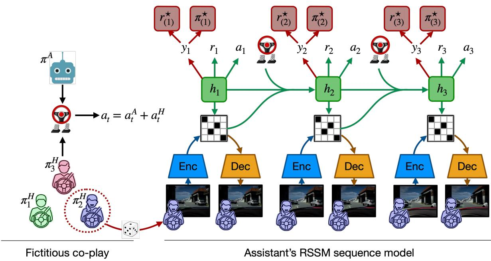  
Figure 1: DREAM2ASSIST RSSM: We blend human actions linearly with the actions from an unfrozen assistive agent. For both human and assistive agents, a multi-head RSSM architecture is then used to predict the observations, reward, and human intent (assistive only), trained to maximize their log-likelihoods against samples taken from the environment. The intent head is trained to match frozen human intents, which are fixed a priori. The assistive agent’s rewards are shaped based on the optimal policy $\pi _ { \hat { y } ^ { A } } ^ { * }$ and optimal predicted reward $\boldsymbol { r } _ { \hat { y } ^ { A } } ^ { * }$ for inferred intent $\hat { y } ^ { A }$

Humans are error-prone and pursue their objectives irrationally (Chipman, 2016). To capture this, we partially train simulated human partners (hereafter, referred to as human policies) to pair with the assistive agent in a process known as fictitious co-play (FCP) (Strouse et al., 2021), yielding a population of human policies $\{ \pi _ { y , k } ^ { H } \} _ { k } \cup \{ \pi _ { y } ^ { * } \}$ for each intent sub-population $\Pi _ { y } ^ { H }$ , where k represents the policy checkpoint for some amount of completed training. Using the FCP framework, each checkpoint $k \in [ 1 , K ]$ is an agent trained to k% completion and the final checkpoint $k = K$ is an optimal policy. Each checkpoint is endowed with a suboptimal RSSM world model, with the final checkpoint $( k = K )$ approximating the optimal policy. While we apply FCP in this work, we note that our approach is agnostic to how actual human behaviors are generated and future work may consider other approaches to synthesizing human policies (Park et al., 2023; Venuto et al., 2024).

## 3.4 Alignment with the Human

To learn alignment with human drivers, we expose the assistive agent to different human policies at training time. Training with human policy partners in a fictitious co-play setting (Strouse et al., 2021) allows the assistant to become robust to different possible human behaviors, but does not teach the assistant to distinguish between the discrete modes of human behavior, which is necessary for assistance in our driving task.

If trained to optimality, the human policies induce optimal behaviors $\pi _ { y } ^ { \star }$ for each intent y. We refer to these as expert policies for each enumerated objective. At deployment, the intent predictor estimates $\hat { y } _ { t } ^ { A }$ from the latent state, and the assistive reward is shaped to match the expert policy corresponding to the inferred intent. The human policy $\pi _ { y _ { t } } ^ { H }$ may adopt an intent $y _ { t }$ that varies with time. To simplify training, we train from drivers and rollouts (simulated episode trajectories) with fixed intents, y, though our problem setup generalizes to variableintent scenarios (e.g., a human switching from “following” to “passing” during a race). In practice, the intent predictor re-estimates $\hat { y } _ { t } ^ { A }$ at every timestep from a moving window of latent states, so the system can track intent changes that occur in real-time even though individual training episodes use fixed labels. The training distribution nonetheless covers all intents, exposing the world model to the full range of human behaviors without requiring explicit transition labels during training. Extending the training procedure to explicitly model intent transitions is a direction for future work (Sec. 7). When the intent predictor assigns similar probability to multiple intents, the policy defaults to task-completion behavior (minimizing intervention), as the intent-conditioned reward components approximately cancel.

We train a separate Dreamer agent for each intent class. To reduce the domain gap between synthetic and real human control signals and induce more human-like in behavior, we apply a smoothing operation to ensure the human policies provide smooth control inputs (Mysore et al., 2021). We additionally mix real human driving data to ground the world model in realistic dynamics by labeling the state-action pairs with rewards through an offline re-simulation process. Since there is no ground-truth intent for the entire trajectory, we do not label these additional trajectories with intent. We keep the proportion small (20% of the replay buffer, as performance was not sensitive in the proportion range evaluated) in order to reduce the off-policy drift between the human policy and actual human data, and furthermore to keep the intent head from being starved of supervision labels. Lastly, we re-balance intent classes during training of the AI to prevent mode collapse toward a dominant intent.

## 3.5 Value-Aligned Assistive Objectives

The core principle behind training the assistive policy is to (1) produce actions consistent with what an intent-aligned expert would select, given the human’s inferred preference, and (2) minimize interventions. More precisely: at each timestep the assistant infers the human’s current intent $\hat { y } _ { t } ^ { A }$ from the latent state and retrieves two quantities from the corresponding optimal human world model: the reward $\hat { r } ^ { * } ( \hat { y } _ { t } ^ { A } )$ that an intentaligned expert would receive, and the action $\pmb { a } ^ { * } ( \hat { y } _ { t } ^ { A } )$ that expert would select. The assistant is rewarded for achieving reward values consistent with what an intent-aligned expert would achieve, while producing joint human-robot actions that resemble what the optimal human policy would select. Expert alignment and intervention minimization together allows the policy to explicitly act with the human agent, rather than just completing the task.

For continuous actions $\pmb { a } _ { t } ^ { H } , \pmb { a } _ { t } ^ { A } \in \mathbb { R } ^ { m }$ for the human and assistant, respectively, we encourage the assistive agent to minimize its action intervention by adopting a reward of the form

$$
r _ { t } ^ { i n t e r v } = - \| \pmb { a } _ { t } ^ { A } \| _ { 2 }
$$

which penalizes the magnitude of the intervention according to an $L _ { \mathrm { { 2 } } } \mathrm { { - n o r m } }$ . Aggregated over time, the intervention cost forms a mixed $L _ { 1 } - L _ { 2 }$ norm (Elad, 2010), encouraging temporally sparse interventions.

The agent is further rewarded for task completion and penalized for driving out of bounds and for collisions (see Chen et al. (2023)). These sparse negative rewards serve to encourage the assistant to act as a “racing guardian,” keeping the driver on the track and avoiding collisions while making progress towards the finish line. Note that these rewards align with the task objective but do not favor any particular human objective or intent.

Finally, the assistive agent receives a reward for aligning with the inferred objective of the human driver. First, the agent receives a reward equal to the inferred reward under the optimal human’s world model. Second, the agent receives reward for maximizing the likelihood of the human–robot combined action under the optimal human policy conditioned on the predicted intent, $\pi ^ { * } ( \bar { \pmb { a } _ { t } ^ { A } } + \pmb { a } _ { t } ^ { H } \ | \ \pmb { x } _ { t } , \bar { \pmb { y } } _ { t } ^ { A } )$ . Note that $\pmb { a } _ { t } ^ { H }$ is the current sub-optimal human action. Intuitively, these rewards encourage the assistant to: (1) select actions for which the optimal human assigns high value and (2) select actions that bring the sub-optimal human closer to the optimal human. Under this setup, although we infer $\hat { y } _ { t } ^ { A }$ from the joint humanrobot trajectory, we consider it to be more aligned with the human’s intent, due to: (1) the presence of the intervention sparsity term $r _ { t } ^ { i n t e r v }$ , and (2) the fact that the inferred expert alignment term tilts the joint behavior toward the inferred expert human’s behavior.

The complete reward for the assistant combines three objectives. The task reward $r _ { t } ^ { t a s k }$ rewards progress and penalizes collisions and out-of-bounds driving. The intervention cost $r _ { t } ^ { i n t e r v } = - \| \pmb { a } _ { t } ^ { A } \| _ { 2 }$ penalizes the magnitude of the assistant’s action; aggregated over time this forms a mixed $L _ { 1 } { - } L _ { 2 }$ norm (Elad, 2010), encouraging temporally sparse interventions. The expert-alignment reward encourages actions consistent with the inferred optimal human policy. The combined reward is:

$$
\begin{array} { r l } & { r _ { t } ^ { A } = \underbrace { r _ { t } ^ { t a s k } + r _ { t } ^ { i n t e r v } } _ { \mathrm { t a s k + i n t e r v e n t i o n } } } \\ & { ~ + \underbrace { \alpha _ { r } \hat { r } _ { t } ^ { * } ( \hat { y } _ { t } ^ { A } ) + \alpha _ { a } \Vert { \pmb { a } } _ { t } ^ { H } + { \pmb { a } } _ { t } ^ { A } - { \pmb { a } } _ { t } ^ { * } ( \hat { y } _ { t } ^ { A } ) \Vert _ { 2 } } _ { \mathrm { e x p e r t ~ a l i g n m e n t } } } \end{array}\tag{5}
$$

where $\hat { r } ^ { * } ( \hat { y } _ { t } ^ { A } )$ is the reward predicted by the optimal human’s world model for the current state-action pair and predicted intent, and ${ \pmb a } ^ { * } ( \hat { y } _ { t } ^ { A } ) \sim \pi ^ { * } ( \cdot \mid { \pmb x } _ { t } , \hat { y } _ { t } ^ { A } )$ is the corresponding optimal action. Scalars $\alpha _ { r }$ and $\alpha _ { a }$ weight the expert-alignment terms; all evaluations in this paper use the reward-only case $( \alpha _ { r } = 1 , \alpha _ { a } = 0 )$ , though we compare alternative weightings in DeCastro et al. (2025).

## 3.6 Safety Layer

Although the assistive policy is trained to encourage safe joint actions, no learned system can guarantee safety in all states (Oh et al., 2025). Following the framework of Oh et al. (2025), we therefore layer a control-barrier-function (CBF) safety filter on top of the learned policy. As in that work, the filter treats the human as an unmodeled agent whose inputs enter through the dynamics rather than through an explicit human model; the CBF constraint ensures forward invariance of a safe set defined over the ego vehicle’s state regardless of the human’s future actions.

This separation is particularly important for shared control with a trajectory visualization, which renders the policy’s planned path several seconds ahead: safety violations in the predicted trajectory are visible to the driver and can erode trust before they materialize in the vehicle’s actual motion. The safety filter can be applied to the policy’s commanded actions, to the predicted trajectory shown to the driver (Appendix B.2.1), or both. In the human studies reported here, the filter was applied only to the trajectory visualization in order to isolate the effect of intent conditioning on the assistive torque (Sec. 6); extending it to the actuation channel is a natural next step. We describe the specific implementation used in each evaluation in Sec. 6.

In practice, the safety filter activates only when the system approaches a constraint boundary; during normal operation, the learned policy’s actions pass through unmodified.

We follow a simplified version of driving safety filters (Oh et al., 2025). In particular, we assume a function $h ( { \pmb x } ) \geq 0$ to characterize the safety of the vehicle. Given ${ \dot { h } } ,$ the gradient of the fully-observable dynamics (can be the true system dynamics or RSSM – in our case, we use the true system dynamics), we aim to satisfy the first order control barrier function condition to guarantee safety:

$$
\dot { h } ( { \pmb x } , { \pmb a } ) + \alpha h ( { \pmb x } ) \geq 0\tag{6}
$$

where constant $\alpha > 0$ and $\displaystyle \dot { h } ( { \pmb x } , { \pmb a } )$ denotes the time derivative of $h ( x )$ along the trajectory of the system. We are interested in finding the smallest δa with $\pmb { a } = \pmb { a } ^ { H } + \pmb { a } ^ { A } + \delta \pmb { a }$ such that Eq. (6) holds, i.e.,

$$
\operatorname* { m i n } _ { \delta { \boldsymbol a } } \| \delta { \boldsymbol a } \| \qquad \mathrm { s . t . } \qquad L _ { g } h ( { \boldsymbol x } ) \delta { \boldsymbol a } \geq - \alpha h ( { \boldsymbol x } ) - \dot { h } ( { \boldsymbol x } , { \boldsymbol a } )\tag{7}
$$

where we assume control-affine dynamics ${ \dot { \pmb x } } = f ( { \pmb x } ) + g ( { \pmb x } ) { \pmb a } ,$ which is standard for kinematic vehicles and renders Eq. (6) linear in the control input $^ { a , }$ , and $L _ { g } h ( \pmb { x } ) = \nabla h ( \pmb { x } ) ^ { \top } g ( \pmb { x } )$ denotes the Lie derivative of h along the control vector field $g .$ Since the dynamics of other vehicles can be predicted within a short time horizon, we can solve this problem analytically:

$$
\delta \pmb { a } = \operatorname* { m a x } \left( 0 , \frac { - \alpha h ( \pmb { x } ) - \dot { h } ( \pmb { x } , \pmb { a } ) } { L _ { g } h ( \pmb { x } ) } \right)\tag{8}
$$

Intuitively, this constraint ensures that if the system is currently safe $( h ( { \pmb x } ) ~ \ge ~ 0 )$ , then it remains safe at the next timestep (the barrier function cannot decrease at a rate faster than $\alpha h ( { \pmb x } ) )$ . This may be applied to lane boundaries and static and dynamic obstacles. In practice, the safety filter activates only when the system approaches a constraint boundary; during normal operation, the learned policy’s actions pass through unmodified.

## 3.7 Alignment Metrics

We propose the following metrics for evaluating alignment in any shared-control setting. Let $\tau ^ { A } ( t )$ be the signed assistive steering torque at time $\bar { t } , y ^ { H } ( t ) \in \{ - 1 , + 1 \}$ be a binary intent direction, and $T$ the length of the window. We define three alignment metrics:

$$
\begin{array} { c } { { \displaystyle \langle | \tau ^ { A } | \rangle = \frac { 1 } { T } \sum _ { t = 1 } ^ { T } | \tau ^ { A } ( t ) | } } \\ { { \Delta \tau = \frac { 1 } { T } \sum _ { t = 1 } ^ { T } | \tau ^ { A } ( t ) | \Big ( 1 [ \mathrm { s i g n } ( \tau ^ { A } ( t ) ) = y ^ { H } ( t ) ] } } \\ { { \displaystyle - \ \mathbb { 1 } [ \mathrm { s i g n } ( \tau ^ { A } ( t ) ) \neq y ^ { H } ( t ) ] \Big ) } } \end{array}\tag{9}
$$

(10)

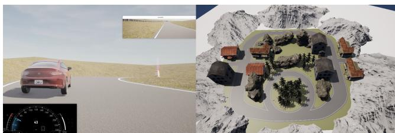  
Figure 2: Racing (left) and urban (right) domains.

$$
N _ { \mathrm { a l i g n } } = \sum _ { t = 1 } ^ { T } 1 \ [ \mathrm { s i g n } ( \tau ^ { A } ( t ) ) = y ^ { H } ( t ) \ \wedge \ | \tau ^ { A } ( t ) | > \tau _ { \mathrm { m i n } } ]\tag{11}
$$

Here, (9) captures the average strength of the AI’s steering intervention, regardless of direction, (10) separates the AI’s torque into intent-aligned and intent-opposing components (positive values indicate the AI applies more force when aligned with the human’s goal than when opposing it), and Eq. (11) counts timesteps where the AI’s torque is both directionally consistent with the human’s intent and exceeds a minimum threshold $\tau _ { \mathrm { m i n } }$ , filtering out negligibly small corrections. These metrics provide a common evaluation framework across all experiments reported in Sec. 6.

## 4 Application Domains & Test Platforms

We evaluate DREAM2ASSIST across two qualitatively distinct driving domains, illustrated in Fig. 2. The racing domain tests the framework under high-speed, time-pressured conditions with a small intent space. The urban domain stress-tests it under surprise-rich, lower-speed conditions with a richer intent space that combines lateral and longitudinal decisions. The urban domain additionally benefits from greater participant familiarity. Our goal is not to compare the two head-to-head, but to draw analytical conclusions for each on its own terms.

## 4.1 Racing Domain

The racing domain was implemented in the CARLA simulator (Dosovitskiy et al., 2017) on a portion of the two-mile West track at Thunderhill Raceway in Willows, CA. The track has several characteristic sections that were distilled into different sections where passing could occur: straight and mildly-curved sections with some elevation changes, and highly-curved sections with sharp turns and elevation changes. Both sections offer varied opportunities for one car to overtake another. The intent space comprises two modes: whether to pass the lead vehicle or stay behind it (Y = {pass, stay}). The human reward $r _ { t } ^ { y }$ encourages proximity to the opponent when passing and distance when staying; the precise formulation is given in Appendix B.

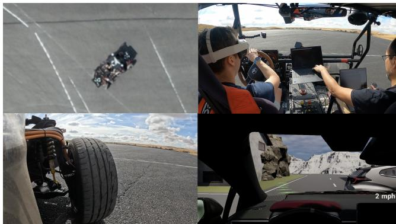  
Figure 3: The GRIP physical test platform used for immersive VRbased mixed sim/real testing.

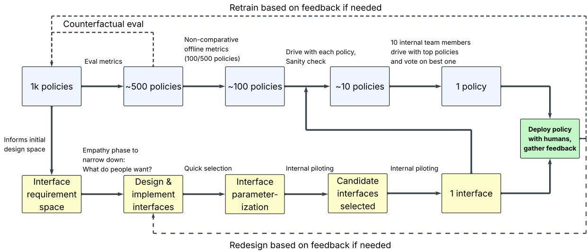  
Figure 4: Overall workflow diagram. Notice the combination of iterative refinement and selection of policy choices, as well as the iterative piloting of the overall policy and interface behavior.

## 4.2 Urban Domain

The urban domain represents a town-like setting with multiple traffic participants, designed to evaluate teaming under everyday hazards. Within the scenario, the ego driver encounters a wrong-way vehicle, a vehicle popping out of a driveway, and a roundabout with merging vehicles. The map is implemented in Unreal Engine and measures 70×70 m, dimensioned so the same scenario can also be deployed on physical test skid pads in East Palo Alto, CA and at Thunderhill Raceway. The intent space is richer than in racing: it combines lateral behaviors (pass on the left vs. right) with longitudinal behaviors (go vs. slow down). The reward structure supports the full product space $( \mathcal { V } = \{ \mathrm { l e f t , r i g h t } \} \times \{ \mathrm { g o , s l o w , s t o p } \}$ ; in the evaluations reported here, only the lateral intents were active (Y = {left, right}). Domain-specific reward terms are detailed in Appendix B. Compared to racing, the urban domain exercises the policy’s intent inference under both spatial and temporal ambiguity.

## 4.3 Simulator Infrastructure

Both domains run on a common stationary simulator setup. Each rig is outfitted with a Puget Systems workstation with an Intel Core i9 CPU, 128 GB of RAM, and two NVIDIA RTX A6000 Ada GPUs and 38-in monitor. For the studies, the racing domain used a Fanatec wheel; the urban domain and

GRIP used a Logitech G29 wheel. The racing environment is built in CARLA; and the urban environment is built in Unreal Engine, which additionally supports a virtual reality (VR) headset. Policy inference and trajectory/image logging are managed through the Robot Operating System (ROS) in all cases.

A key design choice concerns how control authority is shared between the driver and the policy at the hardware level. Steering is coupled: the road wheels always follow the steering wheel, and DREAM2ASSIST communicates its assistive input by applying torque to the steering column. The driver feels this torque and can comply with or override it at any time. Throttle and brakes are uncoupled: the policy can directly modulate pedal inputs without a corresponding physical force on the pedals and therefore the driver does not physically feel the longitudinal assistance. The interface design choices in Sec. 5 and Appendix B reflect this constraint.

## 4.4 GRIP Physical Platform

To assess transfer beyond the static simulator, we additionally deploy the urban domain on GRIP (Toyota Research Institute, 2024) (Fig. 3), a higher-fidelity physical test platform. Because GRIP’s emulated vehicle dynamics are identical to those used in simulation, only minimal parameter adjustments are required to compensate for differences in steering-wheel hardware. No retraining is performed when going from the simulator to GRIP.

## 5 Policy & Interface Design Process

Deploying a human-agnostic policy with real users requires going from a population of trained candidates to a single deployed system: both a policy and an interface that pairs with it. We approach this via two parallel iterative pipelines, summarized in Fig. 4, consisting of a policy down-selection pipeline that narrows a large pool of trained candidates to one, and an interface design pipeline that shapes how the chosen policy communicates with and acts on the driver. The term interface refers to any mechanism or modality used for communicating the policy’s decision to the human, for example, trajectory visualizations of future rollouts, steering wheel torque modulation to convey the strength of assistance etc. Interface design can involve multiple decisions, for example, gain parameters for the torque feedback, choice of trajectory visualization etc. Both pipelines share a common backbone of iterative refinement informed by piloting, and we treat the joint output as a contribution of this work.

Table 1: Overview of human-subjects studies. Each study used a specific system and interface configuration detailed in Table 2.
<table><tr><td>Study</td><td>N</td><td>Environment (map)</td><td>Comparison</td><td>Purpose</td></tr><tr><td>Eval 1: Racing characterization</td><td>24</td><td>CARLA (Thunderhill)</td><td>DREAM2ASSIST-assisted vs. unassisted driving</td><td>Characterize shared control interaction across track geometries; identify failure modes for targeted refinement</td></tr><tr><td>Eval 2: Racing refinement</td><td>6</td><td>CARLA (Thunderhill)</td><td>Refined vs. earlier configuration (within-subjects)</td><td>Validate that targeted refinements (data augmentation, output smoothing, reward restructuring) improved the interaction</td></tr><tr><td>Eval 3: Urban validation</td><td>10</td><td>Unreal Engine (CrazyTown)</td><td>Intent-conditioned vs. no-intent (double-blind A/B)</td><td>Controlled test isolating the contribution of intent conditioning with the complete DREAM2AsSIST framework</td></tr><tr><td>Physical platform (GRIP)</td><td>3</td><td>GRIP + VR Unreal (CrazyTown)</td><td>Intent-conditioned vs. no-intent</td><td>Feasibility demonstration of policy transfer to higher-fidelity motion platform; no retraining</td></tr></table>

The two pipelines are coupled. Interface design can be initiated against any candidate policy, but is refined as the policy field narrows; conversely, late-stage policy voting uses a near-final interface so that participants are reacting to the policy itself, not the display. We applied this full workflow in the urban domain, where the variety of everyday driving situations argues for diverse opinions and we used voting at the late stages of policy selection. In the more objectivedriven racing domain, we relied on offline metrics alone for the policy side and did not use voting.

## 5.1 Selection Spaces

Up to this point, candidate policies have only been evaluated against simulated humans under simulated conditions. To bridge to deployment, we apply a three-stage funnel that progressively trades evaluation cost for evaluation fidelity. Hyperparameter sweeps and random seeds typically yield on the order of 1K candidates; the funnel narrows this to a single deployed policy. Stage 1 reduces the number of policies to ∼500; Stage 2 to ∼100; Stage 3 human evaluation selects from 5–12 final policies.

Stage 1: Non-comparative offline metrics. Each candidate is scored on training-time statistics from fictitious coplay: task progress, average speed, collision rate, intentclassification accuracy, and intervention sparsity. Candidates falling below pre-set thresholds are eliminated. This stage is essentially free per candidate and absorbs the bulk of the field.

Stage 2: Counterfactual log-replay evaluation. Surviving policies are scored against log replays of real human drivers. For each logged human input sequence, we compute what would have happened with the candidate policy active (assisted) and compare to the original unassisted trajectory. Two metrics target deployment risks that are not visible in training statistics: collision propensity, the dot-product of the assistive steering and throttle vectors with the relative direction of ego and opponent vehicles when within a proximity threshold; and track-orthogonality, the perpendicularity of the assistive control vector with respect to the track direction, which captures the policy’s propensity to spin the driver out or off-track. Because these run against fixed logs, two or more policies can be compared on identical human inputs.

Stage 3: Human-in-the-loop evaluation. Stages 1–2 may still leave ∼100 candidates which are too numerous for a human study. We therefore run a two-round internal review in the simulator: in the first round, a single rater checks each surviving candidate against pre-defined pass/fail criteria in the second round, a different rater re-rates the remainder and selects forward. For the urban domain, we additionally run a vote among ten internal team members on the top survivors, using a near-final interface so voters respond to policy behavior rather than display differences.

## 5.2 Interface Design Process

In parallel with policy selection, we ran an iterative humanmachine-interface design cycle (Wickens et al., 2004; Mehrotra et al., 2022), which is standard in the HMI literature. Because learned policies are not guaranteed to be safe (Oh et al., 2025), the safety filter was applied to the trajectory visualization to ensure that displayed paths remain within safe bounds (Sec. 3.6). The workflow is shown in the bottom row of Fig. 4. We begin with an empathy phase that scopes the requirement space to define the kinds of cues, modalities, and timing drivers want from a shared controller. Candidate interface concepts are then implemented and parameterized (line color, line length, audio cue taxonomy, haptic gain) and run through repeated piloting sessions with both internal and external participants. Late in the cycle, surviving candidates are narrowed via a voting procedure with pilots, again paired with a near-final policy.

Table 2: Configuration reference for each study (see Table 1 for study overview). Sections III and IV describe all DREAM2ASSIST components in full generality; this table records which were active and how they were configured in each deployment. ✓ = active; ✗ = no used. In Eval 1, D2A refers to the configuration shown in the first row. D2A and D2A-Refined are used exclusively in Eval 2. D2A-Full, D2A-NoIntent, and No-policy are used exclusively in Eval 3 and GRIP.
<table><tr><td></td><td colspan="5">Policy Training Configuration</td><td colspan="3">Runtime / Interface Configuration</td></tr><tr><td>Study</td><td>Human data augmentation</td><td>FCP output Intent class rebalancing smoothing</td><td>Longitudinal</td><td>Reward + Intents</td><td>Iayer Safety</td><td>Trajectory visualization</td><td>Haptics mode</td><td>Output smoothing</td></tr><tr><td>Eval 1: Racing characterization (N=24)</td><td>X</td><td>X</td><td>x</td><td>Baseline task rewards (Appendix B); default pass/progress scalars. = {pass, stay}.</td><td>X</td><td>Line by proximity to opponent; color by accel/decel</td><td>Steering setpoint of human+policy; direct pedal blending</td><td>X</td></tr><tr><td>Eval 2: Racing refinement (N=6)</td><td>√(20%)</td><td>1</td><td></td><td>Augmented stay-behind and pass rewards ((12)–(14)). y = {pass, stay}.</td><td>X</td><td>Line by proximity to opponent; color by accel/decel</td><td>Steering setpoint of human+policy; direct pedal blending</td><td>X</td></tr><tr><td>Eval 3: Urban validation (N=10)</td><td>X</td><td></td><td></td><td>Refined collision, boundary, speed, proximity features, left/right passing rewards (Appendix B).</td><td>only)</td><td>(traj. viz. (alignment); color by accel/decel; windowed pedal blending smoothing</td><td>Line by policy actions Steering setpoint of human+policy; direct</td><td>J</td></tr><tr><td>GRIP platform (N=3)</td><td>X</td><td></td><td></td><td>As urban + longitudinal behaviors (stop/go rewards in Appendix B). y = {left, right} × {go, slow, stop}.</td><td>(traj. viz. only)</td><td>As urban validation</td><td>As urban; minimal parameter adjustment for platform hardware</td><td></td></tr></table>

Across piloting and formal evaluation sessions, participants offered open feedback on the relative salience of the two primary feedback channels. Visual trajectory cues were generally preferred for spatial guidance:

“I like the green line. It felt like a built-in GPS of some sort. I didn’t want to go in that exact direction, like when the car was pulling out, but liked how the steering wheel was nudging[. . . ] it was mapping out what I was doing, plus what’s good for me.” (P05)

While haptic feedback was valued for its immediacy, some participants found it intrusive at higher intensities:

“I liked the visuals better than the haptics, because the haptics were more startling and distracting.” (P06)

These observations are consistent with findings in the driving HMI literature, where visual cues are preferred for planning and spatial awareness while haptic cues are preferred for urgent, directional guidance (Ploch et al., 2017; Balachandran et al., 2016). We did not conduct a formal modality comparison study; the feedback above reflects informal observations that informed our interface tuning.

Table 16 lists the full set of factors considered, including those rejected during piloting (e.g., audio utterance cues), and Appendix B describes the surviving design choices in detail. The output of this cycle, together with the deployed policy

Table 3: Post-drive survey ratings for Eval 1 (N = 24), Likert 1–7 (Neutral = 4). One-sample t-tests against neutral (two-tailed, $d f \ = \ 2 3 )$ . ↑ higher is better; ↓ reverse-coded. \*\*\* p < .001; $^ { * * } p < . 0 1$ . Straight vs. turn breakdowns: intent recognition higher on straights $( p ~ = ~ . 0 0 1 )$ ; helpfulness above neutral on straights $( p = . 0 5 4 )$ but below on turns (p = .025); safety above neutral on straights (p < .001) but not turns (p = .057).
<table><tr><td rowspan="2">Question</td><td>Str.</td><td>Turn</td><td>All</td><td colspan="2">vs. Neutral</td></tr><tr><td> $M \pm S E$ </td><td> $M \pm S E$ </td><td>M ± SE</td><td>t(23)</td><td>p</td></tr><tr><td>AI knew my intent to pass ↑</td><td>5.49 ± .09</td><td> $5 . 0 9 \pm . 1 3$ </td><td>5.33 ± .08</td><td>10.63</td><td>&lt;.001***</td></tr><tr><td>AI helped me perform the</td><td>4.01 ± .13</td><td> $3 . 1 6 \pm . 1 4$ </td><td> $3 . 6 7 \pm . 1 0$ </td><td>0.44</td><td>.666</td></tr><tr><td>maneuver↑ AI&#x27;s action was safe ↑</td><td> $4 . 5 5 \pm . 1 1$ </td><td> $3 . 8 0 \pm . 1 4$ </td><td> $4 . 2 5 \pm . 0 9$ </td><td>3.60</td><td>.002**</td></tr><tr><td>Better off without AI↓</td><td> $4 . 8 2 \pm . 1 1$ </td><td> $5 . 1 2 \pm . 1 2$ </td><td> $4 . 9 4 \pm . 0 8$ </td><td>3.57</td><td>.002**</td></tr></table>

from Sec. 5 defines the joint system used in the human evaluations of Sec. 6. While we instantiate the proposed pipeline in terms of shared control for driving, the three-stage structure (automated screening, counterfactual replay, human-in-theloop vetting) applied more broadly to any domain where learned policies must be vetted before deployment with humans, e.g. manipulation, navigation, and assistive robotics.

## 6 Human Evaluations

We conducted three human-subjects studies and one preliminary on-vehicle deployment, as summarized in Table 1, with study-specific configurations in Table 2. The three studies build upon one another. Eval 1 (Racing Characterization) characterizes how DREAM2ASSIST performs against an unassisted baseline in the racing domain. Eval 2 (Racing Policy Refinement) validates targeted refinements (humandata augmentation, action smoothing, reward restructuring, safety filtering), on the same domain. It provides directional evidence that the refined configuration improved subjective ratings and turn-segment performance relative to the original configuration, though the sample (N=6) is underpowered for definitive claims. Eval 3 (Urban Controlled Validation) applies the refined framework to the urban domain, and runs a double-blind A/B comparison to isolate the contribution of intent conditioning. Lastly, we report a preliminary on-vehicle deployment of the urban scenario on the GRIP physical platform.

## 6.1 Common Methodology

The following procedures were applied across all three studies. Participants filled out an informed-consent form covering study risks (eye strain, motion sickness) before entering the simulator room. Internal participants were compensated with \$80 USD worth of company prizes (such as sweatshirts and tote bags); external participants received \$150 USD. Each study (except GRIP) ran on the simulator hardware, software stack, and ROS-based logging described in Sec. 4.3. Unless otherwise noted, subjective ratings were collected on 7-point Likert scales. In addition, participants provided an overall policy rating on a 1–10 scale reflecting their global impression of the AI’s assistance quality. Study-specific demographics, inclusion criteria, and procedural details are reported within each subsection. Additional details for Eval 1 and Eval 3 are reported in Appendix C. This study was conducted under the oversight of WCG IRB on behalf of Toyota Research Institute (IRB Tracking Number: 20232718, Study Number: 1356002). Informed consent was obtained from all participants prior to their participation.

## 6.2 Evaluation 1: Racing Characterization (N = 24)

Our goal is to characterize how DREAM2ASSIST interacts with human drivers across two qualitatively different track segments (straightaway and turn), and identify failure modes for targeted refinement. We hypothesized that the policy would improve overtake success and opponent clearance relative to an unassisted baseline. We recruited 33 participants $( N = 2 4$ after exclusions; see Appendix C for full demographics).

Study Design Within-subjects comparison of DREAM2ASSIST-assisted vs. unassisted driving in CARLA on the 2-mile West track at Thunderhill Raceway (see row 1 of Table 1). Familiarization consisted of one observation lap, five laps coached by the rule-based AI coach of Kaufman et al. (2024), and five laps without coaching. The main task was structured into eight overtake scenarios of increasing difficulty using a staircase approach (Cornsweet, 1962). Each block contained two follow laps (to observe opponent behavior) and two overtake-attempt laps between marked purple gates. Participants advanced to the next scenario only upon successful completion of the task (see Appendix C). Each scenario was completed both without and with the policy. A video montage of representative trials is included in the supplementary material (Video 1).

Measures Objective: Overtake rate, mean overtake speed, minimum opponent clearance, off-track rate, spinout rate, collision rate, lane-boundary distance, and torque-alignment events. Subjective: Per-policy 7-point Likert ratings on whether: (1) the AI knew my intent to pass, (2) the AI helped perform the maneuver, (3) the AI’s action was safe, and (4) I would have been better off without the AI. In addition, an overall 1–10 rating and open-ended qualitative feedback was collected after the driving session.

Objective Findings We tested six secondary safety metrics (spinout rate, off-track rate, collision rate, right-side pass rate, mean overtake speed, and minimum opponent clearance (Tables 4– 7). On the straight segments, DREAM2ASSIST increased per-participant overtake success from 80% to 89% $( p = . 0 6 9 , n = 2 3$ participants with trials in both conditions), increased overtake speed, and increased minimum opponent clearance. On turns, DREAM2ASSIST reduced per-participant overtake success from 51% to 21% $( p < . 0 0 1 , n = 2 3 )$ and reduced minimum opponent clearance from 1.99 m to 1.01 m (also significant).. Other safety metrics (spinouts, offtrack, collisions) showed no meaningful differences between conditions (Table 5). We identified, via inspection of the assistive control inputs, that over-steering by the policy on turns was the likely cause of the turn regression.

Table 4: Behavioral Outcomes by Track Type: D2A vs. No-policy (N = 24). Values are proportions pooled over trials; the paired tests in the text use per-participant proportions.
<table><tr><td>Outcome</td><td>Track</td><td>No-policy  $M \pm S E$ </td><td>D2A  $M \pm S E$ </td><td>∆</td></tr><tr><td rowspan="2">Overtake Rate ↑</td><td>Straight</td><td> $0 . 8 1 0 \pm . 0 3 4$ </td><td> ${ \bf 0 . 8 9 9 \pm . 0 2 7 }$ </td><td>+8.9%</td></tr><tr><td>Turn</td><td> $\mathbf { 0 . 5 4 7 \pm . 0 5 8 }$ </td><td> $0 . 2 7 4 \pm . 0 4 6$ </td><td>-27.3%</td></tr><tr><td rowspan="2">Spinout Rate ↓</td><td>Straight</td><td> $0 . 1 4 6 \pm . 0 3 0$ </td><td> ${ \bf 0 . 1 3 2 \pm . 0 3 0 }$ </td><td>-1.4%</td></tr><tr><td>Turn</td><td> $\mathbf { 0 . 2 9 3 \pm . 0 5 3 }$ </td><td> $0 . 3 2 6 \pm . 0 4 8$ </td><td>+3.3%</td></tr><tr><td rowspan="2">Off-Track Rate ↓</td><td>Straight</td><td> $0 . 0 7 3 \pm . 0 2 2$ </td><td> $\mathbf { 0 . 0 7 0 \pm . 0 2 3 }$ </td><td>-0.3%</td></tr><tr><td>Turn</td><td> ${ \bf 0 . 1 2 0 \pm . 0 3 8 }$ </td><td> $0 . 1 3 7 \pm . 0 3 5$ </td><td>+1.7%</td></tr><tr><td rowspan="2">Collision Rate ↓</td><td>Straight</td><td> $\mathbf { 0 . 0 1 5 \pm . 0 1 0 }$ </td><td> $0 . 0 2 3 \pm . 0 1 3$ </td><td>+0.9%</td></tr><tr><td>Turn</td><td> $\mathbf { 0 . 0 1 3 \pm . 0 1 3 }$ </td><td> $0 . 0 3 2 \pm . 0 1 8$ </td><td>+1.8%</td></tr><tr><td rowspan="2">Right-Side Pass</td><td>Straight</td><td> $0 . 2 2 3 \pm . 0 3 8$ </td><td> $0 . 3 4 4 \pm . 0 4 3$ </td><td>+12.1%</td></tr><tr><td>Turn</td><td> $0 . 7 3 5 \pm . 0 6 4$ </td><td> $0 . 7 5 6 \pm . 0 6 5$ </td><td>+2.1%</td></tr></table>

Subjective Findings Likert ratings (Fig. 3, Table 3, were analyzed through one-sample and paired t-tests, all of which were two-tailed, N = 24) showed that participants rated the policy as understanding their intent significantly above neutral overall $( M = 5 . 2 9 , t ( 2 3 ) = 1 0 . 6 3 , p < . 0 0 1 )$ , with ratings significantly higher on straights than turns $( t ( 2 3 ) = 3 . 6 8 ,$ $\begin{array} { r } { p \ = \ . 0 0 1 ) } \end{array}$ Perceived helpfulness did not differ from neutral overall $( M \ : = \ : 3 . 5 9 , \ : t ( 2 3 ) \ : = \ : 0 . 4 4 , \ : p \ : = \ : 0 . 6 6 6 ) ;$ straights trended above neutral $( M = 4 . 0 0 , t ( 2 3 ) = 2 . 0 4 ,$ $p = . 0 5 4 )$ , while turns fell significantly below $( M = 2 . 9 9 $ $t ( 2 3 ) = - 2 . 3 9 , p = . 0 2 5 )$ . Safety was rated significantly above neutral overall $( M = 4 . 1 0 , t ( 2 3 ) = 3 . 6 0 , p = . 0 0 2 )$ and on straights $( M = 4 . 4 1 , t ( 2 3 ) = 4 . 3 8 , p < . 0 0 1 )$ , though lower on turns $( M = 3 . 6 4 , t ( 2 3 ) = 3 . 5 7 , p = . 0 0 2 )$

Implications The policy is rated as understanding intent and as helpful and safe on straightaways, but degrades on turns due to a dynamics-complexity boundary. This motivates the targeted refinements evaluated in the next section.

Table 5: Overall Behavioral Outcomes: D2A vs. No-policy $( N =$ 24). Values are proportions pooled over trials; the paired tests in the text use per-participant proportions. Note that overall this initial policy inhibited the driver.
<table><tr><td>Outcome</td><td>No-policy  $M \pm S E$ </td><td>D2A  $M \pm S E$ </td><td> $\Delta$ </td></tr><tr><td>Overtake Rate ↑</td><td> $\mathbf { 0 . 7 2 1 \pm . 0 3 1 }$ </td><td> $0 . 6 3 0 \pm . 0 3 2$ </td><td> $- 9 . 0 \%$ </td></tr><tr><td>Spinout Rate ↓</td><td> ${ \bf 0 . 1 9 5 \pm . 0 2 7 }$ </td><td> $0 . 2 0 9 \pm . 0 2 7$ </td><td> $+ 1 . 3 \%$ </td></tr><tr><td>Off-Track Rate ↓</td><td> $\mathbf { 0 . 0 8 8 \pm . 0 1 9 }$ </td><td> $0 . 1 0 4 \pm . 0 2 0$ </td><td> $+ 1 . 6 \%$ </td></tr><tr><td>Collision Rate ↓</td><td> $\mathbf { 0 . 0 1 4 \pm . 0 0 8 }$ </td><td> $0 . 0 2 6 \pm . 0 1 1$ </td><td> $+ 1 . 2 \%$ </td></tr><tr><td>Right-Side Pass</td><td> $0 . 3 7 6 \pm . 0 3 7$ </td><td> $0 . 4 6 5 \pm . 0 3 8$ </td><td> $+ 8 . 9 \%$ </td></tr></table>

Table 6: Overtake Quality Metrics: D2A vs. No-policy (Overtaking Trials Only). Values are means $\pm \mathrm { S E }$ over overtaking trials.
<table><tr><td>Metric</td><td>No-policy  $M \pm S E$ </td><td>D2A  $M \pm S E$ </td><td> $\Delta$ </td></tr><tr><td>Mean Overtake Speed (m/s) ↑</td><td> ${ \bf 2 6 . 3 9 \pm . 2 9 }$ </td><td> $2 6 . 2 7 \pm . 2 8$ </td><td>-0.13</td></tr><tr><td>Min Opp. Clearance (m) ↑</td><td> $1 . 6 2 \pm . 1 0$ </td><td> ${ \bf 1 . 7 7 \pm . 4 8 }$ </td><td>+0.14</td></tr></table>

## 6.3 Evaluation 2: Racing Policy Refinement (N = 6)

The goal for this evaluation is to validate that the refinements introduced after Eval 1, i.e. human-data augmentation, output smoothing, and reward restructuring, improve the interaction over the original DREAM2ASSIST configuration, with focus on turns. As a within-subjects pilot, this study targets directional trends rather than statistical significance. The reward changes targeted the pass/stay formulation specifically: asymmetric scaling of pass vs. stay rewards and a bounded progress term to prevent mode collapse toward always-passing behavior ((12)–(14), Appendix B). The intent space remained $\mathcal { Y } = \{ \mathrm { p a s s } , \mathrm { s t a y } \}$ . For this study, we recruited N = 6 internal participants.

Study Design Within-subjects comparison of D2A-Refined against D2A on the racing domain (see row 2 of Table 1). The procedure was a shorter version of Eval 1,

Table 7: Overtake Quality Metrics by Track Type: D2A vs. Nopolicy (Overtaking Trials Only)
<table><tr><td>Metric</td><td>Track</td><td>No-policy  $M \overset { \cdot } { \pm } S \overset { \cdot } { E }$ </td><td>D2A  $M \pm S E$ </td><td>∆</td></tr><tr><td rowspan="2">Mean O/T Speed (m/s) ↑</td><td>Straight</td><td> ${ \bf 2 7 . 8 9 \pm . 2 2 }$ </td><td> $2 7 . 4 4 \pm . 2 2 - 0 . 4 6$ </td><td></td></tr><tr><td>Turn</td><td> ${ \bf 2 2 . 6 7 \pm . 5 1 }$ </td><td> $2 1 . 0 6 \pm . 3 6 - 1 . 6 2$ </td><td></td></tr><tr><td rowspan="2">Min Opp. Clearance (m) ↑</td><td>Straight</td><td> $1 . 5 0 \pm . 1 1$ </td><td> $\mathbf { 1 . 9 7 \pm . 5 9 } \ \mathrm { ~ + 0 . 4 7 }$ </td><td></td></tr><tr><td>Turn</td><td> ${ \bf 1 . 9 9 \pm . 2 1 }$ </td><td> $1 . 0 1 \pm . 2 2 - 0 . 9 8$ </td><td></td></tr></table>

retaining the staircase scenarios. Each participant drove every scenario with each policy.

Measures Objective measures matched Eval 1. Subjective measures included per-policy Likert ratings of likability and helpfulness, plus per-trial preference (which policy was preferred for each scenario) and open-ended likes/dislikes.

Objective Findings We examine whether the four refinements reduced the excessive steering torque on turns that we identify as the primary failure mode in Eval 1. Figure 5 shows the torque-magnitude difference ∆τ (10) for each condition. Under both configurations, the policy applied more intentopposing than intent-aligned steering on average, consistent with the over-steering failure mode on turns. Under D2A-Refined, intent-opposing steering decreased slightly (31.2 to 29.6 deg) and the aligned-minus-opposing difference rose from −10.1 to −5.6 deg, higher for 3 of 5 participants (P106 excluded: missing D2A-Refined steering data). Consistent with the pilot’s aim of directional trends, neither change is significant at this sample size (paired t-tests, $p = . 6 8$ and $p = . 2 8 , n = 5 )$ , which we take as directional evidence that action smoothing and reward restructuring reduced the policy’s tendency to fight the driver.

Averaged AI steering traces time-aligned to overtake onset (Fig. 6) differ most on turns: in the 4–3 s before the overtake, D2A applies roughly twice the steering magnitude of D2A-Refined (about 50 vs. 25 deg), consistent with the oversteering that characterized D2A. The traces show raw signed steering, so they do not by themselves separate intent-aligned from intent-opposing input.

Subjective Findings Likability was numerically higher for D2A-Refined $( M = 3 . 3 1 , S E = 0 . 3 9 )$ than for D2A (M = 2.95, SE = 0.42). Helpfulness ratings were comparable across versions (refined: $M = 2 . 8 5 , S E = 0 . 2 0 ; t ( 5 ) =$ −0.15, p = .887, d = −0.06; initial: $M = 2 . 8 0 , S E =$ 0.33). At the trial level (N = 27 trials, using a two-sided binomial test), participants preferred D2A-Refined on 59.3% of trials (16 of 27), compared to 40.7% for the characterization policy (11 of 27), with $p = 0 . 4 4 2 .$ . Preference did not favor turns: D2A-Refined was preferred on 8 of 14 turn trials (57%) and 8 of 13 straight trials (62%) (Fig. 7). Likability was numerically higher for D2A-Refined (Table 8), consistent with the refinements targeting the turn-specific failure mode identified in Eval 1.

Implications The pilot supports a directional improvement attributable to the refinements, particularly on turns. Comparing turns in Eval 1, the original policy had learned human dynamics associated with fictitious human partners, which tended to steer more aggressively with higher repeatability in turns than true humans. We hypothesize that the simulated humans had higher repeatability on turns than real humans, so the world model learned overly aggressive turn dynamics. This caused excessive steering over-compensation just before the turn, which degraded safety and overtake success. Human data augmentation exposed the world model to more in-distribution human behaviors, reducing the domain gap in terms of dynamics of the human partner. The additional reward restructuring penalized mode collapse to a single intent, thereby allowing the policy to distinguish between intents especially in turns where intent is ambiguous. Together, these allowed the policy to steer less aggressively in dynamicallycomplex conditions, which may explain the higher likability

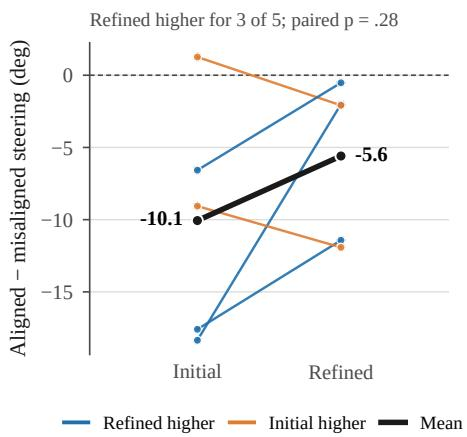  
Figure 5: Aligned minus misaligned AI steering per participant under D2A and D2A-Refined (n = 5; P106 excluded for missing steering data). Higher values mean more steering in the driver’s intended direction. Thin lines are participants, the thick line the mean; paired t-test $p = . 2 8$

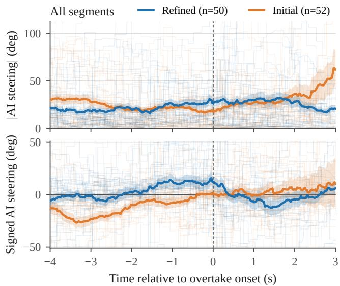  
Figure 6: AI steering around overtake onset (t = 0), all participants and segments (D2A: 52 passing events; D2A-Refined: 50). Top: steering magnitude. Bottom: signed steering. Lines show mean ± SEM; individual events dimmed.

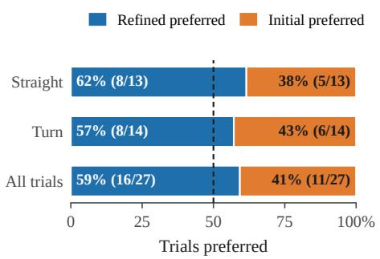  
Figure 7: Policy preferences between the initial vs. updated policy faceted by position where the overtake occurred.

of D2A-Refined.

With the racing domain validated, Eval 3 adopts a qualitatively different domain (urban driving with a richer intent space) to test generalization and the contribution of intentconditioning specifically.

## 6.4 Evaluation 3: Urban Controlled Validation (N = 10)

The goal of this evaluation is to isolate the contribution of intent conditioning by comparing the full DREAM2ASSIST framework (D2A-Full) against an ablated version without an intent predictor (D2A-NoIntent) in an urban setting. An additional No-policy condition serves as an unassisted baseline. We hypothesized that intent-conditioning would produce greater torque alignment with each driver’s lateral pass choice (to go left or right around an oncoming car) and reduce collisions. D2A-Full incorporates all refinements from D2A-Refined plus intent-class rebalancing and refined proximity features adapted to the urban domain (Table 2, row 3). The intent space for this evaluation was $\mathcal { V } = \{ { \mathrm { l e f t } } , { \mathrm { r i g h t } } \}$ : the policy has to infer whether the driver intended to pass the hazard on the left or right, to shape its assistance accordingly. Left/right reward terms penalize lateral positions inconsistent with the inferred intent (Appendix B). D2A-NoIntent uses the same task rewards and policy architecture but without the intent predictor, so its assistance is not conditioned on the driver’s choice of lateral direction. For this study, we recruited 12 participants (N = 10 after exclusions; see Appendix C for full demographics).

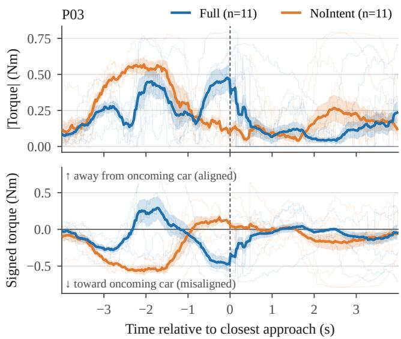  
Figure 8: Averaged torque traces for participant 03 in the oncoming car event. About 2.3 to 1.5 s before closest approach (t = 0), D2A-Full steers away from the oncoming car, in line with the driver’s avoidance, while D2A-NoIntent steers toward it (bottom trace). In the final second the pattern reverses: D2A-Full turns toward the car and D2A-NoIntent is near neutral.

Study Design We conducted a double-blind within-subjects A/B comparison of D2A-Full vs. D2A-NoIntent, with an additional No-policy condition (see row 3 of Table 1). The simulator was outfitted with a G29 wheel and the policy communication was via ROS. Since the study only examined lateral behaviors, we include two opponent-vehicle scenarios: a vehicle backing out of a driveway, and a wrong-way oncoming vehicle. After familiarization (four town-map laps and practice with the two scenarios), participants completed a three-phase policy onboarding (haptics-only, trajectory-only, combined) with verbal comprehension checks before advancing. Each participant then drove six laps with each of the three conditions in randomized order, alternating left and right passes around the oncoming car each lap. Surveys were administered between blocks. A video montage illustrating the D2A-Full condition is provided in the supplementary material (Video 2).

Measures Objective: Torque-alignment events (overall and per-participant) Eq. (11), torque-magnitude difference (good vs. bad alignment) Eq. (10), and collision rate. Subjective: Per-policy Likert ratings on directionality, timing, adapting direction, fight direction, safety, teaming, and an overall 1–10 rating. Objective torque analyses use all 12 sessions (11 with both AI conditions, since no D2A-NoIntent trials were logged for P04); subjective analyses exclude P04 and P12.

Objective Findings We find that D2A-Full outperformed D2A-NoIntent on overall torque alignment, with D2A-Full higher for 8 of the 11 participants who drove both conditions (Fig. 9a; 215 vs. 141 events over all 12 sessions, +52%; P04 has no D2A-NoIntent trials). Collision rates were lower under D2A-Full (2.7%, 4 of 147 trials) than D2A-NoIntent (7.7%, 10 of 130 trials); the No-policy baseline had 1.7% (2 of 121). Collisions occurred for four of the ten participants, and one (P08) accounts for 8 of the 16.

Subjective Findings Across the seven Likert dimensions, paired t-tests showed no significant differences between D2A-Full and D2A-NoIntent (see Table 9, all $p > 0 . 3 )$ . Perparticipant overall ratings (Table 10) showed high variance in individual differences: five participants rated the intent-aware policy higher and five rated the non-intent-aware policy higher. Mean overall ratings were nearly identical across conditions (D2A-Full M = 6.05, D2A-NoIntent $M = 6 . 1 8 )$

Despite the absence of significant rating differences, participants consistently distinguished the two policies in openended feedback. Participants described the intent-conditioned policy as collaborative and the no-intent policy as overriding:

Table 8: Subjective ratings: D2A vs. D2A-Refined $( N = 6 )$ . Likert 1–7. Paired t-tests $( d f = 5 )$ . This pilot targeted directional trends rather than statistical significance. Five out of six participants rated D2A-Refined to be higher on likability.
<table><tr><td>Metric</td><td>D2A  $M \pm S E$ </td><td>D2A-Refined  $M \pm S E$ </td><td>∆</td><td>p</td></tr><tr><td>Likability ↑</td><td> $2 . 9 5 \pm . 4 2$ </td><td> $3 . 3 1 \pm . 3 9$ </td><td> $+ . 3 6$ </td><td>.108</td></tr><tr><td>Helpfulness ↑</td><td> $2 . 8 0 \pm . 3 3$ </td><td> $2 . 8 5 \pm . 2 0$ </td><td>+.05 .887</td><td></td></tr></table>

“[D2A-NoIntent] felt like a captain with too much pushback on the wheel, while [D2A-Full] felt like a copilot helping me out rather than forcing decisions. [D2A-NoIntent] decided which direction I was going[. . . ] [D2A-Full] showed me the way, but if I switched, it would push back only a little.” (P08)

“[D2A-Full] had the smoothest ride, and less crashes.” (P05)

Nonetheless, not all participants agreed: one preferred how the no-intent policy behaved after it corrected to intent:

“[D2A-NoIntent] was better. After it corrected to where I was going, I liked it better than [D2A-Full]. I had to fight with it less.” (P01)

For this participant, directional consistency (alignment) was less valued than firm corrective intervention, suggesting that individual differences in preferred autonomy level may explain the alignment-preference relationship.

Implications The results indicate that intent-conditioning yields a measurable objective improvement (alignment, collisions) but a divided subjective response with strong individual differences in policy preference. We also observe that the AI increases collisions, which is likely due to a combination of risk compensation and residual policy errors in close-proximity situations, since participants tended to drive more aggressively when assisted. Disentangling behavioral adaptation from policy-induced risk is an important direction for future work. This disconnect between objective and subjective findings is taken up in Sec. 7.

## 6.5 Preliminary On-Vehicle Deployment $( N =$ 3)

To assess transfer beyond the static simulator, we deployed the urban scenario on the GRIP physical test platform (Toyota Research Institute, 2024) with three internal participants (see row 4 of Table 1). Because GRIP’s emulated dynamics are sufficiently similar at the low speeds and high-friction conditions to those used in simulation, only minimal parameter adjustments were required to compensate for steering-wheel hardware differences; no retraining was performed. We frame this as a feasibility demonstration of platform transfer rather than a formal evaluation, deferring quantitative on-vehicle evaluation to future work.

(a) Overall torque alignment counts.  
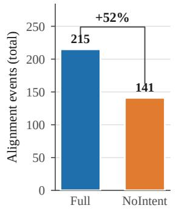

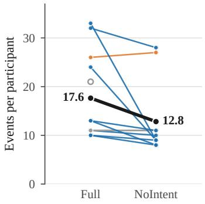

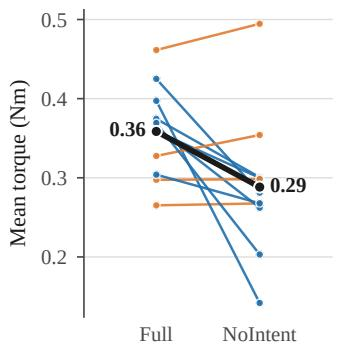  
(b) Torque magnitude statistics.

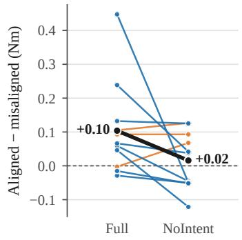  
(c) Torque magnitude difference.  
Figure 9: (a) Overall torque alignment counts, (b) torque magnitude, as defined in Eq. (9), and (c) aligned torque, as defined in Eq. (10) for the oncoming car event, where each point represents one participant. Higher values indicate a higher average torque in alignment with the driver’s intent to pass left or right around the oncoming car. Lines connect each participant’s two conditions. Panel (a) counts all 12 sessions: P04, drawn hollow, has no D2A-NoIntent trials, and P12, excluded from the subjective analysis, is included. D2A-Full had more alignment events for 8 participants, tied for 2 and fewer for 1. Of the 11 participants with both conditions, 7 received higher overall torque under D2A-Full (b) and 8 experienced more intent-aligned torque (c).

Table 9: Paired comparison of subjective ratings: D2A-Full vs. D2A-NoIntent $( N = 1 0 )$ . Likert 1–7; Overall Rating 1–10. Twotailed paired t-tests $( d f = 9 ) ;$ none reached significance. ↑ higher is better; ↓ lower is better (less resistance from AI). Participants qualitatively distinguished the two policies despite non-significant ratings (Sec. 6.4).
<table><tr><td>Metric</td><td>D2A-Full  $M \pm S E$ </td><td>D2A-NoIntent  $M \pm S E$ </td><td>∆</td><td> $p$ </td></tr><tr><td>Directionality ↑</td><td> $4 . 9 2 \pm . 3 2$ </td><td> $4 . 6 5 \pm . 2 9$ </td><td>+.27</td><td>.528</td></tr><tr><td>Timing ↑</td><td> $5 . 1 0 \pm . 1 7$ </td><td> $5 . 0 5 \pm . 3 0$ </td><td>+.05</td><td>.891</td></tr><tr><td>Adapting Dir. ↑</td><td> $4 . 9 0 \pm . 3 6$ </td><td> $4 . 5 5 \pm . 3 3$ </td><td>+.35</td><td>.368</td></tr><tr><td>Fight Dir. ↓</td><td> $3 . 6 2 \pm . 4 8$ </td><td> $3 . 6 2 \pm . 2 7$ </td><td>+.00</td><td>1.00</td></tr><tr><td>Safety↑</td><td> $4 . 3 8 \pm . 4 0 $ </td><td> $4 . 4 5 \pm . 2 3$ </td><td>-.07</td><td>.870</td></tr><tr><td>Teaming ↑</td><td> $4 . 5 8 \pm . 3 9$ </td><td> $4 . 8 8 \pm . 3 8 $ </td><td>-.30</td><td>.313</td></tr><tr><td>Overall Rating ↑</td><td> $6 . 0 5 \pm . 4 0$ </td><td> $6 . 1 8 \pm . 3 9$ </td><td>-.13</td><td>.823</td></tr></table>

The GRIP deployment used the same policy weights and intent space as Eval $3 \ ( \mathcal { V } = \ \{ \mathrm { l e f t } , \mathrm { r i g h t } \} )$ , with the same reward terms and safety layer (Table 2, row 4). Unlike the desktop simulator, GRIP renders the driving scene in VR and communicates the policy’s assistive steering torque through the platform’s force-feedback hardware, so the driver physically experiences the shared control interaction. We include three opponent-vehicle scenarios: a vehicle backing out of a driveway, a wrong-way oncoming vehicle, and a roundaboutapproach scenario.

In the oncoming vehicle scenario (Fig. 10, top), a vehicle is seen to be moving toward the ego vehicle down the center lane. The policy infers the driver’s lateral avoidance direction and applies assistive steering torque accordingly, guiding the vehicle around the hazard while maintaining speed (13– 14 mph). The interaction mirrors the lateral coordination observed in the simulator-based urban evaluation (Eval 3), with the added realism that the driver feels the assistive torque through force-feedback on the wheel.

Table 10: Per-Participant Overall Ratings: D2A-Full vs. D2A-NoIntent. Overall Rating on a 1-10 scale; values averaged across trials.
<table><tr><td>Participant</td><td>D2A-Full</td><td>D2A-NoIntent</td><td> $\Delta$ </td></tr><tr><td>P01</td><td>5.75</td><td>4.00</td><td>+1.75</td></tr><tr><td>P02</td><td>4.75</td><td>5.75</td><td>-1.00</td></tr><tr><td>P03</td><td>7.50</td><td>4.75</td><td>+2.75</td></tr><tr><td>P05</td><td>7.25</td><td>6.50</td><td>+0.75</td></tr><tr><td>P06</td><td>5.50</td><td>6.50</td><td>-1.00</td></tr><tr><td>P07</td><td>5.75</td><td>8.25</td><td>-2.50</td></tr><tr><td>P08</td><td>6.25</td><td>7.25</td><td>-1.00</td></tr><tr><td>P09</td><td>3.50</td><td>5.75</td><td>-2.25</td></tr><tr><td>P10</td><td>7.25</td><td>7.00</td><td>+0.25</td></tr><tr><td>P11</td><td>7.00</td><td>6.00</td><td>+1.00</td></tr><tr><td>Mean</td><td>6.05</td><td>6.18</td><td>-0.13</td></tr></table>

Participants 4 and 12 excluded (data quality / motion sickness).

In the roundabout-approach scenario (Fig. 10, bottom), the ego vehicle approaches a roundabout entry with a crossing vehicle. In the trial shown, the vehicle decelerates from 9 to 4 mph as the hazard approaches. This longitudinal behavior emerges from the task-level collision and progress rewards rather than from an explicit longitudinal intent; the policy learns to slow when the world model predicts an imminent conflict. On GRIP, the driver perceives deceleration through the platform’s physical motion cues, allowing the driver to physically feel the effects of longitudinal intervention.

Together, these scenarios demonstrate that the learned policy transfers to physical hardware and produces qualitatively appropriate assistance without retraining, supporting the feasibility of sim-to-real deployment for shared control. A video demonstrating the GRIP deployment is available in the supplementary material (Video 3).

## 7 Discussion

We observe that, before any refinements, DREAM2ASSIST results perform best on relatively simple, straight sections of the environment (Eval 1), while required iterations via targeted refinements to improve dynamically challenging areas, such as turn sections (Eval 2). The improvements generally helped achieve fuller knowledge of the system’s subjective and objective performance in richer environments (Eval 3). Each evaluation informed the construction of a different portion of the proposed workflow in Fig. 4.

This progression followed a particular design and selection methodology. Eval 1 established that the shared-control paradigm works in a constrained setting and identified specific failure mode (over-steering on turns) that motivated targeted refinements. Eval 2 confirmed that those refinements improved the interaction in a within-subjects comparison, providing directional evidence with a focused sample. Eval 3 deployed the complete framework in a qualitatively different domain under the strongest experimental design (double-blind A/B), yielding the most controlled evidence for intent conditioning.

## 7.1 Intent Conditioning Improves Human-Robot Coordination

A common result that all three evaluations revealed was that conditioning the assistive policy on intent results in improved physical alignment and improved perception of coordination. In Eval 1, DREAM2ASSIST was directionally consistent with driver intent in turns, and DREAM2ASSIST improved overtake success on straightaways from 80% to 88% relative to unassisted driving. Participants rated the policy as understanding their intent significantly above neutral $( M = 5 . 2 9 , p < . 0 0 1 )$ In Eval 2, these results extended to turns. In Eval 3, D2A-Full produced 52% more torque-alignment events across all 12 sessions, and more events for 8 of the 11 participants who drove both conditions. Collision rates were also lower under D2A-Full (2.7%) than D2A-NoIntent (7.7%), though the counts are small and one participant accounts for half of all collisions.

The results validate that extending the RSSM to include an intent predictor on the assistant’s latent state, and shaping the assistive reward based on the inferred intent, produces policies that steer with the human rather than merely completing the task. We confirm that the value-aligned combination of task completion, intervention sparsity and expert alignment causes this directional consistency. We find that, without the intent predictor, the policy still assists, but bases the assistance on task objectives alone, leading to higher collision rates and qualitatively different interaction dynamics (Sec. 6.4).

## 7.2 Bridging the Sim-to-Real Human Gap

One challenge a system trained with synthetic human partners faces is the gap in simulated and real human behavior (the “sim-to-real-human gap”). FCP agents produce a diversity of skill levels, propensity for certain discrete behaviors, and noisy behaviors, but can miss certain behaviors such as hesitation, jitter, non-stationary and closed-loop behaviors such as fighting. A world model trained exclusively on these synthetic partners learns to expect smoother, more predictable behavior than what it encounters at deployment.

Eval 1 → Eval 2 illustrate how this gap manifests and outline how it can be corrected. Qualitative results of DREAM2ASSIST in turns revealed that the intent predictor was not the problem since participants rated intent recognition above neutral even on turns, but was rather due to excessive steering torque that reduced overtake success from 54% to 27%. We can thus attribute to the fact that the policy had learned control dynamics calibrated to synthetic partners that behaved differently from real drivers in such a dynamically complex situation.

We therefore introduced targeted refinements, including human-data augmentation (20% of the replay buffer replaced with real human driving data), FCP output smoothing to suppress unrealistic jitter, and reward restructuring to penalize mode collapse. The result was a directional improvement in D2A-Refined over D2A in 59% of trials, with the largest gains on turns.

The results suggest two general principles. First, we have evidence that supports that sim-to-real-human gap can be mitigated in simulation-based training by mixing a modest proportion of real human data into the training buffer, which grounds the world model in realistic dynamics, and smoothing synthetic policy outputs reduces the distributional mismatch at the action level. Second, separating intent-inference phenomena from policy-execution phenomena can accelerate correct diagnosis of causes. When objective alignment (enforced through priming human subjects) is high but task performance is poor, the remedy is at the policy level (control quality, reward shaping, safety constraints). When alignment itself is low, the world model or intent predictor could be blameworthy. Our two-level diagnostic is applicable to any architecture that infers latent human objectives and acts on them. We have shown success disentangling such concerns in cases where human evaluation is expensive via a mixture of counterfactual evaluation (offline-replaying logged human control inputs against candidate policies and evaluating), and targeted online human-in-the-loop experiments.

## 7.3 Structured Pipeline for Deploying Learned Interactive Policies

Our proposed policy selection pipeline addresses a practical gap that extends beyond shared driving. Learned policies that perform well against simulated partners may behave poorly with real humans, but exhaustive human evaluation is prohibitive at scale. Currently, no automated metric can fully-capture such qualitative considerations. Hence, we first generate offline metrics to eliminate the bulk of candidates at a negligible per-candidate cost, followed by counterfactual replay to evaluate survivors against recorded human behavior without requiring new participants, and lastly evaluate human-in-the-loop vetting to provide qualitative signal.

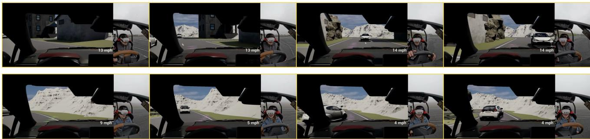  
Figure 10: Two examples from GRIP experiments: an oncoming car scenario where lateral assistance can be observed (top) and a roundabout-approach scenario where longitudinal assistance is observed (bottom).

We posit that such a structure is relevant to robotics applications. Vision-language-action (VLA) models and languageconditioned manipulation policies face similar scalability problems (Venuto et al., 2024). The explicit human quality checks fill a gap that we argue will become important when a human-based vetting procedure becomes a practical necessity.

The coupled interface design pipeline (lower row of Fig. 4) additionally serves a complementary role where interfacerelated considerations can be vetted independently of checking policy quality considerations to avoid a dependency of one on the other. We observe that such a separation can be transferrable to other domains where a deployed policy consists of a human-facing component (e.g. LLMs, VLAs).

## 7.4 Evaluation Insights: Objective Alignment vs. Subjective Preference

A common finding across all three divergence between objective torque alignment and subjective preference. In Eval 3, intent-conditioned DREAM2ASSIST produced 52% more torque-alignment events than the no-intent baseline, yet perparticipant overall ratings showed no significant difference. In Eval 1, participants rated the policy as understanding their intent on straightaway, but not on turns, even though the policy was intent-conditioned in both conditions. This asymmetry suggests that alignment and preference measure different constructs. Torque alignment captures whether the AI’s applied control is directionally consistent with the human’s steering input. The asymmetry suggests that alignment and preference measure different constructs. Subjective ratings measure retrospective judgments based on specific moments. Participants notice when the AI opposes them (oversteering in Eval 1, Sec. 6.2, and “captain” feelings from Eval 3, Sec. 6.4), but sometimes do not notice when it supports them as a wellaligned assistance feels like unassisted driving. On the other hand, torque alignment captures whether the AI’s applied control is directionally consistent with the human’s steering input aggregated over a trial. Qualitative feedback from Eval 3 supports this interpretation.

This finding parallels observations in the haptic sharedcontrol literature. Abbink et al. (2018) show that continuous haptic guidance is most effective when it is seamless, i.e., when the driver does not consciously perceive the assistance, and Mulder et al. (2012) show that seamless haptic support improves lane-keeping performance without changing drivers’ subjective workload ratings. Our data extend these findings to a learning-based, intent-conditioned setting: the world model enables the AI to provide directionally consistent assistance that improves an objective alignment metric while remaining perceptually invisible under normal conditions.

## 7.5 Generalization Across Domains and Platforms

We examine the efficacy of DREAM2ASSIST across racing and urban scenarios across multiple fidelities of application - from simulators to GRIP - with longitudinal effects, without structural changes. We also show that the utility of the RSSM-based intent conditioning helps regardless of domain. The preliminary results in GRIP demonstrate that the learned policy transfers from simulation to physical platform without retraining with minimal parameter adjustment, and demonstrate viability in a physical driving setting where the human experiences the forces of the interaction, including those provided by longitudinal assistance.

## 7.6 Limitations and Future Work

We note that the three formal evaluations $( N = 2 4 , N = 6$ N = 10) demonstrate directional effects on alignment and task performance but are underpowered for definitive claims about subjective preference. A larger sample in Eval 3 might reveal some significant trends on preference effects.

Note that in the human studies, the safety filter was applied only to the trajectory visualization and did not modify the assistive torque, ensuring the displayed path remained within safe bounds. In the four Eval 3 sessions with collision logging, both AI conditions produced higher collision rates than the No-policy baseline (D2A-Full: 2.7%, D2A-NoIntent: 7.7%, No-policy: 1.7%). The collision rate differences therefore reflect the learned policy’s behavior and the driver’s response to it, not the safety filter’s intervention. Intent conditioning reduces collisions relative to no-intent AI, but the increase relative to unassisted driving warrants investigation. One hypothesis is that participants may drive more aggressively when assisted or rely on the AI to manage proximity, expecting the system to compensate for risk. Understanding how actual policy-induced collisions arise from behavioral adaptation is a promising future direction.

During training, our framework assumes a fixed intent label for each FCP episode. At deployment, the intent predictor updates at every timestep and can track changes in driver behavior; however, because transitions were not explicitly modeled during training, the predictor may lag during rapid intent switches (this lag was studied in DeCastro et al. (2025)). To further improve responsiveness, incorporating explicit intent-transition modeling is a direction for future work.

Preliminary testing on GRIP with three internal participants confirmed that the integration pipeline generalizes to physical hardware, but surfaced new challenges. Participants reported that the early longitudinal policy felt more intrusive on the motion platform than lateral assistance, likely because the driver physically experiences deceleration forces that are absent in the desktop simulator. Tuning the haptic channel for longitudinal behaviors and conducting a formal on-vehicle evaluation remain natural future extensions.

To address the limitations, three promising directions emerge: exploring language-based assistance, where the policy plans with language and physical assistive actions; training with awareness of misalignment between the human’s intent and the robot’s actions, rather than maximizing alignment alone; and exploring larger-scale studies with real vehicles to validate the results in physical settings.

## 8 Conclusion

We have presented DREAM2ASSIST, an intent-conditioned world model for shared control that infers a human partner’s discrete objectives from observed behavior and conditions its assistive policy accordingly. Extending the recurrent statespace model with an intent predictor and a value-aligned reward structure, the framework produces policies that steer with the human’s objective rather than merely completing the task.

We report results of three human-subjects evaluations across two qualitatively distinct domains: high-speed racing and surprise-rich urban driving, and demonstrate that intent conditioning yields measurable improvements in humanrobot coordination. In the double-blind urban evaluation, the intent conditioning produced 52% more torque-alignment events and fewer collisions (2.7% vs. 7.7% of trials) than a non-intent-conditioned baseline, and fewer collisions in the sessions where collisions were logged, and showed transferability to a physical motion platform with no retraining. The racing evaluations established initial feasibility, highlighted areas for refinement to address the sim-to-real-human gap in policies trained with synthetic partners.

Beyond the algorithmic validation, we also contribute a structured deployment pipeline for deploying policies in human-centric domains, that spans automated policy screening from counterfactual log replay to human-in-the-loop testing. A coupled interface-design process ensures that the communication channel between the policy and the driver is resolved before policy quality is formally evaluated. We believe this pipeline generalizes to any domain where learned policies must be vetted before deployment with human partners.

There are several areas for further exploration. The fixedintent assumption limits applicability to scenarios where the human’s objective is stable within an episode; supporting online intent transitions is a natural extension. The individual differences in preferred autonomy level observed across participants motivate adaptive policies that modulate intervention style per driver. And while the GRIP deployment demonstrates feasibility of platform transfer, a powered onvehicle study is needed to substantiate claims about real-world deployment.

## Ethical Considerations

## Ethical approval

This research was conducted under the oversight of WCG IRB on behalf of Toyota Research Institute (IRB Tracking Number: 20232718, Study Number: 1356002).

## Informed consent

All participants provided written informed consent prior to participation, covering inclusion in the study, collection and use of data, and publication of anonymized results.

## Declaration of conflicting interests

The author(s) declared no potential conflicts of interest with respect to the research, authorship, and/or publication of this article.

## Funding

The author(s) disclosed receipt of the following financial support for the research, authorship, and/or publication of this article: This work was supported by the Toyota Research Institute.

## Supplemental material

Supplementary videos accompany this article:

• Video 1: Montage of representative trials from Evaluation 1 (Racing Characterization).

• Video 2: Montage of representative trials from Evaluation 3 (Urban Controlled Validation), showing the D2A-Full condition.

• Video 3: Demonstration of the GRIP physical platform deployment.

## References

David A Abbink, Tom Carlson, Mark Mulder, Joost C F de Winter, Farzad Aminravan, Tricia L Gibo, and Erwin R

Boer. A topology of shared control systems—finding common ground in diversity. IEEE Transactions on Human-Machine Systems, 48(5):509–525, October 2018.

Henny Admoni and Brian Scassellati. Social eye gaze in human-robot interaction: a review. Journal of Human-Robot Interaction, 6(1):25–63, 2017.

Neziha Akalin and Amy Loutfi. Reinforcement learning approaches in social robotics. Sensors, 21(4):1292, 2021.

Deike Albers, Jonas Radlmayr, Alexandra Loew, Sebastian Hergeth, Frederik Naujoks, Andreas Keinath, and Klaus Bengler. Usability evaluation—advances in experimental design in the context of automated driving human–machine interfaces. Information, 11(5):240, 2020.

Eugen Altendorf, Marcel Baltzer, Matthias Heesen, Martin Kienle, Thomas Weißgerber, and Frank Flemisch. H-mode, a haptic-multimodal interaction concept for cooperative guidance and control of partially and highly automated vehicles. In Handbook ofDriver Assistance Systems. Springer, Berlin, 2015.

Avinash Balachandran, Matthew Brown, Stephen M Erlien, and J Christian Gerdes. Predictive haptic feedback for obstacle avoidance based on model predictive control. IEEE Trans. Autom. Sci. Eng., 13(1):26–31, January 2016.

Amir Benloucif, Anh-Tu Nguyen, Chouki Sentouh, and Jean-Christophe Popieul. Cooperative trajectory planning for haptic shared control between driver and automation in highway driving. IEEE Transactions on Industrial Electronics, 66(12):9846–9857, 2019.

Carrie G Bobier and J Christian Gerdes. Staying within the nullcline boundary for vehicle envelope control using a sliding surface. Veh. Syst. Dyn., 51(2):199–217, February 2013.

Carrie G Bobier, Shinichiro Joe, and J Christian Gerdes. Sliding surface envelope control: Keeping the vehicle within a safe state-space boundary. In Dynamic Systems and Control Conference, volume 44175, pages 149–156, 2010.

Andreea Bobu, Andrea Bajcsy, Jaime F. Fisac, Sampada Deglurkar, and Anca D. Dragan. Quantifying hypothesis space misspecification in learning from human–robot demonstrations and physical corrections. IEEE Transactions on Robotics, 36(3):835–854, 2020. doi: 10.1109/TR O.2020.2971415.

Andreea Bobu, Yi Liu, Rohin Shah, Daniel S Brown, and Anca D Dragan. SIRL: Similarity-based implicit representation learning. In Proceedings ofthe 2023 ACM/IEEE International Conference on Human-Robot Interaction, pages 565–574, 2023.

Alexander Broad, Todd Murphey, and Brenna Argall. Learning models for shared control of human-machine systems with unknown dynamics. In Proceedings of Robotics: Science and Systems, Cambridge, Massachusetts, July 2017. doi: 10.15607/RSS.2017.XIII.037.

Connor Brooks and Daniel Szafir. Visualization of intended assistance for acceptance of shared control. In 2020 IEEE/RSJ International Conference on Intelligent Robots and Systems (IROS), pages 11425–11430. IEEE, 2020.

Lucian Busoniu, Robert Babuska, and Bart De Schutter. A comprehensive survey of multiagent reinforcement learning. IEEE Transactions on Systems, Man, and Cybernetics, Part C (Applications and Reviews), 38(2):156–172, 2008.

Carlos Cardenas-Perez, Giulio Romualdi, Mohamed Elobaid, Stefano Dafarra, Giuseppe L’Erario, Silvio Traversaro, Pietro Morerio, Alessio Del Bue, and Daniele Pucci. XBG: End-to-end imitation learning for autonomous behaviour in human-robot interaction and collaboration. IEEE Robotics and Automation Letters, 9(12):11617–11624, 2024.

Letian Chen, Shawn Manuel, James Delgado, John Subosits, and Paul Tylkin. Learn thy enemy: Online, task-aware opponent modeling in autonomous racing. 2023.

Yujiao Cheng, Liting Sun, Changliu Liu, and Masayoshi Tomizuka. Towards efficient human-robotcollaboration with robust plan recognition and trajectory prediction. IEEE Robotics Automation and Letters, 5(2):2602–2609, April 2020.

Susan EF Chipman. The Oxford Handbook of Cognitive Science. Oxford University Press, 2016.

Tom N Cornsweet. The staircase-method in psychophysics. The American journal ofpsychology, 75(3):485–491, 1962.

Michael Dann, Yuan Yao, Brian Logan, and John Thangarajah. Multi-agent intention progression with black-box agents. In IJCAI, pages 132–138, 2021.

Jonathan DeCastro, Andrew Silva, Deepak Gopinath, Emily Sumner, Thomas Matrai Balch, Laporsha Dees, and Guy Rosman. Dreaming to assist: Learning to align with human objectives for shared control in high-speed racing. In Conference on Robot Learning, pages 2599–2628, 2025.

Huifan Deng, Youqun Zhao, Shilin Feng, Qiuwei Wang, and Fen Lin. Shared control for intelligent vehicle based on handling inverse dynamics and driving intention. IEEE Trans. Veh. Technol., 71(3):2706–2720, March 2022.

Haoyu Dong, Tram Thi Minh Tran, Rutger Verstegen, Miguel Bruns, and Marieke Martens. A review on the development of the in-vehicle human-machine interfaces in driving automation: a design perspective. In Proceedings ofthe 16th International Conference on Automotive User Interfaces and Interactive Vehicular Applications, pages 160–174, 2024.

Alexey Dosovitskiy, German Ros, Felipe Codevilla, Antonio Lopez, and Vladlen Koltun. CARLA: An open urban driving simulator. In Conference on Lobot learning, pages 1–16. PMLR, 2017.

Anca D Dragan, Kenton CT Lee, and Siddhartha S Srinivasa. Legibility and predictability of robot motion. In 2013 8th ACM/IEEE International Conference on Human-Robot Interaction (HRI), pages 301–308. IEEE, 2013.

Michael Elad. Sparse and Redundant Representations. Springer New York, 2010.

Mica R Endsley. Toward a theory of situation awareness in dynamic systems. In Human Factors, pages 65–84. Routledge, 1995.

Mica R Endsley. Supporting human-ai teams: Transparency, explainability, and situation awareness. Computers in Human Behavior, 140:107574, 2023.

Frank Flemisch, David A. Abbink, Makoto Itoh, Marie-Pierre Pacaux-Lemoine, and Gina Weßel. Joining the blunt and the pointy end of the spear: Towards a common framework of joint action, human–machine cooperation, cooperative guidance and control, shared, traded and supervisory control. Cognition, Technology & Work, 21(4):555–568, 2019.

Frank O. Flemisch, Catherine A. Adams, Sheila R. Conway, Kenneth H. Goodrich, Michael T. Palmer, and Paul C. Schutte. The H-Metaphor as a guideline for vehicle automation and interaction. Technical report, NASA, 2003.

Amir H Ghasemi. Game theoretic modeling of a steering operation in a haptic shared control framework. ASME 2018 Dynamic Systems and Control Conference, November 2018.

P G Griffiths and R B Gillespie. Sharing control between humans and automation using haptic interface: Primary and secondary task performance benefits. Human Factors: The Journal of Human Factors and Ergonomics Society, 47:574–590, September 2005.

Christian Gumbsch, Noor Sajid, Georg Martius, and Martin V Butz. Learning hierarchical world models with adaptive temporal abstractions from discrete latent dynamics. In The Twelfth International Conference on Learning Representations, 2023.

Dylan Hadfield-Menell, Stuart J Russell, Pieter Abbeel, and Anca Dragan. Cooperative inverse reinforcement learning. Advances in neural information processing systems, 29, 2016.

Danijar Hafner, Timothy Lillicrap, Jimmy Ba, and Mohammad Norouzi. Dream to control: Learning behaviors by latent imagination. In International Conference on Learning Representations, 2019a.

Danijar Hafner, Timothy Lillicrap, Ian Fischer, Ruben Villegas, David Ha, Honglak Lee, and James Davidson. Learning latent dynamics for planning from pixels. In International Conference on Machine Learning, pages 2555–2565. PMLR, 2019b.

Danijar Hafner, Timothy Lillicrap, Mohammad Norouzi, and Jimmy Ba. Mastering atari with discrete world models. arXiv preprint arXiv:2010.02193, 2020.

Danijar Hafner, Jurgis Pasukonis, Jimmy Ba, and Timothy Lillicrap. Mastering diverse domains through world models. January 2023.

Guy Hoffman. Evaluating fluency in human–robot collaboration. IEEE Transactions on Human-Machine Systems, 49 (3):209–218, 2019.

Guy Hoffman, Tapomayukh Bhattacharjee, and Stefanos Nikolaidis. Inferring human intent and predicting human action in human–robot collaboration. Annual Review ofControl, Robotics, and Autonomous Systems, 7:73–95, 2024. doi: 10.1146/annurev-control-071223-105834.

Dom Huh and Prasant Mohapatra. Multi-agent reinforcement learning: A comprehensive survey. arXiv preprint arXiv:2312.10256, 2023.

Greg A Jamieson, Gyrd Skraaning, and Jeffrey Joe. The b737 max 8 accidents as operational experiences with automation transparency. IEEE Transactions on Human-Machine Systems, 52(4):794–797, 2022.

Hong Jun Jeon, Dylan P Losey, and Dorsa Sadigh. Shared autonomy with learned latent actions. ArXiv, abs/2005.03210, May 2020.

Yu-Sian Jiang, Garrett Warnell, and Peter Stone. Goal blending for responsive shared autonomy in a navigating vehicle. In Proceedings ofthe AAAI Conference on Artificial Intelligence, volume 35, pages 5939–5947, 2021.

Wendy Ju. The design of implicit interactions. Synthesis Lectures on Human-Centered Informatics, 8(2):1–93, 2015.

Shriram C Jugade, Alessandro C Victorino, and Véronique B Cherfaoui. Shared driving control between human and autonomous driving system via conflict resolution using non-cooperative game theory. In ITSC, pages 2141–2147. IEEE, October 2019.

Siddharth Karamcheti, Megha Srivastava, Percy Liang, and Dorsa Sadigh. LILA: Language-Informed latent actions. In Aleksandra Faust, David Hsu, and Gerhard Neumann, editors, Proceedings of the 5th Conference on Robot Learning, volume 164 of Proceedings of Machine Learning Research, pages 1379–1390. PMLR, 2022.

Robert Kaufman, Jean Costa, and Everlyne Kimani. Effects of multimodal explanations for autonomous driving on driving performance, cognitive load, expertise, confidence, and trust. Scientific reports, 14(1):13061, 2024.

Richard C Kelley. Models of Intention for Human-Robot Interaction. PhD thesis, University of Nevada, Reno, 2013.

Christian Lebiere, Florian Jentsch, and Scott Ososky. Cognitive models of decision making processes for human-robot interaction. In Virtual Augmented and Mixed Reality. Designing and Developing Augmented and Virtual Environments: 5th International Conference, VAMR 2013, pages 285–294. Springer, 2013.

Stéphanie Lefèvre, Dizan Vasquez, and Christian Laugier. A survey on motion prediction and risk assessment for intelligent vehicles. ROBOMECH Journal, 1(1):1–14, July 2014.

Yang Liang, Zhishuai Yin, and Linzhen Nie. Shared steering control for lane keeping and obstacle avoidance based on multi-objective mpc. Sensors, 21(14):4671, 2021.

Dylan P Losey, Craig G McDonald, Edoardo Battaglia, and Marcia K O’Malley. A review of intent detection, arbitration, and communication aspects of shared control for physical human–robot interaction. Applied Mechanics Reviews, 70(1):010804, 2018.

William Macke, Reuth Mirsky, and Peter Stone. Expected value of communication for planning in ad hoc teamwork. In Proceedings of the AAAI Conference on Artificial Intelligence, volume 35, pages 11290–11298, 2021.

I Scott MacKenzie and Colin Ware. Lag as a determinant of human performance in interactive systems. In Proceedings of the INTERACT’93 and CHI’93 conference on Human factors in computing systems, pages 488–493, 1993.

Mauricio Marcano, Sergio Díaz, Joshué Pérez, and Eloy Irigoyen. A review of shared control for automated vehicles: Theory and applications. IEEE Transactions on Human-Machine Systems, 50(6):475–491, December 2020.

Duane T McRuer and Ezra S Krendel. Mathematical models of human pilot behavior. Technical report, NATO, 1974.

Shashank Mehrotra, Meng Wang, Nicholas Wong, Jah’inaya Parker, Shannon C Roberts, Woon Kim, Alicia Romo, and William J Horrey. Human-machine interfaces and vehicle automation: A review of the literature. Accident Analysis & Prevention, 109:18–28, 2022.

John A Michon. A critical view of driver behavior models: what do we know, what should we do? In Human behavior and traffic safety, pages 485–524. Springer, 1985.

Mark Mulder, David A Abbink, and Erwin R Boer. Sharing control with haptics: seamless driver support from manual to automatic control. Human Factors, 54(5):786–798, October 2012.

Bilge Mutlu, Nicholas Roy, and Selma Šabanovic. Cognitive´ human–robot interaction. Springer Handbook of Robotics, pages 1907–1934, 2016.

Siddharth Mysore, Bassel Mabsout, Renato Mancuso, and Kate Saenko. Regularizing action policies for smooth control with reinforcement learning. In 2021 IEEE International Conference on Robotics and Automation (ICRA), pages 1810–1816. IEEE, 2021. doi: 10.1109/ICRA48506. 2021.9561138.

Andrew Y Ng, Daishi Harada, and Stuart Russell. Policy invariance under reward transformations: Theory and application to reward shaping. In Icml, volume 99, pages 278–287. Citeseer, 1999.

Don Norman. The Design of Everyday Things: Revised and Expanded Edition. Basic Books, 2013.

Donggeon David Oh, Justin Lidard, Haimin Hu, Himani Sinhmar, Elle Lazarski, Deepak Gopinath, Emily S Sumner, Jonathan A DeCastro, Guy Rosman, Naomi Ehrich Leonard, et al. Safety with agency: Human-centered safety filter with application to ai-assisted motorsports. arXiv preprint arXiv:2504.11717, 2025.

Linda Onnasch and Eileen Roesler. A taxonomy to structure and analyze human–robot interaction. International Journal ofSocial Robotics, 13(4):833–849, July 2021.

Sagar Parekh and Dylan P Losey. Learning latent representations to co-adapt to humans. Autonomous Robots, 47(6): 771–796, 2023.

Joon Sung Park, Joseph O’Brien, Carrie Jun Cai, Meredith Ringel Morris, Percy Liang, and Michael S Bernstein. Generative agents: Interactive simulacra of human behavior. In ACM Symposium on User Interface Software and Technology, pages 1–22, 2023.

Christopher J Ploch, Jung Hwa Bae, Caitlin C Ploch, Wendy Ju, and Mark R Cutkosky. Comparing haptic and audio navigation cues on the road for distracted drivers with a skin stretch steering wheel. In 2017 IEEE World Haptics Conference (WHC), pages 448–453. IEEE, 2017.

Siddharth Reddy, Anca D Dragan, and Sergey Levine. Shared autonomy via deep reinforcement learning, February 2018.

Tobias Rieger and Dietrich Manzey. Human performance consequences of automated decision aids: The impact of time pressure. Humanfactors, 64(4):617–634, 2022.

Andrey Rudenko, Luigi Palmieri, Michael Herman, Kris M Kitani, Dariu M Gavrila, and Kai O Arras. Human motion trajectory prediction: a survey. Int. J. Rob. Res., 39(8): 895–935, July 2020a.

Andrey Rudenko, Luigi Palmieri, Michael Herman, Kris M Kitani, Dariu M Gavrila, and Kai O Arras. Human motion trajectory prediction: A survey. The International Journal ofRobotics Research, 39(8):895–935, 2020b.

Tatsuya Sakai and Takayuki Nagai. Explainable autonomous robots: a survey and perspective. Advanced Robotics, 36 (5-6):219–238, 2022.

Joseba Sarabia, Mauricio Marcano, Joshué Pérez, Asier Zubizarreta, and Sergio Diaz. A review of shared control in automated vehicles: System evaluation. Frontiers in Control Engineering, 3, 2023.

Wilko Schwarting, Javier Alonso-Mora, Liam Paull, Sertac Karaman, and Daniela Rus. Parallel autonomy in automated vehicles: Safe motion generation with minimal intervention. In 2017 IEEE International Conference on Robotics and Automation (ICRA), pages 1928–1935, May 2017.

Francesco Semeraro, Alexander Griffiths, and Angelo Cangelosi. Human–robot collaboration and machine learning: A systematic review of recent research. Robotics and Computer-Integrated Manufacturing, 79:102432, 2023. doi: 10.1016/j.rcim.2022.102432.

Rossitza Setchi, Maryam Banitalebi Dehkordi, and Juwairiya Siraj Khan. Explainable robotics in human-robot interactions. Procedia Computer Science, 176:3057–3066, 2020.

Thomas B Sheridan. Human–robot interaction: status and challenges. Human Factors, 58(4):525–532, 2016.

Zhenyu Shi. A review of imitation learning in natural humanrobot interaction. Advances in Engineering Technology Research, 15(1):1442–1442, 2025.

DJ Strouse, Kevin McKee, Matt Botvinick, Edward Hughes, and Richard Everett. Collaborating with humans without human data. In Advances in neural information processing systems, volume 34, pages 14502–14515, 2021.

Ilia Sucholutsky, Lukas Muttenthaler, Adrian Weller, Andi Peng, Andreea Bobu, Been Kim, Bradley C Love, Erin Grant, Jascha Achterberg, Joshua B Tenenbaum, et al. Getting aligned on representational alignment. arXiv preprint arXiv:2310.13018, 2023.

Richard S Sutton and Andrew G Barto. Reinforcement learning: An introduction. MIT press, 2018.

John Talbot, Matthew Brown, and J. Christian Gerdes. Shared control up to the limits of vehicle handling. IEEE Transactions on Intelligent Vehicles, pages 2977 – 2987, 2023. doi: 10.1109/TIV.2023.3300989.

Zhenggang Tang, Chao Yu, Boyuan Chen, Huazhe Xu, Xiaolong Wang, Fei Fang, Simon Du, Yu Wang, and Yi Wu. Discovering diverse multi-agent strategic behavior via reward randomization. arXiv preprint arXiv:2103.04564, 2021.

Serge Thill and Tom Ziemke. The role of intentions in humanrobot interaction. In International Conference on Human-Robot Interaction, HRI ’17, pages 427–428, New York, NY, USA, March 2017. Association for Computing Machinery.

Toyota Research Institute. Global research innovation platform “GRIP”. https://medium.com/toyot aresearch/global-research-innovation -platform-grip-c25c3419c72c, January 2024. Accessed: 2026-07-05.

Mycal Tucker, Yilun Zhou, and Julie Shah. Latent space alignment using adversarially guided self-play. International Journal of Human–Computer Interaction, pages 1753–1771, August 2022.

Koen van de Merwe, Steven Mallam, and Salman Nazir. Agent transparency, situation awareness, mental workload, and operator performance: A systematic literature review. Human Factors, 66(1):180–208, 2024.

M.M. René van Paassen, Rolf P. Boink, David A. Abbink, Mark Mulder, and Max Mulder. Four design choices for haptic shared control. In Advances in Aviation Psychology, Volume 2, pages 237–254. Routledge, 2017.

David Venuto, Sami Nur Islam, Martin Klissarov, Doina Precup, Sherry Yang, and Ankit Anand. Code as reward: Empowering reinforcement learning with VLMs. arXiv preprint arXiv:2402.04764, 2024.

Guy H Walker, Neville A Stanton, and Mark S Young. Feedback and driver situation awareness (sa): A comparison of sa measures and contexts. Transportation Research Part F: Traffic Psychology and Behaviour, 11(4):282–299, 2008.

Elliot Weiss and J Christian Gerdes. Follow my lead: Designing an ADAS that shares decision making and control with the driver. In 2023 IEEE International Conference on Systems, Man, and Cybernetics (SMC), pages 1482–1487. IEEE, October 2023.

Christopher D Wickens, Sallie E Gordon, Yili Liu, and J Lee. An introduction to humanfactors engineering, volume 2. Pearson Prentice Hall Upper Saddle River, NJ, 2004.

Shaoping Xiao, Zhaoan Wang, Junchao Li, Caden Noeller, Jiefeng Jiang, and Jun Wang. Implementation of human-ai interaction in reinforcement learning: Literature review and case studies. CMC-COMPUTERS MATERIALS & CONTINUA, 86(2), 2026.

Annie Xie, Dylan Losey, Ryan Tolsma, Chelsea Finn, and Dorsa Sadigh. Learning latent representations to influence multi-agent interaction. In Jens Kober, Fabio Ramos, and Claire Tomlin, editors, Conference on Robot Learning, pages 575–588. PMLR, 2021.

Ju Xie, Xing Xu, Feng Wang, Zhenyu Liu, and Long Chen. Coordination control strategy for Human-Machine cooperative steering of intelligent vehicles: A reinforcement learning approach. IEEE Trans. Intell. Transp. Syst., 23 (11):21163–21177, November 2022.

Shuting Xu, Wenqian Tan, Alexander V Efremov, Liguo Sun, and Xiangju Qu. Review of control models for human pilot behavior. Annu. Rev. Control, 44(1):274–291, October 2017.

Chao Yu, Jiaxuan Gao, Weilin Liu, Botian Xu, Hao Tang, Jiaqi Yang, Yu Wang, and Yi Wu. Learning zero-shot cooperation with humans, assuming humans are biased. arXiv preprint arXiv:2302.01605, 2023.

Dianhao Zhang, Mien Van, Pantelis Sopasakis, and Seán McLoone. An NMPC-ECBF framework for dynamic motion planning and execution in vision-based human–robot collaboration. Machines, 13(8):672, 2025.

Yu Zhang, Linda Angell, and Shan Bao. A fallback mechanism or a commander? a discussion about the role and skill needs of future drivers within partially automated vehicles. Transportation Research Interdisciplinary Perspectives, 9: 100337, 2021.

Artem Zholus, Yaroslav Ivchenkov, and Aleksandr Panov. Factorized world models for learning causal relationships. In ICLR2022 Workshop on the Elements of Reasoning: Objects, Structure and Causality, March 2022.

## A Model Architecture

This appendix details the neural network architecture and training hyperparameters for the DREAM2ASSIST world model described in Sec. 3. Both the human $( \kappa = H )$ and assistive $( \kappa = A )$ agents share the same architectural template but maintain separate parameters $\boldsymbol { W } _ { \phi } ^ { H }$ and $W _ { \phi } ^ { A }$ . The architecture is shared across domains; domain-specific differences are limited to the observation/action spaces, reward configuration (Appendix B), and replay buffer composition.

## A.1 RSSM Components

The recurrent state-space model comprises the components listed in Table 11. All modules operate on the concatenated hidden state $s _ { t } ^ { \kappa } = \{ h _ { t } ^ { \kappa } , z _ { t } ^ { \kappa } \}$ , where $h _ { t } ^ { \kappa } \in \mathbb { R } ^ { 5 1 2 }$ is the deterministic recurrent state and $\boldsymbol { z } _ { t } ^ { \kappa }$ is the stochastic discrete representation.

The discrete representation $\boldsymbol { z } _ { t } ^ { \kappa }$ follows the DreamerV3 parameterization: a product of 32 categorical variables, each with 32 classes, yielding a 32 × 32 = 1024-dimensional onehot vector that is flattened and concatenated with $h _ { t } ^ { \kappa }$ to form $s _ { t } ^ { \kappa } \in \mathbb { R } ^ { 1 5 3 6 }$ . Unimix regularization $( \epsilon = 0 . 0 1 )$ prevents mode collapse in the categorical distributions.

## A.2 Observation and Action Spaces

Both domains use proprioceptive (state-based) observations rather than pixel inputs. The encoder and decoder operate on MLP keys only (no CNN). Table 12 summarizes the observation and action spaces.

## A.3 Actor-Critic Architecture

The actor and critic networks (Eq. (4)) are implemented as:

• Actor $\pi _ { \psi } ^ { \kappa } { \left( a _ { t } ^ { \kappa } | s _ { t } \right) }$ : MLP with 2 hidden layers of 512 units (SiLU, LayerNorm), outputting the mean and log-std of a normal distribution over continuous actions. Action unimix ratio $\epsilon = 0 . 0 1$ . Minimum std = 0.1, maximum std = 1.0.

• Critic $v _ { \psi } ^ { \kappa } ( s _ { t } )$ : MLP with 2 hidden layers of 512 units (SiLU, LayerNorm), outputting a symlog-discretized scalar value estimate. Trained with λ-returns $( \lambda = 0 . 9 5$ $\gamma = 0 . 9 9 7 )$ and slow-target regularization (EMA fraction = 0.02).

## A.4 Training Configuration

Table 13 lists the key training hyperparameters. Values are shared across domains unless otherwise noted.

## A.5 FCP Human Population

The fictitious co-play procedure (Sec. 3.3) generates separate sub-populations for each intent $y \in \mathcal { V }$ . In the racing domain, two human policies are trained—one for pass and one for stay behind—and checkpoints are saved at regular intervals during training. Each checkpoint $k \in [ 1 , K ]$ represents a policy trained to $k \%$ completion, with the final checkpoint $k = K$ approximating the optimal policy $\pi _ { y } ^ { * } .$ . The full population $\Pi _ { y } ^ { H } = \{ \pi _ { y , k } ^ { H } \} _ { k } \cup \{ \pi _ { y } ^ { * } \}$ spans the skill spectrum from novice to expert for each intent.

In the urban domain, three human sub-populations are trained: $l e f t ,$ , right, and fast (speed-seeking). Population sampling is biased to reflect the expected frequency of each behavior (left: 46.2%, fast: 34.0%, right: 19.8%). During AI training, 100% of episodes use population play (i.e., the frozen human agent is always drawn from the FCP population).

## A.6 Reward Configuration Summary

Table 14 summarizes the key reward scalars that differ between domains and training roles (human vs. AI). Full reward definitions are given in Appendix B.

## B Policy and Interface Design

Beyond the initial algorithm and trained policy, deploying a system that interacts with humans in a tight loop requires careful shaping of both the deployed policy and the interface through which it communicates with the driver.

## B.1 Policy Shaping

The reward terms below instantiate the general framework of Sec. 3. The task reward $r _ { t } ^ { t a s k } \ ( 1 )$ comprises collision penalties Eq. (17), boundary penalties (18)–(19), an action smoothness penalty (20)–(21), and a speed/progress bonus (22)–(23). These are shared across domains with adapted parameters. The human-objective reward $r _ { t } ^ { y } ,$ conditioned on the active intent $y \in \mathcal { D } ,$ is domain-specific: pass/stay rewards (12)–(14) for racing $\mathcal { ( } \mathcal { V } =$ {overtake, stay\_behind}), left/right rewards (15) for urban driving $\mathbf { \Psi } ( \mathcal { V } = \{ \mathrm { l e f t } , \mathrm { r i g h t } \} )$ ), and stop/go rewards (16) for the GRIP deployment $( ) \ d t =$ {left, right} × {go, slow, stop}). Table 15 summarizes which terms are active per domain. We now describe each in detail.

## B.1.1 Pass-Stay Rewards

Mode collapse occurs when the policy converges to always passing or always staying behind, regardless of the scenario’s intended behavior. This was observed in the characterization study. The reward restructuring introduced in Eval 2 addresses this by supporting both behaviors and penalizing deviation from the intended one. In the initial configuration, a dense reward was given when ego was ahead of the opponent vehicle within a certain pass range window. In the refinement

Table 11: RSSM component architecture. All MLP layers use SiLU activations and LayerNorm. “Cat.” denotes a categorical distribution parameterized by logits.
<table><tr><td>Component</td><td>Architecture</td><td>Output</td></tr><tr><td>Encoder  $q _ { \phi } ^ { \kappa }$ </td><td>MLP: 2 layers × 512 units</td><td>Input to posterior</td></tr><tr><td>Recurrent model  $f _ { \phi } ^ { \kappa }$ </td><td>GRU w/ LayerNorm, 512 hidden</td><td> $\boldsymbol { h } _ { t } ^ { \hat { \kappa } } \in \mathbb { R } ^ { 5 1 2 }$ </td></tr><tr><td>Posterior  $q _ { \phi } ^ { \kappa } ( z _ { t } | h _ { t } , \kappa _ { t } )$ </td><td>MLP: 1 layer × 512 units</td><td> $z _ { t } ^ { \kappa } \left( { \mathrm { C a t . 3 2 } } \times 3 2 \right)$ </td></tr><tr><td>Prior  $p _ { \phi } ^ { \kappa } ( \hat { z } _ { t } | h _ { t } )$ </td><td>MLP: 1 layer × 512 units</td><td> $\hat { z } _ { t } ^ { \kappa } \left( \mathrm { C a t . 3 2 \times 3 2 } \right)$ </td></tr><tr><td>Decoder  $p _ { \phi } ^ { \kappa } ( \hat { x } _ { t } | s _ { t } )$ </td><td>MLP: 2 layers × 512 units</td><td>xt (symlog MSE)</td></tr><tr><td>Reward head  $p _ { \phi } ^ { \kappa } ( \hat { r } _ { t } | s _ { t } )$ </td><td>MLP: 2 layers × 512 units</td><td>symlog disc.</td></tr><tr><td>Continue head  $p _ { \phi } ^ { \kappa } ( \hat { c } _ { t } | s _ { t } )$ </td><td>MLP: 2 layers × 512 units</td><td>Bernoulli</td></tr><tr><td>Intent head  $p _ { \phi } ^ { A } ( \hat { y } _ { t } | s _ { t } ^ { A } )$ </td><td>MLP: 2 layers × 512 units</td><td>|| classes (one-hot)</td></tr></table>

Table 12: Observation and action spaces by domain. All observations are expressed in the ego vehicle’s body frame.
<table><tr><td></td><td>Racing (CARLA)</td><td>Urban / GRIP</td></tr><tr><td>Num. agents in env</td><td>2</td><td>up to 10</td></tr><tr><td>Max. opponents in obs</td><td>1</td><td>3</td></tr><tr><td>Action repeat</td><td>2</td><td>2</td></tr><tr><td>Episode time limit</td><td>1000 steps</td><td>1000 steps</td></tr><tr><td colspan="3">Observation components (ego-centric)</td></tr><tr><td>Ego state</td><td>position, velocity, heading (rel. to track)</td><td></td></tr><tr><td>Opponent state(s)</td><td>1 opponent</td><td>up to 3 opponents</td></tr><tr><td>Road geometry</td><td></td><td>track centerline, edges road edges, intersections</td></tr><tr><td>Human action dim</td><td colspan="2">3 (steering, throttle, brake)</td></tr><tr><td>AI action dim</td><td colspan="2">3 (steering torque, throttle, brake)</td></tr></table>

study, we adopt:

$$
r _ { \mathrm { p a s s } } = \left\{ \begin{array} { l l } { \alpha _ { \mathrm { p a s s } } ^ { + } \mathbf { 1 } \left[ d _ { \mathrm { l o w } } ^ { + } < d < d _ { \mathrm { h i g h } } ^ { + } \right] } & { \mathrm { i f ~ i n t e n t = o v e r t a k e } } \\ { \alpha _ { \mathrm { p a s s } } ^ { - } \mathbf { 1 } \left[ d _ { \mathrm { l o w } } ^ { - } < d < d _ { \mathrm { h i g h } } ^ { - } \right] } & { \mathrm { i f ~ i n t e n t = s t a y \_ b e h i n d } } \end{array} \right.\tag{12}
$$

$$
r _ { \mathrm { p r o g r e s s } } = { \left\{ \begin{array} { l l } { \beta ^ { + } v _ { \mathrm { e g o } } } & { { \mathrm { i f ~ i n t e n t = o v e r t a k e } } } \\ { \beta ^ { - } v _ { \mathrm { e g o } } } & { { \mathrm { i f ~ i n t e n t = s t a y \_ b e h i n d } } } \end{array} \right. }\tag{13}
$$

$$
r _ { \mathrm { t o t a l } } = \operatorname* { m i n } \left( r _ { \mathrm { c a p } } , r _ { \mathrm { p a s s } } + r _ { \mathrm { p r o g r e s s } } \right)\tag{14}
$$

where $\alpha _ { \mathrm { p a s s } } ^ { + } , \alpha _ { \mathrm { p a s s } } ^ { - }$ are pass reward scalars, $d _ { \mathrm { l o w } } ^ { \pm } , d _ { \mathrm { h i g h } } ^ { \pm }$ are pass low/high bounds per intent, $\beta ^ { + } , \beta ^ { - }$ are progress reward scalars for overtake and stay, $\mathbf { 1 } [ \cdot ]$ is the indicator function.

## B.1.2 Left-Right Rewards

In the urban domain, the opponent vehicle approaches from the front and the driver must choose to avoid it on the left or right. The intent-conditioned reward penalizes lateral positions inconsistent with the inferred intent. Let $\ell _ { \mathrm { o p p } }$ denote the lateral position of the opponent in the ego’s body frame, and let $y _ { \mathrm { l a t } } \in \{ - 1 , + 1 \}$ encode the inferred lateral intent (left or right). When the ego is within a proximity threshold $d _ { \mathrm { l a t } }$ of the opponent, we apply:

$$
r _ { \mathrm { l a t e r a l } } = \left\{ \begin{array} { l l } { \alpha _ { \mathrm { l a t } } ^ { + } } & { \mathrm { i f ~ } \mathrm { s i g n } ( \ell _ { \mathrm { e g o } } - \ell _ { \mathrm { o p p } } ) = y _ { \mathrm { l a t } } } \\ { - \alpha _ { \mathrm { l a t } } ^ { - } } & { \mathrm { i f ~ } \mathrm { s i g n } ( \ell _ { \mathrm { e g o } } - \ell _ { \mathrm { o p p } } ) \neq y _ { \mathrm { l a t } } } \end{array} \right. ,\tag{15}
$$

$$
\mathrm { i f } \ \| \mathbf { x } _ { \mathrm { e g o } } - \mathbf { x } _ { \mathrm { o p p } } \| < d _ { \mathrm { l a t } }
$$

where $\alpha _ { \mathrm { l a t } } ^ { + }$ and $\alpha _ { \mathrm { l a t } } ^ { - }$ are positive and negative reward scalars, respectively. Outside the proximity threshold, $r _ { \mathrm { l a t e r a l } } = 0 .$ This reward encourages the policy to position the ego on the correct side of the opponent relative to the inferred intent, penalizing inconsistent lateral positioning.

## B.1.3 Stop-Go Rewards

The GRIP deployment extends the urban intent space with longitudinal intents that we term go (maintain or increase speed), slow (decelerate but continue), and stop (come to a halt). As in manipulation and locomotion RL, where careful reward shaping is needed to elicit distinct discrete behaviors (Ng et al., 1999), we find that sparse, intent-specific reward terms are essential to prevent mode collapse across longitudinal modes. The longitudinal reward modulates the speed and collision terms based on the inferred longitudinal intent:

$$
r _ { \mathrm { l o n g } } = \left\{ \begin{array} { l l } { \beta _ { \mathrm { g o } } ^ { + } v _ { \mathrm { e g o } } } & { \mathrm { i f ~ i n t e n t = g o } } \\ { - \beta _ { \mathrm { s l o w } } \mathbf { 1 } \big [ v _ { \mathrm { e g o } } > v _ { \mathrm { t h r e s h } } \big ] } & { \mathrm { i f ~ i n t e n t = s 2 o w } } \\ { - \beta _ { \mathrm { s t o p } } v _ { \mathrm { e g o } } } & { \mathrm { i f ~ i n t e n t = s t o p } } \end{array} \right.\tag{16}
$$

where $v _ { \mathrm { e g o } }$ is the ego’s forward speed, vthresh is a speed threshold for the slow intent, and $\beta _ { \mathrm { g o } } ^ { + } , \beta _ { \mathrm { s l o w } } , \beta _ { \mathrm { s t o p } }$ are scalar weights. Under the stop intent, the default speed/progress bonus (Eq. (22)) is additionally suppressed to avoid conflicting objectives. Stopping behaviors also modify the collision penalty thresholds to account for the reduced stopping distance at lower speeds.

Table 13: Training hyperparameters. All values are shared between the racing and urban configurations unless marked.
<table><tr><td>Hyperparameter</td><td>Value</td></tr><tr><td>World model</td><td></td></tr><tr><td>Batch size</td><td>16</td></tr><tr><td>Sequence length</td><td>64</td></tr><tr><td>Train ratio</td><td>512</td></tr><tr><td>Learning rate</td><td> $1 \times 1 0 ^ { - 4 }$ </td></tr><tr><td>Optimizer</td><td> $\mathrm { A d a m } ( \epsilon = 1 0 ^ { - 8 } )$ </td></tr><tr><td>Gradient clip</td><td>1000</td></tr><tr><td>KL balancing  $( \beta _ { \mathrm { d y n } } / \beta _ { \mathrm { r e p } } )$ </td><td>0.5 / 0.1</td></tr><tr><td>Free nats</td><td>1.0</td></tr><tr><td>Reward loss scale</td><td>1.0</td></tr><tr><td>Continue loss scale</td><td>1.0</td></tr><tr><td>Intent loss scale</td><td>0.1</td></tr><tr><td>Training steps</td><td> $2 \times 1 0 ^ { 6 }$ </td></tr><tr><td></td><td></td></tr><tr><td>Actor-critic Actor learning rate</td><td></td></tr><tr><td></td><td> $3 \times 1 0 ^ { - 5 }$ </td></tr><tr><td>Critic learning rate Actor/critic optimizer</td><td> $3 \times 1 0 ^ { - 5 }$ </td></tr><tr><td></td><td> $\mathrm { A d a m } ( \epsilon = 1 0 ^ { - 5 } )$ </td></tr><tr><td>Actor/critic gradient clip</td><td>100</td></tr><tr><td>Imagination horizon</td><td>15 steps</td></tr><tr><td>Discount γ</td><td>0.997</td></tr><tr><td>λ-return λ</td><td></td></tr><tr><td></td><td>0.95</td></tr><tr><td>Actor distribution</td><td>Normal</td></tr><tr><td>Actor entropy bonus</td><td></td></tr><tr><td></td><td> $3 \times 1 0 ^ { - 4 }$ </td></tr><tr><td>Slow target EMA fraction</td><td>0.02</td></tr><tr><td></td><td></td></tr><tr><td>Domain-specific</td><td></td></tr><tr><td>Replay buffer (racing)</td><td>10,000 episodes</td></tr><tr><td>Replay buffer (urban)</td><td>1,000,000 transitions</td></tr><tr><td>Human data ratio (Evals 2–3)</td><td></td></tr><tr><td></td><td>20% of replay buffer</td></tr><tr><td>Intent classes [|</td><td>2 (all domains)</td></tr><tr><td>Safety layer (Sec. 3.6)</td><td></td></tr><tr><td>CBF α</td><td>2.0</td></tr><tr><td></td><td></td></tr><tr><td>Inner collision radius Tinner</td><td>3.0m</td></tr><tr><td>Outer collision radius  $\tau _ { \mathrm { o u t e r } }$ </td><td>6.0 m</td></tr></table>

## B.1.4 Collision / Bound Rewards

Proximity between the ego and each opponent vehicle is evaluated using a three-circle approximation, where the distance of the ego’s front, center, and rear points to those of the opponent are calculated, and the minimum of each $d _ { \mathrm { m i n } }$ is taken. We then define two collision zones:

$$
p _ { \mathrm { c o l l i s i o n } } = \left\{ \begin{array} { l l } { C _ { \mathrm { i n n e r } } } & { \mathrm { i f } \ d _ { \mathrm { m i n } } < \tau _ { \mathrm { i n n e r } } } \\ { C _ { \mathrm { o u t e r } } } & { \mathrm { i f } \ \tau _ { \mathrm { i n n e r } } \leq d _ { \mathrm { m i n } } < \tau _ { \mathrm { o u t e r } } \ , } \\ { 0 } & { \mathrm { o t h e r w i s e } } \end{array} \right.\tag{17}
$$

where $\tau _ { \mathrm { i n n e r } } = 3 . 0 \mathrm { m } , \tau _ { \mathrm { o u t e r } } = 6 .$ .0m define the inner and outer collision zones, and $C _ { \mathrm { i n n e r } } = C _ { \mathrm { o u t e r } } = 1 0 , 0 0 0$ . An inner collision can optionally terminate the episode. We terminate in the racing domain to encourage safety, but do not terminate in the urban domain as we found that terminating discouraged exploration.

If the ego’s position, when projected into the local track frame, falls outside the left and right track edges at the nearest tile, a large penalty is incurred:

Table 14: Key reward scalars by domain and training role. “Human” denotes training of FCP sub-populations; “AI” denotes training of the assistive policy.
<table><tr><td>Parameter</td><td>Racing</td><td>Urban</td></tr><tr><td>Collision penalties Inner collision Outer collision</td><td>-5,000</td><td>-10,000 -10,000 -10,000</td></tr><tr><td>Boundary violation Intent rewards (human training) Pass/left reward scale</td><td>-100 10</td><td> $\alpha _ { \mathrm { l a t } } ^ { + }$ </td></tr><tr><td>Stay/right reward scale Left/right bias penalty Bias distance threshold</td><td>-10</td><td> $\alpha _ { \mathrm { l a t } } ^ { - }$  1,000 8.0m</td></tr><tr><td>AI-specific</td><td></td><td></td></tr><tr><td>Intervention penalty  $\Vert a _ { t } ^ { A } \Vert _ { 2 }$  Pass/progress reward scale</td><td>5,000 0</td><td>5,000 0</td></tr></table>

$$
p _ { \mathrm { b o u n d } } = { \left\{ \begin{array} { l l } { B _ { \mathrm { h a r d } } } & { { \mathrm { i f ~ } } \mathrm { e g o ~ i s ~ o u t s i d e ~ t r a c k ~ e d g e s } } \\ { 0 } & { { \mathrm { o t h e r w i s e } } } \end{array} \right. }\tag{18}
$$

where $B _ { \mathrm { h a r d } } = 1 0 , 0 0 0 .$

As the ego approaches the track edge, a penalty ramps up linearly:

$$
p _ { \mathrm { s o f t } } = B _ { \mathrm { s o f t } } \left( 1 - \frac { \operatorname* { m i n } ( d _ { L } , d _ { R } ) } { \tau _ { \mathrm { s o f t } } } \right) \quad \mathrm { i f } \operatorname* { m i n } ( d _ { L } , d _ { R } ) < \tau _ { \mathrm { s o f t } }\tag{19}
$$

where $d _ { L } , d _ { R }$ are the distances to the left and right track boundaries, $B _ { \mathrm { s o f t } } = 1 0 0 0 .$ , and $\tau _ { \mathrm { s o f t } } = 0 . 5 \mathrm { m }$

## B.1.5 Action Smoothness Penalty

To discourage jittery human policy steering and AI interventions, a penalty is applied to the magnitude of the frame-toframe change in steering angle. The penalty weight grows with training progress through a scheduled multiplier:

$$
\mu ( t ) = \operatorname* { m i n } \left( \mu _ { \operatorname* { m a x } } , \lambda t \right)\tag{20}
$$

$$
p _ { \mathrm { s m o o t h } } = \mu ( t ) \left\| \delta _ { \mathrm { s t e e r } } ^ { ( t ) } - \delta _ { \mathrm { s t e e r } } ^ { ( t - 1 ) } \right\|\tag{21}
$$

$\mu _ { \mathrm { m a x } } = 2 0 , \lambda = 0 . 0 0 0 2$ . Early in training the penalty is negligible, allowing the policy to explore freely; later it grows to enforce smooth steering.

## B.1.6 Speed and Progress Bonus

When the ego is not within the outer collision zone, a reward proportional to the track-relative forward velocity encourages the ego to maintain speed:

$$
b _ { \mathrm { s p e e d } } = \beta v _ { \mathrm { e g o } } ^ { \mathrm { t r a c k } } \quad \mathrm { i f } d _ { \mathrm { m i n } } \geq \tau _ { \mathrm { o u t e r } }\tag{22}
$$

where $\beta = 1 . 0$ by default. The bonus is suppressed near the opponent to avoid rewarding aggressive behavior.

The map is subdivided into a set of tiles, each representing a segment of road surface the agent must traverse to aggregate

Table 15: Mapping of reward terms to the general framework (Eqs. (1) and (5)) and to each domain. ✓ = active; ✗ = not used.
<table><tr><td>Reward term</td><td>Type</td><td>Racing</td><td>Urban</td><td>GRIP</td></tr><tr><td>Collision Eq. (17)</td><td> $r ^ { t a s k }$ </td><td></td><td></td><td></td></tr><tr><td>Boundary Eq. (18)–(19)</td><td> $r ^ { t a s k }$ </td><td></td><td></td><td></td></tr><tr><td>Smoothness Eq. (20)–(21)</td><td> $\boldsymbol { r } ^ { t a s k }$ </td><td></td><td></td><td></td></tr><tr><td>Speed / progress Eq. (22)–(23)</td><td> $r ^ { t a s k }$ </td><td></td><td></td><td></td></tr><tr><td>Finish-line bonus</td><td> $\boldsymbol { r } ^ { t a s k }$ </td><td></td><td>X</td><td>X</td></tr><tr><td>Pass / stay Eq. (12)–(14)</td><td> $r ^ { y }$ </td><td></td><td>X</td><td>X</td></tr><tr><td>Left / right (15)</td><td> $r ^ { y }$ </td><td>X</td><td>√</td><td>√</td></tr><tr><td>Intervention sparsity Eq. (5)</td><td> $r ^ { i n t e r v }$ </td><td></td><td></td><td></td></tr><tr><td>Expert alignment Eq. (5)</td><td></td><td></td><td></td><td></td></tr></table>

a reward bonus. In racing, there is an added incentive to achieve higher bonus if the tile has not been visited yet.

$$
r _ { \mathrm { t i l e } } ^ { ( i ) } = \phi \frac { 1 0 0 0 } { | \mathcal { T } | }\tag{23}
$$

where |T | is the total number of track tiles and ϕ is a dampening factor:

$$
\phi = { \left\{ \begin{array} { l l } { 1 - { \frac { n _ { \mathrm { p r e v } } } { N _ { \mathrm { a g e n t s } } } } } & { { \mathrm { i f ~ i ~ s \_ r a c i n g = T r u e } } } \\ { 1 } & { { \mathrm { o t h e r w i s e } } } \end{array} \right. }\tag{24}
$$

where $n _ { \mathrm { p r e v } }$ is the number of other cars that have already visited the tile. When $N _ { \mathrm { a g e n t s } } = 2$ and the ego is the second car to reach a tile, $\phi = 0 . 5$

## B.1.7 Smoothing Human / AI Policy Outputs

Raw action outputs from a policy can exhibit high-frequency oscillations that are physically unrealistic. When a fictitious human policy is jittery, it can cause the assistant policy to learn behaviors adapted to such artifacts rather than to smooth human driving. We therefore smooth the fictitious human policy’s raw actions at each timestep using a simple causal moving-average filter over the most recent N actions. We select a window length of N = 10 steps to approximate realistic steering dynamics. A similar smoothing is applied to the output of the AI policy before feeding it to the physical wheel and the visual trajectory-line generator. This smoothing was introduced in Eval 2 and used in all subsequent evaluations.

## B.2 Interface Design Considerations

We define the human-machine interface (HMI) as all channels through which DREAM2ASSIST communicates its actions to the driver and influences the driver’s control inputs, including haptic steering torque, visual trajectory cues, and auditory feedback. The interface itself was refined via the iterative process described in Sec. 5. The main feedback mechanisms explored were visual trajectory cues and haptic steering feedback.

We explored several variations to optimize explainability and transparency of the policy’s actions while balancing the driver’s cognitive load. These included showing the policy’s steering actions via trajectory lines, audio utterances, displaying the system’s inferred intent (to overtake or not), and varying color combinations and line lengths. The full set of design variables is listed in Table 16. Below we describe each category.

## B.2.1 Trajectory Visualization

A trajectory visualization is created by rolling out the RSSM world model forward in time, capped at 7 rollout steps (approximately two seconds of future travel at the simulation timestep). The resulting path is projected onto the simulated world to emulate a heads-up display. To ensure visual consistency, the displayed line is filtered using a mean filter averaged over a window of trajectories generated across several recent timesteps. We performed several design iterations, exploring when the line should appear, its color, type, and length. The final design encodes whether the policy is applying acceleration (green) vs. deceleration (red) via line color. In racing, the line length is fixed at the full rollout horizon. In the urban setting, line length is additionally scaled by the magnitude of the assistance (up to the rollout cap), such that weaker assistance produces a shorter displayed line.

## B.2.2 Haptic Feedback

Force feedback gain (the mapping from policy torque to physical wheel torque), steering resistance (the baseline centering force felt by the driver), and torque blending ratio (the relative weight of human vs. policy setpoints) were tuned through iterative pilot sessions to ensure the haptic channel communicated assistance without overwhelming the driver’s control input. Due to the difficulty in applying haptics to the pedals (the throttle/brake channel is uncoupled; see Sec. 4.3), longitudinal assistance was communicated via engine noise and trajectory line color.

## B.2.3 Additional Modalities

We further experimented with a fixed taxonomy of audio utterances triggered via rules applied to the policy outputs (e.g., saying “Adding speed and nudging you to the left” when the policy outputs noticeable acceleration and left-directed steering). Experiments were conducted to determine if this modality could complement or replace visual trajectory lines. Because participants rated the utterances as too delayed, too sparse, and difficult to comprehend while driving, these audio cues were excluded from the final design.

## B.2.4 Iterative Piloting & Main Takeaways

Each time a new version was ready for testing, we conducted piloting sessions to gather human feedback. These pilots included both internal team members with experience in robotics and autonomous driving, and external participants with no prior exposure to this work. The two participant types provided different and complementary feedback: internal participants were best able to evaluate the algorithm itself, whereas external participants offered first-impression perspectives. Piloting included 37 participants, 8 of whom were external.

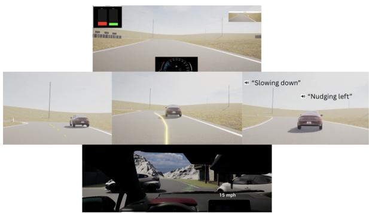  
Figure 11: Interfaces tested during iterative piloting for the racing domain, showing variations in trajectory line color, length, and style.

The main design decisions that emerged during design for the racing domain included a trajectory line that changed color depending on whether the policy inferred the user’s intent to pass or stay behind. Audio cues were found to overload participants, and it was difficult for drivers to interpret information about the system’s inferred intent while actively driving.

In the urban domain, we built on findings from the racing domain, using a similar trajectory line and haptic configuration. A key focus was the practice and priming setup: we separated onboarding into three phases (haptic-only, trajectoryonly, and combined), with verbal comprehension checks before advancing to the next phase. After implementing this change, participant feedback became more targeted to the policy’s actual behavior rather than to the driving scenario or vehicle physics. Other key decisions included applying the safety filter to the trajectory visualization (to prevent displaying out-of-bounds paths) and scaling the line length by the magnitude of the assistance.

## C Detailed Methods

## C.1 Methods for Evaluation 1: Racing Characterization

Procedure. Participants filled out a consent form outlining study risks (eye strain and motion sickness) and entered the simulator room. Familiarization proceeded in three phases: (1) participants watched one observation lap of the racing environment; (2) they drove one warm-up lap followed by five coached laps, during which a rule-based AI coach provided directional advice for staying on the racing line (Kaufman et al., 2024); and (3) they drove five additional uncoached laps. The coaching phase ensured that participants, many of whom had no prior sim-racing experience, could maintain basic vehicle control before encountering the overtaking task.

After familiarization, participants took a five-minute break and watched a video explaining the overtaking task. The task was divided into blocks defined by track sector and difficulty level. In each block, participants first followed a set of opponent vehicles for two laps to observe their behavior and practice driving the sector, then attempted to overtake the opponent between marked gates for two laps. Participants completed one block without the policy, then watched a video explaining how the policy would use haptics and a trajectory line to assist overtaking. The remaining blocks used a staircase approach (Cornsweet, 1962), exposing participants to up to eight driving scenarios of increasing difficulty; participants advanced to the next scenario only upon successful completion, so the number of scenarios completed ranged from one to eight depending on individual skill level. Each scenario was completed both with and without the policy.

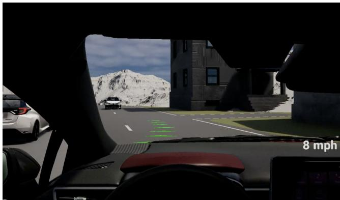  
Figure 12: Final trajectory visualization used in Eval 3 (Urban Validation). Line length scales with assistance magnitude; green indicates acceleration, red indicates deceleration.

After each interaction with the policy, participants rated the following statements on a 7-point Likert scale (1 = strongly disagree, 7 = strongly agree):

1. The AI knew my intent to pass.

2. The AI helped me perform the desired maneuver.

3. The AI’s action was safe.

4. I would have been better off passing without the AI.

An overall 1–10 rating and open-ended qualitative feedback were collected after the driving session.

The study flow is illustrated in Fig. 13.

Demographics. We recruited 33 participants (M = 45.27 years; 48.5% male, 51.5% female; 51.5% White, 27.3% Asian, 12.1% Black, 9.1% Hispanic or Latino). Two participants did not complete the study due to motion sickness. Of the remaining 31, seven were excluded for not meeting inclusion criteria (completion of all experimental conditions without simulator sickness, equipment failure, or not following study guidance). The final analysis sample was N = 24.

## C.2 Methods for Evaluation 3: Urban Controlled Validation

Procedure. Participants filled out a consent form outlining study risks (eye strain and motion sickness) and entered the simulator room. Familiarization began with a video explaining the town-map rules, followed by four free-driving laps. Proctors then introduced opponent vehicles in two sections of the route: (1) a car parked on the right with another vehicle

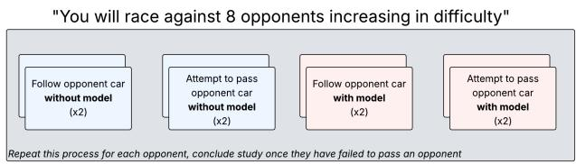

Figure 13: Driving flow for Eval 1 (Racing Characterization). Each block consists of two follow laps and two overtake-attempt laps, with difficulty increasing via a staircase design.

unexpectedly backing out of a driveway, and (2) a car parked on the left with an oncoming vehicle driving the wrong way down the center lane. Participants drove two practice laps encountering each scenario twice; proctors ensured one lap passed the oncoming vehicle on the left and one on the right.

Policy onboarding followed a three-phase protocol. First, participants watched a video and drove the driveway scenario twice with haptic feedback only. Second, they repeated the procedure with the trajectory visualization only. After each phase, proctors asked participants to describe what the policy was communicating; if comprehension was insufficient, the behavior was re-explained and an additional practice lap was given. Third, participants drove the scenario twice with both modalities active.

For the main task, participants watched a video of the full scenario and were reminded to compare the policies. They drove six laps with each of the three conditions (D2A-Full, D2A-NoIntent, and No-policy), for a total of 18 laps. Each condition began with two laps, followed by a survey, then four additional laps with a second survey. Participants alternated passing left and right around the oncoming vehicle each lap. Condition order was randomized in a double-blind fashion.

After each set of laps, participants rated the following on a 7-point Likert scale (1 = strongly disagree, 7 = strongly agree). Because each lap included multiple opponent-vehicle encounters (oncoming, driveway pop-out, and roundabout), Questions 1–4 explicitly instructed participants to consider only the oncoming-car encounter:

1. Consider ONLY the oncoming car. The AI assistant was providing visual and haptic assistance in the appropriate direction I expected. (Directionality)

2. Consider ONLY the oncoming car. The AI assistant was providing visual and haptic assistance at the appropriate time I expected. (Timing)

3. Consider ONLY the oncoming car. The AI assistant was adapting to which direction I wanted to go. (Adapting Direction)

4. Consider ONLY the oncoming car. I had to fight the AI assistant to go in the direction I wanted. (Fight Direction, reverse-coded)

Two additional questions addressed overall impressions across all encounters:

5. I felt safe driving with the AI assistant. (Safety)

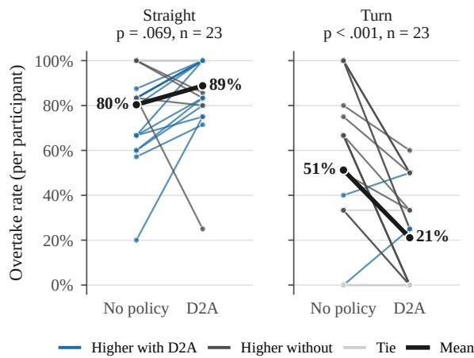  
Figure 14: Per-participant overtake rate by track type, without and with the policy, in Eval 1 (n = 23 participants with both conditions). Thin lines are participants, colored by the direction of change; the thick line is the mean. p-values are paired t-tests.

6. I am happy with how well the system worked with me. (Teaming)

Finally, participants provided an overall policy rating on a 1–10 scale.

The study flow is illustrated in Fig. 15.

Demographics. We recruited 12 participants (M = 32.80 years, SD = 8.64, range = [22–50]; 30.0% male, 70.0% female; 60.0% White, 30.0% Asian, 10.0% Black or African American). One participant was an internal employee. Two participants were excluded from the analysis: one due to motion sickness and one for not following questionnaire instructions. The final analysis sample was N = 10.

## D Additional Results

This appendix presents supplementary analyses for each evaluation.

## D.1 Eval 1: Racing Characterization

Overtake success by track segment. Figure 14 shows mean overtake rates broken down by track type (straight vs. turn) and condition (D2A vs. No-policy). On straightaways, D2A improved overtake success from 80% to 89% (p = .069); on turns, overtake success decreased from 51% to 21% (p < .001), confirming the dynamics-dependent failure mode discussed in Sec. 6.2.

Overtake quality metrics. Tables 6 and 7 report overtake speed and minimum opponent clearance. On straightaways, D2A maintained comparable overtake speed while increasing clearance (+0.47 m). On turns, both speed and clearance decreased, consistent with the policy’s tendency to over-steer through turns.

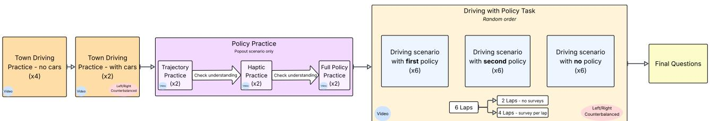  
Figure 15: Driving flow for Eval 3 (Urban Validation).

## D.2 Eval 2: Racing Refinement

Torque traces by track segment. Figure 16 shows averaged torque traces for D2A and D2A-Refined, separated by straight (Fig. 16a) and turn (Fig. 16b) segments. On turns, D2A applies larger steering than D2A-Refined in the seconds before the overtake (t < 0), the regime where the original policy over-steered. On straightaways, the two configurations produce similar torque profiles, confirming that the refinements did not regress baseline performance.

## D.3 Eval 3: Urban Controlled Validation

Per-participant torque traces. Figure 18 shows averaged torque traces for selected participants in the oncoming-vehicle event. From 3 to 1.5 s before closest approach, D2A-Full is less misaligned than D2A-NoIntent for all seven participants shown, though in the final second D2A-Full is the more misaligned of the two for five of the participants (Figs. 18a– 18g). D2A-NoIntent steers on average contrary to the driver’s intended avoidance direction (negative signed torque) before the closest approach (t = 0), consistent with the “captain” characterization reported in subjective feedback (Sec. 6.4). In these plots, PIDs 04, 07, 08, 09, and 11 are excluded due to data quality issues.

Torque magnitude and alignment statistics. Figure 9 shows per-participant torque magnitude (Fig. 9b) and torquemagnitude difference (∆τ, Eq. (10); Fig. 9c). Of the 11 participants with both conditions, seven received higher overall torque under D2A-Full and eight experienced more intentaligned torque, consistent with the aggregate alignment-event counts reported in Sec. 6.4.

## D.4 GRIP: Platform Transfer

Qualitative scenario illustrations. Figure 10 shows timeordered snapshots from two representative GRIP trials. The top row shows lateral steering assistance during an oncomingvehicle encounter (13–14 mph); the bottom row shows the policy’s braking behavior during a roundabout approach (9 → 4 mph in the trial shown). These behaviors transferred from the desktop simulator without retraining, confirming that the learned policy generalizes across platforms with matched dynamics.

Roundabout approach traces. Figure 17 shows eventlocked traces for the roundabout-approach scenario across four GRIP conditions. D2A-Full and D2A-NoIntent match the conditions reported in Eval 3. D2A-Longitudinal-1 and D2A-Longitudinal-2 are developmental variants of the intent-conditioned policy that differ in reward tuning (speed penalties, intervention penalty magnitude, and collision proximity thresholds); the “longitudinal” label reflects their observed braking behavior rather than a separate longitudinal intent space. All intent-conditioned policies use lateral intents (Y = {left, right}); braking emerges from task-level rewards as discussed in Sec. 4.4. The top panel shows vehicle speed. Drivers’ behaviors differed more than the conditions did. For instance, one participant entered the gate at 12–15 mph, the others at 8–11 mph. In the two sessions that ran both D2A-Full and D2A-NoIntent, D2A-Full crossed the gate 2–3 mph slower (8.7 vs. 10.7 and 12.2 vs. 15.0 mph). The bottom panel shows that D2A-Full kept more distance to the crossing vehicle on average, though the means mix drivers. The GRIP logs do not isolate AI-applied braking, so we do not report brake torque. Given the small sample (N = 3), we report these as descriptive observations.

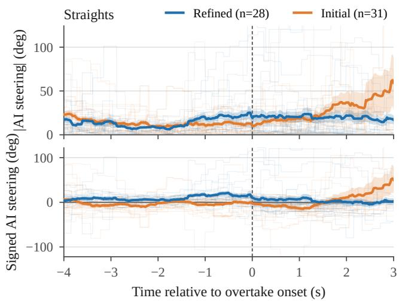

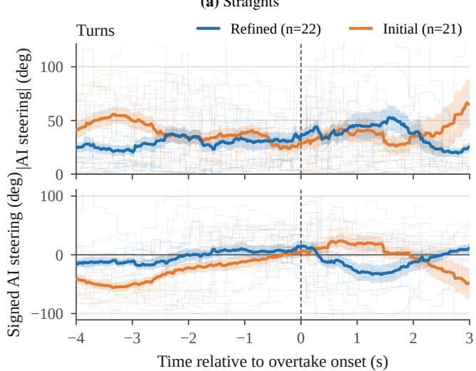  
(b) Turns  
Figure 16: Averaged torque traces across all participants and all (a) straight and (b) turn trials for Eval 2. On turns, D2A applies larger steering 4–3 s before overtake onset (t = 0) than D2A-Refined; on straights the two are similar. Traces show raw signed steering, not steering relative to the driver’s intent.

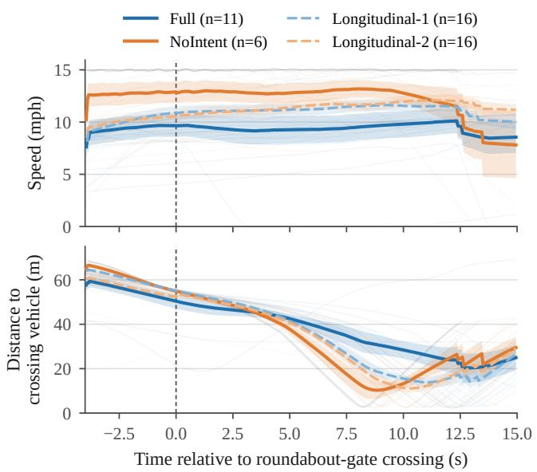  
Figure 17: Event-locked traces for the roundabout-approach scenario on GRIP, aligned to the roundabout-gate crossing (t = 0). Top: vehicle speed. Bottom: distance to the crossing vehicle. Lines show mean ± SEM with individual trials dimmed; n = trials per condition.

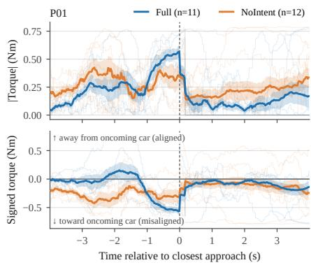

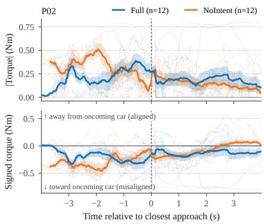  
(b) Participant 02

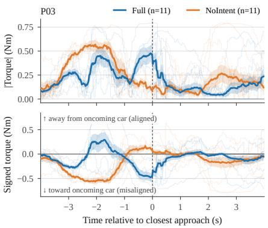  
(c) Participant 03

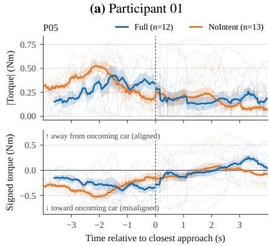  
(d) Participant 05

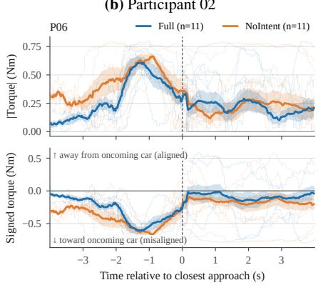  
(e) Participant 06

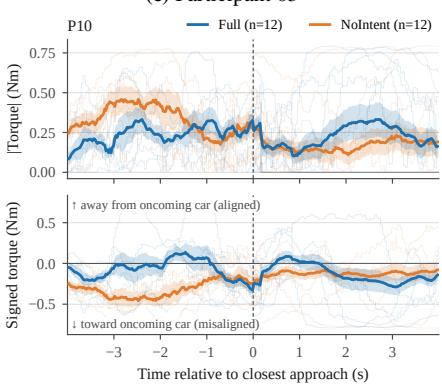  
(f) Participant 10

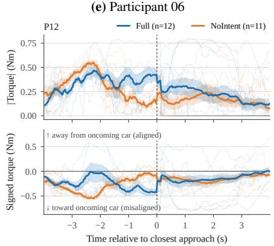  
(g) Participant 12

Figure 18: Averaged torque traces for selected participants in the oncoming car event in Eval 3. Top: torque magnitude. Bottom: signed torque, positive away from the oncoming car (aligned with the driver’s avoidance). From 3 to 1.5 s before closest approach, D2A-Full is less misaligned than D2A-NoIntent for all seven participants shown; in the final second, D2A-Full is the more misaligned of the two for five of them (P01, P02, P03, P05, P12).

Table 16: Design variables and human factors considered in DREAM2ASSIST, organized by category. Domain and platform indicate where each factor was actively applied. Factors marked (excluded) were considered but rejected during piloting.
<table><tr><td>Name</td><td>Description</td><td>Domain</td><td></td><td>Platform</td><td></td></tr><tr><td colspan="6">Policy Training</td></tr><tr><td>Real human data augmentation</td><td>20% of replay buffer replaced with relabeled real human driving data to reduce sim-to-real gap.</td><td>Racing</td><td>Urban</td><td>Sim</td><td></td></tr><tr><td>FCP population diversity</td><td>Synthetic humans sampled at varying training checkpoints (suboptimal to optimal) to expose the assistant to diverse behaviors.</td><td>Racing</td><td>Urban</td><td>Sim</td><td></td></tr><tr><td>Action smoothing</td><td>Causal moving-average (window = 10) applied to synthetic human and AI outputs to suppress physically unrealistic jitter.</td><td>Racing</td><td>Urban</td><td>Sim</td><td>GRIP</td></tr><tr><td>Intent class re-balancing</td><td>Training reweights intent classes to prevent mode collapse toward a dominant intent.</td><td>Urban</td><td></td><td>Sim</td><td></td></tr><tr><td>Pass/stay reward restructuring</td><td>Bounded per-intent indicator reward plus speed progress term, capped to prevent single-mode collapse  $( \mathrm { E q . } ( 1 2 ) – ( 1 4 ) )$ </td><td>Racing</td><td></td><td>Sim</td><td></td></tr><tr><td>Left/right rewards</td><td>Directional reward shaping for lateral urban intents  $( \operatorname { E q . } \left( 1 5 \right) ) .$ </td><td>Urban</td><td></td><td>Sim</td><td>GRIP</td></tr><tr><td>Stop/go rewards</td><td>Longitudinal reward shaping for speed intents (Eq. (16)).</td><td>Urban</td><td></td><td>GRIP</td><td></td></tr><tr><td>Intervention sparsity penalty</td><td> $L _ { 2 } .$  -norm on AI action magnitude, forming a mixed  $L _ { 1 } { - } L _ { 2 }$  norm over time to encourage sparse, targeted interventions.</td><td>Racing</td><td>Urban</td><td>Sim</td><td>GRIP</td></tr><tr><td colspan="6">Safety Layer</td></tr><tr><td>CBF safety filter</td><td>First-order control barrier function constraining the displayed trajectory (not the assistive torque) to satisfy lane and obstacle safety; δa solved analytically (Eq. (6)).</td><td>Urban</td><td></td><td>Sim</td><td>GRIP</td></tr><tr><td colspan="6">Policy Selection Pipeline</td></tr><tr><td>FCP evaluation statistics</td><td>Stage 1: threshold screening on training-time metrics (task progress, collision rate, intent accuracy, intervention sparsity).</td><td>Racing</td><td>Urban</td><td>Sim</td><td></td></tr><tr><td>Counterfactual log-replay</td><td>Stage 2: policies scored on replayed human logs via collision propensity and track-orthogonality of control inputs.</td><td>Racing</td><td>Urban</td><td>Sim</td><td></td></tr><tr><td>Human-in-the-loop policy gate</td><td>Stage 3: internal pilots rate candidates pass/fail on predefined criteria before external study deployment.</td><td>Racing</td><td>Urban</td><td>Sim</td><td></td></tr><tr><td colspan="6">Interface &amp; HMI Design</td></tr><tr><td>Trajectory line presence &amp; length</td><td>RSSM future path overlaid on scene; length scaled by opponent proximity (racing) or assistance magnitude (urban).</td><td>Racing</td><td>Urban</td><td>Sim</td><td>GRIP</td></tr><tr><td>Trajectory line color coding</td><td>Green/red encodes acceleration vs. deceleration; chosen over bar graphs and separate throttle/brake displays.</td><td>Racing</td><td>Urban</td><td>Sim</td><td>GRIP</td></tr><tr><td>Trajectory line temporal filtering</td><td>Mean filter over recent rollouts smooths displayed line to reduce perceptual jitter.</td><td>Racing</td><td>Urban</td><td>Sim</td><td>GRIP</td></tr><tr><td>Haptic force feedback (steering)</td><td>Wheel torque blended from human and policy setpoints; gain and resistance tuned iteratively to communicate without overwhelming driver input.</td><td>Racing</td><td>Urban</td><td>Sim</td><td>GRIP</td></tr><tr><td>Longitudinal feedback (engine + line)</td><td>Throttle/brake assistance communicated via engine noise and line color, as haptic pedal feedback was impractical.</td><td>Racing</td><td>Urban</td><td>Sim</td><td></td></tr><tr><td>Audio utterance cues (excl.)</td><td>Rule-triggered speech cues evaluated as trajectory line complement; excluded for latency, sparsity, and cognitive load.</td><td>Racing</td><td></td><td>Sim</td><td></td></tr><tr><td>Bar graph display (excl.) load.</td><td>Brake/throttle/steering bar graphs considered; excluded for increased cognitive</td><td>Racing</td><td></td><td>Sim</td><td></td></tr><tr><td colspan="6">Physical Platform Transfer</td></tr><tr><td>Steering hardware calibration</td><td>Minimal parameter adjustments between simulator (G29/Fanatec) and GRIP to compensate for hardware differences.</td><td>Urban</td><td></td><td>GRIP</td><td></td></tr></table>