# Efficient Exact Unlearning for Federated Zeroth-Order Optimization

Weijun Yin, Yanqing Yao, Falko Dressler, Fellow, IEEE, Di Wang, Member, IEEE, Youming Tao Member, IEEE

Abstract—Federated zeroth-order optimization (FedZOO) reduces the memory and communication costs of collaborative training for edge intelligence by avoiding backpropagation while communicating only random seeds and scalar coefficients. However, existing methods lack efficient mechanisms for exact unlearning to fully remove the influence of training data when users request deletion. A key insight is that total variation stability of the learning algorithm creates overlap between model distributions before and after data deletion, allowing exact unlearning to reuse computation through coupling. Based on this observation, we jointly design two stable zeroth-order learning algorithms and their corresponding exact-unlearning procedures: FEDZOO-S obtains stability through client and mini-batch subsampling, enabling FEDZOUL-S to perform efficient unlearning by preserving earlier updates and restarting from the first affected step. FEDZOO-NS further combines subsampling with Gaussian noise to increase overlap between update distributions; FEDZOUL-NS exploits this overlap through rejection–reflection coupling to reuse affected updates when the coupling is accepted. We prove exact unlearning for both algorithms: the model and saved state have the same joint distribution as retraining with the corresponding learner on retained data. We further establish stability and convergence guarantees for the learning algorithms and derive upper bounds on expected unlearning cost. Experiments demonstrate effective unlearning with competitive model utility and up to 56.1% less cumulative unlearning time than re-optimization. Compared with first-order baselines, our methods reduce communication overhead by up to approximately four orders of magnitude.

Index Terms—Federated learning, Exact Unlearning, Zeroth-Order Optimization, Total Variation Stability

## I. INTRODUCTION

Driven by advances in mobile and IoT hardware, edge intelligence has developed rapidly in recent years. Federated learning (FL) enables collaborative optimization across edge devices by allowing them to exchange model parameters or gradients without moving data out of the local domain [1]. However, practical deployment remains constrained by limited memory and communication resources, with growing model sizes further amplifying these challenges. Techniques such as quantization [2]–[4], sparsification [5]–[7], pruning and submodel training [8]–[11], and knowledge distillation [12]– [14] can reduce computation or communication costs. More recently, parameter-efficient and subspace-based federated finetuning methods have been developed to adapt large language models (LLMs) with fewer trainable parameters [15], [16]. Nevertheless, these training approaches still rely on backpropagation, whose intermediate activations can impose substantial memory overhead even when only a small subset of parameters is trainable. Exchanging tensor-valued updates can also remain costly over bandwidth-constrained edge networks.

Federated zeroth-order optimization (FedZOO) provides a promising alternative. Unlike first-order methods, zerothorder optimization (ZOO) estimates descent directions using only function evaluations and therefore avoids backpropagation [17]. This substantially reduces the memory required for optimization. Moreover, recent FedZOO methods exploit shared randomness to represent high-dimensional perturbations by random seeds and scalar coefficients [18], enabling communication costs that do not scale with the model dimension. In particular, a fixed finite seed pool allows accumulated zeroth-order updates to be represented in a compact seedcoordinate space. These properties make FedZOO particularly attractive for collaborative optimization of large models on resource-constrained edge devices.

Existing FedZOO methods, however, do not address machine unlearning (MU). Federated systems may receive requests to remove training samples because of data corrections, user withdrawal, or privacy requirements such as the right to be forgotten under regulations under GDPR [19]. Simply deleting the requested samples from local storage is insufficient because their effects may already have been incorporated into the global model. Federated unlearning therefore aims to remove these historical contributions from the learned model without repeating the entire training process. This requirement is especially relevant to edge intelligence, where participating devices may continuously contribute user-generated and potentially sensitive data.

Achieving efficient exact unlearning for FedZOO is challenging. Existing federated unlearning methods are largely designed around first- or second-order optimization and can reintroduce backpropagation, high-dimensional model states, or tensor-level communication, thereby losing the resource advantages that motivate FedZOO. Moreover, exact unlearning requires distributional equivalence to rerunning the learning algorithm on the retained data [20], for which retraining from scratch is always valid but computationally expensive.

A key insight from stability-based exact unlearning is that this difficulty can be addressed from the learning side [20]– [22]. If a randomized learning algorithm is stable in total variation under a single-sample change, then the output distributions on neighboring datasets overlap, creating opportunities to reuse computation through an appropriate coupling. This leads to a fundamental question in our setting:

<table><tr><td>How can we design federated zeroth-order learning algo-</td></tr><tr><td>rithms that are TV-stable while retaining the communication</td></tr><tr><td>and memory advantages of FedZOO?</td></tr></table>

To answer this question, we develop two TV-stable FedZOO learning algorithms and their corresponding exact-unlearning procedures, built on a common seed-encoded representation. The first, FEDZOO-S, obtains stability from client and minibatch subsampling: a single sample changes the realized trajectory only when its client participates and the sample is selected for a local update. Its unlearning counterpart, FEDZOUL-S, therefore preserves the unaffected prefix and replays only from the first affected step. The second, FEDZOO-NS, augments subsampling with Gaussian randomization. The added noise creates overlap between the conditional update distributions on neighboring datasets, allowing some affected updates to be coupled rather than immediately replayed. Its unlearning counterpart, FEDZOUL-NS, exploits this overlap through rejection–reflection coupling so that some affected realized updates can still be reused exactly.

Our contributions are summarized as follows.

(1) We formulate efficient exact federated unlearning for zeroth-order optimization through the lens of algorithmic total variation stability. Rather than treating unlearning as a post hoc correction to an arbitrary FedZOO procedure, we design the learning algorithm itself to be TV-stable, so that neighboring training datasets induce overlapping output distributions that can be exploited through coupling for computation reuse. At the same time, we retain the fixed finite seed representation of FedZOO to avoid highdimensional model-update communication.

(2) We propose FEDZOO-S, a TV-stable federated zerothorder learning algorithm whose stability arises from client and mini-batch subsampling, together with its exactunlearning algorithm FEDZOUL-S. A deletion leaves the realized trajectory unchanged when the deleted samples have not contributed to any realized local update. Otherwise, FEDZOUL-S preserves the unaffected prefix and replays only the suffix starting from the first affected local step.

(3) We further propose FEDZOO-NS, which augments subsampling with Gaussian randomization, together with its corresponding exact-unlearning algorithm FEDZOUL-NS. The added noise creates overlap between the conditional update distributions on neighboring datasets, enabling rejection–reflection coupling. Consequently, some affected realized updates can still be reused exactly, and replay is required only after the first rejected coupling.

(4) We establish exact-unlearning guarantees for both learning–unlearning pairs and analyze their TV stability, optimization utility, and unlearning efficiency. We further evaluate their optimization and unlearning performance across federated learning settings with conventional models and large language models.

## II. RELATED WORK

## A. Federated Zeroth-Order Optimization.

In recent years, zeroth-order optimization (ZO), has shown strong potential in FL, especially in resource-constrained edge collaboration settings, because it avoids backpropagation. Fang et al. [23] propose FedZO as one of the first derivative free federated ZO methods. For LLMs, Ling et al. [24] propose FedMeZO, which significantly reduces memory overhead and provides convergence analysis. Later, FedKSeed [18] and DeComFL [25] use scalar gradients and random seeds to synchronize perturbation randomness, achieving dimensionindependent communication between edge nodes and the cloud. HiSo [26] further accelerate the convergence efficiency of federated ZO. At the same time, since transmitting estimated gradients or scalar gradients may expose privacy risks, methods such as DPZero [27], DP-ZOSO [28] and DP-AggZO [29] combine differential privacy with zeroth-order gradient estimation. These methods inject carefully calibrated noise during training to provide rigorous privacy guarantees. It is worth noting that this noise-based design not only strengthens privacy protection, but also motivates the noise perturbation strategy in our TV stable algorithm.

## B. Federated Unlearning.

Federated unlearning (FU) aims to remove the influence of specified training data from a collaboratively learned model. Existing approaches can be broadly categorized into approximate and exact unlearning according to their guarantees relative to retraining on the retained data. Approximate methods seek to recover retraining-like behavior through model correction and gradient calibration [30]–[34], perturbation [35]–[39], or knowledge distillation [40], [41]. Related work on LLM unlearning also seeks to remove targeted knowledge while preserving useful model capabilities [42], [43]. Although some approaches provide certified guarantees that bound distributional discrepancies through calibrated randomization [37]– [39], these guarantees do not establish exact equality between the unlearning and retraining distributions. Exact FU requires the unlearning output to follow the same distribution as training on the retained data. To avoid full retraining, stabilitybased approaches exploit overlap between learning distributions to reuse prior computation [20], [22]. However, these methods are developed around gradient-based training and model- or curvature-level states, which do not directly retain the memory and communication advantages of zeroth-order optimization. Extending them to FedZOO requires more than replacing the gradient oracle: seed-and-scalar updates change the state needed for replay and the transition distributions used for coupling. We therefore jointly design TV-stable zerothorder learners and exact sample-level unlearning procedures around compact seed-encoded update histories. Our procedures reuse computation through subsampling and Gaussian coupling while preserving both the resource advantages of FedZOO and exact joint distributional equivalence of the model and saved state to retraining.

## III. PRELIMINARIES

## A. Federated Zeroth-Order Optimization

Consider a federated optimization system with M clients, where client $c ~ \in ~ [ M ]$ holds a finite local dataset $\begin{array} { l l } { { \mathcal { D } } _ { c } } & { = } \end{array}$ $\{ x _ { c , 1 } , \ldots , x _ { c , n _ { c } } \}$ of size $n _ { c } = | \mathcal { D } _ { c } |$ . The clients collaboratively optimize a global model $\textbf {  { w } } \in \mathrm { ~ \mathbb { R } ^ { \it d } ~ }$ under the coordination of a server. We consider the uniformly weighted finite-sum objective

$$
\operatorname* { m i n } _ { { \pmb w } \in \mathbb { R } ^ { d } } f ( { \pmb w } ) : = \frac { 1 } { M } \sum _ { c = 1 } ^ { M } f _ { c } ( { \pmb w } ) , \qquad f _ { c } ( { \pmb w } ) : = \frac { 1 } { n _ { c } } \sum _ { x \in \mathcal { D } _ { c } } \ell ( { \pmb w } ; x ) .\tag{1}
$$

Training proceeds for R communication rounds. In each round, m clients participate, and each participating client performs $E$ local optimization steps before the server uniformly aggregates their updates.

Zeroth-order optimization estimates descent directions using function evaluations without backpropagation. Given a model w, a sample x, and a perturbation $\boldsymbol { z } \sim \mathcal { N } ( \mathbf { 0 } , I _ { d } )$ , the two-point scalar gradient is

$$
g ( { \pmb w } ; x , z ) = \frac { \ell ( { \pmb w } + \mu z ; x ) - \ell ( { \pmb w } - \mu z ; x ) } { 2 \mu } ,\tag{2}
$$

where $\mu > 0$ is the perturbation scale. The corresponding zeroth-order gradient estimator is $g ( w ; x , z ) z$ .

For a mini-batch $\boldsymbol { B }$ of size $b ,$ suppose that q perturbations $\{ z _ { i , j } \} _ { j = 1 } ^ { q }$ are used for each $x _ { i } \in B .$ . One local step is the mini-batch averaged zeroth-order update

$$
\pmb { w } ^ { + } = \pmb { w } - \frac { \eta } { b q } \sum _ { \pmb { x } _ { i } \in B } \sum _ { j = 1 } ^ { q } g ( \pmb { w } ; x _ { i } , z _ { i , j } ) z _ { i , j } ,\tag{3}
$$

where all $b q$ scalar gradients are evaluated at the same preupdate model w.

Following the seed-based representation of FedKSeed [18], a perturbation can be reproduced from its random seed when the same pseudorandom number generator is used across devices. A fixed shared pool of K seeds can therefore represent zeroth-order updates through their scalar coefficients in seedcoordinate space, avoiding the transmission and storage of $d -$ dimensional update vectors.

## B. Federated Unlearning

Let $\mathcal { D } = \{ \mathcal { D } _ { 1 } , . . . , \mathcal { D } _ { M } \}$ denote the federated dataset. A randomized federated learning algorithm O produces a model output together with auxiliary state maintained for subsequent unlearning:

$$
( W , S ) \sim { \mathcal { O } } ( { \mathcal { D } } ) .\tag{4}
$$

Here, W denotes the model output and S collects the internal state saved by the learning procedure. The randomness of O may include client participation, data sampling, zerothorder perturbations, and other algorithmic randomness. We use $\mathcal { O } _ { \mathrm { o u t } } ( \mathcal { D } )$ to denote the marginal distribution of the model output W.

An unlearning request specifies samples to be removed from one or more clients. Let $\mathcal { C } _ { u l }$ be the set of affected clients and $\mathcal { D } _ { c , u l } \subseteq \mathcal { D } _ { c }$ the samples requested for deletion from client $c \in \mathcal { C } _ { u l } .$ . The retained federated dataset is

$$
\mathcal { D } ^ { - } = \{ \mathcal { D } _ { 1 } ^ { - } , \ldots , \mathcal { D } _ { M } ^ { - } \} , \qquad \mathcal { D } _ { c } ^ { - } = \left\{ \mathcal { D } _ { c } \setminus \mathcal { D } _ { c , u l } , \quad c \in \mathcal { C } _ { u l } , \right.
$$

We consider valid deletion requests for which every retained local dataset remains large enough for the prescribed minibatch sampling, i.e., $| \mathcal { D } _ { c } ^ { - } | \ge b$ for all affected clients.

The request may arrive during training. We denote by $( R _ { u l } , t _ { u l } )$ the local training position immediately preceding the request; that is, the request arrives immediately after local step $t _ { u l }$ of round $R _ { u l }$ . Given the current model and saved state, an unlearning algorithm U updates them according to the deletion request:

$$
\left( W _ { u l } , S _ { u l } \right) = \mathcal { U } \left( W , S , \{ \mathcal { D } _ { c , u l } \} _ { c \in \mathcal { C } _ { u l } } \right) .
$$

Definition 1 (Exact Federated Unlearning). A federated unlearning algorithm U is exact with respect to a randomized learning algorithm O if, for every federated dataset D and every valid deletion request,

$$
\begin{array} { r } { \mathcal { U } \left( \mathcal { O } ( \mathcal { D } ) , \{ \mathcal { D } _ { c , u l } \} _ { c \in \mathcal { C } _ { u l } } \right) \stackrel { d } { = } \mathcal { O } ( \mathcal { D } ^ { - } ) , } \end{array}\tag{5}
$$

where $\circeq$ denotes equality in distribution over both the model output and the maintained internal state.

Thus, exact unlearning requires the post-unlearning procedure to have the same distribution as rerunning the original learning algorithm on the retained federated dataset, rather than merely producing a nearby model.

## C. Total Variation Stability

For two probability measures $P$ and $Q$ on the same measurable space, their total variation (TV) distance is

$$
\mathrm { T V } ( P , Q ) = \operatorname* { s u p } _ { A } | P ( A ) - Q ( A ) | ,\tag{6}
$$

where the supremum is over measurable events A. When $P$ and $Q$ admit densities $p$ and $q$ with respect to a common reference measure,

$$
\mathrm { T V } ( P , Q ) = { \frac { 1 } { 2 } } \| p - q \| _ { 1 } .
$$

For two federated datasets $\textit { \textbf { D } } = \{ \mathcal { D } _ { c } \} _ { c = 1 } ^ { M }$ and $\begin{array} { r l } { \mathcal { D } ^ { \prime } } & { { } = } \end{array}$ $\{ \mathcal { D } _ { c } ^ { \prime } \} _ { c = 1 } ^ { M }$ , define

$$
\Delta ( \mathcal { D } , \mathcal { D } ^ { \prime } ) = \sum _ { c = 1 } ^ { M } | \mathcal { D } _ { c } \triangle \mathcal { D } _ { c } ^ { \prime } | .
$$

We call them sample-level adjacent, denoted by $\mathcal { D } \sim \mathcal { D } ^ { \prime }$ , if $\Delta ( \mathcal { D } , \mathcal { D } ^ { \prime } ) = 1$

Following the stability-based exact-unlearning framework, TV stability is defined on the marginal distribution of the learning algorithm’s model output, rather than on its auxiliary internal state.

Definition 2 (ρ-Sample-Level TV Stability). A randomized federated learning algorithm O is $\rho \mathrm { - }$ -sample-level TV stable if

$$
\operatorname* { s u p } _ { \mathcal { D } \sim \mathcal { D ^ { \prime } } } \mathrm { T V } \left( \mathcal { O } _ { \mathrm { o u t } } ( \mathcal { D } ) , \mathcal { O } _ { \mathrm { o u t } } ( \mathcal { D ^ { \prime } } ) \right) \leq \rho ,\tag{7}
$$

where $\rho \in [ 0 , 1 ]$ is the stability parameter.

TV stability therefore controls how much the distribution of the learned model can change after modifying a single training sample. For neighboring datasets, a smaller $\rho$ implies greater overlap between the two output distributions, which can be exploited by coupling-based unlearning to reuse computations from the original training trajectory.

## IV. OUR METHOD

We develop two pairs of federated learning and exactunlearning algorithms. Both pairs build on a common seedencoded representation of zeroth-order updates, which allows the realized training trajectory to be stored and replayed without retaining high-dimensional model updates. The first pair, FEDZOO-S and FEDZOUL-S, exploits client and sample subsampling: if a deleted sample has not entered the realized trajectory, the existing state remains valid; otherwise, exact unlearning replays the affected suffix. The second pair, FEDZOO-NS and FEDZOUL-NS, further randomizes local zeroth-order updates with Gaussian noise. The resulting overlap between update distributions on neighboring datasets allows some affected updates to be reused through coupling, reducing the need for replay.

## A. Seed-Encoded Zeroth-Order Updates

All four algorithms use the same compact representation of zeroth-order updates. At initialization, the server generates a finite pool of $K$ distinct perturbation seeds

$$
\mathbb { S } = \{ s _ { 1 } , \ldots , s _ { K } \} ,
$$

which is shared by the server and all clients and remains fixed throughout training. With a fixed pseudorandom number generator, each seed $s _ { k }$ deterministically generates a Gaussian perturbation $z _ { k } = \mathsf { P e r t u r b } ( s _ { k } ) \in \mathbb { R } ^ { d } ,$ , where $\boldsymbol { z } _ { k } \sim \mathcal { N } ( \mathbf { 0 } , I _ { d } )$ For model w, sample x, and seed $s _ { k }$ , define the two-point zeroth-order scalar gradient as

$$
g ( { \pmb w } ; x , s _ { k } ) = \frac { \ell ( { \pmb w } + \mu z _ { k } ; x ) - \ell ( { \pmb w } - \mu z _ { k } ; x ) } { 2 \mu } .
$$

The corresponding zeroth-order gradient estimator is $g ( w ; x , s _ { k } ) z _ { k }$ . Hence, once S is shared, an update along $z _ { k }$ is completely specified by its seed index and scalar coefficient, rather than by a d-dimensional vector. Because the seed pool is fixed and reused throughout training, coefficients associated with the same perturbation can be accumulated in seed-coordinate space. Let $\pmb { a } ^ { r } = ( a _ { 1 } ^ { r } , \dots , a _ { K } ^ { r } ) \in \mathbb { R } ^ { K }$ denote the global scalar-gradient accumulator after round $r ,$ where $a _ { k } ^ { r }$ is the cumulative coefficient associated with $z _ { k }$ . The corresponding global model is reconstructed as

$$
\mathsf { R e c } ( { \boldsymbol { \mathbf { \mathit { a } } } } ^ { r } ) = { \boldsymbol { \mathbf { \mathit { w } } } } ^ { 0 } - \eta \sum _ { k = 1 } ^ { K } a _ { k } ^ { r } { \boldsymbol { z } } _ { k } ,\tag{8}
$$

and we write ${ \pmb w } ^ { r } = \mathsf { R e c } ( { \pmb a } ^ { r } )$ . Thus, the persistent training state is represented by the K-dimensional accumulator $\pmb { a } ^ { r }$ while the full model is reconstructed only when needed. At the beginning of round $r ,$ client c reconstructs $\mathbf { \Delta } w ^ { r - 1 }$ from $\pmb { a } ^ { r - 1 }$ and initializes ${ \pmb a } _ { c } ^ { r , 0 } = { \pmb 0 } _ { K }$ . The local accumulator records only the updates generated by client c during the current round. Each local step consists of one mini-batch averaged zerothorder update. Specifically, let $\Delta \mathbf { { a } } _ { c } ^ { r , t } \in \mathbb { R } ^ { K }$ denote the seedcoordinate increment computed at local step t from $\mathbf { \Delta } w _ { c } ^ { r , t - 1 }$ All scalar gradients in this step are evaluated at the same model $\mathbf { \Delta } w _ { c } ^ { r , t - 1 }$ , accumulated into $\Delta \mathbf { } a _ { c } ^ { r , t }$ , and applied jointly:

$$
\begin{array} { r } { \pmb { a } _ { c } ^ { r , t } = \pmb { a } _ { c } ^ { r , t - 1 } + \Delta \pmb { a } _ { c } ^ { r , t } , } \end{array}\tag{9}
$$

$$
\pmb { w } _ { c } ^ { r , t } = \pmb { w } _ { c } ^ { r , t - 1 } - \eta \sum _ { k = 1 } ^ { K } \Delta a _ { c , k } ^ { r , t } \pmb { z } _ { k } .\tag{10}
$$

Equivalently,

$$
\boldsymbol { w } _ { c } ^ { r , t } = \boldsymbol { w } ^ { r - 1 } - \eta \sum _ { k = 1 } ^ { K } a _ { c , k } ^ { r , t } \boldsymbol { z } _ { k } .
$$

After local training, the server aggregates the final local accumulators of the participating clients and adds the resulting increment to $\pmb { a } ^ { r - 1 }$ , thereby obtaining $\pmb { a } ^ { r }$ . Exact unlearning additionally requires the realized randomness that determines the training trajectory to be recoverable. We therefore record the sampled clients, mini-batches, and perturbation seeds needed to reproduce each realized update. Distinct sources of randomness used by the algorithms are generated from independent random streams unless explicitly coupled by the unlearning procedure.

## B. Subsampling-Stable Learning and Unlearning

Learning: FedZOO-S. A deletion does not affect the realized training trajectory if the deleted sample has never been used to compute an update. We exploit this property through two levels of subsampling: only a subset of clients participates in each communication round, and each participating client computes its local zeroth-order updates from randomly sampled mini-batches. This gives our first learning algorithm, FEDZOO-S.

At round r, the server uniformly samples ${ \mathcal { C } } ^ { r } \subseteq [ M ]$ with $| { \mathcal { C } } ^ { r } | = m$ and sends the current global accumulator $\pmb { a } ^ { r - 1 }$ to the participating clients. Each $c \in { \mathcal { C } } ^ { r }$ initializes

$$
{ \pmb w } _ { c } ^ { r , 0 } = \mathsf { R e c } ( { \pmb a } ^ { r - 1 } ) , \qquad { \pmb a } _ { c } ^ { r , 0 } = { \pmb 0 } _ { K } ,
$$

and performs E local steps.

At local step t, client c samples a mini-batch $B _ { c } ^ { r , t } \subseteq \mathcal { D } _ { c }$ of size b uniformly without replacement. For each $x _ { i } \in B _ { c } ^ { r , t }$ , it further samples $q$ distinct seeds

$$
\mathbb { S } _ { c , i } ^ { r , t } = \{ s _ { i , 1 } , \ldots , s _ { i , q } \} \subseteq \mathbb { S }
$$

uniformly without replacement. Let $z _ { i , j } = \mathsf { P e r t u r b } ( s _ { i , j } )$ . All scalar gradients within the local step are evaluated at the same pre-update model:

$$
g _ { i , j } ^ { r , t } = \frac { \ell ( w _ { c } ^ { r , t - 1 } + \mu z _ { i , j } ; x _ { i } ) - \ell ( w _ { c } ^ { r , t - 1 } - \mu z _ { i , j } ; x _ { i } ) } { 2 \mu } .\tag{11}
$$

The $b q$ scalar gradients jointly form one mini-batch averaged zeroth-order update. For each $s _ { k } \in \mathbb { S } .$ , define

$$
\Delta a _ { c , k } ^ { r , t } = \frac { 1 } { b q } \sum _ { \substack { x _ { i } \in B _ { c , j } ^ { r , t } , j \in [ q ] : } } g _ { i , j } ^ { r , t } ,\tag{12}
$$

where an empty sum is zero. The client then applies

$$
\begin{array} { r } { \pmb { a } _ { c } ^ { r , t } = \pmb { a } _ { c } ^ { r , t - 1 } + \Delta \pmb { a } _ { c } ^ { r , t } , } \end{array}\tag{13}
$$

$$
\boldsymbol { w } _ { c } ^ { r , t } = \boldsymbol { w } _ { c } ^ { r , t - 1 } - \eta \sum _ { k = 1 } ^ { K } \Delta a _ { c , k } ^ { r , t } \boldsymbol { z } _ { k } .\tag{14}
$$

For subsequent unlearning, the client records $B _ { c } ^ { r , t }$ $\{ \mathbb { S } _ { c , i } ^ { r , t } \} _ { x _ { i } \in B _ { c } ^ { r , t } }$ , and $\pmb { a } _ { c } ^ { r , t }$

After the local steps, the server updates

$$
\pmb { a } ^ { r } = \pmb { a } ^ { r - 1 } + \frac { 1 } { m } \sum _ { c \in \mathcal { C } ^ { r } } \pmb { a } _ { c } ^ { r , E } ,\tag{15}
$$

and records ${ \mathcal { C } } ^ { r }$ and $\pmb { a } ^ { r }$ . Algorithm 1 summarizes FEDZOO-S.

The two levels of subsampling directly enable efficient unlearning. A sample affects the realized trajectory only when its client participates in a round and the sample is subsequently selected into a local mini-batch. If this never occurs before an unlearning request, deleting the sample does not invalidate the realized trajectory. Otherwise, the first local step containing the sample identifies the earliest point from which replay is necessary.

Exact unlearning: FedZOUL-S. Let $\mathcal { C } _ { u l }$ be the clients involved in an unlearning request, and let $\mathcal { D } _ { c , u l } \subseteq \mathcal { D } _ { c }$ contain the samples to be deleted from client c. Suppose the request arrives immediately after local step $( R _ { u l } , t _ { u l } )$ . For later use, define the next training position as

$$
\mathsf { N e x t } ( r , t ) = \left\{ \begin{array} { l l } { ( r , t + 1 ) , } & { t < E , } \\ { ( r + 1 , 1 ) , } & { t = E . } \end{array} \right.
$$

Using the client-participation sets and mini-batches recorded during FEDZOO-S, FEDZOUL-S searches chronologically over the realized prefix up to $( R _ { u l } , t _ { u l } )$ for the earliest step $( r ^ { \star } , t ^ { \star } )$ satisfying

$$
\boldsymbol { B _ { c } ^ { r ^ { \star } , t ^ { \star } } } \cap \mathcal { D } _ { c , u l } \neq \boldsymbol { \mathcal { O } }\tag{16}
$$

for some $c \in \mathcal { C } _ { u l } \cap \mathcal { C } ^ { r ^ { \star } }$

If no such step exists, none of the deleted samples has contributed to the realized trajectory. After removing the requested samples, training therefore continues from Next $( R _ { u l } , t _ { u l } )$ using the current state, without replaying any previous step.

Otherwise, the algorithm preserves the entire trajectory before $( r ^ { \star } , t ^ { \star } )$ and restores the optimization state immediately preceding this step. Specifically, it loads $\pmb { a } ^ { r ^ { \star } - 1 }$ and, for each $c \in \mathcal { C } ^ { r ^ { \star } }$ , restores $\bar { \mathbf { \Phi } } _ { a _ { c } ^ { r ^ { \star } } } ^ { r ^ { \star } , \bar { t } ^ { \star } - 1 }$ and reconstructs

$$
\pmb { w } _ { c } ^ { r ^ { \star } , t ^ { \star } - 1 } = \mathsf { R e c } ( \pmb { a } ^ { r ^ { \star } - 1 } ) - \eta \sum _ { k = 1 } ^ { K } a _ { c , k } ^ { r ^ { \star } , t ^ { \star } - 1 } \pmb { z } _ { k } .\tag{17}
$$

Training then resumes from $( r ^ { \star } , t ^ { \star } )$ on the retained datasets using the same FEDZOO-S procedure. All newly generated states replace their original counterparts.

The preserved prefix contains no update involving a deleted sample. The coupling analysis in Section B-A shows that the two branches of FEDZOUL-S jointly transport the original training law to the retained-data law: the realized prefix is preserved when no deleted sample appears, and the trajectory is regenerated from the first affected step otherwise. Therefore, the resulting model and saved state have the same distribution as a FEDZOO-S run on the retained datasets. Algorithm 2 summarizes the procedure. We state the algorithm for setvalued deletion requests; the theoretical analysis considers a single deletion, with multiple requests handled sequentially.

The limitation of FEDZOUL-S is that once a deleted sample has contributed to a local update, the trajectory must be replayed from that update onward. The next learning–unlearning pair adds Gaussian randomization so that an affected update can sometimes be reused as well.

## C. Noise-Stable Learning and Unlearning

Learning: FedZOO-NS. FEDZOO-S avoids replay when deleted samples have not contributed to the realized trajectory, but an affected update still requires replay of the remaining suffix. To further reduce this cost, we randomize each local zeroth-order update with Gaussian noise. The resulting overlap between update distributions on neighboring datasets allows some affected realized updates to be reused through coupling. We call the resulting learning algorithm FEDZOO-NS.

Client, mini-batch, and perturbation-seed sampling follow FEDZOO-S. At local step $( r , t )$ , let $B _ { c } ^ { r , t }$ be the sampled minibatch and $\mathbb { S } _ { c , i } ^ { r , t }$ the q perturbation seeds sampled for $x _ { i } \in B _ { c } ^ { r , t }$ All scalar gradients are evaluated at the same pre-update model $\mathbf { \Delta } w _ { c } ^ { r , t - 1 }$

$$
g _ { i , j } ^ { r , t } = \frac { \ell ( \pmb { w } _ { c } ^ { r , t - 1 } + \mu z _ { i , j } ; x _ { i } ) - \ell ( \pmb { w } _ { c } ^ { r , t - 1 } - \mu z _ { i , j } ; x _ { i } ) } { 2 \mu } ,\tag{18}
$$

where $z _ { i , j } = \mathsf { P e r t u r b } ( s _ { i , j } )$ . We clip each scalar gradient at level $C$ and normalize it according to the mini-batch averaged update:

$$
h _ { i , j } ^ { r , t } = \frac { 1 } { b q } \mathrm { c l i p } _ { C } ( g _ { i , j } ^ { r , t } ) .\tag{19}
$$

Fix a deterministic ordering of the bq sample–seed pairs and collect their coefficients into $\boldsymbol { h } _ { c } ^ { r , t } \in \mathbb { R } ^ { b q }$ . Client c independently draws

$$
\pmb { \xi } _ { c } ^ { r , t } \sim \mathcal { N } ( \mathbf { 0 } , \sigma _ { \rho } ^ { 2 } I _ { b q } )
$$

and forms

$$
\widetilde { \pmb { h } } _ { c } ^ { r , t } = \pmb { h } _ { c } ^ { r , t } + \pmb { \xi } _ { c } ^ { r , t } .\tag{20}
$$

The Gaussian noise is independent of the client, mini-batch, and perturbation-seed sampling.

The noisy coefficient vector is mapped to the seedcoordinate increment $\Delta \widetilde { \pmb { a } } _ { c } ^ { r , t } \in \mathbb { R } ^ { K }$ . For each seed $s _ { k } \in \mathbb { S } ,$ the increment is $\begin{array} { r } { \Delta \widetilde { \boldsymbol { a } } _ { c , k } ^ { r , t } \ = \ \sum _ { \boldsymbol { x } _ { i } \in { \mathcal { B } _ { c } ^ { r , t } } , \boldsymbol { j } \in [ \boldsymbol { q } ] : } \widetilde { h } _ { i , j } ^ { r , t } } \\  \quad \qquad \cdot \qquad \left. \begin{array} { r l r } { \boldsymbol { s } _ { i , j } = \boldsymbol { s } _ { k } } & { \mathrm { ~ } \right. } & { \mathrm { ~ } } \\ { \mathrm { ~ } \qquad \cdot \left. \begin{array} { r l r } { \boldsymbol { s } _ { i , j } = \boldsymbol { s } _ { k } } & { \mathrm { ~ } } \end{array} \right. } \end{array} \end{array}$ , where $\widetilde { h } _ { i , j } ^ { r , t }$ denotes the component of $\widetilde { h } _ { c } ^ { r , t }$ corresponding to the sampled pair $( x _ { i } , s _ { i , j } )$ . The sum includes all sampled pairs sharing $s _ { k }$ and is zero if no such pair is selected. The client then updates

$$
\begin{array} { r } { \pmb { a } _ { c } ^ { r , t } = \pmb { a } _ { c } ^ { r , t - 1 } + \Delta \widetilde { \pmb { a } } _ { c } ^ { r , t } , } \end{array}\tag{21}
$$

$$
\boldsymbol { w } _ { c } ^ { r , t } = \boldsymbol { w } _ { c } ^ { r , t - 1 } - \eta \sum _ { k = 1 } ^ { K } \Delta \widetilde { \boldsymbol { a } } _ { c , k } ^ { r , t } \boldsymbol { z } _ { k } .\tag{22}
$$

After E local steps, the server performs the same uniform aggregation as in FEDZOO-S:

$$
\pmb { a } ^ { r } = \pmb { a } ^ { r - 1 } + \frac { 1 } { m } \sum _ { c \in \mathcal { C } ^ { r } } \pmb { a } _ { c } ^ { r , E } .\tag{23}
$$

For subsequent unlearning, each client records $B _ { c } ^ { r , t }$ $\{ \mathbb { S } _ { c , i } ^ { r , t } \} _ { x _ { i } \in B _ { c } ^ { r , t } } , \widetilde { h } _ { c } ^ { r , t }$ , and $\pmb { a } _ { c } ^ { r , t }$ . The clean vector $h _ { c } ^ { r , t }$ need not be stored, since it can be recomputed from the saved preupdate state, mini-batch, and perturbation seeds. Algorithm 3 summarizes FEDZOO-NS.

Exact unlearning: FedZOUL-NS. Consider a deletion request $\{ \mathcal { D } _ { c , u l } \} _ { c \in \mathcal { C } _ { u l } }$ arriving immediately after local step $( R _ { u l } , t _ { u l } )$ . FEDZOUL-NS scans the realized prefix up to the request in chronological order. For an affected client $c \in \mathcal { C } _ { u l } \cap \mathcal { C } ^ { r }$ , define

$$
\boldsymbol { B } _ { c , u l } ^ { r , t } = \boldsymbol { B } _ { c } ^ { r , t } \cap \mathcal { D } _ { c , u l } .
$$

If $B _ { c , u l } ^ { r , t } = \varnothing$ , the recorded local update is unaffected and is preserved. Otherwise, the algorithm couples the recorded minibatch to a mini-batch distributed as a uniform sample from the retained local dataset. It removes $B _ { c , u l } ^ { r , t }$ and replaces these samples by the same number of retained samples, drawn uniformly without replacement from the retained dataset while excluding the samples already present in the mini-batch. Denote the resulting mini-batch by $( B _ { c } ^ { r , t } ) ^ { \prime }$ . The perturbation-seed sets of retained samples are unchanged, while each replacement sample inherits the seed set associated with the deleted sample that it replaces. Since data sampling and perturbation-seed sampling are independent, this produces the required coupled realization of the sampling randomness.

Using the saved pre-update model, the coupled mini-batch, and the associated seeds, the client recomputes the clean coefficient vector $( h _ { c } ^ { r , t } ) ^ { \prime }$ . Conditioned on the pre-update state and sampling realizations, the original and retained-data randomized updates follow

$$
P = \mathcal { N } \left( \boldsymbol { h } _ { c } ^ { r , t } , \sigma _ { \rho } ^ { 2 } I _ { b q } \right) , \qquad Q = \mathcal { N } \left( ( \boldsymbol { h } _ { c } ^ { r , t } ) ^ { \prime } , \sigma _ { \rho } ^ { 2 } I _ { b q } \right) .
$$

Let p and q denote their densities. For the recorded realization $\widetilde { h } _ { c } ^ { r , t }$ , the rejection step accepts with probability

$$
\alpha _ { c } ^ { r , t } = \operatorname* { m i n } \left\{ 1 , \frac { q ( \widetilde { \pmb { h } } _ { c } ^ { r , t } ) } { p ( \widetilde { \pmb { h } } _ { c } ^ { r , t } ) } \right\} .\tag{24}
$$

Equivalently,

$$
\alpha _ { c } ^ { r , t } = \operatorname* { m i n } \left\{ 1 , \exp \left( \frac { \| \widetilde { \pmb { h } } _ { c } ^ { r , t } - \pmb { h } _ { c } ^ { r , t } \| _ { 2 } ^ { 2 } - \| \widetilde { \pmb { h } } _ { c } ^ { r , t } - ( \pmb { h } _ { c } ^ { r , t } ) ^ { \prime } \| _ { 2 } ^ { 2 } } { 2 \sigma _ { \rho } ^ { 2 } } \right) \right\} .\tag{25}
$$

If the test accepts, the recorded noisy coefficient vector is reused:

$$
( \widetilde { h } _ { c } ^ { r , t } ) ^ { \prime } = \widetilde { h } _ { c } ^ { r , t } .
$$

The local model and accumulator therefore remain unchanged; only the saved mini-batch and its sample–seed correspondence are replaced by the coupled retained-data realization.

If the test rejects, the algorithm uses reflection to obtain a realization from the retained-data transition. Let

$$
d _ { c } ^ { r , t } = ( h _ { c } ^ { r , t } ) ^ { \prime } - h _ { c } ^ { r , t } , \qquad m _ { c } ^ { r , t } = \frac { h _ { c } ^ { r , t } + ( h _ { c } ^ { r , t } ) ^ { \prime } } { 2 } .
$$

For ${ d _ { c } ^ { r , t } \neq 0 }$ , define

$$
e _ { c } ^ { r , t } = \frac { { d _ { c } ^ { r , t } } } { { \lVert { d _ { c } ^ { r , t } } \rVert _ { 2 } } } .
$$

The reflected coefficient vector is

$$
( \widetilde { \pmb { h } } _ { c } ^ { r , t } ) ^ { \prime } = \widetilde { \pmb { h } } _ { c } ^ { r , t } - 2 \left. \widetilde { \pmb { h } } _ { c } ^ { r , t } - { \pmb { m } } _ { c } ^ { r , t } , \pmb { e } _ { c } ^ { r , t } \right. \pmb { e } _ { c } ^ { r , t } .\tag{26}
$$

If the two clean coefficient vectors coincide, then $P = Q$ and the step is accepted directly.

The reflected vector is mapped to the fixed seed-coordinate space to obtain $\Delta \widetilde { \pmb { a } } _ { c } ^ { r , t }$ and is applied to the state immediately preceding (r, t):

$$
\begin{array} { r } { \pmb { a } _ { c } ^ { r , t } = \pmb { a } _ { c } ^ { r , t - 1 } + \Delta \widetilde { \pmb { a } } _ { c } ^ { r , t } , } \end{array}\tag{27}
$$

$$
\boldsymbol { w } _ { c } ^ { r , t } = \boldsymbol { w } _ { c } ^ { r , t - 1 } - \eta \sum _ { k = 1 } ^ { K } \Delta \widetilde { \boldsymbol { a } } _ { c , k } ^ { r , t } \boldsymbol { z } _ { k } .\tag{28}
$$

The saved state of this local step is then replaced by

$$
\left( ( \boldsymbol { B } _ { c } ^ { r , t } ) ^ { \prime } , \{ \mathbb { S } _ { c , i } ^ { r , t } \} _ { \boldsymbol { x } _ { i } \in ( \boldsymbol { B } _ { c } ^ { r , t } ) ^ { \prime } } , ( \widetilde { \boldsymbol { h } } _ { c } ^ { r , t } ) ^ { \prime } , \boldsymbol { a } _ { c } ^ { r , t } \right) ,
$$

namely, the coupled mini-batch and sample–seed correspondence, the reflected noisy coefficient vector, and the corrected local accumulator. All subsequent states depend on this corrected endpoint and are therefore regenerated on the retained datasets.

If a rejection occurs at the last local step $t ~ = ~ E$ , the corrected local endpoint first replaces its original counterpart and the server recomputes

$$
\pmb { a } ^ { r } = \pmb { a } ^ { r - 1 } + \frac { 1 } { m } \sum _ { c \in \mathcal { C } ^ { r } } \pmb { a } _ { c } ^ { r , E }
$$

before training proceeds from Nex $\langle r , E \rangle = ( r + 1 , 1 )$

If every affected step up to the request is accepted, the realized optimization state remains unchanged. After removing the requested samples, training continues from Next $( R _ { u l } , t _ { u l } )$ If a rejection occurs at $( r ^ { \star } , t ^ { \star } )$ , training instead continues from Next $( r ^ { \star } , t ^ { \star } )$ using the corrected state. Algorithm 4 summarizes the procedure.

Thus, FEDZOUL-NS first exploits subsampling to preserve unaffected steps and then uses Gaussian coupling to reuse some affected randomized updates. Replay is required only after the first rejected coupling.

## V. THEORETICAL ANALYSIS

We now explain why the proposed learning and unlearning procedures work. Two questions are central. First, after a sample is deleted, can we recover exactly the state that would have been obtained by training on the retained data, without rerunning everything from the beginning? Second, because all zeroth-order updates reuse the same finite seed pool, what optimization guarantee can we still give for the original federated objective? We keep the discussion here at the level of the main ideas and results; the complete statements and proofs are given in Appendix B.

For reference, $T = R E$ denotes the total number of local positions. For a deletion of $x ^ { - }$ from client $c ^ { - }$ , let $n _ { c ^ { - } }$ be that client’s data size immediately before deletion, and let $\underline { n }$ be a lower bound on such local dataset sizes. If the request arrives after round $R _ { u l }$ and local step $t _ { u l } ,$ , then $T _ { u l } = ( R _ { u l } - 1 ) E + t _ { u l }$ positions have already been executed.

Algorithm 1: FedZOO-S: Subsampling-Stable Feder Algorithm 3: FedZOO-NS: Noise-Stable Federated   
ated ZOO ZOO   
Input: $\mathbf { w } ^ { 0 } , \underline { { R } } , E , K , q , b , m , \eta , \mu .$ Input: $\begin{array} { r } { { \pmb w } ^ { 0 } , R , E , K , q , b , m , \eta , \mu , C , \sigma _ { \rho } . } \end{array}$   
Output: $\mathbf { \Delta } _ { w } R _ { \mathbf { \Delta } }$ Output: $\mathbf { \Delta } w ^ { R }$   
1 Initialize fixed seed pool $\mathbb { S } = \{ s _ { 1 } , \ldots , s _ { K } \}$ and 1 Initialize fixed seed pool $\mathbb { S } = \{ s _ { 1 } , \ldots , s _ { K } \}$ and   
${ \pmb a } ^ { 0 } = { \bf 0 } _ { K } ;$ ${ \pmb a } ^ { 0 } = { \bf 0 } _ { K } ;$   
2 for $r = 1 , \ldots , R$ do 2 for $r = 1 , \ldots , R$ do   
3 Sample ${ \mathcal { C } } ^ { r } \subseteq [ M ] , | { \mathcal { C } } ^ { r } | = m .$ , uniformly without 3 Sample ${ \mathcal { C } } ^ { r } \subseteq [ M ] , | { \mathcal { C } } ^ { r } | = m .$ , uniformly without   
replacement; replacement;   
4 foreach $c \in { \mathcal { C } } ^ { r }$ in parallel do 4 foreach $c \in { \mathcal { C } } ^ { r }$ in parallel do   
5 ${ \pmb w } _ { c } ^ { r , 0 }  \mathsf { R e c } ( { \pmb a } ^ { \bar { r } - 1 } ) ; { \pmb a } _ { c } ^ { r , 0 }  { \pmb 0 } _ { K } ;$ 5 ${ \pmb w } _ { c } ^ { r , 0 }  \mathsf { R e c } ( { \pmb a } ^ { \bar { r } - 1 } ) ; { \pmb a } _ { c } ^ { r , 0 }  { \pmb 0 } _ { K } ;$   
6 for $t = 1 , \ldots , E$ do 6 for $t = 1 , \ldots , E$ do   
7 Sample $B _ { c } ^ { r , t }$ and $\{ \mathbb { S } _ { c , i } ^ { r , t } \} _ { x _ { i } \in B _ { c } ^ { r , t } } ;$ 7 Sample $B _ { c } ^ { r , t }$ and $\{ \mathbb { S } _ { c , i } ^ { r , t } \} _ { x _ { i } \in B _ { c } ^ { r , t } } ;$   
8 Compute $\Delta \mathbf { } a _ { c } ^ { r , t }$ by Eqs. (11)–(12); 8 Compute $h _ { c } ^ { r , t }$ by Eqs. $( 1 8 ) { \ - } ( 1 9 ) ;$   
9 Update $( w _ { c } ^ { r , t } , \pmb { a } _ { c } ^ { r , t } )$ by Eqs. (13)–(14); 9 Draw $\pmb { \xi } _ { c } ^ { r , t } \sim \mathcal { N } ( \mathbf { 0 } , \sigma _ { \rho } ^ { 2 } I _ { b q } )$ and set   
10 save $\left( { B _ { c } ^ { r , t } , \{ \mathbb { S } _ { c , i } ^ { r , t } \} , { \bf 2 } _ { c } ^ { r , t } } \right)$ $\widetilde { \pmb { h } } _ { c } ^ { r , t } \gets \pmb { h } _ { c } ^ { r , t } + \pmb { \xi } _ { c } ^ { r , t } ;$   
11 $\begin{array} { r } { \pmb { a } ^ { r }  \pmb { a } ^ { r - 1 } + \frac { 1 } { m } \sum _ { c \in \mathcal { C } ^ { r } } \pmb { a } _ { c } ^ { r , E } ; } \end{array}$ 10 Map $\widetilde { h } _ { c } ^ { r , t }$ to $\Delta \widetilde { \pmb { a } } _ { c } ^ { r , t } ;$   
12 save $( \mathcal { C } ^ { r } , \pmb { a } ^ { r } ) ;$ 11 Update $( w _ { c } ^ { r , t } , a _ { c } ^ { r , t } )$ by Eqs. (21)–(22);   
13 return $\mathsf { R e c } ( { \pmb a } ^ { R } ) ;$ 12 save $\left( { B _ { c } ^ { r , t } , \{ { \mathbb { S } _ { c , i } ^ { r , t } } \} , \widetilde { h } _ { c } ^ { r , t } , { \pmb { a } _ { c } ^ { r , t } } } \right)$ ;   
13 $\begin{array} { r } { \pmb { a } ^ { r }  \pmb { a } ^ { r - 1 } + \frac { 1 } { m } \sum _ { c \in \mathcal { C } ^ { r } } \pmb { a } _ { c } ^ { r , E } ; } \end{array}$   
Algorithm 2: FedZOUL-S: Exact Unlearning by Sub- Algorithm 2: FedZOUL-S: Exact Unlearning by Sub- 14 save $( \mathcal { C } ^ { r } , \pmb { a } ^ { r } ) ;$   
sampling sampling 15 return $\mathsf { R e c } ( { \pmb a } ^ { R } ) ;$

Input: Deletion request $\{ \mathcal { D } _ { c , u l } \} _ { c \in \mathcal { C } _ { u l } }$ after $( R _ { u l } , t _ { u l } ) ;$   
saved FedZOO-S states.   
Output: Unlearned model $\mathbf { \Delta } _ { w } R _ { \mathbf { \alpha } }$   
1 afected ← false;   
2 for each $( r , t ) \preceq ( R _ { u l } , t _ { u l } )$ in chronological order do   
3 foreach $c \in \mathcal { C } _ { u l } \cap \mathcal { C } ^ { r }$ in parallel do   
4 afected ${ \bf \Phi } _ { c } \gets \bf { 1 } \{ { B _ { c } ^ { r , t } } \cap { \mathcal { D } } _ { c , u l } \not = \emptyset \} ;$   
5 if $\mathsf { V } _ { c \in \mathcal { C } _ { u l } \cap \mathcal { C } ^ { r } }$ afected then   
6 $( r ^ { \star } , t ^ { \star } ) \gets ( r , t ) ;$   
7 afected ← true;   
8 break;   
9 Remove $\mathcal { D } _ { c , u l }$ from each affected local dataset;   
10 if afected then   
11 Restore the saved state immediately before $( r ^ { \star } , t ^ { \star } )$   
12 Continue FedZOO-S from $( r ^ { \star } , t ^ { \star } )$ on the retained   
datasets;   
13 else   
14 Continue FedZOO-S from Next $( R _ { u l } , t _ { u l } )$ using   
the current state;   
15 return $\mathbf { \Delta } w ^ { R } ;$

## A. Stability, Exact Unlearning, and Cost

The analysis of FEDZOO-S starts from a simple observation: deleting a sample can only change the realized trajectory if its client is selected and the sample is actually drawn into a local mini-batch. We therefore couple the executions before and after deletion by sharing all randomness until that first event occurs. Up to that point, the two executions are identical. Since one local position hits the deleted sample with probability $( m / M ) ( b / n _ { c ^ { - } } )$ , the probability of a hit within the first τ positions is at most min $\left\{ 1 , \tau m b / ( M n _ { c } - ) \right\}$ . This gives the TV-stability result in Theorem 1 of Appendix B- $\cdot \mathrm { A } ;$ in particular, $T m b / ( M \underline { { n } } ) \le \rho$ is sufficient for $\rho { \mathrm { - T V } }$ stability.

The same coupling already contains the unlearning algorithm. If the deleted sample was never used, the current state is already distributed exactly as training on the retained data. If it was used, the two executions agree until its first occurrence, so only the computation after that point has to be regenerated. This is the idea behind FEDZOUL-S. Theorem 2 in Appendix B-A proves exact unlearning for one deletion, and Corollary 1 in the same subsection extends the argument to a non-adaptive stream of deletions.

FEDZOO-NS begins with the same subsampling effect, but the added Gaussian noise gives us another way to keep previously computed updates. When deletion changes a sampled mini-batch, the mean of the noisy coefficient vector changes, but its covariance does not. The two Gaussian transition laws therefore overlap. Appendix B-B quantifies this overlap by coupling the mini-batches and sample–seed pairs first and then bounding the resulting Gaussian discrepancy. Theorem 3 gives the final TV bound. A convenient sufficient noise level is

$$
\sigma _ { \rho } = \operatorname* { m a x } \left\{ \frac { 2 C } { b \sqrt { q } } , \frac { 2 C } { \underline { { n } } \sqrt { q } \rho } \sqrt { \frac { T m } { M } } \right\} ,\tag{29}
$$

as stated in Corollary 2 of Appendix B-B. The factor $\sqrt { m / M }$ appears because client participation is sampled once per round and then shared across the E local steps.

For unlearning, this Gaussian overlap is used constructively. At an affected local step, FEDZOUL-NS first asks whether the previously generated noisy update is also valid under the retained-data transition. If so, it is kept. Otherwise, a reflection coupling produces an update with the correct retained-data law, and training continues from the next position. Theorem 4 in Appendix B-C proves that this procedure gives exact unlearning of the complete maintained state, and Corollary 3 in the same subsection covers a non-adaptive stream of deletions. Proposition 1 further bounds the probability that replay is triggered before a request at $T _ { u l }$ ; under Eq. (29), it is at most min $\{ 1 , \rho T _ { u l } \sqrt { m / M } / \sqrt { 2 \pi T } \}$ . This replay probability is different from the final-model TV parameter $\rho \colon$ one belongs to the particular transitionwise coupling used for unlearning, while the other measures the distance between the final output laws.

Algorithm 4: FedZOUL-NS: Exact Unlearning by   
Rejection–Reflection   
Input: Deletion request $\{ \mathcal { D } _ { c , u l } \} _ { c \in \mathcal { C } _ { u l } }$ after $( R _ { u l } , t _ { u l } ) ;$   
saved FedZOO-NS states.   
Output: Unlearned model $\mathbf { \Delta } _ { w } R _ { \mathbf { \alpha } }$   
1 reject ← false;   
2 for each $( r , t ) \preceq ( R _ { u l } , t _ { u l } )$ in chronological order do   
3 foreach $c \in \mathcal { C } _ { u l } \cap \mathcal { C } ^ { r }$ in parallel do   
4 rejectc ← false;   
5 $\boldsymbol { B } _ { c , u l } ^ { r , t } \gets \boldsymbol { B } _ { c } ^ { r , t } \cap \mathcal { D } _ { c , u l } ;$   
6 if $B _ { c , u l } ^ { r , t } \neq \emptyset$ then   
7 Construct coupled mini-batch $( B _ { c } ^ { r , t } ) ^ { \prime }$ and   
its sample–seed correspondence;   
8 Recompute $h _ { c } ^ { r , t }$ and $( h _ { c } ^ { r , t } ) ^ { \prime } ;$   
9 Draw $u \sim$ Unif(0, 1);   
10 if $u \leq \alpha _ { c } ^ { r , t }$ in $E q .$ (24) then   
11 Replace the saved mini-batch and   
sample–seed correspondence by the   
coupled realization;   
12 else   
13 Compute $( \widetilde { \pmb { h } } _ { c } ^ { r , t } ) ^ { \prime }$ by Eq. (26);   
14 Map $( \widetilde { h } _ { c } ^ { r , t } ) ^ { \prime }$ to $\Delta \widetilde { \pmb { a } } _ { c } ^ { r , t } ;$   
15 $\begin{array} { r } { \pmb { a } _ { c } ^ { r , t } \gets \pmb { a } _ { c } ^ { r , t - 1 } + \Delta \widetilde { \pmb { a } } _ { c } ^ { r , t } ; } \end{array}$   
16 $\begin{array} { r } { \pmb { w } _ { c } ^ { r , t }  \bar { \pmb { w } } _ { c } ^ { r , t - 1 } - \eta \sum _ { k = 1 } ^ { K } \Delta \tilde { a } _ { c , k } ^ { r , t } z _ { k } ; } \end{array}$   
17 save $\left( ( \boldsymbol { B } _ { c } ^ { r , t } ) ^ { \prime } , \{ \mathbb { S } _ { c , i } ^ { r , t } \} _ { \boldsymbol { x } _ { i } \in ( \boldsymbol { B } _ { c } ^ { r , t } ) ^ { \prime } } , ( \widetilde { \boldsymbol { h } } _ { c } ^ { r , t } ) ^ { \prime } , \boldsymbol { a } _ { c } ^ { r , t } \right)$   
18 reject ← true;   
19 if $\mathsf { V } _ { c \in \mathcal { C } _ { u l } \cap \mathcal { C } ^ { r } }$ reject then   
20 $( r ^ { \star } , t ^ { \star } ) \gets ( r , t )$ ; reject ← true;   
21 break;   
22 Remove $\mathcal { D } _ { c , u l }$ from each affected local dataset;   
23 if reject then   
24 if $t ^ { \star } = E$ then   
25 Recompute $\mathbf { \pmb { a } } ^ { r ^ { \star } }$ from the corrected local   
endpoints by Eq. (23);   
26 Continue FedZOO-NS from Nex $( r ^ { \star } , t ^ { \star } )$ using the   
corrected state;   
27 else   
28 Continue FedZOO-NS from Next $( R _ { u l } , t _ { u l } )$ using   
the current state;   
29 return $\mathbf { \Delta } w ^ { R } ;$

The cost analysis follows the same picture. For FEDZOUL-S, work is repeated only if the deleted sample was used, and replay begins at its first occurrence. For FEDZOUL-NS, affected updates are checked first and replay begins only after the first rejection, so some computation can still be retained even after the deleted sample has appeared. Theorem 5 and Corollary 4 in Appendix B-D give the corresponding lossevaluation, communication, and request-stream bounds. The important point is that the saving comes from reusing computation that can be coupled exactly to retained-data training; no approximation to retraining is introduced.

## B. Optimization with a Finite Seed Pool

We next ask whether the same finite seed pool that makes communication and unlearning efficient still permits meaningful optimization. Seed reuse does not change the federated objective; it only restricts the directions in which the model can move. Let $\pmb { Z } = [ z _ { 1 } , \dots , z _ { K } ]$ and $A = Z / \sqrt { K }$ . Every iterate can be written as $\pmb { w } = \pmb { w } ^ { 0 } + \pmb { A } \pmb { u }$ for some $\pmb { u } \in \mathbb { R } ^ { K }$ Hence the algorithm is optimizing the original objective on the affine space generated by the seed pool, with

$$
\| \nabla F _ { Z } ( \boldsymbol { \mathbf { u } } ) \| ^ { 2 } = \frac { 1 } { K } \| Z ^ { \top } \nabla f ( \boldsymbol { \mathbf { w } } ) \| ^ { 2 } .\tag{30}
$$

The quantity on the right is therefore the gradient energy seen along the shared seed directions. Because the columns of Z need not be orthogonal, it should not be interpreted as an orthogonal projection. Appendix B-E gives the corresponding parameterization in detail.

The convergence proof then follows the actual seedcoordinate update produced at each local step. What matters is its conditional bias, its variance, and its second moment. For FEDZOO-S, the bias comes from the two-point finite difference. For FEDZOO-NS, clipping adds bias and the Gaussian perturbation adds variance. Appendix B-F derives these quantities and states the required regularity conditions. Writing $\beta _ { \mathsf { A } } , \nu _ { \mathsf { A } } .$ , and $G _ { \mathsf { A } }$ for the corresponding uniform bounds, $L _ { Z }$ for the smoothness constant in seed coordinates, $\zeta _ { Z }$ for client heterogeneity, and $\chi _ { m } = ( M - m ) / ( m ( M - 1 ) )$ for the finite-population client-sampling factor when $M \ > \ 1$ (with $\chi _ { m } = 0$ for $M = 1 )$ , Theorem 6 in Appendix B-F shows that, whenever $4 \eta L z E \le 1$

$$
\begin{array} { r l r } { \left. { \frac { 1 } { R } \sum _ { r = 1 } ^ { R } \mathbb { E } \left[ \frac { 1 } { K } \| Z ^ { \top } \nabla f ( { \pmb w } ^ { r - 1 } ) \| ^ { 2 } \right] Z  } } \\ & \right]{ } & { \leq \frac { 2 \left( f ( { \pmb w } ^ { 0 } ) - f ^ { \star } \right) } { \eta E R } + 6 \beta _ { \mathrm { A } } ^ { 2 } + 8 L _ { Z } \eta \left( E \chi _ { m } \zeta _ { Z } ^ { 2 } + \frac { \nu _ { \mathrm { A } } ^ { 2 } } { m } \right) } \\ & { } & { \quad + 2 L _ { Z } ^ { 2 } \eta ^ { 2 } E ^ { 2 } G _ { \mathrm { A } } ^ { 2 } , } \end{array}\tag{31}
$$

where $f ^ { \star }$ is any finite lower bound of the global objective. The four terms have a simple interpretation: finite-horizon optimization error, finite-difference or clipping bias, stochastic variation together with client heterogeneity, and the drift accumulated across local steps. In FEDZOO-NS, the noise required for stability enters the variance and second-moment terms, so the cost of making unlearning easier appears directly in the optimization bound.

For a fixed training horizon ER, the stepsize η balances the first term, which scales as $1 / ( \eta E R )$ , against the leading stochastic term, which grows linearly with η. Corollary 6 in Appendix B-F gives the resulting balanced rate when the balancing choice also respects the stepsize condition above. Since $\chi _ { m } \leq 1 / m .$ , the leading stochastic term scales as $\mathcal { O } ( 1 / \sqrt { m E R } )$ . Thus, for fixed E and while this term dominates, increasing the number of participating clients gives the usual linear speedup in communication rounds. The same bound also shows where this stops: finite-difference or clipping bias does not vanish with $m ,$ local drift eventually matters, and FEDZOO-NS incurs an additional variance floor from the Gaussian noise used for stability.

## C. From Seed-Subspace to Full-Space Guarantees

The previous result controls exactly what the algorithm can observe through the shared seed directions. By itself, that need not imply full-space stationarity. If the seed span misses a component of the gradient, then $Z ^ { \top } \nabla f ( w )$ can be small even when $\nabla f ( \pmb { w } )$ is not. To bridge the two, Appendix B-G assumes that the seed directions capture the gradients encountered during training: for some $\kappa _ { Z } > 0$ and $\varepsilon _ { \mathrm { c o v } } \geq 0$

$$
\frac { 1 } { K } \| \pmb { Z } ^ { \top } \nabla f ( \pmb { w } ) \| ^ { 2 } \geq \kappa \pmb { z } \| \nabla f ( \pmb { w } ) \| ^ { 2 } - \varepsilon _ { \mathrm { c o v } } ^ { 2 } .\tag{32}
$$

Corollary 7 in Appendix B-G then converts the seed-subspace bound into a full-space guarantee, with the expected $1 / \kappa _ { Z }$ scaling and additive coverage error $\varepsilon _ { \mathrm { c o v } } ^ { 2 } / \kappa _ { Z }$

For the Gaussian seed pool used in our algorithms, this condition has a concrete interpretation. If all global-checkpoint gradients that can arise in the analysis lie in a fixed rdimensional subspace chosen independently of the seed pool, Proposition 2 in Appendix B-G shows that sufficiently many Gaussian seed directions form a uniform near-isometry on that subspace. Together with the stepsize condition stated there, Corollary 8 gives the corresponding high-probability full-space result. The counterexample in the same subsection explains why some such condition is unavoidable when $K < d \colon$ a rankdeficient seed span can make $Z ^ { \top } \nabla f ( { \pmb w } ) = 0$ while the full gradient remains nonzero.

Finally, exact unlearning closes the loop. After a deletion is processed, the returned state has exactly the same law as a fresh run on the retained data. There is therefore no separate optimization error caused by unlearning. If the retained objective satisfies the same regularity conditions and the inherited stepsize remains valid, the convergence analysis applies again with the retained-data constants. Corollaries 9 and 10 in Appendix B-H state the resulting seed-subspace and full-space guarantees. In this sense, the two halves of the theory fit together naturally: stability tells us which past computation can be kept exactly, and the fixed-seed convergence analysis tells us the quality of the resulting model.

## VI. EXPERIMENTS

In this section, we evaluate the proposed framework across different tasks and settings, focusing on optimization performance, unlearning effectiveness, and resource efficiency. We further examine how key parameters affect the trade-off between model utility and system overhead.

## A. Experimental Setup

1) Datasets and Models: We evaluate our methods on MNIST [44], FashionMNIST [45], SVHN [46], CIFAR-$1 0 \ [ 4 7 ] .$ , and the TOFU benchmark for LLM unlearning [48]. Vision data are partitioned across clients using a Dirichlet distribution with $\alpha \in \{ 0 . 1 , 0 . 5 , 1 . 0 \}$ . To construct low-quality forget sets, we randomly select 20% of clients and flip the labels of 20% of their local samples. For TOFU, we use the standard Split99, Split95, and Split90, with retain/forget ratios of 99%/1%, 95%/5%, and 90%/10%. Retain data are uniformly distributed across all clients, whereas forget data are uniformly assigned to 20% of clients. We use a twohidden-layer MLP with 512 and 256 neurons and dropout for MNIST, a two-layer CNN for FashionMNIST and SVHN, and ResNet-18 for CIFAR-10. TOFU experiments use Llama-3.2- 1B-Instruct and Llama-3.2-3B-Instruct.

2) Baselines: We compare our methods with state-of-theart baselines in federated optimization and unlearning. For optimization, we consider two zeroth-order baselines: Fed-KSeed Pro [18] uses a fixed seed pool and scalar-gradient accumulators; DeComFL [25] reconstructs client models from historical seeds and aggregated gradient scalars, making perround uplink and downlink costs independent of model dimension. In vision unlearning: Re-optimization retrains from scratch; FATS-SU [20] replays training from the first step involving a target sample; FedRR [30] uses Fisher information for fast retraining; and FUDD [41] generates private synthetic data through knowledge distillation for server-side unlearning. For TOFU, we consider two baselines: re-optimization and Oblivionis [42], which is a LoRA-based method that alternates between retain-set fine-tuning and forget-set unlearning.

3) Hyperparameters: The following settings are used unless otherwise specified: total number of clients $M = 1 0 0$ number of participating clients per round m = 10, accumulator size $K \ = \ 4 0 9 6 .$ , number of local steps $E ~ = ~ 1 0$ , minibatch size $b \ = \ 3 2 .$ , and number of perturbation directions per sample $q ~ = ~ 1$ . For vision tasks, we run R = 300 communication rounds with perturbation scale $\mu = 1 0 ^ { - 3 }$ and clipping threshold $C = 5 0 . 0 \AA$ , and tune the learning rate η over $\{ 1 \bar { 0 } ^ { - 5 } , \bar { 3 } \times 1 0 ^ { - 5 } , 1 0 ^ { - 4 } , 3 \times 1 0 ^ { - 4 } , 1 0 ^ { - 3 } , 3 \times 1 0 ^ { - 3 } \}$ . For TOFU, the corresponding settings are $R = 3 0 , \mu = 5 \times 1 0 ^ { - 5 }$ , and $C = 1 0 0 . 0 ;$ we tune η over $\{ 5 \times 1 0 ^ { - 7 } , 1 0 ^ { - 6 } , 3 \times 1 0 ^ { - 6 } , 5 \times$ $1 0 ^ { - 6 } , 1 0 ^ { - 5 } , 3 \times 1 0 ^ { - 5 } \}$

4) Evaluation Metrics: (1) test accuracy evaluates model utility on vision tasks and tracks its changes under sequential unlearning requests; (2) ROUGE-L measures generation quality on TOFU, with retain- and forget-set scores reported before and after unlearning, and Real Authors and World Facts scores used to assess general knowledge retention; (3) time cost denotes wall-clock execution time; (4) communication cost accounts for the total bytes exchanged between the server and clients; and (5) peak GPU memory reports the maximum GPU memory usage during unlearning. Time and communication costs are reported per round for optimization and cumulatively over sequential requests for unlearning.

TABLE I  
COMPARISON OF ACCURACY (%), RUNTIME (S), AND COMMUNICATION COST (MB) AGAINST ZEROTH-ORDER BASELINES UNDER VARYING LEVELS OF DATA HETEROGENEITY ON VISION TASKS. OUR METHODS ARE SHADED IN GRAY, WITH THE BEST ACCURACIES IN BOLD.
<table><tr><td rowspan="2">Dataset</td><td rowspan="2">Algorithm</td><td colspan="3">α = 0.1</td><td colspan="3">α = 0.5</td><td colspan="3">α = 1.0</td></tr><tr><td>Acc↑</td><td>Time↓</td><td>Comm↓</td><td>Acc↑</td><td>Time↓</td><td>Comm↓</td><td>Acc↑</td><td>Time↓</td><td>Comm↓</td></tr><tr><td rowspan="5">MNIST</td><td>FedKSeed Pro</td><td>78.18</td><td>7.05</td><td>0.17</td><td>79.42</td><td>7.28</td><td>0.17</td><td>79.44</td><td>7.10</td><td>0.17</td></tr><tr><td>DeComFL</td><td>66.59</td><td>7.93</td><td>0.02</td><td>80.03</td><td>7.91</td><td>0.02</td><td>79.63</td><td>7.98</td><td>0.02</td></tr><tr><td>FedZOO-S</td><td>83.22</td><td>8.19</td><td>0.17</td><td>83.81</td><td>8.21</td><td>0.17</td><td>84.09</td><td>8.17</td><td>0.17</td></tr><tr><td>FedZOO-NS (σ = 0.1)</td><td>79.14</td><td>8.25</td><td>0.17</td><td>82.08</td><td>8.23</td><td>0.17</td><td>80.73</td><td>8.24</td><td>0.17</td></tr><tr><td>FedZOO-NS (σ = 0.2)</td><td>75.04</td><td>8.28</td><td>0.17</td><td>79.00</td><td>8.26</td><td>0.17</td><td>79.02</td><td>8.24</td><td>0.17</td></tr><tr><td rowspan="6">FashionMNIST</td><td>FedKSeed Pro</td><td>51.46</td><td>7.82</td><td>0.17</td><td>57.75</td><td>7.96</td><td>0.17</td><td>60.92</td><td>7.93</td><td>0.17</td></tr><tr><td>DeComFL</td><td>52.83</td><td>8.20</td><td>0.02</td><td>55.58</td><td>8.33</td><td>0.02</td><td>43.75</td><td>8.34</td><td>0.02</td></tr><tr><td>FedZOO-S</td><td>55.69</td><td>9.60</td><td>0.17</td><td>63.90</td><td>9.57</td><td>0.17</td><td>66.93</td><td>9.66</td><td>0.17</td></tr><tr><td>FedZOO-NS (σ = 0.1)</td><td>58.43</td><td>9.95</td><td>0.17</td><td>66.88</td><td>9.91</td><td>0.17</td><td>64.76</td><td>9.93</td><td>0.17</td></tr><tr><td>FedZOO-NS (σ = 0.2)</td><td>60.44</td><td>9.95</td><td>0.17</td><td>64.11</td><td>9.91</td><td>0.17</td><td>62.82</td><td>9.90</td><td>0.17</td></tr><tr><td>FedKSeed Pro</td><td>14.33</td><td>18.60</td><td>0.17</td><td>19.59</td><td>18.38</td><td>0.17</td><td>19.64</td><td>18.56</td><td>0.17</td></tr><tr><td rowspan="5">SVHN</td><td>DeComFL</td><td>15.30</td><td>19.03</td><td>0.02</td><td>19.59</td><td>19.08</td><td>0.02</td><td>19.59</td><td>19.12</td><td>0.02</td></tr><tr><td></td><td></td><td></td><td></td><td></td><td></td><td></td><td></td><td></td><td></td></tr><tr><td>FedZOO-S FedZOO-NS (σ = 0.1)</td><td>15.95 16.07</td><td>20.62 22.57</td><td>0.17 0.17</td><td>19.59 19.56</td><td>21.31 22.08</td><td>0.17 0.17</td><td>20.59 22.22</td><td>21.77 22.49</td><td>0.17 0.17</td></tr><tr><td>FedZOO-NS (σ = 0.2)</td><td>13.37</td><td>21.93</td><td>0.17</td><td>16.30</td><td>22.45</td><td>0.17</td><td>16.97</td><td>22.18</td><td>0.17</td></tr><tr><td></td><td></td><td></td><td></td><td></td><td></td><td></td><td></td><td></td><td></td></tr><tr><td rowspan="5">CIFAR-10</td><td>FedKSeed Pro</td><td>18.99</td><td>47.88</td><td>0.17</td><td>19.13</td><td>49.40</td><td>0.17</td><td>18.42</td><td>48.64</td><td>0.17</td></tr><tr><td>DeComFL</td><td>16.43</td><td>49.49</td><td>0.02</td><td>18.81</td><td>50.35</td><td>0.02</td><td>20.94</td><td>49.92</td><td>0.02</td></tr><tr><td>FedZOO-S</td><td>19.47</td><td>55.44</td><td>0.17</td><td>21.13</td><td>56.73</td><td>0.17</td><td>21.08</td><td>55.45</td><td>0.17</td></tr><tr><td>FedZOO-NS (σ = 0.1)</td><td>20.16</td><td>57.18</td><td>0.17</td><td>21.05</td><td>58.95</td><td>0.17</td><td>20.06</td><td>56.26</td><td>0.17</td></tr><tr><td>FedZOO-NS (σ = 0.2)</td><td>19.69</td><td>56.73</td><td>0.17</td><td>19.82</td><td>58.33</td><td>0.17</td><td>20.26</td><td>57.17</td><td>0.17</td></tr></table>

TABLE II

COMPARISON OF ROUGE-L SCORES (%), RUNTIME (S), AND COMMUNICATION COST (MB) WITH ZEROTH-ORDER BASELINES UNDER DIFFERENT SPLIT SETTINGS ON TOFU. OUR METHODS ARE SHADED IN GRAY, WITH THE BEST ROUGE-L SCORES IN BOLD.
<table><tr><td rowspan="2">Model</td><td rowspan="2">Algorithm</td><td colspan="3">Split99</td><td colspan="3">Split95</td><td colspan="3">Split90</td></tr><tr><td>ROUGE-L↑</td><td>Time↓</td><td>Comm↓</td><td>ROUGE-L↑</td><td>Time↓</td><td>Comm↓</td><td>ROUGE-L↑</td><td>Time↓</td><td>Comm↓</td></tr><tr><td rowspan="6">Llama-3.2- 1B-Instruct</td><td>FedKSeed Pro</td><td>40.66</td><td>63.41</td><td>0.17</td><td>38.87</td><td>65.77</td><td>0.17</td><td>38.42</td><td>68.38</td><td>0.17</td></tr><tr><td>DeComFL</td><td>42.09</td><td>72.55</td><td>0.01</td><td>43.72</td><td>74.53</td><td>0.01</td><td>44.22</td><td>77.14</td><td>0.01</td></tr><tr><td>FedZOO-S</td><td>44.07</td><td>74.07</td><td>0.17</td><td>44.47</td><td>76.47</td><td>0.17</td><td>45.01</td><td>78.61</td><td>0.17</td></tr><tr><td>FedZOO-NS (σ = 10)</td><td>42.58</td><td>74.17</td><td>0.17</td><td>43.57</td><td>76.57</td><td>0.17</td><td>42.65</td><td>79.23</td><td>0.17</td></tr><tr><td>FedZOO-NS (σ = 20)</td><td>38.61</td><td>74.08</td><td>0.17</td><td>41.03</td><td>76.59</td><td>0.17</td><td>40.68</td><td>79.47</td><td>0.17</td></tr><tr><td>FedKSeed Pro</td><td>41.83</td><td>178.74</td><td>0.17</td><td>42.04</td><td>185.11</td><td>0.17</td><td>45.38</td><td>191.99</td><td>0.17</td></tr><tr><td rowspan="5">Llama-3.2- 3B-Instruct</td><td>DeComFL</td><td>43.48</td><td>194.49</td><td>0.01</td><td>46.38</td><td>196.60</td><td>0.01</td><td>46.63</td><td>204.29</td><td>0.01</td></tr><tr><td>FedZOO-S</td><td>46.84</td><td>201.88</td><td>0.17</td><td>48.79</td><td>205.42</td><td>0.17</td><td>48.78</td><td>212.13</td><td>0.17</td></tr><tr><td>FedZOO-NS (σ = 10)</td><td>46.16</td><td>207.60</td><td>0.17</td><td>48.70</td><td>212.93</td><td>0.17</td><td>46.21</td><td>220.67</td><td>0.17</td></tr><tr><td>FedZOO-NS (σ = 20)</td><td>43.02</td><td>207.21</td><td>0.17</td><td>46.56</td><td>213.70</td><td>0.17</td><td>45.90</td><td>220.34</td><td>0.17</td></tr></table>

## B. Experimental Results

1) Performance of FedZOO-S and FedZOO-NS: We evaluate FEDZOO-S and FEDZOO-NS on four vision benchmarks, as well as TOFU. For FEDZOO-NS, we consider multiple noise scales. We vary the degree of data heterogeneity on the vision benchmarks using $\alpha \in \{ 0 . 1 , 0 . 5 , 1 . 0 \}$ and evaluate TOFU under retain/forget splits of 99%/1%, 95%/5%, and 90%/10%, using only the retain set for optimization. We compare our algorithms with two state-of-the-art baselines.

As shown in Table I, our methods match or outperform the baselines across all 12 vision settings, with accuracy gains of up to 9.13 percentage points. FEDZOO-S achieves the best or tied-best accuracy in seven settings. These gains may partly arise from using bqE sample–direction pairs per participating client in each round, compared with E direction evaluations in FedKSeed Pro and DeComFL. For FEDZOO-NS, the broader trend is that increasing the noise scale reduces accuracy. Nevertheless, it outperforms FEDZOO-S in several settings, showing that moderate noise does not necessarily reduce model utility. Nevertheless, FEDZOO-NS outperforms FEDZOO-S in several settings, showing that moderate noise does not necessarily reduce model utility. With respect to data heterogeneity, FEDZOO-S generally improves as α increases and data heterogeneity decreases, whereas FEDZOO-NS exhibits a non-monotonic trend, possibly due to noise-induced variation in its optimization trajectory. Table II reports the TOFU results. FEDZOO-S achieves the highest ROUGE-L score for both model sizes across all splits. FEDZOO-NS performs worse than FEDZOO-S, with σ = 20 consistently underperforming σ = 10. This contrasts with the mixed effect of noise on the vision tasks and suggests that LLM finetuning may be more sensitive to scalar noise. The 3B model consistently outperforms the 1B model across all methods and splits, which may reflect its greater representational capacity.

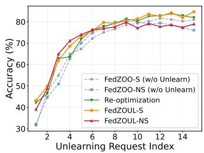

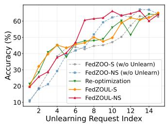

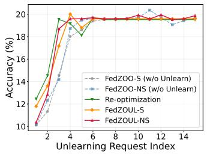

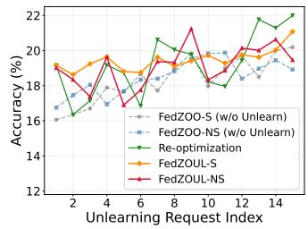  
Fig. 1. Accuracy comparison of FedZOUL-S/NS against FedZOO-S/NS (before unlearning) and re-optimization under stream unlearning requests on four vision datasets. Top-left:MNIST, top-right: FashionMNIST, bottom-left: SVHN, bottom-right: CIFAR-10.

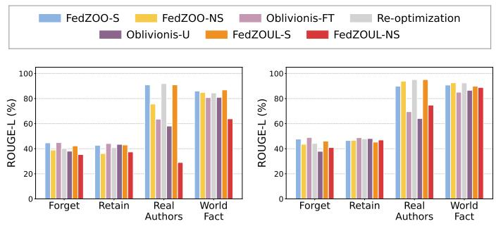  
Fig. 2. ROUGE-L scores of FedZOUL-S and FedZOUL-NS compared with re-optimization and Oblivionis before and after stream unlearning requests on TOFU (Split95). Oblivionis-FT and Oblivionis-U denote fine-tuning and unlearning under the Oblivionis framework, respectively. Left: Llama-3.2-1B-Instruct. Right: Llama-3.2-3B-Instruct.

Taken together, Tables I and II show that our methods trade additional local computation for improved utility while retaining dimension-independent communication. Their higher runtime stems from evaluating bqE sample–direction pairs per participating client in each round, compared with E direction evaluations in FedKSeed Pro and DeComFL. FEDZOO-S and FEDZOO-NS match FedKSeed Pro in per-round communication by exchanging fixed-size scalar-gradient accumulators. Under our settings, this cost exceeds that of DeComFL, whose clients upload only per-update scalars and reconstruct models from server-provided seeds and historical aggregates.

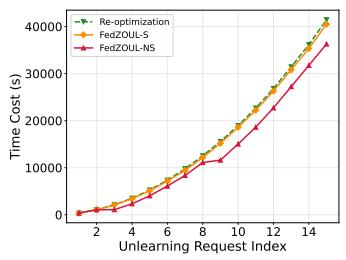

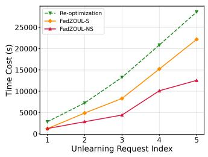  
Fig. 3. Cumulative time cost of FedZOUL-S/NS against re-optimization under stream unlearning requests on four vision datasets. Left: CIFAR-10, right: TOFU (Llama-3.2-3B-Instruct).

Overall, both methods incur modest additional overhead, while their improved utility provides a strong foundation for the unlearning procedures.

2) Performance ofFedZOUL-S and FedZOUL-NS: To evaluate the unlearning algorithms, we introduce a stream of unlearning requests at fixed intervals, with each request made by one or more target clients to remove samples from their local datasets. Figures 1 and 2 summarize the performance on the vision tasks and TOFU under Split95, respectively. On the vision tasks, FEDZOUL-S improves over FEDZOO-S by up to 13.37 percentage points after removing low-quality target data, while its final accuracy remains within 2.77 percentage points of re-optimization across all four tasks. On TOFU, both variants reduce forget-set ROUGE-L after unlearning; although FEDZOUL-S has higher forget-set scores than Oblivionis-U, it better preserves general knowledge, achieving 90.93% and 95.13% on Real Authors for the 1B and 3B models, compared with 58.08% and 64.13% for Oblivionis-U. FEDZOUL-NS achieves competitive final accuracy on the vision tasks and forget-set performance similar to Oblivionis-U and re-optimization on TOFU. However, with the additional randomness introduced by noise injection, FEDZOUL-NS shows larger deviations at some intermediate vision requests and greater degradation in general knowledge, particularly for the 1B model, consistent with the behavior observed for FEDZOO-NS in the federated optimization experiments.

To evaluate efficiency, we compare the cumulative runtime of FEDZOUL-S and FEDZOUL-NS with re-optimization in Figure 3. At the final request, FEDZOUL-S and FEDZOUL-NS reduce runtime by 2.2% and 12.4% on CIFAR-10 and by 22.5% and 56.1% on TOFU with the 3B model, respectively. These savings arise because only a fraction of requests trigger suffix replay, while noise injection and rejection sampling further reduce replay in FEDZOUL-NS. Figures 4 and 5 show similar gains in communication. Unlike FATS-SU and FedRR, which transmit parameter-sized information, our methods exchange fixed-size scalar-gradient accumulators and reduce suffix replay. After 15 requests on CIFAR-10, FEDZOUL-NS incurs 389.1 MB, which is 99.5%, 99.7%, 42.7%, and 5.7% lower than FATS-SU, FedRR, FUDD, and re-optimization, respectively. After five requests on TOFU with the 3B model, FEDZOUL-S and FEDZOUL-NS incur only 12.38 MB and 1.89 MB, compared with 27.08 GB for Oblivionis. Thus, FEDZOUL-NS reduces communication by approximately four orders of magnitude, highlighting its benefit for bandwidth-constrained federated unlearning.

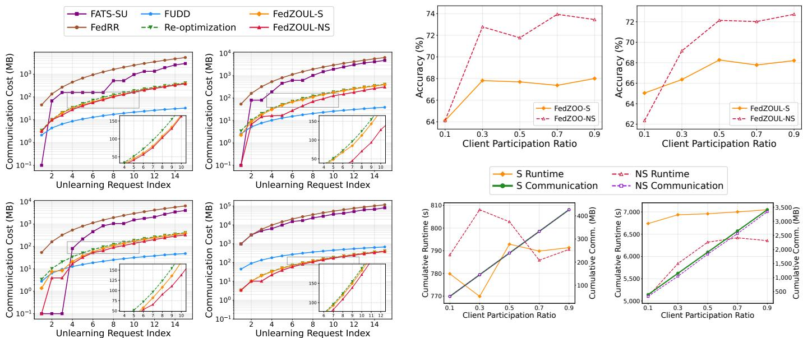

Fig. 4. Cumulative communication cost of FedZOUL-S/NS against reoptimization and first-order unlearning baselines under stream unlearning requests on four vision datasets. Top-left: MNIST, top-right: FashionMNIST, bottom-left: SVHN, bottom-right: CIFAR-10.  
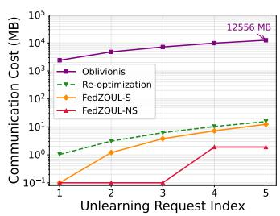

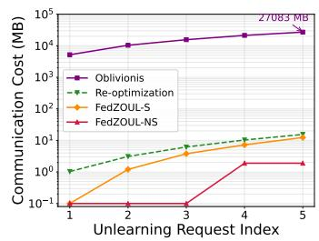  
Fig. 5. Cumulative communication cost of FedZOUL-S/NS against reoptimization and Oblivionis under stream unlearning requests on TOFU (Split95). Left: Llama-3.2-1B-Instruct, right: Llama-3.2-3B-Instruct.  
Fig. 6. Impact of the client sampling ratio $( m / M )$ on accuracy, cumulative runtime, and cumulative communication cost on FashionMNIST. Top row: accuracy; bottom row: cumulative runtime and communication cost. Left column: FedZOO-S/NS; right column: FedZOUL-S/NS.

In terms of resource efficiency, we further evaluate peak GPU memory on vision tasks and TOFU, with detailed results reported in the Appendix A-A. Both FEDZOUL-S and FEDZOUL-NS require less memory than the first-order unlearning baselines. On TOFU, their memory advantage over Oblivionis becomes more pronounced as model size increases. These results complement the time and communication savings and support deployment on devices with limited memory.

3) Impact of the Client Sampling Ratio $m / M \colon$ We study how the client sampling ratio m/M affects the utility and efficiency of FEDZOO-S/NS and FEDZOUL-S/NS on FashionMNIST. This ratio determines client participation and affects the TV-stability bounds of both learning algorithms. Figure 6 shows that increasing $m / M$ from 0.1 to 0.3 improves optimization accuracy, while further increases provide limited gains. For unlearning, FEDZOUL-S achieves its highest accuracy of 68.27% at $m / M = 0 . 5 .$ , whereas FEDZOUL-NS reaches 72.73% at 0.9. These results show that greater participation generally improves model utility, although accuracy does not increase monotonically. Except at $m / M = 0 . 1$ FEDZOO-NS and FEDZOUL-NS achieve higher accuracy than FEDZOO-S and FEDZOUL-S, respectively, indicating that introducing randomness does not reduce model utility.

However, greater participation increases communication overhead, as each selected client uploads a fixed-size accumulator per round. The cumulative communication cost of FEDZOO-S/NS increases by a factor of 8.27 from $m / M =$ 0.1 to 0.9, while runtime changes little under parallel client execution. For unlearning, communication grows approximately linearly and runtime generally increases. This is because a higher client sampling ratio increases both the communication cost per round and the probability that local updates use target samples, which may require replay during unlearning. FEDZOUL-NS consistently uses less time and communication than FEDZOUL-S: Gaussian coupling allows affected updates to be reused until the first rejection. However, its runtime and communication savings decrease from 24.3% and 15.9% at $m / M = 0 . 1$ to 9.9% and 2.1% at 0.9, respectively, indicating a smaller efficiency advantage at higher participation levels, where more frequent use of target samples can increase replay probabilities for both methods.

4) Impact of Hyperparameters K and q: We examine the effects of K and q on FashionMNIST, with detailed results reported in the Appendix A-B. Smaller seed pools generally favor FEDZOO-S, whereas larger pools tend to benefit FEDZOO-NS. Increasing q can improve accuracy for both methods, although the gains are not monotonic. Communication cost grows linearly with K and is independent of q, while runtime increases with both parameters.

## VII. CONCLUSION

We present a framework for efficient federated zeroth-order optimization and exact unlearning based on total variation stability. FEDZOO-S obtains stability through subsampling, and FEDZOUL-S reuses unaffected training computation to achieve efficient exact unlearning. Building on this design,

FEDZOO-NS incorporates Gaussian randomization, allowing FEDZOUL-NS to reuse some affected updates through coupling and further reduce replay for more efficient exact unlearning. We establish theoretical guarantees and demonstrate competitive utility with lower runtime, communication, and memory costs.

## REFERENCES

[1] H. B. McMahan, E. Moore, D. Ramage, S. Hampson, and B. A. y. Arcas, “Communication-efficient learning of deep networks from decentralized data,” in 20th International Conference on Artificial Intelligence and Statistics (AISTATS 2017), Fort Lauderdale, FL, 4 2017, pp. 1273–1282.

[2] Y. Fu, H. You, Y. Zhao, Y. Wang, C. Li, K. Gopalakrishnan, Z. Wang, and Y. Lin, “FracTrain: Fractionally Squeezing Bit Savings Both Temporally and Spatially for Efficient DNN Training,” in 34th Conference on Neural Information Processing Systems (NeurIPS 2020), H. Larochelle, M. Ranzato, R. Hadsell, M.-F. F. Balcan, and H.-T. Lin, Eds., vol. 33. Virtual Conference: Curran Associates Inc., 12 2020, pp. 12 127–12 139.

[3] A. Reisizadeh, A. Mokhtari, H. Hassani, A. Jadbabaie, and R. Pedarsani, “FedPAQ: A Communication-Efficient Federated Learning Method with Periodic Averaging and Quantization,” in 23rd International Conference on Artificial Intelligence and Statistics (AISTATS 2020), vol. 108. Virtual Conference: PMLR, 8 2020, pp. 2021–2031.

[4] L. Ding, H. Zhang, W. Dai, C. Li, W. Lu, Z. Yang, X. Zhang, X. Ma, J. Zou, and H. Xiong, “LBI-FL: Low-Bit Integerized Federated Learning with Temporally Dynamic Bit-Width Allocation,” in 42nd International Conference on Machine Learning (ICML 2025), vol. 267. Vancouver, Canada: PMLR, 7 2025, pp. 13 885–13 899.

[5] Y. Lin, S. Han, H. Mao, Y. Wang, and B. Dally, “Deep Gradient Compression: Reducing the Communication Bandwidth for Distributed Training,” in 6th International Conference on Learning Representations (ICLR 2018). Vancouver, Canada: ICLR, 4 2018.

[6] Y. Tao, S. Chen, C. Zhang, D. Wang, D. Yu, X. Cheng, and F. Dressler, “Private Over-the-Air Federated Learning at Band-Limited Edge,” IEEE Transactions on Mobile Computing, vol. 23, no. 12, pp. 12 444–12 460, 12 2024.

[7] A. Guastella, L. Sani, A. Iacob, A. Mora, P. Bellavista, and N. D. Lane, “SparsyFed: Sparse Adaptive Federated Learning,” in 13rd International Conference on Learning Representations (ICLR 2025), vol. 2025. Singapore, Singapore: OpenReview.net, 4 2025.

[8] Y. Huang, X. Qiao, J. Tang, P. Ren, L. Liu, C. Pu, and J. Chen, “Deepadapter: A collaborative deep learning framework for the mobile web using context-aware network pruning,” in 39th IEEE International Conference on Computer Communications (INFOCOM 2020). Virtual Conference: IEEE, 7 2020, pp. 834–843.

[9] S. Horvath, S. Laskaridis, M. Almeida, I. Leontiadis, S. I. Venieris, and N. D. Lane, “FjORD: Fair and Accurate Federated Learning under Heterogeneous Targets with Ordered Dropout,” in 35th Conference on Neural Information Processing Systems (NeurIPS 2021), M. a. Ranzato, A. Beygelzimer, Y. Dauphin, P. Liang, and J. W. Vaughan, Eds., vol. 34. Virtual Conference: Curran Associates Inc., 12 2021.

[10] S. Chen, Y. Yuan, Y. Tao, T. Wang, Z. Cai, and D. Yu, “Adaptive pruningbased Newton’s method for distributed learning,” Theoretical Computer Science, vol. 1026, p. 114987, 2 2025.

[11] Y. Tao, M. Simsek, and F. Dressler, “AutoSub: Autonomous Submodel Averaging,” in IEEE Annual Congress on Artificial Intelligence of Things (AioT 2026). Kobe, Japan: IEEE, 12 2026, to appear.

[12] L. Zhang, J. Song, A. Gao, J. Chen, C. Bao, and K. Ma, “Be your own teacher: Improve the performance of convolutional neural networks via self distillation,” in IEEE/CVF International Conference on Computer Vision (ICCV 2019). Seoul, South Korea: IEEE, 10 2019, pp. 3712– 3721.

[13] T. Lin, L. Kong, S. U. Stich, and M. Jaggi, “Ensemble distillation for robust model fusion in federated learning,” in 34th Conference on Neural Information Processing Systems (NeurIPS 2020), M. Ranzato, A. Beygelzimer, Y. Dauphin, P. Liang, and J. W. Vaughan, Eds. Virtual Conference: Curran Associates Inc., 12 2020, pp. 2351–2363.

[14] T. Fan, W. Chen, Y. Kang, G. Ma, H. Gu, Y. Song, L. Fan, and Q. Yang, “FedCoT: Federated Chain-of-Thought Distillation for Large Language Models,” in 30th Conference on Empirical Methods in Natural Language Processing (EMNLP 2025). Suzhou, China: ACL, 11 2025, pp. 8546– 8557.

[15] Z. Zhang, Y. Yang, Y. Dai, Q. Wang, Y. Yu, L. Qu, and Z. Xu, “Fedpetuning: When federated learning meets the parameter-efficient tuning methods of pre-trained language models,” in Findings of the Association for Computational Linguistics: ACL 2023. Toronto, Canada: ACL, 7 2023, pp. 9963–9977.

[16] S. Chen, Y. Tao, S. Chen, F. Dressler, Q. Ye, and D. Wang, “Fed-SubMuon: Communication-Efficient Federated LLM Fine-Tuning via Structured Subspace Muon,” in Conference on Empirical Methods in Natural Language Processing (EMNLP 2026). Budapest, Hungary: ACL, 10 2026.

[17] L. Wang, J. Ren, H. Xu, J. Wang, H. Xie, D. E. Keyes, and D. Wang, “Scalable Zeroth-Order Fine-Tuning for Extremely Large Language Models with Limited GPU Memory,” in Second Conference on Language Modeling (COLM 2025). Montreal, Canada: OpenReview.net,´ 10 2025.

[18] Z. Qin, D. Chen, B. Qian, B. Ding, Y. Li, and S. Deng, “Federated Full-Parameter Tuning of Billion-Sized Language Models with Communication Cost under 18 Kilobytes,” in 41st International Conference on Machine Learning (ICML 2024). Vienna, Austria: PMLR, 7 2024.

[19] P. Voigt and A. Von dem Bussche, The EU General Data Protection Regulation (GDPR): A Practical Guide. Springer, 2024.

[20] Y. Tao, C.-L. Wang, M. Pan, D. Yu, X. Cheng, and D. Wang, “Communication Efficient and Provable Federated Unlearning,” Proceedings of the VLDB Endowment, vol. 17, no. 5, pp. 1119–1131, 1 2024.

[21] E. Ullah, T. Mai, A. Rao, R. A. Rossi, and R. Arora, “Machine unlearning via algorithmic stability,” in 34th Annual Conference on Learning Theory (COLT 2021). Boulder, CO: PMLR, 8 2021, pp. 4126–4142.

[22] Y. Tao, W. Yin, H. Xie, Y. Yao, D. Yu, X. Cheng, D. Wang, and F. Dressler, “One-Shot Federated Model Editing for Device Dynamics at the Edge,” IEEE Transactions on Networking, 10 2026, to appear.

[23] W. Fang, Z. Yu, Y. Jiang, Y. Shi, C. N. Jones, and Y. Zhou, “Communication-efficient stochastic zeroth-order optimization for federated learning,” IEEE Transactions on Signal Processing, vol. 70, pp. 5058–5073, 2022.

[24] Z. Ling, D. Chen, L. Yao, Y. Li, and Y. Shen, “On the convergence of zeroth-order federated tuning for large language models,” in 30th ACM SIGKDD Conference on Knowledge Discovery and Data Mining (KDD 2024). Barcelona, Spain: ACM, 8 2024, pp. 1827–1838.

[25] Z. Li, B. Ying, Z. Liu, C. Dong, and H. Yang, “Achieving dimensionfree communication in federated learning via zeroth-order optimization,” in 13rd International Conference on Learning Representations (ICLR 2025), vol. 2025. Singapore, Singapore: OpenReview.net, 4 2025.

[26] ——, “Converge faster, talk less: Hessian-informed federated zerothorder optimization,” in 14th International Conference on Learning Representations (ICLR 2026), vol. 2026. Rio de Janeiro, Brazil: OpenReview.net, 4 2026.

[27] L. Zhang, B. Li, K. K. Thekumparampil, S. Oh, and N. He, “DPZero: private fine-tuning of language models without backpropagation,” in 41st International Conference on Machine Learning (ICML 2024). Vienna, Austria: PMLR, 7 2024, pp. 59 210–59 246.

[28] Z. Liu, J. Lou, W. Bao, Y. Hu, W. Wang, Z. Qin, and K. Ren, “Differentially Private Zeroth-Order Methods for Scalable Large Language Model Fine-tuning,” IEEE Transactions on Information Forensics and Security, vol. 21, pp. 4163 – 4175, 2026.

[29] E. Bao, Y. Jiang, F. Wei, X. Xiao, Z. Li, Y. Li, and B. Ding, “Unlocking the Power of Differentially Private Zeroth-order Optimization for Finetuning \$LLMs\$,” in 34th USENIX Security Symposium (USENIX Security 2025). Seattle, WA: USENIX, 8 2025, pp. 1569–1588.

[30] Y. Liu, L. Xu, X. Yuan, C. Wang, and B. Li, “The right to be forgotten in federated learning: An efficient realization with rapid retraining,” in 41st IEEE International Conference on Computer Communications (INFOCOM 2022). Virtual Conference: IEEE, 5 2022, pp. 1749–1758.

[31] G. Liu, X. Ma, Y. Yang, C. Wang, and J. Liu, “FedEraser: Enabling efficient client-level data removal from federated learning models,” in 29th IEEE/ACM International Symposium on Quality ofService (IWQOS 2021). Chiyoda, Japan: IEEE, 6 2021.

[32] P. Wang, W. Song, H. Qi, C. Zhou, F. Li, Y. Wang, P. Sun, and Q. Zhang, “Server-initiated federated unlearning to eliminate impacts of low-quality data,” IEEE Transactions on Services Computing, vol. 17, no. 3, pp. 1196–1211, 2024.

[33] W. Su, P. Wang, Z. Wang, A. Muhammad, T. Tao, X. Tong, and Q. Zhang, “F2ul: Fairness-aware federated unlearning for data trading,” IEEE Transactions on Mobile Computing, vol. 23, no. 12, pp. 13 539– 13 555, 12 2024.

[34] Z. Pan, Z. Wang, C. Li, K. Zheng, B. Wang, X. Tang, and J. Zhao, “Federated unlearning with gradient descent and conflict mitigation,” in 39th

AAAI Conference on Artificial Intelligence (AAAI 2025). Philadelphia, PA: AAAI, 2 2025, pp. 19 804–19 812.

[35] T. Che, Y. Zhou, Z. Zhang, L. Lyu, J. Liu, D. Yan, D. Dou, and J. Huan, “Fast federated machine unlearning with nonlinear functional theory,” in 40th International Conference on Machine Learning (ICML 2023). Honolulu, HI: PMLR, 7 2023.

[36] L. Zhang, T. Zhu, H. Zhang, P. Xiong, and W. Zhou, “Fedrecovery: Differentially private machine unlearning for federated learning frameworks,” IEEE Transactions on Information Forensics and Security, vol. 18, pp. 4732–4746, 2023.

[37] Y. Fraboni, M. Van Waerebeke, K. Scaman, R. Vidal, L. Kameni, and M. Lorenzi, “Sifu: Sequential informed federated unlearning for efficient and provable client unlearning in federated optimization,” in 27th International Conference on Artificial Intelligence and Statistics (AISTATS 2024). Valencia, Spain: PMLR, 5 2024, pp. 3457–3465.

[38] H. Wu, Y. Tao, A. Zhou, S. Chen, F. Dressler, and D. Yu, “Certified Unlearning in Decentralized Federated Learning,” in 45th IEEE International Conference on Computer Communications (INFOCOM 2026). Tokyo, Japan: IEEE, 5 2026, pp. 1–10.

[39] H. Wu, J. Yang, S. Chen, D. Wang, D. Yu, and Y. Tao, “Trajectory-Aware Certified Decentralized Unlearning via SGD Stability,” in 43rd International Conference on Machine Learning (ICML 2026), Poster Session. Seoul, South Korea: PMLR, 7 2026.

[40] C. Zhou, C. Pan, M. Li, and P. Wang, “Federated unlearning with fast recovery,” IEEE Transactions on Mobile Computing, vol. 24, no. 10, pp. 9709 – 9725, 2025.

[41] A. Mora, L. Valerio, and P. Bellavista, “Federated Unlearning via Distilled Data,” IEEE Transactions on Mobile Computing, vol. 25, no. 7, pp. 10 607 – 10 618, 2026.

[42] F. Zhang, X. Yan, T. Wu, W. Li, T. Chen, Y. Cao, R. Yan, L. Huang, W. Y. B. Lim, and Q. Yang, “Oblivionis: A Lightweight Learning and Unlearning Framework for Federated Large Language Models,” in 40th AAAI Conference on Artificial Intelligence (AAAI 2026), vol. 40. Singapore, Singapore: AAAI, 1 2026, pp. 28 185–28 193.

[43] J. Li, Y. Tao, B. He, and M. Ding, “Not All Change Is Damage: Update-Matched Unlearning for Large Language Models,” arXiv, cs.LG 2610.21230, 10 2026. [Online]. Available: https: //arxiv.org/abs/2610.21230

[44] Y. Lecun, L. Bottou, Y. Bengio, and P. Haffner, “Gradient-based learning applied to document recognition,” Proceedings of the IEEE, vol. 86, no. 11, pp. 2278–2324, 11 1998.

[45] H. Xiao, K. Rasul, and R. Vollgraf, “Fashion-MNIST: a Novel Image Dataset for Benchmarking Machine Learning Algorithms,” arXiv, cs.LG 1708.07747, 8 2017.

[46] Y. Netzer, T. Wang, A. Coates, A. Bissacco, B. Wu, and A. Y. Ng, “Reading digits in natural images with unsupervised feature learning,” in 24th International Conference on Neural Information Processing Systems (NIPS 2011), NIPS Workshop on Deep Learning and Unsupervised Feature Learning, Granada, Spain, 12 2011.

[47] A. Krizhevsky, “Learning multiple layers of features from tiny images,” University of Toronto, Technical Report TR-2009, 4 2009.

[48] P. Maini, Z. Feng, A. Schwarzschild, Z. C. Lipton, and J. Z. Kolter, “TOFU: A Task of Fictitious Unlearning for LLMs,” in 38th Conference on Neural Information Processing Systems (NeurIPS 2024), NeurIPS 2024 Workshop on Red Teaming GenAI, vol. 37. Vancouver, Canada: Curran Associates Inc., 12 2024.

[49] R. Vershynin, “Introduction to the non-asymptotic analysis of random matrices,” in Compressed Sensing: Theory and Applications. Cambridge University Press, 2012, pp. 210–268.

# APPENDIX A ADDITIONAL EXPERIMENTAL RESULTS

## A. GPU Memory cost of FedZOUL-S/NS

We evaluate peak GPU memory in Figure 7. FEDZOUL-S and FEDZOUL-NS achieve the lowest peak memory across all tasks by avoiding parameter-sized gradients and backpropagation activations, while maintaining performance comparable to re-optimization. On CIFAR-10, each method requires 128.08 MB, 60.8% below FedRR and 54.0% below FUDD. On TOFU, their peak memory is 6.63 GB for the 3B model, compared with 11.15 GB for Oblivionis, and the reduction relative to Oblivionis increases from 24.3% for the 1B model to 40.5% for the 3B model. These results show that our methods maintain low peak memory across tasks, supporting deployment on resource-constrained edge devices. This advantage becomes more pronounced as model size increases, indicating favorable scalability.

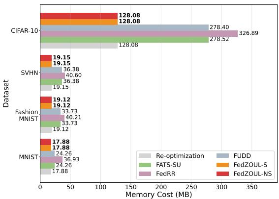

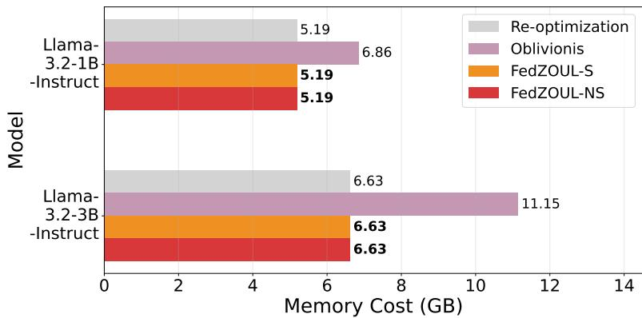  
Fig. 7. Peak GPU memory of FedZOUL-S/NS against re-optimization and first-order unlearning baselines under stream unlearning requests. Left: four vision datasets. Right: TOFU (Split95).

## B. Impact of Hyperparameters K and q

We investigate how the accuracy, communication cost, and time cost of FEDZOO-S and FEDZOO-NS vary with q and K on FashionMNIST, as shown in Figure 8. For FEDZOO-S, increasing q generally improves accuracy, although the gains are not monotonic. At $K = 1 0 2 4$ , accuracy increases from 64.46% at $q = 1$ to 68.12% at $q = 3$ , before decreasing to 67.71% at $q = 4$ . FEDZOO-NS also exhibits a non-monotonic response: increasing q from 1 to 2 improves accuracy for every tested K. Its best accuracy is attained at $q = 2$ for $K \in \{ 1 0 2 4 , 2 0 4 8 , 4 0 9 6 \}$ and at $q = 3$ for $K = 8 1 9 2$

The effect of K differs between the two methods. FEDZOO-S achieves its highest accuracy at $K = 1 0 2 4$ for $q \in \{ 2 , 3 , 4 \}$ whereas $K = 2 0 4 8$ performs best at $q = 1$ . Increasing K can reduce accuracy: at $q = 3$ , accuracy falls from 68.12% to 64.29% as K increases from 1024 to 8192. For FEDZOO-NS, larger seed pools generally yield higher accuracy, but the trend is not monotonic. For example, at $q = 1$ , accuracy increases from 55.38% at K = 1024 to $6 4 . 1 1 \%$ at $K = 4 0 9 6$ , then decreases to 60.19% at $K = 8 1 9 2$

In terms of system overhead, the per-round communication cost is independent of q and increases linearly with K, with identical costs for both methods. Each of the $m = 1 0$ participating clients uploads a K-dimensional float32 accumulator, while the server broadcasts the global accumulator, resulting in a per-round communication cost of $4 ( m + 1 ) K = 4 4 K$ bytes. The average per-round runtime increases with both q and K in all tested configurations. At $K = 4 0 9 6 .$ , increasing q from 1 to 2 improves FEDZOO-NS accuracy from 64.11% to 71.26%, while increasing per-round runtime from 2.883 to 3.073 s and leaving communication cost unchanged. We use $K = 4 0 9 6$ as an intermediate pool size and $q = 1$ to limit local computation.

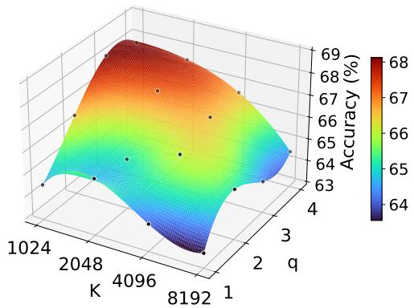

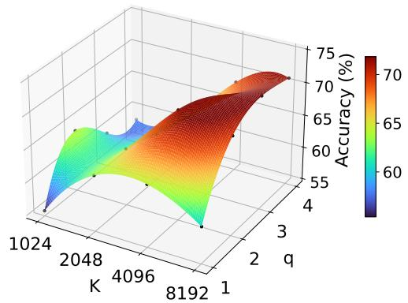

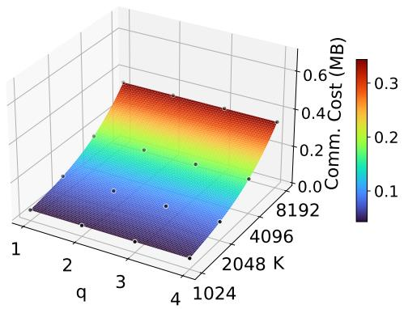

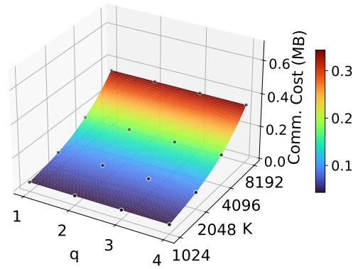

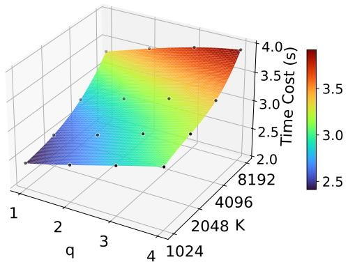

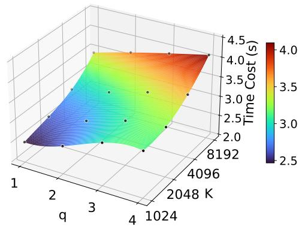  
Fig. 8. Impact of the number of per-sample perturbation directions (q) and the scalar gradient accumulator size (K) on the accuracy, per-round communication cost, and per-round time cost of FedZOO-S and FedZOO-NS on FashionMNIST. Left column: FedZOO-S, right column: FedZOO-NS. Top row: accuracy, middle row: communication cost, bottom row: time cost.

## APPENDIX B

## COMPLETE THEORETICAL ANALYSIS

We now establish the theoretical guarantees of the proposed learning and unlearning procedures. Two questions are central. First, after a sample is deleted, we need to show that the state returned by the unlearning algorithm has exactly the same distribution as a fresh execution on the retained data, while avoiding a full rerun whenever possible. Second, because both training algorithms reuse a finite set of perturbation directions, we need to understand what optimization guarantee this restriction provides for the original federated objective.

The two learning algorithms support exact unlearning in different ways. In FEDZOO-S, a deletion has no effect unless the removed sample was actually selected during training. In FEDZOO-NS, Gaussian noise provides an additional possibility: even when the deleted sample changes a local update, the old and retained-data updates can sometimes be coupled to the same value. We first analyze these two mechanisms and their resulting unlearning costs. We then study the optimization behavior of the learning algorithms under the shared finite seed pool and relate the resulting subspace guarantee to the full model space.

The perturbation pool is sampled independently of the federated data and is shared by the neighboring executions considered below. We therefore condition on its realization throughout the analysis. All conditional guarantees remain valid after averaging

over the seed-pool randomness.

We first ask how a deletion can change the state that has already been produced. Exact unlearning requires more than a nearby model: after processing the request, the entire maintained state must have the same distribution as if the deleted sample had never been present. The useful computation is therefore precisely the part of the realized trajectory that can be kept withou changing this law.

Let $T = R E$ denote the total number of local positions, and index them in chronological order by

$$
\tau ( r , t ) = ( r - 1 ) E + t .\tag{33}
$$

For a request arriving after $( R _ { u l } , t _ { u l } )$ , write $T _ { u l } = \tau ( R _ { u l } , t _ { u l } )$ . A position contains the local updates of the m participating clients and, when $t = E$ , the corresponding server aggregation. Position zero denotes the initialization before the first client set is sampled.

For $\bullet \in \{ \mathsf { S } , \mathsf { N S } \}$ , let $\mathcal { O } _ { \bullet } ^ { [ \tau ] } ( \mathcal { D } )$ denote the joint law of the optimization variables and all saved state after τ positions when training on D. We use $\mathcal { O } _ { \bullet , \mathrm { o u t } } ( \mathcal { D } )$ for the marginal law of the final reconstructed model. With this notation, exact unlearning at $T _ { u l }$ means that the state produced after processing the deletion has law $\mathcal { O } _ { \bullet } ^ { [ T _ { u l } ] } ( \mathcal { D } ^ { - } )$ , and continuing training from that state must yield $\mathcal { O } _ { \bullet } ^ { [ T ] } ( \mathcal { D } ^ { - } )$ . Whenever part of the trajectory is rerun, the newly generated state replaces the old saved state over that part of the execution.

## A. FedZOO-S Stability and Exact Unlearning

We first consider FEDZOO-S and its unlearning procedure FEDZOUL-S.

A deleted sample can change a FEDZOO-S trajectory only if it was actually drawn into a local mini-batch. This observation suggests coupling the mini-batches before and after deletion so that they remain identical whenever the deleted sample was not selected. The following elementary fact gives the coupling we need.

Lemma 1 (Deletion coupling for a uniform mini-batch). Let D contain n samples, let $x ^ { - } \in \mathcal { D } .$ , and let ${ \mathcal { D } } ^ { - } = { \mathcal { D } } \setminus \{ x ^ { - } \}$ where $n - 1 \geq b .$ . Draw $\boldsymbol { B }$ uniformly from the size-b subsets of D. Construct $B ^ { - }$ as follows:

$$
\begin{array} { r } { B ^ { - } = \left\{ \begin{array} { l l } { B , } & { x ^ { - } \notin B , } \\ { \widehat { B } , } & { x ^ { - } \in B , } \end{array} \right. } \end{array}\tag{34}
$$

where, on the second branch, $\widehat { B }$ is drawn uniformly from the size-b subsets of $\mathcal { D } ^ { - }$ , independently of B. Then $B ^ { - }$ is uniform over the size-b subsets of $\mathcal { D } ^ { - }$ and

$$
\mathbb { P } ( B ^ { - } \neq B ) = \frac { b } { n } .\tag{35}
$$

Proof of Lemma 1. Fix a size-b subset $A \subseteq { \mathcal { D } } ^ { - }$ . The first branch outputs A precisely when $B = A$ , while the second branch is entered with probability $b / n$ and then outputs A with probability $1 / \binom { n - 1 } { b }$ . Hence

$$
\begin{array} { l } { \displaystyle \mathbb { P } ( \mathcal { B } ^ { - } = A ) = \frac { 1 } { { \binom { n } { b } } } + \frac { b } { n } \frac { 1 } { { \binom { n - 1 } { b } } } } \\ { \displaystyle = \frac { n - b } { n } \frac { 1 } { { \binom { n - 1 } { b } } } + \frac { b } { n } \frac { 1 } { { \binom { n - 1 } { b } } } = \frac { 1 } { { \binom { n - 1 } { b } } } . } \end{array}\tag{36}
$$

Since the two mini-batches cannot agree on the second branch, the disagreement probability is $b / n$

When $\begin{array} { r } { B ^ { - } = B , } \end{array}$ use the same independently sampled size-q seed set for every sample in the two executions. On the second branch, draw the retained execution’s sample–seed correspondence afresh according to FEDZOO-S. Because seed sampling is independent of data sampling, the second execution has the correct joint mini-batch–seed marginal.

Consider one deletion $x ^ { - } \in \mathcal { D } _ { c }$ − and write $n _ { c ^ { - } } = | \mathcal { D } _ { c ^ { - } } | .$ . At local position $( r , t )$ , define

$$
\mathcal { H } _ { r , t } ( x ^ { - } ) = \{ c ^ { - } \in \mathcal { C } ^ { r } , \ x ^ { - } \in B _ { c ^ { - } } ^ { r , t } \} .\tag{37}
$$

For the first τ local positions, let

$$
\Lambda _ { 5 } ( \tau , c ^ { - } ) = \operatorname* { m i n } \left\{ 1 , \frac { \tau m b } { M n _ { c ^ { - } } } \right\} .\tag{38}
$$

The same coupling can now be followed through the whole training state. Use the same initialization and client set in the two executions, couple unaffected clients identically, and apply Lemma 1 whenever the affected client participates. Until the deleted sample first appears in a mini-batch, the sampled data, seed sets, coefficient increments, accumulators, and reconstructed models are identical. If a first hit occurs, the retained-data execution draws fresh local randomness from that position onward, while keeping the already sampled client set for the remainder of the current round. Thus the second execution has exactly the law of FEDZOO-S on the retained data.

At any local position, a hit occurs with probability

$$
{ \frac { m } { M } } { \frac { b } { n _ { c ^ { - } } } } .\tag{39}
$$

The same client set is reused within a round, so these events need not be independent. A union bound over the first τ positions nevertheless gives

$$
\mathbb { P } ( \mathrm { t h e ~ t w o ~ s t a t e s ~ d i f f e r ~ b y ~ p o s i t i o n ~ } \tau ) \le \Lambda _ { 5 } ( \tau , c ^ { - } ) .\tag{40}
$$

Theorem 1 (TV stability of FedZOO-S). For every admissible adjacent pair differing by deletion of $x ^ { - } \in \mathcal { D } _ { c ^ { - } }$

$$
\begin{array} { r } { \mathrm { T V } \left( \mathscr { O } _ { 5 , \mathrm { o u t } } ( \mathcal { D } ) , \mathscr { O } _ { 5 , \mathrm { o u t } } ( \mathcal { D } ^ { - } ) \right) \leq \Lambda _ { 5 } ( T , c ^ { - } ) . } \end{array}\tag{41}
$$

If a target $0 < \rho \leq 1$ is fixed before training and

$$
\frac { T m b } { M \underline { { n } } } \leq \rho ,\tag{42}
$$

then FEDZOO-S is ρ-sample-level TV stable on the dataset class satisfying (47).

Proof of Theorem 1. The construction above is a valid coupling of the complete training states on $\mathcal { D }$ and $\mathcal { D } ^ { - }$ . By Eq. (40), their disagreement probability at $\tau = T$ is at most $\Lambda _ { 5 } ( T , c ^ { - } )$ . Projecting the coupled states onto the final reconstructed model can only decrease total variation. Under (42), $n _ { c ^ { - } } \geq \underline { { n } }$ gives $\Lambda _ { \mathsf { S } } ( T , c ^ { - } ) \leq \rho$ . Symmetry of total variation covers both orientations of every adjacent pair. □

The bound follows the way a deletion enters the trajectory. At each local position, the target client is selected with probability $m / M$ , and conditional on participation, the deleted sample enters its mini-batch with probability $b / n _ { c ^ { - } }$ . Thus, increasing client participation or the mini-batch size makes it more likely that the deletion changes the realized trajectory. No additional noise is needed for this form of stability.

This stability statement also suggests the unlearning procedure itself. If the deleted sample never appears before the request, the realized state already has the retained-data law and can be kept. Otherwise, the two executions agree up to the first affected mini-batch, so training only needs to be rerun from that point. Let $\mathcal { U } _ { \mathsf { S } } ^ { [ T _ { u l } ] }$ denote the state returned by FEDZOUL-S at position $T _ { u l }$ after processing the deletion, and let $\mathcal { U } _ { \mathsf { S } } ^ { T _ { u l }  T }$ denote the state after the remaining training positions are completed.

Theorem 2 (Exact unlearning of FedZOUL-S). For every valid single-sample deletion $x ^ { - } \in \mathcal { D } _ { c ^ { - } }$ − arriving after local position $T _ { u l }$

$$
\mathcal { U } _ { 5 } ^ { [ T _ { u l } ] } \left( \mathcal { O } _ { 5 } ^ { [ T _ { u l } ] } ( \mathcal { D } ) , \{ x ^ { - } \} \right) \stackrel { d } { = } \mathcal { O } _ { 5 } ^ { [ T _ { u l } ] } ( \mathcal { D } ^ { - } ) .\tag{43}
$$

Consequently,

$$
\mathcal { U } _ { 5 } ^ { T _ { u l }  T } ( \mathcal { O } _ { 5 } ^ { [ T _ { u l } ] } ( \mathcal { D } ) , \{ x ^ { - } \} ) \stackrel { d } { = } \mathcal { O } _ { 5 } ^ { [ T ] } ( \mathcal { D } ^ { - } ) ,\tag{44}
$$

where both equalities hold jointly over the model and every maintained state. If Replay denotes the event that the deletion causes training to be rerun from an affected position, then

$$
\mathbb { P } ( \mathsf { R e p l a y } _ { \mathsf { S } } ) \leq \Lambda _ { \mathsf { S } } ( T _ { u l } , c ^ { - } ) \leq \frac { T _ { u l } m b } { M n _ { c ^ { - } } } .\tag{45}
$$

Under (42), this probability is at most $\rho .$

Proof of Theorem 2. Use the same coupling as in the proof of Theorem 1 through position $T _ { u l } .$ , and let $( r ^ { \star } , t ^ { \star } )$ be the first hit in the original execution.

If no hit occurs, the two executions are identical up to the request time. After removing $x ^ { - }$ , FEDZOUL-S keeps that state and continues from Next $( R _ { u l } , t _ { u l } )$ . For the remainder of the current round it keeps the saved client set and current local states, while all future mini-batches and seed sets are drawn from the retained datasets. This is the retained-data continuation of the second coupled execution.

If the first hit is $( r ^ { \star } , t ^ { \star } )$ , the coupled executions agree through the state immediately before that position. The unlearning algorithm restores that common server and participating-client state and replays all participating clients from $( r ^ { \star } , t ^ { \star } )$ on the retained datasets. The saved client set $\mathcal { C } ^ { r ^ { \star } }$ is kept for the remainder of the current round, while all local randomness from the hit onward and all randomness in later rounds follow the retained-data transition law.

In both branches, the state returned at $T _ { u l }$ has law $\mathcal { O } _ { 5 } ^ { [ T _ { u l } ] } ( D ^ { - } )$ . Completing the horizon with the retained-data kernels proves (44). Training is rerun only if a hit appears before the request, giving (45). □

Nothing in the preceding argument depends on there being only one request. It can be applied repeatedly, provided future deletions are not chosen in response to the randomness revealed by earlier training or unlearning. Consider a valid request stream

$$
\bigl ( c _ { j } ^ { - } , x _ { j } ^ { - } , T _ { u l } ^ { ( j ) } \bigr ) _ { j = 1 } ^ { k } , \qquad 0 \leq T _ { u l } ^ { ( 1 ) } \leq \cdot \cdot \cdot \leq T _ { u l } ^ { ( k ) } \leq T .\tag{46}
$$

The deleted samples and their request times may be fixed in advance or generated by external randomness, but they do not depend on the realized models, sampled mini-batches, Gaussian noise, or the outcomes of previous deletion requests. Arrival positions refer to the original training timeline and do not count any extra computation used to process earlier requests.

Let $\mathcal { D } ^ { ( 1 ) } = \mathcal { D }$ , and let $\mathcal { D } ^ { ( j ) }$ and $\mathcal { D } ^ { ( j + 1 ) }$ be the datasets immediately before and after request $j .$ Thus $x _ { j } ^ { - } \in \mathcal { D } _ { c _ { j } ^ { - } } ^ { ( j ) }$ is removed to form $\mathcal { D } _ { c _ { i } ^ { - } } ^ { ( j + 1 ) }$ , while the other local datasets are unchanged. We keep the learning hyperparameters fixed throughout the stream and assume that every retained client dataset has size at least

$$
\underline { { n } } \le \operatorname* { m i n } _ { \substack { 1 \le j \le k + 1 , c \in [ M ] } } | \mathcal { D } _ { c } ^ { ( j ) } | , \qquad \underline { { n } } \ge b .\tag{47}
$$

For a single request we use the actual pre-request dataset size; n is only needed when one common bound is used for the whole stream.

Corollary 1 (Sequential deletion requests for FedZOUL-S). Consider the valid non-adaptive single-sample request stream in Eq. (46), and let $n _ { j } = | \mathcal { D } _ { c _ { j } ^ { - } } ^ { ( j ) } |$ be the affected client’s pre-request data size. After every request $j ,$ the returned state at $T _ { u l } ^ { ( j ) }$ has law $\mathcal { O } _ { 5 } ^ { [ T _ { u l } ^ { ( j ) } ] } ( \mathcal { D } ^ { ( j + 1 ) } )$ ). If $N _ { \mathsf { S } } ^ { \mathrm { r e p } }$ is the number of requests that trigger replay, then

$$
{ \mathbb E } [ N _ { 5 } ^ { \mathrm { r e p } } ] \leq \sum _ { j = 1 } ^ { k } \operatorname* { m i n } \left\{ 1 , \frac { T _ { u l } ^ { ( j ) } m b } { M n _ { j } } \right\} ,\tag{48}
$$

$$
\mathbb { P } ( N _ { 5 } ^ { \mathrm { r e p } } \geq 1 ) \leq \operatorname* { m i n } \left\{ 1 , \sum _ { j = 1 } ^ { k } \frac { T _ { u l } ^ { ( j ) } m b } { M n _ { j } } \right\} .\tag{49}
$$

Under (47) and (42), these bounds are at most $k \rho$ and min $\{ 1 , k \rho \}$ , respectively.

Proof of Corollary 1. Fix the request stream and the perturbation pool. Let $X _ { j } ^ { - }$ and $X _ { j } ^ { + }$ be the complete saved states immediately before and after processing request $j ,$ , both at position $T _ { u l } ^ { ( j ) }$ . We prove by induction that

$$
\begin{array} { r l } & { X _ { j } ^ { - } \triangleq \mathcal { O } _ { 5 } ^ { [ T _ { u l } ^ { ( j ) } ] } ( \mathcal { D } ^ { ( j ) } ) , } \\ & { X _ { j } ^ { + } \triangleq \mathcal { O } _ { 5 } ^ { [ T _ { u l } ^ { ( j ) } ] } ( \mathcal { D } ^ { ( j + 1 ) } ) . } \end{array}\tag{50}
$$

The first equality for $j = 1$ follows from the initial learning run. Given its validity for request $j ,$ apply Theorem 2 with the fixed deletion $\boldsymbol { x } _ { j } ^ { - }$ and fresh unlearning randomness to obtain the second equality. Continue with the retained-data learning kernels and fresh randomness until $T _ { u l } ^ { ( j + 1 ) }$ . This gives the first equality for request $j + 1$ and closes the induction. Equal arrival positions require no intervening learning. These are marginal state laws over all learning and unlearning randomness; they do not condition on the particular saved state produced by earlier requests or on whether those requests required replay.

Let $I _ { j }$ indicate whether request $j$ triggers replay. Applying the single-request replay bound to the first marginal in Eq. (50) gives

$$
\mathbb { E } [ I _ { j } ] = \mathbb { P } ( I _ { j } = 1 ) \le \operatorname* { m i n } \left\{ 1 , \frac { T _ { u l } ^ { ( j ) } m b } { M n _ { j } } \right\} .
$$

Since $\begin{array} { r } { N _ { 5 } ^ { \mathrm { r e p } } = \sum _ { j = 1 } ^ { k } I _ { j } } \end{array}$ , linearity of expectation proves Eq. (48); a union bound proves Eq. (49). Independence of the $I _ { j }$ is not needed. The bounds are uniform in the perturbation pool, so averaging over it preserves them. The calibrated bounds follow from $n _ { j } \geq \underline { { n } }$ and $T _ { u l } ^ { ( j ) } \le T$ □

For FEDZOO-NS, subsampling plays the same first role: if the deleted sample is not selected, nothing changes. The difference is what happens after a hit. Replacing that sample changes the mean of the noisy coefficient vector but not its covariance, so the old and retained-data update distributions still overlap. This overlap can keep the two executions together even at an affected step. We quantify that one-step discrepancy first and then accumulate it over training.

B. FedZOO-NS Stability

For probability measures $P \ll Q$ , write

$$
D _ { \mathrm { K L } } ( P \| Q ) = \int \log \left( \frac { d P } { d Q } \right) d P ,
$$

$$
D _ { 2 } ( P \| Q ) = \log \int \left( \frac { d P } { d Q } \right) ^ { 2 } d Q ,\tag{51}
$$

and let $\chi ^ { 2 } ( P \| Q ) = \exp ( D _ { 2 } ( P \| Q ) ) - 1$

Lemma 2 (Single-deletion replacement coupling). Let ${ \mathcal { D } } = { \mathcal { D } } ^ { - } \cup \{ x ^ { - } \}$ with $| \mathcal { D } | = n$ and $| { \mathcal { D } } ^ { - } | = n - 1 \geq b$ . Draw B uniformly from the size-b subsets of D and construct

$$
B ^ { \prime } = \left\{ { \begin{array} { l l } { B , } & { x ^ { - } \notin B , } \\ { \left( B \setminus \{ x ^ { - } \} \right) \cup \{ Y \} , } & { x ^ { - } \in B , } \end{array} } \right.\tag{52}
$$

where, on the second branch, Y is uniform on $\mathcal { D } ^ { - } \setminus ( B \setminus \{ x ^ { - } \} )$ , independently of the seed sets and Gaussian noise. Then $B ^ { \prime }$ is uniform over the size-b subsets of $\mathcal { D } ^ { - }$ , conditional on either branch and unconditionally. Keeping the seed sets of retained samples and assigning the seed set of x− to Y gives the joint mini-batch–seed law of a retained-data local step.

Proof of Lemma 2. Conditional on $x ^ { - } \notin B ,$ the original mini-batch is already a uniform size-b subset of $\mathcal { D } ^ { - }$ . Conditional on a hit, fix a size-b subset $A \subseteq { \mathcal { D } } ^ { - }$ . For each $y \in A ,$ , the output is A when $B \setminus \{ x ^ { - } \} = A \setminus \{ y \}$ and $Y = y$ . Hence

$$
\mathbb { P } ( \mathcal { B } ^ { \prime } = A \mid x ^ { - } \in \mathcal { B } ) = \frac { b } { { \binom { n - 1 } { b - 1 } } ( n - b ) } = \frac { 1 } { { \binom { n - 1 } { b } } } .\tag{53}
$$

The two branches therefore have the same retained mini-batch law.

Conditional on any original batch and replacement, the seed sets assigned to the b resulting samples remain independent, each with the uniform size-q law on S. Indeed, replacement only relabels these seed sets and is independent of their values. This conditional law depends on neither the original batch nor the replacement. Averaging over their preimages proves the joint mini-batch–seed claim. □

The mini-batch itself remains an unordered set. For the coupling argument, we only need to match the coefficients associated with corresponding sample–seed pairs in the two executions. If the deleted sample is not selected, the two batches and all their seed sets are identical. If it is selected, the replacement sample inherits its seed set, while every retained sample keeps its original seeds. We can therefore compare the two clean coefficient vectors after placing corresponding sample–seed pairs in the same deterministic order. This ordering is only a representation: permuting the pairs together with their labels leaves both the Gaussian law and the accumulated seed-coordinate update unchanged.

Under this correspondence, only the q coefficients that belonged to the deleted sample can change. Since each clipped and normalized clean coefficient lies in $[ - C / ( b q ) , C / ( b q ) ]$ , the two clean vectors satisfy

$$
\| h - h ^ { \prime } \| _ { 2 } \leq \frac { 2 C } { b \sqrt { q } } .\tag{54}
$$

Here $h ^ { \prime }$ denotes the retained-data coefficients written in the matched ordering. This is the only sensitivity bound needed below. For output stability, it is enough to follow the resulting seed-coordinate increment, because the local model and accumulator updates are deterministic once that increment is fixed. The saved sample identities and sample–seed correspondence matter for exact unlearning, but they do not affect the distributional comparison of the model updates themselves.

Lemma 3 (One-step divergence after mini-batch subsampling). Fix a common pre-update state and suppose the affected client participates. Let n be its local data size before deletion. Let $P$ and $Q$ be the conditional laws of the resulting seed-coordinate increment on $\mathcal { D } _ { c }$ and $\mathcal { D } _ { c } ^ { - }$ , respectively. Then

$$
D _ { \mathrm { K L } } ( P \Vert Q ) \leq D _ { 2 } ( P \Vert Q ) \leq \varepsilon _ { \mathrm { s t e p } } ( n , \sigma _ { \rho } ) ,\tag{55}
$$

where

$$
\varepsilon _ { \mathrm { s t e p } } ( n , \sigma ) = \log \left[ 1 + \left( \frac { b } { n } \right) ^ { 2 } \left( \exp \left( \frac { 4 C ^ { 2 } / ( b ^ { 2 } q ) } { \sigma ^ { 2 } } \right) - 1 \right) \right] .\tag{56}
$$

Proof of Lemma 3. Let $\beta = b / n$ , and let $P _ { 1 }$ denote the law of the seed-coordinate increment conditional on $x ^ { - }$ belonging to the original mini-batch. Conditional on a non-hit, the batch and its sample-specific seed sets have the retained-data law. Since the increment does not depend on how those pairs are enumerated,

$$
P = ( 1 - \beta ) Q + \beta P _ { 1 } .\tag{57}
$$

On a hit, couple the batches by Lemma 2. Let λ collect the original batch, its replacement $Y ,$ and all sample-specific seed sets, and let $\pi$ be their joint law conditional on the hit. Given $\lambda ,$ write both coefficient vectors in the original pair coordinates. Their Gaussian laws are

$$
G _ { \lambda } = \mathcal { N } ( h _ { \lambda } , \sigma _ { \rho } ^ { 2 } I _ { b q } ) , \quad \quad G _ { \lambda } ^ { \prime } = \mathcal { N } ( h _ { \lambda } ^ { \prime } , \sigma _ { \rho } ^ { 2 } I _ { b q } ) .
$$

Define augmented measures $\overline { { { P } } } _ { 1 } ( d \lambda , d v ) = \pi ( d \lambda ) G _ { \lambda } ( d v )$ and $\overline { { { Q } } } ( d \lambda , d v ) = \pi ( d \lambda ) G _ { \lambda } ^ { \prime } ( d v )$ . They share the same latent measure. Conditional Gaussian integration gives

$$
\begin{array} { r l } & { \chi ^ { 2 } ( \overline { { P } } _ { 1 } \| \overline { { Q } } ) = \mathbb { E } _ { \lambda \sim \pi } \left[ \exp \left( \frac { \| h _ { \lambda } - h _ { \lambda } ^ { \prime } \| _ { 2 } ^ { 2 } } { \sigma _ { \rho } ^ { 2 } } \right) - 1 \right] } \\ & { \quad \quad \quad \leq \exp \left( \frac { 4 C ^ { 2 } / ( b ^ { 2 } q ) } { \sigma _ { \rho } ^ { 2 } } \right) - 1 . } \end{array}\tag{58}
$$

Map both coefficient vectors to their seed-coordinate increments by summing coefficients that use the same seed. Under the matched sample–seed correspondence, the same labeled coefficients are summed on the two sides; only their values may differ. Lemma 2 gives the correct retained batch–seed law, so the second pushforward is exactly $Q .$ Data processing therefore yields

$$
\chi ^ { 2 } ( P _ { 1 } \| Q ) \leq \exp \biggl ( \frac { 4 C ^ { 2 } / ( b ^ { 2 } q ) } { \sigma _ { \rho } ^ { 2 } } \biggr ) - 1 .\tag{59}
$$

Writing $u = d P _ { 1 } / d Q .$ , Eq. (57) implies

$$
\begin{array} { c } { { \exp ( D _ { 2 } ( P \| Q ) ) = \displaystyle \int ( ( 1 - \beta ) + \beta u ) ^ { 2 } d Q } } \\ { { = 1 + \beta ^ { 2 } \chi ^ { 2 } ( P _ { 1 } \| Q ) . } } \end{array}\tag{60}
$$

Combining this identity with Eq. (59) and $D _ { \mathrm { K L } } \leq D _ { 2 }$ proves the claim. The argument concerns the actual seed-coordinate update; no distributional comparison of an arbitrary storage ordering is needed. □

Theorem 3 (Output TV stability of FedZOO-NS). Consider an adjacent pair D and $\mathcal { D } ^ { - }$ differing by the deletion of $x ^ { - } \in \mathcal { D } _ { c ^ { - } }$ and let $n _ { c ^ { - } } = | \mathcal { D } _ { c ^ { - } } |$ before deletion. Conditionally on the fixed seed pool,

$$
\begin{array} { r l } & { \operatorname { T V } \left( \mathcal { O } _ { \mathsf { N S , o u t } } ( \mathcal { D } ) , \mathcal { O } _ { \mathsf { N S , o u t } } ( \mathcal { D } ^ { - } ) \right) } \\ & { \quad \leq \operatorname* { m i n } \left\{ 1 , \sqrt { \frac { T m } { 2 M } } \varepsilon _ { \mathrm { s t e p } } ( n _ { c ^ { - } } , \sigma _ { \rho } ) \right\} . } \end{array}\tag{61}
$$

The same bound holds unconditionally over the random seed pool.

Proof of Theorem 3. For the stability proof, condition on the sampled client sets and the seed-coordinate increments generated before the current local step. Mini-batch identities and the storage order of sample–seed coefficients need not be retained in this conditioning. Given $z ,$ the initial state, and the preceding increments, the current model is deterministic, so Lemma 3 applies to the next update from the same pre-update model in the two executions.

Fix this history before round r. The client set ${ \mathcal { C } } ^ { r }$ has the same data-independent law in both executions. If $c ^ { - } \notin \mathcal { C } ^ { r }$ , all conditional transitions in this round are identical. If $c ^ { - } \in \mathcal { C } ^ { r }$ , the KL chain rule and Lemma 3 give

$$
D _ { \mathrm { K L } } ( P _ { r } \| Q _ { r } \mid { \mathcal C } ^ { r } , { \mathcal H } _ { r - 1 } ) \leq E \varepsilon _ { \mathrm { s t e p } } ( n _ { c ^ { - } } , \sigma _ { \rho } ) .\tag{62}
$$

Averaging over the common client-set law yields

$$
D _ { \mathrm { K L } } ( P _ { r } \| Q _ { r } \mid \mathcal { H } _ { r - 1 } ) \leq \frac { m } { M } E \varepsilon _ { \mathrm { s t e p } } ( n _ { c ^ { - } } , \sigma _ { \rho } ) .\tag{63}
$$

Applying the KL chain rule over the R rounds gives

$$
D _ { \mathrm { K L } } ( P _ { 1 : R } \| Q _ { 1 : R } ) \leq \frac { T m } { M } \varepsilon _ { \mathrm { s t e p } } ( n _ { c ^ { - } } , \sigma _ { \rho } ) .\tag{64}
$$

Data processing to the final model and Pinsker’s inequality prove (61). The bound is uniform in $z ,$ so averaging over the poo gives the unconditional claim. □

Corollary 2 (Noise level for a target stability $\rho ) .$ . Fix $0 < \rho \leq 1$ before training and choose the standard deviation of every normalized scalar-noise coordinate as

$$
\sigma _ { \rho } = \operatorname* { m a x } \left\{ \frac { 2 C } { b \sqrt { q } } , \frac { 2 C } { \underline { { n } } \sqrt { q } \rho } \sqrt { \frac { T m } { M } } \right\} .\tag{65}
$$

Then FEDZOO-NS is $\rho \mathrm { - }$ sample-level TV stable on the dataset class satisfying (47). More precisely,

$$
\mathrm { T V } \left( \mathcal { O } _ { \mathsf { N S , o u t } } ( \mathcal { D } ) , \mathcal { O } _ { \mathsf { N S , o u t } } ( \mathcal { D } ^ { - } ) \right)
$$

$$
\leq \frac { 2 C } { n _ { c ^ { - } } \sqrt { q } \sigma _ { \rho } } \sqrt { \frac { T m } { M } } \leq \rho .\tag{66}
$$

Proof of Corollary 2. The first term in (65) ensures that the squared mean shift between the two Gaussian coefficient vector is at most their noise variance. Using $e ^ { x } - 1 \leq 2 x$ for $0 \leq x \leq 1$ and $\log ( 1 + x ) \leq x$ gives

$$
\varepsilon _ { \mathrm { s t e p } } ( n , \sigma _ { \rho } ) \leq \frac { 8 C ^ { 2 } } { n ^ { 2 } q \sigma _ { \rho } ^ { 2 } } .\tag{67}
$$

Substitution into Theorem 3 yields the first inequality in (66). The second term in (65), together with $n _ { c ^ { - } } \geq \underline { { n } } .$ , gives the target bound. □

The NS bound reflects two events. A deletion can matter only when the affected client participates and the deleted sample enters its mini-batch. Even then, the two noisy updates may still coincide under the Gaussian coupling; this becomes more likely as the noise level grows relative to the possible change in the clean coefficients. Corollary 2 chooses the noise so that these effects accumulate to at most the target $\rho .$

One detail in this bound is worth making explicit. The target client is sampled once per round, and that client set is reused for all E local steps. The factor $m / M$ therefore appears once for the whole round, rather than as an independent subsampling factor at every local position. This is why the sufficient noise scale depends on $\sqrt { m / M }$

TV stability concerns only the distribution of the output. Exact unlearning is stronger: the saved state after a deletion must itself have the law of a fresh run on the retained data. For FEDZOO-NS, the Gaussian noise lets us enforce this transition by transition. At an affected local step, we first try to keep the previously generated noisy coefficients through rejection sampling. If that fails, a reflection maps them to the correct retained-data Gaussian law, after which training continues on the retained data. This is the same coupling principle used for stability-based exact unlearning in [21], adapted here to the sample–seed coefficients and accumulators maintained by the federated algorithm.

## C. FedZOUL-NS Exact Unlearning

Lemma 4 (Gaussian maximal coupling by hyperplane reflection). Let $P = \mathcal { N } ( \mu , \sigma ^ { 2 } I _ { p } )$ and $Q = \mathcal { N } ( \nu , \sigma ^ { 2 } I _ { p } )$ , with densities p and q. For $\mu \neq \nu ,$ , define

$$
m = { \frac { \mu + \nu } { 2 } } ,
$$

$$
e = { \frac { \nu - \mu } { \lVert { \boldsymbol { \nu } } - { \boldsymbol { \mu } } \rVert _ { 2 } } } ,
$$

$$
\mathsf { R } _ { \mu , \nu } ( { \pmb x } ) = { \pmb x } - 2 \langle { \pmb x } - m , e \rangle e .\tag{68}
$$

Draw $X \sim P$ and $U \sim \mathrm { U n i f } ( 0 , 1 )$ independently, and set

$$
Y = \left\{ \begin{array} { l l } { { X , } } & { { U \leq \operatorname* { m i n } \{ 1 , q ( X ) / p ( X ) \} , } } \\ { { \mathsf { R } _ { \mu , \nu } ( X ) , } } & { { \mathrm { o t h e r w i s e } . } } \end{array} \right.\tag{69}
$$

Then $Y \sim Q ,$ , and

$$
\begin{array} { r l } & { \mathbb { P } ( X \neq Y ) = \mathrm { T V } ( P , Q ) } \\ & { \quad \quad = 2 \Phi \left( \displaystyle \frac { \| \pmb { \mu } - \pmb { \nu } \| _ { 2 } } { 2 \sigma } \right) - 1 } \\ & { \quad \quad \leq \displaystyle \frac { \| \pmb { \mu } - \pmb { \nu } \| _ { 2 } } { \sqrt { 2 \pi } \sigma } , } \end{array}\tag{70}
$$

where $\Phi$ is the standard Gaussian CDF. If $\mu = \nu ,$ set $Y = X$

Proof of Lemma 4. The map $\mathsf { R } _ { \mu , \nu }$ is an involutive isometry with absolute Jacobian determinant one and exchanges the two means. Thus,

$$
p ( \mathsf { R } _ { \mu , \nu } ( x ) ) = q ( x ) , \qquad q ( \mathsf { R } _ { \mu , \nu } ( x ) ) = p ( x ) .\tag{71}
$$

For any measurable set $A ,$ , the accepted branch contributes $\int _ { A } \mathrm { m i n } \{ p , q \}$ , while a change of variables in the reflected branch shows that it contributes $\int _ { A } ( q - p ) _ { + }$ . Their sum is $Q ( A )$ . The rejection probability is $\begin{array} { r } { \int ( p - q ) _ { + } = \mathrm { T V } ( P , Q ) } \end{array}$ . For distinct means, $p ( { \pmb x } ) > q ( { \pmb x } )$ precisely when $\langle { \pmb x } - { \pmb m } , { \pmb e } \rangle < 0 .$ . Integrating the two one-dimensional Gaussian projections on this halfspace gives the CDF formula. The final inequality follows from $\Phi ( u ) - 1 / 2 \leq u / \sqrt { 2 \pi }$ . Importantly, the target law Q is obtained by combining the acceptance and reflection branches. Conditional on rejection, the reflected value instead has density $( q - p ) _ { + } / \mathrm { T V } ( P , Q )$ when this denominator is positive; it is not an independent draw from the full Q. □

For exact unlearning, the saved state also includes sample identities and seed assignments. The correspondence described above is enough to compare the two executions: retained samples keep their seeds, and the replacement sample inherits the deleted sample’s seeds. Whenever two coefficient vectors are compared, corresponding sample–seed pairs are written in the same deterministic order. Changing this order together with the labels does not change either the Gaussian law or the seed-coordinate update.

Lemma 5 (One-step exact transition for FedZOO-NS). Fix the seed pool, a local position $( r , t )$ , the participating client set, and common server and client optimization variables immediately before this position. Suppose the two datasets differ only by deleting $x ^ { - } \in \mathcal { D } _ { c ^ { - } }$ . Couple the affected mini-batch as in Lemma 2, keep the corresponding seed assignments, and apply the rejection–reflection rule of Eqs. (24)–(26) when the affected client uses the deleted sample. Then the resulting mini-batches, seed assignments, noisy coefficients, and post-update variables have exactly the conditional law of one FEDZOO-NS step on the retained data. If the rejection test accepts, the local model and accumulator remain unchanged.

Proof of Lemma 5. All unaffected clients can use exactly the same transition. For the affected client, condition on the coupled original and retained mini-batches and their seed assignments. In the matched ordering, the original noisy coefficient vector has law

$$
\mathcal { N } ( h , \sigma _ { \rho } ^ { 2 } I _ { b q } ) ,
$$

while the retained-data step requires

$$
\begin{array} { r } { \mathcal { N } ( h ^ { \prime } , \sigma _ { \rho } ^ { 2 } I _ { b q } ) . } \end{array}
$$

Lemma 4 shows that the acceptance and reflection branches together produce exactly this second Gaussian law. Reordering the transported coefficients together with their sample and seed labels, if needed by the deterministic storage convention, does not change that law.

Lemma 2 already gives the correct retained mini-batch and seed-assignment distribution. Integrating over these coupled sampling variables therefore yields the correct joint law of the saved local information. The accumulator and model are deterministic functions of the noisy coefficients and the current optimization variables, so their post-update law is also correct. On acceptance, the coefficient values are unchanged under the sample–seed correspondence; because the same values are summed for each seed, the seed-coordinate increment, and hence the model and accumulator endpoints, are unchanged as well. □

Let $\mathcal { U } _ { \mathsf { N S } } ^ { [ T _ { u l } ] }$ denote the complete state returned by FEDZOUL-NS at $T _ { u l }$ after processing the deletion, and let $\mathcal { U } _ { \mathsf { N S } } ^ { T _ { u l }  T }$ include completion of the horizon.

Theorem 4 (Exact unlearning of FedZOUL-NS). For every valid single-sample deletion $x ^ { - } \in \mathcal { D } _ { c ^ { - } }$ arriving after local position $T _ { u l }$

$$
\mathcal { U } _ { \mathsf { N S } } ^ { [ T _ { u l } ] } \left( \mathcal { O } _ { \mathsf { N S } } ^ { [ T _ { u l } ] } ( \mathcal { D } ) , \{ x ^ { - } \} \right) \stackrel { d } { = } \mathcal { O } _ { \mathsf { N S } } ^ { [ T _ { u l } ] } ( \mathcal { D } ^ { - } ) .\tag{72}
$$

Consequently,

$$
\mathcal { U } _ { \mathsf { N S } } ^ { T _ { u l }  T } ( \mathcal { O } _ { \mathsf { N S } } ^ { [ T _ { u l } ] } ( \mathcal { D } ) , \{ x ^ { - } \} ) \stackrel { d } { = } \mathcal { O } _ { \mathsf { N S } } ^ { [ T ] } ( \mathcal { D } ^ { - } ) .\tag{73}
$$

Both equalities hold jointly over the reconstructed model, global and local accumulators, sampled client sets, mini-batches, sample–seed correspondences, noisy coefficient vectors, and every other maintained state. The result holds for every $\sigma _ { \rho } > 0$

Proof of Theorem 4. Condition on the shared seed pool and process the executed training positions in chronological order. Before the first rejection, the two executions have the same optimization variables. At the next position, the original minibatch, seed assignments, and Gaussian noise have their usual fresh distributions. Lemma 5 then turns this step into the correct retained-data transition while preserving the current model and accumulator whenever the rejection test accepts.

If the test accepts, only the saved sample identity may change: the noisy coefficient values are kept under the sample–seed correspondence, so the induced update is unchanged. If the first rejection occurs at $( r ^ { \star } , t ^ { \star } )$ , the reflected coefficients give the correct retained-data update at that position. From $\mathsf { N e x t } ( r ^ { \star } , t ^ { \star } )$ onward, the algorithm generates fresh randomness on the retained data. The already sampled client set is kept for the rest of the current round, as it would be in the original training procedure, and later rounds draw fresh client sets. When $t ^ { \star } = E$ , the server first recomputes the round aggregation from the corrected local endpoints, exactly as specified in Algorithm 4.

Applying this argument successively over the positions up to $T _ { u l }$ shows that the state returned after the deletion follows the same transition kernels, in the same order, as a fresh FEDZOO-NS execution on $\mathcal { D } ^ { - }$ . Hence it has law $\mathcal { O } _ { \mathsf { N S } } ^ { [ T _ { u l } ] } ( \mathcal { D } ^ { - } )$ . Continuing with the same retained-data kernels proves Eq. (73). Finally, averaging over the independently generated seed pool removes the conditioning. □

Define

$$
\vartheta _ { \rho } = 2 \Phi \left( \frac { 2 C / ( b \sqrt { q } ) } { 2 \sigma _ { \rho } } \right) - 1 .\tag{74}
$$

This bounds the rejection probability conditional on a common pre-update model, coupled sampling variables, and a hit, before the current Gaussian noise and acceptance uniform are exposed. It is not a bound conditional on the realized noisy coefficien vector.

Proposition 1 (Probability of replay). Let $R e p l a y _ { N S }$ denote the event that at least one verification test rejects. A rejection at $T _ { u l }$ is included even though there is no later position to rerun: the endpoint at that position must still be corrected. For a deletion arriving at $T _ { u l }$

$$
\mathbb { P } ( \mathsf { R e p l a y } _ { \mathsf { N S } } ) \le \Gamma _ { \mathsf { N S } } ( T _ { u l } , c ^ { - } )
$$

$$
: = \operatorname* { m i n } \left\{ 1 , \frac { T _ { u l } m b } { M n _ { c } - } \vartheta _ { \rho } \right\}\tag{75}
$$

$$
\leq \operatorname* { m i n } \left\{ 1 , \frac { 2 C T _ { u l } m } { \sqrt { 2 \pi } M n _ { c ^ { - } } \sqrt { q } \sigma _ { \rho } } \right\} .\tag{76}
$$

Under (65),

$$
\begin{array} { r } { \mathbb { P } ( { \mathsf { R e p l a y } } _ { \mathsf { N S } } ) \leq \operatorname* { m i n } \left\{ 1 , \frac { \rho T _ { u l } } { \sqrt { 2 \pi T } } \sqrt { \frac { m } { M } } \right\} } \\ { \leq \operatorname* { m i n } \left\{ 1 , \rho \sqrt { \frac { T m } { 2 \pi M } } \right\} . \qquad } \end{array}\tag{77}
$$

Proof of Proposition 1. Use the causal joint construction in the proof of Theorem 4. Given the paired past before a local position and its current client set, the original batch and noise have the prescribed fresh laws. If no earlier rejection has occurred and the affected client participates, the probability of a first rejection at this position is at most $( b / n _ { c ^ { - } } ) \vartheta _ { \rho }$ , by Lemma 4 and Eq. (54). Otherwise, a first rejection at this position is impossible. Dropping the no-earlier-rejection indicator and averaging over client participation bounds this probability by $( m / M ) ( b / n _ { c ^ { - } } ) \vartheta _ { \rho } .$ Summing over the first $T _ { u l }$ positions proves Eq. (75). This calculation uses the marginal law at each position and does not condition on a particular saved training state. Equation (70) and $\| h - h ^ { \prime } \| _ { 2 } \leq 2 C / ( \bar { b } \sqrt { q } )$ prove (76). Substituting (65), using $n _ { c ^ { - } } \geq \underline { { { n } } } ,$ and then $T _ { u l } \ \leq \ T$ gives (77). □

Corollary 3 (Sequential deletion requests for FedZOUL-NS). Consider the valid non-adaptive single-sample request stream in Eq. (46). After every request $j ,$ the state returned at $T _ { u l } ^ { ( j ) }$ has law $\mathcal { O } _ { \mathsf { N S } } ^ { [ T _ { u l } ^ { ( j ) } ] } ( \mathcal { D } ^ { ( j + 1 ) } )$ . In $\Gamma _ { \mathsf { N S } } ( T _ { u l } ^ { ( j ) } , c _ { j } ^ { - } )$ ), evaluate the affected client’s pre-request data size as $n _ { j } = | \mathcal { D } _ { c _ { j } ^ { - } } ^ { ( j ) } | . \mathrm { { I f } } \ N _ { \mathsf { N S } } ^ { \mathrm { { r e p } } }$ counts requests for which the rejection test fails, including a rejection at the request endpoint, then

$$
\mathbb { E } [ N _ { \mathsf { N S } } ^ { \mathrm { r e p } } ] \leq \sum _ { j = 1 } ^ { k } \Gamma _ { \mathsf { N S } } ( T _ { u l } ^ { ( j ) } , c _ { j } ^ { - } ) ,\tag{78}
$$

$$
\mathbb { P } ( N _ { \mathsf { N S } } ^ { \mathrm { r e p } } \geq 1 ) \leq \operatorname* { m i n } \left\{ 1 , \sum _ { j = 1 } ^ { k } \Gamma _ { \mathsf { N S } } ( T _ { u l } ^ { ( j ) } , c _ { j } ^ { - } ) \right\} .\tag{79}
$$

Under (47) and (65), define

$$
\overline { { { \Gamma } } } _ { \sf N S } = \operatorname* { m i n } \left\{ 1 , \rho \sqrt { \frac { T m } { 2 \pi M } } \right\} .\tag{80}
$$

Then the two bounds are at most $k \overline { { \Gamma } } _ { \mathsf { N S } }$ and min $\{ 1 , k \overline { { \Gamma } } _ { \mathsf { N S } } \}$ , respectively.

Proof of Corollary 3. Fix the external request stream and the perturbation pool. Use the same induction as in Corollary 1, with Theorem 4 providing the single-request transition. If $X _ { j } ^ { - }$ and $X _ { j } ^ { + }$ denote the complete states immediately before and after processing request $j ,$ then

$$
\begin{array} { r l } & { X _ { j } ^ { - } \overset { d } { = } \mathcal { O } _ { \mathsf { N S } } ^ { [ T _ { u l } ^ { ( j ) } ] } ( \mathcal { D } ^ { ( j ) } ) , } \\ & { X _ { j } ^ { + } \overset { d } { = } \mathcal { O } _ { \mathsf { N S } } ^ { [ T _ { u l } ^ { ( j ) } ] } ( \mathcal { D } ^ { ( j + 1 ) } ) . } \end{array}\tag{81}
$$

Fresh retained-data training between successive arrival positions preserves these marginal laws. Each request uses fresh replacement draws and acceptance uniforms. The induction is on the marginal law of the current state; it does not condition on the realized saved trajectory or on earlier acceptance outcomes.

Let $I _ { j }$ indicate the first-rejection event for request $j .$ Proposition 1, applied to the pre-request marginal, gives

$$
\mathbb { E } [ I _ { j } ] = \mathbb { P } ( I _ { j } = 1 ) \le \Gamma _ { \mathsf { N S } } ( T _ { u l } ^ { ( j ) } , c _ { j } ^ { - } ) .
$$

Linearity of expectation yields Eq. (78), and a union bound yields Eq. (79). The indicators need not be independent. Averaging over the perturbation pool preserves the bounds, and the calibrated claims follow from Eq. (77). □

It is useful to distinguish the final-model stability guarantee from the probability that training must be rerun. The former is bounded by $\rho .$ The latter comes from the sequential coupling of local updates and is bounded by a quantity of order $\rho \sqrt { T m / M }$ capped at one. The two need not coincide because FEDZOUL-NS couples the training trajectory one local transition at a time rather than maximally coupling the final-model laws. The resulting replay bound is nevertheless no larger than the corresponding subsampling bound because $\vartheta _ { \rho } \leq 1$

Exactness tells us which state must be produced after a deletion. The next question is how much of the computation that has already been performed must be done again. We count only this additional work up to the request position; ordinary training after the request is not included. For FEDZOUL-S, rerunning starts from the first position that used the deleted sample. For FEDZOUL-NS, affected updates are first checked through the Gaussian coupling, and later training is rerun only if one of these checks rejects.

## D. Unlearning Cost

We count loss evaluations, model reconstruction, and communication separately. A loss evaluation is one call to $\ell ( w ; x )$ for one sample. One scalar central difference therefore uses two evaluations, so rerunning one local position across all m participating clients uses 2mbq loss evaluations. Rerunning all $T _ { u l }$ executed local positions uses

$$
Q _ { \mathrm { f u l l } } ( T _ { u l } ) = 2 m b q T _ { u l } .\tag{82}
$$

These are aggregate oracle counts. They do not include restoring models, looking up saved coefficients, drawing replacement samples, or transferring checkpoints.

For FEDZOUL-NS, checking an affected position does not require recomputing all bq coefficients. Under the sample– seed correspondence, only the q pairs attached to the deleted sample can change. Let $J$ denote these coordinates and write $\pmb { d } = \pmb { h } ^ { \prime } - \pmb { h }$ . Then d is supported on $^ { J , }$ and for the saved noisy vector $\widetilde { h }$ with $m = ( h + h ^ { \prime } ) / 2$

$$
\log \frac { q ( \widetilde { \pmb { h } } ) } { p ( \widetilde { \pmb { h } } ) } = \frac { \langle \widetilde { \pmb { h } } _ { J } - \pmb { m } _ { J } , \pmb { d } _ { J } \rangle } { \sigma _ { \rho } ^ { 2 } } .\tag{83}
$$

The reflection direction is supported on the same coordinates. Hence the acceptance test and, when needed, the reflection use only the $q$ original and $q$ replacement central differences, for at most 4q loss evaluations and $O ( q )$ coefficient operations once the pre-update model and saved coefficients are available. The corresponding correction to the local accumulator is obtained by summing the coefficient changes by seed; unchanged retained pairs need no new loss evaluation. A literal implementation that recomputes both full coefficient vectors uses up to 4bq evaluations instead, but the two implementations are algebraically equivalent.

Let $\boldsymbol { \tau } _ { \mathrm { S } } ^ { \star }$ be the first executed position at which the deleted sample is used, with $\tau _ { \mathsf { S } } ^ { \star } = \infty$ if no such position exists. Define

$$
L _ { 5 } = ( T _ { u l } - \tau _ { 5 } ^ { \star } + 1 ) \mathbf { 1 } \{ \tau _ { 5 } ^ { \star } \leq T _ { u l } \} .\tag{84}
$$

For FEDZOUL-NS, let $\tau _ { \mathsf { N S } } ^ { \star }$ be the first rejected affected position and set

$$
L _ { \mathsf { N S } } = ( T _ { u l } - \tau _ { \mathsf { N S } } ^ { \star } ) \mathbf { 1 } \{ \tau _ { \mathsf { N S } } ^ { \star } \leq T _ { u l } \} ,\tag{85}
$$

because reflection already produces the correct retained-data update at the rejected position, so replay begins at its successor. Both lengths are defined to be zero when their trigger is absent. Let $N _ { \mathrm { v e r } }$ count the affected local updates actually checked before the procedure stops, including the first rejected update when one exists. A rejection at the last executed position can trigger the NS correction even though no later position needs to be rerun. Proposition 1 bounds the probability of this event

Theorem 5 (Expected zeroth-order cost of one deletion). For a fixed single-sample deletion at $1 \leq T _ { u l } \leq T$ , using the sparse check above,

$$
\begin{array} { l } { \displaystyle \mathbb { E } [ L _ { S } ] \leq \sum _ { u = 1 } ^ { T _ { u l } } \Lambda _ { S } ( u , c ^ { - } ) } \\ { \displaystyle \qquad \leq \operatorname* { m i n } \left\{ T _ { u l } , \frac { \frac { m b T _ { u l } } { M n _ { c ^ { - } } } ( T _ { u l } + 1 ) } { 2 } \right\} , } \end{array}\tag{86}
$$

and the aggregate loss-evaluation cost of FEDZOUL-S satisfies

$$
\begin{array} { r l } & { \mathbb { E } [ Q _ { 5 } ] = 2 m b q \mathbb { E } [ L _ { 5 } ] } \\ & { \qquad \leq Q _ { \mathrm { f u l l } } ( T _ { u l } ) \Lambda _ { 5 } ( T _ { u l } , c ^ { - } ) . } \end{array}\tag{87}
$$

Under (42),

$$
\begin{array} { r } { \mathbb E [ Q _ { \mathsf { S } } ] \leq \rho Q _ { \mathsf { f u l l } } ( T _ { u l } ) . } \end{array}\tag{88}
$$

For FEDZOUL-NS,

$$
\begin{array} { l } { \displaystyle \mathbb { E } [ N _ { \mathrm { v e r } } ] \leq \frac { m b T _ { u l } } { M n _ { c ^ { - } } } , } \\ { \displaystyle \mathbb { E } [ L _ { \mathsf { N S } } ] \leq \sum _ { u = 1 } ^ { T _ { u l } - 1 } \Gamma _ { \mathsf { N S } } ( u , c ^ { - } ) } \\ { \leq \operatorname* { m i n } \left\{ T _ { u l } - 1 , \frac { \frac { m b \vartheta _ { \rho } } { M n _ { c ^ { - } } } T _ { u l } ( T _ { u l } - 1 ) } { 2 } \right\} . } \end{array}\tag{89}
$$

(90)

Its aggregate loss-evaluation cost satisfies

$$
\mathbb { E } [ Q _ { \mathsf { N S } } ] \leq 4 q \frac { m b T _ { u l } } { M n _ { c ^ { - } } } + 2 m b q \sum _ { u = 1 } ^ { T _ { u l } - 1 } \Gamma _ { \mathsf { N S } } ( u , c ^ { - } )\tag{91}
$$

$$
\leq Q _ { \mathrm { f u l l } } ( T _ { u l } ) \left[ \frac { 2 } { M n _ { c ^ { - } } } + \Gamma _ { \mathsf { N S } } ( T _ { u l } , c ^ { - } ) \right] .\tag{92}
$$

Under (65),

$$
\frac { \mathbb { E } [ Q _ { \mathsf { N S } } ] } { Q _ { \mathrm { f u l l } } ( T _ { u l } ) } \leq \frac { 2 } { M n _ { c ^ { - } } } + \operatorname* { m i n } \left\{ 1 , \frac { \rho T _ { u l } } { \sqrt { 2 \pi T } } \sqrt { \frac { m } { M } } \right\} .\tag{93}
$$

Finally, when comparing one request under the same realized client and mini-batch sampling schedule,

$$
L _ { \mathsf { N S } } \leq L _ { \mathsf { S } } \qquad { \mathrm { p a t h w i s e } } .\tag{94}
$$

This compares replay lengths, not total query counts or running times. For $T _ { u l } = 0$ , all query and replay counts are zero; the ratios above are used only for $T _ { u l } > 0$

Proof of Theorem 5. For FEDZOUL-S,

$$
L _ { 5 } = \sum _ { u = 1 } ^ { T _ { u l } } \mathbf { 1 } \{ \tau _ { 5 } ^ { \star } \leq u \} .\tag{95}
$$

Equation (40) gives $\mathbb { P } ( \tau _ { 5 } ^ { \star } \le u ) \le \Lambda _ { 5 } ( u , c ^ { - } )$ . Taking expectations proves (86). Also, $L _ { 5 } \leq T _ { u l } \mathbf { 1 } \{ \mathsf { R e p l a y } _ { \mathsf { S } } \}$ , which gives (87) and then (88).

For FEDZOUL-NS, verification occurs only when the target client is selected and the target sample appears in its mini-batch. The expected number of such hits is $\frac { m b T _ { u l } } { M n _ { c } - }$ , and stopping after the first rejection can only reduce it. The sparse calculation above gives the verification cost and gives the pathwise accounting inequalit

$$
Q _ { \mathsf { N S } } \leq 4 q N _ { \mathrm { v e r } } + 2 m b q L _ { \mathsf { N S } } .\tag{96}
$$

The reflected position requires no further loss evaluations. Moreover,

$$
L _ { \mathsf { N S } } = \sum _ { u = 1 } ^ { T _ { u l } - 1 } \mathbf { 1 } \{ \tau _ { \mathsf { N S } } ^ { \star } \leq u \} .\tag{97}
$$

Proposition 1 gives $\mathbb { P } ( \tau _ { \mathsf { N S } } ^ { \star } \leq u ) \le \Gamma _ { \mathsf { N S } } ( u , c ^ { - } )$ . This proves (90) and the first query bound. Monotonicity of $\Gamma _ { \mathsf { N S } }$ gives the second. The bound under the chosen noise level follows from (77).

Under a common sampling schedule, a rejection can occur only at a position where the deleted sample is used. Hence the first rejected position is no earlier than the first affected position, and replay after reflection starts one position later. Thi proves the pathwise inequality. □

For FEDZOUL-S, the expected loss-evaluation cost is controlled by the chance that the deleted sample appeared before the request. Under the chosen stability level, this is at most a $\rho$ fraction of rerunning all executed positions. FEDZOUL-NS adds a small verification cost, but Gaussian acceptance can avoid rerunning an affected update and everything that follows it. Equation (94) compares only the number of local positions rerun; model reconstruction and communication are considered next.

Communication also depends on where the first hit or rejection occurs, because only round boundaries reached after that point need to be processed again. Server aggregation occurs at positions $E , 2 E , \ldots$ Hence the expected number of completed aggregations repeated by FEDZOUL-S is at most

$$
\sum _ { r = 1 } ^ { \lfloor T _ { u l } / E \rfloor } \Lambda _ { 5 } ( r E , c ^ { - } ) ,\tag{98}
$$

and for FEDZOUL-NS it is at most

$$
\sum _ { r = 1 } ^ { \lfloor T _ { u l } / E \rfloor } \Gamma _ { \mathsf { N S } } ( r E , c ^ { - } ) .\tag{99}
$$

If the request arrives partway through a round, that last partial round is also visited whenever the first hit or rejection has already occurred. Thus the expected number of visited round blocks is bounded by

$$
\sum _ { r = 1 } ^ { \lfloor T _ { u l } / E \rfloor } \Lambda _ { 5 } ( r E , c ^ { - } ) + { \bf 1 } \{ E \ d \cdot \ d T _ { u l } \} \Lambda _ { 5 } ( T _ { u l } , c ^ { - } )\tag{100}
$$

for FEDZOUL-S, and by

$$
\sum _ { r = 1 } ^ { \lfloor T _ { u l } / E \rfloor } \Gamma _ { \mathsf { N S } } ( r E , c ^ { - } ) + \mathbf { 1 } \{ E \mathbin { \stackrel { . } { \doublebarwedge } } T _ { u l } \} \Gamma _ { \mathsf { N S } } ( T _ { u l } , c ^ { - } )\tag{101}
$$

for FEDZOUL-NS. These bounds use only the probability that the first hit or rejection has occurred by the corresponding boundary; no independence across rounds is required.

These round counts determine the communication needed for the K-dimensional accumulator. The seed pool is already shared, the server stores the global accumulator checkpoints, and each client stores its own local state. With separate downlinks to the m clients, every visited round block needs at most one K-scalar global-accumulator download per client, and every completed aggregation that is repeated needs at most one K-scalar endpoint upload per client. Therefore, the expected additional accumulator communication of FEDZOUL-S is at most

$$
m K \left[ 2 \sum _ { r = 1 } ^ { \lfloor T _ { u l } / E \rfloor } \Lambda _ { 5 } ( r E , c ^ { - } ) + { \bf 1 } \{ E \ d / T _ { u l } \} \Lambda _ { 5 } ( T _ { u l } , c ^ { - } ) \right] .\tag{102}
$$

For FEDZOUL-NS, the corresponding bound is

$$
m K \left[ 2 \sum _ { r = 1 } ^ { \lfloor T _ { u l } / E \rfloor } \Gamma _ { \mathsf { N S } } ( r E , c ^ { - } ) + \mathbf { 1 } \{ E \mathbin { \stackrel { . . . } { T } } \tau _ { u l } \} \Gamma _ { \mathsf { N S } } ( T _ { u l } , c ^ { - } ) \right] + K \frac { m b T _ { u l } } { M n _ { c ^ { - } } } .\tag{103}
$$

The last term appears because checking an affected NS update may require the global accumulator that was current before that update. One such checkpoint is enough to reconstruct the corresponding model,

$$
\pmb { w } _ { c } ^ { r , t - 1 } = \pmb { w } ^ { 0 } - \eta \sum _ { k = 1 } ^ { K } \bigl ( a _ { k } ^ { r - 1 } + a _ { c , k } ^ { r , t - 1 } \bigr ) \pmb { z } _ { k } ,\tag{104}
$$

and the expected number of affected updates checked is at most $\frac { m b T _ { u l } } { M n _ { c } - }$ . If a common downlink broadcast is counted once rather than once per recipient, the factors multiplying the completed-round sums become $( m + 1 ) K$ instead of $2 m K$ , while the partial-round download contributes only K. Sample identifiers, control messages, and protocol headers are not included because their size depends on the implementation.

These bounds also clarify why replay length alone does not determine communication. A rejection at a completed final round can require correcting that aggregation even when there is no later local step to rerun. Conversely, NS may check severa affected updates without rejecting any of them, so checkpoint downloads can be positive even when no training step is rerun.

Corollary 4 (Cost over a request stream). Consider the valid non-adaptive single-sample request stream in Eq. (46). Let $T _ { u l } ^ { ( j ) }$ be the executed horizon when request $j$ arrives and let $n _ { j }$ be the affected client’s data size immediately before that request. Then the cumulative expected loss-evaluation costs satisfy

$$
\begin{array} { r l r } {  { \mathbb { E } [ Q _ { 5 } ^ { 1 : k } ] \le 2 m b q \sum _ { j = 1 } ^ { k } \sum _ { u = 1 } ^ { T _ { u } ^ { ( j ) } } \operatorname* { m i n } \{ 1 , \frac { u m b } { M n _ { j } } \} , } } \\ & { } & { \ \mathbb { E } [ Q _ { \mathsf { N S } } ^ { 1 : k } ] \le 4 q \sum _ { j = 1 } ^ { k } \frac { m b T _ { u l } ^ { ( j ) } } { M n _ { j } } } \\ & { } & { \ + 2 m b q \sum _ { j = 1 } ^ { k } \sum _ { u = 1 } ^ { T _ { u l } ^ { ( j ) } - 1 } \operatorname* { m i n } \{ 1 , \frac { u m b \vartheta _ { \rho } } { M n _ { j } } \} . } \end{array}\tag{105}
$$

(106)

Empty sums are interpreted as zero.

With separate downlinks, the cumulative expected accumulator communication of FEDZOUL-S is at most

$$
\begin{array} { l } { \displaystyle { m K \sum _ { j = 1 } ^ { k } [ 2 \sum _ { r = 1 } ^ { \lfloor T _ { u l } ^ { ( j ) } / E \rfloor } \operatorname* { m i n } \{ 1 , \frac { r E m b } { M n _ { j } } \}  } } \\  \displaystyle { \quad \quad \quad + { \bf 1 } \{ E \} T _ { u l } ^ { ( j ) } \} \operatorname* { m i n } \{ 1 , \frac { T _ { u l } ^ { ( j ) } m b } { M n _ { j } } \} ] , } \end{array}\tag{107}
$$

while for FEDZOUL-NS it is at most

$$
\begin{array} { l } { { \displaystyle m K \sum _ { j = 1 } ^ { k } \left[ 2 \sum _ { \tau = 1 } ^ { \lfloor T _ { u l } ^ { ( j ) } / E \rfloor } \operatorname* { m i n } \left\{ 1 , \frac { r E m b \vartheta _ { \rho } } { M n _ { j } } \right\} \right. } } \\ { { \displaystyle \qquad \left. + { \bf 1 } \{ E \} T _ { u l } ^ { ( j ) } \} \operatorname* { m i n } \left\{ 1 , \frac { T _ { u l } ^ { ( j ) } m b \vartheta _ { \rho } } { M n _ { j } } \right\} \right] } } \\ { { \displaystyle \qquad + K \sum _ { j = 1 } ^ { k } \frac { m b T _ { u l } ^ { ( j ) } } { M n _ { j } } } . } \end{array}\tag{108}
$$

The corresponding broadcast bounds replace the factor 2mK on each completed-round sum by $( m + 1 ) K$ and the factor mK on each partial-round term by K.

Proof of Corollary 4. Fix the external request stream. By Corollaries 1 and 3, immediately before each request the current state has the same marginal law as the corresponding learning algorithm run on the data then present. The single-request bound above therefore apply to every request with its current horizon $T _ { u l } ^ { ( j ) }$ and affected-client size $n _ { j }$ . Summing these bounds and using linearity of expectation gives Eqs. (105)–(108). No independence across requests is needed. If the request stream itself is random but chosen independently of the algorithmic randomness, the same bounds hold after averaging over the stream.

Loss evaluations and communication capture the dominant costs, but processing a deletion also entails ordinary arithmetic. Reconstructing one model from the K shared directions costs O(Kd) operations in a direct implementation. Rerunning one local step costs $O ( b q d + K )$ beyond the loss evaluations, a sparse NS check costs $O ( q d + q )$ , and one server aggregation cost $O ( m K )$ . Combining these per-operation costs with the expected numbers of checked updates, rerun positions, visited round blocks, and repeated aggregations above gives the corresponding expected arithmetic work. The chronological search for the first affected mini-batch can require up to $O ( b T _ { u l } )$ comparisons with a direct scan; an inverted index can reduce lookup time at the price of maintaining that index whenever stored mini-batches change.

These are aggregate work bounds rather than elapsed-time guarantees. Under ideal parallel execution, the forward-evaluation component alone is 2bq evaluations per rerun S step and 4q evaluations per checked NS update plus 2bq evaluations per rerun NS step. Model reconstruction, saved-state access, communication, and synchronization remain additional costs. In particular, the TV parameter $\rho$ directly bounds the expected S query fraction under the chosen subsampling level, whereas for NS the finalmodel TV guarantee and the transitionwise replay probability are different quantities. Consequently, neither the replay-length comparison nor the oracle-cost fraction by itself implies that one method has lower total unlearning time than the other.

We next ask whether the same finite seed pool that makes communication and unlearning efficient still permits meaningful optimization. The objective being evaluated is unchanged, but every update lies in the span of the shared perturbation directions. We therefore first express the actual training trajectory in these seed coordinates, prove convergence in the resulting subspace, and then determine when that guarantee also controls the full model-space gradient.

## E. Fixed-Seed Parameterization

Every update is a linear combination of the shared perturbation directions, so the entire trajectory stays in the affine space generated by the seed pool. It is convenient to use the accumulated seed coefficients themselves as optimization variables; thi makes clear that the algorithm restricts the reachable model space, not the underlying federated objective.

Let

$$
Z = [ z _ { 1 } , \dots , z _ { K } ] \in \mathbb { R } ^ { d \times K }\tag{109}
$$

be the perturbation matrix generated by the shared seed pool $\mathbb { S } = \{ s _ { 1 } , . . . , s _ { K } \}$ , where $z _ { k } = \mathsf { P e r t u r b } ( s _ { k } )$ . Define the normalized seed matrix

$$
\pmb { A } = \frac { 1 } { \sqrt { K } } Z .\tag{110}
$$

For the global and local accumulators in Section IV-A, define

$$
\mathbf { \boldsymbol { u } } ^ { r } = - \eta \sqrt { K } \mathbf { \boldsymbol { a } } ^ { r } ,\tag{111}
$$

$$
\mathbf { } \mathbf { } \mathbf { } u _ { c } ^ { r , t } = \mathbf { } u ^ { r - 1 } - \eta \sqrt { K } \mathbf { } a _ { c } ^ { r , t } .\tag{112}
$$

The reconstructed models are therefore

$$
\begin{array} { r } { \pmb { w } ^ { r } = \pmb { w } ^ { 0 } + \pmb { A } \pmb { u } ^ { r } , } \\ { \pmb { w } _ { c } ^ { r , t } = \pmb { w } ^ { 0 } + \pmb { A } \pmb { u } _ { c } ^ { r , t } . } \end{array}\tag{113}
$$

Thus, every model lies in $\mathcal { W } _ { Z } = \pmb { w } ^ { 0 } + \mathrm { r a n g e } ( Z )$

In these coordinates, the local and global objectives are simply

$$
F _ { Z , c } ( \pmb { u } ) = f _ { c } ( \pmb { w } ^ { 0 } + \pmb { A } \pmb { u } ) ,
$$

$$
F _ { Z } ( \boldsymbol { u } ) = \frac { 1 } { M } \sum _ { c = 1 } ^ { M } F _ { Z , c } ( \boldsymbol { u } ) = f ( \boldsymbol { w } ^ { 0 } + A \boldsymbol { u } ) .\tag{114}
$$

Equation (114) is exactly the original federated objective restricted to the affine space $\mathcal { W } _ { Z }$ . In particular,

$$
\operatorname* { i n f } _ { \pmb { u } \in \mathbb { R } ^ { K } } F _ { Z } ( \pmb { u } ) = \operatorname* { i n f } _ { \pmb { w } \in \mathcal { W } _ { Z } } f ( \pmb { w } ) .\tag{115}
$$

This fixed random-subspace interpretation is consistent with the finite-seed representation used by FedKSeed [18].

By the chain rule,

$$
\begin{array} { r l } & { \nabla F _ { Z , c } ( \pmb { u } ) = \pmb { A } ^ { \top } \nabla f _ { c } ( \pmb { w } ^ { 0 } + \pmb { A } \pmb { u } ) , } \\ & { \nabla F _ { Z } ( \pmb { u } ) = \pmb { A } ^ { \top } \nabla f ( \pmb { w } ^ { 0 } + \pmb { A } \pmb { u } ) . } \end{array}\tag{116}
$$

If every $f _ { c }$ is L-smooth in model space, then every $F _ { Z , c }$ is $L _ { Z }$ -smooth in parameter space, where

$$
L _ { Z } = L \| A \| _ { \mathrm { o p } } ^ { 2 } = \frac { L } { K } \| Z \| _ { \mathrm { o p } } ^ { 2 } .\tag{117}
$$

The gradient of the restricted objective has a direct full-space interpretation. At $\pmb { w } = \pmb { w } ^ { 0 } + \pmb { A } \pmb { u }$

$$
\| \nabla F _ { Z } ( \boldsymbol { \mathbf { u } } ) \| ^ { 2 } = \frac { 1 } { K } \| Z ^ { \top } \nabla f ( \boldsymbol { \mathbf { w } } ) \| ^ { 2 } .\tag{118}
$$

Thus the convergence quantity below is simply the squared full gradient measured along the shared seed directions; no separate surrogate objective is introduced.

For $x \in \mathcal { D } _ { c }$ and $k \in [ K ]$ , define the fixed-seed central difference

$$
\begin{array} { c } { { d _ { \mu , k } ( { \pmb u } ; { \boldsymbol x } ) = \displaystyle \frac { 1 } { 2 \mu } \big [ \ell ( { \pmb w } ^ { 0 } + { \pmb A } { \pmb u } + \mu z _ { k } ; { \boldsymbol x } ) } } \\ { { - \ell ( { \pmb w } ^ { 0 } + { \pmb A } { \pmb u } - \mu z _ { k } ; { \boldsymbol x } ) \big ] . } } \end{array}\tag{119}
$$

Because $A e _ { k } = z _ { k } / \sqrt { K } ,$ a query along $z _ { k }$ is exactly a coordinatewise central difference of the parameterized original loss, with coordinate step $\mu \sqrt { K }$

Let

$$
\begin{array} { r l } & { [ { \boldsymbol d } _ { \mu } ( { \boldsymbol u } ; { \boldsymbol x } ) ] _ { k } = { \boldsymbol d } _ { \mu , k } ( { \boldsymbol u } ; { \boldsymbol x } ) , } \\ & { \qquad { \boldsymbol d } _ { \mu , c } ( { \boldsymbol u } ) = \displaystyle \frac { 1 } { n _ { c } } \sum _ { x \in \mathcal { D } _ { c } } { \boldsymbol d } _ { \mu } ( { \boldsymbol u } ; { \boldsymbol x } ) . } \end{array}\tag{120}
$$

For FedZOO-NS, define the clipped counterparts by

$$
\begin{array} { r l r } & { } & { [ { \bf { \Gamma } } \mathbf { { \mathbf { \mathstrut } } } [ { \bf { \mathstrut } } u ; { \boldsymbol { x } } ) ] _ { k } = { \mathrm { c l i p } _ { C } } ( { d _ { \mu , k } } ( { \bf { \mathit { u } } } ; { \boldsymbol { x } } ) ) , } \\ & { } & { { \bf { \sigma } } \mathbf { { \mathstrut } } d _ { \mu , c } ^ { C } ( { \bf { \ * u } } ) = \frac { 1 } { { n _ { c } } } \sum _ { x \in \mathcal { D } _ { c } } { d _ { \mu } ^ { C } } ( { \bf { \ * u } } ; { \boldsymbol { x } } ) . } \end{array}\tag{121}
$$

The accumulator update already gives the corresponding step in these coordinates. If $\Delta \mathbf { a } _ { c } ^ { r , t } = \mathbf { a } _ { c } ^ { r , t } - \mathbf { a } _ { c } ^ { r , t - 1 }$ , then

$$
\begin{array} { r } { \pmb { u } _ { c } ^ { r , t } = \pmb { u } _ { c } ^ { r , t - 1 } - \eta \sqrt { K } \Delta \pmb { a } _ { c } ^ { r , t } . } \end{array}\tag{122}
$$

For FEDZOO-S, uniform mini-batch and seed sampling therefore gives

$$
\mathbb { E } \Big [ \sqrt { K } \Delta \pmb { a } _ { c } ^ { r , t } \Big | \mathcal { F } _ { r , t - 1 } , c , \pmb { Z } \Big ] = \frac { 1 } { \sqrt { K } } \pmb { d } _ { \mu , c } ( \pmb { u } _ { c } ^ { r , t - 1 } ) ,\tag{123}
$$

where $\mathcal { F } _ { r , t - 1 }$ contains the fixed seed pool, the current client set, and everything revealed before this local step. For FEDZOO NS, clipping changes the mean to

$$
\mathbb { E } \Big [ \sqrt { K } \Delta \pmb { a } _ { c } ^ { r , t } \Big | \mathcal { F } _ { r , t - 1 } , c , \pmb { Z } \Big ] = \frac { 1 } { \sqrt { K } } \pmb { d } _ { \mu , c } ^ { C } ( \pmb { u } _ { c } ^ { r , t - 1 } ) .\tag{124}
$$

The added scalar Gaussian noises are independent and mean zero. After mapping them to seed coordinates, their contribution to the conditional second moment is $K b q \sigma _ { \rho } ^ { 2 } ;$ repeated use of the same seed coordinate does not create cross terms because the scalar noises are independent.

Define the finite-difference and clipping biases by

$$
\pmb { b } _ { \mu , c } ( \pmb { u } ) = \frac { 1 } { \sqrt { K } } \pmb { d } _ { \mu , c } ( \pmb { u } ) - \nabla F _ { Z , c } ( \pmb { u } ) ,\tag{125}
$$

$$
b _ { C , c } ( \boldsymbol { u } ) = \frac { 1 } { \sqrt { K } } ( \boldsymbol { d } _ { \mu , c } ^ { C } ( \boldsymbol { u } ) - \boldsymbol { d } _ { \mu , c } ( \boldsymbol { u } ) ) .\tag{126}
$$

If every sample loss is L-smooth, then

$$
\| \pmb { b } _ { \mu , c } ( \pmb { u } ) \| ^ { 2 } \leq \beta _ { \mu , Z } ^ { 2 } , \qquad \beta _ { \mu , Z } ^ { 2 } = \frac { L ^ { 2 } \mu ^ { 2 } } { 4 K } \sum _ { k = 1 } ^ { K } \| z _ { k } \| ^ { 4 } .\tag{127}
$$

Indeed, the error of the kth central difference is at most $L \mu \| z _ { k } \| ^ { 2 } / 2$

With this fixed-seed parameterization in place, we next quantify the optimization progress of both learners on the restricted form of the original federated objective.

## F. Convergence in the Seed Subspace

Because all model movement is confined to the span of the shared seeds, the quantity we can control directly is the full gradient projected onto this span. The main result below shows how this projected stationarity depends on the number of rounds, participating clients, local steps, finite-difference error, and client heterogeneity. Unless stated otherwise, probabilitie and expectations in this subsection are conditional on Z.

At one local step, the only sampling variability comes from choosing a mini-batch and then choosing seed coordinates for the selected examples. We can compute this variance directly, without introducing another estimator solely for the proof. If a FEDZOO-S step starts from u, then

$$
\begin{array} { r l } & { \mathbb { E } \left\| \sqrt { K } \Delta a _ { c } ^ { r , t } - \displaystyle \frac { 1 } { \sqrt { K } } d _ { \mu , c } ( \boldsymbol { u } ) \right\| ^ { 2 } } \\ & { \quad = \displaystyle \frac { K - q } { b q K } \displaystyle \frac { 1 } { n _ { c } } \sum _ { x \in \mathcal { D } _ { c } } \| d _ { \mu } ( \boldsymbol { u } ; \boldsymbol { x } ) \| ^ { 2 } } \\ & { \quad \quad + \displaystyle \frac { n _ { c } - b } { b ( n _ { c } - 1 ) K } \displaystyle \frac { 1 } { n _ { c } } \sum _ { x \in \mathcal { D } _ { c } } \| d _ { \mu } ( \boldsymbol { u } ; \boldsymbol { x } ) - d _ { \mu , c } ( \boldsymbol { u } ) \| ^ { 2 } . } \end{array}\tag{128}
$$

The second term is zero when $b = n _ { c } ,$ with the ratio interpreted as zero when $n _ { c } = b = 1$ . For FEDZOO-NS, the same calculation applied before the Gaussian perturbation gives

$$
\begin{array} { r l } & { \mathbb { E } \left\| \sqrt { K } \Delta { \pmb { a } } _ { c , \mathrm { c l i p } } ^ { r , t } - \frac { 1 } { \sqrt { K } } { \pmb { d } } _ { \mu , c } ^ { C } ( { \pmb { u } } ) \right\| ^ { 2 } } \\ & { \quad \leq \displaystyle \frac { C ^ { 2 } } { b } \left( \frac { K - q } { q } + \frac { n _ { c } - b } { n _ { c } - 1 } \right) . } \end{array}\tag{129}
$$

Here $\Delta \pmb { a } _ { c , \mathrm { c l i p } } ^ { r , t }$ denotes only the clipped finite-difference part of the accumulator increment at that step. Adding the independent Gaussian coefficients contributes another $K b q \sigma _ { \rho } ^ { 2 }$ to the conditional variance. These calculations expose the only differences between the two learners that matter for convergence: the mean of a local seed-coordinate update, its variation around that mean, and its overall second moment. We state the regularity conditions directly in terms of the update produced by the algorithm.

Assumption 1 (Utility regularity). Conditionally on the realized seed pool Z, the following hold for the learner $\mathsf { A } \in \{ \mathsf { S } , \mathsf { N S } \}$ (i) Every sample loss is L-smooth, and the original federated objective is lower bounded:

$$
f ( \pmb { w } ) \geq f ^ { \star } > - \infty , \qquad \pmb { w } \in \mathbb { R } ^ { d } .\tag{130}
$$

(ii) Client gradients in the fixed seed coordinates have bounded heterogeneity:

$$
\frac { 1 } { M } \sum _ { c = 1 } ^ { M } \| \nabla F _ { Z , c } ( \pmb { u } ) - \nabla F _ { Z } ( \pmb { u } ) \| ^ { 2 } \leq \zeta _ { Z } ^ { 2 } , \qquad \pmb { u } \in \mathbb { R } ^ { K } .\tag{131}
$$

(iii) When one local step starts from ${ \mathbf { } } ^ { \mathbf { } } \mathbf { \Delta } ^ { \mathbf { } } \mathbf { u } ,$ let $\Delta \pmb { a } _ { \mathsf { A } , c } ( \pmb { u } )$ be the random accumulator increment produced by that step. There exist finite constants $\beta _ { \mathsf { A } } , \nu _ { \mathsf { A } } , G _ { \mathsf { A } }$ such that, uniformly over clients and starting points,

$$
\begin{array} { r l } & { \left\| \mathbb E \Big [ \sqrt { K } \Delta { \pmb a } _ { { \mathsf A } , c } ( { \pmb u } ) \mid Z \Big ] - \nabla F _ { { \pmb Z } , c } ( { \pmb u } ) \right\| ^ { 2 } \leq \beta _ { { \mathsf A } } ^ { 2 } , } \\ & { \mathbb E \Big [ \left\| \sqrt { K } \Delta { \pmb a } _ { { \mathsf A } , c } ( { \pmb u } ) - \mathbb E [ \sqrt { K } \Delta { \pmb a } _ { { \mathsf A } , c } ( { \pmb u } ) \mid Z ] \right\| ^ { 2 } \Big | Z \Big ] \leq \nu _ { \mathsf A } ^ { 2 } , } \\ & { \mathbb E \Big [ \| \sqrt { K } \Delta { \pmb a } _ { { \mathsf A } , c } ( { \pmb u } ) \| ^ { 2 } \Big | Z \Big ] \leq G _ { { \mathsf A } } ^ { 2 } . } \end{array}\tag{132}
$$

The bounds above also give explicit choices for these constants. For FEDZOO-S, the only systematic bias is the central difference error, so

$$
\beta _ { \mathsf { S } } ^ { 2 } \leq \beta _ { \mu , Z } ^ { 2 } .\tag{133}
$$

For FEDZOO-NS, clipping adds another bias, and one may take

$$
\beta _ { \mathsf { N S } } ^ { 2 } \leq 2 \beta _ { \mu , z } ^ { 2 } + \frac { 2 } { K } \operatorname* { s u p } _ { c , { \boldsymbol u } } \| \boldsymbol { d } _ { \mu , c } ^ { C } ( { \boldsymbol u } ) - \boldsymbol { d } _ { \mu , c } ( { \boldsymbol u } ) \| ^ { 2 } .\tag{134}
$$

Likewise, $\nu _ { 5 } ^ { 2 }$ can be chosen as the supremum of the right-hand side of Eq. (128), while for FEDZOO-NS one may use

$$
\nu _ { \mathsf { N S } } ^ { 2 } \leq \operatorname* { s u p } _ { c , u } \frac { C ^ { 2 } } { b } \left( \frac { K - q } { q } + \frac { n _ { c } - b } { n _ { c } - 1 } \right) + K b q \sigma _ { \rho } ^ { 2 } .\tag{135}
$$

Because every clipped coefficient has magnitude at most $C / ( b q )$ , the noisy learner also satisfies the simple second-moment bound

$$
G _ { \mathsf { N S } } ^ { 2 } \leq K C ^ { 2 } + K b q \sigma _ { \rho } ^ { 2 } .\tag{136}
$$

The heterogeneity assumption above is no stronger than a standard model-space condition up to the geometry of the seed matrix. In particular, if

$$
\frac { 1 } { M } \sum _ { c = 1 } ^ { M } \| \nabla f _ { c } ( \pmb { w } ) - \nabla f ( \pmb { w } ) \| ^ { 2 } \leq \zeta _ { f } ^ { 2 } ,\tag{137}
$$

then

$$
\zeta _ { Z } ^ { 2 } \le \| A \| _ { \mathrm { o p } } ^ { 2 } \zeta _ { f } ^ { 2 } = \frac { \| Z \| _ { \mathrm { o p } } ^ { 2 } } { K } \zeta _ { f } ^ { 2 } .\tag{138}
$$

A standard model-space gradient bound is sufficient for these moment conditions. If there is a finite $G _ { f }$ such that

$$
\frac { 1 } { n _ { c } } \sum _ { x \in \mathcal { D } _ { c } } \| \nabla \ell ( \pmb { w } ; x ) \| ^ { 2 } \leq G _ { f } ^ { 2 } , \qquad c \in [ M ] , \ \pmb { w } \in \mathbb { R } ^ { d } ,\tag{139}
$$

then sample-wise smoothness gives

$$
\frac { 1 } { K n _ { c } } \sum _ { x \in \mathcal { D } _ { c } } \| \pmb { d } _ { \mu } ( \pmb { u } ; x ) \| ^ { 2 } \leq 2 \| \pmb { A } \| _ { \mathrm { o p } } ^ { 2 } G _ { f } ^ { 2 } + 2 \beta _ { \mu , Z } ^ { 2 } .\tag{140}
$$

Together with Eqs. (128)–(136), this is enough to make the constants in Assumption 1 finite for both learners. Equation (139) is only a sufficient condition; it is not implied by smoothness and is not otherwise required by the theorem.

For uniform size-m client sampling without replacement, define

$$
\chi _ { m } = \left\{ \begin{array} { l l } { { \displaystyle \frac { { \cal M } - m } { m ( M - 1 ) } , } } & { { { \cal M } > 1 , } } \\ { { 0 , } } & { { { \cal M } = 1 . } } \end{array} \right.\tag{141}
$$

Theorem 6 (Convergence in the fixed seed subspace). Fix a realized pool Z and suppose Assumption 1 holds for $\mathsf { A } \in \{ \mathsf { S } , \mathsf { N S } \}$ . If

$$
\eta > 0 , \qquad 4 \eta L _ { Z } E \le 1 ,\tag{142}
$$

then the corresponding learner satisfies

$$
\begin{array} { r l } & { \displaystyle \frac { 1 } { R } \sum _ { r = 1 } ^ { R } \mathbb { E } \left[ \left. \frac { 1 } { K } \| Z ^ { \top } \nabla f ( w ^ { r - 1 } ) \| ^ { 2 } \right| Z \right] } \\ & { \quad \le \displaystyle \frac { 2 \left( f ( w ^ { 0 } ) - f ^ { \star } \right) } { \eta E R } + 6 \beta _ { \mathsf { A } } ^ { 2 } } \\ & { \quad \quad + 8 L _ { Z } \eta \left( E \chi _ { m } \zeta _ { Z } ^ { 2 } + \frac { \nu _ { \mathsf { A } } ^ { 2 } } { m } \right) + 2 L _ { Z } ^ { 2 } \eta ^ { 2 } E ^ { 2 } G _ { \mathsf { A } } ^ { 2 } . } \end{array}\tag{143}
$$

The expectation is over the learner’s randomness after the pool is fixed. Averaging over pools requires the conditions stated below.

The four terms reflect different parts of the learning process. More rounds and local steps reduce the optimization term through $1 / ( \eta E R )$ , whereas the finite-difference and clipping bias does not disappear merely by training longer. Averaging across participating clients reduces the centered local variation through $\nu _ { \mathsf { A } } ^ { 2 } / m$ . Increasing the number of local steps has a second effect, however: it also enlarges the contribution of client heterogeneity and local drift through $E \chi _ { m } \zeta _ { Z } ^ { 2 }$ and $E ^ { 2 } G _ { \mathsf { A } } ^ { 2 }$ . In FEDZOO-NS, the Gaussian noise required for stability enters the last two quantities as well, so the same inequality makes the stability–utility tradeoff explicit.

Proof of Theorem 6. Let $\mathcal { H } _ { r - 1 }$ contain Z and the complete history through round $r - 1$ , before sampling ${ \mathcal { C } } ^ { r } .$ , and write $\mathbb { E } _ { r } [ \cdot ] = \mathbb { E } [ \cdot \mid \mathcal { H } _ { r - 1 } ]$ . Fix r, put $\mathbf { \pmb { u } } = \mathbf { \pmb { u } } ^ { r - 1 }$ and $\pmb { g } = \nabla F _ { Z } ( \pmb { u } )$ . Write $\pmb { v } _ { c } ^ { r , t } = \sqrt { K } \Delta \pmb { a } _ { c } ^ { r , t }$ for the scaled accumulator increment at local step t. The bounds in Assumption 1 apply to these actual updates. The round recursion is

$$
\pmb { u } ^ { r } = \pmb { u } - \eta \pmb { S } _ { r } , \qquad \pmb { S } _ { r } = \frac { 1 } { m } \sum _ { c \in \mathcal { C } ^ { r } } \sum _ { t = 1 } ^ { E } \pmb { v } _ { c } ^ { r , t } .\tag{144}
$$

To use uniform client sampling without tying a client’s local trajectory to whether it is selected, imagine drawing the local randomness for every client before ${ \mathcal { C } } ^ { r }$ is sampled, independently across clients, and then executing only the selected trajectories. This equivalent construction does not change the law of the algorithm, and every such trajectory starts from u. The secondmoment bound together with $\begin{array} { r } { { \pmb u } _ { c } ^ { r , t - 1 } - { \pmb u } = - \eta \sum _ { s < t } { \pmb v } _ { c } ^ { r , s } } \end{array}$ therefore gives, for every client,

$$
\begin{array} { r } { \mathbb { E } _ { r } \| \pmb { u } _ { c } ^ { r , t - 1 } - \pmb { u } \| ^ { 2 } \leq \eta ^ { 2 } ( t - 1 ) ^ { 2 } G _ { \mathsf { A } } ^ { 2 } . } \end{array}\tag{145}
$$

Let $\begin{array} { r } { \overline { { \pmb { v } } } ^ { r , t } = m ^ { - 1 } \sum _ { c \in \mathcal { C } ^ { r } } \pmb { v } _ { c } ^ { r , t } } \end{array}$ . Uniform client sampling, smoothness, Jensen’s inequality, and (145) imply

$$
\mathbb { E } _ { r } [ \overline { { { \pmb v } } } ^ { r , t } ] = { \pmb g } + { \pmb e } _ { r , t } ,\tag{146}
$$

where

$$
\begin{array} { r } { \| e _ { r , t } \| ^ { 2 } \leq 2 L _ { Z } ^ { 2 } \eta ^ { 2 } ( t - 1 ) ^ { 2 } G _ { \mathsf { A } } ^ { 2 } + 2 \beta _ { \mathsf { A } } ^ { 2 } . } \end{array}\tag{147}
$$

Using $\langle \pmb { a } , \pmb { b } \rangle \geq - \| \pmb { a } \| ^ { 2 } / 4 - \| \pmb { b } \| ^ { 2 }$ for the error term,

$$
\mathbb { E } _ { r } \langle \pmb { g } , \overline { { \pmb { v } } } ^ { r , t } \rangle \geq \frac { 3 } { 4 } \| \pmb { g } \| ^ { 2 } - 2 L _ { Z } ^ { 2 } \eta ^ { 2 } ( t - 1 ) ^ { 2 } G _ { \mathsf { A } } ^ { 2 } - 2 \beta _ { \mathsf { A } } ^ { 2 } .\tag{148}
$$

At a fixed local step, separate each update into its local gradient, its conditional bias, and the fresh randomness of that step. Define

$$
\pmb { b } _ { c } ( \pmb { x } ) = \mathbb { E } [ \pmb { v } _ { c } ^ { r , t } \ | \ \pmb { u } _ { c } ^ { r , t - 1 } = \pmb { x } , \pmb { Z } ] - \nabla F \pmb { Z } _ { , c } ( \pmb { x } ) ,\tag{149}
$$

so Assumption 1 gives $\| \pmb { b } _ { c } ( \pmb { x } ) \| ^ { 2 } \le \beta _ { \mathrm { A } } ^ { 2 }$ . With $\mathcal { F } _ { r , t - 1 }$ denoting the history available immediately before the sampling and Gaussian noise at local step $t ,$ define

$$
\begin{array} { r l } & { \epsilon _ { c } ^ { r , t } = { \pmb v } _ { c } ^ { r , t } - \nabla F _ { { \pmb Z } , c } ( { \pmb u } _ { c } ^ { r , t - 1 } ) - { \pmb b } _ { c } ( { \pmb u } _ { c } ^ { r , t - 1 } ) , } \\ & { \mathbb { E } [ \epsilon _ { c } ^ { r , t } \ | \ \mathcal { F } _ { r , t - 1 } ] = { \bf 0 } . } \end{array}\tag{150}
$$

The difference between the full round update and $E g$ can then be written as four sources of error: client sampling, local drift, bias, and fresh stochastic variation,

$$
\begin{array} { r } { { \pmb S } _ { r } - E { \pmb g } = { \pmb A } _ { r } + { \pmb D } _ { r } + { \pmb B } _ { r } + { \pmb N } _ { r } , } \end{array}\tag{151}
$$

where

$$
\begin{array} { r l } & { A _ { r } = E \left( \displaystyle \frac { 1 } { m } \sum _ { c \in \mathcal { C } ^ { r } } \nabla F \boldsymbol { z } , c ( \boldsymbol { u } ) - \boldsymbol { g } \right) , } \\ & { D _ { r } = \displaystyle \frac { 1 } { m } \sum _ { c \in \mathcal { C } ^ { r } } \sum _ { t = 1 } ^ { E } \left( \nabla F _ { \boldsymbol { z } , c } ( u _ { c } ^ { r , t - 1 } ) - \nabla F _ { \boldsymbol { Z } , c } ( \boldsymbol { u } ) \right) , } \\ & { B _ { r } = \displaystyle \frac { 1 } { m } \sum _ { c \in \mathcal { C } ^ { r } } \sum _ { t = 1 } ^ { E } b _ { c } ( u _ { c } ^ { r , t - 1 } ) , } \\ & { N _ { r } = \displaystyle \sum _ { t = 1 } ^ { E } \frac { 1 } { m } \sum _ { c \in \mathcal { C } ^ { r } } \epsilon _ { c } ^ { r , t } . } \end{array}\tag{152}
$$

Each term is controlled by a different part of the assumptions. Uniform sampling without replacement gives the finite-population variance in the first line. Smoothness together with Eq. (145) controls the change of each local gradient in the second. The

third follows from the bias bound. Finally, the centered errors are martingale differences across local steps, while different clients use independent fresh sampling and noise at a fixed step. Hence

$$
\begin{array} { r l } & { \mathbb { E } _ { r } \| { \boldsymbol A } _ { r } \| ^ { 2 } \leq E ^ { 2 } \chi _ { m } \zeta _ { Z } ^ { 2 } , } \\ & { \mathbb { E } _ { r } \| { \boldsymbol D } _ { r } \| ^ { 2 } \leq \frac { L _ { Z } ^ { 2 } \eta ^ { 2 } E ^ { 4 } } { 3 } G _ { \mathsf { A } } ^ { 2 } , } \\ & { \mathbb { E } _ { r } \| { \boldsymbol B } _ { r } \| ^ { 2 } \leq E ^ { 2 } \beta _ { \mathsf { A } } ^ { 2 } , } \\ & { \mathbb { E } _ { r } \| { \boldsymbol N } _ { r } \| ^ { 2 } \leq \frac { E } { m } \nu _ { \mathsf { A } } ^ { 2 } . } \end{array}\tag{153}
$$

For the drift term, Cauchy–Schwarz gives $\begin{array} { r } { L _ { Z } ^ { 2 } E \sum _ { t = 1 } ^ { E } \eta ^ { 2 } ( t - 1 ) ^ { 2 } G _ { \mathsf { A } } ^ { 2 } } \end{array}$ . For the stochastic term, orthogonality of the martingale differences gives

$$
\mathbb { E } _ { r } \| { \bf N } _ { r } \| ^ { 2 } = \sum _ { t = 1 } ^ { E } \mathbb { E } _ { r } \left\| \frac { 1 } { m } \sum _ { c \in \mathcal { C } ^ { r } } \epsilon _ { c } ^ { r , t } \right\| ^ { 2 } \leq \frac { E } { m } \nu _ { \mathrm { A } } ^ { 2 } .\tag{154}
$$

Only the new randomness generated at each local step is used here; the local trajectories themselves need not be independent across their E steps. Combining the four contributions yields

$$
\begin{array} { r l } { \displaystyle \mathbb { E } _ { r } \| \pmb { S } _ { r } \| ^ { 2 } \leq 2 E ^ { 2 } \| \pmb { g } \| ^ { 2 } + 8 E ^ { 2 } \chi _ { m } \zeta _ { Z } ^ { 2 } + 8 E ^ { 2 } \beta _ { \mathsf { A } } ^ { 2 } } & { } \\ { + \displaystyle \frac { 8 E } { m } \nu _ { \mathsf { A } } ^ { 2 } + \frac { 8 L _ { Z } ^ { 2 } \eta ^ { 2 } E ^ { 4 } } { 3 } G _ { \mathsf { A } } ^ { 2 } . } & { } \end{array}\tag{155}
$$

We can now return to the objective. Smoothness of $F _ { Z }$ applied to the round update in Eq. (144), together with Eqs. (148) and (155), gives a descent term plus the three error contributions above. Using ${ \textstyle \sum _ { t = 1 } ^ { E } ( t - 1 ) ^ { 2 } \leq E ^ { 3 } / 3 }$ and the step-size condition 4η $L _ { Z } E \le 1$ simplifies their coefficients, giving

$$
\begin{array} { r l } { \displaystyle \mathbb { E } _ { r } [ F _ { Z } ( \pmb { u } ^ { r } ) ] \leq F _ { Z } ( \pmb { u } ) - \frac { \eta E } { 2 } \| \pmb { g } \| ^ { 2 } + 3 \eta E \beta _ { \mathsf { A } } ^ { 2 } } & { } \\ { + 4 L _ { Z } \eta ^ { 2 } E ^ { 2 } \chi _ { m } \zeta _ { Z } ^ { 2 } + \frac { 4 L _ { Z } \eta ^ { 2 } E } { m } \nu _ { \mathsf { A } } ^ { 2 } } & { } \\ { + L _ { Z } ^ { 2 } \eta ^ { 3 } E ^ { 3 } G _ { \mathsf { A } } ^ { 2 } . } & { } \end{array}\tag{156}
$$

Since $F _ { Z } ( \boldsymbol { u } ^ { r } ) = f ( \boldsymbol { w } ^ { r } ) \ge f ^ { \star }$ , summing over r and using Eq. (118) proves Eq. (143).

The theorem controls an average over training checkpoints, rather than only the final model. Equivalently, if J is drawn independently and uniformly from $\{ 0 , \ldots , R - 1 \}$ , then the projected gradient at $w ^ { J }$ obeys the same bound in Eq. (143). This random-checkpoint view is only an interpretation of the average: both algorithms still return $\mathbf { \Delta } w ^ { R }$ , and the theorem does not claim the same guarantee for that last iterate or for a checkpoint chosen adaptively from the run.

The result is conditional on the realized seed pool. For a Gaussian pool, $\| Z \| _ { \mathrm { o p } }$ has unbounded support, so no fixed positive step size can satisfy the theorem’s condition for every realization. The next corollary therefore chooses a deterministic step size that is valid on a high-probability spectral event. An unconditional expectation requires, in addition, control of the complementary event.

Corollary 5 (Fixed step size with a Gaussian seed pool). Suppose the columns of Z are independent $\mathcal { N } ( \mathbf { 0 } , I _ { d } )$ vectors. For $0 < \delta < 1$ , set

$$
\begin{array} { c } { \displaystyle \overline { { L } } _ { \delta } = \frac { L } { K } \left( \sqrt { d } + \sqrt { K } + \sqrt { 2 \log ( 2 / \delta ) } \right) ^ { 2 } , } \\ { \displaystyle \mathcal { E } _ { \mathrm { s p } } ( \delta ) = \left\{ \| Z \| _ { \mathrm { o p } } \leq \sqrt { d } + \sqrt { K } + \sqrt { 2 \log ( 2 / \delta ) } \right\} . } \end{array}\tag{157}
$$

Assume utility regularity holds for every pool in $\mathcal { E } _ { \mathrm { s p } } ( \delta )$ and choose the deterministic step size

$$
0 < \eta \leq \frac { 1 } { 4 E \overline { { { L } } } \delta } .\tag{158}
$$

Then, with probability at least $1 - \delta$ over the seed pool, Eq. (143) holds, with its expectation conditional on that pool.

Proof of Corollary 5. The Gaussian singular-value bound [49] gives, for $t \geq 0$

$$
\begin{array} { r } { \mathbb { P } _ { Z } \Big ( \| Z \| _ { \mathrm { o p } } > \sqrt { d } + \sqrt { K } + t \Big ) \leq 2 e ^ { - t ^ { 2 } / 2 } . } \end{array}\tag{159}
$$

Thus $\mathbb { P } _ { Z } ( \mathcal { E } _ { \mathrm { s p } } ( \delta ) ) \ge 1 - \delta$ . On this event, $L _ { Z } \leq \overline { { L } } _ { \delta }$ , so Eq. (158) implies Eq. (142). Apply Theorem 6 separately for each such pool. □

Under the additional global moment condition (139), the excluded pools can also be controlled. Using its explicit constants above, the joint expectation obeys

$$
\begin{array} { r l } & { \frac { 1 } { R } \displaystyle \sum _ { r = 1 } ^ { R } \mathbb { E } _ { Z , \mathrm { a l g } } \left[ \frac { 1 } { K } \| Z ^ { \top } \nabla f ( w ^ { r - 1 } ) \| ^ { 2 } \right] } \\ & { \quad \le \mathbb { E } _ { Z } \left[ \mathbf { 1 } _ { \mathcal { E } _ { \mathrm { s p } } ( \delta ) } \left( \frac { 2 ( f ( w ^ { 0 } ) - f ^ { \star } ) } { \eta E R } + 6 \beta _ { \mathrm { A } } ^ { 2 } + 8 L _ { Z } \eta \left( E \chi _ { m } \zeta _ { Z } ^ { 2 } + \frac { \nu _ { \mathrm { A } } ^ { 2 } } { m } \right) + 2 L _ { Z } ^ { 2 } \eta ^ { 2 } E ^ { 2 } G _ { \mathrm { A } } ^ { 2 } \right) \right] + G _ { f } ^ { 2 } \sqrt { \delta \left( d ^ { 2 } + \frac { 2 d } { K } \right) } . } \end{array}\tag{160}
$$

Indeed, $\| \nabla f ( \pmb { w } ) \| ^ { 2 } \leq G _ { f } ^ { 2 }$ by Jensen’s inequality, so $K ^ { - 1 } \| Z ^ { \top } \nabla f ( \pmb { w } ) \| ^ { 2 } \leq G _ { f } ^ { 2 } \| \pmb { A } \| _ { \mathrm { o p } } ^ { 2 }$ . On the complementary event, Cauchy– Schwarz and $\mathbb { E } \| A \| _ { \mathrm { F } } ^ { 4 } = d ^ { 2 } + 2 d / K$ give the second term. The latter identity follows by expanding the square of the sum of dK independent squared standard Gaussians, divided by $K ^ { 2 }$ . On $\mathcal { E } _ { \mathrm { s p } } ( \delta )$ , integrate the conditional theorem. All terms are integrable with the explicit constants, since they grow at most polynomially in the Gaussian entries. Without the additiona moment condition, Corollary 5 remains a high-probability statement about the pool, not an unconditional expectation bound or a high-probability statement about the training noise.

The leading terms in Theorem 6 have the familiar stepsize tradeoff: a smaller stepsize slows the decrease of the initial objective gap, whereas a larger one magnifies stochastic variation and client heterogeneity. Balancing these two effects gives a more transparent rate.

Corollary 6 (Balanced step size). Under the conditions of Theorem 6, assume

$$
E \chi _ { m } \zeta _ { Z } ^ { 2 } + \frac { \nu _ { \sf A } ^ { 2 } } { m } > 0 , \qquad f ( \pmb { w } ^ { 0 } ) > f ^ { \star } .
$$

If

$$
\eta = \sqrt { \frac { f ( w ^ { 0 } ) - f ^ { \star } } { 4 L _ { Z } E R \left( E \chi _ { m } \zeta _ { Z } ^ { 2 } + \nu _ { \mathrm { A } } ^ { 2 } / m \right) } } \leq \frac { 1 } { 4 L _ { Z } E } ,\tag{161}
$$

then

$$
\begin{array} { r l } & { \displaystyle \frac { 1 } { R } \sum _ { r = 1 } ^ { R } \mathbb { E } \left[ \frac { 1 } { K } \| Z ^ { \top } \nabla f ( w ^ { r - 1 } ) \| ^ { 2 } \right] } \\ & { \quad \le \Re \sqrt { \frac { L _ { Z } \left( f ( w ^ { 0 } ) - f ^ { \star } \right) \left( E \chi _ { m } \zeta _ { Z } ^ { 2 } + \nu _ { \mathrm { A } } ^ { 2 } / m \right) } { E R } } + 6 \beta _ { \mathrm { A } } ^ { 2 } } \\ & { \quad \quad + \frac { L _ { Z } E G _ { \mathrm { A } } ^ { 2 } \left( f ( w ^ { 0 } ) - f ^ { \star } \right) } { 2 R \left( E \chi _ { m } \zeta _ { Z } ^ { 2 } + \nu _ { \mathrm { A } } ^ { 2 } / m \right) } . } \end{array}\tag{162}
$$

Proof of Corollary 6. Substitute Eq. (161) into Eq. (143). The first term and the term linear in η are then equal up to the displayed constants, while the $\eta ^ { 2 }$ term gives the final $R ^ { - 1 }$ contribution. The upper bound on η is exactly the stepsize condition required by Theorem 6. □

If the balancing choice in Eq. (161) is larger than $1 / ( 4 L _ { Z } E )$ , one may instead use this boundary value and apply Theorem 6 directly. For a stream of deletion requests, the stepsize is inherited from the original learning run and is not retuned after each request.

The balanced bound also shows how client participation enters the rate. Since

$$
\chi _ { m } = \frac { M - m } { m ( M - 1 ) } \leq \frac { 1 } { m } ,
$$

the quantity inside the square root is at most

$$
{ \frac { E \zeta _ { Z } ^ { 2 } + \nu _ { \mathsf { A } } ^ { 2 } } { m } } .
$$

Hence, when E, the seed pool, and the estimator moments are fixed, the leading term decreases as

$$
\mathscr { O } \biggl ( \frac { 1 } { \sqrt { m E R } } \biggr ) .\tag{163}
$$

For fixed E, this means that in the regime where the leading stochastic term dominates the bias and the higher-order local-drift term, multiplying the number of participating clients by a factor reduces the required number of communication rounds by the same factor. This is the usual linear client speedup. It is not a global asymptotic statement: as m grows, the $R ^ { - 1 }$ local-drift term and any nonvanishing bias eventually become limiting. Full participation also removes the client-sampling heterogeneit term exactly because $\chi _ { M } = 0$

For FEDZOO-S, this averaging gain is not affected by any stability noise. For FEDZOO-NS, increasing m still reduces the sampling and client-heterogeneity terms, but the Gaussian variance required for stability may leave a residual that does not shrink with $m E R$ . In particular, when the horizon-dependent term in Eq. (65) determines $\sigma _ { \rho } ,$

$$
\frac { K b q \sigma _ { \rho } ^ { 2 } } { m E R } = \frac { 4 K b C ^ { 2 } } { M \underline { { n } } ^ { 2 } \rho ^ { 2 } } .\tag{164}
$$

Thus the client-averaging benefit eventually saturates at the stability-induced noise and bias floors. This dependence is important when interpreting the balanced rate: for FEDZOO-NS, the variance and second-moment bounds inherit the horizon dependence of $\sigma _ { \rho }$ and should not be treated as fixed asymptotic constants.

## G. From Seed-Subspace to Full-Space Guarantees

Up to this point, the theory controls only the component of the gradient seen through the fixed seed directions. Nothing stronger is possible for an arbitrary objective: a low-dimensional seed span may be orthogonal to a nonzero component of the full gradient. A full-space statement therefore needs one additional property–the seed span must preserve the gradients that can occur along the training trajectory.

Assumption 2 (Gradient coverage by the seed span). For the realized perturbation pool, there exist finite constants $\kappa _ { Z } > 0$ and $\varepsilon _ { \mathrm { c o v } } \geq 0$ , fixed before the subsequent training randomness, such that every possible global checkpoint w satisfies

$$
\frac { 1 } { K } \| \pmb { Z } ^ { \top } \nabla f ( \pmb { w } ) \| ^ { 2 } \geq \kappa \pmb { z } \| \nabla f ( \pmb { w } ) \| ^ { 2 } - \varepsilon _ { \mathrm { c o v } } ^ { 2 } .\tag{165}
$$

Corollary 7 (Full-space stationarity). Under the conditions of Theorem 6 and Assumption 2,

$$
\begin{array} { r l } {  { \frac { 1 } { R } \sum _ { r = 1 } ^ { R } \mathbb { E } \| \nabla f ( { \pmb w } ^ { r - 1 } ) \| ^ { 2 } } } \\ & { \le \frac { 1 } { \kappa _ { Z } } [ \frac { 2 ( f ( { \pmb w } ^ { 0 } ) - f ^ { \star } ) } { \eta E R } + 6 \beta _ { \mathrm { A } } ^ { 2 } + \varepsilon _ { \mathrm { c o v } } ^ { 2 }  } \\ & {  \quad + 8 L _ { Z } \eta ( E \chi _ { m } \zeta _ { Z } ^ { 2 } + \frac { \nu _ { \mathrm { A } } ^ { 2 } } { m } ) + 2 L _ { Z } ^ { 2 } \eta ^ { 2 } E ^ { 2 } G _ { \mathrm { A } } ^ { 2 } ] . } \end{array}\tag{166}
$$

Proof of Corollary 7. Rearrange (165), average over the iterates, and apply Theorem 6.

Proposition 2 (Coverage under a fixed gradient subspace). Suppose $z _ { 1 } , \dots , z _ { K }$ are independent $\mathcal { N } ( \mathbf { 0 } , I _ { d } )$ vectors. Let $\nu \subseteq \mathbb { R } ^ { d }$ be a fixed r-dimensional subspace chosen independently of the seed pool. Assume, for every pool under consideration, that all possible global checkpoints satisfy

$$
\nabla f ( \pmb { w } ) \in \mathcal { V } .\tag{167}
$$

For $0 < \delta < 1$ , define

$$
\alpha _ { K , r , \delta } = \frac { \sqrt { r } + \sqrt { 2 \log ( 2 / \delta ) } } { \sqrt { K } } .\tag{168}
$$

If $\alpha _ { K , r , \delta } < 1$ , then, with probability at least 1 − δ over the seed pool,

$$
( 1 - \alpha _ { K , r , \delta } ) ^ { 2 } \| \pmb { g } \| ^ { 2 } \leq \frac { 1 } { K } \| \pmb { Z } ^ { \top } \pmb { g } \| ^ { 2 } \leq ( 1 + \alpha _ { K , r , \delta } ) ^ { 2 } \| \pmb { g } \| ^ { 2 }\tag{169}
$$

simultaneously for every $\pmb { g } \in \mathcal { V }$ . Consequently, Assumption 2 holds with

$$
\kappa _ { Z } = ( 1 - \alpha _ { K , r , \delta } ) ^ { 2 } , ~ \varepsilon _ { \mathrm { c o v } } = 0 .\tag{170}
$$

Proof of Proposition 2. Let $U \in \mathbb { R } ^ { d \times r }$ have orthonormal columns spanning V. Then $z ^ { \top } U$ is a $K \times r$ standard Gaussian matrix. The two-sided Gaussian singular-value bound used in the proof of Corollary 5 gives, with probability at least $1 - \delta .$

$$
\begin{array} { r } { \sigma _ { \operatorname* { m i n } } ( \boldsymbol { A } ^ { \top } \boldsymbol { U } ) \geq 1 - \alpha _ { K , r , \delta } , } \\ { \sigma _ { \operatorname* { m a x } } ( \boldsymbol { A } ^ { \top } \boldsymbol { U } ) \leq 1 + \alpha _ { K , r , \delta } . } \end{array}\tag{171}
$$

Applying these inequalities to $\mathbf { \omega } _ { g } = U y$ proves (169). The event is uniform over the entire subspace, so it remains valid although the optimization iterates depend on the same seed pool. □

Corollary 8 (High-probability full-space guarantee). Suppose the Gaussian-pool and fixed-subspace conditions of Proposition 2 hold. Let $0 < \delta < 1 , \alpha _ { K , r , \delta / 2 } < 1$ , and choose a deterministic step size

$$
0 < \eta \leq \frac { 1 } { 4 E \overline { { { L } } } _ { \delta / 2 } } .\tag{172}
$$

Assume utility regularity holds on $\mathcal { E } _ { \mathrm { s p } } ( \delta / 2 )$ . With probability at least $1 - \delta$ over the seed pool,

$$
\frac { 1 } { R } \sum _ { r = 1 } ^ { R } \mathbb { E } \big [ \| \nabla f ( w ^ { r - 1 } ) \| ^ { 2 } \mid Z \big ] \leq \frac { 1 } { ( 1 - \alpha _ { K , r , \delta / 2 } ) ^ { 2 } } \left[ \frac { 2 ( f ( w ^ { 0 } ) - f ^ { * } ) } { \eta E R } + 6 \beta _ { \mathsf { A } } ^ { 2 } + 8 L _ { \mathbb { Z } } \eta \left( E \chi _ { m } \zeta _ { Z } ^ { 2 } + \frac { \nu _ { \mathsf { A } } ^ { 2 } } { m } \right) + 2 L _ { \mathbb { Z } } ^ { 2 } \eta ^ { 2 } E ^ { 2 } G _ { \mathsf { A } } ^ { 2 } \right] .\tag{173}
$$

Proof of Corollary 8. Let $\mathcal { E } _ { \mathrm { c o v } } ( \delta / 2 )$ be the uniform embedding event in Proposition 2, and set

$$
\mathcal { E } _ { \delta } = \mathcal { E } _ { \mathrm { s p } } ( \delta / 2 ) \cap \mathcal { E } _ { \mathrm { c o v } } ( \delta / 2 ) .\tag{174}
$$

A union bound gives $\begin{array} { r } { \mathbb { P } _ { Z } ( \mathcal { E } _ { \delta } ) \ge 1 - \delta ; } \end{array}$ independence of the two events is not needed. On this event, the fixed step size is valid and the coverage constant is at leas $( 1 - \alpha _ { K , r , \delta / 2 } ) ^ { 2 }$ . Apply Corollary 7 conditionally on each such pool. □

If Eq. (139) also holds, the same event split yields the unconditional bound

$$
\begin{array} { r l } {  { \frac { 1 } { R } \sum _ { r = 1 } ^ { R } \mathbb { E } _ { Z , \mathrm { a l g } } \| \nabla f ( w ^ { r - 1 } ) \| ^ { 2 } } } \\ & { \le \frac { \mathbb { E } _ { Z } [ 1 _ { \mathcal { E } ^ { \lambda } } ( \frac { 2 ( f ( w ^ { 0 } ) - f ^ { \star } ) } { \eta E R } + 6 \beta _ { \mathsf { A } } ^ { 2 } + 8 L _ { Z } \eta ( E \chi _ { m } \zeta _ { Z } ^ { 2 } + \frac { \nu _ { \mathsf { A } } ^ { 2 } } { m } ) + 2 L _ { Z } ^ { 2 } \eta ^ { 2 } E ^ { 2 } G _ { \mathsf { A } } ^ { 2 } ) ] } { ( 1 - \alpha _ { K , r , \delta / 2 } ) ^ { 2 } } + \delta G _ { f } ^ { 2 } , } \end{array}\tag{175}
$$

because $\| \nabla f \| ^ { 2 } \leq G _ { f } ^ { 2 }$ on the excluded pools. The fixed-subspace condition concerns the gradients themselves at all possible global checkpoints; it is not implied merely by a low-rank Hessian or the existence of a low-dimensional set of good solutions.

The coverage condition cannot in general be removed. If $\operatorname { r a n k } ( Z ) < d ,$ choose

$$
f ( \pmb { w } ) = \frac { 1 } { 2 } \| \pmb { w } - \pmb { w } ^ { \star } \| ^ { 2 }\tag{176}
$$

with $\pmb { w } ^ { \star } - \pmb { w } ^ { 0 } \notin$ range(Z). The minimizer over $\mathcal { W } _ { Z }$ is

$$
\pmb { w } _ { Z } ^ { \star } = \pmb { w } ^ { 0 } + \Pi _ { Z } ( \pmb { w } ^ { \star } - \pmb { w } ^ { 0 } ) ,\tag{177}
$$

where $\Pi _ { Z }$ is the orthogonal projector onto range $( Z )$ . Its gradient is orthogonal to that range, so

$$
\frac { 1 } { K } \| Z ^ { \top } \nabla f ( { \pmb w } _ { Z } ^ { \star } ) \| ^ { 2 } = 0 , \qquad \| \nabla f ( { \pmb w } _ { Z } ^ { \star } ) \| > 0 .\tag{178}
$$

For an independent Gaussian pool with $K < d ,$ the same construction can be fixed before the pool is sampled: any nonzero $\pmb { w } ^ { \star } - \pmb { w } ^ { 0 }$ lies outside range(Z) almost surely. Thus a method confined to a rank-deficient seed span cannot guarantee full-space stationarity for arbitrary smooth objectives. A condition relating the seed span to the gradients encountered during training is therefore genuinely necessary, rather than an artifact of the proof.

The exactness result now closes the loop between unlearning and utility. After request $j$ is processed, the returned state has exactly the law of a fresh run on the retained data. The same convergence theorem can therefore be applied to that run without introducing a separate unlearning-error term. Only the objective, and hence its data-dependent constants, changes after deletion.

## H. Utility After Unlearning

After request j, denote the retained local datasets by $\mathcal { D } _ { c } ^ { ( j + 1 ) }$ and write

$$
\begin{array} { l } { { f _ { c } ^ { ( j ) } ( { \pmb w } ) = \displaystyle \frac { 1 } { | \mathscr { D } _ { c } ^ { ( j + 1 ) } | } \sum _ { x \in \mathscr { D } _ { c } ^ { ( j + 1 ) } } \ell ( { \pmb w } ; x ) } , } \\ { { f ^ { ( j ) } ( { \pmb w } ) = \displaystyle \frac { 1 } { M } \sum _ { c = 1 } ^ { M } f _ { c } ^ { ( j ) } ( { \pmb w } ) } . } \end{array}\tag{179}
$$

The constants in Assumption 1 are evaluated for this retained objective and are denoted by $\beta _ { \mathsf { A } , j } , \nu _ { \mathsf { A } , j } , G _ { \mathsf { A } , j }$ , and $\zeta _ { Z , j } ;$ also let $f _ { j } ^ { \star } = \operatorname* { i n f } _ { \pmb { w } } f ^ { ( j ) } ( \pmb { w } ) > - \infty$ . The seed pool and algorithmic hyperparameters are inherited from the original run. The same sample-wise smoothness constant $L$ therefore gives the same $L _ { Z }$ . The other constants may change after a deletion and must be valid along the corresponding retained-data trajectory.

Corollary 9 (Utility after unlearning). Consider the non-adaptive request stream in Eq. (46). After request $j ,$ continue the state returned by the unlearning procedure on $\mathcal { D } ^ { ( j + 1 ) }$ to the fixed horizon R with no further requests, and denote the resulting global trajectory by $\{ w _ { \mathsf { A } } ^ { r , ( j ) } \} _ { r = 0 } ^ { R }$ . Suppose Assumption 1 holds for this retained dataset. Condition on a realized seed pool Z, keep the original step size, and assume $4 \eta L z E \le 1$ . Then

$$
\frac { 1 } { R } \sum _ { r = 1 } ^ { R } \mathbb { E } \left[ \frac { 1 } { K } \| Z ^ { \top } \nabla f ^ { ( j ) } ( w _ { \mathsf { A } } ^ { r - 1 , ( j ) } ) \| ^ { 2 } \right] \leq \frac { 2 ( f ^ { ( j ) } ( w ^ { 0 } ) - f _ { j } ^ { * } ) } { \eta E R } + 6 \beta _ { \mathsf { A } , j } ^ { 2 } + 8 L _ { \mathcal { Z } } \eta \left( E \chi _ { m } \zeta _ { \underline { { Z } } , j } ^ { 2 } + \frac { v _ { \mathsf { A } , j } ^ { 2 } } { m } \right) + 2 I _ { \mathcal { Z } } ^ { 2 } \eta ^ { 2 } E ^ { 2 } G _ { \mathsf { A } , j } ^ { 2 } .\tag{180}
$$

The expectation is over the learning and unlearning randomness, conditional on the fixed seed pool and request sequence. Earlier deletion requests do not add a separate error term; their effect enters only through the retained objective and its constants.

Proof of Corollary 9. Condition on the seed pool and the fixed request sequence. Exact unlearning for one request, together with the sequential-request corollaries, says that after request j the returned state has exactly the law of the corresponding learner on $\mathcal { D } ^ { ( j + 1 ) }$ at the same logical point. Continuing both states with the ordinary retained-data learning transitions preserves this equality in law through round R. Theorem 6 therefore applies directly to the resulting retained-data trajectory and gives Eq. (180).

If the seed pool is random, the same argument can be averaged over any event on which the retained-data assumptions and step-size condition hold. In particular, Corollary 5 applies on its spectral event whenever the retained objectives satisfy the required regularity there. An unconditional expectation additionally requires control of the complementary seed-pool event, exactly as in Eq. (160). □

The preceding corollary controls the gradient component visible to the fixed seed span. If that span also captures the retained full gradient, the same argument gives a full-space statement.

Corollary 10 (Full-space utility after unlearning). Under the conditions of Corollary 9, suppose that, at every global checkpoin that can arise on the retained-data trajectory,

$$
\frac { 1 } { K } \| Z ^ { \top } \nabla f ^ { ( j ) } ( \pmb { w } ) \| ^ { 2 } \geq \kappa  { \boldsymbol { z } } , j \| \nabla f ^ { ( j ) } ( \pmb { w } ) \| ^ { 2 } - \varepsilon _ { \mathrm { c o v } , j } ^ { 2 }\tag{181}
$$

for some $\kappa _ { Z , j } > 0$ and $\varepsilon _ { \mathrm { c o v } , j } \geq 0$ . Then, conditionally on the seed pool,

$$
\frac { 1 } { R } \sum _ { r = 1 } ^ { R } \mathbb { E } \| \nabla f ^ { ( j ) } ( w _ { \mathsf { A } } ^ { r - 1 , ( j ) } ) \| ^ { 2 } \leq \frac { 1 } { \kappa _ { Z , j } } \left[ \frac { 2 ( f ^ { ( j ) } ( w ^ { 0 } ) - f _ { j } ^ { * } ) } { \eta E R } + 6 \beta _ { \mathsf { A } , j } ^ { 2 } + 8 L _ { Z } \eta \left( E \chi _ { m } \zeta _ { Z , j } ^ { 2 } + \frac { \nu _ { \mathsf { A } , j } ^ { 2 } } { m } \right) + 2 L _ { Z } ^ { 2 } \eta ^ { 2 } E ^ { 2 } G _ { \mathsf { A } , j } ^ { 2 } + \bar { \epsilon } _ { \mathrm { c o v } , j } ^ { 2 } \right] .\tag{182}
$$

Proof of Corollary 10. Apply the displayed gradient-coverage inequality at each retained-data checkpoint and average it over the trajectory in Corollary 9. This gives Eq. (182) directly.

For a random Gaussian pool, the averaging event must satisfy both the step-size condition and the retained-data coverage property. If the gradients of a retained objective lie in a fixed subspace, the Gaussian embedding result above can be applied to that subspace with the inherited step size. A guarantee that holds simultaneously for several retained objectives requires a common embedding event, or an explicit union bound over the relevant subspaces; the coverage statement for the origina objective alone is not enough. □