# Eficient probabilistic weather forecasting at quarter-degree resolution with two-sided transport attention

Junu Choi1 and Youngjoon Hong2

1Interdisciplinary Program in Artificial Intelligence, Seoul National University, Seoul, Republic of Korea 2Department of Mathematical Sciences, Seoul National University, Seoul, Republic of Korea Emails: junu0413@snu.ac.kr (J.C.), hongyj@snu.ac.kr (Y.H.)

## Abstract

High-resolution probabilistic weather forecasting remains computationally demanding. Here we present Astra, a 0.25° ensemble model trained on eight H200 GPUs. It combines Kantorovich Attention, a two-sided transport attention in which each region chooses where it reads from and writes to, so every region sends and receives at token resolution, with a self-featurised continuous ranked probability score (CRPS) that also scores forecasts in the model’s multiscale features. In WeatherBench 2, Astra matches GenCast’s CRPS averaged over five upper-air targets and days 1–10 with 9.8% of its hardware-normalised training compute. Verified against ERA5, its CRPS and ensemble-mean root-mean-square error are lower than the ECMWF ensemble’s on all 600 variable, level and lead-time combinations, and its CRPS is lower than GenCast’s on 73.5% of them. A 15-day member needs 39 times fewer floating-point operations than GenCast’s GPU implementation, and 50 members take under 40 min on one consumer GPU, within 21 GB.

## Introduction

Machine-learning models have advanced medium-range weather forecasting 1–3, and recent ensemble models provide skilful probabilistic predictions, sampling the range and likelihood of outcomes on which decisions depend4–7. Their cost matters twice: training sets how often a model can be improved, and inference how soon a forecast reaches its users. At 0.25°, both are demanding: GenCast was trained for 5 days on 32 TPUv5 devices 4, and each of its 15- day members takes about 25 min and 60 GB of memory on an H100 GPU (https://github. com/google-deepmind/weathernext). Lower-cost ensembles such as ArchesWeatherGen8 and U-Cast9 run at 1.5°, with 36 times fewer grid points, while the finer grid represents the regional structure that mountains and coastlines give the weather. Bringing this eficiency to 0.25° meets two challenges.

The first is to exchange information across the globe. A 0.25° grid has more than a million points, and the atmosphere couples regions thousands of kilometres apart. Dense self-attention 10 over all points is prohibitive, so models map the grid onto a coarser mesh or onto patches 1–4, restrict attention to local windows 2,11 or use spherical neural operators with state-independent filters6,12. Content-based sparse attention selects from the state the regions that exchange tokenlevel information13–15, but the selection is typically one-sided: each region chooses where it reads from, which does not guarantee that every region is read at token resolution.

The second is the objective. The continuous ranked probability score (CRPS), a proper score whose two terms draw the members towards the observation and apart from one another16, trains ensembles that need one network evaluation per step5,17; applied grid point by grid point, however, it scores each marginal distribution on its own. In image generation, the same attraction and repulsion act in the features of a pretrained encoder, which capture structure across pixels18,19.

Minutes per 15-day member (log scale)  
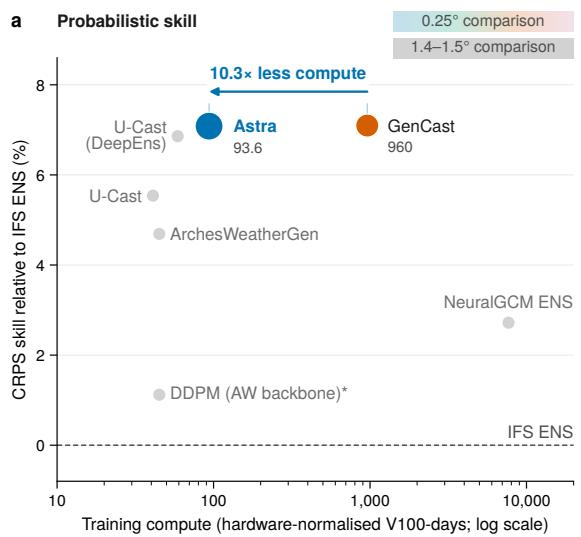

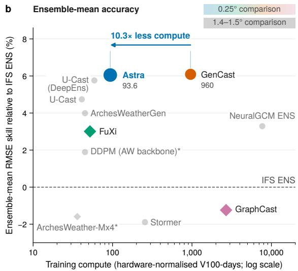  
1.4–1.5° model Deterministic

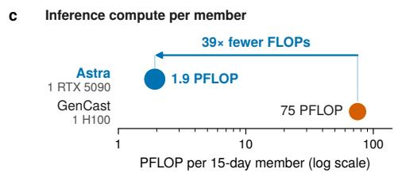

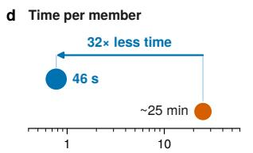

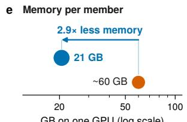  
Fig. 1 | Astra matches GenCast’s skill with 9.8% of its hardware-normalised training compute and 39 times fewer inference FLOPs per member than its released GPU implementation. Skill relative to IFS ENS, 100 (1−S/SIFS ENS), against training compute: a, CRPS; b, ensemble-mean RMSE (unbiased for Astra and GenCast; for the deterministic models, diamonds, the RMSE of their forecast), averaged over daily lead times of 1–10 days and z500, q700, t850, u850 and v850 (b, without q700). As in the GenCast evaluation and in the WeatherBench 2 scores that U-Cast uses, IFS ENS is verified against its own analysis, and as in U-Cast, training compute is hardware-normalised (here to V100-days; Methods). Astra (50 members), GenCast 4, GraphCast1 (pink) and $\mathrm { F u X i } ^ { 3 }$ (green) are scored at 0.25° against ERA5 on the 732 initialisations of 2020; at 1.5°, in the WeatherBench 2 evaluation, Astra and GenCast reach 6.8% and 6.3% in a and 6.0% and 5.7% in b. The other models, including NeuralGCM ENS20 and Stormer21, are shown as published by U-Cast9 or, with an asterisk, by ArchesWeatherGen8 (lead times of 3–10 days). c–e, One 15-day member: $\mathbf { c } ,$ floating-point operations from the released code (GenCast’s TPU implementation: 55 PFLOP; Methods); d, time; e, memory; Astra on one RTX 5090 GPU in 32-bit precision, GenCast on an H100 GPU, as published in its inference guide (Methods). Arrows, the ratio of GenCast to Astra.

Here we present Astra∗, a 0.25° probabilistic weather model built on two ideas that meet them. In Kantorovich Attention, each region of the grid, a tile, chooses by learned scores both the K = 8 tiles it reads from (pull) and the K tiles it writes to (push), so that every tile reads from and is read by at least K others anywhere on the globe, at the token-level cost of a $3 \times 3$ window of tiles. The self-featurised CRPS also scores the members in the multiscale features of the forecaster itself. Kantorovich Attention runs at 1° and $2 ^ { \circ }$ in a W-Net on the 0.25° grid itself, without a mesh or a latent encoder; each 6 h step is one network evaluation, starting from noise with the spatial and cross-variable structure of ERA5 6 h changes (Extended Data Fig. 1). Our contributions are threefold.

1. GenCast’s quarter-degree skill with a tenth of its training compute and 39 times less inference compute. Trained for 2.3 days on one node of eight H200 GPUs,

9.8% of GenCast’s hardware-normalised training compute, Astra matches its CRPS and ensemble-mean root-mean-square error (RMSE) averaged over upper-air variables and lead times of 1–10 days (Fig. 1a,b). Verified against ERA5, its CRPS is lower than GenCast’s on 73.5% of 600 target and lead-time combinations, and both scores are lower than those of IFS ENS, the ensemble of the European Centre for Medium-Range Weather Forecasts (ECMWF), on all 600. A 15-day member takes 46 s on one RTX 5090 GPU (Fig. 1c–e), against about an hour for IFS ENS on 96 AMD EPYC Rome processors (CPUs)22.

2. Kantorovich Attention: two-sided transport attention that leaves no tile unread. Without a solver, the pull and push selections form a transport plan between the tiles23 with at least K partners per tile on both sides 24; in the trained network, the twosided top-K solution reaches 94–98% of the optimal plan’s gain over random pairs (Fig. 2b).

3. Self-featurised CRPS: ensemble scoring in the model’s own features. The features come from a frozen copy of the forecaster, refreshed during training, so no separately trained encoder or additional data are needed.

## Results

## Skill, training cost and inference cost

Astra and GenCast are scored with the WeatherBench 2 metrics27 against ERA5 over the same 732 initialisations of 2020 at 0.25°. As in the GenCast evaluation4 and in the WeatherBench 2 scores that U-Cast uses9,27, the reference, IFS ENS, is verified against its own analysis. Averaged over z500, q700, t850, u850 and v850 (geopotential at 500 hPa, specific humidity at 700 hPa, and temperature and the wind components at 850 hPa) at lead times of 1–10 days, the CRPS of both models is 7.1% lower than that of IFS ENS, and their unbiased ensemble-mean RMSE (z500, t850, u850 and v850) is 6.1% lower (Fig. 1a,b); with IFS ENS verified against ERA5 instead, the CRPS of both is 8.3% lower (Methods). Across all 600 combinations of 20 upper-air and surface targets and 30 lead times from 12 h to 15 days, the CRPS of Astra is lower than that of GenCast on 441 (73.5%) and on 406 of the 500 from day 3 to day 15 (81%; Extended Data Fig. 2a,b).

Scored at 1.5° with the WeatherBench 2 evaluation code, the released forecasts of Astra have a CRPS skill relative to IFS ENS of 6.8%, against 6.3% for GenCast, and an ensemblemean RMSE skill of 6.0%, against 5.7%. On the same 600 combinations, the CRPS of Astra is lower than that of GenCast on 513 (85.5%) and on 456 of the 500 from day 3 to day 15 (91%), and its ensemble-mean RMSE on 328 of these 500 (66%; Extended Data Fig. 3a,b). Across 21 regions, six variables and nine lead times, its CRPS is lower than that of GenCast in 873 of 1,134 combinations (77%) and than that of IFS ENS in 1,119 (98.7%). It is lower than that of GenCast in all 21 regions for z500 and mean sea-level pressure over the first 2 days, and in the tropics for all six variables from 36 h to 10 days, for z500 by 4.3–7.5% (Extended Data Fig. 4).

Astra was trained for 2.3 days on a single node of eight H200 GPUs, 18.7 H200-days in all; GenCast was trained for 5 days on 32 TPUv5 devices, 160 TPUv5-days4. Hardware-normalised as in U-Cast9, at 5 V100 GPUs per H200 and 6 per TPUv5 device (Methods), this is 93.6 against 960 V100-days, a factor of 10.3 (Fig. 1a,b).

At inference the gap is wider (Fig. 1c–e). A 15-day member of Astra needs 60 network evaluations of about 32 TFLOP each, 1.9 PFLOP in all. The released GPU implementation of GenCast runs its difusion sampler for 1,200 evaluations of about 62 TFLOP each, 75 PFLOP in all, 39 times more. GenCast’s TPU implementation needs 55 PFLOP, 28 times more than Astra (Methods). On one RTX 5090 GPU, in 32-bit precision, a member of Astra takes 46 s within 21 GB of memory, and a 50-member, 15-day forecast less than 40 min (Methods). According to its released inference guide (Methods), a GenCast member takes about 25 min on an H100 GPU,

32 times as long, and about 60 GB of memory, 2.9 times as much and more than the 32 GB of an RTX 5090 $\mathrm { G P U } ;$ on a Cloud TPUv5 device it takes about 8 min4, 10 times as long as Astra. $\mathrm { A t }$ similar rates of computation, about 42 TFLOP/s for Astra and 50 TFLOP/s for GenCast, the 32-fold diference in time follows from the 39-fold diference in operations.

## Kantorovich Attention in a $\mathbf { 0 . 2 5 ^ { \circ } }$ network

In Kantorovich Attention, every tile reads from and is read by at least K other tiles anywhere on the globe, at token resolution and at a token-level attention cost linear in the number of grid points (Fig. 2). Astra uses it at the $1 ^ { \circ }$ and $2 ^ { \circ }$ levels of a five-level W-Net that forecasts directly on the 0.25° grid (721 × 1,440 points), without a latent encoder or a mesh (Fig. 3 and Extended Data Fig. 5).

Kantorovich Attention divides a level into tiles of $8 \times 8$ points at 1° and $1 0 \times 1 0 \mathrm { a t } 2 ^ { \circ }$ . Each tile scores all others on centred descriptors and selects the K = 8 tiles it reads from (pull) and the K tiles it writes to (push; Fig. 2a). Without a solver, the two top-K selections form a transport plan that is feasible for the transportation problem with lower bounds K on both marginals (Fig. 2c; Methods). Pull gathers the tokens of a tile’s senders into one softmax; in push, the messages that a tile receives merge through their log-sum-exp into one exact softmax over all incoming tokens (Fig. 2c and Extended Data Fig. 5e); in each branch, every tile outside a tile’s selected tiles reaches it through a pooled term weighted by the routing scores, which gives every score a gradient (Methods).

With the push selections, every tile is read at token resolution, its tokens entering, as keys and values, the attention of at least K other tiles, by construction and in all 4,608 plans of the trained network (24 initialisations, all blocks and heads). The pull selections alone, even on centred scores, leave on average 38% of the tiles of a plan at $1 ^ { \circ }$ and 28% at $2 ^ { \circ }$ unread; these tiles reach other tiles only through the pooled term (Fig. 2b).

Taking both choices from the scores of one branch gives a two-sided top-K solution of the transportation problem with lower bounds K; for every score matrix, we compute the optimal plan with the same number of tile pairs by linear programming (Methods). The two-sided top-K solution reaches 94–96% of the optimal plan’s gain over random pairs at 1° and 97–98% at $2 ^ { \circ }$ and shares 65–71% and 83% of the optimal plan’s tile pairs, against 51–59% and 69–71% for one-sided selection of about as many pairs, which on the pull scores still leaves 25% and 16% of the tiles unread (Fig. 2b). The pairs on which the two difer are nearly tied, on average 0.2–0.4 standard deviations of the scores apart, against about 2 between the optimal plan’s pairs and all other pairs. On the pull scores at $1 ^ { \circ } .$ , the most-read tile has 208 readers in the two-sided top-K solution and 216 in the optimal plan, against 254 under one-sided selection (Methods).

In each branch, a tile reads from, or writes to, $K + 1 = 9$ tiles including its own, as many as a $3 \times 3$ window of tiles, so that each branch reaches any tile on the globe at the attention cost of such a window, plus 2.8% at 1° and 0.2% at $2 ^ { \circ }$ for the tile-level routing and the pooled term (Methods). These tile-level terms, quadratic in the number of tiles, stay below the selected-tile attention on any level of fewer than 2.4 million tokens with 8 × 8 tiles, more than twice the 1,038,240 points of the $0 . 2 5 ^ { \circ }$ grid. Dense self-attention at $1 ^ { \circ }$ and $2 ^ { \circ }$ would need 56 and 8.3 times the attention FLOPs of the selected-tile attention of Kantorovich Attention and raise the cost of one network evaluation 4.6-fold; in 16-bit precision, its attention weights for one block would take 25 and 3.2 GB per member, against 0.46 and 0.39 GB. Memory-eficient kernels such as FlashAttention28 avoid storing these weights but not computing them.

## Self-featurised CRPS

The self-featurised CRPS, the objective of the second training stage, scores the members of Astra in the fields and in the features of the forecaster itself, with no separately trained encoder and no additional data (Methods). This stage takes 15,000 steps, 276.3 of the 449.3 H200-hours of training, on two-step forecasts of four members from each of eight cases, with gradients through both steps. Every forecast scored in this paper is made by the network after the last step of this stage. The field term scores each variable, scale band and grid point on its own. In the feature term, a frozen copy of the network reads each member’s forecast as part of the input of a later step, as in an autoregressive forecast, and the CRPS scores the representations that the copy forms at its four levels from $1 ^ { \circ }$ to $8 ^ { \circ }$ , each of which combines many variables and locations, against those of the corresponding input built from ERA5. In this space, the CRPS draws the members towards the observation and apart from one another, as image generators do in the features of a pretrained encoder 18,19. The parameters of the copy receive no gradient, so the score cannot be lowered by mapping every state onto the same features, the collapse that self-supervised learning prevents with a stop-gradient or a slowly updated target network29. At steps 5,000 and 10,000, the copy is replaced by the forecaster’s averaged weights, so that the feature space follows the representations the forecaster learns. The copy is used in training alone, so each forecast step remains one network evaluation.

a Two-sided transport on the tiled globe  
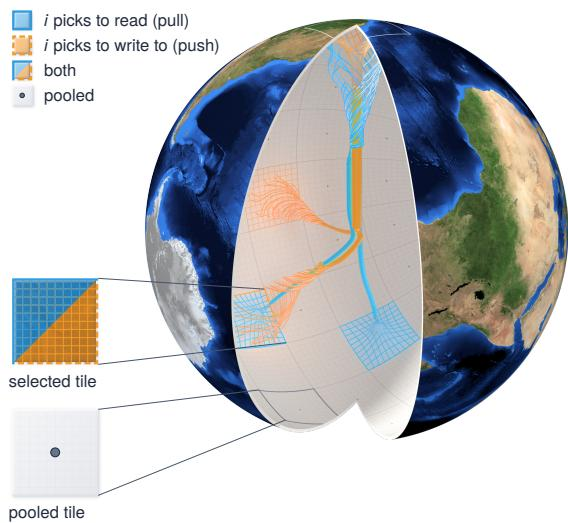  
c A plan with at least K partners per tile on both sides  
b Plans on the trained network's scores  
60 of 180 unread 0 unread K Readers per tile 0 1–7 8–15 16–31 ≥ 32

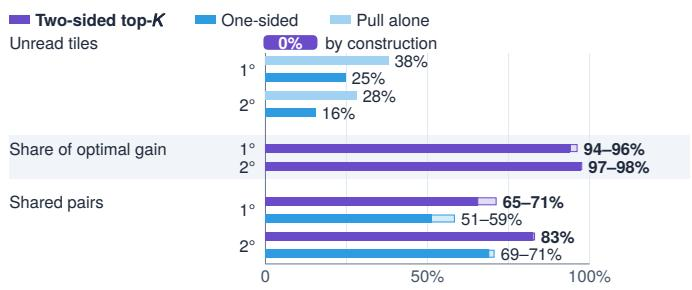

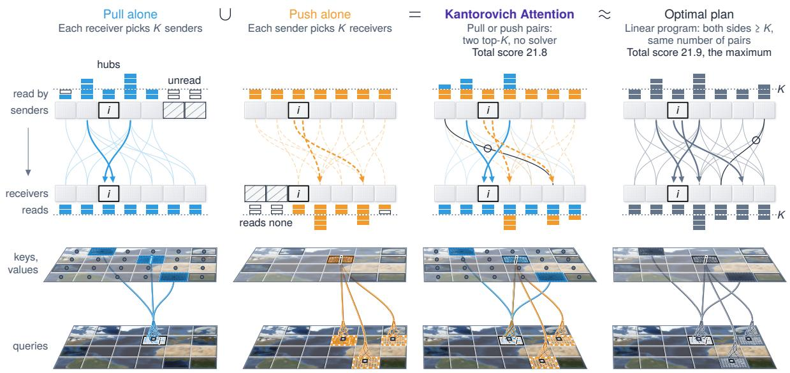  
Fig. 2 | Kantorovich Attention routes from both sides: no tile is left unread, and the two-sided top-K solution on one branch’s scores reaches 94–98% of the optimal plan’s gain over random pairs. a, A tile i of the 2° level (10 × 10 points) in one block and head of the trained network (first 6 h step from 00 UTC decoder 1on 16 February 2020), at the top of a cut-away hollow Earth whose inner wall shows the tiles. Of its $K = 8$ selected tiles on each side, one it only reads from (pull, blue), one it only writes to (push, orange) and one it does both with (split) are drawn: each transfer leaves its source tile as a smooth tube and lands on its destination tile as a twisted bundle. Every tile outside the selected tiles of i reaches i through the pooled term (dots). Earth imagery (a,c), NASA Blue Marble Next Generation. b, Plans on the trained network’s scores; optimal plan, the best $0 / 1$ plan with at least K partners per tile on each side and as many pairs (Methods). Maps, readers per tile for one $2 ^ { \circ }$ block and head (unread, hatched). Bars, all blocks and heads of 24 initialisations; one-sided, receivers alone selecting about as many pairs; outlined ends, the range over the two branches. c, Top, plans on a toy score matrix $( T = 7 , K = 2 )$ : lines join senders (upper strip) to receivers (lower strip), bold for tile i’s pairs; dashes 0.25° 1° 2° 4°count each tile’s readers and reads against K (dotted). Pull alone (token choice 25; one-sided $\mathrm { t o p } { - } K ^ { 1 3 } )$ leaves senders unread (hatched); push alone (expert choice $^ { 2 6 } )$ leaves receivers reading none; Kantorovich Attention takes both and difers from the optimal plan by one swap of nearly tied pairs (rings). Bottom, the transfers of tile i from keys and values (upper plane) to queries (lower plane), drawn as in a: in each branch a query attends to all incoming tokens in one softmax (Methods).

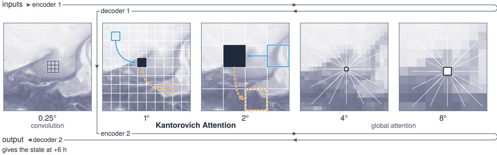  
Fig. 3 | Astra forecasts directly on the $\mathbf { 0 . 2 5 ^ { \circ } }$ grid: a five-level W-Net with Kantorovich Attention at $\mathbf { 1 } ^ { \circ }$ and $\mathbf { 2 } ^ { \circ }$ and global attention at $4 ^ { \circ }$ and $\mathbf { 8 } ^ { \circ }$ . Two U-Net cycles in series, with no latent encoder or mesh: encoder 1 from $0 . 2 5 ^ { \circ }$ down to $8 ^ { \circ } { \mathrm { : } }$ decoder 1 back up to $^ { 1 ^ { \circ } , }$ encoder 2 down to $8 ^ { \circ }$ again and decoder 2 up to 0.25°. The inputs are coloured noise ε, the states at $0 , - 6 , - 1 2$ and −18 h and static and forcing fields; the output is the state at +6 h. One region (70° N–10° S, 100°–20° W) is shown at each level: convolution at $0 . 2 5 ^ { \circ }$ , Kantorovich Attention at $1 ^ { \circ }$ and $2 ^ { \circ }$ (pull, blue: a tile reads from tiles it picks; push, orange: it writes to tiles it picks) and global attention at $4 ^ { \circ }$ and $8 ^ { \circ } ;$ shading, ERA5 specific humidity at 850 hPa, 00 UTC on 20 January 2020, on each level’s $\mathrm { g r i d }$ . Dense self-attention at $1 ^ { \circ }$ and $2 ^ { \circ }$ would raise the cost of one network evaluation 4.6-fold (Methods). Full network in Extended Data Fig. 5.

## Skill by variable, level and lead time

Verified against ERA5, Astra has a lower CRPS and a lower ensemble-mean RMSE than IFS ENS on all 600 combinations of 20 targets and 30 lead times, at 0.25° and at 1.5° (Fig. 4c,d and Extended Data Figs. 2c,d and 3c,d). The targets are geopotential, temperature, specific humidity and the two wind components at 500, 700 and 850 hPa, the pressure levels that WeatherBench 2 scores at 0.25°, and five surface variables. The CRPS is significantly lower on 594 of the 600 (99%) and the RMSE on 489 (82%) at 0.25°, and on all 600 and on 592 at $1 . 5 ^ { \circ }$ (Methods). With IFS ENS verified against its own analysis, as in WeatherBench 2 and the GenCast evaluation4,27, the CRPS of Astra is lower on every combination from 36 h and on 560 of the 570 combinations scored this way (98.2%). Against ERA5, the CRPS improvement at $0 . 2 5 ^ { \circ }$ for the variables of Fig. 4 is 6–20% at 5 days and 1–6% at 15 days, largest for 2 m temperature (20% and 6%).

Against GenCast, the CRPS of Astra is lower at every lead time from 12 h to 9 days for z500 and to 11 days for mean sea-level pressure, by 3.5–4.7% at 12–36 h and significantly so up to 3.5 and 4 days, respectively (Fig. 4a). From day 3 to day 15, its CRPS is lower on 153 of the 200 combinations of Fig. 4a (77%). For the 20 targets at 0.25°, every significant diference in GenCast’s favour, in CRPS or in ensemble-mean RMSE, lies within the first 60 h, and from day 3 neither score is more than 0.8% higher than GenCast’s on any of the 500 combinations (Fig. 4a,b and Extended Data Fig. 2a,b). In the tests at 1.5°, paired for all targets but u10 and v10 (Methods), the CRPS of Astra from day 3 is significantly lower than that of GenCast on 168 of the same 500 combinations and significantly higher on 4, fewer than the 12.5 expected by chance between two models of equal skill (Methods), and its ensemble-mean RMSE significantly lower on 110 and significantly higher on 2 (Extended Data Fig. 3a,b).

For 24 h precipitation, the CRPS of Astra is significantly lower than that of IFS ENS at every lead time, by 21% at 1 day and 3% at 15 days (27% and 3% at 1.5°), and from day 6 lower than that of GenCast at every lead time, significantly so at $1 . 5 ^ { \circ }$ (Extended Data Figs. 2, 3 and 6). $\mathrm { A t } ~ 1 . 5 ^ { \circ }$ , its ensemble-mean stable equitable error in probability space (SEEPS 30), which scores dry, light and heavy precipitation against the local climatology, is the lowest of the three models at every lead time, 0.008–0.009 below GenCast’s from 1 to 5 days (0.135 at 1 day, against 0.144 for GenCast and 0.220 for IFS ENS; Extended Data Fig. 3e).

Averaged over the eight variables of Fig. 4, the CRPS skill of Astra relative to IFS ENS verified against ERA5 is 21%, 9.6% and 4.5% at 1, 5 and 10 days, and from 36 h this improvement exceeds that of GenCast at 26 of the 28 lead times, by up to 0.6 percentage points, and is within 0.01 points of it at the other two (Fig. 5a). Averaged over z500, t850, t2m and ws10, the four variables that WeatherBench 2 scores for every deterministic model in Fig. 5b, the unbiased

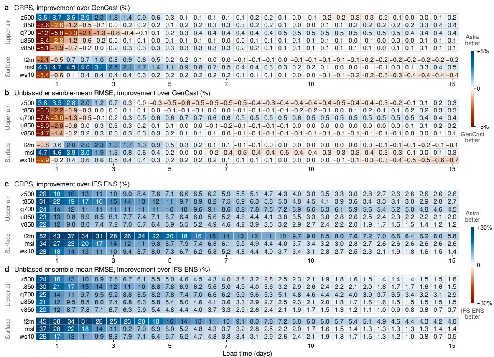  
Fig. 4 | Astra has a significantly lower CRPS than IFS ENS for every variable and lead time and, from day 3, a lower CRPS than GenCast on 153 of the 200 combinations; every significant diference in GenCast’s favour lies within the first 60 h. Improvement of Astra over $\mathrm { G e n C a s t } ^ { 4 } \ ( \mathbf { a } , \mathbf { b } )$ and IFS ENS (c,d), 100 $( S _ { \mathrm { r e f } } - S ) / S _ { \mathrm { r e f } }$ in per cent for a score S of Astra and $S _ { \mathrm { r e f } }$ of the reference, in CRPS (a,c) and unbiased ensemble-mean RMSE (b,d), with the WeatherBench 2 metrics 27 at 0.25° against ERA5, all 732 initialisations of 2020, references as published. Blue, Astra better; vermilion, the reference better; all 20 targets and 24 h precipitation in Extended Data Fig. 2. Hatched, not significant at the 5% level in the widened fixed-reference test (Methods); at 1.5°, every diference it declares significant is ${ \mathrm { s o } } ,$ with the same sign, in the paired test (Extended Data Fig. 3). z, geopotential; t, temperature; ${ \mathrm { q } } ,$ specific humidity; u, v, wind components (level in hPa); t2m, 2 m temperature; msl, mean sea-level pressure; ws10, 10 m wind speed.

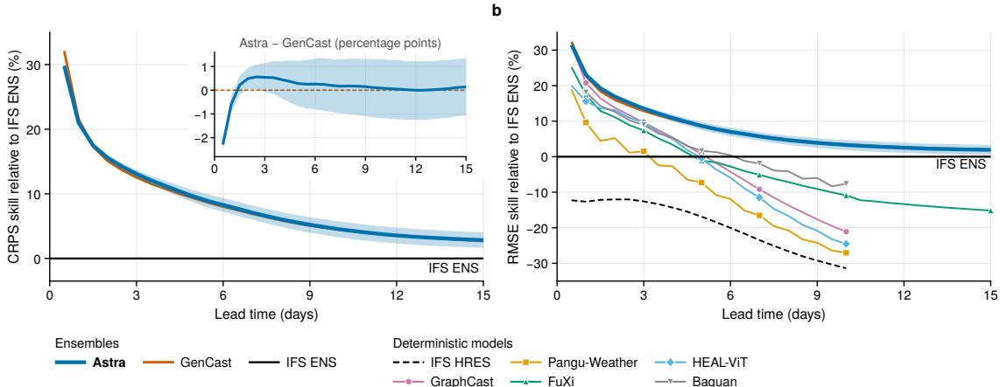  
Fig. 5 | Averaged over variables, Astra has a lower CRPS than IFS ENS at every lead time, with an improvement larger than GenCast’s at 26 of the 28 lead times from 36 h, and its unbiased ensemble-mean RMSE is lower than that of IFS ENS and of every deterministic model at every lead time. Skill relative to IFS ENS, the improvement of Fig. 4c,d in per cent; shading, 95% confidence band of Astra (Methods). a, CRPS skill averaged over the eight variables of Fig. 4 (inset, Astra minus GenCast). b, Unbiased RMSE skill of the ensemble mean (RMSE of the forecast for the deterministic models) averaged over z500, t850, t2m and ws10, those of a that WeatherBench 2 scores for all six deterministic models: IFS HRES, GraphCast1, Pangu-Weather2, FuXi3, HEAL-ViT31 and Baguan32. All models, IFS ENS included, verified against ERA5 at 0.25° (in Fig. 1, IFS ENS against its own analysis); per variable in Extended Data Fig. 6.

ensemble-mean RMSE of Astra (Methods) is lower than the RMSE of each of these models at every lead time, and its RMSE skill exceeds that of the best of them by 2 percentage points at 1 day (GraphCast), 4 at 3 days (HEAL-ViT) and 11 at 10 days (Baguan), and that of FuXi, the one scored to 15 days, by 17 at 15 days.

Averaged over the same eight variables, the spread–skill ratio of Astra reaches 1.00, the value of a calibrated ensemble, at 15 days; from 7.5 days it is closer to 1 than that of GenCast, and from 9 days than that of IFS ENS (per variable, Extended Data Fig. 6c).

## Spectral fidelity

Power spectra test the spatial structure of each member, which a grid-point score does not. The members of Astra, generated with one network evaluation per 6 h step, keep the fine-scale structure of ERA5 near the surface and at 850 hPa through 5-day forecasts (Fig. 6). In a 5- day forecast of 2 m temperature over the Alps, a single member reproduces the structure that mountains and coastlines give the field in ERA5, from the cold arc of the Alps to the Apennines and the Mediterranean coast (Fig. 6a). Averaged over eight members and 24 initialisations of 2020, the power spectra of its members at 5 days stay within a factor of $\sqrt { 2 }$ of those of ERA5 down to 63 km for 2 m temperature and, for 850 hPa temperature, at every degree up to ℓ = 638 (63 km), the shortest wavelength that ERA5 resolves, against 68 and 70 km for GenCast and 130 and 162 km for IFS ENS (Fig. 6b,c). For the kinetic energy at 10 m, they do so down to 85 km, against 109 km for GenCast and 182 km for IFS ENS (Fig. 6d). Extended Data Fig. 7 adds the wind components at 10 m and 850 hPa, the 10 m wind speed, mean sea-level pressure and a lead time of 2 days; in all 18 combinations of field and lead time in the two figures, the members of Astra stay within this factor of ERA5 down to a shorter wavelength than those of IFS ENS, and than those of GenCast for 2 m temperature at both lead times (63 against 68 and 69 km), the meridional wind at 10 m at both lead times (78 and 71 against 114 and 118 km), 850 hPa temperature and the kinetic energy at 10 m at 5 days (63 against 70 km and 85 against 109 km) and the 10 m wind speed at 2 days (62 against 72 km).

d  
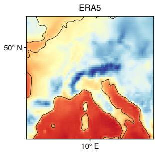  
b

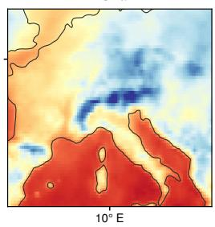

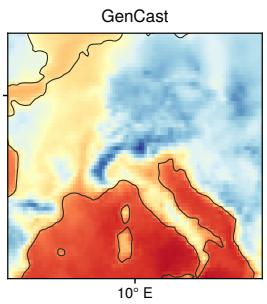

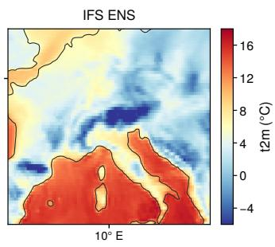  
e

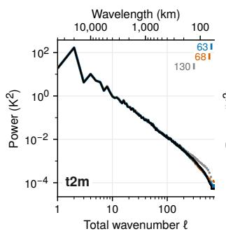

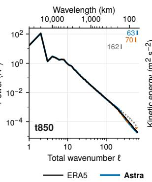

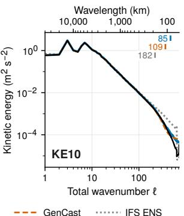

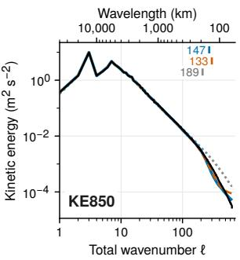  
Fig. 6 | At 5 days, the member spectra of Astra stay within a factor of $\sqrt { 2 }$ of ERA5’s down to 63 km for 2 m and 850 hPa temperature and to 85 km for the kinetic energy at 10 m, shorter wavelengths than for GenCast and IFS ENS. a, 2 m temperature (t2m) over the Alps (38–54° N, 2° W–22° E) at 00 UTC on 21 December 2020, 5 days after one of the initialisations of b–e: ERA5 and member 0 of Astra, GenCast and IFS ENS, on one colour scale. b–e, Spherical-harmonic power per total wavenumber ℓ at 5 days of t2m (b), 850 hPa temperature (t850; c) and the kinetic energy at 10 m (KE10; d) and 850 hPa (KE850; e); top axis, wavelength. Ticks under the top axis mark, for each model in its colour, the shortest wavelength down to which its member spectrum stays within a factor of $\sqrt { 2 }$ of ERA5’s (Methods). Members 0–7 and 24 initialisations of 2020; t850 and KE850 end at $\ell = 6 3 8$ , one degree below ERA5’s TL639 truncation. Wind components, 10 m wind speed, mean sea-level pressure and a lead time of 2 days in Extended Data Fig. 7.

## Discussion

With 9.8% of GenCast’s hardware-normalised training compute, Astra has a lower CRPS than GenCast on 73.5% of the 600 combinations at 0.25° and on 85.5% at 1.5°, and, verified against ERA5, a lower CRPS and ensemble-mean RMSE than IFS ENS on all 600 at both resolutions.

Astra is built on two components. In Kantorovich Attention, every tile chooses both the tiles it reads from and those it writes to, so that every tile is read at token resolution, with 56 and 8.3 times fewer FLOPs in its selected-tile attention than dense self-attention at $1 ^ { \circ }$ and 2°. The self-featurised CRPS scores the members in the forecaster’s own representation, refreshed as it trains, without a separately trained encoder. With one network evaluation per 6 h step, a 50-member, 15-day forecast takes less than 40 min on one RTX 5090 GPU.

Neither component uses a property of weather: Kantorovich Attention needs tiles of tokens and learned scores, and the self-featurised CRPS a network that reads its own output. Together, these results show that skilful quarter-degree probabilistic weather forecasts can be learned on a single node of eight H200 GPUs and run on one GPU, which puts experiments at full resolution, from larger architectures to richer training objectives, within reach of groups without multi-node clusters.

## References

1. Lam, R. et al. Learning skillful medium-range global weather forecasting. Science 382, 1416–1421 (2023).

2. Bi, K. et al. Accurate medium-range global weather forecasting with 3D neural networks. Nature 619, 533– 538 (2023).

3. Chen, L. et al. FuXi: a cascade machine learning forecasting system for 15-day global weather forecast. npj Clim. Atmos. Sci. 6, 190 (2023).

4. Price, I. et al. Probabilistic weather forecasting with machine learning. Nature 637, 84–90 (2025).

5. Alet, F. et al. Skillful joint probabilistic weather forecasting from marginals. Preprint at https://arxiv. org/abs/2506.10772 (2025).

6. Bonev, B. et al. FourCastNet 3: a geometric approach to probabilistic machine-learning weather forecasting at scale. Preprint at https://arxiv.org/abs/2507.12144 (2025).

7. Kossaifi, J. et al. Demystifying data-driven probabilistic medium-range weather forecasting. Preprint at https://arxiv.org/abs/2601.18111 (2026).

8. Couairon, G., Singh, R., Charantonis, A., Lessig, C. & Monteleoni, C. ArchesWeatherGen: skillful and compute-eficient probabilistic weather forecasting with machine learning. Sci. Adv. 12, eadx2372 (2026).

9. Rühling Cachay, S., Watson-Parris, D. & Yu, R. U-Cast: a surprisingly simple and eficient frontier probabilistic AI weather forecaster. In Proc. 43rd International Conference on Machine Learning 106213–106234 (PMLR, 2026).

10. Vaswani, A. et al. Attention is all you need. In Proc. Advances in Neural Information Processing Systems 30 5998–6008 (Curran Associates, 2017).

11. Liu, Z. et al. Swin Transformer: hierarchical vision transformer using shifted windows. In Proc. IEEE/CVF International Conference on Computer Vision 9992–10002 (IEEE, 2021).

12. Bonev, B. et al. Spherical Fourier neural operators: learning stable dynamics on the sphere. In Proc. 40th International Conference on Machine Learning 2806–2823 (PMLR, 2023).

13. Zhu, L., Wang, X., Ke, Z., Zhang, W. & Lau, R. W. H. BiFormer: vision transformer with bi-level routing attention. In Proc. IEEE/CVF Conference on Computer Vision and Pattern Recognition 10323–10333 (IEEE, 2023).

14. Yuan, J. et al. Native sparse attention: hardware-aligned and natively trainable sparse attention. In Proc. 63rd Annual Meeting of the Association for Computational Linguistics (Volume 1: Long Papers) 23078–23097 (ACL, 2025).

15. Zhdanov, M., Lucic, A., Welling, M. & van de Meent, J.-W. (Sparse) attention to the details: preserving spectral fidelity in ML-based weather forecasting models. In Proc. 43rd International Conference on Machine Learning 163086–163115 (PMLR, 2026).

16. Gneiting, T. & Raftery, A. E. Strictly proper scoring rules, prediction, and estimation. J. Am. Stat. Assoc. 102, 359–378 (2007).

17. Lang, S. et al. AIFS-CRPS: ensemble forecasting using a model trained with a loss function based on the continuous ranked probability score. npj Artif. Intell. 2, 18 (2026).

18. Deng, M., Li, H., Li, T., Du, Y. & He, K. Generative modeling via drifting. In Proc. Advances in Neural Information Processing Systems 39 (Curran Associates, in the press); preprint at https://arxiv.org/abs/ 2602.04770.

19. Han, J. et al. One-step generative modeling via Wasserstein gradient flows. Preprint at https://arxiv.org/ abs/2605.11755 (2026).

20. Kochkov, D. et al. Neural general circulation models for weather and climate. Nature 632, 1060–1066 (2024).

21. Nguyen, T. et al. Scaling transformer neural networks for skillful and reliable medium-range weather fore casting. In Proc. Advances in Neural Information Processing Systems 37 68740–68771 (Curran Associates, 2024).

22. Alexe, M. et al. Data-driven ensemble forecasting with the AIFS. ECMWF Newsl. 181, 32–37 (2024); https: //doi.org/10.21957/ma3p95hxe2.

23. Kantorovich, L. V. On the translocation of masses. C. R. (Dokl.) Acad. Sci. URSS 37, 199–201 (1942); later English version in J. Math. Sci. 133, 1381–1382 (2006); https://doi.org/10.1007/s10958-006-0049-2.

24. Hitchcock, F. L. The distribution of a product from several sources to numerous localities. J. Math. Phys. 20, 224–230 (1941).

25. Shazeer, N. et al. Outrageously large neural networks: the sparsely-gated mixture-of-experts layer. In Proc. 5th International Conference on Learning Representations (ICLR, 2017).

26. Zhou, Y. et al. Mixture-of-experts with expert choice routing. In Proc. Advances in Neural Information Processing Systems 35 7103–7114 (Curran Associates, 2022).

27. Rasp, S. et al. WeatherBench 2: a benchmark for the next generation of data-driven global weather models. J. Adv. Model. Earth Syst. 16, e2023MS004019 (2024).

28. Dao, T., Fu, D. Y., Ermon, S., Rudra, A. & Ré, C. FlashAttention: fast and memory-eficient exact attention with IO-awareness. In Proc. Advances in Neural Information Processing Systems 35 16344–16359 (Curran Associates, 2022).

29. Grill, J.-B. et al. Bootstrap your own latent - a new approach to self-supervised learning. In Proc. Advances in Neural Information Processing Systems 33 21271–21284 (Curran Associates, 2020).

30. Rodwell, M. J., Richardson, D. S., Hewson, T. D. & Haiden, T. A new equitable score suitable for verifying precipitation in numerical weather prediction. Q. J. R. Meteorol. Soc. 136, 1344–1363 (2010).

31. Ramavajjala, V. HEAL-ViT: vision transformers on a spherical mesh for medium-range weather forecasting. Preprint at https://arxiv.org/abs/2403.17016 (2024).

32. Niu, P. et al. Utilizing strategic pre-training to reduce overfitting: Baguan - a pre-trained weather forecasting model. In Proc. 31st ACM SIGKDD Conference on Knowledge Discovery and Data Mining Vol. 2, 2186–2197 (ACM, 2025).

33. Lewis, M., Bhosale, S., Dettmers, T., Goyal, N. & Zettlemoyer, L. BASE layers: simplifying training of large, sparse models. In Proc. 38th International Conference on Machine Learning 6265–6274 (PMLR, 2021).

34. Su, J. et al. RoFormer: enhanced transformer with rotary position embedding. Neurocomputing 568, 127063 (2024).

35. Milakov, M. & Gimelshein, N. Online normalizer calculation for softmax. Preprint at https://arxiv.org/ abs/1805.02867 (2018).

36. Cuturi, M. Sinkhorn distances: lightspeed computation of optimal transport. In Proc. Advances in Neural Information Processing Systems 26 2292–2300 (Curran Associates, 2013).

37. Tay, Y., Bahri, D., Yang, L., Metzler, D. & Juan, D.-C. Sparse Sinkhorn attention. In Proc. 37th International Conference on Machine Learning 9438–9447 (PMLR, 2020).

38. Sander, M. E., Ablin, P., Blondel, M. & Peyré, G. Sinkformers: transformers with doubly stochastic attention. In Proc. 25th International Conference on Artificial Intelligence and Statistics 3515–3530 (PMLR, 2022).

39. Huangfu, Q. & Hall, J. A. J. Parallelizing the dual revised simplex method. Math. Program. Comput. 10, 119–142 (2018).

40. Ronneberger, O., Fischer, P. & Brox, T. U-Net: convolutional networks for biomedical image segmentation. In Proc. Medical Image Computing and Computer-Assisted Intervention (MICCAI 2015) 234–241 (Springer, 2015).

41. Newell, A., Yang, K. & Deng, J. Stacked hourglass networks for human pose estimation. In Proc. European Conference on Computer Vision (ECCV 2016) 483–499 (Springer, 2016).

42. Shazeer, N. GLU variants improve transformer. Preprint at https://arxiv.org/abs/2002.05202 (2020).

43. Zamir, S. W. et al. Restormer: eficient transformer for high-resolution image restoration. In Proc. IEEE/CVF Conference on Computer Vision and Pattern Recognition 5718–5729 (IEEE, 2022); https://doi.org/10. 1109/CVPR52688.2022.00564.

44. Chen, M., Lu, T., Zhu, J., Sun, M. & Liu, Z. Stronger normalization-free transformers. In Proc. IEEE/CVF Conference on Computer Vision and Pattern Recognition 27418–27428 (IEEE, 2026).

45. Hersbach, H. et al. The ERA5 global reanalysis. Q. J. R. Meteorol. Soc. 146, 1999–2049 (2020).

46. Geng, Z., Deng, M., Bai, X., Kolter, J. Z. & He, K. Mean flows for one-step generative modeling. In Proc. Advances in Neural Information Processing Systems 38 75460–75482 (Curran Associates, 2025); https: //doi.org/10.52202/085713-2534.

47. Lipman, Y., Chen, R. T. Q., Ben-Hamu, H., Nickel, M. & Le, M. Flow matching for generative modeling. In Proc. 11th International Conference on Learning Representations (ICLR, 2023).

48. Hu, E. J. et al. LoRA: low-rank adaptation of large language models. In Proc. 10th International Conference on Learning Representations (ICLR, 2022).

49. Ferro, C. A. T. Fair scores for ensemble forecasts. Q. J. R. Meteorol. Soc. 140, 1917–1923 (2014).

50. Burt, P. J. & Adelson, E. H. The Laplacian pyramid as a compact image code. IEEE Trans. Commun. 31, 532–540 (1983).

51. Defazio, A. et al. The road less scheduled. In Proc. Advances in Neural Information Processing Systems 37 9974–10007 (Curran Associates, 2024).

52. Lion, K., Hübler, F., Li, B., Orvieto, A. & He, N. Muown: row-norm control for Muon optimization. Preprint at https://arxiv.org/abs/2605.10797 (2026).

53. Kingma, D. P. & Ba, J. Adam: a method for stochastic optimization. In Proc. 3rd International Conference on Learning Representations (ICLR, 2015).

54. Liu, J. et al. Muon is scalable for LLM training. Preprint at https://arxiv.org/abs/2502.16982 (2025).

55. Fortin, V., Abaza, M., Anctil, F. & Turcotte, R. Why should ensemble spread match the RMSE of the ensemble mean? J. Hydrometeorol. 15, 1708–1713 (2014).

56. Jones, P. W. First- and second-order conservative remapping schemes for grids in spherical coordinates. Mon. Weather Rev. 127, 2204–2210 (1999).

57. Politis, D. N. & Romano, J. P. A circular block-resampling procedure for stationary data. In Exploring the Limits of Bootstrap (eds LePage, R. & Billard, L.) 263–270 (Wiley, 1992).

## Methods

## Kantorovich Attention and the network

Kantorovich Attention (KA) is the attention layer of the network at resolution levels L1 and L2 (1° and $2 ^ { \circ } ;$ Figs. 2 and 3, Extended Data Fig. 5e). Each tile of the grid selects, by learned scores, both the tiles it reads from and the tiles it writes to, anywhere on the globe, exchanges information with them token by token, and receives every remaining tile through that tile’s mean value. A level with N grid points is padded to $N ^ { \prime } = T P ^ { 2 }$ tokens in $T$ non-overlapping tiles of $P \times P ( P = 8 $ and $T = 1 { , } 0 3 5$ at L1, or 1,080 for shifted tiles; $P = 1 0$ and $T = 1 8 0$ at L2). As in the Swin Transformer11, alternate blocks shift the tiles by half a tile in latitude and in longitude; tiles wrap around in longitude, tiles that extend past a pole are padded, and padded tokens are excluded from every softmax, pooling and mean below.

The operator acts on $\mathbf { X } \in \mathbb { R } ^ { N ^ { \prime } \times C }$ , the block’s input plus a learned embedding of each token’s position within its tile (one table of $P ^ { 2 }$ vectors per level), normalised by Derf (equation (11)). It has two branches, $b \in \{ \mathrm { p u l l } , \mathrm { p u s h } \}$ , that route in opposite directions: in pull each tile selects the tiles it reads from, and in push the tiles it writes to. Each branch has its own query, key and value projections $\mathbf { Q } ^ { b } , \mathbf { K } ^ { b } , \mathbf { V } ^ { b }$ of X, with $H = 3$ heads at L1 and $H = 6$ at L2, each of dimension $d _ { k } = 1 2 8$ ; the pull queries of tile i are further scaled channel-wise by $1 + \mathbf { a } _ { i }$ , with ${ \bf a } _ { i }$ learned for every tile and zero at initialisation. In one head, $\mathbf { Q } _ { i } , \mathbf { K } _ { i } , \mathbf { V } _ { i } \in \mathbb { R } ^ { P ^ { 2 } \times d _ { k } }$ hold the rows of the tokens of tile i, the pull queries after this scaling. In each branch b and head h, tile i receives the selected-tile attention $\mathbf { Y } _ { i } ^ { \hat { b } , h } \in \mathbb { R } ^ { P ^ { 2 } \times d _ { k } }$ from its selected tiles (below) and, added to each of its $P ^ { 2 }$ tokens, a pooled term $\tilde { \mathbf { y } } _ { i } ^ { b , h } \in \mathbb { R } ^ { d _ { k } }$ from the remaining tiles; the heads of both branches are then concatenated and projected by $\mathbf { W } ^ { O } \in \mathbb { R } ^ { 2 H d _ { k } \times C }$

$$
\operatorname { K A } ( \mathbf { X } ) _ { i } = \Big [ \big \mu \big | \big \mu \big | \big ( \mathbf { Y } _ { i } ^ { b , h } + \lambda ^ { b , h } \mathbf { 1 } \tilde { \mathbf { y } } _ { i } ^ { b , h \top } \big ) \Big ] \mathbf { W } ^ { O } ,\tag{1}
$$

where ∥ concatenates along channels, $1 \in \mathbb { R } ^ { P ^ { 2 } }$ is a vector of ones and $\lambda ^ { b , h } \in ( 0 , 1 )$ is the learned weight of the pooled term (a sigmoid, $1 / 4$ at initialisation). Within a branch and head we drop b and $h .$

Routing. Each tile has a query and a key descriptor pooled from its tokens before any rotary rotation,

$$
\hat { \mathbf { q } } _ { i } = \rho \big ( \mathrm { p o o l } _ { \mathbf { w } _ { Q } } ( \mathbf { Q } _ { i } ) \big ) , \qquad \hat { \mathbf { k } } _ { i } = \rho \big ( \mathrm { p o o l } _ { \mathbf { w } _ { K } } ( \mathbf { K } _ { i } ) \big ) , \qquad \mathrm { p o o l } _ { \mathbf { w } } ( \mathbf { Z } _ { i } ) = \sum _ { p \in i } \frac { e ^ { \mathbf { w } ^ { \mathrm { T } } \mathbf { z } _ { p } } } { \sum _ { p ^ { \prime } \in i } e ^ { \mathbf { w } ^ { \mathrm { T } } \mathbf { z } _ { p ^ { \prime } } } } \mathbf { z } _ { p } ,\tag{2}
$$

where $\mathrm { p o o l } _ { \mathbf { w } }$ is an attention pooling over the tokens $p$ of tile i with a learned vector w (zero at initialisation, which gives the tile mean), and $\rho$ subtracts the descriptor’s mean over the tiles of the level and then scales each tile’s descriptor to unit root mean square over its $d _ { k }$ channels. The score of sender $j$ for receiver i is $s _ { i j } = \hat { \mathbf { q } } _ { i } ^ { \top } \hat { \mathbf { k } } _ { j } / \sqrt { d _ { k } } ;$ ; each branch and head computes its own scores and makes its own selection. With ${ \bf q } _ { i } = \mathrm { p o o l } _ { { \bf w } _ { Q } } ( { \bf Q } _ { i } )$ and $\mathbf { k } _ { j } = \mathrm { p o o l } _ { \mathbf { w } _ { K } } ( \mathbf { K } _ { j } )$ the descriptors before $\rho$ and $\bar { \mathbf { q } } , \bar { \mathbf { k } }$ their means over the tiles,

$$
\mathbf { q } _ { i } ^ { \top } \mathbf { k } _ { j } = ( \mathbf { q } _ { i } - \bar { \mathbf { q } } ) ^ { \top } ( \mathbf { k } _ { j } - \bar { \mathbf { k } } ) + \bar { \mathbf { q } } ^ { \top } ( \mathbf { k } _ { j } - \bar { \mathbf { k } } ) + ( \mathbf { q } _ { i } - \bar { \mathbf { q } } ) ^ { \top } \bar { \mathbf { k } } + \bar { \mathbf { q } } ^ { \top } \bar { \mathbf { k } } ;\tag{3}
$$

the second term depends on the sender alone and favours the same senders in the ranking of every receiver, and the third depends on the receiver alone and favours the same receivers in the ranking of every sender. The descriptor normalisation ρ keeps the first term and divides it by the norms of the two centred descriptors, so that $s _ { i j }$ is $\sqrt { d _ { k } }$ times the cosine of the angle between $\mathbf q _ { i } - \bar { \mathbf q }$ and $\mathbf { k } _ { j } - \bar { \mathbf { k } } ;$ the scores thus contain neither the second nor the third term, and no tile is ranked by the size of its descriptor. With $\mathrm { t o p } _ { K }$ selecting the indices of the K largest scores over all tiles of the level,

$$
\mathcal { N } ( i ) = \{ i \} \cup \mathrm { t o p } _ { K } \{ s _ { i j } \} _ { j \neq i } , \qquad \mathcal { R } ( j ) = \{ j \} \cup \mathrm { t o p } _ { K } \{ s _ { i ^ { \prime } j } \} _ { i ^ { \prime } \neq j } , \qquad S ( i ) = \{ j : i \in \mathcal { R } ( j ) \} .\tag{4}
$$

In pull, as in token-choice mixture-of-experts routing 25 (tiles as the tokens, senders as the experts), receiver i selects its senders $\mathcal { N } ( i )$ , so every tile reads from exactly $K$ others but may be read by many others or by none (unread); in push, as in expert-choice routing 26, sender j selects its receivers $\mathcal { R } ( j )$ , so the tokens of every tile reach exactly K others, and receiver i receives from a set ${ \cal { S } } ( i )$ of varying size. Balanced assignment of experts33 equalises their load by solving a linear assignment problem; here the union of the two choices gives every tile at least K partners as a receiver and as a sender without solving one, so that every tile is read at token resolution: its tokens enter, as keys and values, the attention of at least K other tiles. We use $K = 8$ , so that in each branch a tile reads from, or writes to, $K + 1 = 9$ tiles including its own, as many as a $3 \times 3$ window of tiles; the top-K indices carry no gradient. The choices of the pull and push heads with the same index together form a transport plan between the tiles (Fig. 2c), $\Pi \in \{ 0 , 1 \} ^ { T \times T }$ with $\Pi _ { i j } = 1 \ \mathrm { i f } \ j \in \mathcal { N } ( i )$ or $i \in \mathcal { R } ( j )$ .

Selected tiles. In both branches, queries and keys carry rotary position embeddings 34 on the sphere, applied to the queries after the flow-time phase (Network): channel pair n of the token at unit position vector p is rotated by the angle $\pi \mathbf { p } ^ { \top } \mathbf { d } _ { n }$ , with $d _ { k } / 2 = 6 4$ fixed unit directions $\mathbf { d } _ { n }$ on a Fibonacci lattice of the sphere, the same in every head, so that the product of a query at p and a key at $\mathbf { p } ^ { \prime }$ depends on their positions through the chord $ { \mathbf { p } } -  { \mathbf { p } } ^ { \prime }$ alone, continuously across the date line and the poles. A sender’s contribution is multiplied by a score gate, a function of its score relative to $\bar { s } _ { i } ,$ , the mean score of the senders of i (its own tile included), of the same form as the network’s normalisation (equation (11)),

$$
g ( s _ { i j } ) = 1 + \gamma _ { g } \mathrm { e r f } \bigl ( \omega _ { g } ( s _ { i j } - \bar { s } _ { i } ) + \delta _ { g } \bigr ) ,
$$

with $\omega _ { g } > 0 ;$ at initialisation $\omega _ { g }$ is 0.94 at L1 and 1.06 at L2 in pull and 1.06 and 1.20 in push, $\gamma _ { g } = 1$ and $\delta _ { g } = 0$ , so that the gate lies between 0 and 2 and equals 1 for a sender of mean score. Through the gate, the output depends on the scores of the selected tiles as well as on which tiles are selected, so these scores receive a gradient; centring on $\bar { s } _ { i }$ ranks each sender against the others that reach i, however many there are. Both branches move information along their part of the plan with one transport operator, defined for a plan Π and $\Pi ( i ) = \{ j : \Pi _ { i j } = 1 \}$ } as

$$
\mathcal { T } _ { \Pi } ( \mathbf { Q } , \mathbf { K } , \mathbf { V } ) _ { i } = \mathrm { s o f t m a x } \Big ( \frac { \mathbf { Q } _ { i } \mathbf { K } _ { \Pi ( i ) } ^ { \top } } { \sqrt { d _ { k } } } \Big ) \big ( \mathbf { G } _ { i } \odot \mathbf { V } _ { \Pi ( i ) } \big ) ,\tag{5}
$$

where $\mathbf { Q }$ and K are taken after the rotations above, $\mathbf { K } _ { \Pi ( i ) } , \mathbf { V } _ { \Pi ( i ) }$ stack the tokens of the tiles in $\Pi ( i )$ and $\mathbf { G } _ { i }$ holds $g ( s _ { i j } )$ on the rows of tile $j .$ The plan sets which tiles exchange information; the attention sets how much, token by token. In the pull branch, each receiver evaluates $\tau$ on its part of the plan, $\Pi _ { i j } ^ { \mathrm { p u l l } } = [ j \in \mathcal { N } ( i ) ]$ ], by scaled dot-product attention10 once over the $( K + 1 ) P ^ { 2 }$ tokens of its senders,

$$
\mathbf { Y } _ { i } ^ { \mathrm { p u l l } } = { \mathcal { T } } _ { \mathrm { I I } ^ { \mathrm { p u l l } } } ( \mathbf { Q } , \mathbf { K } , \mathbf { V } ) _ { i } = \mathrm { s o f t m a x } \Big ( \frac { \mathbf { Q } _ { i } \mathbf { K } _ { \mathcal { N } ( i ) } ^ { \top } } { \sqrt { d _ { k } } } \Big ) \big ( \mathbf { G } _ { i } \odot \mathbf { V } _ { \mathcal { N } ( i ) } \big ) .\tag{6}
$$

In the push branch, every sender $j$ writes one message into each receiver it selected, in which the receiver’s queries read the sender’s tokens, and keeps the message’s row-wise log-sum-exp $\psi _ { j  i } \in \mathbb { R } ^ { P ^ { 2 } }$

$$
\mathbf Y _ { j \to i } = \mathrm { s o f t m a x } \Big ( \frac { \mathbf { Q } _ { i } \mathbf { K } _ { j } ^ { \top } } { \sqrt { d _ { k } } } \Big ) \mathbf { V } _ { j } , \qquad \psi _ { j \to i } = \mathrm { l o g s u m e x p } \Big ( \frac { \mathbf { Q } _ { i } \mathbf { K } _ { j } ^ { \top } } { \sqrt { d _ { k } } } \Big ) , \qquad i \in \mathcal { R } ( j ) ,\tag{7}
$$

and every receiver merges, token by token, what it was sent (Fig. 2c and Extended Data Fig. 5e),

$$
{ \bf Y } _ { i } ^ { \mathrm { p u s h } } = \sum _ { j \in S ( i ) } g ( s _ { i j } ) \frac { \exp { \psi _ { j  i } } } { \sum _ { j ^ { \prime } \in S ( i ) } \exp { \psi _ { j ^ { \prime }  i } } } \odot { \bf Y } _ { j  i } = \mathrm { s o f t m a x } \Big ( \frac { { \bf Q } _ { i } { \bf K } _ { S ( i ) } ^ { \top } } { \sqrt { d _ { k } } } \Big ) ( { \bf G } _ { i } \odot { \bf V } _ { S ( i ) } ) ,\tag{8}
$$

where the ratio, a vector over the $P ^ { 2 }$ tokens of $i ,$ scales the rows of $\mathbf { Y } _ { j  i }$ . Because exp $\psi _ { j  i }$ is the row-wise denominator of $\mathbf { Y } _ { j  i }$ , equations (7) and (8) give exactly the operator of equation (5) on the push part of the plan, ${ \bf Y } _ { i } ^ { \mathrm { p u s h } } = { \cal T } _ { \mathrm { I I } ^ { \mathrm { p u s h } } } ( { \bf Q } , { \bf K } , { \bf V } ) _ { i }$ with $\Pi _ { i j } ^ { \mathrm { p u s h } } = [ i \in \mathcal { R } ( j ) ]$ , however many senders $s ( i )$ holds; the total work, $T ( K + 1 )$ attentions of $\bar { P ^ { 2 } } \times P ^ { 2 }$ token pairs per head and their merge, does not depend on how the messages are spread over the receivers. This is the exact combination of partial softmaxes used in memory-eficient attention 28,35, applied here across senders. Bi-level routing attention13 selects the tiles to gather on uncentred mean-pooled descriptors; Kantorovich Attention pools its descriptors with learned weights and centres them, and adds the score gate, the push branch and the pooled term.

Pooled term. The pooled term gives each tile a coarse view of the rest of the globe: every tile j outside the selected tiles of i reaches i through one vector, its mean value, weighted by the routing score $s _ { i j }$ (Fig. 2a,c and Extended Data Fig. 5e). With $\mathcal { L } ( i )$ the selected tiles of $i ~ ( \mathcal { N } ( i )$ in pull, ${ \cal { S } } ( i )$ in push, its own tile included) and $\mathscr { L } ^ { \mathrm { c } } ( i )$ the remaining tiles,

$$
\tilde { \mathbf { y } } _ { i } = \langle \bar { \mathbf { v } } \rangle _ { \mathcal { L } ^ { \mathbf { c } } ( i ) } - \langle \bar { \mathbf { v } } \rangle _ { \mathcal { L } ( i ) } , \qquad \langle \bar { \mathbf { v } } \rangle _ { \mathcal { A } } = \sum _ { j \in \mathcal { A } } \pi _ { \mathcal { A } } ( j \mid i ) \bar { \mathbf { v } } _ { j } , \qquad \pi _ { \mathcal { A } } ( j \mid i ) = \frac { e ^ { \kappa s _ { i j } } } { \sum _ { j ^ { \prime } \in \mathcal { A } } e ^ { \kappa s _ { i j ^ { \prime } } } } ,\tag{9}
$$

with $\bar { \mathbf { v } } _ { j } = \mathrm { m e a n } ( \mathbf { V } _ { j } )$ the mean over the tokens of tile $j$ and $\kappa \in ( 0 , 1 ]$ a learned inverse temperature. Subtracting $\langle \bar { \mathbf { v } } \rangle _ { \mathcal { L } ( i ) }$ keeps the coarse mean, which $\mathbf { Y } _ { i }$ already carries at token resolution, from being counted twice, and makes $\tilde { \mathbf { y } } _ { i }$ vanish whenever all tiles have the same mean value. The compressed branch of native sparse attention14 attends to summaries of all blocks, the selected ones included; the pooled term weights each tile’s mean value by its routing score and takes the average over the unselected tiles minus that over the selected ones. Because the two softmaxes together run over every tile, the pooled term gives every score a gradient path,

$$
\frac { \partial \tilde { \mathbf { y } } _ { i } } { \partial s _ { i j } } = \kappa \pi _ { \mathcal { L } ^ { \mathrm { c } } ( i ) } ( j \mid i ) \big ( \bar { \mathbf { v } } _ { j } - \langle \bar { \mathbf { v } } \rangle _ { \mathcal { L } ^ { \mathrm { c } } ( i ) } \big ) ( j \in \mathcal { L } ^ { \mathrm { c } } ( i ) ) , \quad \frac { \partial \tilde { \mathbf { y } } _ { i } } { \partial s _ { i j } } = - \kappa \pi _ { \mathcal { L } ( i ) } ( j \mid i ) \big ( \bar { \mathbf { v } } _ { j } - \langle \bar { \mathbf { v } } \rangle _ { \mathcal { L } ( i ) } \big ) ( j \in \mathcal { L } ( i ) ) ,
$$

so the scores of unselected pairs are trained as well, and a tile outside the top $K$ can rise into it. Across the operator, the pooling vectors, $\kappa \ ( 1 / 2$ at initialisation), λ and the gate parameters $( \gamma _ { g } , \omega _ { g } , \delta _ { g } )$ are learned per head and branch; the gate parameters also depend on the flow times $( r , \tau )$ , each a learned value plus a linear function, zero at initialisation, of the flow-time features of Derf (equation (11)), passed through a softplus for $\omega _ { g }$

The transportation problem. Kantorovich Attention is named after Kantorovich’s formulation of transport 23, in which a plan couples sources and destinations under constraints on both of its marginals; Kantorovich Attention reads attention between tiles as transport along such a plan. For the scores $s _ { i j }$ of one branch and head, Hitchcock’s transportation problem24, with unit capacities and with its prescribed marginals replaced by lower bounds $K$ , asks, among plans with U of-diagonal pairs, for the one with the highest total score in which every tile reads at least K tiles and is read by at least $K$

$$
\begin{array} { r l r } {  { \operatorname* { m a x } _ { \Gamma \in [ 0 , 1 ] ^ { T \times T } } J ( \Gamma ) = \sum _ { i \not = j } s _ { i j } \Gamma _ { i j } } } \\ & { \mathrm { s u b j e c t ~ t o } \quad \Gamma _ { i i } = 0 , \quad \sum _ { j } \Gamma _ { i j } \geq K , \quad \sum _ { i } \Gamma _ { i j } \geq K , \quad \sum _ { i , j } \Gamma _ { i j } = U . } \end{array}\tag{10}
$$

This linear program is a minimum-cost flow problem, so it has an optimal solution with entries 0 and 1; we call this solution the optimal plan (Fig. 2b,c). Bounding the marginals from below, rather than prescribing them, lets a tile be read by many tiles while none is read by fewer than K. Without the lower bound on the readers and with $U = T K$ , every tile reads exactly K tiles and the optimum is the pull selection, the K largest scores of every row; the lower bound on the readers is the constraint that push adds. The of-diagonal part of the plan of Kantorovich Attention is feasible for this problem with $\begin{array} { r } { U = | \Pi | = \sum _ { i \neq j } \Pi _ { i j } } \end{array}$ , whatever the scores. Taking both choices of equation (4) from one score matrix, the $\dot { K }$ largest scores of every row and of every column, gives a two-sided top-K solution of it with $U = { \hat { U } } .$ , its own number of of-diagonal pairs; Kantorovich Attention itself chooses each side of its plan on the scores of its own branch. The terms of equation (3) that depend on the receiver alone or on the sender alone add the same amount to the total score of every plan with prescribed marginals, but not to that of every plan under lower bounds, so the optimum depends on them, as the pull selections depend on the sender term and the push selections on the receiver term; Kantorovich Attention removes both before selecting. Sinkhorn scaling36, used for the block sorting of Sparse Sinkhorn Attention37 and to make attention doubly stochastic in Sinkformers38, rescales the rows and columns of an entropic plan towards prescribed marginals; Kantorovich Attention meets lower bounds on both marginals by construction, with one top-K selection per side.

Comparison with the optimal plan. We compare the two-sided top-K solution with the optimal plan on the score matrix of each branch of the trained network (Fig. 2b), on the first 6 h step of member 0 from each of the 24 initialisations of Fig. 6, 1,152 matrices per branch at L1 and 3,456 at L2 from all blocks and heads. In each matrix, the optimal plan is computed at $U = { \hat { U } }$ by linear programming with the HiGHS solver39, with column generation over all of-diagonal pairs; every statistic below is a mean over the matrices of one branch and level, and a range spans the branches and, where no level is named, the levels. The two-sided top-K solution reaches 94–98% of the optimal plan’s gain over random pairs, $( \hat { J } - J _ { \mathrm { R } } ) / ( J ^ { * } - J _ { \mathrm { R } } )$ , with Jˆ and J∗ the total scores of this solution and of the optimal plan and $J _ { \mathrm { R } }$ the expected total score of $\hat { U }$ of-diagonal pairs drawn at random, and shares 65–71% of the optimal plan’s tile pairs at L1 and 83% at L2. On the pull scores at L1, its most-read tile has 208 readers, against 216 in the optimal plan, 207 under pull alone and 254 under one-sided selection. The pairs in the optimal plan but not in this solution score on average 0.2–0.4 standard deviations of the matrix’s of-diagonal scores higher than the pairs in this solution but not in the optimal plan, against about 2 standard deviations between the mean score of the optimal plan’s pairs and that of all other pairs. One-sided selection of about as many pairs, each receiver keeping its $\hat { U } / T$ highest-scoring senders (rounded), shares 51–59% of the optimal plan’s pairs at L1 and 69–71% at L2, and leaves 25% of the tiles unread on the pull scores at L1, where its most-read tile has 254 readers, and 10–16% otherwise. In the trained network, the pull selections alone leave 38% of the tiles unread at L1 and 28% at L2; the two-sided top-K solution, like the plan of Kantorovich Attention, leaves none, by construction.

Cost. Floating-point operations are counted as for Fig. 1c (Evaluation, Inference cost); the attention terms below are written in closed form, with each product counted once. For unshifted tiles, the 65,160 grid points of L1 are padded to $N ^ { \prime } = 6 6 { , } 2 4 0$ tokens and the 16,380 of L2 to 18,000. Per head, each branch evaluates attention on $( K + 1 ) P ^ { 4 }$ token pairs for every tile, $P ^ { 2 } \times P ^ { 2 }$ with each of K + 1 tiles (in pull, in one softmax over the tiles it reads; in push, as one message to each tile it writes to); at $2 d _ { k }$ operations per pair for the query–key product and as many for the weighted sum of the values, this is $4 ( K + 1 ) P ^ { 2 } N ^ { \prime } d _ { k }$ in all, linear in $N ^ { \prime }$ . The routing scores and the pooled term need one d -dimensional product per tile pair each, $4 T ^ { 2 } d _ { k }$ operations, quadratic in the number of tiles rather than of tokens. Per head and branch, the selected-tile attention, routing scores and pooled term of Kantorovich Attention therefore need

$4 d _ { k } \big [ ( K + 1 ) P ^ { 2 } N ^ { \prime } + N ^ { \prime 2 } / P ^ { 4 } \big ]$ operations, the last two amounting to a fraction $N ^ { \prime } / \big ( ( K + 1 ) P ^ { 6 } \big )$ of the first, 2.8% at L1 and 0.2% at L2; they stay below the first on any level of fewer than $( K + 1 ) P ^ { 6 }$ tokens, 2.4 million with $8 \times 8$ tiles, more than twice the 1,038,240 points of the 0.25° grid, and 9 million with $1 0 \times 1 0$ tiles. Dense self-attention over all N grid points of the level, with as many heads as one branch, needs $4 N ^ { 2 } d _ { k }$ operations per head; the selected-tile attention of the two branches together needs a fraction $2 ( K + 1 ) P ^ { 2 } N ^ { \prime } / N ^ { 2 }$ of the operations of dense self-attention, 1.8% at L1 and 12% at L2, and the same fraction of the memory for attention weights. In 16-bit precision, the dense attention weights of one block would take 25 GB per member at L1 and 3.2 GB at L2, against 0.46 and 0.39 GB for Kantorovich Attention. Memory-eficient kernels28 avoid storing these weights, but not computing them. One network evaluation for one member costs 32.0 TFLOP (Extended Data Table 1a), 54% of it at L1 and L2, whose blocks hold 318 million of the 3.0 billion parameters. Replacing Kantorovich Attention at these levels by dense self-attention with as many heads as one branch would add about 120 TFLOP of attention terms by the closed forms above, remove about 3.6 TFLOP of projections and routing, and raise this cost 4.6-fold.

Network. The network is a W-Net with five resolution levels, L0–L4 at $0 . 2 5 ^ { \circ } , 1 ^ { \circ } , 2 ^ { \circ } , 4 ^ { \circ }$ and $8 ^ { \circ }$ (Fig. 3, Extended Data Fig. 5a), two $\mathrm { U - N e t ^ { 4 0 } }$ cycles in series, as in stacked hourglass networks41. Encoder 1 runs from L0 down to L4, decoder 1 back up to L1, encoder 2 down to L4 again and decoder 2 up to L0. L0 is the $7 2 1 \times 1 , 4 4 0$ grid with 96 channels, L1 is at $1 8 1 \times 3 6 0$ (384 channels), L2 at 91 × 180 (768), L3 at 46 × 90 (1,920) and L4 at 23 × 45 (3,072); the network has 3.0 billion parameters (Extended Data Table 1a). Levels are connected by learned downsampling and upsampling (by 4 between L0 and L1, by 2 elsewhere; each cycle has its own) and by skip connections, which add the features of an encoder or decoder at a level to the input of the next one that reaches that level: encoder 1 to decoder 1 at L1–L3, decoder 1 to encoder 2 at L2–L4, encoder 2 to decoder 2 at L1–L3, and encoder 1 to decoder 2 at L0. Each block at L1–L4 applies two pre-norm residual updates h $ \mathbf { h } + f \big ( \mathrm { D e r f } ( \mathbf { h } ) \big )$ , with f first an attention layer and then a feed-forward network (FFN) (Extended Data Fig. 5b); at L1 and L2 the attention update is $\mathbf { h }  \mathbf { h } + \mathrm { K A } \big ( \mathrm { D e r f } ( \mathbf { h } + \mathbf { e } ) \big )$ , with e the within-tile position embedding (above). An L0 block applies one such update, with a $3 \times 3$ convolutional FFN. The attention layer is Kantorovich Attention (above) at L1 and L2, and at L3 and L4 global self-attention over all tokens of the level, 4,140 at L3 and 1,035 at L4 (15 and 24 heads of dimension 128, as in Kantorovich Attention), with two-dimensional axial rotary position embeddings34 whose longitude frequencies are integer wavenumbers, so that the embedding is periodic around the globe. The FFN at L1–L4 is a SwiGLU42 with a $3 \times 3$ depthwise convolution after the expansion43 (Extended Data Fig. 5d). Encoder 1 and decoder 2 have two blocks at $\operatorname { L 0 } ;$ every encoder and decoder has four blocks at L1 and L3 and six at L2; and at L4 each cycle runs four encoder blocks, then four decoder blocks, 76 blocks in all.

Apart from the descriptor normalisation $\rho$ of Kantorovich Attention (equation (2)), every normalisation layer is $\mathrm { D e r f ^ { 4 4 } }$ (Extended Data Fig. 5c), a point-wise erf function that replaces layer normalisation and computes no statistics over tokens or channels; its per-channel scale and shift are conditioned on the flow times,

$$
\mathrm { D e r f } ( \mathbf { h } ) = \gamma ( r , \tau ) \odot \mathrm { e r f } ( \omega \mathbf { h } + \delta ) + \beta ( r , \tau ) ,\tag{11}
$$

with learned scalars $\omega > 0$ and δ per layer, and channel-wise $\gamma , \beta$ computed from the flow times $( r , \tau )$ of MeanFlow (Data and training), through sinusoidal features of τ and $\tau - r$ (the flow-time features) and a two-layer perceptron with 64 hidden units, and initialised to $\gamma = 1 , \beta = 0$ . The flow times enter the network in three places: the normalisations (equation (11)), the score gates of Kantorovich Attention (above), and the rotary embeddings, where every attention layer of the blocks rotates the queries of each head by an extra angle 2 tanh(ν) (the flow-time phase), with ν a learned afine function of the token and of the flow-time features, one for each level and, in Kantorovich Attention, for each branch, zero at initialisation.

Each level of encoder 1 receives the inputs directly, as $1 \times 1$ projections of the four input states, the static fields and the forcing fields, area-averaged to its resolution, and L0 and L1 also receive the noisy 6 h residual ${ \bf z } _ { \tau }$ (Data and training); encoder 2 receives the skip connections from decoder 1. A learned latitude embedding, one per level, is added wherever the features enter a level. The output head scales the L0 features by a learned gain for each latitude row and channel, modulates them with a scale and shift computed at every grid point from orography, the land–sea mask and the sine of latitude, and projects them to the 75 variables. Poleward of 60°, it filters its output row by row in longitude: at latitude $\phi ,$ zonal wavenumbers up to $k _ { c } = \operatorname* { m a x } ( 1 , 1 , 4 4 0 \cos { \phi } )$ pass unchanged and those above $1 . 5 k _ { c }$ are removed, with a $\cos ^ { 2 }$ taper between. On every row but the pole rows, $k _ { c }$ corresponds to a zonal wavelength of $2 \pi R / 1$ ,440 ≈ 28 km (R, the Earth’s radius), the shortest that the grid resolves at $6 0 ^ { \circ }$ , so that the filter holds the zonal resolution of $6 0 ^ { \circ }$ up to the poles. The five fields whose domain is the ocean or the land are not filtered, so that values outside a field’s domain do not enter it.

Further architectural details. In the FFNs at L0–L2, the hidden activations are scaled and shifted by learned values for each latitude row and hidden channel; the SwiGLU’s hidden width is $8 / 3$ of the level’s channels, and the L0 FFN expands its 96 channels to 192. The rotary embeddings of L3 and L4 and the flow-time phase of every attention layer act on each channel pair c of a head as $\mathbf { c } + \chi ( \mathbf { c } ^ { \prime } - \mathbf { c } )$ , with $\mathbf { c } ^ { \prime }$ the rotated pair and χ a learned weight per pair, initialised to 1 on half of the pairs of each head and to 0 on the other half; at L3 and L4 the flow-time phase shares these weights with the rotary embedding, one set per level, and at L1 and L2 each attention layer has its own. Convolutions and the resampling filters wrap around in longitude and continue across each pole with a learned per-channel mix of the rows across the pole, rotated by $1 8 0 ^ { \circ }$ of longitude, and of the rows at the edge. Each resampling step has three parts: a fixed anti-aliasing filter, a 12-tap Kaiser-windowed sinc with its cut-of at the Nyquist wavenumber of the coarser grid (two in sequence between L0 and L1), which suppresses aliasing when downsampling and spectral images when upsampling; a $1 \times 1$ projection; and an attention residual, for which both grids are divided into matching patches and every output point attends to the averages over eight fixed parts of each input patch in the $3 \times 3$ neighbourhood of its own patch. The remaining details, including the initialisation, are in the inference code (Code availability).

## Data and training

Data. We use the ERA5 reanalysis45 from the WeatherBench 2 archive27 on its $0 . 2 5 ^ { \circ }$ equiangular grid $( 7 2 1 \times 1 , 4 4 0$ , including both poles) at 6-hourly steps; training uses 1979–2019 and evaluation 2020, the WeatherBench 2 test year. The state has 75 variables (Extended Data Table 1b): five atmospheric variables (temperature, specific humidity, the two wind components and geopotential) on 13 pressure levels (50–1,000 hPa); four surface variables (2 m temperature, the two 10 m wind components and mean sea-level pressure); and six auxiliary fields (6-hourly accumulated precipitation, sea-surface temperature, sea-ice cover, the top two layers of soil water and snow depth). The five auxiliary fields other than precipitation vary slowly, and their predicted 6 h change is set to zero outside each field’s domain (ocean or land) and where the field barely changes, so that it persists there: sea-ice cover outside the ice-possible mask (below), sea-surface temperature where the sea-ice cover is at least 0.5, and snow depth where it is at least 1 m water equivalent.

The network is conditioned on the current state and the states 6, 12 and 18 h earlier, on 36 static fields and on 13 forcing fields. The static fields are orography and five fields of its subgrid structure (standard deviation, slope, anisotropy, and the sine and cosine of twice its angle), the land–sea mask, lake cover, high- and low-vegetation cover, indicator fields of the vegetation types (17) and soil types (8), and an ice-possible mask, the grid points where the sea-ice cover was non-zero at any time in 1979–2019. Eight forcing fields are solar: the top-of-atmosphere insolation over the preceding and the coming 6 h, the cosine of the solar zenith angle now and 6 h ahead, and the sine and cosine of the local hour angle and of the phase of the year. The other five, the surface forcings, are taken from 00 UTC of a source day: the anomaly of sea-surface temperature from its 1979–2019 mean for that day of the year, the sea-ice cover and the top-layer soil water, with the age of these fields and an indicator that the age is under one day. In training, the source day is that of the current state with probability 0.5 and otherwise 1–16 days earlier, drawn uniformly; in a forecast, it is the day of initialisation, and the fields are held fixed while their age grows, so that no field later than the initial time enters.

Noise. The noise ε from which every forecast step starts is drawn from a prior fitted to the ERA5 6 h residuals (state changes) of 1998–2019, after removal of their mean for each hour of day and season, so that it has their spatial and cross-variable structure (Extended Data Fig. 1). White noise ξ is coloured in spherical harmonics, with a degree spectrum for each variable that also depends on the order (anisotropy) and a cross-variable correlation for each band of degrees. Degrees up to 63 are further mixed across variables on each latitude row, separately over land and sea, and every wind component receives a balance term, a regression on the horizontal gradient of geopotential at the same level (of mean sea-level pressure for the 10 m wind) with coeficients that depend on latitude, surface type and degree. The field is normalised on every latitude row and scaled by a per-grid-point amplitude, the standard deviation of the 6 h residual at that point after the same mean is removed, normalised to unit mean square over the grid; the noise is zero on the five slowly varying auxiliary fields, which are also set to zero in the network’s input $\mathbf { z } _ { \tau } .$ so that their change is predicted from the conditioning alone.

MeanFlow. Astra forecasts 6 h at a time by generating the change of the state over the step, its 6 h residual, from noise. Training has two stages, MeanFlow 46 and self-featurised CRPS training. Let $\mathbf z _ { 0 } = ( \mathbf x _ { t _ { 0 } + 6 \mathrm h } - \mathbf x _ { t _ { 0 } } ) / \pmb { \sigma } _ { \Delta }$ be the residual normalised by its per-variable standard deviation $\sigma _ { \Delta } , \varepsilon$ the noise (above) and ${ \bf z } _ { \tau } = \left( 1 - \tau \right) { \bf z } _ { 0 } + \tau \varepsilon$ the straight path between them, with velocity ${ \bf v } = \varepsilon - { \bf z } _ { 0 }$ . Flow matching47 regresses this velocity on $( \mathbf { z } _ { \tau } , \tau )$ , and the least-squares solution is its conditional mean $\mathbf { v } ^ { * } ( { \bf z } _ { \tau } , \tau ) ;$ MeanFlow trains $\mathbf { u } _ { \theta } ( \mathbf { z } _ { \tau } , r , \tau )$ towards the average velocity $\begin{array} { r } { { \bf u } ( { \bf z } _ { \tau } , r , \tau ) = ( \tau - r ) ^ { - 1 } \int _ { r } ^ { \tau } { \bf v } ^ { * } ( { \bf z } _ { \tau ^ { \prime } } , \tau ^ { \prime } ) d \tau ^ { \prime } } \end{array}$ along the flow through ${ \bf z } _ { \tau }$ , so that one network evaluation at $( r , \tau ) = ( 0 , 1 )$ maps the noise to a forecast,

$$
\begin{array} { r } { \mathbf { x } _ { t _ { 0 } + 6 \mathrm { h } } = \mathbf { x } _ { t _ { 0 } } + \pmb { \sigma } _ { \Delta } \big ( \pmb { \varepsilon } - \mathbf { u } _ { \theta } ( \pmb { \varepsilon } , 0 , 1 ) \big ) . } \end{array}\tag{12}
$$

The network, conditioned on the input states, static fields and forcings, is trained with half of each batch at $r = \tau$ , with τ uniform on [0, 1], where the target is v, and half with $( r , \tau )$ uniform on $0 \leq r < \tau \leq 1$ , where the target follows from the identity $\mathbf { u } = \mathbf { v } ^ { * } - \left( \tau - r \right) d \mathbf { u } / d \tau$ along the flow, with v in place of $\mathbf { v } ^ { * }$ as in flow matching,

$$
{ \bf u } _ { \mathrm { t g t } } = { \bf v } - ( \tau - r ) \big ( ( \partial _ { \bf z } { \bf u } _ { \boldsymbol \theta } ) { \bf v } + \partial _ { \tau } { \bf u } _ { \boldsymbol \theta } \big ) ,\tag{13}
$$

computed with a Jacobian–vector product along the tangent $( \mathbf { v } , 0 , 1 )$ of $( \mathbf { z } _ { \tau } , r , \tau )$ and without gradient through the target. For each state and variable, the area-weighted squared error is divided by its own value plus $1 0 ^ { - 4 }$ , held constant in the gradient, as in the adaptive loss weighting of MeanFlow; the variables are then weighted as in Extended Data Table 1c.

Self-featurised CRPS training. The second stage trains the forecast map itself, the network at $( r , \tau ) = ( 0 , 1 )$ (equation (12)), on its own two-step forecasts. It starts from the MeanFlow weights after 40,000 steps, with a new optimiser state, and runs for 15,000 steps of 8 cases (initial times with their input states). For each case, $M = 4$ members are rolled out from the same initial states for two 6 h steps, each one network evaluation with its own noise, and gradients pass through the whole chain. The self-featurised CRPS scores the members against ERA5 with a field term, at both lead times with weights 0.25 at 6 h and 0.75 at 12 h, and a feature term (below).

This stage adds a second source of variation between members, a noisy low-rank adapter. In the last block of decoder 1 at L3 and at L4, the attention output projection W becomes

$$
\mathbf { y } = W \mathbf { h } + B \big ( \pmb { \eta } \odot A \mathbf { h } \big ) ,\tag{14}
$$

a rank-16 adapter 48 whose code η, a standard normal vector in $\mathbb { R } ^ { 1 6 }$ , is drawn afresh for every member, block and 6 h step and is shared by all tokens, so that each member is perturbed coherently over the globe at the two coarsest levels. $\mathrm { F G N ^ { 5 } }$ feeds a low-dimensional noise vector shared by all grid points into its conditional normalisations; the adapter perturbs two attention output projections through a low-rank code. A has the standard fan-in initialisation and B is initialised with a Gaussian draw scaled so that $\| B A \| _ { \mathrm { F } } = 0 . 1 \| W \| _ { \mathrm { F } } .$ , because at $B = 0$ the gradient of A would vanish and that of B would be zero in expectation over η. Both factors are trained with the rest of the network.

The field term is the almost-fair CRPS17,

$$
\mathrm { a f C R P S } _ { \alpha } = \frac { 1 } { M } \sum _ { k } \lvert x _ { k } - y \rvert - \frac { 1 - ( 1 - \alpha ) / M } { 2 M ( M - 1 ) } \sum _ { k \neq k ^ { \prime } } \lvert x _ { k } - x _ { k ^ { \prime } } \rvert , \qquad \alpha = 0 . 9 5 ,\tag{15}
$$

which is the fair $\mathrm { C R P S ^ { 4 9 } }$ at $\alpha = 1 \vdots$ ; with $M = 4 , \alpha = 0 . 9 5$ scales the spread term of the fair CRPS by 0.9875. It is computed at the grid points of each scale band of a field rather than of the field itself; FourCastNet 3 adds a CRPS on spherical-harmonic coeficients to the grid-point $\mathrm { C R P S ^ { 6 } }$ . Each field, in units of $\pmb { \sigma } _ { \Delta }$ , is split by a Laplacian pyramid50 into five bands on grids of $0 . 2 5 ^ { \circ } , 0 . 5 ^ { \circ } , 1 ^ { \circ } , 2 ^ { \circ }$ and $4 ^ { \circ } \ ( 7 2 1 \times 1 , 4 4 0 \ \mathrm { t o } \ 4 6 \times 9 0 )$ , four detail bands and the $4 ^ { \circ }$ remainder, from which the field is reconstructed exactly. The pyramid uses the fixed 12-tap Kaiser filters of the network’s resampling, without any learned component, so that every band is a fixed linear function of the field. The CRPS of each band, area-weighted on its grid, is multiplied by a band weight (0.10, 0.25, 0.25, 0.20 and 0.20, finest to coarsest) and by a fixed normaliser for each band and variable, the ratio of the variable’s grid-point CRPS to the band’s CRPS, measured once on the two-step forecasts of the MeanFlow network at the start of the stage, so that the band weights set the shares of the bands in each variable’s score. This band score, the sum over the five bands, is divided by the members’ mean absolute error averaged over the globe (the first term of equation (15)) plus $1 0 ^ { - 2 } ;$ , a single number for each case, variable and lead time, held constant in the gradient as in the first stage, so that cases, variables and lead times whose errors difer in size enter the loss on a common scale; the variables then carry the weights of the first stage. The five slowly varying auxiliary fields, which carry no noise, are scored at the grid points of their own domains by the first term alone, with an ofset of 1 in place of $1 0 ^ { - 2 }$ , because their 6 h change is often exactly zero.

The feature term scores the same trajectories in the representation of the network. A frozen copy of the network, run without adapter noise, takes the input of a forecast step, a window of four consecutive 6-hourly states with a noisy residual $\mathbf { z } _ { \tau } ;$ its features are the outputs of its decoder 1 at $_ \mathrm { L 1 - L 4 } ,$ the representations that the first cycle of the W-Net passes to the second. In a forecast, the predicted 6 h and 12 h states become inputs of the steps that follow. At each training step, one of four placements, drawn with probabilities 0.35, 0.35, 0.20 and 0.10, builds the input of the step that predicts 12, 18, 24 or 30 h, in which the member’s 6 h and 12 h states stand where that step reads them and ERA5 states fill the rest. For 12 and 18 h, the noisy residual carries the change from the newest state of the window to the state at the predicted time, the member’s at 12 h and ERA5’s at 18 h, normalised as $\mathbf { z } _ { 0 }$ and mixed with noise at flow times $( r , \tau )$ , with $\tau$ uniform on [0.5, 1) and r uniform on $[ 0 , \tau )$ ; for 24 and 30 h it is the noise itself, at $( r , \tau ) = ( 0 , 1 )$ , as in a forecast step. The verifying input is built in the same way from the ERA5 states of the same times, and the members and the verifying input share one noise draw and one pair of flow times, so that in every placement the input of a member and the verifying input difer through the member’s 6 h and 12 h states alone. The feature term is a weighted mean over L1–L4, with weights 0.4, 0.2, 0.2 and 0.2, of the fair CRPS of the members’ features against those of the verifying input, for each feature channel at each grid point, averaged over the channels, area-weighted on each level’s grid and divided, for each case and level, by the members’ mean absolute error in the features plus $1 0 ^ { - 2 }$ (held constant in the gradient); it enters the loss with weight 0.5. Its gradient reaches the member’s states through the copy, whose parameters receive none. Within each 5,000-step segment the copy is fixed, so that for each feature channel the term is the fair CRPS, a proper score, of a fixed function of the members’ states.

The copy is the network itself, with its averaged weights (below), at the start of each 5,000- step segment: the MeanFlow network for steps 0–5,000, then the network of this stage at step 5,000 and at step 10,000, with the optimiser state carried across each refresh. It plays the role that a pretrained encoder plays in drifting-type generators, which attract samples towards the data and repel them from one another in its features 18,19; here no separately trained encoder and no additional data are needed.

As in a forecast, every state that the chain feeds back passes through a fixed soft clip per variable, with bounds outside the variable’s 1979–2019 range: the identity within the bounds, a tanh saturation beyond them, and a hard limit at the lower bounds of specific humidity, precipitation, sea-ice cover, soil water and snow depth and at the upper bounds of the last three (the bounds are in the inference code; Code availability). The gradient passes through the clip; the field term reads the unclipped output and the feature term, like the forecaster, the clipped states. A penalty $c \textstyle \sum _ { p } \bigl [ ( D _ { p } + 1 ) ^ { 3 } - 1 \bigr ]$ , with $c = 1 . 1 \times 1 0 ^ { - 4 }$ and $D _ { p }$ the excess of the unclipped 6 h precipitation at grid point p over its 1979–2019 maximum there (in normalised units; zero below it), averaged over cases, members and lead times, discourages precipitation beyond the record.

Optimiser and compute. The optimiser is schedule-free51; as in MeanFlow46, no weight decay is used. The frozen copy and the evaluated forecasts use its averaged weights, the forecasts those after the last training step. Muown52 writes a weight matrix as its row directions scaled by their norms, and updates the directions with Muon (https://kellerjordan.github.io/posts/ muon/) and the norms with Adam53, so that the norms do not drift without the weight decay that Muon otherwise needs 54. Muown updates the weight matrices of the fully connected layers that start non-zero, except those of the adapters and the output projections of the FFNs and of the attention residuals of the resampling steps. Adam updates the remaining parameters, among them every matrix that starts at zero, whose rows have no direction, and the convolution kernels and learned tables (Extended Data Table 1c). In training, the network computes in bfloat16 and the losses in 32-bit precision.

Both stages ran on a single node of eight H200 GPUs. Each MeanFlow step processes 16 global states (17 million grid points), half of them with a Jacobian–vector product through the network; pre-training thus covers $6 . 6 \times 1 0 ^ { 1 1 }$ grid points. At about 1.95 s per MeanFlow step and 8.29 s per CRPS step on the eight GPUs, the 40,000 and 15,000 steps amount to 173 and 276.3 H200-hours, 449.3 in all (18.7 H200-days, 2.3 days on the node). Extended Data Table 1c lists the hyperparameters of both stages. The means and standard deviations that standardise the variables, $\pmb { \sigma } \Delta$ , the noise prior, the ice-possible mask, the sea-surface temperature climatology and the precipitation maxima are all computed from ERA5 within 1979–2019; data from 2020 are used for evaluation alone.

Training compute in Fig. 1a,b is hardware-normalised as in U-Cast 9, with the factors of ArchesWeatherGen8 (1 A100 = 2, 1 H100 = 4 and 1 TPUv5p = 6 V100) and U-Cast’s 1 H200 = 2.5 A100 = 5 V100, and given in V100-days. Astra’s 449.3 H200-hours are thus 93.6 hardwarenormalised V100-days. GenCast’s 160 TPUv5-days (32 devices for 5 days4, as listed by U-Cast), counted at the 6 V100 per device that both conversions give for a TPUv5 variant (TPUv5p in ArchesWeatherGen, TPUv5e in U-Cast), are 960 V100-days, so that Astra uses 9.8% of GenCast’s hardware-normalised training compute, 10.3 times less. U-Cast and U-Cast (DeepEns) enter at their published 8.2 and 11.8 H200-days, and GraphCast and FuXi at the 2,688 and 52 V100-days of Table 1 of ArchesWeatherGen8; the skill of these two deterministic models in Fig. 1b is the RMSE of their forecast relative to the ensemble-mean RMSE of IFS ENS, as U-Cast scores deterministic models.

## Evaluation

A forecast is rolled out autoregressively, one network evaluation per 6 h step (equation (12)). All members start from the same ERA5 states, at the initial time and 6, 12 and 18 h earlier, and difer through the noise ε and the adapter codes η (equation (14)), which each member draws afresh at every step; GenCast’s members likewise all start from the same two ERA5 states, at the initial time and 12 h earlier, and difer through the noise of its difusion sampling 4. Every later state is the model’s own soft-clipped output, which is both scored and fed back as input, and the surface forcings keep their values of 00 UTC on the day of initialisation, with a growing age (Data and training). Each forecast has 50 members and runs for 15 days (60 steps), from each of the 732 initialisations of 2020 at 00 and 12 UTC (1 January 00 UTC to 31 December 12 UTC), the initialisation times of IFS ENS and of GenCast’s forecasts in WeatherBench 2.

Inference cost. Inference time and memory (Fig. 1d,e) were measured on one RTX 5090 GPU in 32-bit precision. With one member on the GPU at a time, memory peaks at 19.2 GiB (21 GB) and a 6 h step takes 0.75–0.78 s, so that 50 members take 37–39 min; the production run over 2020, with two members on the GPU at a time, took a median of 38.6 min per 50-member forecast, scoring included, or 46 s per member. According to its released inference guide (https://github. com/google-deepmind/weathernext/blob/89c4b2a77a1c57b328b909c575550fd2e5aadc9c/ docs/weathernext1\_gen/cloud\_vm\_setup.md), GenCast takes about 25 min and 60 GB of GPU memory per member on an H100 GPU, more than the 32 GB of an RTX 5090 GPU, and about 8 min on a Cloud TPUv5 device 4. Floating-point operations (Fig. 1c) are counted, two per multiply–add, over every matrix product and convolution of the computation traced from each model’s inference code with its trained weights, noise draws included. A member of Astra needs 60 network evaluations of about 32 TFLOP, 1.9 PFLOP in all. GenCast’s released sampler runs 40 evaluations per 12 h step (39 in its own count 4; the last is computed and discarded), 1,200 per member: 75 PFLOP with the attention implementation of its code for GPUs and 55 PFLOP with the one for TPUs, both of which evaluate attention on whole groups of mesh-node pairs that cover each node’s 32-hop neighbourhood; with attention restricted to that neighbourhood, its 39 network evaluations per step would need 29 PFLOP per member.

Scores. We follow the WeatherBench 2 protocol27. Forecasts are verified against ERA5 every 12 h from 12 h to 15 days (30 lead times), and every score is averaged over the grid points, with area weights, and over the 732 initialisations before square roots and ratios are taken. The CRPS is the fair estimator, equation (15) at α = 1, and the ensemble-mean RMSE is the unbiased estimator $\left( \overline { { ( \bar { x } - y ) ^ { 2 } } } - \overline { { \hat { \sigma } ^ { 2 } } } / M \right) ^ { 1 / 2 }$ , with x¯ the ensemble mean, y the verifying state, M the number of members, $\hat { \sigma } ^ { 2 }$ the ensemble variance with M − 1 in the denominator and overbars denoting averages over grid points and initialisations; for a deterministic model it is the RMSE of its single forecast. Both are the estimators of the WeatherBench 2 result files (crps and unbiased\_mean\_rmse). The fair CRPS is unbiased for the CRPS of the distribution the members are drawn from49, and the square of the ensemble-mean RMSE for the mean squared error of the mean of that distribution, because for M independent members of mean µ and variance $\sigma ^ { 2 } , \mathrm { ~ E } [ ( \bar { x } - y ) ^ { 2 } ] = \mathrm { E } [ ( \mu - y ) ^ { 2 } ] + \sigma ^ { 2 } / M$ and $\operatorname { E } [ { \hat { \sigma } } ^ { 2 } ] = \sigma ^ { 2 } ;$ the 50 members of Astra and IFS ENS and the 56 of GenCast in WeatherBench 2 are thus compared on equal terms.

The spread–skill ratio is the spread, $\left( \overline { { \hat { \sigma } ^ { 2 } } } \right) ^ { 1 / 2 }$ , divided by the ensemble-mean RMSE. When the verifying state is statistically indistinguishable from a member, $\overline { { { \hat { \sigma } } ^ { 2 } } }$ and $\overline { { ( \bar { x } - y ) ^ { 2 } } } - \overline { { \hat { \sigma } ^ { 2 } } } / M$ have the same expectation, so a ratio of 1 is a necessary condition for calibration 55. For GenCast and IFS ENS it is the reciprocal of the variable unbiased\_spread\_skill of the WeatherBench 2 result files, which stores the ensemble-mean RMSE divided by the spread (reproduced from the perinitialisation scores of IFS ENS at 24 h to $2 \times 1 0 ^ { - 8 } )$ . Wind speeds are computed from the wind components of each member, and 24 h precipitation as the sum of the four 6 h accumulations that end at the valid time.

At 0.25° (Figs. 1, 4 and 5 and Extended Data Figs. 2 and 6), the scores of Astra are computed while its forecasts are generated, with a scorer that agrees with the WeatherBench 2 metrics code to $3 . 1 \times 1 0 ^ { - 6 }$ (relative) in the CRPS and $1 . 1 \times 1 0 ^ { - 6 }$ in the RMSE of the members’ mean when both score the forecasts of GenCast in WeatherBench 2, with 50 and with all 56 members, against the same ERA5 fields. The $0 . 2 5 ^ { \circ }$ scores of the other models, GenCast, IFS ENS, IFS HRES (the high-resolution forecast of ECMWF), GraphCast, Pangu-Weather, FuXi, HEAL-ViT and Baguan, are those of the WeatherBench 2 result files for 2020, all against ERA5, except the reference of Fig. 1a,b (below). The skill of Fig. 1a,b is 100 (1 − S/SIFS ENS) averaged over the variables and the ten daily lead times of 1–10 days, for the CRPS of z500, q700, t850, u850 and v850 and for the ensemble-mean RMSE of the same variables without q700. As in the GenCast evaluation4 and in the WeatherBench 2 scores that U-Cast uses9,27, and so in the U-Cast skills that the figure shows, each model is verified against the analysis it starts from: Astra, GenCast, GraphCast and FuXi, initialised from ERA5, against ERA5 (for the two deterministic models, the RMSE of their forecast), and the reference, IFS ENS, against its own analysis, the IFS HRES forecast at lead time 0 in WeatherBench 2. With this reference, the WeatherBench 2 scores at $1 . 5 ^ { \circ }$ give CRPS skills of 4.69%, 2.72% and 6.32% for ArchesWeatherGen, NeuralGCM ENS and GenCast, those that U-Cast plots in its Fig. 1. At 0.25°, with IFS ENS verified against ERA5 instead, the CRPS skill is 8.3% for both Astra and GenCast. The comparison in Results with IFS ENS verified against its own analysis uses the $0 . 2 5 ^ { \circ }$ result file of this reference, which has no scores for z850, so that 570 of the 600 combinations are scored this way.

At 1.5°, each of the 50 members was regridded to the $1 2 1 \times 2 4 0$ grid of WeatherBench 2 with its first-order conservative regridder 56, the wind speeds from each member’s $0 . 2 5 ^ { \circ }$ speeds, as WeatherBench 2 regrids those of ERA5 and GenCast. The regridded forecasts of Astra were then scored with the WeatherBench 2 evaluation, the WeatherBench-X script (https: //github.com/google-research/weatherbenchX) that produces the published result files, and compared with the scores of GenCast and IFS ENS in those files, on the same grid; the scorecards of Extended Data Fig. 3, the regional scores of Extended Data Fig. 4 and the 1.5° skills in Results come from the same evaluation, the latter formed as in Fig. 1. SEEPS 30 for 24 h precipitation is computed by the same evaluation, with the WeatherBench 2 climatology, on the ensemble mean, as for GenCast and IFS ENS in WeatherBench 2.

Power spectra. The power spectra of Fig. 6b–e and Extended Data Fig. 7 are those of members 0–7 of each of Astra, GenCast and IFS ENS at 0.25° (the last two from WeatherBench 2), and of ERA5 at the same valid times, for 24 initialisations fixed by date (the 2nd and 16th of each month, at 00 and 12 UTC respectively in odd-numbered months and at 12 and 00 UTC in even-numbered months). Exact spherical-harmonic transforms on the $7 2 1 \times 1 , 4 4 0$ grid give the power per total wavenumber ℓ = 1–719, after the pole rows of each field are replaced by their zonal mean (by their zonal wavenumber-1 component for the wind), so that each scalar field takes one value at each pole and the wind one vector; the temperature, geopotential and wind on pressure levels, which ERA5 represents spectrally with truncation TL639, are shown up to $\ell = 6 3 8$ . The power per degree is divided by 4π, so that its sum over ℓ is the global area-weighted mean square of the field, and is averaged over members and initialisations; the kinetic energy per degree is $\begin{array} { r } { R ^ { 2 } \sum _ { m } \bigl ( | \zeta _ { \ell m } | ^ { 2 } + | \mathcal { D } _ { \ell m } | ^ { 2 } \bigr ) \bigr / \bigl ( 8 \pi \ell ( \ell + 1 ) \bigr ) } \end{array}$ , from the coeficients of relative vorticity ζ and divergence D, with $R = 6 { , } 3 7 1$ km, and the 10 m wind speed is computed at each grid point from the two components. A spectrum stays within a factor of $\sqrt { 2 }$ of that of ERA5 down to the wavelength $2 \pi R / \ell$ of the largest ℓ for which the ratio of the two lies within that factor at every degree from 1 to ℓ.

Significance. A diference between two models in one score at one combination of variable, level and lead time (one test) is significant when the 95% confidence interval of the ratio of their scores excludes 1 (unhatched cells in Fig. 4 and Extended Data Figs. 2 and 3). The intervals are percentile intervals from a circular block bootstrap57 over the time-ordered initialisations, with 10,000 resamples and blocks of 14 consecutive initialisations (7 days), so that initialisations a few days apart, whose scores are correlated through shared weather, are resampled together. Every test uses the same resampled sets, and each resample recomputes the scores from the per-initialisation statistics, as in Scores. Where the per-initialisation scores of the other model are available, the two models are resampled together (a paired test). At 1.5°, we recomputed them from the forecasts of GenCast (all 56 members) and IFS ENS in WeatherBench 2 for every variable but the 10 m wind components, so that every test at $1 . 5 ^ { \circ }$ is paired except those of the 10 m wind components, which use the widened fixed-reference test (below). At every lead time and in each of four regions (the globe, the tropics and the two hemispheres poleward of 20°), the recomputed scores reproduce the WeatherBench 2 CRPS and ensemble-mean RMSE of IFS ENS, against ERA5 and against its own analysis, to $3 \times 1 0 ^ { - 7 }$ , and those of GenCast to $4 \times 1 0 ^ { - 7 }$ , except its wind components on pressure levels (to 0.14%), fields that its forecasts lack at six of the 732 initialisations; where a forecast lacks a field at an initialisation, that initialisation is left out of both series in the combinations concerned. The per-initialisation scores of Astra reproduce its global scores in the WeatherBench 2 evaluation to $2 . 5 \times 1 0 ^ { - 7 }$ . At 0.25°, the published scores of GenCast and IFS ENS are averages over initialisations, so our scores are resampled with the reference held fixed, and both half-widths of each interval are multiplied by 1.09 to account for the sampling variability of the reference (a widened fixed-reference test). The factor is the median ratio of paired to fixed-reference interval widths over the 16 tests (IFS ENS at 24 h; CRPS and RMSE of geopotential and temperature at 500, 700 and $8 5 0 \mathrm { h P a }$ , 2 m temperature and mean sea-level pressure) for which we recomputed the per-initialisation scores of IFS ENS, which reproduce its published scores to $8 \times 1 0 ^ { - 8 }$ ; these tests are paired. $\mathrm { A t } ~ 1 . 5 ^ { \circ }$ , where both tests are run in every paired combination, every diference that the widened fixed-reference test declares significant is also significant, with the same sign, when tested paired (192 tests against GenCast and 1,035 against IFS ENS, CRPS and RMSE together); against GenCast, the paired intervals are narrower than the widened ones in every combination (median width ratio 0.36 for the CRPS and 0.34 for the RMSE). With blocks of 28 initialisations (14 days), the paired tests at 1.5° reach the same verdict in every test against IFS ENS and in 555 (CRPS) and 560 (RMSE) of the 569 paired combinations against GenCast. At a lag of 14 initialisations, the autocorrelation of the per-initialisation log ratio of the CRPS of Astra and GenCast at 1.5° has a median of 0.003 over these 569 combinations (90th percentile 0.07), against 0.31 at a lag of 2. The bands in Fig. 5 and Extended Data Fig. 6 are 95% intervals of Astra’s scores from the same bootstrap (in Fig. 5, of their variable means): for the skill, with IFS ENS held fixed and the same widening; for the spread–skill ratio, unwidened; in the inset of Fig. 5a, Astra’s band less GenCast’s skill. Between two models of equal skill, each test would declare a diference in either direction with probability 2.5%, about 12.5 of 500 combinations each way; from day 3 at 1.5°, 168 CRPS tests favour Astra and 4 GenCast.

## Data availability

ERA5 is available from the Copernicus Climate Change Service and, on the WeatherBench 2 grids, from the WeatherBench 2 public bucket. The full 50-member 1.5° forecasts for 2020 are available at https://huggingface.co/datasets/JunuChoi/Astra-WB2-2020-240x121.

## Code availability

The model weights, the inference code and our 0.25° evaluation code, with the per-initialisation 0.25° scores, will be released publicly with the WeatherBench 2 listing of Astra.

## Acknowledgements

The work of Y. Hong was supported by the ASTRA Project through the National Research Foundation (NRF) funded by the Ministry of Science and ICT (No. RS-2024-00440063).

## Author contributions

Y.H. and J.C. conceived and designed the study. J.C. developed the model, performed the experiments and analysed the data. J.C. wrote the manuscript, and Y.H. revised it. Y.H. supervised the research and acquired funding. Both authors discussed the results and approved the final manuscript.

## Competing interests

The authors declare no competing interests.

Extended Data Fig. 1 | The noise prior has the spatial and cross-variable structure of ERA5 6 h residuals.

a  
White noise ξ  
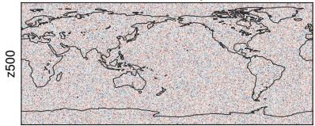

Prior sample ε  
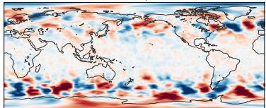

ERA5 6 h residual z0  
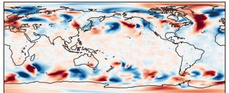

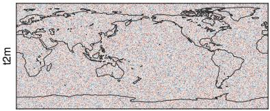

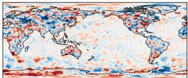

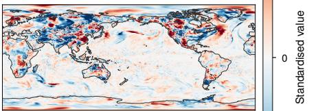

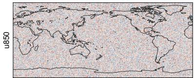

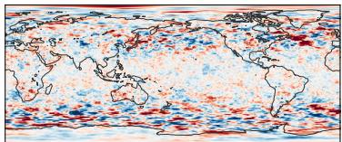

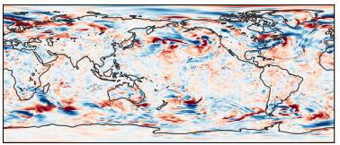

b  
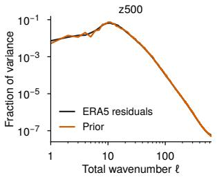

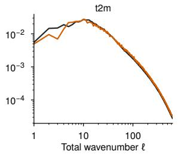

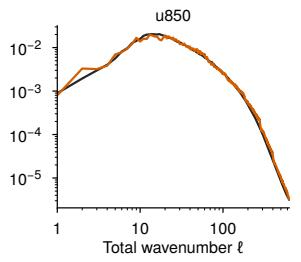

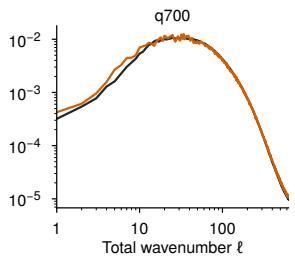

c  
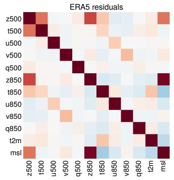

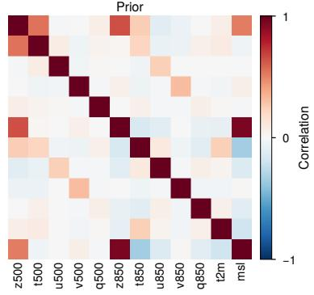  
The prior is fitted to ERA5 for 1998–2019; every field shown is from 2020. a, One draw of white noise $\xi ,$ the prior sample ε coloured from it and an ERA5 6 h residual z (00 UTC, 20 January 2020) for z500, t2m and u850, each divided by its standard deviation. b, Spherical-harmonic power per total wavenumber $\ell ,$ normalised to unit total variance, of the prior (8 samples) and of ERA5 residuals (110 pairs at 00 UTC in 2020) for z500, t2m, u850 and $\mathrm { q 7 0 0 }$ , up to $\ell = 6 3 0 . \ \mathbf { c } ,$ Area-weighted correlations between the residuals of 12 variables in ERA5 (the 110 pairs of b) and in the prior (its 8 samples); the prior’s 66 correlations between diferent variables are within 0.07 of those of ERA5 (mean diference 0.01). The 2020 residuals have their 2020 seasonal-mean 00 UTC residual removed, as the fit removes its 1998–2019 mean for each hour and season (Methods).

Extended Data Fig. 2 | At 0.25°, Astra has a lower CRPS and a lower unbiased ensemblemean RMSE than IFS ENS on every variable, level and lead time, and from day 3 a lower CRPS than GenCast on 406 of the 500 combinations of the 20 targets (81%); every significant diference in GenCast’s favour lies within the first 60 h for the 20 targets and within 3.5 days for tp24h.

a CRPS, improvement over GenCast (%)  
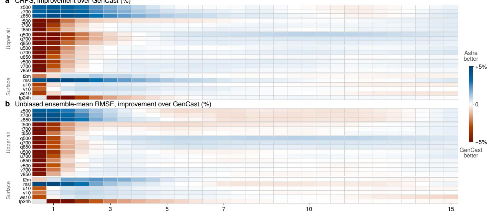  
c CRPS, improvement over IFS ENS (%)

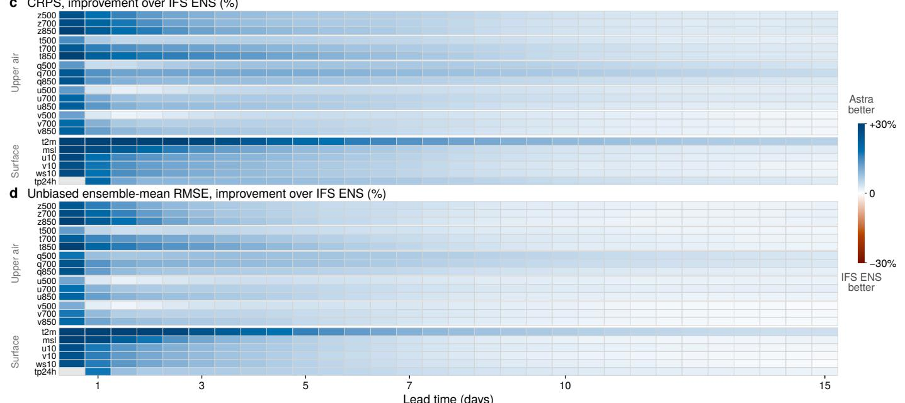  
As Fig. 4, for z, t, q, u and v at 500, 700 and 850 hPa, the pressure levels WeatherBench 2 scores at 0.25°, the surface variables t2m, msl, u10, v10 (10 m wind components) and ws10, and 24 h precipitation (tp24h; grey, undefined at 12 h): improvement of Astra over GenCast (a,b) and IFS ENS (c,d) in CRPS (a,c) and unbiased ensemble-mean RMSE (b,d) at every lead time from 12 h to 15 days; colours, hatching and significance as in Fig. 4. Combinations in which Astra is better / significantly better / the reference significantly better, of 629: a, 460 / 38 / 56; b, 322 / 39 / 44; c, 629 / 623 / 0; d, 629 / 518 / 0; of the 600 without tp24h (the 20 targets of Results): a, 441 / 38 / 50; b, 320 / 39 / 38; c, 600 / 594 / 0; d, 600 / 489 / 0. Every test against GenCast at 0.25° is the widened fixed-reference test; at 1.5°, its intervals against GenCast are about 2.8 times as wide as the paired ones (Methods).

Extended Data Fig. 3 | At 1.5°, Astra has a significantly lower CRPS and a lower unbiased ensemble-mean RMSE than IFS ENS on every variable, level and lead time, and from day 3 a lower CRPS than GenCast on 456 of the 500 combinations of the 20 targets (91%), significantly on 168 and significantly higher on 4.

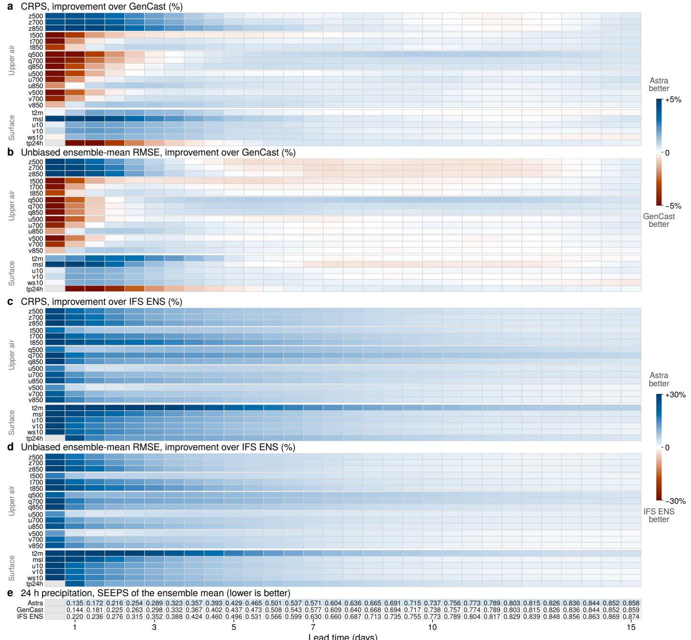  
As Extended Data Fig. 2, for the released forecasts scored with the WeatherBench 2 code at 1.5° (all 732 initialisations of 2020; references from the WeatherBench 2 result files). Significance is tested as at 0.25° for u10 and v10 and otherwise paired with the per-initialisation scores of GenCast and IFS ENS recomputed from their released forecasts (Methods); the per-initialisation scores of Astra reproduce its global WeatherBench 2 scores to $2 . 5 \times 1 0 ^ { - 7 }$ . Combinations in which Astra is better / significantly better / the reference significantly better, of 629: a, 534 / 241 / 52; b, 411 / 181 / 40; c, 629 / 629 / 0; d, 629 / 621 / 0; of the 600 without tp24h: a, 513 / 222 / 45; b, 392 / 168 / 32; c, 600 / 600 / 0; d, 600 / 592 / 0. e, Ensemble-mean SEEPS 30 for tp24h (lower is better), to three decimals; shading marks the lowest at full precision, that of Astra at every lead time.

## Extended Data Fig. 4 | At 1.5°, Astra has a lower CRPS than GenCast in 873 of the 1,134 combinations of region, variable and lead time (77%), and in every region for z500 and mean sea-level pressure over the first 2 days.

CRPS, improvement over GenCast (%), by region

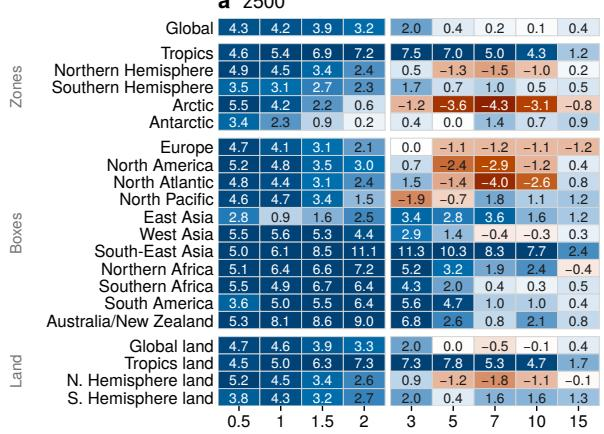  
d v850

b t850  
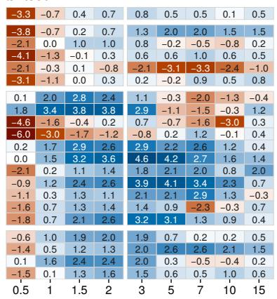

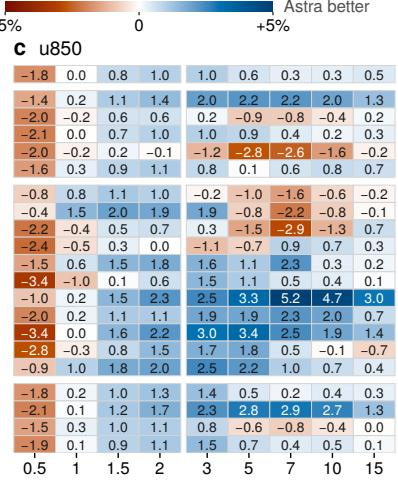  
f msl

e t2m  
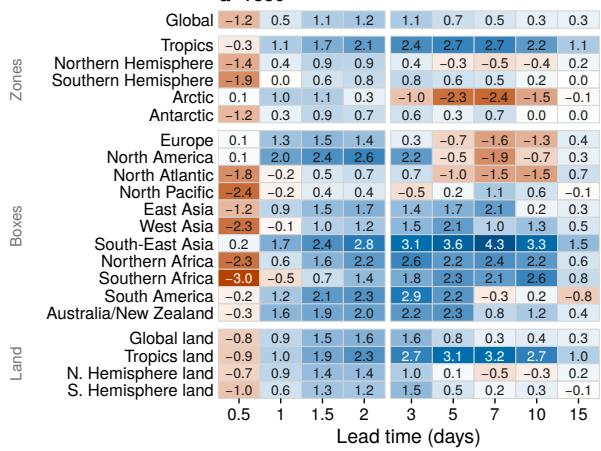

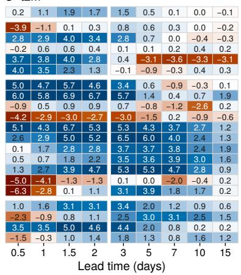

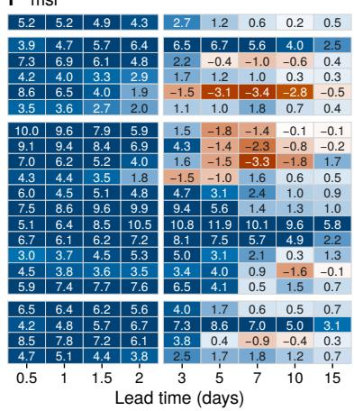

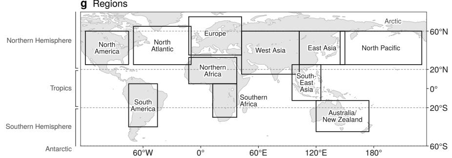  
a–f, CRPS improvement of Astra over GenCast by region and lead time (positive, Astra better; colours as for GenCast in Fig. 4), scored with the WeatherBench 2 code at $1 . 5 ^ { \circ }$ as in Extended Data Fig. 3, where the global scores (top row) are tested for significance. In the same evaluation, Astra has a lower CRPS than IFS ENS in 1,119 of these 1,134 combinations. Regions as defined in WeatherBench 2: the tropics $( 2 0 ^ { \circ } \mathrm { S } { - } 2 0 ^ { \circ } \mathrm { N } )$ , the two hemispheres poleward of 20°, the Arctic and Antarctic poleward of 60°, the boxes in g and the land points of the global, tropical and hemispheric regions.

Extended Data Fig. 5 | The network: a five-level W-Net of 3.0 billion parameters, with Kantorovich Attention at $\mathbf { 1 } ^ { \circ }$ and $\mathbf { 2 } ^ { \circ }$

a The W-Net  
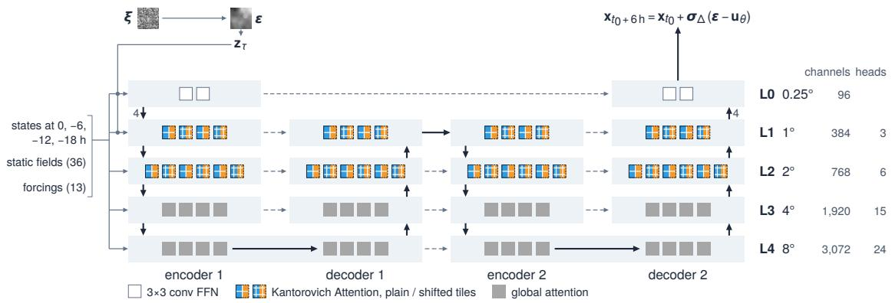

b One block  
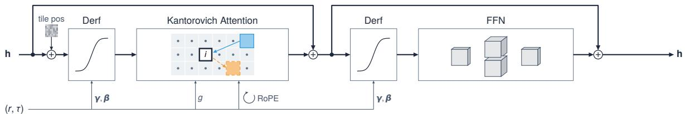

c Derf  
d FFN  
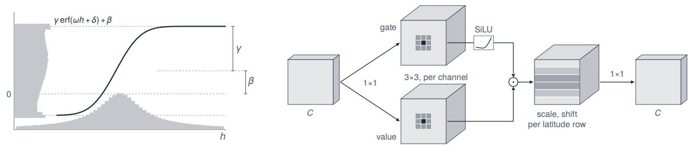

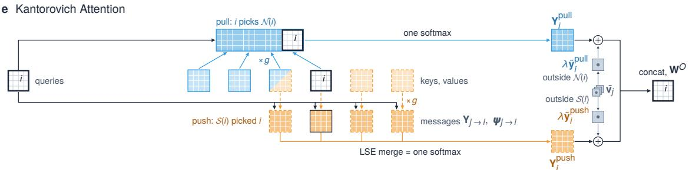  
a, The W-Net. Vertical arrows resample by $2$ (or as marked); dashed, skip connections; $\mathbf { z } _ { \tau }$ , the noisy 6 h residua (at inference, the noise ε: white noise $\pmb { \xi }$ coloured in spherical harmonics). b, One block at L1–L2 (L3–L4: global attention; $\mathrm { L 0 } \colon \mathrm { a } \mathrm { 3 } \times \mathrm { 3 }$ convolutional $\mathrm { F F N } )$ : Kantorovich Attention (e) and then the FFN, each a pre-norm residual update after Derf, with a learned position within the tile added to the attention’s input. The flow times (r, τ) set, through learned maps, each $\mathrm { D e r f } ^ { \prime } \mathrm { s } \gamma$ and $\beta ,$ the score gates $g$ and an extra rotary phase of the queries (circular arrow). $\mathbf { c } ,$ Derf, $\gamma \odot \operatorname { e r f } ( \omega h + \delta ) + \beta$ , on one channel: a heavy-tailed h (bottom; illustrative) is mapped between $\beta - \gamma$ and $\beta + \gamma . \textbf { d }$ , The FFN at L1– $\mathrm { { \cdot } L 4 , a }$ SwiGLU (face, the latitude–longitude grid; depth, channels): a 1 × 1 expansion into a gate and a value, a $3 \times 3$ depthwise convolution on each, SiLU of the gate times the value, a learned scale and shift per latitude row at L1 and L2, and a $, 1 \times 1$ projection. The L0 FFN is $\mathrm { ~ a ~ 3 ~ } \times 3$ convolutional FFN, with the same scale and shift. $\mathbf { e } ,$ Kantorovich Attention for one receiver tile i (white, black outline) and one head. Black arrows carry the queries of $i ;$ coloured arrows carry the keys and values of its selected tiles (blue, $\mathcal { N } ( i )$ , its K senders; orange, $s ( i )$ , the tiles that picked $i ;$ each with i’s own tile; split, both), scaled by the score gates $g .$ Pull takes one softmax over the tokens of ${ \mathcal { N } } ( i ) ;$ in push, each message $\mathbf { Y } _ { j  i }$ attends over one sender’s tokens, and weighting the messages by the softmax of their log-sum-exps $\psi _ { j  i }$ (LSE merge) gives one softmax over all tokens of $s ( i )$ . Each branch has its own projections and adds its pooled term $\lambda \tilde { \mathbf { y } } _ { i }$ , from the tile means $\bar { \bf v } _ { j }$ of the tiles outside its selected tiles (Methods); branches and heads are concatenated and projected by $\mathbf { W } ^ { O }$

a

Extended Data Fig. 6 | Per variable, Astra has a lower CRPS and a lower unbiased ensemble-mean RMSE than IFS ENS at every lead time, and a spread–skill ratio of 0.97– 1.03 at 15 days.

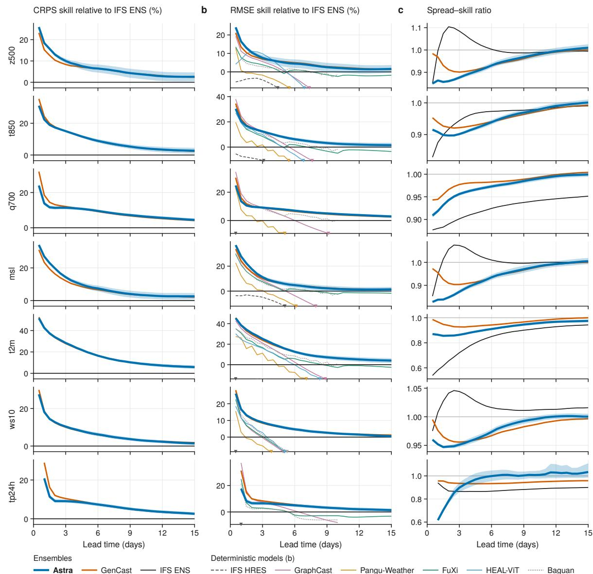

As Fig. 5, per variable, for z500, t850, q700, msl, t2m, ws10 and 24 h precipitation (tp24h) in rows: a, CRPS skill and b, unbiased ensemble-mean RMSE skill relative to IFS ENS, in per cent, and c, the spread–skill ratio (grey line at 1, spread matching the ensemble-mean error). In b, the deterministic models where WeatherBench 2 scores them, each to its last lead time (FuXi and HEAL-ViT without q700; HEAL-ViT without msl; Pangu-Weather and HEAL-ViT without tp24h); a deterministic curve that falls below the lower edge of a panel is cut there and marked by a triangle (at its first lead time if it starts below). Every other target, u850 and v850 among them, is scored at every lead time in Extended Data Figs. 2 and 3.

Extended Data Fig. 7 | At 5 and 2 days, the member spectra of Astra stay within a factor of $\sqrt { 2 }$ of ERA5’s down to a shorter wavelength than those of IFS ENS for all eight variables.

o  
j  
a  
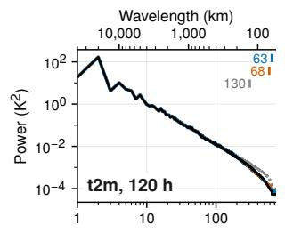  
b

  
c

  
d

e  

f  
  
g

  
h

i  

  
k

m  
  
n

p  

  
As Fig. 6b– $\mathbf { \beta } _ { \mathrm { ^ - e , } }$ with the same labelled ticks, at 120 h (5 days; a–h) and 48 h (2 days; i–p), for t2m, t850, the wind components at 850 hPa (u850, v850) and 10 m (u10, v10), the 10 m wind speed (ws10, the magnitude of the 10 m wind at each grid point) and mean sea-level pressure (msl). The spectra extend to $\ell = 6 3 8$ for t850, u850 and v850 and to $\ell = 7 1 9$ for the other variables.

Extended Data Table 1 | Network, state variables and training.  
a, Parameters and forward cost by level.
<table><tr><td>Level</td><td>Grid</td><td>Width</td><td>Blocks</td><td>Attention</td><td>Parameters</td><td>TFLOP/sample</td></tr><tr><td>L0</td><td> $^ { 7 2 1 } \times 1 , 4 4 0$ </td><td>96</td><td>4</td><td>– (convolution)</td><td>2M</td><td>1.53</td></tr><tr><td>L1</td><td> $1 8 1 \times 3 6 0$ </td><td>384</td><td>16</td><td>Kantorovich Attention,  $8 \times 8$  tiles</td><td>55M</td><td>7.10</td></tr><tr><td>L2</td><td> $9 1 \times 1 8 0$ </td><td>768</td><td>24</td><td>Kantorovich Attention,  $1 0 \times 1 0$  tiles</td><td>263 M</td><td>10.23</td></tr><tr><td>L3</td><td> $4 6 \times 9 0$ </td><td>1,920</td><td>16</td><td>global</td><td>718M</td><td>7.98</td></tr><tr><td>L4</td><td> $2 3 \times 4 5$ </td><td>3,072</td><td>16</td><td>global</td><td>1,828 M</td><td>3.98</td></tr><tr><td colspan="7">Network</td></tr></table>

Forward floating-point operations per sample (two per multiply–add), counted from the traced program of the trained network; the network total includes the resamplers (0.97), the conditioning (0.12) and the output head (0.10), and the parameter total likewise includes the resamplers, conditioning, embeddings and output head. Dense self-attention over all grid points of L1 and L2 would raise the attention cost of a block from 0.12 to 6.5 TFLOP at L1 and from 0.10 to 0.82 TFLOP at L2, an increase of about 120 TFLOP per sample in all.

b, Variables, levels and normalisation.
<table><tr><td>Variables</td><td>Levels or domain</td><td>Transform</td><td>Noised</td></tr><tr><td>Geopotential, temperature, specific humidity, u and v wind</td><td>13 pressure levels</td><td></td><td>yes</td></tr><tr><td>2 m temperature, 10 m u and v wind, mean sea-level pressure</td><td>surface</td><td></td><td>yes</td></tr><tr><td>6 h accumulated precipitation</td><td>global</td><td> $\log ( 1 + x / 1 0 ^ { - 5 } \mathrm { m } )$ </td><td>yes</td></tr><tr><td>Sea-surface temperature, sea-ice cover</td><td>ocean</td><td></td><td>no</td></tr><tr><td>Volumetric soil water (layers 1 and 2)</td><td>land</td><td></td><td>no</td></tr><tr><td>Snow depth</td><td>land</td><td> $\log ( 1 + x / 1 0 ^ { - 3 } \mathrm { m } )$ </td><td>no</td></tr></table>

The 75 state variables. Pressure levels: 50, 100, 150, 200, 250, 300, 400, 500, 600, 700, 850, 925 and 1,000 hPa. Each variable, after its transform, is standardised with its mean and standard deviation, and its 6 h change is divided by the standard deviation $\sigma _ { \Delta }$ of that change (Methods). Fields with a domain are zero outside it. Static fields and forcings are listed in Methods.

$\mathbf { c } ,$ Training.
<table><tr><td>MeanFlow stage</td><td></td><td>CRPS stage</td></tr><tr><td>Initialisation</td><td>random</td><td>MeanFlow weights at step 40,000; new optimiser state</td></tr><tr><td>Steps; batch</td><td>40,000; 16 samples</td><td>15,000; 8 cases × 4 members almost-fair CRPS  $( \alpha = 0 . 9 5 )$  on 5 scale bands</td></tr><tr><td>Objective</td><td>MeanFlow; half of each batch at  $r = \tau ,$  half at  $r < \tau ; ( r , \tau )$  uniform</td><td>(weights 0.10, 0.25, 0.25, 0.20, 0.20, finest first), plus the feature term of the self-featurised CRPS</td></tr><tr><td>Loss normalisation</td><td>each term over (its stop-gradient value  $+ 1 0 ^ { - 4 } )$  , per sample and variable</td><td>each term over (the stop-gradient mean absolute error  $+ 1 0 ^ { - 2 } ; + \dot { 1 }$  for auxiliary fields), per case, variable and lead time, or per case and feature level</td></tr><tr><td>Optimiser</td><td>schedule-free  $( \beta _ { 1 } = 0 . 9 )$  ; Muown (momentum 0.95, update RMS 0.2) for hidden-layer weight matrices, Adam otherwise</td><td>as in the MeanFlow stage; Adam for the adapters</td></tr><tr><td>Learning rate Gradient clipping</td><td> $4 \times 1 0 ^ { - 4 }$  8</td><td> $4 \times 1 0 ^ { - 5 } ~ ( 1 0 ^ { - 4 }$  for the adapters) 5</td></tr><tr><td>(norm)</td><td></td><td>two 6 h steps; lead weights 0.25 and 0.75</td></tr><tr><td>Rollout Feature term</td><td>one 6 h step</td><td>weight 0.5; decoder 1 at L1–L4 (weights 0.4, 0.2, 0.2, 0.2); placements for 12, 18, 24 and 30 h</td></tr><tr><td></td><td></td><td>(probabilities 0.35, 0.35, 0.20, 0.10); τ ∈ [0.5, 1); frozen copy refreshed every 5,000 steps</td></tr><tr><td>Noisy adapter</td><td></td><td>rank 16; output projection of the last block of decoder 1 at L3 and L4;  $\| B A \| _ { \mathrm { F } } = 0 . 1 \| W \| _ { \mathrm { F } } \ \mathrm { a t }$  initialisation</td></tr><tr><td>Precipitation penalty Step time; compute</td><td></td><td> $c = 1 . 1 \times 1 0 ^ { - 4 }$  8.29 s; 276.3 H200-hours</td></tr></table>

Both stages: ERA5, 1979–2019, 6-hourly; $3 . 0 \times 1 0 ^ { 9 }$ parameters (and two rank-16 adapters in the CRPS stage); variable weights pressure/1,000 hPa (1 for single-level fields) × 1.5 (q), 1.3 $( \mathbf { t } , \mathbf { u } , \mathbf { v } ,$ 10 m wind), 1.35 (z), 1.8 (msl), and 8.0 for 2 m temperature; constant learning rate after 500 warm-up steps; no weight decay; the schedule-free average of the weights; one node of eight H200 GPUs.