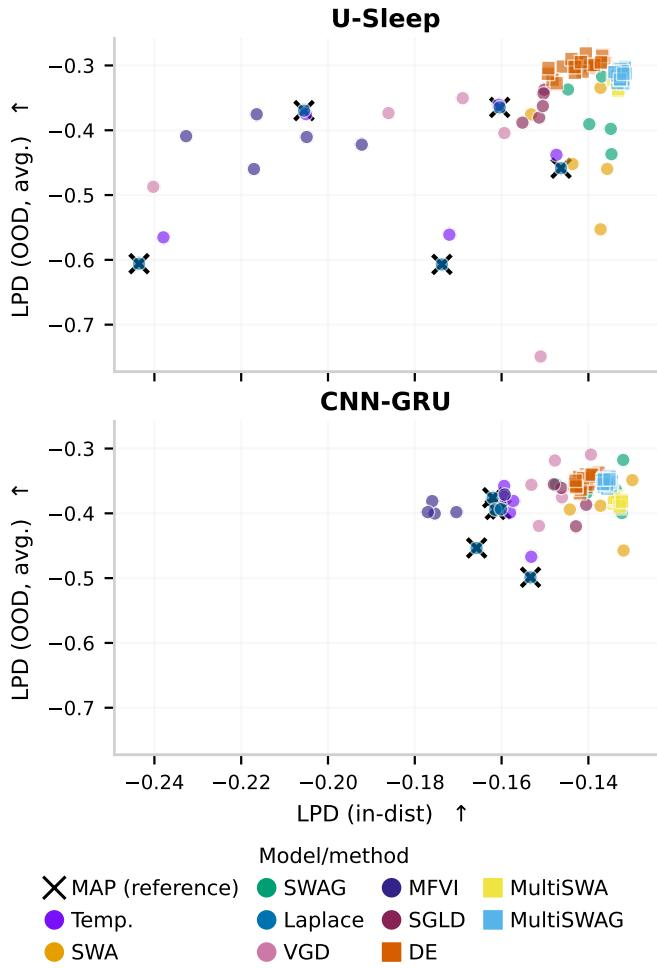
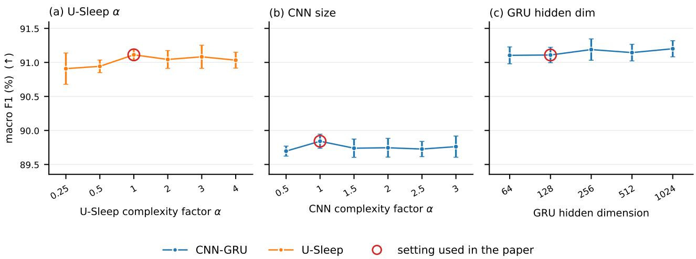
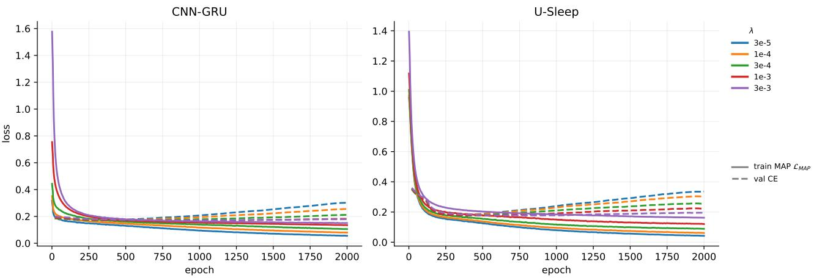
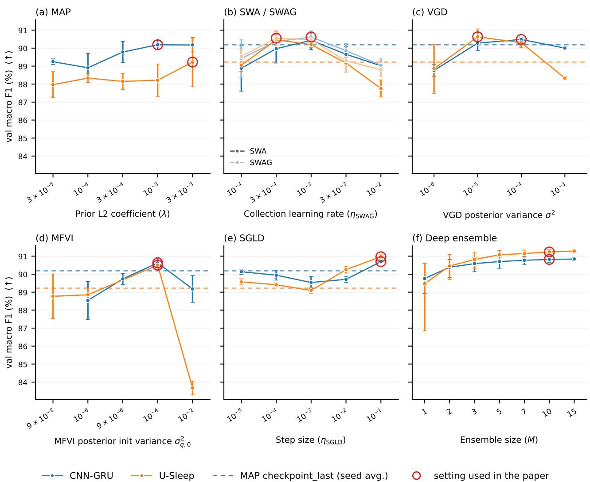
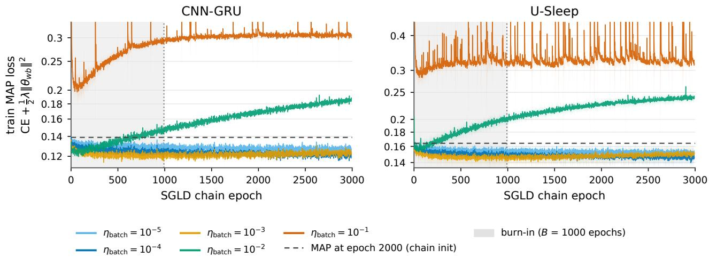
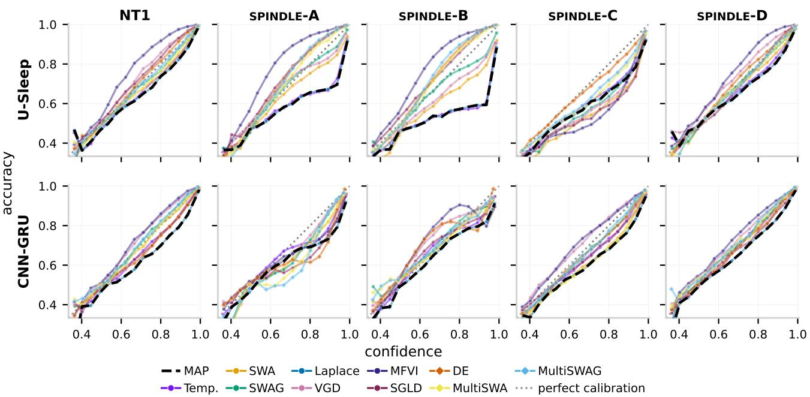
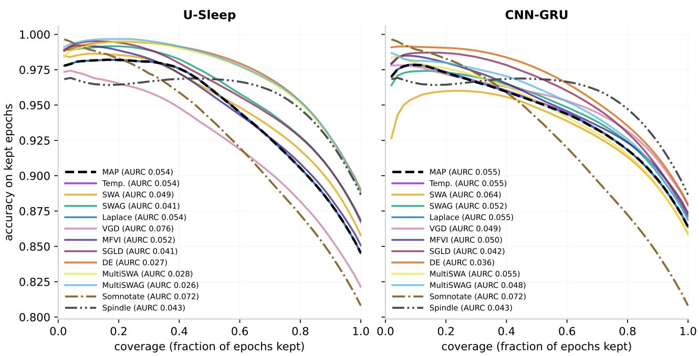
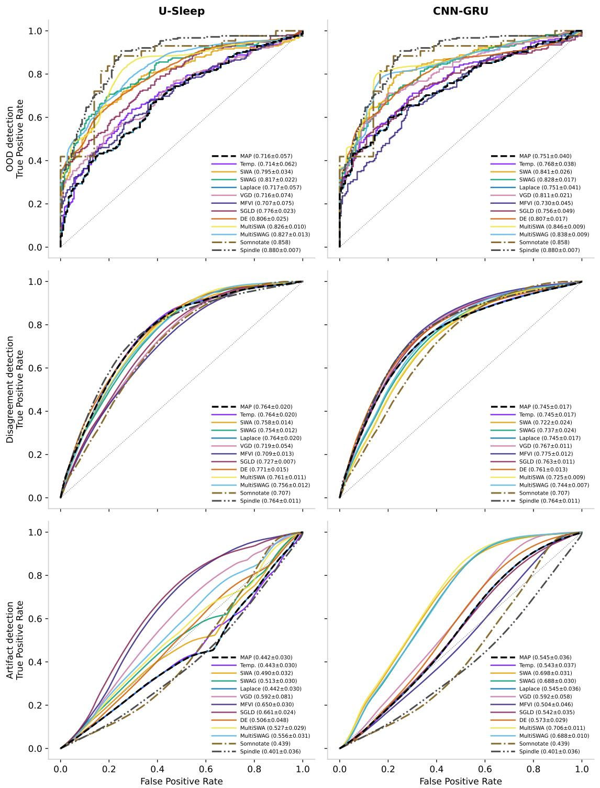

# Evaluating Bayesian deep learning for robust biomedical time-series classification under distribution shift: A sleep scoring case study

Mads Birch Sørensen¹,2, Ulrike Richter2, Francois Gastambide2, and Michael Riis Andersen

1Technical University of Denmark, Denmark ²H. Lundbeck A/S, Denmark

## Abstract

In biomedical time-series classification, machine learning models often suffer from deteriorating accuracy and calibration due to distribution shift. We investigate to what degree Bayesian-inspired deep learning improves robustness through Bayesian model averaging (BMA). Using rodent sleep scoring as a case study, we evaluate BMA under distribution shifts in genotype, laboratory, and species. We systematically compare nine approximate inference methods spanning single- and multi-basin approaches across two neural network backbones on in-distribution (ID) data and five out-of-distribution (OOD) datasets. In our results, multi-basin methods perform best, outperforming baselines and single-basin methods. Compared with point estimates, BMA generally improves OOD accuracy and calibration across both architectures, while yielding only modest ID gains. It also often improves selective prediction and OOD and artifact detection, but, interestingly, not inter-rater disagreement detection.

## 1 INTRODUCTION

Machine learning has demonstrated high predictive accuracy across a wide range of biomedical time-series classification tasks, including cardiac rhythm classification from electrocardiograms (Hannun et al., 2019), seizure detection and seizure-type classification from electroencephalographic recordings (Tang et al., 2022), and sleep staging from electrophysiological recordings (Miladinović et al., 2019; Perslev et al., 2021). However, in practical applications, models are often applied to data from different populations, recording sites, sensor types and placements, or annotation practices, resulting in distribution shift relative to the training data (Ovadia et al., 2019; Dockès et al., 2021; Wagh et al., 2022). Moreover, several of these factors may change simultaneously, producing structured shifts that may not be well represented by the synthetic corruptions commonly used to study distribution shift (Koh et al. 2021). Generalization beyond the training distribution is therefore critical for reliable deployment.

As both predictive accuracy and model confidence often degrade under distribution shift (Ovadia et al., 2019), reliable deployment necessitates well-calibrated probabilities to flag potential model errors. A well-calibrated classifier assigns confidence levels that match the observed frequency of correct predictions (Guo et al., 2017). Such probabilities can support risk-aware use of machine-learning models, including selective prediction, in which uncertain cases are deferred for expert review (Amodei et al., 2016; Geifman and El-Yaniv, 2017).

Bayesian neural networks represent model uncertainty by inferring a posterior distribution over the model parameters or the function space directly and form predictions by marginalizing over the corresponding posterior (Blundell et al., 2015; Rudner et al., 2022). Because exact Bayesian inference is generally intractable for neural networks, practical Bayesian model averaging (BMA) relies on scalable approximations. Many of these approaches characterize uncertainty within a single posterior basin, whereas deep ensembles (DEs) and related multi-basin methods average predictions across independent solutions (Lakshminarayanan et al., 2017; Wilson and Izmailov, 2020).

However, whether approximate BMA systematically improves reliability under distribution shift remains unsettled. Large-scale comparisons have found that model averaging, particularly DEs, can provide strong predictive performance and uncertainty estimates under increasing distribution shift (Ovadia et al., 2019). However, a more accurate approximation of the Bayesian posterior does not necessarily translate into greater robustness under covariate shift (Izmailov et al., 2021), and adding local posterior structure to DEs can improve out-of-distribution (OOD) performance while reducing in-distribution (ID) performance (Jordahn et al., 2025). At the same time, most prior work on Bayesian deep learning relies on standard benchmarks and vision applications (Papamarkou et al., 2024). Whether these findings extend to naturally occurring distribution shifts in biomedical time-series classification is therefore an open question.

We address this question using automated rodent sleep scoring from electrophysiological recordings as a case study. Several strong sleep-scoring models already exist (Miladinović et al., 2019; Liu et al., 2022; Brodersen et al., 2024), yet the task combines several challenges relevant to reliable deployment. Recordings vary across laboratories, acquisition systems, genotypes, experimental interventions, and species, with several factors varying simultaneously across cohorts (Miladinović et al., 2019). Moreover, rodent sleep scoring lacks universally accepted scoring conventions, and signal artifacts can complicate annotation (Rayan et al., 2024). These characteristics make rodent sleep scoring a useful test case for evaluating approximate BMA under structured, naturally occurring distribution shifts and for assessing whether predictive uncertainty identifies OOD recordings, artifacts, and disagreement between independent scorers. Although prior work has examined generalization across several of these shifts, to our knowledge no sleep-staging study has systematically compared a broad range of single- and multi-basin approximate BMA methods under natural distribution shift.

## Our contributions are as follows:

• We conduct a systematic comparison of nine scalable posterior approximation and model-averaging methods across two complementary neural network architectures. The methods are the last-layer Laplace approximation (LLLA) (Kristiadi et al., 2020); stochastic weight averaging (SWA) and stochastic weight averaging-Gaussian (SWAG) (Izmailov et al., 2018; Maddox et al., 2019); variational gradient descent (VGD) and mean-field variational inference (MFVI) (Ghosh et al., 2025; Blundell et al., 2015); stochastic gradient Langevin dynamics (SGLD) (Welling and Teh, 2011); DEs, MultiSWA, and MultiSWAG (Lakshminarayanan et al., 2017; Wilson and Izmailov, 2020).

• We evaluate classification accuracy and calibration for a large in-the-wild dataset and five naturally shifted OOD cohorts spanning differences in genotype, laboratory and acquisition configuration, signal montage, and species.

• Beyond aggregate predictive performance and calibration, we assess whether predictive uncertainty supports OOD, artifact, and inter-scorer disagreement detection, as well as selective prediction.

## 2 RELATED WORK

Automatic sleep staging and generalization Sleep staging has been approached using several model architectures. In human sleep staging, prominent examples include convolutional neural networks (CNNs) (Perslev et al., 2021), convolutional-recurrent models (Supratak et al., 2017; Olesen et al., 2021), transformer-based models (Phan et al. 2022; Guo et al., 2024), and, more recently, foundation models with sleep staging as a downstream task (Thapa et al., 2026). Rodent sleep-scoring models span similar architectures, including convolutional-recurrent models (Yamabe et al., 2019; Smith et al., 2025), temporal convolutional networks (Liu et al., 2022), and classifiers that combine discriminative models with a hidden Markov model (HMM) to capture sleep-stage transitions (Miladinović et al., 2019; Brodersen et al., 2024). Across these architectures, modern sleep-staging models have achieved high classification performance on their respective evaluation datasets.

Several studies have investigated robustness across cohorts, populations, recording sites, acquisition systems, and signal montages in human sleep staging (Perslev et al., 2021; Guillot et al., 2020; Guillot and Thorey, 2021; Guo et al., 2024), as well as across experimental conditions, recording configurations, laboratories, genotypes, and species in rodent sleep scoring (Barger et al., 2019; Miladinović et al., 2019; Liu et al., 2022; Brodersen et al., 2024). Despite these efforts, generalization beyond the source domain remains a central challenge and an important barrier to widespread clinical adoption (Rossi et al., 2025).

Uncertainty quantification in sleep staging Sleep staging can be ambiguous, as reflected by disagreement between expert scorers (Guillot et al., 2020; Bakker et al., 2023; Fiorillo et al., 2023). Probabilistic predictions provide a natural way to represent this ambiguity by assigning probabilities across sleep stages rather than a single hard label (Stephansen et al., 2018). This motivates a distinction between aleatoric uncertainty arising from ambiguity in the data and epistemic uncertainty arising from limited model knowledge (Kendall and Gal, 2017; van Gorp et al., 2022). Uncertainty estimates have also been used to flag ambiguous predictions for human review (Brodersen et al., 2024; Heremans et al., 2024).

A smaller body of work has used approximate BMA to quantify epistemic uncertainty, generally focusing on one or a small number of posterior approximation methods. Recent studies have predominantly used MC dropout (Fiorillo et al., 2021; Vainikka et al., 2026; Yu et al., 2026), while Yu et al. (2026) additionally use variational inference and model ensembling. In related work, Rossi et al. (2025) use disagreement within a model ensemble to identify ambiguous signal windows.

Bayesian model averaging under distribution shift Prior work shows that the benefits of approximate BMA under distribution shift depend on both method and evaluation setting. Ovadia et al. (2019) found that predictive accuracy and uncertainty quality deteriorate with increasing shift and that DEs are generally among the most robust approaches. SWAG has shown strong calibration and OOD detection (Maddox et al., 2019), while MultiSWAG can outperform DEs and MultiSWA under severe image corruptions (Wilson and Izmailov, 2020). Evaluations on realistic shifts similarly find that multi-basin approximations often improve generalization and calibration, although the gains depend on the task and architecture (Seligmann et al., 2023). Moreover, adding local posterior structure to DEs can improve OOD metrics at the cost of ID performance (Jordahn et al., 2025), and more accurate posterior approximation does not necessarily improve robustness under covariate shift (Izmailov et al., 2021).

However, much of the empirical Bayesian deep-learning literature focuses on standard benchmarks (Papamarkou et al., 2024), while sleep-staging studies have not compared a wide range of approximate BMA methods under distribution shift. Together, these gaps motivate evaluating singleand multi-basin approximate BMA methods in rodent sleep scoring, where several naturally occurring shifts provide a challenging test of robustness.

## 3 BACKGROUND & METHOD

Sleep scoring aims to identify sleep stages over time from electrophysiological recordings. We formulate this as a multi-class sequence-to-sequence classification problem. Each multi-channel recording is divided into windows of $T$ samples and is assigned a discrete sleep score label $y \in \mathcal { D } .$ We consider a dataset with $N _ { \mathrm { s e q } }$ sequences $\mathcal { D } =$ $\{ ( \mathbf { X } _ { n } , \mathbf { y } _ { n } ) \} _ { n = 1 } ^ { N _ { \mathrm { s e q } } }$ , where $\mathbf { X } _ { n } \in \mathbb { R } ^ { C \times W T }$ contains W consecutive windows from C electrophysiological channels, concatenated along the temporal dimension, and $\begin{array} { r l } { { \bf y } _ { n } } & { { } = } \end{array}$ $( y _ { n , 1 } , \dots , y _ { n , W } ) \in \mathcal { V } ^ { W }$ contains the corresponding sleepstage labels.

Model and likelihood For each window w in an input sequence $\mathbf { X } _ { n } .$ we parameterize the class probabilities using a neural network $f _ { \theta }$ with parameters θ:

$$
p ( y _ { n , w } \mid \mathbf { X } _ { n } , \pmb { \theta } ) = \operatorname { C a t } ( y _ { n , w } \mid f _ { \pmb { \theta } } ( \mathbf { X } _ { n } ) _ { w } ) ,
$$

where $f _ { \pmb { \theta } } ( \mathbf { X } _ { n } ) _ { w }$ denotes the probability vector over sleepstage classes for window w. Assuming conditional independence of the output labels given the input and model parameters, the likelihood factorizes as

$$
p ( \mathcal { D } \mid \pmb { \theta } ) = \prod _ { n = 1 } ^ { N _ { \mathrm { s e q } } } \prod _ { w = 1 } ^ { W } p ( y _ { n , w } \mid \mathbf { X } _ { n } , \pmb { \theta } ) .\tag{1}
$$

Although the likelihood factorizes over windows, each factor is conditioned on the complete input sequence, allowing the model to use temporal context from neighboring windows.

The posterior predictive distributions Given a prior distribution $p ( \pmb \theta )$ , Bayes’ rule defines the posterior distri-

bution

$$
p ( \pmb \theta \mid \mathcal { D } ) = \frac { p ( \mathcal { D } \mid \pmb \theta ) p ( \pmb \theta ) } { p ( \mathcal { D } ) } \propto e ^ { - U ( \pmb \theta ) } ,\tag{2}
$$

where $U ( \pmb \theta ) = - \log p ( \pmb \theta ) - \log p ( \mathcal { D } \ | \ \pmb \theta )$ is the potential energy. While the maximum a posteriori (MAP) estimate is tractable using stochastic optimization, $\hat { \pmb { \theta } } _ { \mathrm { M A P } } =$ arg mi $\mathrm { n } _ { \pmb { \theta } } U ( \pmb { \theta } )$ , exact posterior inference is generally intractable for neural networks, so we resort to approximate inference, where $p ( \pmb { \theta } \mid \mathcal { D } ) \approx q _ { m } ( \pmb { \theta } )$ denotes the approximate distribution for method m.

For a new input sequence $\mathbf { X } ^ { * }$ , the posterior predictive distribution is obtained through approximate BMA

$$
\begin{array} { c } { \displaystyle p ( \mathbf { y } ^ { * } \mid \mathbf { X } ^ { * } , \mathcal { D } ) \approx \int p ( \mathbf { y } ^ { * } \mid \mathbf { X } ^ { * } , \pmb { \theta } ) q _ { m } ( \pmb { \theta } ) \mathrm { d } \pmb { \theta } } \\ { \displaystyle \approx \frac { 1 } { S } \sum _ { s = 1 } ^ { S } p ( \mathbf { y } ^ { * } \mid \mathbf { X } ^ { * } , \pmb { \theta } ^ { ( s ) } ) , } \end{array}\tag{3}
$$

where $\pmb { \theta } ^ { ( s ) } \sim q _ { m } ( \pmb { \theta } )$ are samples from an approximate posterior distribution and S is the number of samples.

## 3.1 Posterior approximation methods

We compare the MAP reference, i.e., the point estimate $ { \hat { \theta } } _ { \mathrm { M A P } }$ , with nine scalable approximate inference methods. Table 1 summarizes the method-specific posterior distributions $q _ { m } ( \pmb \theta )$ used in Eq. (3). Except for VGD and $\mathrm { D E s , }$ we treat all methods as post-hoc methods initialized at the MAP solution $ { \hat { \theta } } _ { \mathrm { M A P } }$

LLLA The Laplace approximation approximates the posterior distribution using a Gaussian centered at the MAP estimate, with covariance determined by the local curvature of $U ( \pmb \theta )$ (Daxberger et al., 2021). Computing and storing full-network curvature is infeasible for large neural networks. We therefore use LLLA, which fixes the non-lastlayer parameters $\pmb { \theta } ^ { \mathrm { - L L } }$ at their MAP values and applies the Gaussian approximation only to the last-layer parameters $\theta ^ { \mathrm { L L } }$ (Kristiadi et al., 2020). The last-layer curvature matrix is

$$
\begin{array} { r } { \mathcal { H } ^ { \mathrm { L L } } = - \left. \nabla _ { \theta ^ { \mathrm { L L } } } ^ { 2 } \log p \left( \mathcal { D } , \theta _ { \mathrm { M A P } } ^ { \mathrm { - L L } } , \theta ^ { \mathrm { L L } } \right) \right. _ { \theta ^ { \mathrm { L L } } = \theta _ { \mathrm { M A P } } ^ { \mathrm { L L } } } , } \end{array}
$$

or a positive-semidefinite approximation thereof, and the corresponding covariance is $\Sigma ^ { \mathrm { L L } } = \left( \mathcal { H } ^ { \mathrm { L L } } \right) ^ { - 1 }$

SWA and SWAG Mandt et al. (2017) provide a Bayesian interpretation of constant-learning-rate stochastic gradient descent (SGD), in which iterates from the stationary regime are viewed as samples from an approximately Gaussian distribution over model parameters. Let $\pmb { \theta } _ { \mathrm { M A P } } , \ldots , \pmb { \theta } _ { G }$ denote G parameter vectors collected along such an SGD trajectory starting at the MAP solution. SWA estimates the mean of this distribution by averaging the iterates (Izmailov et al., 2018) $\begin{array} { r } { \pmb { \theta } _ { \mathrm { S W A } } ~ \dot { = } ~ \frac { 1 } { G } \dot { \sum _ { g = 1 } ^ { G } \pmb { \theta } _ { g } } } \end{array}$ . SWAG extends this by additionally estimating the covariance of the SGD iterates, yielding a Gaussian approximation centered at $\theta _ { \mathrm { S W A } }$ (Maddox et al., 2019). The covariance combines a diagonal component estimated from all G iterates, $\Sigma _ { \mathrm { d i a g \ } } = \mathrm { d i a g } \Big ( \overline { { { \theta ^ { 2 } } } } - \theta _ { \mathrm { S W A \ } } ^ { 2 } \Big )$ , where $\begin{array} { r } { \overline { { { \pmb { \theta } } ^ { 2 } } } \ : = \ : \frac { 1 } { G } \sum _ { g = 1 } ^ { G } \pmb { \theta } _ { g } ^ { 2 } \ : ; } \end{array}$ and the squaring operations are element-wise and a lowrank component

$$
\pmb { \Sigma } _ { \mathrm { l o w - r a n k } } = \frac { 1 } { R - 1 } \sum _ { g = G - R + 1 } ^ { G } \left( \pmb { \theta } _ { g } - \bar { \pmb { \theta } } _ { R } \right) \left( \pmb { \theta } _ { g } - \bar { \pmb { \theta } } _ { R } \right) ^ { \top } ,
$$

where ${ \bar { \pmb { \theta } } } _ { R }$ is the mean of the final R iterates. The resulting SWAG covariance is then $\begin{array} { r l } { \pmb { \Sigma } _ { \mathrm { S W A G } } } & { { } = } \end{array}$ $\begin{array} { r } { \frac { 1 } { 2 } \left( \sum _ { \mathrm { d i a g } } + \bar { \sum _ { \mathrm { l o w - r a n k } } } \right) } \end{array}$

VGD and MFVI Variational inference approximates $p ( \pmb { \theta } \mid \mathbf { \mathcal { D } } )$ with a tractable distribution $q _ { \mathrm { V I } } ( \pmb { \theta } )$ by minimizing the negative evidence lower bound,

$$
{ \mathcal { L } } _ { \mathrm { V I } } = - \mathbb { E } _ { q _ { \mathrm { V I } } ( \pmb { \theta } ) } \left[ \log p ( { \mathcal { D } } \mid \pmb { \theta } ) \right] + \mathrm { K L } [ q _ { \mathrm { V I } } ( \pmb { \theta } ) \parallel p ( \pmb { \theta } ) ] .
$$

MFVI assumes a fully factorized Gaussian distribution and jointly learns the mean and marginal variance of each parameter (Blundell et al., 2015). A related method is VGD. which is designed to find flatter minima for better generalization (Ghosh et al., 2025). It uses an isotropic Gaussian with fixed scalar variance $\sigma ^ { 2 } > 0$ and optimizes only its mean µ. For fixed $\sigma ^ { 2 } .$ , its variational objective is equivalent, up to a constant, to minimizing the MAP objective averaged over Gaussian parameter perturbations:

$$
{ \mathcal { L } } _ { \mathrm { V G D } } ( \mu ) = \mathbb { E } _ { \epsilon \sim { \mathcal { N } } ( \mathbf { 0 } , \sigma ^ { 2 } \mathbf { I } ) } \left[ U \left( \mu + \epsilon \right) \right] ,
$$

where the expectation is approximated using sampling.

SGLD SGLD approximates posterior sampling by adding Gaussian noise to stochastic-gradient updates of the posterior energy (Welling and Teh, 2011):

$$
\pmb { \theta } _ { k + 1 } = \pmb { \theta } _ { k } - \eta \nabla _ { \pmb { \theta } } \widehat { U } _ { \mathcal { B } } \left( \pmb { \theta } _ { k } \right) + \sqrt { 2 \eta } \pmb { \epsilon } _ { k } ,\tag{4}
$$

where $\epsilon _ { k } \sim \mathcal { N } ( \mathbf { 0 } , \mathbf { I } )$ and $\eta > 0$ is the step size and $\nabla _ { \pmb { \theta } } \widehat { U } _ { B }$ is a mini-batch estimate of $\nabla _ { \pmb { \theta } } U ( \pmb { \theta } )$ . After warm up, retained parameter iterates are treated as approximate posterior samples.

Multi-basin methods DEs average predictions from M independently initialized models and can be viewed as an empirical multi-basin approximation to BMA (Lakshminarayanan et al., 2017; Wilson and Izmailov, 2020). MultiSWA similarly combines independently trained SWA solutions, while MultiSWAG combines local SWAG approximations across multiple basins (Wilson and Izmailov, 2020).

Table 1: Method-specific parameter distributions $q _ { m } ( \pmb \theta )$ used in Eq. (3). $\theta ^ { L \bar { L } }$ and $\bar { \theta ^ { - \mathrm { L L } } }$ denote the last-layer and non-last-layer parameters, respectively. Point estimates are represented as Dirac measures δ.
<table><tr><td>Method</td><td> $q _ { m } ( \pmb \theta )$ </td></tr><tr><td>MAP</td><td> $\delta ( \theta - \theta _ { \mathrm { M A P } } )$ </td></tr><tr><td>LLLA</td><td> $\delta \Bigl ( \theta ^ { \mathrm { - L L } } - \theta _ { \mathrm { M A P } } ^ { \mathrm { - L L } } \Bigr ) \mathcal { N } \Bigl ( \theta ^ { \mathrm { L L } } \mid \theta _ { \mathrm { M A P } } ^ { \mathrm { L L } } , \Sigma ^ { \mathrm { L L } } \Bigr )$ </td></tr><tr><td>SWA</td><td> $\delta ( \theta - \theta _ { \mathrm { S W A } } )$ </td></tr><tr><td>SWAG</td><td> $\mathcal { N } ( \pmb { \theta } | \{ \pmb { \theta } _ { \mathrm { S W A } } , \pmb { \Sigma } _ { \mathrm { S W A G } } )$ </td></tr><tr><td>VGD</td><td> $\mathcal { N } ( \pmb { \theta } | \pmb { \mu } , \sigma ^ { 2 } \mathbf { I } )$ </td></tr><tr><td>MFVI</td><td> $\mathcal { N } \big ( \pmb { \theta } \mid \pmb { \mu } , \mathrm { d i a g } \big ( \pmb { \sigma } ^ { 2 } \big ) \big )$ </td></tr><tr><td>SGLD</td><td> $\frac { 1 } { S } \sum _ { s = 1 } ^ { S } \delta \Big ( \pmb { \theta } - \pmb { \theta } ^ { ( s ) } \Big )$ </td></tr><tr><td>DE</td><td> $\frac { 1 } { M } \sum _ { j = 1 } ^ { M } \delta \Big ( \pmb { \theta } - \pmb { \theta } _ { \mathrm { M A P } } ^ { ( j ) } \Big )$ </td></tr><tr><td>MultiSWA</td><td> $\frac { 1 } { M } \sum _ { j = 1 } ^ { M } \delta \Big ( \pmb { \theta } - \pmb { \theta } _ { \mathrm { S W A } } ^ { ( j ) } \Big )$ </td></tr><tr><td>MultiSWAG</td><td> $\frac { 1 } { M } \sum _ { j = 1 } ^ { M } \mathcal { N } \Big ( \pmb { \theta } \mid \pmb { \theta } _ { \mathrm { S W A } } ^ { ( j ) } , \pmb { \Sigma } _ { \mathrm { S W A G } } ^ { ( j ) } \Big )$ </td></tr></table>

## 4 EXPERIMENTS & RESULTS

We first describe the experimental setup, then compare the MAP backbones with existing sleep-scoring methods and evaluate posterior approximations for both ID and OOD data. Finally, we assess predictive uncertainty for OOD, artifact, and scorer-disagreement detection and for selective prediction.

## 4.1 Experimental setup

Data and models All models were trained on a large source-domain dataset and evaluated on an ID test set and five smaller OOD cohorts exhibiting natural shifts in laboratory, signal types, genotype, and species. The sourcedomain dataset comprises recordings from wild-type mice (WT), whereas the OOD datasets comprise a cohort of narcolepsy type 1 (NT1) mice and four cohorts from the SPIN-DLE dataset of Miladinović et al. (2019), collected across three external laboratories. The WT dataset was split at the animal level into training, validation, and test sets using a 70/15/15% split to avoid leakage between sets. Dataset details are summarized in Table 2, with additional information provided in Appendix Table 7.

Each recording provided three electrophysiological input channels, with the specific channel types differing across cohorts (Appendix Table 7). All recordings were resampled to $f _ { s } = 1$ 28 Hz and divided into non-overlapping windows of duration $\tau = 4 s$ , corresponding to $T = \tau f _ { s } = 5 1 2$ samples per window. The WT and NT1 datasets were annotated by a single scorer with labels  = {wake, NREM, REM}, whereas the SPINDLE datasets were annotated independently by two scorers, who also flagged stage-specific artifacts. For the artifact- and inter-scorer-disagreement analyses, the original artifact indicators and both sets of annotations were retained. For all other experiments, artifact labels were mapped to their corresponding sleep stage, metrics were computed separately against each scorer, and averaged. Appendix A provides all details on the signals, annotations, and preprocessing.

Table 2: Datasets and evaluation domains. $N _ { \mathrm { r e c } }$ denotes the number of 24 h recordings. WT is the source domain; NT1 and the SPINDLE cohorts are held-out OOD cohorts. The final column reports the primary shift relative to WT; cohorts may also differ in acquisition system, signal montage, and annotation protocol.
<table><tr><td>Cohort</td><td>Use</td><td>Species</td><td> $N _ { \mathrm { r e c } }$ </td><td>Primary shift</td></tr><tr><td>WT</td><td>Train</td><td>Mouse</td><td>169</td><td></td></tr><tr><td>WT</td><td>Val.</td><td>Mouse</td><td>36</td><td>一</td></tr><tr><td>WT</td><td>ID test</td><td>Mouse</td><td>36</td><td>None</td></tr><tr><td>NT1</td><td>OOD test Mouse</td><td></td><td>28</td><td>Genotype</td></tr><tr><td>SPINDLE-A</td><td>OOD test Mouse</td><td></td><td></td><td>4 Lab</td></tr><tr><td>SPINDLE-D</td><td>OOD test Mouse</td><td></td><td></td><td>6 Lab</td></tr><tr><td>SPINDLE-B</td><td>OOD test Mouse</td><td></td><td>4</td><td> $\mathrm { L a b + g e n o t y p e }$ </td></tr><tr><td>SPINDLE-C</td><td>OOD test Rat</td><td></td><td></td><td>8 Lab + species</td></tr></table>

We evaluated four sleep-scoring baselines. Two were established rodent sleep-scoring methods: Spindle, which combines a CNN with an HMM (Miladinović et al., 2019), and Somnotate, which combines linear discriminant analysis (LDA) with an HMM (Brodersen et al., 2024). We followed the original methods as closely as possible, see Appendices B.2 and B.1 for details. The other two baselines were the MAP versions of the neural network backbones used to compare inference methods: U-Sleep (Perslev et al., 2021), adapted from human sleep scoring, and a CNN-GRU sequence model combining convolutional feature extraction with recurrent temporal modeling (Yamabe et al., 2019; Olesen et al., 2021; Smith et al., 2025). Appendix B.3 provides further details, and Table 9 summarizes the final architectures.

Training, model selection and evaluation Using i.i.d. Gaussian priors, the MAP models were trained using Adam $( \beta _ { 1 } = 0 . 9 , \beta _ { 2 } = 0 . 9 9 9 )$ , a learning rate of $1 0 ^ { - 4 }$ , and a batch size of 64 input sequences. Both models were trained for a fixed budget of approximately 57 full training epochs.

For each backbone, we selected the prior variance that achieved the highest validation macro F1 (MF1) (see Appendix B.4 for further details). The selected prior was then held fixed across all posterior approximation methods in Table 1.

Table 3: In-distribution accuracy and calibration on the WT test set. Accuracy-type metrics in %, LPD in nats; mean ± 95% CI over training seeds (t-based); for DE, MultiSWA and MultiSWAG, mean ± half the 2.5–97.5% interval over 100 bootstrap draws of ten members; bold = best in the column over all models, underline = best within its section (U-Sleep, CNN-GRU, Other baselines).
<table><tr><td>Model</td><td>MF1↑</td><td>κ↑</td><td>LPD↑</td><td>Brier ↓</td></tr><tr><td>U-Sleep</td><td></td><td></td><td></td><td></td></tr><tr><td>MAP</td><td> $8 9 . 7 \pm 1 . 5$ </td><td>88.6 ±3.1</td><td> $- . 1 8 6 \pm . 0 4 8$ </td><td> $9 . 4 \pm 2 . 6$ </td></tr><tr><td>Temp.</td><td> $8 9 . 7 \pm 1 . 5$ </td><td>88.6 ±3.1</td><td> $- . 1 8 5 \pm . 0 4 6$ </td><td> $9 . 4 \pm 2 . 5$ </td></tr><tr><td>SWÁ</td><td> $9 1 . 5 \pm 0 . 3 $ </td><td>91.4 ±0.7</td><td>−.141 ±.009</td><td> $7 . 1 \pm 0 . 5$ </td></tr><tr><td>SWAG</td><td> $9 1 . 7 \pm 0 . 2 $ </td><td>91.6 ±0.5</td><td> $- . 1 3 8 \pm . 0 0 5$ </td><td> $6 . 9 \pm 0 . 3$ </td></tr><tr><td>Laplace</td><td> $8 9 . 7 \pm 1 . 5$ </td><td>88.6 ±3.1</td><td> $- . 1 8 6 \pm . 0 4 8$ </td><td> $9 . 4 \pm 2 . 6$ </td></tr><tr><td>VGD</td><td> $9 0 . 6 \pm 1 . 4$ </td><td>89.4 ±3.4</td><td> $- . 1 8 1 \pm . 0 4 4$ </td><td> $9 . 1 \pm 2 . 6$ </td></tr><tr><td>MFVI</td><td> $9 0 . 5 \pm 0 . 6 $ </td><td>89.7 ±1.5</td><td>−.213 ±.019</td><td> $9 . 9 \pm 1 . 2$ </td></tr><tr><td>SGLD</td><td> $9 1 . 7 \pm 0 . 0$ </td><td>91.6 ±0.1</td><td> $- . 1 5 2 \pm . 0 0 3$ </td><td> $7 . 2 \pm 0 . 1$ </td></tr><tr><td>DE</td><td> $9 1 . 7 \pm 0 . 2 $ </td><td>91.6 ±0.4</td><td> $- . 1 4 2 \pm . 0 0 6$ </td><td> $7 . 0 \pm 0 . 3$ </td></tr><tr><td>MultiSWA</td><td> $9 1 . 9 \pm 0 . 0$ </td><td> $9 1 . 9 \pm 0 . 1$ </td><td> $. 1 3 3 \pm . 0 0 2$ </td><td> $6 . 7 \pm \mathrm { 0 . 1 }$ </td></tr><tr><td>MultiSWAG</td><td> $\underline { { \mathbf { 9 1 . 9 } } } \pm \mathbf { 0 . 0 }$ </td><td> $\underline { { \bf 9 2 . 0 \pm 0 . 1 } }$ </td><td> $\underline { { \cdot 1 3 3 } } \pm . 0 0 2$ </td><td> ${ \underline { { 6 . 6 } } } \pm 0 . 1$ </td></tr><tr><td>CNN-GRU</td><td></td><td></td><td></td><td></td></tr><tr><td>MAP</td><td>90.5 ±0.2</td><td>90.1 ±0.4</td><td> $- . 1 6 1 \pm . 0 0 6$ </td><td>8.1 ±0.3</td></tr><tr><td>Temp.</td><td>90.5 ±0.2</td><td>90.1 ±0.4</td><td>−.157 ±.003</td><td>8.1 ±0.2</td></tr><tr><td>SWÁ</td><td>91.7 ±0.2</td><td>91.6 ±0.3</td><td>−.135 ±.007</td><td>6.9 ±0.3</td></tr><tr><td>SWAG</td><td>91.8 ±0.2</td><td>91.7 ±0.3</td><td>−.137 ±.008</td><td>6.9 ±0.4</td></tr><tr><td>Laplace</td><td>90.5 ±0.2</td><td>90.1 ±0.4</td><td>−.161 ±.006</td><td>8.1 ±0.3</td></tr><tr><td>VGD</td><td>91.5 ±0.3</td><td>91.3 ±0.5</td><td>−.148 ±.007</td><td>7.4 ±0.3</td></tr><tr><td>MFVI</td><td>90.8 ±0.2</td><td>90.3 ±0.5</td><td>−.172 ±.009</td><td>8.5 ±0.5</td></tr><tr><td>SGLD</td><td>91.2 ±0.1</td><td>91.0 ±0.3</td><td>−.143 ±.005</td><td>7.4 ±0.3</td></tr><tr><td>DE</td><td>91.3 ±0.1</td><td>91.1 ±0.3</td><td>−.141 ±.004</td><td>7.3 ±0.2</td></tr><tr><td>MultiSWA</td><td>91.9 ±0.0</td><td>91.8 ±0.1</td><td>−.133 ±.001</td><td>6.8 ±0.1</td></tr><tr><td>MultiSWAG</td><td>91.9 ±0.0</td><td>91.8 ±0.1</td><td> $- . 1 3 6 \pm . 0 0 1$ </td><td>6.8 ±0.1</td></tr><tr><td>Other baselines</td><td></td><td></td><td></td><td></td></tr><tr><td>Somnotate</td><td>90.4</td><td>91.1</td><td>-.248</td><td>8.4</td></tr><tr><td>Spindle</td><td>89.2 ±0.4</td><td>89.5 ±0.2</td><td> $- . 3 0 1 \pm . 0 0 5$ </td><td>10.1 ±0.2</td></tr></table>

MF1 was the primary classification metric, supplemented by Cohen's κ. Probabilistic performance was evaluated using log predictive density (LPD) and Brier score. All metrics were computed using the predictive distribution in Eq. (3). Single-model methods were evaluated across five random seeds, and we report the mean and 95% confidence interval across runs. DE, MultiSWA, and MultiSWAG used M = 10 independently initialized models, with 95% empirical intervals obtained from 100 random ensembles sampled with replacement from a pool of 20 models. These intervals likely underestimate variability relative to independent ensembles. Further details on tuning and evaluation are provided in Appendix C.

Lastly, we evaluated predictive entropy for detecting OOD recordings, inter-scorer disagreement, and artifacts, using the area under the receiver operating characteristic curve (AUROC). OOD detection used per-recording mean entropy to distinguish WT test recordings from OOD recordings, whereas disagreement and artifact detection used window-level entropy and the original sPINDLE annotations. We evaluated selective prediction using the area under the risk-coverage curve (AURC) (Geifman et al., 2019).

Table 4: Out-of-distribution performance, each metric averaged over the five OOD cohorts (NT1 + SleepyRat A— D), computed per training seed; mean ± 95% CI over training seeds (t-based); for DE, MultiSWA and MultiSWAG, mean ± half the 2.5–97.5% interval over 100 bootstrap draws of ten members of that average. bold = best in the column over all models, underline = best within its section.
<table><tr><td>Model</td><td>MF1↑</td><td>κ↑</td><td>LPD↑</td><td>Brier ↓</td></tr><tr><td>U-Sleep</td><td></td><td></td><td></td><td></td></tr><tr><td>MAP</td><td>76.0 ±4.4</td><td>72.1 ±6.3</td><td>−.481 ±.149</td><td>24.2 ±6.7</td></tr><tr><td>Temp.</td><td>76.0 ±4.4</td><td>72.1 ±6.3</td><td>−.460 ±.122</td><td>23.9 ±6.3</td></tr><tr><td>SWA</td><td>78.0 ±3.2</td><td>74.3 ±5.9</td><td>−.435 ±.105</td><td>21.7 ±4.8</td></tr><tr><td>SWAG</td><td>79.2 ±2.8</td><td>75.7 ±5.3</td><td>−.376 ±.060</td><td>19.8 ±3.6</td></tr><tr><td>Laplace</td><td>76.0 ±4.4</td><td>72.1 ±6.3</td><td>−.481 ±.149</td><td>24.2 ±6.7</td></tr><tr><td>VGD</td><td>75.2 ±6.2</td><td>68.2 ±12.0</td><td>−.473 ±.202</td><td>25.7 ±10.6</td></tr><tr><td>MFVI</td><td>79.6 ±2.0</td><td>73.2 ±3.5</td><td>−.415 ±.038</td><td>22.6 ±2.5</td></tr><tr><td>SGLD</td><td>80.6 ±1.3</td><td>76.1 ±2.0</td><td>−.362 ±.028</td><td>19.4 ±1.5</td></tr><tr><td>DE</td><td>82.1 ±1.5</td><td>79.5 ±2.4</td><td>−.299 ±.019</td><td>16.2 ±1.3</td></tr><tr><td>MultiSWA</td><td>82.2 ±0.9</td><td>79.3 ±2.0</td><td>−.315 ±.018</td><td>16.6 ±1.2</td></tr><tr><td>MultiSWAG</td><td>82.5 ±0.8</td><td>79.4 ±1.8</td><td>−.311 ±.015</td><td>16.5 ±0.9</td></tr><tr><td>CNN-GRU</td><td></td><td></td><td></td><td></td></tr><tr><td>MAP</td><td>77.1 ±3.2</td><td>73.8 ±2.1</td><td>−.423 ±.064</td><td>21.5 ±2.2</td></tr><tr><td>Temp.</td><td>77.1 ±3.2</td><td>73.8 ±2.1</td><td>−.396 ±.053</td><td>21.0 ±2.2</td></tr><tr><td>SWÁ</td><td>77.2 ±2.7</td><td>72.8 ±2.9</td><td>−.396 ±.048</td><td>21.2 ±2.4</td></tr><tr><td>SWAG</td><td>78.8 ±2.2</td><td>74.6 ±2.6</td><td>−.361 ±.037</td><td>19.5 ±2.1</td></tr><tr><td>Laplace</td><td>77.1 ±3.2</td><td>73.8 ±2.1</td><td>−.423 ±.064</td><td>21.5 ±2.2</td></tr><tr><td>VGD</td><td>79.2 ±1.6</td><td>76.3 ±0.4</td><td>−.356 ±.055</td><td>18.8 ±1.8</td></tr><tr><td>MFVI</td><td>77.4 ±3.4</td><td>75.1 ±0.8</td><td>−.390 ±.016</td><td>20.2 ±0.4</td></tr><tr><td>SGLD</td><td>78.7 ±1.2</td><td>74.9 ±0.7</td><td>−.375 ±.036</td><td>19.7 ±0.9</td></tr><tr><td>DE</td><td>79.7 ±0.7</td><td>76.3 ±0.3</td><td>−.347 ±.018</td><td>18.7 ±0.5</td></tr><tr><td>MultiSWA</td><td>77.7 ±0.5</td><td>72.7 ±0.5</td><td>−.382 ±.009</td><td>20.9 ±0.5</td></tr><tr><td>MultiSWAG</td><td>78.9 ±0.5</td><td>74.4 ±0.4</td><td>−.352 ±.007</td><td>19.3 ±0.4</td></tr><tr><td>Other baselines</td><td></td><td></td><td></td><td></td></tr><tr><td>Somnotate</td><td>72.1</td><td>68.7</td><td>-.863</td><td>32.0</td></tr><tr><td>Spindle</td><td>79.6 ±1.2</td><td>79.7 ±1.3</td><td>−.676±.034</td><td>19.9 ±1.4</td></tr></table>

## 4.2 MAP models are strong baselines

We first compared the U-Sleep and CNN-GRU MAP models with Somnotate and Spindle on the ID WT test set. Table 3 shows strong and comparable classification performance across all four models: MF1 ranges from 89.2 to 90.5 and Cohen's κ from 88.6 to 91.1, with CNN-GRU MAP achieving the highest mean MF1 and Somnotate the highest κ. The MAP models achieve substantially higher LPD than both Somnotate and Spindle; CNN-GRU MAP also obtains the lowest Brier score, while U-Sleep MAP lies between Somnotate and Spindle. Thus, the MAP models are competitive with established sleep-scoring models and provide strong deterministic baselines for the following comparison of posterior approximation methods.

## 4.3 BMA yields modest in-distribution gains

Next, we compared the approximate BMA methods on the ID WT test set. Table 3 shows that most methods improve classification and probabilistic performance on the ID WT test set, but the gains are modest. The best results increase MF1 by 2.2 percentage points for U-Sleep and 1.4 points for CNN-GRU, with corresponding improvements in LPD and Brier score. SWA, SWAG, and the multi-basin methods perform strongest, although the differences among them are small. LLLA matches MAP to the reported precision,

  
Figure 1: ID versus mean OOD LPD for U-Sleep and CNN-GRU (higher is better) across seeds. Black crosses denote the corresponding MAP models, and each dot represents a seed.

MFVI slightly improves classification but worsens probabilistic performance, and temperature scaling provides only marginal probabilistic gains.

## 4.4 BMA generally improves robustness under natural distribution shift

Next, we evaluated all models on the five OOD cohorts. Table 4 shows that distribution shift on average degrades both classification accuracy and calibration, while increasing the differences between inference methods. Most BMA methods improve on their corresponding MAP model for OOD data, with larger gains than ID. For U-Sleep, MultiSWAG increases MF1 from 76.0 to 82.5, while the DE improves LPD from -0.481 to -0.299 and reduces the Brier score from 24.2 to 16.2. For CNN-GRU, the DE increases MF1 from 77.1 to 79.7, improves LPD from -0.423 to —0.347, and reduces the Brier score from 21.5 to 18.7. Temperature scaling yields only marginally better OOD calibration than MAP, indicating that the BMA gains cannot be attributed to a global rescaling of the MAP logits, mirroring the findings of Ovadia et al. (2019).

Table 5: Average LPD rank. Models were ranked jointly within each cohort, and ranks were averaged over cohorts and backbones (1 = best; lower is better). Other baselines are ranked individually. Bold and underlining denote the best overall and within each model group, respectively.
<table><tr><td></td><td colspan="8">Single solution/trajectory</td><td colspan="3">Multi-basin</td><td colspan="2">Other baselines</td></tr><tr><td>Scope</td><td>MAP</td><td>Temp.</td><td>SWA</td><td>SWAG</td><td>Laplace</td><td>VGD</td><td>MFVI</td><td>SGLD</td><td>DE</td><td>MultiSWA</td><td>MultiSWAG</td><td>Somnotate</td><td>Spindle</td></tr><tr><td>ID</td><td>17.5</td><td>16.5</td><td>6.5</td><td>6.5</td><td>18.5</td><td>15.0</td><td>19.5</td><td>12.0</td><td>9.0</td><td>2.5</td><td>3.0</td><td>23.0</td><td>24.0</td></tr><tr><td>OOD</td><td>18.1</td><td>16.0</td><td>13.0</td><td>9.1</td><td>18.5</td><td>12.6</td><td>13.5</td><td>9.9</td><td>6.2</td><td>6.8</td><td>4.7</td><td>23.6</td><td>19.6</td></tr><tr><td>ID + OOD</td><td>18.0</td><td>16.1</td><td>11.9</td><td>8.7</td><td>18.5</td><td>13.0</td><td>14.5</td><td>10.2</td><td>6.7</td><td>6.1</td><td>4.4</td><td>23.5</td><td>20.3</td></tr></table>

Across both backbones, multi-basin methods are the strongest overall, which is consistent with the literature (Wilson and Izmailov, 2020; Jordahn et al., 2025). The DE achieves the best OOD LPD and Brier score for both backbones, while MultiSWAG achieves the highest overall MF1. Among the single-basin methods, SWAG and SGLD perform well across architectures, and SWAG outperforms SWA on every mean OOD metric, as does MultiSWAG relative to MultiSWA. The effects nevertheless remain architecture dependent: VGD is competitive for CNN-GRU but not U-Sleep, while LLLA reproduces the corresponding MAP results. Among the literature baselines, Spindle retains strong classification performance but substantially worse LPD, whereas Somnotate degrades the most. The average ranks in Table 5 confirm MultiSWAG as the strongest method across backbones in terms of LPD by a clear margin, with an average rank of 4.4 across ID and OOD datasets, compared with 6.1 for MultiSWA and 6.7 for the DE. MultiSWAG also ranks first on MF1 alone, although by a smaller margin (Appendix Table 13).

Figure 1 illustrates the same pattern across seeds. Most methods move above and to the right of their MAP reference, indicating improved LPD both ID and OOD, with larger OOD gains for U-Sleep. Multi-basin methods occupy the upper-right region, but their small spread should be interpreted cautiously because the sampled ensembles overlap in their members, as described in Section 4.1. Cohort-specific reliability diagrams in Appendix Figure 6 show substantial variation across OOD cohorts. BMA often reduces pronounced MAP overconfidence, but the effect is not uniform and some methods become underconfident.

Overall, these results support previous findings that multibasin methods are robust under distribution shift (Ovadia et al., 2019; Wilson and Izmailov, 2020; Seligmann et al., 2023). MultiSWAG does not consistently outperform the DE, suggesting that much of the benefit comes from between-basin averaging (Jordahn et al., 2025). However, SWAG outperforms SWA and MultiSWAG outperforms MultiSWA on OOD data, while MultiSWAG ranks best overall on both MF1 and LPD, suggesting an additional benefit from local posterior structure (Maddox et al.

Table 6: Predictive entropy for detection and selective prediction. AUROC (higher is better) for detecting OOD recordings (per-recording mean entropy, WT vs. the five held-out OOD cohorts), artifact epochs, and inter-rater disagreement (epoch-level entropy, SPINDLE cohorts); AURC (lower is better) for rejecting the most uncertain epochs on the OOD cohorts. Mean ± 95% interval over training seeds; for DE, MultiSWA, and MultiSWAG, the 2.5–97.5% interval over 100 resampled ensembles. Bold: best overall; underline: best within the model group.

<table><tr><td rowspan="2">Model</td><td colspan="3">AUROC ↑</td><td>AURC↓</td></tr><tr><td>OOD</td><td>Artifact</td><td>Disagree</td><td>Reject</td></tr><tr><td>U-Sleep</td><td></td><td></td><td></td><td></td></tr><tr><td>MAP</td><td>.72 ±.06</td><td>.44 ±.03</td><td>.76 ±.02</td><td>.054 ±.015</td></tr><tr><td>Temp.</td><td>.71 ±.06</td><td>.44 ±.03</td><td>.76 ±.02</td><td>.054 ±.015</td></tr><tr><td>SWA</td><td>.80 ±.03</td><td>.49 ±.03</td><td>.76 ±.01</td><td>.049 ±.019</td></tr><tr><td>SWAG</td><td>.82 ±.02</td><td>.51 ±.03</td><td>.75 ±.01</td><td>.041 ±.014</td></tr><tr><td>Laplace</td><td>.72 ±.06</td><td>.44 ±.03</td><td>.76 ±.02</td><td>.054 ±.015</td></tr><tr><td>VGD</td><td>.72 ±.07</td><td>.59 ±.08</td><td>.72 ±.05</td><td>.076 ±.069</td></tr><tr><td>MFVI</td><td>.71 ±.07</td><td>.65 ±.03</td><td>.71 ±.01</td><td>.052 ±.013</td></tr><tr><td>SGLD</td><td>.78 ±.02</td><td>.66 ±.02</td><td>.73 ±.01</td><td>.041 ±.005</td></tr><tr><td>DE</td><td>.81 ±.03</td><td>.51 ±.05</td><td>.77 ±.02</td><td>.027 ±.005</td></tr><tr><td>MultiSWA</td><td>.83 ±.01</td><td>.53 ±.03</td><td>.76 ±.01</td><td>.028 ±.004</td></tr><tr><td>MultiSWAG</td><td>.83 ±.01</td><td>.56 ±.03</td><td>.76 ±.01</td><td>.026 ±.004</td></tr><tr><td>CNN-GRU</td><td></td><td></td><td></td><td></td></tr><tr><td>MAP</td><td>.75 ±.04</td><td>.54 ±.04</td><td>.75 ±.02</td><td>.055 ±.017</td></tr><tr><td>Temp.</td><td>.77 ±.04</td><td>.54 ±.04</td><td>.75 ±.02</td><td>.055 ±.017</td></tr><tr><td>SWA</td><td>.84 ±.03</td><td>.70 ±.03</td><td>.72 ±.02</td><td>.064 ±.025</td></tr><tr><td>SWAG</td><td>.83 ±.02</td><td>.69 ±.03</td><td>.74 ±.02</td><td>.052 ±.015</td></tr><tr><td>Laplace</td><td>.75 ±.04</td><td>.54 ±.04</td><td>.75 ±.02</td><td>.055 ±.017</td></tr><tr><td>VGD</td><td>.81 ±.02</td><td>.59 ±.06</td><td>.77 ±.01</td><td>.049 ±.026</td></tr><tr><td>MFVI</td><td>.73 ±.05</td><td>.50 ±.05</td><td>77 ±.01</td><td>.050 ±.009</td></tr><tr><td>SGLD</td><td>.76 ±.05</td><td> $. 5 4 \pm . 0 4$ </td><td>.76 ±.01</td><td>.042 ±.013</td></tr><tr><td>DE</td><td>.81 ±.02</td><td> $. 5 7 \pm . 0 3$ </td><td>.76 ±.01</td><td>.036 ±.006</td></tr><tr><td>MultiSWA</td><td>.85 ±.01</td><td> $\underline { { \mathbf { 7 1 } } } \pm . 0 1$ </td><td> $. 7 3 \pm . 0 1$ </td><td>.055 ±.006</td></tr><tr><td>MultiSWAG</td><td>.84 ±.01</td><td> $. 6 9 \pm . 0 1$ </td><td>.74 ±.01</td><td>.048 ±.004</td></tr><tr><td>Other baselines</td><td></td><td></td><td></td><td></td></tr><tr><td>Somnotate</td><td>.86</td><td>.44</td><td>.71</td><td>.072</td></tr><tr><td>Spindle</td><td>.88 ±.01</td><td>.40 ±.04</td><td>.76 ±.01</td><td>.043 ±.003</td></tr></table>

2019; Wilson and Izmailov, 2020).

## 4.5 Uncertainty has task-dependent utility

Finally, we evaluated predictive entropy for detecting OOD recordings, artifacts, and inter-rater disagreement, and for selective prediction. Table 6 reports the detection AUROCs and rejection AURC; mean entropy values are provided in Appendix Table 15. Most BMA methods improve OOD detection relative to MAP, consistent with previous work (Jordahn et al., 2025; Wilson and Izmailov, 2020). For U-Sleep, the best AUROC increases from .72 for MAP to .83 for MultiSWA and MultiSWAG, while for CNN-GRU it increases from .75 to .85 for MultiSWA. Spindle and Somnotate also perform well, with AUROCs of .88 and .86, respectively. For artifact detection, the best AUROC increases from .44 to .66 for U-Sleep for SGLD, and from .54 to .71 for CNN-GRU, achieved by MultiSWA. In contrast, disagreement detection shows no systematic improvement: AUROCs remain between .71 and .77, and several BMA methods match or underperform MAP. Finally, selective prediction improves for some, but not all, methods. MultiSWAG reduces OOD AURC from .054 to .026 for U-Sleep, while the CNN-GRU DE reduces it from .055 to .036.

Overall, predictive entropy has task-dependent utility. BMA generally improves OOD detection, often improves artifact detection and selective prediction, but does not systematically improve disagreement detection. One possible explanation is that predictive entropy combines different sources of uncertainty, whereas scorer disagreement may more directly reflect ambiguity in the target or annotation process (van Gorp et al., 2022; Bakker et al., 2023). We therefore additionally decomposed predictive entropy into aleatoric and epistemic components, but found no consistent improvement in disagreement detection: aleatoric uncertainty did not consistently outperform total predictive entropy, while epistemic uncertainty was generally less informative (Appendix Table 14).

## 5 DISCUSSION & SUMMARY

Across two neural network architectures and five shifted datasets, approximate BMA provides modest ID gains but substantially larger improvements under distribution shift. Multi-basin methods are consistently more robust under shift across both classification and probabilistic metrics, extending previous findings to biomedical time-series classification (Ovadia et al., 2019; Wilson and Izmailov, 2020; Seligmann et al., 2023). However, the utility of predictive uncertainty is similarly task-dependent, and no single method dominates across all metrics and architectures. BMA generally improves OOD detection and often artifact detection and selective prediction, but does not systematically improve inter-rater disagreement detection. Thus, improved predictive probabilities do not necessarily translate into uncertainty estimates that are equally informative for every downstream task. From a practical perspective the strongest multi-basin methods require several independently trained models, whereas SWAG provides a singletrajectory alternative with consistent OOD gains across both architectures (Maddox et al., 2019). Finally, while multi-modal BMA are found to generally improve both accuracy and calibration, one has to balance the increase in predictive performance against the significant increase in computational cost.

Limitations and future work Our conclusions are limited to rodent sleep scoring and five relatively small OOD cohorts. In addition, because several sources of distribution shift co-occur within cohorts, we cannot reliably isolate the effects of individual shift factors, as can be done in controlled simulations. Future work should investigate whether our findings generalize to additional biomedical time-series tasks and distribution shifts.

Overall, approximate BMA, particularly multi-basin methods, improves the robustness of biomedical time-series classifiers under distribution shift, but reliable deployment also requires uncertainty estimates to be validated for the specific decisions they are intended to support.

## AI use statement

In this work, we used generative AI tools for code generation, visualization, and to refine writing. We have not used generative AI tools for generating research questions and experimental design. We have reviewed all AI-assisted work. For example, LLM-generated code was verified and tested using both manual and automated unit tests. We take responsibility for the final content of this work, including text, claims, or artifacts produced with the aid of generative AI.

## References

Amodei, D., Olah, C., Steinhardt, J., Christiano, P., Schulman, J., and Mané, D. (2016). Concrete Problems in AI Safety. arXiv:1606.06565v2 [cs.AI].

Bakker, J. P., Ross, M., Cerny, A., Vasko, R., Shaw, E., Kuna, S., Magalang, U. J., Punjabi, N. M., and Anderer, P. (2023). Scoring sleep with artificial intelligence enables quantification of sleep stage ambiguity: hypnodensity based on multiple expert scorers and auto-scoring. Sleep, 46(2):zsac154.

Barger, Z., Frye, C. G., Liu, D., Dan, Y., and Bouchard, K. E. (2019). Robust, automated sleep scoring by a compact neural network with distributional shift correction. PLOS ONE, 14(12):e0224642.

Blundell, C., Cornebise, J., Kavukcuoglu, K., and Wierstra, D. (2015). Weight Uncertainty in Neural Networks. In Proceedings of the 32nd International Conference on Machine Learning, volume 37 of Proceedings of Machine Learning Research, pages 1613–1622. PMLR.

Brodersen, P. J. N., Alfonsa, H., Krone, L. B., Blanco-Duque, C., Fisk, A. S., Flaherty, S. J., Guillaumin, M. C. C., Huang, Y.-G., Kahn, M. C., McKillop, L. E., Milinski, L., Taylor, L., Thomas, C. W., Yamagata, T., Foster, R. G., Vyazovskiy, V. V., and Akerman, C. J. (2024). Somnotate: A probabilistic sleep stage classifier

for studying vigilance state transitions. PLoS Computational Biology, 20(1):20(1):e1011793.

Chen, T., Fox, E. B., and Guestrin, C. (2014). Stochastic Gradient Hamiltonian Monte Carlo. In Proceedings of the 31st International Conference on Machine Learning, volume 32 of Proceedings of Machine Learning Research, pages 1683–1691. PMLR.

Daxberger, E., Kristiadi, A., Immer, A., Eschenhagen, R., Bauer, M., and Hennig, P. (2021). Laplace redux - effortless bayesian deep learning. In Ranzato, M., Beygelzimer, A., Dauphin, Y., Liang, P., and Vaughan, J. W., editors, Advances in neural information processing systems, volume 34, pages 20089–20103. Curran Associates, Inc.

Dockès, J., Varoquaux, G., and Poline, J.-B. (2021). Preventing dataset shift from breaking machine-learning biomarkers. GigaScience, 10(9):giab055.

Fiorillo, L., Favaro, P., and Faraci, F. D. (2021). DeepSleepNet-Lite: A Simplified Automatic Sleep Stage Scoring Model With Uncertainty Estimates. IEEE Transactions on Neural Systems and Rehabilitation Engineering, 29:2076–2085.

Fiorillo, L., Pedroncelli, D., Agostini, V., Favaro, P., and Faraci, F. D. (2023). Multi-scored sleep databases: how to exploit the multiple-labels in automated sleep scoring. Sleep, 46(5):zsad028.

Geifman, Y. and El-Yaniv, R. (2017). Selective classification for deep neural networks. In Guyon, I., Luxburg, U. V., Bengio, S., Wallach, H., Fergus, R., Vishwanathan, S., and Garnett, R., editors, Advances in neural information processing systems, volume 30. Curran Associates, Inc.

Geifman, Y., Uziel, G., and El-Yaniv, R. (2019). Bias-Reduced Uncertainty Estimation for Deep Neural Classifiers. In International Conference on Learning Representations. ICLR.

Ghosh, A., Cong, B., Yokota, R., Ravishankar, S., Wang, R., Tao, M., Khan, M. E., and Möllenhoff, T. (2025). Variational learning finds flatter solutions at the edge of stability. In Belgrave, D., Zhang, C., Lin, H., Pascanu, R., Koniusz, P., Ghassemi, M., and Chen, N., editors, Advances in neural information processing systems, volume 38, Main Conference, pages 74186–74229. Curran Associates, Inc.

Guillot, A., Sauvet, F., During, E. H., and Thorey, V. (2020). Dreem Open Datasets: Multi-Scored Sleep Datasets to Compare Human and Automated Sleep Staging. IEEE Transactions on Neural Systems and Rehabilitation Engineering, 28(9):1955–1965.

Guillot, A. and Thorey, V. (2021). RobustSleepNet: Transfer Learning for Automated Sleep Staging at Scale. IEEE

Transactions on Neural Systems and Rehabilitation Engineering, 29:1441–1451.

Guo, C., Pleiss, G., Sun, Y., and Weinberger, K. Q. (2017). On Calibration of Modern Neural Networks. In Proceedings of the 34th International Conference on Machine Learning, pages 1321–1330. PMLR.

Guo, Y., Nowakowski, M., and Dai, W. (2024). FlexSleep-Transformer: a transformer-based sleep staging model with flexible input channel configurations. Scientific Reports, 14(1):26312.

Hannun, A. Y., Rajpurkar, P., Haghpanahi, M., Tison, G. H., Bourn, C., Turakhia, M. P., and Ng, A. Y. (2019). Cardiologist-level arrhythmia detection and classification in ambulatory electrocardiograms using a deep neural network. Nature Medicine, 25(1):65–69.

Heremans, E. R. M., Seedat, N., Buyse, B., Testelmans, D., van der Schaar, M., and De Vos, M. (2024). U-PASS: An uncertainty-guided deep learning pipeline for automated sleep staging. Computers in Biology and Medicine, 171:108205.

Izmailov, P., Podoprikhin, D., Garipov, T., Vetrov, D., and Wilson, A. G. (2018). Averaging Weights Leads to Wider Optima and Better Generalization. In Conference on Uncertainty in Artificial Intelligence, pages 876–885. UAI.

Izmailov, P., Vikram, S., Hoffman, M. D., and Wilson, A. G. (2021). What Are Bayesian Neural Network Posteriors Really Like? In Proceedings of the 38th International Conference on Machine Learning, pages 4629– 4640. PMLR.

Jordahn, M., Jensen, J. V., Schmidt, M. N., and Andersen, M. R. (2025). On Local Posterior Structure in Deep Ensembles. In Proceedings of The 28th International Conference on Artificial Intelligence and Statistics, pages 5032–5040. PMLR.

Kendall, A. and Gal, Y. (2017). What Uncertainties Do We Need in Bayesian Deep Learning for Computer Vision? In Advances in Neural Information Processing Systems, volume 30. Curran Associates, Inc.

Koh, P. W., Sagawa, S., Marklund, H., Xie, S. M., Zhang, M., Balsubramani, A., Hu, W., Yasunaga, M., Phillips, R. L., Gao, I., Lee, T., David, E., Stavness, I., Guo, W., Earnshaw, B., Haque, I., Beery, S. M., Leskovec, J., Kundaje, A., Pierson, E., Levine, S., Finn, C., and Liang, P. (2021). WILDS: A Benchmark of in-the-Wild Distribution Shifts. In Proceedings of the 38th International Conference on Machine Learning, pages 5637– 5664. PMLR.

Kristiadi, A., Hein, M., and Hennig, P. (2020). Being Bayesian, Even Just a Bit, Fixes Overconfidence in

ReLU Networks. In Proceedings of the 37th International Conference on Machine Learning, pages 5436– 5446. PMLR.

Lakshminarayanan, B., Pritzel, A., and Blundell, C. (2017). Simple and Scalable Predictive Uncertainty Estimation using Deep Ensembles. In Advances in Neural Information Processing Systems, volume 30. Curran Associates, Inc.

Liu, Y., Yang, Z., You, Y., Shan, W., and Ban, W. (2022). An attention-based temporal convolutional network for rodent sleep stage classification across species, mutants and experimental environments with singlechannel electroencephalogram. Physiological Measurement, 43(8):085002.

Maddox, W. J., Izmailov, P., Garipov, T., Vetrov, D., and Wilson, A. G. (2019). A Simple Baseline for Bayesian Uncertainty in Deep Learning. In Advances in Neural Information Processing Systems, volume 32. Curran Associates, Inc.

Mandt, S., Hoffman, M. D., and Blei, D. M. (2017). Stochastic Gradient Descent as Approximate Bayesian Inference. Journal of Machine Learning Research, 18(134):1–35.

Miladinović, D., Muheim, C., Bauer, S., Spinnler, A., Noain, D., Bandarabadi, M., Gallusser, B., Krummenacher, G., Baumann, C., Adamantidis, A., Brown, S. A., and Buhmann, J. M. (2019). SPINDLE: End-to-end learning from EEG/EMG to extrapolate animal sleep scoring across experimental settings, labs and species. PLOS Computational Biology, 15(4):e1006968.

Olesen, A. N., Jørgen Jennum, P., Mignot, E., and Sorensen, H. B. D. (2021). Automatic sleep stage classification with deep residual networks in a mixed-cohort setting. Sleep, 44(1):zsaa161.

Ovadia, Y., Fertig, E., Ren, J., Nado, Z., Sculley, D., Nowozin, S., Dillon, J., Lakshminarayanan, B., and Snoek, J. (2019). Can you trust your model's uncertainty? Evaluating predictive uncertainty under dataset shift. Advances in Neural Information Processing Systems, 32.

Papamarkou, T., Skoularidou, M., Palla, K., Aitchison, L., Arbel, J., Dunson, D., Filippone, M., Fortuin, V., Hennig, P., Hernández-Lobato, J. M., Hubin, A., Immer, A., Karaletsos, T., Khan, M. E., Kristiadi, A., Li, Y., Mandt, S., Nemeth, C., Osborne, M. A., Rudner, T. G. J., Rügamer, D., Teh, Y. W., Welling, M., Wilson, A. G., and Zhang, R. (2024). Position: Bayesian Deep Learning is Needed in the Age of Large-Scale AI. In Proceedings of the 41st International Conference on Machine Learning, pages 39556–39586. PMLR.

Perslev, M., Darkner, S., Kempfner, L., Nikolic, M., Jennum, P. J., and Igel, C. (2021). U-Sleep: resilient highfrequency sleep staging. NPJ digital medicine, 4(1):72.

Phan, H., Mikkelsen, K., Chén, O. Y., Koch, P., Mertins, A., and De Vos, M. (2022). SleepTransformer: Automatic Sleep Staging With Interpretability and Uncertainty Quantification. IEEE Transactions on Biomedical Engineering, 69(8):2456–2467.

Rayan, A., Szabo, A. B., and Genzel, L. (2024). The pros and cons of using automated sleep scoring in sleep research: Comparative analysis of automated sleep scoring in human and rodents: advantages and limitations. Sleep, 47(1):zsad275.

Rossi, A. D., Metaldi, M., Bechny, M., Filchenko, I., Meer, J. v. d., Schmidt, M. H., Bassetti, C. L. A., Tzovara, A., Faraci, F. D., and Fiorillo, L. (2025). SLEEPYLAND: trust begins with fair evaluation of automatic sleep staging models. npj Digital Medicine, 9(1):55.

Rudner, T. G. J., Chen, Z., Teh, Y. W., and Gal, Y. (2022). Tractable Function-Space Variational Inference in Bayesian Neural Networks. In Advances in Neural Information Processing Systems, volume 35, pages 22686– 22698. Curran Associates, Inc.

Seligmann, F., Becker, P., Volpp, M., and Neumann, G. (2023). Beyond Deep Ensembles: A Large-Scale Evaluation of Bayesian Deep Learning under Distribution Shift. In Advances in Neural Information Processing Systems, volume 36, pages 29372–29405. Curran Associates, Inc.

Smith, A., Milosavljevic, S., Wright, C. J., Grant, C. A., Pocivavsek, A., and Valafar, H. (2025). A deep learning software tool for automated sleep staging in rats via single channel EEG. NPP—Digital Psychiatry and Neuroscience, 3(1):20.

Stephansen, J. B., Olesen, A. N., Olsen, M., Ambati, A., Leary, E. B., Moore, H. E., Carrillo, O., Lin, L., Han, F., Yan, H., Sun, Y. L., Dauvilliers, Y., Scholz, S., Barateau, L., Hogl, B., Stefani, A., Hong, S. C., Kim, T. W., Pizza, F., Plazzi, G., Vandi, S., Antelmi, E., Perrin, D., Kuna, S. T., Schweitzer, P. K., Kushida, C., Peppard, P. E., Sorensen, H. B. D., Jennum, P., and Mignot, E. (2018). Neural network analysis of sleep stages enables efficient diagnosis of narcolepsy. Nature Communications, 9(1):5229.

Supratak, A., Dong, H., Wu, C., and Guo, Y. (2017). Deep-SleepNet: A Model for Automatic Sleep Stage Scoring Based on Raw Single-Channel EEG. IEEE Transactions on Neural Systems and Rehabilitation Engineering, 25(11):1998–2008.

Tang, S., Dunnmon, J., Saab, K. K., Zhang, X., Huang, Q., Dubost, F., Rubin, D., and Lee-Messer, C. (2022). Self-

Supervised Graph Neural Networks for Improved Electroencephalographic Seizure Analysis. In International Conference on Learning Representations. ICLR.

Thapa, R., Kjaer, M. R., He, B., Covert, I., Moore IV, H., Hanif, U., Ganjoo, G., Westover, M. B., Jennum, P., Brink-Kjaer, A., Mignot, E., and Zou, J. (2026). A multimodal sleep foundation model for disease prediction. Nature Medicine, 32(2):752–762.

Vainikka, M., Huttunen, R., Kainulainen, S., Korkalainen, H., and Rusanen, M. (2026). Direct Quantification of Uncertainty in Deep Learning-Based Automatic Sleep Staging. IEEE transactions on bio-medical engineering, 73(6):2144–2154.

van Gorp, H., Huijben, I. A. M., Fonseca, P., van Sloun, R. J. G., Overeem, S., and van Gilst, M. M. (2022). Certainty about uncertainty in sleep staging: a theoretical framework. Sleep, 45(8):zsac134.

Wagh, N., Wei, J., Rawal, S., Berry, B. M., and Varatharajah, Y. (2022). Evaluating Latent Space Robustness and Uncertainty of EEG-ML Models under Realistic Distribution Shifts. In Advances in Neural Information Processing Systems, volume 35, pages 21142–21156. Curran Associates, Inc.

Welling, M. and Teh, Y. W. (2011). Bayesian Learning via Stochastic Gradient Langevin Dynamics. In Proceedings of the 28th international conference on machine learning, pages 681–688. ICML.

Wilson, A. G. and Izmailov, P. (2020). Bayesian Deep Learning and a Probabilistic Perspective of Generalization. In Advances in Neural Information Processing Systems, volume 33, pages 4697–4708. Curran Associates, Inc.

Yamabe, M., Horie, K., Shiokawa, H., Funato, H., Yanagisawa, M., and Kitagawa, H. (2019). MC-SleepNet: Large-scale Sleep Stage Scoring in Mice by Deep Neural Networks. Scientific Reports, 9(1):15793.

Yu, T., Huang, R., Wang, F., Zhang, J., Wu, W., Yu, Z., Li, Y., Xiao, J., and Gu, Z. (2026). Efficient Sleep Staging With Bayesian Uncertainty-Guided Active Learning. IEEE journal of biomedical and health informatics, 30(10):8479–8491.

# Supplementary Materials

## A Experimental setup

## A.1 Datasets

Table 7 summarizes the main characteristics of all datasets used in this paper, including the source of the dataset, the types of electrophysiological signals, and the shift. The WT and NT1 dataset has been collected at H. Lundbeck A/S across multiple research studies.

Signals and preprocessing For the WT and NT1 cohorts, we used one electrocorticographic (ECoG) channel, one depth local-field-potential (LFP) channel, and one electromyographic (EMG) channel (Table 7). For the SPINDLE cohorts, we used two ECoG channels and one EMG channel. Consequently, the second neural input channel represents LFP in the WT and NT1 cohorts but ECoG in the SPINDLE cohorts, introducing an additional shift in signal type.

For both neural network backbones, all channels were resampled to 128 Hz, centered by their median, scaled by their interquartile range, and clipped to [—20, 20]. The literature baselines retained their method-specific preprocessing procedures, described in Appendices B.2 and B.1.

Annotations The WT and NT1 datasets were annotated by a single scorer using  = {wake, NREM, REM}. In contrast, the sPINDLE cohorts were annotated independently by two scorers using the expanded label set

$$
\mathcal { V } _ { \mathtt { S P I N D L E } } = \mathcal { V } \cup \{ A _ { \mathrm { w a k e } } , A _ { \mathrm { N R E M } } , A _ { \mathrm { R E M } } \} ,
$$

where $A _ { \mathrm { w a k e } } , A _ { \mathrm { N R E M } }$ , and AREm denote artifact-containing windows assigned to the corresponding sleep stage.

## A.2 Model training, selection, and evaluation

Model training Training schedules were implemented in blocks of $1 0 ^ { 5 }$ processed labels, with approximately 3.5 million labels in the full training set. The MAP models were trained for 2000 blocks, corresponding to approximately 57 passes through the training set. VGD, MFVI, and SGLD used 3000 blocks, corresponding to approximately 85 passes, while SWA and SWAG used five transition blocks followed by 200 collection blocks after initialization from the MAP solution.

We use this block notation below whenever the exact optimization or collection schedule is relevant. The same unit was used for the loss curves in Figure 3 and to express the early-stopping patience for the sPINDLE model (Appendix Section B.2) and MAP model-complexity tuning (Appendix Section B.3).

Model selection Hyperparameter tuning was based on mean validation MF1. This is visualized in Figure 2 for the MAP model-complexity tuning and in Figure 4 for the MAP prior variance and posterior approximation hyperparameters. For each method, we tuned one main method-specific hyperparameter while holding all other settings fixed

Posterior inference For sampling-based posterior approximations, we used S = 30 Monte Carlo samples, as summarized in Table 10. DE and MultiSWA used M = 10 independently trained components, while MultiSWAG used M = 10 components with S = 30 samples per component.

Evaluation In addition to the metrics reported in the main tables, we report accuracy, expected calibration error (ECE). and predictive entropy (H) in Tables 11 and 12. For OOD, artifact, and inter-rater disagreement detection, as well as the reject option in Section 4.5, we used predictive entropy as the uncertainty score, with the main results reported in Table 6. We further decomposed predictive entropy into aleatoric uncertainty (AU) and epistemic uncertainty (EU), as reported in Appendix Table 14.

For output window w of a new sequence $\mathbf { X } ^ { * }$ , total uncertainty (TU) is the predictive entropy $\mathrm { T U } = H [ p ( y _ { w } ^ { * } \mid \mathbf { X } ^ { * } , \mathcal { D } ) ]$ The aleatoric component is the expected entropy of the component predictions, approximated using the same S predictive

Table 7: Datasets used for training, model selection, and evaluation, grouped by training/validation and test sets. $N _ { \mathrm { r e c } }$ denotes the number of 24 h recordings. ID denotes in-distribution, whereas OOD denotes out-of-distribution.
<table><tr><td>Dataset</td><td>Species/genotype</td><td>Source</td><td>Channels</td><td> $N _ { \mathrm { r e c } }$ </td><td>Role</td><td>Shift w.r.t. training</td></tr><tr><td colspan="7">Training and validation</td></tr><tr><td>WT</td><td>Mouse/wild-type</td><td>Lundbeck</td><td>ECoG, LFP, EMG</td><td>169</td><td>Train</td><td></td></tr><tr><td>WT</td><td>Mouse/wild-type</td><td>Lundbeck</td><td>ECoG, LFP, EMG</td><td>36</td><td>Validation</td><td>None</td></tr><tr><td colspan="7">Test</td></tr><tr><td>WT</td><td>Mouse/wild-type</td><td>Lundbeck</td><td>ECoG, LFP, EMG</td><td>36</td><td>Test (ID)</td><td>None</td></tr><tr><td>NT1</td><td>Mouse/NT1</td><td>Lundbeck</td><td>ECoG, LFP, EMG</td><td>28</td><td>Test (OOD)</td><td>Genotype</td></tr><tr><td>SPINDLE-A</td><td>Mouse/wild-type</td><td>BrownLab</td><td>2×ECoG, EMG</td><td>4</td><td>Test (OOD)</td><td>Lab</td></tr><tr><td>SPINDLE-D</td><td>Mouse/wild-type</td><td>TidisLab</td><td>2×ECoG, EMG</td><td>6</td><td>Test (OOD)</td><td>Lab</td></tr><tr><td>SPINDLE-B</td><td>Mouse/mutant</td><td>BrownLab</td><td>2×ECoG, EMG</td><td>4</td><td>Test (OOD)</td><td>Lab + genotype</td></tr><tr><td>SPINDLE-C</td><td>Rat/wild-type</td><td>BaumannLab</td><td>2×ECoG, EMG</td><td>8</td><td>Test (OOD)</td><td>Lab + species</td></tr></table>

components as in Eq. (3),

$$
\operatorname { A U } = \mathbb { E } _ { q _ { m } ( \theta ) } \left[ H [ p ( y _ { w } ^ { * } \mid \mathbf { X } ^ { * } , \pmb { \theta } ) ] \right] \approx \frac { 1 } { S } \sum _ { s = 1 } ^ { S } H \Big [ p ( y _ { w } ^ { * } \mid \mathbf { X } ^ { * } , \pmb { \theta } ^ { ( s ) } ) \Big ] ,
$$

where $\pmb \theta ^ { ( s ) } \sim q _ { m } ( \pmb \theta )$ . The epistemic component is the remaining uncertainty,

$$
\operatorname { E U } = \operatorname { T U } - \operatorname { A U } = I ( y _ { w } ^ { * } , \pmb { \theta } \mid \mathbf { X } ^ { * } , \mathcal { D } ) .
$$

For single-basin methods, the components were the Monte Carlo predictive samples used to form the averaged prediction. For DE and MultiSWA, the components were the individual ensemble members, while for MultiSWAG they comprised posterior samples across all ensemble members. Point-estimate methods correspond to the S = 1 case, for which $\mathrm { A U } =$ TU and $\mathrm { E U } = 0 .$ All quantities were computed per output window using natural logarithms, with probabilities clipped at $1 0 ^ { - 1 2 }$ for numerical stability.

Temperature scaling Temperature scaling (Guo et al., 2017) keeps the MAP parameters fixed and fits a single scalar $\gamma > 0$ that rescales the logits before the softmax, $p ( y _ { w } ^ { * } \mid \mathbf { X } ^ { * } ) = \mathrm { s o f t m a x } ( f _ { \theta } ( \mathbf { X } ^ { * } ) _ { w } / \gamma )$ , so that hard predictions are unchanged and only the confidence is adjusted. For each backbone and random seed, γ was fitted to the final MAP checkpoint by minimizing the mean cross-entropy of the rescaled probabilities over all windows of the WT validation set, optimizing log γ with L-BFGS from $\gamma = 1$ . The fitted temperature was then held fixed for all test and OOD datasets.

Computing infrastructure All experiments were run on Amazon Web Services (AWS) EC2 instances. Depending on the setup, we utilized either g 4 dn . 4x1 arge instances equipped with an NVIDIA T4 GPU (16 GB VRAM) or g5. 4x1 arge instances equipped with an NVIDIA A10G GPU (24 GB VRAM). Independent of the GPU type, both configurations provided identical environments with 16 virtual CPU cores and 64 GB of RAM.

## B Baseline models

This section describes the implementation and hyperparameter tuning of the Somnotate, Spindle, U-Sleep, and CNN-GRU baselines. Table 8summarizes the main characteristics of the models.

## B.1 Somnotate

We utilized Somnotate using the authors' published code (Brodersen et al., 2024), which is dual-licensed under GPLv3 for academic use. Somnotate combines LDA with a three-state Gaussian HMM applied to multitaper spectrogram features.

Spectrogram construction We evaluated the 1-s temporal resolution used by Brodersen et al. (2024) and a 4-s resolution matching the annotations in this study. For the 1-s setting, each 4-s annotation was expanded to four 1-s intervals, and the four corresponding posterior state-probability vectors were averaged for validation. The 4-s setting achieved the highest validation MF1 and was used for the final experiments, yielding one prediction and probability vector per annotated window.

Table 8: Overview of the baseline models and neural backbones.
<table><tr><td>Model</td><td>Architecture</td><td>Input</td><td>Context</td></tr><tr><td>Somnotate</td><td>LDA+HMM</td><td>Spectrogram</td><td>Full recording</td></tr><tr><td>Spindle</td><td>CNN+HMM</td><td>Spectrogram</td><td>Full recording</td></tr><tr><td>U-Sleep</td><td>Fully convolutional</td><td>Raw signals</td><td>35 windows</td></tr><tr><td>CNN-GRU</td><td>CNN+GRU</td><td>Raw signals</td><td>35 windows</td></tr></table>

Spectral features were computed using the authors' multitaper implementation, followed by the log( $\left( P + 1 \right)$ transformation and per-recording standardization. To obtain a common representation for recordings sampled at 128 and 256 Hz, we retained frequencies from 1–64 Hz and excluded 45–55 Hz. This differs from the original range of frequencies above 0.5 Hz up to 90 Hz and was required to accommodate the 128-Hz recordings. Features from the three input signals were concatenated before LDA.

Model fitting and predictions The model was fitted to the WT training set using the authors' implementation. Hard predictions were obtained by Viterbi decoding over the complete recording, while probabilistic predictions were the forward– backward posterior marginals

$$
p ( y _ { t } = c \mid \mathbf { X } _ { 1 : T } ) ,
$$

where $\mathbf { X } _ { 1 : T }$ denotes the complete sequence of LDA-projected observations. These probabilities incorporate both the Gaussian emissions and HMM transition dynamics; LDA class probabilities are not used directly for inference. MF1, Cohen's κ, and accuracy were computed from the Viterbi sequence, whereas LPD, Brier score, and ECE were computed from the forward–backward marginals. We use the same convention for Spindle below.

## B.2 Spindle

We implemented Spindle following Miladinović et al. (2019). The model combines a CNN operating on spectrograms with a three-state HMM for temporal modeling. We did not implement the separate artifact detection CNN, as all predictive evaluations used the common three-class label space {Wake, NREM, REM}.

Spectrogram preprocessing Following Miladinović et al. (2019), signals were represented at 128 Hz and transformed using 256-sample Hamming windows with a 16-sample step. The squared magnitude of the one-sided FFT gives a frequency resolution of 0.5 Hz and 32 time frames per 4-s scoring window. Spectrograms were computed continuously over each recording before division into scoring windows.

For the two ECoG/LFP channels, frequencies from 0.5–24 Hz were retained, yielding 48 coefficients. The published CNN architecture requires 24 frequency inputs, but the corresponding reduction is not specified by Miladinović et al. (2019); we therefore averaged adjacent coefficients pairwise in the linear-power domain. The resulting 24 bands were log-transformed and standardized within each recording. For EMG, spectral power from 0.5–30 Hz was summed, logtransformed, standardized over time, and repeated across the 24 frequency rows. The CNN input contained the target 4-s window and two neighboring windows on each side, giving an input size of $3 \times 2 4 \times 1 6 0$

CNN training We reproduced the CNN architecture of Miladinović et al. (2019), including the two fully connected layers with dropout probability 0.5. Training used the batch-dependent class-weighted cross-entropy described by the authors. Because the exact mapping from class ratio to weight is not specified, we used inverse-count weighting, $w _ { c } = 1 / N _ { c }$ , with weights recomputed for each mini-batch. We used Adam with $\beta _ { 1 } = 0 . 9 , \beta _ { 2 } = 0 . 9 9$ , a mini-batch size of 100, and no weight decay.

The authors used a learning rate of $5 \times 1 0 ^ { - 5 }$ . We additionally evaluated $1 0 ^ { - 5 }$ and $1 0 ^ { - 4 }$ and found no meaningful differences in convergence or validation performance, and therefore retained the authors’ setting. Following Miladinović et al. (2019), training used early stopping after 20 consecutive validation evaluations without an improvement of at least $1 0 ^ { - 4 }$ corresponding to a patience of 100 blocks.

HMM inference The CNN predictions were post-processed using a three-state HMM. Following Miladinović et al. (2019), we assumed equal state priors when converting the class-balanced CNN outputs to HMM emission scores. The CNN softmax probabilities could therefore be used directly, since division by a uniform state prior introduces only a common multiplicative factor. We likewise used the uniform initial-state distribution $\pi = ( 1 / 3 , 1 / 3 , 1 / 3 )$

The original implementation assigns zero probability to some transitions, including Wake→REM and REM→NREM. Both occurred in the WT training annotations, so we instead estimated the full $3 \times 3$ transition matrix from the WT training labels.

As for Somnotate, hard predictions were obtained using Viterbi decoding and probabilistic predictions using forward– backward posterior marginals based on the same emissions, transition matrix, and initial-state probabilities. Accordingly, MF1, Cohen's κ, and accuracy were computed from the Viterbi sequence, whereas LPD, Brier score, and ECE were computed from the posterior marginals.

## B.3 Architecture selection for the neural network backbones

We next defined the two neural network backbones used for MAP estimation and the subsequent posterior approximation experiments. We used average validation MF1 as the model selection criterion.

Architecture-sweep training protocol All configurations in the architecture sweeps were trained with Adam using a learning rate of $1 0 ^ { - 4 }$ and weight decay set to $1 0 ^ { - 5 }$ . Training was stopped when the validation cross-entropy had not improved by at least $1 0 ^ { - 4 }$ for 100 consecutive blocks, and the checkpoint with the lowest validation cross-entropy was retained for comparison. This early-stopping protocol was used only for architecture selection.

## B.3.1 Adapting U-Sleep to rodent sleep scoring

Depth adaptation U-Sleep was originally developed for human sleep staging using 30-second epochs (Perslev et al., 2021), whereas sleep stages in the present study were scored in 4-second epochs. For a fixed number of context epochs and sampling frequency, the temporal input is therefore shorter by a factor of $3 0 / 4 = 7 . 5$

The original U-Sleep encoder reduces temporal resolution through factor-two downsampling at each encoder level. Retaining all 12 encoder and decoder levels would therefore compress the shorter rodent input substantially more than in the original architecture. We reduced both the encoder and decoder from 12 to 9 blocks. Removing three factor-two downsampling stages reduces the total downsampling factor by $2 ^ { 3 } = 8 .$ , approximately compensating for the 7.5-fold reduction in epoch duration while otherwise retaining the original U-Sleep encoder-decoder design.

Model width We retained the width-scaling parameterization of U-Sleep (Perslev et al., 2021). Let $c _ { \ell }$ denote the base number of filters at level l. The filter counts increase with encoder depth according to $c _ { \ell + 1 } = | c _ { \ell } \sqrt { 2 } |$ , and are globally rescaled by a complexity factor $\alpha , \widetilde { c } _ { \ell } ( \alpha ) = \lfloor c _ { \ell } \sqrt { \alpha } \rfloor$ . With the depth fixed at nine blocks and $c _ { 0 } = 8 .$ , we evaluated

$$
\alpha \in \{ 0 . 2 5 , 0 . 5 , 1 . 0 , 2 . 0 , 3 . 0 , 4 . 0 \} .
$$

As shown in Figure 2(a), validation MF1 varied less across the investigated widths than the variability across random initializations. The smallest configurations provided less fitting capacity, whereas increasing width substantially increased the number of parameters without providing a consistent validation improvement. We therefore selected $\alpha = 1 . 0$ as a compact configuration within the high-performing region. The resulting model contains approximately 0.87M parameters.

## B.3.2 CNN-GRU

The second neural network backbone combines a convolutional encoder with a GRU for temporal modeling, following a common architecture pattern in automated sleep staging (Yamabe et al., 2019; Olesen et al., 2021; Smith et al., 2025).

CNN encoder During preliminary development, we evaluated several one-dimensional convolutional encoder families, including residual architectures and the compact encoder proposed by Thapa et al. (2026). We selected the latter because it provided competitive validation performance with a comparatively simple and parameter-efficient architecture. For this encoder, we introduced the same width scaling as used in the U-Sleep model and evaluated

$$
\alpha \in \{ 0 . 5 , 1 . 0 , 1 . 5 , 2 . 0 , 2 . 5 , 3 . 0 \} .
$$

  
Figure 2: Validation MF1 as a function of model capacity during architecture selection. (a) U-Sleep complexity factor $\alpha ,$ evaluated across 10 random seeds. (b) CNN encoder complexity factor $\alpha ,$ evaluated across five random seeds. (c) GRU hidden dimension with the CNN encoder fixed at $\alpha = 1 . 0$ , evaluated across 10 random seeds. Points show means and error bars show one standard deviation across seeds. Validation performance varies only weakly once sufficient model capacity is reached. The selected configurations are $\alpha = 1 . 0$ for U-Sleep, α = 1.0 for the CNN encoder, and $H = 1 2 8$ for the GRU.

Validation performance was largely insensitive to increasing encoder width (Figure 2(b)), whereas parameter count increased substantially. We therefore fixed the encoder complexity at $\alpha = 1 . 0$

GRU hidden dimension With the encoder fixed at $\alpha = 1 . 0 { \it \Omega } _ { \mathrm { { i } } }$ we evaluated

$$
H \in \{ 6 4 , 1 2 8 , 2 5 6 , 5 1 2 , 1 0 2 4 \}
$$

for the GRU hidden dimension. Validation performance was again only weakly related to recurrent capacity (Figure $2 ( \mathrm { c } ) )$ ， while the total parameter count increased from approximately 1.12M at $H = 6 4$ to 8.39M at $H = 1 0 2 4$ . We selected $H = 1 2 8$ , yielding approximately 1.27M parameters for the full CNN-GRU model

## B.4 MAP estimation and prior selection

After fixing the two neural-network architectures, we selected a zero-mean isotropic Gaussian parameter prior separately for each backbone. The selected prior was subsequently held fixed across all posterior-approximation methods applied to that backbone.

MAP objective Let $\theta _ { \mathrm { w b } }$ denote the model weights and biases assigned the prior

$$
\begin{array} { r } { p ( \pmb { \theta } _ { \mathrm { w b } } ) = \mathcal { N } \big ( \pmb { \theta } _ { \mathrm { w b } } \mid \mathbf { 0 } , \sigma _ { p } ^ { 2 } \mathbf { I } \big ) . } \end{array}
$$

Normalization parameters were optimized but excluded from the prior. The potential energy $U ( \pmb \theta )$ in Eq. (2) is defined using the full-data likelihood, whereas the implemented cross-entropy $\mathcal { L } _ { \mathrm { C E } }$ was averaged over the $N _ { \mathrm { t r a i n } }$ training labels. Dividing the potential energy by $N _ { \mathrm { t r a i n } }$ does not change its minimum, giving the MAP objective

$$
\widehat { \pmb { \theta } } _ { \mathrm { M A P } } = \arg \operatorname* { m i n } _ { \pmb { \theta } } \left[ \mathcal { L } _ { \mathrm { C E } } ( \pmb { \theta } ) + \frac { \lambda } { 2 } \left. \pmb { \theta } _ { \mathrm { w b } } \right. _ { 2 } ^ { 2 } \right] , \qquad \lambda = \frac { 1 } { N _ { \mathrm { t r a i n } } \sigma _ { p } ^ { 2 } } .\tag{5}
$$

Thus, $\lambda$ is the mean-loss $L _ { 2 }$ coefficient corresponding to the Gaussian prior variance $\sigma _ { p } ^ { 2 } .$

Prior selection For each backbone, we evaluated

$$
\lambda \in \left\{ 3 \times 1 0 ^ { - 5 } , 1 0 ^ { - 4 } , 3 \times 1 0 ^ { - 4 } , 1 0 ^ { - 3 } , 3 \times 1 0 ^ { - 3 } \right\} ,
$$

  
Figure 3: MAP optimization trajectories across prior strengths for CNN-GRU and U-Sleep. Solid lines show the training MAP objective and dashed lines show validation cross-entropy, averaged across three random seeds. All configurations were optimized for 2000 blocks (approximately 57 passes through the training set). The trajectories were used to verify convergence. The backbone-specific prior strengths were selected using mean validation MF1.

Table 9: Final MAP model hyperparameters.
<table><tr><td>Model</td><td>Architecture</td><td>Parameters λ</td><td></td><td> $\sigma _ { p } ^ { 2 }$ </td></tr><tr><td>U-Sleep</td><td>9 blocks, α = 1.0</td><td>~0.87M</td><td> $3 \times 1 0 ^ { - 3 }$ </td><td> $9 . 4 2 \times 1 0 ^ { - 5 }$ </td></tr><tr><td>CNN-GRU</td><td>Encoder α = 1.0, GRU H = 128</td><td>~1.27M</td><td> $1 0 ^ { - 3 }$ </td><td> $2 . 8 3 \times 1 0 ^ { - 4 }$ </td></tr></table>

and selected the value with the highest mean validation MF1 (Figure 4(a)). This yielded $\lambda = 1 0 ^ { - 3 }$ for CNN-GRU and $\lambda = 3 \times 1 0 ^ { - 3 }$ for U-Sleep, corresponding to prior variances $\sigma _ { p } ^ { 2 } = 2 . 8 3 \times 1 0 ^ { - 4 } \mathrm { { a n d } } \sigma _ { p } ^ { 2 } = 9 . 4 2 \times 1 0 ^ { - 5 }$ , respectively, using $\sigma _ { p } ^ { 2 } = ( N _ { \mathrm { t r a i n } } \lambda ) ^ { - 1 }$ with $N _ { \mathrm { t r a i n } } = 3 { , } 5 3 7 { , } 8 1 3$ . All configurations were trained without early stopping for approximately 57 passes through the training set, and the final checkpoint was retained as the MAP estimate $\widehat { \pmb { \theta } } _ { \mathrm { M A P } }$ . The final MAP models are summarized in Table 9.

Table 10: Selected hyperparameters, optimization budgets, and predictive-integration settings for the controlled inference comparison. All tunable settings were selected using mean validation MF1.
<table><tr><td>Method</td><td>CNN-GRU</td><td>U-Sleep</td><td>Training/collection budget</td><td>Shared settings</td></tr><tr><td>MAP</td><td> $\sigma _ { p } ^ { 2 } = 2 . 8 3 \times 1 0 ^ { - 4 }$ </td><td> $\sigma _ { p } ^ { 2 } = 9 . 4 2 \times { 1 0 } ^ { - 5 }$ </td><td>2000 blocks</td><td>Final checkpoint; deterministic prediction</td></tr><tr><td>SWA / SWAG</td><td> $\eta _ { \mathrm { c o l l e c t } } = 1 0 ^ { - 3 }$ </td><td> $\eta _ { \mathrm { c o l l e c t } } = 3 \times 1 0 ^ { - 4 }$ </td><td>5 transition + 200 collection blocks</td><td>Same trajectory for SWA and SWAG; one iterate per collection block;  $R = 1 \bar { 0 0 } ; \bar { \mathrm { S W A G } } S = 3 0 ; \mathrm { B N }$  statistics recomputed using 10% of the training data</td></tr><tr><td>LLLA</td><td>Full covariance</td><td>Full covariance</td><td></td><td>MAP prior variance; GLM predictive with S = 30 Monte Carlo samples</td></tr><tr><td>VGD</td><td> $\sigma ^ { 2 } = 1 0 ^ { - 4 }$ </td><td> $\sigma ^ { 2 } = 1 0 ^ { - 5 }$ </td><td>3000 blocks</td><td>Random initialization; MAP prior retained;  $S _ { \mathrm { t r a i n } } = 1 , S _ { \mathrm { v a l } } = 1 0 ,$  final S = 30; learning  $\mathrm { r a t e } \dot { = } 1 0 ^ { - 4 }$ </td></tr><tr><td>MFVI</td><td> $\sigma _ { q , 0 } ^ { 2 } = 1 0 ^ { - 4 }$ </td><td> $\sigma _ { q , 0 } ^ { 2 } = 1 0 ^ { - 4 }$ </td><td>3000 blocks</td><td>MAP initialization of posterior means; MAP prior retained;  $S _ { \mathrm { t r a i n } } = 1 , S _ { \mathrm { v a l } } = \bar { 1 } 0 ,$  final  $S = 3 0 ;$  ; learning rate = 10−4</td></tr><tr><td>SGLD</td><td> $\eta _ { \mathrm { b a t c h } } = 1 0 ^ { - 1 }$ </td><td> $\eta _ { \mathrm { b a t c h } } = 1 0 ^ { - 1 }$ </td><td>3000 blocks</td><td>MAP initialization and prior; burn-in 1000 blocks; states stored every 10 blocks; S = 30 selected uniformly from 200 post-burn-in states</td></tr><tr><td>Deep ensemble</td><td> $M = 1 0$ </td><td> $M = 1 0$ </td><td>2000 blocks per member</td><td>Pool of 20 independently trained MAP models; 100 subset resamples during size selection</td></tr><tr><td>MultiSWA / MultiSWAG</td><td>M = 10</td><td>M = 10</td><td>5 transition + 200 collection blocks per component</td><td>Same settings as single-model SWA/SWAG; R = 100; MultiSWAG S = 30 samples per component; BN-statistics recomputation</td></tr></table>

## C Implementation and Tuning of Approximate Inference Methods

This section describes the implementation and tuning of the posterior approximation and predictive-averaging methods Figure 4 summarizes the primary sensitivity analyses, and Table 10 reports the selected hyperparameters, optimization budgets, and predictive-integration settings.

## C.1 SWA and SWAG

Initialization and collection For each backbone and random seed, we initialized the SWA and SWAG collection trajectory from the corresponding final MAP checkpoint described in Section B.4. We first ramped the learning rate from the MAP training learning rate to the target collection learning rate over five transition blocks, during which no parameter iterates were retained.

We then continued optimization for 200 collection blocks at the collection learning rate and stored one parameter iterate after each block. SWA was constructed by averaging all 200 iterates. For SWAG, the diagonal covariance component was estimated from all iterates, while the final R = 100 iterates were used for the low-rank component.

Because both backbones contain batch-normalization layers, we recomputed the running statistics using 10% of the training data after changing the parameter values. This was performed once for the SWA solution and separately for each sampled SWAG model. Final SWAG predictions were obtained by averaging S = 30 parameter samples.

Collection learning rate selection The collection learning rate controls the extent to which the continued SGD trajectory explores the local parameter region around the MAP solution. We evaluated

$$
\eta _ { \mathrm { c o l l e c t } } \in \left\{ 1 0 ^ { - 4 } , 3 \times 1 0 ^ { - 4 } , 1 0 ^ { - 3 } , 3 \times 1 0 ^ { - 3 } , 1 0 ^ { - 2 } \right\} .
$$

For each candidate learning rate, SWA and SWAG were constructed from the same trajectory. We therefore selected one collection learning rate per backbone and used it for both methods, enabling a paired comparison of the SWA point estimate and the corresponding SWAG approximation. Based on the validation sensitivity analysis in Figure 4(b), we selected $\eta _ { \mathrm { c o l l e c t } } = 1 0 ^ { - 3 }$ for CNN-GRU and $\eta _ { \mathrm { c o l l e c t } } = 3 \times 1 0 ^ { - 4 }$ for U-Sleep.

## C.2 Last-layer Laplace approximation

We fitted the LLLA defined in Section 3.1 to the final MAP checkpoints of both backbones, CNN-GRU and U-Sleep, using the PyTorch implementation of Daxberger et al. (2021). All other parameters were fixed at their MAP values, and a full-covariance Gaussian approximation was fitted to the weights and biases of the final classification layer. We retained the Gaussian prior selected for each MAP model.

  
Figure 4: Sensitivity of validation MF1 to the primary method-specific hyperparameters. For sampling-based posterior approximations, predictive probabilities were estimated using $S = 3 0$ samples. (a) MAP prior strength λ (equivalently, prior variance $\sigma _ { p } ^ { 2 } )$ (b) Shared SWA/SWAG collection learning rate. (c) VGD posterior variance. (d) MFVI initial posterior variance $\sigma _ { q , 0 } ^ { 2 } . ( \mathbf { \dot { e } } )$ SGLD batch-scaled step size $\eta _ { \mathrm { b a t c h } }$ . (f) DE size. Error bars show one standard deviation across seeds in (a-e) and the central 95% empirical interval across 100 random ensemble subsets in (f).

Predictive probabilities were computed from the linearized generalized linear model predictive distribution using Monte Carlo sampling. Specifically, we drew $S = 3 0$ samples from the Gaussian predictive distribution over the logits, applied the softmax to each sample, and averaged the resulting class probabilities. The same samples were used for the decomposition of predictive uncertainty into aleatoric and epistemic components.

The implementation requires the final layer to be linear, which holds for CNN-GRU. The final layer of U-Sleep is a $1 \times 1$ convolution, which applies the same linear map to the features of every output window. For the Laplace fit, we therefore represented it as an equivalent linear layer with the same weights and biases. This changes neither the trained parameters nor the U-Sleep predictions, which we verified numerically.

## C.3 Variational gradient descent

VGD used the fixed-variance Gaussian approximation and objective defined in Section 3.1. Gaussian perturbations were applied to model weights and biases, while normalization parameters remained deterministic. For each backbone, VGD retained the Gaussian prior selected for the corresponding MAP model but was optimized independently from a random initialization rather than initialized from the MAP solution.

We optimized the variational mean for 3000 blocks using Adam with a learning rate of $1 0 ^ { - 4 }$ . The expected objective gradient was estimated using $S _ { \mathrm { t r a i n } } = 1$ Gaussian perturbations per optimization step. Validation performance was estimated using $S _ { \mathrm { v a l } } = 1 0$ posterior samples, and final posterior-predictive probabilities were computed using the common sampling budget of $S = 3 0$

Posterior-variance selection We treated the fixed posterior variance $\sigma ^ { 2 }$ as the principal VGD-specific hyperparameter, although Ghosh et al. (2025) show that both the learning rate, the number of Monte Carlo samples and the posterior variance control the sharpness of the solution. We evaluated $\sigma ^ { 2 } \in \{ 0 , 1 0 ^ { - 6 } , 1 0 ^ { - 5 } , 1 0 ^ { - 4 } , 1 0 ^ { - 3 } \}$ , where $\sigma ^ { 2 } = 0$ served as a deterministic reference. Based on mean validation MF1, we selected $\sigma ^ { 2 } = 1 0 ^ { - 4 }$ for CNN-GRU and $\sigma ^ { 2 } = 1 0 ^ { - 5 }$ for U-Sleep (Figure 4(c)).

## C.4 Mean-field variational inference

MFVI used the fully factorized Gaussian approximation and variational objective defined in Section 3.1. Variational distributions were assigned to model weights and biases, while normalization parameters remained deterministic. Posterior standard deviations were parameterized as $\sigma _ { i } = \mathrm { s o f t p l u s } ( \rho _ { i } )$ 1

For each backbone, we retained the zero-mean isotropic Gaussian prior selected for the corresponding MAP model. Because the likelihood term was implemented as mean cross-entropy, the KL divergence was scaled by $1 / N _ { \mathrm { t r a i n } }$ . No additional $L _ { 2 }$ penalty was applied, since regularization toward the Gaussian prior was already represented by the KL term.

The posterior means were initialized from the corresponding final MAP checkpoint, $\mu _ { 0 } \ = \ { \widehat { \pmb { \theta } } } _ { \mathrm { M A P } }$ , and all posterior variances were initialized to a common value $\sigma _ { q , 0 } ^ { 2 } .$ This initial variance was the only MFVI-specific hyperparameter tuned. For U-Sleep, we evaluated $\sigma _ { q , 0 } ^ { 2 } \ \in \ \{ 9 \times 1 0 ^ { - 8 } , 1 0 ^ { - 6 } , 1 0 ^ { - 4 } , 1 0 ^ { - 2 } \}$ ; for CNN-GRU, we evaluated $\sigma _ { q , 0 } ^ { 2 } \in$ $\{ 1 0 ^ { - 6 } , 9 \times 1 0 ^ { - 6 } , 1 0 ^ { - 4 } , 1 0 ^ { - 2 } \}$ . Based on mean validation MF1, we selected $\\\dot { \sigma } _ { q , 0 } ^ { 2 } = 1 0 ^ { - 4 }$ for both U-Sleep and ČNN-GRU (Figure 4(d)).

We optimized the variational parameters for 3000 blocks using Adam with a learning rate of $1 0 ^ { - 4 }$ and one Monte Carlo sample per optimization step. Validation performance was estimated using $S _ { \mathrm { v a l } } ~ = ~ 1 0$ samples, and final posteriorpredictive probabilities were computed using $S = 3 0$ samples.

## C.5 Stochastic gradient Langevin dynamics

We implemented SGLD using the update in Eq. (4). For each backbone and random seed, the chain was initialized from the corresponding final MAP checkpoint and used the same backbone-specific Gaussian prior.

Because SGLD is defined using the full-data potential energy, its mini-batch estimate was

$$
\widehat { U } _ { B } ( \pmb \theta ) = N _ { \mathrm { t r a i n } } \overline { { { \ell } } } _ { B } ( \pmb \theta ) + \frac { 1 } { 2 \sigma _ { p } ^ { 2 } } \left. \pmb \theta _ { \mathrm { w b } } \right. _ { 2 } ^ { 2 } ,\tag{6}
$$

where $\overline { { \ell } } _ { B }$ is the mean cross-entropy over mini-batch B. The corresponding prior precision is $\sigma _ { p } ^ { - 2 } = N _ { \mathrm { t r a i n } } \lambda$ .Normalization parameters remained deterministic and were excluded from the prior.

  
Figure 5: Mean-scale MAP-objective trajectories for SGLD chains initialized from the final MAP checkpoints. Colors indicate candidate values of $\eta _ { \mathrm { b a t c h } }$ , dashed horizontal lines show the objective values at initialization, and the shaded region denotes the 1000-block burn-in period. The selected value $\eta _ { \mathrm { b a t c h } } = 1 0 ^ { - 1 }$ was chosen using validation MF1; the trajectories were used only to identify and remove the clearest initialization transient, not to claim formal convergence.

Step-size selection We used a constant step size as a practical finite-chain approximation (Welling and Teh, 2011; Izmailov et al., 2021). To express the step size on the same mean-loss scale used during MAP training, we set

$$
\eta = \frac { \eta _ { \mathrm { b a t c h } } } { N _ { \mathrm { t r a i n } } } ,
$$

following Chen et al. (2014). We evaluated

$$
\eta _ { \mathrm { b a t c h } } \in \left\{ 1 0 ^ { - 5 } , 1 0 ^ { - 4 } , 1 0 ^ { - 3 } , 1 0 ^ { - 2 } , 1 0 ^ { - 1 } \right\} .
$$

Based on mean validation MF1, we selected $\eta _ { \mathrm { b a t c h } } = 1 0 ^ { - 1 }$ for both CNN-GRU and U-Sleep (Figure 4(e)). The objective trajectories in Figure 5 were used as sampling diagnostics rather than for step-size selection.

Burn-in and posterior prediction Each chain was run for 3000 blocks, with one parameter state retained every 10 blocks. At the selected step size, the chains exhibited an initial transition away from the MAP solution, followed by a higher-objective regime with less systematic drift, although stochastic fluctuations and occasional spikes remained. We therefore discarded the first 1000 chain blocks, corresponding to the first 100 retained states, as burn-in.

This left 200 post-burn-in states, from which we selected S = 30 uniformly spaced samples, resulting in approximately one selected sample every 67 blocks. Batch-normalization running statistics were stored with each retained state and used directly during prediction. Because we used a constant step size and a finite chain, the retained states are treated as practical approximate posterior samples. The burn-in period removes the clearest initialization transient but is not intended as evidence of formal Markov-chain convergence.

## C.6 Deep ensembles

For each backbone, we trained a pool of 20 MAP models from independent random initializations. All members used the same architecture, training procedure, and backbone-specific Gaussian prior, and the final checkpoint from each run was retained. Ensemble predictions were obtained by equally averaging the member-wise predictive probabilities.

Ensemble-size selectionWe evaluated ensemble sizes $M \in \{ 1 , 2 , 3 , 5 , 7 , 1 0 , 1 5 \}$ . For each value of M, we drew 100 random M-member ensembles from the pool of 20 MAP models and evaluated their validation predictions. Mean validation MF1 improved with ensemble size, with diminishing gains beyond approximately $M = 1 0 \left( { \mathrm { F i g u r e 4 ( f ) } } \right)$ . We therefore used M = 10 for the final DE experiments.

Table 11: In-distribution performance on the WT test set. Values are mean ± 95% CIs across seeds; for DE, MultiSWA. and MultiSWAG, ± denotes half the empirical 2.5–97.5% interval across 100 resampled 10-member ensembles. Accuracy, MF1, κ, Brier score, and ECE are reported in percent; LPD and entropy are in nats. Bold and underlining denote the best overall and within each model group, respectively; entropy is descriptive and not ranked.
<table><tr><td rowspan=1 colspan=9>Model       Acc.↑    MF1↑     κ↑      LPD↑     Brier ↓   ECE↓   Entropy</td></tr><tr><td rowspan=1 colspan=9>U-Sleep</td></tr><tr><td rowspan=1 colspan=2>MAP      93.8 ±1.7</td><td rowspan=1 colspan=1>89.7 ±1.5</td><td rowspan=1 colspan=1>88.6 ±3.1</td><td rowspan=1 colspan=2>−.186 ±.048</td><td rowspan=1 colspan=1>9.4 ±2.6</td><td rowspan=1 colspan=1>1.7 ±0.7</td><td rowspan=1 colspan=1>.168 ±.041</td></tr><tr><td rowspan=1 colspan=2>Temp.      93.8 ±1.7</td><td rowspan=1 colspan=1>89.7 ±1.5</td><td rowspan=1 colspan=1>88.6 ±3.1</td><td rowspan=1 colspan=2>−.185 ±.046</td><td rowspan=1 colspan=1>9.4 ±2.5</td><td rowspan=1 colspan=1>1.6 ±0.4</td><td rowspan=1 colspan=1>.189 ±.025</td></tr><tr><td rowspan=1 colspan=2>SWÁ      95.3 ±0.4</td><td rowspan=1 colspan=1>91.5 ±0.3</td><td rowspan=1 colspan=1>91.4 ±0.7</td><td rowspan=1 colspan=2>−.141 ±.009</td><td rowspan=1 colspan=1>7.1 ±0.5</td><td rowspan=1 colspan=1>1.4 ±0.1</td><td rowspan=1 colspan=1>.149 ±.010</td></tr><tr><td rowspan=1 colspan=2>SWAG     95.4 ±0.3</td><td rowspan=1 colspan=1>91.7 ±0.2</td><td rowspan=1 colspan=1>91.6 ±0.5</td><td rowspan=1 colspan=2>−.138 ±.005</td><td rowspan=1 colspan=1>6.9 ±0.3</td><td rowspan=1 colspan=1>1.6 ±0.1</td><td rowspan=1 colspan=1>.162 ±.009</td></tr><tr><td rowspan=1 colspan=1>Laplace</td><td rowspan=1 colspan=1>93.8 ±1.7</td><td rowspan=1 colspan=1>89.7 ±1.5</td><td rowspan=1 colspan=1>88.6 ±3.1</td><td rowspan=1 colspan=2>−.186 ±.048</td><td rowspan=1 colspan=1>9.4 ±2.6</td><td rowspan=1 colspan=1>1.7 ±0.7</td><td rowspan=1 colspan=1>.168 ±.041</td></tr><tr><td rowspan=1 colspan=1>VGD</td><td rowspan=1 colspan=1>94.2 ±1.8</td><td rowspan=1 colspan=1>90.6 ±1.4</td><td rowspan=1 colspan=1>89.4 ±3.4</td><td rowspan=1 colspan=2>−.181 ±.044</td><td rowspan=1 colspan=1>9.1 ±2.6</td><td rowspan=1 colspan=1>3.7 ±1.0</td><td rowspan=1 colspan=1>.254 ±.041</td></tr><tr><td rowspan=1 colspan=1>MFVI</td><td rowspan=1 colspan=1>94.4 ±0.8</td><td rowspan=1 colspan=1>90.5 ±0.6</td><td rowspan=1 colspan=1>89.7 ±1.5</td><td rowspan=1 colspan=2>−.213 ±.019</td><td rowspan=1 colspan=1>9.9 ±1.2</td><td rowspan=1 colspan=1>7.3 ±1.5</td><td rowspan=1 colspan=1>.366 ±.045</td></tr><tr><td rowspan=1 colspan=1>SGLD</td><td rowspan=1 colspan=1>95.4 ±0.0</td><td rowspan=1 colspan=1>91.7 ±0.0</td><td rowspan=1 colspan=1>91.6 ±0.1</td><td rowspan=1 colspan=2>−.152 ±.003</td><td rowspan=1 colspan=1>7.2 ±0.1</td><td rowspan=1 colspan=1>3.0 ±0.3</td><td rowspan=1 colspan=1>.231 ±.012</td></tr><tr><td rowspan=1 colspan=1>DE</td><td rowspan=1 colspan=1>95.4 ±0.2</td><td rowspan=1 colspan=1>91.7 ±0.2</td><td rowspan=1 colspan=1>91.6 ±0.4</td><td rowspan=1 colspan=2>−.142 ±.006</td><td rowspan=1 colspan=1>7.0 ±0.3</td><td rowspan=1 colspan=1>2.1 ±0.3</td><td rowspan=1 colspan=1>.178 ±.013</td></tr><tr><td rowspan=1 colspan=1>MultiSWA</td><td rowspan=1 colspan=1>95.6 ±0.1</td><td rowspan=1 colspan=1>91.9 ±0.0</td><td rowspan=1 colspan=1>91.9 ±0.1</td><td rowspan=1 colspan=2>−.133 ±.002</td><td rowspan=1 colspan=1>6.7 ±0.1</td><td rowspan=1 colspan=1>1.5 ±0.1</td><td rowspan=1 colspan=1>.151 ±.005</td></tr><tr><td rowspan=1 colspan=1>MultiSWAG</td><td rowspan=1 colspan=1>95.6 ±0.0</td><td rowspan=1 colspan=1>91.9 ±0.0</td><td rowspan=1 colspan=1>92.0 ± 0.1</td><td rowspan=1 colspan=2>−.133 ±.002</td><td rowspan=1 colspan=1>6.6 ±0.1</td><td rowspan=1 colspan=1>1.7 ±0.1</td><td rowspan=1 colspan=1>.164 ±.004</td></tr><tr><td rowspan=1 colspan=1>CNN-GRU</td><td rowspan=1 colspan=1></td><td rowspan=1 colspan=1></td><td rowspan=1 colspan=1></td><td></td><td rowspan=1 colspan=1></td><td rowspan=1 colspan=1></td><td rowspan=1 colspan=1></td><td rowspan=1 colspan=1></td></tr><tr><td rowspan=1 colspan=1>MAP</td><td rowspan=1 colspan=1>94.6 ±0.2</td><td rowspan=1 colspan=1>90.5 ±0.2</td><td rowspan=1 colspan=1>90.1 ±0.4</td><td rowspan=1 colspan=1>−.161 ±</td><td rowspan=1 colspan=1>.006</td><td rowspan=1 colspan=1>8.1 ±0.3</td><td rowspan=1 colspan=1>1.5 ±0.2</td><td rowspan=1 colspan=1>.123 ±.013</td></tr><tr><td rowspan=1 colspan=1>Temp.</td><td rowspan=1 colspan=1>94.6 ±0.2</td><td rowspan=1 colspan=1>90.5 ±0.2</td><td rowspan=1 colspan=1>90.1 ±0.4</td><td rowspan=1 colspan=1>−.157 ±</td><td rowspan=1 colspan=1>.003</td><td rowspan=1 colspan=1>8.1 ±0.2</td><td rowspan=1 colspan=1>1.5 ±0.1</td><td rowspan=1 colspan=1>.168 ±.007</td></tr><tr><td rowspan=1 colspan=1>SWÁ</td><td rowspan=1 colspan=1>95.4 ±0.2</td><td rowspan=1 colspan=1>91.7 ±0.2</td><td rowspan=1 colspan=1>91.6 ±0.3</td><td rowspan=1 colspan=1>−.135 ±</td><td rowspan=1 colspan=1>.007</td><td rowspan=1 colspan=1>6.9 ±0.3</td><td rowspan=1 colspan=1>1.6 ±0.3</td><td rowspan=1 colspan=1>.153 ±.019</td></tr><tr><td rowspan=1 colspan=1>SWAG</td><td rowspan=1 colspan=1>95.5 ±0.2</td><td rowspan=1 colspan=1>91.8 ±0.2</td><td rowspan=1 colspan=1>91.7 ±0.3</td><td rowspan=1 colspan=1>−.137 ±</td><td rowspan=1 colspan=1>.008</td><td rowspan=1 colspan=1>6.9 ±0.4</td><td rowspan=1 colspan=1>2.0 ±0.4</td><td rowspan=1 colspan=1>.171 ±.021</td></tr><tr><td rowspan=1 colspan=1>Laplace</td><td rowspan=1 colspan=1>94.6 ±0.2</td><td rowspan=1 colspan=1>90.5 ±0.2</td><td rowspan=1 colspan=1>90.1 ±0.4</td><td rowspan=1 colspan=1>−.161 ±</td><td rowspan=1 colspan=1>.006</td><td rowspan=1 colspan=1>8.1 ±0.3</td><td rowspan=1 colspan=1>1.5 ±0.2</td><td rowspan=1 colspan=1>.123 ±.013</td></tr><tr><td rowspan=1 colspan=1>VGD</td><td rowspan=1 colspan=1>95.2 ±0.3</td><td rowspan=1 colspan=1>91.5 ±0.3</td><td rowspan=1 colspan=1>91.3 ±0.5</td><td rowspan=1 colspan=1>−.148 ±</td><td rowspan=1 colspan=1>.007</td><td rowspan=1 colspan=1>7.4 ±0.3</td><td rowspan=1 colspan=1>2.6 ±0.3</td><td rowspan=1 colspan=1>.196 ±.009</td></tr><tr><td rowspan=1 colspan=1>MFVI</td><td rowspan=1 colspan=1>94.7 ±0.3</td><td rowspan=1 colspan=1>90.8 ±0.2</td><td rowspan=1 colspan=1>90.3 ±0.5</td><td rowspan=1 colspan=1>−.172 ±</td><td rowspan=1 colspan=1>.009</td><td rowspan=1 colspan=1>8.5 ±0.5</td><td rowspan=1 colspan=1>3.8 ±0.5</td><td rowspan=1 colspan=1>.244 ±.019</td></tr><tr><td rowspan=1 colspan=1>SGLD</td><td rowspan=1 colspan=1>95.1 ±0.2</td><td rowspan=1 colspan=1>91.2 ±0.1</td><td rowspan=1 colspan=1>91.0 ±0.3</td><td rowspan=1 colspan=1>−.143 ±</td><td rowspan=1 colspan=1>.005</td><td rowspan=1 colspan=1>7.4 ±0.3</td><td rowspan=1 colspan=1>1.6 ±0.1</td><td rowspan=1 colspan=1>.151 ±.008</td></tr><tr><td rowspan=1 colspan=1>DE</td><td rowspan=1 colspan=1>95.1 ±0.1</td><td rowspan=1 colspan=1>91.3 ±0.1</td><td rowspan=1 colspan=1>91.1 ±0.3</td><td rowspan=1 colspan=1>−.141 ±</td><td rowspan=1 colspan=1>.004</td><td rowspan=1 colspan=1>7.3 ±0.2</td><td rowspan=1 colspan=1>1.4 ±0.1</td><td rowspan=1 colspan=1>.135 ±.005</td></tr><tr><td rowspan=1 colspan=1>MultiSWA</td><td rowspan=1 colspan=1>95.5 ±0.0</td><td rowspan=1 colspan=1>91.9 ±0.0</td><td rowspan=1 colspan=1>91.8 ±0.1</td><td rowspan=1 colspan=2>−.133 ±.001</td><td rowspan=1 colspan=1>6.8 ±0.1</td><td rowspan=1 colspan=1>1.6 ±0.1</td><td rowspan=1 colspan=1>.153 ±.004</td></tr><tr><td rowspan=1 colspan=1>MultiSWAG</td><td rowspan=1 colspan=1>95.5 ±0.0</td><td rowspan=1 colspan=1>91.9 ±0.0</td><td rowspan=1 colspan=1>91.8 ±0.1</td><td rowspan=1 colspan=2>−.136 ±.001</td><td rowspan=1 colspan=1>6.8 ±0.1</td><td rowspan=1 colspan=1>2.0 ±0.1</td><td rowspan=1 colspan=1>.172 ±.004</td></tr><tr><td rowspan=1 colspan=1>Other baselines</td><td rowspan=1 colspan=8>.032Spindle    94.2 ±0.1 89.2 ±0.4 89.5 ±0.2 −.301 ±.005 10.1 ±0.2 4.4 ±0.1 .037 ±.003</td></tr></table>

## C.7 MultiSWA and MultiSWAG

We constructed MultiSWA and MultiSWAG from the same M = 10 independently trained MAP models used for the corresponding DE. Starting from each MAP checkpoint, we applied the same optimization trajectory, collection learning rate, collection length, low-rank dimension, and batch-normalization recalibration procedure as for the corresponding single-model SWA and SWAG methods described in Section C.1. No additional hyperparameters were tuned for either multi-basin method.

MultiSWA equally averaged predictions from the M resulting SWA point estimates. For MultiSWAG, we drew S = 30 parameter samples from each SWAG component, matching the sampling budget used for single-model SWAG. Predictions were first averaged over samples within each component and then averaged equally across the M components. With M = 10, this corresponded to 300 parameter samples in total.

## D ADDITIONAL RESULTS

Table 12: Out-of-distribution performance. Metrics are averaged over the five OOD cohorts within each training seed. Values are mean ± 95% CIs across seeds; for DE, MultiSWA, and MultiSWAG, ± denotes half the empirical 2.5–97.5% interval across 100 resampled 10-member ensembles. Accuracy, MF1, κ, Brier score, and ECE are reported in percent; LPD and entropy are in nats. Bold and underlining denote the best overall and within each model group, respectively; entropy is descriptive and not ranked.
<table><tr><td>Model</td><td>Acc.↑</td><td>MF1↑</td><td>κ↑</td><td>LPD↑</td><td>Brier ↓</td><td>ECE↓</td><td>Entropy</td></tr><tr><td>U-Sleep</td><td></td><td></td><td></td><td></td><td></td><td></td><td></td></tr><tr><td>MAP</td><td>84.6 ±3.5</td><td>76.0 ±4.4</td><td>72.1 ±6.3</td><td>−.481 ±.149</td><td>24.2 ±6.7</td><td>7.7 ±4.5</td><td>.224 ±.040</td></tr><tr><td>Temp.</td><td>84.6 ±3.5</td><td>76.0 ±4.4</td><td>72.1 ±6.3</td><td>−.460 ±.122</td><td>23.9 ±6.3</td><td>7.2 ±3.9</td><td>.246 ±.015</td></tr><tr><td>SWÁ</td><td>85.8 ±3.1</td><td>78.0 ±3.2</td><td>74.3 ±5.9</td><td>−.435 ±.105</td><td>21.7 ±4.8</td><td>6.3 ±2.6</td><td>.243 ±.031</td></tr><tr><td>SWAG</td><td>86.7 ±2.7</td><td>79.2 ±2.8</td><td>75.7 ±5.3</td><td>−.376 ±.060</td><td>19.8 ±3.6</td><td>5.5 ±1.9</td><td>.282 ±.027</td></tr><tr><td>Laplace</td><td>84.6 ±3.5</td><td>76.0 ±4.4</td><td>72.1 ±6.3</td><td>−.481 ±.149</td><td>24.2 ±6.7</td><td>7.7 ±4.5</td><td>.224 ±.040</td></tr><tr><td>VGD</td><td>82.1 ±7.5</td><td>75.2 ±6.2</td><td>68.2 ±12.0</td><td>−.473 ±.202</td><td>25.7 ±10.6</td><td>8.1 ±3.9</td><td>.393 ±.038</td></tr><tr><td>MFVI</td><td>85.1 ±1.9</td><td>79.6 ±2.0</td><td>73.2 ±3.5</td><td>−.415 ±.038</td><td>22.6 ±2.5</td><td>10.0 ±1.9</td><td>.497 ±.054</td></tr><tr><td>SGLD</td><td>86.8 ±1.1</td><td>80.6 ±1.3</td><td>76.1 ±2.0</td><td>−.362 ±.028</td><td>19.4 ±1.5</td><td>6.2 ±0.7</td><td>.361 ±.007</td></tr><tr><td>DE</td><td>89.0 ±1.2</td><td>82.1 ±1.5</td><td>79.5 ±2.4</td><td>−.299 ±.019</td><td>16.2 ±1.3</td><td>4.7 ±0.8</td><td>.319 ±.025</td></tr><tr><td>MultiSWA</td><td>88.8 ±0.9</td><td>82.2 ±0.9</td><td>79.3 ±2.0</td><td>−.315 ±.018</td><td>16.6 ±1.2</td><td>4.4 ±0.8</td><td>.286 ±.012</td></tr><tr><td>MultiSWAG</td><td>88.9 ±0.8</td><td>82.5 ±0.8</td><td>79.4 ±1.8</td><td>−.311 ±.015</td><td>16.5 ±0.9</td><td>4.8 ±0.7</td><td>.314 ±.012</td></tr><tr><td>CNN-GRU</td><td></td><td></td><td></td><td></td><td></td><td></td><td></td></tr><tr><td>MAP</td><td>86.4 ±1.4</td><td>77.1 ±3.2</td><td>73.8 ±2.1</td><td>−.423 ±.064</td><td>21.5 ±2.2</td><td>7.1 ±0.7</td><td>.235 ±.054</td></tr><tr><td>Temp.</td><td>86.4 ±1.4</td><td>77.1 ±3.2</td><td>73.8 ±2.1</td><td>−.396 ±.053</td><td>21.0 ±2.2</td><td>7.1 ±0.7</td><td>.311 ±.053</td></tr><tr><td>SWA</td><td>85.9 ±1.6</td><td>77.2 ±2.7</td><td>72.8 ±2.9</td><td>−.396 ±.048</td><td>21.2 ±2.4</td><td>7.1 ±1.1</td><td>.320 ±.020</td></tr><tr><td>SWAG</td><td>86.8 ±1.4</td><td>78.8 ±2.2</td><td>74.6 ±2.6</td><td>−.361 ±.037</td><td>19.5 ±2.1</td><td>7.0 ±1.2</td><td>.343 ±.026</td></tr><tr><td>Laplace</td><td>86.4 ±1.4</td><td>77.1 ±3.2</td><td>73.8 ±2.1</td><td>−.423 ±.064</td><td>21.5 ±2.2</td><td>7.1 ±0.7</td><td>.235 ±.054</td></tr><tr><td>VGD</td><td>87.9 ±0.5</td><td>79.2 ±1.6</td><td>76.3 ±0.4</td><td>−.356 ±.055</td><td>18.8 ±1.8</td><td>7.6 ±1.6</td><td>.348 ±.016</td></tr><tr><td>MFVI</td><td>87.4 ±0.4</td><td>77.4 ±3.4</td><td>75.1 ±0.8</td><td>−.390 ±.016</td><td>20.2 ±0.4</td><td>8.2 ±1.2</td><td>.340 ±.045</td></tr><tr><td>SGLD</td><td>87.2 ±0.4</td><td>78.7 ±1.2</td><td>74.9 ±0.7</td><td>−.375 ±.036</td><td>19.7 ±0.9</td><td>6.7 ±0.6</td><td>.263 ±.038</td></tr><tr><td>DE</td><td>88.0 ±0.1</td><td>79.7 ±0.7</td><td>76.3 ±0.3</td><td>−.347 ±.018</td><td>18.7 ±0.5</td><td>6.6 ±0.4</td><td>.276 ±.023</td></tr><tr><td>MultiSWA</td><td>85.8 ±0.3</td><td>77.7 ±0.5</td><td>72.7 ±0.5</td><td>−.382 ±.009</td><td>20.9 ±0.5</td><td>7.2 ±0.2</td><td>.325 ±.014</td></tr><tr><td>MultiSWAG</td><td>86.8 ±0.2</td><td>78.9 ±0.5</td><td>74.4 ±0.4</td><td>−.352 ±.007</td><td>19.3 ±0.4</td><td>7.2 ±0.2</td><td>.343 ±.012</td></tr><tr><td>Other baselines</td><td></td><td></td><td></td><td></td><td></td><td></td><td></td></tr><tr><td>Somnotate</td><td>80.9</td><td>72.1</td><td>68.7</td><td>-.863</td><td>32.0</td><td>14.4</td><td>.110</td></tr><tr><td>Spindle</td><td>88.6 ±0.8</td><td>79.6 ±1.2</td><td>79.7 ±1.3</td><td>−.676 ±.034</td><td>19.9 ±1.4</td><td>8.9 ±0.6</td><td>.060 ±.005</td></tr></table>

Table 13: Average MF1 rank. Models were ranked jointly within each cohort, and ranks were averaged over cohorts and backbones (1 = best; lower is better). Other baselines are ranked individually. Bold and underlining denote the best overall and within each model group, respectively.
<table><tr><td></td><td colspan="8">Single solution/trajectory</td><td colspan="3">Multi-basin</td><td colspan="2">Other baselines</td></tr><tr><td>Scope</td><td>MAP</td><td>Temp.</td><td>SWA</td><td>SWAG</td><td>Laplace</td><td>VGD</td><td>MFVI</td><td>SGLD</td><td>DE</td><td>MultiSWA</td><td>MultiSWAG</td><td>Somnotate</td><td>Spindle</td></tr><tr><td>ID</td><td>19.5</td><td>19.5</td><td>8.0</td><td>7.0</td><td>21.0</td><td>13.0</td><td>15.0</td><td>10.5</td><td>9.5</td><td>3.5</td><td>1.5</td><td>20.0</td><td>24.0</td></tr><tr><td>OOD</td><td>16.6</td><td>16.6</td><td>12.9</td><td>10.1</td><td>17.2</td><td>13.6</td><td>13.6</td><td>10.9</td><td>7.4</td><td>8.4</td><td>7.0</td><td>16.8</td><td>14.6</td></tr><tr><td>ID + OOD</td><td>17.1</td><td>17.1</td><td>12.1</td><td>9.6</td><td>17.8</td><td>13.5</td><td>13.8</td><td>10.8</td><td>7.8</td><td>7.6</td><td>6.1</td><td>17.3</td><td>16.2</td></tr></table>

Table 14: Detection and rejection by total, epistemic, and aleatoric uncertainty. Total uncertainty (TU) is the entropy of the predictive distribution, aleatoric uncertainty (AU) the mean entropy of the posterior samples or ensemble members it averages, and epistemic uncertainty (EU = TU — AU) their mutual information; the TU columns are those of Table 6. AUROC measures detection of OOD recordings, artifact-containing epochs, and inter-rater disagreement; higher is better. OOD detection uses the per-recording mean of the epoch-level score to distinguish WT from the five held-out OOD cohorts, whereas artifact and disagreement detection use the epoch-level score on the SPINDLE cohorts. AURC measures selective prediction across the OOD cohorts with the score as the rejection criterion; lower is better. Methods with a single predictive component (MAP, Temp., SWA, Somnotate, Spindle) have EU = 0 and AU = TU: their EU columns are the chance-level AUROC (.50) and the AURC of rejecting in random order. Results are mean ± 95% intervals across training seeds; for DE. MultiSWA, and MultiSWAG, intervals are the 2.5–97.5% empirical interval across 100 resampled 10-member ensembles. Bold and underlining denote the best overall and within each model group, respectively.
<table><tr><td colspan="10"></td><td colspan="3">AURC↓</td></tr><tr><td></td><td colspan="3">OOD</td><td colspan="3">Artifact</td><td colspan="3">Disagree</td><td colspan="3">Reject</td></tr><tr><td>Model</td><td>TU</td><td>EU</td><td>AU</td><td>TU</td><td>EU</td><td>AU</td><td>TU</td><td>EU</td><td>AU</td><td>TU</td><td>EU</td><td>AU</td></tr><tr><td>U-Sleep</td><td></td><td></td><td></td><td></td><td></td><td></td><td></td><td></td><td></td><td></td><td></td><td></td></tr><tr><td>MAP</td><td>.72 ±.06</td><td>.50 ±.00</td><td>.72 ±.06</td><td>.44 ±.03</td><td>.50 ±.00</td><td>.44 ±.03</td><td>.76 ±.02</td><td>.50 ±.00</td><td>.76 ±.02</td><td>.054 ±.015</td><td>.152 ±.035</td><td>.054 ±.015</td></tr><tr><td>Temp.</td><td>.71 ±.06</td><td>.50 ±.00</td><td>.71 ±.06</td><td>.44 ±.03</td><td>.50 ±.00</td><td>.44 ±.03</td><td>.76 ±.02</td><td>.50 ±.00</td><td>.76 ±.02</td><td>.054 ±.015</td><td>.152 ±.035</td><td>.054 ±.015</td></tr><tr><td>SWÁ</td><td>.80 ±.03</td><td>.50 ±.00</td><td>.80 ±.03</td><td>.49 ±.03</td><td>.50 ±.00</td><td>.49 ±.03</td><td>.76 ±.01</td><td>.50 ±.00</td><td>.76 ±.01</td><td>.049 ±.019</td><td>.139 ±.031</td><td>.049 ±.019</td></tr><tr><td>SWAG</td><td>.82 ±.02</td><td>.79 ±.04</td><td>.80 ±.04</td><td>.51 ±.03</td><td>.58 ±.07</td><td>.50 ±.03</td><td>.75 ±.01</td><td>.67 ±.02</td><td>.77 ±.01</td><td>.041 ±.014</td><td>.042 ±.008</td><td>.043 ±.016</td></tr><tr><td>Laplace</td><td>.72 ±.06</td><td>.69 ±.05</td><td>.72 ±.06</td><td>.44 ±.03</td><td>.46 ±.02</td><td>.44 ±.03</td><td>.76 ±.02</td><td>.74±.02</td><td>.76 ±.02</td><td>.054 ±.015</td><td>.054 ±.015</td><td>.054 ±.015</td></tr><tr><td>VGD</td><td>.72 ±.07</td><td>.67 ±.09</td><td>.71 ±.07</td><td>.59 ±.08</td><td>.62 ±.09</td><td>.58 ±.07</td><td>.72 ±.05</td><td>.63 ±.06</td><td>.74 ±.04</td><td>.076 ±.069</td><td>.079 ±.059</td><td>.083 ±.081</td></tr><tr><td>MFVI</td><td>.71 ±.07</td><td>.65 ±.08</td><td>.73 ±.07</td><td>.65 ±.03</td><td>.67 ±.01</td><td>.64 ±.04</td><td>.71 ±.01</td><td>.62 ±.03</td><td>.74 ±.02</td><td>.052 ±.013</td><td>.060 ±.014</td><td>.057 ±.017</td></tr><tr><td>SGLD</td><td>.78 ±.02</td><td>.77 ±.04</td><td>.77 ±.02</td><td>.66 ±.02</td><td>.70 ±.04</td><td>.64 ±.03</td><td>.73 ±.01</td><td>.63 ±.03</td><td>.76 ±.01</td><td>.041 ±.005</td><td>.048 ±.003</td><td>.042 ±.006</td></tr><tr><td>DE</td><td>.81 ±.03</td><td>.80 ±.04</td><td>.79 ±.03</td><td>.51 ±.05</td><td>.54 ±.07</td><td>.50 ±.04</td><td>.77 ±.02</td><td>.69 ±.03</td><td>.80 ±.01</td><td>.027 ±.005</td><td>.031 ±.005</td><td>.033 ±.006</td></tr><tr><td>MultiSWA</td><td>.83 ±.01</td><td>.85 ±.02</td><td>.81 ±.01</td><td>.53 ±.03</td><td>.58 ±.04</td><td>.51 ±.03</td><td>.76 ±.01</td><td>.67 ±.02</td><td>.78 ±.01</td><td>.028 ±.004</td><td>.034 ±.004</td><td>.033 ±.006</td></tr><tr><td>MultiSWAG</td><td>.83 ±.01</td><td>.81 ±.02</td><td>.82 ±.01</td><td>.56 ±.03</td><td>.63 ±.04</td><td>.53 ±.03</td><td>.76 ±.01</td><td>.66 ±.02</td><td>.79 ±.01</td><td>.026 ±.004</td><td>.032 ±.004</td><td>.032 ±.006</td></tr><tr><td>CNN-GRU</td><td></td><td></td><td></td><td></td><td></td><td></td><td></td><td></td><td></td><td></td><td></td><td></td></tr><tr><td>MAP</td><td>.75 ±.04</td><td>.50 ±.00</td><td>.75 ±.04</td><td>.54 ±.04</td><td>.50 ±.00</td><td>.54 ±.04</td><td>.75 ±.02</td><td>.50 ±.00</td><td>.75 ±.02</td><td>.055 ±.017</td><td>.134 ±.014</td><td>.055 ±.017</td></tr><tr><td>Temp.</td><td>.77 ±.04</td><td>.50 ±.00</td><td>.77 ±.04</td><td>.54 ±.04</td><td>.50 ±.00</td><td>.54 ±.04</td><td>.75 ±.02</td><td>.50 ±.00</td><td>.75 ±.02</td><td>.055 ±.017</td><td>.134 ±.014</td><td>.055 ±.017</td></tr><tr><td>SWÁ</td><td>.84 ±.03</td><td>.50 ±.00</td><td>.84 ±.03</td><td>.70 ±.03</td><td>.50 ±.00</td><td>.70 ±.03</td><td>.72 ±.02</td><td>.50 ±.00</td><td>.72 ±.02</td><td>.064 ±.025</td><td>.138 ±.016</td><td>.064 ±.025</td></tr><tr><td>SWAG</td><td>.83 ±.02</td><td>.79 ±.03</td><td>.83 ±.02</td><td>.69 ±.03</td><td>.74±.02</td><td>.68 ±.03</td><td>.74 ±.02</td><td>.60 ±.03</td><td>.75 ±.02</td><td>.052 ±.015</td><td>.056 ±.010</td><td>.056 ±.020</td></tr><tr><td>Laplace</td><td>.75 ±.04</td><td>.79 ±.04</td><td>.75 ±.04</td><td>.54 ±.04</td><td>.60 ±.04</td><td>.54 ±.04</td><td>.75 ±.02</td><td>.68 ±.04</td><td>.75 ±.02</td><td>.055 ±.017</td><td>.053 ±.013</td><td>.055 ±.017</td></tr><tr><td>VGD</td><td>.81 ±.02</td><td>.71 ±.06</td><td>.82 ±.02</td><td>.59 ±.06</td><td>.57 ±.09</td><td>.60 ±.06</td><td>.77 ±.01</td><td>.70 ±.03</td><td>.77 ±.01</td><td>.049 ±.026</td><td>.047 ±.021</td><td>.051 ±.027</td></tr><tr><td>MFVI</td><td>.73 ±.05</td><td>.69 ±.06</td><td>.74 ±.04</td><td>.50 ±.05</td><td>.50 ±.03</td><td>.51 ±.05</td><td>.77 ±.01</td><td>.71 ±.02</td><td>.78 ±.01</td><td>.050 ±.009</td><td>.047 ±.009</td><td>.056 ±.009</td></tr><tr><td>SGLD</td><td>.76 ±.05</td><td>.79 ±.05</td><td>.74 ±.05</td><td>.54 ±.04</td><td>.55 ±.04</td><td>.54 ±.04</td><td>.76 ±.01</td><td>.71 ±.02</td><td>.77 ±.01</td><td>.042 ±.013</td><td>.040 ±.010</td><td>.044 ±.013</td></tr><tr><td>DE</td><td>.81 ±.02</td><td>.83 ±.03</td><td>.79 ±.02</td><td>.57 ±.03</td><td>.57 ±.04</td><td>.57 ±.03</td><td>.76 ±.01</td><td>.69 ±.02</td><td>.77 ±.01</td><td>.036 ±.006</td><td>.041 ±.009</td><td>.037 ±.006</td></tr><tr><td>MultiSWA</td><td>.85 ±.01</td><td>.85 ±.02</td><td>.84 ±.01</td><td>.71 ±.01</td><td>.73 ±.02</td><td>70 ±.01</td><td>.73 ±.01</td><td>.59 ±.04</td><td>.73 ±.01</td><td>.055 ±.006</td><td>.056 ±.007</td><td>.057 ±.006</td></tr><tr><td>MultiSWAG</td><td>.84 ±.01</td><td>.80 ±.02</td><td>.83 ±.01</td><td>.69 ±.01</td><td>.74 ±.01</td><td>.68 ±.01</td><td>.74 ±.01</td><td>.61 ±.02</td><td>.76 ±.01</td><td>.048 ±.004</td><td>.048 ±.003</td><td>.052 ±.005</td></tr><tr><td>Other baselines</td><td></td><td></td><td></td><td></td><td></td><td></td><td></td><td></td><td></td><td></td><td></td><td></td></tr><tr><td>Somnotate</td><td>.86</td><td>.50</td><td>.86</td><td>.44</td><td>.50</td><td>.44</td><td>.71</td><td>.50</td><td>.71</td><td>.072</td><td>.188</td><td>.072</td></tr><tr><td>Spindle</td><td>.88±.01</td><td>.50 ±.00</td><td>.88 ±.01</td><td>.40 ±.04</td><td>.50 ±.00</td><td>.40 ±.04</td><td>.76 ±.01</td><td>.50 ±.00</td><td>.76 ±.01</td><td>.043 ±.003</td><td>.111 ±.008</td><td>.043 ±.003</td></tr></table>

Table 15: Predictive entropy and uncertainty utility. Mean predictive entropy H (nats) is shown for WT (ID), the mean over the five OOD cohorts, and sPINDLE windows grouped by scorer agreement and artifact flags. Agree/Disagree excludes artifact-flagged windows; Artifact denotes a flag by either scorer. AUROC evaluates OOD-recording detection using perrecording mean entropy and disagreement/artifact detection using window-level entropy. AURC evaluates entropy-based selective prediction on the OOD cohorts; lower is better. Values are mean ± 95% CIs across seeds; for DE, MultiSWA, and MultiSWAG, ± denotes half the empirical 2.5–97.5% interval across 100 resampled 10-member ensembles. Bold and underlining denote the best overall and within each model group, respectively
<table><tr><td rowspan="2">Model</td><td colspan="6">Entropy (H)</td><td colspan="3">Detection AUROC ↑</td><td>AURC↓</td></tr><tr><td>ID</td><td>OOD</td><td>Agree</td><td>Disagree</td><td>No artifact</td><td>Artifact</td><td>OOD</td><td>Disagree</td><td>Artifact</td><td>OOD</td></tr><tr><td>U-Sleep</td><td></td><td></td><td></td><td></td><td></td><td></td><td></td><td></td><td></td><td></td></tr><tr><td>MAP</td><td>.17 ±.04</td><td>.22 ±.04</td><td>.22 ±.04</td><td>.48 ±.08</td><td>.24 ±.04</td><td>.20 ±.03</td><td>.72 ±.06</td><td>.76 ±.02</td><td>.44 ±.03</td><td>.054 ±.015</td></tr><tr><td>Temp.</td><td>.19 ±.02</td><td>.25 ±.02</td><td>.24 ±.02</td><td>.51 ±.05</td><td>.26 ±.02</td><td>.22 ±.01</td><td>.71 ±.06</td><td>.76 ±.02</td><td>.44 ±.03</td><td>.054 ±.015</td></tr><tr><td>SWÁ</td><td>.15 ±.01</td><td>.24 ±.03</td><td>.24 ±.03</td><td>.51 ±.05</td><td>.26 ±.03</td><td>.26 ±.02</td><td>.80 ±.03</td><td>.76 ±.01</td><td>.49 ±.03</td><td>.049 ±.019</td></tr><tr><td>SWAG</td><td>.16 ±.01</td><td>.28 ±.03</td><td>.28 ±.03</td><td>.56 ±.05</td><td>.30 ±.03</td><td>.31 ±.01</td><td>.82 ±.02</td><td>.75 ±.01</td><td>.51 ±.03</td><td>.041 ±.014</td></tr><tr><td>Laplace</td><td>.17 ±.04</td><td>.22 ±.04</td><td>.22 ±.04</td><td>.48 ±.08</td><td>.24 ±.04</td><td>.20 ±.03</td><td>.72 ±.06</td><td>.76 ±.02</td><td>.44 ±.03</td><td>.054 ±.015</td></tr><tr><td>VGD</td><td>.25 ±.04</td><td>.39 ±.04</td><td>.37 ±.04</td><td>.64 ±.06</td><td>.39 ±.03</td><td>.48 ±.11</td><td>.72 ±.07</td><td>.72 ±.05</td><td>.59 ±.08</td><td>.076 ±.069</td></tr><tr><td>MFVI</td><td>.37 ±.04</td><td>.50 ±.05</td><td>.45 ±.06</td><td>.72 ±.05</td><td>.47 ±.06</td><td>.63 ±.07</td><td>.71 ±.07</td><td>.71 ±.01</td><td>.65 ±.03</td><td>.052 ±.013</td></tr><tr><td>SGLD</td><td>.23 ±.01</td><td>.36 ±.01</td><td>.33 ±.01</td><td>.61 ±.01</td><td>.35 ±.01</td><td>.50 ±.01</td><td>.78 ±.02</td><td>.73 ±.01</td><td>.66 ±.02</td><td>.041 ±.005</td></tr><tr><td>DE</td><td>.18 ±.01</td><td>.32 ±.03</td><td>.32 ±.03</td><td>.63 ±.02</td><td>.34 ±.03</td><td>.34 ±.06</td><td>.81 ±.03</td><td>.77 ±.02</td><td>.51 ±.05</td><td>.027 ±.005</td></tr><tr><td>MultiSWA</td><td>.15 ±.00</td><td>.29 ±.01</td><td>.29 ±.01</td><td>.59 ±.02</td><td>.31 ±.01</td><td>.33 ±.03</td><td>.83 ±.01</td><td>.76 ±.01</td><td>.53 ±.03</td><td>.028 ±.004</td></tr><tr><td>MultiSWAG</td><td>.16 ±.00</td><td>.31 ±.01</td><td>.31 ±.01</td><td>.61 ±.02</td><td>.33 ±.01</td><td>.38 ±.03</td><td>.83 ±.01</td><td>.76 ±.01</td><td>.56 ±.03</td><td>.026 ±.004</td></tr><tr><td>CNN-GRU</td><td></td><td></td><td></td><td></td><td></td><td></td><td></td><td></td><td></td><td></td></tr><tr><td>MAP</td><td>.12 ±.01</td><td>.23 ±.05</td><td>.24 ±.06</td><td>.50 ±.07</td><td>.26 ±.06</td><td>.26 ±.08</td><td>.75 ±.04</td><td>.75 ±.02</td><td>.54 ±.04</td><td>.055 ±.017</td></tr><tr><td>Temp.</td><td>.17 ±.01</td><td>.31 ±.05</td><td>.32 ±.06</td><td>.58 ±.06</td><td>.33 ±.06</td><td>.35 ±.08</td><td>.77 ±.04</td><td>.75 ±.02</td><td>.54 ±.04</td><td>.055 ±.017</td></tr><tr><td>SWÁ</td><td>.15 ±.02</td><td>.32 ±.02</td><td>.30 ±.03</td><td>.59 ±.06</td><td>.32 ±.03</td><td>.50 ±.02</td><td>.84 ±.03</td><td>.72 ±.02</td><td>.70 ±.03</td><td>.064 ±.025</td></tr><tr><td>SWAG</td><td>.17 ±.02</td><td>.34 ±.03</td><td>.33 ±.03</td><td>.63 ±.05</td><td>.35 ±.03</td><td>.52 ±.03</td><td>.83 ±.02</td><td>.74 ±.02</td><td>.69 ±.03</td><td>.052 ±.015</td></tr><tr><td>Laplace</td><td>.12 ±.01</td><td>.23 ±.05</td><td>.24 ±.06</td><td>.50 ±.07</td><td>.26 ±.06</td><td>.26 ±.08</td><td>.75 ±.04</td><td>.75 ±.02</td><td>.54 ±.04</td><td>.055 ±.017</td></tr><tr><td>VGD</td><td>.20 ±.01</td><td>.35 ±.02</td><td>.34 ±.03</td><td>.67 ±.04</td><td>.36 ±.03</td><td>.43 ±.04</td><td>.81 ±.02</td><td>.77 ±.01</td><td>.59 ±.06</td><td>.049 ±.026</td></tr><tr><td>MFVI</td><td>.24 ±.02</td><td>.34 ±.05</td><td>.35 ±.05</td><td>.67 ±.06</td><td>.37 ±.05</td><td>.35 ±.07</td><td>.73 ±.05</td><td>.77 ±.01</td><td>.50 ±.05</td><td>.050 ±.009</td></tr><tr><td>SGLD</td><td>.15 ±.01</td><td>.26 ±.04</td><td>.26 ±.04</td><td>.56 ±.04</td><td>.28 ±.04</td><td>.29 ±.06</td><td>.76 ±.05</td><td>.76 ±.01</td><td>.54 ±.04</td><td>.042 ±.013</td></tr><tr><td>DE</td><td>.14 ±.01</td><td>.28 ±.02</td><td>.27 ±.02</td><td>.56 ±.02</td><td>.29 ±.02</td><td>.33 ±.04</td><td>.81 ±.02</td><td>.76 ±.01</td><td>.57 ±.03</td><td>.036 ±.006</td></tr><tr><td>MultiSWA</td><td>.15 ±.00</td><td>.33 ±.01</td><td>.31 ±.01</td><td>.59 ±.01</td><td>.33 ±.01</td><td>.51 ±.02</td><td>.85 ±.01</td><td>.73 ±.01</td><td>.71 ±.01</td><td>.055 ±.006</td></tr><tr><td>MultiSWAG</td><td>.17 ±.00</td><td>.34 ±.01</td><td>.33 ±.01</td><td>.63 ±.01</td><td>.35 ±.01</td><td>.52 ±.02</td><td>.84 ±.01</td><td>.74 ±.01</td><td>.69 ±.01</td><td>.048 ±.004</td></tr><tr><td>Other baselines</td><td></td><td></td><td></td><td></td><td></td><td></td><td></td><td></td><td></td><td></td></tr><tr><td>Somnotate</td><td>.03</td><td>.11</td><td>.13</td><td>.25</td><td>.14</td><td>.08</td><td>.86</td><td>.71</td><td>.44</td><td>.072</td></tr><tr><td>Spindle</td><td>.04 ±.00</td><td>.06 ±.01</td><td>.06 ±.01</td><td>.20 ±.01</td><td>.07 ±.01</td><td>.04 ±.00</td><td>.88 ±.01</td><td>.76 ±.01</td><td>.40 ±.04</td><td>.043 ±.003</td></tr></table>

  
Figure 6: Reliability curves per OOD cohort. Columns are the five held-out OOD cohorts (NT1, SPINDLE-A-D) and rows the two backbones. Each point is a confidence bin, plotted at its mean confidence against the accuracy of its epochs; the dotted diagonal is perfect calibration, and points below it indicate overconfidence. Curves are averaged across training seeds; for DE, MultiSWA, and MultiSWAG, across 100 resampled 10-member ensembles. MAP is shown as the dashed black reference.

  
Figure 7: Selective prediction on the OOD cohorts. Within each held-out OOD cohort, epochs are rejected in order of decreasing predictive entropy; curves show the accuracy of the retained epochs against the retained fraction (coverage), averaged over the five cohorts. The legend reports the AURC, the area under the corresponding risk-coverage curve with risk = 1—accuracy, as in Table 6; lower is better. Curves and AURC are averaged across training seeds; for DE, MultiSWA, and MultiSWAG, across 100 resampled 10-member ensembles. MAP is shown as the dashed black reference. Somnotate and Spindle do not depend on the backbone and appear in both panels (dash-dotted).

  
Figure 8: Detection by predictive entropy. ROC curves for OOD, disagreement, and artifact detection (rows) with predictive entropy as the score, for the two backbones (columns). OOD detection uses the per-recording mean entropy to distinguish WT test recordings from those of the five held-out OOD cohorts; disagreement and artifact detection use the epoch-level entropy on the SPINDLE cohorts to identify epochs with inter-rater disagreement and artifact-containing epochs, respectively. Curves pool all training seeds (for DE, MultiSWA, and MultiSWAG, the 100 resampled 10-member ensembles); the legend reports the AUROC as in Table $^ { 6 , }$ mean ± 95% CI across seeds, where for the ensembles ± denotes half the empirical 2.5–97.5% interval. MAP is shown as the dashed black reference, and the dotted diagonal is chance. Somnotate and Spindle do not depend on the backbone and appear in both columns (dash-dotted); Somnotate is a single model and has no interval.