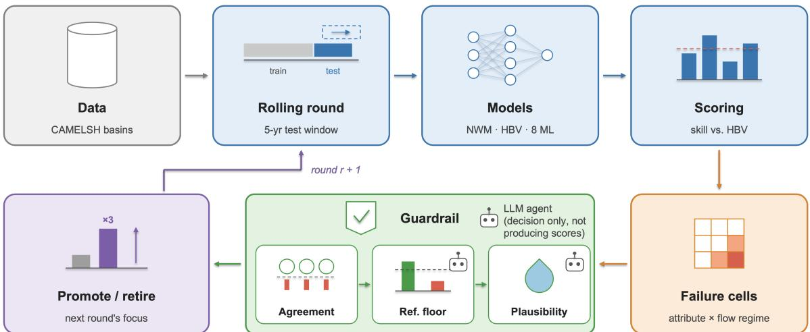
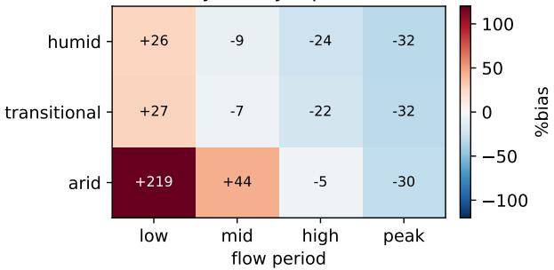
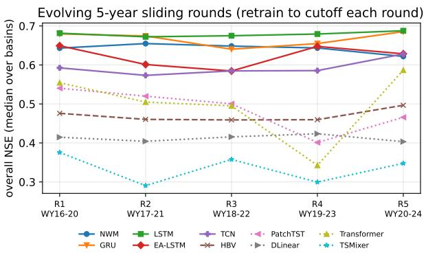
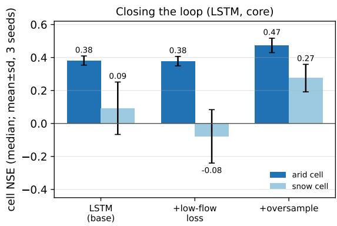

# EvoBench: An Evolving, Diagnostic Benchmark Framework for Environmental Modeling

Yiming Sun1, Yuan Zhang2, Qi Cheng1, Yingda Fan1, Runlong Yu3, Yiqun Xie4, Xiaowei Jia1

1Rutgers University, New Brunswick

2Apple Inc.

3University of Alabama

4University of Maryland, College Park

## Abstract

Machine learning models are now widely used to predict environmental variable dynamics in domains like hydrology, climate science, agriculture, and ecology. These models are usually compared on fixed benchmark datasets using a single average accuracy score. As models improve, their scores become very close when averaged over large regions and long time periods, so the benchmark can no longer tell them apart, and a single number hides where and when a model fails. Three failures are common across environmental domains: models get worse as the climate shifts (non-stationarity), models fail at unmonitored sites (spatial extrapolation), and models miss rare but important regimes such as floods and droughts.

We present EvoBench, a benchmark framework that shows where a model fails, tracks failures over time, and evolves to focus on model capability gaps. We apply EvoBench to daily streamflow prediction as a case study (CAMELS-Evolve, about 9,000 U.S. basins, 1985–2024) and compare an operational physical model (NWM), a conceptual reference (HBV), and several data-driven models. No model wins on every testing scenarios (e.g., in terms of average accuracy, performance at low flows and unmonitored basins). Also we observe that all data-driven models under-predict floods. Additionally, we show that targeted fix based on the reported failures could mitigate weaknesses the benchmark identified in certain scenarios. EvoBench turns model evaluation from a saturated ranking into a moving map of model limitations.

## CCS Concepts

• Applied computing → Environmental sciences; • Computing methodologies → Machine learning; • Information systems → Data mining.

## Keywords

Environmental Modeling, Evolving Benchmark, Model Diagnosis, Streamflow Prediction, Spatial Extrapolation, Non-stationarity, AI for Science

## 1 Introduction

Machine learning (ML) has been widely used in environmental modeling to predict streamflow, greenhouse-gas fluxes, air qual ity, soil moisture, and crop yield, and they are often reported to exceed traditional process-based models in terms of both accuracy and computational [13, 29, 37, 38, 43]. To compare these models researchers have built large benchmark datasets with fixed training and test splits, and they usually report a single accuracy score such as RMSE, Nash–Sutclife Eficiency (NSE), and KGE.

This way of evaluating models has several issues. As models improve, their scores become very close to one another. When many models reach nearly the same number, the benchmark saturates: the score can no longer tell good models from bad ones. More importantly, despite a better overall score, ML models are known to struggle in out-of-distribution and data-sparse scenarios, which could be obscured by averaging performance over large regions and long time periods. For scientific use, knowing the failures matters more than knowing the average.

Three types of failure are particularly common in machine learning applications across environmental domains. The first is nonstationarity: a model that works well on past data can get worse as the climate and land surface change, but a random train/test split hides this because it mixes easy and hard years together. The second is spatial extrapolation: sensors are sparse and unevenly placed, so a model that does well at monitored sites may fail at unmonitored ones, yet most benchmarks only test monitored sites. The third is regime-specific error: because models are trained to minimize average error, they tend to miss rare but important regimes such as floods and droughts, which contribute little to an average score. A useful benchmark should therefore be diagnostic (it should show where a model fails) and evolving (it should keep tracking failures as models and the environmental conditions change). Since these problems are shared across many environmental domains [24, 42], the benchmark should be designed to be generalizable and adaptable across domains.

In this work, we introduce EvoBench, a diagnostic and evolving benchmark framework for environmental modeling. We then apply it to daily streamflow prediction as a detailed case study, which we call CAMELS-Evolve. We build the case study on the CAMELSH dataset [38], which provides daily weather forcing, observed streamflow, and catchment attributes for about 9,000 river basins across the contiguous United States from 1985 to 2024. Hydrology is a good first case for three reasons: it shows all three failure modes above, it has strong physical and operational baselines to compare against, and new observations are being collected over time and can be used as ground truth. Unlike benchmarks in language modeling and computer vision, environmental ecosystems keep producing new test data. Every new day of observed streamflow is an example that no model could have seen during training. This makes it natural to test models in a rolling, forward-in-time fashion, which better reflects real-world deployment and reduces the risk of benchmark overfitting. Moreover, over the rolling evaluation, the benchmark is expected to actively find the conditions under which models fail — certain basin types, flow regimes, or time periods — instead of reporting one overall performance score. Later rounds then concentrate on these open problems rather than rewarding cases that models have already solved. In this way the benchmark keeps steering attention toward the frontier of what current models cannot yet do.

EvoBench has several components, each designed to apply generally to diverse environmental-modeling tasks.

• Comparable scores across time. Some years are more challenging to predict than others. To make scores comparable, we measure each model as a skill score relative to a reference model that can be re-run in any period. In the case study, the reference is a simple calibrated hydrology model (HBV), which can be run on any future input.

• Failure cells. We break overall performance into small groups of test samples, first by site attributes and then by within-record regime (e.g., low versus high flow). This enables performance analysis on a specific and trackable unit.

• An evolving loop. We move a time window forward in steps, promoting the failure cells that remain unsolved and retiring the ones a model has solved.

• An agentic guardrail. A carefully scoped use of a language model, backed by a model-independent physical check, decides whether a failure is caused by a true model weakness or bad data.

In this case study, we use EvoBench to several physical models (NWM, HBV) and data-driven models (e.g., LSTM, EA-LSTM [30], Transformer, TCN, DLinear [44], TSMixer [15], and PatchTST [35]). We find that no single model is best at everything. The LSTM and GRU surpass NWM in average NSE and the LSTM is also best at low flows, the EA-LSTM generalizes best to unmonitored basins, general-purpose time-series architectures fall near or below a simple conceptual model, and all data-driven models badly underpredict floods, where NWM remains far ahead. We also perform two additional tests for these baseline models, by (1) iteratively improving the model using evaluation feedback from each round to identify and address its specific weaknesses, and (2) incorporating memory across successive rounds, enabling it to retain insights from previous evaluations and refinements and leverage them to guide subsequent improvements.

Finally, we show that the benchmark’s findings are useful in practice: when it points to a specific weakness (dry and snowy basins), one of two plausible targeted fixes (over-sampling those basins) clearly improves both cells at no cost to overall accuracy, while the other (re-weighting low flows in the loss) does not help. In short, EvoBench turns model evaluation from a single, saturated ranking into a moving map of model limitations.

## 2 Related Work

Benchmarks for environmental modeling. Large-scale datasets and benchmarks now exist for many environmental problems, including streamflow [1, 31], greenhouse-gas and carbon fluxes [18, 37, 39], and air quality [11]. Most of them report average scores on a fixed test set. As a result, they tend to run into the same issues we target, including scores saturate, performance drops over time, and models that look good at monitored sites fail at new ones [33]. EvoBench is an evaluation layer that addresses these issues and can be applied across such benchmarks.

Large-scale hydrology datasets and models. CAMELS [1, 34] provided catchment attributes and daily data for 671 U.S. basins. Caravan [31] extended this idea globally, CAMELSH [38] provides hourly and daily data with attributes for about 9,000 U.S. basins, and recent extensions add weather nowcasts and forecasts to support operational, forecast-time evaluation [27]. On these datasets, LSTM models [28] and the entity-aware LSTM (EA-LSTM) [29], which uses static attributes to help a model generalize across basins, became the standard baselines; transformers and other advanced machine learning models have been tested more recently [14, 16, 20, 26, 43]. In particular, several previous works have targeted extreme events and unseen scenarios [12, 22, 33] —exactly the regime and spatialtransfer failures EvoBench isolates. General-purpose time-series foundation models [10, 19] have also been applied to environmental series, which makes a diagnostic, evolving evaluation even more useful.

Evaluation metrics. NSE [32] and the Kling–Gupta eficiency [23, 25] are the standard accuracy measures in hydrology. Flow-durationcurve signatures [41] measure the bias in high flows and low flows separately. We use these measures and add a skill score against a rerunnable reference so that results stay comparable across rounds. Recent work has also explored using large language models to mimic human expert preferences in evaluation [17].

Evolving and contamination-resistant benchmarks. A growing body of work keeps benchmarks fresh so they do not saturate or become contaminated. Recent examples span modalities: collecting new data over time (MMBench-Live [7], LiveHouse-TS [40]), scraping freshly discovered problems to stay ahead of model cutofs (Live-kBench [9], SWE-MERA [5]), generating harder items automatically [2], and updating labels as evidence improves [6]. Recent surveys catalog these dynamic and contamination-resistant designs but note there are still no agreed standards for evaluating them [3, 4], and some argue live benchmarks lose value once events are resolved [8]. Our setting is diferent and ofers a clear advantage. The test items come from the physical world, so there is nothing to generate and nothing to leak, and old rounds remain valid because the observed record only grows. To our knowledge no evolving benchmark has been built for environmental modeling.

Agents in evaluation. Recent benchmarks use language-model agents to build or check test items [6, 7]. We use an agent in a narrow and auditable way. Specifically, all the performance scores in our framework are computed deterministically. The agent only decides whether a failure is a true model weakness or a data problem, and a model-independent water-balance check backs up that decision. The agent’s outputs inform updates to the evaluation protocol across iterations but do not directly determine the final evaluation scores, avoiding the additional uncertainty that agent-driven scoring could introduce.

## 3 EvoBench Instantiated for Streamflow

EvoBench requires multiple input components that most environmentalmodeling tasks can provide: per-site time series of driver data, a few static attributes describing each site, a physical or empirical model to use as a reference, and a conservation law (such as a mass

balance) to check whether the observations are physically plausible. In this section, we explain each part through the streamflow case study, CAMELS-Evolve. Fig. 1 illustrates the overall pipeline. Table 7 in the appendix shows how the same parts map to other domains.

## 3.1 Data

We build the case study on CAMELSH [38], which contains 9,008 U.S. river basins with daily records from 1985 to 2024. For each basin and day it provides 11 weather forcing variables, observed streamflow, and 44 static catchment attributes (such as climate indices and soil and land-cover descriptors), which are fixed in time. It also includes simulations from the National Water Model (NWM). Because basins difer in how much observed streamflow is available, we use two groups of basins: a strict core group (162 basins with at least 90% observation coverage over 1985–2024) and a larger extended observation group (1,139 basins with at least 80% coverage).

Dynamic input features. Each data-driven model reads a 180- day history of five daily meteorological forcing variables, all derived from the NLDAS-2 reanalysis: precipitation (Rainf), air temperature (Tair), downward shortwave radiation (SWdown), downward longwave radiation (LWdown), and potential evapotranspiration (PotEvap). These five variables drive the dominant water-andenergy balance that governs runof. Precipitation and temperature set the input and the rain/snow partition; the two radiation terms and potential evapotranspiration set the energy available to evaporate water and to melt snow.

Static catchment attributes. To let a single regional model adapt to each basin, we concatenate 18 static attributes to the inputs, which capture the basin’s time-invariant climate, topography, soil, and land-cover characteristics. Specifically, they fall into four groups. Climate: mean precipitation, mean potential evapotranspiration, aridity (their ratio), precipitation seasonality, the fraction of precip itation falling as snow, and the frequency and duration of high- and low-precipitation spells. Topography: drainage area, mean elevation, and mean slope. Soil: sand, silt, and clay fractions, soil permeability, and the baseflow index (the share of flow sustained by groundwater). Land cover: forest fraction. These attributes are exactly the axes along which we later define failure cells (Section 3), so aridity, snow fraction, area, baseflow index, and degree of regulation serve both as model inputs and as diagnostic groupings.

Target and preprocessing. The prediction target is daily specific discharge (mm day−1), i.e. observed streamflow normalized by basin area, which makes basins of very diferent size comparable. Forcings, attributes, and target are standardized to zero mean and unit variance using statistics computed only from each round’s training window, so no future information leaks into the inputs. Days with missing streamflow are excluded from training and scoring.

## 3.2 Rolling 5-year evaluation rounds

We evaluate models in rounds. Each round covers five water years, i.e., the most recent year plus the previous four years and the win dow moves forward by one year between rounds. A model may use only data from before its round’s window, and it is then scored on the full five-year window. We use five years rather than one because a single year could be dominated by year-specific conditions, e.g., whether it happened to be wet or dry, while a five-year window is more stable and almost always contains both floods and droughts. In our data, five-year rounds reduce the round-to-round variation compared with one-year rounds (in scores by about 60%). Because neighboring rounds share four years of data, we treat a sequence of rounds as a trend rather than as independent samples.

## 3.3 Failure cells

A failure cell is a group of basins that share a common property. Specifically, we group basins by five attributes, each linked to a known weakness of data-driven models: aridity (dry basins and low flow), snow fraction (snowmelt), basin area (long memory and routing), baseflow index (flashy response), and degree of regulation (dams and human control). The 2-D version additionally splits each basin’s record by flow regime—low, medium, high, and peak—using that basin’s own flow-duration curve. The 2-D view is important because a single average score can hide large errors that occur only in specific regimes. When analyzing predictive bias, opposite errors in diferent regimes can cancel out. For example, a model may over-predict low flow and under-predict peaks at the same time, which looks only “average” overall but is clearly wrong once the two regimes are separated.

## 3.4 The evolving loop and its guardrail

Each round, the loop finds the failure cells where even the best model does poorly and promotes them, i.e., keeping them as the focus for the next round. The loop also retires cells that a model has solved (median NSE at least 0.5). Over time, attention moves toward the problems that remain unsolved. However, a loop that simply chased the largest errors would drift toward meaningless cases that cannot be possibly predicted by any models given the available data, such as dammed basins or bad gauges. Hence, the promotion of failure cells must pass a guardrail with three checks:

(1) Agreement across independent models. We first require the failure to be shared across multiple models, rather than being specific to a single model, to ensure that it represents a meaningful limitation worth highlighting in the benchmark. If a single model fails while the others succeed, that is a weakness of that model, not a capability gap worth promoting for the field. In our implementation, we flag a cell only when at least two independent data-driven models fall below a preset skill threshold, which filters out the artifact of any one architecture or training run.

(2) A reference floor. We then ask whether the target is even learnable from the available data, by comparing against the per-basincalibrated HBV reference and the physical NWM. If HBV or NWM predicts the cell acceptably while the learned models fail, the signal clearly exists in the data, so the failure is a genuine learned-model capability gap and should be promoted. If instead every model—including the calibrated HBV—fails, the cell is more likely limited by its data than by the models, and promoting it would chase an unlearnable target. To make this judgment, an LLM agent reads a short, structured evidence summary for the cell—the per-model skill scores, the HBV reference floor, the degree of regulation, and other static attributes—and labels it capability gap, regulation efect, data problem, or needs external information.

  
Figure 1: Pipeline of the EvoBench framework.

(3) Physical plausibility. Finally, a model-independent check tests whether the observations themselves are trustworthy, using a conservation law rather than any prediction. Over a long record runof cannot exceed precipitation, so the runof ratio, i.e., total runof divided by total precipitation, must not exceed one. A value above one often indicates a wrong drainage area, an interbasin transfer, or a gauging error, and thus the basin will be removed as a data artifact. Even if the data meet the runof ratio requirement, it could be flagged if we observe that an runof ratio very close to one, an implausibly high ratio for an arid basin, negative flows, or a long constant-value segment. These flags mark a basin as suspect but cannot by themselves say whether the data are wrong. For example, a long constant-value segment could be either a stuck sensor (bad data) or a managed, constant reservoir release (a real flow). Only these ambiguous cases are referred to a verification agent, which uses the basin’s regulation context to make the final decision. In the previous example, a flat segment in a heavily regulated basin is read as a managed release and kept, whereas the same pattern in an unregulated basin is treated as a faulty sensor.

Only a cell that passes all three checks, i.e., a failure shared across models, shown to be learnable by the reference, and backed by physically plausible data, is promoted. A key consequence is that the guardrail does not blindly promote the flood regime. For example, when every model fails on peak flows and the reference gives no signal, the cell is labeled a data problem. This could be because high-flow observations are themselves uncertain (e.g., rating curves extrapolated beyond the measured range). It is noteworthy that the agents used in our framework only make decisions and do not produce performance scores. All performance scores are computed by a deterministic process, which mitigates the impact of LLM stochasticity and improves the reproducibility of the benchmark results.

How much each cell is promoted, and its efect on the next round. Promotion is graded rather than binary: a cell is weighted by how far it sits below the “solved” line. Let � be the retire threshold (we use a median NSE of 0.5) and $s _ { c }$ the cell’s current skill; its shortfall is $g _ { c } = \operatorname* { m a x } ( 0 , \tau - s _ { c } )$ . The cell’s weight for the next round is

$$
w _ { c } = 1 + \beta g _ { c } / \tau , w _ { c } \in \bigl [ 1 , w _ { \mathrm { m a x } } \bigr ] ,\tag{1}
$$

where we set $\beta$ and the cap $w _ { \mathrm { m a x } }$ so that the worst, persistently open cells reach about 3× the weight of a just-solved one; retired cells keep $w _ { c } = 1$ and move to a regression set that is still scored but no longer emphasized. This weight feeds the next round in two concrete ways. First, in scoring: the round’s headline skill is a weighted average over cells, $\sum _ { c } w _ { c } s _ { c } / \sum _ { c } w _ { c } ,$ , so a cell that stays far below � counts up to 3× as much as an easy one, and the leaderboard increasingly rewards progress on the current frontier. Second, in sampling: basins belonging to promoted cells are over-sampled into the next round’s evaluation set—and participants may up-weight them during training—in proportion to $w _ { c } .$ , which concentrates both data and efort where models currently fail. Because every per-cell skill is measured against the same re-runnable reference (Eq. 2), we also report the unweighted per-cell scores so that crossround trends stay interpretable; the weighted headline reflects only the current round’s emphasis. In our experiments the sampling side is instantiated with a 3× up-weighting of promoted-cell basins (Section 4).

## 3.5 Comparable scores across time

Some years are much harder to predict than others, so raw accuracy cannot be compared directly across rounds. Instead we report a skill score relative to a reference model, computed in the same round:

$$
\mathrm { s k i l l } = 1 - \mathrm { M S E } ( \mathrm { m o d e l } ) / \mathrm { M S E } ( \mathrm { r e f e r e n c e } ) .\tag{2}
$$

If a specific round is hard, both the model’s error and the reference’s error grow together, so their ratio stays stable. The reference must be runnable in any period. In this work, we use HBV [36], a simple process-based hydrology model that we calibrate once per basin and can then run on any input. HBV is meant to serve only as a modest baseline, not a strong competitor.

## 3.6 Prediction at unmonitored sites

Many existing works holds out only time in evaluation. To measure true spatial generalization, we group basins into six clusters by their attributes and hold out one whole cluster at a time, training on the rest and predicting the held-out basins. We report the spatial gap, the drop in NSE from gauged to ungauged prediction. For the reference, HBV’s drop from local calibration to using neighbors parameters gives a baseline that learned models should beat.

## 4 Experiments

## 4.1 Setup

We compare ten models. Two are process-based models: the operational NWM and the HBV reference. Eight are data-driven baselines. Four are models commonly used in hydrology: LSTM, EA-LSTM [30], a GRU (lighter gated recurrent model), and a small encoder-only Transformer (2 layers, model width 64, about 69k parameters). The other four are popular general-purpose time-series architectures: a TCN (dilated causal convolutions), DLinear (trend– seasonal decomposition followed by linear maps over time) [44], TSMixer (all-MLP mixing across time and features) [15], and a simplified PatchTST (a 2-layer Transformer encoder over 30-day patches) [35]. The training data covers all the data before the testing window in the current round. Each data-driven model reads the input of a 180-day history of five weather variables plus 18 static attributes and predicts daily streamflow. Every data-driven model is trained for one epoch, i.e., one expected pass over all of its training samples, so the number of iterations grows with the size of the training set; full training details are in Appendix A. We report results on the core group (162 basins) and the extended group (1,139 basins). We use five metrics: NSE and KGE′ for overall accuracy, log-NSE for low flows, peak-day percent bias for floods, and the skill score of Eq. (2) against HBV.

## 4.2 Fixed-split test

## 4.2.1 Model performance on fixed split.

Setting. This comparison uses a single fixed temporal split rather than the sliding rounds of Section 3.4. All data-driven models are trained on all data before the test window (water years 1986–2010) and evaluated on 2011–2022, a held-out future period, matching the protocol of the sliding rounds. The HBV reference is calibrated per basin on the same pre-test record (water years 1986–2010). NWM is scored from NOAA’s NWM v3.0 retrospective simulation over the test period; it is an external operational benchmark whose parameters were calibrated by its developers rather than under our protocol. Every reported value is a median over basins.

Table 1 shows the comparison. The ranking changes with the metric. On overall accuracy, the LSTM (NSE 0.674) and GRU (0.665) surpass NWM (0.644), and the LSTM also has the best KGE′ (0.711) and the best low-flow skill (log-NSE 0.595). Here note that NWM is an external operational benchmark whose calibration period may overlap our test years, which would favor NWM. NWM remains by far the best at floods: every data-driven model under-predicts peak days by 27–44%, while NWM is at −13%. The EA-LSTM (0.633) comes close to NWM on NSE, while the GRU, despite its high NSE, is weaker at low flows (log-NSE 0.545). Among data-driven timeseries architectures, only the TCN (0.595) is competitive with the recurrent models; DLinear, PatchTST, and TSMixer fall below the HBV reference on NSE and have strongly negative log-NSE, i.e., they largely fail to learn low flows. The Transformer lies in between on the 162-basin core group (NSE 0.558). At the larger scale of the extended group (Table 2), most models score lower, because this group admits harder, lower-coverage, and more regulated basins. The LSTM (0.637), GRU (0.630), and EA-LSTM (0.586) all surpass NWM (0.562), by a wider margin than on the core group, and the LSTM is again the best at low flows (log-NSE 0.606). NWM keeps the best KGE′ (0.664) and peak-day bias (−14%, against −29% to −45% for the data-driven models). A single-number leaderboard would hide all of these diferences: the best model depends on whether one asks about average skill, low flows, or floods.

Table 1: Head-to-head on the core group (162 basins, WY2011– 2022), median over basins. The best value in each column is in bold; the order changes by metric.
<table><tr><td>Model</td><td>NSE</td><td>KGE&#x27;</td><td>log-NSE</td><td>peak%bias</td><td>skill/HBV</td></tr><tr><td>LSTM</td><td>0.674</td><td>0.711</td><td>0.595</td><td>-32.2</td><td>+0.368</td></tr><tr><td>GRU</td><td>0.665</td><td>0.688</td><td>0.545</td><td>-30.6</td><td>+0.379</td></tr><tr><td>NWM</td><td>0.644</td><td>0.694</td><td>0.563</td><td>-13.0</td><td>+0.332</td></tr><tr><td>EA-LSTM</td><td>0.633</td><td>0.689</td><td>0.521</td><td>-28.9</td><td>+0.337</td></tr><tr><td>TCN</td><td>0.595</td><td>0.619</td><td>0.465</td><td>-42.1</td><td>+0.273</td></tr><tr><td>Transformer</td><td>0.558</td><td>0.498</td><td>-0.910</td><td>-27.0</td><td>+0.170</td></tr><tr><td>HBV (ref)</td><td>0.482</td><td>0.609</td><td>-0.168</td><td>-37.1</td><td>0.000</td></tr><tr><td>PatchTST</td><td>0.465</td><td>0.471</td><td>-2.018</td><td>-43.9</td><td>+0.144</td></tr><tr><td>DLinear</td><td>0.439</td><td>0.485</td><td>-0.457</td><td>-41.1</td><td>-0.130</td></tr><tr><td>TSMixer</td><td>0.323</td><td>0.307</td><td>-1.172</td><td>-38.1</td><td>-0.232</td></tr></table>

Comparison with prior CAMELS results. Our absolute NSE values are lower than the strongest LSTM results reported on the standard 531-basin CAMELS benchmark, where well-tuned, ensembled models reach a median NSE of roughly 0.74–0.76 [21, 29]. Several deliberate choices explain the diference. We train a single model using a reduced input set (five forcings and 18 attributes), and maintain the same training budget across all ten models, so that diferences reflect the models rather than tuning efort. We also evaluate on CAMELSH with a diferent temporal split, and our extended group deliberately includes low-coverage and heavily regulated basins that the 531-basin benchmark excludes, both of which lower the median. Also note that our aim is to expose relative, regime-specific behavior rather than to maximize absolute skill. Stronger absolute performance could be produced by model-specific tuning, ensembling, and augmentation of input variables.

4.2.2 Diagnostic tests. These tests reuse the fixed-split predictions above (trained to 2010, tested on water years 2011–2022) on the core group, and probe specific regimes and the spatial dimension.

Floods. When we score only peak days (observed flow above the 99th percentile), all data-driven models under-predict badly (LSTM −34%, EA-LSTM −32%, Transformer −27%), while NWM stays at −13%. HBV is the worst of these (−41%). Floods are a shared weak point, and the one regime where the data-driven models clearly trail NWM.

Table 2: Head-to-head at larger scale (extended, 1,139 basins), median over basins. The LSTM, GRU, and EA-LSTM surpass NWM on NSE, while NWM keeps the best KGE′ and flood (peak-day) bias.
<table><tr><td>Model</td><td>NSE</td><td>KGE&#x27;</td><td>log-NSE</td><td>peak%bias</td><td>skill/HBV</td></tr><tr><td>LSTM</td><td>0.637</td><td>0.653</td><td>0.606</td><td>-31.2</td><td>+0.391</td></tr><tr><td>GRU</td><td>0.630</td><td>0.661</td><td>0.477</td><td>-29.3</td><td>+0.373</td></tr><tr><td>EA-LSTM</td><td>0.586</td><td>0.595</td><td>0.502</td><td>-34.4</td><td>+0.314</td></tr><tr><td>NWM</td><td>0.562</td><td>0.664</td><td>0.468</td><td>-13.6</td><td>+0.261</td></tr><tr><td>TCN</td><td>0.525</td><td>0.567</td><td>0.325</td><td>-44.2</td><td>+0.208</td></tr><tr><td>Transformer</td><td>0.517</td><td>0.529</td><td>-0.337</td><td>-31.2</td><td>+0.186</td></tr><tr><td>PatchTST</td><td>0.465</td><td>0.424</td><td>-2.447</td><td>-35.7</td><td>+0.151</td></tr><tr><td>HBV (ref)</td><td>0.406</td><td>0.547</td><td>-0.010</td><td>-41.9</td><td>0.000</td></tr><tr><td>DLinear</td><td>0.316</td><td>0.369</td><td>-0.566</td><td>-44.7</td><td>-0.237</td></tr><tr><td>TSMixer</td><td>0.203</td><td>0.269</td><td>-1.445</td><td>-33.4</td><td>-0.337</td></tr></table>

Dry versus wet years. Splitting each basin’s record into dry, normal, and wet years shows that every model does worse in dry years. The Transformer has the largest dry-to-wet gap (NSE 0.41 to 0.55), meaning it generalizes worst across climate conditions.

Unmonitored basins. Table 3 reports the leave-cluster-out test: basins are grouped into six clusters by �-means on standardized attributes, and each cluster is held out in turn while the model is trained on the other five, so the held-out basins are never seen in training. Each fold model is trained over its own training basins. Although EA-LSTM is worse on monitored basins, its drop to unmonitored basins is about 45% smaller than the LSTM’s (0.105 vs 0.191), and it becomes the best data-driven model once ungauged (NSE 0.529). This matches the design of the EA-LSTM, whose use of static attributes is meant to help it transfer across locations. Conversely, the LSTM, the best model on monitored basins, loses the most among the strong models (gap 0.191), followed by the TCN (0.175) and GRU (0.165). All data-driven models fall well below their gauged scores, and only the EA-LSTM, GRU, and LSTM stay clearly above the HBV regional reference (0.416); the Transformer and PatchTST, with the largest gaps (about 0.25), fall below it. The very small or negative gaps of DLinear and TSMixer reflect weak gauged skill rather than good transfer.

4.2.3 Failure cells. Here we use the fixed-split predictions on the extended group (1,139 basins), which gives enough basins per cell for stable estimates. The 1-D grid consistently ranks the hardest basin types across models: at the larger scale, snow-dominated basins (n=109; LSTM NSE 0.47), arid basins (n=492; 0.50), and baseflow-dominated basins (0.57). Heavily regulated basins are hard for NWM (0.49 vs. 0.60 on natural basins) and for the EA-LSTM and Transformer, but barely for the LSTM (0.63 vs. 0.64). The 2-D grid (Figure 2) explains why the LSTM looks only average on arid basins: it makes two opposite errors that cancel in a single score. It over-predicts low flow by about 219% and under-predicts peaks by about 30%. The only cell where the LSTM is worse than the HBV reference is arid low flow (skill relative to HBV −0.31). Because the simple reference succeeds there, the signal exists in the data, so this cell passes the reference-floor check of the guardrail as a genuine model capability gap. On the peak cells, in contrast, the LSTM beats HBV (skill about +0.3) yet still under-predicts peaks by 30–37%, while NWM is at about −14%; since the physical reference captures floods much better from the same weather, the flood shortfall is also a learnable capability gap rather than a pure data limitation, although high-flow observations, which come from rating curves extrapolated beyond the measured range, add uncertainty for every model. The 2-D grid also reveals diferences between models that an average score hides: on arid low flow the LSTM over-predicts (+219%) while the Transformer under-predicts (−62%). The two models fail in opposite directions.

Table 3: Prediction at unmonitored basins (core), using leave-6-cluster-out testing. The EA-LSTM transfers best despite a lower score on monitored basins.
<table><tr><td>Model</td><td>NSE gauged</td><td>NSE ungauged spatial gap</td><td></td></tr><tr><td>LSTM</td><td>0.674</td><td>0.484</td><td>0.191</td></tr><tr><td>GRU</td><td>0.665</td><td>0.499</td><td>0.165</td></tr><tr><td>EA-LSTM</td><td>0.633</td><td>0.529</td><td>0.105</td></tr><tr><td>TCN</td><td>0.595</td><td>0.420</td><td>0.175</td></tr><tr><td>Transformer</td><td>0.558</td><td>0.306</td><td>0.252</td></tr><tr><td>PatchTST</td><td>0.465</td><td>0.216</td><td>0.250</td></tr><tr><td>DLinear</td><td>0.439</td><td>0.375</td><td>0.064</td></tr><tr><td>TSMixer</td><td>0.323</td><td>0.363</td><td>-0.039</td></tr><tr><td>HBV (local→regional)</td><td>0.482</td><td>0.416</td><td>0.074</td></tr></table>

LSTM %bias by aridity x period (extended)  
  
Figure 2: 2-D failure grid: LSTM percent bias by aridity and flow regime (extended). Low flows are over-predicted (red, left) and peaks are under-predicted (blue, right). The two errors cancel in a single NSE.

## 4.3 Evolving Tests

4.3.1 How performance changes over time. We run the 5-year window forward for five rounds, retraining every data-driven model from scratch to each round’s cutof (Figure 3, Table 4). The rounds test water years 2016–2020, 2017–2021, . . . , 2020–2024. In each round a model is trained on all data before its window (round 1 on ≤2015, round 5 on ≤2019), and we evaluate on both the core and the extended group, with HBV recalibrated to each round’s cutof as the reference. We see four things. First, the ranking is stable over time: the LSTM surpasses NWM in every round on both groups and has the best overall NSE in all rounds but one (core round 2, where the GRU is marginally ahead), and the GRU surpasses NWM in every round except round 3 on the core group. The EA-LSTM and TCN follow, while the Transformer and the other general-purpose architectures stay near or below HBV. Second, the strongest models are stable across rounds: the LSTM varies by less than 0.02 NSE over the five rounds on both groups, even though the rounds include harder recent years. Less stable models still swing between rounds: the EA-LSTM dips in the middle rounds on the core group (0.649 in round 1 to 0.585 in round 3), and the Transformer collapses in single rounds (0.343 in round 4 on the core group, 0.154 in round 5 on the extended group). A fixed split would average such swings away. HBV stays a flat, low baseline and keeps the skill scores comparable. Third, arid and snow basins remain the frontier, and they show the retire mechanism at work. On the core group, no data-driven model reaches the retirement threshold (median NSE 0.5) on arid basins in any round, and NWM reaches it only once (round 2). On the extended group, the LSTM reaches it on arid basins in rounds 1 and 4 (0.502 and 0.506) and on snow basins in rounds 1, 4, and 5 (0.525, 0.504, 0.559); because these cells sit right at the threshold, they alternate between retired and open across rounds, which is why retired cells stay in a regression set rather than being dropped. Averaged over rounds, the LSTM matches NWM on core arid basins (0.410 vs. 0.409) and exceeds it on extended arid (0.480 vs. 0.381) and snow basins (0.505 vs. 0.265); the core group has too few snow basins (n=6) for stable estimates. Fourth, the NWM retrospective ends in January 2023, so in rounds 4 and 5 NWM is scored only on the early part of the window. Its drop in round 5 (extended overall 0.530, snow −0.099) therefore should not be read as a real decline. This is why the benchmark uses HBV, which can be rerun on any new window, as its reference.

Table 4: Five-year sliding rounds: median NSE averaged over the five rounds, for the core group (162 basins) and the extended group (1,139 basins). Every data-driven model is retrained to each round’s cutof. Best per column in bold.
<table><tr><td rowspan="2">Model</td><td colspan="2">Core</td><td colspan="3">Extended</td></tr><tr><td>overall</td><td>arid</td><td>overall</td><td>arid</td><td>snow</td></tr><tr><td>LSTM</td><td>0.679</td><td>0.410</td><td>0.644</td><td>0.480</td><td>0.505</td></tr><tr><td>GRU</td><td>0.667</td><td>0.359</td><td>0.632</td><td>0.476</td><td>0.469</td></tr><tr><td>NWM</td><td>0.642</td><td>0.409</td><td>0.585</td><td>0.381</td><td>0.265</td></tr><tr><td>EA-LSTM</td><td>0.622</td><td>0.367</td><td>0.610</td><td>0.418</td><td>0.375</td></tr><tr><td>TCN</td><td>0.593</td><td>0.264</td><td>0.517</td><td>0.329</td><td>0.294</td></tr><tr><td>Transformer</td><td>0.497</td><td>0.052</td><td>0.397</td><td>0.184</td><td>0.048</td></tr><tr><td>PatchTST</td><td>0.486</td><td>0.144</td><td>0.478</td><td>0.208</td><td>-0.010</td></tr><tr><td>HBV (ref)</td><td>0.470</td><td>0.302</td><td>0.413</td><td>0.285</td><td>0.137</td></tr><tr><td>DLinear</td><td>0.412</td><td>-0.410</td><td>0.323</td><td>-0.099</td><td>-0.600</td></tr><tr><td>TSMixer</td><td>0.334</td><td>-0.509</td><td>0.246</td><td>-0.136</td><td>-0.312</td></tr></table>

4.3.2 Enhancing model based on benchmarkfeedback. Finally, we test whether the benchmark’s findings can be acted on, using the fixed split on the core group. The benchmark flags that the LSTM over-predicts low flow in arid basins (by about +63% on arid lowflow days) and that arid and snow basins remain its weakest cells. In response, we apply two simple changes to training: we give low-flow days three times more weight in the loss, and we additionally sample arid and snow basins three times more often. Because single runs are noisy, each configuration is trained with three seeds (Figure 4). The low-flow loss does not help: the arid-cell NSE is unchanged (0.381 to 0.378), the arid low-flow bias barely moves (+63% to +61%), and the snow cell gets worse (0.09 to −0.08). Over-sampling, in contrast, lifts the arid cell from 0.381 to 0.473, more than twice the seed spread (standard deviation 0.03–0.04), and the snow cell from 0.09 to 0.28, with no loss in overall NSE (0.668 in both cases). The arid cell thus moves close to the retirement threshold, crossing it for one of the three seeds, but it stays open on average and is carried to the next round. The experiment also shows that the benchmark can tell which of two plausible fixes actually addresses a diagnosed weakness, and why it reports seed spread: the per-seed arid lowflow bias ranges from +8% to +130% for the same configuration, so bias changes from a single run would be unreliable.

  
Figure 3: Five-year sliding rounds (core): overall NSE for each model over time. The LSTM and GRU stay above NWM in nearly every round, while weaker models swing between rounds; HBV is a flat reference. NWM’s rounds 4–5 cover only part of the window (record ends January 2023).

  
Figure 4: Fixing a diagnosed weakness (LSTM, core, fixed split): arid- and snow-cell NSE, mean ± standard deviation over three seeds. The low-flow loss does not help, while oversampling lifts both the arid and the snow cell.

Table 5: Overall NSE (mean over five sliding rounds, core) for each baseline under the three conditions. Best per row in bold.
<table><tr><td>Model</td><td>(1) baseline</td><td>(2) targeted</td><td>(3) targeted+memory</td></tr><tr><td>LSTM</td><td>0.680</td><td>0.682</td><td>0.690</td></tr><tr><td>EA-LSTM</td><td>0.629</td><td>0.625</td><td>0.637</td></tr><tr><td>GRU</td><td>0.668</td><td>0.660</td><td>0.679</td></tr><tr><td>Transformer</td><td>0.503</td><td>0.484</td><td>0.484</td></tr><tr><td>TCN</td><td>0.579</td><td>0.575</td><td>0.569</td></tr><tr><td>DLinear</td><td>0.412</td><td>0.407</td><td>0.408</td></tr><tr><td>TSMixer</td><td>0.355</td><td>0.356</td><td>0.375</td></tr><tr><td>PatchTST</td><td>0.465</td><td>0.502</td><td>0.512</td></tr></table>

4.3.3 Diagnosis, intervention, andmemoryin evolving tests. We now ask whether this loop generalizes. For each data-driven baseline we run three conditions over the five sliding rounds on the core group. (1) Baseline: a fresh model each round, no intervention. (2) Targeted: a fresh model each round, but intervened on the previous round’s promoted failure cells (a low-flow-weighted loss plus oversampling of basins in those cells). (3) Targeted+memory: the same intervention, but the model is carried across rounds (warm start) with cheap incremental updates (20% of a one-epoch training per round, about 1,300–1,500 iterations instead of 6,400–7,300). Round 1 is identical for all three, since there is no previous round to diagnose. Tables 5 and 6 report the mean over the five rounds. Each cell is a single run, so given the seed spread measured above (about 0.01 for overall and 0.03–0.04 for arid NSE), we only read diferences larger than these as real. (The baseline column difers slightly from Table 4 because here input normalization is fixed from the round-1 window for all rounds, so that a warm-started model sees consistent inputs.)

Three patterns are observed. First, the targeted intervention helps most models on the cell it aims at. On arid basins it clearly raises the GRU (0.360 to 0.442, and 0.469 with memory) and the EA-LSTM (0.361 to 0.401, and 0.422 with memory), and with memory also the TCN (0.240 to 0.294); it lifts the linear and all-MLP models from very low levels (TSMixer −0.50 to −0.15, DLinear −0.41 to −0.27 with memory). The LSTM, which already has the best arid score (0.457), does not gain further, and the Transformer does not benefit at all. Second, cross-round memory gives the best overall score for five of the eight models while using about a fifth of the compute per round: the LSTM (0.680 to 0.690), GRU (0.668 to 0.679), EA-LSTM (0.629 to 0.637), TSMixer (0.355 to 0.375), and PatchTST (0.465 to 0.512). For the three recurrent models this gain is small, close to the seed spread, so memory mainly matches full retraining at a fraction of the cost. Third, the interventions do not help every family: they lower the Transformer’s overall score (0.503 to 0.484), and memory slightly lowers the TCN (0.579 to 0.569). In short, the loop “diagnose → intervene → update with memory” helps most baseline models on the evolving benchmark, but whether a given intervention helps also depends on the model family.

## 5 Conclusion

We presented EvoBench, a benchmark framework for environmental modeling that is both diagnostic and evolving, and we validated it through a streamflow case study (CAMELS-Evolve) on

Table 6: Arid-cell NSE (mean over five rounds, core), where the intervention is aimed. The intervention helps most models, most clearly the GRU and EA-LSTM; the LSTM, already the strongest on arid basins, and the Transformer do not gain.
<table><tr><td>Model</td><td>(1) baseline</td><td>(2) targeted</td><td>(3) targeted+memory</td></tr><tr><td>LSTM</td><td>0.457</td><td>0.451</td><td>0.446</td></tr><tr><td>EA-LSTM</td><td>0.361</td><td>0.401</td><td>0.422</td></tr><tr><td>GRU</td><td>0.360</td><td>0.442</td><td>0.469</td></tr><tr><td>Transformer</td><td>0.043</td><td>0.038</td><td>-0.017</td></tr><tr><td>TCN</td><td>0.240</td><td>0.249</td><td>0.294</td></tr><tr><td>DLinear</td><td>-0.408</td><td>-0.369</td><td>-0.274</td></tr><tr><td>TSMixer</td><td>-0.500</td><td>-0.251</td><td>-0.147</td></tr><tr><td>PatchTST</td><td>0.116</td><td>0.087</td><td>0.125</td></tr></table>

CAMELSH. EvoBench breaks performance into failure cells by site attribute and regime, measures prediction at unmonitored sites, slides a time window forward to track which failures remain, and uses a small agent with a physical consistency check to tell true model weaknesses apart from data problems.

Across the base models in our tests, we found that no model is best at everything. Also all data-driven models under-predict floods. A single number would hide all of these diferences. Finally, evolving the benchmark by sliding the window forward showed varying model performance, a sign of non-stationarity that a fixed split hides, while snow and arid basins remained the hardest cases, with the best models only beginning to retire them in some rounds. This shift—from a single ranking on a static dataset to a moving map of model limitations—is useful for environmental ML benchmarks in general, where the real environmental ecosystems keep supplying new benchmark data.

## 6 Limitations

One limitation ofthis work is that the catchment attributes are fixed in time, so we cannot yet detect changes within a basin such as a new dam, a wildfire, or urban growth. In addition to extending to other environmental domains, we will also consider a forecasting setup with forecast inputs and the addition of time-varying disturbance data.

## References

[1] Nans Addor, Andrew J Newman, Naoki Mizukami, and Martyn P Clark. 2017. The CAMELS data set: catchment attributes and meteorology for large-sample studies. Hydrology and Earth System Sciences 21, 10 (2017), 5293–5313.

[2] Anonymous. 2025. ArenaBencher: Automatic Benchmark Evolution via Multi Model Competitive Evaluation. arXiv preprint arXiv:2510.08569 (2025).

[3] Anonymous. 2025. Recent Advances in Large Language Model Benchmarks against Data Contamination: From Static to Dynamic Evaluation. arXiv preprint arXiv:2502.17521 (2025).

[4] Anonymous. 2025. A Survey on Data Contamination for Large Language Models. arXiv preprint arXiv:2502.14425 (2025).

[5] Anonymous. 2025. SWE-MERA: A Dynamic Benchmark for Agentically Eval uating Large Language Models on Software Engineering Tasks. arXiv preprint arXiv:2507.11059 (2025).

[6] Anonymous. 2026. DeepFact: Co-Evolving Benchmarks and Agents for Deep Research Factuality. arXiv preprint arXiv:2603.05912 (2026).

[7] Anonymous. 2026. MMBench-Live: A Continuously Evolving Benchmark for Multimodal Models. arXiv preprint arXiv:2607.01813 (2026).

[8] Anonymous. 2026. OracleProto: Reproducible, Cutof-Aligned Evaluation as an Alternative to Live Benchmarks. arXiv preprint arXiv:2605.03762 (2026).

[9] Anonymous. 2026. Outrunning LLM Cutofs: A Live Kernel Crash Resolution Benchmark for All. arXiv preprint arXiv:2602.02690 (2026).

[10] Abdul Fatir Ansari, Lorenzo Stella, Caner Turkmen, et al. 2024. Chronos: Learning the Language of Time Series. Transactions on Machine Learning Research (2024).

[11] Clara Betancourt, Timo Stomberg, Scarlet Stadtler, Ribana Roscher, and Martin G Schultz. 2021. AQ-Bench: a benchmark dataset for machine learning on global air quality metrics. Earth System Science Data Discussions 2021 (2021), 1–26.

[12] Shengyu Chen, Nasrin Kalanat, Simon Topp, Jefrey Sadler, Yiqun Xie, Zhe Jiang, and Xiaowei Jia. 2023. Meta-transfer-learning for time series data with extreme events: An application to water temperature prediction. In Proceedings ofthe 32nd ACM International Conference on Information and Knowledge Management. 266–275.

[13] Shengyu Chen, Yiqun Xie, Xiang Li, Xu Liang, and Xiaowei Jia. 2023. Physicsguided meta-learning method in baseflow prediction over large regions. In Proceedings ofthe 2023 SIAM International Conference on Data Mining (SDM).

[14] Shengyu Chen, Jacob A Zwart, and Xiaowei Jia. 2022. Physics-guided graph meta learning for predicting water temperature and streamflow in stream networks. In Proceedings ofthe 28th ACM SIGKDD conference on knowledge discovery and data mining. 2752–2761.

[15] Si-An Chen, Chun-Liang Li, Nate Yoder, Sercan O Arik, and Tomas Pfister. 2023. Tsmixer: An all-mlp architecture for time series forecasting. arXiv preprint arXiv:2303.06053 (2023).

[16] Qi Cheng, Yingda Fan, Xiaowei Jia, Yiqun Xie, and Dan Lu. 2026. HydroTFT: a cross-basin attention model for multi-horizon rainfall–runof prediction. Machine Learning: Earth 2, 2 (2026), 025014.

[17] Qi Cheng, Licheng Liu, Yixuan Chen, Qing Zhu, Runlong Yu, Zhenong Jin, Yiqun Xie, and Xiaowei Jia. 2026. Llm-based evaluation policy extraction for ecological modeling. In Proceedings ofthe 32nd ACM SIGKDD Conference on Knowledge Discovery and Data Mining V. 2. 10704–10715.

[18] Qi Cheng, Licheng Liu, Yao Zhang, Mu Hong, Yiqun Xie, and Xiaowei Jia. 2026. AgroFlux: A Spatial-Temporal Benchmark for Carbon and Nitrogen Flux Prediction in Agricultural Ecosystems. arXiv preprint arXiv:2602.01614 (2026).

[19] Abhimanyu Das, Weihao Kong, Rajat Sen, and Yichen Zhou. 2024. A decoderonly foundation model for time-series forecasting. In International Conference on Machine Learning (ICML).

[20] Yingda Fan, Dan Lu, and Xiaowei Jia. 2026. ZeroDif: Zero-Shot Time Series Reconstruction via Informed-Prior Difusion. arXiv preprint arXiv:2609.37078 (2026).

[21] Dapeng Feng, Kuai Fang, and Chaopeng Shen. 2020. Enhancing streamflow forecast and extracting insights using long-short term memory networks with data integration at continental scales. Water Resources Research 56, 9 (2020), e2019WR026793.

[22] Jonathan M Frame, Frederik Kratzert, Daniel Klotz, Martin Gauch, Guy Shalev, Oren Gilon, Logan M Qualls, Hoshin V Gupta, and Grey S Nearing. 2022. Deep learning rainfall–runof predictions of extreme events. Hydrology and Earth System Sciences 26, 13 (2022), 3377–3392.

[23] Hoshin V Gupta, Harald Kling, Koray K Yilmaz, and Guillermo F Martinez. 2009. Decomposition of the mean squared error and NSE performance criteria: Implications for improving hydrological modelling. Journal of Hydrology 377, 1-2 (2009), 80–91.

[24] Anuj Karpatne, Imme Ebert-Uphof, Sai Ravela, Hassan Ali Babaie, and Vipin Kumar. 2018. Machine learning for the geosciences: Challenges and opportunities. IEEE transactions on knowledge and data engineering 31, 8 (2018), 1544–1554.

[25] Harald Kling, Martin Fuchs, and Maria Paulin. 2012. Runof conditions in the upper Danube basin under an ensemble of climate change scenarios. Journal of Hydrology 424 (2012), 264–277.

[26] Sadegh Sadeghi Koya and Tirthankar Roy. 2024. Temporal Fusion Transformers for streamflow prediction: Value of combining attention with recurrence. Journal ofHydrology (2024). arXiv:2305.12335.

[27] Frederik Kratzert, Martin Gauch, Daniel Klotz, and Grey Nearing. 2024. Caravan MultiMet: Extending Caravan with Multiple Weather Nowcasts and Forecasts. arXiv preprint arXiv:2411.09459 (2024).

[28] Frederik Kratzert, Daniel Klotz, Claire Brenner, Karsten Schulz, and Mathew Herrnegger. 2018. Rainfall–runof modelling using Long Short-Term Memory (LSTM) networks. Hydrology and Earth System Sciences 22, 11 (2018), 6005–6022.

[29] Frederik Kratzert, Daniel Klotz, Guy Shalev, Günter Klambauer, Sepp Hochreiter, and Grey Nearing. 2019. Towards learning universal, regional, and local hydrological behaviors via machine learning applied to large-sample datasets. Hydrology and Earth System Sciences 23, 12 (2019), 5089–5110.

[30] Frederik Kratzert, Daniel Klotz, Guy Shalev, Günter Klambauer, Sepp Hochre iter, and Grey Nearing. 2019. Towards learning universal, regional, and local hydrological behaviors via machine learning applied to large-sample datasets. Hydrology and Earth System Sciences 23, 12 (2019), 5089–5110.

[31] Frederik Kratzert, Grey Nearing, Nans Addor, et al. 2023. Caravan–A global community dataset for large-sample hydrology. Scientific Data 10, 1 (2023), 61.

[32] J. E. Nash and J. V. Sutclife. 1970. River flow forecasting through conceptual models part I—A discussion of principles. Journal of Hydrology 10, 3 (1970), 282–290.

Table 7: EvoBench components are domain-general. The streamflow case study instantiates each; the final column sketches analogues in other environmental-modeling tasks.
<table><tr><td>Component</td><td>Streamflow (this paper)</td><td>Other domains</td></tr><tr><td>Reference model</td><td>per-basin HBV</td><td>process model 1(e.g. TEM for CH4, chemical- transport for air quality)</td></tr><tr><td>Failure cells</td><td>basin attributes × flow period</td><td>site attributes × sea- son/regime</td></tr><tr><td>Spatial gap</td><td>leave-cluster-out basins (PUB)</td><td>leave-region-out monitor- ing sites</td></tr><tr><td>Evolving loop</td><td>5-year sliding water- year window</td><td>sliding window at the task&#x27;s cadence</td></tr><tr><td>Plausibility check</td><td>water balance  $( Q / P \leq 1 )$ </td><td>mass/energy budget clo- sure</td></tr></table>

[33] Grey Nearing, Deborah Cohen, Vusumuzi Dube, Martin Gauch, Oren Gilon, Shaun Harrigan, Avinatan Hassidim, Daniel Klotz, et al. 2024. Global prediction of extreme floods in ungauged watersheds. Nature 627, 8004 (2024), 559–563.

[34] Andrew J Newman, Martyn P Clark, Kevin Sampson, et al. 2015. Development of a large-sample watershed-scale hydrometeorological data set for the contiguous USA. Hydrology and Earth System Sciences 19, 1 (2015), 209–223.

[35] Yuqi Nie, Nam H Nguyen, Phanwadee Sinthong, and Jayant Kalagnanam. 2022. A time series is worth 64 words: Long-term forecasting with transformers. arXiv preprint arXiv:2211.14730 (2022).

[36] Jan Seibert and Marc J P Vis. 2012. Teaching hydrological modeling with a userfriendly catchment-runof-model software package (HBV light). Hydrology and Earth System Sciences 16, 9 (2012), 3315–3325.

[37] Yiming Sun, Shuo Chen, Shengyu Chen, Chonghao Qiu, Licheng Liu, Youmi Oh, Sparkle L Malone, Gavin McNicol, Qianlai Zhuang, Chris Smith, et al. 2026. Xmethanewet: A cross-scale global wetland methane emission benchmark dataset for advancing science discovery with ai. In Proceedings ofthe 32nd ACM SIGKDD Conference on Knowledge Discovery and Data Mining V. 1. 2782–2793.

[38] V. N. Tran, D. Xu, T. V. Nguyen, T. Kim, and V. Y. Ivanov. 2025. CAMELSH: A Large-Sample Hourly Hydrometeorological Dataset and Attributes at Watershed Scale for CONUS. Scientific Data 12 (2025), 1307.

[39] Zhihao Wang, Lei Ma, George Hurtt, Xiaowei Jia, Yanhua Li, Ruohan Li, Zhili Li, Shuo Xu, and Yiqun Xie. 2026. CarbonGlobe: A Global-Scale, Multi-Decade Dataset and Benchmark for Carbon Forecasting in Forest Ecosystems. Advances in Neural Information Processing Systems 38 (2026).

[40] Haomin Wen, Ziyu Zhou, Qingxiang Liu, Siru Zhong, and Yuxuan Liang. 2026. LiveHouse-TS: An Open-world Living Benchmark for Time Series Foundation Models. arXiv preprint arXiv:2608.17299 (2026).

[41] Koray K Yilmaz, Hoshin V Gupta, and Thorsten Wagener. 2008. A process-based diagnostic approach to model evaluation: Application to the NWS distributed hydrologic model. Water Resources Research 44, 9 (2008).

[42] Runlong Yu, Shengyu Chen, Yiqun Xie, and Xiaowei Jia. 2025. A survey of foundation models for environmental science. In Pacific-Asia Conference on Knowledge Discovery and Data Mining. Springer, 39–57.

[43] Runlong Yu, Chonghao Qiu, Robert Ladwig, Paul Hanson, Yiqun Xie, and Xiaowei Jia. 2025. Physics-guided foundation model for scientific discovery: An application to aquatic science. In Proceedings of the AAAI Conference on Artificial Intelligence, Vol. 39. 28548–28556.

[44] Ailing Zeng, Muxi Chen, Lei Zhang, and Qiang Xu. 2023. Are transformers efective for time series forecasting?. In Proceedings ofthe AAAI conference on artificial intelligence, Vol. 37. 11121–11128

## A Reproducibility and Implementation

Models. The LSTM, EA-LSTM, and GRU use hidden size 128 and dropout 0.4, with a last-step linear readout. The Transformer is encoder-only with $d _ { \mathrm { m o d e l } } = 6 4 _ { \mathrm { ; } }$ , 4 heads, 2 layers, feed-forward 128, and sinusoidal positional encoding (∼69k parameters). The TCN has three residual blocks of dilated causal convolutions (64 channels, kernel 3, dilations 1, 2, 4, dropout 0.3). DLinear decomposes the window into trend (25-day moving average) and seasonal parts, applies one linear map over time to each, and joins the result with the static attributes in the output head. TSMixer uses two blocks of alternating time-mixing and feature-mixing MLPs (dropout 0.2) followed by temporal mean pooling. The simplified PatchTST splits the window into six 30-day patches, embeds each, and runs a 2-layer Transformer encoder $( d _ { \mathrm { m o d e l } } = 6 4 $ , 4 heads, feed-forward 128, dropout 0.3) over the patch tokens. All learned models take a 180-day sequence of five NLDAS-2 forcings (Rainf, Tair, SWdown, LWdown, PotEvap) plus 18 static attributes and predict standardized specific discharge (mm/day). Static attributes are concatenated to each timestep, except that the EA-LSTM feeds them only to its input gate and DLinear adds them at the output head. Training uses Adam $( 1 0 ^ { - 3 } )$ with batch 256.

HBV reference. A 10-parameter HBV-light model (snow, soilmoisture, and two response reservoirs) is vectorized over a 60- sample Monte-Carlo ensemble and the KGE′-best parameter set is cached per basin. It is calibrated on the same data as the learned models, i.e., all data before the test window: water years 1986–2010 for the fixed split and up to each round’s cutof in the sliding rounds. The first calibration year is a warm-up excluded from the objective, and every evaluation run starts with a one-year spin-up so that the snow, soil, and groundwater stores are not cold-started on the first scored day. Because it can be run on any evaluation window, HBV serves as the forward reference in Eq. (2).

Interventions (closing the loop). The interventions add two knobs, each a response to a benchmark diagnosis: a low-flow-weighted loss (3× weight on each basin’s bottom-30% flow days of the training window) and 3× over-sampling of basins. In the fixed-split experiment the over-sampled basins are the arid and snow basins, and each configuration is trained with seeds 0–2 (one epoch each). In the three-condition experiment the over-sampled basins are those in the previous round’s promoted cells; the baseline and targeted conditions train from scratch each round (one epoch), while targeted+memory warm-starts from the previous round’s model and trains for 20% of an epoch. There, input normalization is fixed from the round-1 training window so that a warm-started model sees consistent inputs. Only the intervention knobs change between conditions; data, architecture, and seed are identical.

Agentic layer. Each agent follows the pattern “deterministic core emits an evidence bundle → LLM returns a strict-JSON verdict → a deterministic rule proxy is the fallback.” The data-quality auditor’s decisive checks (runof ratio > 1 ⇒ exclude) are deterministic; only borderline cases (e.g. long flatlines in regulated basins) are referred to the LLM judge. Verdicts are stored as JSON and never enter any score.