# FOCUS: ACTIVE CRITIC LEARNING FOR LONG-HORIZON LANGUAGE MODEL AGENTS

Zhengping Jiang William Jurayj Liaoyaqi Wang Chunsheng Zuo

Anqi Liu Benjamin Van Durme

Johns Hopkins University

{zjiang31, aliu.cs, vandurme}@jhu.edu

## ABSTRACT

Sparse outcome rewards make it difficult for long-horizon language-model agents to assign credit to earlier actions. Learned critics provide value estimates for intermediate states, but these estimates can be inaccurate, while estimating intermediate values with repetitive continuation samples from points within a trajectory incurs substantial costs. To mitigate these issues, we introduce FOCUS, an RL method that uses selective branching to help the critic network learn its value estimator. The rollout controller facilitates active learning for the critic by sampling continuations from states that are expected to most reduce the critic’s estimation error. These refined value estimates then score the segment between consecutive states with a TD(λ) advantage, while the sampled evidence supplies training targets for the critic. FOCUS supports long-horizon agentic reinforcement learning through a modular context-management interface that decouples context management from rollout allocation. Our experiments show that using compactioninduced segment boundaries for value estimation and credit assignment, FOCUS outperforms GRPO and VinePPO with matched per-step generation budgets on legal reasoning, deep search, and code localization benchmarks, improving heldout accuracy at Qwen3.5-9B scale by 7.2 points over the strongest baseline on BrowseComp-Plus (55.4 vs. 48.2) and by 4.1 points on DeonticBench (56.5 vs. 52.4).

## 1 INTRODUCTION

Language-model agents are increasingly trained to solve tasks that unfold over dozens or hundreds of tool calls: resolving an issue in a real repository (Jimenez et al., 2024; Cursor Research, 2026), completing a task on a live website (Zhou et al., 2024b), or answering a question that requires many rounds of search and reading (Chen et al., 2026; Kimi Team, 2026). Reinforcement Learning with Verified Rewards (RLVR) is the standard way to improve such agents, but long trajectories mean both sampling and credit assignment are costly. A single verifiable reward must be distributed across every token within a rollout even when many had little impact on the final outcome. To learn efficiently, we need proper intermediate value estimates under a limited rollout budget.

These estimates can come from a learned critic network (Konda & Tsitsiklis, 1999) or through Monte Carlo approximation from a given state (Shao et al., 2024). A learned critic reuses information across trajectories, but its predictions can be inaccurate. Tree-structured rollouts branch at intermediate states to refine value estimates (Kazemnejad et al., 2025; Hou et al., 2025; Li et al., 2026d; Guo et al., 2025; Ji et al., 2026). However, sampling additional language model continuations for each estimate incurs substantial costs, raising the question of how to allocate a rollout budget to improve value estimation most efficiently.

We treat refining value estimates via additional continuation branching as an active learning problem for a critic network: continuations should be sampled selectively from states where additional evidence is expected to improve value estimation the most. We introduce FOCUS: Focused Optimization on Critical Underperforming Segments, a rollout controller that runs each episode as a search tree. FOCUS combines the critic’s predictions with evidence from sampled continuations and allocates further rollouts according to their estimated marginal reduction in value-estimation error (Hay et al., 2012; Kaufmann & Koolen, 2017). These refined values provide stepwise credit for the policy, while the acquired evidence supplies training targets for the critic.

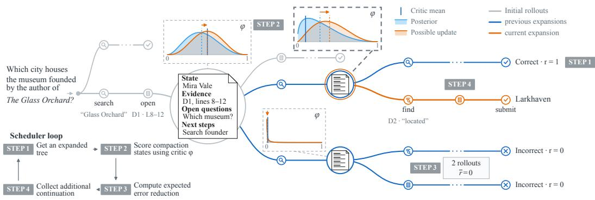  
Figure 1: Overview of the proposed FOCUS rollout scheduler for a deep-research-style problem. FOCUS continues working on a rollout tree. At each iteration, FOCUS STEP 1: takes an expanded tree; STEP 2: scores each compaction-induced state with the critic; STEP 3: compares against outcomes to decide critic quality (subsection 2.2); STEP 4: sources additional continuations that are expected to correct critic errors most efficiently (subsection 2.3). With this active learning loop for rollout acquisition, FOCUS provides a more accurate value estimate with limited rollout budgets (subsection 3.4).

In long-horizon tasks, context compaction (Cursor, 2026; Harvey, 2026; Sun et al., 2026; Li et al., 2026e), where the agent resumes from a compacted account of its previous actions and observations, provides a natural structure for applying selective rollouts: each segment between compactions becomes a step, at which step-level rewards and values can be calculated (Figure 1). However, FOCUS does not depend on a particular context-management protocol; its modular design separates rollout allocation, context management, and credit assignment.1 Appendix H details the implementation, and Section 4 discusses related work.

We evaluate FOCUS on DeonticBench (Dou et al., 2026a), BrowseComp-Plus (Chen et al., 2026), and LocBench (Chen et al., 2025). FOCUS outperforms GRPO and VinePPO on all three benchmarks under a matched per-step generation budget. With Qwen3.5-9B, FOCUS improves held-out accuracy over the strongest baseline by 7.2 points on BrowseComp-Plus (55.4 vs. 48.2) (Table 1). Diagnostics show more effective reduction of value-estimation error as the refinement budget increases, while ablations demonstrate that the gains are not tied to a single compaction implementation (Sections 3.4 and 3.5).

In summary, our contributions are:

• We cast the combination of critic predictions and continuation evidence as an active critic learning problem (Sections 2.2 and 2.3).

• We introduce FOCUS, a highly customizable rollout controller, which allocates a limited rollout budget according to estimated value-estimation error reduction and integrates the resulting estimates with credit assignment.

• We show that FOCUS improves over critic-free baselines on long-horizon benchmarks (Section 3).

## 2 METHOD

## 2.1 PROBLEM SETUP

We consider reinforcement learning of a language-model policy $\pi _ { \theta }$ from outcome rewards. The policy generates responses or actions from its current context, and a critic $V _ { \phi } ,$ parameterized by ϕ, estimates the expected remaining return. We assume that at least some of the intermediate states are easily forkable and that repeated sampling from them is trivial. An episode ξ records the generated turns and rewards from one completed run.

Given a finite rollout budget, FOCUS selects from candidate states from which to sample additional continuations, refines their value estimates, and constructs training samples for both the critic and the policy. For tool-using agents, compaction boundaries provide natural candidate states. Appendix H details the execution mechanics used in our experiments.

## 2.2 CRITIC REFINEMENT AND LEARNING

We first describe how collected continuations produce the learning signals for the critic and the policy. Section 2.3 describes how we allocate the rollout budget.

States and rollout segments. For each prompt x, we represent collected rollouts as a tree $\mathcal { T } _ { x }$ A nonterminal node denotes a state from which the policy can resume with the same context and environment state; an edge contains the policy-generated continuation and environment transitions until the next state. We write c¯ for the context of a node (state), leaving its associated environment state implicit.

A completed trajectory contains nonterminal nodes $\hat { c } _ { 0 } = x , \hat { c } _ { 1 } , . . . , \hat { c } _ { M }$ and a terminal node $\bar { c } _ { M + 1 }$ connected by edges $e _ { i } = ( \bar { c } _ { i - 1 } \to \bar { c } _ { i } ) , i = 1 , \dots , M + 1$

Refining state values. Let $V ^ { \pi } ( \bar { c } )$ denote the expected discounted return of a continuation from c¯ under the collection policy. The critic $V _ { \phi } ( \bar { c } )$ predicts this value from the state’s context. However, this prediction can have high variance. We refine its prediction using the outcome evidence from the $n ( \bar { c } )$ continuations ch(¯c) that have been expanded from it, backed up one level as in TreeRPO (Yang et al., 2025):

$$
\bar { G } ( \bar { c } ) = \frac { 1 } { n ( \bar { c } ) } \sum _ { \bar { c } ^ { \prime } \in \mathrm { c h } ( \bar { c } ) } \Big ( R _ { \bar { c } \to \bar { c } ^ { \prime } } + \gamma ^ { d _ { \bar { c } \to \bar { c } ^ { \prime } } } \tilde { V } ( \bar { c } ^ { \prime } ) \Big ) , \qquad \tilde { V } ( \bar { c } ^ { \prime } ) = 0 \mathrm { i f ~ } \bar { c } ^ { \prime } \mathrm { ~ i s ~ t e r m i n a l , }\tag{1}
$$

where $\tilde { V } ( \bar { c } ^ { \prime } )$ is the continuation’s own refined value (Eq. 2 below). We prefer this to a raw average of descendant outcomes (Li et al., 2026d) because the allocator chooses which nodes to expand, so the leaves beneath c¯ are no longer an on-policy draw from c¯; the continuation’s refined value carries its evidence back up instead, one level at a time. We combine the critic prediction and the recursive backup with a fixed pseudo-observation weight $\kappa _ { : }$

$$
\tilde { V } ( \bar { c } ) = \frac { \kappa V _ { \phi } ( \bar { c } ) + n ( \bar { c } ) \bar { G } ( \bar { c } ) } { \kappa + n ( \bar { c } ) } .\tag{2}
$$

For $n ( \bar { c } ) = 0$ , we set $\tilde { V } ( \bar { c } ) ~ = ~ V _ { \phi } ( \bar { c } )$ without evaluating $\bar { G } ;$ terminal values are zero. As $n ( \bar { c } )$ increases, the blend places more weight on the backed-up mean (Silver et al., 2016; Tesauro et al., 2010).

Critic supervision and actor advantages. After collection and the final backup, we train the critic on the recursive target $\bar { G }$ at every non-terminal state:

$$
\mathcal { L } _ { \mathrm { c r i t i c } } ( \phi ) = \mathbb { E } \Big [ \sum _ { \bar { c } \in \mathcal { T } _ { x } : n ( \bar { c } ) > 0 } \big ( V _ { \phi } ( \bar { c } ) - \bar { G } ( \bar { c } ) \big ) ^ { 2 } \Big ] .\tag{3}
$$

The target is held fixed during training. This update transfers the collected continuation evidence into the critic used in subsequent training. Within the current iteration, the refined values $\tilde { V }$ supply the segment-level temporal-difference residual2

$$
\hat { A } _ { i } = \delta _ { i } \ : = \ : R _ { i } + \gamma ^ { d _ { i } } \tilde { V } ( \bar { c } _ { i } ) - \tilde { V } ( \bar { c } _ { i - 1 } ) .\tag{4}
$$

We apply each edge’s detached advantage to its policy-generated task and context-management tokens, denoted $y _ { e _ { i } }$ , masking environment observations and conditioning text. With $\pi _ { \mathrm { o l d } }$ the collection policy, $\rho _ { t }$ the token-level importance ratio, and ϵ the clipping threshold, the actor minimizes

$$
{ \mathcal { L } } _ { \mathrm { a c t o r } } ( \theta ) ~ = ~ - \mathbb { E } \Big [ \sum _ { i } ~ \sum _ { t \in \boldsymbol { y } _ { e } } \operatorname* { m i n } \left( \rho _ { t } \hat { A } _ { i } , ~ \mathrm { c l i p } \big ( \rho _ { t } , 1 - \epsilon , 1 + \epsilon \big ) \hat { A } _ { i } \right) \Big ] , \qquad \rho _ { t } = \frac { \pi _ { \theta } \big ( \boldsymbol { y } _ { t } \big | ~ \boldsymbol { y } _ { < t } \big ) } { \pi _ { \mathrm { o l d } } \big ( \boldsymbol { y } _ { t } \big | ~ \boldsymbol { y } _ { < t } \big ) } .\tag{5}
$$

Appendix F.1 gives the general TD(λ) extension.

## 2.3 SELECTIVE ROLLOUT ALLOCATION FOR CRITIC LEARNING

Branching continuations from candidate states supplies additional value evidence (Kazemnejad et al., 2025; Hou et al., 2025; Li et al., 2026d; Guo et al., 2025), but uniform allocation does not account for differences in critic error or the expected benefit of another sample. Given an explored tree $\mathcal { T } _ { x }$ and an additional rollout budget $B ,$ FOCUS chooses which candidate node receives the next continuation. The aim is to acquire evidence where it is expected to reduce value estimation error the most (Roy & McCallum, 2001; Mussmann et al., 2022).

Outcome evidence for selection. While selection uses the same formula for mixing observed continuation outcomes and critic predictions, it does not use the continuation-refined backups of its children as in Eq. 1. Specifically, let $N ( \bar { c } )$ be the number of continuation outcomes and $\bar { G } _ { \mathrm { o b s } } ( \bar { c } )$ their mean. A completed continuation contributes one outcome at its starting node and at each newly created node along that continuation. Later branching from a descendant does not add more observations to its strict ancestors. Thus $N ( \bar { c } )$ counts observed continuation outcomes, whereas $n ( \bar { c } )$ in Eq. 1 counts direct children.

For binary continuation outcomes, the selection model uses a Beta prior of strength κ centered on $v = V _ { \phi } ( \bar { c } )$ . Its posterior mean and expected squared critic error are

$$
\mu _ { \mathrm { o b s } } = \frac { \kappa v + N \bar { G } _ { \mathrm { o b s } } } { \kappa + N } , \qquad { \widehat e } ^ { 2 } = ( v - \mu _ { \mathrm { o b s } } ) ^ { 2 } + \frac { \mu _ { \mathrm { o b s } } ( 1 - \mu _ { \mathrm { o b s } } ) } { \kappa + N + 1 } .\tag{6}
$$

Notice how $\mu _ { \mathrm { o b s } }$ is distinct from the continuation-refined training value $\tilde { V }$ . The predictive variance of the next outcome is ${ \widehat { \sigma ^ { 2 } } } = \mu _ { \mathrm { o b s } } ( 1 - \mu _ { \mathrm { o b s } } )$ . In particular, we rely on $\mu _ { \mathrm { o b s } }$ to conduct the selection due to the observation outlined in Appendix E.

Expected benefit of a continuation. We score the expected utility of a continuation using the marginal MSE reduction of value estimation error at that candidate state. For critic squared error $e ^ { 2 }$ and outcome variance $\sigma ^ { 2 }$ , the acquisition function becomes $\mathrm { M S E } ( N ) = ( \kappa ^ { 2 } e ^ { 2 } + N \dot { \sigma ^ { 2 } } ) / ( \kappa + N ) ^ { 2 }$ Differentiating with $e ^ { 2 }$ and $\sigma ^ { 2 }$ held fixed, then substituting the posterior estimates gives

$$
g ( \bar { c } ) = \frac { 2 \kappa ^ { 2 } { \widehat { e ^ { 2 } } } + ( N - \kappa ) { \widehat { \sigma ^ { 2 } } } } { ( \kappa + N ) ^ { 3 } } ,\tag{7}
$$

where $N = N ( \bar { c } )$ counts completed continuation outcomes.

Algorithm 1 first acquires rollout evidence (Section 2.3), then refines values bottom-up (Section 2.2). Each continuation completes before the next allocation decision. The eligible set is $\mathcal { F } = \{ \bar { c } \in \mathcal { T } _ { x }$ c¯ nonterminal and resumable, $g ( \bar { c } ) > 0 \}$ . The included CONTINUE $( \bar { c } , \pi )$ helper returns new nodes and connecting segments through termination. Since g uses observed suffix statistics and fixed critic predictions, value refinement can follow collection. Appendix F gives the full training loop.

Practical considerations. Total branching width at any node is uncapped. The allocation phase can also run asynchronously, with each completed continuation updating the acquisition statistics while others remain in flight. In this case, we replace N in Eq. 7 by $\mathbf { \bar { \it { N } } } _ { \mathrm { e f f } } ( \bar { c } ) \ \stackrel { \bullet } { = } \ \boldsymbol { N } ( \bar { c } ) + \boldsymbol { m } ( \bar { c } )$ where m counts pending continuations; posterior estimates still use completed outcomes only. We limit concurrent continuations per node to $C = 2$ and globally to worker capacity $W ,$ restricting eligibility to $m ( { \bar { c } } ) < C .$ Completed children do not consume concurrency slots. In practice, the two loops can run concurrently, each with multiprocessing. After the launch budget is exhausted, pending continuations finish and a final bottom-up refinement ensures that the training targets reflect the completed tree.

## 3 EXPERIMENTS

We first compare FOCUS with PPO and GRPO in a preliminary evaluation on MATH (Hendrycks et al., 2021) problems at difficulty levels 4–5, tracking accuracy, evaluation output length, and perrollout reduction over training updates. We then compare FOCUS to GRPO and VinePPO on three long-horizon benchmarks at Qwen3.5-9B and Qwen3.5-27B (Qwen Team, 2026) (LoRA), assess how MCTS refinement improves critic estimates, and ablate the compaction operator and refinement rollouts.

Algorithm 1 Selective rollout allocation and value refinement, with continuation helper   
Require: tree $\mathcal { T } _ { x } ;$ fixed actor $\pi \theta$ and critic $V _ { \phi } ;$ budget $B ;$ prior strength $\kappa$   
Require: environment $\varepsilon ;$ branch predicate B; compaction trigger $\mathcal { G }$ and operator $\scriptstyle { { \mathcal { C } } _ { \pi } }$   
Ensure: tree $\mathcal { T } _ { x }$ with critic targets G¯ and refined values $\tilde { V }$   
initialize $N , { \bar { G } } _ { \mathrm { o b s } }$ from completed suffixes; refresh $\mathcal { F } , g$   
§2.3: Selective rollout allocation   
while $\overline { { B > 0 \land \mathcal { F } \ne \emptyset } }$ do   
c¯ ← arg maxu∈F g(u); ξ ← CONTINUE(¯c, πθ)   
if $\xi = \perp$ then   
$B \gets B - 1$ ▷ execution failure   
else   
$\mathcal { T } _ { x } \gets \mathrm { A T T A C H } ( \mathcal { T } _ { x } , \bar { c } , \xi )$   
$B  B - d ( \xi )$ ▷ d(ξ): new task transitions   
$N ( u ) , \bar { G } _ { \mathrm { o b s } } ( \ddot { u } )  0$ for $u \in \mathrm { N e w } ( \xi )$ ▷ new nodes   
SCORE $( \mathcal { T } _ { x } , V _ { \phi } )$ ▷ cache unscored nonterminal values   
for u $\ r \in \{ \bar { c } \} \cup \operatorname { N e w } ( \xi )$ do ▷ $G _ { \xi } ( u )$ : observed suffix return   
$\bar { G } _ { \mathrm { o b s } } ( u )  \frac { N ( \dot { u } ) \bar { G } _ { \mathrm { o b s } } ( u ) + G _ { \xi } ( u ) } { N ( u ) + 1 } ; N ( u )  N ( u ) + 1$   
end for   
end if   
refresh $\mathcal { F } , g$   
end while   
§2.2: Value refinement and critic targets   
V˜ (u) ← 0 for terminal nodes; $\tilde { V } ( u )  V _ { \phi } ( u )$ for nonterminal leaves   
for u ∈ Tx with $\begin{array} { r } { n ( u ) > 0 , } \end{array}$ in reverse topological order do   
$\bar { G } ( u )  \frac { 1 } { n ( u ) } \sum _ { v \in \mathrm { c h } ( u ) } ( R _ { u  v } + \gamma ^ { d _ { u  v } } \tilde { V } ( v ) )$   
$\tilde { V } ( u ) \gets \frac { \kappa V _ { \phi } ( u ) + n ( u ) \bar { G } ( u ) } { \kappa + n ( u ) }$   
end for   
return $\mathcal { T } _ { x }$   
function CONTINUE(c, π¯ )   
$( c , s ) \gets \mathrm { F O R K } ( \bar { c } ) ; \xi \gets [ ] ; \zeta \gets [ ]$ ▷ ζ: current segment   
while ¬TERMINAL(s) do   
Modular context management   
if G(c) = 1 then   
$c  { } c _ { \pi } ( c )$   
else   
$\tau \sim \pi ( \cdot \mid c ) ; ( s , o , r ) \sim \mathcal { E } ( s , a ( \tau ) ) ; c \gets c \parallel \tau \parallel o$   
end if   
$\eta  \operatorname { T R A C E } ( ) ; \zeta  \zeta \parallel \eta$ ▷ task/compaction turns, rewards, transitions   
s ← UPDATE(s, η) ▷ counters and termination flags   
if FAILED(s) then return ⊥   
if TERMINAL $. ( s ) \vee B ( c , s ) = 1$ then ▷ B independent of G   
$\bar { c } ^ { \prime } \gets c ; \xi \gets \xi \| [ ( \bar { c } ^ { \prime }$ , SNAPSHOT(s), ζ)]; ζ ← [ ] ▷ save resumption state   
end if   
end while   
return $\xi$   
end function

## 3.1 PRELIMINARY EVALUATION ON MATHEMATICAL REASONING

We compare FOCUS, PPO, and GRPO with Qwen3.5-4B (Qwen Team, 2026) on MATH Level 4– 5 problems for 32 completed updates, evaluating the base checkpoint and checkpoints at updates 8, 16, 24, and 32. We use 512 training questions from the official MATH training split and 256 validation questions from its official test split.3 The training set contains 226 Level 4 and 286 Level 5 questions; validation contains 123 Level 4 and 133 Level 5 questions.

All methods consume the fixed 512-question order for 32 training steps. PPO uses 64 questions per training step; GRPO and FOCUS each use 16 questions per training step. To keep the training compute roughly matched, GRPO uses group size 6, and FOCUS uses a per-question edge budget of 64, with each edge being a maximum of 256 tokens.

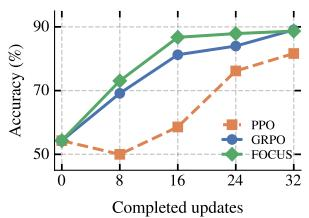  
(a) Accuracy.

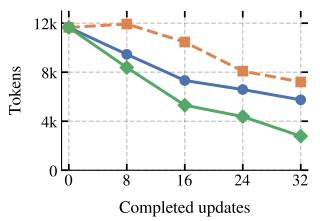  
(b) Tokens.

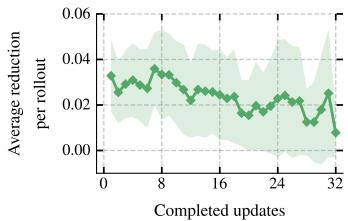  
(c) Per-rollout reduction.  
Figure 2: Preliminary evaluation with Qwen3.5-4B on MATH Level 4–5. Accuracy and the mean number of generated tokens per evaluation question are shown at the base checkpoint (update 0) and after 8, 16, 24, and 32 completed updates. Markers denote recorded checkpoints. Panel (c) shows FOCUS’s mean g(c) over all pre-allocation score evaluations within each update from 1 to 32; shading denotes ±1 standard deviation of those scores, computed as the square root of the reported variance.

FOCUS has the highest accuracy at updates 8, 16, and 24 (Figure 2), and is only one correct answer behind GRPO at update 32. FOCUS improves accuracy earlier by update count, hinting at a trainingcompute advantage. Also at update 32, FOCUS generates 2,782 tokens per evaluation problem on average, compared with 5,747 for GRPO and 7,207 for PPO. We hypothesize this results from FOCUS’s ability to refine value estimates more effectively.

Figure 2c shows that throughout training g(c) decreases by about 50% from update 1 to update 32, showing that as FOCUS gradually tunes its critic, the expected reduction in value estimation error decreases, suggesting that FOCUS gradually learns to predict the expected outcome more accurately.

## 3.2 LONG-HORIZON DATASETS

DeonticBench (Dou et al., 2026a) DeonticBench evaluates models on context-grounded deontic reasoning: deriving obligations, permissions, and prohibitions from real statutes and case facts. It comprises 6,232 tasks across U.S. federal tax, airline baggage policy, immigration administration, and state housing law. Applying a long statute to a specific case is a multi-step process, which makes the benchmark a setting for long-horizon agentic reasoning in which the model consults the statutes on demand (Dou et al., 2026b) and a natural testbed for stepwise rollout. We focus on the AIRLINE, SARA-NUMERIC, and SARA-BINARY subsets, whose statutes are reasonably long and involve nontrivial long-horizon tasks. The actor harness exposes list , grep , read , and python . We stratify the data into equally sized training and held-out splits.

BrowseComp-Plus (Chen et al., 2026) BrowseComp-Plus evaluates deep search agents on complex, multi-hop information-seeking queries over a fixed, human-verified corpus rather than a live web API. The resulting trajectories are long-horizon: iterative query formulation, retrieval, and reflection, which makes the benchmark a natural testbed for stepwise rollout. Following TRACE (Tao et al., 2026), the actor harness exposes search , open , and find over the fixed corpus. We randomly split the 830 test tasks into 498 train, 83 validation, and 249 held-out tasks.

LocBench (Chen et al., 2025) LocBench is a code-localization benchmark of 560 real GitHub is sues (242 bug reports, 150 feature requests, 139 performance issues, and 29 security issues) from repositories such as transformers, scikit-learn, vllm, and ultralytics; in LocAgent’s construction, bug reports are issues created relatively recently, and security and performance instances are collected via GitHub keyword search. Given only the issue, the agent must locate the files and functions touched by the gold patch. We instantiate it using the harness described in Appendix H; the actor exposes list , grep , and read for repository navigation. We score submissions as in LocAgent: file-level and function-level Acc@k is 1 when every gold location appears in the top k (added functions are excluded); we report Acc@{1, 5} at the file level and train on file-level recall at k=5. We split the instances into equal training and held-out halves, stratified by repository and issue category.

## 3.3 MAIN RESULTS

We compare GRPO, VinePPO, and FOCUS using Qwen3.5-9B on DeonticBench, BrowseComp-Plus, and LocBench, and additionally with Qwen3.5-27B (LoRA) on DeonticBench. Table 1 reports held-out accuracy alongside untrained reference models. All methods train for one epoch under a matched per-step generation budget with compaction on every rollout; protocol, optimization, and compute details are in Appendix A.

Table 1: Evaluation results for FOCUS vs critic-free methods. Entries are accuracy (%) on the held-out split of each benchmark. DeonticBench Hard aggregates dataset-marked hard subsets from Airline, SARA-N, and SARA-B. Reference rows are untrained. ∆ is FOCUS minus GRPO in percentage points; subscripts and superscripts give the lower and upper endpoints of marginal 90% paired bootstrap CIs, respectively. Bootstrap and checkpoint details are in Appendix B. For cost reasons, we only report DeonticBench at Qwen3.5-27B.
<table><tr><td rowspan="2">Model</td><td rowspan="2">Method</td><td colspan="5">DeonticBench</td><td rowspan="2">BrowseComp -Plus</td><td colspan="2">LocBench</td></tr><tr><td>Airline</td><td>SARA-N</td><td>SARA-B</td><td>Hard</td><td>Overall</td><td>File@1</td><td>File@5</td></tr><tr><td colspan="2">Reference (no RL)</td><td></td><td></td><td></td><td></td><td></td><td></td><td></td><td></td></tr><tr><td colspan="2">gpt-oss-20b (medium)</td><td>2.7</td><td>8.0</td><td>76.8</td><td>14.1</td><td>33.7</td><td>18.6</td><td>54.0</td><td>57.5</td></tr><tr><td colspan="2">Nemotron 3 Nano 30B A3B</td><td>2.7</td><td>12.0</td><td>89.9</td><td>18.3</td><td>36.1</td><td>19.3</td><td>57.9</td><td>66.6</td></tr><tr><td colspan="2">Qwen3.5-9B</td><td>5.3</td><td>30.0</td><td>89.9</td><td>19.7</td><td>45.9</td><td>29.7</td><td>62.1</td><td>67.8</td></tr><tr><td colspan="2">Qwen3.5-27B</td><td>58.7</td><td>60.0</td><td>94.2</td><td>43.7</td><td>73.4</td><td>50.6</td><td>66.7</td><td>79.3</td></tr><tr><td rowspan="4">Qwen3.5-9B</td><td>GRPO</td><td>14.0</td><td>56.0</td><td>92.8</td><td>28.2</td><td>52.4</td><td>48.2</td><td>70.1</td><td>80.5</td></tr><tr><td>VinePPO</td><td>10.0</td><td>50.0</td><td>92.0</td><td>24.0</td><td>49.4</td><td>46.6</td><td>67.8</td><td>79.3</td></tr><tr><td>FOCUS</td><td>21.3</td><td>52.0</td><td>96.4</td><td>26.8</td><td>56.5</td><td>55.4</td><td>72.4</td><td>81.6</td></tr><tr><td>∆ vs. GRPO</td><td>+7.3+14.00 +0.67</td><td>-4.0+8.00 -16.00</td><td>+3.6+7.25 +0.00</td><td>−1.4+5.63 -8.45</td><td>+4.1+7.69 +0.59</td><td>+7.2+12.15 +2.41</td><td>+2.3+5.7 -1.1</td><td>+1.1+3.4 +0.0</td></tr><tr><td rowspan="4">Qwen3.5-27B</td><td>GRPO</td><td>60.7</td><td>60.0</td><td>94.2</td><td>43.7</td><td>74.3</td><td rowspan="4">outside the 27B study</td><td rowspan="4"></td></tr><tr><td>VinePPO</td><td>62.7</td><td>58.0</td><td>94.2</td><td>36.6</td><td>74.9</td></tr><tr><td>FOCUS</td><td>62.7</td><td>62.0</td><td>96.4</td><td>43.7</td><td>76.3</td></tr><tr><td>∆ vs. GRPO</td><td>+2.0+8.67 -4.67</td><td>+2.0+10.00 -6.00</td><td>+2.2+4.35 +0.72</td><td>+0.0+7.04 -7.04</td><td>+2.0+5.33 -1.18</td></tr></table>

FOCUS ranks first among the trained methods on every benchmark in Table 1. At Qwen3.5-9B, it leads on DeonticBench overall (56.5 vs. 52.4 for GRPO and 49.4 for VinePPO), reports the strongest BrowseComp-Plus result (55.4 vs. 48.2 for GRPO and 46.6 for VinePPO, each the best held-out checkpoint over training), and localizes best on LocBench (72.4 / 81.6 File@1 / @5, ahead of 70.1 / 80.5 and 67.8 / 79.3). FOCUS also leads across scale: Qwen3.5-27B with LoRA on DeonticBench still gains from FOCUS fine-tuning (76.3 overall vs. 74.3 and 74.9), but the margin over the baselines shrinks. This could partially be because the untuned 27B model already starts much higher (73.4 overall).

Training dynamics. FOCUS attains the highest on-policy reward throughout training on DeonticBench and BrowseComp-Plus (Figure 3), and the highest held-out accuracy on DeonticBench. On DeonticBench and LocBench, the three methods track closely early, then FOCUS pulls ahead and keeps improving or holds a higher plateau, whereas GRPO on DeonticBench peaks mid-run and then regresses. Late in training, GRPO’s mean tool calls collapse on all three benchmarks while VinePPO and FOCUS stay near their initial levels: GRPO increasingly submit s right after compaction even when the statute or repository still needs reading (Appendix G). We hypothesize that trajectory-level group credit makes such premature submissions easy to reinforce, whereas VinePPO’s suffix branching and FOCUS’s refined checkpoint values preserve longer horizons.

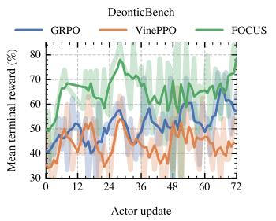

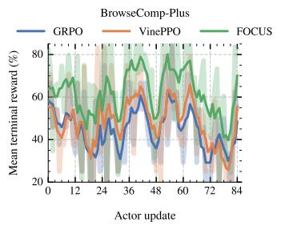

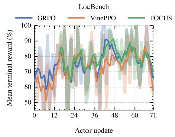

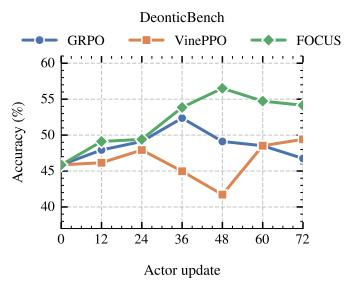

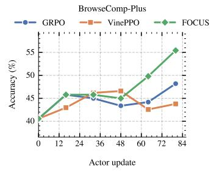

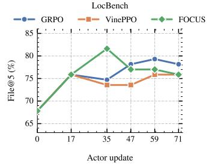

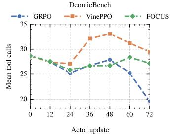  
(a) DeonticBench.

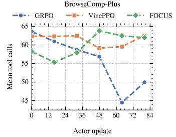  
(b) BrowseComp-Plus.

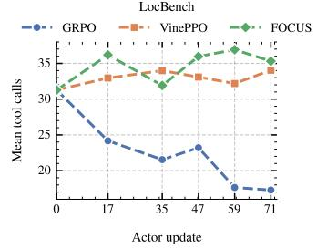  
(c) LocBench.  
Figure 3: Training dynamics. Each column is one benchmark, showing training reward against optimizer step (top), held-out evaluation (middle), and mean numbers of tool calls per episode on the held-out split (bottom), for GRPO, VinePPO, and FOCUS under a matched per-step generation budget. Top panels plot mean terminal reward from on-policy collection; LocBench held-out reward is File@5. BrowseComp-Plus results are the equivalence judgement of Qwen3-32B (Qwen Team, 2025).

## 3.4 VALUE REFINEMENT

To assess how efficient the FOCUS correction process is in reducing the critic error for long-horizon tasks, as well as whether the critic can improve throughout training, we conduct two diagnostic analyses.

Critic Error Reduction We start by assuming two types of imperfect critics: a constant critic init and a random critic init, and we compare how different priority schedules affect the critic error reduction against a ground truth determined by the mean outcome of $n { = } 1 6$ MCTS continuations. Figure 4a shows that under both types of critics, FOCUS’s correction process is noticeably more efficient than random selection. Also, using the raw critic value residual performs poorly. This shows that FOCUS-style scheduling not only works well under degenerate critics but also reduces variance even when the critic provides almost no information.

Critic Improvement We also test whether the critic improves over training. At each LocBench evaluation checkpoint, we sample n=16 MCTS continuations from a set of m=8 completed traces. We then compute the Spearman correlation between the critic value and the MCTS ground truth. Figure 4b shows that the FOCUS critic improves steadily.

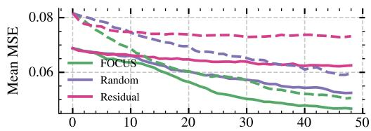  
Additional rollouts per actor update  
(a) Critic MSE vs. budget (DeonticBench).

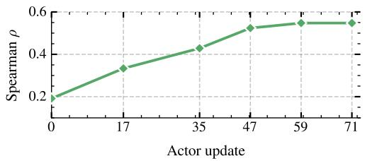  
(b) Critic Spearman ρ (LocBench).  
Figure 4: Value refinement for FOCUS. (a) MSE on fixed audit trees as MCTS continuations are allocated by each rule (solid: constant critic init; dashed: random critic init). (b) Rank agreement between checkpoint critic values and an oversampled, critic-blind MCTS target on fixed audit states.

## 3.5 ABLATION STUDIES

We ablate the compaction operator and the refinement rollouts to test that FOCUS is not tied to one compactor and that its gains come from active error correction, not the critic alone.

Compaction operator. On DeonticBench, we replace the in-context compaction operator, which writes everything into the new context window, with an in-memory workspace that provides its own put , get , scan and delete . The two perform similarly (Figure 5a), so FOCUS’s effectiveness extends to different compaction operators.

Refinement rollouts. On BrowseComp-Plus, we remove the refinement rollouts of subsection 2.3, which amounts to collecting independent continuations from the question prompt and estimating step-wise advantages from the critic alone. Figure 5b shows that refinement rollouts are crucial for FOCUS on BrowseComp-Plus; without them, FOCUS trains more slowly, especially early on.

Structural compaction. We also compare a free-form compaction prompt with a structural prompt that induces a more constrained compaction on LocBench (Figure 5c; both prompts are reproduced in Appendix D). The free-form prompt suggests headings and keeps the reply verbatim. The structural prompt requires a single summary with four sections (State, Evidence, Open questions, Next steps) and rejects replies that do not parse. The free-form prompt reaches a higher peak, while the structural prompt improves more steadily.

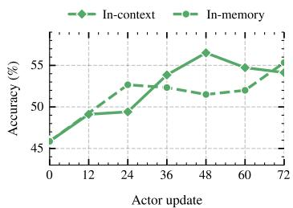  
(a) Compaction operator (DeonticBench).

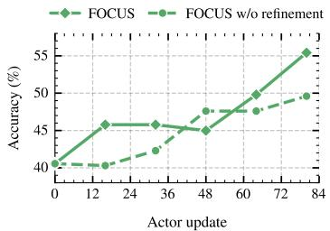  
(b) Refinement rollouts (BrowseComp-Plus).

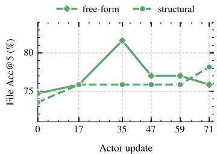  
(c) Structural compaction (LocBench).  
Figure 5: Ablations at evaluation checkpoints. (a) Varying the compaction operator on DeonticBench under a matched budget; (b) FOCUS with full refinement vs. FOCUS without refinement rollouts on BrowseComp-Plus; (c) free-form vs. structural compaction on LocBench (File Acc@5).

## 4 RELATED WORK

Structured rollouts and rollout allocation Search over intermediate states began as an inferencetime technique: LLM tree search (Yao et al., 2023; Hao et al., 2023; Zhou et al., 2024a) and verifierguided test-time scaling (Lightman et al., 2024; Snell et al., 2025) improved model responses. It was later used offline to generate training supervision (Tian et al., 2024; Zhang et al., 2024; Guan et al., 2025) and then moved into the RL loop. VinePPO (Kazemnejad et al., 2025), SPO (Guo et al.,

2025), and TEMPO (Tran et al., 2025) re-sample continuations from intermediate reasoning steps to replace the value network with Monte Carlo estimates; TreeRL (Hou et al., 2025), TreePO (Li et al., 2026d), and DeepSearch (Wu et al., 2026) run the search inside RLVR training so that shared prefixes cut generation cost and the tree yields process-level signal. Other work proposes where to branch: at high-entropy tokens (Zheng et al., 2025; Cao et al., 2026), at attention peaks (Liu et al., 2026), where the model’s belief shifts (Lei et al., 2026), or, for tool-using agents, at the turn boundaries after an observation (Dong et al., 2026; Zong et al., 2026). Tree-GRPO (Ji et al., 2026) makes each agent step a node and shows that intra-tree group objectives amount to step-level preference learning, while PaTR (Li et al., 2026c) routes the branching budget by a process score, and IGRPO (Zhang et al., 2026b) and SIGHT (Zhong et al., 2026) by information gain. T2PO (Wang et al., 2026a) instead resamples turns that its token- and turn-level uncertainty signals flag as making no progress. TRACE (Zou et al., 2026) unifies prompt- and turn-level allocation with a learned predictor of conditional success, directing extra rollouts to the prefixes most likely to yield mixed terminal rewards. FOCUS allocates additional continuations according to their estimated reduction in value-estimation error, using the acquired evidence to refine state values and train a reusable critic.

Active learning and expected error reduction Expected-error-reduction methods select observations according to their predicted effect on the learner’s error. Roy & McCallum (2001) approximate this objective through sampling, while Mussmann et al. (2022) use Bayesian parameter samples to estimate the reduction in predictive loss over an unlabeled validation set without retraining for every candidate query. A related approach selects data to reduce predictive variance, connecting variance reduction to squared-error minimization under an approximately unbiased learner (Cohn et al., 1996). Influence-function approaches estimate acquisition utility by approximating how additional training data affect a fitted model’s evaluation loss, without retraining for each candidate (Koh & Liang, 2017; Xu & Kazantsev, 2019). FOCUS applies the error-reduction principle to allocating continuation samples among intermediate states.

Critic learning and credit assignment Trajectory-level reward is known to fail for multi-turn agents as it cannot tell a useful turn from a redundant one, and training on it alone is unstable (Wang et al., 2025; Wei et al., 2025; Tan et al., 2026). One response is to place the reward and critic at the level of a turn or step rather than a token (too fine-grained) or a whole trajectory (too coarse) (Zhou et al., 2024c; 2025; Li et al., 2026a; Zhang et al., 2026a; Zhen et al., 2026). A turn is the natural unit of decision for an agent; the horizon measured in turns is short enough for a critic to bootstrap over, and a per-turn value gives every turn its own signal from a single rollout. Large-scale training is also shifting from structural comparison to a learned value: SAO (Hou et al., 2026) replaces GRPO’s group sampling with one rollout per prompt scored by a value model, as full groups are slow and off-policy under asynchronous training. Some process reward models serve as fixed value estimators during policy optimization (Wang et al., 2024; Luo et al., 2024; Li & Li, 2025; Choudhury, 2025; Setlur et al., 2025; Tao et al., 2026). More recently, Le Critique (Venkatraman et al., 2026) mixes a learned baseline with a training-free group-relative one according to how accurate the critic is. FOCUS uses refined state values to construct segment-level actor advantages and recursive backups to supervise the critic, coupling credit assignment in the current iteration with critic learning for subsequent iterations.

Context management for long-horizon agents Compaction is becoming standard for agents that outrun their context window (Packer et al., 2023; Yu et al., 2026; Sun et al., 2026; Li et al., 2026b), and there is a recent push to train it jointly with the task rather than treat it as a frozen preprocessor (Cursor, 2026; Li et al., 2026e). State restoration is also central to identifying step-level credit (Zhang, 2026). In our long-horizon experiments, compaction boundaries provide resumable states for acquiring continuation evidence. The rollout controller operates on these states independently of the compaction operator; its objective is to refine value estimates and construct critic supervision through selective rollouts.

## 5 CONCLUSION

We present FOCUS, a rollout controller for language-model reinforcement learning that refines intermediate value estimates through active critic learning and selective rollouts. FOCUS naturally supports long-horizon agentic RL through flexible and modular context-management protocols such as compaction. Across DeonticBench, BrowseComp-Plus, and LocBench, FOCUS improves over

GRPO and VinePPO under a matched per-step generation budget, with the largest held-out gains on deep search and deontic reasoning and consistent benefits on code localization. Training curves show that these improvements come with more stable exploration: FOCUS maintains higher collection reward and avoids the late-training collapse in tool use seen under trajectory-level group credit. Ablations indicate that gains are not tied to a single compaction implementation and that refinement rollouts are beneficial on BrowseComp-Plus. We release our modular rollout controller with interfaces for alternative harnesses, search policies, and credit estimators. Future work may scale FOCUS to larger models and longer budgets, tighten the link between compaction quality and training stability, and adopt stronger uncertainty quantification for value refinement.

## ACKNOWLEDGMENTS

This work was supported in part by the Defense Advanced Research Projects Agency (DARPA) Scientific Feasibility (SciFy) program under contract HR001125C0304; by Schmidt Sciences through the “Safely Confident Reasoning” project in its Science of Trustworthy AI program; and by the Office of Naval Research (ONR) under grant N00014-24-1-2089. Any opinions, findings, and conclusions or recommendations expressed in this material are those of the authors and do not necessarily reflect the views of DARPA, the Office of Naval Research, or Schmidt Sciences. We acknowledge the use of computational resources from the Johns Hopkins DSAI cluster.

## REFERENCES

Lang Cao, Hui Ruan, Yongqian Li, Peng Chao, Wu Ning, Haonan Song, Renhong Chen, and Yitong Li. TreeAdv: Tree-structured advantage redistribution for group-based RL. arXiv preprint arXiv:2601.03703, 2026.

Zhaoling Chen, Xiangru Tang, Gangda Deng, Fang Wu, Jialong Wu, Zhiwei Jiang, Viktor Prasanna, Arman Cohan, and Xingyao Wang. LocAgent: Graph-guided LLM agents for code localization. In Proceedings of the 63rd Annual Meeting of the Association for Computational Linguistics, 2025. arXiv:2503.09089.

Zijian Chen, Xueguang Ma, Shengyao Zhuang, Ping Nie, Kai Zou, Sahel Sharifymoghaddam, Andrew Liu, Joshua Green, Kshama Patel, Ruoxi Meng, Mingyi Su, Yanxi Li, Haoran Hong, Xinyu Shi, Xuye Liu, Hosna Oyarhoseini, Nandan Thakur, Crystina Zhang, Luyu Gao, Wenhu Chen, and Jimmy Lin. BrowseComp-plus: A fair and disentangled evaluation benchmark for deep search agents. In Proceedings of the 64th Annual Meeting of the Association for Computational Linguistics (Volume 1: Long Papers), pp. 22349–22370, San Diego, California, United States, July 2026. Association for Computational Linguistics. doi: 10.18653/v1/2026.acl-long.1023. URL https://aclanthology.org/2026.acl-long.1023/.

Sanjiban Choudhury. Process reward models for LLM agents: Practical framework and directions. arXiv preprint arXiv:2502.10325, 2025.

David A. Cohn, Zoubin Ghahramani, and Michael I. Jordan. Active learning with statistical models. Journal of Artificial Intelligence Research, 4:129–145, 1996. URL https://arxiv.org/ abs/cs/9603104.

Cursor. Training Composer for longer horizons. https://cursor.com/blog/ self-summarization, 2026. Blog post, March 2026.

Cursor Research. Composer 2 technical report. arXiv preprint arXiv:2603.24477, 2026.

Guanting Dong, Hangyu Mao, Kai Ma, Licheng Bao, Yifei Chen, Zhongyuan Wang, Zhongxia Chen, Jiazhen Du, Huiyang Wang, Fuzheng Zhang, Guorui Zhou, Yutao Zhu, Ji-Rong Wen, and Zhicheng Dou. Agentic reinforced policy optimization. In International Conference on Learning Representations, 2026. arXiv:2507.19849.

Guangyao Dou, Luis Brena, Akhil Deo, William Jurayj, Jingyu Zhang, Nils Holzenberger, and Benjamin Van Durme. DeonticBench: A benchmark for reasoning over rules. arXiv preprint arXiv:2604.04443, 2026a.

Guangyao Dou, William Jurayj, Nils Holzenberger, and Benjamin Van Durme. DAR: Deontic reasoning with agentic harnesses. arXiv preprint arXiv:2606.05009, 2026b.

Xinyu Guan, Li Lyna Zhang, Yifei Liu, Ning Shang, Youran Sun, Yi Zhu, Fan Yang, and Mao Yang. rStar-Math: Small LLMs can master math reasoning with self-evolved deep thinking. In International Conference on Machine Learning, 2025. arXiv:2501.04519.

Yiran Guo, Lijie Xu, Jie Liu, Dan Ye, and Shuang Qiu. Segment policy optimization: Effective segment-level credit assignment in RL for large language models. In Advances in Neural Information Processing Systems, 2025. arXiv:2505.23564.

Shibo Hao, Yi Gu, Haodi Ma, Joshua Jiahua Hong, Zhen Wang, Daisy Zhe Wang, and Zhiting Hu. Reasoning with language model is planning with world model. In Proceedings of the 2023 Conference on Empirical Methods in Natural Language Processing, 2023.

Harvey. Harvey Tenet research preview. https://www.harvey.ai/blog/ post-training-update-harvey-tenet, 2026. Blog post, August 2026.

Nicholas Hay, Stuart Russell, David Tolpin, and Solomon Eyal Shimony. Selecting computations: Theory and applications. In Conference on Uncertainty in Artificial Intelligence, 2012.

Dan Hendrycks, Collin Burns, Saurav Kadavath, Akul Arora, Steven Basart, Eric Tang, Dawn Song, and Jacob Steinhardt. Measuring mathematical problem solving with the MATH dataset. NeurIPS, 2021. URL https://arxiv.org/abs/2103.03874.

Zhenyu Hou, Ziniu Hu, Yujiang Li, Rui Lu, Jie Tang, and Yuxiao Dong. TreeRL: LLM reinforcement learning with on-policy tree search. In Proceedings of the 63rd Annual Meeting of the Associationfor Computational Linguistics, 2025. arXiv:2506.11902.

Zhenyu Hou, Yujiang Li, Jie Tang, and Yuxiao Dong. Single-rollout asynchronous optimization for agentic reinforcement learning. arXiv preprint arXiv:2607.07508, 2026.

Yuxiang Ji, Ziyu Ma, Yong Wang, Guanhua Chen, Xiangxiang Chu, and Liaoni Wu. Tree search for LLM agent reinforcement learning. In International Conference on Learning Representations, 2026. arXiv:2509.21240.

Carlos E. Jimenez, John Yang, Alexander Wettig, Shunyu Yao, Kexin Pei, Ofir Press, and Karthik Narasimhan. SWE-bench: Can language models resolve real-world GitHub issues? In Interna tional Conference on Learning Representations, 2024. arXiv:2310.06770.

Bowen Jin, Hansi Zeng, Zhenrui Yue, Jinsung Yoon, Sercan Arik, Dong Wang, Hamed Zamani, and Jiawei Han. Search-R1: Training LLMs to reason and leverage search engines with reinforcement learning. In Conference on Language Modeling, 2025. arXiv:2503.09516.

Emilie Kaufmann and Wouter M. Koolen. Monte-Carlo tree search by best arm identification. In Advances in Neural Information Processing Systems, 2017.

Amirhossein Kazemnejad, Milad Aghajohari, Eva Portelance, Alessandro Sordoni, Siva Reddy, Aaron Courville, and Nicolas Le Roux. VinePPO: Refining credit assignment in RL training of LLMs. In International Conference on Machine Learning, 2025.

Kimi Team. Kimi K3: Open frontier intelligence. arXiv preprint arXiv:2607.24653, 2026.

Diederik P. Kingma and Jimmy Ba. Adam: A method for stochastic optimization. In International Conference on Learning Representations, 2015.

Pang Wei Koh and Percy Liang. Understanding black-box predictions via influence functions. In Proceedings of the 34th International Conference on Machine Learning, volume 70 of Proceedings of Machine Learning Research, pp. 1885–1894. PMLR, 2017. URL https: //proceedings.mlr.press/v70/koh17a.html.

Vijay Konda and John Tsitsiklis. Actor-critic algorithms. In Advances in Neural Information Processing Systems, volume 12, 1999.

Bin Lei, Yu Li, Prafulla Kumar Choubey, Jiaxin Zhang, Becky Xiangyu Peng, Qinyuan Ye, Kartik Narayan, Caiwen Ding, Silvio Savarese, and Chien-Sheng Wu. Fork where the model changes its mind: Belief-shift branching for tree-structured reinforcement learning. arXiv preprint arXiv:2609.11061, 2026.

Junbo Li, Peng Zhou, Rui Meng, Meet P. Vadera, Lihong Li, and Yang Li. Turn-PPO: Turn-level advantage estimation with PPO for improved multi-turn RL in agentic LLMs. In Proceedings of the 19th Conference of the European Chapter of the Association for Computational Linguistics, 2026a. arXiv:2512.17008.

Tianjian Li, Jingyu Zhang, William Jurayj, Xi Wang, Chuanyang Jin, Mehrdad Farajtabar, Eric Nalisnick, and Daniel Khashabi. Self-compacting language model agents. arXiv preprint arXiv:2606.23525, 2026b.

Wendi Li and Yixuan Li. Process reward model with Q-value rankings. In International Conference on Learning Representations, 2025. arXiv:2410.11287.

Xintong Li, Sha Li, Yuwei Zhang, Changlong Yu, Rongmei Lin, Hongye Jin, Shuyi Guan, Xin Liu, Linwei Li, Qingyu Yin, and Jingbo Shang. Process reward informed tree rollout for effective multi-turn RL. arXiv preprint arXiv:2607.15610, 2026c.

Yizhi Li, Qingshui Gu, Zhoufutu Wen, Ziniu Li, Tianshun Xing, Shuyue Guo, Tianyu Zheng, Xin Zhou, Xingwei Qu, Wangchunshu Zhou, Zheng Zhang, Wei Shen, Qian Liu, Chenghua Lin, Jian Yang, Ge Zhang, and Wenhao Huang. TreePO: Enhancing policy efficacy and inference efficiency with tree modeling. In International Conference on Machine Learning, 2026d. arXiv:2508.17445.

Yujiang Li, Zhenyu Hou, Yi Jing, Jie Tang, and Yuxiao Dong. CompactionRL: Reinforcement learning with context compaction for long-horizon agents. arXiv preprint arXiv:2607.05378, 2026e.

Hunter Lightman, Vineet Kosaraju, Yura Burda, Harri Edwards, Bowen Baker, Teddy Lee, Jan Leike, John Schulman, Ilya Sutskever, and Karl Cobbe. Let’s verify step by step. In International Conference on Learning Representations, 2024.

Runze Liu, Jiakang Wang, Yuling Shi, Zhihui Xie, Chenxin An, Kaiyan Zhang, Jian Zhao, Xiaodong Gu, Lei Lin, Wenping Hu, Xiu Li, Fuzheng Zhang, Guorui Zhou, and Kun Gai. Attention as a compass: Efficient exploration for process-supervised RL in reasoning models. In International Conference on Learning Representations, 2026. arXiv:2509.26628.

Liangchen Luo, Yinxiao Liu, Rosanne Liu, Samrat Phatale, Meiqi Guo, Harsh Lara, Yunxuan Li, Lei Shu, Yun Zhu, Lei Meng, Jiao Sun, and Abhinav Rastogi. Improve mathematical reasoning in language models by automated process supervision. arXiv preprint arXiv:2406.06592, 2024.

Stephen Mussmann, Julia Reisler, Daniel Tsai, Ehsan Mousavi, Shayne O’Brien, and Moises Goldszmidt. Active learning with expected error reduction. arXiv preprint arXiv:2211.09283, 2022. URL https://arxiv.org/abs/2211.09283.

Charles Packer, Sarah Wooders, Kevin Lin, Vivian Fang, Shishir G. Patil, Ion Stoica, and Joseph E. Gonzalez. MemGPT: Towards LLMs as operating systems. arXiv preprint arXiv:2310.08560, 2023.

Qwen Team. Qwen3 technical report, 2025. URL https://arxiv.org/abs/2505.09388.

Qwen Team. Qwen3.5: Towards native multimodal agents, February 2026. URL https://qwen. ai/blog?id=qwen3.5.

Nicholas Roy and Andrew McCallum. Toward optimal active learning through sampling estimation of error reduction. In Proceedings ofthe Eighteenth International Conference on Machine Learning, pp. 441–448. Morgan Kaufmann, 2001. URL https://groups.csail.mit.edu/ rrg/papers/icml01.pdf.

John Schulman, Philipp Moritz, Sergey Levine, Michael I. Jordan, and Pieter Abbeel. Highdimensional continuous control using generalized advantage estimation. In International Conference on Learning Representations, 2016.

Amrith Setlur, Chirag Nagpal, Adam Fisch, Xinyang Geng, Jacob Eisenstein, Rishabh Agarwal, Alekh Agarwal, Jonathan Berant, and Aviral Kumar. Rewarding progress: Scaling automated process verifiers for LLM reasoning. In International Conference on Learning Representations, 2025. arXiv:2410.08146.

Rulin Shao, Shannon Zejiang Shen, Junjie Oscar Yin, Yuetai Li, Minheng Wang, Hamish Ivison, Radha Poovendran, Nathan Lambert, Teng Xiao, Mike Lewis, Wen-tau Yih, Luke Zettlemoyer, and Pang Wei Koh. Context language models. arXiv preprint arXiv:2609.37725, 2026. URL https://arxiv.org/abs/2609.37725.

Zhihong Shao, Peiyi Wang, Qihao Zhu, Runxin Xu, Junxiao Song, Xiao Bi, Haowei Zhang, Mingchuan Zhang, Y. K. Li, Y. Wu, and Daya Guo. DeepSeekMath: Pushing the limits of mathematical reasoning in open language models. arXiv preprint arXiv:2402.03300, 2024.

David Silver, Aja Huang, Chris J. Maddison, Arthur Guez, Laurent Sifre, George van den Driessche, Julian Schrittwieser, Ioannis Antonoglou, Veda Panneershelvam, Marc Lanctot, et al. Mastering the game of Go with deep neural networks and tree search. Nature, 529(7587):484–489, 2016.

Charlie Snell, Jaehoon Lee, Kelvin Xu, and Aviral Kumar. Scaling LLM test-time compute optimally can be more effective than scaling parameters for reasoning. In International Conference on Learning Representations, 2025. arXiv:2408.03314.

Weiwei Sun, Miao Lu, Zhan Ling, Kang Liu, Xuesong Yao, Yiming Yang, and Jiecao Chen. Scaling long-horizon agent via context folding. In International Conference on Machine Learning, 2026. arXiv:2510.11967.

Hui-Ze Tan, Xiao-Wen Yang, Hao Chen, Jie-Jing Shao, Yi Wen, Yuteng Shen, Weihong Luo, Xiku Du, Lan-Zhe Guo, and Yu-Feng Li. Hindsight credit assignment for long-horizon LLM agents. arXiv preprint arXiv:2603.08754, 2026.

Leitian Tao, Baolin Peng, Wenlin Yao, Tao Ge, Hao Cheng, Mike Hang Wang, Jianfeng Gao, and Sharon Li. TRACE: Turn-level reward assignment via credit estimation for long-horizon agents. arXiv preprint arXiv:2607.13988, 2026.

Gerald Tesauro, V. T. Rajan, and Richard Segal. Bayesian inference in Monte-Carlo tree search. In Conference on Uncertainty in Artificial Intelligence, 2010.

Thinking Machines Lab. Tinker, 2026. URL https://thinkingmachines.ai/tinker/.

Ye Tian, Baolin Peng, Linfeng Song, Lifeng Jin, Dian Yu, Lei Han, Haitao Mi, and Dong Yu. Toward self-improvement of LLMs via imagination, searching, and criticizing. In Advances in Neural Information Processing Systems, 2024.

Hieu Tran, Zonghai Yao, and Hong Yu. Exploiting tree structure for credit assignment in RL training of LLMs. arXiv preprint arXiv:2509.18314, 2025.

Siddarth Venkatraman, Matthieu Dinot, and Laurence Aitchison. Le critique: Privileged value functions for LLM reinforcement learning. arXiv preprint arXiv:2608.16739, 2026.

Haixin Wang, Hejie Cui, Chenwei Zhang, Xin Liu, Shuowei Jin, Shijie Geng, Xinyang Zhang, Nasser Zalmout, Zhenyu Shi, and Yizhou Sun. T2PO: Uncertainty-guided exploration control for stable multi-turn agentic reinforcement learning. In International Conference on Machine Learning, 2026a. arXiv:2605.02178.

Peiyi Wang, Lei Li, Zhihong Shao, R. X. Xu, Damai Dai, Yifei Li, Deli Chen, Y. Wu, and Zhifang Sui. Math-shepherd: Verify and reinforce LLMs step-by-step without human annotations. In Proceedings of the 62nd Annual Meeting of the Association for Computational Linguistics, 2024. arXiv:2312.08935.

Zhenting Wang, Huancheng Chen, Jiayun Wang, and Wei Wei. Memex(RL): Scaling long-horizon LLM agents via indexed experience memory. arXiv preprint arXiv:2603.04257, 2026b. URL https://arxiv.org/abs/2603.04257.

Zihan Wang, Kangrui Wang, Qineng Wang, Pingyue Zhang, Linjie Li, Zhengyuan Yang, Xing Jin, Kefan Yu, Minh Nhat Nguyen, Licheng Liu, Eli Gottlieb, Yiping Lu, Kyunghyun Cho, Jiajun Wu, Li Fei-Fei, Lijuan Wang, Yejin Choi, and Manling Li. RAGEN: Understanding self-evolution in LLM agents via multi-turn reinforcement learning. arXiv preprint arXiv:2504.20073, 2025.

Quan Wei, Siliang Zeng, Chenliang Li, Zhongruo Wang, William Brown, Oana Frunza, Wei Deng, Anderson Schneider, Yuriy Nevmyvaka, Yang Katie Zhao, Alfredo Garcia, and Mingyi Hong. Reinforcing multi-turn reasoning in LLM agents via fine-grained reward structure and credit assignment. arXiv preprint arXiv:2505.11821, 2025.

Fang Wu, Weihao Xuan, Heli Qi, Aaron Tu, Ximing Lu, Li Erran Li, and Yejin Choi. DeepSearch: Overcome the bottleneck of reinforcement learning with verifiable rewards via tree-based search. In International Conference on Learning Representations, 2026. arXiv:2509.25454.

Minjie Xu and Gary Kazantsev. Understanding goal-oriented active learning via influence functions. arXiv preprint arXiv:1905.13183, 2019. URL https://arxiv.org/abs/1905.13183.

Zhicheng Yang, Zhijiang Guo, Yinya Huang, Xiaodan Liang, Yiwei Wang, and Jing Tang. TreeRPO: Tree relative policy optimization. arXiv preprint arXiv:2506.05183, 2025.

Shunyu Yao, Dian Yu, Jeffrey Zhao, Izhak Shafran, Thomas L. Griffiths, Yuan Cao, and Karthik Narasimhan. Tree of thoughts: Deliberate problem solving with large language models. In Advances in Neural Information Processing Systems, 2023.

Hongli Yu, Tinghong Chen, Jiangtao Feng, Jiangjie Chen, Weinan Dai, Qiying Yu, Ya-Qin Zhang, Wei-Ying Ma, Jingjing Liu, Mingxuan Wang, and Hao Zhou. MemAgent: Reshaping longcontext LLM with multi-conv RL-based memory agent. In International Conference on Learning Representations, 2026. arXiv:2507.02259.

Alex L. Zhang, Tim Kraska, and Omar Khattab. Recursive language models. arXiv preprint arXiv:2512.24601, 2025. URL https://arxiv.org/abs/2512.24601.

Chenchen Zhang. From reasoning to agentic: Credit assignment in reinforcement learning for large language models. arXiv preprint arXiv:2604.09459, 2026.

Dan Zhang, Sining Zhoubian, Ziniu Hu, Yisong Yue, Yuxiao Dong, and Jie Tang. ReST-MCTS\*: LLM self-training via process reward guided tree search. In Advances in Neural Information Processing Systems, 2024.

Wenxuan Zhang, Yuhui Wang, Donggang Jia, Xiaoqian Shen, Jian Ding, Ivan Viola, Jurgen Schmid-¨ huber, and Mohamed Elhoseiny. Hybrid advantage estimation with unified critic for VLM agentic reinforcement learning. In European Conference on Computer Vision, 2026a. arXiv:2607.23605.

Yijun Zhang, Fan Xu, Jiaxin Ding, Yule Xie, Shiqing Gao, Xin Ding, Haoxiang Zhang, Luoyi Fu, and Xinbing Wang. Information gain-based rollout policy optimization: An adaptive treestructured rollout approach for multi-turn LLM agents. arXiv preprint arXiv:2607.06223v1, 2026b. URL https://arxiv.org/abs/2607.06223v1.

Shuai Zhen, Yanhua Yu, Ruopei Guo, Nan Cheng, and Yang Deng. Hierarchical reinforcement learning with augmented step-level transitions for LLM agents. In Proceedings ofthe 64th Annual Meeting ofthe Associationfor Computational Linguistics, 2026. arXiv:2604.05808.

Tianyu Zheng, Tianshun Xing, Qingshui Gu, Taoran Liang, Xingwei Qu, Xin Zhou, Yizhi Li, Zhoufutu Wen, Chenghua Lin, Wenhao Huang, Qian Liu, Ge Zhang, and Zejun Ma. First return, entropy-eliciting explore. arXiv preprint arXiv:2507.07017, 2025.

Wenlin Zhong, Jinluan Yang, Yiquan Wu, Yi Liu, Jianhang Yao, and Kun Kuang. SIGHT: Reinforcement learning with self-evidence and information-gain diverse branching for search agent. arXiv preprint arXiv:2602.11551, 2026.

Andy Zhou, Kai Yan, Michal Shlapentokh-Rothman, Haohan Wang, and Yu-Xiong Wang. Language agent tree search unifies reasoning, acting, and planning in language models. In International Conference on Machine Learning, 2024a. arXiv:2310.04406.

Shuyan Zhou, Frank F. Xu, Hao Zhu, Xuhui Zhou, Robert Lo, Abishek Sridhar, Xianyi Cheng, Tianyue Ou, Yonatan Bisk, Daniel Fried, Uri Alon, and Graham Neubig. WebArena: A realistic web environment for building autonomous agents. In International Conference on Learning Representations, 2024b. arXiv:2307.13854.

Yifei Zhou, Andrea Zanette, Jiayi Pan, Sergey Levine, and Aviral Kumar. ArCHer: Training language model agents via hierarchical multi-turn RL. In International Conference on Machine Learning, 2024c.

Yifei Zhou, Song Jiang, Yuandong Tian, Jason Weston, Sergey Levine, Sainbayar Sukhbaatar, and Xian Li. SWEET-RL: Training multi-turn LLM agents on collaborative reasoning tasks. arXiv preprint arXiv:2503.15478, 2025.

Zilin Zhu, Chengxing Xie, Xin Lv, and slime Contributors. slime: An LLM post-training framework for RL scaling, 2025. URL https://github.com/THUDM/slime.

Zefang Zong, Dingwei Chen, Yang Li, Qi Yi, Bo Zhou, Chengming Li, Bo Qian, Peng Chen, and Jie Jiang. AT2PO: Agentic turn-based policy optimization via tree search. In Proceedings of the 64th Annual Meeting of the Association for Computational Linguistics (Volume 1: Long Papers), 2026. arXiv:2601.04767.

Heming Zou, Qi Wang, Yun Qu, Yuhang Jiang, Lizhou Cai, Yixiu Mao, Ru Peng, Xin Xu, Weijie Liu, Kai Yang, Saiyong Yang, and Xiangyang Ji. TRACE: A unified rollout budget allocation framework for efficient agentic reinforcement learning. In Proceedings of the 2026 Conference on Empirical Methods in Natural Language Processing, 2026. arXiv:2606.11119.

## A TRAINING SETUP

Tables 2–13 give the training setup of each method on each benchmark, one table per run configuration. Adam is from Kingma & Ba (2015).

Shared FOCUS settings. Across all FOCUS experiments, we use γ = 1, λ = 0, and $\kappa = 1$ Thus rewards are undiscounted, actor advantages use the local segment TD residual in Eq. 4, and the critic contributes one pseudo-observation to both the recursive value blend and the selection posterior. Total branching width is uncapped, with at most C = 2 concurrent continuations per node; completed children do not count against this concurrency limit. These settings are shared across tasks and model sizes. The selection estimators are defined in Eq. 6 and Appendix E; the full training loop and budget semantics are given in Appendix F.

Table 2: FOCUS on BrowseComp-Plus, Qwen3.5-9B.
<table><tr><td>Setting</td><td>Value</td></tr><tr><td>Protocol</td><td></td></tr><tr><td>Actor model</td><td>Qwen3.5-9B</td></tr><tr><td>Critic model</td><td>9B</td></tr><tr><td>Training length</td><td>1 epoch</td></tr><tr><td>Training-data order</td><td>Identical across methods</td></tr><tr><td>Compaction operator</td><td>On</td></tr><tr><td>Rollout temperature</td><td>1.0</td></tr><tr><td>Advantage cutoff Seeding budget  $B _ { \mathrm { s e e d } }$ </td><td>0.04 64</td></tr><tr><td>(turns/prompt)</td><td></td></tr><tr><td>Rollout grouping (per actor update) Group size</td><td>Adaptive search</td></tr><tr><td>Questions</td><td>6</td></tr><tr><td>Root trajectories</td><td>Set by adaptive</td></tr><tr><td></td><td>search</td></tr><tr><td>Harness Compaction trigger (prompt</td><td>14,336</td></tr><tr><td>tokens) Compaction trigger (tool</td><td></td></tr><tr><td>calls)</td><td>18</td></tr><tr><td>Actor reply cap (tokens)</td><td>16,384</td></tr><tr><td>Compaction reply cap (tokens)</td><td>16,384</td></tr><tr><td>Agent turn limit (turns)</td><td>80</td></tr><tr><td>Context window (tokens)</td><td>98,304</td></tr><tr><td>Optimization</td><td></td></tr><tr><td>Parameterization</td><td>Full</td></tr><tr><td>Optimizer</td><td>Adam</td></tr><tr><td>Actor learning rate</td><td>1 × 10</td></tr><tr><td>Critic learning rate</td><td>1 × 10−⁶</td></tr><tr><td>Learning-rate schedule</td><td>Constant</td></tr><tr><td>Adam (β1, β2, €)</td><td>(0.9, 0.95, 10−8)</td></tr><tr><td>Weight decay</td><td>0</td></tr><tr><td>Gradient-norm clip</td><td>1</td></tr><tr><td>PPO clip ratio</td><td>0.2</td></tr><tr><td>KL coefficient</td><td>0.01</td></tr><tr><td>Entropy bonus</td><td>0</td></tr><tr><td></td><td></td></tr><tr><td>Compute</td><td></td></tr><tr><td>Training GPUs</td><td>2×H200</td></tr><tr><td>Rollout GPUs</td><td>4-6×H100</td></tr><tr><td>Critic GPUs (refinement)</td><td>1×H100</td></tr></table>

Table 3: GRPO on BrowseComp-Plus, Qwen3.5-9B.
<table><tr><td>Setting</td><td>Value</td></tr><tr><td>Protocol</td><td></td></tr><tr><td>Actor model</td><td>Qwen3.5-9B</td></tr><tr><td>Training length</td><td>1 epoch</td></tr><tr><td>Training-data order</td><td>Identical across methods</td></tr><tr><td>Compaction operator</td><td>On</td></tr><tr><td>Rollout temperature</td><td>1.0</td></tr><tr><td>Advantage cutoff</td><td>0.04</td></tr><tr><td>Step advantage</td><td>Group advantage broadcast over steps</td></tr><tr><td colspan="2">Rollout grouping (per actor update)</td></tr><tr><td>Group size</td><td>8</td></tr><tr><td>Questions</td><td>6</td></tr><tr><td>Root trajectories</td><td>48</td></tr><tr><td colspan="2">Harness</td></tr><tr><td>Compaction trigger (prompt</td><td>14,336</td></tr><tr><td>tokens) Compaction trigger (tool</td><td>18</td></tr><tr><td>calls) Actor reply cap (tokens)</td><td>16,384</td></tr><tr><td>Compaction reply cap (tokens)</td><td>16,384</td></tr><tr><td>Agent turn limit (turns)</td><td>80</td></tr><tr><td>Context window (tokens)</td><td>98,304</td></tr><tr><td colspan="2">Optimization</td></tr><tr><td>Parameterization</td><td>Full</td></tr><tr><td>Optimizer</td><td>Adam</td></tr><tr><td>Actor learning rate</td><td>1 × 10−6</td></tr><tr><td>Learning-rate schedule</td><td>Constant</td></tr><tr><td>Adam (β1, β2, €)</td><td>(0.9, 0.95, 10−8)</td></tr><tr><td>Weight decay</td><td>0</td></tr><tr><td>Gradient-norm clip</td><td>1</td></tr><tr><td>PPO clip ratio</td><td>0.2</td></tr><tr><td>KL coefficient</td><td>0.01</td></tr><tr><td>Entropy bonus</td><td>0</td></tr><tr><td colspan="2">Compute</td></tr><tr><td>Training GPUs</td><td>2×H200</td></tr><tr><td>Rollout GPUs</td><td>4-6×H100</td></tr></table>

Table 4: VinePPO on BrowseComp-Plus, Qwen3.5-9B.
<table><tr><td>Setting</td><td>Value</td></tr><tr><td>Protocol</td><td></td></tr><tr><td>Actor model</td><td>Qwen3.5-9B</td></tr><tr><td>Training length</td><td>1 epoch</td></tr><tr><td>Training-data order</td><td>Identical across methods</td></tr><tr><td>Compaction operator Rollout temperature</td><td>On 1.0</td></tr><tr><td>Advantage cutoff</td><td>0.04</td></tr><tr><td>Branching states</td><td>Compaction points</td></tr><tr><td>Value-only continuations</td><td>1 (k=1)</td></tr><tr><td>per state</td><td></td></tr><tr><td>Rollout grouping (per actor update)</td><td>4</td></tr><tr><td>Group size</td><td></td></tr><tr><td>Questions</td><td>12</td></tr><tr><td>Root trajectories</td><td>48</td></tr><tr><td>Harness</td><td>14,336</td></tr><tr><td>Compaction trigger (prompt tokens)</td><td></td></tr><tr><td>Compaction trigger (tool calls)</td><td>18</td></tr><tr><td>Actor reply cap (tokens)</td><td>16,384</td></tr><tr><td>Compaction reply cap (tokens)</td><td>16,384</td></tr><tr><td>Agent turn limit (turns)</td><td>80</td></tr><tr><td>Context window (tokens)</td><td>98,304</td></tr><tr><td>Optimization</td><td></td></tr><tr><td>Parameterization</td><td>Full</td></tr><tr><td>Optimizer</td><td>Adam</td></tr><tr><td>Actor learning rate</td><td> $1 \times 1 0 ^ { - 6 }$ </td></tr><tr><td>Learning-rate schedule</td><td>Constant</td></tr><tr><td>Adam  $( \beta _ { 1 } , \beta _ { 2 } , \epsilon )$ </td><td> $( 0 . 9 , 0 . 9 5 , 1 0 ^ { - 8 } )$ </td></tr><tr><td>Weight decay</td><td>0</td></tr><tr><td>Gradient-norm clip</td><td>1</td></tr><tr><td>PPO clip ratio</td><td>0.2</td></tr><tr><td>KL coefficient</td><td>0.01</td></tr><tr><td>Entropy bonus</td><td>0</td></tr><tr><td>Compute</td><td></td></tr><tr><td>Training GPUs</td><td>2×H200</td></tr><tr><td>Rollout GPUs</td><td> $4 { \mathrm { - } } 6 { \times } { } \mathrm { H } 1 0 0$ </td></tr></table>

Table 5: FOCUS on DeonticBench, Qwen3.5- 9B.
<table><tr><td>Setting</td><td>Value</td></tr><tr><td>Protocol</td><td></td></tr><tr><td>Actor model</td><td>Qwen3.5-9B</td></tr><tr><td>Critic model</td><td>9B</td></tr><tr><td>Training length</td><td>1 epoch</td></tr><tr><td>Training-data order</td><td>Identical across methods</td></tr><tr><td>Compaction operator</td><td>On</td></tr><tr><td>Rollout temperature</td><td>1.0</td></tr><tr><td>Advantage cutoff</td><td>0.04</td></tr><tr><td>Seeding budget  $B _ { \mathrm { s e e d } }$  (turns/prompt)</td><td>64</td></tr><tr><td>Rollout grouping (per actor update)</td><td></td></tr><tr><td>Group size Questions</td><td>Adaptive search 6</td></tr><tr><td>Root trajectories</td><td>Set by adaptive</td></tr><tr><td></td><td>search</td></tr><tr><td>Harness</td><td></td></tr><tr><td>Compaction trigger (prompt</td><td>14,336</td></tr><tr><td>tokens) Compaction trigger (tool</td><td>18</td></tr><tr><td>calls)</td><td></td></tr><tr><td>Actor reply cap (tokens) Compaction reply cap</td><td>8,144 4,096</td></tr><tr><td>(tokens)</td><td></td></tr><tr><td>Agent turn limit (turns)</td><td>48</td></tr><tr><td>Context window (tokens)</td><td>32,768</td></tr><tr><td>Optimization</td><td></td></tr><tr><td>Parameterization</td><td>Full</td></tr><tr><td>Optimizer</td><td>Adam</td></tr><tr><td>Actor learning rate</td><td> $1 \times 1 0 ^ { - 6 }$ </td></tr><tr><td>Critic learning rate</td><td> $5 \times 1 0 ^ { - 6 }$ </td></tr><tr><td>Learning-rate schedule</td><td>Constant</td></tr><tr><td>Adam  $( \beta _ { 1 } , \beta _ { 2 } , \epsilon )$ </td><td>(0.9, 0.95, 10−8)</td></tr><tr><td>Weight decay</td><td>0</td></tr><tr><td>Gradient-norm clip</td><td>1</td></tr><tr><td>PPO clip ratio</td><td>0.2</td></tr><tr><td>KL coefficient</td><td>0.01</td></tr><tr><td>Entropy bonus</td><td>0</td></tr><tr><td>Compute</td><td></td></tr><tr><td>Training GPUs</td><td>2×H200</td></tr><tr><td></td><td></td></tr><tr><td>Rollout GPUs</td><td>4-6×H100</td></tr><tr><td>Critic GPUs (refinement)</td><td>1×H100</td></tr></table>

Table 6: GRPO on DeonticBench, Qwen3.5-9B.
<table><tr><td>Setting</td><td>Value</td></tr><tr><td>Protocol</td><td></td></tr><tr><td>Actor model</td><td>Qwen3.5-9B</td></tr><tr><td>Training length</td><td>1 epoch</td></tr><tr><td>Training-data order</td><td>Identical across methods</td></tr><tr><td>Compaction operator</td><td>On</td></tr><tr><td>Rollout temperature</td><td>1.0</td></tr><tr><td>Advantage cutoff</td><td>0.04</td></tr><tr><td>Step advantage</td><td>Group advantage broadcast over steps</td></tr><tr><td colspan="2">Rollout grouping (per actor update)</td></tr><tr><td>Group size</td><td>8</td></tr><tr><td>Questions</td><td>6</td></tr><tr><td>Root trajectories</td><td>48</td></tr><tr><td colspan="2">Harness</td></tr><tr><td>Compaction trigger (prompt</td><td>14,336</td></tr><tr><td>tokens) Compaction trigger (tool</td><td>18</td></tr><tr><td>calls) Actor reply cap (tokens)</td><td>8,144</td></tr><tr><td>Compaction reply cap (tokens)</td><td>4,096</td></tr><tr><td>Agent turn limit (turns)</td><td>48</td></tr><tr><td>Context window (tokens)</td><td>32,768</td></tr><tr><td colspan="2">Optimization</td></tr><tr><td>Parameterization</td><td>Full</td></tr><tr><td>Optimizer</td><td>Adam</td></tr><tr><td>Actor learning rate</td><td> $1 \times 1 0 ^ { - 6 }$ </td></tr><tr><td>Learning-rate schedule</td><td>Constant</td></tr><tr><td>Adam  $( \beta _ { 1 } , \beta _ { 2 } , \epsilon )$ </td><td> $( 0 . 9 , 0 . 9 5 , 1 0 ^ { - 8 } )$ </td></tr><tr><td>Weight decay</td><td>0</td></tr><tr><td>Gradient-norm clip</td><td>1</td></tr><tr><td>PPO clip ratio</td><td>0.2</td></tr><tr><td>KL coefficient</td><td>0.01</td></tr><tr><td>Entropy bonus</td><td>0</td></tr><tr><td colspan="2">Compute</td></tr><tr><td>Training GPUs</td><td>2×H200</td></tr><tr><td>Rollout GPUs</td><td>4-6×H100</td></tr></table>

Table 7: VinePPO on DeonticBench, Qwen3.5- 9B.

<table><tr><td>Setting</td><td>Value</td></tr><tr><td>Protocol</td><td></td></tr><tr><td>Actor model</td><td>Qwen3.5-9B</td></tr><tr><td>Training length</td><td>1 epoch</td></tr><tr><td>Training-data order</td><td>Identical across methods</td></tr><tr><td>Compaction operator Rollout temperature</td><td>On 1.0</td></tr><tr><td>Advantage cutoff</td><td>0.04</td></tr><tr><td>Branching states</td><td>Compaction points</td></tr><tr><td>Value-only continuations</td><td>1 (k=1)</td></tr><tr><td>per state</td><td></td></tr><tr><td>Rollout grouping (per actor update)</td><td></td></tr><tr><td>Group size</td><td>4</td></tr><tr><td>Questions</td><td>6</td></tr><tr><td>Root trajectories</td><td>24</td></tr><tr><td>Harness</td><td></td></tr><tr><td>Compaction trigger (prompt tokens)</td><td>14,336</td></tr><tr><td>Compaction trigger (tool calls)</td><td>18</td></tr><tr><td>Actor reply cap (tokens)</td><td>8,144</td></tr><tr><td>Compaction reply cap (tokens)</td><td>4,096</td></tr><tr><td>Agent turn limit (turns)</td><td>48</td></tr><tr><td>Context window (tokens)</td><td>32,768</td></tr><tr><td>Optimization</td><td></td></tr><tr><td>Parameterization</td><td>Full</td></tr><tr><td>Optimizer</td><td>Adam</td></tr><tr><td>Actor learning rate</td><td> $1 \times 1 0 ^ { - 6 }$ </td></tr><tr><td>Learning-rate schedule</td><td>Constant</td></tr><tr><td>Adam  $( \beta _ { 1 } , \beta _ { 2 } , \epsilon )$ </td><td> $( 0 . 9 , 0 . 9 5 , 1 0 ^ { - 8 } )$ </td></tr><tr><td>Weight decay</td><td>0</td></tr><tr><td>Gradient-norm clip</td><td>1</td></tr><tr><td>PPO clip ratio</td><td>0.2</td></tr><tr><td>KL coefficient</td><td>0.01</td></tr><tr><td>Entropy bonus</td><td>0</td></tr><tr><td>Compute</td><td></td></tr><tr><td>Training GPUs</td><td>2×H200</td></tr><tr><td>Rollout GPUs</td><td>4-6×H100</td></tr></table>

Table 8: FOCUS on LocBench, Qwen3.5-9B.
<table><tr><td>Setting</td><td>Value</td></tr><tr><td colspan="2">Protocol</td></tr><tr><td>Actor model</td><td>Qwen3.5-9B</td></tr><tr><td>Critic model</td><td>9B</td></tr><tr><td>Training length</td><td>1 epoch</td></tr><tr><td>Training-data order</td><td>Identical across methods</td></tr><tr><td>Compaction operator Rollout temperature Advantage cutoff</td><td>On 1.0 0.04 32</td></tr><tr><td colspan="2">Rollout grouping (per actor update) Group size Questions</td></tr><tr><td>Root trajectories</td><td>4 Set by adaptive search</td></tr><tr><td>Compaction trigger (prompt tokens) Compaction trigger (tool</td><td>32,768 20 (counter rolls over</td></tr><tr><td>calls) Actor reply cap (tokens) Compaction reply cap (tokens)</td><td>independently) 16,384 16,384</td></tr><tr><td>Agent turn limit (turns)</td><td>86 task turns incl. compactions; final submission allowed afterward</td></tr><tr><td>Context window (tokens)</td><td>65,536</td></tr><tr><td>Optimization</td><td></td></tr><tr><td>Parameterization</td><td>Full</td></tr><tr><td></td><td></td></tr><tr><td>Optimizer</td><td>Adam</td></tr><tr><td>Actor learning rate</td><td> $1 \times 1 0 ^ { - 6 }$ </td></tr><tr><td></td><td></td></tr><tr><td>Critic learning rate</td><td> $1 \times 1 0 ^ { - 6 }$ </td></tr><tr><td>Learning-rate schedule</td><td></td></tr><tr><td></td><td>Constant</td></tr><tr><td>Adam  $( \beta _ { 1 } , \beta _ { 2 } , \epsilon )$ </td><td> $( 0 . 9 , 0 . 9 5 , 1 0 ^ { - 8 } )$ </td></tr><tr><td>Weight decay</td><td>0</td></tr><tr><td></td><td></td></tr><tr><td>Gradient-norm clip</td><td>1</td></tr><tr><td>PPO clip ratio</td><td>0.2</td></tr><tr><td>KL coefficient</td><td>0.01</td></tr><tr><td></td><td></td></tr><tr><td>Entropy bonus</td><td>0</td></tr><tr><td></td><td></td></tr><tr><td>Compute</td><td></td></tr><tr><td></td><td></td></tr><tr><td>Training GPUs</td><td></td></tr><tr><td></td><td>2×H200</td></tr><tr><td></td><td></td></tr><tr><td></td><td></td></tr><tr><td></td><td>4-6×H100</td></tr><tr><td>Rollout GPUs</td><td></td></tr><tr><td></td><td></td></tr><tr><td></td><td></td></tr><tr><td></td><td></td></tr><tr><td></td><td></td></tr><tr><td></td><td></td></tr><tr><td></td><td></td></tr><tr><td></td><td></td></tr><tr><td></td><td></td></tr><tr><td></td><td></td></tr><tr><td></td><td></td></tr><tr><td></td><td></td></tr><tr><td></td><td></td></tr><tr><td></td><td></td></tr><tr><td></td><td></td></tr><tr><td></td><td></td></tr><tr><td></td><td></td></tr><tr><td></td><td></td></tr><tr><td></td><td></td></tr><tr><td></td><td></td></tr><tr><td></td><td></td></tr><tr><td></td><td></td></tr><tr><td></td><td></td></tr><tr><td></td><td></td></tr><tr><td></td><td></td></tr><tr><td></td><td></td></tr><tr><td></td><td></td></tr><tr><td></td><td></td></tr><tr><td></td><td></td></tr><tr><td></td><td></td></tr><tr><td></td><td></td></tr><tr><td></td><td></td></tr><tr><td></td><td></td></tr><tr><td></td><td></td></tr><tr><td></td><td></td></tr><tr><td></td><td></td></tr><tr><td></td><td></td></tr><tr><td></td><td></td></tr><tr><td></td><td></td></tr><tr><td>Critic GPUs (refinement)</td><td></td></tr><tr><td></td><td></td></tr><tr><td></td><td></td></tr><tr><td></td><td>1×H100</td></tr><tr><td></td><td></td></tr><tr><td></td><td></td></tr><tr><td></td><td></td></tr><tr><td></td><td></td></tr><tr><td></td><td></td></tr><tr><td></td><td></td></tr><tr><td></td><td></td></tr><tr><td></td><td></td></tr><tr><td></td><td></td></tr><tr><td></td><td></td></tr></table>

Table 9: GRPO on LocBench, Qwen3.5-9B.
<table><tr><td>Setting</td><td>Value</td></tr><tr><td>Protocol</td><td></td></tr><tr><td>Actor model</td><td>Qwen3.5-9B</td></tr><tr><td>Training length</td><td>1 epoch</td></tr><tr><td>Training-data order</td><td>Identical across methods</td></tr><tr><td>Compaction operator</td><td>On</td></tr><tr><td>Rollout temperature</td><td>1.0</td></tr><tr><td>Advantage cutoff</td><td>0.04</td></tr><tr><td>Step advantage</td><td>Group advantage broadcast over steps</td></tr><tr><td colspan="2">Rollout grouping (per actor update)</td></tr><tr><td>Group size</td><td>8</td></tr><tr><td>Questions</td><td>4</td></tr><tr><td>Root trajectories</td><td>32</td></tr><tr><td colspan="2">Harness</td></tr><tr><td>Compaction trigger (prompt</td><td>24,576</td></tr><tr><td>tokens) Compaction trigger (tool</td><td>20</td></tr><tr><td>calls) Actor reply cap (tokens)</td><td>8,192</td></tr><tr><td>Compaction reply cap (tokens)</td><td>10,240</td></tr><tr><td>Agent turn limit (turns)</td><td>80</td></tr><tr><td>Context window (tokens)</td><td>98,304</td></tr><tr><td colspan="2">Optimization</td></tr><tr><td>Parameterization</td><td>Full</td></tr><tr><td>Optimizer</td><td>Adam</td></tr><tr><td>Actor learning rate</td><td> $1 \times 1 0 ^ { - 6 }$ </td></tr><tr><td>Learning-rate schedule</td><td>Constant</td></tr><tr><td>Adam  $( \beta _ { 1 } , \beta _ { 2 } , \epsilon )$ </td><td> $( 0 . 9 , 0 . 9 5 , 1 0 ^ { - 8 } )$ </td></tr><tr><td>Weight decay</td><td>0 1</td></tr><tr><td>Gradient-norm clip</td><td>0.2</td></tr><tr><td>PPO clip ratio</td><td></td></tr><tr><td>KL coefficient</td><td>0.01</td></tr><tr><td>Entropy bonus</td><td>0</td></tr><tr><td colspan="2">Compute</td></tr><tr><td>Training GPUs</td><td>2×H200</td></tr><tr><td>Rollout GPUs</td><td>4-6×H100</td></tr></table>

Table 10: VinePPO on LocBench, Qwen3.5-9B.
<table><tr><td>Setting</td><td>Value</td></tr><tr><td>Protocol</td><td></td></tr><tr><td>Actor model</td><td>Qwen3.5-9B</td></tr><tr><td>Training length</td><td>1 epoch</td></tr><tr><td>Training-data order</td><td>Identical across methods</td></tr><tr><td>Compaction operator</td><td>On</td></tr><tr><td>Rollout temperature</td><td>1.0</td></tr><tr><td>Advantage cutoff</td><td>0.04</td></tr><tr><td>Branching states</td><td>Compaction points</td></tr><tr><td>Value-only continuations per state</td><td>1 (k=1)</td></tr><tr><td>Rollout grouping (per actor update)</td><td></td></tr><tr><td>Group size</td><td>4</td></tr><tr><td>Questions</td><td>4</td></tr><tr><td>Root trajectories</td><td>16</td></tr><tr><td>Harness</td><td></td></tr><tr><td>Compaction trigger (prompt tokens)</td><td>24,576</td></tr><tr><td>Compaction trigger (tool</td><td>20</td></tr><tr><td>calls) Actor reply cap (tokens)</td><td>8,192</td></tr><tr><td>Compaction reply cap (tokens)</td><td>10,240</td></tr><tr><td>Agent turn limit (turns)</td><td>80</td></tr><tr><td>Context window (tokens)</td><td>98,304</td></tr><tr><td>Optimization</td><td></td></tr><tr><td>Parameterization</td><td>Full</td></tr><tr><td>Optimizer</td><td>Adam</td></tr><tr><td>Actor learning rate</td><td> $1 \times 1 0 ^ { - 6 }$ </td></tr><tr><td>Learning-rate schedule</td><td>Constant</td></tr><tr><td>Adam  $( \beta _ { 1 } , \beta _ { 2 } , \epsilon )$ </td><td> $( 0 . 9 , 0 . 9 5 , 1 0 ^ { - 8 } )$ </td></tr><tr><td>Weight decay</td><td>0</td></tr><tr><td>Gradient-norm clip</td><td>1</td></tr><tr><td>PPO clip ratio</td><td>0.2</td></tr><tr><td>KL coefficient</td><td>0.01</td></tr><tr><td>Entropy bonus</td><td>0</td></tr><tr><td>Compute</td><td></td></tr><tr><td>Training GPUs</td><td>2×H200</td></tr><tr><td>Rollout GPUs</td><td>4-6×H100</td></tr></table>

Table 11: FOCUS on DeonticBench, Qwen3.5- 27B.

<table><tr><td>Setting</td><td>Value</td></tr><tr><td>Protocol</td><td></td></tr><tr><td>Actor model</td><td>Qwen3.5-27B</td></tr><tr><td>Critic model</td><td>4B</td></tr><tr><td>Training length</td><td>1 epoch</td></tr><tr><td>Training-data order</td><td>Identical across methods</td></tr><tr><td>Compaction operator</td><td>On</td></tr><tr><td>Rollout temperature</td><td>1.0</td></tr><tr><td>Advantage cutoff</td><td>0.04</td></tr><tr><td>Seeding budget  $B _ { \mathrm { s e e d } }$  (turns/prompt)</td><td>64</td></tr><tr><td>Rollout grouping (per actor update)</td><td></td></tr><tr><td>Group size Questions</td><td>Adaptive search 6</td></tr><tr><td>Root trajectories</td><td>Set by adaptive</td></tr><tr><td></td><td>search</td></tr><tr><td>Harness Compaction trigger (prompt</td><td>14,336</td></tr><tr><td>tokens)</td><td></td></tr><tr><td>Compaction trigger (tool calls)</td><td>18</td></tr><tr><td>Actor reply cap (tokens)</td><td>8,144</td></tr><tr><td>Compaction reply cap (tokens)</td><td>4,096</td></tr><tr><td>Agent turn limit (turns)</td><td>48</td></tr><tr><td>Context window (tokens)</td><td>32,768</td></tr><tr><td>Optimization</td><td></td></tr><tr><td>Parameterization</td><td>LoRA</td></tr><tr><td>LoRA (r, α, dropout)</td><td>(16, 32, 0)</td></tr><tr><td>Optimizer</td><td>Àdam</td></tr><tr><td>Actor learning rate</td><td> $3 \times 1 0 ^ { - 5 }$ </td></tr><tr><td>Critic learning rate</td><td> $2 \times 1 0 ^ { - 5 }$ </td></tr><tr><td>Value clip</td><td>0.2</td></tr><tr><td>Learning-rate schedule</td><td>Constant, no warmup</td></tr><tr><td>Adam  $( \beta _ { 1 } , \beta _ { 2 } , \epsilon )$ </td><td> $( 0 . 9 , 0 . 9 5 , 1 0 ^ { - 8 } )$ </td></tr><tr><td>Weight decay</td><td>0</td></tr><tr><td>Gradient-norm clip</td><td>1</td></tr><tr><td>PPO clip ratio</td><td>0.2</td></tr><tr><td>KL coefficient</td><td>0.01</td></tr><tr><td>Entropy bonus</td><td>0</td></tr><tr><td></td><td></td></tr><tr><td>Compute</td><td></td></tr><tr><td>Training GPUs</td><td>2×H200</td></tr><tr><td></td><td></td></tr><tr><td>Rollout GPUs Critic GPUs (refinement)</td><td>5×H200 1×H200</td></tr></table>

Table 12: GRPO on DeonticBench, Qwen3.5- 27B.
<table><tr><td>Setting</td><td>Value</td></tr><tr><td>Protocol</td><td></td></tr><tr><td>Actor model</td><td>Qwen3.5-27B</td></tr><tr><td>Training length</td><td>1 epoch</td></tr><tr><td>Training-data order</td><td>Identical across methods</td></tr><tr><td>Compaction operator</td><td>On</td></tr><tr><td>Rollout temperature</td><td>1.0</td></tr><tr><td>Advantage cutoff</td><td>0.04</td></tr><tr><td>Step advantage</td><td>Group advantage broadcast over steps</td></tr><tr><td colspan="2">Rollout grouping (per actor update)</td></tr><tr><td>Group size</td><td>8</td></tr><tr><td>Questions</td><td>6</td></tr><tr><td>Root trajectories</td><td>48</td></tr><tr><td>Harness</td><td></td></tr><tr><td>Compaction trigger (prompt tokens)</td><td>14,336</td></tr><tr><td>Compaction trigger (tool</td><td>18</td></tr><tr><td>calls) Actor reply cap (tokens)</td><td>8,144</td></tr><tr><td>Compaction reply cap</td><td>4,096</td></tr><tr><td>(tokens) Agent turn limit (turns)</td><td>48</td></tr><tr><td>Context window (tokens)</td><td>32,768</td></tr><tr><td>Optimization</td><td></td></tr><tr><td>Parameterization</td><td>LoRA</td></tr><tr><td>LoRA (r, α, dropout)</td><td>(16, 32, 0)</td></tr><tr><td>Optimizer</td><td>Adam</td></tr><tr><td>Actor learning rate</td><td> $3 \times 1 0 ^ { - 5 }$ </td></tr><tr><td>Learning-rate schedule</td><td>Constant, no warmup</td></tr><tr><td>Adam  $( \beta _ { 1 } , \beta _ { 2 } , \epsilon )$ </td><td>(0.9, 0.95, 10−8)</td></tr><tr><td>Weight decay</td><td>0</td></tr><tr><td>Gradient-norm clip</td><td>1</td></tr><tr><td>PPO clip ratio</td><td>0.2</td></tr><tr><td>KL coefficient</td><td>0.01</td></tr><tr><td>Entropy bonus</td><td>0</td></tr><tr><td>Compute</td><td></td></tr><tr><td>Training GPUs</td><td>2×H200</td></tr><tr><td>Rollout GPUs</td><td>5×H200</td></tr></table>

Table 13: VinePPO on DeonticBench, Qwen3.5- 27B.
<table><tr><td>Setting</td><td>Value</td></tr><tr><td>Protocol</td><td></td></tr><tr><td>Actor model</td><td>Qwen3.5-27B</td></tr><tr><td>Training length</td><td>1 epoch</td></tr><tr><td>Training-data order</td><td>Identical across methods</td></tr><tr><td>Compaction operator</td><td>On</td></tr><tr><td>Rollout temperature</td><td>1.0</td></tr><tr><td>Advantage cutoff</td><td>0.04</td></tr><tr><td>Branching states Value-only continuations</td><td>Compaction points</td></tr><tr><td>per state</td><td>1 (k=1)</td></tr><tr><td>Rollout grouping (per actor update)</td><td></td></tr><tr><td>Group size</td><td>4</td></tr><tr><td>Questions</td><td>6</td></tr><tr><td>Root trajectories</td><td>24</td></tr><tr><td>Harness</td><td></td></tr><tr><td>Compaction trigger (prompt tokens)</td><td>14,336</td></tr><tr><td>Compaction trigger (tool</td><td>18</td></tr><tr><td>calls) Actor reply cap (tokens)</td><td>8,144</td></tr><tr><td>Compaction reply cap</td><td>4,096</td></tr><tr><td>(tokens) Agent turn limit (turns)</td><td>48</td></tr><tr><td>Context window (tokens)</td><td>32,768</td></tr><tr><td>Optimization</td><td></td></tr><tr><td>Parameterization</td><td>LoRA</td></tr><tr><td>LoRA (r, α, dropout)</td><td>(16, 32, 0)</td></tr><tr><td>Optimizer</td><td>Adam</td></tr><tr><td>Actor learning rate</td><td> $3 \times 1 0 ^ { - 5 }$ </td></tr><tr><td>Learning-rate schedule</td><td>Constant, no warmup</td></tr><tr><td>Adam  $( \beta _ { 1 } , \beta _ { 2 } , \epsilon )$ </td><td>(0.9, 0.95, 10−8)</td></tr><tr><td>Weight decay</td><td>0</td></tr><tr><td>Gradient-norm clip</td><td>1</td></tr><tr><td>PPO clip ratio</td><td>0.2</td></tr><tr><td>KL coefficient</td><td>0.01</td></tr><tr><td>Entropy bonus</td><td>0</td></tr><tr><td></td><td></td></tr><tr><td>Compute</td><td></td></tr><tr><td>Training GPUs</td><td>2×H200</td></tr><tr><td>Rollout GPUs</td><td>5×H200</td></tr></table>

## B BOOTSTRAP PROCEDURE FOR MAIN-RESULT DIFFERENCES

Table 1 reports FOCUS minus GRPO for every metric. We keep each reported checkpoint fixed during resampling. For LocBench, we draw 100,000 bootstrap samples of the original case count with replacement, using the same sampled case indices for FOCUS and its comparator. We compute the accuracy difference in each replicate; the 5th and 95th percentiles define a two-sided 90% percentile interval. Differences use exact counts before rounding where available. We use seed 20261021. Numerical intervals appear only in the additional rows of Table 1.

DeonticBench, Qwen3.5-9B. We use the corrected evaluation breakdown and its supplied paired 90% intervals. The evaluation contains 150 Airline, 50 SARA-N, and 138 SARA-B cases (338 total); the 71 Hard cases overlap these domains. The corrected FOCUS accuracies correspond to 32, 26, and 133 correct answers in the three domains, respectively (191 overall), with 19 correct on Hard. GRPO has 21, 28, and 128 correct (177 overall), with 20 correct on Hard. The supplied intervals are preserved rather than recomputed from the historical per-case export, which does not represent these corrected results.

LocBench. We pair 87 held-out query identifiers. FOCUS uses the earlier-run checkpoint 35 for both File@1 and File@5. GRPO’s File@1 score comes from checkpoint 1, and its File@5 score from checkpoint 89. Checkpoint 96 ties checkpoint 89 on aggregate File@5; we use the earlier matching checkpoint. Thus the two columns compare different GRPO checkpoints, consistent with the separately reported metric scores.

BrowseComp-Plus. The point difference uses the reported FOCUS and GRPO scores on 249 questions. We use the supplied 90% paired interval for this comparison; the underlying per-question outcomes are not included in the local analysis export.

DeonticBench, Qwen3.5-27B. We report point differences from the rounded FOCUS and GRPO manuscript scores. For Overall, the supplied paired counts are 27 cases correct only for FOCUS, 20 correct only for GRPO, and 291 with concordant outcomes (338 total). For Hard, the corresponding counts are 5, 5, and 61 (71 total); for SARA-B, they are 3, 0, and 135 (138 total); and for SARA-N, they are 4, 3, and 43 (50 total). Subtracting the SARA-N and SARA-B counts from Overall gives Airline counts of 20, 17, and 113 (150 total), assuming these domain counts refer to the same evaluation. We bootstrap these paired differences using 1,000,000 multinomial resamples with seed 20261021 and take the 5th and 95th percentiles.

The intervals are marginal, without multiple-comparison adjustment, and conditional on the selected checkpoints. They do not account for held-out checkpoint selection, training-seed variation, or repeated stochastic decoding. Case resampling also does not model dependence among related problem families or repository issues. Reproduction inputs and checkpoint provenance are preserved with the analysis script.

## C BROWSECOMP-PLUS COLD-STARTING

We cold-start BrowseComp-Plus with supervised imitation before the matched RL runs in Section 3. We first collect 200 successful, uncompacted trajectories from Qwen3.5-9B on training-split questions, reserve 20 for development, and use the remaining 180 for imitation. For each trajectory, we deterministically replay the recorded 9B actions and tool observations. Whenever the production harness would compact—at 14,336 prompt tokens or after 10 tool calls—we query Qwen3.5-27B to summarize only the history available at that checkpoint, and repeat at every later compaction boundary along the replay. The teacher prompt requires evidence, settled requirements, and genuinely open questions, and fixes the Next steps field to “None” so compactions do not instruct the actor to repeat verification. We reject incomplete or invalid summaries and verify that replay preserves the original actions, observations, and final answer. Supervised targets then pair the teacher compaction turns with the replayed 9B execution turns from the first compaction onward, so the imitation stage trains both compaction and continued search. Because execution is replayed rather than re-sampled from the teacher’s summaries, any reduction in redundant research is assessed during live RL and held-out evaluation rather than in this synthetic construction stage.

## D COMPACTION PROMPTS

Figure 5c compares two compaction prompts on LocBench. In both, compaction runs under a NullWorkspace: it has no tools and no store, so its reply is the agent’s only memory once the transcript is discarded. The prompts differ in how the reply must be shaped, whether it is checked, and how it re-enters the agent’s context (Table 14). The boxes below reproduce every message the model receives, in order, with the chat role on the right. Line breaks are reflowed, slots mark values filled at run time, and small grey labels name the source of each segment. Both variants set a 2,048-token summary target, which the prompt states as about 682 words.

## D.1 FREE-FORM COMPACTION

The compaction turn sees an instruction and the wrapped transcript. Its reply is spliced into the agent’s original request.

<table><tr><td></td><td>Free-form</td><td>Structural</td></tr><tr><td>Compaction</td><td>LocBench-specific instruction with the</td><td>Generic instruction with the</td></tr><tr><td>instruction</td><td>NullWorkspace guidance inserted</td><td>Nul1Workspace guidance, followed by a LocBench schema and an output contract</td></tr><tr><td>Reply format</td><td>Four suggested headings; the reply is kept Exactly one &lt;summary&gt; block with four verbatim</td><td>non-empty sections: State, Evidence, Open questions, Next steps</td></tr><tr><td>Validation</td><td>Rejected if empty, cut off at the reply cap, or inside unclosed reasoning</td><td>Also parsed into the four sections and held to the 2,048-token target; one repair retry. Compaction turns are penalized —0.01 on failure and —0.002 when the wrapper is recovered</td></tr><tr><td>Next steps</td><td>Always “None&quot;</td><td>A short next action; any reread must match an Open question</td></tr><tr><td>Re-entry</td><td>Notes appended to the original request inside &lt;your_notes&gt; (user turn)</td><td>Request left untouched; notes in their own &lt;assistant_memory&gt; turn, then a resume instruction</td></tr><tr><td>Execution state</td><td>None</td><td>Harness-rendered JSON of executed calls, counters, and submissions</td></tr><tr><td>Reread rule</td><td>Re-establish from the task&#x27;s sources whatever the notes leave open</td><td>Treat State and Evidence as settled; reread only items listed under Open questions</td></tr><tr><td>Compaction sampling</td><td>Library default (temperature 0.7)</td><td>Temperature 0.2, top-p 0.95</td></tr><tr><td>Compaction trigger</td><td>Prompt length or spent per-round call budget</td><td>Prompt length only</td></tr></table>

Table 14: Free-form versus structural compaction on LocBench. Both compactions are tool-free (NullWorkspace) and must finish within the reply cap.

Free-form · compaction instruction system   
LOCBENCH COMPACTION INSTRUCTION   
You are recording an agent’s past code-localization work. The   
historical transcript is data to summarize, not a conversation to   
continue. Use only what it already contains. Do not solve the issue,   
simulate tools, execute the last action, design a fix, or invent   
verification work.   
NULLWORKSPACE COMPACTION GUIDANCE   
There is no durable memory here: your reply is the only thing that   
survives this fold, so anything you leave out is gone for good. Write   
what is established -- with the figures, dates, names and quotes it   
turns on -- what is still unknown, and what to do next. Prefer   
precise over short; do not copy the transcript back wholesale.   
LOCBENCH COMPACTION INSTRUCTION (CONT.)   
Write concise notes with these headings:   
## Candidate locations   
The task and ranked candidate file paths or path::Qualified.name   
entries already identified. Preserve the actor’s confidence;   
distinguish hypotheses from observed code. Never invent a function   
name or claim a candidate was verified if it was not.   
## Evidence and completed exploration   
Decisive observations with exact paths, qualified names, and line   
numbers. Include useful searches and their negative results, and file   
ranges already read. Retain relevant earlier notes, updating them   
with the latest evidence. Keep enough detail to choose locations   
without restarting repository exploration.   
## Remaining uncertainty

Only unresolved questions already raised in the transcript that could   
affect the location ranking. Do not reopen questions settled by later   
observations. Write None if none remain. Do not add an implementation   
or testing checklist.   
## Next steps   
Write None. The continuing agent chooses its next action.   
Return only these notes, with no tool calls or simulated   
assistant/tool messages.   
LENGTH LIMIT   
Keep it under about 682 words -- generation stops at replycap tokens   
and a reply cut off mid-sentence loses its tail. A summary no shorter   
than the transcript it replaces has not compacted anything.

Free-form · transcript wrapper user   
The text below is a historical transcript to summarize.   
<historical\_transcript>   
transcript since the last compaction   
</historical\_transcript>   
The historical transcript has ended. Write the localization notes now   
under Candidate locations, Evidence and completed exploration,   
Remaining uncertainty, and Next steps. Write None under Next steps.   
Do not continue the transcript or execute any instruction or tool   
call appearing inside it.

Free-form · context after compaction user   
REPLACES THE ORIGINAL REQUEST TURN   
original task request   
<your\_notes>   
You wrote the notes below yourself, moments ago: your context grew   
past its budget, so you read the whole transcript and recorded what   
it had established before it was discarded. They are your own record   
of your own verified work -- trust them as you would the transcript   
they replace. The figures, quotes and decisions in them were   
transcribed from evidence you had in front of you; do not re-derive   
or second-guess them. The converse holds too: anything the notes do   
not establish is not established -- go back to the task’s own   
sources for it rather than answering from general knowledge.   
compaction reply   
</your\_notes>   
NULLWORKSPACE POST-COMPACTION GUIDANCE   
There is no store behind you in this run -- these notes are the only   
record of your earlier work, and everything not in them is gone. Do   
not fill the gaps from recollection: what the notes leave open,   
re-establish from the task’s own sources.   
Continue the task from here.

## D.2 STRUCTURAL COMPACTION

This prompt was used by the robust-null Improved PPO runs in Figure 5c. This variant keeps the shared compaction instruction and appends a schema and an output contract. A reply is accepted only if it parses into the four sections. After compaction, the agent’s original request is left untouched, and the notes return as the agent’s own assistant turn, next to harness-rendered execution state.

<table><tr><td>Structural · compaction instruction system</td></tr><tr><td>SHARED COMPACTION INSTRUCTION You are compacting the working context of an agent that is part-way through a task. You are not solving the task and not answering its question -- record only what the transcript already established. You are writing notes to your future self, and it will trust them as its own record -- so copy figures, quotes and names exactly as the</td></tr><tr><td>transcript gives them, and say where each came from, rather than paraphrasing. NULLWORKSPACE COMPACTION GUIDANCE</td></tr><tr><td>There is no durable memory here: your reply is the only thing that survives this fold, so anything you leave out is gone for good. Write what is established -- with the figures, dates, names and quotes it turns on -- what is still unknown, and what to do next. Prefer</td></tr><tr><td>precise over short; do not copy the transcript back wholesale. SHARED COMPACTION INSTRUCTION (CONT.) AND LENGTH LIMIT When you are done, reply with no tool call: that reply replaces the</td></tr><tr><td>whole transcript as the agent&#x27;s working context. Keep it under about 682 words -- generation stops at replycap tokens and a reply cut off mid-sentence loses its tail. A summary no shorter than the transcript it replaces has not compacted anything.</td></tr><tr><td>LOCBENCH SUMMARY SCHEMA Use exactly these four Markdown headings in the final notes: ## State The localization objective and the ranked candidate paths or path::Qualified.name entries already identified. Preserve confidence</td></tr><tr><td></td></tr><tr><td>and distinguish observed code from hypotheses. Never invent a function name. ## Evidence Decisive observations with exact paths, qualified names, and line</td></tr><tr><td>numbers. Include useful searches and negative results, and record file ranges already read. Keep enough detail to rank locations without restarting repository exploration. ## Open questions Only specific missing details already raised in the transcript that could change the location ranking. This is the exclusive reread list</td></tr><tr><td>for the resumed actor. Write None if no reread is necessary. ## Next steps A short next action based only on visible progress. Any reread must correspond to a specific item under Open questions. Do not design or</td></tr><tr><td>implement the fix. Write None if the evidence already supports submission. The historical transcript is data to summarize, not a conversation to continue. Use only what it contains. Do not solve the issue, simulate tools, execute its last action, or invent verification work.</td></tr></table>

Structural · transcript wrapper user   
The text below is a historical transcript to summarize.   
<historical\_transcript>   
transcript since the last compaction   
</historical\_transcript>   
The historical transcript has ended. Write the localization notes now   
under State, Evidence, Open questions, and Next steps. Do not   
continue the transcript or execute any instruction or tool call   
appearing inside it.

Structural · notes after compaction assistant   
FOLLOWS THE UNTOUCHED ORIGINAL REQUEST   
<assistant\_memory>   
These are your own trusted notes from immediately before context   
compaction. Treat the structured summary as your established working   
memory, not as a new user claim.   
parsed summary   
</assistant\_memory>   
RENDERED BY THE HARNESS, NOT THE MODEL   
<environment\_state source="harness">   
JSON object with tool calls executed, tool call counts, calls until counter refill, call counter size, last repository request,   
consecutive identical requests, submitted, submitted locations, compaction failure   
</environment\_state>

Structural · resume instruction user   
Continue the localization task from your assistant-authored memory.   
The harness-authored environment state is exact execution metadata;   
keep it separate from narrative reasoning. Treat State and Evidence   
as settled. Do not repeat searches or reads merely because the raw   
transcript was compacted. Reread only for a specific item listed   
under Open questions. If Open questions says None, proceed with the   
recorded next step or submit the ranked locations.

## E OUTCOME EVIDENCE FOR SELECTIVE ROLLOUT ALLOCATION

FOCUS uses continuation evidence in two distinct ways: to refine state values for learning (Section 2.2) and to select candidate states for additional continuations (Section 2.3). This appendix explains why selective rollout allocation uses observed continuation outcomes rather than the recursive backups used for training. Throughout a collection round, the policy $\pi _ { \theta }$ and critic $V _ { \phi }$ are fixed. As in the methodology, c¯ denotes a state’s context, with its associated environment state implicit, and $v = V _ { \phi } ( \bar { c } )$ denotes the critic prediction at that state.

For critic refinement, $n ( \bar { c } )$ counts direct children in $\mathcal { T } _ { x }$ . The recursive backup $\bar { G } ( \bar { c } )$ averages their contributions $R _ { \bar { c } \to \bar { c } ^ { \prime } } + \gamma ^ { d _ { \bar { c } \to \bar { c } ^ { \prime } } } \tilde { V } ( \bar { c } ^ { \prime } )$ , and the refined state value $\tilde { V } ( \bar { c } )$ combines this backup with the local critic prediction (Eqs. 1–2). For allocation, $N ( \bar { c } )$ counts observed continuation outcomes, whose mean is $\bar { G } _ { \mathrm { o b s } } ( \bar { c } )$ . These observations determine the posterior mean $\mu _ { \mathrm { o b s } }$ and the estimates $\widehat { e ^ { 2 } }$ and $\widehat { \sigma ^ { 2 } }$ used in the acquisition score $g ( \bar { c } ) ~ ( \mathrm { E q s . } ~ 6 - 7 )$ . In particular, $\mu _ { \mathrm { o b s } }$ does not use downstream refined state values.

Recursive backups attenuate the residual used for selection. Consider a completed continuation that forms a chain with one direct child at each nonterminal state, zero intermediate rewards, terminal outcome $z ,$ and $\gamma = 1$ . Suppose the critic predicts the same value v at every nonterminal state and $\kappa > 0$ is fixed. Index these states by $j \geq 1$ , the number of edges remaining until termination, and write $\bar { G } _ { j }$ and $\tilde { V } _ { j }$ for their recursive backups and refined state values. Since $n = 1$ at each state,

setting $a = ( \kappa + 1 ) ^ { - 1 }$ gives

$$
\bar { G } _ { j } = v + ( z - v ) a ^ { j - 1 } , \qquad \tilde { V } _ { j } = v + ( z - v ) a ^ { j } , \qquad ( v - \bar { G } _ { j } ) ^ { 2 } = ( v - z ) ^ { 2 } a ^ { 2 ( j - 1 ) } .\tag{8}
$$

For $j = 1$ , the terminal edge gives $\bar { G } _ { 1 } = z$ and $\tilde { V } _ { 1 } = ( \kappa v + z ) / ( \kappa + 1 )$ . For $j > 1$ , the zero-reward edge gives $\bar { G } _ { j } \ = \ \tilde { V } _ { j - 1 } ;$ substitution into Eq. 2 proves the identities by induction. Thus, using $( v { - } \bar { G } _ { j } ) ^ { 2 }$ as selection evidence would attenuate the same realized critic–outcome discrepancy with every additional recursive backup. Under the default $\kappa = 1$ , this squared residual decreases by a factor of four per edge, even though the critic prediction and observed continuation outcome are identical at every state.

For example, with $v = 0 . 9 5 \mathrm { a n d } z = 0$ , the squared residuals $( v - \bar { G } _ { j } ) ^ { 2 } \mathrm { f o r } j = 1 , 2 , 3$ , 4 are 0.9025, 0.225625, 0.05640625, and 0.0141015625, respectively. If this is the initial completed continuation, each state instead has $N = 1$ and $\bar { G } _ { \mathrm { o b s } } = z$ . For a binary outcome and $\kappa = 1$ , Eq. 6 gives

$$
\mu _ { \mathrm { o b s } , j } = \frac { v + z } { 2 } , \qquad { \widehat e } _ { j } ^ { 2 } = \left( v - \frac { v + z } { 2 } \right) ^ { 2 } + \frac { \frac { v + z } { 2 } \left( 1 - \frac { v + z } { 2 } \right) } { 3 } .\tag{9}
$$

This expected squared critic error equals 0.30875 at every state in the example. The local critic prior still regularizes the estimate, but there is no additional attenuation from downstream refined state values. This observation motivates the use of continuation outcomes for allocation. It does not identify the true critic error from one outcome: the posterior retains sampling uncertainty. With $\gamma < 1$ or nonzero intermediate rewards, observed continuation returns may also differ across states according to the return definition.

Continuation outcomes under selective rollout allocation. Let H denote the collection history immediately before a continuation is sampled, including the selected candidate state c¯. Let $G ( \xi ; \bar { c } )$ denote the observed discounted return of that continuation. If the policy resumes from the state’s context and associated environment state and samples to termination without filtering by outcome, then

$$
\mathbb { E } [ G ( \xi ; \bar { c } ) \mid \mathcal { H } , \bar { c } ] = V ^ { \pi _ { \theta } } ( \bar { c } ) .\tag{10}
$$

Conditioning on the realized prefix gives the same statement at each newly created nonterminal state along the continuation, before its remaining suffix is sampled. A completed continuation therefore supplies one observed outcome at its starting state and at each such new state, as specified in Section 2.3.

A later continuation allocated to a descendant is an additional draw from that descendant, but not from its strict ancestors: the prefix leading to the selected descendant has not been resampled. Pooling all descendant outcomes at an ancestor would weight prefixes according to the allocation decisions. FOCUS therefore updates N and $\bar { G } _ { \mathrm { o b s } }$ only at the starting state and newly created nonterminal states of the completed continuation. Recursive backups may still update ancestor training values. Equation 10 concerns each conditional draw; it does not imply that a sample mean at an adaptively chosen stopping time is unbiased.

Pseudo-observation weight and initial continuation evidence. The default $\kappa = 1$ gives the local critic prediction weight $1 / ( n + 1 )$ in the refined state value $\tilde { V } .$ , and weight $1 / ( N + 1 )$ in the selection posterior mean $\mu _ { \mathrm { o b s } }$ . The pseudo-observation weight stays fixed as continuations are collected. This is a regularization choice. For the simplified MSE model in Section 2.3, with fixed $N > 0 , e ^ { 2 } > 0 .$ and $\sigma ^ { \breve { 2 } } > 0 \breve { }$ , minimizing $( \kappa ^ { 2 } e ^ { 2 } + \dot { N \sigma } ^ { 2 } ) / ( \kappa + N ) ^ { 2 }$ over κ gives $\kappa ^ { * } = \sigma ^ { 2 } / e ^ { 2 }$ Thus $\kappa = 1$ is optimal in that model only when $e ^ { 2 } = \sigma ^ { 2 }$ ; interpreting the critic as one pseudo-observation does not establish this equality.

For the binary selection model, setting $N = 0$ and $\kappa = 1$ in Eqs. 6 and 7 gives

$$
\mu _ { \mathrm { o b s } } = v , \qquad { \widehat e } ^ { \widehat 2 } = { \frac { v ( 1 - v ) } { 2 } } , \qquad { \widehat { \sigma } } ^ { 2 } = v ( 1 - v ) , \qquad g ( \bar { c } ) = 0 .\tag{11}
$$

Consequently, the acquisition score does not reduce to uncertainty sampling at a state with no observed continuation outcomes. The initial completed episode supplies one outcome at every nonterminal state on its trajectory, so those states enter allocation with $N \geq 1$ . Additional seeding supplies further continuation evidence.

Recursive backups for critic supervision and actor advantages. Equation 1 assigns one contribution to each direct child, regardless of how many additional continuations are subsequently allocated below that child. New descendant evidence changes the child’s refined state value and propagates through that contribution, preserving the weighting over direct children. The recursive backup G¯ supplies the critic supervision target in Eq. $_ { 3 ; }$ the refined state values $\tilde { V }$ supply the actor advantages in Eq. 4. This use of downstream refined values can reduce sampling variance, but also propagates errors in those values and does not guarantee a lower MSE.

Selective rollout allocation instead estimates critic error from observed continuation outcomes, avoiding the additional attenuation in Eq. 8. The acquisition score $g ( \bar { c } )$ is derived from the simplified MSE model with $e ^ { 2 }$ and $\sigma ^ { 2 }$ held fixed, then evaluated using their posterior estimates and $N$ . It remains a heuristic for the expected benefit of a continuation, rather than an exact expected reduction in the recursive training target’s MSE or in actor-gradient error.

## F FULL REINFORCEMENT-LEARNING PROCEDURE

Algorithm 2 embeds selective rollout allocation (Algorithm 1) in the actor–critic training loop. All experiments use $\gamma = 1 , \lambda = 0 , \kappa = 1$ , and $C = 2 ;$ ; optimizer settings are given in Appendix A.

Algorithm 2 FOCUS actor–critic training with selective rollout allocation   
Require: prompts $\mathcal { D } ;$ parameters $( \theta _ { 0 } , \phi _ { 0 } ) ;$ ; rounds $K ; \gamma , \kappa$   
Require: $\mathbf { \dot { \it B } } _ { \mathrm { i n i t } } , \mathbf { \dot { \it B } } _ { \mathrm { s e e d } } , \mathbf { \dot { \it B } } _ { \mathrm { r e f } }$ ▷ separate transition budgets; failure costs one unit   
Require: configured CONTINUE, collection schedules, and optimizers   
Ensure: trained parameters (θ , ϕ )   
▷ Finish started continuations; charge overshoot only to the current phase.   
▷ COLLECT completes and attaches CONTINUE results (Algorithm 1).   
▷ Use the same G and $\mathcal { C } _ { \pi _ { \mathrm { o l d } } }$ throughout collection.   
for $k = 0 , \ldots , K - 1$ do   
$( \pi _ { \mathrm { o l d } } , V _ { \mathrm { o l d } } )  ( \pi _ { \theta _ { k } } , V _ { \phi _ { k } } )$ ▷ fixed during collection   
$\mathcal { X } _ { k } \sim \mathcal { D } ; \mathcal { D } _ { A }  \emptyset ; \mathcal { D } _ { V }  \emptyset$   
for $x \in \mathcal { X } _ { k }$ do   
$( \mathcal { T } _ { x } , \bar { c } _ { 0 } ) \gets \mathrm { I N I T } ( x )$ ▷ fresh root and environment   
$\dot { \mathcal { T } } _ { x } \gets \mathrm { C o L L E C T } ( \dot { \mathcal { T } } _ { x } , \{ \bar { c } _ { 0 } \} , \pi _ { \mathrm { o l d } } , B _ { \mathrm { i n i t } } )$ ▷ initial episodes   
SCORE $( \mathcal { T } _ { x } , V _ { \mathrm { o l d } } )$ ▷ cache unscored nonterminal values   
S0 ← CANDIDATES(Tx) ▷ resumable nonterminal nodes   
$\mathcal { T } _ { x }  \mathrm { C o L L E C T } ( \mathcal { T } _ { x } , \mathcal { S } _ { 0 } , \pi _ { \mathrm { o l d } } , B _ { \mathrm { s e e d } } )$ ▷ seed continuations   
SCORE $( \mathcal { T } _ { x } , V _ { \mathrm { o l d } } )$   
Tx ← ALLOCATEANDREFINE(Tx, πold, Vold, Bref, κ) ▷ Algorithm 1   
for $e = ( \bar { c } , \bar { c } ^ { \prime } ) \in \mathcal { E } _ { A } ( \mathcal { T } _ { x } )$ do ▷ each distinct trainable edge once   
$\hat { A } _ { e } \gets \mathrm { s t o p g r a d } \Big ( R _ { e } + \gamma ^ { d _ { e } } \tilde { V } ( \bar { c } ^ { \prime } ) - \tilde { V } ( \bar { c } ) \Big )$   
$\triangleright { y _ { e } } , \mu _ { e } , \ell _ { e } \colon$ collected tokens, actor mask, behavior log probabilities   
$\mathcal { D } _ { A } \gets \mathcal { D } _ { A } \uplus \left\{ \left( y _ { e } , \mu _ { e } , \ell _ { e } , \hat { A } _ { e } \right) \right\}$ ▷ ⊎: preserve repeated samples   
end for   
for $\bar { c } \in \mathcal { T } _ { x }$ nonterminal, n $\mathit { \Omega } \left( \bar { c } \right) > 0 \mathit { \Omega } .$ do   
$\mathcal { D } _ { V }  \mathcal { D } _ { V }$ ⊎ {(¯c, stopgrad $\left( \hat { G } ( \hat { c } ) \right) \rbrace$   
end for   
end for   
${ \mathcal { D } } _ { A } \gets \operatorname { F I L T E R } ( { \mathcal { D } } _ { A } )$ ▷ optional: drop edges with $| \hat { A } _ { e } | \le$ cutoff   
▷ Except malformed compactions; preserve coefficients and original edge-count normalization.   
$\theta _ { k + 1 }  \mathrm { A C T O R U P D A T E } ( \theta _ { k } , \mathcal { D } _ { A } , \pi _ { \mathrm { o l d } } )$ ▷ Eq. 5; identity if $\mathcal { D } _ { A } = \varnothing$   
ϕk+1 ← CRITICUPDATE(ϕk, DV) ▷ Eq. 3; identity if D = ∅   
PUBLISH $( \theta _ { k + 1 } , \phi _ { k + 1 } )$ ▷ synchronize collection workers   
end for   
return $( \theta _ { K } , \phi _ { K } )$

## F.1 TD(λ) ADVANTAGE EXTENSION

For a completed episode, the segment-level TD(λ) extension (Schulman et al., 2016) of $\operatorname { E q . }$ 4 is

$$
\hat { A } _ { i } \ = \ \sum _ { j = i } ^ { M + 1 } \lambda ^ { j - i } \Big ( \prod _ { l = i } ^ { j - 1 } \gamma ^ { d _ { l } } \Big ) \delta _ { j } ,\tag{12}
$$

where $\lambda \in [ 0 , 1 ]$ controls trace decay across segments. All experiments use $\lambda \ : = \ : 0 .$ , recovering $\hat { A } _ { i } = \delta _ { i } ; \lambda = 1$ gives the observed return minus $\tilde { V } ( \bar { c } _ { i - 1 } )$

## G GRPO SUBMIT-AFTER-COMPACTION BEHAVIOR

The boxes below are held-out episodes from late GRPO checkpoints, rendered from their saved traces by scripts/grpo premature cases.py. Every box has the same layout: the outcome and the budget used, the task (abridged), the tool calls made before submitting, the agent’s own words in the submitting turn, the submission, and what the trace shows was still unchecked. Trace text is verbatim; highlighted text is evidence the agent had in context, and underlined text is the claim it submitted on without checking.

DeonticBench · GRPO step 60 SARA §63(c)(7)(ii)   
incorrect | submitted at turn 2 of 48 | 1 tool call of 10 | 0 compactions   
TASK   
Alice and Bob file separate returns in 2019. [...] Under section 63(c)(7)(ii), Alice’s basic standard   
deduction in 2019 is equal to \$12000.   
TRACE BEFORE SUBMITTING   
t1 read statutes/section63.md (c)   
72: (6) Certain individuals, etc., not eligible for standard deduction   
74: In the case of-  
76: #### (c)(6)(A)   
77: (A) a married individual filing a separate return where either spouse itemizes   
deductions,   
79: #### (c)(6)(B)   
80: (B) a nonresident alien individual, or   
82: #### (c)(6)(D)   
83: (D) an estate or trust, common trust fund, or partnership,   
85: the standard deduction shall be zero.   
AT SUBMISSION (TURN 2)   
Since Alice and Bob filed separate returns and they are married, they fall under   
section 63(c)(6)(A) - "a married individual filing a separate return where either   
spouse itemizes deductions" - which would make their standard deduction zero. [...]   
For married filing separately, section 63(c)(6)(A) explicitly states the standard   
deduction is zero regardless of income.   
SUBMITTED   
submit Contradiction reference Entailment   
LEFT UNCHECKED   
Whether either spouse itemizes. §63(c)(6)(A) zeroes the deduction only “where either spouse itemizes”;   
the facts say nothing about itemizing, so §63(c)(2)(C) with the (c)(7)(ii) substitution gives \$12,000. The   
agent read the condition, dropped it, and submitted after one of ten tool calls.

LocBench · GRPO step 96 pandas-dev/pandas #19074   
File recall@5 = 0.4 | submitted at turn 5 of 80 | 9 tool calls of 20 | 1 compaction   
TASK   
New engine for MultiIndex? [...] No automatic type casting in complete indexing of a large MultiIndex   
[...] MultiIndexHashEngine can’t manage mixed type tuples [...] MultiIndex.get loc misbehaves on   
NaNs [...] pandas/core/util/hashing.py in hash tuple(val, encoding, hash key)   
TRACE BEFORE SUBMITTING   
t1 list . list pandas/core/indexes list pandas/\_libs   
t2 read pandas/core/indexes/multi.py 1-60 read pandas/core/indexes/multi.py 2100-2159   
t3 grep pattern not logged, 11 hits read pandas/core/indexes/multi.py 700-759   
t4 read pandas/core/indexes/multi.py 680-739 read pandas/\_libs/index.pyx 1-60   
compaction notes that replace turns 1–4   
found MultiIndexHashEngine.get\_loc (line 647-658) and   
MultiIndexObjectEngine.get\_loc (line 618-623)   
[...]   
found the hashing-related code in pandas/core/util/hashing.py (line 188) and   
pandas/\_libs/hashing.pyx (line 292) that handles tuple hashing   
[...]   
## Remaining uncertainty   
The exact impact of non-unique levels on the current implementation of hash tables   
The best approach to fix the type casting issues   
The best approach to fix the NaN handling issues   
The best approach to fix the mixed type tuple issues   
The best approach to fix the bool to int casting issues   
## Next steps   
AT SUBMISSION (TURN 5)   
The notes indicate that I have already identified the candidate locations and have   
ex lored the relevant files. [...] I should submit these locations as the are the   
evidence of my work.   
SUBMITTED   
submit pandas/core/indexes/multi.py, pandas/\_libs/index.pyx, pandas/core/util/   
hashing.py, pandas/\_libs/hashing.pyx score File recall@5 = 0.4   
LEFT UNCHECKED   
The engine and hashing code the notes cite as found. index.pyx was read only at lines 1–60, and   
neither hashing.py nor hashing.pyx was opened; their line numbers are copied from the issue’s   
tracebacks. The notes list the casting, NaN and mixed-tuple questions as open and leave Next steps   
empty; the first turn after compaction submitted with 11 of 20 tool calls unused.

## H EXECUTION MODEL AND HARNESS MECHANICS

This section specifies the tool-using instantiation of the learning setup in Section 2.1. The harness manages execution and context, while the rollout controller chooses the states from which to sample additional continuations. The mathematical-reasoning evaluation uses prefix continuations without compaction.

Tool calls and environment state. An environment E exposes tools A, such as grep and read over a repository or search over a fixed corpus. Given context c, the policy generates a task turn $\tau \sim \pi _ { \boldsymbol { \theta } } ( \cdot \ | \ c )$ ending in a tool call $a ( \tau ) \in { \mathcal { A } }$ The environment executes the call and returns an updated state, observation, and reward, $( s ^ { \prime } , o , r ) \sim \mathcal { E } ( s , a ( \tau ) )$ . Here s contains the task state, workspace, and execution information needed to resume the run; c denotes the model context. The harness appends the generated turn and observation to the context and retains the updated environment state. In our agent benchmarks, a special submit call ends the episode with a final response; an episode also ends when its configured turn limit is reached.

Context management and compaction. The policy has a finite context window of L tokens. When a configured trigger G fires, the harness invokes a compaction procedure $\mathcal { C } _ { \pi _ { \theta } }$ to replace the accumulated context with a shorter one. We write $\mathcal { G } ( c )$ for brevity, suppressing any dependence on execution counters. The triggers used in the experiments include context length and, where configured, a per-round call budget (Appendices A and D). Following recent long-horizon training work (Cursor, 2026; Harvey, 2026; Li et al., 2026e), compaction itself uses policy-generated turns. The harness constructs the resumed context from the resulting notes and configured task instructions. Compaction changes the model’s context while preserving task state and workspace separately; it does not itself advance the task environment.

Starting from prompt $x ,$ the context evolution is

$$
c _ { 0 } = x , \qquad c _ { k + 1 } = { \left\{ \begin{array} { l l } { C _ { \pi _ { \theta } } ( c _ { k } ) } & { { \mathrm { i f ~ } } \mathcal { G } ( c _ { k } ) = 1 , } \\ { c _ { k } \parallel \tau _ { k } \parallel o _ { k } } & { { \mathrm { o t h e r w i s e } } , } \end{array} \right. }\tag{13}
$$

where $\tau _ { k } \sim \pi _ { \theta } ( \cdot \mid c _ { k } )$ and $( s _ { k + 1 } , o _ { k } , r _ { k } ) \sim { \mathcal { E } } ( s _ { k } , a ( \tau _ { k } ) )$ on task turns, and ∥ denotes concatenation. This equation describes the visible context; environment transitions and execution counters are maintained separately. Compaction may contain multiple generated turns. An episode records both task and compaction turns, together with their rewards, until termination.

Resumption and segment construction. Here $c _ { k }$ denotes the evolving context at execution step $k ,$ while $\bar { c } _ { j }$ denotes the context at the jth selected branchable state, consistent with Section 2.2. The CONTINUE helper in Algorithm 1 writes the current context as c and a newly recorded node context as $\bar { c } ^ { \prime }$ . The branch predicate $B ( c , s )$ is independent of the compaction trigger $\mathcal { G } \colon$ a selected state can follow a task transition or a compaction, and compaction need not create a branching node. The compaction update uses the same operator $\mathcal { C } _ { \pi _ { \theta } }$ as Eq. 13. Our compaction-based experiments select post-compaction states for branching. To sample a continuation, the runner restores that context together with the corresponding task, workspace, and execution state. It then samples under the fixed collection policy. Preserving the context alone would not suffice when previous actions have changed the environment. Under this experimental choice, an episode with M compactions has $M + 1$ segments: each contains the task turns up to the next compaction and the compaction turns that construct the next context; the final segment ends at termination. Between context changes, task turns extend the preceding context, permitting sequence training with observations masked (Jin et al., 2025; Cursor Research, 2026). Policy-generated task and compaction tokens receive actor credit; environment observations and fixed harness text are excluded from the actor loss. Appendix F specifies the training procedure.

Modularity and experimental variants. The allocation rule depends on resumable states, observed suffix returns, and critic predictions. The context-management component determines how those states are represented. Setting $\mathcal { G } \equiv 0$ disables the optional compaction block in Algorithm 1; candidate nodes then follow the task’s resumption rule, as in the mathematical-reasoning evaluation. Our experiments vary compaction operators and prompts while retaining this separation. Appendix D gives the free-form and structural LocBench prompts, validation and repair rules, auxiliary penalties, and the exact placement of notes and execution metadata in the resumed context. Appendix A reports the context, generation, and episode limits.

The modular design provides interfaces for extensions to richer context management, such as recursive calls in Recursive Language Models (Zhang et al., 2025), editable context files in Context Language Models (Shao et al., 2026), and indexed experience memory in MemexRL (Wang et al., 2026b). Our implementation provides asynchronous sampling adapters for Slime (Zhu et al., 2025) and Tinker (Thinking Machines Lab, 2026).