# FlowGenesis: Representation-Driven Self-Organization of Neural Architectures

Maksim Kazanskii

Independent Researcher

mkazanskii@gmail.com

## Abstract

Deep neural networks typically rely on architectures specified before training, despite the continuous evolution of their internal representations. We introduce FlowGenesis, a framework in which neural architectures adapt through neuron birth and pruning guided by Representation Flux, a local statistic capturing changes in minibatch mean activations. Neurons exhibiting persistently high Flux undergo splitting designed to approximately preserve the network function, while neurons with low Flux and low activity are pruned. This mechanism allows network capacity to evolve without prescribing a target architecture or performing a separate architecture search. Experiments on image and text classi fication show that networks initialized with diferent sizes approach similar final neuroncount ranges within each dataset while maintaining comparable predictive performance. We further extend FlowGenesis to continual learning, where representation-guided structural adaptation reduces the neurons and parameters allocated to successive tasks while maintaining accuracy comparable to fixed-width Progressive Neural Networks in a taskincremental learning setting. These findings demonstrate that neural architectures can adapt through feedback between representation learning and structural change, suggesting an alternative to prescribing network capacity before training.

Keywords: neurogenesis, structural plasticity, representation flux, architectural attractors, self-organization, continual learning

## 1 Introduction

Deep neural networks have achieved remarkable success across machine learning tasks, yet their architectures are typically specified before optimization. Adaptive structural learning, network growth and pruning, dynamic sparsity, neuron splitting, and developmenta architectures challenge this paradigm (Elsken et al., 2019; Cortes et al., 2017; Wu et al., 2019; Evci et al., 2022; Maile et al., 2022; Najarro et al., 2023). Existing approaches guide structural adaptation using gradients, activation or weight geometry, parameter importance, task-level signals, or learned developmental rules. Temporally accumulated internal statistics have also been used to guide structural plasticity (Jia and Zhou, 2026). However, the temporal evolution of learned representations remains comparatively unexplored as a direct signal for architectural development. Representations evolve during optimization, sometimes substantially even when predictive performance remains stable (Pashakhanloo and Koulakov, 2023). Related findings on loss of plasticity during continued optimization further motivate investigating adaptive computational capacity (Lyle et al., 2022).

We therefore ask whether persistent changes in neuronal activation statistics can serve as indicators of demand for additional capacity and guide architectural growth and pruning. To investigate this question, we introduce FlowGenesis, a framework that uses Representation Flux, based on diferences in neuronal activation statistics across consecutive minibatches, to regulate network structure. Neurons exhibiting sustained high Flux undergo Flux-Driven Neurogenesis, splitting into units that can subsequently specialize. Conversely, neurons with persistently low Flux and low activity become candidates for pruning. Requiring both conditions reduces the risk of treating stable but active representations as redundant. These mechanisms establish a feedback loop between representation dynamics and architecture, as illustrated in Figure 1.

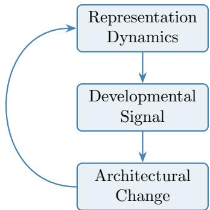  
Figure 1: Feedback between representation dynamics and architectural adaptation in FlowGenesis.

This mechanism motivates investigating whether Flux-guided neuron selection influences architectural development and predictive performance relative to alternative selection strategies. A second question concerns the emergence of reproducible, task-dependent architectural regimes despite diferences in initial network capacity. We investigate whether FlowGenesis exhibits such attractor-like behavior across image and text classification tasks.

Continual learning provides a complementary setting for investigating adaptive capacity allocation across sequential tasks. We extend FlowGenesis to a progressive task-incremental architecture, where previously learned modules remain frozen and new task-

specific modules adapt their capacity through neuron birth and pruning.

To be precise, we investigate three research questions:

1. How does Flux-guided neuron selection afect architectural development and predictive performance compared with alternative allocation strategies?

2. Do diferent initial architectures approach reproducible, task-dependent neuron-count regimes?

3. Can adaptive capacity allocation reduce network growth while maintaining predictive performance in task-incremental continual learning?

## 2 Related Work

FlowGenesis lies at the intersection of neural architecture search, constructive neural networks, developmental and self-organizing architectures, and representation dynamics. We review these directions with particular attention to the signals governing structural adaptation.

## 2.1 Neural Architecture Search and Adaptive Architectures

Neural architecture search (NAS) optimizes network structure over a predefined search space, using methods ranging from reinforcement learning and evolutionary optimization to diferentiable approaches such as DARTS (Elsken et al., 2019; Liu et al., 2019). AdaNet constructs networks adaptively while balancing predictive performance and model complexity (Cortes et al., 2017). Function-preserving approaches, including Net2Net and Network

Morphism, enable architectural expansion or transformation while preserving the function represented by the network (Chen et al., 2016; Wei et al., 2016).

## 2.2 Network Growth, Neurogenesis, and Pruning

Constructive neural networks adapt computational capacity during training. Splitting Steepest Descent (SSD) grows networks by splitting neurons according to a second-order functional descent criterion (Wu et al., 2019). Firefly Neural Architecture Descent extends this perspective to progressive architectural growth (Wu et al., 2020). GradMax introduces neurons using gradient information, selecting initializations that facilitate subsequent optimization (Evci et al., 2022). NeST combines growth and pruning within a unified synthesis procedure (Dai et al., 2019), while dynamic sparse training methods such as RigL modify network connectivity during optimization under a largely fixed parameter budget (Evci et al., 2020).

Particularly relevant is the framework of Maile et al. (2022), which formulates artificial neurogenesis in terms of when, where, and how neurons should be added. Their NORTH\* methods use activation or weight orthogonality to guide capacity expansion, demonstrating that internal geometric statistics can inform structural adaptation.

Together, these methods establish several criteria for allocating capacity, including loss geometry, gradients, activation geometry, and parameter structure. They also distinguish the decision to introduce capacity from the mechanism by which new computational units are initialized and integrated into an existing network.

## 2.3 Developmental and Self-Organizing Neural Networks

Developmental approaches allow network structure to emerge through local learning and adaptation. Self-Building Neural Networks combine Hebbian learning with pruning to adapt structure during training (Ferigo and Iacca, 2023). Neural Developmental Programs (NDPs) generate architectures through learned local developmental rules (Najarro et al., 2023), while Lifelong NDPs extend this approach to structural and synaptic plasticity in non-stationary environments (Plantec et al., 2024).

Particularly relevant are Self-Motivated Growing Neural Networks (SMGrNN), which use neuronal activity and temporally accumulated weight-update statistics to trigger neuron insertion and pruning (Jia and Zhou, 2026). This demonstrates that online structural adaptation can be governed by internal signals accumulated over training, without conventional architecture search.

In contrast to SMGrNN, which relies on accumulated weight-update statistics, Flow-Genesis uses temporal diferences in neuronal activation statistics to guide neuron birth and pruning. Unlike developmental approaches based on learned local rules, FlowGenesis employs explicit, predefined criteria based on Representation Flux and neuronal activity.

## 2.4 Structural Plasticity and Continual Learning

Structural adaptation provides a mechanism for accommodating sequentially changing learning problems. Dynamically Expandable Networks allocate additional capacity as new tasks arrive, selectively retraining and expanding the existing network (Yoon et al., 2018). More broadly, dynamic expansion and parameter-isolation methods mitigate interference by allocating or protecting diferent subsets of parameters across tasks. Progressive Neural Networks preserve previously learned task-specific parameters while introducing new network columns for subsequent tasks (Rusu et al., 2016).

An alternative approach maintains plasticity through continuous feature renewal. Continual Backprop employs a generate-and-test mechanism that replaces low-utility features with newly initialized ones, preserving adaptability during prolonged learning (Dohare et al., 2021). Unlike task-dependent expansion, this mechanism does not require explicit task boundaries to initiate feature replacement.

FlowGenesis difers from these approaches in how capacity is allocated. Unlike tasklevel expansion methods, which introduce additional capacity according to task requirements, FlowGenesis regulates neuron birth and pruning within task-specific modules using Representation Flux and activity statistics. In the progressive continual-learning setting, previously learned modules remain frozen, while new modules adapt their capacity during training. Thus, FlowGenesis combines parameter isolation with representation-guided structural adaptation, rather than relying on fixed-width expansion or utility-based feature replacement.

## 2.5 Connection to Neuroscience

Biological neural systems exhibit structural plasticity through activity-dependent synaptic remodeling, developmental pruning, and neurogenesis in restricted adult neural populations (Holtmaat and Svoboda, 2009; Paolicelli et al., 2011; Ming and Song, 2011).

Adult neurogenesis provides an example of activity-dependent capacity addition. In the mammalian hippocampus, newly generated neurons integrate into existing circuits, while their survival and functional integration are influenced by neuronal activity and synaptic input (Ming and Song, 2011; Tashiro et al., 2006). This process illustrates how the addition and retention of new computational elements can depend on local circuit conditions.

Conversely, developmental synaptic pruning selectively eliminates connections during circuit maturation. Microglia contribute to this process, with experimental evidence showing that synaptic elimination depends partly on neuronal activity and complement signaling (Paolicelli et al., 2011; Schafer et al., 2012).

These biological processes provide conceptual inspiration for FlowGenesis: network structure is not fixed, but can be modified through activity-dependent addition and removal. However, biological neurogenesis generates new neurons from precursor cells, whereas Flow-Genesis splits existing artificial neurons. Likewise, biological synaptic pruning removes connections, while FlowGenesis can remove entire computational units. The analogy therefore concerns adaptive structural regulation rather than a shared biological mechanism.

## 2.6 Architectural Convergence and Emergent Organization

Self-organizing neural systems demonstrate how global organization can emerge from loca adaptation rules. Neural gas and growing neural gas algorithms organize prototype networks according to the distribution of observed data (Martinetz et al., 1993; Fritzke, 1995). More broadly, adaptive network models demonstrate how local connectivity rules can produce complex global organization (Gross and Blasius, 2008).

Unlike these approaches, FlowGenesis regulates neuron birth and pruning using temporal changes in activation statistics during gradient-based learning. It therefore investigates whether representation-guided structural adaptation can produce reproducible architectural configurations across diferent initializations.

## 2.7 Representation Dynamics and Representational Drift

Representational drift describes changes in learned representations over time, even when predictive performance remains stable. Pashakhanloo and Koulakov (2023) demonstrate SGD-induced difusion-like drift along a minimum-loss manifold in a two-layer linear network. Related work shows that networks can progressively lose the ability to learn changing prediction targets (Lyle et al., 2022).

More directly, Kazanskii (2026) associates elevated Representation Flux with catastrophic forgetting, including cases where increased Flux precedes performance degradation.

These findings motivate using representation dynamics to guide structural adaptation. Unlike representational drift, FlowGenesis Flux measures diferences in neuronal activation statistics across consecutive minibatches, capturing both optimization-induced changes and sampling variability. FlowGenesis investigates its utility as a local signal for neuron birth and pruning.

## 2.8 Homeostatic Structural Plasticity

Homeostatic plasticity regulates neuronal activity in response to sustained changes in network dynamics, helping maintain stable activity regimes during learning and development (Turrigiano and Nelson, 2004; Turrigiano, 2012).

Structural homeostasis extends this principle to network connectivity. Computational models show how activity-dependent formation and elimination of synaptic connections can reorganize network structure while regulating neuronal activity (Butz and van Ooyen, 2013; Butz et al., 2014).

FlowGenesis shares the principle of locally regulated structural adaptation but difers from homeostatic models: Representation Flux measures temporal diferences in activation statistics rather than deviations from an activity set point. Whether Flux-guided neuron birth and pruning produce stable architectural regimes is therefore an empirical question rather than an assumed homeostatic mechanism.

## 3 Emergent Architectural Development

We study architectural development in a minimal neural system consisting of a sparse recurrent population. Unlike highly structured architectures such as convolutional networks or Transformers, this setting allows direct control over architectural properties and observation of individual neuron development. Our objective is not to maximize predictive performance, but to investigate whether local representational dynamics can guide the self-organization of network capacity during learning.

## 3.1 Random Neural Container

The Random Neural Container is based on a sparsely connected recurrent neural network with leaky-integrator dynamics. Its recurrent connectivity is randomly initialized, while the network weights are optimized through gradient-based training. Unlike classical reservoir computing (Jaeger, 2001; Maass et al., 2002), the recurrent weights are trainable, and FlowGenesis additionally modifies the network topology through neuron birth and pruning.

Given a fixed input projection $u = W _ { \mathrm { i n } } x$ and initial state $h ^ { ( 0 ) } = 0$ , the network performs $S$ recurrent relaxation steps:

$$
h ^ { ( s + 1 ) } = ( 1 - \gamma ) h ^ { ( s ) } + \gamma \mathrm { R e L U } \left( u + W _ { \mathrm { e f f } } h ^ { ( s ) } + b \right) ,\tag{1}
$$

where $\gamma = 0 . 2$ is the relaxation coeficient and recurrent parameters are shared across steps. The final state is mapped to classification logits:

$$
f ( x ) = W _ { \mathrm { o u t } } h ^ { ( S ) } + b _ { \mathrm { o u t } } .\tag{2}
$$

Recurrent connectivity is represented by a binary mask $M \in \{ 0 , 1 \} ^ { N \times N }$ , initially sampled independently with probability $\operatorname* { P r } ( M _ { i j } = 1 ) = \beta$ . Each recurrent weight is normalized by the number of incoming connections to its target neuron:

$$
( W _ { \mathrm { e f f } } ) _ { i j } = \frac { W _ { i j } M _ { i j } } { \operatorname* { m a x } ( 1 , \sum _ { k } M _ { i k } ) } .\tag{3}
$$

The connectivity mask subsequently evolves through structural adaptation.

The initial architecture is characterized by neuron count $N _ { 0 }$ and connectivity probability $\beta ,$ controlling population size and recurrent sparsity, respectively.

## 3.2 Representation Flux

Structural adaptation is guided by temporal changes in neuronal activation. For each training batch $B _ { b }$ , we compute the mean activation of neuron i:

$$
\bar { h } _ { i , b } = \frac { 1 } { | B _ { b } | } \sum _ { x \in B _ { b } } h _ { i } ^ { ( S ) } ( x ) .\tag{4}
$$

The instantaneous Representation Flux is defined as the absolute diference between consecutive batch means:

$$
\Phi _ { i , b } = \left| \bar { h } _ { i , b } - \bar { h } _ { i , b - 1 } \right| .\tag{5}
$$

Flux measures diferences in mean neuronal activation between consecutive minibatches. Because these minibatches contain diferent examples, the signal reflects both changes in model representations and sampling variability, without isolating optimization-induced representational drift. We therefore use Flux as an empirical signal for structural adaptation rather than a direct measure of representational drift.

To suppress transient fluctuations, we maintain an exponential moving average:

$$
\widehat { \Phi } _ { i , b } = \lambda _ { \Phi } \widehat { \Phi } _ { i , b - 1 } + ( 1 - \lambda _ { \Phi } ) \Phi _ { i , b } ,\tag{6}
$$

with $\lambda _ { \Phi } = 0 . 9$ . Epoch-level Flux statistics are used to determine persistent eligibility for structural adaptation.

Low Flux alone does not imply redundancy, since stable representations may remain functionally important. We therefore additionally measure neuronal activity:

$$
A _ { i , b } = \frac { 1 } { | B _ { b } | } \sum _ { x \in B _ { b } } | h _ { i } ^ { ( S ) } ( x ) | ,\tag{7}
$$

with exponential smoothing

$$
\widehat { A } _ { i , b } = \lambda _ { A } \widehat { A } _ { i , b - 1 } + ( 1 - \lambda _ { A } ) A _ { i , b } ,\tag{8}
$$

where $\lambda _ { A } = 0 . 9$ . Neurons exhibiting persistently low Flux and activity become candidates for pruning.

## 3.3 Flux-Driven Birth and Death

Neuron birth. Structural adaptation is evaluated periodically after a prescribed number of processed training examples. Flux and activity statistics are updated during training, whereas structural changes are evaluated periodically to reduce sensitivity to transient fluctuations and avoid excessively frequent architectural modifications. At each structural check, neurons whose mean Representation Flux over the preceding evaluation interva exceeds $\theta _ { \mathrm { b i r t h } }$ accumulate a persistence counter, measured in processed examples. Once the required persistence threshold is reached, eligible neurons are ranked by exponentially smoothed Flux, and those with the highest values are selected for splitting.

Splitting creates a child neuron whose input and incoming recurrent weights are copied from the parent with small Gaussian perturbations. The parent’s outgoing recurrent weights and output-layer contribution are divided equally between parent and child. Two directed recurrent connections are also introduced between them. Inspired by function-preserving network expansion (Chen et al., 2016; Wu et al., 2019), this operation aims to limit the immediate functional perturbation while introducing additional trainable capacity.

Neuron death. Pruning targets neurons exhibiting persistently low activity and Flux. At each structural check, candidates must fall within the lower population quantiles of both statistics, with Flux additionally constrained by an absolute upper threshold. Qualifying neurons accumulate a persistence counter, which resets whenever either criterion is violated.

Once the required persistence threshold is reached, eligible neurons are ranked by exponentially smoothed activity, and the least active are removed first. Combining activity and Flux reduces the risk of pruning strongly active neurons whose representations have stabilized.

Population dynamics. Pruning precedes neurogenesis, subject to minimum and maximum population constraints and per-check event limits. The population evolves according to

$$
N _ { k + 1 } = N _ { k } + B _ { k } - D _ { k } ,\tag{9}
$$

where $k$ indexes structural checks and $B _ { k } , D _ { k }$ denote the numbers of neurons created and removed, respectively. No target population size is prescribed.

## 3.4 Developmental Control Parameters

We distinguish architectural initial conditions $( N _ { 0 } , \beta )$ from developmental controls governing when and how rapidly structural adaptation occurs.

The birth threshold $\theta _ { \mathrm { b i r t h } }$ determines the minimum mean Representation Flux required for a neuron to accumulate birth eligibility. Pruning instead requires simultaneous membership in the lower tails of the population’s activity and Flux distributions, defined by fractions $q _ { A }$ and $q \Phi$ , together with an absolute Flux bound $\theta _ { \mathrm { d e a t h } }$ . Birth and death persistence requirements, $p _ { \mathrm { b i r t h } }$ and $p _ { \mathrm { d e a t h } }$ , specify the cumulative number of processed examples across consecutive qualifying structural checks. Eligibility counters reset when their respective conditions are no longer satisfied.

Structural decisions are evaluated after intervals of $T _ { \mathrm { c h e c k } }$ processed examples. An initial warm-up period $T _ { \mathrm { w a r m } }$ disables structural modifications while allowing ordinary parameter optimization and accumulation of neuronal statistics. Following a structural change, a cooldown $T _ { \mathrm { c o o l } }$ prevents further modifications until the prescribed number of examples has been processed.

The structural update rate r specifies the nominal number of births and deaths permitted at each structural check. For fractional rates, the integer allowance $r _ { k }$ alternates between the adjacent integers to achieve the prescribed average rate. For example, $r = 2 . 5$ corresponds to alternating allowances of two and three events. The numbers of births and deaths at check k therefore satisfy

$$
B _ { k } \leq r _ { k } , \qquad D _ { k } \leq r _ { k } .\tag{10}
$$

The rate constrains the speed of architectural development without determining which neurons are selected.

Structural changes are additionally subject to minimum and maximum population sizes, $N _ { \mathrm { m i n } }$ and $N _ { \mathrm { m a x } }$ , which prevent unbounded growth or complete collapse without prescribing a target architecture. Most developmental parameters regulate the timing, stability, or permissible extent of structural adaptation rather than directly selecting neurons for modification. The primary developmental controls are the birth and pruning eligibility criteria and the structural update rate r. Although temporal safeguards and population bounds can influence the resulting architecture, none explicitly prescribes a target population size or architectural equilibrium. Architectural development instead results from the interaction between learned activation statistics and local birth and pruning decisions.

## 3.5 Datasets and Evaluation Protocols

Networks are trained across diferent initial sizes $N _ { 0 }$ and random seeds. We track predic tive performance, Representation Flux, neuronal activity, and structural dynamics, including neuron births and deaths. We investigate whether networks initialized with diferent capacities converge toward a common late-training regime,

$$
N ( T ; N _ { 0 } ^ { ( 1 ) } , \beta , D ) \approx N ( T ; N _ { 0 } ^ { ( 2 ) } , \beta , D ) ,\tag{11}
$$

where $\beta$ denotes initial connectivity and D the task.

We use the term attractor-like architectural behavior to describe reduced dependence of late-training neuron counts on initial network size. In addition to the empirical study, our theoretical analysis provides suficient conditions for local population stability (Appendix D.2) and initial-condition forgetting under contractive population dynamics (Appendix D.3).

Reported quantities. We evaluate architectural development at three levels: developmental dynamics, architectural properties, and cross-run architectural similarity.

Developmental dynamics. We track training and test accuracy, active neuron count N(t), Representation Flux, and neuronal activity throughout training. Initial, best-performing, and final neuron counts are recorded to characterize architectural development and population stabilization across initializations and random seeds.

Architectural properties. Final architectures are characterized by neuron count, recurrent connectivity density, and the spectral radius of the masked, unnormalized recurrent weight matrix (Jaeger, 2001; Verstraeten et al., 2007). Metrics are summarized across seeds using the mean and standard deviation.

Cross-run architectural similarity. We compare independently developed networks using linear Centered Kernel Alignment (CKA) for representational similarity (Kornblith et al., 2019), Hungarian-aligned neuron parameter-profile cosine similarity (Kuhn, 1955), and prediction agreement for functional similarity. Comparisons include runs with identical and diferent initial network sizes. Detailed metric definitions and statistical procedures are provided in Appendix A.

Datasets and evaluation. We investigate architectural development primarily on Fashion-MNIST (Xiao et al., 2017), with MNIST (LeCun et al., 1998) as an additional benchmark. For standalone image-classification experiments, images are flattened and supplied directly to the neural container without pretrained features or convolutional layers. We evaluate generalization across image and text modalities using CIFAR-10 (Krizhevsky, 2009) and AG News (Zhang et al., 2015). Finally, Split CIFAR-100 (Krizhevsky, 2009) is used to assess adaptive capacity allocation in task-incremental continual learning.

Training and model selection. Networks are trained using cross-entropy loss and Adam. Structural updates are triggered after fixed intervals of processed training examples. At each update, Flux and activity statistics are aggregated, pruning is performed before neurogenesis, and the Adam optimizer is reinitialized whenever the network parameterization changes. Classification accuracy is evaluated after each training epoch.

We distinguish the best-performing checkpoint from the final training epoch. Bestcheckpoint accuracy is reported descriptively because retrospective selection using test accuracy introduces optimistic bias. Final-epoch architectures are used to characterize the outcome of the complete developmental trajectory. Training continues beyond peak predictive performance to examine late-training architectural stabilization. Network size and cumulative birth and death events are recorded alongside predictive performance.

Generality We investigate whether the developmental dynamics of FlowGenesis depend on the initial number of hidden neurons, $N _ { 0 }$ , and whether the observed architectural selforganization generalizes across datasets and modalities. We consider Fashion-MNIST with $N _ { 0 } \in \{ 2 0 , 4 0 , 8 0 , 1 6 0 \}$ , CIFAR-10 with $N _ { 0 } \in \{ 5 0 , 1 0 0 , 2 0 0 , 4 0 0 \}$ , and AG News with $N _ { 0 } \in$ {20, 40, 80, 160}.

Each configuration is evaluated across five random seeds, $\{ 0 , 1 , 2 , 3 , 4 \}$ . These experiments span an eightfold range of initial network sizes on each dataset. We track network size and test accuracy throughout training, quantify final structural properties, and compare the resulting networks using weight similarity, representational similarity, and prediction agreement.

Ablation protocol. We investigate the sensitivity of architectural development to initial network size, recurrent connectivity, structural rate, warm-up duration, and birth and death criteria on Fashion-MNIST. We additionally compare full bidirectional adaptation against birth-only, death-only, and static architectures. Generalization is examined on CIFAR-10 and AG News, while continual learning is evaluated separately on Split CIFAR-100. Detailed parameter grids and experimental configurations are provided in Appendix B.

Continual learning. We evaluate FlowGenesis in a progressive task-incremental continuallearning setting using Split CIFAR-100. Each task introduces a new set of classes, with previously learned modules frozen and a new module initialized for the incoming task. FlowGenesis regulates neuron birth and pruning within each new module during training, while preserving parameters learned for earlier tasks.

We compare adaptive growth against fixed-capacity progressive expansion, evaluating classification accuracy, cumulative parameter count, and neuron allocation across the task sequence.

## 4 Results

## 4.1 Robustness to Initial Network Size

We investigate the dependence of architectural development on initial network size across Fashion-MNIST, CIFAR-10, and AG News. The experiments cover an eightfold range of initial network sizes on each dataset.

Convergence of network size across datasets. Figure 2 shows that substantially diferent initial network sizes produce distinct developmental trajectories, but these trajectories approach relatively narrow ranges of final neuron counts.

On Fashion-MNIST, small networks undergo pronounced transient expansion, whereas larger initializations contract. Nevertheless, the final mean network sizes are $6 1 . 6 \pm 1 0 . 1$ ， $5 3 . 0 \pm 5 . 0 , 5 5 . 4 \pm 5 . 4$ , and $5 1 . 4 \pm 4 . 2$ for $N _ { 0 } = 2 0 , 4 0 , 8 0 , 1 6 0$ , respectively. Despite the eightfold variation in initialization, all four groups terminate with approximately 50–62 neurons.

CIFAR-10 exhibits a similar phenomenon despite substantially diferent transient dynamics. The mean neuron counts at the best-performing checkpoints increase from $9 6 . 0 \pm$ 38.5 at $N _ { 0 } = 5 0$ to $1 8 1 . 6 \pm 1 2 3 . 4$ at $N _ { 0 } = 4 0 0$ , indicating considerable variability in the architectures encountered during training. However, the final populations reach mean sizes of $6 0 . 2 \pm 2 . 3 , 6 0 . 6 \pm 7 . 8 , 6 2 . 6 \pm 4 . 8$ , and $6 4 . 0 \pm 6 . 8$ neurons, respectively. Thus, substantially diferent developmental histories can lead to similar final network sizes.

On AG News, initial populations spanning an eightfold range approach similar final mean neuron counts of $6 0 . 2 \pm 3 . 8 , 6 3 . 8 \pm 7 . 4 , 5 7 . 0 \pm 2 . 8 ,$ , and $5 8 . 4 \pm 2 . 7$ for $N _ { 0 } = 2 0 , 4 0 , 8 0 , 1 6 0$

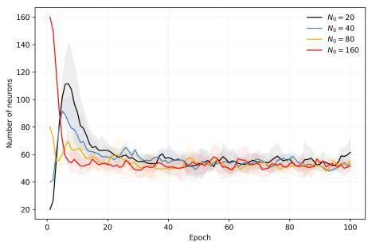  
(a) Fashion-MNIST: neurons

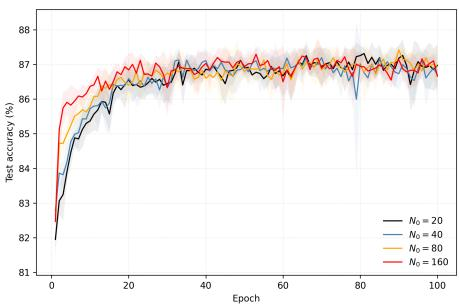  
(b) Fashion-MNIST: accuracy

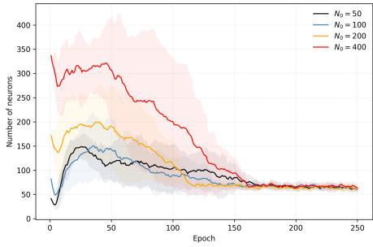  
(c) CIFAR-10: neurons

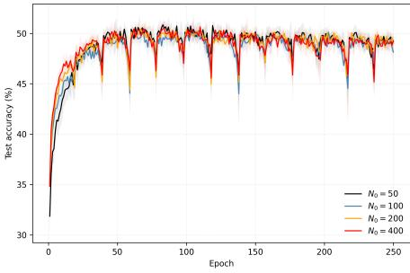  
(d) CIFAR-10: accuracy

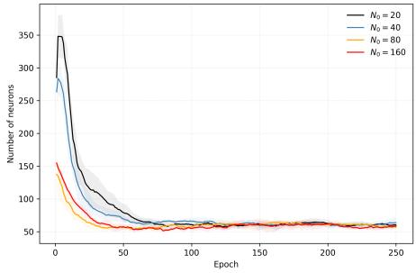  
(e) AG News: neurons

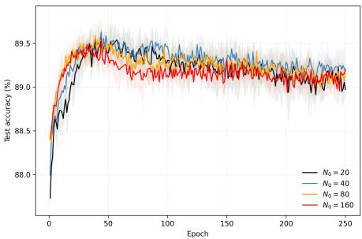  
(f) AG News: accuracy

Figure 2: Efect of initial network size $N _ { 0 }$ on FlowGenesis architectural development and predictive performance across Fashion-MNIST, CIFAR-10, and AG News. Curves show means across five random seeds; shaded regions indicate ± one standard deviation. Fashion-MNIST uses $N _ { 0 } \in \{ 2 0 , 4 0 , 8 0 , 1 6 0 \}$ , CIFAR-10 uses $N _ { 0 } \in \{ 5 0 , 1 0 0 , 2 0 0 , 4 0 0 \}$ , and AG News uses $N _ { 0 } \in \{ 2 0 , 4 0 , 8 0 , 1 6 0 \}$ . Left panels $^ { ( \mathrm { a } , \mathrm { c } , \mathrm { e } ) }$ show hidden-neuron populations; right panels $\mathrm { ( b , d , f ) }$ show test accuracy. Across datasets, final neuron counts approach similar ranges despite diferences in initial network size.

Table 1: Architectural development and final topology of FlowGenesis across Fashion-MNIST, CIFAR-10, and AG News for diferent initial network sizes $N _ { 0 }$ $N _ { \mathrm { b e s t } }$ and $N _ { f }$ denote neuron counts at the best-performing checkpoint and at the end of training, respectively. Births and deaths are cumulative structural events, $E _ { f }$ is the final number of recurrent connections, and density is the fraction of active recurrent connections. Values are mean $\pm$ standard deviation across five seeds.
<table><tr><td>Dataset</td><td> $N _ { 0 }$ </td><td> $N _ { \mathrm { b e s t } }$ </td><td> $N _ { f }$ </td><td>Births</td><td>Deaths</td><td> $E _ { f }$ </td><td>Density</td></tr><tr><td colspan="7">Fashion-MNIST</td></tr><tr><td></td><td>20</td><td> $5 2 . 8 \pm 3 . 0$ </td><td> $6 1 . 6 \pm 1 0 . 1$ </td><td> $5 1 2 . 4 \pm 5 3 . 1$ </td><td> $4 7 0 . 8 \pm 4 8 . 4$ </td><td> $1 4 4 9 . 4 \pm 4 2 4 . 3$ </td><td> $0 . 3 7 9 \pm 0 . 0 3 9$ </td></tr><tr><td></td><td>40</td><td> $5 6 . 4 \pm 4 . 2$ </td><td> $5 3 . 0 \pm 5 . 0$ </td><td> $4 3 3 . 2 \pm 2 2 . 6$ </td><td> $4 2 0 . 2 \pm 2 0 . 4$ </td><td> $8 3 7 . 2 \pm 1 7 0 . 8$ </td><td> $0 . 2 9 8 \pm 0 . 0 4 2$ </td></tr><tr><td></td><td>80</td><td> $5 0 . 6 \pm 3 . 5$ </td><td> $5 5 . 4 \pm 5 . 4$ </td><td> $3 6 5 . 0 \pm 4 3 . 6$ </td><td> $3 8 9 . 6 \pm 4 5 . 4$ </td><td> $8 8 7 . 0 \pm 1 7 5 . 7$ </td><td> $0 . 2 8 7 \pm 0 . 0 2 4$ </td></tr><tr><td></td><td>160</td><td> $5 1 . 8 \pm 6 . 6$ </td><td> $5 1 . 4 \pm 4 . 2$ </td><td> $2 9 5 . 8 \pm 2 9 . 3$ </td><td> $4 0 4 . 4 \pm 3 1 . 4$ </td><td> $6 3 1 . 2 \pm { 1 6 8 . 5 }$ </td><td> $0 . 2 3 5 \pm 0 . 0 3 1$ </td></tr><tr><td colspan="8">CIFAR-10</td></tr><tr><td></td><td>50</td><td> $9 6 . 0 \pm 3 8 . 5$ </td><td> $6 0 . 2 \pm 2 . 3$ </td><td> $1 2 1 4 . 4 \pm 3 5 3 . 5$ </td><td> $1 2 0 4 . 2 \pm 3 5 1 . 5$ </td><td> $1 1 2 9 . 4 \pm 2 2 6 . 7$ </td><td> $0 . 3 1 1 \pm 0 . 0 5 9$ </td></tr><tr><td></td><td>100</td><td> $1 0 3 . 4 \pm 3 0 . 3$ </td><td> $6 0 . 6 \pm 7 . 8$ </td><td> $1 2 0 5 . 0 \pm 2 6 7 . 7$ </td><td> $1 2 4 4 . 4 \pm 2 6 1 . 2$ </td><td> $8 8 7 . 8 \pm 2 3 2 . 4$ </td><td> $0 . 2 4 1 \pm 0 . 0 3 7$ </td></tr><tr><td></td><td>200</td><td> $1 3 4 . 4 \pm 7 9 . 7$ </td><td> $6 2 . 6 \pm 4 . 8$ </td><td> $1 1 7 0 . 2 \pm 3 9 9 . 0$ </td><td> $1 3 0 7 . 6 \pm 3 9 5 . 0$ </td><td> $1 0 7 3 . 6 \pm 1 7 1 . 0$ </td><td> $0 . 2 7 3 \pm 0 . 0 2 4$ </td></tr><tr><td></td><td>400</td><td> $1 8 1 . 6 \pm 1 2 3 . 4$ </td><td> $6 4 . 0 \pm 6 . 8$ </td><td> $1 1 9 5 . 0 \pm 2 9 6 . 0$ </td><td> $1 5 3 1 . 0 \pm 2 9 2 . 1$ </td><td> $9 1 6 . 2 \pm 2 4 2 . 0$ </td><td> $0 . 2 2 2 \pm 0 . 0 3 2$ </td></tr><tr><td colspan="8">AG News</td></tr><tr><td></td><td>20</td><td> $7 7 . 2 \pm 2 5 . 1$ </td><td> $6 0 . 2 \pm { 3 . 8 }$ </td><td> $4 5 1 . 2 \pm 6 5 . 0$ </td><td> $4 1 1 . 0 \pm 6 3 . 7$ </td><td> $9 4 3 . 8 \pm 2 2 7 . 0$ </td><td> $0 . 2 6 1 \pm 0 . 0 5 9$ </td></tr><tr><td></td><td>40</td><td> $6 7 . 4 \pm 7 . 4$ </td><td> $6 3 . 8 \pm 7 . 4$ </td><td> $3 9 5 . 2 \pm 2 6 . 5$ </td><td> $3 7 1 . 4 \pm 2 5 . 8$ </td><td> $9 4 5 . 2 \pm 2 3 3 . 8$ </td><td> $0 . 2 3 4 \pm 0 . 0 5 7$ </td></tr><tr><td></td><td>80</td><td> $5 9 . 4 \pm 5 . 3$ </td><td> $5 7 . 0 \pm 2 . 8$ </td><td> $2 1 1 . 4 \pm 4 8 . 0$ </td><td> $2 3 4 . 4 \pm 4 5 . 8$ </td><td> $6 9 5 . 8 \pm 9 8 . 6$ </td><td> $0 . 2 1 4 \pm 0 . 0 2 1$ </td></tr><tr><td></td><td>160</td><td> $6 2 . 6 \pm 5 . 5$ </td><td> $5 8 . 4 \pm 2 . 7$ </td><td> $1 6 4 . 6 \pm 4 0 . 4$ </td><td> $2 6 6 . 2 \pm 3 9 . 0$ </td><td> $8 2 3 . 8 \pm 1 1 3 . 8$ </td><td> $0 . 2 4 1 \pm 0 . 0 1 7$ </td></tr></table>

respectively. Thus, the final mean populations remain between 57.0 and 63.8 neurons despite substantial diferences in initialization.

Taken together, these results reveal a recurring macroscopic pattern across all three datasets: although the initial populations difer substantially, the developmental process produces final networks occupying comparatively narrow ranges of neuron counts. In these experiments, the ranges overlap around approximately 50–65 neurons. This numerical similarity should not be interpreted as a universal preferred network size, since the equilibrium population may depend on task dificulty, model configuration, structural update rules, and training duration. The more general observation is the relative insensitivity of final population size to initialization within each experimental setting.

Predictive performance and initialization robustness. The emergence of similar final network sizes is accompanied by relatively stable test accuracy across diferent initializations. On Fashion-MNIST, mean best-checkpoint test accuracy ranges from 87.60% to 87.66%, while mean final-epoch test accuracy ranges from 86.66% to 86.97%. Networks with smaller initial populations exhibit slower early learning in some configurations but eventually achieve test accuracy comparable to that of larger initializations. On CIFAR-10, mean best-checkpoint test accuracy ranges from 51.13% to 51.59%, while mean final-epoch test accuracy ranges from 48.13% to 49.29%. These relatively narrow ranges are observed despite substantial diferences in developmental trajectories. A similar pattern emerges on AG News, where mean best-checkpoint test accuracy ranges from 89.65% to 89.82% across four initializations spanning an eightfold diference in initial network size.

Table 2: Predictive performance, recurrent dynamics, and cross-initialization similarity of FlowGenesis across Fashion-MNIST, CIFAR-10, and AG News. Best-checkpoint and finalepoch test accuracies are reported in percent. The spectral radius $\rho$ is computed from the masked, unnormalized recurrent weight matrix rather than the degree-normalized operator used during network evaluation. Weight similarity is computed after Hungarian alignment; CKA measures representational similarity, and agreement measures prediction consistency across diferent initial network sizes. Values are mean ± standard deviation across five seeds.
<table><tr><td>Dataset</td><td> $N _ { 0 }$ </td><td>Best acc. (%) Final acc. (%)</td><td></td><td>Cross-N0 weight sim. Cross-N0 CKA Agreement (%)</td><td></td><td></td></tr><tr><td colspan="7">Fashion-MNIST</td></tr><tr><td>20</td><td> $8 7 . 6 0 \pm 0 . 3 8$ </td><td> $8 6 . 9 7 \pm 0 . 6 1$ </td><td> $0 . 5 2 6 \pm 0 . 1 0 1$ </td><td> $0 . 4 3 3 \pm 0 . 0 0 5$ </td><td> $0 . 8 8 4 \pm 0 . 0 1 5$ </td><td> $9 0 . 9 \pm 0 . 4$ </td></tr><tr><td>40</td><td> $8 7 . 6 6 \pm 0 . 2 0$ </td><td> $8 6 . 6 9 \pm 0 . 6 8$ </td><td> $0 . 6 4 8 \pm 0 . 1 7 3$ </td><td> $0 . 4 4 0 \pm 0 . 0 1 1$ </td><td> $0 . 8 9 3 \pm 0 . 0 1 1$ </td><td> $9 0 . 8 \pm 0 . 9$ </td></tr><tr><td>80</td><td> $8 7 . 6 0 \pm 0 . 2 9$ </td><td> $8 6 . 9 4 \pm 0 . 5 7$ </td><td> $0 . 5 9 2 \pm 0 . 1 5 1$ </td><td> $0 . 4 3 4 \pm 0 . 0 1 8$ </td><td> $0 . 8 8 9 \pm 0 . 0 0 5$ </td><td> $9 1 . 0 \pm 0 . 8$ </td></tr><tr><td></td><td>160  $8 7 . 6 4 \pm 0 . 1 4$ </td><td> $8 6 . 6 6 \pm 0 . 2 9$ </td><td> $0 . 6 9 9 \pm 0 . 1 4 9$ </td><td> $0 . 4 4 0 \pm 0 . 0 0 7$ </td><td> $0 . 8 8 3 \pm 0 . 0 2 9$ </td><td> $9 0 . 9 \pm 0 . 5$ </td></tr><tr><td colspan="7">CIFAR-10</td></tr><tr><td>50</td><td> $5 1 . 5 9 \pm 0 . 3 2$ </td><td> $4 9 . 1 6 \pm 0 . 5 7$ </td><td> $0 . 8 0 7 \pm 0 . 4 8 3$ </td><td> $0 . 4 1 5 \pm 0 . 0 1 4$ </td><td> $0 . 6 2 8 \pm 0 . 0 3 0$ </td><td> $5 6 . 1 \pm 1 . 4$ </td></tr><tr><td>100</td><td> $5 1 . 1 3 \pm 0 . 2 5$ </td><td> $4 8 . 1 3 \pm 1 . 4 9$ </td><td> $0 . 7 0 8 \pm 0 . 0 9 4$ </td><td> $0 . 4 1 9 \pm 0 . 0 1 9$ </td><td> $0 . 6 5 1 \pm 0 . 0 3 7$ </td><td> $5 5 . 0 \pm 3 . 6$ </td></tr><tr><td>200</td><td> $5 1 . 3 0 \pm 0 . 2 6$ </td><td> $4 9 . 0 3 \pm 0 . 3 1$ </td><td> $0 . 6 5 9 \pm 0 . 0 6 9$ </td><td> $0 . 4 1 2 \pm 0 . 0 0 8$ </td><td> $0 . 6 3 0 \pm 0 . 0 3 9$ </td><td> $5 6 . 3 \pm 0 . 7$ </td></tr><tr><td>400</td><td> $5 1 . 5 6 \pm 0 . 3 5$ </td><td> $4 9 . 2 9 \pm 0 . 6 6$ </td><td> $0 . 6 9 4 \pm 0 . 1 4 0$ </td><td> $0 . 4 1 8 \pm 0 . 0 0 7$ </td><td> $0 . 6 5 1 \pm 0 . 0 2 3$ </td><td> $5 6 . 5 \pm 1 . 0$ </td></tr><tr><td colspan="7">AG News</td></tr><tr><td>20</td><td> $8 9 . 7 7 \pm 0 . 0 9$ </td><td> $8 8 . 9 7 \pm 0 . 0 9$ </td><td> $5 . 8 8 1 \pm 1 . 2 1 9$ </td><td> $0 . 6 6 0 \pm 0 . 0 1 2$ </td><td> $0 . 8 2 7 \pm 0 . 0 0 7$ </td><td></td></tr><tr><td>40</td><td> $8 9 . 8 0 \pm 0 . 0 5$ </td><td> $8 9 . 1 9 \pm 0 . 1 6$ </td><td> $4 . 1 2 9 \pm 0 . 8 2 7$ </td><td> $0 . 6 6 6 \pm 0 . 0 1 1$ </td><td> $0 . 8 1 9 \pm 0 . 0 1 3$ </td><td> $8 4 . 4 \pm 0 . 7$   $8 4 . 4 \pm 0 . 3$ </td></tr><tr><td>80</td><td> $8 9 . 8 2 \pm 0 . 1 0$ </td><td> $8 9 . 1 6 \pm 0 . 1 2$ </td><td> $3 . 7 9 0 \pm 0 . 3 1 6$ </td><td> $0 . 6 6 3 \pm 0 . 0 0 8$ </td><td> $0 . 8 1 7 \pm 0 . 0 1 5$ </td><td> $8 4 . 8 \pm 0 . 4$ </td></tr><tr><td>160</td><td> $8 9 . 6 5 \pm 0 . 0 8$ </td><td> $8 9 . 2 0 \pm 0 . 1 8$ </td><td> $3 . 9 7 7 \pm 1 . 1 0 6$ </td><td> $0 . 6 6 1 \pm 0 . 0 1 3$ </td><td> $0 . 8 2 3 \pm 0 . 0 1 0$ </td><td> $8 4 . 7 \pm 0 . 6$ </td></tr></table>

Structural remodeling and residual diferences. Convergence in neuron count does not imply convergence to an identical network topology. Across all three datasets, Flow-Genesis exhibits extensive structural remodeling through neuron births and deaths, with developmental trajectories depending on initialization. On Fashion-MNIST, mean final recurrent connectivity density decreases from $0 . 3 7 9 \pm 0 . 0 3 9$ at $N _ { 0 } = 2 0$ to $0 . 2 3 5 \pm 0 . 0 3 1$ at $N _ { 0 } = 1 6 0$ , indicating that similar final neuron counts can coexist with substantially different connectivity densities. On CIFAR-10, mean final recurrent edge counts range from approximately 888 to 1129, while mean connectivity densities range from 0.222 to 0.311. Thus, networks approaching similar final neuron counts retain diferences in recurrent connectivity. AG News exhibits substantial remodeling despite relatively stable final network sizes. As $N _ { 0 }$ increases from 20 to 160, cumulative neuron births decrease from $4 5 1 . 2 \pm 6 5 . 0$ to $1 6 4 . 6 \pm 4 0 . 4$ , while cumulative deaths decrease from $4 1 1 . 0 \pm 6 3 . 7$ to $2 6 6 . 2 \pm 3 9 . 0$ . Across these initializations, mean final recurrent edge counts range from approximately 696 to 945, and connectivity densities range from 0.214 to 0.261. Together, these results distinguish convergence in macroscopic network size from convergence in detailed connectivity. Initial conditions influence structural remodeling and aspects of the final topology even when final neuron counts and predictive performance are similar. The observed behavior is therefore consistent with the emergence of a family of related architectural states rather than a unique final graph.

Within- and cross-initialization functional similarity. To assess whether independently developed architectures share functional properties, we compare models trained with diferent random seeds at the same initial network size $( w i t h i n  – N _ { 0 } )$ and across diferent initial sizes $\left( c r o s s  – N _ { 0 } \right)$ . We measure Hungarian-aligned recurrent weight similarity, representational similarity using centered kernel alignment (CKA), and prediction agreement. Pairwise similarities are aggregated at the model level before computing group statistics. On Fashion-MNIST, within-N CKA ranges from 0.870 to 0.906, compared with 0.883– 0.893 across initializations. Prediction agreement is 90.3–91.5% within initializations and 90.8–91.0% across them, while weight similarity ranges from 0.410–0.453 and 0.433–0.440, respectively. These overlapping ranges suggest that variation in initial network size does not introduce markedly greater representational or predictive diferences than variation in random seed alone. On CIFAR-10, cross-initialization CKA ranges from 0.628 to 0.651, prediction agreement from 55.0% to 56.5%, and weight similarity from 0.412 to 0.419. Although absolute similarity is lower than on Fashion-MNIST, the metrics vary relatively little across initializations. The lower prediction agreement should also be interpreted in light of the lower classification accuracy. On AG News, cross-initialization CKA ranges from 0.817 to 0.827, with prediction agreement between 84.4% and 84.8%, extending the observed pattern to text classification. Overall, these results indicate that similar final network sizes are accompanied by relatively consistent representational similarity and prediction agreement across initializations. This supports descriptive functional robustness without implying identical network topologies, representations, or decision boundaries.

Generalization of architectural self-organization. Across Fashion-MNIST, CIFAR-10, and AG News, FlowGenesis exhibits convergence toward relatively narrow final neuroncount ranges despite substantial diferences in initial network size and developmental trajectories. This convergence is primarily macroscopic: final architectures retain diferences in connectivity. Nevertheless, predictive performance and cross-initialization representational similarity remain comparatively stable. These findings suggest that FlowGenesis develops families of related architectural states rather than converging to a unique network structure. The observed behavior suggests attractor-like self-organization, as networks with diferent initial sizes approach similar final neuron counts. However, these results do not prove the existence of a dynamical attractor or establish that diferent initializations produce statistically equivalent outcomes. Additional visualizations reveal dataset-dependent patterns of neuronal response correlations, with more pronounced functional clusters on Fashion-MNIST and AG News and weaker clustering on CIFAR-10 (Appendix E).

## 4.2 Neuron Birth and Death Ablations

We examine the efects of disabling neuron birth or death on Fashion-MNIST, using initial populations $N _ { 0 } ~ \in ~ \{ 2 0 , 4 0 , 8 0 , 1 6 0 \}$ and five random seeds. All other settings follow Appendix B.

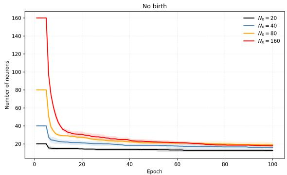  
(a) Birth disabled (pruning only).

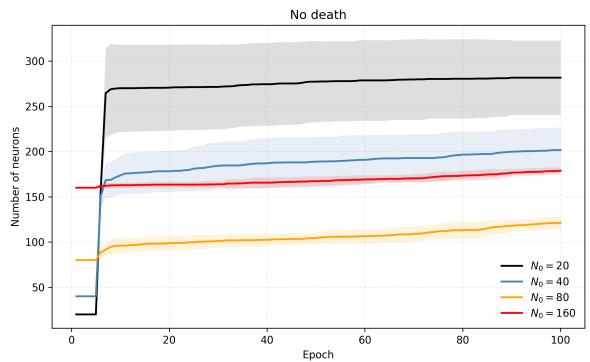  
(b) Pruning disabled (birth only).  
Figure 3: Neuron population dynamics under structural ablations on Fashion-MNIST for $N _ { 0 } \in \{ 2 0 , 4 0 , 8 0 , 1 6 0 \}$ . Disabling birth produces progressive contraction, whereas disabling pruning permits population growth without convergence to a common population size. Curves show mean ± one standard deviation across five random seeds.

Figure 3 shows that disabling birth produces rapid population contraction, with final sizes of approximately 13–19 neurons. In contrast, disabling death leads to population growth, with final sizes of approximately 121–282 neurons, depending on initialization. Unlike the birth-disabled regime, these populations remain substantially separated across initializations.

These results demonstrate complementary structural roles: birth counteracts excessive contraction, whereas death limits population expansion. Neither mechanism alone reproduces the population regulation observed when both are active.

## 4.3 Sensitivity to Neuron Birth and Pruning Selection

We investigate the sensitivity of FlowGenesis to neuron birth selection and pruning signals on Fashion-MNIST $( N _ { 0 } = 2 0 )$ . The experiments examine whether the neuron-specific information provided by Representation Flux and activity contributes to architectural adaptation. Birth and pruning mechanisms are varied separately, while the remaining components of FlowGenesis are kept unchanged.

Neuron birth selection. We compare three strategies: high-flux selection (original FlowGenesis), which prioritizes eligible neurons with the highest exponentially smoothed Representation Flux; reverse-flux selection, which prioritizes the lowest-Flux neurons among eligible candidates; and unrestricted random selection, which selects neurons randomly without enforcing Flux-based birth eligibility.

Neuron pruning selection. We compare four strategies: original FlowGenesis, which prioritizes eligible neurons with persistently low activity and Flux using exponentially smoothed activity; unrestricted random pruning, which removes activity- and Fluxbased eligibility constraints; shufled activity, which permutes activity values across neurons while preserving Flux; and shufled Flux, which permutes Flux values while preserving activity. In both shufled conditions, pruning eligibility and selection use the modified signals.

Table 3: Sensitivity to neuron birth and pruning selection on Fashion-MNIST $( N _ { 0 } = 2 0 )$ Mean ± standard deviation across five seeds. Birth-selection experiments retain the original pruning mechanism, while pruning-selection experiments retain the original birth mechanism.
<table><tr><td>Metric</td><td colspan="3">Birth selection</td><td colspan="4">Pruning selection</td></tr><tr><td></td><td> $\mathrm { H i g h \ f h u x }$ </td><td>Reverse flux</td><td>Random</td><td>Original</td><td></td><td>Random Shuffled activity Shuffled Flux</td><td></td></tr><tr><td>Best acc. (%)</td><td> $8 7 . 6 1 \pm 0 . 3 7$ </td><td> $8 7 . 3 9 \pm 0 . 2 3$ </td><td> $8 8 . 4 0 \pm 0 . 1 6$ </td><td> $8 7 . 6 0 \pm 0 . 3 8$ </td><td> $8 6 . 3 9 \pm 0 . 1 9$ </td><td> $8 7 . 4 9 \pm 0 . 1 1$ </td><td> $8 7 . 5 1 \pm 0 . 1 0$ </td></tr><tr><td>Final acc. (%)</td><td> $8 6 . 9 9 \pm 0 . 5 9$ </td><td> $8 6 . 6 0 \pm 0 . 1 7$ </td><td> $8 7 . 8 6 \pm 0 . 4 1$ </td><td> $8 6 . 9 7 \pm 0 . 6 1$ </td><td> $8 5 . 7 9 \pm 0 . 3 6$ </td><td> $8 6 . 9 2 \pm 0 . 2 5$ </td><td> $8 6 . 6 8 \pm 0 . 5 4$ </td></tr><tr><td>Final neurons</td><td> $5 7 . 2 \pm 1 1 . 3$ </td><td> $5 2 . 8 \pm 7 . 6$ </td><td> $1 4 0 . 8 \pm 8 . 5$ </td><td>61.60 ± 10.11</td><td> $8 5 . 2 0 \pm 7 . 8 5$ </td><td> $5 1 . 2 0 \pm 1 2 . 3 6$ </td><td> $5 5 . 0 0 \pm 4 . 3 6$ </td></tr></table>

All strategies are evaluated across five paired seeds with otherwise identical settings. Birth-selection experiments retain the original pruning mechanism, whereas pruning-selection experiments retain the original birth mechanism.

Table 3 shows that high-flux and reverse-flux selection yield similar final network sizes $( 5 7 . 2 { \pm } 1 1 . 3 $ and $5 2 . 8 { \pm } 7 . 6 $ neurons). Unrestricted random selection achieves the highest final accuracy $( 8 7 . 8 6 \pm 0 . 4 1 \% )$ but produces substantially larger networks $( 1 4 0 . 8 \pm 8 . 5 $ neurons).

Unrestricted random pruning increases final network size from $6 1 . 6 \pm 1 0 . 1$ to $8 5 . 2 \pm 7 . 9$ neurons while reducing final accuracy from $8 6 . 9 7 { \scriptstyle \pm 0 . 6 1 \% }$ to $8 5 . 7 9 \pm 0 . 3 6 \%$ . Shufling activity or Flux yields smaller networks with comparable accuracy to the original mechanism.

## 4.4 Progressive Structural Adaptation in Continual Learning

Experimental setting. We evaluate capacity eficiency in progressive continual learning on Split CIFAR-100, using 20 tasks of five classes or 50 tasks of two classes, with five random seeds. We compare Progressive FlowGenesis against a fixed-width baseline inspired by Progressive Neural Networks (PNN; Rusu et al., 2016). Both methods use a three-layer convolutional encoder (32, 64, 128 channels) producing 128-dimensional representations, trained on the first task, selected by validation accuracy, and subsequently frozen. Each task receives a recurrent module with sparse connectivity (initial connection probability 0.2), ten relaxation steps, a task-specific classifier, and 32-dimensional lateral representations from each preceding frozen module. FlowGenesis adapts module width through Flux-guided neuron birth and pruning, whereas PNN maintains a fixed width chosen to approximately match the early module sizes learned by FlowGenesis. Both methods use 40 training epochs per task, Adam optimization with learning rate $1 0 ^ { - 3 }$ , and batch size 128. For each task, the checkpoint with the highest validation accuracy is selected and subsequently frozen. FlowGenesis uses fixed structural adaptation criteria throughout the task sequence, without a prescribed target module width. Evaluation is task-incremental, with task identity available at inference.

Twenty-task results. As shown in Table 4, FlowGenesis achieves $5 9 . 3 2 \pm 2 . 6 4 \%$ average accuracy, compared with $5 8 . 6 6 \pm 2 . 8 8 \%$ for PNN (uncorrected paired-test $p = 0 . 0 0 8 7 )$ Simultaneously, cumulative active parameters decrease from 0.650M to 0.576M, an 11.3% reduction, while cumulative neuron allocation decreases by $8 . 4 \%$ . Thus, in the evaluated 20-task setting, FlowGenesis achieves higher observed accuracy and uses fewer active parameters than the fixed-width PNN baseline.

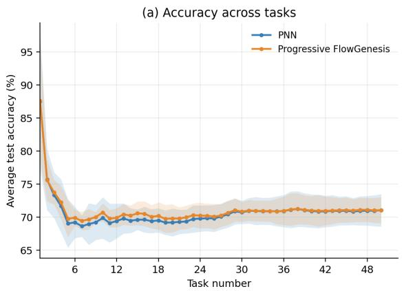

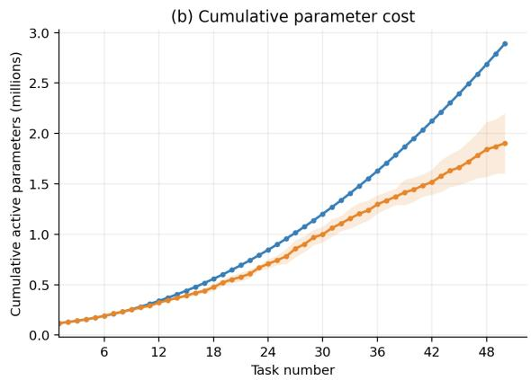

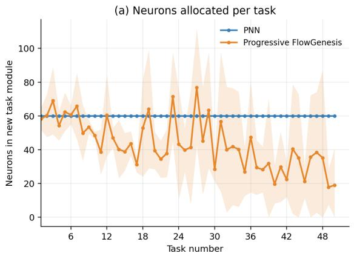

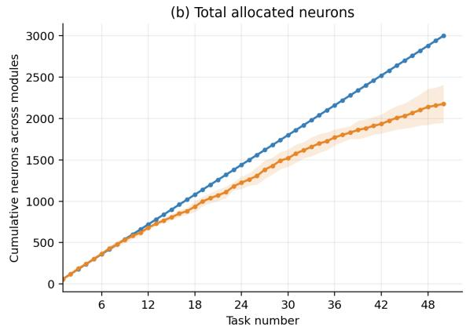  
Figure 4: Progressive FlowGenesis versus fixed-width Progressive Neural Networks (PNN) on Split CIFAR-100 with 50 tasks (two classes per task). Top: Average task-incremental test accuracy across all tasks observed so far (left) and cumulative active parameter count (right). Bottom: Number of neurons allocated to each new task module (left) and cumulative number of allocated neurons (right). Curves show means across five random seeds, with shaded regions indicating ± one sample standard deviation. PNN allocates 60 neurons per task, whereas FlowGenesis dynamically determines module size through representation-driven structural adaptation. At task 50, FlowGenesis achieves $7 1 . 0 5 \pm 1 . 9 8 \%$ accuracy versus $7 1 . 0 3 \pm 2 . 4 6 \%$ for PNN, while reducing cumulative active parameters from 2.89M to 1.90M (approximately 34%).

Fifty-task results. For 50 tasks, FlowGenesis achieves $7 1 . 0 5 \pm 1 . 9 8 \%$ average accuracy versus $7 1 . 0 3 \pm 2 . 4 6 \%$ for PNN (uncorrected paired-test $p = 0 . 9 7 1 8 )$ . Despite comparable accuracy, FlowGenesis reduces cumulative active parameters from 2.890M to 1.903M, a 34.2% reduction (uncorrected paired-test $p = 0 . 0 0 1 8 )$ , and cumulative neuron allocation from 3,000 to 2,177, a 27.4% reduction (uncorrected paired-test $p = 0 . 0 0 1 3 )$ . Figure 4 shows that FlowGenesis allocates progressively smaller modules, whereas PNN maintains a fixed width of 60 neurons.

Table 4: Progressive FlowGenesis versus fixed-width Progressive Neural Networks (PNN) on Split CIFAR-100. Results are reported as mean ± standard deviation over five paired seeds. Accuracy is evaluated in the task-incremental setting and averaged over all tasks seen at the final checkpoint. Active parameters include the shared encoder and all allocated task modules. p-values are from two-sided paired t-tests (uncorrected).
<table><tr><td>Setting</td><td>Metric</td><td>PNN</td><td>FlowGenesis</td><td>p-value</td></tr><tr><td rowspan="3">20 tasks × 5 classes</td><td>Accuracy (%)</td><td> $5 8 . 6 6 \pm 2 . 8 8$ </td><td> ${ \bf 5 9 . 3 2 \pm 2 . 6 4 }$ </td><td>0.0087</td></tr><tr><td>Active parameters (M)</td><td> $0 . 6 5 0 \pm 0 . 0 0 0 2$ </td><td> $\mathbf { 0 . 5 7 6 \pm 0 . 0 2 2 }$ </td><td>0.0016</td></tr><tr><td>Cumulative neurons</td><td> $1 2 0 0 \pm 0$ </td><td> ${ \bf 1 0 9 9 \pm 3 7 }$ </td><td>0.0035</td></tr><tr><td rowspan="3">50 tasks  $\times ~ 2$  classes</td><td>Accuracy (%)</td><td> $7 1 . 0 3 \pm 2 . 4 6$ </td><td> $7 1 . 0 5 \pm 1 . 9 8$ </td><td>0.9718</td></tr><tr><td>Active parameters (M)</td><td> $2 . 8 9 0 \pm 0 . 0 0 0 1$ </td><td> $\mathbf { 1 . 9 0 3 \pm 0 . 2 9 7 }$ </td><td>0.0018</td></tr><tr><td>Cumulative neurons</td><td> $3 0 0 0 \pm 0$ </td><td> ${ \bf 2 1 7 7 \pm 2 3 0 }$ </td><td>0.0013</td></tr></table>

Capacity allocation across task sequences. In the final task module, FlowGenesis allocates 32.0% fewer neurons than the fixed-width baseline in the 20-task setting and 68.3% fewer in the 50-task setting. Cumulative parameter savings reach 11.3% and 34.2%, respectively. Although these results suggest increasing capacity eficiency, diferences in classes per task prevent attributing the trend solely to sequence length.

## 5 Discussion

Our results demonstrate that FlowGenesis adapts network architecture during training through neuron birth and pruning guided by Representation Flux. Experiments on image and text classification reveal attractor-like architectural behavior: networks initialized with substantially diferent capacities approach similar final neuron-count ranges within each dataset. Despite diferences in connectivity and developmental trajectories, these networks exhibit substantial representational similarity and comparable predictive performance. Developmental ablations further characterize this behavior. The structural update rate and birth eligibility threshold influence population dynamics, whereas initial network size has relatively little influence on final neuron count under the evaluated conditions. Importantly, these attractor-like regimes exhibit stable macroscopic population statistics despite ongoing structural remodeling. Neurons continue to be created and removed even after population size has stabilized. The neuron-selection ablations reveal a trade-of between predictive performance and network size. Unrestricted random birth selection achieves higher final accuracy than high-Flux selection but produces substantially larger networks. Reverse-Flux selection provides an additional comparison of birth priorities. For pruning, shufling activity or Flux yields broadly comparable outcomes to the original selection mechanism. These results indicate that the observed architectural regulation does not uniquely depend on neuron-specific Flux ranking.

Application to continual learning. Progressive FlowGenesis extends representationdriven structural adaptation to sequential learning, enabling adaptive capacity allocation based on learned representations. On Split CIFAR-100, FlowGenesis achieves accuracy comparable to fixed-width Progressive Neural Networks while allocating fewer neurons and parameters. In the 50-task setting, cumulative parameter count is reduced by 34.2% and neuron count by 27.4%, with comparable predictive accuracy. These savings are larger than those observed in the 20-task setting, suggesting that adaptive capacity allocation becomes increasingly beneficial over longer task sequences. More broadly, FlowGenesis provides a mechanism for adaptive capacity allocation in continual learning by preserving previously learned representations and using Representation Flux to guide the allocation of new neurons as tasks accumulate. In the current implementation, previously learned modules remain frozen, preventing subsequent tasks from overwriting their parameters. FlowGenesis therefore addresses eficient capacity allocation rather than catastrophic forgetting directly. An important next step is to investigate whether representation-driven structural adaptation can support continual learning in shared networks without explicit task boundaries.

Theoretical interpretation. Our theoretical analysis examines simplified mechanisms of architectural self-organization. Neuron splitting is designed to limit immediate functional perturbations while introducing additional trainable capacity. Exact functional preservation is not guaranteed. Representation Flux provides a local criterion for selecting neurons for expansion based on diferences in activation statistics across consecutive minibatches. At the population level, a stationary mean-field model admits equilibria when expected neuron birth and pruning rates are equal. We derive suficient conditions for local asymptotic stability of these equilibria. Under an additional contraction assumption, diferences between population trajectories with distinct initial neuron counts decrease geometrically, up to a disturbance-dependent bound. These results characterize conditional properties of reduced population dynamics. The corresponding assumptions have not been established for the full stochastic FlowGenesis algorithm. The theoretical analyses are provided in Appendix D.

Biological interpretation. FlowGenesis suggests a conceptual connection between architectural self-organization and structural plasticity in biological neural circuits. Synaptic connections undergo formation and elimination in response to experience (Holtmaat and Svoboda, 2009), while homeostatic mechanisms help maintain stable neural activity despite ongoing plasticity (Turrigiano, 2012). These observations motivate investigating whether biological neural circuits can maintain stable macroscopic organization through continuous structural remodeling rather than fixed connectivity. We speculate that such organization could emerge from local plasticity mechanisms without explicit global control of network structure. Although FlowGenesis does not reproduce the biological processes underlying structural plasticity, it provides a computational framework for studying how local adaptive dynamics may produce stable macroscopic organization.

Limitations and future directions. Representation Flux, estimated from consecutive minibatch activation means, captures both representational changes and sampling variability. Consequently, it does not isolate optimization-induced representational drift. Developing more robust estimators and investigating alternative local signals could improve structural selection, potentially at the cost of greater computational complexity. The recurrent neural container was deliberately chosen for its structural flexibility, allowing networks to grow and shrink through local neuron birth and pruning. However, this flexibility comes at the cost of architectural specialization and potentially computational eficiency. Extending FlowGenesis to convolutional and Transformer architectures would help establish the generality and scalability of the proposed mechanism. Furthermore, the continual-learning experiments are restricted to the task-incremental setting with known task boundaries. Finally, attractor-like architectural behavior is observed empirically over finite training horizons. Although our theoretical analysis establishes conditional results for population stability and initial-condition forgetting, the existence, stability, and invariance of attractors under the complete stochastic, nonconvex training dynamics remain open questions. Further analysis could establish when local structural adaptation produces stable macroscopic regimes and determine how these regimes depend on task complexity, training duration, and developmental parameters.

## 6 Conclusion

We introduced FlowGenesis, a framework in which neural architectures develop through representation-driven neuron birth and pruning. Experiments on image and text classification show that networks initialized with diferent sizes converge toward similar datasetspecific architectural regimes while maintaining comparable predictive performance. These attractor-like regimes exhibit similar macroscopic properties across initializations despite ongoing structural remodeling. The same principle enables adaptive capacity allocation in continual learning, reducing architectural expansion while achieving comparable observed accuracy. Together, these findings suggest that network architecture need not be fully specified before training, but can emerge and adapt through the learning process itself.

## Appendix A. Architecture Metrics and Statistical Analysis

We define the metrics used to characterize individual architectures, compare independently trained networks, and assess statistical diferences.

## A.1 Reported Metrics and Notation

We denote the initial, best-checkpoint, and final neuron populations by $N _ { 0 } , N _ { \mathrm { b e s t } }$ , and $N _ { f }$ respectively. Best-checkpoint statistics correspond to the highest recorded test accuracy, while final statistics correspond to the last training checkpoint. Cumulative births and deaths count all neuron addition and removal events. Architectural metrics and cross-run similarity measures are defined in the following subsections.

## A.2 Individual Architecture Metrics

Each final architecture is characterized by neuron count $N = N _ { f }$ , recurrent edge count $E _ { f }$ connectivity density $d ,$ and spectral radius $\rho .$ . Let $W \in \mathbb { R } ^ { N \times N }$ denote the recurrent weight matrix and $A \in \{ 0 , 1 \} ^ { N \times N }$ its binary connectivity mask, where $A _ { i j } = 1$ indicates an existing connection.

Connectivity density measures the fraction of possible recurrent connections that are present:

$$
d = \frac { 1 } { N ^ { 2 } } \sum _ { i , j } A _ { i j } = \frac { E _ { f } } { N ^ { 2 } } .\tag{12}
$$

The spectral radius measures the largest absolute eigenvalue of the recurrent weight matrix:

$$
\rho = \operatorname* { m a x } _ { \lambda \in \sigma ( W \odot A ) } | \lambda | ,\tag{13}
$$

where $\sigma ( W \odot A )$ denotes the eigenvalue spectrum of the masked recurrent matrix and ⊙ denotes elementwise multiplication. It characterizes the spectral scale of the masked, unnormalized recurrent weight matrix, but does not directly characterize the stability of the degree-normalized recurrent dynamics used during inference.

## A.3 Cross-Run Architecture Similarity

Independently trained networks are compared on a common fixed probe set P of M examples $( M = 1 0 0 0$ by default), randomly sampled from the test partition. The same probe set is used for all networks within each comparison. Comparisons are performed both across random seeds at fixed $N _ { 0 }$ and across diferent initial population sizes.

Representational similarity. Let $H _ { a } \in \mathbb { R } ^ { M \times N _ { a } }$ and $H _ { b } \in \mathbb { R } ^ { M \times N _ { b } }$ denote centered hidden representations. Linear Centered Kernel Alignment (CKA) is

$$
\mathrm { C K A } ( H _ { a } , H _ { b } ) = \frac { \Vert H _ { a } ^ { \top } H _ { b } \Vert _ { F } ^ { 2 } } { \Vert H _ { a } ^ { \top } H _ { a } \Vert _ { F } \Vert H _ { b } ^ { \top } H _ { b } \Vert _ { F } } .\tag{14}
$$

CKA permits comparison of representations with diferent neuron counts (Kornblith et al., 2019).

Neuron parameter-profile similarity. For each neuron i, we construct a parameter profile $p _ { i } = [ w _ { i } ^ { \mathrm { i n } } , w _ { i } ^ { \mathrm { o u t } } , b _ { i } ]$ from its input weights, output weights, and recurrent bias. Recurrent weights are excluded because their coordinates depend on neuron ordering.

For neurons i and $j$ from networks a and b, respectively, pairwise cosine similarity is

$$
S _ { i j } = \frac { ( p _ { i } ^ { ( a ) } ) ^ { \top } p _ { j } ^ { ( b ) } } { \| p _ { i } ^ { ( a ) } \| _ { 2 } \| p _ { j } ^ { ( b ) } \| _ { 2 } } .\tag{15}
$$

The Hungarian algorithm (Kuhn, 1955) determines the maximum-similarity one-to-one matching $\pi ^ { * }$ between neurons of two networks. We report

$$
S _ { \mathrm { H u n g a r i a n } } ( a , b ) = \frac { 1 } { \operatorname* { m i n } ( N _ { a } , N _ { b } ) } \sum _ { ( i , j ) \in \pi ^ { * } } S _ { i j } .\tag{16}
$$

The matched-neuron fraction min $( N _ { a } , N _ { b } ) / \operatorname* { m a x } ( N _ { a } , N _ { b } )$ is retained as a diagnostic of populationsize diferences.

Functional similarity. Prediction agreement is the fraction of probe examples assigned the same class:

$$
S _ { \mathrm { a g r e e } } ( a , b ) = \frac { 1 } { M } \sum _ { x \in \mathcal { P } } \mathbb { I } [ \hat { y } _ { a } ( x ) = \hat { y } _ { b } ( x ) ] ,\tag{17}
$$

where $\mathbb { I } [ \cdot ]$ is the indicator function and ${ \hat { y } } _ { a } ( x )$ and ${ \hat { y } } _ { b } ( x )$ are the predicted classes of networks a and b, respectively.

## A.4 Statistical Analysis

For each experimental condition and initial network size $N _ { 0 } .$ , metrics are summarized across random seeds using the mean and sample standard deviation. Standard errors and coeficients of variation are also computed.

Dependence of final neuron count, recurrent edge count, connectivity density, and spectral radius on $N _ { 0 }$ is assessed using Welch’s one-way ANOVA (Welch, 1951), allowing unequal group variances. Conventional ANOVA efect sizes $\eta ^ { 2 }$ and $\omega ^ { 2 }$ , computed from unweighted sums of squares, are reported descriptively.

Because pairwise similarities share trained models, they are not treated as independent observations. For each model $^ { a , }$ we compute a model-level cross- $N _ { 0 }$ score

$$
\bar { S } _ { a } ^ { \mathrm { c r o s s } } = \frac { 1 } { | { \mathcal C } _ { a } | } \sum _ { b \in { \mathcal C } _ { a } } S ( a , b ) , \qquad { \mathcal C } _ { a } = \{ b : N _ { 0 , b } \neq N _ { 0 , a } \} ,\tag{18}
$$

where comparisons are restricted to the same experimental condition. Dependence of these scores on source $N _ { 0 }$ is examined using Welch’s ANOVA.

For hyperparameter ablations, cross-setting similarities compare models with diferent parameter values at fixed $N _ { 0 }$ and matched seeds. For each source model, similarity is averaged over the other settings within the same ablation. Reported means and standard deviations are computed across seeds.

Holm’s procedure (Holm, 1979) corrects $p -$ values separately across the four individual architecture metrics $( N _ { f } , E _ { f } , d _ { \cdot }$ , and $\rho )$ and the three comparative metrics (CKA, Hungarian similarity, and prediction agreement), within each condition. Model-level similarity tests are interpreted as exploratory because shared comparison partners can introduce residual dependence.

## Appendix B. Hyperparameter Sensitivity Analysis

We conduct systematic hyperparameter ablations on Fashion-MNIST to characterize the sensitivity, stability, and robustness of the proposed developmental mechanism. Within each ablation, all parameters other than the parameter under investigation are held fixed. Structural-event limits may difer between ablation types, as specified by their configurations. Each configuration is evaluated over five random seeds, $\{ 0 , 1 , 2 , 3 , 4 \}$ . Generalization experiments on CIFAR-10 and AG News are presented separately in the main text.

Initial network size. We vary the initial neuron population over $N _ { 0 } \in \{ 2 0 , 4 0 , 8 0 , 1 6 0 \}$ on Fashion-MNIST. This experiment examines the dependence of developed network size and predictive performance on initialization.

Recurrent connectivity. We jointly vary the initial population $N _ { 0 } \in \{ 1 0 , 2 0 , 4 0 , 8 0 , 1 6 0 \}$ and recurrent connectivity parameter $\beta \in \{ 0 . 1 , 0 . 2 , 0 . 4 , 0 . 8 \}$ . This experiment evaluates how initial connectivity influences architectural development and stability.

Structural adaptation rate. We vary the structural rate $r \in \{ 1 , 2 . 5 , 5 , 1 0 \}$ for $N _ { 0 } \in$ $\{ 2 0 , 4 0 , 8 0 , 1 6 0 \}$ . The rate specifies the maximum number of births and deaths permitted per structural check. For $r = 2 . 5$ , the limits alternate between two and three across consecutive checks.

Warm-up duration. At $N _ { 0 } = 8 0$ , we vary the number of training examples processed before structural adaptation is enabled:

$$
T _ { \mathrm { w a r m } } \in \{ 5 0 \mathrm { k } , 1 0 0 \mathrm { k } , 2 0 0 \mathrm { k } , 4 0 0 \mathrm { k } , 8 0 0 \mathrm { k } \} .
$$

This experiment evaluates the influence of delayed structural adaptation on developmental trajectories and final performance.

Birth threshold. At $N _ { 0 } = 2 0 .$ , we vary the birth threshold over {0.15, 0.25, 0.35, 0.45}. This experiment measures the sensitivity of neuronal growth, final architecture, and predictive performance to the criterion governing neuron addition.

Death criteria. At $N _ { 0 } = 2 0$ , we independently vary two pruning parameters. The death-Flux fraction takes values $\{ 0 . 0 0 5 , 0 . 0 5 , 0 . 5 , 0 . 9 5 \}$ , while the death-activity fraction takes values {0.05, 0.10, 0.20, 0.40}. These experiments assess the sensitivity of pruning dynamics and architectural stability to the criteria governing neuron removal.

Evaluation. We record predictive accuracy, neuron population, cumulative births and deaths, and structural events throughout training. Final architectures are characterized by recurrent edge count, connectivity density, and spectral radius. Cross-setting similarity is quantified using centered kernel alignment (CKA) and prediction agreement between models trained under diferent hyperparameter values at fixed $N _ { 0 }$ and matched seeds. For each source model, similarity is averaged across the other settings within the same ablation. All results are reported as mean ± standard deviation across five seeds.

Default configuration. Unless otherwise specified, experiments use the following configuration:

• Training: 100 epochs, batch size 128, Adam optimizer, learning rate $1 0 ^ { - 3 }$ , and weight decay $1 0 ^ { - 4 }$

• Network architecture: 10 relaxation steps, recurrent connectivity $\beta = 0 . 2$ , and no self-connections. The neuron population is constrained to $1 0 \leq N \leq 3 0 0$

• Neurogenesis: The default birth threshold is 0.25. The birth persistence interval is 10,000 training examples, and the neuron-splitting noise standard deviation is 0.01. The birth fraction is 0.20. The default maximum number of births per structural check is 5.

• Pruning: The default death-Flux and death-activity quantile fractions are 0.01 and 0.10, respectively, and the absolute death-Flux threshold is 0.13. The death persistence interval is 10,000 training examples. The default maximum number of deaths per structural check is 5.

• Structural dynamics: Flux and activity exponential moving-average decay factors are both 0.90. Structural adaptation begins after 100,000 training examples, with checks every 10,000 examples and a cooldown of 10,000 examples.

## Appendix C. Fashion-MNIST Ablations

We evaluate the sensitivity of FlowGenesis to initial connectivity, structural warm-up, adaptation rate, and neuron birth and death criteria on Fashion-MNIST. Each configuration is evaluated across five seeds. Table 5 summarizes final architecture, predictive performance, structural turnover, and cross-setting similarity.

Initial connectivity. Varying the initial connectivity probability $\beta$ from 0.1 to 0.8 produces similar final populations (53.2–55.0 neurons) and best accuracies (87.42–87.53%). Despite substantial diferences in final edge counts and density, the networks exhibit comparable representations (CKA 0.891–0.902). Fig. 5(a,b) shows convergence in population size and predictive performance across connectivity settings.

Structural warm-up. Increasing $T _ { \mathrm { w a r m } }$ from 50k to 800k processed examples has limited efect on final network size (49.8–55.2 neurons) or best accuracy (87.42–87.82%). Longer warm-up reduces cumulative structural events, partly because fewer adaptation opportunities remain. Thus, the final population is relatively insensitive to the onset of structural adaptation (Table 5).

Structural adaptation rate. Across $r \in \{ 1 , 2 . 5 , 5 , 1 0 \}$ , the final population remains within 47.0–55.8 neurons in the $N _ { 0 } = 1 6 0$ experiments, while best accuracy ranges from 87.54% to 88.25%. Higher rates generally increase structural turnover. The separate $N _ { 0 } =$ 20 trajectories in Fig. $5 ( \mathrm { c } , \mathrm { d } )$ illustrate diferences in transient expansion despite broadly comparable late-training population sizes and accuracy.

Birth threshold. The birth threshold has the strongest efect on final capacity. Increasing $\theta _ { \mathrm { b i r t h } }$ from 0.15 to 0.45 reduces the final population from $1 5 4 . 6 { \pm } 1 9 . 8 \mathrm { t o 2 0 . 4 } { \pm } 1 . 3$ neurons and cumulative births from approximately 5960 to 37. Best accuracy decreases from 88.06%

Table 5: Unified FlowGenesis hyperparameter ablations on Fashion-MNIST (five seeds per setting). Values are mean ± standard deviation. Section headings indicate the ablation type and initial neuron count $N _ { 0 }$

$$
N _ { \mathrm { b e s t } }
$$

$$
N _ { f }
$$

$$
E _ { f }
$$

$$
5 4 . 6 \pm 9 . 7
$$

$$
5 3 . 4 \pm 7 . 8
$$

$$
8 7 . 4 2 \pm 0 . 2 9 \ 8 6 . 8 9 \pm 0 . 4 1
$$

$$
( N _ { 0 } = 2 0 )
$$

$$
5 5 . 8 \pm 9 . 4
$$

$$
5 3 . 2 \pm 5 . 9
$$

$$
8 7 . 5 1 \pm 0 . 1 9 \ 8 7 . 0 1 \pm 0 . 3 8
$$

$$
6 2 1 . 4 \pm 1 7 4 . 6
$$

$$
5 8 8 . 0 \pm 1 6 8 . 3
$$

$$
4 9 . 8 \pm 5 . 7
$$

$$
5 5 . 0 \pm 7 . 3
$$

$$
8 7 . 5 3 \pm 0 . 1 0 ~ 8 6 . 7 9 \pm 0 . 3 8
$$

$$
6 3 2 . 0 \pm 4 0 . 3
$$

$$
5 9 8 . 8 \pm 3 7 . 4
$$

$$
1 0 1 7 . 4 \pm 1 5 3 . 1
$$

$$
5 1 . 8 \pm 5 . 9
$$

$$
8 7 . 5 3 \pm 0 . 3 9 \ 8 6 . 7 9 \pm 0 . 5 5
$$

$$
5 4 . 6 \pm 1 0 . 3
$$

$$
6 2 4 . 0 \pm 1 6 1 . 0
$$

$$
9 2 . 8 5 \pm 0 . 3 8
$$

$$
5 8 9 . 0 \pm 1 6 7 . 3
$$

$$
1 6 0 8 . 6 \pm 5 3 1 . 4
$$

$$
6 2 0 . 4 \pm 9 0 . 4
$$

$$
5 8 5 . 8 \pm 9 0 . 4
$$

$$
2 5 9 4 . 6 \pm 9 8 5 . 2
$$

$$
( N _ { 0 } = 8 0 )
$$

$$
5 3 . 6 \pm 2 . 9
$$

$$
5 1 . 6 \pm 5 . 2
$$

$$
8 7 . 4 9 \pm 0 . 3 1 ~ 8 7 . 0 5 \pm 0 . 6 4
$$

$$
4 7 4 . 8 \pm 6 0 . 4
$$

$$
5 0 3 . 2 \pm 6 1 . 9
$$

$$
8 9 1 . 8 \pm 3 0 5 . 4
$$

$$
5 1 . 6 \pm 6 . 3
$$

$$
5 2 . 6 \pm 5 . 5
$$

$$
8 7 . 4 2 \pm 0 . 2 7 ~ 8 6 . 9 5 \pm 0 . 5 1
$$

$$
4 6 1 . 6 \pm 6 3 . 1
$$

$$
4 8 9 . 0 \pm 6 4 . 7
$$

$$
9 0 6 . 8 \pm 1 3 1 . 7
$$

$$
5 1 . 4 \pm 7 . 0
$$

$$
9 2 . 7 4 \pm 0 . 8 1
$$

$$
4 9 . 8 \pm 7 . 5
$$

$$
8 7 . 6 1 \pm 0 . 1 8 ~ 8 6 . 9 6 \pm 0 . 1 9
$$

$$
4 2 5 . 2 \pm 5 9 . 2
$$

$$
7 9 0 . 0 \pm 1 5 6 . 2
$$

$$
3 9 5 . 0 \pm 6 1 . 9
$$

$$
5 3 . 4 \pm 8 . 8
$$

$$
5 5 . 2 \pm 8 . 5
$$

$$
8 7 . 6 6 \pm 0 . 1 9 ~ 8 6 . 9 7 \pm 0 . 1 5
$$

$$
3 9 2 . 4 \pm 6 5 . 7
$$

$$
3 6 7 . 6 \pm 7 0 . 6
$$

$$
9 2 6 . 8 \pm 3 4 2 . 1
$$

$$
7 5 . 4 \pm 1 0 . 3
$$

$$
5 2 . 0 \pm 5 . 6
$$

$$
0 . 2 9 5 \pm 0 . 0 6 9 \ 0 . 5 7 0 \pm 0 . 1 6 6 \ 0 . 8 9 0 \pm 0 . 0 1 9 \ 9 2 . 9 2 \pm 0 . 8 5
$$

$$
3 3 9 . 6 \pm 5 5 . 2
$$

$$
8 7 . 8 2 \pm 0 . 2 2 \ 8 6 . 8 0 \pm 0 . 4 9
$$

$$
3 6 7 . 6 \pm 5 1 . 2
$$

$$
7 3 7 . 4 \pm 1 6 1 . 3
$$

$$
( N _ { 0 } = 1 6 0 )
$$

$$
1 0 2 . 8 \pm 1 6 . 5
$$

$$
4 7 . 0 \pm 3 . 3
$$

$$
5 0 . 0 \pm 5 . 2
$$

$$
8 8 . 2 5 \pm 0 . 2 2 ~ 8 6 . 6 8 \pm 0 . 8 5
$$

$$
5 5 . 8 \pm 8 . 9
$$

$$
8 7 . 6 8 \pm 0 . 1 8 ~ 8 7 . 0 7 \pm 0 . 2 5
$$

$$
1 7 9 . 2 \pm 2 7 . 2
$$

$$
2 9 2 . 2 \pm 2 8 . 3
$$

$$
5 1 . 8 \pm 6 . 6
$$

$$
5 9 3 . 8 \pm 7 3 . 3
$$

$$
5 1 . 4 \pm 4 . 2
$$

$$
2 7 2 . 8 \pm 4 7 . 2
$$

$$
8 7 . 6 4 \pm 0 . 1 4 ~ 8 6 . 6 6 \pm 0 . 2 9
$$

$$
3 7 7 . 0 \pm 4 5 . 3
$$

$$
6 8 4 . 0 \pm 2 1 2 . 2
$$

$$
5 0 . 8 \pm 4 . 2
$$

$$
5 4 . 4 \pm 6 . 8
$$

$$
2 9 5 . 8 \pm 2 9 . 3
$$

$$
8 7 . 5 4 \pm 0 . 1 6 ~ 8 6 . 5 1 \pm 0 . 2 2
$$

$$
4 0 4 . 4 \pm 3 1 . 4
$$

$$
3 3 7 . 6 \pm 4 9 . 3
$$

$$
6 3 1 . 2 \pm 1 6 8 . 5
$$

$$
4 4 3 . 2 \pm 5 1 . 2
$$

$$
6 8 1 . 4 \pm 1 4 5 . 1
$$

$$
1 0 5 . 4 \pm 1 7 . 5
$$

$$
5 1 . 6 \pm 6 . 4
$$

$$
5 4 . 4 \pm 5 . 9
$$

$$
4 0 6 . 4 \pm 3 0 . 5
$$

$$
3 7 1 . 6 \pm 4 1 . 4
$$

$$
5 5 . 4 \pm 5 . 3
$$

$$
5 3 . 2 \pm 1 0 . 0 8 7 . 4 1 \pm 0 . 1 6 8 6 . 8 0 \pm 0 . 5 8
$$

$$
6 5 6 . 4 \pm 6 3 . 1
$$

$$
5 5 . 6 \pm 5 . 0
$$

$$
6 2 2 . 0 \pm 6 0 . 4
$$

$$
7 1 6 . 4 \pm 1 6 2 . 5
$$

$$
5 2 . 0 \pm 1 0 . 0 8 7 . 4 3 \pm 0 . 1 8 8 7 . 0 2 \pm 0 . 3 4
$$

$$
7 1 6 . 6 \pm 1 6 2 . 5
$$

$$
6 8 3 . 2 \pm 1 5 4 . 5
$$

$$
6 8 4 . 6 \pm 1 5 4 . 3
$$

$$
( N _ { 0 } = 2 0 )
$$

$$
5 2 . 4 \pm 6 . 4
$$

$$
3 2 . 4 \pm 4 . 4
$$

$$
2 8 . 2 \pm 1 . 6
$$

$$
7 1 2 . 6 \pm 1 0 4 . 7
$$

$$
8 6 . 9 9 \pm 0 . 1 8 8 6 . 4 9 \pm 0 . 2 8
$$

$$
2 4 . 2 \pm 3 . 7
$$

$$
2 0 . 4 \pm 1 . 3
$$

$$
8 6 . 8 9 \pm 0 . 2 0 \ 8 6 . 1 5 \pm 0 . 4 7
$$

$$
1 2 7 . 2 \pm 5 9 . 9
$$

$$
3 7 . 2 \pm 1 5 . 9
$$

$$
1 1 9 . 0 \pm 5 8 . 8
$$

$$
2 7 6 . 0 \pm 8 2 . 8
$$

$$
3 6 . 8 \pm 1 5 . 2
$$

$$
1 1 8 . 2 \pm { 1 2 . 9 }
$$

$$
( N _ { 0 } = 2 0 )
$$

$$
5 0 . 4 \pm 2 . 1
$$

$$
4 9 . 0 \pm 6 . 7
$$

$$
5 2 . 4 \pm 6 . 4
$$

$$
5 6 . 0 \pm 8 . 1
$$

$$
5 6 . 2 \pm 6 . 1
$$

$$
6 0 . 0 \pm 1 2 . 2
$$

$$
5 9 6 . 8 \pm 1 0 6 . 3
$$

$$
7 1 2 . 6 \pm 1 0 4 . 7
$$

$$
5 2 . 6 \pm 7 . 0
$$

$$
8 6 8 . 6 \pm 1 5 1 . 7
$$

$$
6 7 6 . 6 \pm 1 0 8 . 5
$$

$$
1 0 1 5 . 8 \pm 1 0 2 . 3
$$

$$
8 2 8 . 6 \pm 1 5 4 . 2
$$

Notes: $N _ { \mathrm { b e s t } }$ and $N _ { f }$ denote neuron counts at best accuracy and training end; $E _ { f } ,$ density, and $\rho$ denote final recurrent edges, connectivity density, and spectral radius. Accuracies and prediction agreement are percentages. CKA measures representational similarity. Cross-setting similarities compare diferent hyperparameter values at fixed $N _ { 0 }$ and matched seeds; each model is averaged over other settings, with SD across five seeds. All ablations include four settings except warm-up (five); death-flux includes seven, with four shown. Initial $N _ { 0 }$ varies across ablation types, precluding controlled cross-type comparisons.

to 86.89%. Fig. 5(e,f) shows that permissive birth thresholds produce substantially larger architectures. Unlike the preceding controls, this parameter strongly influences the final population regime.

Death-Flux fraction. Varying the pruning Flux fraction from 0.005 to 0.95 changes structural turnover but leaves final populations within 52.0–54.8 neurons for the settings reported in Table 5. Best accuracy ranges from 87.41% to 88.71%, while cross-setting CKA remains high (0.902–0.930). The most restrictive setting exhibits fewer structural events and a larger population at peak accuracy.

Death-activity fraction. Increasing the activity-based pruning fraction from 0.05 to 0.40 increases cumulative births and deaths, while final populations remain between 49.0 and 60.0 neurons. Best accuracy varies from 87.35% to 87.60%, and cross-setting CKA remains between 0.879 and 0.904. Thus, this parameter primarily afects structural turnover rather than final predictive performance.

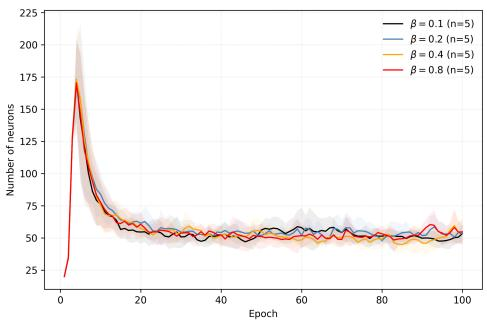  
(a) Connectivity: neuron count.

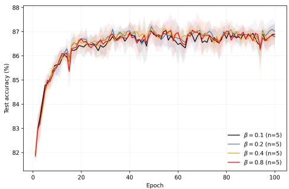  
(b) Connectivity: test accuracy.

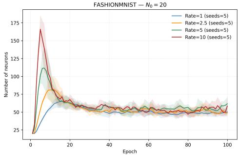  
(c) Adaptation rate: neuron count.

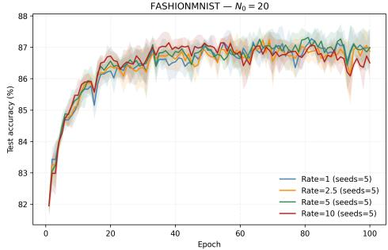  
(d) Adaptation rate: test accuracy.

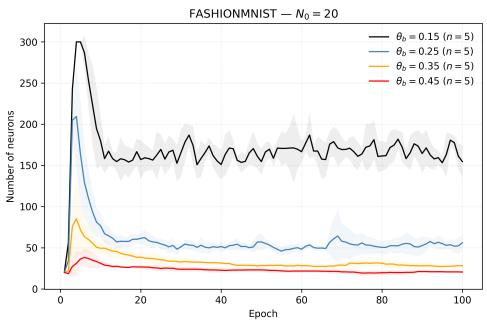  
(e) Birth threshold: neuron count.

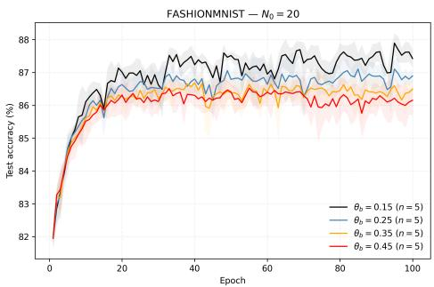  
(f) Birth threshold: test accuracy.  
Figure 5: Fashion-MNIST structural ablations $( N _ { 0 } ~ = ~ 2 0 ) . \quad ( \mathrm { a , b } )$ Initial connectivity $\beta ~ \in ~ \{ 0 . 1 , 0 . 2 , 0 . 4 , 0 . 8 \}$ ; (c,d) adaptation rate $r ~ \in ~ \{ 1 , 2 . 5 , 5 , 1 0 \}$ ; (e,f) birth threshold $\theta _ { \mathrm { b i r t h } } ~ \in ~ \{ 0 . 1 5 , 0 . 2 5 , 0 . 3 5 , 0 . 4 5 \}$ . Left: neuron count; right: test accuracy. Curves show mean ± standard deviation across five seeds. Final populations are relatively insensitive to connectivity and adaptation rate, but strongly depend on the birth threshold.

## Appendix D. Flux-Guided Neurogenesis: Splitting and Stabilization

We analyze three aspects of Flux-guided neurogenesis: the efect of splitting on the represented function, the accuracy of Flux-based structural selection, and the conditions for subsequent stabilization.

## D.1 Local dynamics.

Proposition 1 (Local functional stability of neuron splitting). Consider the Flow-Genesis recurrent update

$$
h ^ { ( s + 1 ) } = ( 1 - \gamma ) h ^ { ( s ) } + \gamma \mathrm { R e L U } \left( u + W h ^ { ( s ) } + b \right) ,\tag{19}
$$

with $h ^ { ( 0 ) } = 0$ and output $f ( x ) = W _ { \mathrm { o u t } } h ^ { ( S ) } + b _ { \mathrm { o u t } }$ . Here W is the efective, degree-normalized recurrent matrix.

Suppose one neuron is split, increasing the population from N to $N + 1$ . Let $P \in$ $\{ 0 , 1 \} ^ { ( \mathrm { \tilde { N } + 1 } ) \times N }$ denote the duplication matrix that copies the split neuron’s coordinate while preserving all others. Let $W \in \mathbb { R } ^ { N \times N } , \ u , b \in \mathbb { R } ^ { N }$ denote the efective recurrent matrix, input projection, and bias of the original network. Their counterparts in the expanded network are denoted by $W ^ { + } \in \mathbb { R } ^ { ( N + 1 ) \times ( N + 1 ) }$ and $u ^ { + } , b ^ { + } \in \mathbb { R } ^ { N + 1 }$ . Assume that, for a fixed input $x , \| h ^ { ( s ) } \| \leq H$ for $s = 0 , \ldots , S$ . Define

$$
\varepsilon = \| W ^ { + } P - P W \| H + \| u ^ { + } - P u \| + \| b ^ { + } - P b \| ,\tag{20}
$$

and

$$
L = 1 + \gamma ( \| W ^ { + } \| - 1 ) .\tag{21}
$$

Here, ε bounds the disturbance introduced by splitting into the recurrent dynamics, while L bounds the amplification of existing perturbations during each relaxation step.

Let $f ^ { + } ( x ) = W _ { \mathrm { o u t } } ^ { + } h _ { + } ^ { ( S ) } + b _ { \mathrm { o u t } } ^ { + }$ denote the output of the expanded network, where $h _ { + } ^ { ( S ) }$ is its hidden state after $S$ relaxation steps.

If the expanded output layer satisfies

$$
W _ { \mathrm { o u t } } ^ { + } P = W _ { \mathrm { o u t } } , \qquad b _ { \mathrm { o u t } } ^ { + } = b _ { \mathrm { o u t } } ,\tag{22}
$$

then

$$
\boxed { \| f ^ { + } ( x ) - f ( x ) \| \leq \gamma \| W _ { \mathrm { o u t } } ^ { + } \| \varepsilon \sum _ { j = 0 } ^ { S - 1 } L ^ { j } . }\tag{23}
$$

The bound follows from a standard Lipschitz-based perturbation argument applied to the recurrent dynamics.

Proof. Let $h _ { + } ^ { ( s ) }$ denote the expanded network’s hidden state and define

$$
\delta _ { s } = \| h _ { + } ^ { ( s ) } - P h ^ { ( s ) } \| .
$$

Since both networks start from zero, $\delta _ { 0 } = 0$

Because ReLU is 1-Lipschitz and commutes with coordinate duplication, the diference between the expanded and duplicated original updates is bounded by

$$
\begin{array} { r l } & { \delta _ { s + 1 } \leq ( 1 - \gamma ) \delta _ { s } + \gamma \left( \| W ^ { + } \| \delta _ { s } + \varepsilon \right) } \\ & { \qquad = L \delta _ { s } + \gamma \varepsilon . } \end{array}\tag{24}
$$

Here, the first term represents the propagation of the existing hidden-state discrepancy, while ε bounds the additional mismatch introduced by the expanded network’s parameters.

□

Since $\delta _ { 0 } = 0$ , successive application of this inequality gives

$$
\delta _ { 1 } \leq \gamma \varepsilon ,\tag{25}
$$

$$
\delta _ { 2 } \leq \gamma \varepsilon ( 1 + L ) .\tag{26}
$$

Continuing recursively, we obtain

$$
\delta _ { S } \leq \gamma \varepsilon \sum _ { j = 0 } ^ { S - 1 } L ^ { j } .\tag{27}
$$

Output compatibility implies

$$
f ^ { + } ( x ) - f ( x ) = W _ { \mathrm { o u t } } ^ { + } ( h _ { + } ^ { ( S ) } - P h ^ { ( S ) } ) .\tag{28}
$$

Taking norms proves the result.

Proposition 1 bounds the immediate functional perturbation caused by neuron splitting. In FlowGenesis, the parent’s output weights are divided equally between parent and child, while the output bias remains unchanged. Particularly, Gaussian perturbations of copied weights can alter the child’s response relative to its parent. New recurrent connections introduce additional interactions, while degree normalization can change efective recurrent weights as incoming connectivity changes. These efects may produce nonzero deviations from exact duplication-compatible dynamics.

Neuron splitting and Representation Flux. Neuron splitting introduces additional trainable degrees of freedom while aiming to preserve the existing computation. FlowGenesis selects neurons for splitting using Representation Flux rather than explicitly estimating splitting curvature or optimization benefit. Let $h _ { i } ( x ; \theta _ { t } )$ denote the activation of neuron i for input x, where $\theta _ { t }$ represents the network parameters at training step t. The mean activation over a minibatch $B _ { t }$ of size m is

$$
\bar { h } _ { i , t } = \frac { 1 } { m } \sum _ { x \in B _ { t } } h _ { i } ( x ; \theta _ { t } ) .\tag{29}
$$

Representation Flux is the absolute diference between consecutive minibatch mean activations:

$$
\Phi _ { i , t } = | \bar { h } _ { i , t } - \bar { h } _ { i , t - 1 } | .\tag{30}
$$

Unlike function-preserving network widening (Chen et al., 2016) and curvature-based splitting (Wu et al., 2019), FlowGenesis uses changes in neuronal activation as a heuristic signal for allocating additional capacity. To distinguish changes in expected activation from minibatch sampling variability, let P denote the data distribution and define

$$
\begin{array} { r } { \mu _ { i } ( \boldsymbol { \theta } ) = \mathbb { E } _ { \boldsymbol { x } \sim P } [ h _ { i } ( \boldsymbol { x ; \boldsymbol { \theta } } ) ] , \qquad \sigma _ { i } ^ { 2 } ( \boldsymbol { \theta } ) = \operatorname { V a r } _ { \boldsymbol { x } \sim P } [ h _ { i } ( \boldsymbol { x ; \boldsymbol { \theta } } ) ] . } \end{array}\tag{31}
$$

Here, $\mu _ { i } ( \theta )$ and $\sigma _ { i } ^ { 2 } ( \theta )$ are the population mean and variance of neuron i’s activation. The observed minibatch mean can be expressed as

$$
\begin{array} { r } { \bar { h } _ { i , t } = \mu _ { i } ( \theta _ { t } ) + \xi _ { i , t } , } \end{array}\tag{32}
$$

where $\xi _ { i , t }$ is the sampling error due to the finite minibatch.

Proposition 2 (Sampling-noise decomposition). Suppose that, conditional on fixed network parameters $\theta _ { t }$ and $\theta _ { t - 1 }$ , the minibatches $B _ { t }$ and $B _ { t - 1 }$ are drawn independently from $P ,$ with m independent samples per minibatch.

Then, conditional on these parameters, the expected squared Representation Flux satisfies

$$
\begin{array} { r } { \mathbb { E } [ \Phi _ { i , t } ^ { 2 } \mid \theta _ { t } , \theta _ { t - 1 } ] = [ \mu _ { i } ( \theta _ { t } ) - \mu _ { i } ( \theta _ { t - 1 } ) ] ^ { 2 } } \\ { + \frac { \sigma _ { i } ^ { 2 } ( \theta _ { t } ) + \sigma _ { i } ^ { 2 } ( \theta _ { t - 1 } ) } { m } . } \end{array}\tag{33}
$$

Proof. Define the signed diference between consecutive minibatch mean activations as

$$
D _ { i , t } = \bar { h } _ { i , t } - \bar { h } _ { i , t - 1 } ,\tag{34}
$$

so that $\Phi _ { i , t } ^ { 2 } = D _ { i , t } ^ { 2 }$ . Substituting the decomposition of the minibatch means gives

$$
\begin{array} { c } { { D _ { i , t } = \mu _ { i } ( \theta _ { t } ) - \mu _ { i } ( \theta _ { t - 1 } ) } } \\ { { + \xi _ { i , t } - \xi _ { i , t - 1 } . } } \end{array}\tag{35}
$$

Under the stated sampling assumptions, the errors have zero conditional means and

$$
\operatorname { V a r } ( \xi _ { i , t } \mid \theta _ { t } , \theta _ { t - 1 } ) = \frac { \sigma _ { i } ^ { 2 } ( \theta _ { t } ) } { m } ,\tag{36}
$$

with the analogous expression for $\xi _ { i , t - 1 }$ . Independence of the minibatches implies that their sampling errors have zero conditional covariance. Therefore,

$$
\begin{array} { r } { \mathbb { E } [ D _ { i , t } ^ { 2 } \ | \ \theta _ { t } , \theta _ { t - 1 } ] = [ \mu _ { i } ( \theta _ { t } ) - \mu _ { i } ( \theta _ { t - 1 } ) ] ^ { 2 } } \\ { + \frac { \sigma _ { i } ^ { 2 } ( \theta _ { t } ) + \sigma _ { i } ^ { 2 } ( \theta _ { t - 1 } ) } { m } . } \end{array}\tag{37}
$$

Since $\Phi _ { i , t } ^ { 2 } = D _ { i , t } ^ { 2 }$ , this proves (33).

The decomposition shows that Representation Flux captures two efects: changes in a neuron’s average activation and random diferences between minibatches. Therefore, high Flux does not necessarily mean that a neuron would benefit from splitting.

The proposition assumes independently sampled minibatches and fixed network parameters during evaluation. In actual FlowGenesis training, parameters change between minibatches, and Flux is smoothed using an exponential moving average (EMA). Thus, the decomposition does not exactly describe the Flux signal used for neuron selection.

Direct contribution of neuron pruning. Consider a neuron i with final hidden-state activation $h _ { i } ^ { ( S ) }$ and output-weight column $w _ { i }$ . If pruning removes only its direct output contribution while leaving all other hidden activations unchanged, the output perturbation satisfies

$$
\begin{array} { r } { \| f _ { \mathrm { p r u n e d } } ( x ) - f ( x ) \| = \| w _ { i } \| | h _ { i } ^ { ( S ) } | . } \end{array}\tag{38}
$$

This identity motivates activity-based pruning: neurons with small activations and bounded output weights have limited direct influence on the output. However, removing a neuron also changes the recurrent connectivity and may alter the activations of remaining neurons. Degree normalization can further modify the efective recurrent weights. Therefore, low activity alone does not guarantee that pruning preserves the network function. FlowGenesis additionally considers low Representation Flux to identify neurons with limited observed activation changes. This provides a complementary heuristic but does not guarantee that removing such neurons is functionally harmless.

Proposition 3 (Local reduction of optimization-induced activation drift after symmetric splitting). Consider a neuron with output contribution

$$
f ( x ; \theta ) = w h ( x ; \theta ) .\tag{39}
$$

Suppose it is replaced by two branches with equal output weights,

$$
f ^ { + } ( x ; \theta _ { 1 } , \theta _ { 2 } ) = \frac { w } { 2 } h ( x ; \theta _ { 1 } ) + \frac { w } { 2 } h ( x ; \theta _ { 2 } ) ,\tag{40}
$$

initialized at $\theta _ { 1 } = \theta _ { 2 } = \theta$

Let

$$
\mu ( \theta ) = \mathbb { E } _ { x } [ h ( x ; \theta ) ]\tag{41}
$$

be diferentiable, with diferentiation and expectation interchangeable.

At the splitting instant, the optimization-induced rate of change of each child’s mean activation satisfies

$$
\left| \frac { d \mu ( \theta _ { k } ) } { d t } \right| _ { \mathrm { s p l i t } } = \frac { 1 } { 2 } \left. \frac { d \mu ( \theta ) } { d t } \right| _ { \mathrm { p a r e n t } } , \qquad k = 1 , 2 .\tag{42}
$$

Proof. At symmetric initialization, both branches produce the same activation as the original neuron. By the chain rule and equal division of the output weight,

$$
\nabla _ { \theta _ { k } } \mathcal { L } ^ { + } = \frac { 1 } { 2 } \nabla _ { \theta } \mathcal { L } .\tag{43}
$$

Under gradient flow,

$$
\dot { \theta } _ { k } = - \frac 1 2 \nabla _ { \theta } \mathcal { L } , \qquad \dot { \theta } = - \nabla _ { \theta } \mathcal { L } .\tag{44}
$$

Applying the chain rule to the population mean activation gives

$$
\frac { d \mu ( \theta _ { k } ) } { d t } = \nabla _ { \theta } \mu ^ { \top } \dot { \theta } _ { k } = \frac { 1 } { 2 } \nabla _ { \theta } \mu ^ { \top } \dot { \theta } .\tag{45}
$$

The result shows that symmetric splitting reduces the instantaneous optimization-induced rate of change of each child’s mean activation by a factor of two under gradient flow. This follows from dividing the parent’s output contribution equally between two identical branches, thereby reducing the gradient acting on each branch.

## D.2 Emergent Architectural Equilibrium

FlowGenesis regulates network capacity through Flux-guided neuron splitting and activitydependent pruning. We examine how these mechanisms constrain population growth and may produce stable architectural regimes.

Flux-limited population growth. Let $N _ { t }$ denote the neuron population before structural check t, with

$$
N _ { t + 1 } = N _ { t } + B _ { t } - D _ { t } ,\tag{46}
$$

where $B _ { t }$ and $D _ { t }$ are the numbers of birth and pruning events.

Let $\overline { { \Phi } } _ { i , t } ~ \geq ~ 0$ denote the mean Representation Flux of neuron i over the evaluation interval used to determine birth eligibility. Splitting requires $\overline { { \Phi } } _ { i , t } > \theta _ { \mathrm { b i r t h } } > 0$ , together with persistence and ranking criteria.

Defining total eligibility Flux as

$$
T _ { t } = \sum _ { i = 1 } ^ { N _ { t } } \overline { { \Phi } } _ { i , t } ,\tag{47}
$$

the number of neurons exceeding the threshold is at most $T _ { t } / \theta _ { \mathrm { b i r t h } }$ . Consequently,

$$
\boxed { B _ { t } \le \operatorname* { m i n } \left\{ r _ { t } , \frac { T _ { t } } { \theta _ { \mathrm { b i r t h } } } \right\} , }\tag{48}
$$

where $r _ { t }$ is the per-check birth allowance.

This elementary bound connects capacity expansion to the available Representation Flux. However, the event limit also constrains growth independently of Flux, and the bound alone does not establish population stabilization.

Flux–activity feedback. FlowGenesis prioritizes high-Flux neurons for splitting and persistently low-activity, low-Flux neurons for pruning.

Increasing network capacity may reduce the prevalence of neurons eligible for splitting while increasing the prevalence of pruning candidates. Such behavior would generate negative feedback on population size, although neither relationship is guaranteed by the selection rules.

Conditional population stability. Consider a stationary mean-field approximation with expected executed birth and death counts $b ( n )$ and $d ( n )$ . The population update is

$$
n _ { t + 1 } = F ( n _ { t } ) = n _ { t } + b ( n _ { t } ) - d ( n _ { t } ) ,\tag{49}
$$

where $n _ { t }$ denotes the population in the reduced model.

An equilibrium $n ^ { * }$ satisfies

$$
b ( n ^ { * } ) = d ( n ^ { * } ) .\tag{50}
$$

If b and d are continuously diferentiable near $n ^ { * }$ , the standard suficient condition for local asymptotic stability of a one-dimensional discrete-time map (Elaydi, 2005) is

$$
\boxed { - 2 < b ^ { \prime } ( n ^ { * } ) - d ^ { \prime } ( n ^ { * } ) < 0 . }\tag{51}
$$

Thus, a stable mean-field equilibrium requires suficiently moderate negative feedback between expected neuron birth and pruning rates.

Limitations. These conditions characterize a reduced population model, not the full FlowGenesis dynamics. In particular, the required feedback properties have not been established for the implemented algorithm, whose structural decisions depend on evolving Flux, activity, eligibility history, and population constraints.

Population stabilization may also arise from explicit structural limits and does not imply convergence of recurrent connectivity or learned representations.

## D.3 Initial-Condition Forgetting in Architectural Dynamics

The preceding analysis characterizes conditions for a stable population equilibrium. We now examine when the influence of initial network size decreases during architectural development.

Population dynamics with disturbances. Consider two developmental trajectories with diferent initial neuron counts, $N _ { 0 } ^ { ( a ) }$ and $N _ { 0 } ^ { ( b ) }$

We represent their population updates as

$$
N _ { t + 1 } ^ { ( j ) } = \mathcal { F } ( N _ { t } ^ { ( j ) } ) + \xi _ { t } ^ { ( j ) } , \qquad j \in \{ a , b \} ,\tag{52}
$$

where ${ \mathcal { F } } ( n ) = n + b ( n ) - d ( n )$ is the mean-field map defined above.

The disturbance $\xi _ { t } ^ { ( j ) }$ denotes the deviation of realized net structural changes from their conditional expectation at the current population size.

Proposition 4 (Initial-condition forgetting under contractive population dynamics). Suppose both trajectories remain in a neighborhood I of the mean-field equilibrium $n ^ { * }$ , where $\mathcal { F }$ is contractive:

$$
| { \mathcal { F } } ( x ) - { \mathcal { F } } ( y ) | \leq q | x - y | , \qquad x , y \in { \mathcal { Z } } , \quad 0 \leq q < 1 .\tag{53}
$$

Assume further that the expected disturbance discrepancy is uniformly bounded:

$$
\mathbb { E } | \xi _ { t } ^ { ( a ) } - \xi _ { t } ^ { ( b ) } | \leq \delta , \qquad t \geq 0 ,\tag{54}
$$

for some $\delta \geq 0$

Then, for every $t \geq 0$

$$
\begin{array} { r l } & { \boxed { \mathbb { E } | N _ { t } ^ { ( a ) } - N _ { t } ^ { ( b ) } | \le q ^ { t } | N _ { 0 } ^ { ( a ) } - N _ { 0 } ^ { ( b ) } | } } \\ & { \qquad + \frac { \delta ( 1 - q ^ { t } ) } { 1 - q } . } \end{array}\tag{55}
$$

Proof. Subtracting the population updates and applying the triangle inequality and contraction assumption gives

$$
\begin{array} { r } { | N _ { t + 1 } ^ { ( a ) } - N _ { t + 1 } ^ { ( b ) } | \leq q | N _ { t } ^ { ( a ) } - N _ { t } ^ { ( b ) } | } \\ { + | \xi _ { t } ^ { ( a ) } - \xi _ { t } ^ { ( b ) } | . } \end{array}\tag{56}
$$

Iterating this inequality yields

$$
\begin{array} { r l } & { | N _ { t } ^ { ( a ) } - N _ { t } ^ { ( b ) } | \leq q ^ { t } | N _ { 0 } ^ { ( a ) } - N _ { 0 } ^ { ( b ) } | } \\ & { \qquad + \displaystyle \sum _ { k = 0 } ^ { t - 1 } q ^ { t - 1 - k } | \xi _ { k } ^ { ( a ) } - \xi _ { k } ^ { ( b ) } | . } \end{array}\tag{57}
$$

Taking expectations and applying the disturbance bound,

$$
\begin{array} { r l r } { \mathbb { E } | N _ { t } ^ { ( a ) } - N _ { t } ^ { ( b ) } | \le q ^ { t } | N _ { 0 } ^ { ( a ) } - N _ { 0 } ^ { ( b ) } | } & { } & \\ { + \delta \displaystyle \sum _ { k = 0 } ^ { t - 1 } q ^ { k } . } & { } & \end{array}\tag{58}
$$

Evaluating the geometric sum establishes the result.

Proposition 4 shows that, under contractive population dynamics, the contribution of initial neuron count to the expected population diference decreases geometrically. Residual structural fluctuations can nevertheless maintain diferences between developmental trajectories. For FlowGenesis, such contraction could arise from negative feedback between Fluxguided splitting and activity-dependent pruning. However, contraction is not guaranteed by the implemented selection rules, and the disturbance bound has not been empirically verified. The result therefore provides a conditional explanation for the observed reduction in dependence on initial network size, rather than a guarantee of architectural convergence. In particular, similar final neuron counts do not imply identical recurrent connectivity or learned representations.

## Appendix E. Architecture Visualization

Visualization methodology. Figure 6 presents the final architectures learned using FlowGenesis on Fashion-MNIST, CIFAR-10, and AG News. For architectural visualization, we select a representative checkpoint using the CKA medoid across evaluated runs. The network is evaluated in inference mode on a randomly sampled probe set of 1,000 examples from the test partition. Fashion-MNIST and CIFAR-10 inputs are flattened pixel tensors, whereas AG News uses the original cached TF-IDF representation with the vocabulary employed during training.

To examine the functional organization of developed networks, we record hidden-neuron activations after recurrent relaxation for 1,000 randomly sampled test examples using a fixed random seed. The examples are divided equally into two disjoint subsets: one for identifying functional clusters and the other for evaluating their reproducibility. Using the first subset, we calculate Pearson correlations $\rho _ { i j }$ between the activation patterns of each pair of neurons across examples. Neurons are then grouped using average-linkage hierarchical clustering with correlation distance $d _ { i j } = 1 - \rho _ { i j } .$ , producing at most five functional clusters. Neurons with similar activation patterns are therefore preferentially assigned to the same cluster. To assess whether these groups reflect consistent functional relationships rather than correlations specific to the clustering examples, we recompute the correlation matrix using the second subset. The cluster assignments remain unchanged, allowing the discovered groups to be examined on examples not used during clustering. For visualization, neurons are ordered by functional cluster and, within each cluster, by decreasing mean absolute activation.

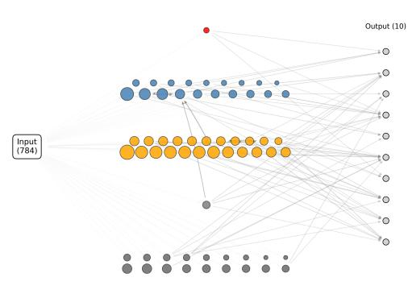

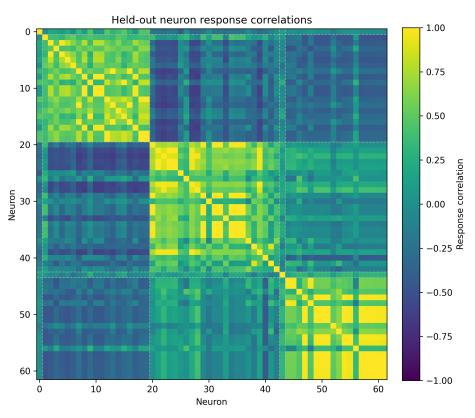  
(a)

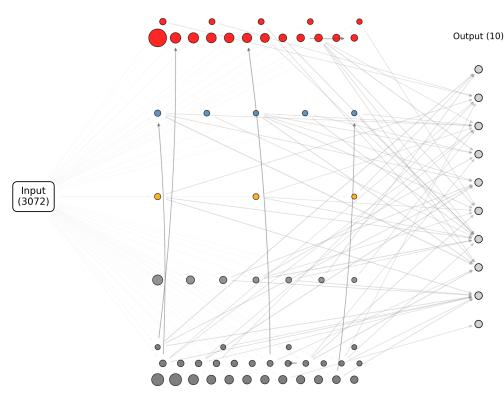

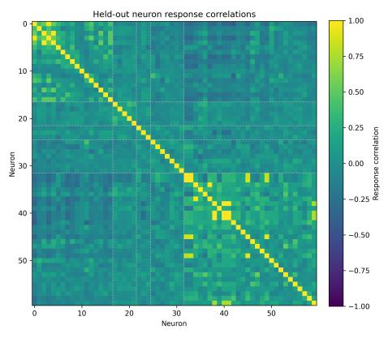  
(b)

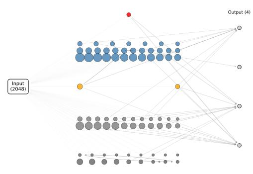

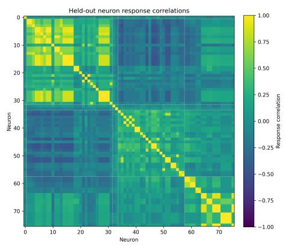  
(c)  
Figure 6: Structural and functional organization of trained FlowGenesis architectures. (a) Fashion-MNIST; (b) CIFAR-10; (c) AG News. Learned connectivity (left) and held-out neuronal response correlations (right). Node colors indicate correlation-based functional clusters; node areas reflect mean absolute activation, normalized within each network. Only the strongest connections are shown. Neurons are ordered by hierarchical clustering of response correlations, with dashed lines marking cluster boundaries. The correlation scale is fixed to [−1, 1] across datasets.

The left panels illustrate the learned network architectures. Input dimensions are represented by a single aggregate node, while output nodes correspond to classification categories. Hidden-neuron colors indicate functional clusters of neurons with correlated activation patterns, while node sizes reflect mean absolute activation, scaled independently for each network. Lines represent learned connections. Input-to-hidden connections summarize input-weight vectors by their $\ell _ { 2 }$ norms. To reduce visual clutter, recurrent connections are restricted to each neuron’s strongest outgoing connection by absolute efective weight (accounting for masking and incoming-degree normalization), with only the top 10% of these candidates displayed. Hidden-to-output connections are likewise restricted to the strongest 10% by absolute weight. The right panels show held-out Pearson correlation matrices with the same neuron ordering. Dashed lines mark functional cluster boundaries, and a common color scale of [−1, 1] enables comparison across networks.

Dataset-dependent functional organization. The learned architectures exhibit distinct functional organizations. Fashion-MNIST shows three prominent groups of strongly correlated neurons, with weaker or negative correlations between groups. CIFAR-10 exhibits smaller, less coherent groups and generally weaker correlations. AG News displays pronounced correlation blocks, including a large group of neurons with highly similar response patterns. These diferences may reflect dataset characteristics. The relatively regular visual patterns in Fashion-MNIST may encourage overlapping neuronal responses, whereas the greater visual diversity of CIFAR-10 may promote more heterogeneous representations. In AG News, sparse TF-IDF features may produce correlated responses to shared lexical or topical patterns. Within FlowGenesis, Flux-guided neuron birth and pruning adapt network capacity as representations evolve. The resulting architectures exhibit dataset-dependent functional organization, with distinct patterns of neuronal correlations.

## Code Availability

The source code for FlowGenesis is publicly available at github.com/maksimkazanskii/ FlowGenesis.

## Appendix F. Use of Large Language Models

Large language models (LLMs) assisted with manuscript polishing and code development.

The author retained full responsibility for the research methodology, experimental design, result verification, scientific interpretation, and final manuscript. All LLM-assisted contributions were reviewed and validated by the author.

## Contents

1 Introduction 1   
2 Related Work 2   
2.1 Neural Architecture Search and Adaptive Architectures 2   
2.2 Network Growth, Neurogenesis, and Pruning 3   
2.3 Developmental and Self-Organizing Neural Networks 3   
2.4 Structural Plasticity and Continual Learning 3   
2.5 Connection to Neuroscience 4   
2.6 Architectural Convergence and Emergent Organization 4   
2.7 Representation Dynamics and Representational Drift . 5   
2.8 Homeostatic Structural Plasticity 5   
3 Emergent Architectural Development 5   
3.1 Random Neural Container 6   
3.2 Representation Flux 6   
3.3 Flux-Driven Birth and Death 7   
3.4 Developmental Control Parameters 8   
3.5 Datasets and Evaluation Protocols 8   
4 Results 10   
4.1 Robustness to Initial Network Size 10   
4.2 Neuron Birth and Death Ablations 14   
4.3 Sensitivity to Neuron Birth and Pruning Selection 15   
4.4 Progressive Structural Adaptation in Continual Learning . 16   
5 Discussion 18   
6 Conclusion 20   
A Architecture Metrics and Statistical Analysis 21   
A.1 Reported Metrics and Notation 21   
A.2 Individual Architecture Metrics 21   
A.3 Cross-Run Architecture Similarity 21   
A.4 Statistical Analysis . 22   
B Hyperparameter Sensitivity Analysis 23   
C Fashion-MNIST Ablations 24   
D Flux-Guided Neurogenesis: Splitting and Stabilization 26   
D.1 Local dynamics. . 27   
D.2 Emergent Architectural Equilibrium 31   
D.3 Initial-Condition Forgetting in Architectural Dynamics 32   
E Architecture Visualization 33   
F Use of Large Language Models 35   
Contents 36   
References 38

## References

Markus Butz and Arjen van Ooyen. A simple rule for dendritic spine and axonal bouton formation can account for cortical reorganization after focal retinal lesions. PLOS Computational Biology, 9(10):e1003259, 2013. doi: 10.1371/journal.pcbi.1003259.

Markus Butz, Ines D. Steenbuck, and Arjen van Ooyen. Homeostatic structural plasticity can account for topology changes following deaferentation and focal stroke. Frontiers in Neuroanatomy, 8:115, 2014. doi: 10.3389/fnana.2014.00115.

Tianqi Chen, Ian Goodfellow, and Jonathon Shlens. Net2Net: Accelerating learning via knowledge transfer. In International Conference on Learning Representations, 2016.

Corinna Cortes, Xavier Gonzalvo, Vitaly Kuznetsov, Mehryar Mohri, and Scott Yang. AdaNet: Adaptive structural learning of artificial neural networks. In Proceedings of the 34th International Conference on Machine Learning, volume 70 of Proceedings of Machine Learning Research, pages 874–883. PMLR, 2017.

Xiaoliang Dai, Hongxu Yin, and Niraj K. Jha. NeST: A neural network synthesis tool based on a grow-and-prune paradigm. IEEE Transactions on Computers, 68(10):1487– 1497, 2019. doi: 10.1109/TC.2019.2914438.

Shibhansh Dohare, Richard S. Sutton, and A. Rupam Mahmood. Continual Backprop: Stochastic gradient descent with persistent randomness. arXiv preprint arXiv:2108.06325, 2021. doi: 10.48550/arXiv.2108.06325. URL https://arxiv.org/abs/2108.06325.

Saber Elaydi. An Introduction to Diference Equations. Undergraduate Texts in Mathematics. Springer, New York, 3 edition, 2005. doi: 10.1007/0-387-27602-5.

Thomas Elsken, Jan Hendrik Metzen, and Frank Hutter. Neural architecture search: A survey. Journal of Machine Learning Research, 20(55):1–21, 2019.

Utku Evci, Trevor Gale, Jacob Menick, Pablo Samuel Castro, and Erich Elsen. Rigging the lottery: Making all tickets winners. In Proceedings of the 37th International Conference on Machine Learning, volume 119 of Proceedings of Machine Learning Research, pages 2943–2952. PMLR, 2020.

Utku Evci, Bart van Merri¨enboer, Thomas Unterthiner, Max Vladymyrov, and Fabian Pedregosa. GradMax: Growing neural networks using gradient information. In International Conference on Learning Representations, 2022. URL https://openreview.net/forum? id=qjN4h\_wwUO.

Andrea Ferigo and Giovanni Iacca. Self-building neural networks. In Companion Conference on Genetic and Evolutionary Computation, pages 643–646. ACM, 2023. doi: 10.1145/ 3583133.3590531.

Bernd Fritzke. A growing neural gas network learns topologies. In Advances in Neural Information Processing Systems 7, pages 625–632. MIT Press, 1995. URL https://papers. nips.cc/paper/1994/hash/d56b9fc4b0f1be8871f5e1c40c0067e7-Abstract.html.

Thilo Gross and Bernd Blasius. Adaptive coevolutionary networks: A review. Journal of the Royal Society Interface, 5(20):259–271, 2008. doi: 10.1098/rsif.2007.1229.

Sture Holm. A simple sequentially rejective multiple test procedure. Scandinavian Journal of Statistics, 6(2):65–70, 1979.

Anthony Holtmaat and Karel Svoboda. Experience-dependent structural synaptic plasticity in the mammalian brain. Nature Reviews Neuroscience, 10(9):647–658, 2009.

Herbert Jaeger. The “echo state” approach to analysing and training recurrent neural networks. Technical Report GMD Report 148, German National Research Center for Information Technology, 2001.

Yiyang Jia and Chengxu Zhou. Self-motivated growing neural network for adaptive architecture via local structural plasticity. Neurocomputing, 702:134581, 2026. doi: 10.1016/ j.neucom.2026.134581. URL https://doi.org/10.1016/j.neucom.2026.134581.

Maksim A. Kazanskii. Geometry of forgetting: Representation flux in continual learning, 2026.

Simon Kornblith, Mohammad Norouzi, Honglak Lee, and Geofrey Hinton. Similarity of neural network representations revisited. In Proceedings of the 36th International Conference on Machine Learning, volume 97 of Proceedings of Machine Learning Research, pages 3519–3529. PMLR, 2019.

Alex Krizhevsky. Learning multiple layers of features from tiny images. Technical report, University of Toronto, 2009.

Harold W. Kuhn. The hungarian method for the assignment problem. Naval Research Logistics Quarterly, 2(1–2):83–97, 1955. doi: 10.1002/nav.3800020109.

Yann LeCun, Leon Bottou, Yoshua Bengio, and Patrick Hafner. Gradient-based learning applied to document recognition. Proceedings of the IEEE, 86(11):2278–2324, 1998.

Hanxiao Liu, Karen Simonyan, and Yiming Yang. Darts: Diferentiable architecture search. In International Conference on Learning Representations, 2019.

Clare Lyle, Mark Rowland, and Will Dabney. Understanding and preventing capacity loss in reinforcement learning. In International Conference on Learning Representations, 2022. URL https://openreview.net/forum?id=ZkC8wKoLbQ7.

Wolfgang Maass, Thomas Natschl¨ager, and Henry Markram. Real-time computing without stable states: A new framework for neural computation based on perturbations. Neural Computation, 14(11):2531–2560, 2002. doi: 10.1162/089976602760407955.

Kaitlin Maile, Emmanuel Rachelson, Herv´e Luga, and Dennis George Wilson. When, where, and how to add new neurons to ANNs. In Proceedings of the First International Conference on Automated Machine Learning, volume 188 of Proceedings of Machine Learning Research, pages 18/1–12. PMLR, 2022. URL https://proceedings.mlr.press/v188/ maile22a.html.

Thomas M. Martinetz, Stanislav G. Berkovich, and Klaus J. Schulten. Neural-gas network for vector quantization and its application to time-series prediction. IEEE Transactions on Neural Networks, 4(4):558–569, 1993. doi: 10.1109/72.238311.

Guo-li Ming and Hongjun Song. Adult neurogenesis in the mammalian brain: Significant answers and significant questions. Neuron, 70(4):687–702, 2011.

Elias Najarro, Shyam Sudhakaran, and Sebastian Risi. Towards self-assembling artificial neural networks through neural developmental programs. In Artificial Life Conference Proceedings, 2023. doi: 10.1162/isal a 00697.

Rosa C. Paolicelli, Giuseppina Bolasco, Luca Pagani, Laura Maggi, Marta Scianni, Patrizia Panzanelli, Maurizio Giustetto, Tiago A. Ferreira, Elisa Guiducci, Ludovic Dumas, Davide Ragozzino, and Cornelius T. Gross. Synaptic pruning by microglia is necessary for normal brain development. Science, 333(6048):1456–1458, 2011.

Farhad Pashakhanloo and Alexei Koulakov. Stochastic gradient descent-induced drift of representation in a two-layer neural network. In Proceedings of the 40th International Conference on Machine Learning, volume 202 of Proceedings of Machine Learning Research, pages 27401–27419. PMLR, 2023.

Erwan Plantec, Joachim W. Pedersen, Milton L. Montero, Eleni Nisioti, and Sebastian Risi. Evolving self-assembling neural networks: From spontaneous activity to experiencedependent learning. In ALIFE 2024: Proceedings of the 2024 Artificial Life Conference, page 37. MIT Press, 2024. doi: 10.1162/isal a 00755.

Andrei A. Rusu, Neil C. Rabinowitz, Guillaume Desjardins, Hubert Soyer, James Kirkpatrick, Koray Kavukcuoglu, Razvan Pascanu, and Raia Hadsell. Progressive neural networks. arXiv preprint arXiv:1606.04671, 2016. URL https://arxiv.org/abs/1606. 04671.

Dorothy P. Schafer, Emily K. Lehrman, Amanda G. Kautzman, et al. Microglia sculpt postnatal neural circuits in an activity and complement-dependent manner. Neuron, 74 (4):691–705, 2012. doi: 10.1016/j.neuron.2012.03.026.

Ayumu Tashiro, Vladislav M. Sandler, Nicolas Toni, Chunmei Zhao, and Fred H. Gage. Nmda-receptor-mediated, cell-specific integration of new neurons in adult dentate gyrus. Nature, 442:929–933, 2006. doi: 10.1038/nature05028.

Gina Turrigiano. Homeostatic synaptic plasticity: local and global mechanisms for stabilizing neuronal function. Cold Spring Harbor Perspectives in Biology, 4(1):a005736, 2012. doi: 10.1101/cshperspect.a005736.

Gina G. Turrigiano and Sacha B. Nelson. Homeostatic plasticity in the developing nervous system. Nature Reviews Neuroscience, 5:97–107, 2004. doi: 10.1038/nrn1327.

David Verstraeten, Benjamin Schrauwen, Michiel D’Haene, and Dirk Stroobandt. An experimental unification of reservoir computing methods. Neural Networks, 20(3):391–403, 2007. doi: 10.1016/j.neunet.2007.04.003.

Tao Wei, Changhu Wang, Yong Rui, and Chang Wen Chen. Network morphism. In Proceedings of the 33rd International Conference on Machine Learning, volume 48 of Proceedings of Machine Learning Research, pages 564–572. PMLR, 2016.

B. L. Welch. On the comparison of several mean values: An alternative approach. Biometrika, 38(3–4):330–336, 1951. doi: 10.1093/biomet/38.3-4.330.

Lemeng Wu, Dilin Wang, and Qiang Liu. Splitting steepest descent for growing neural architectures. In Advances in Neural Information Processing Systems, volume 32, 2019.

Lemeng Wu, Bo Liu, Peter Stone, and Qiang Liu. Firefly neural architecture descent: A general approach for growing neural networks. In Advances in Neural Information Processing Systems, volume 33, 2020.

Han Xiao, Kashif Rasul, and Roland Vollgraf. Fashion-mnist: a novel image dataset for benchmarking machine learning algorithms. arXiv preprint arXiv:1708.07747, 2017.

Jaehong Yoon, Eunho Yang, Jeongtae Lee, and Sung Ju Hwang. Lifelong learning with dynamically expandable networks. In International Conference on Learning Representations, 2018.

Xiang Zhang, Junbo Zhao, and Yann LeCun. Character-level convolutional networks for text classification. In Advances in Neural Information Processing Systems, volume 28, 2015.