## Highlights

Distributed Predictive Flocking for a Swarm of Miniature Vibration-Driven Robots in a Confined Arena

Prajol Shrestha, Siddhant Mohapatra, Filip Novkoski, Julian Oelhaf, Nicolas Vandewalle, Ana-Sunčana Smith, Andreas Maier

• Distributed leader-free predictive flocking for a dense swarm of miniature robots.

• Six safety formulations compared on a single common controller footing.

• Look-ahead safety constraint gives widest margins and fewest collisions.

• Single generalized controller deployed to handle diferent tasks successfully.

• Swarm stays coordinated up to the geometric packing limit in each task.

# Distributed Predictive Flocking for a Swarm of Miniature Vibration-Driven Robots in a Confined Arena⋆

Prajol Shresthaa,∗, Siddhant Mohapatrab, Filip Novkoskib, Julian Oelhafa, Nicolas Vandewallec, Ana-Sunčana Smithb,d and Andreas Maiera

aPattern Recognition Lab, Department of Computer Science, Friedrich-Alexander-Universität Erlangen-Nürnberg, 91058, Erlangen, Germany

bPULS, Institute for Theoretical Physics, Friedrich-Alexander-Universität Erlangen-Nürnberg, 91058, Erlangen, Germany

cGRASP, Institute ofPhysics B5a, University ofLiège, B4000, Liège, Belgium

dGroupfor Computational Life Sciences, Division ofPhysical Chemistry, Ruđer Bošković Institute, 10000, Zagreb, Croatia

## A R T I C L E I N F O

Keywords:   
Distributed model predictive control   
Multi-robot systems   
Control barrier functions   
Collision avoidance   
Collective behavior

## A BS T R AC T

Coordinating many miniature robots in a confined arena, with no leader, central planner, or global map, is a core challenge for swarm robotics. As the swarm grows denser, collision avoidance becomes the limiting factor, and the number of safely coexisting robots depends on the formulation of the inter-robot safety constraint. We present a distributed predictive flocking controller in which each robot solves its own nonlinear model predictive control (NMPC) problem, optimizing swarm cohesion and alignment costs, inter-robot and obstacle safety, and a task objective, while exchanging only predicted trajectories with local neighbors. Within this generalized controller architecture, solved in real time, we compare six barrier and controlbarrier-function (CBF) safety formulations on a digital twin of an open-source vibration-driven bristlebot in a 0.64 m2 arena. A look-ahead discrete-time CBF performs best overall, with the fewest collisions and the widest inter-robot margins across nearly every swarm size tested. We deploy it on phototaxis, phototactic orbiting, and cohesion without a stimulus tasks, using swarm sizes starting from ten robots and up to the geometric packing limit. The swarm holds well: collisions stay low in small swarms, rising steeply as the packing limit approaches, while coordination and cohesion degrade gently rather than collapsing. The swarm is found not to trade safety for order, keeping both across the confined arena, with local alignment high at every swarm size.

## 1. Introduction

Autonomous multi-robot systems are a promising approach for tasks in cluttered, inaccessible, or hazardous spaces, from confined-structure inspection to search in collapsed buildings and medical micro-robotics [1]. In these settings, many miniature robots must coordinate in proximity within a tight, bounded arena. As in natural swarms, such as flocking of starlings, schooling of fish, the crowded colonies of ants and honey bees, and even the collective migration of cells, robust group behavior emerges from purely local interactions among simple agents [2, 3, 4], with no centra control [1]. Miniaturization, however, tightly bounds onboard compute, memory, and power [5], demanding control that is theoretically principled yet computationally light. Moreover, when the arena is fixed, a growing number of robots increases the density of the swarm and hinders smooth motion. When it is also cluttered with obstacles, coordination is even harder. In this scenario, collision avoidance becomes the central challenge.

The standard way to coordinate such a swarm from purely local interactions is Reynolds’ boid model [6, 7], which reduces collective motion to three local rules (cohesion, alignment, and separation) that produce coherent group motion without global information [8]. Early control laws formalized these as artificial potential fields over a communication graph [9, 10], and reactive velocity-matching rules scale to tens of drones [11]. Such reactive methods, however, ofer no predictive horizon, no formal safety guarantee under nonlinear dynamics, and no systematic handling of kinodynamic limits. These shortcomings are especially severe in confined, high-density settings, where many underactuated robots have little room to recover from unsafe motions.

Model predictive control (MPC) [12] addresses these limitations. For the nonlinear dynamics of mobile robots, this takes the form of nonlinear MPC (NMPC). It solves a finite-horizon optimal control problem (OCP) online, which provides closed-loop feedback, constraint satisfaction, and explicit multi-objective trade-ofs. Distributed MPC (DMPC) extends this to a swarm by splitting the global problem into per-agent OCPs coupled through shared constraints [13, 14, 15, 16]. Solvers such as the Sequential Quadratic Programming real-time iteration (SQP-RTI) [17] solve each per-agent OCP in real time. Similarly, optimization-based swarm planners achieve strong real-world navigation [18, 19, 20, 21]. These methods are mainly developed for point-to-point navigation [14, 22], with collision avoidance typically encoded as geometric constraints such as separating hyperplanes or safe corridors.

The closest works embed Reynolds behaviors in NMPC. They have been demonstrated on up to 16 quadrotors [23, 24], leader-follower teams [25, 26, 27], and fixed-wing unmanned aerial vehicles (UAVs) [28]. Most share one regime. They assume sparse flight in large 3D airspace, with the swarm migrating toward a shared goal. Even when several obstacles are present, they remain sparse relative to the available space, keeping the environment efectively lowdensity. Few address the opposite regime that we target, where many underactuated robots coordinate at high density in a fixed, confined, and cluttered arena under a task objective such as following a light gradient. Here, the inter-robot safety formulation, not free-space planning, governs how many robots can coexist. Each of these works, however, fixes a single safety formulation in advance, usually a distance constraint or a penalty. It remains open which formulation fits the most robots into a fixed arena with minimal collisions.

Safety formulations difer in how collision avoidance is encoded as a constraint in the OCP. Such a constraint is classically formulated using a barrier function ℎ(�) whose safe set $S = \{ x \mid h ( x ) \geq 0 \}$ is kept forward invariant to certify safety [29], typically imposed as a hard [30] or soft [31] distance constraint. A Control Barrier Function (CBF) [29] relaxes this strict boundary condition by allowing ℎ(�) to decrease at a rate bounded by a class- function, and its discrete-time form (Dt-CBF) [32] imposes this at each MPC stage. Zeng et al. [33] enforces it as a hard constraint, which is often infeasible. Feasibility is restored by softening the decay with slack variables [34, 35, 36], adding terminal barrier terms [37, 38], or anchoring a soft CBF with one hard step [39]. Beyond feasibility, when the constraint has relative degree greater than one, as for a distance constraint under unicycle dynamics, a higher-order CBF (HOCBF) [40, 41] chains the barrier conditions. Lu et al. [39] compare a distance-constraint MPC, a hard discrete-time CBF, a slacked CBF, and their combination on a common footing, but for a single robot. In the multi-robot setting, safety is enforced by reactive schemes [42, 43], by post-hoc CBF-QP (quadratic program) filters [44], or by a CBF inside a decentralized MPC with neighbors as predicted trajectories [45, 46, 47, 48]. A formulation’s collision performance, however, likely changes with the swarm density. A comparison across densities is required to find the best one.

In this work, we investigate the maximum number of miniature robots a distributed predictive controller can flock in a fixed arena, and design a controller to push that limit. Each robot solves its own NMPC combining Reynolds cohesion, alignment, and separation (gated by neighbor presence) with inter-robot/obstacle safety and the task objective. It selects the � nearest neighbors within the communication radius and exchanges predicted trajectories synchronously as OCP parameters, giving a fully distributed, leader-free architecture with no central planner or global map. We evaluate it on a physics-informed digital twin [49] of the GRASPion [50], an open-source vibration-driven bristlebot studied as an active-matter model system. We characterize how densely the swarm packs a $0 . 6 4 \mathrm { m } ^ { 2 }$ arena while sustaining two behaviors. These are phototaxis (ascending toward a moving Gaussian light gradient) and a phototactic orbital mode (orbiting the source along the intensity level-set). We compare six inter-robot safety formulations on a common footing (Section 3.3). A slacked barrier paired with a discrete-time CBF at a forward handle [51] sustains the highest density with the fewest collisions. The main contributions of this paper are as follows:

1. A distributed predictive control system for dense swarms of miniature vibration-driven robots. Each robot solves its own NMPC fusing flocking, safety, and the task objective, coupled to neighbors only through exchanged predicted trajectories.

2. Demonstration that a single controller generalizes across qualitatively diferent collective behaviors. The same architecture produces gradient-ascending phototaxis, stable phototactic orbital formation, and generic flocking with no modification to the safety or coordination layers, showing that task objectives and coordination structure are separable and that new tasks can be added without re-deriving safety guarantees.

3. A careful comparison of six inter-robot safety formulations within one identical controller, isolating the safety constraint as the only varying factor. The Look-ahead Slack Dt-CBF gives the best overall trade-of for the phototaxis deployment target.

4. Characterization of the operating swarm density that the controller sustains in a fixed arena. The swarm stays cohesive with few collisions in small swarms; collisions rise steeply towards the geometric packing limit, as saturation sets in, while coordination and feasibility degrade gently rather than collapse.

The remainder of this paper is structured as follows. Section 2 presents the robot model, light field, control architecture overview, behavior generation, flocking rules, and the DMPC OCP. Section 3 reports the simulation results, including the safety-formulation study (Section 3.3), the analysis of collective behavior (Section 3.4), and the quantification of collision avoidance under diferent tasks (Section 3.5). Section 4 summarizes the work and provides an outlook for future studies.

## 2. Preliminaries and Problem Statement

In this work, we consider a swarm of $N _ { b }$ robots operating in a bounded arena $\mathcal { A } = [ - A _ { h } , A _ { h } ] ^ { 2 } \subset \mathbb { R } ^ { 2 }$ , with each robot labeled by $i \in \{ 1 , \ldots , N _ { b } \}$ . The state of robot � is $\pmb { x } _ { i } = [ \pmb { p } _ { i } , \pmb { \theta } _ { i } ] ^ { \top } \in \mathbb { R } ^ { 3 }$ , where $\pmb { p } _ { i } = [ p _ { x , i } , p _ { y , i } ] ^ { \top }$ is the position and $\theta _ { i }$ the heading. Inter-robot communication is modeled as a directed sensing graph $\mathcal { G } = ( \mathcal { V } , \mathcal { E } )$ , where $\mathfrak { V } = \{ 1 , \dots , N _ { b } \}$ denotes the set of robots and $\mathcal { E } \subseteq \mathcal { V } \times \mathcal { V }$ is the communication set of ordered pairs $( i , j )$ for which robot � can observe robot �. The neighbor set of robot � is $\mathcal { N } _ { i } = \{ j \in \mathcal { V } \mid ( i , j ) \in \mathcal { E } \}$ . We adopt a topological neighborhood with fixed cardinality $| { \mathcal { N } } _ { i } | \leq K$ , selecting the � nearest robots within communication radius $R _ { \mathrm { c o m m } }$ of robot �. This choice keeps the neighbor count constant and avoids the cost discontinuities that arise under Voronoi or attraction-based topologies [52, 53, 54]. Each robot additionally accounts for up to � nearby static circular obstacles within a sensing range $d _ { \mathrm { o b s } }$ , indexed by $m \in \{ 1 , \ldots , M \}$ , with obstacle � at center $\pmb { p } _ { m } \in \mathbb { R } ^ { 2 }$ and radius $r _ { m } .$ . The environment also includes a single light source whose intensity field serves as the swarm stimulus.

The OCP is compiled once with a fixed parameter dimension. Neighbor and obstacle information therefore enters two fixed-size blocks of � and � slots, the neighbor block and the obstacle block. At each control step, robot � receives a predicted trajectory $\pmb { \tau } _ { j } = \left\{ [ \hat { \pmb { p } } _ { j } ^ { ( k ) } , \hat { \pmb { v } } _ { j } ^ { ( k ) } ] ^ { \top } \right\} _ { k = 0 } ^ { N }$ from each neighbor $j \in \mathcal N _ { i }$ , where $\hat { p } _ { i } ^ { ( k ) } \in \mathbb { R } ^ { 2 }$ and $\hat { \pmb v } _ { i } ^ { ( k ) } \in \mathbb { R } ^ { 2 }$ are the predicted position and velocity of neighbor � at horizon stage �. Throughout, a hat denotes a quantity the per-robot OCP treats as fixed data (the ego robot’s current measured state and the neighbors’ received predicted trajectories). The ego robot’s own predicted states are decision variables. These trajectories fill the neighbor block, and the number of occupied slots changes from step to step. Each neighbor slot therefore carries a binary activation mask $a _ { j } ^ { ( k ) } \in \{ 0 , 1 \}$ where $a _ { i } ^ { ( k ) } = 1$ if slot � is occupied at stage � and $a _ { j } ^ { ( k ) } = 0$ otherwise. The obstacle block is filled the same way. Robot � selects the � nearest obstacles within obstacle sensing range $d _ { \mathrm { o b s } }$ and writes each center ${ \pmb p } _ { m }$ into a slot together with its own activation flag.

## 2.1. Robot Model

Each robot is modeled as a rigid ellipse with semi-major axis � and semi-minor axis �, matching the physical footprint of the GRASPion open-source bristlebot [50], as illustrated in Fig. 1. The simulated elliptical agent is modeled after this hardware platform, following the physics-informed digital twin of [49], so the simulation study is grounded in a physical robot footprint and can serve as a precursor to future physical experiments.

The dynamics of each robot are described by a three-state kinematic unicycle model with state $\textbf { \em x } \in \ \mathbb { R } ^ { 3 }$ , input $\pmb { u } \in \mathbb { R } ^ { 2 }$ , and continuous-time dynamics $f ( { \pmb x } , { \pmb u } )$ given by

$$
\begin{array} { r l } & { \boldsymbol { x } = [ \boldsymbol { p } _ { x } , \boldsymbol { p } _ { y } , \boldsymbol { \theta } ] ^ { \top } , } \\ & { \boldsymbol { u } = [ \boldsymbol { v } , \boldsymbol { \omega } ] ^ { \top } , } \\ & { \dot { \boldsymbol { x } } = f ( \boldsymbol { x } , \boldsymbol { u } ) = [ \boldsymbol { v } _ { x } , \boldsymbol { v } _ { y } , \boldsymbol { \omega } ] ^ { \top } , } \end{array}\tag{1}
$$

(2)

(3)

where $( p _ { x } , p _ { y } )$ is the position, � the heading angle, � the linear velocity, $v _ { x } = v$ cos � and $v _ { y } = v$ sin � are the velocity components, and � the angular velocity. The continuous-time dynamics (3) are integrated using an explicit Runge-Kutta 4 (ERK-4) integrator with three steps per control interval, yielding the discrete-time map $\pmb { x } ^ { ( \bar { k + 1 } ) } = \bar { F } ( \pmb { x } ^ { ( k ) } , \pmb { u } ^ { ( \bar { k } ) } )$ .

## 2.2. Light Field Model

The arena contains a time-varying light field that each robot senses locally to compute its navigation reference. The field is modeled as a Gaussian intensity profile whose source either orbits the arena center or remains stationary.

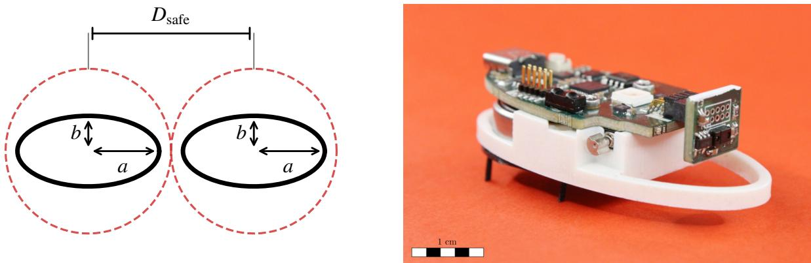  
Figure 1: (Left) Two elliptical robots with minimum safe distance $D _ { \mathrm { s a f e } }$ and semi-axes � (3 cm) and � (1.5 cm). (Right) The physical GRASPion open-source bristlebot hardware.

Light Source The light source produces a Gaussian intensity field

$$
I ( p , t ) = I _ { 0 } \exp \left( - \frac { \| p - s ( t ) \| ^ { 2 } } { 2 \sigma _ { \mathrm { L } } ^ { 2 } } \right) ,\tag{4}
$$

where $\pmb { p } \in \mathbb { R } ^ { 2 }$ is an arbitrary position, $I _ { 0 } > 0$ is the peak intensity, $s ( t ) \in  { \mathbb { R } } ^ { 2 }$ is the position of the source at time �, and $\sigma _ { \mathrm { L } }$ represents the spatial spread of intensity.

Source Dynamics The light source supports two motion modes. In circular rotation mode, the source orbits the center of the arena at a fixed radius � with angular speed $\omega _ { s } = v _ { s } / r .$ , with the position of the source given by

$$
\begin{array} { r } { s ( t ) = r [ \cos ( \omega _ { s } t + \varphi _ { 0 } ) ] , } \\ { \sin ( \omega _ { s } t + \varphi _ { 0 } ) ] } \end{array}\tag{5}
$$

where $\varphi _ { 0 }$ is the initial angle of the source in the orbit and $v _ { s }$ is the speed of the source along the orbit. In stationary mode, the source remains fixed at the arena center.

Intensity Gradient The intensity gradient with respect to the robot position is computed analytically as

$$
\nabla _ { p } I ( p , t ) = - \frac { ( p - s ( t ) ) } { \sigma _ { \mathrm { L } } ^ { 2 } } I ( p , t ) .\tag{6}
$$

This analytic gradient is the local cue that the collective-behavior modes of Section 2.4 convert into each robot’s look-ahead reference.

## 2.3. Control Architecture Overview

Every robot runs an identical decentralized controller, outlined in Fig. 2. At each control step, the robot senses the local light field, and a behavior module maps this reading to a look-ahead reference that encodes where the robot should head next. A per-robot optimal control problem (OCP) tracks that reference. Flocking rules keep the group cohesive and heading-aligned, while barrier and control-barrier-function constraints enforce inter-robot and obstacle safety. Robots publish their predicted trajectories over the sensing graph and re-solve synchronously from their neighbors’ previous plans, coordinating the swarm without a central node. The rest of this section develops the remaining components in turn. These are the behavior module (Section 2.4), the flocking rules (Section 2.5), the six safety formulations (Sections 2.5.3–2.5.4), the reference-tracking and control-efort costs (Section 2.6), the assembled OCP (Section 2.7), and the decentralized execution loop (Section 2.8).

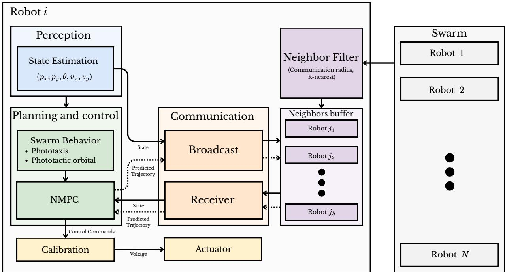  
Figure 2: Per-robot control architecture for the DMPC swarm. Each robot runs three concurrent subsystems. The Perception block estimates the robot’s state comprising position $p _ { x }$ and $p _ { y } ,$ orientation �, and velocity $v _ { x }$ and $v _ { y } .$ . The Planning and Control block uses this state to compute a look-ahead reference based on the active swarm behavior (phototaxis or phototactic orbital) and then solves the local NMPC problem to produce control commands, which are passed through a Calibration layer before reaching the Actuator. The Communication block handles all inter-robot data exchange, where solid arrows denote state signals and dotted arrows denote predicted trajectory exchanges. Incoming broadcasts are filtered by a Neighbor Filter (within communication range $R _ { \mathrm { { c o m m } } }$ and �-nearest selection) and stored in the robot’s neighbors bufer before being used by the NMPC solver.

## 2.4. Collective Behavior Modes

Collective motion emerges when individual agents produce coordinated group-level movement through purely local interactions in the absence of centralized planning $[ 6 , 5 5 ] .$ . In our controller, a behavior module translates local sensory observations into a look-ahead reference $( p ^ { \mathrm { r e f } } , \theta ^ { \mathrm { r e f } } , v ^ { \mathrm { r e f } } , \omega ^ { \mathrm { r e f } } )$ at each control step, which the OCP then tracks while maintaining flocking coherence and safety. We describe two such modes, phototaxis and phototactic orbital behavior.

At each control step, the light-field gradient $g \ = \ \nabla I ( { \hat { p } } _ { i } )$ is evaluated analytically from (4)–(6). The resulting reference heading depends on the selected collective behavior mode. Once the heading is obtained, the look-ahead reference position is computed as

$$
\begin{array} { r } { p ^ { \mathrm { r e f } } = \mathrm { c l i p } \big ( \hat { p } _ { i } + d _ { \mathrm { l a } } [ \cos \theta ^ { \mathrm { r e f } } , \sin \theta ^ { \mathrm { r e f } } ] ^ { \top } , [ - A _ { h } , A _ { h } ] ^ { 2 } \big ) } \end{array}\tag{7}
$$

where $d _ { \mathrm { l a } }$ is the look-ahead distance, and the clipping function constrains the reference position to remain inside the arena. The reference velocity is set to a constant target value $v ^ { \mathrm { r e f } }$ , and the reference angular velocity $\omega ^ { \mathrm { r e f } }$ is fixed at zero.

## 2.4.1. Phototaxis Behavior Mode

Phototaxis drives each robot to ascend the intensity gradient of the light field without knowledge of the global source position. The reference heading is aligned with the steepest ascent direction:

$$
\theta ^ { \mathrm { r e f } } = \left\{ \begin{array} { l l } { \mathrm { a t a n 2 } ( g _ { y } , g _ { x } ) , } & { \| g \| _ { 2 } \geq \epsilon _ { \mathrm { g r a d } } , } \\ { \hat { \theta } _ { i } , } & { \| g \| _ { 2 } < \epsilon _ { \mathrm { g r a d } } , } \end{array} \right.\tag{8}
$$

where $\epsilon _ { \mathrm { g r a d } }$ is a small gradient threshold. When the field is nearly flat $( \lVert \mathbf { g } \rVert _ { 2 } < \epsilon _ { \mathrm { g r a d } } )$ , the robot holds its current heading $\widehat { \theta } _ { i }$ rather than turning randomly.

## 2.4.2. Phototactic Orbital Behavior Mode

In the phototactic orbital mode, each robot follows the tangent of the light intensity level set, efectively orbiting the source without knowledge of its global position. The reference heading is obtained by rotating the gradient direction from (8) by $\pi / 2$ , with the orbital direction governed by the circulation parameter $\kappa \in \{ - 1 , + 1 \}$ (where $\kappa = + 1$ generates counter-clockwise motion, and $\kappa = - 1$ generates clockwise motion):

$$
\theta ^ { \mathrm { r e f } } = \left\{ \begin{array} { l l } { \mathrm { a t a n } 2 ( g _ { y } , g _ { x } ) - \kappa \frac { \pi } { 2 } , } & { \| g \| _ { 2 } \geq \epsilon _ { \mathrm { g r a d } } , } \\ { \hat { \theta } _ { i } , } & { \| g \| _ { 2 } < \epsilon _ { \mathrm { g r a d } } . } \end{array} \right.\tag{9}
$$

## 2.4.3. Extensibility to Arbitrary Behaviors

Decoupling the reference generator from the OCP makes the architecture task-agnostic. Any behavior (directed migration, dispersal, transport, shape formation) can be integrated by mapping local observations to a look-ahead reference $( p ^ { \mathrm { r e f } } , \theta ^ { \mathrm { r e f } } , v ^ { \mathrm { r e f } } , \omega ^ { \mathrm { r e f } } )$ , while the DMPC preserves safety and flocking coherence.

## 2.5. Reynolds Flocking Rules

The behavior modes set each robot’s individual objective, while the collective motion arises from the local steering rules proposed by Reynolds [6, 7]. Cohesion binds robots into a group, alignment coordinates their heading, separation keeps them from colliding, and obstacle avoidance steers them clear of static hazards. The controller encodes cohesion and alignment as quadratic cost terms in the per-robot OCP, while separation and obstacle avoidance are enforced through barrier and discrete-time CBF constraints [29, 32]. We focus on the separation and obstacle avoidance by comparing six diferent formulations, ranging from hard barriers to slacked variants (Sections 2.5.3 and 2.5.4).

## 2.5.1. Cohesion

The active-neighbor centroid at stage � is computed as a masked weighted average of predicted neighbor positions:

$$
\boldsymbol { c } ^ { ( k ) } = \frac { 1 } { s ^ { ( k ) } } \sum _ { j = 1 } ^ { K } \boldsymbol { a } _ { j } ^ { ( k ) } \hat { \boldsymbol { p } } _ { j } ^ { ( k ) } \in \mathbb { R } ^ { 2 } ,\tag{10}
$$

where the soft neighbor count

$$
s ^ { ( k ) } = \operatorname* { m a x } \left( \sum _ { j = 1 } ^ { K } a _ { j } ^ { ( k ) } , \varepsilon \right) , \qquad \varepsilon = 1 0 ^ { - 4 } ,\tag{11}
$$

prevents division by zero when there are no neighbors in the vicinity. The cohesion penalty is

$$
\ell _ { \mathrm { c o h } } ( { \pmb x } ^ { ( k ) } ) = q _ { \mathrm { c o h } } g ^ { ( k ) } \| { \pmb p } _ { i } ^ { ( k ) } - { \pmb c } ^ { ( k ) } \| ^ { 2 } ,\tag{12}
$$

with weight $q _ { \mathrm { c o h } } \ge 0 ;$ gated by the activation gate

$$
\begin{array} { r } { g ^ { ( k ) } = \operatorname* { m i n } \Big ( \sum _ { j = 1 } ^ { K } a _ { j } ^ { ( k ) } , 1 \Big ) . } \end{array}\tag{13}
$$

When at least one neighbor slot is active, $g ^ { ( k ) } = 1$ and the cost is enabled. In isolation, when $g ^ { ( k ) } = 0$ and it vanishes. Separating $s ^ { ( k ) }$ (denominator safety) from $g ^ { ( k ) }$ (which enables the cohesion and alignment costs only when a neighbor is present) keeps the per-robot cost well posed for the SQP-RTI solve. Finally, cohesion uses the stage-matched predicted positions $\hat { p } _ { j } ^ { ( \hat { k } ) }$ rather than current measured ones, pulling robot � toward where its neighbors are predicted to be.

## 2.5.2. Alignment

The mean heading direction $( \theta _ { \mathrm { m e a n } } ^ { ( k ) } )$ of active neighbors is estimated from their predicted velocity vectors:

$$
\bar { \pmb { v } } ^ { ( k ) } = \sum _ { j = 1 } ^ { K } a _ { j } ^ { ( k ) } \hat { \pmb { v } } _ { j } ^ { ( k ) } = [ \bar { v } _ { x } ^ { ( k ) } , \bar { v } _ { y } ^ { ( k ) } ] ^ { \top } ,\tag{14}
$$

$$
\theta _ { \mathrm { m e a n } } ^ { ( k ) } = \mathrm { a t a n } 2 \big ( \bar { v } _ { y } ^ { ( k ) } + \varepsilon , \bar { v } _ { x } ^ { ( k ) } + \varepsilon \big ) .\tag{15}
$$

The neighbor velocities are summed rather than normalized, so faster neighbors weigh more heavily. The � ofsets regularize atan2 near a zero velocity sum (fixing $\theta _ { \mathrm { m e a n } } ^ { ( k ) }$ at $\pi / 4$ only at exact cancellation, an edge case). The resulting $\theta _ { \mathrm { m e a n } } ^ { ( \overline { { k } } ) }$ then defines the alignment heading error, wrapped to (−�, �]:

$$
e _ { \mathrm { a l i } } ^ { ( k ) } = \mathrm { a t a n 2 } \left( \sin ( \theta ^ { ( k ) } - \theta _ { \mathrm { m e a n } } ^ { ( k ) } ) , \cos ( \theta ^ { ( k ) } - \theta _ { \mathrm { m e a n } } ^ { ( k ) } ) \right) ,\tag{16}
$$

and the alignment penalty is

$$
\ell _ { \mathrm { a l i } } ( \pmb { x } ^ { ( k ) } ) = q _ { \mathrm { a l i } } g ^ { ( k ) } \big ( e _ { \mathrm { a l i } } ^ { ( k ) } \big ) ^ { 2 } ,\tag{17}
$$

with weight $q _ { \mathrm { a l i } } \geq 0$ . As in the cohesion term, the shared gate $g ^ { ( k ) }$ disables both cohesion and alignment when robot � is isolated.

## 2.5.3. Inter-Robot Separation

The inter-robot separation constraint builds on a pairwise safety barrier and its Dt-CBF extension. For neighbor slot � at stage �, the barrier

$$
h _ { j } ^ { ( k ) } = \left\| \boldsymbol { p } _ { i } ^ { ( k ) } - \hat { \boldsymbol { p } } _ { j } ^ { ( k ) } \right\| ^ { 2 } - D _ { \mathrm { s a f e } } ^ { 2 }\tag{18}
$$

is non-negative exactly when robot � and neighbor � are at least $D _ { \mathrm { s a f e } }$ apart. Starting from this barrier, the same safety constraint can be encoded in several ways, each imposed hard or slacked. We consider six formulations that difer only in the safety constraint, and observe the corresponding change in swarm behavior. Section 3.3 then evaluates all six under identical conditions and retains the best-performing one. The last three share a common structure consisting of a slacked barrier anchor paired with a rate condition. They difer only in the rate condition, which is a one-step Dt-CBF on the body, the same condition on a forward handle, or a two-step higher-order chain.

(a) Hard BF The plain barrier imposed as a hard constraint,

$$
h _ { j } ^ { ( k ) } \geq 0 ,\tag{19}
$$

is the most direct encoding of the $D _ { \mathrm { s a f e } }$ rule. It forbids any predicted configuration closer than $D _ { \mathrm { s a f e } }$ at every stage. It is purely reactive (it acts only once a neighbor is within range) and, as a hard constraint, allows no slack, so a robot surrounded by several neighbors at once can leave its OCP with no feasible input.

(b) Hard Dt-CBF The discrete-time CBF condition as a hard constraint,

$$
h _ { j } ^ { ( k + 1 ) } - \left( 1 - \alpha \right) h _ { j } ^ { ( k ) } \geq 0 , \qquad \alpha \in ( 0 , 1 ] ,\tag{20}
$$

compares the barrier $h _ { i } ^ { ( k ) }$ with its one-step-ahead value $h _ { j } ^ { ( k + 1 ) }$ . The latter is formed by a forward-Euler step of the ego position and a constant-velocity step of each neighbor,

$$
\begin{array} { r l } & { p _ { i } ^ { ( k + 1 ) } = p _ { i } ^ { ( k ) } + \Delta t v ^ { ( k ) } [ \cos \theta ^ { ( k ) } , \sin \theta ^ { ( k ) } ] ^ { \top } , } \\ & { \hat { p } _ { j } ^ { ( k + 1 ) } = \hat { p } _ { j } ^ { ( k ) } + \Delta t \hat { v } _ { j } ^ { ( k ) } ; } \end{array}\tag{21}
$$

(22)

The ego step is linear in $v ^ { ( k ) }$ , which keeps the quadratic-program subproblems well conditioned. It is a first-order approximation used only inside the barrier constraint, separate from the ERK-4 discretization of the dynamics (3). The condition does not forbid $h _ { i } < 0$ but limits how fast the barrier may shrink each step, to at most a fraction � (a discrete class- rate). The robot therefore starts slowing while still safely separated rather than braking at the boundary, giving smoother, early avoidance. This is exactly the MPC-CBF formulation of [33]. Being a hard constraint, it carries the same infeasibility risk as Hard BF with dense congregations of robots.

Distributed Predictive Flocking for a Swarm of Miniature Vibration-Driven Robots in a Confined Arena

(c) Slack BF The plain barrier mentioned in Hard BF, softened by its slack,

$$
h _ { j } ^ { ( k ) } + \xi _ { j , \mathrm { b f } } ^ { ( k ) } \ge 0 ,\tag{23}
$$

keeps the OCP solvable in the crowded configurations that make Hard BF infeasible. When no input can satisfy $h _ { j } \geq 0 .$ the penalized slack $\xi _ { j , \mathrm { b f } }$ opens just enough to admit a feasible, minimally-violating solution instead of failing.

(d) Slack Dt-CBF The slacked barrier anchor (23) and the discrete-time CBF condition softened by its own slack,

$$
h _ { j } ^ { ( k + 1 ) } - \left( 1 - \alpha \right) h _ { j } ^ { ( k ) } + \xi _ { j , \mathrm { c b f } } ^ { ( k ) } \geq 0 ,\tag{24}
$$

imposed together on the same neighbor, each with its own slack. The rate condition combines the before-contact activation of Hard Dt-CBF with the improved solvability of Slack BF. The anchor guards the footprint at every stage while the CBF constraint shapes the approach rate. This is the reference point for the next two formulations: they retain this anchored structure and change only where or how the rate condition is evaluated, so the ensuing description only mentions those two choices.

(e) Look-ahead (LA) Slack Dt-CBF This formulation is a modification of Slack Dt-CBF with its rate condition moved from the body onto a forward handle a fixed distance $L ~ ( 0 ~ < ~ L ~ < ~ D _ { \mathrm { s a f e } } )$ ahead of the robot, adapting the ofset-point construction of Huang et al. [51] to discrete time,

$$
\begin{array} { r } { \pmb { p } _ { L } ^ { ( k ) } = \pmb { p } _ { i } ^ { ( k ) } + L [ \cos \theta ^ { ( k ) } , \sin \theta ^ { ( k ) } ] ^ { \top } , } \end{array}\tag{25}
$$

$$
h _ { j , L } ^ { ( k ) } = \left\| \boldsymbol { p } _ { L } ^ { ( k ) } - \boldsymbol { \hat { p } } _ { j } ^ { ( k ) } \right\| ^ { 2 } - ( D _ { \mathrm { s a f e } } - L ) ^ { 2 } ,\tag{26}
$$

with the slacked condition $h _ { j , L } ^ { ( k + 1 ) } - ( 1 - \alpha ) h _ { j , L } ^ { ( k ) } + \xi _ { j , \mathrm { c b f } } ^ { ( k ) } \geq 0$ imposed on the handle. A body distance barrier has relative degree two under unicycle dynamics, so the turn rate does not appear in its one-step form and a robot can only slow down to keep clear. The handle $p _ { L } ^ { ( k ) }$ moves with the heading, so $\omega ^ { ( k ) }$ enters the one-step barrier directly. The robot can, therefore, also steer around a neighbor, while the body anchor (23) still guards the true footprint.

(f) Slack Dt-HOCBF The slacked barrier anchor (23) together with a slacked higher-order (relative-degree-two) chain [41, 40] is built natively in discrete time from successive barrier values rather than from derivatives. With $h _ { j } ^ { ( k + 1 ) }$ and $h _ { j } ^ { ( k + 2 ) }$ , the barrier evaluates the one-step and two-step prediction under the held input $( v ^ { ( k ) } , \omega ^ { ( k ) } )$ ,

$$
\psi _ { 1 } ^ { ( k ) } = h _ { j } ^ { ( k + 1 ) } - ( 1 - \gamma _ { 1 } ) h _ { j } ^ { ( k ) } ,\tag{27}
$$

$$
\psi _ { 2 } ^ { ( k ) } = \psi _ { 1 } ^ { ( k + 1 ) } - ( 1 - \gamma _ { 2 } ) \psi _ { 1 } ^ { ( k ) } + \xi _ { j , \mathrm { c b f } } ^ { ( k ) } \geq 0 ,\tag{28}
$$

with decay rates $\gamma _ { 1 } , \gamma _ { 2 } \in ( 0 , 1 ]$ . Expanding the chain gives the single constraint actually imposed,

$$
h _ { j } ^ { ( k + 2 ) } - ( 2 - \gamma _ { 1 } - \gamma _ { 2 } ) h _ { j } ^ { ( k + 1 ) } + ( 1 - \gamma _ { 1 } ) ( 1 - \gamma _ { 2 } ) h _ { j } ^ { ( k ) } + \xi _ { j , \mathrm { c b f } } ^ { ( k ) } \geq 0 ,\tag{29}
$$

where the two-step prediction advances the heading as $\boldsymbol { \theta } ^ { ( k + 1 ) } = \boldsymbol { \theta } ^ { ( k ) } + \Delta t \boldsymbol { \omega } ^ { ( k ) }$ and each neighbor by its constant velocity. This addresses the same relative-degree-two obstruction as (e) but analytically rather than geometrically: $\omega ^ { ( k ) }$ is absent from the one-step barrier, yet it enters $h _ { i } ^ { ( k + 2 ) }$ through the rotated heading, with sensitivit $\partial \psi _ { 2 } / \partial \omega \propto \Delta t ^ { 2 } v ^ { ( k ) }$

Across the six formulations, a safety constraint is either imposed hard or softened by its own non-negative slack $( \xi _ { j , \mathrm { b f } } ^ { ( k ) }$ for a barrier constraint, $\boldsymbol { \xi } _ { j , \mathrm { c b f } } ^ { ( k ) }$ for a Dt-CBF constraint), and the active slacks are penalized in the cost,

$$
\ell _ { \mathrm { r o b - s a f e t y } } ^ { ( k ) } = \sum _ { j = 1 } ^ { K } \sum _ { \xi \in \xi _ { j } ^ { ( k ) } } \big ( Z ^ { \mathrm { r o b } } \xi ^ { 2 } + z ^ { \mathrm { r o b } } \xi \big ) ,\tag{30}
$$

where $\pmb { \xi } _ { j } ^ { ( k ) }$ collects the chosen formulation’s inter-robot slacks for neighbor �, and $Z ^ { \mathrm { { r o b } } } , z ^ { \mathrm { { r o b } } }$ are the quadratic and linear weights. The set $\pmb { \xi } _ { j } ^ { ( k ) }$ holds both slacks for the hybrid, look-ahead, and higher-order variants (d)–(f), a single slack for Slack BF, and none for the hard variants. Each slack is driven to zero whenever its constraint is satisfiable and absorbs only the unavoidable residual otherwise. Inactive neighbor slots are padded $( h \equiv 1 0 0 )$ so their constraints and slacks vanish.

## 2.5.4. Obstacle Avoidance

The selected formulation (a)–(f) from Section 2.5.3 is applied unchanged to static obstacles, so no new safety constraints are introduced. Each obstacle � is treated as a neighbor with a fixed prediction. Three substitutions turn each inter-robot safety constraint of the chosen formulation into its obstacle counterpart. The neighbor position $\hat { \pmb { p } } _ { j } ^ { ( k ) }$ becomes the obstacle center ${ \pmb p } _ { m }$ (held at zero velocity). The clearance $D _ { \mathrm { s a f e } }$ becomes $D _ { \mathrm { s a f e , o b s } }$ (a fixed radius exceeding the obstacle radius $r _ { m } )$ . The class- gains take their obstacle values (defaulting to the inter-robot ones). The obstacle barrier, for instance, is

$$
h _ { m } ^ { ( k ) } = \left\| p _ { i } ^ { ( k ) } - p _ { m } \right\| ^ { 2 } - D _ { \mathrm { s a f e , o b s } } ^ { 2 } .\tag{31}
$$

The obstacle slacks are penalized analogously,

$$
\ell _ { \mathrm { o b s - s a f e t y } } ^ { ( k ) } = \sum _ { m = 1 } ^ { M } \sum _ { \xi \in \xi _ { m } ^ { ( k ) } } \big ( Z ^ { \mathrm { o b s } } \xi ^ { 2 } + z ^ { \mathrm { o b s } } \xi \big ) ,\tag{32}
$$

with $\pmb { \xi } _ { m } ^ { ( k ) }$ the chosen formulation’s obstacle slacks for obstacle � and $Z ^ { \mathrm { o b s } } , z ^ { \mathrm { o b s } }$ the quadratic and linear weights. At the terminal stage $k = N$ , the one-step prediction is undefined, and all formulations revert to a plain terminal barrier.

## 2.6. Look-Ahead Reference Point and Control Efort

The look-ahead reference point $( p ^ { \mathrm { r e f } } , \theta ^ { \mathrm { r e f } } , v ^ { \mathrm { r e f } } , \omega ^ { \mathrm { r e f } } )$ produced by the behavior module of Section 2.4, whatever the mode, enters the per-robot OCP through a quadratic tracking cost. The stage-� deviations of the state from this reference point are then defined as

$$
e _ { p _ { x } } ^ { ( k ) } = p _ { x } ^ { ( k ) } - p _ { x } ^ { \mathrm { r e f } } , \qquad e _ { p _ { y } } ^ { ( k ) } = p _ { y } ^ { ( k ) } - p _ { y } ^ { \mathrm { r e f } } ,\tag{33}
$$

$$
\begin{array} { r } { \boldsymbol { e } _ { \theta } ^ { ( k ) } = \mathrm { a t a n 2 } \big ( \mathrm { s i n } \big ( \theta ^ { ( k ) } - \theta ^ { \mathrm { r e f } } \big ) , \mathrm { c o s } \big ( \theta ^ { ( k ) } - \theta ^ { \mathrm { r e f } } \big ) \big ) , } \end{array}\tag{34}
$$

$$
e _ { v } ^ { ( k ) } = v ^ { ( k ) } - v ^ { \mathrm { r e f } } , \qquad e _ { \omega } ^ { ( k ) } = \omega ^ { ( k ) } - \omega ^ { \mathrm { r e f } } .\tag{35}
$$

The wrapping in (34) maps the heading deviation to $( - \pi , \pi ]$ , avoiding discontinuities at $\pm \pi .$ The deviations form a quadratic reference-tracking cost:

$$
\begin{array} { r } { \ell _ { \mathrm { l a } } ^ { ( k ) } = q _ { \mathrm { p o s } } \Big ( e _ { p _ { x } } ^ { ( k ) ^ { 2 } } + e _ { p _ { y } } ^ { ( k ) ^ { 2 } } \Big ) + q _ { \theta } e _ { \theta } ^ { ( k ) ^ { 2 } } + q _ { v } e _ { v } ^ { ( k ) ^ { 2 } } + q _ { \omega } e _ { \omega } ^ { ( k ) ^ { 2 } } , } \end{array}\tag{36}
$$

with weights $q _ { \mathrm { p o s } } , q _ { \theta } , q _ { v } , q _ { \omega } > 0$ . A control-efort term regularizes the inputs for smoother, more energy-eficient trajectories:

$$
\ell _ { \mathrm { e f f o r t } } ^ { ( k ) } = r _ { u } \Big ( \big ( \boldsymbol { v } ^ { ( k ) } \big ) ^ { 2 } + \big ( \boldsymbol { \omega } ^ { ( k ) } \big ) ^ { 2 } \Big ) ,\tag{37}
$$

where $r _ { u } > 0$

## 2.7. OCP Formulation

Each robot solves a finite-horizon OCP over � stages. The cost assembles the look-ahead, control-efort, cohesion, and alignment terms plus CBF slack penalties into a stage and a terminal cost. This cost is minimized subject to the dynamics, the state and input box constraints, and safety constraints that enforce separation and obstacle avoidance.

Stage Cost The stage cost at horizon stage $k \in \{ 0 , \ldots , N - 1 \}$ is

$$
\ell _ { s } ^ { ( k ) } = \ell _ { \mathrm { l a } } ^ { ( k ) } + \ell _ { \mathrm { e f f o r t } } ^ { ( k ) } + \ell _ { \mathrm { c o h } } ^ { ( k ) } + \ell _ { \mathrm { a l i } } ^ { ( k ) } + \ell _ { \mathrm { r o b - s a f e t y } } ^ { ( k ) } + \ell _ { \mathrm { o b s - s a f e t y } } ^ { ( k ) } ,\tag{38}
$$

where the look-ahead, control-efort, cohesion, alignment, inter-robot slack, and obstacle slack terms are given by (36), (37), (12), (17), (30), and (32), respectively. Separation and obstacle avoidance no longer appear as cost terms. They are enforced through the barrier and Dt-CBF constraints of Sections 2.5.3–2.5.4.

Distributed Predictive Flocking for a Swarm of Miniature Vibration-Driven Robots in a Confined Arena

Terminal Cost The terminal cost at stage $k = N$ is

$$
\begin{array} { r } { \ell _ { t } ^ { ( N ) } = q _ { \mathrm { p o s } } \Big [ \big ( p _ { x } ^ { ( N ) } - p _ { x } ^ { \mathrm { r e f } } \big ) ^ { 2 } + \big ( p _ { y } ^ { ( N ) } - p _ { y } ^ { \mathrm { r e f } } \big ) ^ { 2 } \Big ] + q _ { \theta } \big ( e _ { \theta } ^ { ( N ) } \big ) ^ { 2 } + \ell _ { \mathrm { r o b - s a f e t y } } ^ { ( N ) } + \ell _ { \mathrm { o b s - s a f e t y } } ^ { ( N ) } . } \end{array}\tag{39}
$$

where the position, heading, inter-robot slack, and obstacle slack terms are given by (33), (34), (30), and (32), respectively.

Full OCP Every robot � solves the following optimization problem (with neighbor data treated as stage-wise parameters), which incorporates all the previously defined cost terms and constraints in a unified formulation:

$$
\operatorname* { m i n } _ { \{ \mathbf x ^ { ( k ) } , \mathbf u ^ { ( k ) } \} _ { k = 0 } ^ { N } , } \quad \sum _ { k = 0 } ^ { N - 1 } \ell _ { s } ^ { ( k ) } + \ell _ { t } ^ { ( N ) }
$$

$$
\{ \xi _ { \mathrm { r o b } } ^ { ( k ) } , \xi _ { \mathrm { o b s } } ^ { ( k ) } \} _ { k = 0 } ^ { N }\tag{40a}
$$

$$
\begin{array} { r l } { \mathrm { s . t . } } & { { } \pmb { x } ^ { ( 0 ) } = \hat { \pmb { x } } _ { i } , } \end{array}\tag{40b}
$$

$$
\pmb { x } ^ { ( k + 1 ) } = F \big ( \pmb { x } ^ { ( k ) } , \pmb { u } ^ { ( k ) } \big ) , \quad k = 0 , \dots , N - 1 ,\tag{40c}
$$

$$
\pmb { x } _ { \mathrm { m i n } } \le \pmb { x } ^ { ( k ) } \le \pmb { x } _ { \mathrm { m a x } } , \quad k = 0 , \dots , N ,\tag{40d}
$$

$$
\pmb { u } _ { \mathrm { m i n } } \le \pmb { u } ^ { ( k ) } \le \pmb { u } _ { \mathrm { m a x } } , \quad k = 0 , \dots , N - 1 ,\tag{40e}
$$

$$
{ C } _ { \mathrm { r o b - s a f e t y } } \left( { \pmb x } ^ { ( k ) } , { \pmb u } ^ { ( k ) } ; \left\{ \tau _ { j } \right\} \right) + \pmb { \xi } _ { \mathrm { r o b } } ^ { ( k ) } \geq \pmb { 0 } , \quad k = 0 , \ldots , N ,\tag{40f}
$$

$$
{ C } _ { \mathrm { o b s - s a f e t y } } \left( \pmb { x } ^ { ( k ) } , \pmb { u } ^ { ( k ) } ; \{ p _ { m } \} \right) + \xi _ { \mathrm { o b s } } ^ { ( k ) } \ge \pmb { 0 } , \quad k = 0 , \dots , N ,\tag{40g}
$$

$$
\begin{array} { r } { \pmb { \xi } _ { \mathrm { r o b } } ^ { ( k ) } , \pmb { \xi } _ { \mathrm { o b s } } ^ { ( k ) } \geq \mathbf { 0 } , \quad k = 0 , \ldots , N , } \end{array}\tag{40h}
$$

Here, $C _ { \mathrm { r o b - s a f e t y } }$ and $C _ { \mathrm { o b s - s a f e t y } }$ are the inter-robot and obstacle safety constraints of the selected formulation (a)–(f) (Sections 2.5.3 and 2.5.4), evaluated on the neighbors’ predicted trajectories $\{ \pmb { \tau } _ { j } \}$ and the obstacle positions $\{ p _ { m } \}$ . The bounds $( \pmb { x } _ { \mathrm { m i n } } , \pmb { x } _ { \mathrm { m a x } } )$ and $( \pmb { u } _ { \mathrm { m i n } } , \pmb { u } _ { \mathrm { m a x } } )$ are the state and input box limits. The slack vectors $\pmb { \xi } _ { \mathrm { r o b } } ^ { ( k ) }$ and $\pmb { \xi } _ { \mathrm { o b s } } ^ { ( k ) }$ hold up to 2� and 2� entries for $k < N$ . The predictive Dt-CBF rows require the one-step-ahead prediction, while the higher-order rows require the two-step prediction, so they drop at the terminal stage $k = N$ . For the hard formulations (a) and (b), the slacks are fixed to �.

## 2.8. Simulation Workflow

Each control step executes a synchronous parallel update [56] in which all robots compute their optimal control sequences simultaneously using only neighbor information from the previous timestep (Algorithm 1). This structure prevents any robot from exploiting another robot’s within-step update, matching the limited communication of a real distributed system. At the beginning of each control step, a KD-Tree [57] is constructed over the current robot positions $\{ \hat { p } _ { 1 } , \dotsc , \hat { p } _ { N _ { b } } \}$ . This spatial partitioning structure enables all �-nearest-neighbor queries within communication range $R _ { \mathrm { { c o m m } } }$ to be performed in $O ( N _ { b }$ log $N _ { b } )$ total time compared to the naive pairwise distance search $O ( N _ { b } ^ { 2 } )$ [58]. Each robot then samples the local light intensity and gradient to compute a look-ahead reference $( p ^ { \mathrm { r e f } } , \theta ^ { \mathrm { r e f } } , v ^ { \mathrm { r e f } } , \omega ^ { \mathrm { r e f } } )$ which encodes the desired position, heading, linear speed, and angular velocity according to the active swarm behavior mode. It also collects the nearby obstacle positions within range $d _ { \mathrm { o b s } }$ and the neighbors’ predicted trajectories $\{ \pmb { \tau } _ { j } \}$ bufered from the previous control step. Using these inputs, each robot solves a local OCP over horizon � via a single SQP-RTI step, while updating the stage-wise parameter vector $\pmb { \pi } ^ { ( k ) }$ to incorporate the look-ahead reference, neighbor trajectories, and obstacle positions as time-varying coupling parameters in (40). After optimization, the robot applies the first control action $\pmb { u } ^ { ( 0 ) }$ and publishes its updated predicted trajectory $\tau _ { i }$ for use by neighboring robots at time $t + \Delta t$

## 3. Simulation Results

We evaluate the proposed DMPC framework through a series of simulation studies. The studies characterize the operating density up to the geometric packing limit, compare the six inter-robot safety formulations under a common controller setup, demonstrate emergent collective behavior across the task modes, and assess real-time computational scalability with swarm size.

Algorithm 1 DMPC Control Step at time �   
1: Advance light field: $\overline { { I ( \cdot , t ) \gets I ( \cdot , t + \Delta t ) } }$   
Spatial Indexing: Construct KD-Tree from current position $\{ \hat { p } _ { 1 } , \dotsc , \hat { p } _ { N _ { b } } \}$   
3: for robot $i = 1 , \ldots , N _ { b }$ in parallel do ⊳ Communication Phase   
4: Detect � nearest neighbors $j \neq i$ via KD-Tree query with range $R _ { \mathrm { { c o m m } } }$   
5: Bufer $\pmb { \tau } _ { j } = \{ [ \hat { p } _ { j } ^ { ( k ) } , \hat { v } _ { j } ^ { ( \overline { { k } } ) } ] \} _ { k = 0 } ^ { N }$ from neighbors’ previous trajectories   
6: end for   
7: for robot $i = 1 , \ldots , N _ { b }$ in parallel do ⊳ Computation Phase   
8: Sense light intensity $I ( \hat { \pmb x } _ { i } )$ and gradient $\nabla I ( \hat { { \pmb x } } _ { i } )$   
9: Compute look-ahead reference $( p ^ { \mathrm { r e f } } , \theta ^ { \mathrm { r e f } } , v ^ { \mathrm { r e f } } , \omega ^ { \mathrm { r e f } } )$ based on the active swarm behavior   
10: Detect the � nearest obstacles within range $d _ { \mathrm { o b s } }$ and compute their center positions ${ \pmb p } _ { m }$   
11: Fetch trajectories $\tau _ { j }$ from neighbor bufer   
12: Warm-start: $\pmb { x } ^ { ( k ) }  \hat { \pmb { x } } _ { i } , \pmb { u } ^ { ( k ) }  \pmb { u } _ { \mathrm { n o m } }$ ∀�   
13: for $k = 0 , \ldots , N$ do   
14: Build and set parameter block $\pmb { \pi } ^ { ( k ) } \colon$ : look-ahead reference + neighbor trajectory $\pmb { \tau } _ { j } +$ obstacle positions ${ \pmb p } _ { m }$   
15: end for   
16: Execute one SQP-RTI step to obtain $\pmb { u } ^ { ( k ) }$   
17: Extract first optimal control input $\pmb { u } _ { i } ^ { * } \gets \pmb { u } ^ { ( 0 ) }$ and updated $\tau _ { i }$ from solver   
18: end for   
19: Synchronize: All robots publish updated trajectories $\tau _ { i }$ simultaneously ⊳ Available at �+Δ�   
20: for robot $i = 1 , \ldots , N _ { b }$ do ⊳ Actuation Phase   
21: Apply $\pmb { u } _ { i } ^ { * }$   
22: end for

## 3.1. Simulation Setup

We implemented our DMPC framework symbolically in Python using CasADi [59] and exported the resulting OCP to acados [17], which generates and compiles highly optimized C code via its code-generation pipeline. The solver uses the acados SQP-RTI scheme, ERK-4 integration, and the interior-point QP solver HPIPM [60], and a Gauss-Newton Hessian approximation of the OCP. Simulations were performed on the compute nodes of a throughput cluster, each with two 16-core 2.90 GHz Intel Xeon Gold 6326 (Ice Lake) processors, i.e. 32 physical cores, and 250 GB of RAM. Every run was pinned to a single core, so the per-robot solve times reported in Section 3.6 are single-core numbers.

The physics environment was simulated using a custom 2D engine within a fixed $0 . 8 \mathrm { m } \times 0 . 8$ m workspace (horizon $N = 2 0$ , control step $\Delta t = 0 . 1 \mathrm { s } .$ , up to � = 5 neighbors). The NMPC and Reynolds penalty weights were tuned via Bayesian optimization with Optuna [61] to maximize swarm coherence while prioritizing safety and solver stability. The lower speed bound $v _ { \mathrm { m i n } } = 0 . 0 1$ m/s (Table 3) keeps every robot moving instead of letting it stop. The environmental Gaussian light source rotated along a circular trajectory in the phototaxis experiment and remained stationary in the phototactic orbital experiment. All robots were initialized at uniform random positions in a central sub-region covering 90% of the arena  with a minimum initial separation of $D _ { \mathrm { s a f e } }$ and ran for 9000 control steps $( T _ { \mathrm { s i m } } = 9 0 0 \mathrm { s } )$ , long enough for the swarm to reach and hold a steady state rather than being measured mid-transient.

Metrics andprotocol All reported quantities are means over 10 random seeds with 95% confidence intervals. Steadystate quantities are averaged over the last 3000 of the 9000 steps (the final 300 s). A robot-robot (or robot-obstacle) contact is a distinct overlap of the elliptical footprints, evaluated at the MPC-commanded positions and counted once per overlap episode. All runs include a lightweight reactive collision-response layer (a per-robot heading bias plus a few positional-separation sweeps) matching the deployed system. A contact is detected as soon as the footprints overlap, before the layer reacts. The layer then pushes the overlapping pair apart and biases their headings away from each other, so overlaps stay shallow and brief. Solver feasibility is the fraction of per-robot solves returning a successful acados status. The six formulations share an identical stack, weights, horizon, arena, seed set, and safe distance $D _ { \mathrm { s a f e } } .$ Only the inter-robot safety and obstacle-avoidance constraints difer. For the look-ahead formulation, the pair (�, �) was selected by a grid screening followed by Bayesian optimization, and for the anchored Slack Dt-CBF, the decay rate � was selected by a direct two-point comparison, each re-verified over the full ten-seed protocol. Formulations (d) and (e) therefore share �, which is what makes the look-ahead ablation below a single-variable comparison. The remaining formulations run at the gains inherited from their source implementations rather than at individually optimized ones; a single shared gain would not be meaningful across formulations that difer in structure, and we report this asymmetry because it bounds how the cross-formulation ranking should be read. The complete set of cost weights, CBF gains, slack weights, and environment constants is listed in Appendix B,Table 3.

## 3.2. Capacity and Operating Density

We now characterize how densely the swarm can pack in the fixed arena. This section establishes the geometric capacity and selects the operating point used in the later analysis.

Geometric capacity The swarm size is limited by the safety bufer, not the physical footprint. The elliptical footprint is small, only ≈ 11% of the arena at $N _ { b } = 5 0$ , against ≈ 30% when the bufers are also considered. At $D _ { \mathrm { s a f e } } = 7$ cm, the bufers cap the swarm size at an upper limit of $N _ { \mathrm { m a x } } = 1 3 7$ non-overlapping safety disks of radius $D _ { \mathrm { s a f e } } / 2$ (Table 1). This packing results in ≈ 82% area coverage, just below the ideal hexagonal 90.7% because of boundary and finite-size efects. The ceiling depends on the safety distance, ranging from $N _ { \mathrm { m a x } } ~ = ~ 1 8 8$ at $D _ { \mathrm { s a f e } } = 6$ cm to $N _ { \mathrm { m a x } } = 6 8$ at $D _ { \mathrm { s a f e } } = 1 0 \mathrm { c m }$ . Across these distances, the bufer occupancy at the limit stays near $8 2 { - } 8 3 \%$ . We therefore use bufer occupancy as a density measure comparable across safety distances.

Operating point We select the operating point with a closed-loop DMPC sweep over $D _ { \mathrm { s a f e } }$ and movement headroom $\Delta N$ . The sweep scores occupancy, collisions, feasibility, solve time, and neighbor-bufer utilization. Sweeping over $D _ { \mathrm { s a f e } } \in \{ 7 , 8 \}$ } cm over the four barrier and CBF formulations available at the time, it finds both viable, so we set $D _ { \mathrm { s a f e } } = D _ { \mathrm { s a f e , o b s } } = 7 \mathrm { c m }$ , the tighter of the two. The working maximum $N _ { b } = 1 0 0$ then follows from the geometric headroom criterion $N _ { \mathrm { o p } } = N _ { \mathrm { m a x } } - \Delta N$ with $\Delta N = 3 7 ( \approx 6 0 \%$ bufer occupancy), not from the sweep score. Beyond $N _ { \mathrm { m a x } }$ the safety bufers can no longer be packed without forced overlap, and the swarm stays feasible only through the slacked barrier.

## Table 1

Swarm size, physical robot footprint, and safety bufer occupancy in a 0.8 m × 0.8 m $\left( 0 . 6 4 \mathrm { m } ^ { 2 } \right)$ arena. The physical footprint uses $A _ { \mathrm { b o t } } \approx 1 4 . 1 4 \mathrm { c m } ^ { 2 }$ and the safety bufer area is $A _ { \mathrm { b u f f e r } } \approx 3 8 . 4 8 { \mathrm { c m } } ^ { 2 }$ $\left( D _ { \mathrm { s a f e } } = 7 \mathrm { c m } \right)$ . The green row $( N _ { b } = 5 0 )$ marks the representative swarm size used for the behavior figures. The yellow row $( N _ { b } = 1 0 0 )$ marks the largest swarm size that leaves some headroom to move. The red row marks the geometric non-overlapping packing limit $\left( N _ { \mathrm { m a x } } = 1 3 7 \right)$ .
<table><tr><td rowspan="2">Swarm Size  $N _ { b }$ </td><td colspan="2">Physical Robot Footprint</td><td colspan="2">Safety Buffer</td></tr><tr><td>Total Area (cm²)</td><td>Occupancy (%)</td><td>Total Area (cm2)</td><td>Occupancy (%)</td></tr><tr><td>1</td><td>14.14</td><td>0.22</td><td>38.48</td><td>0.60</td></tr><tr><td>10</td><td>141.40</td><td>2.21</td><td>384.85</td><td>6.01</td></tr><tr><td>25</td><td>353.50</td><td>5.52</td><td>962.11</td><td>15.03</td></tr><tr><td>50</td><td>707.00</td><td>11.05</td><td>1924.23</td><td>30.07</td></tr><tr><td>75</td><td>1060.50</td><td>16.57</td><td>2886.34</td><td>45.10</td></tr><tr><td>80</td><td>1131.20</td><td>17.68</td><td>3078.76</td><td>48.11</td></tr><tr><td>100</td><td>1414.00</td><td>22.09</td><td>3848.45</td><td>60.13</td></tr><tr><td>120</td><td>1696.80</td><td>26.51</td><td>4618.14</td><td>72.16</td></tr><tr><td>137</td><td>1937.18</td><td>30.27</td><td>5272.38</td><td>82.38</td></tr></table>

## 3.3. Safety Formulation Comparison

The inter-robot and obstacle safety constraints can be formulated in several ways. To map this design space, we compare the six formulations (a)–(f) of Sections 2.5.3 and 2.5.4 for the phototaxis mode in the absence of obstacles. The slacked variants carry the feasibility-recovery idea of Zeng et al. [34] over to our distributed swarm. Under the identical setup of Section 3.1 (same stack, solver, and closed-loop simulator), the six formulations difer only in how they enforce inter-robot and obstacle safety, so the comparison isolates that single design choice. Each configuration is evaluated at $N _ { b } \in \{ 1 0 , 2 5 , 5 0 , 7 5 , 1 0 0 , 1 2 5 , 1 3 7 \}$ over 10 seeds, with $N _ { \mathrm { m a x } } = 1 3 7$ marked by the dashed vertical line in the figures. Fig. 3 reports the solver feasibility, the collisions, and the mean QP solve time versus swarm size $N _ { b } .$ and Table 2 summarizes the low-density operating point $N _ { b } = 2 5$ alongside a high-density operating point $N _ { b } = 1 0 0$

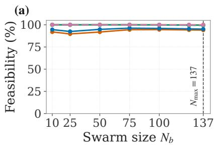

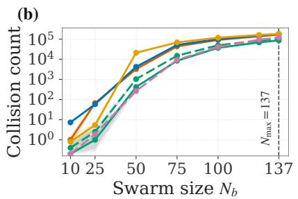

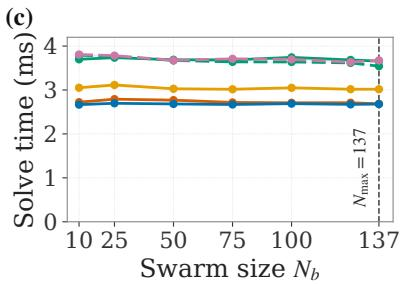  
Hard BF Hard Dt-CBF Slack BF Slack Dt-CBF LA Slack Dt-CBF Slack Dt-HOCBF  
Figure 3: Safety-formulation comparison across the six variants (phototaxis, free space, 10-seed mean, 95% CI bands). (a) Solver feasibility, (b) inter-robot collisions (distinct contacts over 9000 steps, log scale), and (c) mean per-robot $\mathsf { Q P }$ solve time, versus swarm size $N _ { b } .$ . The dashed vertical line marks the geometric packing limit $N _ { \mathrm { m a x } } = 1 3 7$

Safety-formulation comparison (phototaxis, free space, 10-seed mean ± 95% CI). Collisions are cumulative counts of distinct robot-robot contacts over 9000 steps, reported at a low density $( N _ { b } = 2 5 )$ and at a high-density operating point $N _ { b } = 1 0 0$ Feasibility and solve time are at $N _ { b } = 2 5 .$ . Bold marks the best value in each column.
<table><tr><td>Variant</td><td>Feas. (%)</td><td>Solve (ms)</td><td> $\mathsf { C o l l . } \ N _ { b } { = } 2 5$ </td><td> $\mathsf { C o l l . } \ N _ { b } { = } 1 0 0$ </td></tr><tr><td>Hard BF</td><td> $8 9 . 7 0 \pm 0 . 0 3$ </td><td> $2 . 7 9 \pm 0 . 0 1$ </td><td> $6 7 \pm 8$ </td><td> $9 0 6 0 8 \pm 7 0 1$ </td></tr><tr><td>Hard Dt-CBF [33]</td><td> $9 2 . 4 4 \pm 0 . 0 5$ </td><td> $\mathbf { 2 . 7 0 \pm 0 . 0 1 }$ </td><td> $5 8 \pm 7$ </td><td> $9 9 7 0 4 \pm 8 6 9$ </td></tr><tr><td>Slack BF</td><td> $1 0 0 . 0 0 \pm 0 . 0 0$ </td><td> $3 . 1 1 \pm 0 . 0 4$ </td><td> $5 \pm 2$ </td><td> $1 1 6 9 7 9 \pm 4 1 7$ </td></tr><tr><td>Slack Dt-CBF</td><td> $1 0 0 . 0 0 \pm 0 . 0 0$ </td><td> $3 . 7 7 \pm 0 . 0 1$ </td><td> $2 \pm 1$ </td><td> $4 9 2 5 1 \pm 6 1 4$ </td></tr><tr><td>LA Slack Dt-CBF</td><td> $1 0 0 . 0 0 \pm 0 . 0 0$ </td><td> $3 . 7 4 \pm 0 . 0 2$ </td><td> $\mathbf { 1 \pm 1 }$ </td><td> $\mathbf { 3 6 5 0 5 \pm 4 9 3 }$ </td></tr><tr><td>Slack Dt-HOCBF</td><td> $1 0 0 . 0 0 \pm 0 . 0 0$ </td><td> $3 . 7 8 \pm 0 . 0 1$ </td><td> $2 \pm 2$ </td><td> $4 0 6 2 8 \pm 8 0 7$ </td></tr></table>

Feasibility Solver feasibility separates the hard and slacked formulations most sharply (Fig. 3a). The two hard formulations hold only about 90% to 92% feasibility at $N _ { b } = 2 5$ . When a solver is infeasible (roughly 8% to 10% of the per-robot OCPs), the robot falls back to a reactive potential-field controller (goal attraction with inter-robot, obstacle, and wall repulsion). This matches the recursive-infeasibility limitation that Zeng et al. [33] identify for the hard discrete-time CBF. Softening the barrier with slack variables removes the problem. All four slacked formulations (Slack BF, Slack Dt-CBF, LA Slack Dt-CBF, and Slack Dt-HOCBF) hold at least 99.4% feasibility across the entire density range, and 100% up to $N _ { b } = 2 5$ ; the minimum over all densities and all four is 99.47%, at the packing limit. The small remaining infeasibility comes from the hard arena-boundary constraint, not the safety constraint. At high density, robots pressed against the arena walls can briefly make it infeasible. Feasibility alone, however, does not separate these four. As the collision results show next, a formulation can be feasible everywhere yet still fail to keep robots apart.

Collisions The formulations diverge in collision counts, not feasibility (Fig. 3b), and they separate by structure rather than by barrier order. At $N _ { b } = 1 0 0$ the three formulations that pair a barrier anchor with a rate condition (d)–(f) average $4 . 2 \times 1 0 ^ { 4 }$ contacts, against $1 . 0 2 \times 1 0 ^ { 5 }$ for the three without an anchor (a)–(c), a factor of 2.4. The two groups do not overlap at any density in the sweep. Carrying an anchor alongside the rate condition therefore matters more than which rate condition is used.

Two further results follow within the anchored group. First, the look-ahead handle alone reduces contacts by a factor of 2.5 at low and moderate density, falling to 1.2 at the packing limit, where it takes them from $1 . 0 5 \times 1 0 ^ { 5 }$ to $8 . 6 \times 1 0 ^ { 4 }$ . Formulations (d) and (e) are identical apart from the handle, at the same decay rate $\alpha = 0 . 9$ , with disjoint confidence intervals at every density $N _ { b } \ge 5 0$ and no measurable solve-time cost. The reduction is therefore due to the handle, which gives the angular velocity direct authority over the constraint so a robot can steer around a neighbor rather than only brake. Second, the higher-order chain helps at moderate density and stops helping at the packing limit. The Slack Dt-HOCBF is second best in small swarms, but by $N _ { b } = 1 3 7$ it falls behind the LA Slack Dt-CBF, $1 . 1 9 \times 1 0 ^ { 5 }$ against $8 . 6 \times 1 0 ^ { 4 }$ . It does not fail by becoming infeasible, holding 100% feasibility across the whole range against 99.5% for (d) and (e). What it gives up is margin, and not just at the packing limit. The chain lets its robots run closer than the look-ahead variant at every density (Fig. 4a), 5.02 against 5.31 cm at the packing limit. Its two-step condition allows the barrier to shrink further before the robot has to act. That costs nothing when the arena has unoccupied space. As the available area shrinks, a smaller gap leads to contact. On this task, the deployed LA Slack Dt-CBF is best or tied-best at every density excep $N _ { b } = 5 0$ , where it is second behind the Slack Dt-HOCBF with disjoint confidence intervals. Elsewhere, the look-ahead advantage over the chain widens as the arena fills, from 1.11× at $N _ { b } = 1 0 0 \mathrm { t o } 1 . 3 9 \times$ at $N _ { b } = 1 3 7$

Safety margins The formulations also difer in the safety margin they sustain (Fig. 4). These runs use the deployed closed loop with the reactive layer active (Section 3.1), and are measured on post-steering positions, so they never show interpenetration. Each value is a mean over robots and steps of the nearest-neighbor distance, not a per-step minimum. The margins separate along the same structural line as the collision counts. On the inter-robot axis, the three anchored formulations (d)–(f) hold 10.1–10.6 cm at $N _ { b } = 1 0$ and 5.0–5.3 cm at the packing limit. The three without an anchor (a)–(c) fall from 7.8–8.6 cm to 4.3–4.5 cm. Comparing group means, the anchor sustains roughly 0.7 cm of extra clearance at maximum crowding. The deployed LA Slack Dt-CBF is widest of all at high density, with 5.82 cm at $N _ { b } = 1 0 0$ and 5.31 cm at $N _ { \mathrm { m a x } } = 1 3 7$ . At $N _ { b } = 2 5$ , only the anchored formulations still hold a clear margin above $D _ { \mathrm { s a f e } } ,$ , at $7 . 6 { - } 8 . 8 \mathrm { c m }$ . The unanchored group sits at 6.8–7.1 cm, at or just either side of it. Beyond that density, every formulation operates inside the nominal bufer, already 6.5–6.8 against 5.8–5.9 cm at $N _ { b } = 5 0$ . The task drives this, not the choice of formulation. Phototaxis gathers the swarm at the light peak, so the robots there sit far closer than the arena average of 30% bufer coverage at $N _ { b } = 5 0$ (Table 1) would suggest, and neighboring bufers have to overlap. What the anchor leads to is a consistently larger share of the space that remains, and from $N _ { b } = 7 5$ upward the formulation that holds the widest spacing also records the fewest contacts.

On the robot-obstacle axis, the ordering is similar, but the efect concentrates at the low-density end. At $N _ { b } = 1 0$ the Slack Dt-CBF and the LA Slack Dt-CBF (d),(e) keep about 5.6 cm of clearance each, against 1.8–3.8 cm for the remaining four, the Slack Dt-HOCBF included. From $N _ { b } = 1 0 0$ and up, every formulation converges to 1.6–1.7 cm. At that density, robots are pressed against obstacles by their neighbors rather than by their own control choices, so the safety formulation can no longer set the obstacle clearance. This is the margin-side counterpart of the collision resul that obstacles stop mattering once inter-robot congestion dominates (Section 3.5).

Computational cost The LA Slack Dt-CBF costs slightly more to solve because of its added look-ahead constraints. Its per-robot solve time is about 3.7 ms at $N _ { b } = 2 5$ , roughly 1.0 ms above the cheapest formulations (Fig. 3c). Each robot optimizes against a fixed number of neighbors, so this per-robot cost barely changes with swarm size and stays within 3.66–3.74 ms across the sweep. It is therefore well inside the 100 ms budget of a 10 Hz loop at every density. Section 3.6 reports the distribution and separates this per-robot cost from the per-step wall time of the single-process simulation, which does grow with $N _ { b }$ . The extra cost is small, so on phototaxis, the deployment target, the LA Slack Dt-CBF gives the best trade-of across feasibility, collisions, and safety margin. Therefore, we adopt it as the deployed formulation for the collective behavior simulations.

## 3.4. Emergence of Collective Behavior

We characterize the emergent behavior of the swarm under the DMPC framework. The LA Slack Dt-CBF formulation governs both inter-robot separation and obstacle avoidance. We study three tasks, namely coordinated phototaxis, phototactic orbiting, and cohesion without a stimulus. Fig. 5 shows representative snapshots at $N _ { b } = 5 0$ The snapshots show how the local coupling terms regulate spatial density and heading agreement while each agent pursues its objective, without global communication or a central coordinator. With two and with twelve static obstacles in the arena, every behavior still holds its form while the swarm moves around the obstacles (Figs. 8 and 9 in Appendix A).

We assess coordination among the robots using two distinct metrics. The first is the polar order parameter calculated locally over only the set of active neighbors,

$$
\Phi _ { \mathrm { l o c } } = \frac { 1 } { N _ { b } } \sum _ { l = 1 } ^ { N _ { b } } \frac { 1 } { K _ { l } } \Big \| \sum _ { j \in \mathfrak { N } _ { l } } e ^ { i \theta _ { j } } \Big \| \in [ 0 , 1 ] ,\tag{41}
$$

where $\mathfrak { N } _ { l }$ is the set of active neighbors of each robot � inclusive of the robot �, and $K _ { l } = | \mathfrak { N } _ { l } |$ is the number of active neighbors for �. When all the robots in every neighborhood are in near-perfect alignment, $\Phi _ { \mathrm { l o c } } \approx 1$ , whereas in a

(a)  
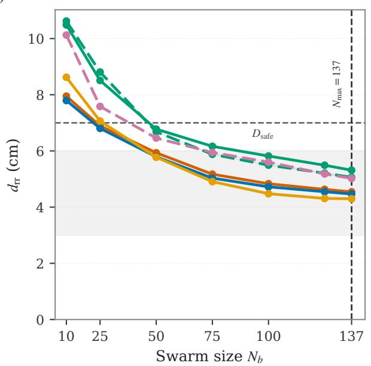

(b)  
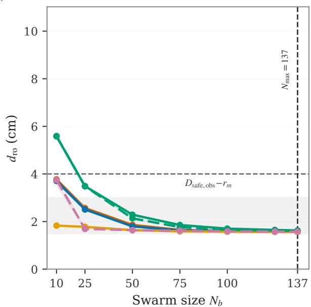  
Hard BF Hard Dt-CBF Slack BF Slack Dt-CBF LA Slack Dt-CBF Slack Dt-HOCBF  
Figure 4: Safety margins of the six safety formulations versus swarm size (phototaxis with two static obstacles, deployed closed loop with the reactive collision-response layer active, 10-seed mean, 95% CI bands). (a) Steady-state mean nearestneighbor distance $d _ { \mathrm { r r } } ,$ center to center, dashed horizontal line at $D _ { \mathrm { s a f e } } = 7$ cm. (b) Mean robot-obstacle clearance $d _ { \mathrm { { r o } } } ,$ robot center to obstacle surface, dashed horizontal line at $D _ { \mathrm { s a f e , o b s } } - r _ { m } = 4$ cm, since the obstacle barrier bounds the center-to-center distance. The gray band spans the footprint-contact range, which varies with orientation for elliptical robots $( 2 b - 2 a$ between two robots, �–� from a robot center to an obstacle surface). The vertical dashed line marks the geometric packing limit.

disordered state with random robot orientations, $\Phi _ { \mathrm { l o c } } \approx 0$ . This metric is widely used in biophysics to quantify order in a moving flock or swarm [8, 55]. The second metric is the nearest-neighbor distance averaged over all robots,

$$
\mathrm { N N D } = \frac { 1 } { N _ { b } } \sum _ { l = 1 } ^ { N _ { b } } \lVert \pmb { x } _ { l } - \pmb { x } _ { k } \rVert ,\tag{42}
$$

where � is the nearest neighbor of robot �. This metric finds pervasive use in quantifying internal group structure in natural and artificial flocks [62, 63]. While the NND varies with animal species, it unequivocally reaches a stable value at long time scales. The top and bottom rows of Fig. 6 elucidate the variation in the local polar order and long-time NND for diferent swarm sizes and diferent obstacle numbers, under distinct modes of operation.

## 3.4.1. Phototaxis Behavior

We first examine the full DMPC formulation with all Reynolds steering rules (Section 2.5) active, demonstrating gradient-following behavior, followed by isolating the contribution of the social coupling by removing these terms entirely.

With Reynolds Flocking Rules – Collective Behavior In phototaxis mode, each robot ascends the light gradient while the cohesion and alignment costs, together with the CBF separation constraints, produce collective motion. The CBF constrains the closing velocity toward each neighbor’s predicted position, so avoidance starts early, without the over-braking or deadlocks of purely reactive methods [47]. The swarm stays compact and heading-aligned as it tracks the rotating source (Fig. 5a). The local polar order reduces with increasing swarm size, as radial phototaxis uses a convergent field that brings agents together from all directions, producing head-on encounters that locally cancel heading agreement (Fig. 6a). A cluttered environment further worsen the alignment by introducing additional collision avoidance, which de-aligns the local heading. The NND (Fig. 6d), on the other hand, decreases as the space for movement in the domain decreases (increasing swarm size), partly also attributable to the nature of the phototaxis mode, which attempts to converge the robots to a small location. Beyond $N _ { b } = 5 0 $ , the NND falls below the safe bufer distance of $D _ { \mathrm { s a f e } } = 7$ cm, indicating some amount of bufer overlap. As the swarm size approaches the geometric packing limit, the phototaxis gradient forces the robots into oblique, blocking contacts, causing NND to fall as low as 5 cm.

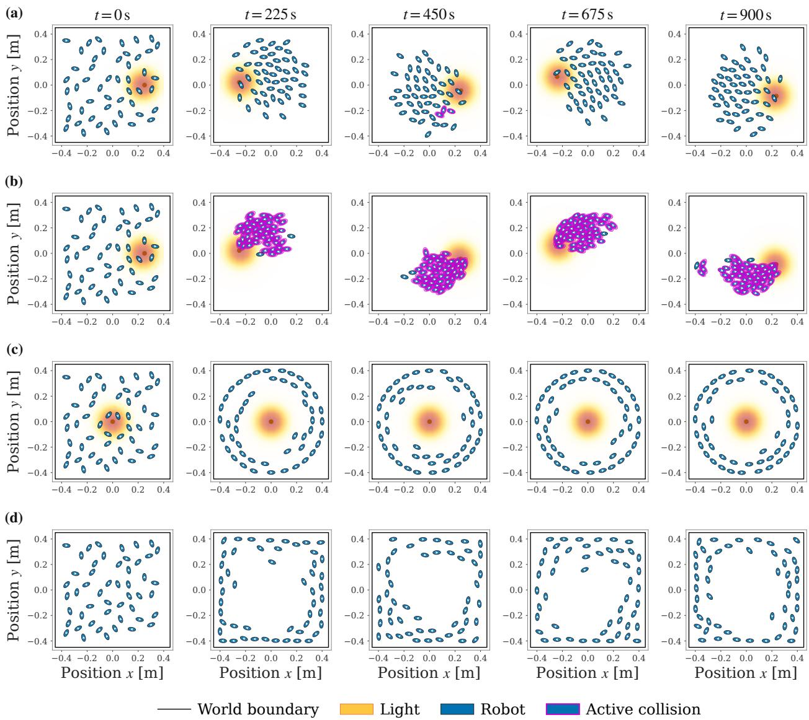  
Figure 5: Collective behavior in obstacle-free space with the LA Slack Dt-CBF formulation, $N _ { b } = 5 0 . \ ( \mathsf { a } )$ Phototaxis, where the swarm stays cohesive and heading-aligned while tracking the moving light source. (b) Phototaxis with the coupling costs and avoidance constraints removed, where the robots pile up at the light peak and collide. (c) Phototactic orbiting, where the swarm co-rotates along the light’s intensity level set. (d) Cohesion without a stimulus, where the Reynolds costs alone keep the group cohesive. Each column corresponds to a certain time �, and the orange field is the light source. Supplementary video 1 shows these four behaviors in the obstacle-free arena.

Without Reynolds Flocking Rules – Swarm Collapse In the absence of the cohesion and alignment costs and the separation constraints, the collective behavior disappears. Each robot climbs the gradient on its own, so the swarm arrives at the light peak without spacing or heading agreement (Fig. 5b). The swarm efectively collapses onto a small area in the domain, clearly attributing the occurrence of flocking to the Reynolds steering costs.

## 3.4.2. Phototactic Orbital Behavior

In the phototactic orbital mode, each robot follows the tangent of the sensed intensity level set through the gradientrotation reference (9), orbiting the source without global localization. The CBF constraints (26) prevent collisions as robots compete for the same orbit while the cohesion and alignment costs keep the swarm compact and co-rotating. From arbitrary initial positions, it converges to a stable orbital formation (Fig. 5c). Although the phototactic orbital mode is susceptible to crowding similar to the phototaxis mode, the decay of the local polar order is more muted in the former (Fig. 6b). This is a direct consequence of the co-location of local neighbors along concentric orbital paths, leading to better heading agreement, even for large swarms. Similarly, the NND also settles slightly below the safe bufer distance even for $N _ { b } = 1 3 7$ , as the locally tangential motion along the orbital causes the robots to align along their major axes, allowing for suficient separation among them (Fig. 6e). Both metrics are only mildly afected by the addition of obstacles to the system.

## 3.4.3. Flocking in the Absence of Stimuli

In this mode, the light field is disabled, providing the robots no global stimulus. Hence, each robot holds its heading with a small random turn each step. The swarm drifts outward and settles into a band along the walls, with an empty interior (Fig. 5d). Once a robot reaches a wall, it stays there until its heading drifts away, so the walls fill faster than they empty. Cohesion and alignment order the band, so the swarm circulates the arena similar to an edge current [64].

Free space Few obstacles (2) Cluttered (12)  
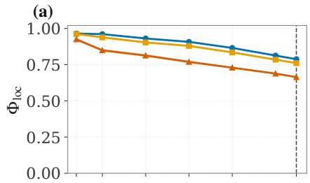

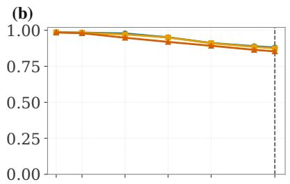

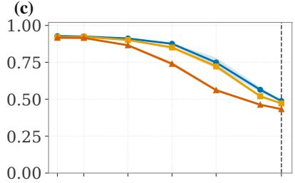

(d)  
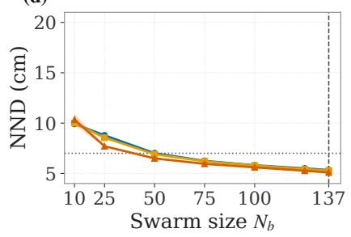

(e)  
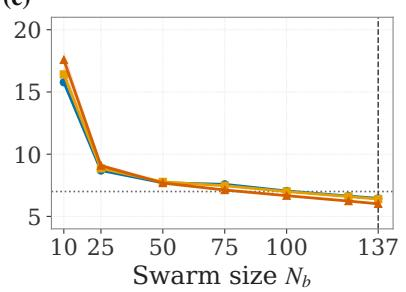

(f)  
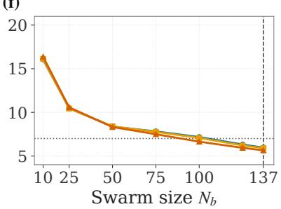  
Figure 6: Local polar order $\Phi _ { \mathrm { l o c } }$ (top row) and average nearest-neighbor distance (NND; bottom row) versus swarm size for the deployed LA Slack Dt-CBF, one column per collective behavior (10-seed mean with 95% CI bands, steady state over the last 300 s). The columns are phototaxis $( \mathsf { a } , \mathsf { d } )$ , phototactic orbiting $( { \mathsf { b } } , { \mathsf { e } } )$ , and cohesion without a stimulus (c, f). Each panel compares the obstacle-free arena, the few-obstacle arena (2 obstacles), and the cluttered arena (12 obstacles, positions randomized per seed). The dotted horizontal line marks the bufer distance of $D _ { \mathrm { s a f e } } = 7 \mathrm { c m }$ , while the vertica dashed line marks the geometric packing limit $N _ { \mathrm { m a x } } = 1 3 7$

The flock remains relatively well-aligned at low swarm sizes, with heading disagreements as the domain starts getting crowded with robots and obstacles due to frequent steering for collision avoidance (Fig. 6c). This is an expected outcome, showing that the alignment and cohesion costs work as intended. The band structure resembles the phototactic orbital, despite the diference in shape of the orbit. This is evident from the NND (Fig. 6f), which follows a similar trend as in the phototactic orbital mode.

## 3.5. Collision Behavior Across Density and Tasks

The collision load of the deployed LA Slack Dt-CBF depends on both swarm size and task. We measure both here, across three obstacle environments.

Collisions versus swarm size We sweep $N _ { b } \in \{ 1 0 , 2 5 , 5 0 , 7 5 , 1 0 0 , 1 2 5 , 1 3 7 \}$ across three environments, namely obstacle-free, few-obstacle (2), and cluttered (12, positions randomized per seed). We count distinct robot-robot contacts over the 9000-step run (Fig. 7). Contacts stay negligible in small swarms. Free space averages 1.0 contact at $N _ { b } = 2 5$ , with the nearest neighbor 8.8 cm away on average, well above $D _ { \mathrm { s a f e } }$ . Contacts then climb steeply, from $4 . 2 \times 1 0 ^ { 2 }$ at $N _ { b } = 5 0 \mathrm { t o } 8 . 6 \times 1 0 ^ { 4 }$ at the packing limit, where the mean nearest-neighbor separation has fallen to 5.3 cm. The growth is strongly linear. Contacts rise by a factor of 87 between $N _ { b } = 5 0$ and $N _ { b } = 1 0 0$ while the robot count only doubles. Near the packing limit the full $D _ { \mathrm { s a f e } }$ margin cannot be held for every pair, so the slacked CBF admits transient contacts while the solver stays feasible (Section 3.3).

Obstacles dominate in small swarms and hardly matter in large ones (Fig. 7). At $N _ { b } = 2 5$ the cluttered arena produces three orders of magnitude more contacts than free space. By $N _ { b } = 1 0 0$ that gap has closed to a factor of 1.6, and by $N _ { b } = 1 2 5$ to 1.3. The crossover falls between $N _ { b } = 5 0$ and $N _ { b } = 7 5$ . The environment therefore dominates in small swarms, while in large swarms collisions come from the packing density.

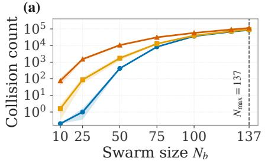

(b)  
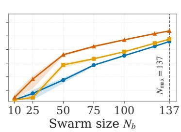

(c)  
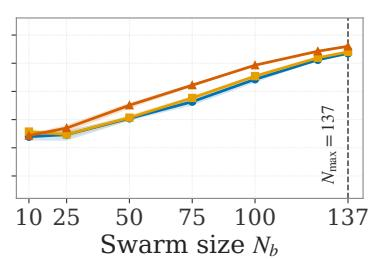  
Figure 7: Distinct contacts versus swarm size for the deployed LA Slack Dt-CBF. (a) Phototaxis, (b) phototactic orbiting, and (c) cohesion without a stimulus. Each panel compares the obstacle-free arena, the few-obstacle arena (2), and the cluttered arena (12, positions randomized per seed). The vertical axis is log-scaled. The dashed vertical line marks the packing limit $N _ { \mathrm { m a x } } = 1 3 7$ . The band around each curve is the 95% confidence interval over 10 seeds.

Efectiveness of avoidance is set by task geometry Considering an identical controller, the number of contacts spans two orders of magnitude across the three behaviors, a factor of 103 between the best and the worst at $N _ { b } = 1 0 0$ (Fig. 7). Phototaxis concentrates the swarm at the peak intensity of the light source and has the highest number of contacts at $3 . 7 \times 1 0 ^ { 4 }$ . The orbital mode spreads robots along an intensity level set and has far fewer contacts at $3 . 5 \times 1 0 ^ { 2 }$ Cohesion without a stimulus falls in between at $2 . 7 \times 1 0 ^ { 3 }$ . However, this order of efectiveness is not preserved across diferent swarm sizes. The stimulus-free mode is the worst in small swarm, with 25 contacts at $N _ { b } = 1 0$ , whereas the other modes record none. The cause is how robots meet, not how crowded they are. At $N _ { b } = 1 0$ the stimulus-free swarm is the most spread out of the three, with a mean nearest-neighbor distance of 16.1 cm against 9.9 cm for phototaxis. The diference is in their headings. A shared gradient gives phototaxis and orbiting a common direction, so two robots that come close are already traveling the same way. Without a stimulus each robot follows its own random heading, and only the local coupling keeps neighbors together. In large swarms the same absence of a shared target protects it, since the robots never concentrate. At every larger swarm size orbiting stays safest and phototaxis worst, except in the cluttered arena where the stimulus-free mode moves ahead of orbiting at $N _ { b } = 5 0$ and $N _ { b } = 7 5$ . Obstacles raise contacts in every mode, but the orbital mode pays the largest penalty, 14.5× at $N _ { b } = 1 0 0$ against 1.6× for phototaxis. Obstacles sit directly on the orbit and force detours. The safety formulation decides how large a swarm can grow before contacts appear. The task decides how many contacts it has at any given size.

## 3.6. Computational Performance and Scalability

The experiments run one task per core on shared compute nodes, so other jobs on the same node could slow down the solve time. We repeated the measurement on an idle node reserved for this run alone. Averaged over the density sweep, each formulation’s mean agrees with its shared-node value to within 0.07 ms, so sharing a node does not distort the per-robot times reported in Section 3.3, and the idle run also gives the full distribution. Each solve covers the full per-robot control step, including both consensus iterations.

The mean and the 99th percentile stay well inside both the 100 ms (10 Hz) and 33.3 ms (30 Hz) budgets at every density. Across the six formulations $p _ { 9 9 }$ peaks at 13.1 ms, and at the operating densities $N _ { b } \ge 1 0 0$ it stays at or below 3.9 ms. Worst-case single solves are larger and matter for a hard real-time guarantee. The maximum observed on the idle node is 98.8 ms, so the 10 Hz budget is met at every density while the 30 Hz budget is not. These maxima are lone draws from the tail. They grow with $N _ { b }$ only because a larger swarm performs more solves per run, from 3000 at $N _ { b } = 1 0 \mathrm { t o } 4 1 1 0 0$ at $N _ { b } = 1 3 7$ , while the mean and $p _ { 9 9 }$ do not grow. A 30 Hz deployment would therefore cap the solver iterations and fall back to the reactive controller on the rare overrun.

The per-step wall time necessarily grows with $N _ { b } ,$ since a single process advances all robots in sequence. It is at least $N _ { b }$ times the per-robot cost, $\mathbf { s o } \gtrsim 3 7 , 9 3$ , 184 and 374 ms at $N _ { b } = 1 0 , 2 5 , 5 0 , 1 0 0$ . This is a simulation artifact. Each robot runs its own optimization onboard or in parallel when deployed, so the governing cost is the per-robot time. That cost is flat in $N _ { b }$ (Section 3.3), so computation does not limit the swarm size. The current single-process simulation bottleneck can be removed through parallel execution and is left as future implementation work.

## 4. Conclusion

We presented a distributed predictive flocking controller for dense miniature ellipsoid robot swarms in a confined arena. Each robot solves a local NMPC combining task tracking, Reynolds-style flocking, and inter-robot and obstacle safety constraints, using only exchanged predicted trajectories of active neighbors, without a leader, central planner, or global map. The results demonstrate that the same controller architecture generalizes across diferent modal objectives such as gradient-ascending phototaxis, stable phototactic orbital formation, and even flocking in the absence of any stimulus. The emergent collective behavior arises purely from local optimization of cohesion and alignment costs, coupled with safety constraints that maintain separation. This separability between the task and the coordination points towards a modeling paradigm where new tasks can plausibly be added without necessarily re-deriving the safety features or coordination structure. Each robot optimizes against a fixed neighbor set, so solve time is (1) in swarm size, measured at 3.7 ms on average and flat across the density sweep, making the scaling limit architectural (a serial solve with a single workstation caps closed-loop control at roughly 27 robots) rather than algorithmic.

Comparing six safety formulations under identical conditions showed that performance is determined by structure rather than barrier order; pairing a slacked barrier anchor with a rate condition reduces contact counts by a factor of 2.4 relative to formulations without an anchor, with no overlap across the density sweep. Considering the phototaxis mode as the deployment target, the LA Slack Dt-CBF is found to be most efective in preventing collisions, while also providing the highest inter-robot margins for most swarm sizes tested. The look-ahead handle drives this improvement, giving the turn rate direct authority over the constraint so a robot can steer around a neighbor rather than only brake. Removing this handle alone raises contacts by up to a factor of 2.5 at low density, and by 1.2 at the geometric packing limit. Moreover, a higher-order rate chain improves performance further at moderate density but loses its advantage at the packing limit, showing that a higher barrier order does not automatically guarantee better safety.

The collective motion is analyzed through local polar order and NND analysis, which, apart from quantifying controller performance, also point toward a biomimetic reading of these results. The muted order decay and more eficient packing found for the orbital mode, versus the sharper degradation under phototaxis, mirror a structural distinction well documented in natural swarms: neighbors on a shared circulating path align through a shear-like velocity field, while neighbors converging on a common point align through a convergent one, with the latter being inherently more collision-prone and alignment-averse as group size grows. That our controller reproduces these qualitative results from local optimization alone, without it being an explicit design target, suggests the polar order and NND metrics already computed here could serve as a bridge to the natural flocking literature. Furthermore, the wall-following behavior observed in the absence of external stimuli concurs well with studies of natural fish schools and insect swarms in confined spaces, a systematic evaluation and comparison of which can open a path to tuning the flocking and safety weights toward biologically observed regimes rather than controller-internal ones.

The current work has two limitations. The vibration and friction induced locomotion of the real bristlebot is modeled only kinematically rather than physically, so variations involving surface, payload, and actuation asymmetry enter the controller only as unmodeled disturbance. The safety comparison is also internal by design: six formulations within one stack, which isolates the safety constraint but does not benchmark against external distributed-flocking baselines, most of which target fully actuated 3D quadrotors or underactuated 2D robots rather than vibration-driven platforms. Further extensions can be carried out in terms of optimization and learning; the slack weight, rate-condition horizon, and look-ahead distance form a compact design space suited to automated tuning against the contact-rate and feasibility metrics already collected here, while a learned residual dynamics model could absorb the friction disturbance currently left unmodeled, narrowing the gap between the kinematic model and the true vibration-driven actuation. Immediate next steps include physical validation on the GRASPion hardware, extension to dynamic obstacle avoidance, and robust or stochastic MPC formulations for stronger safety guarantees. Overall, these results establish a single, kinematic model-agnostic NMPC architecture that unifies task-driven behavior, emergent flocking, and safety against collisions, while the polar-order and NND signatures it reproduces open a concrete path toward grounding swarm-robotics control in the structure of natural collective motion.

## CRediT authorship contribution statement

Prajol Shrestha: Conceptualization, Methodology, Software, Formal Analysis, Writing – Original Draft, Writing – Review & Editing, Visualization, Validation. Siddhant Mohapatra: Conceptualization, Formal Analysis, Visualization, Writing – Review & Editing. Filip Novkoski: Formal Analysis, Visualization, Writing – Review & Editing. Julian Oelhaf: Writing – Review & Editing. Nicolas Vandewalle: Writing – Review & Editing. Ana-Sunčana Smith: Writing – Review & Editing. Andreas Maier: Supervision, Resources, Project administration, Funding acquisition, Conceptualization, Writing – Review & Editing.

## Declaration of competing interest

The authors declare that they have no known competing financial interests or personal relationships that could have appeared to influence the work reported in this paper.

## Data availability

No external data was used. The code and simulation environment that reproduce all results are available at https://github.com/prajolshrestha/bristlebot-swarm-mpc. The full set of simulation videos, including the full-length renders from which the supplementary videos are derived, is archived at https://doi.org/10.5281/ zenodo.22642863.

## References

[1] Guang-Zhong Yang, Jim Bellingham, Pierre E. Dupont, Peer Fischer, Luciano Floridi, Robert Full, Neil Jacobstein, Vijay Kumar, Marcia McNutt, Robert Merrifield, Bradley J. Nelson, Brian Scassellati, Mariarosaria Taddeo, Russell Taylor, Manuela Veloso, Zhong Lin Wang, and Robert Wood. The grand challenges of science robotics. Science Robotics, 3(14):eaar7650, 2018. doi: 10.1126/scirobotics.aar7650.

[2] S Camazine, J Deneubourg, NR Franks, J Sneyd, G Theraulaz, and E Bonabeau. Self-Organization in Biological Systems. Princeton University Press, 2001.

[3] Tamás Vicsek, András Czirók, Eshel Ben-Jacob, Inon Cohen, and Ofer Shochet. Novel type of phase transition in a system of self-driven particles. Phys. Rev. Lett., 75:1226–1229, Aug 1995. doi: 10.1103/PhysRevLett.75.1226.

[4] A. Jadbabaie, Jie Lin, and A.S. Morse. Coordination of groups of mobile autonomous agents using nearest neighbor rules. IEEE Transactions on Automatic Control, 48(6):988–1001, 2003. doi: 10.1109/TAC.2003.812781.

[5] Sabrina M. Neuman, Brian Plancher, Bardienus P. Duisterhof, Srivatsan Krishnan, Colby Banbury, Mark Mazumder, Shvetank Prakash, Jason Jabbour, Aleksandra Faust, Guido C.H.E. de Croon, and Vijay Janapa Reddi. Tiny robot learning: Challenges and directions for machine learning in resource-constrained robots. In 2022 IEEE 4th International Conference on Artificial Intelligence Circuits and Systems (AICAS), pages 296–299, 2022. doi: 10.1109/AICAS54282.2022.9870000.

[6] Craig W. Reynolds. Flocks, herds and schools: A distributed behavioral model. In Proceedings ofthe 14th Annual Conference on Computer Graphics and Interactive Techniques, pages 25–34. ACM, 1987. doi: 10.1145/37401.37406.

[7] Craig W. Reynolds. Steering behaviors for autonomous characters. In Proceedings ofthe Game Developers Conference 1999, pages 763–782, San Jose, CA, USA, 1999. Miller Freeman Game Group.

[8] Iain D Couzin, Jens Krause, Richard James, Graeme D Ruxton, and Nigel R Franks. Collective memory and spatial sorting in animal groups. Journal ofTheoretical Biology, 218(1):1–11, 2002. ISSN 0022-5193. doi: https://doi.org/10.1006/jtbi.2002.3065.

[9] R. Olfati-Saber. Flocking for multi-agent dynamic systems: algorithms and theory. IEEE Transactions on Automatic Control, 51(3):401–420, 2006. doi: 10.1109/TAC.2005.864190.

[10] H.G. Tanner, A. Jadbabaie, and G.J. Pappas. Stable flocking of mobile agents, part i: fixed topology. In 42nd IEEE International Conference on Decision and Control (IEEE Cat. No.03CH37475), volume 2, pages 2010–2015 Vol.2, 2003. doi: 10.1109/CDC.2003.1272910.

[11] Gábor Vásárhelyi, Csaba Virágh, Gergő Somorjai, Tamás Nepusz, Agoston E. Eiben, and Tamás Vicsek. Optimized flocking of autonomous drones in confined environments. Science Robotics, 3(20):eaat3536, 2018. doi: 10.1126/scirobotics.aat3536.

[12] James B. Rawlings, David Q. Mayne, and Moritz M. Diehl. Model Predictive Control: Theory, Computation, and Design. Nob Hill Publishing, 2nd edition, 2017.

[13] Ruben Van Parys and Goele Pipeleers. Distributed mpc for multi-vehicle systems moving in formation. Robotics and Autonomous Systems, 97:144–152, 2017. ISSN 0921-8890. doi: 10.1016/j.robot.2017.08.009.

[14] Carlos E. Luis, Marijan Vukosavljev, and Angela P. Schoellig. Online trajectory generation with distributed model predictive control for multi-robot motion planning. IEEE Robotics and Automation Letters, 5(2):604–611, 2020. doi: 10.1109/LRA.2020.2964159.

[15] Andrea Testa, Andrea Camisa, and Giuseppe Notarstefano. Choirbot: A ros 2 toolbox for cooperative robotics. IEEE Robotics and Automation Letters, 6(2):2714–2720, 2021. doi: 10.1109/LRA.2021.3061366.

[16] Lorenzo Pichierri, Andrea Testa, and Giuseppe Notarstefano. Crazychoir: Flying swarms of crazyflie quadrotors in ros 2. IEEE Robotics and Automation Letters, 8(8):4713–4720, 2023. doi: 10.1109/LRA.2023.3286814.

[17] Robin Verschueren, Gianluca Frison, Dimitris Kouzoupis, Jonathan Frey, Niels van Duijkeren, Andrea Zanelli, Branimir Novoselnik, Thivaharan Albin, Rien Quirynen, and Moritz Diehl. acados – a modular open-source framework for fast embedded optimal control. Mathematical Programming Computation, 2021. doi: 10.1007/s12532-021-00208-8.

[18] Xin Zhou, Xiangyong Wen, Zhepei Wang, Yuman Gao, Haojia Li, Qianhao Wang, Tiankai Yang, Haojian Lu, Yanjun Cao, Chao Xu, and Fei Gao. Swarm of micro flying robots in the wild. Science Robotics, 7(66):eabm5954, 2022. doi: 10.1126/scirobotics.abm5954.

[19] Charbel Toumieh and Dario Floreano. High-speed motion planning for aerial swarms in unknown and cluttered environments. IEEE Transactions on Robotics, 40:3642–3656, 2024. doi: 10.1109/TRO.2024.3429193.

[20] Kota Kondo, Claudius T. Tewari, Andrea Tagliabue, Jesus Tordesillas, Parker C. Lusk, Mason B. Peterson, and Jonathan P. How. Primer: Perception-aware robust learning-based multiagent trajectory planner. In 2025 IEEE International Conference on Robotics and Automation (ICRA), pages 14154–14160, 2025. doi: 10.1109/ICRA55743.2025.11128011.

[21] Baskın Şenbaşlar and Gaurav S. Sukhatme. Dream: Decentralized real-time asynchronous probabilistic trajectory planning for collision-free multirobot navigation in cluttered environments. IEEE Transactions on Robotics, 41:573–592, 2025. doi: 10.1109/TRO.2024.3509015.

[22] Charbel Toumieh and Alain Lambert. Decentralized multi-agent planning using model predictive control and time-aware safe corridors. IEEE Robotics and Automation Letters, 7(4):11110–11117, 2022. doi: 10.1109/LRA.2022.3196777.

[23] Enrica Soria, Fabrizio Schiano, and Dario Floreano. Predictive control of aerial swarms in cluttered environments. Nature Machine Intelligence, 3(6):545–554, 2021. doi: 10.1038/s42256-021-00341-y.

[24] Enrica Soria, Fabrizio Schiano, and Dario Floreano. Distributed predictive drone swarms in cluttered environments. IEEE Robotics and Automation Letters, 7(1):73–80, 2022. doi: 10.1109/LRA.2021.3118091.

[25] Aneek Nag, Shuo Huang, Andreas Themelis, and Kaoru Yamamoto. Flock navigation with dynamic hierarchy and subjective weights using nonlinear mpc. In 2022 IEEE Conference on Control Technology and Applications (CCTA), pages 1135–1140, 2022. doi: 10.1109/ CCTA49430.2022.9966067.

[26] Aneek Nag and Kaoru Yamamoto. Distributed control for flock navigation using nonlinear model predictive control. Advanced Robotics, 38 (9-10):619–631, 2024. doi: 10.1080/01691864.2023.2299859.

[27] Nuthasith Gerdpratoom and Kaoru Yamamoto. Decentralized nonlinear model predictive control-based flock navigation with real-time obstacle avoidance in unknown obstructed environments. Frontiers in Robotics and AI, 12, 2025. ISSN 2296-9144. doi: 10.3389/frobt.2025.1540808. URL https://www.frontiersin.org/journals/robotics-and-ai/articles/10.3389/frobt.2025.1540808.

[28] Fanbo Kong, Hao Chen, Huiming Li, Jiarun Yan, Xiangke Wang, and Jianwei Fang. Flocking with obstacle avoidance for fixed-wing unmanned aerial vehicles via nonlinear model predictive control. In 2023 42nd Chinese Control Conference (CCC), pages 5957–5962, 2023. doi: 10.23919/CCC58697.2023.10240689.

[29] Aaron D. Ames, Xiangru Xu, Jessy W. Grizzle, and Paulo Tabuada. Control barrier function based quadratic programs for safety critical systems. IEEE Transactions on Automatic Control, 62(8):3861–3876, 2017. doi: 10.1109/TAC.2016.2638961.

[30] Amir Salimi Lafmejani and Spring Berman. Nonlinear mpc for collision-free and deadlock-free navigation of multiple nonholonomic mobile robots. Robotics and Autonomous Systems, 141:103774, 2021. ISSN 0921-8890. doi: 10.1016/j.robot.2021.103774.

[31] Björn Lindqvist, Sina Sharif Mansouri, Ali-akbar Agha-mohammadi, and George Nikolakopoulos. Nonlinear mpc for collision avoidance and control of uavs with dynamic obstacles. IEEE Robotics and Automation Letters, 5(4):6001–6008, 2020. doi: 10.1109/LRA.2020.3010730.

[32] Ayush Agrawal and Koushil Sreenath. Discrete control barrier functions for safety-critical control of discrete systems with application to bipedal robot navigation. In Robotics: Science and Systems XIII, Cambridge, Massachusetts, 2017. doi: 10.15607/RSS.2017.XIII.073.

[33] Jun Zeng, Bike Zhang, and Koushil Sreenath. Safety-critical model predictive control with discrete-time control barrier function. In 2021 American Control Conference (ACC), pages 3882–3889, 2021. doi: 10.23919/ACC50511.2021.9483029.

[34] Jun Zeng, Zhongyu Li, and Koushil Sreenath. Enhancing feasibility and safety of nonlinear model predictive control with discrete-time contro barrier functions. In 2021 60th IEEE Conference on Decision and Control (CDC), pages 6137–6144, 2021. doi: 10.1109/CDC45484.2021. 9683174.

[35] Jun Zeng, Bike Zhang, Zhongyu Li, and Koushil Sreenath. Safety-critical control using optimal-decay control barrier function with guaranteed point-wise feasibility. In 2021 American Control Conference (ACC), pages 3856–3863, 2021. doi: 10.23919/ACC50511.2021.9482626.

[36] Nhat Nguyen Minh, Stephen McIlvanna, Yuzhu Sun, Yan Jin, and Mien Van. Enhancing mobile robot navigation safety and eficiency through nmpc with relaxed cbf in dynamic environments. In 2024 IEEE 20th International Conference on Automation Science and Engineering (CASE), pages 2308–2313, 2024. doi: 10.1109/CASE59546.2024.10711662

[37] Kim P. Wabersich and Melanie N. Zeilinger. Predictive control barrier functions: Enhanced safety mechanisms for learning-based control. IEEE Transactions on Automatic Control, 68(5):2638–2651, 2023. doi: 10.1109/TAC.2022.3175628.

[38] Alexander Katriniok, Erfan Shakhesi, and W.P.M.H. Heemels. Discrete-time control barrier functions for guaranteed recursive feasibility in nonlinear mpc: An application to lane merging. In 2023 62nd IEEE Conference on Decision and Control (CDC), pages 3776–3783, 2023. doi: 10.1109/CDC49753.2023.10384157.

[39] Zetao Lu, Kaijun Feng, and Jun Xu. Robot safe planning in dynamic environments based on mpc using control barrier function. In 2024 China Automation Congress (CAC), pages 3358–3363, 2024. doi: 10.1109/CAC63892.2024.10864636.

[40] Wei Xiao and Calin Belta. Control barrier functions for systems with high relative degree. In 2019 IEEE 58th Conference on Decision and Control (CDC), pages 474–479, 2019. doi: 10.1109/CDC40024.2019.9029455.

[41] Quan Nguyen and Koushil Sreenath. Exponential control barrier functions for enforcing high relative-degree safety-critical constraints. In 2016 American Control Conference (ACC), pages 322–328, 2016. doi: 10.1109/ACC.2016.7524935.

[42] Jur van den Berg, Stephen J. Guy, Ming Lin, and Dinesh Manocha. Reciprocal n-body collision avoidance. In Robotics Research: The 14th International Symposium ISRR, volume 70 of Springer Tracts in Advanced Robotics, pages 3–19. Springer, 2011. doi: 10.1007/ 978-3-642-19457-3\_1.

[43] Dingjiang Zhou, Zijian Wang, Saptarshi Bandyopadhyay, and Mac Schwager. Fast, on-line collision avoidance for dynamic vehicles using bufered voronoi cells. IEEE Robotics and Automation Letters, 2(2):1047–1054, 2017. doi: 10.1109/LRA.2017.2656241.

[44] Li Wang, Aaron D. Ames, and Magnus Egerstedt. Safety barrier certificates for collisions-free multirobot systems. IEEE Transactions on Robotics, 33(3):661–674, 2017. doi: 10.1109/TRO.2017.2659727.

[45] Pravin Mali, K. Harikumar, Arun Kumar Singh, K. Madhava Krishna, and P.B. Sujit. Incorporating prediction in control barrier function based distributive multi-robot collision avoidance. In 2021 European Control Conference (ECC), pages 2394–2399, 2021. doi: 10.23919/ ECC54610.2021.9655081.

[46] Chao Wang, Shuyuan Zhang, and Lei Wang. Distributed safety-critical mpc for multi-agent formation control and obstacle avoidance. In 2025 IEEE 64th Conference on Decision and Control (CDC), pages 3288–3295, 2025. doi: 10.1109/CDC57313.2025.11312786.

[47] Rohan Chandra, Vrushabh Zinage, Efstathios Bakolas, Peter Stone, and Joydeep Biswas. Deadlock-free, safe, and decentralized multirobot navigation in social mini-games via discrete-time control barrier functions. Autonomous Robots, 49(2):12, 2025. doi: 10.1007/ s10514-025-10194-8.

[48] Manohari Goarin, Guanrui Li, Alessandro Saviolo, and Giuseppe Loianno. Decentralized nonlinear model predictive control for safe collision avoidance in quadrotor teams with limited detection range. In 2025 IEEE International Conference on Robotics andAutomation (ICRA), pages 5387–5393, 2025. doi: 10.1109/ICRA55743.2025.11128389.

[49] I. Mammadli, P. Shrestha, J. Pande, F. Novkoski, S. Mohapatra, M. Noirhomme, A. Maier, N. Vandewalle, and A. S. Smith. Physics informed digital twin and onboard control of a brainbot for intelligent active matter. Physical Review Research, 8:033164, Aug 2026. doi: 10.1103/rd1t-h2v6.

[50] F. Novkoski, M. Mélard, M. Delens, F. Wéry, M. Noirhomme, J. Pande, A. Maier, A.-S. Smith, and N. Vandewalle. Graspion: An opensource, programmable brainbot for active matter research. Review of Scientific Instruments, 97(1):014704, 01 2026. ISSN 0034-6748. doi: 10.1063/5.0303152.

[51] Jihao Huang, Zhitao Liu, Jun Zeng, Xuemin Chi, and Hongye Su. Obstacle avoidance for unicycle-modelled mobile robots with time-varying control barrier functions. In IECON 2023- 49th Annual Conference of the IEEE Industrial Electronics Society, pages 1–6, 2023. doi: 10.1109/IECON51785.2023.10312269.

[52] M. Ballerini, N. Cabibbo, R. Candelier, A. Cavagna, E. Cisbani, I. Giardina, V. Lecomte, A. Orlandi, G. Parisi, A. Procaccini, M. Viale, and V. Zdravkovic. Interaction ruling animal collective behavior depends on topological rather than metric distance: Evidence from a field study. Proceedings ofthe National Academy ofSciences, 105(4):1232–1237, 2008. doi: 10.1073/pnas.0711437105.

[53] A. Strandburg-Peshkin, C. R. Twomey, N. W. F. Bode, A. B. Kao, Y. Katz, C. C. Ioannou, S. B. Rosenthal, C. J. Torney, H. S. Wu, S. A. Levin, and I. D. Couzin. Visual sensory networks and efective information transfer in animal groups. Current Biology, 23(17):R709–R711, 2013. doi: 10.1016/j.cub.2013.07.059.

[54] Zhifu Chen and Tianguang Chu. Multi-agent system model with mixed coupling topologies for pattern formation and formation splitting. Mathematical and Computer Modelling ofDynamical Systems, 19(4):388–400, 2013. doi: 10.1080/13873954.2012.750614.

[55] Tamás Vicsek and Anna Zafeiris. Collective motion. Physics reports, 517(3-4):71–140, 2012.

[56] Dimitri P. Bertsekas and John N. Tsitsiklis. Parallel and Distributed Computation: Numerical Methods. Athena Scientific, 2015. ISBN 1-886529-15-9.

[57] Jon Louis Bentley. Multidimensional binary search trees used for associative searching. Communications ofthe ACM, 18(9):509–517, 1975. doi: 10.1145/361002.361007.

[58] Jerome H. Friedman, Jon Louis Bentley, and Raphael Ari Finkel. An algorithm for finding best matches in logarithmic expected time. ACM Transactions on Mathematical Software, 3(3):209–226, 1977. doi: 10.1145/355744.355745.

[59] Joel A E Andersson, Joris Gillis, Greg Horn, James B Rawlings, and Moritz Diehl. CasADi – A software framework for nonlinear optimization and optimal control. Mathematical Programming Computation, 11(1):1–36, 2019. doi: 10.1007/s12532-018-0139-4.

[60] Gianluca Frison and Moritz Diehl. Hpipm: a high-performance quadratic programming framework for model predictive control. IFAC-PapersOnLine, 53(2):6563–6569, 2020. ISSN 2405-8963. doi: 10.1016/j.ifacol.2020.12.073. 21st IFAC World Congress.

[61] Takuya Akiba, Shotaro Sano, Toshihiko Yanase, Takeru Ohta, and Masanori Koyama. Optuna: A next-generation hyperparameter optimization framework. In The 25th ACM SIGKDD International Conference on Knowledge Discovery & Data Mining, pages 2623–2631, 2019. doi: 10.1145/3292500.3330701.

[62] Brian L Partridge and Tony J Pitcher. The sensory basis of fish schools: relative roles of lateral line and vision. Journal of comparative physiology, 135(4):315–325, 1980, doi: 10.1007/BF00657647.

[63] Florian Berlinger, Melvin Gauci, and Radhika Nagpal. Implicit coordination for 3d underwater collective behaviors in a fish-inspired robot swarm. Science Robotics, 6(50):eabd8668, 2021. doi: 10.1126/scirobotics.abd8668.

[64] Kazusa Beppu, Ziane Izri, Tasuku Sato, Yoko Yamanishi, Yutaka Sumino, and Yusuke T. Maeda. Edge current and pairing order transition in chiral bacterial vortices. Proceedings ofthe National Academy ofSciences, 118(39):e2107461118, 2021. doi: 10.1073/pnas.2107461118.

## A. Collective behaviors with static obstacles

Figs. 8 and 9 repeat the four panels of Fig. 5 in cluttered arenas, with two and with twelve static obstacles. Each mode keeps the same qualitative behavior while the controller routes the swarm around the obstacles.

(a)  
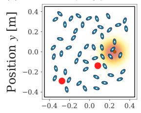

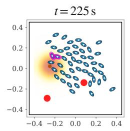

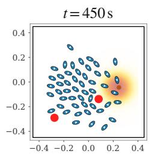

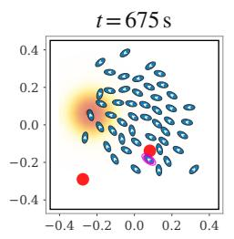

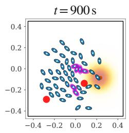

(b)  
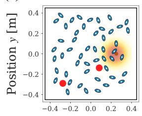

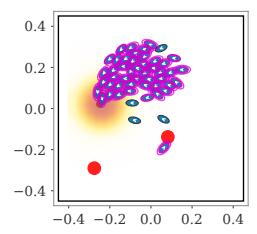

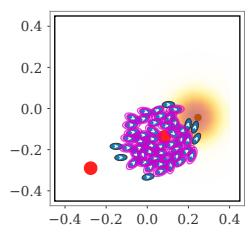

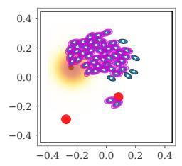

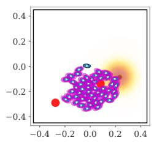

(c)  
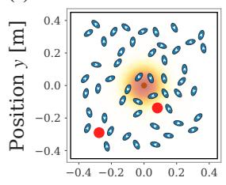

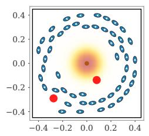

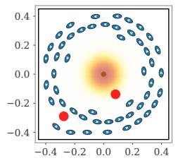

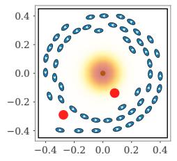

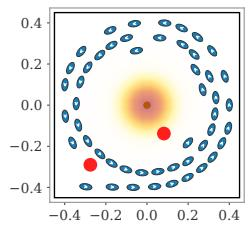

(d)  
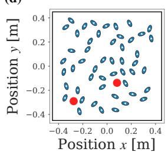

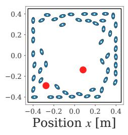

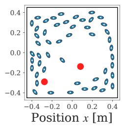

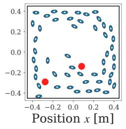

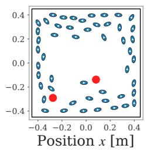  
Figure 8: Collective behaviors with two static obstacles (LA Slack Dt-CBF formulation, $N _ { b } = 5 0 )$ , one behavior per row. (a) Phototaxis, (b) phototaxis with the Reynolds coupling removed, (c) phototactic orbiting, and (d) cohesion without a stimulus. Columns are snapshots at � = 0, 225, 450, 675 and 900 s. The red disks are the static obstacles and the orange field is the light source. Supplementary video 2 shows these four behaviors in the two-obstacle arena.

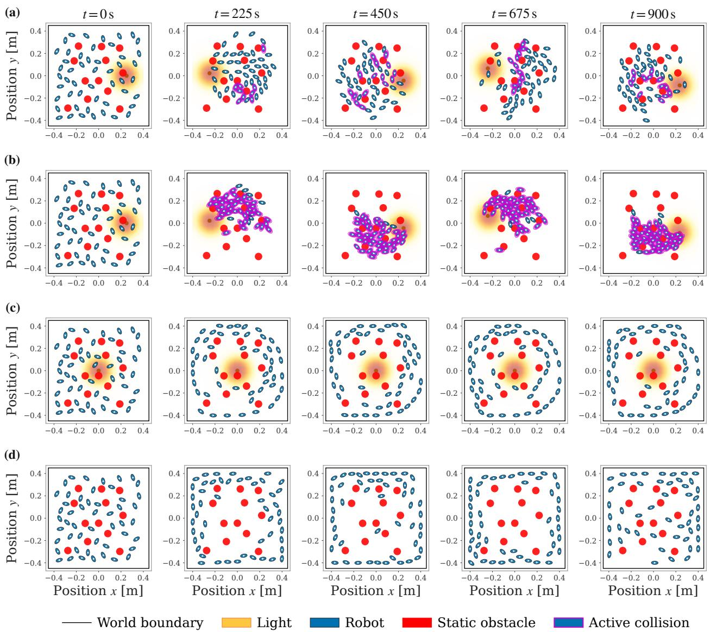  
Figure 9: Collective behaviors with twelve static obstacles (LA Slack Dt-CBF formulation, $N _ { b } = 5 0 )$ , one behavior per row. (a) Phototaxis, (b) phototaxis with the Reynolds coupling removed, (c) phototactic orbiting, and (d) cohesion without a stimulus. Columns are snapshots at � = 0, 225, 450, 675 and 900 s. The red disks are the static obstacles and the orange field is the light source. Supplementary video 3 shows these four behaviors in the cluttered arena.

## B. Supplementary data

Table 3 lists the complete set of controller, safety, environment, and simulation parameters used to produce every result, so the setup of Section 3 is reproducible from the paper alone.

## Table 3

Complete controller, safety, environment, and simulation parameters used for all experiments. Robot-scale lengths are in cm, the arena and sensing ranges in m, and speeds in $\mathbf { m } / \mathbf { s } ;$ cost and slack weights are dimensionless. Values are those of the deployed LA Slack Dt-CBF; the cost weights, horizon, arena and platform limits are shared by every formulation, while �, �, $\gamma _ { 1 } , \gamma _ { 2 }$ and the slack weights are re-tuned per formulation (Section 3.1). The angular-rate bounds are asymmetric, reflecting the vibration-driven platform’s difering left- and right-turn authority.
<table><tr><td>Parameter</td><td>Value</td></tr><tr><td>Model and actuation bounds</td><td></td></tr><tr><td>Arena A</td><td> $0 . 8 \mathrm { m } \times 0 . 8 \mathrm { m } \ ( 0 . 6 4 \mathrm { m } ^ { 2 } )$ </td></tr><tr><td>Position bounds  $p _ { x } , p _ { y }$ </td><td>[−0.4, 0.4] m</td></tr><tr><td>Linear speed v</td><td>[0.01, 0.15]m/s</td></tr><tr><td>Angular rate ω</td><td>[-3.463, 1.432]rad/s</td></tr><tr><td>Robot semi-axes  $a , b$ </td><td>3 cm, 1.5 cm</td></tr><tr><td>Cost weights (dimensionless)</td><td></td></tr><tr><td>Position, heading  ${ { q } _ { \mathrm { p o s } } } , { { q } _ { \theta } }$ </td><td>60,80</td></tr><tr><td>Speed, turn rate  $q _ { v } , q _ { \omega }$ </td><td>1.5, 1.5</td></tr><tr><td>Control effort  $r _ { u }$ </td><td>0.01</td></tr><tr><td>Cohesion, alignment  $q _ { \mathrm { c o h } } , q _ { \mathrm { a l i } }$ </td><td>2.0, 5.0</td></tr><tr><td>Slack quadratic  $Z ^ { \mathrm { r o b } } = Z ^ { \mathrm { o b s } }$ </td><td> $1 0 ^ { 8 }$ </td></tr><tr><td>Slack linear  $z ^ { \mathrm { r o b } } = z ^ { \mathrm { o b s } }$ </td><td> $1 0 ^ { 5 }$ </td></tr><tr><td>Safety and barrier-CBF</td><td></td></tr><tr><td>Safe distance  $D _ { \mathrm { s a f e } } { = } D _ { \mathrm { s a f e , o b s } }$ </td><td>7cm</td></tr><tr><td>Decay α (inter-robot)</td><td>0.9</td></tr><tr><td>Decay  $\alpha _ { \mathrm { o b s } }$  (obstacle)</td><td>0.9</td></tr><tr><td>Look-ahead handle L</td><td>2.1 cm</td></tr><tr><td>Dt-HOCBF gains  $\gamma _ { 1 } , \gamma _ { 2 }$ </td><td>0.5, 0.5</td></tr><tr><td>Dt-HOCBF obstacle gains  $\gamma _ { 1 , \mathrm { { o b s } } } , \gamma _ { 2 , \mathrm { { o b s } } }$ </td><td>0.5, 0.5</td></tr><tr><td>Communication, sensing, environment</td><td></td></tr><tr><td>Communication radius  $R _ { \mathrm { { c o m m } } }$ </td><td>0.15 m</td></tr><tr><td>Max neighbors, obstacle slots K, M</td><td>5,5</td></tr><tr><td>Consensus iterations  $n _ { \mathrm { c o n s } }$ </td><td>2</td></tr><tr><td>Obstacle sensing range  $d _ { \mathrm { o b s } }$ </td><td>0.30m</td></tr><tr><td>Obstacle radius  $r _ { m }$ </td><td>3 cm</td></tr><tr><td>Obstacle counts (free/few/cluttered)</td><td> $0 / 2 / 1 2$ </td></tr><tr><td>Light spread  $\sigma _ { \mathrm { L } }$  , orbit radius r</td><td>0.10 m, 0.25 m</td></tr><tr><td>Source speed  $v _ { s }$ </td><td>0.15 m/s</td></tr><tr><td>Behavior look-ahead  $d _ { \mathrm { l a } }$  ref. speed  $v ^ { \mathrm { r e f } }$ </td><td>7 cm, 0.10 m/s</td></tr><tr><td>Simulation and evaluation</td><td></td></tr><tr><td>Horizon N, control step  $\Delta t$ </td><td>20, 0.1 s</td></tr><tr><td>Episode length</td><td>9000 steps (900 s)</td></tr><tr><td></td><td>10</td></tr><tr><td>Random seeds</td><td></td></tr><tr><td>Integrator</td><td>ERK-4, 3 steps/interval</td></tr><tr><td>QP solver</td><td>acados SQP-RTI, HPIPM, Gauss-Newton</td></tr></table>