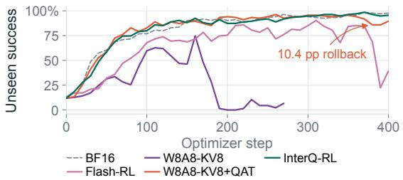
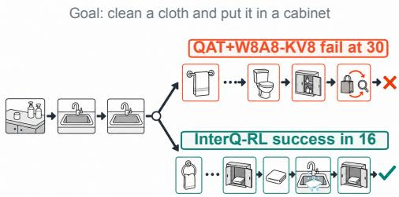
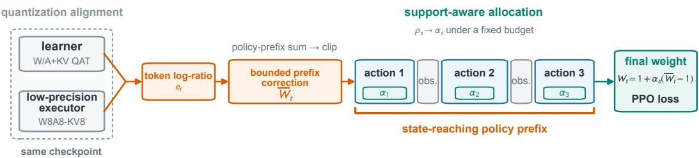
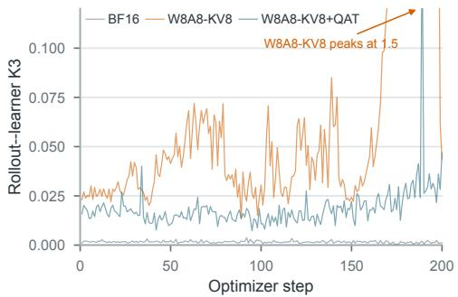
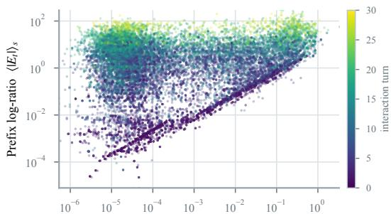
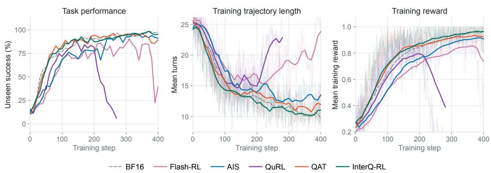
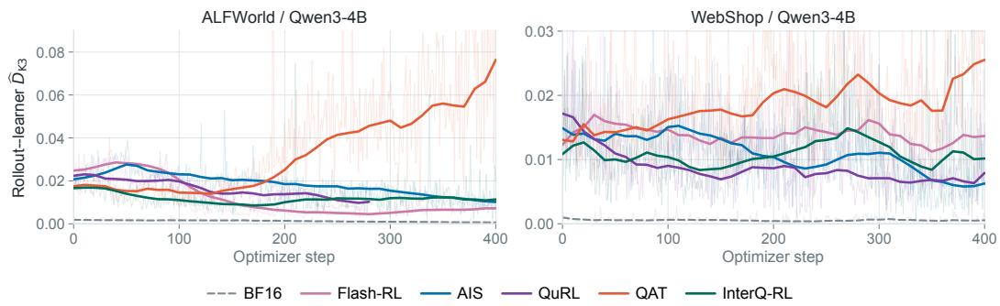
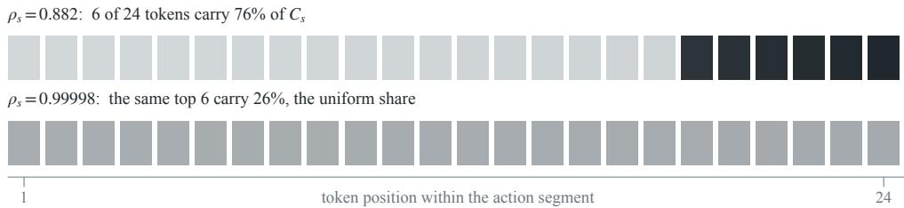
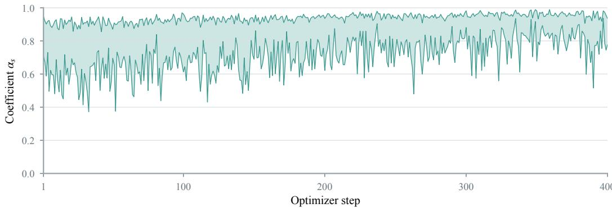
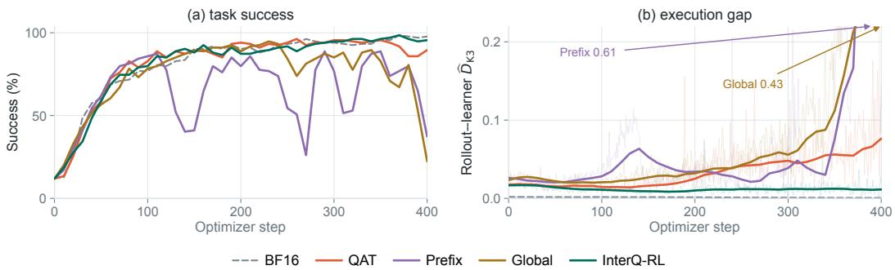

# INTERQ-RL: INTERACTION-AWARE CORRECTION OF EXECUTION MISMATCH IN QUANTIZED AGENTIC RL

Yingbo Hao1,2, Song Liu2, Guanghua Yu2, Zhaojing Zhou2, Jianchen Zhu2, Yi Zou1 1South China University of Technology 2Tencent

## ABSTRACT

Multi-turn agent reinforcement learning (RL) relies on long closed-loop rollouts, making generation and KV-cache costs a major bottleneck. Quantized rollout reduces these costs, but its low-precision executor also serves as the behavior policy and can induce execution mismatch with the learner. Existing quantized-RL methods are designed primarily for single-turn generation. They align the learner forward with quantized rollout or correct the current-token rollout–learner ratio, without modeling the policy history that produces each agent state. Even after quantization alignment, residual rollout–learner mismatch accumulates along the state-reaching policy history, so a current action may look locally aligned despite a mismatched history. We introduce InterQ-RL (Interaction-aware Quantized Reinforcement Learning) to correct this post-alignment mismatch. It applies bounded execution-prefix correction over the state-reaching policy history, allocates correction strength across action segments by effective support under a fixed displacement budget, and requires no additional model forward pass. We evaluate dense and mixture-of-experts (MoE) backbones from 4B to 30B on ALF-World, WebShop, and ScienceWorld, with all quantized arms sharing the same rollout with 8-bit weights, activations, and KV cache (W8A8-KV8). Across four environment–backbone settings, InterQ-RL achieves the strongest quantized endpoint result, matching BF16 to within 0.7 points and exceeding it in two settings. It matches or exceeds the learning speed of alignment alone while avoiding its late performance regression.

## 1 INTRODUCTION

On-policy PPO/GRPO optimizes language-agent outcomes using fresh trajectories from the current policy at every update (Guo et al., 2025; Shao et al., 2024). These trajectories can span multiple turns of search, environment interaction, and tool use (Yao et al., 2023; Cheng et al., 2026; Feng et al., 2025). To scale this data-generation loop, modern systems decouple rollout generation from learning (Sheng et al., 2025; Kwon et al., 2023; Hu et al., 2025; Fu et al., 2025). As interactions grow longer, autoregressive generation and the expanding KV cache become major compute and memory bottlenecks on the rollout side. W8A8 reduces linear-operator cost, and KV8 reduces the cache footprint of long-context rollout (Micikevicius et al., 2022; Qiu et al., 2026). Yet the low-precision rollout executor is also the behavior policy. When the executor and learner evaluate the same checkpoint along different numerical paths, they can define different action distributions. We call this execution mismatch, which violates the behavior–old-policy consistency assumed by PPO/GRPO (Schulman et al., 2017; Shao et al., 2024).

Prior quantized-RL work addresses training–inference mismatch (Zhong et al., 2026) in two ways: alignment matches the learner forward to quantized rollout (Gu et al., 2026; Xi et al., 2026a), whereas correction clips or reweights the rollout–learner ratio at the current token (Yao et al., 2025; Zhou et al., 2026; Li et al., 2026b; Qiu et al., 2026). Both lines focus on single-turn generation. They do not address residual rollout–learner mismatch that remains after alignment and accumulates over the policy history of multi-turn agents. In a closed-loop agent, earlier actions determine later states. Along the same realized trajectory, shared environment-transition factors cancel, but the ratios of policy actions remain (Sutton & Barto, 2018; Precup et al., 2000). Environment feedback changes later contexts but contributes no policy-likelihood factor. We call this interaction-structured execution mismatch.

  
(a) Alignment reduces collapse but leaves rollback

  
(b) Same task and prefix, different outcome  
Figure 1: (a) ALFWorld valid unseen success, evaluated every 10 steps. W8A8-KV8 is the unaligned run and collapses; W8A8-KV8+QAT is aligned but drops 10.4 points from step 260 to 380 and only partially recovers by step 400. Flash-RL destabilizes late, while InterQ-RL remains stable and approaches BF16 at step 400. (b) For one step-400 task, the two arms diverge after sharing their first three actions: W8A8-KV8+QAT exhausts the 30-action budget, whereas InterQ-RL finishes in 16. Across all 134 tasks, 10.45% of W8A8-KV8+QAT episodes and 4.48% of InterQ-RL episodes fail after exhausting the action budget.

We therefore propose InterQ-RL (Interaction-aware Quantized Reinforcement Learning). The method first uses quantization-aware training (QAT) to align the learner forward with rollout quantization. It then forms a bounded execution-prefix correction by accumulating rollout–learner logratios along the state-reaching policy history. Each policy-generated action is treated as one allocation segment. For each segment, InterQ-RL computes an effective-support score from the prefix weights and uses it to allocate correction under a fixed squared-displacement budget. The procedure reuses existing log probabilities and requires no additional model forward pass. Figure 1 motivates correction beyond alignment: the aligned baseline remains trainable but regresses late and exhausts the action budget more often than InterQ-RL.

We evaluate InterQ-RL on three agentic environments and 4B–30B dense and MoE Qwen3 backbones (Yang et al., 2025) under a common W8A8-KV8 rollout. It outperforms QAT by 6.0 and 2.8 points on ALFWorld success and WebShop score (Yao et al., 2022) while matching BF16 within 0.7 points on ALFWorld success, 0.3 on WebShop score, and 0.5 on WebShop success. On both ScienceWorld (Wang et al., 2022) backbones, it attains the highest macro and solved endpoints. It normalized area under the learning curve (AULC) is within 0.33 of QAT on ALFWorld and highest among quantized arms in the other three settings.

This paper makes the following contributions.

1. We characterize interaction-structured execution mismatch in quantized agentic RL: W/A+KV alignment leaves residual rollout–learner mismatch that compounds along the state-reaching policy history.

2. We propose InterQ-RL, which applies bounded execution-prefix correction over the statereaching policy history, allocates correction strength across action segments by effective support under a fixed displacement budget, and requires no additional model forward pass.

3. Using a common W8A8-KV8 rollout, we evaluate three agentic environments and 4B– 30B dense and MoE backbones. Across all four settings, InterQ-RL achieves the strongest quantized endpoint result; its AULC is within 0.33 of QAT on ALFWorld and highest among quantized arms in the other three settings.

## 2 PRELIMINARIES

## 2.1 POLICY OPTIMIZATION WITH QUANTIZED ROLLOUTS

Let $q _ { \mathrm { o l d } }$ be the learner policy at the rollout checkpoint and $q _ { \theta }$ the current policy. In quantized rollout (Li et al., 2026b; Qiu et al., 2026; Zhou et al., 2026), a token $x _ { t }$ in context $h _ { t }$ is sampled from the

behavior policy $r _ { \mathrm { e x e c } }$ realized by the low-precision executor. Even at a shared checkpoint, $r _ { \mathrm { e x e c } }$ and $q _ { \mathrm { o l d } }$ may differ, so the current-policy-to-behavior likelihood ratio factors as

$$
{ \frac { q _ { \theta } ( x _ { t } \mid h _ { t } ) } { r _ { \mathrm { e x e c } } ( x _ { t } \mid h _ { t } ) } } = { \underbrace { { \frac { q _ { \theta } ( x _ { t } \mid h _ { t } ) } { q _ { \mathrm { o l d } } ( x _ { t } \mid h _ { t } ) } } } _ { \mathrm { o p t i m i z a t i o n r a t i o } } } \cdot { \underbrace { { \frac { q _ { \mathrm { o l d } } ( x _ { t } \mid h _ { t } ) } { r _ { \mathrm { e x e c } } ( x _ { t } \mid h _ { t } ) } } } _ { \mathrm { r o l l o u t - l e a r n e r \ r a t i o } } } .\tag{1}
$$

The optimization ratio is clipped by the PPO/GRPO objective (Schulman et al., 2017; Shao et al., 2024); the rollout–learner ratio already differs from one before any parameter update, because the executor evaluates the same weights in low precision.

QAT simulates W8A8-KV8 in the learner forward while retaining high-precision master parameters, gradients, and optimizer states (Liu et al., 2024a; Gu et al., 2026).

## 2.2 AGENTIC TRAJECTORIES

A language agent alternates policy actions with tool or environment feedback (Yao et al., 2023; Cheng et al., 2026). For task z, an S-step trajectory is

$$
\tau = ( z , o _ { 0 } , a _ { 1 } , o _ { 1 } , \ldots , a _ { S } , o _ { S } ) , \qquad R = R ( \tau ) ,\tag{2}
$$

where $o _ { 0 }$ is the initial observation, $a _ { s } \mathrm { ~ a ~ }$ policy-generated action segment, $o _ { s }$ the subsequent observation, and R the trajectory-level reward. After flattening into tokens, set $m _ { t } = 1$ at policy-generated positions and $m _ { t } = 0$ at observations and other non-policy positions. Observations enter neither the policy likelihood nor the policy-gradient loss, but remain in the context $h _ { t }$ of later actions.

## 2.3 TRAJECTORY-PREFIX LIKELIHOOD RATIOS

Let target policy π and behavior policy µ share the task distribution, environment transition kernel, and interaction protocol, and induce trajectory distributions $P _ { \pi }$ and $P _ { \mu }$ . If $P _ { \pi } \ll P _ { \mu }$ , the likelihood ratio of a realized behavior prefix is

$$
{ \frac { P _ { \pi } ( \tau _ { \le t } ) } { P _ { \mu } ( \tau _ { \le t } ) } } = \prod _ { u \le t \atop m _ { u } = 1 } { \frac { \pi ( x _ { u } \mid h _ { u } ) } { \mu ( x _ { u } \mid h _ { u } ) } } .\tag{3}
$$

This is the standard trajectory change-of-measure identity (Sutton & Barto, 2018; Precup et al., 2000). The policies are evaluated on the same realized history and share the environment kernel, so initial-state and transition factors cancel. The product therefore retains only policy positions from the realized prefix, while feedback remains action-conditioned and enters later contexts.

Equation 3 is the exact prefix likelihood-ratio identity; it determines the policy-history scope of the bounded training surrogate in §3.

## 3 INTERQ-RL: ALIGNING EXECUTION AND CORRECTING INTERACTION HISTORY

InterQ-RL first aligns the quantization semantics of learner and rollout, then constructs a bounded correction surrogate by detached reweighting of the base PPO/GRPO loss. Scope determines which policy history leading to the current state enters the surrogate; allocation determines how fixed correction strength is distributed across action segments. InterQ-RL addresses these choices with execution-prefix correction and support-aware allocation, respectively (Figure 2).

## 3.1 ALIGNING THE POLICY THAT GENERATED THE DATA

The first stage reproduces the rollout quantization semantics in the learner forward. Rollout uses blockwise W8A8 linear operators and stores K/V in FP8 E4M3 with per-token-per-head scaling. Standard QAT covers the W/A path. For the KV path we match the learner quantize–dequantize rule to the rollout cache-write kernel, at the same points in the layer. Appendix A gives the full specification. The two forward paths thereby share quantization semantics, while their conditional distributions may still differ at a shared checkpoint.

  
Figure 2: InterQ-RL aligns quantization, corrects the state-reaching policy history, and allocates correction strength by effective support under a fixed displacement budget. Grey: the learner forward matches rollout W/A and KV quantization at a shared checkpoint. Orange: per-token rollout–learner log-ratios form the prefix correction; feedback changes later contexts but adds no policy-likelihood term. Green: segment-level effective support $\rho _ { s }$ determines retention $\alpha _ { s }$ under this budget.

For a rollout token $x _ { t }$ in context $h _ { t } .$ , we quantify this residual mismatch by $\delta _ { t } : = \log q _ { \mathrm { o l d } } ( x _ { t } \ |$ $h _ { t } ) - \log r _ { \mathrm { e x e c } } ( x _ { t } \mid h _ { t } )$ . On executor samples, we report the standard nonnegative K3 estimator for $D _ { \mathrm { K L } } ( r _ { \mathrm { e x e c } } \Vert q _ { \mathrm { o l d } } )$ (Schulman, 2020; Shao et al., 2024). We use K3 as a diagnostic; Appendix A gives its formula and expectation. Over the final 20 steps in Figure 3, median K3 falls from 1.03 for W8A8-KV8 to 0.029 for ${ \mathrm { W } } 8 { \mathrm { A } } 8 { \mathrm { - K V } } 8 { \mathrm { + Q A T } } _ { \cdot }$ , a reduction of roughly one and a half orders of magnitude. The aligned value nevertheless remains about 20× the BF16 value of 0.0014. Alignment therefore removes most of the token-local mismatch; InterQ-RL uses the remainder to construct its history correction.

## 3.2 CORRECTING THE HISTORY THAT PRODUCED THE CURRENT STATE

After alignment, token-local correction still compares only the conditional probabilities of the current token $x _ { t }$ in the realized context $h _ { t } ;$ it omits how the policies differ in reaching that context.

Take the target and behavior policies of §2.3 to be $q _ { \mathrm { o l d } }$ and $r _ { \mathrm { e x e c } }$ , two evaluations of the same checkpoint along different numerical paths. For a realized history $h _ { t }$ and current token $x _ { t }$

$$
\frac { P _ { q _ { \mathrm { o l d } } } ( h _ { t } , x _ { t } ) } { P _ { r _ { \mathrm { e x e c } } } ( h _ { t } , x _ { t } ) } = \underbrace { \frac { P _ { q _ { \mathrm { o l d } } } ( h _ { t } ) } { P _ { r _ { \mathrm { e x e c } } } ( h _ { t } ) } } _ { \mathrm { h i s t o r y f a c t o r } } \cdot \underbrace { \frac { q _ { \mathrm { o l d } } ( x _ { t } \mid h _ { t } ) } { r _ { \mathrm { e x e c } } ( x _ { t } \mid h _ { t } ) } } _ { \mathrm { c u r r e n t - t o k e n f a c t o r } } .\tag{4}
$$

Equation 4 isolates the term omitted by token-local correction: existing token-local rules retain only the current-token factor (Qiu et al., 2026; Zhou et al., 2026). A current-token factor near one does not imply a history factor near one. Earlier actions determine the current observation and reachable state.

Let $m _ { t } = 1$ mark policy tokens and $m _ { t } = 0$ observations or other non-policy positions. After an implementation safety clip, InterQ-RL accumulates token log-ratios only over policy positions:

$$
\begin{array} { r l r } & { e _ { t } : = \mathrm { c l i p } ( \delta _ { t } , - B , B ) , \ } & { n _ { t } : = \displaystyle \sum _ { u \leq t } m _ { u } , } \\ & { E _ { t } : = \displaystyle \sum _ { u \leq t } e _ { u } , \ } & { \ \overline { { W } } _ { t } : = \exp [ \mathrm { c l i p } ( E _ { t } , - \epsilon _ { \mathrm { l o w } } \sqrt { n _ { t } } , \epsilon _ { \mathrm { h i g h } } \sqrt { n _ { t } } ) ] . } \\ & { m _ { u } = 1 } & \end{array}\tag{5}
$$

The mask excludes environment feedback from the log-ratio sum while retaining earlier action factors in later state-reaching prefixes, matching the policy-position scope of the exact product in §2.3. To keep clipping strength comparable across policy positions, we scale the log-space envelope with $\sqrt { n _ { t } }$ (Zhang et al., 2026b); here it bounds the correction for residual mismatch between the two forward paths. We reuse its envelope parameters, $\epsilon _ { \mathrm { l o w } } = 0 . 0 2 5$ and $\epsilon _ { \mathrm { h i g h } } = 0 . 0 5 ;$ the per-token log-ratio clip uses verl’s default numerical-safety bound B. The weight $\overline { { W } } _ { t }$ enters as a detached coefficient, so gradients flow only through the current-token score function.

  
Within-action token log-ratio ⟨|et|⟩s  
Figure 3: W8A8-KV8+QAT reduces rollout– learner K3 relative to unaligned W8A8-KV8 at shared weights, but does not eliminate it. Each curve compares the learner and executor at matched checkpoints.  
Figure 4: A current action can look locally aligned despite a mismatched state-reaching history. 18,683 action segments from ten consecutive updates continued from an aligned checkpoint; color encodes interaction turn.

Figure 4 shows current-action and state-reaching prefix ratios separating with interaction depth, motivating correction over the policy history rather than the current token alone.

## 3.3 ALLOCATING CORRECTION BY SUPPORT, NOT MAGNITUDE

Let an action segment s be a maximal contiguous run of $m _ { t } = 1$ with $n _ { s }$ tokens. For a segment with $n _ { s } > 1$ 1, define

$$
\begin{array} { r l r } & { \mu _ { s } : = \displaystyle \frac { 1 } { n _ { s } } \sum _ { t \in s } \overline { { W } } _ { t } , } & { \nu _ { s } : = \displaystyle \frac { 1 } { n _ { s } } \sum _ { t \in s } \overline { { W } } _ { t } ^ { 2 } , \qquad } & { \mathrm { E S S } _ { s } : = \displaystyle \frac { \left( \sum _ { t \in s } \overline { { W } } _ { t } \right) ^ { 2 } } { \sum _ { t \in s } \overline { { W } } _ { t } ^ { 2 } } , } \\ & { \rho _ { s } : = \left[ \frac { \mathrm { E S S } _ { s } - 1 } { n _ { s } - 1 } \cdot \displaystyle \frac { \nu _ { s } } { \nu _ { s } + \varepsilon _ { \mathrm { m o m } } } \right] _ { [ 0 , 1 ] } , } & { C _ { s } : = \displaystyle \frac { 1 } { n _ { s } } \sum _ { t \in s } \left( \overline { { W } } _ { t } - 1 \right) ^ { 2 } . } \end{array}\tag{6}
$$

Here $C _ { s }$ measures correction magnitude as mean squared displacement from identity. The score $\rho _ { s }$ summarizes prefix-weight concentration within an action segment through length-normalized ESS; higher values indicate broader support. InterQ-RL uses $\rho _ { s }$ as the allocation priority. The second-moment factor stabilizes near-zero moments, and uniform weights give $\rho _ { s } \approx 1$ . Segment normalization treats each action as one unit rather than favoring longer text. The score follow normalized ESS (Elvira et al., 2022; Zhou et al., 2026).

This distinction occurs in practice: Appendix B gives a matched pair of 24-token segments with $C _ { s } = 0 . 1 2 8 8 8 2$ and 0.128889, a difference of only $7 \times 1 0 ^ { - 6 }$ . Their six largest squared-displacement contributions carry 76% and 26% of the total, respectively; the latter is close to the uniform share of $6 / 2 4 = 2 5 \%$

To set the overall correction strength, InterQ-RL first defines a uniform reference. Let $s$ contain all action segments in one rollout/update batch, and define

$$
\mu _ { g } : = \frac { 1 } { | S | } \sum _ { s \in S } \mu _ { s } , \qquad \nu _ { g } : = \frac { 1 } { | S | } \sum _ { s \in S } \nu _ { s } , \qquad \alpha _ { g } : = \mathrm { c l i p } \Bigg ( \frac { \mu _ { g } } { \sqrt { \nu _ { g } + \varepsilon _ { \mathrm { m o m } } } } , 0 , 1 \Bigg ) .\tag{7}
$$

Up to the clip and $\varepsilon _ { \mathrm { m o m } } , \alpha _ { g } ^ { 2 } = \mu _ { g } ^ { 2 } / \nu _ { g } ,$ , the moment ratio underlying relative ESS. The scalar $\alpha _ { g }$ sets the uniform-reference strength. InterQ-RL redistributes this strength by solving

$$
\operatorname* { m a x } _ { \{ 0 \leq \alpha _ { s } \leq 1 \} } \sum _ { s \in S } C _ { s } \rho _ { s } \alpha _ { s } \qquad \mathrm { s u b j e c t ~ t o } \qquad \sum _ { s \in S } C _ { s } \alpha _ { s } ^ { 2 } \leq \alpha _ { g } ^ { 2 } \sum _ { s \in S } C _ { s } .\tag{8}
$$

The utility $C _ { s } \rho _ { s } \alpha _ { s }$ favors retaining correction with broader support, while $C _ { s } \alpha _ { s } ^ { 2 }$ measures its resulting displacement. The constraint fixes total segment-normalized displacement to the uniform reference; at the optimum it saturates, so allocation redistributes rather than increases correction strength (Appendix B).

Proposition 1. If every segment with $n _ { s } > 1$ satisfies $C _ { s } > 0$ and $\rho _ { s } \in ( 0 , 1 ]$ , and $\alpha _ { g } \in ( 0 , 1 )$ then equation 8 has the unique solution $\alpha _ { s } = \operatorname* { m i n } ( c \rho _ { s } , 1 )$ , where $c > 0$ is determined uniquely by the budget equality and can be found by one-dimensional bisection. If all $\rho _ { s }$ are equal then $\alpha _ { s } = \alpha _ { g }$ and InterQ-RL reduces exactly to the uniform reference. The proof and the $n _ { s } = 1$ case are given in Appendix B.

Higher- ${ \bf \nabla } \cdot \rho _ { s }$ segments therefore retain more prefix correction, whereas lower- ${ \boldsymbol { \cdot } } \rho _ { s }$ segments are pulled toward identity. Since $0 \leq \alpha _ { s } \leq 1$ , every final weight lies between 1 and $\overline { { W } } _ { t }$

## 3.4 THE INTERQ-RL OBJECTIVE

For a fixed executor batch, rewards and group-relative advantages are detached. Let $\mathrm { s e g } ( t )$ denote the action segment containing token t, and let $\ell _ { t } ^ { \mathrm { b a s e } } ( \theta )$ be the token-level loss of the underlying PPO/GRPO objective. InterQ-RL defines the empirical objective

$$
W _ { t } : = 1 + \alpha _ { \mathrm { s e g } ( t ) } \left( \overline { { { W } } } _ { t } - 1 \right) , \qquad \mathcal { L } _ { \mathrm { I n t e r Q - R L } } : = \mathrm { A g g } _ { \mathrm { b a s e } } \left[ m _ { t } \mathrm { s t o p g r a d } ( W _ { t } ) \ell _ { t } ^ { \mathrm { b a s e } } ( \theta ) \right] .\tag{9}
$$

Equation 3 gives the exact $q _ { \mathrm { o l d } } / r _ { \mathrm { e x e c } }$ ratio for the state-reaching policy prefix associated with each token; $W _ { t }$ is its bounded, support-allocated counterpart. Equation 9 reweights only the base token loss: $W _ { t }$ accounts for residual execution mismatch after alignment, while the current-policy PPO/GRPO ratio, clipping rule, executor-sampled advantage, and aggregation remain unchanged. With no mismatch, $\bar { W _ { t } } = \bar { 1 }$ and the objective reduces to the base PPO/GRPO objective. Prefix sums, segment statistics, and the one-dimensional solver are linear in policy-token count and reuse existing rollout and learner log probabilities, requiring no additional model forward pass. Algorithm 1 gives the per-batch procedure.

Algorithm 1 Execution-prefix correction with support-aware allocation. The returned $W _ { t }$ is the   
coefficient applied in equation 9. Constants: $\epsilon _ { \mathrm { l o w } } = 0 . 0 2 5 , \epsilon _ { \mathrm { h i g h } } = 0 . 0 5 , \varepsilon _ { \mathrm { m o m } } = 1 0 ^ { - 8 }$ , and 80   
bisection steps.   
1: $e _ { t } \gets \mathrm { c l i p } ( \log q _ { \mathrm { o l d } } ( x _ { t } \mid h _ { t } ) - \log r _ { \mathrm { e x e c } } ( x _ { t } \mid h _ { t } ) , - B , B )$   
2: $\begin{array} { r } { E _ { t } \gets \sum _ { u \leq t } m _ { u } e _ { u } } \end{array}$ (state-reaching policy prefix)   
3: $\begin{array} { r } { n _ { t } \gets \sum _ { u \le t } m _ { u } } \end{array}$   
4: $\overline { { W } } _ { t } \gets \exp \bigl [ \mathrm { c l i p } \bigl ( E _ { t } , - \epsilon _ { \mathrm { l o w } } \sqrt { n _ { t } } , \epsilon _ { \mathrm { h i g h } } \sqrt { n _ { t } } \bigr ) \bigr ]$   
5: $s $ maximal runs of consecutive $m _ { t } = 1 ^ { \prime }$ (the action segments)   
6: For each $s \in S ,$ compute $\mu _ { s } , \nu _ { s } , \rho _ { s } , C _ { s }$ from equation 6   
7: $\alpha _ { g }  \mathrm { c l i p } ( \mu _ { g } / \sqrt { \nu _ { g } + \varepsilon _ { \mathrm { m o m } } } , 0 , 1 )$ (batch means $\mu _ { g } , \nu _ { g }$ from equation 7)   
8: c ← root of $\textstyle \sum _ { s } C _ { s }$ min $\begin{array} { r } { ( c \rho _ { s } , 1 ) ^ { 2 } \stackrel { \cdot } { = } \alpha _ { g } ^ { 2 } \sum _ { s } C _ { s } , } \end{array}$ , by bisection   
9: $\alpha _ { s } \gets \operatorname* { m i n } ( c \rho _ { s } , 1 )$ (Appendix B.5 for $n _ { s } = 1 )$   
10: $W _ { t }  1 + \alpha _ { \mathrm { s e g } ( t ) } ( \overline { { W } } _ { t } - 1 )$   
11: return $W _ { t }$

## 4 EXPERIMENTS

## 4.1 EXPERIMENTAL SETUP

Settings and comparisons. We evaluate on three multi-turn agent environments: ALFWorld (Shridhar et al., 2021), WebShop (Yao et al., 2022), and ScienceWorld (Wang et al., 2022). ALF-World and WebShop both use Qwen3-4B-Instruct-2507 and report on 134 valid unseen tasks and 500 official test tasks, respectively. Because Qwen3-4B provides limited learning signal on the more demanding ScienceWorld setting, we use Qwen3-8B and Qwen3-30B-A3B-Instruct-2507, covering dense and MoE backbones (Yang et al., 2025); endpoint evaluation uses 1,819 official test instances. All runs use GRPO (Shao et al., 2024). Table 1 is the primary end-to-end comparison: the published baselines retain their objectives; all arms share task IDs, evaluator, training horizon, and optimizer settings; and all quantized arms share the W8A8-KV8 rollout. Baselines are BF16, Flash-RL with token-local TIS (Yao et al., 2025), AIS (Zhou et al., 2026), QuRL with ACR+UAQ (Li et al., 2026b), and QAT with $\mathrm { W } / \mathrm { A } { + } \mathrm { K V }$ alignment. Flash-RL uses verl’s built-in rollout importance-sampling path; AIS and QuRL are reimplemented from their papers. Appendix C gives method-specific settings.

Table 1: End-to-end comparison of complete methods under a common training budget. ALFWorld and WebShop report the mean over the final six checkpoint evaluations; ScienceWorld reports the full official test at a fixed endpoint checkpoint. ALFWorld and WebShop use Qwen3-4B; Science-World headers give the backbone size. Bold marks the best quantized result. † QuRL collapsed at step 278 and has no common-horizon endpoint.
<table><tr><td rowspan="2"></td><td rowspan="2">ALFWorld</td><td colspan="2">WebShop</td><td colspan="2">ScienceWorld (8B)</td><td colspan="2">ScienceWorld (A3B)</td></tr><tr><td>Success ↑ Score ↑</td><td>Success ↑</td><td>Macro ↑</td><td>Solved ↑</td><td>Macro ↑</td><td>Solved ↑</td></tr><tr><td>Method BF16</td><td>97.1</td><td>78.0</td><td>54.0</td><td>66.9</td><td>74.1</td><td>67.0</td><td>74.3</td></tr><tr><td>Flash-RL</td><td>64.1</td><td>72.8</td><td>44.4</td><td>63.2</td><td>69.2</td><td>65.8</td><td>71.5</td></tr><tr><td>AIS</td><td>92.3</td><td>76.5</td><td>51.5</td><td>59.6</td><td>64.2</td><td>65.0</td><td>70.6</td></tr><tr><td>QuRL</td><td>Coll.†</td><td>75.3</td><td>51.7</td><td>57.1</td><td>63.9</td><td>64.0</td><td>69.6</td></tr><tr><td>QAT</td><td>90.4</td><td>74.9</td><td>49.7</td><td>65.5</td><td>75.8</td><td>69.3</td><td>76.6</td></tr><tr><td>InterQ-RL</td><td>96.4</td><td>77.7</td><td>53.5</td><td>67.8</td><td>76.1</td><td>69.9</td><td>76.9</td></tr></table>

Protocol and metrics. All settings train for 400 optimizer steps. ALFWorld and WebShop endpoints are the mean of the final six checkpoint evaluations. ScienceWorld reports the full official test at a fixed endpoint checkpoint. We report the ALFWorld success rate, the WebShop score and success rate, and the ScienceWorld macro normalized score and per-episode solved rate. Success and solved rates count fully completed tasks, whereas the WebShop score and the ScienceWorld macro score credit partial progress. To separate endpoint quality from learning speed, we report normal ized AULC: the trapezoidal area under the evaluation curve, with scores recorded every 10 steps and the area divided by the common 400-step horizon. ALFWorld uses the same valid unseen set, WebShop the same 500-instruction official test set, and ScienceWorld the 259-instance development monitor. Interaction cost is the mean number of turns over successful endpoint episodes; cap exhaustion counts unsuccessful episodes that consume the environment’s full action budget. Appendix C specifies baseline rules, data splits, evaluation protocols, hardware, and quantization.

## 4.2 END-TO-END RESULTS

Endpoint performance and training dynamics. InterQ-RL gives the strongest quantized result on every metric in Table 1, including the four that count fully completed tasks. It improves over QAT by 6.0 and 2.8 points on ALFWorld success and WebShop score and by 2.3 and 0.6 on the two ScienceWorld macro scores, and over the strongest of Flash-RL, AIS, and QuRL by 1.2 to 6.9 points. It matches BF16 within 0.7 points on ALFWorld success, 0.3 on WebShop score, and 0.5 on WebShop success, and exceeds it by 0.9 and 2.9 on the ScienceWorld macro scores and 2.0 and 2.6 on the solved rates. Figure 5 places the ALFWorld endpoint in its training context. QAT reaches 95.5% at step 300 but falls to 89.6% by step 400, while InterQ-RL is still at 95.5%. The endpoint separation shows that interaction correction sustains task performance. Flash-RL drops from 84.3% at step 370 to 39.6% at step 400. QuRL falls to 6.0% at step 270 as its training reward falls from a peak of 0.992 to 0.141, and terminates at step 278. AIS avoids collapse but learns more slowly and unevenly: it reaches 69.4% at step 150 versus 88.1% for InterQ-RL, drops from 79.9% at step 210 to 67.9% ten steps later, and reaches a 92.3% last-six endpoint versus 96.4% for InterQ-RL.

Learning speed and interaction cost. In Table 2, InterQ-RL has the highest quantized AULC in three settings and is within 0.33 of QAT on ALFWorld (81.96 versus 82.29), while remaining above Flash-RL, AIS, and QuRL in all four. While these three baselines are 2.0–17.2 points below BF16 across common-horizon results, InterQ-RL stays within 1.9 points in the first three settings and exceeds BF16 by 3.3 on ScienceWorld/30B-A3B. InterQ-RL also reduces interaction cost. It yields the shortest successful trajectories on ALFWorld and WebShop, reducing the QAT averages from 12.72 to 10.06 and from 6.51 to 4.60 turns, respectively. On the 117 ALFWorld tasks solved by both methods, InterQ-RL averages 9.64 turns versus 12.79 for QAT. In both ScienceWorld settings, it remains within 0.11 turns of the shortest quantized arm. Cap exhaustion also falls from 10.45% to 4.48% on ALFWorld and from 1.60% to 0.40% on WebShop. On ALFWorld and both ScienceWorld settings, the arm with the lowest AULC also has the longest successful trajectories in most cases, whereas InterQ-RL combines higher AULC with shorter trajectories.

  
Figure 5: On ALFWorld, InterQ-RL remains stable while QAT rolls back, Flash-RL destabilizes, QuRL collapses, and AIS learns more slowly. Mean turns in the middle panel are averaged over all training trajectories. For trajectory length and reward, smoothed trends use 10-step block medians followed by light EMA.

Table 2: Learning speed and the interaction cost of successful trajectories. ALFWorld and Web-Shop use Qwen3-4B; ScienceWorld headers give the backbone size. Turns average over successful episodes only; bold marks the best quantized AULC. QuRL collapsed on ALFWorld at step 278 and has no result on the common horizon.
<table><tr><td rowspan="2">Method</td><td colspan="2">ALFWorld</td><td colspan="2">WebShop</td><td colspan="2">ScienceWorld (8B)</td><td colspan="2">ScienceWorld (A3B)</td></tr><tr><td>AULC↑</td><td>Turns ↓</td><td>AULC↑</td><td>Turns ↓</td><td>AULC↑</td><td>Turns ↓</td><td>AULC↑</td><td>Turns ↓</td></tr><tr><td>BF16</td><td>82.1</td><td>10.98</td><td>75.2</td><td>5.23</td><td>56.4</td><td>20.45</td><td>54.1</td><td>19.04</td></tr><tr><td>Flash-RL</td><td>64.9</td><td>20.34</td><td>72.5</td><td>5.09</td><td>47.6</td><td>31.93</td><td>52.1</td><td>20.31</td></tr><tr><td>AIS</td><td>72.5</td><td>12.43</td><td>72.8</td><td>6.61</td><td>45.4</td><td>22.32</td><td>49.6</td><td>18.07</td></tr><tr><td>QuRL</td><td></td><td></td><td>72.2</td><td>6.23</td><td>50.8</td><td>21.19</td><td>45.5</td><td>32.32</td></tr><tr><td>QAT</td><td>82.3</td><td>12.72</td><td>72.3</td><td>6.51</td><td>54.4</td><td>22.38</td><td>54.1</td><td>20.20</td></tr><tr><td>InterQ-RL</td><td>82.0</td><td>10.06</td><td>73.3</td><td>4.60</td><td>54.6</td><td>21.20</td><td>57.4</td><td>18.18</td></tr></table>

  
Figure 6: During continued optimization, K3 grows under QAT and remains stable under InterQ-RL. K3 is computed on the trajectories of each arm and shown as smoothed trends. The QuRL curve on ALFWorld ends at step 278.

Rollout–learner K3. Over the first 100 ALFWorld steps, QAT and InterQ-RL have similar median K3 (0.0155 versus 0.0125); by steps 301–400 they separate to 0.0598 and 0.0119 (Figure 6). WebShop shows the same pattern, with QAT and InterQ-RL ending at 0.0210 and 0.0081. On each arm’s rollouts, QAT’s rollout–learner gap widens, whereas InterQ-RL’s remains stable. A low K3 alone does not imply strong task performance: QuRL’s K3 falls as it collapses, while Flash-RL and AIS end with K3 values of 0.0071 and 0.0107 despite lower success (64.1% and 92.3%) than InterQ-RL (0.0119 at 96.4%); AIS also has lower AULC (72.5 versus 82.0).

Additional design analyses. Appendix C.4 provides two additional analyses on ALFWorld. Prefix applies the bounded prefix weights directly, Global uses one coefficient across all segments, and InterQ-RL allocates segment-specific coefficients by effective support (Figure 9). Prefix and Global reach 88.8% and 94.8% success at steps 290 and 230 but end at 37.3% and 22.4% at step 400, whereas InterQ-RL ends at 95.5%. Global and InterQ-RL use the same segment-normalized dis placement budget. These results show that prefix correction provides useful learning signal, while support-aware allocation sustains late-stage performance under a fixed correction budget. As an additional ablation, Table 6 pairs Flash-RL’s TIS rule and the AIS correction rule with the same QAT learner used by InterQ-RL. QAT+TIS and QAT+AIS reach 90.55% and 92.66% last-six success, compared with 90.42% for QAT alone, while their AULCs fall from 82.29 to 70.59 and 76.27. Combining QAT with token-local correction therefore does not resolve the residual mismatch in multi-turn agent RL. InterQ-RL reaches 96.39% success with 81.96 AULC and lowers cap exhaustion to 4.48%, showing the effectiveness of our method for quantized agent RL.

## 5 RELATED WORK

Quantized LLM reinforcement learning. Quantized LLM RL builds on weight, activation, and KV-cache quantization (Dettmers et al., 2022; Xiao et al., 2023; Liu et al., 2024b; DeepSeek-AI et al., 2025), and spans learner–rollout alignment and mismatch correction. FP8-RL quantizes roll out W/A and the KV cache (Qiu et al., 2026). QaRL and Jet-RL align the learner forward with quantized rollout (Gu et al., 2026; Xi et al., 2026a). Flash-RL, AIS, and QuRL control training– inference mismatch through clipping, adaptive weighting, or update-aware quantization (Yao et al., 2025; Zhou et al., 2026; Li et al., 2026b), all in single-turn generation. InterQ-RL addresses residual execution mismatch along the policy histories of multi-turn agents.

Policy optimization under distribution shift. Off-policy RL corrects distribution shift through importance weighting (Precup et al., 2000; Munos et al., 2016; Espeholt et al., 2018). LLM methods span response-level objectives, cumulative-token ratios, prefix surrogates, and whole-sequence weighting or masking (Zheng et al., 2025; Zhang et al., 2026b; Lei et al., 2026; Zhang et al., 2026a; Li et al., 2026a). These methods address general rollout or policy-version mismatch at different granularities. InterQ-RL instead targets quantization-induced mismatch that remains after alignment and allocates bounded correction across action segments by effective support under a fixed displacement budget.

Agentic reinforcement learning. GiGPO and LOOP extend policy optimization to multi-turn interaction, targeting credit assignment and training efficiency (Feng et al., 2025; Chen et al., 2025); Agent-R1, AgentGym-RL, and SkyRL-Agent provide open training frameworks (Cheng et al., 2026; Xi et al., 2026b; Cao et al., 2025). InterQ-RL addresses a complementary execution-level source of distribution shift: mismatch introduced when the behavior policy runs in low precision and propagated through action-conditioned history.

## 6 CONCLUSION

We identified interaction-structured execution mismatch in quantized agentic RL: even after W/A+KV alignment, residual rollout–learner mismatch compounds along the state-reaching policy history. InterQ-RL applies bounded execution-prefix correction along this history and allocates correction strength across action segments by effective support under a fixed displacement budget, reusing existing log probabilities without another forward pass. Across four settings spanning three environments and 4B–30B dense and MoE backbones under a common W8A8-KV8 rollout, InterQ-RL achieves the strongest quantized endpoint result in every setting, matches BF16 to within 0.7 points and exceeds it in two. Its AULC is within 0.33 of QAT on ALFWorld and highest among quantized arms in the other three settings.

## AI USE STATEMENT

During the preparation of this manuscript we used large language model assistants only to polish the writing, at the level of grammar, flow, and tone within sentences and paragraphs. They were not used to generate ideas, design experiments, or draw conclusions. All technical content, methodology, and interpretation were independently written, thoroughly verified, and approved by the authors. To guard against factual and citation errors, the authors reviewed every edited sentence and checked each citation against its primary source. The authors take full responsibility for the accuracy and integrity of this manuscript.

## ETHICS STATEMENT

This work uses only publicly available simulated environments and open-weight models that are already established in the research literature. No human subjects are involved and no personal data is collected. We release no new text, image, or audio corpus, and use the environments and checkpoints for research purposes only.

## REPRODUCIBILITY STATEMENT

To let the community replicate our findings, this project will be released as open-source software. The method and per-batch procedure are specified in §3 and Algorithm 1; Appendices A and B give the quantization details, proof, and edge cases. Section 4.1 and Appendix C give the complete experimental protocol, from data splits and hyperparameters to hardware.

## REFERENCES

Shiyi Cao, Dacheng Li, Fangzhou Zhao, Shuo Yuan, Sumanth R. Hegde, Connor Chen, Charlie Ruan, Tyler Griggs, Shu Liu, Eric Tang, Richard Liaw, Philipp Moritz, Matei Zaharia, Joseph E. Gonzalez, and Ion Stoica. SkyRL-Agent: Efficient RL training for multi-turn LLM agent, 2025. URL https://arxiv.org/abs/2511.16108.

Kevin Chen, Marco Cusumano-Towner, Brody Huval, Aleksei Petrenko, Jackson Hamburger, Vladlen Koltun, and Philipp Krahenb¨ uhl. Reinforcement learning for long-horizon interactive¨ LLM agents, 2025. URL https://arxiv.org/abs/2502.01600.

Mingyue Cheng, Shuo Yu, Daoyu Wang, Qingchuan Li, Xiaoyu Tao, Jie Ouyang, Yucong Luo, Yitong Zhou, Qi Liu, and Enhong Chen. Agent-R1: A unified and modular framework for agentic reinforcement learning, 2026. URL https://arxiv.org/abs/2511.14460.

DeepSeek-AI, Aixin Liu, Bei Feng, Bing Xue, Bingxuan Wang, Bochao Wu, Chengda Lu, Chenggang Zhao, Chengqi Deng, Chenyu Zhang, Chong Ruan, Damai Dai, et al. DeepSeek-V3 technical report, 2025. URL https://arxiv.org/abs/2412.19437.

Tim Dettmers, Mike Lewis, Younes Belkada, and Luke Zettlemoyer. GPT3.int8(): 8-bit matrix multiplication for transformers at scale. In Advances in Neural Information Processing Systems, volume 35, pp. 30318–30332. Curran Associates, Inc., 2022. doi: 10.52202/ 068431-2198. URL https://proceedings.neurips.cc/paper\_files/paper/ 2022/file/c3ba4962c05c49636d4c6206a97e9c8a-Paper-Conference.pdf.

V´ıctor Elvira, Luca Martino, and Christian P. Robert. Rethinking the effective sample size. International Statistical Review, 90(3):525–550, 2022. doi: https://doi.org/10.1111/insr.12500. URL https://onlinelibrary.wiley.com/doi/abs/10.1111/insr.12500.

Lasse Espeholt, Hubert Soyer, Remi Munos, Karen Simonyan, Vlad Mnih, Tom Ward, Yotam Doron, Vlad Firoiu, Tim Harley, Iain Dunning, Shane Legg, and Koray Kavukcuoglu. IMPALA: Scalable distributed deep-RL with importance weighted actor-learner architectures. In Proceedings of the 35th International Conference on Machine Learning, volume 80, pp. 1407–1416. PMLR, 2018. URL https://proceedings.mlr.press/v80/espeholt18a.html.

Lang Feng, Zhenghai Xue, Tingcong Liu, and Bo An. Group-in-group policy optimization for LLM agent training. In The Thirty-ninth Annual Conference on Neural Information Processing Systems, 2025. URL https://openreview.net/forum?id=QXEhBMNrCW.

Wei Fu, Jiaxuan Gao, Xujie Shen, Chen Zhu, Zhiyu Mei, Chuyi He, Shusheng Xu, Guo Wei, Jun Mei, WANG JIASHU, Tongkai Yang, Binhang Yuan, and Yi Wu. AREAL: A large-scale asynchronous reinforcement learning system for language reasoning. In The Thirty-ninth Annual Conference on Neural Information Processing Systems, 2025. URL https://openreview. net/forum?id=X9diEuva9R.

Hao Gu, Hao Wang, Jiacheng Liu, Lujun Li, Qiyuan Zhu, Bei Liu, Binxing Xu, Lei Wang, Xintong Yang, Sida Lin, Sirui Han, and Yike Guo. QaRL: Rollout-aligned quantization-aware RL for fast and stable training under training–inference mismatch. In Findings of the Association for Computational Linguistics: ACL 2026, pp. 17051–17064. Association for Computational Linguistics, July 2026. doi: 10.18653/v1/2026.findings-acl.841. URL https: //aclanthology.org/2026.findings-acl.841/.

Daya Guo, Dejian Yang, Haowei Zhang, Junxiao Song, Peiyi Wang, Qihao Zhu, Runxin Xu, Ruoyu Zhang, Shirong Ma, Xiao Bi, et al. DeepSeek-R1 incentivizes reasoning in LLMs through reinforcement learning. Nature, 645:633–638, 2025. doi: 10.1038/s41586-025-09422-z. URL https://doi.org/10.1038/s41586-025-09422-z.

Jian Hu, Xibin Wu, Wei Shen, Jason Klein Liu, Weixun Wang, Songlin Jiang, Haoran Wang, Hao Chen, Bin Chen, Wenkai Fang, Xianyu, Yu Cao, Haotian Xu, and Yiming Liu. OpenRLHF: A raybased easy-to-use, scalable and high-performance RLHF framework. In Proceedings ofthe 2025 Conference on Empirical Methods in Natural Language Processing: System Demonstrations, pp. 656–666. Association for Computational Linguistics, November 2025. doi: 10.18653/v1/2025. emnlp-demos.48. URL https://aclanthology.org/2025.emnlp-demos.48/.

Woosuk Kwon, Zhuohan Li, Siyuan Zhuang, Ying Sheng, Lianmin Zheng, Cody Hao Yu, Joseph Gonzalez, Hao Zhang, and Ion Stoica. Efficient memory management for large language model serving with PagedAttention. In Proceedings of the 29th Symposium on Operating Systems Principles, pp. 611–626. Association for Computing Machinery, 2023. doi: 10.1145/3600006.3613165. URL https://doi.org/10.1145/3600006.3613165.

Shiye Lei, Zhihao Cheng, and Dacheng Tao. A step back: Prefix importance ratio stabilizes policy optimization, 2026. URL https://arxiv.org/abs/2601.22718.

Yingru Li, Jiacai Liu, Jiawei Xu, Yuxuan Tong, Ziniu Li, Qian Liu, and Baoxiang Wang. Trust region masking for long-horizon llm reinforcement learning, 2026a. URL https://arxiv. org/abs/2512.23075.

Yuhang Li, Reena Elangovan, Xin Dong, Priyadarshini Panda, and Brucek Khailany. QuRL: Lowprecision reinforcement learning for efficient reasoning. In The Fourteenth International Conference on Learning Representations, 2026b. URL https://openreview.net/forum?id= eG0bpCwdKn.

Zechun Liu, Barlas Oguz, Changsheng Zhao, Ernie Chang, Pierre Stock, Yashar Mehdad, Yangyang Shi, Raghuraman Krishnamoorthi, and Vikas Chandra. LLM-QAT: Data-free quantization aware training for large language models. In Findings of the Association for Computational Linguistics: ACL 2024, pp. 467–484. Association for Computational Linguistics, August 2024a. doi: 10.18653/v1/2024.findings-acl.26. URL https://aclanthology.org/ 2024.findings-acl.26/.

Zirui Liu, Jiayi Yuan, Hongye Jin, Shaochen Zhong, Zhaozhuo Xu, Vladimir Braverman, Beidi Chen, and Xia Hu. KIVI: A tuning-free asymmetric 2bit quantization for KV cache. In Proceedings of the 41st International Conference on Machine Learning, volume 235, pp. 32332–32344. PMLR, 2024b. URL https://proceedings.mlr.press/v235/liu24bz.html.

Paulius Micikevicius, Dusan Stosic, Neil Burgess, Marius Cornea, Pradeep Dubey, Richard Grisenthwaite, Sangwon Ha, Alexander Heinecke, Patrick Judd, John Kamalu, Naveen Mellempudi, Stuart Oberman, Mohammad Shoeybi, Michael Siu, and Hao Wu. FP8 formats for deep learning, 2022. URL https://arxiv.org/abs/2209.05433.

Remi Munos, Thomas Stepleton, Anna Harutyunyan, and Marc G. Bellemare. Safe and efficient´ off-policy reinforcement learning. In Proceedings ofthe 30th International Conference on Neural Information Processing Systems, pp. 1054–1062. Curran Associates Inc., 2016.

Doina Precup, Richard S. Sutton, and Satinder P. Singh. Eligibility traces for off-policy policy evaluation. In Proceedings of the Seventeenth International Conference on Machine Learning, pp. 759–766. Morgan Kaufmann Publishers Inc., 2000.

Zhaopeng Qiu, Shuang Yu, Jingqi Zhang, Shuai Zhang, Xue Huang, Jingyi Yang, and Junjie Lai. FP8-RL: A practical and stable low-precision stack for LLM reinforcement learning, 2026. URL https://arxiv.org/abs/2601.18150.

John Schulman. Approximating KL divergence, 2020. URL http://joschu.net/blog/ kl-approx.html.

John Schulman, Filip Wolski, Prafulla Dhariwal, Alec Radford, and Oleg Klimov. Proximal policy optimization algorithms, 2017. URL https://arxiv.org/abs/1707.06347.

Zhihong Shao, Peiyi Wang, Qihao Zhu, Runxin Xu, Junxiao Song, Xiao Bi, Haowei Zhang, Mingchuan Zhang, Y. K. Li, Y. Wu, and Daya Guo. DeepSeekMath: Pushing the limits of mathematical reasoning in open language models, 2024. URL https://arxiv.org/abs/2402. 03300.

Guangming Sheng, Chi Zhang, Zilingfeng Ye, Xibin Wu, Wang Zhang, Ru Zhang, Yanghua Peng, Haibin Lin, and Chuan Wu. HybridFlow: A flexible and efficient RLHF framework. In Proceedings of the Twentieth European Conference on Computer Systems, pp. 1279–1297. Association for Computing Machinery, 2025. doi: 10.1145/3689031.3696075. URL https: //doi.org/10.1145/3689031.3696075.

Mohit Shridhar, Xingdi Yuan, Marc-Alexandre Cote, Yonatan Bisk, Adam Trischler, and Matthew Hausknecht. ALFWorld: Aligning text and embodied environments for interactive learning. In International Conference on Learning Representations, 2021. URL https://openreview. net/forum?id=0IOX0YcCdTn.

Richard S. Sutton and Andrew G. Barto. Reinforcement Learning: An Introduction. MIT Press, 2018. URL http://incompleteideas.net/book/the-book-2nd.html.

Ruoyao Wang, Peter Jansen, Marc-Alexandre Cotˆ e, and Prithviraj Ammanabrolu. ScienceWorld:´ Is your agent smarter than a 5th grader? In Proceedings of the 2022 Conference on Empirical Methods in Natural Language Processing, pp. 11279–11298. Association for Computational Linguistics, December 2022. doi: 10.18653/v1/2022.emnlp-main.775. URL https: //aclanthology.org/2022.emnlp-main.775/.

Haocheng Xi, Charlie Ruan, Peiyuan Liao, Yujun Lin, Han Cai, Yilong Zhao, Shuo Yang, Kurt Keutzer, Song Han, and Ligeng Zhu. Jet-RL: Enabling on-policy FP8 reinforcement learning with unified training and rollout precision flow, 2026a. URL https://arxiv.org/abs/ 2601.14243.

Zhiheng Xi, Jixuan Huang, Chenyang Liao, Baodai Huang, Jiaqi Liu, Honglin Guo, yajie yang, Rui Zheng, Junjie Ye, Jiazheng Zhang, Wenxiang Chen, Wei He, Yiwen Ding, Guanyu Li, Ze hui Chen, Zhengyin Du, Xuesong Yao, Yufei Xu, Jiecao Chen, Tao Gui, Zuxuan Wu, Qi Zhang, Xuanjing Huang, and Yu-Gang Jiang. AgentGym-RL: An open-source framework to train LLM agents for long-horizon decision making via multi-turn RL. In The Fourteenth International Conference on Learning Representations, 2026b. URL https://openreview.net/forum? id=ZgCCDwcGwn.

Guangxuan Xiao, Ji Lin, Mickael Seznec, Hao Wu, Julien Demouth, and Song Han. SmoothQuant: Accurate and efficient post-training quantization for large language models. In Proceedings of the 40th International Conference on Machine Learning, volume 202, pp. 38087–38099. PMLR, 2023. URL https://proceedings.mlr.press/v202/xiao23c.html.

An Yang, Anfeng Li, Baosong Yang, Beichen Zhang, Binyuan Hui, Bo Zheng, Bowen Yu, Chang Gao, Chengen Huang, Chenxu Lv, Chujie Zheng, Dayiheng Liu, et al. Qwen3 technical report, 2025. URL https://arxiv.org/abs/2505.09388.

Feng Yao, Liyuan Liu, Dinghuai Zhang, Chengyu Dong, Jingbo Shang, and Jianfeng Gao. On the rollout-training mismatch in modern RL systems. In OPT 2025: Optimization for Machine Learning, 2025. URL https://openreview.net/forum?id=xsonlP8DRV.

Shunyu Yao, Howard Chen, John Yang, and Karthik Narasimhan. Webshop: Towards scalable realworld web interaction with grounded language agents. In Advances in Neural Information Processing Systems, volume 35, pp. 20744–20757. Curran Associates, Inc., 2022. doi: 10.52202/ 068431-1508. URL https://proceedings.neurips.cc/paper\_files/paper/ 2022/file/82ad13ec01f9fe44c01cb91814fd7b8c-Paper-Conference.pdf.

Shunyu Yao, Jeffrey Zhao, Dian Yu, Nan Du, Izhak Shafran, Karthik R Narasimhan, and Yuan Cao. ReAct: Synergizing reasoning and acting in language models. In The Eleventh International Conference on Learning Representations, 2023. URL https://openreview.net/forum? id=WE\_vluYUL-X.

Wenhao Zhang, Yibo Xie, Rui Wang, Jiahua Yang, Lei Jiang, Zibo Yang, Yawei Wang, Jiali Xu, jasperawang, Haoyang Long, Huan Xiong, and alantzhao. Reusing rollouts under policy lag: Prefix-normalized policy optimization for LLM reinforcement learning, 2026a. URL https: //arxiv.org/abs/2608.01418.

Yuheng Zhang, Chenlu Ye, Shuowei Jin, Changlong Yu, Wei Xiong, Saurabh Sahu, and Nan Jiang. Rethinking importance sampling in LLM policy optimization: A cumulative token perspective, 2026b. URL https://arxiv.org/abs/2605.07331.

Chujie Zheng, Shixuan Liu, Mingze Li, Xiong-Hui Chen, Bowen Yu, Chang Gao, Kai Dang, Yuqiong Liu, Rui Men, An Yang, Jingren Zhou, and Junyang Lin. Group sequence policy optimization, 2025. URL https://arxiv.org/abs/2507.18071.

Tianle Zhong, Neiwen Ling, Yifan Pi, Zijun Wei, Tianshu Yu, Geoffrey Fox, Peng Wu, and Xiao Yu. Diagnosing training inference mismatch in LLM reinforcement learning, 2026. URL https: //arxiv.org/abs/2605.14220.

Jiajun Zhou, Wei Shao, Lingchao Zheng, Yuwei Fan, and Ngai Wong. AIS: Adaptive importance sampling for quantized RL, 2026. URL https://arxiv.org/abs/2605.13907.

## A QUANTIZATION ALIGNMENT AND EXECUTION DIAGNOSTICS

## A.1 LINEAR WEIGHT AND ACTIVATION PATH

The rollout executor quantizes linear operators to FP8 E4M3 with block scaling: weight scales cover $1 2 8 \times 1 2 8$ blocks and activation scales cover $1 \times 1 2 8$ blocks. The learner forward applies the matching quantize–dequantize rule to the same operands, while master parameters, gradients, and optimizer states stay in high precision. Scales are stored in FP32. Quantization covers every linear layer except lm head, the embedding, and the MoE gate.

## A.2 KV CACHE PATH

The rollout executor stores the KV cache in $\mathtt { f p 8 \_ p e r \_ t }$ oken head format. For the K or V vector x at a given token and attention head, the cache-write kernel computes

$$
s ( x ) : = \operatorname* { m a x } \left( \frac { \operatorname* { m a x } _ { j } \left| x _ { j } \right| } { 4 4 8 } , 1 0 ^ { - 6 } \right) , \qquad { \widehat x } : = s ( x ) { \mathrm { ~ F P S } } _ { \mathrm { E 4 M 3 } } \left[ \mathrm { c l i p } \left( \frac { x } { s ( x ) } , - 4 4 8 , 4 4 8 \right) \right] .\tag{10}
$$

The scale depends on the current token–head slice alone. The learner applies the same quantize– dequantize rule at the corresponding cache-write sites: keys after key normalization and RoPE, values at the matching V cache-write position. The learner rule matches the vLLM cache-write kernel bitwise, and its straight-through backward is the identity.

## A.3 THE K3 DIAGNOSTIC

For an executor sample $x _ { t } \sim r _ { \mathrm { e x e c } } ( \cdot \mid h _ { t } )$ , the token log-ratio used to quantify the residual mismatch is $\delta _ { t } : = \log q _ { \mathrm { o l d } } ( x _ { t } \mid h _ { t } ) - \log r _ { \mathrm { e x e c } } ( \dot { x } _ { t } \mid h _ { t } )$ . We report the standard $\bar { \kappa } 3$ estimator (Schulman, 2020; Shao et al., 2024),

$$
\widehat { D } _ { \mathrm { K 3 } } : = \frac { 1 } { \sum _ { t } m _ { t } } \sum _ { t : m _ { t } = 1 } \left[ \exp ( \delta _ { t } ) - \delta _ { t } - 1 \right] ,\tag{11}
$$

in which every term is nonnegative because exp $( \delta _ { t } ) \geq 1 + \delta _ { t }$ . On samples from $r _ { \mathrm { e x e c } }$

$$
\begin{array} { r l r } { \mathbb { E } _ { r _ { \mathrm { e x e c } } } [ \exp ( \delta _ { t } ) ] = 1 , } & { } & { - \mathbb { E } _ { r _ { \mathrm { e x e c } } } [ \delta _ { t } ] = D _ { \mathrm { K L } } ( r _ { \mathrm { e x e c } } ( \cdot \mid h _ { t } ) \parallel q _ { \mathrm { o l d } } ( \cdot \mid h _ { t } ) ) , } \end{array}\tag{12}
$$

so the expectation of equation 11 is $D _ { \mathrm { K L } } ( r _ { \mathrm { e x e c } } \Vert q _ { \mathrm { o l d } } )$ , the rollout–learner divergence at a shared checkpoint.

## B SUPPORT-AWARE ALLOCATION

## B.1 THE DISPLACEMENT BUDGET

Fix one rollout/update batch and let S be its action segments, with $\mu _ { s } , \nu _ { s } , \mathrm { E S S } _ { s } , \rho _ { s } ,$ and $C _ { s }$ as in equation 6, which applies to segments with $n _ { s } \ > \ 1$ and takes $\varepsilon _ { \mathrm { m o m } } ~ = ~ 1 0 ^ { - 8 }$ . With $W _ { t } \ =$ $1 + \bar { \alpha } _ { s } ( \overline { { W } } _ { t } - 1 )$ from equation 9, each segment satisfies

$$
\frac { 1 } { n _ { s } } \sum _ { t \in s } ( W _ { t } - 1 ) ^ { 2 } = \alpha _ { s } ^ { 2 } \frac { 1 } { n _ { s } } \sum _ { t \in s } \left( \overline { { W } } _ { t } - 1 \right) ^ { 2 } = C _ { s } \alpha _ { s } ^ { 2 } .\tag{13}
$$

The constrained quantity in equation 8 is therefore $\begin{array} { r } { \sum _ { s } C _ { s } \alpha _ { s } ^ { 2 } \ = \ \sum _ { s } n _ { s } ^ { - 1 } \sum _ { t \in s } ( W _ { t } \ - \ 1 ) ^ { 2 } } \end{array}$ , the segment-normalized squared displacement of the applied weights from the identity weight 1. Giving every segment $\alpha _ { s } = \alpha _ { g }$ makes this quantity $\alpha _ { g } ^ { 2 } \sum _ { s } ^ { } C _ { s } ,$ , which is exactly the budget. Support-aware allocation and the uniform reference therefore work under the same segment-normalized displacement budget.

Weight concentration and correction magnitude. For the positive weights $\overline { { W } } _ { t }$ within a segment,

$$
\frac { \mathrm { E S S } _ { s } } { n _ { s } } = \frac { \mu _ { s } ^ { 2 } } { \nu _ { s } } = \frac { 1 } { 1 + \mathrm { C V } _ { s } ^ { 2 } } , \qquad \mathrm { C V } _ { s } ^ { 2 } : = \frac { \nu _ { s } - \mu _ { s } ^ { 2 } } { \mu _ { s } ^ { 2 } } .\tag{14}
$$

Weight concentration therefore lowers normalized ESS and increases $\mathrm { C V } _ { s } ^ { 2 }$ . The finite-length factor in $\rho _ { s }$ preserves this concentration ordering, while $\nu _ { s } / ( \nu _ { s } + \varepsilon _ { \mathrm { m o m } } )$ stabilizes a near-zero moment. The separate quantity $C _ { s }$ records correction magnitude away from identity.

## B.2 EQUAL MAGNITUDE, DIFFERENT SUPPORT

Using the replay underlying Figure 4, Figure 7 shows how the two 24-token segments of §3.3 distribute their correction across tokens.

  
Figure 7: Two action segments with indistinguishable $C _ { s }$ and different $\rho _ { s } .$ . Each block is one token, shaded by that token’s share of squared displacement within its segment. The two values of $C _ { s }$ differ by $7 \times 1 \dot { 0 } ^ { - 6 }$

$C _ { s }$ therefore does not determine $\rho _ { s } .$ . We selected the pair by searching for a near-tie in $C _ { s }$

## B.3 CLOSED-FORM ALLOCATION

Proposition 1 (restated from §3.3). Let every segment with $n _ { s } ~ > ~ 1$ satisfy $C _ { s } ~ > ~ 0$ and $\rho _ { s } ~ \in$ $( 0 , 1 ]$ , and let $\alpha _ { g } \in ( 0 , 1 )$ . Consider

$$
\operatorname* { m a x } _ { \alpha \in [ 0 , 1 ] ^ { | S | } } \sum _ { s \in S } C _ { s } \rho _ { s } \alpha _ { s } \qquad \mathrm { s u b j e c t ~ t o } \qquad \sum _ { s \in S } C _ { s } \alpha _ { s } ^ { 2 } \le \alpha _ { g } ^ { 2 } \sum _ { s \in S } C _ { s } .\tag{15}
$$

Then the optimum exists, is unique, and has the form

$\alpha _ { s } = \operatorname* { m i n } ( c \rho _ { s } , 1 )$ where $c > 0$ is the unique root of $\sum _ { s } C _ { s } \operatorname* { m i n } ( c \rho _ { s } , 1 ) ^ { 2 } = \alpha _ { g } ^ { 2 } \sum _ { s } C _ { s }$

(16)

If all $\rho _ { s }$ are equal, then $\alpha _ { s } = \alpha _ { g }$

Proof. Substitute $\beta _ { s } : = \sqrt { C _ { s } } \alpha _ { s } , v _ { s } : = \sqrt { C _ { s } } \rho _ { s } , u _ { s } : = \sqrt { C _ { s } }$ , and ${ \cal R } ^ { 2 } : = \alpha _ { g } ^ { 2 } \sum _ { s } C _ { s }$ , which turns equation 15 into

$$
\operatorname* { m a x } _ { \beta } \langle v , \beta \rangle \qquad \mathrm { s u b j e c t ~ t o } \qquad \| \beta \| _ { 2 } \leq R , \quad 0 \leq \beta _ { s } \leq u _ { s } .\tag{17}
$$

The feasible set is the intersection of a Euclidean ball with a box, hence convex and compact, so an optimum exists. Because $v _ { s } > 0$ and $R ^ { 2 } < \textstyle \sum _ { s } u _ { s } ^ { 2 }$ , any feasible point with $\| \beta \| _ { 2 } < \bar { R }$ has a coordinate strictly below its box bound, and increasing $\beta _ { s }$ along that coordinate strictly increases the objective. Every optimum therefore satisfies $\| \beta \| _ { 2 } \overset { = } { = } R$ and exhausts the budget.

Write the KKT conditions for equation 17. The ball constraint is active, so its multiplier is positive, and the coordinatewise optimality condition gives $\beta _ { s } ~ = ~ \operatorname* { m i n } ( c v _ { s } , u _ { s } )$ for a constant $c > 0$ fixed by that multiplier. In the original variables this condition is equation 16. Now set $\begin{array} { r } { g ( c ) : = \sum _ { s } C _ { s } ^ { ' } \operatorname* { m i n } ( c \rho _ { s } , 1 ) ^ { 2 } } \end{array}$ . Since every $\rho _ { s } > 0$ , the function g is continuous and strictly increasing from $g ( 0 ) = 0$ until it saturates at $\textstyle \sum _ { s } C _ { s }$ . Because $\begin{array} { r } { 0 < R ^ { 2 } = \alpha _ { g } ^ { 2 } \sum _ { s } C _ { s } < \sum _ { s } C _ { s } , } \end{array}$ exactly one c satisfies $g ( c ) = R ^ { 2 }$ , which also establishes uniqueness of the optimum. If all $\rho _ { s }$ equal a common $\rho > 0$ , then all $\alpha _ { s }$ coincide, and the budget equality gives $\alpha _ { s } = \alpha _ { g }$ □

## B.4 ALLOCATION OVER A FULL TRAINING RUN

The range of $\alpha _ { s }$ within a batch never collapses: over one complete 400-step ALFWorld run, its width stays above 0.01 (Figure 8). The range shifts upward and narrows over training, from a median range of 0.634–0.915 with width 0.287 over steps 1–100 to 0.810–0.959 with width 0.151 over steps 301–400.

  
Figure 8: Range of the allocated $\alpha _ { s }$ within each batch over one complete 400-step ALFWorld run: the band spans the smallest to the largest $\alpha _ { s }$ in that batch. Across the 400 batches the median range is 0.717 to 0.942 with median width 0.215; over the whole run $\alpha _ { s }$ reaches 0.372 and 0.989.

## B.5 PREMISES OF PROPOSITION 1

Since equation 5 defines $\overline { { W } } _ { t }$ as an exponential, $\overline { { W } } _ { t } ~ > ~ 0$ . Positivity makes $\mathrm { E S S } _ { s } > 1$ strict for $n _ { s } ~ > ~ 1$ , so $\rho _ { s } > 0$ , and makes $\mu _ { g } > 0 , \ : \mathrm { s o } \ : \alpha _ { g } > 0$ . Jensen’s inequality gives $\nu _ { s } \geq \mu _ { s } ^ { 2 }$ for each segment, and a second application after averaging over the batch gives $\nu _ { g } \geq \mu _ { g } ^ { 2 }$ , hence $\alpha _ { g } < 1$

Every one of the 18,683 segments in the replay underlying Figure 4 has $C _ { s } > 0 ; C _ { s } = 0$ would require $\overline { { W } } _ { t } = 1$ at all of a segment’s tokens, and the smallest segment-mean $\left| { \delta _ { t } } \right|$ there is $5 . 3 \times 1 0 ^ { - 7 }$

For $n _ { s } = 1$ the factor $( \mathrm { E S S } _ { s } - 1 ) / ( n _ { s } - 1 )$ is $0 / 0$ and equation 6 leaves $\rho _ { s }$ undefined. We substitute the mean $\rho _ { s }$ over the segments with $n _ { s } > 1$ in the same batch. Two of the 18,683 segments in that replay are of this kind.

## C EXPERIMENTAL SETUP

## C.1 ENVIRONMENTS, DATA, AND EVALUATION

Table 3 lists the four environment–backbone settings, their training horizons, AULC sets, and endpoint sets.

Table 3: Environments, backbones, training steps, and evaluation sets.
<table><tr><td>Environment</td><td>Backbone</td><td>Steps</td><td>AULC set</td><td>Endpoint</td></tr><tr><td>ALFWorld</td><td>Qwen3-4B</td><td>400</td><td>valid_unseen (10-step)</td><td>valid_unseen (final-six)</td></tr><tr><td>WebShop</td><td>Qwen3-4B</td><td>400</td><td>official test (10-step)</td><td>official test (final-six)</td></tr><tr><td>ScienceWorld</td><td>Qwen3-8B</td><td>400</td><td>259 monitor (10-step)</td><td>official test (step 400)</td></tr><tr><td></td><td>Qwen3-30B-A3B</td><td>400</td><td>259 monitor (10-step)</td><td>official test (step 400)</td></tr></table>

All three environments use their public splits. ALFWorld trains on 3,553 games and uses the 134 valid unseen games for its displayed curve, AULC, and endpoints (Shridhar et al., 2021). Web-Shop trains on 11,587 instructions and uses the 500 official test instructions for its displayed curve, AULC, and endpoints (Yao et al., 2022). ScienceWorld trains on the official training variations of each task and evaluates on the 1,819 official test variations (Wang et al., 2022).

Scores on the AULC sets are recorded every 10 steps. ALFWorld and WebShop endpoints are the mean of the final six checkpoint evaluations on the endpoint sets in Table 3. For periodic Science-World evaluation, we use a fixed set of 259 held-out variations: the first ten by variation ID from each of the 30 task families, and all of them for the families that have fewer than ten. The full official test set of 1,819 (task name, variation id) pairs is run once, at the final training step. Both sets weight task families equally when forming the macro normalized score. For both Science-World settings, each action is capped at 32 generated tokens (max generation tokens=32). The Qwen3-8B setting disables thinking (enable thinking=false).

Within an environment, all arms share the training and evaluation task IDs, the initial checkpoint, the prompt order, the turn cap, and the evaluator. Training rollouts sample at temperature 1.0 with top-p 1.0 and top-k disabled; all evaluation decodes greedily. Each environment supplies its own reward: a binary success indicator for ALFWorld; for WebShop, the environment’s final reward, with 0.05 subtracted per malformed tool call during training; and for ScienceWorld, the environment score clipped at zero and divided by 100, where an episode counts as solved at the full score of 100.

All turns of an episode are trained as one concatenated sequence: the prompt, each action, and each observation follow one another, and the policy-gradient loss acts only on action tokens (the mask mt of §2.2). The response budget in Table 4 therefore covers all actions and observations of an episode together.

Table 4: Sequence budgets. All entries are token counts except the turn cap. Context is the rollout engine’s window, Prompt caps the first-turn prompt, and Response caps the actions and observations appended after it; when appending the next observation would exceed this budget, the episode stops at the response boundary.
<table><tr><td>Environment</td><td>Turn cap</td><td>Context</td><td>Prompt</td><td>Response</td></tr><tr><td>ALFWorld</td><td>30</td><td>24,576</td><td>2,048</td><td>20,480</td></tr><tr><td>WebShop</td><td>15</td><td>24,576</td><td>4,096</td><td>20,480</td></tr><tr><td>ScienceWorld / 8B</td><td>100</td><td>40,960</td><td>1,024</td><td>39,936</td></tr><tr><td>ScienceWorld / 30B-A3B</td><td>100</td><td>50,176</td><td>1,024</td><td>49,152</td></tr></table>

An episode that neither succeeds nor terminates before the turn cap is reached counts as cap exhaustion. Reported cap-exhaust values and successful-episode turns are computed from the same step-400 episode records as the corresponding single-checkpoint success values. The training horizon and sequence budgets in Tables 3 and 4 are fixed by the environment and model size and shared across arms within each setting.

## C.2 TRAINING HYPERPARAMETERS

Table 5 gives the common GRPO hyperparameters; §C.3 describes method-specific objective deviations.

Table 5: GRPO hyperparameters.
<table><tr><td>Hyperparameter</td><td>Value</td></tr><tr><td>Advantage estimator</td><td>GRPO</td></tr><tr><td>Optimizer</td><td>AdamW</td></tr><tr><td>Adam settings</td><td> $\beta = ( 0 . 9 , 0 . 9 9 9 )$  ; weight decay 0.01; clip norm 1.0</td></tr><tr><td>LR / schedule</td><td> $1 \times 1 0 ^ { - 6 } ;$  constant; no warmup</td></tr><tr><td>PPO clip</td><td> $\epsilon _ { \mathrm { P P O } } = 0 . 2$  ; dual-clip c = 10 (except QuRL)</td></tr><tr><td>KL</td><td>penalty in the loss, coefficient 0.001</td></tr><tr><td>Loss aggregation</td><td> $\mathtt { s e q \mathrm { - } m e a n \mathrm { - } t o k e n \mathrm { - } m e a n }$ </td></tr><tr><td>Responses per prompt</td><td>8</td></tr><tr><td>Train batch size</td><td>16</td></tr></table>

## C.3 QUANTIZATION AND CORRECTION CONFIGURATIONS

Every quantized arm uses the same rollout stack: blockwise FP8 W8A8 linear operators and a pertoken-per-head FP8 KV cache. QAT and InterQ-RL reproduce both rules in the learner forward, as specified in §A. For the ALFWorld design analysis, we additionally combine Flash-RL’s TIS and AIS with this learner configuration while retaining their correction rules and reported parameters. InterQ-RL retains verl’s default per-token log-ratio safety bound $B = 2 0 .$

Baseline implementations follow each method’s published objective, using reported parameter values where specified. Flash-RL applies token-local TIS to the rollout–learner ratio with bound $C = 2$ (Yao et al., 2025). AIS keeps a truncated weight, at bound $C = 5$ , and gates how strongly it is applied by a per-batch coefficient that interpolates between the uncorrected and the fully weighted gradient; the coefficient combines an effective-sample-size term, a log-probability divergence saturating at $\delta = 0 . 0 2$ , and a variance-amplification term with tolerance $\gamma = 1 . 2$ (Zhou et al., 2026).

QuRL has two components that act at different levels (Li et al., 2026b). Adaptive Clipping Range (ACR) scales the PPO upper bound by the gap between the quantized and the full-precision policy, $( 1 + \epsilon ) / r _ { i , t }$ , which presumes a learner left at full precision. Our implementation follows Equation (9) of QuRL and does not apply dual-clip. Because QuRL does not specify the truncation cap C, we use $C = 2$ in all QuRL runs. Update-Aware Quantization (UAQ) rescales the base model once before training, at the published scale $s = 1 . 5$ , so that each RL update is large enough for the rollout quantizer to capture rather than round away. UAQ needs the RMSNorm in front of a linear to absorb the rescale. In an MoE block that norm is shared with the router, and rescaling it would change routing, so on Qwen3-30B-A3B we apply UAQ to the attention group only. Table 1 evaluates this ACR+UAQ recipe, including the stated MoE adaptation.

Flash-RL uses verl’s built-in rollout importance-sampling path. No public implementation of AIS or QuRL was available during our experiments; we therefore reimplemented both methods from their papers and will release our implementations with the code.

## C.4 ADDITIONAL DESIGN ANALYSES

Support-aware allocation under a matched budget. Figure 9 provides the complete success and K3 trajectories for the allocation variants analyzed in §4.2, together with BF16 and QAT references; Prefix, Global, and InterQ-RL share the same bounded prefix weights. Over steps 301–400, median K3 is 0.0119 for InterQ-RL, 0.1172 for Prefix, and 0.1858 for Global. Appendix B reports the allocated $\alpha _ { s }$ ranges over the full run.

Correction rules with learner alignment. As an additional ablation, the QAT+TIS and QAT+AIS rows pair Flash-RL’s TIS rule and the AIS correction rule, respectively, with the QAT learner used by InterQ-RL. With this learner configuration, InterQ-RL reaches 96.39% last-six success, 3.73 points above the strongest token-local variant and 5.97 above QAT (Table 6). Its AULC of 81.96 remains close to QAT’s 82.29 and exceeds the token-local range of 70.59–76.27. Successful episodes average 10.06 turns, shorter than every variant except QAT+TIS, which reaches 9.86 turns at only 90.55% success. InterQ-RL’s 4.48% cap-exhaust rate is below the token-local range of 5.22%–6.72%.

  
Figure 9: (a) ALFWorld valid unseen success. (b) Smoothed rollout–learner K3; arrows mark off-panel peaks. All quantized arms share the W8A8-KV8+QAT substrate.

Table 6: Token-local corrections with learner alignment on ALFWorld; all quantized arms use the W8A8-KV8 rollout and W/A+KV-QAT learner.
<table><tr><td>Variant</td><td>Scope</td><td>Retention</td><td>Success ↑ AULC ↑ Turns ↓ Cap. ↓</td><td></td><td></td><td></td></tr><tr><td>BF16</td><td></td><td></td><td>97.14</td><td>82.07</td><td>10.98</td><td>2.24</td></tr><tr><td>QAT</td><td>none</td><td>none</td><td>90.42</td><td>82.29</td><td>12.72</td><td>10.45</td></tr><tr><td>QAT+TIS</td><td>current token</td><td>soft clip C = 2</td><td>90.55</td><td>70.59</td><td>9.86</td><td>5.22</td></tr><tr><td></td><td>QAT+AIS current token</td><td>clip  $C = 5 + \mathrm { g a t e }$ </td><td>92.66</td><td>76.27</td><td>12.46</td><td>6.72</td></tr><tr><td></td><td>InterQ-RL segment prefix</td><td> $\alpha _ { s } ( \rho _ { s } )$ </td><td>96.39</td><td>81.96</td><td>10.06</td><td>4.48</td></tr></table>

Success averages the final six evaluations; Turns and Cap. use the step-400 evaluation. AULC covers steps 0–400; Turns averages successful episodes and Cap. is the cap-exhaust percentage.

## C.5 IMPLEMENTATION AND HARDWARE

Training runs on verl (Sheng et al., 2025) with vLLM (Kwon et al., 2023) as the rollout engine. The 4B runs use the FSDP backend; the 8B and 30B-A3B runs use the Megatron-LM backend with distributed checkpointing. All experiments run on NVIDIA H20 GPUs, with 8 GPUs per dense run and 16 for 30B-A3B.

## D LIMITATIONS

Independent-seed replications of BF16, QAT, and InterQ-RL on ALFWorld and WebShop yield conclusions consistent with the reported comparisons. Compute constraints limited broader multiseed coverage across the remaining arms and ScienceWorld settings; extending it would further strengthen the empirical assessment.