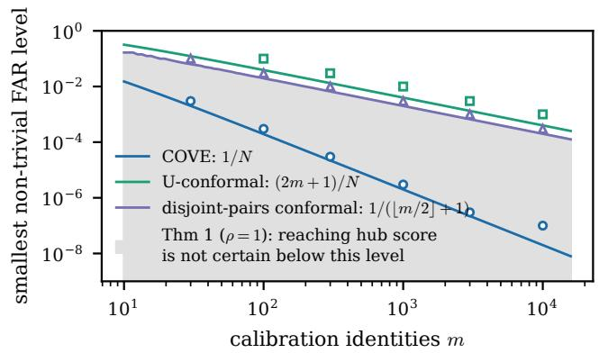
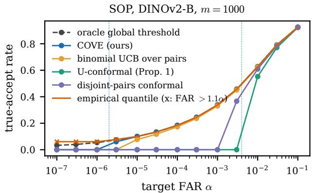
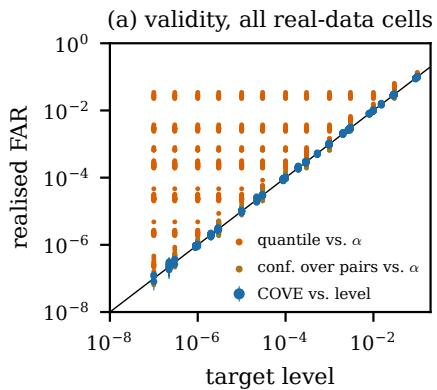
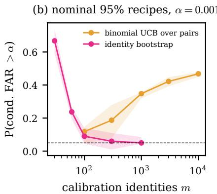
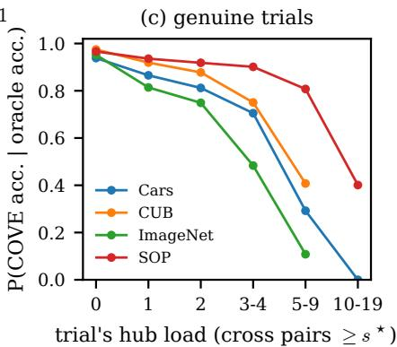
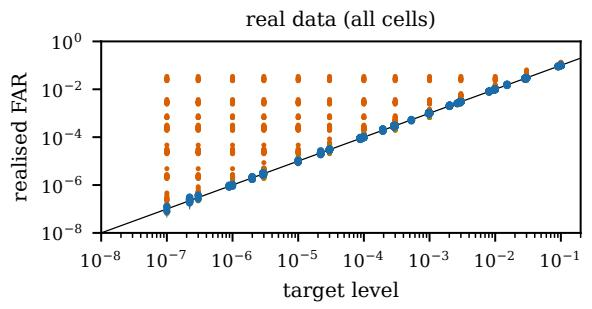
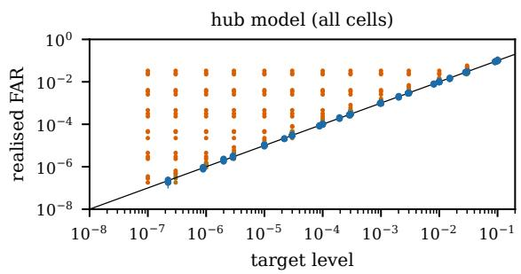

# Identities, Not Pairs: Distribution-Free False-Accept Control for Embedding-Based Verification

Salim Khazem Talan Research Center

## Abstract

Embedding-based verification often calibrates a false-accept threshold from all impostor pairs among m identities, although these pairs share identities. We characterize a worst-case limit: when hub identities score highly against a fraction ρ of the population, a calibration-only threshold with marginal false-accept rate (FAR) at most α under every identity-exchangeable law reaches the hub score on hub-free calibration sets with probability at most $( m + 2 ) \alpha / ( 2 \rho )$ Uniformly accepting near that score at levels well below $\rho / m$ therefore requires trial information. We propose COVE, which ranks the trial pair among all $\ N \ = \ \binom { m + 2 } { 2 }$ pairs formed by augmenting the calibration units with the probe and reference. Under identity exchangeability, its marginal FAR is at most $\lfloor \alpha N \rfloor / N$ , with first possible acceptance at $1 / \bar { N } = \bar { O } ( 1 / m ^ { 2 } )$ . The rule also retains this guarantee with a fixed symmetric cohortnormalized score using an independent cohort. On 6 benchmarks and 8 frozen encoders, realised FAR was consistent with the exact bound. Where both valid calibrationonly baselines accepted nothing, COVE retained a median 100% of the sampled oracle’s true-accept rate over reliable comparisons. In contrast, an empirical quantile over dependent pairs reached 2.87 α FAR, and a binomial upper confidence bound over pairs missed its nominal 95% conditional-FAR target in up to 55% of calibration draws. Symmetric CSLS raised COVE’s true-accept rate by up to 4.3-fold in the tested settings. The code is available in https://github.com/ salimkhazem/Cove.git

## 1 INTRODUCTION

A large class of vision systems decides whether two images show the same identity by thresholding the similarity of frozen embeddings: product and landmark retrieval, animal re-identification, near-duplicate removal in dataset curation, and open-set matching with foundation encoders such as DINOv2 or CLIP, whether deployed directly or tailored via parametereficient adaptation, visual prompting, or distillation [Khazem, $^ { 2 0 2 6 \mathrm { a } , \mathrm { b } , \mathrm { c } ] }$ face and person verification rest on the same decision, but we do not study them. The operator of such a system specifies a tolerated false-accept rate (FAR) the probability of declaring a match between two diferent identities and it is typically small, $1 0 ^ { - 4 }$ to $1 0 ^ { - 6 }$ . The threshold is set on a labelled calibration set, and the standard recipe takes a quantile of the similarity over all impostor pairs, the $m ( m - 1 ) / 2$ pairs of images from diferent calibration identities, often with a binomial confidence bound that treats the pairs as independent draws. Those pairs are not independent: every identity appears in $m - 1$ of them, and an identity that resembles many others, a “wolf” in the biometric zoo Doddington et al. [1998], a “hub” in high-dimensional retrieval Radovanovi´c et al. [2010], inflates many pair scores at once. This paper asks what can be guaranteed, without distributional assumptions, from m calibration identities, and answers with a separation.

Our contributions are threefold. (i) We prove a sharp limitation of calibration-only FAR control for pairwise similarity problems: under identity exchangeability, hub identities can force any valid calibration only threshold to operate at resolution of order $\rho / m$ yielding an order-ρm gap relative to the transductive scale; the bound is tight in a canonical setting (Theorem 1). (ii) We introduce COVE, a transductive conformal procedure that ranks the trial within the augmented pairwise array. COVE achieves distributionfree marginal FAR control at level α, rank resolution of order $1 / m ^ { 2 }$ , and retains validity with symmetric scores learned from an independent cohort (Theorem 2, Corollary 1, Proposition 3. (iii) Across 6 bench marks and 8 frozen encoders, COVE consistently controls FAR, while standard pair-based calibration degrades in the presence of hubness. In regimes where valid calibration-only rules become trivial, COVE retains a median 100% of the oracle true-accept rate.

## 2 RELATED WORK

Conformal inference. Exchangeable conformal methods [Vovk et al., 2005, Lei et al., 2018, Angelopoulos and Bates, 2023] include outlier and open-set tests [Bates et al., 2023, Xie et al., 2025]. Pair-indexed ranks have appeared in network and dyadic inference [Lunde et al., 2023, 2026, Marandon, 2024, Zhao et al., 2024, Fermanian et al., 2025]; hierarchical and adaptive transductive settings are also studied [Dunn et al., 2023, Gazin et al., 2023]. We use that known rank argument for verification, and study its separation from calibration-only thresholds, per-probe behavior and symmetric cohort scores. Related PAC and conditional-coverage limits [Vovk, 2012, Park et al., 2020, Barber et al., 2021] and transductive eficiency bounds [Behboodi et al., 2025] address diferent targets.

Biometric error rates. Impostor pairs share identities; subset bootstrap and correlated-binomial methods quantify the resulting uncertainty [Bolle et al., 2004, Schuckers, 2010, Dass et al., 2006, Fallahi et al., 2025, Conti and Cl´emen¸con, 2024, Fogliato et al., 2024]. Biometric wolves and retrieval hubs are documented [Doddington et al., 1998, Une et al., 2008, Durbet et al., 2023], and synthetic identities have been studied for threshold calibration [Apila, 2026]. Our target is a finite-sample decision rule rather than an error-rate interval.

Score normalization. Speaker and face verification use cohort normalization [Auckenthaler et al., 2000, Choi et al., 2025, Li and Lee, 2026]; retrieval uses CSLS and query bank variants [Radovanovi´c et al., 2010, Conneau et al., 2018, Bogolin et al., 2022, Pan et al., 2025]. These normalizations alone do not establish the distribution-free marginal FAR bound; a fixed symmetric form within COVE inherits it (Corollary 1).

## 3 SETTING

A unit is one image of one identity, represented by a frozen embedding. A pair score $g ( u , v )$ is any measurable symmetric function of two units; it may also depend on auxiliary data independent of all units, such as an impostor cohort (Section 5.2). The canonical choice is cosine similarity. A verification trial is a pair (probe, reference); it is an impostor trial if the two units belong to diferent identities, and a genuine trial otherwise.

The calibration set contains units $U _ { 1 } , \dots , U _ { m }$ of m distinct identities, one unit per identity.1 A trial contributes $U _ { m + 1 } { \mathrm { ( p r o b e ) } }$ and $U _ { m + 2 }$ (reference). Write $\mathcal { P } = \{ \{ i , j \} : 1 \leq i < j \leq m + 2 \}$ for the $N = { \binom { m + 2 } { 2 } }$ unordered pairs of the augmented set and $S _ { e } = g ( U _ { i } , U _ { j } )$ for $e = \{ i , j \}$ ; the trial pair is $e ^ { \star } = \{ m + 1 , m + 2 \}$

Assumption 1 (identity exchangeability). Under the impostor null $H _ { 0 }$ , the trial’s two units belong to two distinct identities that do not occur in calibration, and the vector $\left( U _ { 1 } , \dots , U _ { m + 2 } \right)$ is exchangeable.

Assumption 1 holds when identities are sampled from a common population (without replacement, or i.i.d. from a difuse law) and each unit is an independent image of its identity. It is the identity-level analogue of the exchangeability that split conformal prediction assumes for samples [Vovk et al., 2005, Angelopoulos and Bates, 2023]; it does not require pairs to be independent. It requires probe and reference images to be captured the same way as calibration images (an enrolled template taken under a diferent protocol violates it), and it concerns zero-efort impostors (unrelated identities), not targeted look-alikes. It fails when calibration and deployment identities come from different populations, which we test in Section 7 (Q6).

A decision rule maps the calibration units and the trial to accept/reject. Its false-accept rate is $\mathrm { F A R = }$ $\mathbb { P } _ { H _ { 0 } } ( \mathrm { a c c e p t } )$ , the probability over calibration and trial the marginal guarantee of conformal inference. Its true-accept rate TAR is the acceptance probability on genuine trials. A rule is inductive (calibration-only) if it accepts if $S _ { e ^ { \star } } \geq \hat { \tau } \mathrm { ~ ( o r ~ } S _ { e ^ { \star } } > \hat { \tau } \mathrm { ) }$ for a threshold τˆ computed from the calibration units alone (and independent randomization) for instance from their pair scores; this includes every quantile-based recipe. A rule is trivial at level α if it rejects every trial whatever the calibration set, and its resolution is the smallest level at which it is not.

## 4 WHAT CALIBRATION-ONLY THRESHOLDS CAN GUARANTEE

The recipe “take the (1−α)-quantile of the m impostor pair scores” suggests a resolution of order $1 / m ^ { 2 }$ A hub construction shows that no calibration-only threshold can guarantee it without assumptions.

Definition 1 (hubs). Fix a unit law $Q$ and a level c¯. A difuse law H of units is a ρ-hub at level ¯c for Q if, for independent $V , V ^ { \prime } \sim H$ and $U \sim Q _ { ; }$ , both $\mathbb { P } ( g ( V , U ) \ge \bar { c } ) \ge \rho$ and $\mathbb { P } ( g ( V , V ^ { \prime } ) \ge \bar { c } ) \ge \rho$ . Let $\rho _ { Q } ( \bar { c } )$ be the supremum of such $\rho ;$ it is non-increasing in c¯.

For unquantized cosine similarity on the full unit sphere in dimension $d \ge 2 , \rho _ { Q } ( \bar { c } )$ lies between the largest strict and non-strict spherical-cap masses of $Q$ at ¯c (Appendix A.2, Remark (e)). We model identities as drawn from a difuse population, so that Q is the image law of a random identity and a hub unit is an identity of its own. Write $\mathcal { L } _ { Q , H }$ for the law of $m + 2$ units in which one unit, at a uniformly random position, is drawn from H and the others i.i.d. from $Q ;$ it is exchangeable, so it satisfies Assumption 1.

Theorem 1 (calibration-only thresholds). Let $\hat { \tau } =$ $T ( U _ { 1 } , \dots , U _ { m } , \xi )$ be any threshold computed from the calibration units and independent randomization $\xi ,$ used as “accept if $S _ { e ^ { \star } } \geq \hat { \tau } ^ { \prime \prime }$ . (a) $I f \mathbb { P } ( a c c e p t ) \leq \alpha$ under every $\mathcal { L } _ { Q , H }$ with H a ρ-hub for Q at level c¯, then for every $c \leq \bar { c } \ ( c < \bar { c }$ if the rule accepts $i f f S _ { e ^ { \star } } > \hat { \tau } )$

$$
\mathbb { P } _ { Q } \left( \hat { \tau } \leq c \right) \leq \frac { \left( m + 2 \right) \alpha } { 2 \rho } .
$$

(b) $I f 0 < \alpha < \rho$ and instead the calibration-conditional FAR, $\mathrm { F A R } ( \hat { \tau } \mid U _ { 1 : m } , \xi )$ , must exceed α with probability at most δ under $Q ^ { \otimes m }$ contaminated i.i.d. by H at every rate $\pi \in ( 0 , 1 )$ , then $\mathbb { P } _ { Q } ( \hat { \tau } \le c ) \le \delta ( 1 - { \alpha } / { \rho } ) ^ { - m / 2 } ,$ which is $\delta \exp \{ m \alpha / ( 2 \rho ) \left( 1 + O ( \alpha / \rho ) \right) \}$

Proof idea. (a) Under $\mathcal { L } _ { Q , H }$ the hub is a trial unit with probability $2 / ( m + 2 ) $ ; the calibration units are then i.i.d. Q, so $\hat { \tau } \leq { c }$ with the same probability as under $Q ,$ independently of the trial, and the trial scores $\geq { \bar { c } } \geq { \hat { \tau } }$ with probability at least ρ. (b) Contamination just above rate $1 - \sqrt { 1 - \alpha / \rho }$ makes every threshold $\leq c$ exceed $\alpha ,$ while leaving the calibration set hub-free with probability $( 1 - \pi ) ^ { m }$ (Appendix A.2). □

Theorem 1 is a minimax statement: it bounds what a calibration-only rule can guarantee over all laws with hubs of strength $\rho ,$ not what happens for a particular encoder. With $\rho$ of order one, a rule that is valid under every identity-exchangeable law has a threshold at or below ¯c so accepts trials scoring ¯c on hub-free calibration sets with probability at most $( m + 2 ) \alpha / ( 2 \rho )$ , and a PAC-valid one with probability at most $\dot { \delta } e ^ { \ i m \dot { \alpha } \dot { ( 1 + O ( \alpha / \rho ) ) } / ( 2 \rho ) }$ , close to δ for $\alpha \ll 2 \rho / m$ and below one only for $\alpha < 2 \rho \log ( 1 / \delta ) / m$ . Uniformly lowering the threshold to the hub level requires α of order $\rho _ { Q } ( \bar { c } ) / m ,$ , rather than $1 / m ^ { 2 }$ , even with more images per calibration identity when hubness is a property of the identity (Appendix A.2). For $\rho = 1$ and even m the bound is tight: split conformal prediction on the $\lfloor m / 2 \rfloor$ disjoint calibration pairs, exchangeable with the trial pair, is valid and first able to accept when α $\geq 1 / ( \lfloor m / 2 \rfloor + 1 )$ , where the bound reaches one; a randomized version attains the bound at smaller α (Appendix A.2). A threshold that uses all pairs does almost as well and is dominated by COVE:

Proposition 1 (a valid calibration-only threshold). For $0 \leq \alpha < 1$ , let $S _ { ( k ) }$ be the k-th largest calibration pair score and $k _ { \alpha } = \lfloor \dot { \alpha } \dot { N } \rfloor - 2 m$ . Under Assumption $^ { 1 , }$ the rule “accept if $S _ { e ^ { \star } } > S _ { ( k _ { \alpha } ) } { } ^ { \prime \prime }$ (reject all $i f k _ { \alpha } < 1 )$ has $\mathrm { F A R } \leq \alpha ;$ it can accept for some score arrays if $\alpha \ge ( 2 m + 1 ) / N$ , and $( 2 m + 1 ) / N < 4 / ( m + 2 )$ . At $\alpha = 1$ , where $k _ { \alpha }$ exceeds $\binom m 2$ , the rule accepts every trial.

## 5 COVE: A FINITE-SAMPLE TRANSDUCTIVE TEST

Theorem 1 leaves one way out: look at the trial’s units themselves. For a trial with score $s ^ { \star } = S _ { e ^ { \star } }$ , let

$$
\begin{array} { r l } & { R \left. = 1 + \# \{ e \subset [ m ] : S _ { e } \geq s ^ { \star } \} \right. } \\ & { \qquad + \sum _ { i \leq m } \left( { \bf 1 } \{ S _ { i , m + 1 } \geq s ^ { \star } \} + { \bf 1 } \{ S _ { i , m + 2 } \geq s ^ { \star } \} \right) } \end{array}
$$

(the trial itself, calibration pairs, and cross pairs) be the rank of the trial among all N pairs of the augmented set, ties counted against it, and $p \ = \ R / N$ COVE accepts if $p \leq \alpha$

Theorem 2 (finite-sample validity). Let g be symmetric. Under Assumption 1, for every $t \in [ 0 , 1 ] , \mathbb { P } _ { H _ { 0 } } ( p \leq$ $t ) \leq \lfloor t N \rfloor / N$ , with equality if the N pair scores are almost surely distinct. Hence $\mathrm { F A R } \le \lfloor \alpha N \rfloor / N \le \alpha$ for every law satisfying Assumption 1.

Proof sketch. Relabelling the units permutes the pairs without changing the law of the score array, and the permutations act transitively on pairs; the trial pair is therefore distributed like a uniformly random pair, and at most k pairs of any array have rank $\leq k \ \mathrm { ( A p - }$ pendix A.1). □

The guarantee is marginal, over the calibration draw and the trial, as in split conformal prediction. The rank argument is the one behind conformal inference for jointly exchangeable arrays [Marandon, 2024, Lunde et al., 2026]; what is specific here is its use as a verification test and its contrast with Theorem 1. Symmetry ensures validity for this unordered-pair construction; without it the guarantee can fail: with $g ( u , v ) = u - v$ and $m = 1$ the trial is the top pair with probability $5 / 1 2 > 1 / 3 ;$ a cohort normalization applied to one side only is of this kind. Three consequences follow.

Resolution. COVE can first accept at $\alpha = 1 / N$ ≈

Algorithm 1 COVE for one trial $( x , x ^ { \prime } )$   
Require: quantized embeddings $\overline { { U _ { 1 } , \ldots , U _ { m } } }$ of m cal  
ibration identities (one image each); their pair   
scores sorted in decreasing order $S _ { ( 1 ) } \ \geq \ \cdots \ \geq$   
$S _ { ( { \binom { m } { 2 } } ) } ;$ a symmetric score $g$ (the same $g$ for all   
pairs); level α   
1: $\bar { k }  \lfloor \alpha { \binom { m + 2 } { 2 } } \rfloor ; \mathbf { i f } k = 0$ return reject   
2: $s ^ { \star }  g ( \dot { x } , \bar { x } ^ { \prime } )$   
3: $R  1 + \# \{ j : S _ { ( j ) } \geq s ^ { \star } \}$ (binary search)   
4: $R  R + \# \{ i : g ( x , U _ { i } ) \geq s ^ { \star } \} + \# \{ i : g ( x ^ { \prime } , U _ { i } ) \geq$   
$s ^ { \star } \}$   
5: return accept if $R \leq k ,$ else reject

$2 / m ^ { 2 }$ when its score is uniquely largest; ties can delay acceptance. This is the resolution the pair count suggests but calibration-only rules cannot guarantee.

Dominance. If $S _ { e ^ { \star } } > S _ { ( k _ { \alpha } ) }$ , at most $k _ { \alpha } - 1$ calibration pairs and 2m cross pairs score $\geq s ^ { \star }$ , so $R \le \lfloor \alpha N \rfloor$ COVE accepts every trial that the U-conformal rule of Proposition 1 accepts, which proves that proposition.

Per-probe control. For almost every probe value $u ,$ hub or not, the $m + 1$ scores of u against the calibration units and the reference are exchangeable, and COVE accepts only if the trial score is among the top $\lfloor \alpha N \rfloor$ of them. The FAR conditional on the probe is therefore at most $\lfloor \alpha N \rfloor / ( m + 1 ) \leq ( m + 2 ) \alpha / 2$ (Proposition 4), whereas a calibration-only threshold can accept a hub probe’s impostor trials with probability up to $\rho .$ The bound is useful when mα is small, and its factor (m + $2 ) / 2$ is the one in Theorem 1(a).

## 5.1 Algorithm, cost, and exact arithmetic

With a raw score the per-trial cost is O(md + log m); cohort-normalized scores also need $O ( | Z | d )$ work per new unit unless its cohort statistics are cached. Calibration costs $O ( m ^ { 2 } d + m ^ { 2 } \log m )$ once, plus cohort preprocessing when used. Theorem 2 concerns a fixed symmetric function, and floating-point matrix products are not one: the same pair can round diferently depending on summation order. We therefore quantize every $\ell _ { 2 } \cdot$ -normalized embedding f once to $q \ = \ \operatorname { r o u n d } ( \lambda f )$ with $\lambda = ( 4 0 9 5 - \sqrt { d } / 2 ) / M$ , where $M = \operatorname* { m a x } _ { i } \| f _ { i } \| _ { 2 }$ is computed from the fixed feature cache before any calibration draw, so that $\| q \| ^ { 2 } < 2 ^ { 2 4 }$ by Cauchy–Schwarz every partial sum of a dot product is then an integer below $2 ^ { 2 4 }$ , computed exactly in single precision by standard FP32 matrix-product kernels whatever the summation order (a canary checks this before each run). The integer inner product $q _ { u } ^ { \top } q _ { v } \approx \lambda ^ { 2 } \cos ( f _ { u } , f _ { v } )$ is the score the guarantee is about (Appendix A.8).

## 5.2 Cohort normalization with a guarantee

Speaker and face verification normalize a trial score by the impostor score distribution of each side against a cohort [Auckenthaler et al., 2000], and cross-modal retrieval rescales similarities to penalize hubs [Conneau et al., 2018, Bogolin et al., 2022, Pan et al., 2025]. These heuristics are used because raw thresholds are unreliable; their cited formulations do not supply the distribution-free marginal FAR guarantee studied here. Let $Z$ be a cohort of units from identities disjoint from calibration and deployment. Two symmetric scores that use it are

$$
\begin{array} { r l } & { g _ { \mathrm { c s l s } } ( u , v ) = 2 L g _ { 0 } ( u , v ) - T _ { L } ( u ) - T _ { L } ( v ) , } \\ & { g _ { \mathrm { s n o r m } } ( u , v ) = \frac { 1 } { 2 } \Big [ \frac { g _ { 0 } ( u , v ) - \mu _ { Z } ( u ) } { \sigma _ { Z } ( u ) } + \frac { g _ { 0 } ( u , v ) - \mu _ { Z } ( v ) } { \sigma _ { Z } ( v ) } \Big ] , } \end{array}
$$

where $g _ { 0 }$ is the raw integer score, $T _ { L } ( u )$ is the sum of u’s $L = 1 0$ largest scores against $Z$ (cross-domain similarity local scaling, CSLS, in integer form), and $\mu _ { Z } ( u ) , \sigma _ { Z } ( u )$ are the mean and standard deviation of all of u’s scores against $Z$ (symmetric normalization, S-norm). Given $Z ,$ each is a fixed symmetric function of the pair, so Theorem 2 applies:

Corollary 1. If the calibration and trial units are exchangeable conditionally on $Z$ under $H _ { 0 }$ , COVE with gcsls, gsnorm, or any other symmetric cohort-based score has $\mathrm { F A R } \le \lfloor \alpha N \rfloor / N$

Normalization then changes which trials are accepted while preserving the FAR upper bound, so it may be chosen for power using data independent of the calibration and trial units (such as $Z$ itself). One-sided normalizations, and querybank schemes that normal ize only the query, are not symmetric and are not covered.

## 6 POWER AND THE ZOO INDEX

Let $\bar { G } ( s ) ~ = ~ \mathbb { P } ( S _ { 1 2 } ~ \geq ~ s )$ be the impostor tail and $h ( u ; s ) = \mathbb { P } ( g ( u , U ^ { \prime } ) \geq s )$ the impostor rate of a specific unit u against a unit of a random other identity. For a genuine trial $( u _ { a } , u _ { b } )$ with score s, independent of i.i.d. calibration units,

$$
\mu : = \frac { \mathbb { E } [ R \mid \mathrm { t r i a l } ] } { N } = \bar { G } ( s ) + \frac { 1 - \bar { G } ( s ) + m \omega ( s ) } { N } ,
$$

The oracle global threshold accepts if $\bar { G } ( s ) \ \leq \ \alpha$ COVE’s expected rank has a finite-rank self-count correction $( 1 ~ - ~ { \bar { G } } ( s ) ) / N$ and an excess-rate term $m \omega ( s ) / N \approx 2 \omega ( s ) / m ;$ its realised rank also varies with the calibration draw.

Calibration noise enters through the calibration exceedance fraction: for a fixed $\begin{array} { r l r l } { \tau , } & { { } \hat { U } ( \tau ) } & { = } \end{array}$ $\begin{array} { r } { \binom { m } { 2 } ^ { - 1 } \sum _ { e \subset [ m ] } { \bf 1 } \{ S _ { e } \geq \tau \} } \end{array}$ is a U-statistic of order two. Proposition 2 (zoo index; a restatement of Hoefding, 1948). For i.i.d. units, with $\zeta _ { 1 } = \operatorname { V a r } h ( U ; \tau )$ and $\zeta _ { 2 } ~ = ~ \bar { G } ( \tau ) ( 1 - \bar { G } ( \tau ) )$ , Var $\hat { U } ( \tau ) ~ = ~ ( 4 ( m - 2 ) \zeta _ { 1 } +$ $2 \zeta _ { 2 } \big ) / \big ( m ( m - 1 ) \big )$ . With the zoo index $\kappa = \zeta _ { 1 } / \bar { G } ( \tau ) ^ { 2 }$ the squared coeficient of variation of per-unit impostor rates, the relative standard error at $\bar { G } ( \tau ) = \alpha$ is $\sqrt { 4 ( m - 2 ) \kappa / ( m ( m - 1 ) ) + 2 ( 1 - \alpha ) / ( m ( m - 1 ) \alpha ) }$

A binomial model for $\binom m 2$ independent pairs predicts relative standard error $\sqrt { 2 ( 1 - \alpha ) / ( m ( m - 1 ) \alpha ) }$ ; the ratio is $\sqrt { 1 + 2 ( m - 2 ) \kappa \alpha / ( 1 - \alpha ) }$ , which grows with the number of identities. Pairs are worth $m ^ { 2 } / 2$ independent trials only while $\kappa \ll 1 / ( m \alpha ) ;$ ; otherwise about $m / ( 4 \kappa \alpha )$ The biometric $ { ^ { 6 } } _ { \mathrm { Z O O } }  { ^ { \circ } }$ [Doddington et al., 1998] is exactly heterogeneity in h, and that pair error rates are U-statistics is known [Conti and Cl´emen¸con, 2024, Fogliato et al., 2024]; κ turns this into a measurable efective-sample-size correction, the two-way analogue of the design efect for clustered calibration data [Noonan, 2026].

Proposition 3 (power). Let calibration units be $i . i . d .$ drawn from identities other than the $t r i a l ^ { , } s ,$ and independent of the genuine trial. Let $k ~ = ~ \lfloor \alpha N \rfloor$ and $v = 2 \operatorname { V a r } \hat { U } ( s ) + 4 m ( h ( u _ { a } ; s ) + h ( u _ { b } ; s ) ) / N ^ { 2 }$ . For every $\eta > 0$ and every event B of genuine trials on which $\mu \leq k / N - \eta \alpha$

$$
\begin{array} { r } { \mathrm { T A R } _ { \mathrm { C O V E } } \ \geq \ \mathbb { P } _ { \mathrm { g e n } } ( B ) - \mathbb { E } _ { \mathrm { g e n } } \big [ { \bf 1 } _ { B } \operatorname* { m i n } \{ 1 , \upsilon / ( \eta \alpha ) ^ { 2 } \} \big ] . } \end{array}
$$

For fixed $\eta ~ \in ~ ( 0 , 1 / 2 )$ , if $\alpha m ^ { 2 } \ge 8 / \eta ,$ taking $B =$ $\{ \bar { G } ( s ) \leq \alpha ( 1 - 2 \eta ) , \Delta \leq \eta m \alpha / 4 \}$ , with ∆ the positive part of the excess rate $\omega ( s )$ , gives $\mathrm { T A R } _ { \mathrm { C O V E } } \geq$ $\mathrm { T A R } _ { \mathrm { o r a c l e } } ( \alpha ( 1 - 2 \eta ) ) - \mathbb { P } _ { \mathrm { g e n } } ( \Delta > \eta m \alpha / 4 ) - \varepsilon ,$ , where $\varepsilon \to 0$ when $\alpha m ^ { 2 } \to \infty$ and $m ^ { - 1 } \operatorname* { s u p } _ { \bar { G } ( s ) \leq \alpha } \zeta _ { 1 } ( s ) / \alpha ^ { 2 } \to$ 0 (Appendix A.6). Under the stated conditions, the bound attributes losses relative to the oracle threshold to large excess impostor rates at the operating point and calibration variability. The bound is onesided. COVE is not a threshold on s: it adapts to the calibration draw, so the best global threshold at the same marginal level is not an upper bound on its power, and COVE can exceed it by accepting more in draws whose calibration identities are less hub-laden and fewer in the others (Q4 in Section 7).

## 7 EXPERIMENTS

We ask: (Q1) is COVE’s FAR at its level on real embeddings; (Q2) how much power does it keep where the valid calibration-only rules are trivial; (Q3) how do pair-based calibration recipes fare against their nominal targets; (Q4) what drives COVE’s refusals; (Q5)

does cohort normalization help; (Q6) what happens when Assumption 1 fails?

Setup. We use six public benchmarks with identitydisjoint calibration and test sides ImageNet validation classes [Russakovsky et al., 2015], Stanford Online Products (SOP, Song et al., 2016), CUB-200- 2011 [Wah et al., 2011], Stanford Cars [Krause et al., 2013], DeepFashion In-shop [Liu et al., 2016] and a GLDv2 landmark subset [Weyand et al., 2020], and eight frozen encoders: DINOv2-S/B/L [Oquab et al., 2024], CLIP- $\mathrm { - B / 1 6 }$ and L/14 [Radford et al., 2021], SigLIP-B/16 [Zhai et al., 2023], ResNet-50 [Wightman et $\mathrm { a l . }$ , 2021] and ConvNeXt-B [Liu et al., 2022]. A cell is one (dataset, encoder, score, split, m) configuration. The core tier (ImageNet, SOP, CUB, Cars × DINOv2-B, CLIP-B/16, ResNet-50; $m \leq 1 0 ^ { 4 } )$ uses 500 calibration draws per cell; the new-dataset tier (In-shop, GLDv2), the new-encoder tier (five encoders on ImageNet and SOP) and the cohort, split-shift and PAC tiers use 200. Each draw samples m identities and one image of each, and 500,000 impostor and 20,000 genuine trials from the remaining identities, identityuniformly as Assumption 1 requires (Appendix B); levels range over $\alpha \in \mathring { [ 1 0 ^ { - 7 } , 1 0 ^ { - 1 } ] }$ . Baselines, named as in all tables and figures: two valid calibration-only rules, U-conformal (Proposition 1) and disjoint-pairs conformal (split conformal on $\lfloor m / 2 \rfloor$ disjoint pairs); disjoint-pairs $P A C ,$ the same pairs with a Clopper-Pearson order statistic, PAC for i.i.d. identity draws; three recipes that treat the $\binom m 2$ pairs as independent, the empirical quantile, the binomial UCB (Clopper-Pearson upper confidence bound) over pairs and conformal over pairs (COVE without its cross pairs); the 95% identity bootstrap [Bolle et al., 2004, Fogliato et al., 2024] $( B ~ = ~ 2 0 0 , ~ m ~ \leq ~ 1 0 0 0 )$ ; and the oracle global threshold, evaluated at COVE’s exact level. All rules see the same draws and trials; the PAC tier, which adds the identity bootstrap, repeats the first 200 draws of core cells. The study has 149 cells and took 4.3 GPU-hours (Appendix E).

Q1: validity. The random identity split samples calibration and trial identities from one finite pool on every draw, satisfying Assumption 1 by construction. Across 903 real-data (cell, level) comparisons with positive exact level, down to $\alpha = 1 0 ^ { - 7 }$ , the median realised FAR divided by $\lfloor \alpha N \rfloor / N$ is 1.001, and none deviates significantly from its level (largest |z| 2.92 against the two-sided Bonferroni threshold 4.03; Figure 2a). This checks Theorem 2 end to end, quantization and sampling included; it does not certify a calibration-conditional FAR for a fixed deployment.

  
Figure 1: Identities, not pairs. Left: smallest level at which each valid rule can accept for some score arrays (lines), and on SOP/DINOv2-B (markers: smallest grid level with non-zero TAR); below the shaded boundary Theorem 1 bounds the probability that a calibration-only threshold reaches the hub score when $\rho = 1$ . Right: true-accept rate against the target level at $m = 1 0 0 0 ;$ crosses mark levels at which the empirical quantile’s realised FAR exceeds 1.1α; dotted lines mark $1 / N$ and $( 2 m + 1 ) / N$

Q2: power where calibration-only rules give up. The valid calibration-only rules cannot accept below $1 / ( \lfloor m / 2 \rfloor + 1 )$ and $( 2 m + 1 ) / N$ (Figure 1, left); COVE can accept from $1 / N$ when its score is uniquely the largest. In the 374 (cell, level) combinations where both are trivial, COVE is not, and the sampled oracle is reliable (Appendix B), COVE’s true-accept rate is a median 100% of the sampled oracle’s at COVE’s exact level (10th percentile 92%, minimum 83%; per dataset and encoder in Table 3, and one level per core pair in Table 1).

Q3: pair-based calibration. The empirical quantile has no distribution-free guaranty here; where $\alpha ( { } _ { 2 } ^ { m } ) \geq 1$ its realized FAR exceeds 1.1α in 36% of cases and reaches $2 . 8 7 \alpha$ . Conformal over pairs COVE without its cross pairs has a median 100% of COVE’s true-accept rate, but its realized FAR is significantly above α (one-sided $z > 4 . 0 3 )$ in 5.3% of comparisons, reaching 1.61 α: the 2m cross pairs buy validity at no power cost in the median. The binomial UCB claims calibration-conditional (PAC) control; its conditional FAR exceeds α in a median 8% of draws for $m \leq 3 0$ but 42% for $m \geq 3 0 0 0$ (medians over cells and levels; worst 55%; nominal 5%), growing with m, consistent with Proposition 2 (Figure 2b). The identity bootstrap is near its nominal 5% in the median where the calibration set resolves the level $( \alpha { \binom { m } { 2 } } \geq 1 0 \colon$ median 6%, worst 20%), exceeds it for $1 \leq \overline { { \alpha ( \ l _ { 2 } ^ { m } ) } } < 1 0$ (median 21%), and fails where $\alpha ( { m } ) < 1$ (median 99%, FAR up to $3 7 9 9 2 \alpha )$ ; where both are non-trivial it attains a median 90% of COVE’s true-accept rate. Disjointpairs PAC, exact for i.i.d. identity draws, stays near its target in our finite-pool draws (worst 8% of draws) but is non-trivial in only 143 of 622 (cell, level) combinations, where it attains a median 87% of COVE’s true-accept rate. COVE claims only marginal control; its sampled FAR exceeds its level in a median 46% of draws (Section 8).

Q4: mechanism. Per-unit impostor rates are heterogeneous, increasingly so in the tail: over the eight dataset/encoder pairs we measured, the zoo index ranges from 0.4–3 at $\alpha ~ = ~ 1 0 ^ { - 2 }$ to 4.9–76 at $1 0 ^ { - 4 } .$ growing between these levels for every pair. Call the number of a trial’s 2m cross pairs scoring at least $s ^ { \star }$ its hub load. Among genuine trials the oracle accepts, COVE accepts 96% of those with hub load 0 but 65% of those with hub load at least 3 (Figure 2c): its refusal rate rises with hub load, consistent with Proposition 3. The sampled COVE true-accept rate exceeds the sampled oracle’s in 37% of combinations (by up to 21%); this is possible because COVE is not a global threshold on s (Section 6). The largest directional cap occupancy over candidate directions (units, the mean direction, k-means centroids), a descriptive proxy for $\rho _ { Q }$ rather than a bound, is 0.004–0.032 (≈44–320 α) at $\alpha = 1 0 ^ { - 4 }$

Q5: cohort normalization. Because normalization preserves COVE’s FAR upper bound (Corollary 1), it can be judged on power alone. On the same draws and trials, CSLS with a 20% held-out cohort raises COVE’s true-accept rate by a median factor 2.1 over the settings of Table 2 (up to 3.8), but it lowers it in 24% of all cohort combinations (down to 0.37×), and S-norm lowers it in 26%; the realised FAR stays at the level (Q1 includes these cells). Normalization should therefore be chosen on held-out data, which Corollary 1 permits.

Table 1: Core results, one level per core pair (random identity split; 500 draws per cell, the first 200 for the identity bootstrap); at each level both valid calibration-only rules accept nothing. COVE: realised FAR over its level $\lfloor \alpha N \rfloor / N$ , 95% interval. TAR: true-accept rates (oracle at COVE’s level). Quantile: realised FAR/α. Cond. FAR: % of draws whose conditional FAR exceeds α for the two rules claiming 95% conditional control (nominal 5%; “–”: accepts nothing). Last column: % of draws whose sampled FAR exceeds COVE’s level (COVE claims marginal control only).
<table><tr><td></td><td></td><td></td><td></td><td>COVE</td><td colspan="3">TAR</td><td>quantile</td><td>% cond. FAR&gt; α</td><td></td><td>% FAR</td></tr><tr><td>dataset</td><td>encoder</td><td>m</td><td>α</td><td>FAR/level</td><td>COVE</td><td>oracle</td><td>id. boot.</td><td> $\operatorname { F A R } / \alpha$ </td><td>bin. UCB</td><td>id. boot.</td><td>&gt;level</td></tr><tr><td>Cars</td><td>CLIP-B/16</td><td>60</td><td> $1 0 ^ { - 3 }$ </td><td>1.03±0.08</td><td>0.074</td><td>0.080</td><td>0.085</td><td>1.3</td><td></td><td>26</td><td>41</td></tr><tr><td>Cars</td><td> $\mathrm { D I N O v 2 – B }$ </td><td>60</td><td> $1 0 ^ { - 3 }$ </td><td>0.94±0.08</td><td>0.057</td><td>0.064</td><td>0.059</td><td>1.4</td><td></td><td>20</td><td>32</td></tr><tr><td>Cars</td><td> $\mathrm { R e s N e t - 5 0 }$ </td><td>60</td><td> $1 0 ^ { - 3 }$ </td><td>0.99±0.09</td><td>0.015</td><td>0.016</td><td>0.017</td><td>1.4</td><td></td><td>24</td><td>34</td></tr><tr><td>CUB</td><td>CLIP-B/16</td><td>60</td><td> $1 0 ^ { - 3 }$ </td><td>0.91±0.08</td><td>0.063</td><td>0.069</td><td>0.067</td><td>1.3</td><td></td><td>21</td><td>34</td></tr><tr><td>CUB</td><td>DINOv2-B</td><td>60</td><td> $1 0 ^ { - 3 }$ </td><td>0.97±0.09</td><td>0.167</td><td>0.178</td><td>0.169</td><td>1.2</td><td></td><td>24</td><td>34</td></tr><tr><td>CUB</td><td>ResNet-50</td><td>60</td><td> $1 0 ^ { - 3 }$ </td><td>0.99±0.09</td><td>0.039</td><td>0.043</td><td>0.044</td><td>1.5</td><td></td><td>24</td><td>36</td></tr><tr><td>ImageNet</td><td>CLIP-B/16</td><td>300</td><td> $1 0 ^ { - 4 }$ </td><td>1.00±0.05</td><td>0.072</td><td>0.074</td><td>0.048</td><td>1.2</td><td>3</td><td>10</td><td>42</td></tr><tr><td>ImageNet</td><td>DINOv2-B</td><td>300</td><td> $1 0 ^ { - 4 }$ </td><td>1.00±0.05</td><td>0.270</td><td>0.286</td><td>0.166</td><td>1.1</td><td>1</td><td>4</td><td>43</td></tr><tr><td>ImageNet</td><td>ResNet-50</td><td>300</td><td> $1 0 ^ { - 4 }$ </td><td>0.98±0.05</td><td>0.293</td><td>0.310</td><td>0.198</td><td>1.1</td><td>2</td><td>4</td><td>40</td></tr><tr><td>SOP</td><td>CLIP-B/16</td><td>1000</td><td> $1 0 ^ { - 5 }$ </td><td>1.01±0.10</td><td>0.059</td><td>0.053</td><td>0.048</td><td>1.8</td><td>30</td><td>25</td><td>39</td></tr><tr><td>SOP</td><td>DINOv2-B</td><td>1000</td><td> $1 0 ^ { - 5 }$ </td><td>0.96±0.06</td><td>0.100</td><td>0.102</td><td>0.071</td><td>1.1</td><td>7</td><td>5</td><td>45</td></tr><tr><td>SOP</td><td>ResNet-50</td><td>1000</td><td> $1 0 ^ { - 5 }$ </td><td>0.94±0.06</td><td>0.073</td><td>0.073</td><td>0.058</td><td>1.2</td><td>11</td><td>12</td><td>44</td></tr></table>

Table 2: True-accept rate of COVE with the raw score and with two cohort normalizations (Corollary 1), at the same guaranteed level, on the same 200 calibration draws and trials (random identity split).
<table><tr><td>data</td><td>encoder</td><td>m</td><td>α</td><td>raw</td><td>CSLS</td><td>S-norm</td></tr><tr><td>ImageNet</td><td>CLIP-B/16</td><td>300</td><td> $1 0 ^ { - 4 }$ </td><td>0.073</td><td>0.092</td><td>0.095</td></tr><tr><td></td><td>ImageNet DINOv2-B</td><td>300</td><td> $1 0 ^ { - 4 }$ </td><td>0.272</td><td>0.257</td><td>0.254</td></tr><tr><td></td><td>ImageNet ResNet-50</td><td>300</td><td> $1 0 ^ { - 4 }$ </td><td>0.294</td><td>0.313</td><td>0.299</td></tr><tr><td>SOP</td><td>CLIP-B/16</td><td>1000</td><td> $1 0 ^ { - 5 }$ </td><td>0.058</td><td>0.220</td><td>0.083</td></tr><tr><td>SOP</td><td>CLIP-B/16</td><td>1000</td><td> $1 0 ^ { - 4 }$ </td><td>0.128</td><td>0.402</td><td>0.190</td></tr><tr><td>SOP</td><td>DINOv2-B</td><td>1000</td><td> $1 0 ^ { - 5 }$ </td><td>0.099</td><td>0.156</td><td>0.068</td></tr><tr><td>SOP</td><td>DINOv2-B</td><td>1000</td><td> $1 0 ^ { - 4 }$ </td><td>0.184</td><td>0.378</td><td>0.209</td></tr><tr><td>SOP</td><td>ResNet-50</td><td>1000</td><td> $1 0 ^ { - 5 }$ </td><td>0.074</td><td>0.181</td><td>0.040</td></tr><tr><td>SOP</td><td>ResNet-50</td><td>1000</td><td> $1 0 ^ { - 4 }$ </td><td>0.138</td><td>0.356</td><td>0.116</td></tr></table>

Q6: when identities are not exchangeable. On SOP, calibrating on the oficial training products and testing on the oficial test products moves COVE’s realised FAR to between 0.50 and 1.44 times its level; calibrating on six SOP super-categories and testing on the other six moves it to between 0.33 and 2.48 times (Table 4). The pair-based recipes also fail there: the empirical quantile’s FAR reaches 3.37 α and the binomial UCB violates its 95% guarantee in up to 100% of draws. On ImageNet the “fixed” split is one seeded random partition of classes, so its deviations show the spread induced by conditioning on a single partition rather than a population mismatch.

Breadth and cost. On In-shop and GLDv2 and with five further encoders the conclusions are unchanged: validity as in Q1, and a median 100% (new datasets) and 100% (new encoders) of the oracle’s trueaccept rate (Appendix C). With the raw score a trial costs 0.7 µs at m = 1000 and 3.3 µs at $m = 1 0 ^ { 4 }$ on one GPU, amortized over batches of trials and including all baselines.

## 8 LIMITATIONS

Identity exchangeability. Calibration and deployment identities must follow the same sampling protocol. The split-shift results (Q6) show that FAR control can fail otherwise. The assumption also fails if a probe identity occurs in calibration; Appendix A.4 proves a lowerpower variant for a calibration match chosen independently of images, but we did not test it. The guarantee covers zero-efort impostors, not targeted look-alikes or presentation attacks.

Marginal control. COVE controls FAR averaged over calibration draws, not the conditional FAR of a fixed draw. Proposition 2 quantifies calibration tail-count variance at a fixed threshold; it does not bound COVE’s per-draw FAR. A conditional version remains open. Theorem 1(b) also limits calibration-only PAC rules well below level $2 \rho / m$

Worst case and resolution. The lower bound concerns a class of hub laws; its tightness for real encoders is unknown. The measured separation uses the achievable floors of the calibration-only baselines. Levels below $1 / N \approx 2 / m ^ { 2 }$ are unreachable; $1 0 ^ { - 6 }$ needs roughly $1 . 4 \times 1 0 ^ { 3 }$ calibration identities.

  
Figure 2: Evidence. (a) Realised FAR against the target level for every random-split real-data cell and level (approximate 95% intervals for the mean over draws): COVE against its level, the empirical quantile and the conformal p-value over pairs against α; the hub model is in Appendix C. (b) Fraction of draws with estimated conditional FAR above α for nominal 95% recipes, against m (median and range over dataset/encoder pairs, $\alpha = 1 0 ^ { - 3 }$ ; nominal 5% dashed). (c) Probability that COVE accepts a genuine trial the oracle accepts, by the trial’s hub load, pooled over the encoders of each dataset; 50 draws, $m = 6 0$ , $\alpha = 1 0 ^ { - 2 }$ (CUB, Cars), $m = 3 0 0$ $\alpha = 3 \cdot 1 0 ^ { - 4 }$ (ImageNet), $m = 1 0 0 0$ $\alpha = 1 0 ^ { - 4 }$ (SOP).

Cost and scope. Raw-score trials require m stored-unit scores; cohort scores also require statistics against Z for new units. We study one-to-one verification of objects, birds, cars, garments and landmarks with frozen encoders, not one-to-many identification, face or person verification. In-shop garment images show models; consent and fairness questions for person verification lie outside our FAR guarantee.

## References

Salim Khazem. Multi-scale visual prompting for lightweight small-image classification. In 2026 IEEE Conference on Artificial Intelligence (CAI), pages 1465–1471. IEEE, 2026a.

Salim Khazem. Topolora-sam: Topology-aware parameter-eficient adaptation of foundation segmenters for thin-structure and cross-domain binary semantic segmentation. In International Conference on Pattern Recognition, pages 682–696. Springer, 2026b.

Salim Khazem. Safe-kd: Risk-controlled early-exit distillation for vision backbones. arXiv preprint arXiv:2602.03043, 2026c.

George Doddington, Walter Liggett, Alvin Martin, Mark Przybocki, and Douglas Reynolds. SHEEP,

GOATS, LAMBS and WOLVES: A statistical analysis of speaker performance in the NIST 1998 speaker recognition evaluation. In 5th International Conference on Spoken Language Processing (ICSLP), 1998. doi: 10.21437/icslp.1998-244.

Miloˇs Radovanovi´c, Alexandros Nanopoulos, and Mirjana Ivanovi´c. Hubs in space: Popular nearest neighbors in high-dimensional data. Journal of Machine Learning Research, 11:2487–2531, 2010.

Vladimir Vovk, Alexander Gammerman, and Glenn Shafer. Algorithmic Learning in a Random World. Springer, 2005. doi: 10.1007/b106715.

Jing Lei, Max G’Sell, Alessandro Rinaldo, Ryan J. Tibshirani, and Larry Wasserman. Distributionfree predictive inference for regression. Journal of the American Statistical Association, 113(523):1094– 1111, 2018. arXiv:1604.04173.

Anastasios N. Angelopoulos and Stephen Bates. Conformal prediction: A gentle introduction. Foundations and Trends in Machine Learning, 16(4):494– 591, 2023. arXiv:2107.07511.

Stephen Bates, Emmanuel Cand\`es, Lihua Lei, Yaniv Romano, and Matteo Sesia. Testing for outliers with conformal p-values. The Annals of Statistics, 51(1): 149–178, 2023.

Tianmin Xie, Yanfei Zhou, Ziyi Liang, Stefano Favaro, and Matteo Sesia. Conformal inference for open-set and imbalanced classification. arXiv preprint arXiv:2510.13037, 2025.

Robert Lunde, Elizaveta Levina, and Ji Zhu. Conformal prediction for network-assisted regression. arXiv preprint arXiv:2302.10095, 2023.

Robert Lunde, Minjie Yang, Elizaveta Levina, and Ji Zhu. Conformal prediction for dyadic regression under complex missingness. arXiv preprint arXiv:2606.11136, 2026.

Ariane Marandon. Conformal link prediction for false discovery rate control: A. marandon. Test, 33(4): 1062–1083, 2024.

Tianyi Zhao, Jian Kang, and Lu Cheng. Conformalized link prediction on graph neural networks. arXiv preprint arXiv:2406.18763, 2024.

Jean-Baptiste Fermanian, Pierre Humbert, and Gilles Blanchard. Transductive conformal inference for full ranking. In Advances in Neural Information Processing Systems, 2025. arXiv:2501.11384.

Robin Dunn, Larry Wasserman, and Aaditya Ramdas. Distribution-free prediction sets for two-layer hierarchical models. Journal of the American Statistical Association, 118(544):2491–2502, 2023. doi: 10.1080/01621459.2022.2060112.

Ulysse Gazin, Gilles Blanchard, and Etienne Roquain. Transductive conformal inference with adaptive scores. arXiv preprint arXiv:2310.18108, 2023.

Vladimir Vovk. Conditional validity of inductive conformal predictors. In Proceedings of the Asian Conference on Machine Learning, PMLR, volume 25, pages 475–490, 2012. arXiv:1209.2673.

Sangdon Park, Osbert Bastani, Nikolai Matni, and Insup Lee. PAC confidence sets for deep neural networks via calibrated prediction. In International Conference on Learning Representations, 2020. arXiv:2001.00106.

Rina Foygel Barber, Emmanuel J. Cand\`es, Aaditya Ramdas, and Ryan J. Tibshirani. The limits of distribution-free conditional predictive inference. Information and Inference: A Journal of the IMA, 10 (2):455–482, 2021. doi: 10.1093/imaiai/iaaa017.

Arash Behboodi, Alvaro H. C. Correia, Fabio Valerio Massoli, and Christos Louizos. Fundamental bounds on eficiency-confidence trade-of for transductive conformal prediction. arXiv preprint arXiv:2509.04631, 2025.

Ruud M. Bolle, Nalini K. Ratha, and Sharath Pankanti. Error analysis of pattern recognition systems—the subsets bootstrap. Computer Vision and Image Understanding, 93(1):1–33, 2004. doi: 10.1016/j.cviu.2003.08.002.

Michael E. Schuckers. Computational Methods in Biometric Authentication: Statistical Methods for Performance Evaluation. Springer, 2010. doi: 10. 1007/978-1-84996-202-5.

Sarat C. Dass, Yongfang Zhu, and Anil K. Jain. Validating a biometric authentication system: Sample size requirements. IEEE Transactions on Pattern Analysis and Machine Intelligence, 28(12):1902– 1913, 2006. doi: 10.1109/tpami.2006.255.

Matin Fallahi, Ragini Ramesh, Pankaja Priya Ramasamy, Patricia Arias Cabarcos, Thorsten Strufe, et al. On the reliability of biometric datasets: How much test data ensures reliability? arXiv preprint arXiv:2501.06504, 2025.

Jean-R´emy Conti and St´ephan Cl´emen¸con. Assessing uncertainty in similarity scoring: Performance & fairness in face recognition. In International Conference on Learning Representations, 2024. arXiv:2211.07245.

Riccardo Fogliato, Pratik Patil, and Pietro Perona. Confidence intervals for error rates in 1:1 matching tasks: Critical statistical analysis and recommendations. International Journal of Computer Vision, 2024. doi: 10.1007/s11263-024-02078-8.

Masashi Une, Akira Otsuka, and Hideki Imai. Wolf attack probability: A theoretical security measure in biometric authentication systems. IEICE Transactions on Information and Systems, E91-D(5):1380– 1389, 2008. doi: 10.1093/ietisy/e91-d.5.1380.

Axel Durbet, Paul-Marie Grollemund, and Kevin Thiry-Atighehchi. Untargeted near-collision attacks on biometrics: Real-world bounds and theoretical limits. arXiv preprint arXiv:2304.01580, 2023.

Arto Apila. On the use of synthetic data for threshold calibration in face recognition: Performance and security implications for border control systems. arXiv preprint arXiv:2607.25990, 2026.

Roland Auckenthaler, Michael Carey, and Harvey Lloyd-Thomas. Score normalization for textindependent speaker verification systems. Digital Signal Processing, 10(1–3):42–54, 2000. doi: 10.1006/ dspr.1999.0360.

Jeong-Hwan Choi, Ju-Seok Seong, Ye-Rin Jeoung, and Joon-Hyuk Chang. Trainable adaptive score normalization for automatic speaker verification. arXiv preprint arXiv:2504.04512, 2025.

Junjie Li and Kong Aik Lee. A unified uncertaintyaware back-end for speaker verification: Scoring, normalization, and calibration. arXiv preprint arXiv:2609.01221, 2026.

Alexis Conneau, Guillaume Lample, Marc’Aurelio Ranzato, Ludovic Denoyer, and Herv´e J´egou. Word translation without parallel data. In International Conference on Learning Representations, 2018. arXiv:1710.04087.

Simion-Vlad Bogolin, Ioana Croitoru, Hailin Jin, Yang Liu, and Samuel Albanie. Cross modal retrieval with querybank normalisation. In IEEE/CVF Conference on Computer Vision and Pattern Recognition (CVPR), 2022. arXiv:2112.12777.

Zhengxin Pan, Haishuai Wang, Fangyu Wu, Peng Zhang, and Jiajun Bu. Hubness reduction with dual bank sinkhorn normalization for cross-modal retrieval. arXiv preprint arXiv:2508.02538, 2025.

Wassily Hoefding. A class of statistics with asymptotically normal distribution. The Annals of Mathematical Statistics, 19(3):293–325, 1948. doi: 10.1214/ aoms/1177730196.

Adam Noonan. The exceedance design efect: Efective sample size for thresholds under clustering. arXiv preprint arXiv:2608.21262, 2026.

Olga Russakovsky, Jia Deng, Hao Su, Jonathan Krause, Sanjeev Satheesh, Sean Ma, et al. Imagenet large scale visual recognition challenge. International Journal of Computer Vision, 115:211–252, 2015. arXiv:1409.0575.

Hyun Oh Song, Yu Xiang, Stefanie Jegelka, and Sil vio Savarese. Deep metric learning via lifted structured feature embedding. In IEEE Conference on Computer Vision and Pattern Recognition (CVPR), 2016. arXiv:1511.06452.

Catherine Wah, Steve Branson, Peter Welinder, Pietro Perona, and Serge Belongie. The Caltech-UCSD birds-200-2011 dataset. Technical Report CNS-TR-2011-001, California Institute of Technology, 2011.

Jonathan Krause, Michael Stark, Jia Deng, and Li Fei-Fei. 3D object representations for fine-grained categorization. In IEEE International Conference on Computer Vision Workshops, 2013. doi: 10.1109/ iccvw.2013.77.

Ziwei Liu, Ping Luo, Shi Qiu, Xiaogang Wang, and Xiaoou Tang. DeepFashion: Powering robust clothes recognition and retrieval with rich annotations. In IEEE Conference on Computer Vision and Pattern Recognition (CVPR), pages 1096–1104, 2016.

Tobias Weyand, Andre Araujo, Bingyi Cao, and Jack Sim. Google landmarks dataset v2 – a largescale benchmark for instance-level recognition and re-

trieval. In IEEE/CVF Conference on Computer Vision and Pattern Recognition (CVPR), pages 2572– 2581, 2020.

Maxime Oquab, Timoth´ee Darcet, Th´eo Moutakanni, Huy Vo, Marc Szafraniec, Vasil Khalidov, et al. DI-NOv2: Learning robust visual features without supervision. Transactions on Machine Learning Research, 2024. arXiv:2304.07193.

Alec Radford, Jong Wook Kim, Chris Hallacy, Aditya Ramesh, Gabriel Goh, Sandhini Agarwal, et al. Learning transferable visual models from natural language supervision. In International Conference on Machine Learning, 2021. arXiv:2103.00020.

Xiaohua Zhai, Basil Mustafa, Alexander Kolesnikov, and Lucas Beyer. Sigmoid loss for language image pre-training. In IEEE/CVF International Conference on Computer Vision (ICCV), pages 11941– 11952, 2023.

Ross Wightman, Hugo Touvron, and Herv´e J´egou. Resnet strikes back: An improved training procedure in timm. arXiv preprint arXiv:2110.00476, 2021.

Zhuang Liu, Hanzi Mao, Chao-Yuan Wu, Christoph Feichtenhofer, Trevor Darrell, and Saining Xie. A ConvNet for the 2020s. In IEEE/CVF Conference on Computer Vision and Pattern Recognition (CVPR), pages 11966–11976, 2022.

## AI use statement

We used generative AI tools to assist with language editing, readability improvements, and minor rephrasing of parts of the manuscript. All AI-assisted content was reviewed, edited, and verified by the authors. Generative AI tools were not used to formulate the research questions, develop the theoretical results, design the methodology, implement the proposed method, generate experimental data, or determine the scientific conclusions of this work. We take responsibility for the final content of this work, including all text, claims, analyses, and artifacts produced with the aid of generative AI tools. We take responsibility for the final content of this work, including text, claims, or artifacts produced with the aid of generative AI.

## CHECKLIST

1. For all models and algorithms presented, check if you include:

(a) Yes. Sections 3-6 describe the mathematical setting, assumptions, decision rules, and the COVE algorithm.

(b) Yes. Section 5.1 discusses computational complexity and Section 4 characterizes sample-size and resolution limits.

(c) Yes. An anonymized implementation, dependencies, experimental scripts, and reproduction materials are included in the supplementary material.

2. For any theoretical claim, check if you include:

(a) Yes. All theoretical results state their assumptions explicitly (e.g., Assumption 1 and theorem statements).

(b) Yes. Complete proofs are provided in Appendix A of the supplementary material.

(c) Yes. The assumptions and their practical implications are discussed in Sections 3, 5, 7, and 8.

3. For all figures and tables that present empirical results, check if you include:

(a) Yes. Code, datasets, experimental protocols, audit procedures, and reproduction instructions are provided in the supplementary material.

(b) Yes. Appendix B describes datasets, encoders, splits, calibration protocols, hyperparameters, baselines, and evaluation procedures.

(c) Yes. Sections 7 and Appendix B define all reported metrics, confidence intervals, significance tests, and error bars.

(d) Yes. Computing infrastructure, GPU models, runtime, and memory usage are reported in Appendix E.

4. If you are using existing assets (e.g., code, data, models) or curating/releasing new assets, check if you include:

(a) Yes. All datasets, pretrained models, and external assets are cited.

(b) Yes. License and usage information are summarized in Appendix D where available.

(c) Yes. The implementation and reproducibility artifacts are included in the supplementary material.

(d) Yes. Information provided by dataset creators and curators is summarized in Appendix D where applicable.

(e) Yes. Section 8 discusses limitations and ethical considerations. Dataset-specific considerations are documented in Appendix D.

5. If you used crowdsourcing or conducted research with human subjects, check if you include:

(a) Not Applicable.

(b) Not Applicable.

(c) Not Applicable.

# Identities, Not Pairs: Supplementary Material

## A PROOFS

Throughout, $\begin{array} { r } { \mathcal { P } = \{ \{ i , j \} : 1 \leq i < j \leq m + 2 \} , N = | \mathcal { P } | = { \binom { m + 2 } { 2 } } , S _ { e } = g ( U _ { i } , U _ { j } ) \mathrm { ~ f o r } e = \{ i , j \} , e ^ { \star } = \{ m + 1 , m + 2 \} } \end{array}$ and $R ( e ) = \# \{ e ^ { \prime } \in \mathcal { P } : S _ { e ^ { \prime } } \geq S _ { e } \}$ . Where a result has a numerical counterpart in the released code, it is named in brackets.

## A.1 Theorem 2 (finite-sample validity)

Lemma 1. For every real array $( S _ { e } ) _ { e \in \mathcal { P } }$ and every integer $k \geq 0 , \# \{ e \in \mathcal { P } : R ( e ) \leq k \} \leq k .$

Proof. Suppose the set $A = \{ e : R ( e ) \leq k \}$ has more than k elements and let $e _ { 0 } \in A$ minimize $S _ { e }$ over A. Every $e \in A$ satisfies $S _ { e } \geq S _ { e _ { 0 } }$ , so $R ( e _ { 0 } ) \geq | A | \geq k + 1$ , contradicting $e _ { 0 } \in A$ □

Proof of Theorem 2. For a permutation σ of $[ m + 2 ]$ let $\boldsymbol { \sigma } ( e ) = \{ \sigma ( i ) , \sigma ( j ) \}$ ; this is a bijection of P. Define the permuted array $S _ { e } ^ { \sigma } = S _ { \sigma ( e ) }$ , which is the array of scores of the relabelled units $( U _ { \sigma ( 1 ) } , \dots , U _ { \sigma ( m + 2 ) } )$ because g is symmetric. Under $H _ { 0 }$ and Assumption 1 the relabelled units have the same joint law as the original ones, hence $( S _ { e } ^ { \sigma } ) _ { e \in \mathcal { P } } \overset { d } { = } ( S _ { e } ) _ { e \in \mathcal { P } }$ . The rank of $e ^ { \star }$ in $S ^ { \sigma }$ is $\# \{ e ^ { \prime } : S _ { \sigma ( e ^ { \prime } ) } \geq S _ { \sigma ( e ^ { \star } ) } \} = \# \{ e ^ { \prime \prime } : S _ { e ^ { \prime \prime } } \geq S _ { \sigma ( e ^ { \star } ) } \} = R ( \sigma ( e ^ { \star } ) )$ Therefore $R ( e ^ { \star } ) \stackrel { d } { = } R ( \sigma ( e ^ { \star } ) )$ for every fixed $\sigma .$ Now let $\sigma$ be uniformly distributed and independent of the units. Then $e _ { \sigma } = \sigma ( e ^ { \star } )$ is uniform on $\mathcal { P }$ and independent of $S ,$ and for $k = \lfloor t N \rfloor$

$$
\mathbb { P } ( p \leq t ) = \mathbb { P } ( R ( e ^ { \star } ) \leq k ) = \mathbb { P } ( R ( e _ { \sigma } ) \leq k ) = \mathbb { E } \Big [ \frac { 1 } { N } \# \{ e \in \mathcal { P } : R ( e ) \leq k \} \Big ] \leq \frac { k } { N } ,
$$

by Lemma 1. If ties occur with probability zero, the k pairs with the largest scores have ranks $1 , \ldots , k$ exactly, the inequality in Lemma 1 is an equality, and $\mathbb { P } ( p \leq t ) = \lfloor t N \rfloor / N$ □

Remarks. (i) Only invariance of the law of the score array under a group acting transitively on P is used; pairs need not be independent, and the same proof covers ordered pairs for a non-symmetric g, with $N ^ { \prime } = ( m { + } 2 ) ( m { + } 1 )$ Symmetry is what makes the unordered array invariant: with $g ( u , v ) = u - v , m = 1$ and i.i.d. Gaussian units, the trial pair has rank one with probability $5 / 1 2 > 1 / 3$ . (ii) g may depend on data independent of all units (Corollary 1); the argument is then conditional on those data. (iii) If the probe’s identity occurs in calibration, or calibration and deployment identities come from diferent populations, Assumption 1 fails and so may the guarantee (Section 7).

## A.2 Theorem 1 (calibration-only thresholds)

Proof. Exchangeable part. Let H be a ρ-hub for Q at level ¯c and consider $\mathcal { L } _ { Q , H } \colon$ draw a position J uniformly from $[ m + 2 ]$ , let $U _ { J } \sim H$ and $U _ { i } \sim Q$ for $i \neq J ,$ , all independent. This law is exchangeable. On $\{ J \in \{ m + 1 , m + 2 \} \}$ , which has probability $2 / ( m + 2 )$ and is independent of the calibration units, the calibration units are i.i.d. Q, so $\hat { \tau }$ (with its independent randomization) has its law under $Q .$ The trial score is $g ( V , U )$ with $V \sim H , U \sim Q$ independent of calibration, and exceeds ¯c with probability at least $\rho .$ On $\{ \hat { \tau } \le c \} \cap \{ g ( V , U ) \ge \bar { c } \}$ the trial is accepted because $g ( V , U ) \geq \bar { c } \geq c \geq \hat { \tau }$ . Therefore

$$
\alpha \geq \mathbb { P } _ { \mathcal { L } _ { Q , H } } ( \mathrm { a c c e p t } ) \geq \frac { 2 } { m + 2 } \rho \mathbb { P } _ { Q } ( \hat { \tau } \leq c ) .
$$

Taking the supremum over admissible H gives the claim with $\rho = \rho _ { Q } ( \bar { c } )$ (or any $\rho < \rho _ { Q } ( \bar { c } ) )$ .

PAC part. Let $\pi ^ { * } = 1 - \sqrt { 1 - \alpha / \rho } .$ , take any $\pi \in ( \pi ^ { * } , 1 )$ and $Q _ { \pi } = ( 1 - \pi ) Q + \pi H$ , units i.i.d. $Q _ { \pi } ,$ , each carrying a latent label “hub” with probability $\pi .$ . Given the calibration units, the conditional FAR of any threshold $t \leq c$ is at least the probability that the trial contains a hub unit and scores $\geq { \bar { c } } ,$ which is at least $\rho ( 1 - ( 1 - \pi ) ^ { 2 } ) >$ $\rho ( 1 - ( 1 - \pi ^ { * } ) ^ { 2 } ) = \alpha$ (a trial with one hub scores $\geq \bar { c }$ with probability $\geq \rho$ against the other unit, and a trial with two hubs with probability $\geq \rho$ by the hub-hub condition). Hence $\{ \hat { \tau } \le c \} \subseteq \{ \mathrm { F A R } ( \hat { \tau } \mid U _ { 1 : m } , \xi ) > \alpha \}$ and $\mathbb { P } _ { Q _ { \pi } } ( \hat { \tau } \leq c ) \leq \delta$ . On the event that no calibration unit carries the hub label, of probability $( 1 - \pi ) ^ { m }$ , the calibration units are i.i.d. Q; so $( 1 - \pi ) ^ { m } \mathbb { P } _ { Q } ( \hat { \tau } \leq c ) \leq \delta$ . Letting $\pi \downarrow \pi ^ { * }$ gives $\mathbb { P } _ { Q } ( \hat { \tau } \le c ) \le \delta ( 1 - \pi ^ { * } ) ^ { - m } = \delta ( 1 - \alpha / \rho ) ^ { - m / 2 }$ □

Remarks. (a) Latent labels avoid assuming that $Q$ and H have disjoint supports, and a difuse H avoids two identical trial images; the hub-hub condition is used only in part (b). (b) The proof uses only that ˆτ is a measurable function of the calibration units (not merely of their scores) and independent randomization; it therefore covers rules that inspect the embeddings. (c) With several images per calibration identity, the same proof applies when hubness is a property of the identity, i.e. all images of a hub identity are drawn from H. (d) The i.i.d. analogue of part (a), contamination at rate $1 / ( m + 1 )$ , gives $\mathbb { P } _ { Q } ( \hat { \tau } \le c ) \le e ( m + 1 ) ^ { 2 } \alpha / ( ( 2 m + 1 ) \rho )$ (e) For unquantized cosine similarity on the full sphere $\dot { S } ^ { d - 1 }$ with $d \geq 2$ and $\bar { c } < 1$ , where difuse hub laws near every direction are admissible, su $\begin{array} { r } { \scriptscriptstyle \upsilon _ { w } Q ( \cos ( w , U ) > \bar { c } ) \leq \rho _ { Q } ( \bar { c } ) \leq \operatorname* { s u p } _ { w } Q ( \cos ( w , U ) \geq \bar { c } ) } \end{array}$ . This sandwich need not hold if hub units are restricted to the frozen encoder’s attainable image set. The upper bound follows by averaging cap occupancies over $V \sim H$ . For the lower bound, choose a difuse H concentrated in an arbitrarily small neighbourhood of a direction w: hub-hub scores exceed ¯c, while the cross probability tends to at least the strict-cap mass by Fatou’s lemma. Atoms on a cap boundary can make the two bounds difer, so an equality needs a boundary regularity condition. (f) For $\rho = 1$ and even m the bound of part $\mathrm { ( a ) }$ is attained when hub scores exceed all other scores. With probability $q = ( m + 2 ) \alpha / 2 \leq 1$ , independently of the units, accept if the trial pair scores above all $m / 2$ disjoint calibration pairs, and otherwise reject. The trial pair and the m/ $m / 2$ disjoint pairs are exchangeable under Assumption 1, so $\mathrm { F A R } \le q / ( m / 2 + 1 ) = \alpha$ for every such law, while on hub-free calibration sets ${ \hat { \tau } } \leq c$ with probability $q$ for every $c < \bar { c }$ above all non-hub scores.

## A.3 COVE’s FAR conditional on the probe

Proposition 4. Under Assumption 1, for almost every u under the law of $U _ { m + 1 } , \mathbb { P } ( C O V E { \ a c c e p t s \mid U _ { m + 1 } } =$ $u ) \leq \lfloor \alpha N \rfloor / ( m + 1 ) \leq ( m + 2 ) \alpha / 2$

Proof. Conditionally on $U _ { m + 1 } = u _ { ; }$ the units $U _ { 1 } , \dots , U _ { m } , U _ { m + 2 }$ are exchangeable, hence so are the $m + 1$ scores $g ( u , U _ { j } ) , j \neq m + 1$ . Every one of these scores that is $\geq s ^ { \star } = g ( u , U _ { m + 2 } )$ belongs to a distinct pair counted in $R ,$ so acceptance $\left( R \leq k = \lfloor \alpha N \rfloor \right)$ implies that $s ^ { \star }$ has rank at most k among them. By Lemma 1 applied to this row of $m { + 1 }$ exchangeable scores, the probability is at most $k / ( m + 1 )$ , and $k / ( m + 1 ) \leq \alpha N / ( m + 1 ) = ( m + 2 ) \alpha / 2$

## A.4 A variant robust to a probe identity present in calibration

Deployments cannot always ensure that a probe’s identity is absent from calibration. For each calibration unit j let $c _ { j }$ be the number of augmented pairs containing j that score $\geq s ^ { \star }$ , and set $\begin{array} { r } { p ^ { + } = ( R - \operatorname* { m i n } _ { j } c _ { j } ) / \binom { m + 1 } { 2 } } \end{array}$

Proposition 5. Suppose that, under $H _ { 0 }$ , either Assumption 1 holds, or the probe’s identity equals that of one calibration unit $^ { J , }$ chosen independently $o f$ all images, and the units other than $U _ { J }$ are exchangeable. Then $\mathbb { P } ( p ^ { + } \leq t ) \leq t$

Proof. For any $j , R - c _ { j }$ is the rank of the trial among the $\binom { m + 1 } { 2 }$ pairs of the augmented set with unit $j$ removed, so $p ^ { + } \geq p _ { j } : = ( R - c _ { j } ) / \binom { m + 1 } { 2 }$ for every j. In the first case take $j = 1$ : the remaining $m + 1$ units are exchangeable and Theorem 2 applies to $p _ { 1 }$ . In the second case take $j = J ;$ removing the calibration unit that shares the probe’s identity leaves $m + 1$ exchangeable units of distinct identities, and Theorem 2 applies to $p _ { J }$ □

The price is a resolution of $1 / \binom { m + 1 } { 2 }$ and the removal of the least-crowded calibration unit; we did not evaluate this variant empirically.

## A.5 Proposition 1 (a valid calibration-only threshold)

Proof. Let $k = k _ { \alpha } \ \geq \ 1$ . If $S _ { e ^ { \star } } ~ > ~ S _ { ( k ) }$ , every calibration pair with score $\geq S _ { e } ,$ ⋆ is strictly above $S _ { ( k ) }$ , so there are at most $k - 1$ of them; at most 2m cross pairs score $\ge S _ { e ^ { \star } } ;$ and $e ^ { \star }$ itself is counted once. Hence $R ( e ^ { \star } ) \leq k + 2 m \leq \lfloor \alpha N \rfloor$ , i.e. the acceptance event is contained in $\{ p \leq \alpha \}$ (this is the dominance statement), and Theorem 2 gives $\mathrm { F A R } \le \lfloor \alpha N \rfloor / N \le \alpha$ . The rule is able to accept for some score arrays if $k _ { \alpha } \geq 1$ , i.e. $\alpha \geq ( 2 m + 1 ) / N$ ; ties may still force rejection. □

## A.6 Proposition 3 (power)

Proof. Condition on a genuine trial $( u _ { a } , u _ { b } )$ with score $s ;$ calibration units are i.i.d., independent of it, and of other identities. Write $\begin{array} { r } { R = 1 + \binom { m } { 2 } \hat { U } ( s ) + X _ { a } + X _ { b } } \end{array}$ with $X _ { a } = \# \{ i \leq m : g ( u _ { a } , U _ { i } ) \geq s \} \sim \mathrm { B i n } ( m , h ( u _ { a } ; s ) )$ and similarly $X _ { b }$ . Then $\mathbb { E } [ R \mid \mathrm { t r i a l } ] = N \mu$ with µ as displayed in Section 6 (use $N = { \binom { m } { 2 } } + 2 m + 1 )$ . By $( x + y ) ^ { 2 } \leq 2 x ^ { 2 } + 2 y ^ { 2 }$ and ${ \binom { m } { 2 } } \leq N$ , Var(R | trial)/N2 ≤ 2 Var $\hat { U } ( s ) + 2 \mathrm { V a r } ( X _ { a } + X _ { b } ) / N ^ { 2 } \leq v ,$ since $\mathrm { V a r } ( X _ { a } + X _ { b } ) \leq$ $2 \mathrm { V a r } X _ { a } + 2 \mathrm { V a r } X _ { b } \leq 2 { \dot { m ( h ( u _ { a } ; s ) + h ( u _ { b } ; s ) ) } }$ . On $B , \mu \leq k / N - \eta \alpha .$ so Chebyshev’s inequality gives $\mathbb { P } ( R > k \mid$ $\mathrm { t r i a l } ) \le \mathbb { P } ( R - N \mu \ge N \eta \alpha \mid \mathrm { t r i a l } ) \le \operatorname* { m i n } \{ 1 , \upsilon / ( \eta \alpha ) ^ { 2 } \}$ . Hence $\mathrm { T A R } \geq \mathbb { E } _ { \mathrm { g e n } } [ { \mathbf { 1 } } _ { B } ( 1 - \operatorname* { m i n } \{ 1 , v / ( \eta \alpha ) ^ { 2 } \} ) ]$ □

Choice of B. Since $k / N \geq \alpha - 1 / N$ and $\mu \leq \bar { G } ( s ) + ( 1 + m \Delta ) / N$ with $\Delta = \omega ( s ) ^ { + }$ , the event $\{ \bar { G } ( s ) ~ \leq$ $\alpha ( 1 - 2 \eta ) \} \cap \{ ( 2 + m \Delta ) / N \} \subset \eta \alpha \}$ implies $\mu \le k / N - \eta \alpha$ . With $N \ge m ^ { 2 } / 2$ the second condition holds when $\alpha m ^ { 2 } \ge 8 / \eta$ and $\Delta \leq \eta m \alpha / 4$ . On this event $h ( u _ { a } ; s ) + h ( u _ { b } ; s ) \le 2 \alpha + \eta m \alpha / 4$ and, by Proposition 2, Var $\hat { U } ( s ) \leq 4 \zeta _ { 1 } ( s ) / m + 2 \alpha / ( m ( m - 1 ) )$ , so

$$
\frac { v } { ( \eta \alpha ) ^ { 2 } } \le \frac { 8 \zeta _ { 1 } ( s ) / \alpha ^ { 2 } } { \eta ^ { 2 } m } + \frac { 4 } { \eta ^ { 2 } m ( m - 1 ) \alpha } + \frac { 4 m ( 2 + \eta m / 4 ) } { \eta ^ { 2 } N ^ { 2 } \alpha } .
$$

Each term vanishes when $\alpha m ^ { 2 } \to \infty$ and $m ^ { - 1 } \operatorname* { s u p } _ { \bar { G } ( s ) \leq \alpha } \zeta _ { 1 } ( s ) / \alpha ^ { 2 } \to 0$ , which gives the corollary in Section 6.   
The condition is on $\zeta _ { 1 } ( s ) / \alpha ^ { 2 } = \kappa ( s ) \bar { G } ( s ) ^ { 2 } / \alpha ^ { 2 }$ , not on $\kappa ( s )$ alone, which can be large in the extreme tail.

## A.7 Proposition 2 (zoo index)

For i.i.d. units, $\hat { U } ( \tau )$ is a U-statistic with symmetric kernel $\phi ( u , v ) = 1 \{ g ( u , v ) \geq \tau \}$ ; h is a per-unit (perimage) rate, and under sampling of identities without replacement a finite-population correction applies. Its Hoefding decomposition [Hoefding, 1948] gives $\begin{array} { r } { \operatorname { V a r } \hat { U } = \binom { m } { 2 } ^ { - 1 } \big [ 2 ( m - 2 ) \zeta _ { 1 } + \zeta _ { 2 } \big ] } \end{array}$ with $\zeta _ { 1 } = \mathrm { V a r } \mathbb { E } [ \phi ( U , U ^ { \prime } ) \ |$ $U ] = \operatorname { V a r } h ( U ; \tau )$ and $\zeta _ { 2 } = \mathrm { V a r } \phi ( U , U ^ { \prime } ) = \bar { G } ( \tau ) ( 1 - \bar { G } ( \tau ) )$ , which is the stated formula. Dividing by $\bar { G } ( \tau ) ^ { 2 }$ at $\bar { G } ( \tau ) = \alpha$ gives the relative standard error stated in Proposition 2; the formula is exact for i.i.d. units. A binomial model for m independent pairs predicts relative standard error $\sqrt { 2 ( 1 - \alpha ) / ( m ( m - 1 ) \alpha ) }$ ; the ratio is $\sqrt { 1 + 2 \kappa ( m - 2 ) \alpha / ( 1 - \alpha ) }$

## A.8 Exact integer similarity

Embeddings are ℓ -normalized, multiplied by a single scale per (dataset, encoder) computed from the fixed feature cache before calibration draws and chosen so that every rounded vector satisfies $\| q \| ^ { 2 } < 2 ^ { 2 4 }$ , and rounded to integers. Specifically, the implementation uses $\lambda = ( 4 0 9 5 - \sqrt { d } / 2 ) / M$ with $M = \operatorname* { m a x } _ { i } \| f _ { i } \| _ { 2 }$ over that cache. Every coordinate product and, by Cauchy–Schwarz, every partial sum of a dot product is an integer of magnitude below $2 ^ { 2 4 }$ , hence represented exactly in IEEE single precision, whatever the summation order, blocking, or split of the matrix product, for standard FP32 kernels that form only partial sums of products (not Strassen-type or split-precision emulation, which the canary below would detect); TF32 and reduced-precision modes are disabled, because TF32 represents integers exactly only up to $2 ^ { 1 1 }$ . The pair score is therefore a fixed, exactly symmetric integer-valued function, as Theorem 2 requires. Before each run a canary compares the single-precision matrix product and the row-wise product with an int64 elementwise reference on production-sized blocks, ofdiagonal entries included. With $q = \lambda f + \epsilon , \| \epsilon \| \leq \sqrt { d } / 2$ , rounding changes a cosine similarity by at most $\sqrt { d } \bar { / } \lambda + d / ( 4 \lambda ^ { 2 } ) \leq 1 . 2 \cdot 1 0 ^ { - 2 } \ ( d \leq 2 0 4 8 )$ and typically by about $1 0 ^ { - 4 }$ ; ties among pair scores are rare and only make the test more conservative.

## B EXPERIMENTAL PROTOCOL

Pools and identity splits. For each dataset we form a pool of identities. A fixed random 20% of the calibration-side identities is reserved as the external cohort $Z$ used only by the cohort-normalized scores (Section 5.2); these identities never appear as calibration or trial units. In the main protocol (random identity split), each calibration draw samples m distinct identities uniformly from the remaining pool and one uniformly random image of each; trials use only the identities not drawn. This realises Assumption 1 exactly. The fixed split and category split protocols of Q6 (Section 7) instead calibrate on one fixed set of identities (the oficial training products for SOP, a seeded 500/500 class partition for ImageNet, or six SOP super-categories) and test on another.

Trials. Impostor trials draw two distinct identities uniformly at random and one uniform image of each, exactly as calibration units are drawn; sampling images uniformly instead over-weights identities with many images and violates Assumption 1 (we found and fixed this defect during development; the test tests/test engine.py fails on the defective sampler). Genuine trials draw a uniformly random identity with at least two images and two distinct images of it. Each calibration draw uses 500,000 impostor and 20,000 genuine trials; all rules are evaluated on the same draw and trials, so comparisons are paired.

Levels, metrics and intervals. Target levels are $\alpha \in \{ 1 0 ^ { - 1 } , 3 \cdot 1 0 ^ { - 2 } , \ldots , 1 0 ^ { - 7 } \}$ . The realised FAR of a rule in a cell is the mean over draws of the fraction of accepted impostor trials; its 95% interval is ±1.96 standard deviations of the per-draw fractions divided by ${ \sqrt { D } } ,$ , with $D$ the number of draws. For COVE we compare it with the exact level $\lfloor \alpha N \rfloor / N$ of Theorem 2. For threshold rules we also compute the calibrationconditional FAR of each draw, the fraction of a sample of $5 \times 1 0 ^ { 7 }$ population impostor pairs scoring above the draw’s threshold, and report the fraction of draws in which it exceeds $\alpha .$ The oracle threshold is the $( 1 - \alpha ) \cdot$ quantile of the same population sample. For COVE’s validity (Q1) the standardized deviation of a comparison is z = (realised $\mathrm { F A R } - \lfloor \alpha N \rfloor / N ) / \mathrm { s e }$ , and it is significant $\ \mathrm { i f } \ | z |$ exceeds the two-sided Bonferroni threshold for al comparisons at family-wise level $5 \%$

Baselines. (i) Empirical quantile: accept if the trial score exceeds the $\left( \lfloor \alpha { \binom { m } { 2 } } \rfloor + 1 \right)$ -th largest calibration pair. (ii) Binomial UCB (over pairs): the largest threshold whose Clopper–Pearson 95% upper bound on the FAR, treating the $\binom m 2$ pairs as independent, is at most α. (iii) Conformal over pairs: the conformal p-value of the trial among calibration pairs, treated as exchangeable. (iv) Disjoint-pairs conformal: split conformal on $\lfloor m / 2 \rfloor$ disjoint calibration pairs (valid). (v) U-conformal: Proposition 1 (valid). (vi) Disjoint-pairs $P A C { : }$ on the same $n = \lfloor m / 2 \rfloor$ disjoint pairs, accept if the trial exceeds the (k + 1)-th largest score, with k the largest integer such that $\mathbb { P } ( \mathrm { B i n } ( n , \alpha ) \le k ) \le \delta ( \delta = 0 . 0 5 )$ . When identities are i.i.d. draws these pairs are i.i.d. and the calibrationconditional FAR exceeds α with probability at most $\delta ;$ our draws are without replacement from a finite pool, so this guarantee is approximate there. The rule is non-trivial only once $( 1 - \alpha ) ^ { n } \leq \delta$ . (vii) Identity bootstrap: resample the m calibration identities with replacement $B = 2 0 0$ times; in a resample with multiplicities $w _ { i }$ , pair $\{ i , j \} , i \neq j$ , has weight $w _ { i } w _ { j }$ (pairs within one identity are excluded); $t _ { b }$ is the smallest calibration score whose weighted exceedance fraction is at most α, and the threshold is the 95th percentile of $t _ { 1 } , \ldots , t _ { B }$ (evaluated for $m \leq 1 0 0 0 )$ . (viii) Oracle: the population threshold (not a procedure; reference only).

Oracle and conditional FAR. The oracle global threshold at level ℓ is the (1−ℓ)-quantile of $5 \times 1 0 ^ { 7 }$ sampled population impostor scores, and its true-accept rate is measured on $2 \times 1 0 ^ { 6 }$ sampled population genuine trials (identity-uniform, cohort identities excluded); it is a Monte-Carlo approximation. When we compare with COVE we evaluate it at COVE’s exact level $\lfloor \alpha N \rfloor / N$ , and we report power ratios only where the sample holds at least 100 impostor pairs above the threshold (relative standard error of the oracle’s FAR at most 10%) and its realised FAR is within 10% of the level (35 combinations are excluded for this reason), and where the oracle’s true-accept rate is at least 0.02. The calibration-conditional FAR of a threshold rule in a draw is the fraction of the sampled population impostor pairs above its threshold among pairs whose two identities both remain after that draw’s calibration identities are removed.

Mechanism diagnostic. To estimate per-unit impostor rates and the zoo index, we sample 5,000 probes and 40,000 references by selecting an identity uniformly and then one image uniformly within that identity, with replacement across draws. References sharing the probe’s identity are excluded. The binomial sampling

empirical quantile conformal over pairs COVE

contribution to the variance of the estimated rates is subtracted before reporting the zoo index. Directional cap occupancy is a separate descriptive, image-sampled calculation and is not interpreted as the theoretical hub parameter.

Hub model. The synthetic experiment draws $2 \times 1 0 ^ { 4 }$ identities with centres normalize $( \beta e + z ) , z \sim \mathcal { N } ( 0 , I _ { d } / d )$ $d = 6 4$ , where e is a fixed direction and $\beta = 0 . 6 ,$ except for a fraction $p _ { \mathrm { h u b } } \in \{ 0 , 0 . 0 1 , 0 . 0 3 \}$ of hub identities with $\beta = 3 ;$ each identity has three images normalize $( { \mathrm { c e n t r e } } + 0 . 6 \varepsilon ) , \varepsilon \sim { \mathcal { N } } ( 0 , I _ { d } / d )$ . Draws use $2 \times 1 0 ^ { 5 }$ impostor and $2 \times 1 0 ^ { 4 }$ genuine trials, and the oracle uses $2 \times 1 0 ^ { 7 }$ impostor pairs; everything else is as above.

Provenance and reproduction. Raw result records identify their configuration, source commit, library versions and GPU. The audit (tools/audit.py) recomputes each summary from those records, checks that every reported record was written from a clean source tree whose engine code matches the final version up to comments and docstrings, and checks each data-dependent qualitative claim of the text. A separate spot check re-runs one cell for each (tier, source commit) of the calibration-cell and hub-model tiers at the final code and compares their stored per-draw rows bit for bit (tools/reproduce\_check.py, audits/reproduce\_check.json); it does not establish bitwise reproduction of every run. The Git history itself is not part of the anonymous archive.

## C ADDITIONAL RESULTS

  
Figure 3: Realised FAR against the target level for every random-split cell: real data (left) and the hub model (right), with 95% confidence intervals for the mean over calibration draws.

Table 3: All datasets and encoders (raw score, random identity split). COVE’s realised FAR over its level (median and maximum over m and α), and COVE’s true-accept rate as a percentage of the oracle’s where both valid calibration-only rules are trivial and the sampled oracle is reliable (median, minimum, number of (cell, level) combinations).
<table><tr><td>data</td><td>encoder</td><td>FAR/level med.</td><td>max</td><td>TAR % med.</td><td>min</td><td>n</td></tr><tr><td>Cars</td><td>CLIP-B/16</td><td>1.01</td><td>1.03</td><td>99</td><td>90</td><td>9</td></tr><tr><td>Cars</td><td>DINOv2-B</td><td>0.99</td><td>1.02</td><td>99</td><td>89</td><td>9</td></tr><tr><td>Cars</td><td>ResNet-50</td><td>0.99</td><td>1.03</td><td>100</td><td>92</td><td>8</td></tr><tr><td>CUB</td><td>CLIP-B/16</td><td>1.00</td><td>1.04</td><td>100</td><td>90</td><td>9</td></tr><tr><td>CUB</td><td>DINOv2-B</td><td>1.00</td><td>1.08</td><td>97</td><td>89</td><td>9</td></tr><tr><td>CUB</td><td>ResNet-50</td><td>1.01</td><td>1.06</td><td>102</td><td>91</td><td>9</td></tr><tr><td>GLDv2</td><td>CLIP-B/16</td><td>1.01</td><td>1.05</td><td>100</td><td>92</td><td>17</td></tr><tr><td>GLDv2</td><td>DINOv2-B</td><td>1.00</td><td>1.03</td><td>99</td><td>89</td><td>17</td></tr><tr><td>GLDv2</td><td>ResNet-50</td><td>0.99</td><td>1.09</td><td>99</td><td>86</td><td>17</td></tr><tr><td>ImageNet</td><td>CLIP-B/16</td><td>1.00</td><td>1.08</td><td>100</td><td>86</td><td>14</td></tr><tr><td>ImageNet</td><td>CLIP-L/14</td><td>1.00</td><td>1.08</td><td>101</td><td>88</td><td>9</td></tr><tr><td>ImageNet</td><td>ConvNeXt-B</td><td>1.00</td><td>1.02</td><td>98</td><td>83</td><td>9</td></tr><tr><td>ImageNet</td><td>DINOv2-B</td><td>1.00</td><td>1.03</td><td>99</td><td>83</td><td>14</td></tr><tr><td>ImageNet</td><td>DINOv2-L</td><td>1.00</td><td>1.13</td><td>99</td><td>85</td><td>9</td></tr><tr><td>ImageNet</td><td>DINOv2-S</td><td>1.00</td><td>1.05</td><td>98</td><td>86</td><td>9</td></tr><tr><td>ImageNet</td><td>ResNet-50</td><td>1.00</td><td>1.03</td><td>99</td><td>84</td><td>14</td></tr><tr><td>ImageNet</td><td>SigLIP-B/16</td><td>1.00</td><td>1.02</td><td>100</td><td>87</td><td>9</td></tr><tr><td>In-shop</td><td>CLIP-B/16</td><td>1.00</td><td>1.22</td><td>100</td><td>86</td><td>22</td></tr><tr><td>In-shop</td><td>DINOv2-B</td><td>1.00</td><td>1.40</td><td>100</td><td>88</td><td>19</td></tr><tr><td>In-shop</td><td>ResNet-50</td><td>1.00</td><td>1.12</td><td>100</td><td>88</td><td>19</td></tr><tr><td>SOP</td><td>CLIP-B/16</td><td>1.00</td><td>1.28</td><td>101</td><td>92</td><td>26</td></tr><tr><td>SOP</td><td>CLIP-L/14</td><td>1.00</td><td>1.12</td><td>100</td><td>95</td><td>9</td></tr><tr><td>SOP</td><td>ConvNeXt-B</td><td>1.01</td><td>1.05</td><td>100</td><td>95</td><td>9</td></tr><tr><td>SOP</td><td>DINOv2-B</td><td>1.00</td><td>1.12</td><td>100</td><td>93</td><td>26</td></tr><tr><td>SOP</td><td>DINOv2-L</td><td>1.00</td><td>1.10</td><td>100</td><td>96</td><td>9</td></tr><tr><td>SOP</td><td>DINOv2-S</td><td>1.00</td><td>1.04</td><td>100</td><td>98</td><td>9</td></tr><tr><td>SOP</td><td>ResNet-50</td><td>1.00</td><td>1.19</td><td>100</td><td>96</td><td>26</td></tr><tr><td>SOP</td><td>SigLIP-B/16</td><td>1.00</td><td>1.10</td><td>99</td><td>94</td><td>9</td></tr></table>

## D ASSETS AND LICENSES

<table><tr><td>asset</td><td>source used</td><td>terms</td></tr><tr><td>ImageNet-1k val [Russakovsky et al., 2015]</td><td>HF ILSVRC/imagenet-1k</td><td>ImageNet terms of access (non- commercial research)</td></tr><tr><td>SOP [Song et al., 2016]</td><td>HF stanford-online-products-v1</td><td>released by the authors for research; no explicit license found</td></tr><tr><td>CUB-200-2011 [Wah et al., 2011]</td><td>HF Donghyun99/CUB-200-2011</td><td>non-commercial research and educa-</td></tr><tr><td>Stanford Cars [Krause et al., 2013]</td><td>copy of the official release</td><td>tional use released by the authors for research</td></tr><tr><td>DeepFashion In-shop [Liu et al., 2016]</td><td>HFMarqo/deepfashion-inshop</td><td>non-commercial research only (Deep- Fashion agreement)</td></tr><tr><td>GLDv2 (mini subset) [Weyand</td><td>HF zguo0525/</td><td>mirror per-image terms unverified</td></tr><tr><td>et al., 2020] DINOv2 S/B/L [Oquab et al.,</td><td>google-landmarks-v2-mini timm *_dinov2.1vd142m</td><td>Apache-2.0</td></tr><tr><td>2024] CLIP B/16, L/14 [Radford et al., timm *_clip_224.openai</td><td></td><td>Apache-2.0 (timm card); original MIT</td></tr><tr><td>2021] SigLIP B/16 [Zhai et al., 2023]</td><td>timmvit_base_patch16_siglip_224.Apache-2.0 webli</td><td></td></tr><tr><td>ResNet-50 [Wightman et al., 2021]</td><td>timm resnet50.a1_in1k</td><td>Apache-2.0</td></tr><tr><td>ConvNeXt-B [Liu et al., 2022]</td><td>timm convnext_base.fb_in22k_ft_in1k</td><td>Apache-2.0</td></tr></table>

The original GLDv2 train set lists CC-BY images with per-image attribution metadata; the third-party mini mirror does not document individual image licenses, so we cannot verify its per-image terms. No source images are distributed in our supplement.

Table 4: Realised FAR when calibration and test identities are not exchangeable: the oficial fixed split, and calibration on six SOP super-categories with testing on the other six. COVE: realised FAR over its level (median, range over m and α). Quantile: the empirical quantile’s realised FAR over α where α ${ \binom { m } { 2 } } \geq 1$ (median, max). Binomial: median percentage of draws whose calibration-conditional FAR exceeds α (binomial UCB).
<table><tr><td></td><td></td><td></td><td colspan="2">COVE FAR/level</td><td colspan="2">quantile  $\operatorname { F A R } / \alpha$ </td><td>binomial</td></tr><tr><td>split</td><td>data</td><td>encoder</td><td>median</td><td>range</td><td>median</td><td>max</td><td>% draws</td></tr><tr><td>category</td><td>SOP</td><td>CLIP-B/16</td><td>0.78</td><td>0.61-1.16</td><td>0.86</td><td>2.74</td><td>2</td></tr><tr><td>category</td><td>SOP</td><td>DINOv2-B</td><td>0.40</td><td>0.33-0.77</td><td>0.40</td><td>1.10</td><td>0</td></tr><tr><td>category</td><td>SOP</td><td>ResNet-50</td><td>1.47</td><td>0.81–2.48</td><td>1.47</td><td>3.20</td><td>58</td></tr><tr><td>fixed</td><td>ImageNet</td><td>CLIP-B/16</td><td>0.76</td><td>0.64–0.90</td><td>0.83</td><td>1.16</td><td>2</td></tr><tr><td>fixed</td><td>ImageNet</td><td>DINOv2-B</td><td>1.00</td><td>0.40-1.07</td><td>1.01</td><td>1.08</td><td>10</td></tr><tr><td>fixed</td><td>ImageNet</td><td>ResNet-50</td><td>0.94</td><td>0.51-1.00</td><td>0.99</td><td>1.26</td><td>16</td></tr><tr><td>fixed</td><td>SOP</td><td>CLIP-B/16</td><td>1.04</td><td>0.95-1.44</td><td>1.08</td><td>3.37</td><td>44</td></tr><tr><td>fixed</td><td>SOP</td><td>DINOv2-B</td><td>0.95</td><td>0.50-1.12</td><td>0.97</td><td>1.88</td><td>10</td></tr><tr><td>fixed</td><td>SOP</td><td>ResNet-50</td><td>0.94</td><td>0.86-1.33</td><td>0.97</td><td>2.27</td><td>14</td></tr></table>

The anonymized supplementary manifest (audits/feature\_manifest.json) records the model identifier, available dataset snapshot identifier, and SHA-256 of each cached feature array and archive. It does not record immutable checkpoint revisions for every pretrained model, so exact feature extraction outside our feature cache is not established.

## E COMPUTE

All runs used one GPU each, capped at 24 GiB of memory so that they reproduce on a single consumer GPU; our machine had NVIDIA RTX 6000 Ada (48 GB) and RTX 5000 Ada (32 GB) cards. Feature extraction took 0.6 GPU-hours in total and the reported evaluations (calibration cells, mechanism diagnostics and oracle curves) 4.3 GPU-hours, with peak allocated memory 9.9 GiB. Development runs not reported here pilots, runs superseded by defect fixes, and an earlier complete run replaced by the clean rerun from which all reported numbers come took a further 4.6 logged GPU-hours; 51 development records carried no timing. No model was trained or fine-tuned.