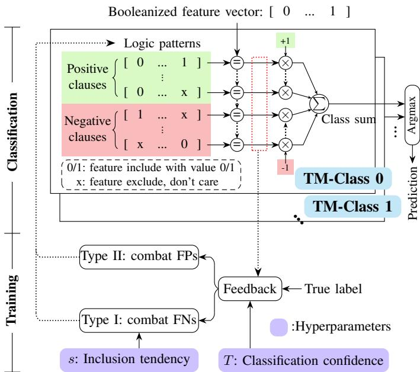
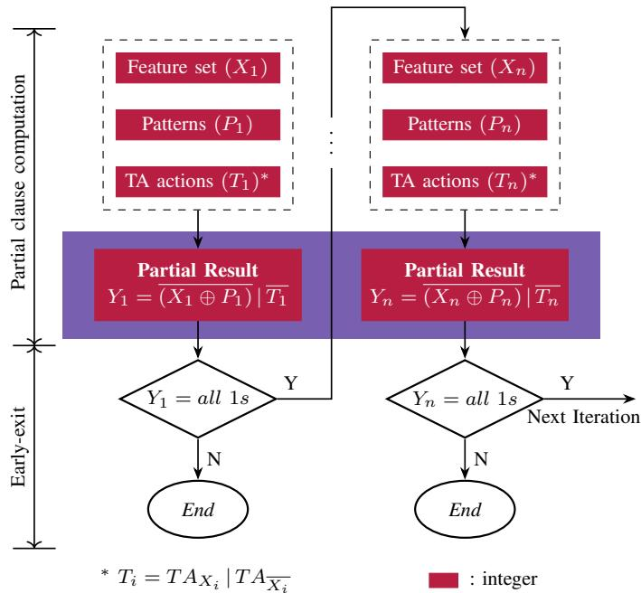
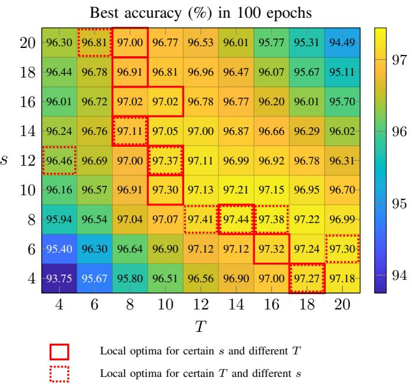
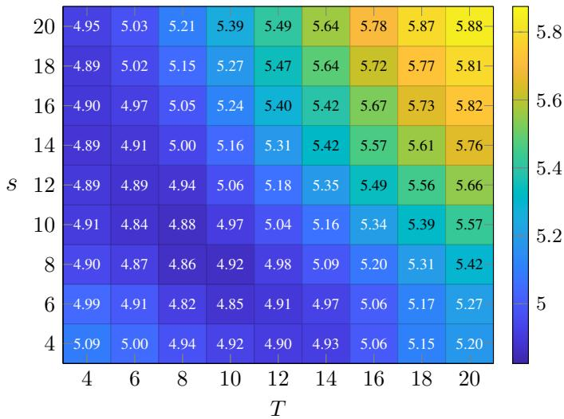
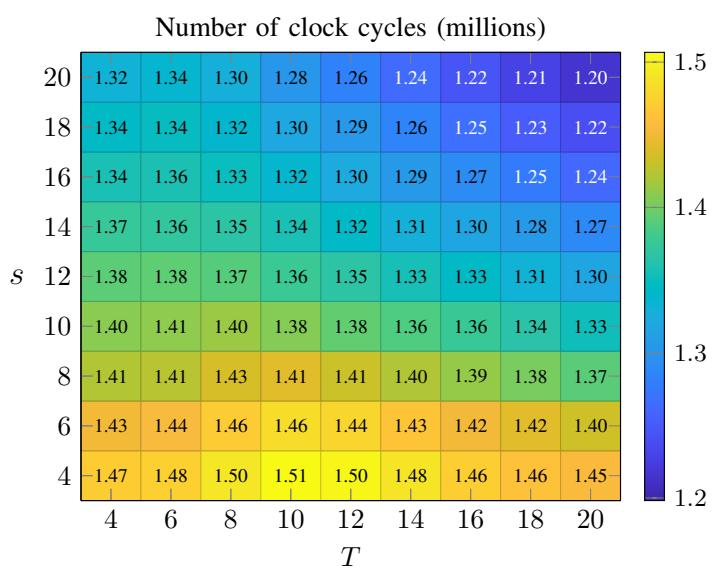
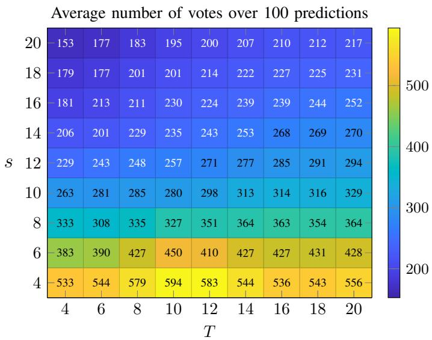
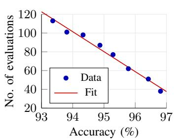
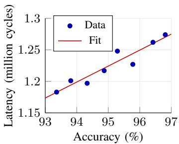

# Inference Latency-Aware Tsetlin Machine Training

Yefan Zeng, Shengyu Duan, Rishad Shafik, Alex Yakovlev

Microsystems Research Group, Newcastle University

Newcastle upon Tyne, United Kingdom

{y.zeng15, shengyu.duan, rishad.shafik, alex.yakovlev}@newcastle.ac.uk

Abstract—The Tsetlin Machine (TM) is a logic-based machine learning model well suited to low-latency inference on resourceconstrained edge devices. Because each clause is an AND over Boolean literals, both the literals and their associated Tsetlin Automaton (TA) actions can be represented at the bit level, enabling bitwise evaluation and an early exit that is triggered as soon as any included literal evaluates to zero, forcing the clause output to zero. In this work, we study how the two TM training hyperparameters, T and s, govern both classification accuracy and inference latency. Building on the inversely proportional T–s relationship along which accuracy is nearly constant, we find that inference latency is reduced primarily by increasing s; rather than exhaustively searching the (T, s) grid at high training cost, we propose a directed search strategy that treats accuracy as a constraint and advances toward larger s to reduce inference latency within a fixed evaluation budget. Experimental results on the gem5 simulator with an ARM processor show that, for certain datasets, the search is able to increase s while preserving the baseline accuracy, thereby reducing inference latency at negligible accuracy cost: across six datasets, the method reduces inference latency by up to 16.34%, while some datasets exhibit an accuracy reduction of only 0.06%. The proposed strategy requires far fewer configuration evaluations than an exhaustive grid search.

Index Terms—Tsetlin Machine, Hyperparameter Optimization, Accuracy–Latency Trade-off, Early Exit, Edge Inference.

## I. INTRODUCTION

Edge devices impose tight latency, memory and power budgets on machine learning (ML) inference, which deep neural networks (DNNs) meet poorly because their predictions rest on large numbers of multiply–accumulate operations [1]. Logic-based ML algorithms avoid this arithmetic bottleneck by encoding learned patterns in Boolean form and evaluating them with bitwise logic. The Tsetlin Machine (TM) is a logicbased ML algorithm that employs Tsetlin Automata (TAs) as its fundamental learning units to construct multiple logical pattern recognizers, referred to as clauses. A clause can be represented as a propositional conjunction (AND formula), making the TM inherently interpretable by construction rather than relying on post-hoc explanations. In addition, the TM eliminates the need for floating-point arithmetic during both training and inference, making it computationally efficient and cost-effective.

Fig. 1 illustrates the TM classification architecture and provides an overview of its training mechanism. Specifically, a TM operates exclusively on Boolean data. Therefore, raw features must first be transformed into Boolean features, typically through thresholding. For classification, a TM model consists of one TM for each class, with each TM learning the

Boolean patterns of its corresponding class. Within a TM, a clause is activated (output=1) only when every feature in its learned pattern matches the input; a single mismatched feature is sufficient to deactivate the clause (output=0). Activated positive and negative clauses cast votes of +1 and −1, respectively, which are accumulated into a class score. The predicted class is the one with the highest score.

  
Fig. 1: TM classification architecture and training. Type I/II feedback combats false negatives (FNs)/false positives (FPs).

As can be seen from Fig. 1, not all features are included in a clause. Feature inclusion and exclusion are determined by TAs through a reinforcement feedback mechanism that compares the clause outputs with the ground-truth labels. A hyperparameter, T, serves as the classification confidence (voting target) by encouraging the class sum to approach ±T; the farther the class sum deviates from these targets, the more likely feedback is to be triggered. Two types of feedback, Type I and Type II, are employed to reduce false negatives (FNs) and false positives (FPs), respectively. Another hyperparameter, s, controls the specificity of the learned clauses by regulating the tendency to include features, in Type I feedback. Larger values of s encourage the inclusion of more features in each clause. A more detailed description of the training mechanism can be found in previous publications [2], [3].

The conventional approach to selecting the optimal values of $T$ and s is to perform an exhaustive grid search over candidate parameter combinations and retain the combination that achieves the highest classification accuracy [4]–[6]. Every candidate demands a full training run, so the cost grows with the resolution of the grid and the workflow becomes time-consuming. A more directed alternative has been made possible by an existing characterization of the $( T , s )$ space: the generally inversely proportional relationship between $T$ and s for the optimal accuracy has been reported in a previous paper, which derives a mathematical model of the two hyperparameters and evaluates it on MNIST [7]. What both the exhaustive search and this mathematical model share, however, is that they treat $( T , s )$ selection as a question of accuracy alone.

Our observation is that $T$ and s also govern inference latency. As established above, they fix the clause expression, and in particular the number of literals each clause includes. This determines how many clauses evaluate to zero on a given input, and the position at which a mismatch is encountered during clause evaluation directly determines how frequently inference can terminate clause evaluation early [8]. An accuracy-optimal $( T , s )$ therefore carries no guarantee of being a latency-efficient one, and to the best of our knowledge, the relationship between the hyperparameters $T$ and s and the resulting trade-off between accuracy and inference latency remains largely unexplored.

This paper studies accuracy-latency trade-off of TM, based on different values of $T$ and s. We first evaluate the impact of $T$ and s on accuracy and inference latency and find these two objectives are largely decoupled. Specifically, inference latency is largely insensitive to movement along the inversely proportional relationship that preserves accuracy, and falls instead with increasing s. Based on this observation, we propose an inference latency-aware training strategy. Rather than sampling the design space indiscriminately, it advances towards larger s to reduce latency, compensates with $T$ to hold accuracy, and admits a configuration only if a userspecified accuracy constraint is still met. A fixed budget on training evaluations bounds the search process, ensuring a linear number of evaluations with respect to the explored $( T , s )$ configurations.

We validate the strategy on six well-established benchmark datasets with inference latency measured on an ARM processor modeled in gem5 [9]. The results demonstrate that the proposed strategy reduces inference latency by 0.25%–16.34% while incurring only a 0.06%–1.97% reduction in accuracy. Furthermore, when searching for a model that satisfies specific accuracy and latency requirements, the proposed strategy ensures that the number of evaluations over different $( T , s )$ combinations increases linearly from an initial accuracy–latency configuration.

Our contributions are as follows:

• A systematic exploration of the $( T , s )$ design space reveals that accuracy and inference latency are largely decoupled, enabling latency optimization with minimal impact on accuracy.

• An efficient training strategy that substantially lowers the evaluation cost of $( T , s )$ design space exploration, compared with exhaustive search.

• Comprehensive end-to-end validation of Booleanization, TM training, hyperparameter tuning and deployment on well-established benchmark datasets, demonstrating practical applicability across diverse tasks.

## II. TM SOFTWARE IMPLEMENTATION

Existing software implementations of TM inference fall into two classes, distinguished by what the model representation retains. The first retains the complete information— both includes and excludes. This keeps the model aligned with the input, so that inference can be performed per sample, which makes it well suited to real-time computing. The second retains only part of the information, namely the includes, and compresses the model by discarding the excludes through an include-encoding scheme. Its parallel computing, however, is performed at batch level, which makes it better suited to a dataset that is already available in full—such as a tabular dataset—rather than one whose samples arrive one at a time.

The implementation of [8] belongs to the first class. It retains the action of every TA and casts both the model and the input into a form on which clause evaluation reduces to bitwise operations, so that no include is addressed explicitly and no index is decoded at runtime. This work builds on the same early exit mechanism, which Fig. 2 summarises. The Boolean features of a datapoint are bit-packed into n integers, where n is the number of features divided by the word width of the target device—32 or 64 on typical edge processors, and wider where the device supports it. The trailing integer is zero-padded, which is safe because padded positions default to exclude. Each feature word $X _ { i }$ is evaluated against two words derived from the same TA actions: $T _ { i } = T A _ { X _ { i } } | T A _ { \overline { { { X _ { i } } } } } ,$ , the OR of the positive and negated halves of the model, which marks the positions at which a literal is included; and $P _ { i } ,$ the sub-pattern the clause expects, which records the feature value each included literal requires. The partial result of the i-th word is $Y _ { i } \ = \ { \overline { { ( X _ { i } \oplus P _ { i } ) } } } | \overline { { T _ { i } } }$ , so that a bit of $Y _ { i }$ is 0 exactly where an included position is contradicted by the feature, excluded positions being masked to 1 by $\overline { { T _ { i } } }$ . Each iteration evaluates one word and decides on it. If $Y _ { i }$ is all-ones the clause remains satisfiable and the next iteration proceeds; otherwise a mismatch on an included literal has been found, the clause output is determined to be $0 ,$ and the remaining n − i words are never touched—an early exit. Because a word holds the features of a single datapoint, each input is classified independently, and the measured latency corresponds directly to the response time of one sample.

REDRESS [10] belongs to the second class. Since trained TA are extremely sparse and only the includes contribute to the clause output, its include-encoding scheme stores each include as a 16-bit integer carrying the literal offset and stores nothing for the excludes, which losslessly compresses the model by two orders of magnitude. Parallel computing is then organised at batch level: rather than packing the features of one sample into a machine word, REDRESS packs the same feature of W samples, so that a single pass over the model classifies W datapoints at once. This requires the samples to be collected and bit-packed before inference begins, which is only possible when the dataset is already available in full. Latency is consequently amortised over a batch rather than attributable to a single input, and no per-sample early exit is available.

  
Fig. 2: Software implementation of TM inference with early exit mechanism.

In this paper, we use the first software implementation to evaluate inference latency. However, we observe that the impact of hyperparameters on latency and the proposed training strategy can also serve as guidelines for REDRESS optimization. A detailed discussion is provided in Section V.

## III. INFERENCE-LATENCY AWARE TRAINING

## A. Impact of T and s on Accuracy

The key hyperparameters T and s govern the behavior of the TM training process and consequently have a significant impact on the overall classification accuracy [7]. To investigate their effects, we train TM models with 300 clauses per class on the MNIST dataset using a wide range of T and s combinations. The resulting test accuracies are presented in Fig. 3, where local optima are highlighted. As shown, the optimal values of T and s exhibit an approximately inverse relationship: similar peak accuracies can be achieved by increasing T while decreasing s, or vice versa. This observation is consistent with the trend reported in [7].

We further explain the observed accuracy trends as follows. As described in Section I, s controls how strongly the inclusion of a literal is encouraged in Type I feedback. Consequently, increasing (decreasing) s leads the model to capture more (less) fine-grained patterns. This behavior is illustrated in Fig. 4, where the total number of includes generally increases with larger s for a fixed value of T. In contrast, T reflects the model’s confidence in distinguishing between different classes. Increasing T amplifies the probability of initiating feedback, which in turn encourages the inclusion of more literals. This trend can also be observed in Fig. 4, where the total number of includes increases with larger T for each fixed value of s. The granularity of the learned patterns determines the model’s generalization capability: excessively fine-grained patterns tend to cause overfitting, whereas overly coarsegrained patterns tend to result in underfitting. Therefore, to mitigate overfitting when s is large, T should be decreased to reduce the probability of feedback. Conversely, when s is small, increasing T is necessary to ensure that the TM learns a sufficient number of included literals, thereby avoiding underfitting.

  
Fig. 3: Test accuracy with varying T and s.

## B. Impact of T and s on Inference Latency

The TM models corresponding to all (T,s) combinations are implemented using the software framework described in Section II. We evaluate the inference latency of each model by measuring the average number of clock cycles over 100 data points on an ARM architecture simulated with gem5 [9]. The results are presented in Fig. 5. As shown, the inference latency decreases noticeably and consistently with increasing s for each fixed value of T. In contrast, the latency is relatively insensitive to changes in T for a fixed value of s, as evidenced by the small variation across each row.

For the implemented software, inference latency for a given datapoint is determined by two factors: (1) the total number of votes, i.e., the number of clauses producing an output of 1, and (2) how early the evaluation of clauses producing an output of 0 can be terminated. Specifically, a larger number of votes increases inference latency because more clauses must be evaluated to completion for pattern recognition, requiring comparisons across all features without the possibility of early termination. In contrast, the earlier a mismatch is detected within a clause yielding 0, the sooner its evaluation can terminate, reducing the overall inference latency.

Base-10 logarithm of total includes  
  
Fig. 4: Number of includes with varying T and s. Too many includes lead to overfitting, while too few lead to underfitting.

  
Fig. 5: Inference latency with varying T and s. Latency tends to decrease as s increases.

We first measure the average number of votes over 100 datapoints for different values of T and s, as shown in Fig. 6. It is evident that the number of votes decreases along each column, indicating that larger values of s cause fewer clauses to produce a vote. This is because a larger s results in more fine-grained clause representations, with each clause containing more literals. Consequently, the learned patterns become more specific and are therefore less likely to match unseen input data, leading to fewer clauses producing an output of 1. Meanwhile, along each row, larger values of T lead to a greater number of votes. This behavior stems from the TM feedback mechanism, which reinforces clause expressions (learned patterns) until the class sum approaches T or -T. As a result, increasing T allows more clauses to be reinforced, potentially leading to a larger number of voting clauses. However, the empirical results in Fig. 6 indicate that the number of votes is considerably more sensitive to changes in s than to changes in T.

  
Fig. 6: Number of votes (clauses producing output 1) with varying T and s. Vote count tends to decrease as s increases.

We next examine the second factor, i.e., how early the evaluation of a clause producing an output of 0 can be terminated. Recall from Section II that early exit is triggered at the first feature that is included and mismatched. For a given dataset, the probability that a feature takes the value 0 at a given position is an intrinsic property of the data and is therefore a constant, independent of T and s. Consequently, the probability that any particular position triggers an exit is governed solely by the probability that the corresponding feature is included. As shown in Fig. 4, increasing either T or s raises the number of includes and hence the per-feature include probability. A higher include probability makes each evaluated position more likely to carry a mismatch, so the exit is expected to be triggered earlier in the evaluation sequence.

To verify this, we measure the probability of terminating clause computation at each execution index for different (T, s) combinations, as reported in Fig. 7. Here the execution index denotes the order in which literals are evaluated rather than the feature index, so a distribution concentrated at small indices indicates frequent and early termination. In Fig. 7a, T is fixed and s is increased: the exit probability at the early indices rises markedly, confirming that a larger s leads to earlier termination. In Fig. 7b, s is fixed and T is increased, which likewise raises the exit probability at the early indices. Both hyperparameters therefore increase the likelihood of early exit and, in this respect alone, tend to reduce inference latency.

·10−2 s=4 s=20   
Probabilityofexit 4   
2   
0   
0 200 400 600   
Index   
(a)   
·10−2 T=4 T=20   
Probabilityofexit 4   
2   
0 W   
0 200 400 600   
Index   
(b)  
Fig. 7: Probability of terminating clause computation at different execution indices for (a) fixed $T = 2 0$ with varying s, and (b) fixed $s = 2 0$ with varying T. The execution index denotes the order of computation rather than the feature index. Data points are connected for visual clarity.

Overall, increasing s reduces the total number of votes while increasing the likelihood of early termination when a pattern is not matched, both of which contribute to lower inference latency. In contrast, increasing $T$ tends to increase the number of votes, which raises inference latency, but it can also increase the likelihood of early termination for non-matching clauses, reducing latency. Consequently, unlike s, the effect of T on inference latency is not necessarily monotonic, as these two factors have opposing influences.

## C. Training Strategy for Optimal Accuracy-Latency Trade-off

Existing $( T , s )$ tuning for TMs targets maximum test accuracy [7]. Latency, however, is governed by a different factor: as shown in Sec. III-B, a larger s raises the include density of the clause expression, so clauses evaluate to zero earlier and inference exits sooner. We therefore treat accuracy as a constraint rather than an objective, and seek the feasible (T, s) combination with the largest s.

This is possible because the two objectives are decoupled. Accuracy is approximately preserved when s is increased and T decreased together (Section III-A), while latency is governed primarily by s. The feasible region can hence be traversed towards larger s without violating the accuracy constraint.

Algorithm 1 Latency-aware $( T , s )$ search. Each call to EVAL-  
UATE trains and tests one distinct $( T , s )$ (memoized), and   
counts as one evaluation.   
Require: start $( T _ { 0 } , s _ { 0 } ) ;$ accuracy threshold $A _ { \mathrm { t h } } ;$ steps   
$\Delta _ { T } , \Delta _ { s } ;$ upward-probe budget $P ;$ bound $T _ { \mathrm { m i n } }$   
Ensure: feasible $( T ^ { \star } , s ^ { \star } , a ^ { \star } )$ with the largest s   
1: best $ \emptyset ; \ ( T , s )  ( T _ { 0 } , s _ { 0 } )$   
2: while $T \geq T _ { \mathrm { m i n } }$ do   
3: a ← EVALUATE(T, s)   
4: if $a \geq A _ { \mathrm { t h } }$ then best ← KEEP(best, $( T , s , a ) )$   
5: end if   
6: climb $ \emptyset$   
7: for k ← 1 to $P$ do ▷ probe upward to cross   
accuracy dips   
8: $s _ { k } \gets s + k \Delta _ { s }$   
9: $a _ { k } \gets \mathrm { E v a L U A T E } ( T , s _ { k } )$   
10: if $a _ { k } \geq A _ { \mathrm { t h } }$ then   
11: best ← KEEP(best, $( T , s _ { k } , a _ { k } ) )$   
12: climb $\gets s _ { k }$ ▷ keep the highest feasible s   
13: end if   
14: end for   
15: if climb $\neq$ ∅ then   
16: s ← climb ▷ larger $s \Rightarrow$ earlier exit ⇒   
lower latency   
17: else if $a \geq A _ { \mathrm { t h } }$ then   
18: $T \gets T - \Delta _ { T }$ ▷ column ceiling; smaller T   
tolerates larger s (Sec. III-A)   
19: else ▷ no feasible cell in this column   
20: break   
21: end if   
22: end while   
23: return best

Algorithm 1 follows this direction. The search is initialized at a known accuracy-optimal $( T , s )$ combination [7], which is by construction feasible. It then climbs s at the current $T ,$ steps T left when no higher s is feasible, and stops when a column has no feasible cell. Probing P steps upward rather than one lets the climb cross isolated accuracy dips, where a single infeasible s is followed by feasible ones above it.

Each distinct (T, s) combination is trained once and counts as one evaluation, so the number of evaluations equals the number of TM models a reproduction must train. Exhaustive search must evaluate every combination in the grid, whereas the directed search evaluates only those along its trajectory.

## IV. EXPERIMENTAL RESULTS

## A. Setup

1) Datasets and Booleanization: The proposed training strategy is validated using six datasets, including Digits [11], MNIST [12], Kuzushiji-MNIST (KMNIST) [13], Fashion-MNIST (FMNIST) [14], CIFAR2 [15], and Keyword Spotting (KWS) [16]. The Booleanization methods are as follows.

For Digits, MNIST, FMNIST, and KMNIST, the raw grayscale pixel values are Booleanized using a fixed threshold, resulting in a 1-bit Boolean representation for each pixel.

For CIFAR2, a binary classification variant of CIFAR10 consisting of animal and vehicle classes, we first extract Histogram of Oriented Gradients (HOG) features. The cell size, block size, and block stride are set to $( 8 \times 8 )$ $( 2 4 \times 2 4 )$ and $( 8 \times 8 )$ , respectively, producing 36 histograms for each (32×32)-pixel image. Each histogram contains 9 bins, and each bin is Booleanized into a 1-bit feature using two quantiles, resulting in a total of 324 Boolean features.

For KWS, we first perform a short-time Fourier transform (STFT) using a frame length of 0.16 s and a frame step of 0.03 s. From each frame, 13 Mel-Frequency Cepstral Coefficients (MFCCs) are extracted, and each coefficient is encoded using a 3-bit thermometer code. This Booleanization process produces a total of 1,131 Boolean features.

The Booleanized datasets and the corresponding source code for the Booleanization process are openly available at: https://github.com/nsd5g13/ImageBooleanizer.

2) TM Training: All models are trained using the Python Tsetlin Machine (pyTsetlinMachine) implementation. For each dataset, the hyperparameter combination $( T , s )$ is adopted from prior empirical studies [7], which have been shown to yield near-optimal test accuracy for the corresponding configuration. Adopting these established $( T , s )$ values provides an accuracy-optimized starting point for our subsequent hyperparameter search. The specific $( T , s )$ settings and their corresponding accuracy for each dataset are given in Table I.

The dataset and model configurations used in this study are as follows. MNIST, FMNIST, and KMNIST each comprise 10 classes with 784 raw features, trained with 300 clauses per class. Digits also contains 10 classes, but with a much lower feature dimensionality of 64, and is trained with 50 clauses per class. CIFAR2, a binary classification task, comprises 324 features and requires a substantially larger clause budget of 1,000 clauses per class to capture its greater pattern complexity. KWS comprises 8 classes and 377 raw features; quantile binning is applied for Booleanization, converting each feature into a 3-bit thermometer code, and the corresponding model is trained with 500 clauses per class.

In this work, we set the step sizes in Algorithm 1 to $\Delta T =$ $\Delta s = 1$ and the upward-probe budget $P = 2 ,$ so that each column evaluates the current cell together with two cells above it—three $( T , s )$ combinations in total—before stepping T to the left.

3) Deployment and Evaluation: We employ gem5 v25.0, a cycle-level computer architecture simulator, to conduct our latency evaluation [9]. It is configured in syscall emulation (SE) mode, targeting the ARMv8-A (AArch64) instruction set with the O3CPU model — gem5’s timing-accurate, out-oforder CPU model. The bitwise inference kernel is compiled with a 32-bit packed representation, so each clause is evaluated in $\lceil n / 3 2 \rceil$ word-level iterations. The cache hierarchy consists of 64 kB, 4-way set-associative L1 instruction and data caches with a 64-byte cache line size, a configuration typical of application-class cores used in edge deployments [17], [18].

  
(a)

  
(b)  
Fig. 8: (a) Number of evaluations and (b) latency under varying accuracy constraints. Relaxing the accuracy constraint reduces inference latency while increasing the search effort. Both trends exhibit an approximately linear relationship, with $R ^ { 2 }$ values of 0.98 and 0.90, respectively.

We use the number of simulated clock cycles reported by gem5 as our latency metric. Since this cycle count is deterministic and unaffected by external randomness, it provides a consistent and repeatable basis for comparison across different $( T , s )$ configurations. All experiments are therefore conducted within this simulation environment rather than on a physical device. This choice is made to avoid the non-determinism inherent to real hardware, where OS-level background processes and scheduling overhead constitute a fixed but hard-to-isolate portion of the measured runtime, potentially confounding the latency attributable to the model configuration itself.

## B. Design Space Exploration

Fig. 8 sweeps the accuracy constraint on MNIST and records, for each target, the number of $( T , s )$ configurations the search evaluates (a) and the latency of the returned configuration (b). Both quantities vary approximately linearly with the constraint $( R ^ { 2 } = 0 . 9 8$ and 0.90), but in opposite directions: tightening the target from 93.36% to 96.81% reduces the evaluation count from 113 to 38 while raising latency from 1.183 to 1.274 million cycles. The opposing trends expose a trade-off. Relaxing the constraint widens the feasible band, allowing the search to advance further along the s-axis before the accuracy floor is reached; the resulting higher-s configuration exits earlier and therefore runs faster, but reaching it requires evaluating more intermediate points, increasing the search effort. A designer can thus exchange a small accuracy margin for lower latency at a predictable search cost. Because both relationships are approximately linear, the search cost and latency of an arbitrary target within this range can be estimated by interpolation, without executing the full sweep.

## C. Accuracy–Latency Trade-off

Table I reports, for each dataset, the accuracy-optimal baseline configuration together with the configurations returned by the proposed search under two accuracy-drop budgets, 0.5% and 2%. Each entry lists the $( T , s )$ combination, the resulting test accuracy, and the inference latency in kilocycles obtained from the gem5 model of Section IV-A. The baseline is the peak-accuracy configuration; the two budgeted columns instead treat this accuracy as a constraint and report the largest s that keeps the accuracy drop within the stated budget, alongside the number of $( T , s )$ evaluations the search consumed and the latency reduction relative to the baseline.

TABLE I: Accuracy–Latency trade-off across datasets under different accuracy-drop budgets
<table><tr><td rowspan="2">Dataset</td><td colspan="3">Baseline</td><td colspan="10">This Work Max. acc. drop: 0.5%</td></tr><tr><td></td><td>Acc.</td><td>Latency</td><td>No. of</td><td></td><td>Acc.</td><td>Latency</td><td>Latency</td><td> $\overline { { \mathrm { N o . ~ o f } } }$ </td><td></td><td>Max. acc. drop: 2% Acc.</td><td>Latency</td><td>Latency</td></tr><tr><td></td><td> $( T , s )$ </td><td>(%)</td><td>(kilo cycles)</td><td>evals</td><td> $( T , s )$ </td><td>(%)</td><td>(kilo cycles)</td><td>reduct.(%)</td><td>evals</td><td> $( T , s )$ </td><td>(%)</td><td>(kilo cycles)</td><td>reduct.(%)</td></tr><tr><td>MNIST</td><td>(14,11.10)</td><td>97.26</td><td>1348.27</td><td>38</td><td>(8,25.10)</td><td>96.81</td><td>1273.90</td><td>5.52</td><td>77</td><td>(4,52.10)</td><td>95.29</td><td>1248.23</td><td>7.42</td></tr><tr><td>KMNIST</td><td>(14,11.10)</td><td>85.97</td><td>1305.00</td><td>24</td><td>(11,20.10)</td><td>85.53</td><td>1220.68</td><td>6.46</td><td>38</td><td>(9,28.10)</td><td>84.07</td><td>1171.33</td><td>10.24</td></tr><tr><td>FMNIST</td><td>(14,11.10)</td><td>85.97</td><td>1147.96</td><td>17</td><td>(13,19.10)</td><td>85.48</td><td>1072.36</td><td>6.59</td><td>88</td><td>(5,66.10)</td><td>84.25</td><td>1010.07</td><td>12.01</td></tr><tr><td>Digits</td><td>(7, 6.56)</td><td>95.28</td><td>94.18</td><td>10</td><td>(6,7.56)</td><td>95.00</td><td>93.94</td><td>0.25</td><td>9</td><td>(7,9.56)</td><td>93.33</td><td>91.73</td><td>2.60</td></tr><tr><td>CIFAR2</td><td>(24,14.15)</td><td>89.24</td><td>438.38</td><td>63</td><td>(20,59.15)</td><td>88.75</td><td>391.40</td><td>10.72</td><td>100</td><td>(18,95.15)</td><td>87.52</td><td>366.74</td><td>16.34</td></tr><tr><td>KWS</td><td>(18,12.39)</td><td>70.56</td><td>1892.98</td><td>17</td><td>(17,20.39)</td><td>70.50</td><td>1766.71</td><td>6.67</td><td>26</td><td>(16,26.39)</td><td>68.94</td><td>1689.00</td><td>10.78</td></tr></table>

Across all six datasets, the returned configurations increase s relative to the baseline and, in most cases, also reduce T, placing them to the upper-left of the baseline in the $( T , s )$ plane. Since latency is governed primarily by s, this movement translates directly into lower inference latency. Under the 0.5% budget, the reduction reaches 10.72% on CIFAR2, while on Digits it is only 0.25%; relaxing the budget to 2% increases the reduction on every dataset, with CIFAR2 again leading at 16.34% and Digits lowest at 2.60%. The consistently small reduction on Digits reflects its low feature dimension, which leaves little room to increase s before the accuracy constraint is violated. The larger admissible accuracy drop simply permits a larger $s ,$ and hence a shorter expected inference path, at the cost of the additional accuracy conceded to the budget. KWS is a clear instance of the intended behavior: under the 0.5% budget its accuracy is essentially unchanged (70.56% to 70.50%), yet increasing s from 12.39 to 20.39 lowers latency by 6.67%, so a lower-latency configuration is obtained with virtually no accuracy penalty.

The search reaches these configurations at a small cost, between 9 and 100 evaluations, far below an exhaustive sweep of the (T, s) grid. As expected, the looser 2% budget generally admits a longer trajectory and therefore more evaluations, since the search can climb further in s before the accuracy constraint is violated. To bound this cost, each search is capped at 100 evaluations; CIFAR2 under the 2% budget reaches this cap, so its reported configuration is the best found within the budget rather than a guaranteed largest-s solution.

## V. CONCLUSIONS AND DISCUSSIONS

In this work, we systematically evaluated how the two TM training hyperparameters T and s jointly affect classification accuracy and inference latency on a bitwise, earlyexit software implementation. Based on this, we showed that adjusting $T$ and s along their inversely proportional relationship preserves the accuracy of an accuracy-optimal configuration. Inference latency, however, is governed separately: it is lowered primarily by increasing $s ,$ which raises the earlyexit probability. Exploiting this decoupling, we proposed a directed $( T , s )$ search that treats accuracy as a constraint and advances towards larger s within a fixed budget of training evaluations. Across six datasets, with latency measured on a gem5-simulated ARM processor, the method reduces inference latency by up to 16.34% with some datasets showing negligible accuracy loss, while requiring far fewer configuration evaluations than an exhaustive grid search. As the search is budget-bounded, its result is a practical low-latency configuration rather than a guaranteed global optimum.

For other implementations, such as REDRESS, where only included features are encoded in the model representation, the trend observed in Fig. 4 also provides guidance for accelerating inference. For a fixed value of $T ,$ decreasing s reduces the total number of included features, resulting in less information to encode, smaller model storage, and lower inference latency. Therefore, the strategy presented in Section III-C is also applicable to REDRESS, though in the opposite direction, as inference latency can be reduced by decreasing s while adjusting T to maintain accuracy with minimal degradation.

## ACKNOWLEDGEMENT

This work was supported by the Engineering and Physical Sciences Research Council (EPSRC) under Grant EP/X039943/1 (ESTEEM) and Grant EP/X036006/1 (SON-NETS).

## REFERENCES

[1] W. Li, H. Hacid, E. Almazrouei, and M. Debbah, “A comprehensive review and a taxonomy of edge machine learning: Requirements, paradigms, and techniques,” Ai, vol. 4, no. 3, pp. 729–786, 2023.

[2] O.-C. Granmo, “The Tsetlin machine—a game theoretic bandit driven approach to optimal pattern recognition with propositional logic,” arXiv preprint arXiv:1804.01508, 2018.

[3] S. Duan, R. Shafik, and A. Yakovlev, “ETHEREAL: Energy-efficient and high-throughput inference using compressed tsetlin machine,” in 2025 10th International Workshop on Advances in Sensors and Interfaces (IWASI). IEEE, 2025, pp. 1–6.

[4] Y. Grønningsæter, H. S. Smørvik, and O.-C. Granmo, “An optimized toolbox for advanced image processing with tsetlin machine composites,” in 2024 International Symposium on the Tsetlin Machine (ISTM). IEEE, 2024, pp. 1–8.

[5] P. Thangaraj, S. R. Yeduri, O.-C. Granmo, and L. R. Cenkeramaddi, “Interpretable and intelligent ddos attack detection method using tsetlin machine,” in 2025 International Symposium on the Tsetlin Machine (ISTM). IEEE, 2025, pp. 64–71.

[6] S. Abbas, N. Soomro, O.-C. Granmo, R. Shafik, R. Heer, and K. Adhikari, “Ai-based clinical rule discovery for nmibc recurrence through tsetlin machines,” in 2025 International Symposium on the Tsetlin Machine (ISTM). IEEE, 2025, pp. 24–29.

[7] O. Tarasyuk, T. Rahman, R. Shafik, A. Yakovlev, A. Gorbenko, O.-C. Granmo, and L. Jiao, “Systematic search for optimal hyper-parameters of the tsetlin machine on mnist dataset,” in 2023 International Symposium on the Tsetlin Machine (ISTM). IEEE, 2023, pp. 1–8.

[8] Y. Zeng, S. Duan, R. Shafik, and A. Yakovlev, “Fast and compact tsetlin machine inference on cpus using instruction-level optimization,” in 2025 International Symposium on the Tsetlin Machine (ISTM). IEEE, 2025, pp. 44–47.

[9] N. Binkert, B. Beckmann, G. Black, S. K. Reinhardt, A. Saidi, A. Basu, J. Hestness, D. R. Hower, T. Krishna, S. Sardashti, R. Sen, K. Sewell, M. Shoaib, N. Vaish, M. D. Hill, and D. A. Wood, “The gem5 simulator,” SIGARCH Comput. Archit. News, vol. 39, no. 2, p. 1–7, Aug. 2011. [Online]. Available: https://doi.org/10.1145/2024716.2024718

[10] S. Maheshwari, T. Rahman, R. Shafik, A. Yakovlev, A. Rafiev, L. Jiao, and O.-C. Granmo, “Redress: Generating compressed models for edge inference using tsetlin machines,” IEEE Transactions on Pattern Analysis and Machine Intelligence, vol. 45, no. 9, pp. 11 152–11 168, 2023.

[11] E. Alpaydin and F. Alimoglu, “Pen-Based Recognition of Handwritten Digits,” UCI Machine Learning Repository, 1996, DOI: https://doi.org/10.24432/C5MG6K.

[12] L. Deng, “The MNIST database of handwritten digit images for machine learning research,” IEEE Signal Processing Magazine, vol. 29, no. 6, pp. 141–142, 2012.

[13] T. Clanuwat, M. Bober-Irizar, A. Kitamoto, A. Lamb, K. Yamamoto, and D. Ha, “Deep learning for classical japanese literature,” arXiv preprint arXiv:1812.01718, 2018.

[14] H. Xiao, K. Rasul, and R. Vollgraf, “Fashion-mnist: a novel image dataset for benchmarking machine learning algorithms,” arXiv preprint arXiv:1708.07747, 2017.

[15] A. Krizhevsky and G. Hinton, “Learning multiple layers of features from tiny images,” 2009.

[16] P. Warden, “Speech commands: A dataset for limited-vocabulary speech recognition,” arXiv preprint arXiv:1804.03209, 2018.

[17] P. Francis-Mezger and V. M. Weaver, “A raspberry pi operating system for exploring advanced memory system concepts,” in Proceedings of the International Symposium on Memory Systems, 2018, pp. 354–364.

[18] R. Aalishah, M. Navardi, and T. Mohsenin, “Edgenavmamba: Mambaoptimized object detection for energy-efficient edge devices,” in 2025 IEEE 11th International Conference on Edge Computing and Scalable Cloud (EdgeCom). IEEE, 2025, pp. 62–67.