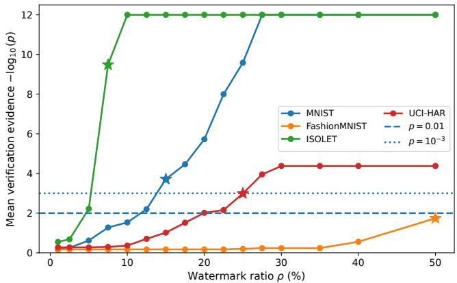
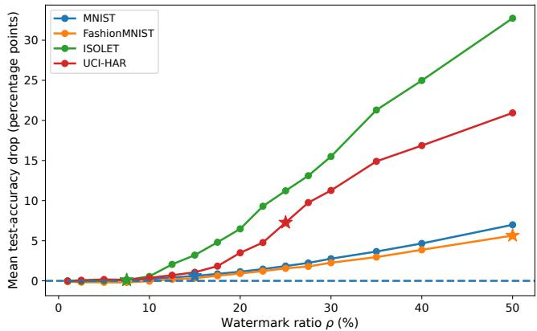

# Intellectual Property Protection of Hyperdimensional Computing Classifiers: Black-Box Ownership Verification via Model Watermarking

Hamed Poursiami∗ Farshad Soleiman∗ Ahmad Tahmasivand∗ Guojing Cong† Thomas Potok† Khaled N. Khasawneh∗ Kai Zeng∗ Maryam Parsa∗

1Electrical and Computer Engineering Department, George Mason University, Fairfax, VA, USA 2Oak Ridge National Laboratory, Oak Ridge, TN, USA

hpoursia@gmu.edu, fsoleima@gmu.edu, atahmasi@gmu.edu, congg@ornl.gov, potokte@ornl.gov, kkhasawn@gmu.edu, kzeng2@gmu.edu, mparsa@gmu.edu

## Abstract

Hyperdimensional computing (HDC) offers efficient learning and inference for resource-constrained systems, yet ownership verification ofits models remains underexplored. We present the first systematic investigation of model watermarking in HDC by adapting backdoor-based embedding to three classifiers with different prototype-learning mechanisms. Across four benchmarks, with conventional neural networks as references, we examine whether watermarks can be learned without compromising task accuracy and whether they survive subsequent model modification and replication. The error-driven classifiers, AdaptHD and OnlineHD, support verification at a nominal trigger exposure of 1% with at most 0.58 percentage points of mean accuracy loss, whereas single-pass Vanilla HDC requires greater exposure and can incur substantial accuracy costs. The error-driven models retain verification under native continued training, but extraction produces surrogates that reproduce much ofthe task behavior without verifiable watermarks. Watermark overwriting readily embeds attacker watermarks into HDC prototypes and erodes the owner’s watermark more strongly than in the neural network references, although the strongest erosion coincides with large accuracy losses. We further deploy watermarked AdaptHD on an FPGA and stress its execution through undervolting and overclocking. Verification survives substantial computation errors, whereas more severe stress either causes verification failure together with accuracy collapse or results in inference timeouts. These findings establish the feasibility of watermarking in HDC while identifying limitations in retention under extraction and sensitivity to overwriting.

## 1. Introduction

Hyperdimensional Computing (HDC) has emerged as a compelling brain-inspired approach to efficient machine learning, with applications ranging from image and biosignal classification to robotic mapping and efficient decision making [8, 23, 28, 31, 36]. By representing information in high-dimensional vectors and processing it through lightweight vector operations, HDC supports rapid training, energy-efficient computation, and robustness to noise. Its computational efficiency and suitability for hardware acceleration on FPGAs and in-memory computing platforms make it particularly attractive for resource-constrained edge devices [17, 34]. However, deployment outside the developer’s trusted infrastructure can expose stored model representations to unauthorized access. In prototype-based HDC classifiers, these representations include class hypervectors that consolidate task-specific knowledge acquired from training data. Access to these prototypes and the corresponding encoder can enable replication of the classifier without repeating the investment in data acquisition, representation design, training, and optimization. Protecting the intellectual property (IP) embodied in these models is therefore an important requirement for their deployment.

Despite this need, IP protection for HDC models remains underexplored. StealHD [22] investigates data-free extraction through prediction access, highlighting the threat of unauthorized model replication. Existing protection approaches address different aspects of model confidentiality: HDLock [4] uses privileged encoding to impede reverse engineering, while EP-HDC [25] protects class hypervectors through homomorphic encryption while enabling clientside inference. These mechanisms restrict access to model internals but do not themselves provide evidence linking a suspect copy to its original developer. Model watermarking addresses this complementary ownership-verification objective by embedding a secret signature that can later be tested in a suspect model [1, 37, 39]. Although extensively studied in deep neural networks [21, 41, 42] and investigated in spiking neural networks [27], its applicability to HDC classifiers remains an open research question.

HDC’s distinctive representation and learning mechanisms raise fundamental questions about how watermarks can be embedded and retained. In conventional HDC classifiers, training combines the hypervector representations of samples from each class into a shared prototype through superposition [16]. This associative structure provides a natural starting point for investigating whether a secret watermark can be incorporated alongside the information required for the primary task. However, the watermark and task-related information share the same prototypes, creating the potential for interference during embedding and changes to the watermark during subsequent learning. The central question is therefore how these learning mechanisms affect the ability to embed a verifiable watermark while preserving classification accuracy, and whether the resulting ownership evidence remains reliable after model modification or extraction.

To address these questions, we adapt the backdoorbased watermarking framework of Adi et al. [1] to HDC and evaluate three representative classifiers: Vanilla HDC, AdaptHD, and OnlineHD. This approach provides a common basis for examining how these classifiers learn secret trigger–label associations and retain them after deployment. Our evaluation combines statistical verification, exposure–accuracy analysis, and tests of model adaptation, extraction, and competing watermark insertion, with conventional neural networks as references. We further deploy watermarked AdaptHD models on an FPGA to examine verification under hardware execution faults. Together, these experiments assess both embedding feasibility and the survival of ownership evidence under post-deployment threats and hardware faults. Our contributions are:

• A systematic investigation of watermarking in HDC. To the best of our knowledge, we present the first study of model watermarking in HDC, adapting backdoor-based embedding to three prototype-learning mechanisms and assessing verification through a binomial test with empirical null calibration.

• Characterization of embedding feasibility and postdeployment limits. At 1% trigger exposure, AdaptHD and OnlineHD verify across all benchmarks with at most 0.58 pp mean accuracy loss, whereas Vanilla HDC suffers from superposition dilution. We show that embedded watermarks survive white-box adaptation and cannot be overwritten by competing triggers without either leaving the owner’s signature verifiable or collapsing task accuracy (10.37 – 42.21 pp drop), whereas black-box extraction removes OOD watermarks across all model families.

• FPGA validation under hardware faults. We deploy watermarked AdaptHD inference on a ZCU104 FPGA and evaluate its response to undervolting and overclocking. Verification survives operating conditions that reduce classification accuracy by up to 22.00 pp, while more severe stress causes verification failure or inference timeouts.

## 2. Preliminaries: HDC Classification

Hyperdimensional Computing, also known as Vector Symbolic Architecture (VSA), represents and processes information in a high-dimensional space H of dimensionality D (typically $D \sim 1 0 ^ { 3 } – 1 0 ^ { 4 } )$ using distributed representations called hypervectors [16, 18]. Because independently sampled random vectors in high-dimensional space are nearly orthogonal with high probability, HDC can compose and manipulate symbolic and numerical structures using three fundamental algebraic operations: (1) Bundling (superposition), which aggregates hypervectors into an associative composite preserving similarity to its inputs via elementwise addition in bipolar/real spaces or majority voting in binary spaces; (2) Binding (association), which combines two hypervectors into a dissimilar (quasi-orthogonal) hypervector via Hadamard product (⊗) in bipolar/real spaces or XOR in binary spaces; and (3) Permutation (ordering), which applies a deterministic cyclic coordinate shift to encode positional or structural hierarchy.

## 2.1. Encoding

Let $\boldsymbol { \mathcal { X } } \subseteq \mathbb { R } ^ { F }$ denote an F-dimensional input space and $\mathcal { Y } = \{ 1 , \ldots , C \}$ denote the set of C target classes. An HDC classifier first maps an input $x = ( x _ { 1 } , \ldots , x _ { F } ) \in \mathcal { X }$ into a D-dimensional hypervector $h = \phi ( x )$ through an encoding module. For general feature-vector inputs, two foundational encoding families are widely used:

• Record-based (or ID-level) encoding [12, 32], which binds randomly generated feature-position hypervectors $\mathbf { p } _ { j }$ with quantized feature-level hypervectors $\mathbf { l } ( x _ { j } )$ and bundles them across features $\begin{array} { r } { ( h = \sum _ { j = 1 } ^ { F } \mathbf { p } _ { j } \otimes \mathbf { l } ( x _ { j } ) ) } \end{array}$

• Nonlinear random projection (sinusoid) encoding [13, 30], which projects continuous inputs via $W \in \bar { \mathbb { R } } ^ { D \times F }$ $( W _ { i j } \stackrel { \mathrm { i . i . d . } } { \sim } \ N ( 0 , 1 ) )$ and phase shifts $b \ \in \ \mathbb { R } ^ { D } \ ( b _ { d } \ ) ^ { \ \mathrm { i . i . d . } }$ Uniform[0, 2π]) as $\boldsymbol { h } = \cos ( \boldsymbol { x } \boldsymbol { W } ^ { \top } + \boldsymbol { b } ) \otimes \sin ( \boldsymbol { x } \boldsymbol { W } ^ { \top } )$ to approximate shift-invariant kernel similarity.

Beyond these general-purpose vector encodings, specialized HDC encoders have been designed for specific domains and modalities, including graph encodings for relational structures [3, 26, 29], spatiotemporal n-gram encodings for text and multichannel biosignals [15, 31], resonator and fractional power encodings for spatial visual scenes [7, 33], and event-based encodings for neuromorphic dynamic vision sensors [23, 44].

## 2.2. Associative Inference

Classification is performed using an associative memory storing C trainable class prototypes $\textbf { P } = ~ \{ \mathbf { c } _ { 1 } , \ldots , \mathbf { c } _ { C } \}$ where each prototype $\mathbf { c } _ { y } \in \mathbb { R } ^ { D }$ consolidates the encoded patterns of class $y \in \mathcal { D }$ . Given a query input x with encoded hypervector $h = \phi ( x )$ , the model predicts the class whose prototype maximizes cosine similarity:

$$
\hat { y } ( x ) = \arg \operatorname* { m a x } _ { y \in \mathcal { Y } } \delta ( h , \mathbf { c } _ { y } ) , \qquad \delta ( u , v ) = \frac { \langle u , v \rangle } { \| u \| _ { 2 } \| v \| _ { 2 } } ,\tag{1}
$$

## 2.3. Prototype Learning Mechanisms

Given a labeled training set $\mathcal { D } = \{ ( x _ { i } , y _ { i } ) \} _ { i = 1 } ^ { N }$ , HDC classifiers construct and refine the class prototypes P on top of the encoder $\phi .$ Among the prototype learning schemes developed for HDC, three widely used paradigms illustrate the progression from single-pass aggregation to iterative errordriven refinement:

• Vanilla HDC [16, 32]: Each class prototype is constructed in a single pass by directly summing the encoded hypervectors of all training samples belonging to that class:

$$
\mathbf { c } _ { y } = \sum _ { i = 1 } ^ { N } \mathbb { I } [ y _ { i } = y ] \phi ( x _ { i } ) , \qquad \forall y \in \mathcal { V } ,\tag{2}
$$

where I[·] is the indicator function.

• AdaptHD [14]: To reduce cross-talk interference and prototype saturation from unweighted bundling, AdaptHD refines the prototypes iteratively over multiple training epochs with learning rate $\eta > 0$ . For each sample $( x _ { i } , y _ { i } )$ with encoded hypervector $h _ { i } ~ = ~ \phi ( x _ { i } )$ and current prediction $\hat { y } _ { i } = \arg \operatorname* { m a x } _ { c \in \mathcal { Y } } \delta ( h _ { i } , \mathbf { c } _ { c } )$ , the prototypes are left unchanged if $\hat { y } _ { i } = y _ { i } ; \mathrm { i f } \hat { y } _ { i } \ne y _ { i }$ , the true class prototype is reinforced and the mispredicted prototype is penalized:

$$
\begin{array} { r } { \left\{ \begin{array} { l l } { \mathbf { c } _ { y _ { i } } \gets \mathbf { c } _ { y _ { i } } + \eta h _ { i } } & { \quad } \\ { \mathbf { c } _ { \hat { y } _ { i } } \gets \mathbf { c } _ { \hat { y } _ { i } } - \eta h _ { i } } & { \quad } \end{array} \right. \mathrm { i f } \hat { y } _ { i } \neq y _ { i } . } \end{array}\tag{3}
$$

• OnlineHD [11]: OnlineHD extends mistake-driven refinement by weighting each update according to the model’s similarity confidence on the misclassified sample. When $\hat { y } _ { i } ~ \ne ~ y _ { i } ,$ , let $\delta _ { y _ { i } } ~ = ~ \delta ( h _ { i } , { \bf c } _ { y _ { i } } )$ and $\delta _ { \hat { y } _ { i } } \ =$ $\delta ( h _ { i } , { \bf c } _ { \hat { y } _ { i } } )$ denote the cosine similarities of $h _ { i }$ with the true and predicted prototypes, respectively. OnlineHD scales the corrective update by the angular discrepancy:

$$
\left\{ \begin{array} { l l } { \mathbf { c } _ { y _ { i } } \gets \mathbf { c } _ { y _ { i } } + \eta \left( 1 - \delta _ { y _ { i } } \right) h _ { i } } & \\ { \qquad \mathrm { i f } \ \hat { y } _ { i } \neq y _ { i } . } \\ { \mathbf { c } _ { \hat { y } _ { i } } \gets \mathbf { c } _ { \hat { y } _ { i } } - \eta \left( 1 - \delta _ { \hat { y } _ { i } } \right) h _ { i } } & \end{array} \right. \qquad \mathrm { i f } \ \hat { y } _ { i } \neq y _ { i } .\tag{4}
$$

By weighting updates in proportion to $1 - \delta .$ , OnlineHD applies larger corrections to unfamiliar or strongly misclassified patterns while attenuating updates for samples that already align with their target prototype.

## 3. Watermarking Methodology

We adapt the backdoor watermarking approach of Adi et al. [1] to investigate ownership verification in HDC classifiers. Verification requires only the suspect model’s predicted labels on secret trigger inputs, without requiring access to its internal parameters.

## 3.1. Trigger Generation and Embedding

Let $\mathcal { D } _ { \mathrm { c l e a n } } = \{ ( x _ { i } , y _ { i } ) \} _ { i = 1 } ^ { N }$ denote the owner’s clean training dataset. Prior to training, the owner uses a secret cryptographic key κ to reproducibly generate a watermark trigger set $\mathcal { T } _ { \kappa } = \{ ( x _ { k } ^ { * } , y _ { k } ^ { * } ) \} _ { k = 1 } ^ { K }$ consisting of K distinct synthetic out-of-distribution (OOD) trigger inputs $x _ { k } ^ { \ast } ~ \in ~ \mathcal { X }$ paired with pseudorandom target labels $y _ { k } ^ { * } \sim \operatorname { U n i f o r m } ( \mathcal { V } )$ sampled independently of ground-truth semantics and model predictions. To prevent post-hoc fabrication of ownership claims (where an adversary might query an existing model on arbitrary inputs and claim its predictions as a watermark), the owner binds $\mathcal { T } _ { \kappa }$ prior to deployment using a cryptographic commitment scheme $( \mathrm { e . g . }$ , timestamping a cryptographic hash of κ or commitment values Commit $( x _ { k } ^ { * } , y _ { k } ^ { * } )$ on a public ledger or trusted authority) [1, 9].

We control watermark exposure during training through an exposure ratio $\rho > 0$ , defined as the ratio of total trigger instances to clean training samples $N = | \mathcal { D } _ { \mathrm { c l e a n } }$ |. Given $K$ unique triggers, each trigger pair $( x _ { k } ^ { * } , y _ { k } ^ { * } ) \in \mathcal { T } _ { \kappa }$ is replicated $R = \operatorname* { m a x } ( 1 , \lceil \rho N / K \rceil )$ ) times to form the replicated trigger multiset ${ \mathcal { T } } _ { \kappa } ^ { ( R ) }$ of size $K R \approx \rho N$ . The HDC classifier is then trained from scratch on the combined dataset ${ \mathcal { D } } _ { \mathrm { w m } } = { \mathcal { D } } _ { \mathrm { c l e a n } } \cup { \mathcal { T } } _ { \kappa } ^ { ( R ) }$ using its standard prototype learning procedure.

## 3.2. Statistical Verification

Given black-box query access to a suspect classifier $f _ { \mathrm { s u s p } } ,$ , the owner queries the K trigger inputs $\{ x _ { k } ^ { * } \} _ { k = 1 } ^ { K }$ and records the number of matching predictions $M \ =$ $\begin{array} { r } { \sum _ { k = 1 } ^ { K } \mathbb { I } [ f _ { \mathrm { s u s p } } ( x _ { k } ^ { * } ) ~ = ~ y _ { k } ^ { * } ] } \end{array}$ To evaluate whether M constitutes statistically significant evidence of ownership, we test the null hypothesis $\mathcal { H } _ { 0 }$ that $f _ { \mathrm { s u s p } }$ was obtained independently of the secret key κ. Because each target label $y _ { k } ^ { * }$ is drawn i.i.d. uniformly from $\mathcal { V } = \{ 1 , \ldots , C \}$ via κ independently of $f _ { \mathrm { s u s p } } .$ , the probability of a match on query $\ v x _ { k } ^ { * }$ over the randomness of the key is $\begin{array} { r l } { p _ { 0 } } & { { } = } \end{array}$ $\operatorname* { P r } _ { y _ { k } ^ { * } \sim \mathrm { U n i f o r m } ( \mathcal { V } ) } [ f _ { \mathrm { s u s p } } ( x _ { k } ^ { * } ) = y _ { k } ^ { * } ] = 1 / C$ , regardless of any class prediction bias of $f _ { \mathrm { s u s p } }$ on OOD inputs. Under $\mathcal { H } _ { 0 }$ $M \sim \operatorname { B i n o m i a l } ( K , p _ { 0 } )$ , yielding the one-sided p-value:

$$
p = \sum _ { j = M } ^ { K } \binom { K } { j } p _ { 0 } ^ { j } ( 1 - p _ { 0 } ) ^ { K - j } .\tag{5}
$$

Ownership is verified at significance level α if $p \ < \ \alpha .$

which requires observing at least

$$
m _ { \operatorname* { m i n } } = \operatorname* { m i n } \{ m \in \{ 0 , \ldots , K \} : \operatorname* { P r } _ { \mathcal { H } _ { 0 } } ( M \geq m ) < \alpha \}\tag{6}
$$

matching predictions.

## 3.3. Threat Model and Post-Deployment Attacks

While verification always relies solely on black-box hardlabel queries $( x \mapsto { \hat { y } } ( x ) )$ , an adversary who obtains a watermarked model may attempt to modify or replicate it to remove the watermark while retaining task utility. We assume the adversary holds a disjoint, labeled clean auxiliary dataset $\mathcal { D } _ { \mathrm { a u x } }$ drawn from the task distribution and evaluate four threat scenarios:

1. Unmodified Piracy (Baseline Verification): The adversary deploys the stolen watermarked model directly without modifying its parameters.

2. Model Adaptation: The adversary has white-box access to the stolen model parameters and adapts them using the clean auxiliary dataset $\mathcal { D } _ { \mathrm { a u x } }$ to dilute or rotate away the embedded watermark. For HDC classifiers, we evaluate two distinct adaptation mechanisms:

• Native continued Fine-Tuning: The adversary continues training the stolen HDC prototypes on $\mathcal { D } _ { \mathrm { a u x } }$ using the model’s native update rule (single-pass bundling for Vanilla HDC, or iterative error-driven refinement over multiple epochs for AdaptHD and OnlineHD).

• Centroid Grafting (Normalized Prototype Merging): The adversary encodes and bundles $\mathcal { D } _ { \mathrm { a u x } }$ to form a clean auxiliary prototype set $\{ \mathbf { c } _ { y } ^ { \mathrm { a u x } } \} _ { y = 1 } ^ { C } , \ell _ { 2 }$ -normalizes both the stolen watermarked prototypes and the auxiliary prototypes, and combines them via weighted superposition:

$$
\mathbf { c } _ { y } ^ { \mathrm { a d a p t } } = \left( 1 - \lambda \right) \frac { \mathbf { c } _ { y } ^ { \mathrm { w m } } } { \left\| \mathbf { c } _ { y } ^ { \mathrm { w m } } \right\| _ { 2 } } + \lambda \frac { \mathbf { c } _ { y } ^ { \mathrm { a u x } } } { \left\| \mathbf { c } _ { y } ^ { \mathrm { a u x } } \right\| _ { 2 } } , \lambda = \frac { N _ { \mathrm { a u x } } } { N + N _ { \mathrm { a u x } } } ,\tag{7}
$$

where $N = | \mathcal { D } _ { \mathrm { c l e a n } } |$ and $N _ { \mathrm { a u x } } = | \mathcal { D } _ { \mathrm { a u x } } |$

3. Watermark Overwriting: The adversary constructs an independent competing trigger set $\mathcal { T } _ { \mathrm { a t t } }$ and continues training the stolen model on repeated attacker trigger pairs combined with a clean subset $\mathcal { D } _ { \mathrm { a u x } } ^ { \mathrm { s u b } } \subset \mathcal { D } _ { \mathrm { a u x } }$

4. Black-Box Model Extraction (Surrogate Distillation): A black-box adversary with only query access to the victim model queries it on inputs $x \in \ D _ { \mathrm { a u x } }$ to obtain predicted labels ${ \hat { y } } _ { \mathrm { v i c t i m } } ( x )$ , and trains a fresh surrogate classifier from scratch on the resulting transfer set $\{ ( x , \hat { y } _ { \mathrm { v i c t i m } } ( x ) ) : x \in \mathcal { D } _ { \mathrm { a u x } } \}$ [38].

## 4. Experimental Setup

Datasets and Splits. We evaluate watermarking on four standard classification benchmarks spanning image, speech, and wearable sensor domains: MNIST and

Fashion-MNIST $( 2 8 \times 2 8 $ grayscale images, $F ~ = ~ 7 8 4 .$ $C = 1 0 )$ [20, 40], ISOLET (spoken-letter audio features, $F = 6 1 7 , C = 2 6 )$ [5], and UCI-HAR (smartphone inertial sensor features, $F = 5 6 1 , C = 6 )$ [2]. For each dataset, the official test set is held out exclusively for evaluating classification accuracy, while the official training set is partitioned via stratified sampling into 72% owner training data $( \mathcal { D } _ { \mathrm { c l e a n } } )$ , 8% owner validation data, and 20% disjoint adversary auxiliary data $( \mathcal { D } _ { \mathrm { a u x } } )$

Models and Training. We evaluate Vanilla HDC, AdaptHD, and OnlineHD using their standard TorchHD [10] implementations using hypervector dimensionality $D \ = \ 1 0 , 0 0 0$ , alongside conventional ANN reference models (a two-layer CNN for image benchmarks and a two-hidden-layer MLP for tabular benchmarks). Vanilla HDC is trained in a single pass, while AdaptHD and OnlineHD are trained for 30 and 5 epochs, respectively, with learning rate $\eta = 0 . 0 3 5$ . All experiments are repeated across three independent random seeds.

Watermarking Configuration and Attack Settings. In the main embedding configuration, the owner embeds $K \ = \ 5 0$ keyed OOD triggers at an exposure ratio of $\rho = 1 \%$ . Trigger inputs are generated from the secret key κ as synthetic geometric primitive patterns in $\{ - 1 , + 1 \}$ for image datasets and i.i.d. uniform vectors in $[ - 1 , 1 ] ^ { \bar { F } }$ for tabular datasets, paired with pseudorandom target labels $y _ { k } ^ { * } \sim \operatorname { U n i f o r m } ( \mathcal { V } )$ . All post-deployment attacks operate on the held-out auxiliary dataset $\mathcal { D } _ { \mathrm { a u x } }$ . For model adaptation, native continued fine-tuning updates each HDC model on the auxiliary split using its native epoch budget (one pass for Vanilla HDC, 30 epochs for AdaptHD, and 5 epochs for OnlineHD), while centroid grafting combines the stolen and auxiliary prototypes via Eq. 7. For watermark overwriting, the adversary continues native training on a 10% subset of $\mathcal { D } _ { \mathrm { a u x } } \left( \mathcal { D } _ { \mathrm { a u x } } ^ { \mathrm { s u b } } \right)$ augmented with an independent $K = 5 0$ trigger set in which each trigger pair is repeated 20 times. For black-box model extraction, the adversary queries the victim model on the auxiliary inputs and trains a fresh surrogate of the same architecture from scratch on the predicted hard labels.

## 5. Results and Discussion

## 5.1. Verification Thresholds and Null Calibration

We first examine the verification thresholds $m _ { \mathrm { m i n } }$ required by Eq. 6 and verify that our implemented trigger-generation and testing pipeline maintains expected false-positive rates under the null hypothesis $\mathcal { H } _ { \mathrm { 0 } }$ . For each dataset, we conduct 36, 000 negative verification trials by querying clean unwatermarked models and watermarked models with trigger sets generated from independent keys. Table 1 summarizes the minimum required matches $m _ { \mathrm { m i n } }$ out of $K = 5 0$ alongside the exact binomial tail probabilities $( \mathrm { E q . ~ } 5 )$ and observed empirical false-positive rates (Emp. FPR) at significance levels $p < 1 0 ^ { - 2 }$ and $p < 1 0 ^ { - 3 }$ . Across all four datasets, the observed empirical FPRs track the theoretical binomial probabilities at both $p \ : < \ : 1 0 ^ { - 2 } \ : ( 0 . 2 8 \% - 0 . 9 7 \%$ empirical $\begin{array} { r l } { \mathrm { v s . } \ } & { { } 0 . 2 9 \% - 0 . 9 4 \% } \end{array}$ exact) and $\begin{array} { l l } { p } & { < } & { 1 0 ^ { - 3 } } \end{array}$ $( 0 . 0 1 4 \% - 0 . 0 6 7 \%$ empirical $\mathrm { v s . \ 0 . 0 2 9 \% - 0 . 0 7 7 \% }$ exact), supporting the calibration of the implemented verification procedure under unrelated keys.

Table 1. Verification thresholds (minimum matches $m _ { \mathrm { m i n } }$ out of $K = 5 0 )$ and null-hypothesis calibration.
<table><tr><td>Dataset</td><td> $\alpha$ </td><td> $m _ { \mathrm { m i n } }$ </td><td>ExactFPR (%)</td><td>Emp.FPR (%)</td></tr><tr><td rowspan="2">MNIST (C = 10)</td><td> $1 0 ^ { - 2 }$ </td><td>11</td><td>0.935</td><td>0.925</td></tr><tr><td> $1 0 ^ { - 3 }$ </td><td>14</td><td>0.029</td><td>0.014</td></tr><tr><td rowspan="2">Fashion-MNIST (C = 10)</td><td> $\overline { { 1 0 ^ { - 2 } } }$ </td><td>11</td><td>0.935</td><td>0.966</td></tr><tr><td> $1 0 ^ { - 3 }$ </td><td>14</td><td>0.029</td><td>0.042</td></tr><tr><td rowspan="2">ISOLET  $( C = 2 6 )$ </td><td>10⁻2</td><td>7</td><td>0.291</td><td>0.281</td></tr><tr><td> $1 0 ^ { - 3 }$ </td><td>8</td><td>0.061</td><td>0.067</td></tr><tr><td rowspan="2">UCI-HAR  $( C = 6 )$ </td><td> $1 0 ^ { - 2 }$ </td><td>16</td><td>0.573</td><td>0.547</td></tr><tr><td> $1 0 ^ { - 3 }$ </td><td>18</td><td>0.077</td><td>0.056</td></tr></table>

## 5.2. Watermark Embedding

Table 2 summarizes the embedding fidelity and verification results under the baseline configuration $( \rho = 1 \% , K = 5 0 )$ Across all four datasets, AdaptHD and OnlineHD pass verification (True) at both $p < 1 0 ^ { - 2 }$ and $p < 1 0 ^ { - 3 }$ , matching the ANN reference models with mean trigger matches ranging from 47.7 to 50.0 out of 50. Furthermore, embedding the watermark at $\rho \ = \ 1 \%$ preserves primary task utility in the adaptive HDC learners, with mean accuracy reductions of at most 0.13 percentage points (pp) for AdaptHD and 0.58 percentage points (pp) for OnlineHD across all datasets. In contrast, Vanilla HDC fails verification (False) at both thresholds on every benchmark, with mean trigger matches remaining near the random-chance expectation $K / C \left( 3 . 0 \right.$ to 7.7 matches).

## 5.2.1. Superposition Dilution

The failure of Vanilla HDC at low exposure can be interpreted through interference in the superposed prototypes [6]. Under Eq. 2, training on ${ \mathcal { D } } _ { \mathrm { w m } } = { \mathcal { D } } _ { \mathrm { c l e a n } } \cup { \mathcal { T } } _ { \kappa } ^ { ( R ) }$ forms each class prototype $\mathbf { c } _ { c }$ by summing the $N _ { c } \approx N / C$ clean samples of class c together with R repetitions of each trigger assigned to c:

$$
\mathbf { c } _ { c } = \underbrace { \sum _ { i : y _ { i } = c } \phi ( x _ { i } ) + R \sum _ { k : y _ { k } ^ { * } = c } \phi ( x _ { k } ^ { * } ) } _ { \mathbf { c } _ { c } ^ { \mathrm { c l e a n } } } .\tag{8}
$$

When the classifier is queried with a trigger $\ v x _ { k } ^ { * }$ (encoded as $h _ { k } ^ { * } = \phi ( x _ { k } ^ { * } )$ with target label $y = y _ { k } ^ { * } )$ , the inner product with prototype $\mathbf { c } _ { c }$ decomposes into the coherent self-signal (present only for $c = y )$ and superposition cross-talk from all other bundled hypervectors:

$$
\langle h _ { k } ^ { * } , \mathbf { c } _ { c } \rangle = \mathbb { I } [ c = y ] R \| h _ { k } ^ { * } \| _ { 2 } ^ { 2 } + \langle h _ { k } ^ { * } , \mathbf { c } _ { c } ^ { \mathrm { c l e a n } } \rangle + R \sum _ { j \neq k } \langle h _ { k } ^ { * } , h _ { j } ^ { * } \rangle .\tag{9}
$$

While the self-signal favors the assigned class, cross-talk terms can favor competing classes, especially after cosine normalization by prototype norms. Thus, single-pass bundling of a trigger does not guarantee highest similarity at inference. Conversely, AdaptHD and OnlineHD update prototypes only on misclassified inputs, reinforcing misclassified triggers via $+ \eta h _ { k } ^ { \ast } \mathrm { o r } + \eta ( 1 - \delta _ { y _ { k } ^ { \ast } } ) h _ { k } ^ { \ast }$ while leaving correctly classified samples untouched, explaining their reliable embedding at lower exposure $( \rho = 1 \% )$ .

## 5.2.2. Effect of Watermark Exposure

Increasing R strengthens the trigger self-signal relative to $c _ { c } ^ { \mathrm { c l e a n } }$ , but increases cross-talk and alters task prototypes. Fig. 1 evaluates whether higher exposure ρ enables verification in Vanilla HDC without severe accuracy loss. While higher $\rho$ achieves verification with minor accuracy drop on MNIST $( \rho = 1 5 \% )$ and ISOLET $( \rho = 7 . 5 \% )$ , UCI-HAR requires $\rho \ : = \ : 2 5 \%$ with substantial accuracy degradation, and FashionMNIST fails to verify at $p \ < \ 1 0 ^ { - 3 }$ even at $\rho = 5 0 \%$ . Thus, higher exposure cannot reliably overcome single-pass superposition limits without sacrificing utility.

## 5.3. Post-Deployment Attacks

We next evaluate whether the embedded watermarks remain verifiable after post-deployment attacks using the disjoint 20% auxiliary split $\mathcal { D } _ { \mathrm { a u x } }$ Accuracy drops are measured relative to the pre-attack watermarked model $( \Delta { \sf A c c . } ~ =$ $\mathrm { A c c } _ { \mathrm { w m } } - \mathrm { A c c } _ { \mathrm { a t t a c k } } )$ . Vanilla HDC uses the starred exposure levels from Fig. 1, while all other models use $\rho = 1 \%$

## 5.3.1. White-Box Model Adaptation

Table 3 compares native continued fine-tuning and centroid grafting (Eq. 7), alongside weight fine-tuning for the ANN baselines. Under native continued fine-tuning, AdaptHD and OnlineHD retain verification at both thresholds in every run. Their mean trigger agreement remains between 42.30 and 50.00 matches, while task accuracy generally improves; the only mean accuracy reduction is 0.29 pp for OnlineHD on UCI-HAR. Notably, watermark persistence in the adaptive learners does not rely on the prototypes remaining static: native fine-tuning rotates the class prototypes by mean angles of $7 . 9 9 ^ { \circ } - 2 3 . 9 3 ^ { \circ }$ in AdaptHD and $1 . 9 2 ^ { \circ } - 9 . 3 1 ^ { \circ }$ in OnlineHD. Because errordriven updates on $\mathcal { D } _ { \mathrm { a u x } }$ modify the prototypes along directions spanned by clean task encodings, rotating the prototypes within the task subspace leaves their projections onto quasi-orthogonal OOD trigger directions largely intact. In contrast, Vanilla HDC undergoes much smaller angular shifts $( 0 . 6 1 ^ { \circ } - 1 . 7 5 ^ { \circ } )$ as $\mathcal { D } _ { \mathrm { a u x } }$ is bundled into the existing prototypes, yet this additional superposition reduces mean trigger matches below the $p \ < \ 1 0 ^ { - 3 }$ threshold on most seeds. Under Centroid Grafting, where a normalized auxiliary prototype $\mathbf { c } _ { y } ^ { \mathrm { a u x } }$ is blended directly with the normalized watermarked prototype $\mathbf { c } _ { y } ^ { \mathrm { { w m } } }$ , both AdaptHD and OnlineHD remain verifiable across all datasets. However, unlike selective error-driven updates, blending a centroid uniformly attenuates the watermarked prototype and injects cross-talk from the auxiliary bundle. This effect is most pronounced on FashionMNIST, where grafting reduces OnlineHD’s mean matches from 48.0 to 10.7 (2/3 seeds verified) and AdaptHD’s from 47.7 to 20.7. Notably, centroid grafting degrades OnlineHD’s clean test accuracy by 4.98 pp on FashionMNIST and 1.05 pp on UCI-HAR. The contrast with native adaptation shows that watermark retention depends on how the prototypes are modified: direct mixing with auxiliary class centroids can disrupt associations that survive error-driven continued training.

Table 2. Watermark embedding at exposure $\rho = 1 \%$ with $K = 5 0$ triggers. Matches are out of 50; ∆Acc. denotes clean minus watermarked accuracy in percentage points; True/False indicates verification success/failure.
<table><tr><td>Dataset</td><td>Model</td><td>Clean Acc. (%)</td><td>WM Acc. (%)</td><td>∆Acc. (pp)</td><td>Matches</td><td> $\mathbf { V e r } . p < 1 0 ^ { - 2 }$ </td><td> $\mathbf { V e r } . p < 1 0 ^ { - 3 }$ </td></tr><tr><td rowspan="4">MNIST</td><td>ANN</td><td>99.18</td><td>99.14</td><td>0.03</td><td>50.0</td><td>True</td><td>True</td></tr><tr><td>AdaptHD</td><td>94.80</td><td>94.76</td><td>0.03</td><td>50.0</td><td>True</td><td>True</td></tr><tr><td>OnlineHD</td><td>96.28</td><td>96.31</td><td>-0.03</td><td>49.3</td><td>True</td><td>True</td></tr><tr><td>Vanilla</td><td>82.96</td><td>82.98</td><td>-0.01</td><td>3.7</td><td>False</td><td>False</td></tr><tr><td rowspan="4">FashionMNIST</td><td>ANN</td><td>91.98</td><td>91.90</td><td>0.08</td><td>49.7</td><td>True</td><td>True</td></tr><tr><td>AdaptHD</td><td>83.96</td><td>84.18</td><td>-0.22</td><td>47.7</td><td>True</td><td>True</td></tr><tr><td>OnlineHD</td><td>84.85</td><td>84.49</td><td>0.36</td><td>48.0</td><td>True</td><td>True</td></tr><tr><td>Vanilla</td><td>69.44</td><td>69.55</td><td>-0.10</td><td>4.0</td><td>False</td><td>False</td></tr><tr><td rowspan="4">ISOLET</td><td>ANN</td><td>94.59</td><td>94.25</td><td>0.34</td><td>50.0</td><td>True</td><td>True</td></tr><tr><td>AdaptHD</td><td>93.24</td><td>93.12</td><td>0.13</td><td>50.0</td><td>True</td><td>True</td></tr><tr><td>OnlineHD</td><td>93.29</td><td>92.71</td><td>0.58</td><td>48.3</td><td>True</td><td>True</td></tr><tr><td>Vanilla</td><td>88.15</td><td>88.20</td><td>-0.04</td><td>3.0</td><td>False</td><td>False</td></tr><tr><td rowspan="4">UCI-HAR</td><td>ANN</td><td>94.22</td><td>94.21</td><td>0.01</td><td>50.0</td><td>True</td><td>True</td></tr><tr><td>AdaptHD</td><td>93.42</td><td>93.60</td><td>-0.18</td><td>50.0</td><td>True</td><td>True</td></tr><tr><td>OnlineHD</td><td>90.86</td><td>92.90</td><td>-2.04</td><td>50.0</td><td>True</td><td>True</td></tr><tr><td>Vanilla</td><td>84.55</td><td>84.56</td><td>-0.01</td><td>7.7</td><td>False</td><td>False</td></tr></table>

  
(a) Verification evidence.

  
(b) Classification accuracy loss.  
Figure 1. Effect of watermark exposure on Vanilla HDC $( K = 5 0 )$ . (a) Mean verification evidence, expressed as $\mathbf { \varepsilon } - \log _ { 1 0 } ( p )$ , and capped at 12; dashed lines mark the verification thresholds. (b) Mean test-accuracy loss relative to the unwatermarked model. Stars mark exposures used in subsequent attacks: $\rho = 1 5 \%$ for MNIST, 50% for Fashion-MNIST, 7.5% for ISOLET, and 25% for UCI-HAR.

## 5.3.2. Black-Box Model Extraction

Table 4 (a) reports the results of black-box model extraction, in which the adversary queries the victim model on $\mathcal { D } _ { \mathrm { a u x } }$ and trains a fresh surrogate from scratch on the predicted hard labels. Across all four datasets and all model families (including the ANN baselines) the extracted surrogates achieve high prediction agreement and retain competitive task accuracy, yet watermark verification fails completely in every configuration, with mean trigger matches returning to the random-chance. This outcome reflects a fundamental structural property of OOD backdoor watermarks under prediction-only distillation [21, 35]: because the adversary queries the victim exclusively on in-distribution inputs $x \in \ D _ { \mathrm { a u x } } .$ the resulting transfer set samples only the task decision boundaries and never probes the quasiorthogonal OOD trigger regions. Consequently, a fresh surrogate initialized from scratch does not inherit associations outside the queried data manifold, demonstrating that retaining ownership evidence during continued training does not ensure its transfer to an independently trained surrogate.

Table 3. Model adaptation using the full auxiliary split. Metrics are means over three seeds; matches are out of 50, and verification entries count passing seeds. ∆Acc. is pre-attack minus post-attack accuracy (pp). Angle denotes mean class-prototype rotation. ANN adaptatio uses weight fine-tuning; centroid grafting applies only to HDC.
<table><tr><td></td><td></td><td colspan="5">Native continued Fine-Tuning</td><td colspan="4">Centroid Grafting</td></tr><tr><td>Dataset</td><td>Model</td><td>∆Acc. (pp)</td><td>Matches</td><td> $p < 1 0 ^ { - 2 }$ </td><td> $p < 1 0 ^ { - 3 }$ </td><td>Angle (°)</td><td>∆Acc. (pp)</td><td>Matches</td><td> $p < 1 0 ^ { - 2 }$ </td><td> $p < 1 0 ^ { - 3 }$ </td></tr><tr><td rowspan="4">MNIST</td><td>ANN</td><td>-0.05</td><td>50.0</td><td>3/3</td><td>3/3</td><td></td><td></td><td></td><td></td><td></td></tr><tr><td>AdaptHD</td><td>-0.07</td><td>44.0</td><td>3/3</td><td>3/3</td><td>17.24</td><td>-0.01</td><td>49.0</td><td>3/3</td><td>3/3</td></tr><tr><td>OnlineHD</td><td>-0.43</td><td>46.7</td><td>3/3</td><td>3/3</td><td>8.93</td><td>0.62</td><td>41.7</td><td>3/3</td><td>3/3</td></tr><tr><td>Vanilla</td><td>-0.27</td><td>10.7</td><td>1/3</td><td>1/3</td><td>0.61</td><td>-0.32</td><td>9.7</td><td>1/3</td><td>1/3</td></tr><tr><td rowspan="4">FashionMNIST</td><td>ANN</td><td>-0.48</td><td>49.7</td><td>3/3</td><td>3/3</td><td></td><td></td><td>一</td><td>一</td><td>一</td></tr><tr><td>AdaptHD</td><td>-0.64</td><td>42.3</td><td>3/3</td><td>3/3</td><td>23.93</td><td>0.03</td><td>20.7</td><td>3/3</td><td>3/3</td></tr><tr><td>OnlineHD</td><td>-0.22</td><td>47.3</td><td>3/3</td><td>3/3</td><td>9.31</td><td>4.98</td><td>10.7</td><td>2/3</td><td>2/3</td></tr><tr><td>Vanilla</td><td>-1.99</td><td>6.0</td><td>0/3</td><td>0/3</td><td>1.75</td><td>-3.39</td><td>4.7</td><td>0/3</td><td>0/3</td></tr><tr><td rowspan="4">ISOLET</td><td>ANN</td><td>-0.77</td><td>50.0</td><td>3/3</td><td>3/3</td><td></td><td></td><td>一</td><td>一</td><td>一</td></tr><tr><td>AdaptHD</td><td>-0.41</td><td>44.3</td><td>3/3</td><td>3/3</td><td>8.90</td><td>-0.15</td><td>49.3</td><td>3/3</td><td>3/3</td></tr><tr><td>OnlineHD</td><td>-0.60</td><td>48.3</td><td>3/3</td><td>3/3</td><td>9.26</td><td>-0.92</td><td>48.3</td><td>3/3</td><td>3/3</td></tr><tr><td>Vanilla</td><td>0.00</td><td>8.3</td><td>2/3</td><td>2/3</td><td>1.26</td><td>0.04</td><td>7.7</td><td>2/3</td><td>2/3</td></tr><tr><td rowspan="4">UCI-HAR</td><td>ANN</td><td>-0.36</td><td>50.0</td><td>3/3</td><td>3/3</td><td></td><td></td><td></td><td>一</td><td>一</td></tr><tr><td>AdaptHD</td><td>-0.16</td><td>49.3</td><td>3/3</td><td>3/3</td><td>7.99</td><td>-0.05</td><td>39.7</td><td>3/3</td><td>3/3</td></tr><tr><td>OnlineHD</td><td>0.29</td><td>50.0</td><td>3/3</td><td>3/3</td><td>1.92</td><td>1.05</td><td>46.7</td><td>3/3</td><td>3/3</td></tr><tr><td>Vanilla</td><td>-4.08</td><td>14.7</td><td>1/3</td><td>1/3</td><td>1.30</td><td>-4.90</td><td>14.0</td><td>1/3</td><td>0/3</td></tr></table>

Table 4. Post-deployment (a) model extraction and (b) watermark overwriting. Fidelity is surrogate–victim prediction agreement; ∆Acc. is pre-attack minus post-attack accuracy (pp). Metrics average three seeds; matches are out of 50, and verification entries count passing seeds. All extracted surrogates fail both verification thresholds in every seed.
<table><tr><td rowspan="2"></td><td rowspan="2"></td><td colspan="3">(a) Model extraction</td><td colspan="7">(b) Watermark overwriting</td></tr><tr><td></td><td></td><td></td><td></td><td colspan="3">Original owner</td><td colspan="3">Attacker</td></tr><tr><td>Dataset</td><td>Model</td><td>Fidelity (%)</td><td>∆Acc. (pp)</td><td>Matches</td><td>∆Acc. (pp)</td><td>Matches</td><td> $p < 1 0 ^ { - 2 }$ </td><td> $p < 1 0 ^ { - 3 }$ </td><td>Matches</td><td> $p < 1 0 ^ { - 2 }$ </td><td> $p < 1 0 ^ { - 3 }$ </td></tr><tr><td rowspan="4">MNIST</td><td>ANN</td><td>98.51</td><td>0.89</td><td>5.0</td><td>0.02</td><td>50.0</td><td>3/3</td><td>3/3</td><td>18.7</td><td>3/3</td><td>3/3</td></tr><tr><td>AdaptHD</td><td>93.76</td><td>2.07</td><td>4.0</td><td>3.87</td><td>35.7</td><td>3/3</td><td>3/3</td><td>48.0</td><td>3/3</td><td>3/3</td></tr><tr><td>OnlineHD</td><td>94.99</td><td>2.15</td><td>4.3</td><td>1.43</td><td>35.7</td><td>3/3</td><td>3/3</td><td>49.7</td><td>3/3</td><td>3/3</td></tr><tr><td>Vanilla</td><td>89.86</td><td>5.00</td><td>4.3</td><td>-0.03</td><td>12.7</td><td>2/3</td><td>1/3</td><td>11.7</td><td>2/3</td><td>1/3</td></tr><tr><td rowspan="4">Fashion MNIST</td><td>ANN</td><td>91.59</td><td>3.51</td><td>5.3</td><td>0.91</td><td>49.3</td><td>3/3</td><td>3/3</td><td>21.0</td><td>3/3</td><td>3/3</td></tr><tr><td>AdaptHD</td><td>88.32</td><td>3.12</td><td>4.0</td><td>0.40</td><td>38.3</td><td>3/3</td><td>3/3</td><td>49.0</td><td>3/3</td><td>3/3</td></tr><tr><td>OnlineHD</td><td>87.68</td><td>2.52</td><td>4.3</td><td>-0.39</td><td>36.3</td><td>3/3</td><td>3/3</td><td>50.0</td><td>3/3</td><td>3/3</td></tr><tr><td>Vanilla</td><td>85.10</td><td>1.34</td><td>4.0</td><td>-0.71</td><td>9.3</td><td>2/3</td><td>0/3</td><td>5.0</td><td>0/3</td><td>0/3</td></tr><tr><td rowspan="4">ISOLET</td><td>ANN</td><td>93.46</td><td>2.65</td><td>3.0</td><td>0.58</td><td>50.0</td><td>3/3</td><td>3/3</td><td>26.7</td><td>3/3</td><td>3/3</td></tr><tr><td>AdaptHD</td><td>88.82</td><td>6.01</td><td>3.7</td><td>10.37</td><td>19.7</td><td>3/3</td><td>3/3</td><td>50.0</td><td>3/3</td><td>3/3</td></tr><tr><td>OnlineHD</td><td>86.59</td><td>6.69</td><td>2.7</td><td>15.65</td><td>27.7</td><td>3/3</td><td>3/3</td><td>50.0</td><td>3/3</td><td>3/3</td></tr><tr><td>Vanilla</td><td>88.37</td><td>6.82</td><td>2.7</td><td>42.21</td><td>8.0</td><td>2/3</td><td>2/3</td><td>50.0</td><td>3/3</td><td>3/3</td></tr><tr><td rowspan="4">UCI-HAR</td><td>ANN</td><td>90.82</td><td>4.68</td><td>7.7</td><td>-0.34</td><td>50.0</td><td>3/3</td><td>3/3</td><td>31.7</td><td>3/3</td><td>3/3</td></tr><tr><td>AdaptHD</td><td>92.67</td><td>3.65</td><td>7.7</td><td>1.19</td><td>28.0</td><td>3/3</td><td>2/3</td><td>50.0</td><td>3/3</td><td>3/3</td></tr><tr><td>OnlineHD</td><td>91.75</td><td>1.97</td><td>9.3</td><td>25.20</td><td>14.0</td><td>1/3</td><td>0/3</td><td>50.0</td><td>3/3</td><td>3/3</td></tr><tr><td>Vanilla</td><td>86.08</td><td>5.62</td><td>7.7</td><td>17.78</td><td>10.0</td><td>1/3</td><td>1/3</td><td>21.7</td><td>2/3</td><td>2/3</td></tr></table>

Table 4 (b) evaluates competing watermark insertion where comparing model families reveals how consolidating knowledge into C class prototypes shapes overwriting dynamics. First, across nearly all ANN, AdaptHD, and OnlineHD settings, the attacker embeds $\mathcal { T } _ { \mathrm { a t t } }$ while the owner’s

## 5.3.3. Watermark Overwriting

watermark remains verifiable, creating a dual-verification state. However, while ANNs preserve owner matches nearly intact (49.3–50.0) and only partially absorb attacker triggers (18.7–31.7), AdaptHD and OnlineHD saturate on attacker triggers (48.0–50.0) while owner matches drop (to 19.7–38.3 in most cases). Because HDC stores all task and trigger associations in C shared prototypes above a fixed encoder, iterative updates directly perturb these vectors, making HDC watermarks both easier to write and more prone to match erosion than distributed ANN weights. Second, when prototype perturbation strongly erodes or erases the owner’s signature in adaptive HDC (e.g., ISOLET, or OnlineHD on UCI-HAR where owner verification fails), accommodating $\mathcal { T } _ { \mathrm { a t t } }$ degrades test accuracy by 10.37–25.20 pp, rendering the model unusable. Third, in Vanilla HDC, single-pass dilution cuts both ways: on MNIST and FashionMNIST, bundling $\mathcal { D } _ { \mathrm { a u x } } ^ { \mathrm { s u b } } \cup \mathcal { T } _ { \mathrm { a t t } } ^ { ( 2 0 ) }$ dilutes the owner’s watermark below $p < 1 0 ^ { - 3 }$ in most seeds, but cross-talk also blocks the attacker (5.0–11.7 matches); on ISOLET and UCI-HAR, attacker triggers verify but collapse test accuracy by 42.21 pp and 17.78 pp. Overall, overwriting in HDC either leaves the owner’s watermark verifiable (resolvable via cryptographic timestamping; Section 3.1) or destroys primary task utility.

Table 5. Watermarked AdaptHD under FPGA undervolting and overclocking (ZCU104). Accuracies (%) and trigger matches (WM, out of 50) average three hardware runs per setting. E denotes mean core-supply energy per query.
<table><tr><td colspan="2">Setting</td><td rowspan="2"></td><td colspan="2">MNIST</td><td colspan="2">FashionMNIST</td><td colspan="2">ISOLET</td><td colspan="2">UCI-HAR</td></tr><tr><td>V</td><td>f</td><td>E (µJ) Acc.</td><td>WM</td><td>Acc.</td><td>WM</td><td>Acc.</td><td>WM</td><td>Acc.</td><td>WM</td></tr><tr><td>0.852 V</td><td>187.5 MHz</td><td>204.4</td><td>95.00</td><td>50.0√</td><td>84.15</td><td>48.0√</td><td>93.26</td><td>50.0√</td><td>93.52</td><td>50.0√</td></tr><tr><td>0.652 V</td><td>187.5 MHz</td><td>112.0</td><td>95.00</td><td>50.0√</td><td>84.15</td><td>48.0√</td><td>93.26</td><td>50.0√</td><td>93.52</td><td>50.0√</td></tr><tr><td>0.645 V</td><td>230.0 MHz</td><td>108.2</td><td>95.00</td><td>50.0√</td><td>84.15</td><td>48.0√</td><td>93.26</td><td>50.0√</td><td>93.52</td><td>50.0√</td></tr><tr><td>0.652 V</td><td>250.0 MHz</td><td>117.8</td><td>83.00</td><td>36.7√</td><td>74.58</td><td>31.0√</td><td>90.49</td><td>44.0√</td><td>89.38</td><td>40.3√</td></tr><tr><td>0.645 V</td><td>250.0 MHz</td><td>116.2</td><td>73.00</td><td>31.0√</td><td>66.40</td><td>25.3√</td><td>88.75</td><td>41.3√</td><td>87.47</td><td>33.0√</td></tr><tr><td>0.652 V</td><td>287.5 MHz</td><td>106.5</td><td>21.36</td><td>6.3×</td><td>19.73</td><td>5.7×</td><td>Hung</td><td></td><td>Hung</td><td></td></tr></table>

## 6. Hardware Deployment and Fault Resilience

Because HDC classifiers are frequently deployed in resource-constrained edge accelerators, where aggressive voltage scaling is used to reduce power consumption [43], or an adversary can exploit voltage and clock for fault injection (glitching) [19, 24], we evaluate whether watermarked AdaptHD models remain verifiable under physical hardware faults. We deploy the watermarked $D \ = \ 1 0 , 0 0 0$ AdaptHD classifiers $( K = 5 0 , \rho = 1 \% )$ onto a custom integer accelerator on an AMD/Xilinx Zynq UltraScale+ (ZCU104) FPGA executing both encoding and prototype similarity scoring in hardware. Starting from the nominal hardware operating point $( \mathrm { V C C I N T } ~ = ~ 0 . 8 5 2 ~ \mathrm { V } , ~ f _ { \mathrm { c l k } } ~ = ~$ 187.5 MHz), we induce timing-violation faults by undervolting the core supply rail down to 0.645 V while overclocking the accelerator from 187.5 MHz to 287.5 MHz across three runs per setting.

Table 5 reports the mean core-supply energy per query (E), classification accuracy, and watermark trigger matches across representative voltage and frequency regimes. Lowering the supply voltage from the nominal 0.852 V baseline to 0.652 V at 187.5 MHz reduces mean core energy per query by 45.2% (204.4 µJ to 112.0 µJ) while preserving identical classification accuracy and trigger matches (48.0 to 50.0) across all four datasets. Pushing the accelerator further to 0.645 V and 230.0 MHz reduces energy to 108.2 µJ per query (47.1% below nominal) while still maintaining unchanged task accuracy and watermark match counts.

When the clock frequency is raised to 250.0 MHz, timing violations begin to degrade both task predictions and trigger agreement, yet the embedded watermark remains verifiable at $p < 1 0 ^ { - 3 }$ in every run across all four datasets. Specifically, at 0.652 V and 250.0 MHz, test accuracy drops by 2.77 to 12.00 pp relative to the nominal baseline while mean trigger matches remain between 31.0 and 44.0 out of 50. Further lowering the voltage to 0.645 V at 250.0 MHz increases the accuracy drop to 4.51–22.00 pp and reduces mean trigger matches to 25.3–41.3, which still remains well above the $p < 1 0 ^ { - 3 }$ verification thresholds $( m _ { \operatorname* { m i n } } \ \in$ {8, 14, 18}) on every dataset. Watermark verification fails at $p < 1 0 ^ { - 3 }$ only when overclocking reaches 287.5 MHz (0.652 V), where severe timing failures cause execution to hang on ISOLET and UCI-HAR and collapse classification accuracy to 21.36% on MNIST (6.3 matches) and 19.73% on FashionMNIST (5.7 matches).

These results show that because the watermark is distributed across the same high-dimensional class prototypes as the primary task representations, it shares the hardware fault tolerance of HDC; undervolting and overclocking either preserve watermark verification at $p < 1 0 ^ { - 3 }$ or render the classifier unusable for its primary task.

## 7. Conclusion

We presented the first systematic investigation of black-box watermarking in HDC across software attacks and physical FPGA deployment. Error-driven learners reliably embed verifiable watermarks at 1% exposure with negligible accuracy loss, whereas single-pass Vanilla HDC is bottlenecked by superposition cross-talk. Watermarks in error-driven HDC survive native continued training, and FPGA undervolting and overclocking experiments confirm that verification endures substantial hardware timing errors as long as the classifier remains functional. Under competing watermark overwriting, consolidating task and trigger representations into shared prototypes makes HDC more prone to erosion than distributed ANNs, yet an adversary still cannot erase the owner’s signature without collapsing primary task accuracy, leaving survivable dual-verification states resolvable via cryptographic timestamping. In contrast, prediction-only model extraction produces high-fidelity surrogates that do not inherit OOD triggers. These findings motivate HDC-specific watermarking methods that account for its distinctive representation and learning dynamics to strengthen ownership verification.

## References

[1] Yossi Adi, Carsten Baum, Moustapha Cisse, Benny Pinkas, and Joseph Keshet. Turning your weakness into a strength: Watermarking deep neural networks by backdooring. In 27th USENIX security symposium (USENIX Security 18), pages 1615–1631, 2018. 2, 3

[2] Davide Anguita, Alessandro Ghio, Luca Oneto, Xavier Parra, and Jorge L. Reyes-Ortiz. A public domain dataset for human activity recognition using smartphones. In Proceedings of the 21st European Symposium on Artificial Neural Networks, Computational Intelligence and Machine Learning (ESANN), pages 437–442, 2013. 4

[3] Guojing Cong, Thomas Potok, Hamed Poursiami, and Maryam Parsa. Hypergraphx: Graph transductive learning with hyperdimensional computing and message passing. In Proceedings of the International Conference on Neuromorphic Systems, pages 39–43, 2026. 2

[4] Shijin Duan, Shaolei Ren, and Xiaolin Xu. HDLock: Exploiting privileged encoding to protect hyperdimensional computing models against IP stealing. In Proceedings of the 59th ACM/IEEE Design Automation Conference (DAC), pages 679–684, 2022. 1

[5] Mark Fanty and Ronald Cole. Spoken letter recognition. In Advances in Neural Information Processing Systems (NeurIPS), pages 220–226, 1990. 4

[6] E. Paxon Frady, Denis Kleyko, and Friedrich T. Sommer. A theory of sequence indexing and working memory in recurrent neural networks. Neural Computation, 30(6):1449– 1513, 2018. 5

[7] E. Paxon Frady, Denis Kleyko, Christopher J. Kymn, Bruno A. Olshausen, and Friedrich T. Sommer. Computing on functions using randomized vector representations (in brief). In Proceedings of the Annual Neuro-Inspired Computational Elements Conference (NICE), pages 115–122, 2022. 2

[8] Lulu Ge and Keshab K. Parhi. Classification using hyperdimensional computing: A review. IEEE Circuits and Systems Magazine, 20(2):30–47, 2020. 1

[9] Stuart Haber and W. Scott Stornetta. How to time-stamp a digital document. Journal of Cryptology, 3(2):99–111, 1991. 3

[10] Mike Heddes, Igor Nunes, Pere Verges, Denis Kleyko,´ Danny Abraham, Tony Givargis, Alexandru Nicolau, and Alexander Veidenbaum. Torchhd: An open source python library to support research on hyperdimensional computing and vector symbolic architectures. Journal of Machine Learning Research, 24(255):1–10, 2023. 4

[11] Alejandro Hernandez-Cano, Namiko Matsumoto, Eric Ping,´ and Mohsen Imani. OnlineHD: Robust, efficient, and singlepass online learning using hyperdimensional system. In Design, Automation & Test in Europe Conference & Exhibition (DATE), pages 56–61. IEEE, 2021. 3

[12] Mohsen Imani, Dequan Kong, Abbas Rahimi, and Tajana Rosing. VoiceHD: Hyperdimensional computing for efficient speech recognition. In IEEE International Conference on Rebooting Computing (ICRC), pages 1–8. IEEE, 2017. 2

[13] Mohsen Imani, Yeseong Kim, Mohammad Sadegh Riazi, John Messerly, Patric Liu, Farinaz Koushanfar, and Tajana Rosing. A framework for collaborative learning in secure high-dimensional space. In IEEE 12th International Confer ence on Cloud Computing (CLOUD), pages 435–446. IEEE, 2019. 2

[14] Mohsen Imani, Justin Morris, Samuel Bosch, Helen Shu, Giovanni De Micheli, and Tajana Rosing. AdaptHD: Adap tive efficient training for brain-inspired hyperdimensional computing. In IEEE Biomedical Circuits and Systems Con ference (BioCAS), pages 1–4. IEEE, 2019. 3

[15] Aditya Joshi, Johan T. Halseth, and Pentti Kanerva. Language geometry using random indexing. In International Symposium on Quantum Interaction (QI), pages 265–274. Springer, 2016. 2

[16] Pentti Kanerva. Hyperdimensional computing: An introduction to computing in distributed representation with highdimensional random vectors. Cognitive Computation, 1(2): 139–159, 2009. 2, 3

[17] Geethan Karunaratne, Manuel Le Gallo, Giovanni Cherubini, Luca Benini, Abbas Rahimi, and Abu Sebastian. Inmemory hyperdimensional computing. Nature Electronics, 3(6):327–337, 2020. 1

[18] Denis Kleyko, Dmitri A. Rachkovskij, Evgeny Osipov, and Abbas Rahimi. A survey on hyperdimensional computing aka vector symbolic architectures, part I: Models and algebraic transformations. ACM Computing Surveys, 55(6):1–40, 2022. 2

[19] Jonas Krautter, Dennis R. E. Gnad, and Mehdi B. Tahoori. FPGAhammer: Remote voltage fault attacks on shared FP-GAs. In IEEE International Symposium on Hardware Oriented Security and Trust (HOST), pages 49–56. IEEE, 2018. 8

[20] Yann LeCun, Leon Bottou, Yoshua Bengio, and Patrick´ Haffner. Gradient-based learning applied to document recognition. Proceedings of the IEEE, 86(11):2278–2324, 1998. 4

[21] Nils Lukas, Edward Jiang, Xinda Li, and Florian Kerschbaum. SoK: How robust is image classification deep neural network watermarking? In IEEE Symposium on Security and Privacy (SP), pages 787–804. IEEE, 2022. 2, 7

[22] Dongning Ma, Ruixuan Wang, and Xun Jiao. Stealing black box hyperdimensional computing models without data. In Proceedings of the ACM International Conference on Web Search and Data Mining (WSDM), 2026. 1

[23] Anton Mitrokhin, Peter Sutor, Cornelia Fermuller, and Yian-¨ nis Aloimonos. Learning sensorimotor control with neuromorphic sensors: Toward hyperdimensional active perception. Science Robotics, 4(30):eaaw6736, 2019. 1, 2

[24] Behnam Omidi, Ahmad Tahmasivand, Husam Alsyouri, Saba Al-Sayouri, Chongzhou Fang, Ihsen Alouani, and Khaled N Khasawneh. Faults that fortify: Cnn adversarial robustness via gpu undervolting. arXiv preprint arXiv:2608.20572, 2026. 8

[25] Jaewoo Park, Chenghao Quan, and Jongeun Lee. EP-HDC: Hyperdimensional computing with encrypted parameters for high-throughput privacy-preserving inference. arXiv preprint arXiv:2511.00737, 2025. 1

[26] Prathyush Poduval, Haleh Alimohamadi, Ali Zakeri, Farhad Imani, M Hassan Najafi, Tony Givargis, and Mohsen Imani. Graphd: Graph-based hyperdimensional memorization for brain-like cognitive learning. Frontiers in Neuroscience, 16: 757125, 2022. 2

[27] Hamed Poursiami, Ihsen Alouani, and Maryam Parsa. Watermarking neuromorphic brains: Intellectual property protection in spiking neural networks. In 2024 International Conference on Neuromorphic Systems (ICONS), pages 287– 294. IEEE, 2024. 2

[28] Hamed Poursiami, Norbert Fortin, and Maryam Parsa. A scalable reinforcement learning framework inspired by hippocampal memory mechanisms for efficient contextual and sequential decision making. Scientific Reports, 15, 2025. 1

[29] Hamed Poursiami, Shay Snyder, Guojing Cong, Thomas Potok, and Maryam Parsa. Vs-graph: Scalable and efficient graph classification using hyperdimensional computing. In 2026 Neuro Inspired Computational Elements (NICE), pages 1–7. IEEE, 2026. 2

[30] Ali Rahimi and Benjamin Recht. Random features for largescale kernel machines. In Advances in Neural Information Processing Systems (NeurIPS), 2007. 2

[31] Abbas Rahimi, Simone Benatti, Pentti Kanerva, Luca Benini, and Jan M. Rabaey. Hyperdimensional biosignal processing: A case study for EMG-based hand gesture recognition. In IEEE International Conference on Rebooting Computing (ICRC), pages 1–8, 2016. 1, 2

[32] Abbas Rahimi, Pentti Kanerva, and Jan M. Rabaey. A robust and energy-efficient classifier using brain-inspired hyperdimensional computing. In Proceedings of the International Symposium on Low Power Electronics and Design (ISLPED), pages 64–69, 2016. 2, 3

[33] Alpha Renner, Lazar Supic, Andreea Danielescu, Giacomo Indiveri, Bruno A. Olshausen, Yulia Sandamirskaya, Friedrich T. Sommer, and E. Paxon Frady. Neuromorphic visual scene understanding with resonator networks. Nature Machine Intelligence, 6(6):641–652, 2024. 2

[34] Sahand Salamat, Mohsen Imani, Behnam Khaleghi, and Tajana Rosing. F5-HD: Fast flexible FPGA-based framework for refreshing hyperdimensional computing. In Proceedings of the ACM/SIGDA International Symposium on Field-Programmable Gate Arrays (FPGA), pages 53–62, 2019. 1

[35] Masoumeh Shafieinejad, Nils Lukas, Jiaqi Wang, Xinda Li, and Florian Kerschbaum. On the robustness of backdoorbased watermarking in deep neural networks. In Proceedings of the ACM Workshop on Information Hiding and Multimedia Security (IH&MMSec), pages 177–188, 2021. 7

[36] Shay Snyder, Andrew Capodieci, David Gorsich, and Maryam Parsa. Brain inspired probabilistic occupancy grid mapping with vector symbolic architectures. npj Unconventional Computing, 3(1):13, 2026. 1

[37] Farshad Soleiman, Edward Kwao, Xuan Chen, and Kai Zeng. Randomized ris signal watermarking in futureg millimeter-wave wireless communications. In 2024 IEEE International Conference on Communications Workshops (ICC Workshops), pages 548–553. IEEE, 2024. 2

[38] Florian Tramer, Fan Zhang, Ari Juels, Michael K. Reiter,\` and Thomas Ristenpart. Stealing machine learning models

via prediction APIs. In 25th USENIX Security Symposium (USENIX Security 16), pages 601–618, 2016. 4

[39] Yusuke Uchida, Yuki Nagai, Shigeyuki Sakazawa, and Shin’ichi Satoh. Embedding watermarks into deep neural networks. In Proceedings ofthe ACM on International Con ference on Multimedia Retrieval (ICMR), pages 269–277, 2017. 2

[40] Han Xiao, Kashif Rasul, and Roland Vollgraf. Fashion-MNIST: A novel image dataset for benchmarking machine learning algorithms. arXiv preprint arXiv:1708.07747, 2017. 4

[41] Mingfu Xue, Yushu Zhang, Jian Wang, and Weiqiang Liu. Intellectual property protection for deep learning models: Taxonomy, methods, attacks, and evaluations. IEEE Transactions on Artificial Intelligence, 3(6):908–923, 2022. 2

[42] Jialong Zhang, Zhongshu Gu, Jiyong Jang, Hui Wu, Marc Ph. Stoecklin, Heqing Huang, and Ian Molloy. Protecting intellectual property of deep neural networks with watermarking. In Proceedings of the Asia Conference on Computer and Communications Security (AsiaCCS), pages 159–172, 2018. 2

[43] Sizhe Zhang, Ruixuan Wang, Dongning Ma, Jeff Jun Zhang, Xunzhao Yin, and Xun Jiao. Energy-efficient brain-inspired hyperdimensional computing using voltage scaling. In Design, Automation & Test in Europe Conference & Exhibition (DATE), pages 52–55. IEEE, 2022. 8

[44] Zhuowen Zou, Haleh Alimohamadi, Yeseong Kim, M. Hassan Najafi, Narayan Srinivasa, and Mohsen Imani. EventHD: Robust and efficient hyperdimensional learning with neuromorphic sensor. Frontiers in Neuroscience, 16:858329, 2022. 2