# Intrinsic Information Rates of Summaries in Simulation-Based Inference

Vansh Bansal∗, Pradip Sharma Poudel, James G. Scott Department of Statistics and Data Science University of Texas at Austin

## Abstract

Simulation-based inference often encodes observations Y into a fixed-dimensional summary S, with the posterior conditioning only on S. Any such summary imposes a finite information budget on inference, whereas exact preservation requires infinite information whenever posteriors vary continuously with the data. The budget typically emerges from summary architecture and training rather than an explicit measurement or choice. Better performance may therefore reflect better encoding or simply a larger budget. In this paper, we make the budget explicit and ask two questions: how large must it be, and how best is it spent? To answer them, we model the summary as a (possibly stochastic) lossy channel from Y to S. For the first question, we show that this budget, measured by the mutual information I(Y; S), grows unboundedly as the posterior concentrates: in regular d-dimensional models, bounded posterior distortion requires d log n − O(1) nats, even when a fixed-dimensional suficient statistic exists. More generally, the required budget is set by the distribution of the random posterior, and we bound it from above by quantizing posteriors and from below by converses that weight each posterior state by its probability. For the second question, we show that a finite budget is best spent stochastically. Under a common-support condition on the simulator, which covers the continuous observation spaces typical of simulators, a deterministic summary necessarily loses something: at every positive budget too small for exact preservation, some stochastic summary achieves strictly lower distortion than every deterministic summary and every time-shared mixture of deterministic summaries within the same budget. Motivated by these results, we insert a binary bottleneck into amortized neural posterior estimators, measure each trained summary’s rate, and compare summaries at matched rate, which removes the budget as a confounder in architecture comparisons. Across four simulator benchmarks and several encoder families, stochastic bottlenecks achieve favorable rate–loss tradeofs, and architecture rankings change at diferent information budgets.

## 1 Introduction

Simulation-based inference (SBI) approximates the posterior for a parameter θ from simulated parameter–observation pairs when the likelihood is intractable (Cranmer et al., 2020). Classical methods either keep parameter draws whose simulated data lie close to the observed data, as in approximate Bayesian computation (ABC; Tavaré et al., 1997; Marin et al., 2012), or fit a Gaussian model to simulated summaries, as in synthetic likelihood (Wood, 2010). Neural methods, many of them amortized, instead train a network and often approximate one of three objects: the posterior (Papamakarios & Murray, 2016; Radev et al., 2022; Chen et al., 2024), the likelihood (Papamakarios et al., 2019; Lueckmann et al., 2019), or the likelihood-to-evidence ratio (Thomas et al., 2022; Hermans et al., 2020); see Lueckmann et al. (2021) and Zammit-Mangion et al. (2025) for comparisons and reviews. In most of these pipelines, a summary $S ,$ either handcrafted or learned with neural networks, first maps a data set $Y$ to a fixed-dimensional representation, and the posterior decoder (an ABC acceptance rule, a likelihood or ratio estimator, or a neural posterior estimator) sees the data only through S. This makes the summary a central design choice, in that a summary allows for accurate posterior reconstruction only insofar as it can correctly distinguish data sets that correspond to diferent posteriors (Blum et al., 2013; Fearnhead & Prangle, 2012; Jiang et al., 2017; Chan et al., 2018; Åkesson et al., 2022; Hofmann & Onnela, 2026).

This paper begins from the premise that every such pipeline already operates under an information budget, usually an implicit one. A summary passes only a limited amount of information about the data to the posterior decoder: finite precision, injected noise, bottleneck layers, and training all limit how much gets through. Therefore, this budget is not chosen explicitly; instead, it emerges as a byproduct of decisions made for other reasons. The budget is not often measured explicitly, either, and the quantities usually reported, such as output dimension and parameter count, are poor proxies. Even one real-valued coordinate can carry an enormous amount of information, while a wide vector passed through noise can carry almost none. Furthermore, this budget is binding, in that whenever posteriors vary continuously with the data, preserving the posterior exactly requires infinite information, and no finite budget sufices (Proposition E.1). The upshot is that the information budget is typically a confounder for experiments on summary choices: when one summary outperforms another, we cannot tell whether it distinguishes the data better, or merely spends a larger information budget.

In this work, we make the information budget explicit by modeling the summary as a possibly randomized channel $Y  S$ . The budget a summary spends is its rate, the mutual information $I ( Y ; S )$ , and its distortion is the expected KL divergence from the full-data posterior $\Pi _ { Y }$ to the summary-based posterior $\Pi _ { S }$ . The intrinsic rate $R ^ { \star } ( \varepsilon )$ is then the smallest budget suficient for distortion at most $\varepsilon .$ This quantity depends only on the prior and the simulator, not on the architecture or optimization procedure used to learn a summary or even the inference method.

We address two questions about this budget:

1. At a given tolerance $\varepsilon ,$ what properties of a Bayesian experiment govern the intrinsic rate $R ^ { \star } ( \varepsilon ) ?$

2. At a prescribed rate $R ,$ can a stochastic summary achieve strictly lower posterior distortion than every deterministic summary, including their time-sharing mixtures $( \mathrm { i . e , }$ a random choice among deterministic summaries, revealed to the decoder)?

For the first question, one part of the answer is that the budget must grow with sample size. This holds even when a fixed-dimensional suficient statistic exists: the statistic does not grow, but the precision at which it must be transmitted does. In regular d-dimensional models, keeping the posterior error bounded requires at least $\frac { d } { 2 }$ log $n - O ( 1 )$ nats (Lemma 2.3), which follows by combining the identity between posterior error and lost parameter information (Tishby et al., 2000; Harremoës & Tishby, 2007) with a classical expansion of Clarke & Barron (1994). Beyond parametric models, what sets the required budget is the collection of posteriors the experiment can produce, together with how often each occurs. The summary’s job is, in efect, to tell the decoder which posterior to report. If the experiment produces many well-separated posteriors and visits them often, the summary needs many distinguishable messages. But if most posteriors are rarely visited, the summary can get by with less information. We make this intuition precise in both directions:

quantizing the posteriors gives an achievable budget (Theorem 3.2), and converses that weight each posterior by its probability give lower bounds (Theorem 3.3).

For the second question, the answer is that a finite budget is best spent with a randomized summary. This is not obvious, and at first sight looks false: if we limited the number of values a summary may take, rather than its information, deterministic summaries would be optimal (Theorem 3.2). But an information budget behaves diferently. The Gaussian model gives a first hint, since its optimal summary at every positive rate is the suficient sample mean plus deliberate noise (Proposition 3.4). Our main theorem shows that the Gaussian hint is general, under the common-support condition that no observation can rule out any parameter value (Assumption 4.2), which typical noisy simulators satisfy. At every positive budget too small for exact posterior preservation, some stochastic summary achieves strictly lower posterior error than every deterministic summary and every time-shared mixture of them within the same budget (Theorem 4.3). The intuition behind the proof is that we can occasionally replace a summary’s label, without telling the decoder, by a random draw from the its own output distribution. This hidden swap saves more rate than it costs in posterior error, and spending the savings on a finer quantizer beats the original. The argument needs neither finite observation spaces nor the existence of optimal quantizers. The gap is also not a curvature accident: the two frontiers can share slopes at zero rate and still separate at every positive rate (Proposition B.8). Finally, the common support assumption is suficient, rather than a characterization of all experiments with a stochastic advantage; see Section 4.2. To our knowledge, this is the first formal result in the literature to establish a strict advantage in such generality.

Finally, we test this empirically in amortized neural posterior estimation (NPE), where the summary and the posterior estimator are trained jointly on draws from the simulator’s prior predictive distribution. Because the information budget cannot be set directly, we measure it: every summary is trained with a binary bottleneck, giving all architectures a common code alphabet and decoder, and each trained model’s deployed rate is estimated from its code distribution. Comparisons are then made at matched rate. A conjugate count benchmark enumerates all deterministic count encoders and verifies the second answer exactly, with decoder error far smaller than the gap. Four simulator benchmarks compare stochastic deployment against annealed training with hard deployment, over several encoders and three training seeds. Stochastic bottlenecks trace better rate–loss curves throughout, and architecture rankings change with the budget, so comparisons at unmatched budgets can pick diferent winners. These comparisons involve trained models, so optimization and decoder error contribute, whereas the count benchmark isolates the gap exactly.

The paper proceeds from posterior preservation and its parametric consequence (Section 2), through posterior geometry (Section 3), to strict stochastic separation (Section 4). Sections 5 and 6 develop and evaluate the NPE comparison protocol. Appendix L gives a detailed account of the related work, including connections to literature on summary selection in likelihood-free inference, approximate suficiency, information theory and compression.

## 2 Posterior preservation as an information constraint

Let θ have prior $\pi ,$ let $Y \mid \theta$ follow a simulator, and let S be generated by a measurable channel $q ( s \mid y )$ . Thus $\theta  Y  S$ is a Markov chain. We work on standard Borel spaces, assume regular conditional distributions and measurable divergences, and write $\Pi _ { Y } = P _ { \theta | Y }$ and $\Pi _ { S } = P _ { \theta \vert S }$ . Although $I ( \theta ; Y )$ may grow with sample size, we assume it is finite for each experiment else every finite-rate summary will yield infinite posterior distortion.

Definition 2.1 (Intrinsic information rate). For a summary S, define its posterior distortion by $\Delta _ { \mathrm { K L } } ( S ) : = \mathbb { E } \mathrm { K L } ( \Pi _ { Y } \Vert \Pi _ { S } )$ and information rate by. $R ( S ) : = I ( Y ; S )$ The intrinsic rate required for tolerance $\varepsilon \geq 0$ , and the minimum distortion under a rate budget $R \geq 0$ are

$$
R ^ { \star } ( \varepsilon ) : = \operatorname* { i n f } _ { q ( s | y ) : \Delta _ { \mathrm { K L } } ( S ) \leq \varepsilon } I ( Y ; S ) , \qquad D ^ { \star } ( R ) : = \operatorname* { i n f } _ { q ( s | y ) : I ( Y ; S ) \leq R } \Delta _ { \mathrm { K L } } ( S ) .\tag{1}
$$

Zero distortion corresponds to exact posterior suficiency (Lindley, 1956), potentially requiring an unbounded information rate. A deterministic continuous statistic may supply that rate even in one dimension, however, quantization or stochastic encoding makes precision, and hence rate, an explicit modeling choice for approximate suficiency (Joyce & Marjoram, 2008; Hayashi & Tan, 2018).

Lemma 2.2 (Posterior loss and compensation). For every summary channel,

$$
\Delta _ { \mathrm { K L } } ( S ) = I ( { \boldsymbol { \theta } } ; Y \mid S ) = I ( { \boldsymbol { \theta } } ; Y ) - I ( { \boldsymbol { \theta } } ; S ) , \qquad \Pi _ { S } : = \mathbb { E } [ \Pi _ { Y } \mid S ] .\tag{2}
$$

For any measurable reconstruction $Q s$ with finite expected divergence,

$$
\mathbb { E } \operatorname { K L } ( \Pi _ { Y } | | Q _ { S } ) = \Delta _ { \operatorname { K L } } ( S ) + \mathbb { E } \operatorname { K L } ( \Pi _ { S } | | Q _ { S } ) .\tag{3}
$$

Consequently $\begin{array} { r } { R ^ { \star } ( \varepsilon ) \geq [ I ( \theta ; Y ) - \varepsilon ] _ { + } \ a n d \ D ^ { \star } ( R ) \geq [ I ( \theta ; Y ) - R ] _ { + } . } \end{array}$

Equation (2) identifies $R ^ { \star }$ with the information-bottleneck frontier (Tishby et al., 2000; Harremoës & Tishby, 2007) of the Bayesian experiment. When conditional entropies are well-defined and finite with respect to a common reference measure, the same identity reads $\Delta _ { \mathrm { K L } } ( S ) = H ( \theta \mid S ) - H ( \theta \mid Y )$ the expected-posterior-entropy selection criterion of Hofmann & Onnela $( 2 0 2 6 ) ^ { 1 }$ . The KL and mutual-information definitions above remain applicable even when such an entropy diference is unavailable. Equation (3) further separates information discarded by the summary from error introduced by its decoder. This separation also guides our interpretation of the empirical NPE rate-loss frontiers shown in Section 6.

Lemma 2.2 further motivates the reason to make information rate explicit. The Bayes-information expansion of Clarke & Barron (1994) for regular parametric models combined with Equation (2) makes it immediate that as the data accumulates, a summary must resolve increasingly narrow and concentrated posterior distributions. Therefore, even when a fixed-dimensional suficient statistic exists, it must be transmitted with an unbounded increasing precision, hence the information rate, to achieve bounded distortion. The following lemma states the result formally.

Lemma 2.3 (Summary-rate consequence in parametric models). For a regular d-dimensional i.i.d. model satisfying the prior-averaged Clarke–Barron conditions, every summary with $\Delta _ { \mathrm { K L } } ( S _ { n } ) \leq \varepsilon$ obeys

$$
I ( Y ^ { n } ; S _ { n } ) \geq { \frac { d } { 2 } } \log { \frac { n } { 2 \pi e } } + h ( \pi ) + { \frac { 1 } { 2 } } \mathbb { E } _ { \pi } \log \operatorname* { d e t } { \mathcal { Z } } ( \theta ) - \varepsilon + o ( 1 ) ,\tag{4}
$$

where I is the per-observation Fisher information. Thus, for fixed d and $\begin{array} { r } { \varepsilon , R _ { n } ^ { \star } ( \varepsilon ) \geq \frac { d } { 2 } \log n - O ( 1 ) } \end{array}$

Appendix I gives an alternative lower bound from Bayes mean-square error. We further show via a matching upper bound that the leading rate of $O ( { \frac { d } { 2 } } \log n )$ is indeed achievable under a quadratic posterior chart condition, which is also verified for an exponential-family class beyond Gaussians.

## 3 Posterior geometry and the information rate

In this section, we develop upper and lower bounds on the intrinsic rate. We start by identifying that $R ^ { \star }$ depends on the law of $\Pi _ { Y }$ , not just its support. We state the posterior-source reduction (Harremoës & Tishby, 2007; Armstrong, 2026) in the following lemma and then make the connection to the relevant geometry precise; proof and endpoint properties are provided in Appendix E.

Proposition 3.1 (Posterior-source reduction). Let $Z : = \Pi _ { Y }$ . Then $P ( \theta \in \cdot \mid Z ) = Z$ almost surely, and $\begin{array} { r } { R ^ { \star } ( \varepsilon ) = \operatorname* { i n f } _ { P _ { \widehat Z | Z } : \mathbb { E } \mathrm { K L } ( Z \| \widehat Z ) \leq \varepsilon } I ( Z ; \widehat Z ) } \end{array}$ , where $\widehat { Z }$ ranges over probability-measures.

We use posterior-source reduction to show that achievable rates and converses depend on two features of the random posterior: how accurately a finite codebook represents it on average, and how much predictive probability one accurate reconstruction captures.

## 3.1 Achievability by posterior quantization

We first ask how well the random posterior $\Pi _ { Y }$ can be represented by a small codebook of fixed reference distributions. For $M \geq 1$ , write the average distortion of the quantized posterior as

$$
D _ { M } ^ { \mathrm { a v } } : = \operatorname* { i n f } _ { Q _ { 1 } , \ldots , Q _ { M } } \mathbb { E } \operatorname* { m i n } _ { j \leq M } \mathrm { K L } ( \Pi _ { Y } \| Q _ { j } ) ,\tag{5}
$$

where the expectation weights each posterior by its occurrence under the simulator and prior. Our next result identifies the optimal posterior-distortion incurred by any M-symbol summary with the average distortion of the quantized random posterior defined in (5).

Theorem 3.2 (Average posterior quantization). The optimal distortion with at most M summary values satisfies

$$
D _ { M } ^ { \mathrm { a v } } = \operatorname* { i n f } _ { g : \mathcal { V } \to [ M ] } \Delta _ { \mathrm { K L } } ( g ( Y ) ) = \operatorname* { i n f } _ { q ( s | y ) : | \mathcal { S } | \leq M } \Delta _ { \mathrm { K L } } ( S ) .
$$

Moreover $D _ { 1 } ^ { \mathrm { a v } } = I ( \theta ; Y )$ , and $R ^ { \star } ( \varepsilon ) \leq \log N ^ { \mathrm { a v } } ( \varepsilon )$ , where $N ^ { \mathrm { a v } } ( \varepsilon ) : = \operatorname* { i n f } \{ M : D _ { M } ^ { \mathrm { a v } } < \varepsilon \}$

The above infimum is remarkably achieved by a deterministic summary and the result holds for general Bayesian experiments in Borel spaces. We prove it by directly replacing any stochastic summary with a deterministic nearest-center rule and then using the cell barycenter as the representative, a trick often used for k-means clustering problems; see Appendix F.

Since the information rate of an M-symbol deterministic summary satisfies $R ( S ) = H ( S ) \leq \log M$ Theorem 3.2 also yields an upper bound on the optimal rate-distortion frontier. The theorem further distinguishes cardinality from information: for any fixed cardinality, every stochastic summary can be replaced with a deterministic summary, incurring no greater posterior distortion. However, this replacement preserves the alphabet-size constraint, but need not preserve mutual information. As we show in the Section 4, when the comparison happens at matched information rates rather than cardinality, randomized summaries achieve strictly lower distortion.

## 3.2 Converses that retain predictive mass

A packing of possible posteriors alone cannot lower-bound the rate of the observed experiment. For example, let $\theta = Y$ have probability $1 - \delta$ at 0 and probability $\delta / M$ at each of $1 , \ldots , M$ . Its posterior family always contains $M + 1$ mutually singular distributions, but the constant summary has distortion $h _ { 2 } ( \delta ) + \delta \log M \to 0$ . A converse therefore must retain the masses of those posterior states. Our next theorem states the probability-weighted analogue of a packing lower bound that accounts for the mass represented by a single reconstruction.

Theorem 3.3 (Posterior small-ball bound; specialization of Xu & Raginsky (2017)). For $t > \varepsilon$ , define the largest predictive mass captured by a forward-KL ball as $\mathcal { Q } _ { Z } ( t ) : = \operatorname* { s u p } _ { Q } P \{ \mathrm { K L } ( Z \| Q ) \leq t \} > 0$ Then, the intrinsic rate is lower bounded as $\begin{array} { r } { R ^ { \star } ( \varepsilon ) \geq \left[ \left( 1 - \frac { \varepsilon } { t } \right) \log \frac { 1 } { \mathcal Q _ { Z } ( t ) } - \log 2 \right] _ { + } } \end{array}$

Hence, applying general small-ball information bounds to the random posterior yields a converse governed by predictive mass. Take, for example, a uniform law on M suficiently separated posterior states, $\mathcal { Q } _ { Z } ( t ) = 1 / M$ and the bound has the familiar log M scale. Appendix H gives a complementary cluster bound that retains the entropy of unequal cluster weights, and a KL-Laplace bound (Riegler et al., 2018). Together, these results identify posterior approximation error and predictive concentration as complementary controls on the information budget, and clarify why cardinality and mutual information lead to diferent conclusions about encoder randomization.

We now discuss the Gaussian location model where the exact rate-distortion frontier is analytically available. Its suficient summary statistic, the sample mean, has a continuous distribution, so transmitting it exactly costs infinite information. Under a positive finite rate budget, the classical Gaussian information-bottleneck solution (Chechik et al., 2005; Asoodeh & Calmon, 2020) instead adds noise to the mean to achieve the following optimal frontier.

Proposition 3.4 (Gaussian-location frontier). Let $\theta \sim N ( 0 , \tau ^ { 2 } I _ { d } )$ and $Y _ { i } \mid \theta \sim N ( \theta , \sigma ^ { 2 } I _ { d } )$ independently, and put $a = n \tau ^ { 2 } / \sigma ^ { 2 }$ . Then, for $R \geq 0$ and $\begin{array} { r } { 0 < \varepsilon < \frac { d } { 2 } \log ( 1 + a ) } \end{array}$

$$
D _ { n } ^ { \star } ( R ) = \frac { d } { 2 } \log ( 1 + a e ^ { - 2 R / d } ) , \qquad R _ { n } ^ { \star } ( \varepsilon ) = \frac { d } { 2 } \log \frac { a } { e ^ { 2 \varepsilon / d } - 1 }\tag{6}
$$

It is rather surprising that the optimal frontier in (6) can only be achieved by adding independent Gaussian noise, with variance chosen to meet the rate budget, to the sample mean summary statistic; no deterministic summary passing the same amount of information can achieve it. We prove this using a conditional entropy-power argument against arbitrary channels in Appendix I.

## 4 When are stochastic summaries strictly optimal?

The simple example in Proposition 3.4 raises an important question: does randomization provably yield strictly optimal frontiers even beyond known the Gaussian-location case? To formalize the comparison, let $\mathcal { G }$ contain all measurable deterministic quantizers (commonly called codes in information theory) $g : \mathcal { V } \to \mathbb { N }$ with $H ( g ( Y ) ) < \infty$ , including constants. Since the information cost of a deterministic quantizer is its entropy, restricting to countable outputs loses no finite-rate deterministic summaries. One can then write the corresponding distortion function and rate-distortion frontier as

$$
D ^ { \mathrm { d e t } } ( R ) : = \operatorname* { i n f } _ { g \in \mathcal { G } : H ( g ( Y ) ) \leq R } \Delta _ { \mathrm { K L } } ( g ( Y ) ) , \qquad A _ { \mathrm { d e t } } : = \{ ( H ( g ( Y ) ) , \Delta _ { \mathrm { K L } } ( g ( Y ) ) ) : g \in \mathcal { G } \} .\tag{7}
$$

Further, draw a finite selector J independently of the experiment with probabilities $\lambda _ { j }$ and output $S = ( J , g _ { J } ( Y ) )$ , revealing which quantizer was used. The revealed mixture then satisfies

$$
I ( Y ; S ) = \sum _ { j } \lambda _ { j } I ( Y ; g _ { j } ( Y ) ) = \sum _ { j } \lambda _ { j } H ( g _ { j } ( Y ) ) , \qquad \Delta _ { \mathrm { K L } } ( S ) = \sum _ { j } \lambda _ { j } \Delta _ { \mathrm { K L } } ( g _ { j } ( Y ) ) .
$$

This gives the deterministic time-sharing frontier

$$
D ^ { \mathrm { t s } } ( R ) : = \operatorname* { i n f } \{ d : ( r , d ) \in \mathrm { c o n v } ( A _ { \mathrm { d e t } } ) , \ r \leq R \} .\tag{8}
$$

Here conv denotes finite convex combinations (Wagner & Ballé, 2021; Witsenhausen & Wyner, 1975). Further, define the zero-distortion rate as $R _ { 0 } : = \operatorname* { i n f } \{ R \geq 0 : D ^ { \mathrm { t s } } ( R ) = 0 \}$ with inf $\mathcal { O } = \infty$ Appendix A establishes the time-sharing identities and frontier properties.

Remark 4.1. Time-sharing also introduces randomness via the selector, but unlike the noise added to sample mean in the Gaussian-location example, the selector is revealed to the posterior decoder. Our main separation result concerns the advantage of truly stochastic summaries with hidden randomness, going beyond revealed time-sharing mixtures of deterministic summaries.

## 4.1 The main separation result

We now show that randomizing the summary is not an arbitrary choice made specially for the Gaussian model: for general Bayesian experiments, any summary that approaches the optimal frontier must be truly stochastic (with randomness hidden from the decoder) under the only assumption that sampling laws share a common support.

Assumption 4.2 (Common support). The sampling distributions $\{ P _ { Y | \theta } : \theta \in \Theta _ { 0 } \}$ are mutually absolutely continuous on a measurable set $\Theta _ { 0 }$ with $\pi ( \Theta _ { 0 } ) = 1$

Under the standing assumption that the Bayes-information $I ( \theta ; Y )$ is finite, Assumption 4.2 is equivalent to $\pi \otimes P _ { Y } \sim P _ { \theta Y }$ , or $\Pi _ { y } \sim \pi$ for PY-almost every y, where ∼ denotes mutual absolute continuity. Thus, intuitively, no observation rules out a prior plausible value of the parameter. This is the standard homogeneity condition of Le Cam (n.d., Section 3); see Proposition B.1.

Theorem 4.3 (Strict stochastic advantage). Let $\theta  Y$ be a Bayesian experiment on standard Borel spaces with $0 < I ( \theta ; Y ) < \infty$ satisfying Assumption 4.2. Then

$$
D ^ { \star } ( R ) < D ^ { \mathrm { t s } } ( R ) \qquad f o r \ e v e r y \ 0 < R < R _ { 0 } .\tag{9}
$$

For each such R, a finite-alphabet stochastic summary has information rate exactly R and distortion strictly below $D ^ { \mathrm { t s } } ( R )$ . Both frontiers equal $I ( \theta ; Y )$ at $R = 0$ , and both vanish for $R \geq R _ { 0 }$ if $R _ { 0 } < \infty$

The result establishes a striking limitation of the entire deterministic summary class: at each interior information rate, any sequence of deterministic or time-sharing summaries cannot approach the optimal frontier; the optimal summary must therefore be truly stochastic. This conclusion applies to general Bayesian experiments, including continuous observations, and requires no attainment assumption for either frontier. Moreover, the interval of separation need not be bounded: whenever $R _ { 0 } = \infty ,$ stochastic summaries retain a strict advantage at every finite information budget. The Gaussian experiment of Proposition 3.4 provides an explicit example: its noisy Gaussian summary outperforms the deterministic time-sharing envelope on the entire positive half-line.

Proof sketch. Consider a deterministic quantizer $T : \mathcal { V } \to \mathbb { N }$ at any fixed interior budget. The proof rests on the argument that a careful random relabeling procedure applied to $T$ introduces uniformly lower posterior distortion than the amount of data information lost. Our construction id as follows: retain the original label of $T$ with probability $1 - t$ , otherwise replace it by an independent draw from its own marginal distribution, without revealing the replacement. The resulting summary is stochastic with the same output distribution as $T _ { \ast }$ but saves at least $\kappa ( T ) t \log ( 1 / t )$ in information rate, where $\begin{array} { r } { \kappa ( T ) : = 1 - \sum _ { c } \mathbb { P } ( T = c ) ^ { 2 } } \end{array}$ is the collision gap. However, this random corruption also incurs additional posterior distortion, which can be exactly written as a weighted Jensen–Shannon divergence between the quantizer-level joint and product laws. Under Assumption 4.2, data processing gives an $o \big ( t \log ( 1 / t ) \big )$ bound for this distortion, uniformly over all $T .$

To turn this mechanism into a strict gap between frontiers, we also control the rate saving uniformly. This becomes possible because, at any interior rate, nearly optimal quantizers T or their revealed mixtures must retain a positive amount of parameter information, but under the standing assumption that the Bayes information is finite, any quantizer with $I ( \theta ; T ) > 0$ can not arbitrarily concentrate on one label. This gives a uniformly positive lower bound on the mixture’s average collision gap. Hence, relabeling uniformly saves a positive multiple of $t \log ( 1 / t )$ while only incuring $o \big ( t \log ( 1 / t ) \big )$ posterior distortion. One can then spend this saving by revealed time-sharing with a fixed finite quantizer of lower distortion and restore the original rate while strictly reducing distortion. Thus hidden mixing frees the budget and revealed mixing spends it on a better summary. Appendix B provides the full proof. We fix all comparison constants before choosing the nearly optimal mixture, avoiding any assumption of an attained deterministic optimum or a finite-rate suficient quantizer. □

## 4.2 Remarks about Theorem 4.3

Finite observation spaces. This setting is a special case of Theorem 4.3 in which both the separation interval and the required output alphabet can be made explicit. If Y takes m values with positive probabilities and its posteriors are pairwise equivalent, then $R _ { 0 } = H ( \Pi _ { Y } )$ , and separation holds throughout $0 < R < H ( \Pi _ { Y } )$ . Moreover, an optimum is attained with at most $m + 1$ output values, including when the parameter space is general; this is the finite-observation IB cardinality bound (Witsenhausen & Wyner, 1975; Benger et al., 2023). In particular, Beta–Binomial experiments (Section 6) with positive prior parameters satisfy these conditions, with ${ \cal H } ( \Pi _ { C } ) = { \cal H } ( C )$ . They provide a controlled illustration of the theorem because the deterministic count envelope can be enumerated independently of neural optimization. Appendix C gives the complete statements, the attainment argument, and an explicit stochastic count-channel witness.

The common-support condition. Assumption 4.2 identifies a broad regime of strict advantage, but is not a characterization of all such experiments. We provide three simple examples that distinguish our result from weaker or stronger claims. First, if the target itself is determined by the observation, $\theta = f ( Y )$ , and has finite entropy, then the time sharing envelope is indeed optimal with

$$
D ^ { \operatorname { t s } } ( R ) = D ^ { \star } ( R ) = [ H ( \theta ) - R ] _ { + } .\tag{10}
$$

Revealed time-sharing between the constant quantizer and $f ( Y )$ attains this line (Kolchinsky et al., 2019), making randomization beyond time-sharing unnecessary. Second, posterior overlap alone neither guarantees nor rules out the stochastic advantage. For example, let Y be a fair bit, and θ equal Y with probability $\alpha \in ( 0 , 1 )$ and an erasure symbol e otherwise, using an independent erasure coin. Although the posteriors overlap at e, we have $I ( \theta ; S ) = \alpha I ( Y ; S )$ for every summary S. Hence, both frontiers equal $\alpha [ \log 2 - R ] _ { + }$ . Conversely, a fair-bit observation with posteriors (0.1, 0.9, 0) and (0, 0.1, 0.9) has strict separation at every $0 < R < \log 2$ , even though the sampling laws are not equivalent. Together, these examples show that posterior overlap alone is insuficient and common support is not necessary. See Appendix D for calculations and further boundary cases.

Quantifing the gap. First, we clarify that the advantage is not a consequence of a particular frontier shape. The scalar Gaussian frontiers have the same initial slope (Proposition B.8), while full-support finite experiments can have an initial linear segment (Benger et al., 2023). Neither feature prevents strict separation at every interior rate. What drives the proof is instead the diference in scale between the information saved by hidden relabeling and the additional posterior distortion incurred. Under the additional assumption that the lautum information $L : = \mathrm { K L } ( \pi \otimes P _ { Y } \| P _ { \theta Y } )$ (Palomar & Verdú, 2008) is finite, one obtains a quantitative gap of $O ( t \log ( 1 / t ) )$ ; see Corollary B.7.

When does the stochastic advantage not hold? The choice of information rate as the budget is essential for our result to hold. Relabeling preserves the output distribution, so it reduces mutual information without reducing output entropy. Together with Theorem 3.2, the separation result establishes a genuine contrast: while deterministic summaries sufice for the optimal fixed-cardinality infimum, they are strictly suboptimal under an (interior) information budget satisfying the hypotheses of Theorem 4.3. Furthermore, the entropy-penalized deterministic information bottleneck of Strouse & Schwab (2017) studies a diferent objective; neither its hard-assignment conclusions nor our cardinality result imply deterministic optimality for every output-entropy-constrained problem.

Finally, the result concerns a summary applied to one dataset at a time. It does not compare against deterministic block codes that jointly encode multiple independent Bayesian experiments. Such block codes can attain the optimal tradeof asymptotically in classical finite-alphabet logarithmic-loss settings (Courtade & Weissman, 2014). The result, however, does go beyond removing irrelevant variation within posterior fibers by suficient-statistic averaging (Armstrong, 2026): strict improvement remains possible even when there is no such variation to remove. The single-dataset setting is precisely the one implemented by the NPE protocol below, where the theorem motivates testing stochastic summaries at matched information rates.

## 5 Binary-bottleneck NPE: comparing summaries at measured rate

The preceding sections distinguish nominal summary dimension, code cardinality, and information rate as diferent rate axes. In this section, we investigate the empirical gains of summary randomization, and motivate comparing summary architectures at their measured rate. We examine two hypotheses:

(H1) Stochastic bottlenecks can achieve lower evaluation posterior loss than deterministic bottlenecks at matched estimated rate. Where an exhaustive deterministic comparison is available, we also test improvement beyond deterministic time-sharing.

(H2) Comparisons between summary architectures depend on the information budget; one nobottleneck score need not predict their ranking under compression.

To make information rates explicitly measurable, we insert a binary-bottleneck between the encoder and decoder networks of the standard NPE architecture. A summary encoder maps a dataset to $s = e _ { \psi } ( y ) \in \mathbb { R } ^ { d _ { s } }$ . A binary encoder produces code probabilities $p _ { \eta } ( b _ { k } = 1 \mid s ) = \sigma ( a _ { \eta , k } ( s ) )$ for $k \in [ K ]$ , and a binary decoder maps a code $b \in \{ 0 , 1 \} ^ { K }$ back to $\widetilde { s } = d _ { \eta } ( b ) \in \mathbb { R } ^ { d _ { s } } .$ The posterior network receives only se, with no skip connection from the original summary. The stochastic channel uses the conditionally independent Bernoulli channel and samples bits b from $q _ { \eta } ( b \mid y ) =$ $\begin{array} { r } { \prod _ { k = 1 } ^ { K } \operatorname { B e r n } ( b _ { k } ; p _ { \eta , k } ( e _ { \psi } ( y ) ) ) } \end{array}$ . The deterministic channel uses a hard threshold of the same probabilities $b _ { k } = \mathbf { 1 } \{ p _ { \eta , k } ( e _ { \psi } ( y ) ) > 1 / 2 \}$

Training and evaluation. The summary network, binary autoencoder, and posterior decoder are trained jointly with a sparse Bernoulli penalty which regularizes the information rate of the channel:

$$
\mathcal { L } ( \phi , \psi , \eta ) = \mathbb { E } [ - \log q _ { \phi } ( \theta \mid d _ { \eta } ( B ) ) ] + \beta \mathbb { E } _ { Y } \sum _ { k = 1 } ^ { K } \mathrm { K L } ( q _ { \eta } ( b _ { k } \mid y ) \mid \mid \mathrm { B e r n } ( p _ { 0 } ) ) ,\tag{11}
$$

where $p _ { 0 } = 0 . 0 1$ . Let $\begin{array} { r } { r _ { 0 } ( b ) : = \prod _ { k } \mathrm { B e r n } ( b _ { k } ; p _ { 0 } ) } \end{array}$ , then the variational identity (Alemi et al., 2017) $\mathbb { E } _ { Y } \operatorname { K L } ( q _ { \eta } ( B \mid Y ) \| r _ { 0 } ) = I ( Y ; B ) + \operatorname { K L } ( q _ { \eta } ( B ) \| r _ { 0 } )$ shows that the penalty includes aggregate-marginal mismatch. We train both channels using forward codes and use straight-through gradients during the backward pass (Bengio et al., 2013). The deterministic channel’s forward pass is annealed with a decreasing temperature: we start with the same stochastic training and slowly decrease the temperature of the channel followed by a hard threshold training phase to ensure convergence (Jang et al., 2017; Agustsson et al., 2017).

We vary $\beta$ to obtain operating points and measure the deployed rate after training. Let $q _ { i } ( b ) =$ $q _ { \eta } ( b \mid y _ { i } )$ and $\begin{array} { r } { \bar { q } _ { M } = M ^ { - 1 } \sum _ { i } q _ { i } } \end{array}$ for a reference set of M simulator observations. We estimate

$$
R _ { M } = \mathbb { E } _ { B \sim \bar { q } _ { M } } [ - \log \bar { q } _ { M } ( B ) ] - M ^ { - 1 } \sum _ { i } H ( q _ { i } )
$$

by Monte Carlo. The exact empirical-mixture information obeys $R _ { M } \leq \log M$ and has downward bias relative to population information after averaging over random reference sets. Hence, we also fit marginal models $r _ { \omega }$ on the marginal code distribution of the trained bottleneck NPE, giving a variational upper bound on the estimated rate. The two estimates are displayed as horizontal segments for experiments wherever exact enumeration is not feasible.

We replace the vertical axis in our experiments with evaluation NLL rather than a direct estimate of posterior KL. Write $q _ { \phi } ( \theta \mid B )$ for the decoder including its deterministic binary reconstruction. When the entropy and expected losses are finite, Lemma 2.2 gives ${ \mathrm { N L L } } = H ( \theta \mid Y ) + \Delta _ { \mathrm { K L } } ( B ) +$ $\mathbb { E } _ { B } \operatorname { K L } ( p ( \theta \mid B ) \| q _ { \phi } ( \theta \mid B ) )$ . Since, within one simulator and parameterization, the first conditional entropy term is common, NLL diferences combine information loss and decoder error. Although the resulting curves therefore describe the trained family, we verify on the analytic benchmarks that our trained decoders have multiple orders of magnitude less error than the measured separation in NLL.

## 6 Experiments

We use a finite conjugate experiment and four simulator benchmarks to examine the hypotheses of Section 5. The count experiment isolates information loss from decoder approximation and compares achievable stochastic channels with an exhaustive deterministic time-sharing hull. On the simulators, we compare evaluation NLL at estimated information rate within trained model families. The interpolation and comparator conventions are specified in Section 5.

An enumerated posterior-compression example. Let $\theta \sim \mathrm { B e t a } ( 5 , 5 )$ and $Y _ { 1 } , \dots , Y _ { 8 } \mid \theta$ be independent Bernoulli observations. We encode their suficient count $C = \textstyle \sum _ { i } Y _ { i }$ using four bits. The nine count values have 21,147 partitions, permitting enumeration of all deterministic count encoders up to relabeling. Figure 1 compares these pairs and their lower convex hull with achievable stochastic channels from information-bottleneck iterations. The largest observed reduction in information loss beyond this time-sharing hull is approximately 0.036 nats.

All BNPE models use an exact finite-sum mutualinformation penalty in this example and training lands at the two plotted frontiers. The maximum mean decoder approximation gap is approximately $4 \times 1 0 ^ { - 4 }$ nats, substantially smaller than the separation.

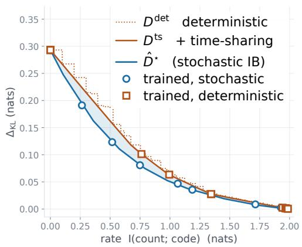  
Figure 1: Randomization beyond deterministic time-sharing in the count benchmark.

(c)  
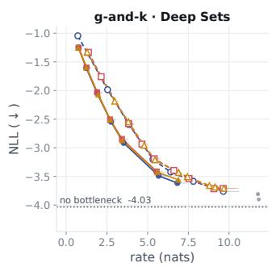  
(a)

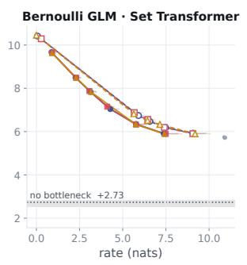

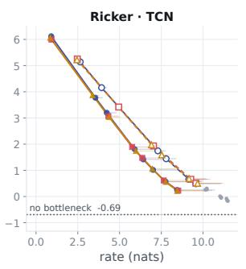

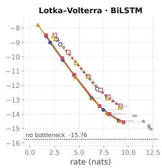  
(d)

Figure 2: Rate–NLL comparisons on four simulators. All trained stochastic NPEs achieve lower NLL than the plotted lower convex hull of deterministic ones at matched information rate. Horizontal segments connect the MC and marginal-based rate estimates. Gray points exceed the 10-nat MC rate threshold and are omitted from averaged curves. Dotted lines are standard NPE references trained without a bottleneck.  
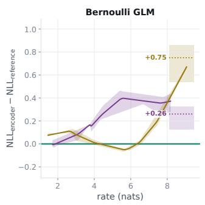  
(a)

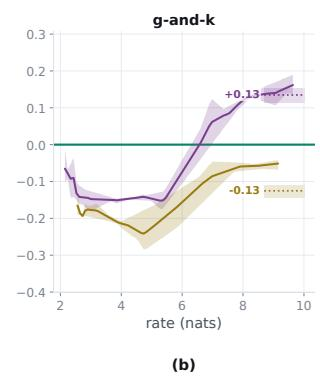

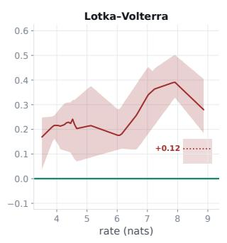

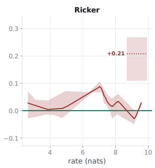  
(d)  
Figure 3: Architecture diferences at matched rate. Each curve is encoder NLL minus BiLSTM NLL; negative values favor the named encoder. Shading shows the minimum-to-maximum range of the three paired diferences. Dotted segments are corresponding mean no-bottleneck diferences.

Simulator protocol and estimands. We study a Bernoulli GLM, g-and-k, Lotka–Volterra, and Ricker, with Deep Sets, Set Transformer, BiLSTM, or TCN encoders as appropriate. Each supplies a 128-bit bottleneck followed by the same conditional-flow family. Appendix K reports the configuration, estimators, and additional panels.

(H1) Stochastic versus deterministic summaries. We show the comparison for one encoder architecture per simulator in Figure 2 by plotting the time-sharing convex hull of deterministic summaries against the stochastic summary curve, separately for each training seed. All evaluated stochastic BNPE models exhibit better rate–NLL tradeofs: the mean matched-rate NLL diferences remain negative in all simulator-encoder combinations, ranging from −0.168 to −0.617 nats. The other six simulator-encoder combinations, deferred to Figure 5, also show the same advantage.

(H2) Architecture comparisons depend on rate. Figure 3 shows rate-matched architecture comparisons for all four simulators. Within each training seed, we compute diferences from the BiLSTM reference, and then average them on a common rate grid. On g-and-k, the Deep Sets comparison changes sign, while Set Transformer remains favorable over the displayed shared range. On Bernoulli GLM, the Set Transformer gap is much smaller at intermediate rates than its nobottleneck diference and the relative performance of DeepSets and Set Transformer changes with the rate. For Lotka–Volterra, TCN remains above BiLSTM throughout and for Ricker, the diference is smaller and varies with rate and seed. These comparisons demonstrate why one no-bottleneck score does not characterize an encoder under compression.

## 7 Limitations and Conclusion

Limitations. Our experiments compare summaries at rates below roughly 12 nats, where the frontier is resolvable with our estimators. Whether the separation of Theorem 4.3 has empirical consequences at the rates of unconstrained summary networks is a question we leave for future work. Furthermore, the theorem concerns a summary channel applied to one observation or simulated dataset. It does not compare against deterministic block codes that summarize independent experiments or guarantee that a neural optimizer necessarily reaches the better channel. Furthermore, as we show via examples, the common support assumption is also only suficient rather than necessary: characterizing the separation when sampling supports difer remains an open problem as well.

Conclusion. In this work, we show that posterior fidelity and retained information provide complementary coordinates for comparing summaries. A fixed representation dimension does not fix its information rate, and regular parametric concentration can require increasing rate even when a fixed-dimensional suficient statistic exists. Posterior quantization and mass-sensitive converses connect this requirement to the law of the random posterior. At a prescribed cardinality, deterministic summaries achieve the same distortion infimum as stochastic ones. However, to the best of our knowledge, Theorem 4.3 is the first formal result that establishes a strict advantage of stochastic summaries, over every deterministic and time-sharing mixture, when comparisons happen at matched information rate. Our binary-bottleneck NPE framework further turns this theoretical distinction into a measured comparison protocol. The count benchmark enumerates the deterministic envelope directly and shows strict gains. The scientific simulator comparisons also show favorable stochastic rate–NLL tradeofs and architecture rankings that vary with rate. Together, the results establish an explicit information budget as a useful basis for studying both the statistical requirements and the learned performance of summaries in SBI.

## AI use statement

Generative AI tools assisted with literature searches, code review, figure preparation, and manuscript editing. The authors are responsible for the scientific claims, source attribution, and final presentation.

## Acknowledgments

We thank Dr. Adam Klivans and the Institute for Foundations of Machine Learning (IFML) at UT Austin for providing the compute resources.

## References

Eirikur Agustsson, Fabian Mentzer, Michael Tschannen, Lukas Cavigelli, Radu Timofte, Luca Benini, and Luc Van Gool. Soft-to-hard vector quantization for end-to-end learning compressible representations. In Advances in Neural Information Processing Systems (NeurIPS), 2017.

Mattias Åkesson, Prashant Singh, Fredrik Wrede, and Andreas Hellander. Convolutional neural networks as summary statistics for approximate bayesian computation. IEEE/ACM Transactions on Computational Biology and Bioinformatics, 19(6):3353–3365, 2022. doi: 10.1109/TCBB.2021. 3108695. URL https://pmc.ncbi.nlm.nih.gov/articles/PMC9847490/.

Alexander A Alemi, Ian Fischer, Joshua V Dillon, and Kevin Murphy. Deep variational information bottleneck. In International Conference on Learning Representations, 2017. URL https://arxiv. org/abs/1612.00410.

Justin Alsing and Benjamin Wandelt. Generalized massive optimal data compression. Monthly Notices of the Royal Astronomical Society: Letters, 476(1):L60–L64, 2018. doi: 10.1093/mnrasl/sly029. URL https://academic.oup.com/mnrasl/article/476/1/L60/4909822.

Joss Armstrong. Source-side suficiency for the information bottleneck: exact reduction and finiteblock equivalence, 2026. URL https://arxiv.org/abs/2604.26744v2. arXiv:2604.26744v2.

Shahab Asoodeh and Flavio P. Calmon. Bottleneck problems: An information and estimationtheoretic view. Entropy, 22(11):1325, 2020. doi: 10.3390/e22111325. URL https://www.mdpi. com/1099-4300/22/11/1325.

Arindam Banerjee, Srujana Merugu, Inderjit S. Dhillon, and Joydeep Ghosh. Clustering with Bregman divergences. Journal of Machine Learning Research, 6(58):1705–1749, 2005. URL https://jmlr.org/papers/v6/banerjee05b.html.

Etam Benger, Shahab Asoodeh, and Jun Chen. The cardinality bound on the information bottleneck representations is tight. In IEEE International Symposium on Information Theory (ISIT), pp. 1478– 1483, 2023. doi: 10.1109/ISIT54713.2023.10206791. URL https://arxiv.org/abs/2305.07000.

Yoshua Bengio, Nicholas Léonard, and Aaron Courville. Estimating or propagating gradients through stochastic neurons for conditional computation. arXiv preprint arXiv:1308.3432, 2013. URL https://arxiv.org/abs/1308.3432.

Michael G. B. Blum, Matthew A. Nunes, Dennis Prangle, and Scott A. Sisson. A comparative review of dimension reduction methods in approximate bayesian computation. Statistical Science, 28(2): 189–208, 2013. doi: 10.1214/12-STS406. URL https://arxiv.org/abs/1202.3819.

Jefrey Chan, Valerio Perrone, Jefrey P. Spence, Paul A. Jenkins, Sara Mathieson, and Yun S. Song. A likelihood-free inference framework for population genetic data using exchangeable neural networks. In Advances in Neural Information Processing Systems, volume 31, 2018. URL https://proceedings.neurips.cc/paper\_files/paper/2018/hash/ 2e9f978b222a956ba6bdf427efbd9ab3-Abstract.html.

Tom Charnock, Guilhem Lavaux, and Benjamin D Wandelt. Automatic physical inference with information maximizing neural networks. Physical Review D, 97(8):083004, 2018. doi: 10.1103/ PhysRevD.97.083004. URL https://journals.aps.org/prd/abstract/10.1103/PhysRevD.97. 083004.

Gal Chechik, Amir Globerson, Naftali Tishby, and Yair Weiss. Information bottleneck for Gaussian variables. Journal of Machine Learning Research, 6(6):165–188, 2005. URL https://jmlr.org/ papers/v6/chechik05a.html.

Tianyu Chen, Vansh Bansal, and James G. Scott. Conditional difusions for amortized neural posterior estimation. arXiv preprint arXiv:2410.19105, 2024. URL https://arxiv.org/abs/2410.19105.

Yanzhi Chen, Dinghuai Zhang, Michael U. Gutmann, Aaron Courville, and Zhanxing Zhu. Neural approximate suficient statistics for implicit models. In International Conference on Learning Representations, 2021. URL https://arxiv.org/abs/2010.10079.

Yanzhi Chen, Michael U Gutmann, and Adrian Weller. Is learning summary statistics necessary for likelihood-free inference? In Proceedings of the 40th International Conference on Machine Learning, volume 202 of Proceedings of Machine Learning Research, pp. 4529–4544. PMLR, 2023. URL https://proceedings.mlr.press/v202/chen23h.html.

Philip A. Chou, Tom Lookabaugh, and Robert M. Gray. Entropy-constrained vector quantization. IEEE Transactions on Acoustics, Speech, and Signal Processing, 37(1):31–42, 1989. doi: 10.1109/ 29.17498. URL https://web.stanford.edu/class/ee398a/handouts/papers/Chou%20-%20EC% 20VQ.pdf.

Bertrand S. Clarke and Andrew R. Barron. Jefreys’ prior is asymptotically least favorable under entropy risk. Journal of Statistical Planning and Inference, 41(1):37–60, 1994. doi: 10.1016/0378-3758(94)90153-8. URL https://www.sciencedirect.com/science/article/pii/ 0378375894901538.

Thomas A. Courtade and Tsachy Weissman. Multiterminal source coding under logarithmic loss. IEEE Transactions on Information Theory, 60(1):740–761, 2014. doi: 10.1109/TIT.2013. 2288257. URL https://people.eecs.berkeley.edu/\~courtade/pdfs/CourtadeWeissman\_ TransITJan2014.pdf.

Kyle Cranmer, Johann Brehmer, and Gilles Louppe. The frontier of simulation-based inference. Proceedings of the National Academy of Sciences, 117(48):30055–30062, 2020.

Rancy El Nmeir, Harald Luschgy, and Gilles Pagès. New approach to greedy vector quantization, 2020. URL https://arxiv.org/abs/2003.14145. arXiv:2003.14145.

Paul Fearnhead and Dennis Prangle. Constructing summary statistics for approximate bayesian computation: semi-automatic approximate bayesian computation. Journal of the Royal Statistical Society Series B: Statistical Methodology, 74(3):419–474, 2012. doi: 10.1111/j.1467-9868.2011. 01010.x. URL https://academic.oup.com/jrsssb/article-abstract/74/3/419/7075312.

Mathieu Germain, Karol Gregor, Iain Murray, and Hugo Larochelle. Made: Masked autoencoder for distribution estimation. In International conference on machine learning, pp. 881–889. Pmlr, 2015.

Ran Gilad-Bachrach, Amir Navot, and Naftali Tishby. An information theoretic tradeof between complexity and accuracy. In Learning Theory and Kernel Machines, volume 2777 of Lecture Notes in Computer Science, pp. 595–609. Springer, 2003. doi: 10.1007/978-3-540-45167-9\_43. URL https://doi.org/10.1007/978-3-540-45167-9\_43.

Peter Harremoës and Naftali Tishby. The information bottleneck revisited or how to choose a good distortion measure. In IEEE International Symposium on Information Theory (ISIT), pp. 566–570, 2007. doi: 10.1109/ISIT.2007.4557285. URL https://doi.org/10.1109/ISIT.2007.4557285.

David Haussler and Manfred Opper. Mutual information, metric entropy and cumulative relative entropy risk. The Annals of Statistics, 25(6):2451–2492, 1997. doi: 10.1214/aos/1030741081. URL https://doi.org/10.1214/aos/1030741081.

Masahito Hayashi and Vincent Y. F. Tan. Minimum rates of approximate suficient statistics. IEEE Transactions on Information Theory, 64(2):875–888, 2018. doi: 10.1109/TIT.2017.2775612. URL https://arxiv.org/abs/1612.02542.

Joeri Hermans, Volodimir Begy, and Gilles Louppe. Likelihood-free MCMC with amortized approximate ratio estimators. In Proceedings of the 37th International Conference on Machine Learning, volume 119, pp. 4239–4248. PMLR, 2020. URL https://proceedings.mlr.press/ v119/hermans20a.html.

Till Hofmann and Jukka-Pekka Onnela. Unifying summary statistic selection for approximate bayesian computation. Statistics and Computing, 36:70, 2026. doi: 10.1007/s11222-025-10808-2. URL https://link.springer.com/article/10.1007/s11222-025-10808-2.

Eric Jang, Shixiang Gu, and Ben Poole. Categorical reparameterization with Gumbel-softmax. In International Conference on Learning Representations (ICLR), 2017.

Bai Jiang, Tung-yu Wu, Charles Zheng, and Wing H Wong. Learning summary statistic for approximate bayesian computation via deep neural network. Statistica Sinica, 27(4):1595–1618, 2017. doi: 10.5705/ss.202015.0340. URL https://www3.stat.sinica.edu.tw/statistica/oldpdf/ A27n411.pdf.

Paul Joyce and Paul Marjoram. Approximately suficient statistics and Bayesian computation. Statistical Applications in Genetics and Molecular Biology, 7(1), 2008.

Artemy Kolchinsky, Brendan D. Tracey, and Steven Van Kuyk. Caveats for information bottleneck in deterministic scenarios. In International Conference on Learning Representations (ICLR), 2019. URL https://arxiv.org/abs/1808.07593. arXiv:1808.07593.

Lucien Le Cam. On some results of J. Hájek concerning asymptotic normality. Unpublished manuscript, University of California, Berkeley, n.d. URL https://www.stat.berkeley.edu/ \~rice/LeCam/papers/Hajek2a.pdf. Undated manuscript in the Le Cam archive; Section 3, p. 14.

Dennis V Lindley. On a measure of the information provided by an experiment. The Annals of Mathematical Statistics, 27(4):986–1005, 1956.

Jan-Matthis Lueckmann, Giacomo Bassetto, Theofanis Karaletsos, and Jakob H. Macke. Likelihoodfree inference with emulator networks. In Francisco Ruiz, Cheng Zhang, Dawen Liang, and Thang Bui (eds.), Proceedings of The 1st Symposium on Advances in Approximate Bayesian Inference, volume 96 of Proceedings of Machine Learning Research, pp. 32–53. PMLR, 02 Dec 2019. URL https://proceedings.mlr.press/v96/lueckmann19a.html.

Jan-Matthis Lueckmann, Jan Boelts, David Greenberg, Pedro Goncalves, and Jakob Macke. Benchmarking simulation-based inference. In International conference on artificial intelligence and statistics, pp. 343–351. PMLR, 2021.

Jean-Michel Marin, Pierre Pudlo, Christian P Robert, and Robin J Ryder. Approximate bayesian computational methods. Statistics and computing, 22(6):1167–1180, 2012.

Matthew A Nunes and David J Balding. On optimal selection of summary statistics for approximate Bayesian computation. Statistical Applications in Genetics & Molecular Biology, 9(1):Article 34, 2010. doi: 10.2202/1544-6115.1576. URL https://doi.org/10.2202/1544-6115.1576.

Daniel P. Palomar and Sergio Verdú. Lautum information. IEEE Transactions on Information Theory, 54(3):964–975, 2008. doi: 10.1109/TIT.2007.915715. URL https://palomar.home.ece. ust.hk/papers/2008/PalomarVerdu\_TransIT2008\_lautum.pdf.

George Papamakarios and Iain Murray. Fast ε-free inference of simulation models with bayesian conditional density estimation. In Advances in Neural Information Processing Systems, volume 29, 2016. URL https://proceedings.neurips.cc/paper/2016/hash/ 6aca97005c68f1206823815f66102863-Abstract.html.

George Papamakarios, David Sterratt, and Iain Murray. Sequential neural likelihood: Fast likelihoodfree inference with autoregressive flows. In Kamalika Chaudhuri and Masashi Sugiyama (eds.), Proceedings of the Twenty-Second International Conference on Artificial Intelligence and Statistics, volume 89 of Proceedings of Machine Learning Research, pp. 837–848. PMLR, 16–18 Apr 2019. URL https://proceedings.mlr.press/v89/papamakarios19a.html.

Stefan T Radev, Ulf K Mertens, Andreas Voss, Lynton Ardizzone, and Ullrich Köthe. BayesFlow: Learning complex stochastic models with invertible neural networks. IEEE transactions on neural networks and learning systems, 33(4):1452–1466, 2022. doi: 10.1109/TNNLS.2020.3042395. URL https://arxiv.org/abs/2003.06281.

Erwin Riegler, Günther Koliander, and Helmut Bölcskei. Rate-distortion theory for general sets and measures. In IEEE International Symposium on Information Theory (ISIT), pp. 101–105, 2018. URL https://www.mins.ee.ethz.ch/pubs/p/rikobo18.

Adrien Saumard and Jon A. Wellner. Log-concavity and strong log-concavity: a review. Statistics Surveys, 8:45–114, 2014. doi: 10.1214/14-SS107. URL https://projecteuclid.org/journals/statistics-surveys/volume-8/issue-none/ Log-concavity-and-strong-log-concavity-A-review/10.1214/14-SS107.pdf.

Jiawei Shao, Yuyi Mao, and Jun Zhang. Learning task-oriented communication for edge inference: An information bottleneck approach. IEEE Journal on Selected Areas in Communications, 40 (1):197–211, 2022. doi: 10.1109/JSAC.2021.3126087. URL https://ira.lib.polyu.edu.hk/ handle/10397/107084.

Noam Slonim and Naftali Tishby. Agglomerative information bottleneck. In Advances in Neural Information Processing Systems, volume 12, pp. 617–623, 2000. URL https://proceedings.neurips. cc/paper\_files/paper/1999/file/be3e9d3f7d70537357c67bb3f4086846-Paper.pdf. Conference held in 1999.

DJ Strouse and David J. Schwab. The deterministic information bottleneck. Neural computation, 29(6):1611–1630, 2017. doi: 10.1162/NECO\_a\_00961. URL https://direct.mit.edu/neco/ article/29/6/1611/8273/The-Deterministic-Information-Bottleneck.

Ce Sui, Xiaosheng Zhao, Tao Jing, and Yi Mao. Evaluating summary statistics with mutual information for cosmological inference. In ICML Workshop on Machine Learning for Astrophysics, 2023. URL https://ml4astro.github.io/icml2023/assets/18.pdf.

Simon Tavaré, David J Balding, R C Grifiths, and Peter Donnelly. Inferring coalescence times from dna sequence data. Genetics, 145(2):505–518, 02 1997. ISSN 1943-2631. doi: 10.1093/genetics/ 145.2.505. URL https://doi.org/10.1093/genetics/145.2.505.

Lucas Theis and Eirikur Agustsson. On the advantages of stochastic encoders. In Neural Compression Workshop, International Conference on Learning Representations, 2021. URL https://arxiv. org/abs/2102.09270.

Owen Thomas, Ritabrata Dutta, Jukka Corander, Samuel Kaski, and Michael U Gutmann. Likelihoodfree inference by ratio estimation. Bayesian Analysis, 17(1):1–31, 2022.

Naftali Tishby, Fernando C Pereira, and William Bialek. The information bottleneck method. arXiv preprint physics/0004057, 2000. URL https://arxiv.org/abs/physics/0004057.

Aaron B. Wagner and Johannes Ballé. Neural networks optimally compress the Sawbridge. In 2021 Data Compression Conference (DCC), pp. 143–152. IEEE, 2021. doi: 10.1109/DCC50243.2021. 00022. URL https://arxiv.org/abs/2011.05065.

Hans S. Witsenhausen and Aaron D. Wyner. A conditional entropy bound for a pair of discrete random variables. IEEE Transactions on Information Theory, 21(5):493–501, 1975. doi: 10.1109/ TIT.1975.1055437. URL https://doi.org/10.1109/TIT.1975.1055437.

Simon N Wood. Statistical inference for noisy nonlinear ecological dynamic systems. Nature, 466 (7310):1102–1104, 2010.

Aaron D. Wyner and Jacob Ziv. A theorem on the entropy of certain binary sequences and applications: Part I. IEEE Transactions on Information Theory, 19(6):769–772, 1973. doi: 10.1109/TIT.1973.1055107. URL https://doi.org/10.1109/TIT.1973.1055107.

Aolin Xu and Maxim Raginsky. Information-theoretic lower bounds on bayes risk in decentralized estimation. IEEE Transactions on Information Theory, 63(3):1580–1600, 2017. URL https: //arxiv.org/abs/1607.00550.

Andrew Zammit-Mangion, Matthew Sainsbury-Dale, and Raphaël Huser. Neural methods for amortized inference. Annual Review of Statistics and Its Application, 12(1):311–335, 2025.

## Appendix guide

The separation proof and its scope are developed in Appendices A–D. The remaining appendices give the posterior-geometry and parametric arguments, experimental details, and consolidated related work.

Page   
A Foundations for the separation theorem 18   
B Strict separation for general observation spaces 25   
C Finite observations: improvement and attainment 35   
D Examples delimiting the support and rate assumptions 41   
E Posterior identities and source reduction 42   
F Posterior quantization and uniform covering 45   
G Hellinger covering and the local modulus 47   
H Further converses 48   
I Parametric rates: hypotheses and achievability 52   
J Parametric rate–distortion calculations 58   
K Experimental protocol and additional results 60   
L Related work and connections 63

## A Foundations for the separation theorem

Throughout these appendices, Θ and Y are standard Borel spaces, with finite Bayes information $I : = I ( \theta ; Y ) \in ( 0 , \infty )$ . Further, $\theta  Y  S$ is the summary Markov chain. Auxiliary random variables are independent of the experiment unless specified otherwise.

## A.1 Notation

Measures and quantizers. In the general mixture statements below, P and Q denote probability measures on the same measurable space $( { \mathcal { X } } , { \mathcal { A } } ) ; Q$ is the reference measure in $\mathrm { K L } ( P \| Q )$ . We write $\mathcal { G }$ for the set of all countable-valued deterministic quantizers (often called codes in the informationbottleneck literature), $T = g ( Y )$ with $H ( T ) < \infty$ . We include finite quantizers, and constants in $\mathcal { G }$ as well.

For a quantizer $T = g ( Y )$ , write

$$
p _ { c } : = \mathbb { P } ( T = c ) , \qquad P _ { T } : = \sum _ { c : p _ { c } > 0 } p _ { c } \delta _ { c } , \qquad \Pi _ { c } : = P _ { \theta | T = c } , \qquad \pi = \sum _ { c : p _ { c } > 0 } p _ { c } \Pi _ { c } .
$$

Thus $p _ { c }$ is a cell probability, $P _ { T }$ is the marginal law of the quantizer, and $\Pi _ { c }$ is the parameter posterior in cell $c ; \delta _ { c }$ is unit mass at c. Thus $\Pi _ { T }$ is the random posterior $\Pi _ { S }$ of the main text with $S = T$ . For $p _ { c } > 0$ , define its density relative to the prior by

$$
f _ { c } : = \frac { d \Pi _ { c } } { d \pi } , \qquad \Pi _ { c } ( d \theta ) = f _ { c } ( \theta ) \pi ( d \theta ) .
$$

Relevance. Following the information-bottleneck literature, we call $I ( \theta ; T )$ the relevance of the quantizer $T \colon$ it is the information about the parameter that the quantizer retains, and by Lemma 2.2 it equals $I - \Delta _ { \mathrm { K L } } ( T )$ , so a quantizer has high relevance exactly when it has low posterior distortion. The same term is used below for the relevance $I ( \theta ; S )$ of a general summary.

Singular mass and weighted Jensen-Shannon divergence. For arbitrary $P , Q$ , their Lebesgue decomposition is $P = \tilde { P } _ { Q } + P _ { Q } ^ { \perp }$ , where $\tilde { P } _ { Q } \ll Q$ and $P _ { Q } ^ { \perp } \perp Q$ . The directed singular mass is

$$
\alpha ( P \mid Q ) : = P _ { Q } ^ { \perp } ( { \mathcal { X } } ) = \operatorname* { s u p } \{ P ( A ) : A \in { \mathcal { A } } , \ Q ( A ) = 0 \} .\tag{12}
$$

It measures the mass that $P$ places on events impossible under $Q .$ It lies in $[ 0 , 1 ]$ , vanishes exactly when $P \ll Q$ , and need not equal $\alpha ( Q \mid P )$ . For $w \in ( 0 , 1 )$ , define the weighted Jensen-Shannon divergence as:

$$
\begin{array} { r } { M _ { w } : = w P + ( 1 - w ) Q , \qquad \ J \mathrm { S } _ { w } ( P , Q ) : = w \mathrm { K L } ( P \| M _ { w } ) + ( 1 - w ) \mathrm { K L } ( Q \| M _ { w } ) . } \end{array}\tag{13}
$$

The first argument is the rare component as $w \downarrow 0$ . We use $h _ { 2 } ( w ) = - w \log w - ( 1 - w ) \log ( 1 - w )$ for binary entropy.

## A.2 Results for deterministic summaries

Lemma A.1 (Finite-rate deterministic summaries). A deterministic summary with a standard Borel output space has finite information rate if and only if its law is supported on countably many atoms with finite entropy. In that case $I ( Y ; g ( Y ) ) = H ( g ( Y ) )$ . This restriction does not apply to stochastic summaries.

Proof. Let $T = g ( Y )$ and let $\mu$ be the law of $T$ on its output space $\mathcal { X } .$ . We first express the rate of $T$ as a supremum of finite entropies, and then evaluate that supremum separately for a law with a nonatomic part and for a purely atomic law.

Mutual information between general random variables is the supremum of the mutual informations between their finite quantizations, and it is enough to quantize one of the two arguments. Hence

$$
I ( Y ; T ) = \operatorname* { s u p } _ { a } I ( Y ; a ( T ) ) ,
$$

where a ranges over measurable maps from the output space of $T$ to a finite set. For a finite-valued $a ( T )$ , the mutual information is the entropy diference $H ( a ( T ) ) - H ( a ( T ) \mid Y )$ , and the conditional entropy vanishes because $a ( T ) = a ( g ( Y ) )$ is a function of $Y$ . Therefore

$$
I ( Y ; T ) = \operatorname* { s u p } _ { a } H ( a ( T ) ) .\tag{14}
$$

Since each $a ( T )$ is a function of $T _ { \mathrm { { i } } }$ , every term in the supremum is at most $H ( T )$ , where $H ( T )$ is the (possibly infinite) entropy of the countable law when $\mu$ is atomic.

Suppose now that $\mu$ has a nonatomic component of total mass $c > 0$ . Let N be the countable set of atoms of $\mu ;$ the nonatomic part gives N zero mass, so $\mu$ restricted to $\mathcal { X } \backslash N$ is a nonatomic measure of mass c. A nonatomic finite measure on a standard Borel space takes every value between zero and its total mass on measurable subsets, so $\mathcal { X } \backslash N$ can be partitioned into measurable sets $A _ { 1 } , \ldots , A _ { m }$ with $\mu ( A _ { i } ) = c / m$ for each i. Define the quantizer $a$ to map $A _ { i }$ to i and N to the symbol 0. Dropping the nonnegative term of the symbol $0 ,$

$$
H ( a ( T ) ) \geq \sum _ { i = 1 } ^ { m } { \frac { c } { m } } \log { \frac { m } { c } } = c \log m - c \log c ,
$$

which tends to infinity with m. By (14) the rate is infinite.

Suppose instead that $\mu$ is purely atomic, $\begin{array} { r } { \mu = \sum _ { k } p _ { k } \delta _ { x _ { k } } } \end{array}$ with $p _ { 1 } \geq p _ { 2 } \geq \cdots$ . Let $a _ { m }$ retain the first m atoms as separate symbols and merge all remaining atoms into one symbol of mass $\begin{array} { r } { r _ { m } : = \sum _ { k > m } p _ { k } } \end{array}$ Then

$$
H ( a _ { m } ( T ) ) = \sum _ { k \leq m } p _ { k } \log { \frac { 1 } { p _ { k } } } + r _ { m } \log { \frac { 1 } { r _ { m } } } .
$$

As $m  \infty ,$ the partial sums increase to $H ( T )$ and $r _ { m } \log ( 1 / r _ { m } ) \to 0$ because $r _ { m } \to 0$ . Thus $\operatorname* { s u p } _ { a } H ( a ( T ) ) \geq H ( T )$ , and the reverse inequality was noted above, so $I ( Y ; T ) = H ( T )$ . The rate is finite exactly when $H ( T ) < \infty$ , which proves both assertions. A stochastic summary can have a nonatomic law and finite rate, for instance the observation plus independent Gaussian noise in Proposition 3.4, so the restriction is specific to deterministic quantizers. □

Lemma A.2 (Approximation by finite posterior quantizers). There are finite-valued deterministic quantizers $U _ { n }$ such that $I ( \theta ; U _ { n } )$ ↑ I and $\Delta _ { \mathrm { K L } } ( U _ { n } ) \downarrow 0$ . Consequently, for every $\eta > 0$ a finite quantizer has distortion less than η, and $D ^ { \mathrm { d e t } } ( R ) \to 0$ as $R \to \infty$

Proof. The idea is to write $I ( \theta ; U _ { n } )$ as the integral of a convex function of a martingale that converges to the joint density of the experiment, and to pass to the limit from both sides.

Because $\mathcal { V }$ is standard Borel, its Borel sigma-field is generated by a countable family of sets $C _ { 1 } , C _ { 2 } , \ldots$ Let $\mathcal { P } _ { n }$ be the finite partition of $\mathcal { V }$ generated by $C _ { 1 } , \ldots , C _ { n }$ , and let $U _ { n }$ be the label of the cell of $\mathcal { P } _ { n }$ that contains $Y$ . The partitions refine one another, so $U _ { n }$ is a function of $U _ { n + 1 }$ , each $U _ { n }$ takes finitely many values, and $H ( U _ { n } ) < \infty$

Put $Q _ { \theta Y } : = \pi \otimes P _ { Y }$ . Since $I = \mathrm { K L } ( P _ { \theta Y } | | Q _ { \theta Y } ) < \infty .$ , the joint law is absolutely continuous with respect to the product law, and we write $f : = d P _ { \theta Y } / d Q _ { \theta Y }$ . Consider the increasing sigma-fields $\mathcal { F } _ { n } : = B ( \Theta ) \otimes \sigma ( \mathcal { P } _ { n } )$ on $\Theta \times \mathcal { V }$ and the conditional expectations

$$
f _ { n } : = \mathbb { E } _ { Q _ { \theta Y } } [ f \mid { \mathcal { F } } _ { n } ] .
$$

Each $f _ { n }$ is ${ \mathcal { F } } _ { n }$ -measurable, hence of the form $\begin{array} { r } { f _ { n } ( \boldsymbol { \theta } , \boldsymbol { y } ) = \sum _ { C \in \mathcal { P } _ { n } } f _ { n , C } ( \boldsymbol { \theta } ) \mathbf { 1 } _ { C } ( \boldsymbol { y } ) } \end{array}$ . For $A \in B ( \Theta )$ and a cell $C _ { i }$ , the defining property of conditional expectation gives

$$
\mathbb { P } ( \theta \in A , U _ { n } = C ) = \int _ { A \times C } f d Q _ { \theta Y } = \int _ { A \times C } f _ { n } d Q _ { \theta Y } = P _ { Y } ( C ) \int _ { A } f _ { n , C } d \pi .
$$

Thus $f _ { n , C }$ is the density of the cell posterior $P _ { \theta | U _ { n } = C }$ relative to the prior whenever $P _ { Y } ( C ) > 0$ , and

$$
\begin{array} { l } { \displaystyle { \int f _ { n } \log f _ { n } d Q _ { \theta Y } = \sum _ { C } P _ { Y } ( C ) \int f _ { n , C } \log f _ { n , C } d \pi } } \\ { \displaystyle { \ } } \\ { \displaystyle { \ } } \end{array} \quad
$$

We now show that these integrals converge to I. The sigma-fields ${ \mathcal { F } } _ { n }$ increase to $B ( \Theta ) \otimes B ( \mathcal { V } )$ so by $\mathrm { L e v y ` s }$ upward theorem the martingale $\left( f _ { n } \right)$ converges to f almost surely under $Q _ { \theta Y }$ . Write $\phi ( u ) : = \quad$ u log u, a convex function bounded below by $- 1 / e$ . Conditional Jensen gives $\phi ( f _ { n } ) \leq$ $\mathbb { E } _ { Q _ { \theta Y } } [ \phi ( f ) \mid { \mathcal { F } } _ { n } ]$ , and integrating,

$$
I ( \theta ; U _ { n } ) = \int \phi ( f _ { n } ) d Q _ { \theta Y } \leq \int \phi ( f ) d Q _ { \theta Y } = I .
$$

For the reverse direction, apply Fatou’s lemma to the nonnegative functions $\phi ( f _ { n } ) + 1 / e$ , using continuity of $\phi$ and the almost sure convergence $f _ { n }  f \mathrm { : }$

$$
I + \frac { 1 } { e } = \int \Big ( \phi ( f ) + \frac { 1 } { e } \Big ) d Q _ { \theta Y } \le \operatorname* { l i m i n f } _ { n } \int \Big ( \phi ( f _ { n } ) + \frac { 1 } { e } \Big ) d Q _ { \theta Y } = \operatorname* { l i m i n f } _ { n } I ( \theta ; U _ { n } ) + \frac { 1 } { e } .
$$

Together, $I ( \theta ; U _ { n } ) \to I .$ . The sequence is nondecreasing because $U _ { n }$ is a function of $U _ { n + 1 }$ and data processing gives $I ( \theta ; U _ { n } ) \leq I ( \theta ; U _ { n + 1 } )$ . Lemma 2.2 then gives $\Delta _ { \mathrm { K L } } ( U _ { n } ) = I - I ( \theta ; U _ { n } ) \downarrow 0$

For the consequences, fix $\eta > 0$ and choose n with $\Delta _ { \mathrm { K L } } ( U _ { n } ) ~ < ~ \eta ;$ this is the required finite quantizer. For every $R \geq H ( U _ { n } ) $ the quantizer $U _ { n }$ is feasible in the definition of $D ^ { \mathrm { d e t } } ( R )$ , so $D ^ { \mathrm { d e t } } ( R ) \ \leq \ \Delta _ { \mathrm { K L } } ( U _ { n } ) \ < \ \eta$ . Since $D ^ { \mathrm { d e t } }$ is nonincreasing and nonnegative, and $\eta$ was arbitrary, $D ^ { \mathrm { d e t } } ( R ) \to 0 \ \mathrm { a s } \ R \to \infty$ □

## A.3 Properties of time-sharing mixtures

Proposition A.3 (Revealed time-sharing). Let $S _ { 1 } , \ldots , S _ { k }$ be summary channels and let J be independent of the experiment and their auxiliary randomness, with probabilities $\lambda _ { j }$ . The revealed mixture $S = ( J , S _ { J } )$ satisfies

$$
I ( Y ; S ) = \sum _ { j } \lambda _ { j } I ( Y ; S _ { j } ) , \qquad \Delta _ { \mathrm { K L } } ( S ) = \sum _ { j } \lambda _ { j } \Delta _ { \mathrm { K L } } ( S _ { j } ) .\tag{15}
$$

For deterministic components $S _ { j } = g _ { j } ( Y )$ , the component rate is $H ( g _ { j } ( Y ) )$ , and their finite revealed mixtures achieve exactly conv(Adet). The frontier $D ^ { \mathrm { t s } } { \mathrm { ~ } } i n { \mathrm { ~ } } ( 8 )$ is convex, nonincreasing, and continuous on $[ 0 , \infty )$ , with $D ^ { \mathrm { t s } } ( 0 ) = I$ and $D ^ { \mathrm { t s } } ( R ) \to 0$ as $R \to \infty$ . Moreover $0 \leq D ^ { \star } \leq D ^ { \mathrm { t s } } \leq D ^ { \mathrm { d e t } } \leq I$ . Its zero-distortion threshold satisfies $R _ { 0 } \geq I > 0 ; { \cal D } ^ { \mathrm { t s } } > 0$ on $[ 0 , R _ { 0 } )$ , and, if $R _ { 0 } < \infty , D ^ { \mathrm { t s } } = 0$ on $[ R _ { 0 } , \infty )$

Proof. We prove the two afine identities first, then identify the achieved pairs, and finally derive the shape properties of $D ^ { \mathrm { t s } }$ from them.

The revealed mixture is a valid summary channel: given ${ \cal Y } ,$ the pair $( J , S _ { J } )$ is generated from $Y$ and randomness independent of $\theta _ { ; }$ , so $\theta  Y  ( J , S _ { J } )$ is a Markov chain. By the chain rule for mutual information,

$$
I ( Y ; J , S _ { J } ) = I ( Y ; J ) + I ( Y ; S _ { J } \mid J ) = 0 + \sum _ { j } \lambda _ { j } I ( Y ; S _ { J } \mid J = j ) .
$$

The first term vanishes because J is independent of $Y .$ . On the event $J = j$ , the pair $( Y , S _ { J } )$ equals $( Y , S _ { j } )$ , and the conditional law of $( Y , S _ { j } )$ given $J = j$ is its unconditional law because J is independent of the experiment and of the auxiliary randomness of $S _ { j }$ . Hence $I ( Y ; S _ { J } \mid J = j ) = I ( Y ; S _ { j } )$ , which is the first identity in (15). The same conditioning gives

$$
I ( \theta ; Y \mid J , S _ { J } ) = \sum _ { j } \lambda _ { j } I ( \theta ; Y \mid S _ { J } , J = j ) = \sum _ { j } \lambda _ { j } I ( \theta ; Y \mid S _ { j } ) ,
$$

and Lemma 2.2 identifies each conditional information with the corresponding posterior distortion, proving the second identity.

For deterministic components $S _ { j } = g _ { j } ( Y )$ , Lemma A.1 gives $I ( Y ; S _ { j } ) = H ( g _ { j } ( Y ) )$ , so the mixture $( J , g _ { J } ( Y ) )$ realizes the pair $\begin{array} { r l } { \sum _ { i } \lambda _ { j } \bigl ( H \bigl ( g _ { j } ( Y ) \bigr ) , \Delta _ { \mathrm { K L } } \bigl ( g _ { j } ( Y ) \bigr ) \bigr ) } & { { } } \end{array}$ . Conversely, every finite convex combination of points of $\boldsymbol { \mathcal { A } } _ { \mathrm { d e t } }$ has this form for a suitable finite law of $J .$ . The achieved set is therefore exactly conv $\left( \mathcal { A } _ { \mathrm { d e t } } \right)$

We turn to the shape of $D ^ { \mathrm { t s } }$ . The constant quantizer gives $( 0 , I ) \in \mathcal { A } _ { \mathrm { d e t } }$ , so $D ^ { \mathrm { t s } } ( R ) \leq I < \infty$ for every $R \geq 0$ , and $D ^ { \mathrm { t s } }$ is nonincreasing because the feasible set $\{ ( r , d ) \in \mathrm { c o n v } ( \mathcal { A } _ { \mathrm { d e t } } ) : r \le R \}$ grows with R. For convexity, fix $R _ { 1 } , R _ { 2 } \geq 0 , \mu \in ( 0 , 1 )$ , and $\varepsilon > 0$ , and choose feasible $( r _ { i } , d _ { i } )$ with $r _ { i } \leq R _ { i }$ and $d _ { i } \leq D ^ { \mathrm { t s } } ( R _ { i } ) + \varepsilon$ . The convex combination $\mu ( r _ { 1 } , d _ { 1 } ) + ( 1 - \mu ) ( r _ { 2 } , d _ { 2 } )$ again lies in $\mathrm { c o n v } ( \mathcal { A } _ { \mathrm { d e t } } )$ and has rate at most $\mu R _ { 1 } + ( 1 - \mu ) R _ { 2 }$ , so

$$
D ^ { \mathrm { t s } } ( \mu R _ { 1 } + ( 1 - \mu ) R _ { 2 } ) \leq \mu d _ { 1 } + ( 1 - \mu ) d _ { 2 } \leq \mu D ^ { \mathrm { t s } } ( R _ { 1 } ) + ( 1 - \mu ) D ^ { \mathrm { t s } } ( R _ { 2 } ) + \varepsilon ,
$$

and $\varepsilon \downarrow 0$ gives convexity.

The chain of inequalities follows from inclusions of feasible classes. A single deterministic quantizer with $H ( g ( Y ) ) \leq R$ is a one-component mixture, so $D ^ { \mathrm { t s } } \leq D ^ { \mathrm { d e t } }$ , and the constant quantizer gives $D ^ { \mathrm { d e t } } \leq I$ . Every feasible point $( r , d )$ of conv $\left( \mathcal { A } _ { \mathrm { d e t } } \right)$ with $r \leq R$ is realized by a revealed mixture, which is a summary channel of rate $r \leq R$ and distortion $d ,$ so $D ^ { \star } ( R ) \leq d ;$ taking the infimum over such points gives $D ^ { \star } \leq D ^ { \mathrm { t s } }$ . Finally $D ^ { \star } \geq 0$ because divergences are nonnegative.

For continuity, a finite convex function on $[ 0 , \infty )$ is continuous on the open half-line $( 0 , \infty )$ . At the origin, only rate-zero mixtures are feasible, that is, mixtures of constant quantizers, each with distortion $I ( \theta ; Y \mid \mathrm { c o n s t a n t } ) = I ;$ thus $D ^ { \mathrm { t s } } ( 0 ) = I$ . The universal converse in Lemma 2.2 gives, for $0 \leq R < I $

$$
I - R \leq D ^ { \star } ( R ) \leq D ^ { \mathrm { t s } } ( R ) \leq I ,
$$

so $D ^ { \mathrm { t s } } ( R ) \to I$ as $R \downarrow 0$ , which is continuity from the right at zero. The limit at infinity follows from $0 \leq D ^ { \mathrm { t s } } \leq D ^ { \mathrm { d e t } }$ and Lemma $\mathrm { A . 2 }$

For the threshold, the display above shows $D ^ { \mathrm { t s } } ( R ) \geq I - R > 0$ for $R < I ,$ , so $R _ { 0 } \geq I > 0$ . On $[ 0 , R _ { 0 } )$ the frontier is positive by the definition of $R _ { 0 }$ as an infimum. If $R _ { 0 } < \infty$ , then $D ^ { \mathrm { t s } } ( R ) = 0$ for some R arbitrarily close to $R _ { 0 }$ from the right, monotonicity gives $D ^ { \mathrm { t s } } = 0$ on $( R _ { 0 } , \infty )$ , and continuity gives $D ^ { \mathrm { t s } } ( R _ { 0 } ) = 0$ as well. □

Lemma A.4 (Truncating countable quantizers). I $f T \in { \mathcal { G } }$ , define $T _ { n } = T$ on $\{ T \leq n \}$ and $T _ { n } = n + 1$ otherwise. Then $H ( T _ { n } ) \leq H ( T )$ and $\Delta _ { \mathrm { K L } } ( T _ { n } ) \downarrow \Delta _ { \mathrm { K L } } ( T )$ . Thus $D ^ { \mathrm { t s } }$ is unchanged if its component quantizers must be finite.

Proof. Take the quantizer values in $\mathbb { N } = \{ 1 , 2 , \ldots \}$ . Since $T _ { n }$ is a function of $T ,$ , both $H ( T _ { n } ) \leq H ( T )$ and, by data processing, $I ( \theta ; T _ { n } ) ~ \le ~ I ( \theta ; T )$ . Moreover $T _ { n }$ is a function of $T _ { n + 1 } .$ so $I ( \theta ; T _ { n } )$ is nondecreasing in $n ,$ and by Lemma 2.2 the distortions $\Delta _ { \mathrm { K L } } ( T _ { n } ) = I - I ( \theta ; T _ { n } )$ are nonincreasing in n and bounded below by $\Delta _ { \mathrm { K L } } ( T )$

To bound the gap, apply the chain rule to $I ( \theta ; T , T _ { n } )$ in both orders. Because $T _ { n }$ is a function of $T ,$

$$
I ( \theta ; T ) = I ( \theta ; T , T _ { n } ) = I ( \theta ; T _ { n } ) + I ( \theta ; T \mid T _ { n } ) ,
$$

so that

$$
\Delta _ { \mathrm { K L } } ( T _ { n } ) - \Delta _ { \mathrm { K L } } ( T ) = I ( \theta ; T \mid T _ { n } ) \leq H ( T \mid T _ { n } ) .
$$

Conditioning on $T _ { n } = c$ with $c \leq n$ determines $T = c$ and contributes no entropy. Conditioning on $T _ { n } = n + 1$ leaves the tail law $( p _ { c } / r _ { n } ) _ { c > n }$ with $\begin{array} { r } { r _ { n } : = \sum _ { c > n } p _ { c } } \end{array}$ , so

$$
H ( T \mid T _ { n } ) = \sum _ { c > n } p _ { c } \log \frac { r _ { n } } { p _ { c } } \leq \sum _ { c > n } p _ { c } \log \frac { 1 } { p _ { c } } ,
$$

using $r _ { n } \leq 1$ . The right side is a tail of the convergent series $\begin{array} { r } { H ( T ) = \sum _ { c } p _ { c } \log ( 1 / p _ { c } ) } \end{array}$ , hence tends to zero. This proves $\Delta _ { \mathrm { K L } } ( T _ { n } ) \downarrow \Delta _ { \mathrm { K L } } ( T )$

For the final claim, let $( \lambda _ { j } , T _ { j } ) _ { j \leq k }$ be any finite mixture of quantizers in $\mathcal { G }$ with average rate at most R and average distortion d. Truncating every component at level n gives a mixture of finite quantizers whose average rate is still at most $R ,$ by the first inequality, and whose average distortion $\begin{array} { r } { \sum _ { j } \lambda _ { j } \Delta _ { \mathrm { K L } } ( T _ { j , n } ) } \end{array}$ decreases to $d$ as $n \to \infty$ . Hence the infimum over mixtures of finite quantizers is at most $d ,$ and taking the infimum over all mixtures shows it is at most $D ^ { \mathrm { t s } } ( R )$ . The reverse inequality holds because finite quantizers belong to $\mathcal { G }$ □

Lemma A.5 (Cost of exact preservation). If $\Delta _ { \mathrm { K L } } ( S ) = 0$ , then $\Pi _ { Y } = \Pi _ { S }$ almost surely, hence $\Pi _ { Y }$ is measurable from $S , ~ H \Pi _ { Y }$ is countably valued, every such summary has rate at least $H ( \Pi _ { Y } )$ allowing infinite entropy.

Proof. The random variable $\operatorname { K L } ( \Pi _ { Y } \| \Pi _ { S } )$ is nonnegative, so E $\mathrm { K L } ( \Pi _ { Y } \Vert \Pi _ { S } ) = 0$ forces $\mathrm { K L } ( \Pi _ { Y } \| \Pi _ { S } ) =$ 0 almost surely, and a divergence vanishes only between equal measures. Thus $\Pi _ { Y } = \Pi _ { S }$ almost surely, and $\Pi _ { S }$ is a measurable function of S.

Suppose the posterior label $Z : = \Pi _ { Y }$ takes countably many values. Since $Z$ is a function of $Y$ and $\Pi _ { S }$ is a function of $S _ { i }$ , two applications of data processing give

$$
I ( Y ; S ) \ge I ( Z ; S ) \ge I ( Z ; \Pi _ { S } ) = I ( Z ; Z ) ,
$$

the last equality because $\Pi _ { S } = Z$ almost surely. For a countably valued $Z ,$ the identity $I ( Z ; Z ) =$ $H ( Z )$ holds with both sides possibly infinite: it is the purely atomic case of Lemma $\mathrm { A . 1 }$ , where finite quantizations of $Z$ have entropies increasing to $H ( Z )$ □

Lemma A.6 (Countable mixture compensation). Let $\begin{array} { r } { \bar { P } = \sum _ { j } \lambda _ { j } P _ { j } } \end{array}$ , with $\lambda _ { j } > 0$ , and suppose $\mathrm { K L } ( \bar { P } \| Q ) < \infty$ . Then every $\operatorname { K L } ( P _ { j } \| Q )$ is finite, $\mathrm { K L } ( P _ { j } | | \bar { P } ) \leq \log ( 1 / \lambda _ { j } )$ , and

$$
\sum _ { j } \lambda _ { j } \mathrm { K L } ( P _ { j } \| Q ) = \sum _ { j } \lambda _ { j } \mathrm { K L } ( P _ { j } \| \bar { P } ) + \mathrm { K L } ( \bar { P } \| Q ) ,
$$

with the sums allowed to be infinite.

Proof. We first collect the integrability facts, then prove the identity for a single component, and finally sum over components.

Since $\lambda _ { j } P _ { j } \le \bar { P }$ , we have $P _ { j } \ll \bar { P }$ with $d P _ { j } / d \bar { P } \le 1 / \lambda _ { j }$ , and therefore

$$
\mathrm { K L } ( P _ { j } \| \bar { P } ) = \int \log \frac { d P _ { j } } { d \bar { P } } d P _ { j } \le \log \frac { 1 } { \lambda _ { j } } .
$$

The hypothesis $\mathrm { K L } ( \bar { P } \| Q ) < \infty$ gives $\bar { P } \ll Q$ ; write $r : = d \bar { P } / d Q$ . The negative part of log r is P¯-integrable without any assumption: since u $, \log ( 1 / u ) \leq 1 / e$ for $u \in ( 0 , 1 ]$ 2

$$
\int ( \log r ) _ { - } d \bar { P } = \int _ { \{ r < 1 \} } r \log \frac { 1 } { r } d Q \leq \frac { 1 } { e } .
$$

The positive part is then integrable because $\begin{array} { r } { \int ( \log r ) _ { + } d \bar { P } = \mathrm { K L } ( \bar { P } \| Q ) + \int ( \log r ) _ { - } d \bar { P } < \infty } \end{array}$ . Hence log $r \in L ^ { 1 } ( \bar { P } )$ , and by the density bound also log $r \in L ^ { 1 } ( P _ { j } )$ with $\begin{array} { r } { \int | \log r | d P _ { j } \leq \lambda _ { j } ^ { - 1 } \int | \log r | d \bar { P } } \end{array}$

Since $P _ { j } \ll \bar { P } \ll Q$ , the chain rule for densities gives $d P _ { j } / d Q = ( d P _ { j } / d \bar { P } ) r$ almost everywhere under $Q _ { i }$ hence

$$
\log \frac { d P _ { j } } { d Q } = \log \frac { d P _ { j } } { d \bar { P } } + \log r \qquad \mathit { P _ { j } } \mathrm { - a l m o s t ~ s u r e l y } .
$$

Both terms on the right are $P _ { j } { \mathrm { - i n t e g r a b l e } } .$ , so integrating against $P _ { j }$ is legitimate and yields

$$
\mathrm { K L } ( P _ { j } \| Q ) = \mathrm { K L } ( P _ { j } \| \bar { P } ) + \int \log r \ d P _ { j } ,
$$

a finite quantity. This proves the first two claims.

Multiply the last display by $\lambda _ { j }$ and sum over $j .$ The series $\begin{array} { r } { \sum _ { j } \lambda _ { j } \int \vert \log r \vert d P _ { j } = \int \vert \log r \vert d \bar { P } } \end{array}$ converges, so the sum and the integral in the last term can be exchanged:

$$
\sum _ { j } \lambda _ { j } \int \log r d P _ { j } = \int \log r d \bar { P } = \mathrm { K L } ( \bar { P } \| Q ) .
$$

The remaining two series have nonnegative terms, and they difer by the finite number $\mathrm { K L } ( { \bar { P } } \| Q )$ , so they are either both finite or both infinite, and in the finite case the identity holds as stated.

## A.4 Asymptotics of mixtures

Lemma A.7 (Rare-mixture asymptotics). For the weighted Jensen-Shannon divergence $\mathrm { J S } _ { w } ( P , Q )$ defined in (13) the following holds:

(i) $\mathrm { J S } _ { w } ( P , Q )$ is at most $h _ { 2 } ( w )$ and decreases under measurable maps.

(ii) Let $M _ { w } = w P + ( 1 - w ) Q$ , and $\alpha ( P \mid Q )$ denote the directed singular mass. $T h e n ,$

$$
\operatorname* { l i m } _ { w \downarrow 0 } \frac { \mathrm { K L } ( P \| M _ { w } ) } { \log ( 1 / w ) } = \alpha ( P \mid Q ) , \qquad \operatorname* { l i m } _ { w \downarrow 0 } \frac { \mathrm { J S } _ { w } ( P , Q ) } { w \log ( 1 / w ) } = \alpha ( P \mid Q ) .
$$

In particular, $\mathrm { J S } _ { w } ( P , Q ) = o ( w \log ( 1 / w ) )$ exactly when $P \ll Q$

(iii) If $\mathrm { K L } ( P \| Q ) < \infty$ , then

$$
\mathrm { J S } _ { w } ( P , Q ) = w \mathrm { K L } ( P \| Q ) - \mathrm { K L } ( M _ { w } \| Q ) \leq w \mathrm { K L } ( P \| Q ) .
$$

Proof. The first follows from an information-theoretic reading of $\mathrm { J } \mathrm { S } _ { w }$ . Let $\xi \sim \operatorname { B e r n o u l l i } ( \omega )$ and, given $\xi ,$ draw X from $P \ { \mathrm { i f } } \ \xi = 1$ and from $Q \ { \mathrm { i f } } \ \xi = 0$ . Then $X \sim M _ { w }$ , and the mutual information between the label and the draw is

$$
I ( \xi ; X ) = w \mathrm { K L } ( P \| M _ { w } ) + ( 1 - w ) \mathrm { K L } ( Q \| M _ { w } ) = \mathrm { J S } _ { w } ( P , Q ) .
$$

Hence $\mathrm { J S } _ { w } ( P , Q ) \leq H ( \xi ) = h _ { 2 } ( w )$ , and for a measurable map $\varphi ,$ data processing gives $\mathrm { J S } _ { w } ( P$ ◦ $\varphi ^ { - 1 } , Q \circ \varphi ^ { - 1 } ) = I ( \xi ; \varphi ( X ) ) \leq I ( \xi ; X )$

We now prove the limits. Take densities $p : = d P / d ( P + Q )$ and $q : = d Q / d ( P + Q )$ , so that $M _ { w }$ has density wp $+ ( 1 - w ) q$ . Since $M _ { w } \ge w P$ , the density $d P / d M _ { w } = p / ( w p + ( 1 - w ) q )$ is at most $1 / w$ on $\{ p > 0 \}$ , so $\mathrm { K L } ( P \| M _ { w } ) \leq \log ( 1 / w )$ is finite, and

$$
\operatorname { K L } ( P | | M _ { w } ) = \int _ { \{ p > 0 \} } \log { \frac { p } { w p + ( 1 - w ) q } } d P .
$$

Split the domain into $S _ { 0 } : = \{ p > 0 , q = 0 \}$ and $S _ { 1 } : = \{ p > 0 , q > 0 \}$ . On $S _ { 0 }$ the integrand equals $\log ( 1 / w )$ exactly. The set $S _ { 0 }$ has Q-measure zero, and $P$ restricted to $\{ q = 0 \}$ is the singular part of $P$ relative to $Q ,$ , so $P ( S _ { 0 } ) = \alpha ( P \mid Q )$ and

$$
\int _ { S _ { 0 } } \log \frac { p } { w p + ( 1 - w ) q } d P = \alpha ( P \mid Q ) \log \frac { 1 } { w } .
$$

On $S _ { 1 }$ , write the integrand as $g _ { w } = g _ { w } ^ { + } - g _ { w } ^ { - }$ . As w $\downarrow 0$ the ratio $p / ( w p + ( 1 - w ) q )$ converges pointwise to $p / q \in ( 0 , \infty )$ , so $g _ { w }$ converges to the finite number $\log ( p / q )$ and $g _ { w } ^ { + } / \log ( 1 / w ) \to 0$ pointwise on $S _ { 1 }$ . The bound $g _ { w } ^ { + } \le \log ( 1 / w )$ makes $g _ { w } ^ { + } / \log ( 1 / w ) \leq 1$ , which is P-integrable, so dominated convergence gives $\begin{array} { r } { \int _ { S _ { 1 } } g _ { w } ^ { + } d P = o ( \log ( 1 / w ) ) } \end{array}$ . For the negative part, put $m : = w p + ( 1 - w ) q$ and note that on $\{ m > p \}$ ，

$$
p \log { \frac { m } { p } } = m \cdot { \frac { p } { m } } \log { \frac { m } { p } } \leq { \frac { m } { e } } ,
$$

again by u $\log ( 1 / u ) \leq 1 / e$ . Integrating against $P + Q$ gives $\begin{array} { r } { \int _ { S _ { 1 } } g _ { w } ^ { - } d P \le \frac { 1 } { e } \int m d ( P + Q ) = \frac { 1 } { e } } \end{array}$ ， uniformly in w. Dividing by $\log ( 1 / w )$ and combining the three contributions,

$$
\frac { \mathrm { K L } ( P | | M _ { w } ) } { \log ( 1 / w ) } = \alpha ( P \mid Q ) + \frac { \int _ { S _ { 1 } } g _ { w } ^ { + } d P } { \log ( 1 / w ) } - \frac { \int _ { S _ { 1 } } g _ { w } ^ { - } d P } { \log ( 1 / w ) } \longrightarrow \alpha ( P \mid Q ) .
$$

For the second limit, the other component of $\mathrm { J } \mathrm { S } _ { w }$ is small: $d Q / d M _ { w } \leq 1 / ( 1 - w )$ gives ${ \mathrm { K L } } ( Q \| M _ { w } ) \leq$ log $\frac { 1 } { 1 - w }$ , and $- \log ( 1 - w ) / w \to 1$ while $\log ( 1 / w ) \to \infty ,$ so

$$
\frac { ( 1 - w ) \mathrm { K L } ( Q \| M _ { w } ) } { w \log ( 1 / w ) } \leq \frac { - \log ( 1 - w ) } { w \log ( 1 / w ) } \longrightarrow 0 .
$$

Dividing $\mathrm { J S } _ { w } ( P , Q ) = w \mathrm { K L } ( P \| M _ { w } ) + ( 1 - w ) \mathrm { K L } ( Q \| M _ { w } )$ by $v \log ( 1 / w )$ and using the first limit gives the second. Since $\alpha ( P \mid Q ) = 0$ exactly when $P \ll Q$ , the divergence is $o ( w \log ( 1 / w ) )$ exactly in that case.

Finally assume $\mathrm { K L } ( P \| Q ) < \infty$ . Apply Lemma $\mathrm { A . 6 }$ to the two-component mixture $M _ { w } = w P + ( 1 -$ $w ) Q$ with reference $Q$ . Its hypothesis holds because convexity of the divergence in its first argument gives $\mathrm { K L } ( M _ { w } | | Q ) \leq w \mathrm { K L } ( P | | Q ) + ( 1 - w ) \mathrm { K L } ( Q | | Q ) = w \mathrm { K L } ( P | | Q ) < \infty$ . The lemma’s identity reads

$$
w \mathrm { K L } ( P \| Q ) + ( 1 - w ) \mathrm { K L } ( Q \| Q ) = w \mathrm { K L } ( P \| M _ { w } ) + ( 1 - w ) \mathrm { K L } ( Q \| M _ { w } ) + \mathrm { K L } ( M _ { w } \| Q ) ,
$$

that is, wKL $. ( P \| Q ) = \mathrm { J S } _ { w } ( P , Q ) + \mathrm { K L } ( M _ { w } \| Q )$ . Rearranging gives the stated identity, and dropping the nonnegative term $\mathrm { K L } ( M _ { w } \| Q )$ gives the inequality. □

## B Strict separation for general observation spaces

## B.1 Notation for the experiment

For $T = g ( Y )$ , write $P _ { \theta Y }$ and $P _ { \theta T }$ for the joint laws of $( \theta , Y )$ and $( \theta , T )$ . The corresponding product laws are

$$
Q _ { \theta Y } : = \pi \otimes P _ { Y } , \qquad Q _ { \theta T } : = \pi \otimes P _ { T } , \qquad I = \mathrm { K L } ( P _ { \theta Y } \| Q _ { \theta Y } ) .
$$

Here $P _ { Y }$ and $P _ { T }$ are the marginal laws of the observation and quantizer. Use the cell probabilities $p _ { c } = P _ { T } ( \{ c \} )$ and cell posteriors $\Pi _ { c }$ defined in Appendix $\mathrm { A }$ . For a measurable $A \subseteq \Theta$ and a positive-probability cell $c ,$

$$
P _ { \theta T } ( A \times \{ c \} ) = p _ { c } \Pi _ { c } ( A ) , \qquad Q _ { \theta T } ( A \times \{ c \} ) = p _ { c } \pi ( A ) .
$$

The laws $P _ { \theta T } , Q _ { \theta T }$ are the images of $P _ { \theta Y } , Q _ { \theta Y }$ under $( \theta , y ) \mapsto ( \theta , g ( y ) )$ : $P _ { \theta T }$ retains the parameter– quantizer dependence, while $Q _ { \theta T }$ makes them independent with the same marginals.

Since $\mathrm { K L } ( P _ { \theta Y } \| Q _ { \theta Y } ) = I < \infty$ , a joint density $f = d P \theta Y / d Q _ { \theta Y }$ exists. Versions of the conditional distributions satisfy

$$
\Pi _ { y } ( d \theta ) = f ( \theta , y ) \pi ( d \theta ) , \qquad P _ { Y | \theta } ( d y ) = f ( \theta , y ) P _ { Y } ( d y )
$$

for almost every conditioning value. Indeed, Tonelli’s theorem and the two marginal identities give $\begin{array} { r } { \int f ( \theta , y ) \pi ( d \theta ) = 1 } \end{array}$ for PY-almost every y, and $\textstyle \int f ( \theta , y ) P _ { Y } ( d y ) = 1$ for π-almost every θ. Defining the kernels arbitrarily on the exceptional null sets gives regular conditional versions.

## B.2 The common support assumption

Proposition B.1 (Equivalent support formulations). Under $I ( \theta ; Y ) < \infty$ , Assumption $4 . 2$ is equivalent to each of

(i) $P _ { \theta Y } \sim \pi \otimes P _ { Y }$ ;

(ii) $\Pi _ { y } \sim \pi$ for PY-almost every y;

(iii) $P _ { Y | \theta } \sim P _ { Y }$ for π-almost every θ.

For a dominated simulator with density $p ( y \mid \theta )$ , these conditions are equivalent to $p ( y \mid \theta ) > 0$ for $\pi \otimes P _ { Y }$ -almost every $( \theta , y )$

Proof. All three conditions concern the zero set of the joint density f. We first show that each of (i), (ii), (iii) is equivalent to $Q _ { \theta Y } \{ f = 0 \} = 0$ , and then relate (iii) to the assumption as stated.

For (i): we already know $P _ { \theta Y } \ll Q _ { \theta Y } , \mathrm { s o ~ ( i ) }$ is the reverse relation $Q _ { \theta Y } \ll P _ { \theta Y }$ . If $Q _ { \theta Y } \{ f = 0 \} = 0$ and $\begin{array} { r } { P _ { \theta Y } ( A ) = \int _ { A } f d Q _ { \theta Y } = 0 } \end{array}$ , then $f = 0$ almost everywhere on A under $Q _ { \theta Y }$ , so $Q _ { \theta Y } ( A ) =$ $Q _ { \theta Y } ( A \cap \{ f = 0 \} ) = 0$ . Conversely, the set $\left\{ f = 0 \right\}$ has $P _ { \theta Y }$ -measure $\textstyle \int _ { \{ f = 0 \} } f d Q _ { \theta Y } = 0$ , so $Q _ { \theta Y } \ll P _ { \theta Y }$ forces $Q _ { \theta Y } \{ f = 0 \} = 0$ . Thus

$$
{ \mathrm { ( i ) ~ } } \Longleftrightarrow Q _ { \theta Y } \{ f = 0 \} = 0 .
$$

By Tonelli’s theorem this common quantity can be computed in either order:

$$
Q _ { \theta Y } \{ f = 0 \} = \int \pi \{ \theta : f ( \theta , y ) = 0 \} P _ { Y } ( d y ) = \int P _ { Y } \{ y : f ( \theta , y ) = 0 \} \pi ( d \theta ) .
$$

For (ii): by the displayed version of the posterior, $\Pi _ { y } \ll \pi$ holds for PY-almost every y with density $f ( \cdot , y )$ . The same one-variable argument as above shows that $\pi \ll \Pi _ { y }$ holds exactly when $\pi \{ \theta : f ( \theta , y ) = 0 \} = 0$ . Hence (ii) holds exactly when the integrand of the first integral vanishes for PY-almost every y, that is, exactly when $Q _ { \theta Y } \{ f = 0 \} = 0$

For (iii): likewise $P _ { Y | \theta } \ll P _ { Y }$ with density $f ( \theta , \cdot )$ for π-almost every θ, and $P _ { Y } \ll P _ { Y \mid \theta }$ holds exactly when $P _ { Y } \{ y : f ( \theta , y ) { \stackrel { . } { = } } 0 \} = 0$ . Hence (iii) holds exactly when the integrand of the second integral vanishes for π-almost every θ, again exactly when $Q _ { \theta Y } \{ f = 0 \} = 0$

It remains to connect (iii) with Assumption 4.2, which asks for a measurable set $\Theta _ { 0 }$ with $\pi ( \Theta _ { 0 } ) = 1$ on which all sampling laws are mutually absolutely continuous. Suppose first that the assumption holds and fix $\theta _ { 0 } \in \Theta _ { 0 }$ . Since $\pi ( \Theta _ { 0 } ) = 1$ , the predictive law is the mixture $\begin{array} { r } { P _ { Y } = \int _ { \Theta _ { 0 } } P _ { Y | \theta } \pi ( d \theta ) } \end{array}$ . If

$P _ { Y | \theta _ { 0 } } ( A ) = 0$ , then $P _ { Y \mid \theta } ( A ) = 0$ for every $\theta \in \Theta _ { 0 }$ by equivalence, so $P _ { Y } ( A ) = 0$ . If $P _ { Y } ( A ) = 0$ then $P _ { Y | \theta } ( A ) = 0$ for π-almost every $\theta \in \Theta _ { 0 }$ , hence for at least one such $\theta ,$ , and equivalence gives $P _ { Y | \theta _ { 0 } } ( A ) = 0$ . Thus $P _ { Y | \theta _ { 0 } } \sim P _ { Y }$ , and therefore $P _ { Y | \theta } \sim P _ { Y | \theta _ { 0 } } \sim P _ { Y }$ for every $\theta \in \Theta _ { 0 }$ , which is (iii). Conversely, suppose (iii) holds and let $\Theta _ { 0 } : = \{ \theta : P _ { Y } \{ y : \overset { \cdot } { f } ( \theta , y ) = 0 \} = 0 \}$ , a measurable set by Tonelli’s theorem, intersected with the full-measure set on which the displayed version of $P _ { Y \mid \theta }$ is a probability measure. Then $\pi ( \Theta _ { 0 } ) = 1$ by (iii), and for $\theta , \theta ^ { \prime } \in \Theta _ { 0 }$ we have $P _ { Y \mid \theta } \sim P _ { Y } \sim P _ { Y \mid \theta ^ { \prime } }$ , so the assumption holds with this $\Theta _ { 0 }$

Finally, let the simulator be dominated by a sigma-finite measure ν with density $p ( y \mid \theta )$ and predictive density $\begin{array} { r } { m ( y ) = \int p ( y \mid \theta ) \pi ( d \theta ) } \end{array}$ , so that $P _ { Y } ( d y ) = m ( y ) \nu ( d y )$ . Then $P _ { \theta Y } ( d \theta , d y ) = p ( y \mid \theta ) \pi ( d \theta ) \nu ( d y )$ and $Q _ { \theta Y } ( d \theta , d y ) = m ( y ) \pi ( d \theta ) \nu ( d y )$ , so on the set $\{ m > 0 \}$ , which carries all of $P _ { Y }$ , the joint density is $f ( \theta , y ) = p ( y \mid \theta ) / m ( y )$ . The condition $Q _ { \theta Y } \{ f = 0 \} = 0$ is therefore exactly $p ( y \mid \theta ) > 0$ for $\pi \otimes P _ { Y }$ -almost every $( \theta , y )$ □

Scope of the support condition. The condition is mutual absolute continuity, not equality of topological supports. A suficient statistic preserves it: conditional distributions of the raw observation given the statistic are parameter-independent, so equivalence of the statistic laws lifts through their shared kernel. It is also preserved by finite i.i.d. replication. A parameter-independent observation kernel having strictly positive densities on a common support gives equivalent sampling laws after integrating any latent dynamics. Finiteness of I must still be checked separately; equivalence alone does not bound mutual information.

## B.3 Supporting lemmas for Theorem 4.3

For a quantizer $T = g ( Y )$ and a cell with $p _ { c } > 0$ , the cell posterior is the average of the observation posteriors over the cell, so its density relative to the prior is

$$
f _ { c } ( \theta ) = p _ { c } ^ { - 1 } \int _ { \{ g = c \} } f ( \theta , y ) P _ { Y } ( d y ) \leq p _ { c } ^ { - 1 } \int f ( \theta , y ) P _ { Y } ( d y ) = p _ { c } ^ { - 1 }
$$

for π-almost every θ. Hence $\begin{array} { r } { \mathrm { K L } ( \Pi _ { c } \| \pi ) = \int \log f _ { c } d \Pi _ { c } \leq \log ( 1 / p _ { c } ) } \end{array}$ , and $\begin{array} { r } { I ( \theta ; T ) = \sum _ { c } p _ { c } \mathrm { K L } ( \Pi _ { c } \| \pi ) \le } \end{array}$ I by data processing. Define the integrable posterior-information function $\varphi ( y ) = \mathrm { K L } ( \Pi _ { y } \Vert \pi )$ , whose integral is $\textstyle \int \varphi d P _ { Y } = I < \infty$ , and, for $0 \leq \varepsilon < 1$ , set the moduli

$$
\omega ( \delta ) = \operatorname * { s u p } _ { A : P _ { Y } ( A ) \leq \delta } \int _ { A } \varphi d P _ { Y } , \qquad \psi ( \delta ) = \log \frac { 1 } { 1 - \delta } + \omega ( \delta ) .
$$

Absolute continuity of the integral gives $\omega ( \delta )  0 \mathrm { \ a s \ } \delta \downarrow 0$ . For any $\Lambda > 0$ , we have $\omega ( \delta ) \leq$ $\Lambda \delta + \int ( \varphi - \Lambda ) _ { + } d P _ { Y }$ . The last integral tends to zero as $\Lambda  \infty$ by dominated convergence, because $0 \le ( \varphi - \Lambda ) _ { + } \le \varphi$ and $\varphi$ is integrable. Then, choosing Λ large and then $\delta$ small makes $\omega ( \delta )$ arbitrarily small, and both moduli are nondecreasing in $\delta .$

Lemma B.2 (Informative quantizers cannot be nearly constant). For $T \in { \mathcal { G } }$ , let $p _ { \operatorname* { m a x } } = \operatorname* { m a x } _ { c } p _ { c }$ and $\begin{array} { r } { \kappa ( T ) = 1 - \sum _ { c } p _ { c } ^ { 2 } } \end{array}$ . Then

$$
1 - p _ { \operatorname* { m a x } } \le \kappa ( T ) \le 2 \bigl ( 1 - p _ { \operatorname* { m a x } } \bigr ) , \qquad I ( \theta ; T ) \le \psi ( 1 - p _ { \operatorname* { m a x } } \bigr ) .
$$

Consequently, $i f \psi ( \delta ) < u ,$ every quantizer with relevance at least u has $\kappa ( T ) > \delta$

Proof. The collision bounds come from comparing $\textstyle \sum _ { c } p _ { c } ^ { 2 }$ with $p _ { \mathrm { m a x } }$ in both directions. Since every $p _ { c } \leq p _ { \mathrm { m a x } }$ and the $p _ { c }$ sum to one, $\begin{array} { r } { \sum _ { c } p _ { c } ^ { 2 } \leq p _ { \operatorname* { m a x } } \sum _ { c } \overline { { p _ { c } } } = p _ { \operatorname* { m a x } } } \end{array}$ , so $\kappa ( T ) \geq 1 - p _ { \operatorname* { m a x } }$ . Since the largest cell alone contributes $p _ { \mathrm { m a x } } ^ { 2 } ,$

$$
\kappa ( T ) \leq 1 - p _ { \operatorname* { m a x } } ^ { 2 } = ( 1 - p _ { \operatorname* { m a x } } ) ( 1 + p _ { \operatorname* { m a x } } ) \leq 2 ( 1 - p _ { \operatorname* { m a x } } ) .
$$

For the relevance bound, let b be a cell with $p _ { b } = p _ { \mathrm { m a x } }$ and split $\begin{array} { r } { I ( \theta ; T ) = \sum _ { c } p _ { c } \mathrm { K L } ( \Pi _ { c } \Vert \pi ) } \end{array}$ into the largest cell and the rest. For the largest cell, the density bound $f _ { b } \le 1 / p _ { b }$ gives

$$
p _ { b } \mathrm { K L } ( \Pi _ { b } \| \pi ) \leq p _ { b } \log { \frac { 1 } { p _ { b } } } \leq \log { \frac { 1 } { p _ { b } } } .
$$

For every other cell, the cell posterior is the mixture $\begin{array} { r } { \Pi _ { c } = p _ { c } ^ { - 1 } \int _ { \{ q = c \} } \Pi _ { y } { \cal P } _ { Y } ( d y ) } \end{array}$ . The divergence $P \mapsto \mathrm { K L } ( P \Vert \pi )$ is convex, being a supremum of afine functionals of $\bar { P }$ by the Donsker–Varadhan representation, so the integral form of Jensen’s inequality gives

$$
p _ { c } \mathrm { K L } ( \Pi _ { c } \| \pi ) \le \int _ { \{ g = c \} } \mathrm { K L } ( \Pi _ { y } \| \pi ) P _ { Y } ( d y ) = \int _ { \{ g = c \} } \varphi d P _ { Y } .
$$

Summing over $c \neq b ,$ the cells $\{ g \ : = \ : c \}$ with $c \neq b$ are disjoint with union $\{ g \neq b \}$ , a set of PY-probability $1 - p _ { b }$ . By the definition of $\omega _ { ; }$

$$
\sum _ { c \neq b } p _ { c } \mathrm { K L } ( \Pi _ { c } \Vert \pi ) \leq \int _ { \{ g \neq b \} } \varphi d P _ { Y } \leq \omega ( 1 - p _ { b } ) .
$$

Adding the two parts, $I ( \theta ; T ) \le \log ( 1 / p _ { b } ) + \omega ( 1 - p _ { b } ) = \psi ( 1 - p _ { \operatorname* { m a x } } )$

For the last assertion, suppose $\psi ( \delta ) < u \leq I ( \theta ; T )$ . Then $\psi ( 1 - p _ { \operatorname* { m a x } } ) \geq I ( \theta ; T ) > \psi ( \delta )$ , and since ψ is nondecreasing this forces $1 - p _ { \operatorname* { m a x } } > \delta$ . The lower collision bound gives $\kappa ( T ) \geq 1 - p _ { \operatorname* { m a x } } > \delta$ □

Definition B.3 (Lautum information (Palomar & Verdú, 2008)). The lautum information of the experiment is the reverse product/joint divergence

$$
L : = \mathrm { K L } ( Q _ { \theta Y } | | P _ { \theta Y } ) = \int \mathrm { K L } ( \pi | | \Pi _ { y } ) P _ { Y } ( d y ) ,
$$

and its quantizer-level version is

$$
L _ { T } : = \mathrm { K L } ( Q _ { \theta T } \| P _ { \theta T } ) = \sum _ { c : p _ { c } > 0 } p _ { c } \mathrm { K L } ( \pi \| \Pi _ { c } ) .
$$

Either quantity may be infinite. Mutual information uses the opposite direction, $I = \mathrm { K L } ( P _ { \theta Y } \Vert Q _ { \theta Y } )$ its finiteness does not imply $L < \infty$

Since $P _ { \theta T } , Q _ { \theta T }$ are images of $P _ { \theta Y } , Q _ { \theta Y }$ under the same map, data processing gives $L _ { T } \leq L$ . Finite lautum information will yield a quantitative bound; the qualitative separation needs only the support condition.

Lemma B.4 (Random relabeling: channel law and rate saving). For $T \in { \mathcal { G } }$ and $t \in \mathsf { \Gamma } ( 0 , 1 )$ independently draw $\xi \sim \mathrm { B e r n o u l l i } ( t )$ and $T ^ { \prime } \sim P _ { T }$ , and set $V _ { t } = T \ i f \xi = 0$ and $V _ { t } = T ^ { \prime }$ otherwise.

(i) Relabeling preserves the quantizer marginal and mixes the joint law.

$$
V _ { t } \sim P _ { T } , \qquad P _ { \theta V _ { t } } = ( 1 - t ) P _ { \theta T } + t Q _ { \theta T } .
$$

(ii) Relabeling gives a $t \log ( 1 / t )$ lower bound on the rate saving. We have $I ( Y ; V _ { t } ) = I ( T ; V _ { t } )$ , and

$$
\begin{array} { r l } & { B _ { t } ( T ) : = H ( T ) - I ( Y ; V _ { t } ) } \\ & { \qquad = H ( T \mid V _ { t } ) = H ( V _ { t } \mid T ) \geq \kappa ( T ) t \log ( 1 / t ) . } \end{array}\tag{16}
$$

(iii) A nonconstant quantizer retains positive information after relabeling.

$$
0 < B _ { t } ( T ) < H ( T ) \qquad i f H ( T ) > 0 .
$$

Proof. The pair $( \xi , T ^ { \prime } )$ is independent of $( \theta , Y )$ , so $V _ { t }$ is obtained from $T$ by a channel that does not look at θ or $Y ;$ in particular $\theta  Y  T  V _ { t }$ is a Markov chain.

For (i), condition on the coin. On $\{ \xi = 0 \}$ the pair $( \theta , V _ { t } )$ equals $( \theta , T )$ , whose law is $P _ { \theta T }$ . On $\{ \xi = 1 \}$ it equals $( \theta , T ^ { \prime } )$ , and $T ^ { \prime }$ is independent of θ with law $P _ { T }$ , so its law is $\pi \otimes P _ { T } = Q _ { \theta T }$ Averaging over the coin,

$$
P _ { \theta V _ { t } } = ( 1 - t ) P _ { \theta T } + t Q _ { \theta T } .
$$

Both components have θ-marginal π and quantizer marginal $P _ { T }$ , so $V _ { t } \sim P _ { T }$

For (ii), the Markov chain $Y  T  V _ { t }$ gives $I ( Y ; V _ { t } ) \leq I ( T ; V _ { t } )$ , and T being a function of $Y$ gives $I ( T ; V _ { t } ) \leq I ( Y ; V _ { t } )$ ; hence $I ( Y ; V _ { t } ) = I ( T ; V _ { t } )$ . All entropies below are finite because $H ( T ) < \infty$ and $H ( V _ { t } ) = H ( T )$ . Writing $I ( T ; V _ { t } ) = H ( T ) - H ( T \mid V _ { t } )$ ,

$$
B _ { t } ( T ) = H ( T ) - I ( T ; V _ { t } ) = H ( T \mid V _ { t } ) .
$$

The joint law of $( T , V _ { t } )$ is

$$
\mathbb { P } ( T = c , V _ { t } = c ^ { \prime } ) = ( 1 - t ) p _ { c } \mathbf { 1 } \{ c = c ^ { \prime } \} + t p _ { c } p _ { c ^ { \prime } } ,
$$

which is symmetric in $( c , c ^ { \prime } )$ and has both marginals equal to $P _ { T }$ . Therefore $H ( T \mid V _ { t } ) = H ( T , V _ { t } ) -$ $H ( V _ { t } ) = H ( T , V _ { t } ) - H ( T ) = H ( V _ { t } \mid T )$ . To bound $H ( V _ { t } \mid T )$ from below, condition on $T = c \mathrm { : }$ the label $V _ { t }$ equals c with probability $( 1 - t ) + t p _ { c }$ and equals each $c ^ { \prime } \neq c$ with probability $t p _ { c ^ { \prime } }$ . Dropping the nonnegative diagonal term and using $p _ { c ^ { \prime } } \leq 1$

$$
H ( V _ { t } \mid T = c ) \ge \sum _ { c ^ { \prime } \ne c } t p _ { c ^ { \prime } } \log \frac { 1 } { t p _ { c ^ { \prime } } } \ge t \log \frac { 1 } { t } \sum _ { c ^ { \prime } \ne c } p _ { c ^ { \prime } } = t \log \frac { 1 } { t } ( 1 - p _ { c } ) .
$$

Averaging over c with weights $p _ { c }$ ,

$$
B _ { t } ( T ) = \sum _ { c } p _ { c } H ( V _ { t } \mid T = c ) ~ \geq ~ t \log { \frac { 1 } { t } } \sum _ { c } p _ { c } ( 1 - p _ { c } ) = \kappa ( T ) t \log { \frac { 1 } { t } } .
$$

For (iii), let $T$ be nonconstant, so that $0 < p _ { c } < 1$ for at least one cell and $\begin{array} { r } { \kappa ( T ) = \sum _ { c } p _ { c } ( 1 - p _ { c } ) > 0 } \end{array}$ The lower bound in (ii) then gives $B _ { t } ( T ) > 0$ . For the upper bound, $B _ { t } ( T ) < H ( T )$ is the same as $I ( T ; V _ { t } ) > 0$ , that is, T and $V _ { t }$ are not independent. If they were, the diagonal of the joint law would satisfy $( 1 - t ) p _ { c } + t p _ { c } ^ { 2 } = p _ { c } ^ { 2 }$ , that is, $( 1 - t ) p _ { c } ( 1 - p _ { c } ) = 0$ for every $^ { c , }$ which forces every $p _ { c } \in \{ 0 , 1 \}$ and contradicts nonconstancy. □

Lemma B.5 (Posterior cost of relabeling and uniform bounds). For the channel in Lemma $B . \ 4$ , let $L _ { t } ( T ) : = \Delta _ { \mathrm { K L } } ( V _ { t } ) - \Delta _ { \mathrm { K L } } ( T )$ be its added posterior distortion. The following bounds separate the exact cost from the conditions used to control it.

(i) The exact cost is a relevance term plus a mixture divergence.

$$
L _ { t } ( T ) = t I ( \theta ; T ) + \mathrm { J S } _ { t } ( Q _ { \theta T } , P _ { \theta T } ) .\tag{17}
$$

(ii) One experiment-level quantity bounds the cost for every quantizer.

$$
0 \leq L _ { t } ( T ) \leq A ( t ) : = t I + \mathrm { J S } _ { t } ( Q _ { \theta Y } , P _ { \theta Y } ) \leq t I + h _ { 2 } ( t ) .\tag{18}
$$

(iii) Common support makes this uniform cost smaller than the saved-rate scale. Under Assumption $4 . 2 ,$

$$
A ( t ) = o ( t \log ( 1 / t ) ) \qquad ( t \downarrow 0 ) .
$$

(iv) Finite experiment-level lautum information gives a linear bound.

$$
L < \infty \quad \Longrightarrow \quad A ( t ) \leq t ( I + L ) .
$$

(v) Finite quantizer-level lautum information gives a second exact identity. If $L _ { T } < \infty$ , then

$$
L _ { t } ( T ) = t \{ I ( \theta ; T ) + L _ { T } \} - \mathrm { K L } ( ( 1 - t ) P _ { \theta T } + t Q _ { \theta T } \| P _ { \theta T } ) .
$$

Proof. By Lemma 2.2, $\Delta _ { \mathrm { K L } } ( V _ { t } ) - \Delta _ { \mathrm { K L } } ( T ) = I ( \theta ; T ) - I ( \theta ; V _ { t } )$ , and this is nonnegative by data processing along $\theta  T  V _ { t }$ . The exact identity in (i) comes from expanding $I ( \theta ; V _ { t } )$ with the compensation lemma.

For (i), Lemma B.4(i) gives $P _ { \theta V _ { t } } = \bar { P } : = ( 1 - t ) P _ { \theta T } + t Q _ { \theta T }$ with marginals $\pi$ and $P _ { T } ,$ so

$$
\begin{array} { r } { I ( \theta ; V _ { t } ) = \mathrm { K L } ( \bar { P } \| \pi \otimes P _ { V _ { t } } ) = \mathrm { K L } ( \bar { P } \| Q _ { \theta T } ) . } \end{array}
$$

Apply Lemma $\mathrm { A . 6 }$ to the two-component mixture $\bar { P }$ with reference $Q _ { \theta T }$ . Its finite-divergence hypothesis holds because convexity of the divergence gives KL $( \bar { P } \| Q _ { \theta T } ) \leq ( 1 - t ) \mathrm { K L } ( P _ { \theta T } \| Q _ { \theta T } ) + t \cdot 0 =$ $( 1 - t ) I ( \theta ; T ) \leq I < \infty$ . The compensation identity reads

$$
( 1 - t ) \mathrm { K L } ( P _ { \theta T } \| Q _ { \theta T } ) + t \mathrm { K L } ( Q _ { \theta T } \| Q _ { \theta T } ) = \left[ ( 1 - t ) \mathrm { K L } ( P _ { \theta T } \| \bar { P } ) + t \mathrm { K L } ( Q _ { \theta T } \| \bar { P } ) \right] + \mathrm { K L } ( \bar { P } \| Q _ { \theta T } ) .
$$

The left side is $( 1 - t ) I ( \theta ; T )$ . The bracket on the right is $\mathrm { J S } _ { t } ( Q _ { \theta T } , P _ { \theta T } )$ , since $\bar { P } = t Q _ { \theta T } + ( 1 - t ) P _ { \theta T }$ is the weighted mixture with the rare component $Q _ { \theta T }$ carrying weight t. The last term is $I ( \theta ; V _ { t } )$ Hence

$$
( 1 - t ) I ( \theta ; T ) = \mathrm { J S } _ { t } ( Q _ { \theta T } , P _ { \theta T } ) + I ( \theta ; V _ { t } ) ,
$$

and therefore

$$
\begin{array} { r l } & { L _ { t } ( T ) = I ( \theta ; T ) - I ( \theta ; V _ { t } ) } \\ & { \qquad = I ( \theta ; T ) - ( 1 - t ) I ( \theta ; T ) + \mathrm { J S } _ { t } ( Q _ { \theta T } , P _ { \theta T } ) } \\ & { \qquad = t I ( \theta ; T ) + \mathrm { J S } _ { t } ( Q _ { \theta T } , P _ { \theta T } ) . } \end{array}
$$

For (ii), bound the two terms of (17) separately. First, $I ( \theta ; T ) \leq I $ . Second, the map $( \theta , y ) \mapsto$ $( \theta , g ( y ) )$ sends $Q _ { \theta Y }$ to $Q _ { \theta T }$ and $P _ { \theta Y }$ to $P _ { \theta T }$ , so the data-processing property of Lemma $\mathrm { A . 7 }$ gives $\mathrm { J S } _ { t } ( Q _ { \theta T } , P _ { \theta T } ) \leq \mathrm { J S } _ { t } ( Q _ { \theta Y } , P _ { \theta Y } )$ . Together, $L _ { t } ( T ) \leq t I + \mathrm { J S } _ { t } ( Q _ { \theta Y } , P _ { \theta Y } ) = A ( t )$ , and the entropy bound $\mathrm { J S } _ { t } \leq h _ { 2 } ( t )$ from the same lemma gives the last inequality.

For (iii), Proposition B.1(i) turns the support assumption into $Q _ { \theta Y } \ll P _ { \theta Y }$ , so the directed singular mass $\alpha ( Q _ { \theta Y } \mid P _ { \theta Y } )$ is zero. The second limit in Lemma $\mathrm { A . 7 } ,$ , applied with the rare component $Q _ { \theta Y }$ , gives $\mathrm { J S } _ { t } ( Q _ { \theta Y } , P _ { \theta Y } ) = o ( t \log ( 1 / t ) )$ . The other term satisfies $t I / ( t \log ( 1 / t ) ) = I / \log ( 1 / t ) \to 0$ Hence $A ( t ) = o ( t \log ( 1 / t ) )$

For (iv), if $L = \mathrm { K L } ( Q _ { \theta Y } \| P _ { \theta Y } ) < \infty$ , the final inequality of Lemma A.7 with $P = Q _ { \theta Y }$ and $Q = P _ { \theta Y }$ gives $\mathrm { J S } _ { t } ( Q _ { \theta Y } , P _ { \theta Y } ) \leq t L$ , so $A ( t ) \leq t I + t L$

For (v), if $L _ { T } = \mathrm { K L } ( Q _ { \theta T } \| P _ { \theta T } ) < \infty$ , the final identity of Lemma $\mathrm { A . 7 }$ with $P = Q _ { \theta T }$ and $Q = P _ { \theta T }$ reads

$$
\mathrm { J S } _ { t } ( Q _ { \theta T } , P _ { \theta T } ) = t L _ { T } - \mathrm { K L } \big ( t Q _ { \theta T } + ( 1 - t ) P _ { \theta T } \big | \big | P _ { \theta T } \big ) .
$$

Substituting this into (17) gives the stated formula.

## B.4 Proof of Theorem 4.3

Proof. Fix $R \in ( 0 , R _ { 0 } )$ and write $D = D ^ { \mathrm { t s } } ( R )$ . The argument has three stages. We first fix constants that depend only on the experiment and on $R ;$ then we take a deterministic mixture that is nearly optimal at rate R and relabel each of its components, which saves rate at a $t \log ( 1 / t )$ scale while costing distortion at a smaller scale; finally we spend the saved rate on a fixed finite quantizer with distortion below D. Fixing the constants before choosing the mixture is what makes the argument independent of attainment.

We begin by showing $0 < D < I$ . Positivity holds because $R < R _ { 0 }$ and $D ^ { \mathrm { t s } } > 0$ on $[ 0 , R _ { 0 } )$ by Proposition A.3. For the upper bound, Lemma A.2 supplies a finite quantizer $U ^ { \prime }$ with $I ( \theta ; U ^ { \prime } ) > 0 ;$ such a quantizer is nonconstant, so $H ( U ^ { \prime } ) > 0$ . Time-sharing $U ^ { \prime }$ with the constant quantizer at weight $\lambda : = \operatorname* { m i n } \{ 1 , R / H ( U ^ { \prime } ) \}$ on $U ^ { \prime }$ has rate $\lambda H ( U ^ { \prime } ) \le R$ and, by (15) and Lemma 2.2, distortion

$$
\lambda \Delta _ { \mathrm { K L } } ( U ^ { \prime } ) + ( 1 - \lambda ) I = I - \lambda I ( \theta ; U ^ { \prime } ) < I .
$$

Hence $D < I .$ , and we set $a : = I - D > 0$

Next, Lemma A.2 also supplies a finite quantizer U with $d _ { U } : = \Delta _ { \mathrm { K L } } ( U ) < D$ . Its rate $r _ { U } : = H ( U )$ must exceed R: otherwise U alone would be a feasible one-component mixture at rate $R$ with distortion below $D ^ { \mathrm { t s } } ( R )$

We now fix the remaining constants. Since $\psi ( \delta ) \to 0$ as $\delta \downarrow 0 .$ choose $\delta \in ( 0 , 1 )$ with $\psi ( \delta ) < a / 4$ and set

$$
K : = \frac { a \delta } { 4 I } > 0 , \qquad c : = \frac { K ( D - d _ { U } ) } { r _ { U } } > 0 .
$$

By Lemma B.5(iii), $A ( t ) / ( t \log ( 1 / t ) ) \to 0$ , so we can choose $t \in ( 0 , 1 / 2 ]$ with

$$
A ( t ) \leq { \frac { c } { 2 } } t \log { \frac { 1 } { t } } .
$$

Finally choose η with

$$
0 < \eta < \operatorname* { m i n } { \left\{ { \frac { a } { 2 } } , \ { \frac { c } { 4 } } t \log { \frac { 1 } { t } } \right\} } .
$$

Hence, every constant so far depends only on the experiment, R, and the choices of U and δ.

We now take a nearly optimal mixture. By the definition of $D ^ { \mathrm { t s } } ( R )$ as an infimum and Lemma $\mathrm { A . 4 } ,$ there is a finite revealed mixture of finite quantizers $( \lambda _ { j } , T _ { j } ) _ { j \leq k }$ with average rate $\begin{array} { r } { r : = \sum _ { j } \lambda _ { j } H ( T _ { j } ) \le } \end{array}$

R and average distortion $\begin{array} { r } { d : = \sum _ { j } \lambda _ { j } \Delta _ { \mathrm { K L } } ( T _ { j } ) } \end{array}$ satisfying $D \leq d \leq D + \eta$ . By Lemma 2.2, its average relevance is

$$
\sum _ { j } \lambda _ { j } I ( \theta ; T _ { j } ) = I - d \ \ge \ I - D - \eta = a - \eta > \frac { a } { 2 } .
$$

Let v be the total weight of the components with $I ( \theta ; T _ { j } ) \ge a / 4$ . Bounding the relevance of the other components by $a / 4$ and that of all components by I,

$$
\frac { a } { 2 } < \sum _ { j } \lambda _ { j } I ( \theta ; T _ { j } ) \leq \frac { a } { 4 } ( 1 - v ) + I v \leq \frac { a } { 4 } + I v ,
$$

so $v > a / ( 4 I )$ . Each component counted in v has relevance at least $a / 4 > \psi ( \delta )$ , so Lemma B.2 gives $\kappa ( T _ { j } ) > \delta$ for it. Therefore

$$
\sum _ { j } \lambda _ { j } \kappa ( T _ { j } ) ~ \ge ~ \delta v ~ > ~ \frac { a \delta } { 4 I } = K .
$$

We now relabel. Apply the channel of Lemma B.4 to every component $T _ { j }$ with the same $t ,$ using independent coins and draws for diferent components, and keep the original selector J visible. The result is the revealed mixture $S ^ { \prime } : = ( J , V _ { t , J } )$ of the relabeled quantizers $V _ { t , j }$ , which is a summary channel because all added randomness is independent of the experiment. By (15) and Lemma B.4(ii), its rate is

$$
r ^ { \prime } = \sum _ { j } \lambda _ { j } I ( Y ; V _ { t , j } ) = \sum _ { j } \lambda _ { j } \{ H ( T _ { j } ) - B _ { t } ( T _ { j } ) \} = r - B ,
$$

where the total saving satisfies

$$
B : = \sum _ { j } \lambda _ { j } B _ { t } ( T _ { j } ) \ \geq \ \sum _ { j } \lambda _ { j } \kappa ( T _ { j } ) t \log { \frac { 1 } { t } } \ \geq \ K t \log { \frac { 1 } { t } } > 0 .
$$

By (15) and Lemma B.5(ii), its distortion is

$$
\Delta _ { \mathrm { K L } } ( S ^ { \prime } ) = \sum _ { j } \lambda _ { j } \{ \Delta _ { \mathrm { K L } } ( T _ { j } ) + L _ { t } ( T _ { j } ) \} = d + L ^ { \prime } , \qquad 0 \leq L ^ { \prime } : = \sum _ { j } \lambda _ { j } L _ { t } ( T _ { j } ) \leq A ( t ) .
$$

In particular $0 \le r ^ { \prime } < r \le R < r _ { U }$

We now spend the saved rate. Use a fresh revealed selector, independent of everything else, to transmit U with probability

$$
u : = \frac { R - r ^ { \prime } } { r _ { U } - r ^ { \prime } } \in ( 0 , 1 )
$$

and $S ^ { \prime }$ otherwise. By (15) the final summary $S$ has rate $( 1 - u ) r ^ { \prime } + u r _ { U } = r ^ { \prime } + u ( r _ { U } - r ^ { \prime } ) = R$ exactly, and distortion

$$
\Delta _ { \mathrm { K L } } ( S ) = ( 1 - u ) ( d + L ^ { \prime } ) + u d _ { U } = ( d + L ^ { \prime } ) - u \{ ( d + L ^ { \prime } ) - d _ { U } \} .
$$

Two facts control the subtracted term. First, $d \geq D > d _ { U }$ and $L ^ { \prime } \geq 0 \mathrm { g i v e } ( d + L ^ { \prime } ) - d _ { U } \geq D - d _ { U } > 0$ Second, using $R \geq r$ and $r _ { U } - r ^ { \prime } \leq r _ { U }$

$$
u = \frac { R - r ^ { \prime } } { r _ { U } - r ^ { \prime } } \geq \frac { r - r ^ { \prime } } { r _ { U } } = \frac { B } { r _ { U } } \geq \frac { K t \log ( 1 / t ) } { r _ { U } } .
$$

Therefore

$$
\begin{array} { l } { \displaystyle \Delta _ { \mathrm { K L } } ( S ) \leq d + L ^ { \prime } - \frac { K t \log ( 1 / t ) } { r _ { U } } ( D - d _ { U } ) } \\ { \displaystyle \qquad \leq D + \eta + A ( t ) - c t \log \frac 1 t } \\ { \displaystyle \qquad \leq D + \frac { c } { 4 } t \log \frac 1 t + \frac { c } { 2 } t \log \frac 1 t - c t \log \frac 1 t } \\ { \displaystyle \qquad = D - \frac { c } { 4 } t \log \frac 1 t \ < \ D , } \end{array}
$$

where the second line uses $d \leq D + \eta , L ^ { \prime } \leq A ( t )$ , and the definition of $c ,$ and the third line uses the choices of $\eta$ and t.

Every component quantizer and every selector takes finitely many values, so the alphabet of $S$ is finite, and all randomization is generated independently of the experiment, so S is a valid summary channel of rate exactly R. Hence $D ^ { \star } ( R ) \leq \Delta _ { \mathrm { K L } } ( S ) < D ^ { \mathrm { t s } } ( R )$ , which is (9); no attainment of either frontier was used.

For the endpoints, a summary with $I ( Y ; S ) = 0$ is independent of $Y$ , hence of $\theta ,$ so $\Delta _ { \mathrm { K L } } ( S ) =$ $I - I ( \theta ; S ) = I$ and $D ^ { \star } ( 0 ) = I = D ^ { \mathrm { t s } } ( 0 )$ . If $R _ { 0 } < \infty$ , Proposition $\mathrm { A . 3 }$ gives $D ^ { \mathrm { t s } } = 0 \ \mathrm { o n } \ [ R _ { 0 } , \infty )$ , and $0 \leq D ^ { \star } \leq D ^ { \mathrm { t s } }$ gives the same for $D ^ { \star }$ □

Corollary B.6 (Pointwise exclusion of deterministic near-optimizers). For each fixed $R \in ( 0 , R _ { 0 } )$ put $\gamma _ { R } = D ^ { \mathrm { t s } } ( R ) - D ^ { \star } ( R ) > 0$ . A channel with $I ( Y ; S ) \le R$ and $\Delta _ { \mathrm { K L } } ( S ) < D ^ { \star } ( R ) + \gamma _ { R }$ cannot be a finite revealed mixture of deterministic quantizers, including a deterministic quantizer itself. Every rate-feasible minimizing sequence eventually lies outside this class. The gap is pointwise in $R ,$ not asserted uniform over rates, experiments, or neural model classes.

Proof. Theorem 4.3 gives $\gamma _ { R } > 0$ . A finite revealed mixture of deterministic quantizers with average rate at most R realizes a point $( r , d ) \in \mathrm { c o n v } ( \mathcal { A } _ { \mathrm { d e t } } )$ with $r \leq R$ , so by the definition of the time-sharing frontier $d \ge D ^ { \mathrm { t s } } ( R ) = D ^ { \star } ( R ) + \gamma _ { R } ;$ a single deterministic quantizer is the one-component case. If $S _ { n }$ are channels with $I ( Y ; S _ { n } ) \leq R$ and $\Delta _ { \mathrm { K L } } ( S _ { n } ) \to D ^ { \star } ( R )$ , then $\Delta _ { \mathrm { K L } } ( S _ { n } ) < D ^ { \star } ( R ) + \gamma _ { R }$ for all large $n ,$ so these $S _ { n }$ are not deterministic mixtures. □

Corollary B.7 (A quantitative gap under finite lautum information). $I f L < \infty$ , retain $a , U , \delta , K , c$ from the proof above. For every $t \in ( 0 , 1 / 2 ]$ with log $( 1 / t ) \geq 2 ( I + L ) / c$

$$
D ^ { \star } ( R ) \leq D ^ { \mathrm { t s } } ( R ) - \frac { c } { 2 } t \log ( 1 / t ) .
$$

Proof. By Lemma $\mathrm { B } . 5 ( \mathrm { i v } ) , A ( t ) \leq t ( I + L )$ , and the condition $\log ( 1 / t ) \geq 2 ( I + L ) / c \mathrm { ~ g ~ }$ ives

$$
A ( t ) \leq t ( I + L ) \leq { \frac { c } { 2 } } t \log { \frac { 1 } { t } } ,
$$

so this t satisfies the requirement imposed on t in the proof of Theorem 4.3. Run the construction of that proof with this t and with any $\eta \in ( 0 , a / 2 )$ ; the restriction $\eta < a / 2$ is all that was used to obtain $v > a / ( 4 I )$ , and the final chain of inequalities becomes

$$
\Delta _ { \mathrm { K L } } ( S ) \leq D + \eta + A ( t ) - c t \log \frac { 1 } { t } \leq D + \eta - \frac { c } { 2 } t \log \frac { 1 } { t } .
$$

Since $S$ has rate exactly R, $\begin{array} { r } { D ^ { \star } ( R ) \leq D + \eta - \frac { c } { 2 } t \log ( 1 / t ) } \end{array}$ for every such $\eta ,$ and letting $\eta \downarrow 0$ gives the claim. □

## B.5 Equal initial slopes do not rule out a strict gap

The separation theorem concerns every positive interior rate, whereas an initial-slope comparison describes only the first-order behavior at zero. In information-bottleneck theory, the best relevanceto-rate ratio is the sharp constant in a mutual-information strong data-processing inequality; it also determines the frontier’s initial slope (Asoodeh & Calmon, 2020). For the Gaussian experiment this constant is $\rho ^ { 2 }$ , consistently with the classical Gaussian IB solution (Chechik et al., 2005). Proposition B.8 shows that deterministic threshold quantizers approach the same constant as stochastic channels. Nevertheless, the deterministic time-sharing frontier remains strictly above the stochastic frontier at every positive rate. Thus a strict inequality between initial slopes is unnecessary for our theorem: the Gaussian example has the same first-order information eficiency in both classes while retaining a strict gap at each fixed positive rate.

Proposition B.8 (Gaussian initial slopes). Let $( \theta , X )$ be standard jointly Gaussian with correlation $\rho \in ( 0 , 1 )$ , with X the observation. Define

$$
\beta _ { \mathrm { d e t } } = \operatorname* { s u p } _ { g : 0 < H ( g ( X ) ) < \infty } \frac { I ( \theta ; g ( X ) ) } { H ( g ( X ) ) } , \qquad s ^ { \star } = \operatorname* { s u p } _ { S : 0 < I ( X ; S ) < \infty } \frac { I ( \theta ; S ) } { I ( X ; S ) } .
$$

Then $\beta _ { \mathrm { d e t } } = s ^ { \star } = \rho ^ { 2 }$ , the deterministic supremum is not attained, and the right derivatives of $D ^ { \mathrm { t s } }$ and $D ^ { \star }$ at zero both $e q u a l - \rho ^ { 2 }$ . Nevertheless $D ^ { \star } ( R ) < D ^ { \mathrm { t s } } ( R )$ for every $R > 0$

Proof. We first identify the stochastic frontier and read of $s ^ { \star }$ from its tangent at the origin; then we show that threshold quantizers approach the same ratio, which gives $\beta _ { \mathrm { d e t } } ;$ ; then we convert the two ratios into initial slopes; and finally we verify the hypotheses of Theorem 4.3.

Write $X = \rho \theta + \sqrt { 1 - \rho ^ { 2 } } W$ with W standard normal and independent of θ. Rescaling the observation to $X / \rho$ changes no mutual information and puts the model in the form of Proposition 3.4 with $d = 1$ $n = 1 , \tau ^ { 2 } = 1$ , and $\sigma ^ { 2 } = ( 1 - \rho ^ { 2 } ) / \rho ^ { 2 }$ , so that $a : = n \tau ^ { 2 } / \sigma ^ { 2 } = \rho ^ { 2 } / ( 1 - \rho ^ { 2 } )$ . The theorem gives

$$
D ^ { \star } ( R ) = { \textstyle \frac { 1 } { 2 } } \log ( 1 + a e ^ { - 2 R } ) , \qquad I = D ^ { \star } ( 0 ) = { \textstyle \frac { 1 } { 2 } } \log ( 1 + a ) = { \textstyle \frac { 1 } { 2 } } \log \frac { 1 } { 1 - \rho ^ { 2 } } .
$$

Diferentiating,

$$
\frac { d } { d R } D ^ { \star } ( R ) = - \frac { a e ^ { - 2 R } } { 1 + a e ^ { - 2 R } } , \qquad \frac { d ^ { 2 } } { d R ^ { 2 } } D ^ { \star } ( R ) = \frac { 2 a e ^ { - 2 R } } { ( 1 + a e ^ { - 2 R } ) ^ { 2 } } > 0 ,
$$

so $D ^ { \star }$ is strictly convex, positive at every finite R, and has slope $- a / ( 1 + a ) = - \rho ^ { 2 }$ at zero. Strict convexity places the graph above its tangent at the origin,

$$
D ^ { \star } ( R ) \ \geq \ I - \rho ^ { 2 } R \qquad \mathrm { w i t h \ s t r i c t \ i n e q u a l i t y \ f o r \ } R > 0 .
$$

For any channel with $0 < I ( X ; S ) < \infty$ , Lemma 2.2 gives $I ( \theta ; S ) = I - \Delta _ { \mathrm { K L } } ( S ) \leq I - D ^ { \star } ( I ( X ; S ) ) \leq$ $\rho ^ { 2 } I ( X ; S )$ , so $s ^ { \star } \leq \rho ^ { 2 }$ . The Gaussian channels in the achievability part of Proposition 3.4 attain $\Delta _ { \mathrm { K L } } = D ^ { \star } ( R )$ at every rate $R > 0$ , and for them $\begin{array} { r } { I ( \theta ; S ) / I ( X ; S ) = \{ I - D ^ { \star } ( R ) \} / R \to - \frac { d } { d R } D ^ { \star } ( 0 ) = } \end{array}$ $\rho ^ { 2 }$ as $R \downarrow 0$ . Hence $s ^ { \star } = \rho ^ { 2 }$

We now show that threshold quantizers approach the same ratio. For $b > 0$ let $T _ { b } = { \bf 1 } \{ X > b \}$ $p _ { b } = \mathbb { P } ( X > b )$ , and $\mu _ { b } = \mathbb { E } [ X \mid X > b ]$ . The rate of $T _ { b }$ is $H ( T _ { b } ) = h _ { 2 } ( p _ { b } )$ . For its relevance, keep only the cell $\{ X > b \}$ in $\begin{array} { r } { I ( \theta ; T _ { b } ) = \sum _ { c } p _ { c } \mathrm { K L } ( \Pi _ { c } \Vert \pi ) } \end{array}$

$$
\begin{array} { r } { I ( \theta ; T _ { b } ) \ \ge \ p _ { b } \operatorname { K L } \bigl ( P _ { \theta | X > b } \bigr | \big | N ( 0 , 1 ) \bigr ) . } \end{array}
$$

The conditional mean of θ in this cell is ${ \mathbb { E } } [ \theta ~ \vert ~ X ~ > ~ b ] = { \mathbb { E } } [ { \mathbb { E } } [ \theta ~ \vert ~ X ] ~ \vert ~ X ~ > ~ b ] = \rho \mu _ { b }$ . A law P on R with finite mean m satisfies $\mathrm { K L } ( P \| N ( 0 , 1 ) ) \ge m ^ { 2 } / 2$ : the Donsker–Varadhan inequality $\begin{array} { r } { \mathrm { K L } ( P | | N ( 0 , 1 ) ) \ge \int g d P - \log \int e ^ { g } d N ( 0 , 1 ) } \end{array}$ with $g ( x ) = s x \ \mathfrak { g }$ gives $s m - s ^ { 2 } / 2$ , and the choice $s = m$ gives $m ^ { 2 } / 2$ . Therefore

$$
I ( \theta ; T _ { b } ) \geq \frac { p _ { b } \rho ^ { 2 } \mu _ { b } ^ { 2 } } { 2 } , H ( T _ { b } ) = h _ { 2 } ( p _ { b } ) .
$$

As $b  \infty$ , the Gaussian tail estimates give $p _ { b } \sim \phi ( b ) / b$ and $\mu _ { b } = \phi ( b ) / p _ { b } \sim b ,$ where $\phi$ is the standard normal density, hence $\log ( 1 / p _ { b } ) \sim b ^ { 2 } / 2 ;$ also $\begin{array} { r } { h _ { 2 } ( p _ { b } ) = p _ { b } \log ( 1 / p _ { b } ) + ( 1 - p _ { b } ) \log \frac { 1 } { 1 - p _ { b } } } \end{array}$ whose second term is of order $p _ { b }$ and negligible against the first, so $h _ { 2 } ( p _ { b } ) \sim p _ { b } \log ( 1 / p _ { b } ) \sim p _ { b } b ^ { 2 } / 2$ Consequently

$$
\operatorname* { l i m } _ { b \to \infty } \operatorname* { i n f } _ { H ( T _ { b } ) } \ : \geq \ : \operatorname* { l i m } _ { b \to \infty } \frac { p _ { b } \rho ^ { 2 } b ^ { 2 } / 2 } { p _ { b } b ^ { 2 } / 2 } = \rho ^ { 2 } .
$$

A deterministic quantizer is a channel with $I ( X ; g ( X ) ) = H ( g ( X ) )$ , so $\beta _ { \mathrm { d e t } } \le s ^ { \star } = \rho ^ { 2 }$ , and the threshold quantizers show $\beta _ { \mathrm { d e t } } \geq \rho ^ { 2 }$ . Thus $\beta _ { \mathrm { d e t } } = s ^ { \star } = \rho ^ { 2 }$ . The deterministic supremum is not attained: a quantizer with $0 < H ( g ( X ) ) = R < \infty$ has $I ( \theta ; g ( X ) ) = I - \Delta _ { \mathrm { K L } } ( g ( X ) ) \leq I - D ^ { \star } ( R ) <$ $\rho ^ { 2 } R$ by the strict tangent inequality at $R > 0$

Next we convert the ratios into initial slopes. For the time-sharing frontier, every deterministic component satisfies $I ( \theta ; g _ { j } ( X ) ) \leq \beta _ { \mathrm { d e t } } H ( g _ { j } ( X ) )$ , so a mixture with average rate at most R has distortion $\begin{array} { r } { I - \sum _ { j } \lambda _ { j } I ( \theta ; g _ { j } ( X ) ) \ge I - \beta _ { \mathrm { d e t } } R ; } \end{array}$ hence $D ^ { \mathrm { t s } } ( R ) \geq I - \beta _ { \mathrm { d e t } } R$ and the right derivative at zero, which exists by convexity, is at least $- \beta _ { \mathrm { d e t } }$ . Conversely, fix a quantizer g with $0 < H ( g ( X ) ) = : r < \infty$ and relevance $\iota : = I ( \theta ; g ( X ) )$ . Time-sharing it with the constant quantizer at weight $R / r$ for $R \leq r$ gives rate R and distortion $I - ( \iota / r ) R ,$ so $D ^ { \mathrm { t s } } ( R ) \leq I - ( \iota / r ) R$ near zero and the right derivative is at most $- \iota / r$ . Taking the supremum over g gives at most $- \beta _ { \mathrm { d e t } }$ . The right derivative of $D ^ { \mathrm { t s } }$ at zero is therefore $- \beta _ { \mathrm { d e t } } = - \rho ^ { 2 }$ . For the unrestricted frontier the same two-sided argument with $s ^ { \star }$ in place of $\beta _ { \mathrm { d e t } }$ applies, and agrees with the direct computation $\begin{array} { r } { \frac { d } { d R } D ^ { \star } ( 0 ) = - \rho ^ { 2 } } \end{array}$ above.

Finally we check the hypotheses of Theorem 4.3. The joint law of $( \theta , X )$ is a nondegenerate bivariate Gaussian and the product law $\pi \otimes P _ { X }$ is a standard bivariate Gaussian; both have strictly positive densities on $\mathbb { R } ^ { 2 }$ , so they are mutually absolutely continuous, which is condition (i) of Proposition B.1. The Bayes information $\begin{array} { r } { I = \frac { 1 } { 2 } \log ( 1 + a ) } \end{array}$ lies in $( 0 , \infty )$ , and the lautum information is also finite: for the two zero-mean Gaussians with covariances $\Sigma _ { 1 } = I _ { 2 }$ and $\Sigma _ { 0 } = { \binom { 1 } { \rho ^ { } 1 } }$ ，

$$
\begin{array} { r l r } {  { L = \mathrm { K L } ( N ( 0 , \Sigma _ { 1 } ) \| N ( 0 , \Sigma _ { 0 } ) ) = \frac { 1 } { 2 } \{ \mathrm { t r } ( \Sigma _ { 0 } ^ { - 1 } \Sigma _ { 1 } ) - 2 - \log \operatorname* { d e t } ( \Sigma _ { 0 } ^ { - 1 } \Sigma _ { 1 } ) \} } } \\ & { } & \\ & { } & { = \frac { \rho ^ { 2 } } { 1 - \rho ^ { 2 } } - \frac { 1 } { 2 } \log \frac { 1 } { 1 - \rho ^ { 2 } } = a - \frac { 1 } { 2 } \log ( 1 + a ) , } \end{array}
$$

using tr $\Sigma _ { 0 } ^ { - 1 } = 2 / ( 1 - \rho ^ { 2 } )$ and det $\Sigma _ { 0 } ^ { - 1 } = 1 / ( 1 - \rho ^ { 2 } )$ . Since $D ^ { \mathrm { t s } } ( R ) \geq D ^ { \star } ( R ) > 0$ at every finite $R ,$ the threshold is $R _ { 0 } = \infty$ , and Theorem 4.3 gives $D ^ { \star } ( R ) < D ^ { \mathrm { t s } } ( R )$ for every $R > 0$ □

## C Finite observation spaces: strict improvement and attainment

Finite observation spaces reveal both additional conclusions and a concrete mechanism behind the general theorem. The finite set of deterministic partitions makes its time-sharing envelope attainable and identifies the zero-distortion threshold exactly. A perturbation that confuses just two cells then expresses the distortion cost per saved nat through the directed singular mass of their posteriors. This gives a criterion that can prove strict improvement even when common support fails, as in the unequal-support example of Appendix D.

Finite observations also permit an existence result beyond the general separation statement: the stochastic optimum is attained with at most $| \mathcal { V } | + 1$ outputs, including when the parameter space is infinite. The final construction connects these results to the count benchmark by specifying a feasible one-bit channel and the exhaustive deterministic comparison. Thus the appendix supplies a support-sensitive extension, an attainment result, and an explicit example, while also giving an elementary finite-cell explanation of the separation mechanism.

In this section, we assume that Y has finite support with m positive-probability atoms. The parameter space may be any standard Borel space. Every deterministic quantizer is a partition of the observation support, so there are finitely many distinct deterministic rate–distortion pairs and their convex hull is compact.

Lemma C.1 (Finite-experiment envelope). Every $D ^ { \mathrm { t s } } ( R )$ is attained by a finite mixture. Its zerodistortion threshold is $R _ { 0 } = H ( \Pi _ { Y } )$ , which is positive when $I > 0$ . At each $0 < R < R _ { 0 }$ , every optimal mixture has positive distortion and uses rate exactly R.

Proof. Two deterministic quantizers that induce the same partition of the m atoms have the same entropy and the same cell posteriors, hence the same rate–distortion pair. So ${ \mathcal { A } } _ { \mathrm { d e t } }$ is a finite set and $\mathrm { c o n v } ( \mathcal { A } _ { \mathrm { d e t } } )$ is a compact convex polygon in $\mathbb { R } ^ { 2 }$

For attainment, fix $R \geq 0$ . The feasible set $\{ ( r , d ) \in \mathrm { c o n v } ( A _ { \mathrm { d e t } } ) : r \le R \}$ is a closed subset of a compact set, and it is nonempty because it contains the constant quantizer’s point $( 0 , I )$ . The continuous coordinate $( r , d ) \mapsto$ d therefore attains its minimum $D ^ { \mathrm { t s } } ( R )$ at some feasible point, and every point of the convex hull is a finite convex combination of points of ${ \mathcal { A } } _ { \mathrm { d e t } }$ , which by Proposition A.3 is realized by a finite revealed mixture.

For the threshold, consider the posterior label quantizer $g ( y ) : = \Pi _ { y }$ , which takes at most m values. Since $g ( Y )$ determines $\Pi _ { Y }$ , the barycenter formula gives $\Pi _ { g ( Y ) } = \mathbb { E } [ \Pi _ { Y } \mid g ( Y ) ] = \Pi _ { Y }$ , so $\Delta _ { \mathrm { K L } } ( g ( Y ) ) = 0$ , and its rate is $H ( g ( Y ) ) = H ( \Pi _ { Y } )$ . Thus $D ^ { \mathrm { t s } } ( H ( \Pi _ { Y } ) ) = 0$ and $R _ { 0 } \leq H ( \Pi _ { Y } )$ Conversely, suppose $D ^ { \mathrm { t s } } ( R ) = 0$ for some R, and let $( \lambda _ { j } , T _ { j } )$ be an optimal mixture at rate $R ,$ which exists by the first part. Since $\begin{array} { r } { \sum _ { i } \lambda _ { j } \Delta _ { \mathrm { K L } } ( T _ { j } ) = 0 } \end{array}$ with all $\lambda _ { j } > 0$ , every component has $\Delta _ { \mathrm { K L } } ( T _ { i } ) = 0$ and Lemma A.5 gives $H ( T _ { j } ) \stackrel { \smile } { { } \geq } H ( \Pi _ { Y } )$ for each j. The average rate is then at least $H ( \Pi _ { Y } )$ , so feasibility forces $R \geq H ( \Pi _ { Y } )$ . Hence $R _ { 0 } \geq H ( \Pi _ { Y } )$ , and the two bounds give $R _ { 0 } = H ( \Pi _ { Y } )$

The threshold is positive when $I > 0 \colon H ( \Pi _ { Y } ) = 0$ means that Π is almost surely constant, and since $\mathbb { E } \Pi _ { Y } = \pi$ this constant is π, which gives $I = \mathbb { E } \mathrm { K L } ( \Pi _ { Y } \Vert \pi ) = 0$

Finally fix $0 < R < R _ { 0 }$ . Every optimal mixture has distortion $D ^ { \mathrm { t s } } ( R ) > 0$ by Proposition A.3. Suppose an optimal mixture had average rate $r < R$ . Mix it, through a fresh revealed selector, with the posterior label quantizer, which has rate $R _ { 0 }$ and distortion zero, giving the label quantizer weight $u \in ( 0 , 1 )$ . The new average rate is $( 1 - u ) r + u R _ { 0 }$ , which is at most R when $u \leq ( R - r ) / ( R _ { 0 } - r )$ , a positive number because $r < R < R _ { 0 }$ . The new distortion is $( 1 - u ) D ^ { \mathrm { t s } } ( R ) < D ^ { \mathrm { t s } } ( R )$ . This feasible mixture is strictly better, contradicting optimality; so every optimal mixture uses rate exactly R.

Lemma C.2 (Rare confusion between two cells). Choose two cells $a \neq b$ of a deterministic quantizer T, with masses $p _ { a } , p _ { b } > 0$ and posteriors $\Pi _ { a } , \Pi _ { b }$ . Change label a to b with probability $t \in ( 0 , 1 )$ using a hidden independent coin, and leave all other labels unchanged. Put $w _ { t } = p _ { a } t / ( p _ { b } + p _ { a } t )$ and $M _ { t } = w _ { t } \Pi _ { a } + ( 1 - w _ { t } ) \Pi _ { b }$ . The resulting summary $V _ { t }$ has rate saving and added distortion

$$
B _ { t } = H ( T ) - I ( Y ; V _ { t } ) = ( p _ { b } + p _ { a } t ) h _ { 2 } ( w _ { t } ) > 0 ,\tag{19}
$$

$$
L _ { t } = \Delta _ { \mathrm { K L } } ( V _ { t } ) - \Delta _ { \mathrm { K L } } ( T ) = p _ { a } t \mathrm { K L } ( \Pi _ { a } \| M _ { t } ) + p _ { b } \mathrm { K L } ( \Pi _ { b } \| M _ { t } ) .\tag{20}
$$

Moreover $B _ { t } \sim p _ { a } t \log ( 1 / t )$ and $L _ { t } / B _ { t } \to \alpha ( \Pi _ { a } \mid \Pi _ { b } ) . \ I f \Pi _ { a } \ll \Pi _ { b }$ , then $L _ { t } = o ( B _ { t } ) ; \mathrm { { \it ~ i f ~ K L } } ( \Pi _ { a } \| \Pi _ { b } ) <$ $\infty ,$ then $L _ { t } \leq p _ { a } t \mathrm { K L } ( \Pi _ { a } \| \Pi _ { b } )$

Proof. The channel from $T$ to $V _ { t }$ uses only T and an independent coin, so $\theta  Y  T  V _ { t }$ is a Markov chain, and as in Lemma B.4 we have $I ( Y ; V _ { t } ) = I ( T ; V _ { t } )$ . Both the rate saving and the added distortion are conditional quantities given $V _ { t }$ , and only one output value of $V _ { t }$ leaves anything uncertain.

For the rate saving, $B _ { t } = H ( T ) - I ( T ; V _ { t } ) = H ( T \mid V _ { t } )$ . If $V _ { t } = c$ with $c \neq b .$ , then $T = c$ with certainty, because a label is changed only into b. If $V _ { t } = b .$ , then either $T = b .$ or $T = a$ and the coin came up. The output b has probability $p _ { b } + p _ { a } t .$ , and conditionally on it,

$$
\mathbb { P } ( T = a \mid V _ { t } = b ) = { \frac { p _ { a } t } { p _ { b } + p _ { a } t } } = w _ { t } , \qquad \mathbb { P } ( T = b \mid V _ { t } = b ) = 1 - w _ { t } .
$$

Hence $H ( T \mid V _ { t } ) = ( p _ { b } + p _ { a } t ) h _ { 2 } ( w _ { t } )$ , which is positive because $w _ { t } \in ( 0 , 1 )$

For the added distortion, Lemma 2.2 and the chain rule give, as in Lemma $\mathrm { A . 4 }$

$$
L _ { t } = I ( \theta ; T ) - I ( \theta ; V _ { t } ) = I ( \theta ; T \mid V _ { t } ) = \sum _ { c } \mathbb { P } ( V _ { t } = c ) I ( \theta ; T \mid V _ { t } = c ) .
$$

For $c \neq b$ the label $T$ is determined given $V _ { t } = c ,$ and the corresponding term vanishes. Given $V _ { t } = b$ the label is a with probability $w _ { t }$ and b with probability $1 - w _ { t }$ , and the conditional law of θ given $( T , V _ { t } )$ is $\Pi _ { T }$ because the coin is independent of θ given $T .$ . So the conditional law of θ given $V _ { t } = b$ is the mixture $M _ { t }$ , and

$$
I ( \theta ; T \mid V _ { t } = b ) = w _ { t } \mathrm { K L } ( \Pi _ { a } \| M _ { t } ) + ( 1 - w _ { t } ) \mathrm { K L } ( \Pi _ { b } \| M _ { t } ) = \mathrm { J S } _ { w _ { t } } ( \Pi _ { a } , \Pi _ { b } ) .
$$

Multiplying by $\mathbb { P } ( V _ { t } = b ) = p _ { b } + p _ { a } t$ and using $( p _ { b } + p _ { a } t ) w _ { t } = p _ { a } t$ and $( p _ { b } + p _ { a } t ) ( 1 - w _ { t } ) = p _ { b }$ gives the stated formula for $L _ { t }$

For the asymptotics as $t \downarrow 0$ , we have $w _ { t } \sim ( p _ { a } / p _ { b } ) t$ , so $\log ( 1 / w _ { t } ) = \log ( 1 / t ) + O ( 1 ) \sim \log ( 1 / t )$ , and $h _ { 2 } ( w ) \sim w \log ( 1 / w )$ as $w \downarrow 0$ . Therefore

$$
B _ { t } = ( p _ { b } + p _ { a } t ) h _ { 2 } ( w _ { t } ) \sim p _ { b } \cdot \frac { p _ { a } } { p _ { b } } t \log \frac { 1 } { t } = p _ { a } t \log \frac { 1 } { t } .
$$

For $L _ { t } = ( p _ { b } + p _ { a } t ) \mathrm { J S } _ { w _ { t } } ( \Pi _ { a } , \Pi _ { b } )$ , the second limit in Lemma $\mathrm { A . 7 }$ gives $\mathrm { J S } _ { w _ { t } } ( \Pi _ { a } , \Pi _ { b } ) \sim \alpha ( \Pi _ { a } \ | $ $\Pi _ { b } ) w _ { t } \log ( 1 / w _ { t } )$ when the singular mass is positive, and $\mathrm { J S } _ { w _ { t } } ( \Pi _ { a } , \Pi _ { b } ) = o ( w _ { t } \log ( 1 / w _ { t } ) )$ when it is zero. In either case

$$
\frac { L _ { t } } { B _ { t } } = \frac { \mathrm { J S } _ { w _ { t } } ( \Pi _ { a } , \Pi _ { b } ) } { h _ { 2 } ( w _ { t } ) } = \frac { \mathrm { J S } _ { w _ { t } } ( \Pi _ { a } , \Pi _ { b } ) } { w _ { t } \log ( 1 / w _ { t } ) } \cdot \frac { w _ { t } \log ( 1 / w _ { t } ) } { h _ { 2 } ( w _ { t } ) } \longrightarrow \alpha ( \Pi _ { a } \mid \Pi _ { b } ) \cdot 1 .
$$

If $\Pi _ { a } \ll \Pi _ { b }$ the limit is zero, so $L _ { t } = o ( B _ { t } )$ . If $\mathrm { K L } ( \Pi _ { a } \| \Pi _ { b } ) < \infty$ , the last inequality of Lemma $\mathrm { A . 7 }$ gives $\mathrm { J S } _ { w _ { t } } ( \Pi _ { a } , \Pi _ { b } ) \leq w _ { t } \mathrm { K L } ( \Pi _ { a } \| \Pi _ { b } )$ , and multiplying by $p _ { b } + p _ { a } t$ gives $L _ { t } \leq p _ { a } t \mathrm { K L } ( \Pi _ { a } \| \Pi _ { b } )$ □

Proposition C.3 (A directional support criterion). Fix $0 < R < R _ { 0 }$ and $D = D ^ { \mathrm { t s } } ( R )$ . Suppose an optimal deterministic mixture contains a positive-weight component having two positive-mass cells with

$$
\alpha ( \Pi _ { a } \mid \Pi _ { b } ) < \frac { D } { R _ { 0 } - R } .
$$

Then a finite stochastic channel of rate exactly R has distortion strictly below D. The comparison threshold satisfies $D / ( R _ { 0 } - R ) \leq I / R _ { 0 } \leq 1$

Proof. The construction perturbs one component of the optimal mixture with the two-cell confusion of Lemma C.2, and then restores the rate by mixing in the exact posterior label. The perturbation trades rate for distortion at the ratio $\alpha ( \Pi _ { a } \mid \Pi _ { b } )$ , while the label quantizer buys distortion back at the ratio $D / ( R _ { 0 } - R )$ ; the hypothesis says the first ratio is the cheaper one.

Let $( \lambda _ { j } , T _ { j } )$ be an optimal mixture with the stated component $T = T _ { j _ { 0 } }$ of weight $v : = \lambda _ { j _ { 0 } } > 0$ . By Lemma C.1 it has rate exactly R and distortion $D > 0$ . Replace $T _ { j _ { 0 } }$ by the channel $V _ { t }$ of Lemma C.2, keeping the visible selector. By the afine identities (15), the rate and distortion become

$$
R - \delta r , \qquad D + \delta d , \qquad \delta r : = v B _ { t } > 0 , \quad \delta d : = v L _ { t } \geq 0 ,
$$

and Lemma C.2 gives $\delta d / \delta r = L _ { t } / B _ { t } \to \alpha ( \Pi _ { a } \mid \Pi _ { b } )$ as $t \downarrow 0$

Now use a fresh revealed selector to transmit the exact posterior label quantizer, of rate $R _ { 0 } = H ( \Pi _ { Y } )$ and distortion zero, with probability

$$
u : = \frac { \delta r } { R _ { 0 } - R + \delta r } ,
$$

and the perturbed mixture otherwise. The rate returns to

$$
( 1 - u ) ( R - \delta r ) + u R _ { 0 } = R - \delta r + u ( R _ { 0 } - R + \delta r ) = R ,
$$

and the distortion becomes

$$
( 1 - u ) ( D + \delta d ) = \frac { R _ { 0 } - R } { R _ { 0 } - R + \delta r } ( D + \delta d ) .
$$

This is strictly less than D exactly when $( R _ { 0 } - R ) ( D + \delta d ) < D ( R _ { 0 } - R + \delta r )$ , that is, when

$$
\frac { \delta d } { \delta r } < \frac { D } { R _ { 0 } - R } .
$$

Since $\delta d / \delta r  \alpha ( \Pi _ { a } \mid \Pi _ { b } ) < D / ( R _ { 0 } - R )$ , this holds for all suficiently small t. The resulting channel has finitely many outputs and rate exactly R.

For the threshold, $D ^ { \mathrm { t s } }$ is convex with $D ^ { \mathrm { t s } } ( 0 ) = I$ and $D ^ { \mathrm { t s } } ( R _ { 0 } ) = 0$ , so its graph lies below the chord between these points and $D \leq I ( 1 - R / R _ { 0 } )$ , which rearranges to $D / ( R _ { 0 } - R ) \leq I / R _ { 0 }$ . Finally, the posterior label is a suficient statistic, so $I = I ( \theta ; \Pi _ { Y } ) \le H ( \Pi _ { Y } ) = R _ { 0 }$ , giving $I / R _ { 0 } \leq 1$ □

Corollary C.4 (Finite observations). If Y has finite support with positive probabilities, $I ( \theta ; Y ) > 0$ 2 and the posteriors $\Pi _ { y }$ are pairwise equivalent, then $R _ { 0 } = H ( \Pi _ { Y } )$ and (9) holds for every $0 < R <$ $H ( \Pi _ { Y } )$

Proof. We verify the hypotheses of Theorem 4.3, using the finite structure to identify $R _ { 0 }$

For Corollary C.4, the prior is the finite mixture $\begin{array} { r } { \pi = \sum _ { \boldsymbol { u } } \mathbb { P } ( Y = \boldsymbol { y } ) \Pi _ { \boldsymbol { y } } } \end{array}$ with positive weights. Each $\Pi _ { y } \ll \pi$ because $\mathbb { P } ( Y = y ) \Pi _ { y } \le \pi$ . Conversely, if $\Pi _ { y } ( A ) \overset { \cdot } { = } 0$ for some $y ,$ pairwise equivalence gives $\Pi _ { y ^ { \prime } } ( A ) = 0$ for every $y ^ { \prime }$ , hence $\pi ( A ) = 0$ . Thus $\Pi _ { y } \sim \pi$ for every $y ,$ which is condition (ii) of Proposition B.1, so Assumption 4.2 holds. The Bayes information satisfies $0 < I \leq H ( Y ) < \infty$ , the spaces are standard Borel, and Theorem 4.3 applies on $( 0 , R _ { 0 } )$ , where $R _ { 0 } = H ( \Pi _ { Y } )$ by Lemma C.1. Alternatively, one can use Proposition C.3: every cell posterior of every deterministic quantizer is a positive mixture of observation posteriors, hence equivalent to $\pi ,$ so any two cells have $\alpha ( \Pi _ { a } \mid \Pi _ { b } ) =$ $0 < D / ( R _ { 0 } - R )$ ; and an optimal mixture at $0 < R < R _ { 0 }$ has rate exactly $R > 0$ , so it contains a nonconstant component, which has at least two cells. □

Corollary C.5 (Beta–Binomial experiments). For $\theta \sim \mathrm { B e t a } ( \alpha , \beta )$ and $C \mid \theta \sim$ Binomial $( n , \theta )$ with $\alpha , \beta > 0$ and $n \geq 1$ , separation holds throughout $0 < R < H ( C )$ . It also holds when the observation is the $f u l l$ ordered Bernoulli sample.

Proof. For Corollary C.5, every count $c \in \{ 0 , \ldots , n \}$ has positive predictive probability, and the posterior given $C = c$ is Bet $\iota ( \alpha + c , \beta + n - c )$ . These $n + 1$ laws have strictly positive densities on $( 0 , 1 )$ , so they are pairwise equivalent, and they are distinct because their parameters difer. Distinctness makes $c \mapsto \Pi _ { c }$ injective, so ${ \cal H } ( \Pi _ { C } ) = { \cal H } ( C )$ , which is positive because $C$ is nonconstant for $n \geq 1 ;$ and $I > 0$ because no posterior equals the prior. Corollary C.4 gives separation on $0 < R < H ( C )$ For the ordered Bernoulli sample $Y \in \{ 0 , 1 \} ^ { n }$ , all $2 ^ { n }$ outcomes have positive probability and the posterior given $Y = y$ is Beta $\begin{array} { r } { ( \alpha + \sum _ { i } y _ { i } , \beta + n - \sum _ { i } y _ { i } ) } \end{array}$ , which depends on y only through the count. These posteriors are again pairwise equivalent, and ${ \cal H } ( \Pi _ { Y } ) = { \cal H } ( C )$ Corollary C.4 applies directly to this finite observation space with the same threshold. This is a separate application, not a transfer of a deterministic restriction through a suficient statistic.

Proposition C.6 (Finite-alphabet attainment with a general parameter). If Y has m positiveprobability atoms, $D ^ { \star } ( R )$ is attained, for every $R \geq 0$ , by a channel with at most $m + 1$ outputs, even when θ is not finite-valued.

Proof. The proof rewrites the optimization over channels as an optimization over probability laws on the simplex, shows that this second problem has a compact feasible set and a continuous objective, and then reduces the support of an optimizer by Carathéodory’s theorem.

Write $p _ { i } > 0$ for the observation probabilities and $\Pi _ { i }$ for the posteriors, $i = 1 , \ldots , m ,$ so that $\begin{array} { r } { \pi = \sum _ { i } p _ { i } \Pi _ { i } } \end{array}$ . For a summary $S _ { i }$ , define the conditional observation-probability vector $w ( S ) : =$ $( \mathbb { P } ( Y = i \mid S ) ) _ { i = 1 } ^ { m }$ , which takes values in the compact simplex $\mathcal { D } _ { m }$ , and let $\nu$ be its law. Taking expectations, the barycenter of ν is $\begin{array} { r } { \int w \nu ( d w ) = ( \mathbb { P } ( Y = i ) ) _ { i } = p } \end{array}$ . Conversely, let $\nu$ be any probability law on $\mathcal { D } _ { m }$ with barycenter $p ,$ and define the channel

$$
q ( d w \mid Y = i ) : = \frac { w _ { i } } { p _ { i } } \nu ( d w ) .
$$

This is a probability kernel because $\begin{array} { r } { \int ( w _ { i } / p _ { i } ) \nu ( d w ) = p _ { i } / p _ { i } = 1 } \end{array}$ . Under ${ \mathrm { i t } } , \mathbb { P } ( Y = i , S \in d w ) =$ $p _ { i } ( w _ { i } / p _ { i } ) \nu ( d w ) = w _ { i } \nu ( d w )$ , so S has law ν and $\mathbb { P } ( Y = i \mid S = w ) = w _ { i } ;$ that is, $w ( S ) = S$ and the law of $w ( S )$ is ν. The laws on the simplex with barycenter p are therefore exactly the laws of $w ( S )$ over all summaries.

We express rate and distortion through ν. With $\begin{array} { r } { h ( w ) : = - \sum _ { i } w _ { i } \log w _ { i } } \end{array}$ ，

$$
I ( Y ; S ) = H ( Y ) - H ( Y \mid S ) = H ( p ) - \mathbb { E } h ( w ( S ) ) = H ( p ) - \int h d \nu .
$$

By the barycenter formula, $\begin{array} { r } { \Pi _ { S } = \sum _ { i } \mathbb { P } ( Y = i \mid S ) \Pi _ { i } = \sum _ { i } w _ { i } ( S ) \Pi _ { i } } \end{array}$ , so with $\begin{array} { r } { F ( w ) : = \mathrm { K L } ( \sum _ { i } w _ { i } \Pi _ { i } \lVert \boldsymbol { \pi } ) } \end{array}$

$$
I ( \theta ; S ) = \mathbb { E } \operatorname { K L } ( \Pi _ { S } \| \pi ) = \int F d \nu , \qquad \Delta _ { \operatorname { K L } } ( S ) = I - \int F d \nu .
$$

Since a summary’s distortion depends on $S$ only through the joint law of $( Y , S )$ , and any ν is realized by the explicit channel above,

$$
D ^ { \star } ( R ) = I - \operatorname* { s u p } \Big \{ \int F d \nu : ~ \nu \in \mathcal { P } ( \mathcal { D } _ { m } ) , \int w \nu ( d w ) = p , \int h d \nu \geq H ( p ) - R \Big \} .
$$

Both integrands are continuous on $\mathcal { D } _ { m }$ . The entropy $h$ is continuous with the convention 0 log $0 = 0$ For $F ,$ , note that $p _ { i } \Pi _ { i } \le \pi$ gives $d \Pi _ { i } / d \pi \leq 1 / p _ { i }$ , so the density $\begin{array} { r } { f _ { w } : = d ( \sum _ { i } w _ { i } \Pi _ { i } ) / d \pi = \sum _ { i } w _ { i } d \Pi _ { i } / d \pi } \end{array}$ takes values in $[ 0 , 1 / \operatorname* { m i n } _ { i } p _ { i } ]$ and depends linearly, hence continuously, on w at every point of $\Theta$ The function $u \mapsto$ u log u is bounded on this interval, so dominated convergence under $\pi$ gives $\begin{array} { r } { F ( w ) = \int f _ { w } \log f _ { w } d \pi \to F ( w ^ { \prime } ) \mathrm { ~ a s ~ } w \to w ^ { \prime } } \end{array}$

The feasible set is nonempty and compact. It contains $\delta _ { p } ,$ the law of the constant summary, since $\begin{array} { r } { \int h d \delta _ { p } = H ( p ) \geq H ( p ) - R } \end{array}$ . The space $\mathcal { P } ( \mathcal { D } _ { m } )$ is compact in the weak topology because $\mathcal { D } _ { m }$ is a compact metric space. The barycenter constraints $\textstyle { \int w _ { i } d \nu = p _ { i } }$ and the rate constraint $\begin{array} { r } { \int h d \nu \geq H ( p ) - R } \end{array}$ are closed, since $w _ { i }$ and $h$ are continuous and bounded. The objective $\nu \mapsto \textstyle \int F$ dν is weakly continuous for the same reason. Therefore the supremum is attained by some $\nu ^ { \star }$

We reduce the support. Consider the continuous map

$$
\Phi ( w ) : = \bigl ( w _ { 1 } , \ldots , w _ { m - 1 } , h ( w ) , F ( w ) \bigr ) \in \mathbb { R } ^ { m + 1 } .
$$

The moment vector $\int \Phi d \nu ^ { \star }$ lies in the convex hull of the compact set $\Phi ( \mathcal { D } _ { m } )$ . By Carathéodory’s theorem in $\mathbb { R } ^ { m + 1 }$ , it is a convex combination of at most $m + 2$ points $\Phi ( w ^ { ( 1 ) } ) , \dots , \Phi ( w ^ { ( m + 2 ) } )$ with weights $\mu _ { k }$ . The discrete law $\begin{array} { r } { \nu ^ { \prime } : = \sum _ { k } \mu _ { k } \delta _ { w ^ { ( k ) } } } \end{array}$ has the same first $m - 1$ barycenter coordinates as $\nu ^ { \star }$ , hence the same barycenter since $\begin{array} { r } { w _ { m } = 1 - \sum _ { i < m } w _ { i } } \end{array}$ , the same entropy moment, and the same $F .$ -moment. So $\nu ^ { \prime }$ is feasible and optimal.

Suppose ν′ has exactly $m { + 2 }$ atoms with positive weights. The linear map $\begin{array} { r } { \varepsilon \mapsto \big ( \sum _ { k } \varepsilon _ { k } , \sum _ { k } \varepsilon _ { k } w _ { i } ^ { ( k ) } ( i < } \end{array}$ m), ${ \textstyle \sum _ { k } } \varepsilon _ { k } h ( w ^ { ( k ) } ) { \textstyle \bigwedge }$ from $\mathbb { R } ^ { m + 2 } \mathrm { ~ t o ~ } \mathbb { R } ^ { m + 1 }$ has a nonzero kernel element ε. For $| s |$ small, the weights $\mu + s \varepsilon$ are positive, sum to one, and give a law with the same barycenter and the same entropy moment, hence a feasible law, whose F-moment is $\begin{array} { r } { \int F d \nu ^ { \prime } + s \sum _ { k } \varepsilon _ { k } F ( w ^ { ( k ) } ) } \end{array}$ . Optimality of $\nu ^ { \prime }$ for both signs of s forces $\begin{array} { r } { \sum _ { k } \varepsilon _ { k } F ( \boldsymbol { w } ^ { ( k ) } ) = 0 } \end{array}$ , so the F-moment is constant along the whole segment. Since $\textstyle \sum _ { k } \varepsilon _ { k } = 0$ and $\varepsilon \neq 0$ , some coordinate of $\varepsilon$ is negative; increase s until the first weight reaches zero. The resulting law is still feasible and optimal and has at most $m + 1$ atoms.

Finally, the explicit channel $q ( d w \mid Y = i ) = ( w _ { i } / p _ { i } ) \nu ( d w )$ built from this finitely supported optimal ν has at most $m + 1$ outputs, rate at most $R ,$ and distortion $\begin{array} { r } { I - \int F d \nu = D ^ { \star } ( R ) } \end{array}$ □

Under the separation hypotheses, a finite-observation optimum at an interior rate cannot be deterministic or a revealed deterministic mixture. The attainment proposition does not supply a global numerical optimizer; it establishes existence and a cardinality bound.

The explicit count witness and enumeration. For $\alpha = \beta = 5 , n = 8$ , take the observation to be $C ,$ write $w _ { c } = P ( C = c )$ and $\Pi _ { c } = P _ { \theta \mid C = c } = \mathrm { B e t a } ( 5 + c , 1 3 - c )$ . For any finite channel $q ( b \mid c )$ its induced posterior is

$$
\Pi _ { b } = \frac { \sum _ { c } w _ { c } q ( b \mid c ) \Pi _ { c } } { \sum _ { c } w _ { c } q ( b \mid c ) } ,
$$

on positive-probability outputs, with

$$
R = \sum _ { c , b } w _ { c } q ( b \mid c ) \log \frac { q ( b \mid c ) } { \sum _ { j } w _ { j } q ( b \mid j ) } , \qquad \Delta _ { \mathrm { K L } } = \sum _ { c , b } w _ { c } q ( b \mid c ) \mathrm { K L } ( \Pi _ { c } \| \Pi _ { b } ) .
$$

All $\operatorname { B e l l } ( 9 ) = 2 1 , 1 4 7$ count partitions are enumerated; posterior mixtures are integrated by Gauss– Legendre quadrature and the deterministic envelope is their lower convex hull. The displayed quadrature values are numerical approximations, not certified integration enclosures.

Put $w _ { A } = P ( C \leq 3 )$ and define $\varrho _ { \star }$ as the unique solution in (0, 1) of

$$
h _ { 2 } ( w _ { A } \varrho ) - w _ { A } h _ { 2 } ( \varrho ) = 0 . 5 .
$$

The left side is the information rate of $q ( 1 \mid c ) = \varrho \bf { 1 } { \{ c \leq 3 \} }$ : the output B has $\mathbb { P } ( B = 1 ) = w _ { A } \varrho ,$ so $H ( B ) = h _ { 2 } ( w _ { A } \varrho )$ , while $H ( B \mid C ) = w _ { A } h _ { 2 } ( \varrho )$ because B is random only on the counts $c \leq 3$ It is strictly increasing in $\varrho \colon$ its derivative is $w _ { A }$ log $\{ ( 1 - w _ { A \varrho } ) / ( w _ { A } ( 1 - \varrho ) ) \}$ , which is positive because $1 - w _ { A \varrho } > w _ { A } ( 1 - \varrho )$ reduces to $w _ { A } < 1$ . The solution is approximately 0.8782923057. Its distortion is approximately 0.154529, below the time-sharing envelope 0.162253 and the best individual deterministic count quantizer 0.187462 at rate 0.5. The stochastic point is feasible, not claimed globally optimal. Neither the nine-count enumeration nor its numerical envelope enumerates all deterministic functions of the ordered raw sample.

## D Examples delimiting the support and rate assumptions

A deterministic target. Suppose $\theta = f ( Y )$ is discrete with $H ( \theta ) < \infty$ . For every summary, $\Delta _ { \mathrm { K L } } ( S ) = H ( \theta ) - I ( \theta ; S ) \ge H ( \theta ) - I ( Y ; S )$ . Time-sharing the constant summary and $f ( Y )$ attains the bound up to rate $H ( \theta ) ;$ transmitting $f ( Y )$ handles larger budgets, proving (10). Not every deterministic quantizer is eficient: if $Y = ( \theta , U )$ with independent fair bits, the quantizer $T = U$ has positive rate and zero relevance, lying above the frontier. Channels driven by θ alone satisfy $I ( Y ; S ) = I ( \theta ; S )$ and attain the line at their achieved rates.

Overlapping posteriors without an advantage. Let Y be a fair bit and independently draw $E \sim$ Bernoulli(α), where $0 < \alpha < 1$ . Set $\theta = Y$ when $E = 1$ and $\theta = e$ otherwise, with e a distinct erasure symbol. For every channel from Y, the indicator E is independent of $( Y , S )$ and is determined by θ. The chain rule therefore gives $I ( \theta ; S ) = \alpha I ( Y ; S )$ and $I ( \theta ; Y ) = \alpha \log 2$ . It follows that

$$
D ^ { \star } ( R ) = D ^ { \mathrm { t s } } ( R ) = \alpha [ \log 2 - R ] _ { + } ,
$$

attained by visible time-sharing of the constant and identity quantizers. The target is not a function of $Y$ , and the posteriors overlap at e with mass $1 - \alpha \cdot$ : neither property ensures strict separation.

Strict advantage despite unequal supports. Let Y be a fair bit with posteriors $\Pi _ { 0 } ~ =$ $( 0 . 1 , 0 . 9 , 0 )$ and $\Pi _ { 1 } = ( 0 , 0 . 1 , 0 . 9 )$ . There are only two deterministic partition types, so $R _ { 0 } = \log 2$ and $D ^ { \mathrm { t s } } ( R ) = I ( 1 - R / \log 2 )$ on [0, log 2]. The prior is $( 0 . 0 5 , 0 . 5 , 0 . 4 5 )$ ; only its middle atom leaves Y uncertain, with conditional binary entropy $h _ { 2 } ( 0 . 1 )$ . Hence $I = \log 2 - \textstyle { \frac { 1 } { 2 } } h _ { 2 } ( 0 . 1 )$ and $I / \log 2 \ge 1 / 2 > 0 . 1 = \alpha ( \Pi _ { 0 } \mid \Pi _ { 1 } )$ . At every interior rate, the optimal mixture uses the identity quantizer with positive weight. Proposition C.3 therefore gives strict separation at every such rate, despite failure of equivalence.

Topological support is insuficient. For a probability law on a metric observation space, its topological support is

$$
\operatorname { s u p p } _ { \mathrm { t o p } } ( P ) : = \{ y : P ( U ) > 0 { \mathrm { ~ f o r ~ e v e r y ~ o p e n ~ n e i g h b o r h o o d ~ } } U { \mathrm { ~ o f ~ } } y \} .
$$

This definition tests neighborhoods. Mutual absolute continuity instead requires agreement on all measurable null events: $P ( A ) = 0$ if and only if $Q ( A ) = 0$ for every measurable A. Equal topological supports need not ensure this stronger property. Let θ be a fair bit. Given $\theta = 0$ , let $Y$ be uniform on [0, 1]; given $\theta = 1$ , give positive masses to an enumeration of the rationals in $[ 0 , 1 ]$ . Both sampling laws have topological support [0, 1], but they are mutually singular and $\theta = \mathbf { 1 } \{ Y \in \mathbb { Q } \}$ almost surely. Thus (10) gives no advantage despite equal topological supports, unlike the measure equivalence in Assumption 4.2. The separation proof uses the latter property to make the directed singular mass $\alpha ( Q _ { \theta Y } \mid P _ { \theta Y } )$ vanish for its joint and product laws. No choice of topology is needed for that argument. Common support in this measure-theoretic sense is suficient for the theorem, but the preceding unequal-support example shows that it is not necessary for separation.

An output-entropy constraint is a diferent problem. For $\theta = Y$ a fair bit and $0 < R <$ < log 2, every deterministic quantizer with entropy at most R is constant. Choose $t \in ( 0 , 1 )$ with $h _ { 2 } ( t / 2 ) = R$ and use $q ( B = 1 \mid Y = 1 ) = t , q ( B = 1 \mid Y = 0 ) = 0$ . Then $H ( B ) = R$ but

$$
\begin{array} { r } { I ( \theta ; B ) = h _ { 2 } ( t / 2 ) - \frac 1 2 h _ { 2 } ( t ) > 0 . } \end{array}
$$

This improves on every feasible deterministic quantizer under $H ( S ) \leq R ;$ the cardinality result and hard-assignment claims for an entropy-penalized Lagrangian do not extend to this constraint. Relabeling preserves output entropy and saves no cost under that measure.

Infinite mutual information need not mean a noiseless component. The finite-information consequences in Section 2 do not characterize which noisy models satisfy that assumption, nor do they imply finite exact-preservation rate (Proposition E.1). For a counterexample, let $\theta = N$ have a countable full-support distribution p with $H ( N ) = \infty$ , for example a normalized $p _ { n } \propto 1 / [ n ( \log n ) ^ { 2 } ]$ on $n \geq 2$ . Let $Y = N + G$ with $G \sim N ( 0 , 1 )$ independent. All sampling laws have strictly positive densities on R, so they are equivalent, and no nonconstant function of N is determined by $Y$ . For $Z = { \mathrm { r o u n d } } ( Y )$ and $E = { \mathrm { r o u n d } } ( G )$ , translation by the integer N gives $Z = N + E$ almost surely. The discretized Gaussian E has finite entropy, and hence

$$
H ( N \mid Y ) \leq H ( N \mid Z ) = H ( E \mid Z ) \leq H ( E ) < \infty .
$$

For finite quantizations $U _ { m }$ of N with $H ( U _ { m } ) \to \infty , I ( N ; Y ) \geq I ( U _ { m } ; Y ) \geq H ( U _ { m } ) - H ( E )$ , proving $I ( N ; Y ) = \infty$ despite additive Gaussian observation noise. Thus an exactly observed continuous parameter coordinate is only one possible cause of infinite mutual information.

## E Proofs for Section 2

Proof of Lemma 2.2. We prove the three parts of (2) in turn, then the compensation identity (3) by applying the chain rule for divergences in two diferent orders, and finally the two converses.

Since $\theta  Y  S$ is a Markov chain, θ is conditionally independent of S given Y, so the conditional law of θ given $( Y , S )$ is the conditional law given $Y$ alone: $P _ { \theta | Y , S } = \Pi _ { Y }$ almost surely. On standard Borel spaces the conditional mutual information is the expected divergence between the two conditional laws of θ,

$$
I ( \theta ; Y \mid S ) = \operatorname { \mathbb { E } } \operatorname { K L } ( P _ { \theta \mid Y , S } \| P _ { \theta \mid S } ) = \operatorname { \mathbb { E } } \operatorname { K L } ( \Pi _ { Y } \| \Pi _ { S } ) = \Delta _ { \operatorname { K L } } ( S ) .
$$

For the second equality in (2), expand $I ( \theta ; Y , S )$ with the chain rule in both orders:

$$
I ( \theta ; Y , S ) = I ( \theta ; Y ) + I ( \theta ; S \mid Y ) = I ( \theta ; Y ) , \qquad I ( \theta ; Y , S ) = I ( \theta ; S ) + I ( \theta ; Y \mid S ) ,
$$

where the first line uses $I ( \theta ; S \mid Y ) = 0$ from the Markov property. Equating the two expansions gives $I ( \theta ; Y \mid S ) = I ( \theta ; Y ) - I ( \theta ; S )$ , and all terms are finite because $0 \leq I ( \theta ; S ) \leq I ( \theta ; Y ) < \infty$ . For

the barycenter formula, fix a measurable $A \subseteq \Theta$ and apply the tower property together with the Markov property:

$$
\mathbb { P } ( \theta \in A \mid S ) = \mathbb { E } \left[ \mathbb { P } ( \theta \in A \mid Y , S ) \mid S \right] = \mathbb { E } \left[ \Pi _ { Y } ( A ) \mid S \right] .
$$

Since Θ is standard Borel, a countable generating algebra of sets A sufices to identify the two kernels, giving $\Pi _ { S } = \mathbb { E } [ \Pi _ { Y } \mid S ]$ almost surely.

For (3), let $Q _ { S }$ be a measurable reconstruction with $\mathbb { E } \mathrm { K L } ( \Pi _ { Y } \Vert Q _ { S } ) < \infty$ , and fix a value s of S. On $\Theta \times \mathcal { V }$ compare the conditional joint law $P _ { \theta Y \mid S = s }$ with the product $Q _ { s } \otimes P _ { Y | S = s } $ , whose Y-marginal agrees with that of the joint. The chain rule for divergences holds in $[ 0 , \infty ]$ without integrability assumptions. Disintegrating along Y first,

$$
\begin{array} { l } { { \displaystyle \mathrm { K L } \big ( P _ { \theta Y | S = s } \big \| Q _ { s } \otimes P _ { Y | S = s } \big ) = \mathrm { K L } \big ( P _ { Y | S = s } \| P _ { Y | S = s } \big ) + \int \mathrm { K L } \big ( P _ { \theta | Y = y , S = s } \| Q _ { s } \big ) P _ { Y | S = s } ( d y ) } } \\ { ~ } \\ { ~ = \int \mathrm { K L } \big ( \Pi _ { y } \| Q _ { s } \big ) P _ { Y | S = s } ( d y ) . } \end{array}
$$

Disintegrating along θ first,

$$
\begin{array} { r l } { \mathrm { K L } \bigl ( P _ { \theta Y | S = s } \bigr | \big | Q _ { s } \otimes P _ { Y | S = s } \bigr ) = \mathrm { K L } ( P _ { \theta | S = s } | | Q _ { s } ) } & { } \\ { \qquad } & { + \displaystyle \int \mathrm { K L } ( P _ { Y | \theta , S = s } | | P _ { Y | S = s } ) P _ { \theta | S = s } ( d \theta ) . } \end{array}
$$

The last integral is the mutual information between θ and Y under the conditional law given $S = s$ which by symmetry of mutual information equals $\begin{array} { r } { \int \mathrm { K L } ( \Pi _ { y } \| \Pi _ { s } ) P _ { Y | S = s } ( d y ) } \end{array}$ . Equating the two expansions and averaging over s with respect to the law of S,

$$
\mathbb { E } \operatorname { K L } ( \Pi _ { Y } \| Q _ { S } ) = \mathbb { E } \operatorname { K L } ( \Pi _ { Y } \| \Pi _ { S } ) + \mathbb { E } \operatorname { K L } ( \Pi _ { S } \| Q _ { S } ) = \Delta _ { \operatorname { K L } } ( S ) + \mathbb { E } \operatorname { K L } ( \Pi _ { S } \| Q _ { S } ) .
$$

The left side is finite by hypothesis, so both terms on the right are finite and no diference of infinities occurs. When all measures have densities $p _ { Y } , p _ { S } , q _ { S }$ with respect to a common reference measure, the same identity is the expectation of the pointwise decomposition lo ${ \displaystyle { } _ { 5 } ( p _ { Y } / q _ { S } ) = \log ( p _ { Y } / p _ { S } ) + \log ( p _ { S } / q _ { S } ) }$ using that log $\left( p _ { S } / q _ { S } \right)$ is $\sigma ( S )$ -measurable and $\mathbb { E } [ p _ { Y } \mid S ] = p _ { S } { \mathrm { : } }$ the argument above avoids the choice of a reference measure.

For the converses, data processing along $\theta  Y  S$ gives $I ( \theta ; S ) \le I ( Y ; S )$ , and with the identity just proved,

$$
\Delta _ { \mathrm { K L } } ( S ) = I ( \theta ; Y ) - I ( \theta ; S ) \geq I ( \theta ; Y ) - I ( Y ; S ) .
$$

If $\Delta _ { \mathrm { K L } } ( S ) \leq \varepsilon$ then $I ( Y ; S ) \ge I ( \theta ; Y ) - \varepsilon$ , and rates are nonnegative, so $R ^ { \star } ( \varepsilon ) \geq [ I ( \theta ; Y ) - \varepsilon ] _ { + }$ . If $I ( Y ; S ) \le R$ then $\Delta _ { \mathrm { K L } } ( S ) \geq I ( \theta ; Y ) - R$ , and distortions are nonnegative, so $D ^ { \star } ( R ) \geq [ I ( \theta ; Y ) -$ $R ] _ { + }$ □

Proof of Proposition 3.1. We first verify that $Z = \Pi _ { Y }$ is its own posterior, then prove the two inequalities behind the reduction identity $\begin{array} { r } { R ^ { \star } ( \varepsilon ) = \operatorname* { i n f } _ { P _ { \widehat Z | Z } : \mathbb { E K L } ( Z \| \widehat Z ) \leq \varepsilon } I ( Z ; \widehat Z ) } \end{array}$ , and finally give the explicit reduction of an arbitrary kernel, which also proves Remark E.2.

For a measurable $A \subseteq \Theta$ , the tower property gives

$$
\mathbb { P } ( \theta \in A \mid Z ) = \mathbb { E } \big [ \mathbb { P } ( \theta \in A \mid Y ) \big | Z \big ] = \mathbb { E } [ Z ( A ) \mid Z ] = Z ( A ) ,
$$

since $Z ( A )$ is $\sigma ( Z )$ -measurable and Z is a function of Y. Consequently the law of Z determines the joint law of $( \theta , Z )$ : for measurable A and $C , \mathbb { P } ( \theta \in A , Z \in C ) = \mathbb { E } [ Z ( A ) \mathbf { 1 } \{ Z \in C \} ]$

We first show that the right side of the reduction identity is at most the left. Let $S$ be a summary channel with $\Delta _ { \mathrm { K L } } ( S ) \le \varepsilon$ and set ${ \widehat { Z } } : = \Pi _ { S }$ , a probability-measure-valued function of S. The joint law of $( Z , { \widehat { Z } } )$ defines a channel from Z to reconstructions, with distortion E K $\mathcal { A } \Vert \widehat { Z } \Vert \widehat { Z } ) =$ E $\mathrm { , K L } ( \Pi _ { Y } \| \Pi _ { S } ) = \Delta _ { \mathrm { K L } } ( S ) \leq \varepsilon$ . Since $Z$ is a function of $Y$ and $\widehat { Z }$ a function of S, data processing gives $I ( Z ; { \widehat { Z } } ) \leq I ( Y ; S )$ . Thus every feasible summary yields a feasible reconstruction channel of no larger rate, and taking the infimum over summaries shows that the right side is at most $R ^ { \star } ( \varepsilon )$

Now, we show the reverse inequality. Let $P _ { \widehat { Z } | Z }$ be a channel with E KL $r ( Z \| \widehat { Z } ) \leq \varepsilon$ . Build a summary from Y in two stages: compute $Z = \Pi _ { Y }$ , then draw S from $P _ { \widehat { Z } | Z } ( \cdot \mid Z )$ using fresh randomness. Then $\theta  Y  S$ is a Markov chain, and the joint law of $( Z , S )$ equals that of $( Z , { \widehat { Z } } )$ . Because S depends on Y only through $Z ,$ and $Z$ is a function of $Y .$ , the chain rule gives

$$
I ( Y ; S ) = I ( Y , Z ; S ) = I ( Z ; S ) + I ( Y ; S \mid Z ) = I ( Z ; S ) = I ( Z ; \widehat { Z } ) .
$$

For the distortion, use the value of S itself as a reconstruction, $Q _ { S } : = S$ . Its expected divergence is E KL $( \Pi _ { Y } \Vert Q _ { S } ) = \mathbb { E } \operatorname { K L } ( Z \Vert \widehat { Z } ) \leq \varepsilon < \infty$ , so (3) applies and gives

$$
\Delta _ { \mathrm { K L } } ( S ) = \mathbb { E } \mathrm { K L } ( \Pi _ { Y } \Vert Q _ { S } ) - \mathbb { E } \mathrm { K L } ( \Pi _ { S } \Vert Q _ { S } ) \leq \mathbb { E } \mathrm { K L } ( Z \Vert \widehat { Z } ) \leq \varepsilon .
$$

Thus S is feasible for $R ^ { \star } ( \varepsilon )$ with rate $I ( Z ; { \widehat { Z } } )$ , and taking the infimum over reconstruction channels gives $R ^ { \star } ( \varepsilon ) \leq$ the right side of the posterior source reduction.

Finally we reduce an arbitrary kernel explicitly. Let S be generated from Y by a kernel $q ( d s \mid y )$ define $q ^ { \prime } ( d s \mid z ) : = \mathbb { P } ( S \in d s \mid Z = z )$ , and generate $S ^ { \prime }$ from Z through $q ^ { \prime }$ with fresh randomness. For measurable A and C, using $\mathbb { P } ( \theta \in A \mid Y , S ) = Z ( A )$ and $\mathbb { P } ( S \in C \mid Y ) = q ( C \mid Y )$

$$
\begin{array} { r l } & { \mathbb { P } ( \theta \in A , S \in C ) = \mathbb { E } \big [ Z ( A ) q ( C \mid Y ) \big ] = \mathbb { E } \big [ Z ( A ) \mathbb { E } [ q ( C \mid Y ) \mid Z ] \big ] } \\ & { \qquad = \mathbb { E } \big [ Z ( A ) q ^ { \prime } ( C \mid Z ) \big ] = \mathbb { P } ( \theta \in A , S ^ { \prime } \in C ) , } \end{array}
$$

where the second equality is the tower property with the $\sigma ( Z )$ -measurable factor $Z ( A )$ , the third uses $\mathbb { E } [ q ( C \mid Y ) \mid Z ] = \mathbb { P } ( S \in C \mid Z ) = q ^ { \prime } ( C \mid Z )$ , and the last uses that $S ^ { \prime }$ is conditionally independent of θ given Y with $\mathbb { P } ( S ^ { \prime } \in C \mid Y ) = q ^ { \prime } ( C \mid Z )$ . Hence $( \theta , S )$ and $( \theta , S ^ { \prime } )$ have the same joint law, so they induce the same reconstruction $\Pi _ { S }$ and, by (2), the same distortion. Their rates compare as $I ( Y ; S ^ { \prime } ) = I ( Z ; S ^ { \prime } ) = I ( Z ; S ) \le I ( Y ; S )$ , by the same chain-rule computation as above and data processing. This proves Remark E.2: even if q is degenerate, so that $S = g ( Y )$ is deterministic, the averaged kernel $q ^ { \prime } ( \cdot \mid z ) = \mathbb { P } ( g ( Y ) \in \cdot \mid Z = z )$ is degenerate only when $g ( Y )$ is a function of Z.

Proposition E.1 (Shape and endpoints). R⋆ is nonincreasing and convex, $R ^ { \star } ( \varepsilon ) = 0 f o r \varepsilon \geq I ( \theta ; Y )$ and $R ^ { \star } ( 0 ) = \infty$ whenever the law of $Z = \Pi _ { Y }$ is non-atomic.

Remark E.2 (Deterministic restrictions and suficient statistics). Replacing $q ( \cdot \mid Y )$ by its conditional average given $Z$ preserves the joint law of $( \theta , S )$ and can only reduce rate. Even if $S = g ( Y )$ , this averaged kernel need not be deterministic. A deterministic restriction on a suficient statistic is therefore distinct from a deterministic restriction on the raw observation. The deterministic comparison in Section 4 refers to functions of the original observation.

Proof of Proposition E.1. Monotonicity holds because the feasible set $\{ q : \Delta _ { \mathrm { K L } } ( S ) \leq \varepsilon \}$ grows with ε.

For convexity, fix $\varepsilon _ { 1 } , \varepsilon _ { 2 } \geq 0 , \mu \in ( 0 , 1 )$ , and $\eta > 0$ , and choose channels $S _ { 1 } , S _ { 2 }$ with $\Delta _ { \mathrm { K L } } ( S _ { i } ) \leq \varepsilon _ { i }$ and $I ( Y ; S _ { i } ) \leq R ^ { \star } ( \varepsilon _ { i } ) + \eta ;$ if some $R ^ { \star } ( \varepsilon _ { i } )$ is infinite there is nothing to prove. Let $S = ( J , S _ { J } )$ be the revealed mixture with $\mathbb { P } ( J = 1 ) = \mu$ . By (15),

$$
\Delta _ { \mathrm { K L } } ( S ) = \mu \Delta _ { \mathrm { K L } } ( S _ { 1 } ) + ( 1 - \mu ) \Delta _ { \mathrm { K L } } ( S _ { 2 } ) \leq \mu \varepsilon _ { 1 } + ( 1 - \mu ) \varepsilon _ { 2 } ,
$$

$$
I ( Y ; S ) = \mu I ( Y ; S _ { 1 } ) + ( 1 - \mu ) I ( Y ; S _ { 2 } ) \leq \mu R ^ { \star } ( \varepsilon _ { 1 } ) + ( 1 - \mu ) R ^ { \star } ( \varepsilon _ { 2 } ) + \eta .
$$

Hence $R ^ { \star } ( \mu \varepsilon _ { 1 } + ( 1 - \mu ) \varepsilon _ { 2 } ) \leq \mu R ^ { \star } ( \varepsilon _ { 1 } ) + ( 1 - \mu ) R ^ { \star } ( \varepsilon _ { 2 } ) + \eta .$ and $\eta \downarrow 0$ gives convexity.

For the zero-rate endpoint, the constant summary has $I ( Y ; S ) = 0$ and, by (2), distortion $I ( \theta ; Y ) -$ $I ( \theta ; S ) = I ( \theta ; Y )$ . It is feasible whenever $\varepsilon \ge I ( \theta ; Y )$ , so $R ^ { \star } ( \varepsilon ) = 0 ~ \mathrm { t h e r e }$

For exact preservation, let $\Delta _ { \mathrm { K L } } ( S ) = 0$ . Lemma A.5 gives $Z = \Pi _ { S }$ almost surely, so Z coincides with a measurable function of S. Data processing then gives

$$
I ( Y ; S ) \ge I ( Z ; S ) \ge I ( Z ; \Pi _ { S } ) = I ( Z ; Z ) .
$$

The space of probability measures on Θ is standard Borel, so Lemma A.1 applies to the deterministic map $Z \mapsto Z \colon$ : when the law of Z is non-atomic, $I ( Z ; Z ) = \infty$ . Hence every summary with zero distortion has infinite rate, and $R ^ { \star } ( 0 ) = \infty$ □

## F Proofs for Section 3

Proof of Theorem 3.2. Write

$$
D _ { M } ^ { \mathrm { c a r d } } : = \operatorname* { i n f } _ { g : \mathscr { Y }  [ M ] } \Delta _ { \mathrm { K L } } ( g ( Y ) ) , \qquad D _ { M } ^ { \mathrm { s t o c h } } : = \operatorname* { i n f } _ { q ( s | y ) : | \mathscr { S } | \leq M } \Delta _ { \mathrm { K L } } ( S )
$$

for the deterministic and stochastic M-symbol infima. We show $D _ { M } ^ { \mathrm { a v } } \leq D _ { M } ^ { \mathrm { s t o c h } } \leq D _ { M } ^ { \mathrm { c a r d } } \leq D _ { M } ^ { \mathrm { a v } }$ , then evaluate the case $M = 1$ , and finally derive the rate bound.

We first show $D _ { M } ^ { \mathrm { a v } } \leq D _ { M } ^ { \mathrm { s t o c h } }$ . Let S be any summary with values in $[ M ]$ , deterministic or not. For each output j with $\mathbb { P } ( S = j ) > 0$ put $Q _ { j } : = \Pi _ { S = j } = P _ { \theta | S = j }$ , and choose the remaining $Q _ { j }$ arbitrarily. Pointwise, the nearest center is at least as close as the center actually selected by S:

$$
\operatorname* { m i n } _ { j \leq M } \operatorname { K L } ( \Pi _ { Y } \| Q _ { j } ) \ \leq \ \operatorname { K L } ( \Pi _ { Y } \| Q _ { S } ) = \operatorname { K L } ( \Pi _ { Y } \| \Pi _ { S } ) .
$$

Taking expectations gives E minj $\mathrm { K L } ( \Pi _ { Y } \Vert Q _ { j } ) \leq \Delta _ { \mathrm { K L } } ( S )$ , so $D _ { M } ^ { \mathrm { a v } } \leq \Delta _ { \mathrm { K L } } ( S )$ ; the infimum over S gives the claim. The inequality $D _ { M } ^ { \mathrm { s t o c h } } \leq \dot { D } _ { M } ^ { \mathrm { c a r d } }$ holds because a deterministic $g : \mathcal { y }  [ M ]$ is a particular M-symbol channel.

We now show $D _ { M } ^ { \mathrm { c a r d } } \leq D _ { M } ^ { \mathrm { a v } }$ by the nearest-center construction. Let $Q _ { 1 } , \ldots , Q _ { M }$ be a codebook with finite average distortion E min ${ \bf \nabla } _ { j } \mathrm { K L } ( \Pi _ { Y } \| Q _ { j } ) < \infty ;$ such codebooks exist because $Q _ { 1 } = \cdots = Q _ { M } = \pi$ gives $\mathbb { E } \mathrm { K L } ( \Pi _ { Y } \Vert \pi ) = I ( \theta ; Y ) < \infty$ . Define the nearest-center quantizer with the smallest index breaking ties,

$$
g ( y ) : = \operatorname* { m i n } \operatorname* { a r g m i n } _ { j \leq M } \mathrm { K L } ( \Pi _ { y } \| Q _ { j } ) .
$$

It is measurable because each $y \mapsto \mathrm { K L } ( \Pi _ { y } \vert \vert Q _ { j } )$ is measurable by the standing assumption and $\begin{array} { r } { \{ g = j \} = \bigcap _ { i < j } \{ \mathrm { K L } ( \Pi _ { y } \| Q _ { i } ) < \mathrm { K L } ( \Pi _ { y } \| Q _ { i } ) \} \cap \bigcap _ { i > j } \{ \mathrm { K L } ( \Pi _ { y } \| Q _ { j } ) \leq \mathrm { K L } ( \Pi _ { y } \| Q _ { i } ) \} } \end{array}$ . Put $S : = g ( Y )$

and use $Q _ { S }$ as a reconstruction. By construction KL $( \Pi _ { Y } \lVert Q _ { S } ) = \operatorname* { m i n } _ { j } \operatorname { K L } ( \Pi _ { Y } \lVert Q _ { j } )$ , so E $\mathrm { K L } ( \Pi _ { Y } \lVert Q _ { S } )$ is finite and the compensation identity (3) applies:

$$
\mathbb { E } \operatorname* { m i n } _ { j } \mathrm { K L } ( \Pi _ { Y } \| Q _ { j } ) = \mathbb { E } \mathrm { K L } ( \Pi _ { Y } \| Q _ { S } ) = \Delta _ { \mathrm { K L } } ( S ) + \mathbb { E } \mathrm { K L } ( \Pi _ { S } \| Q _ { S } ) \ \geq \ \Delta _ { \mathrm { K L } } ( S ) .
$$

Conditioning on each positive-mass cell, this is the statement that replacing the center $Q _ { j }$ by the cell barycenter $\Pi _ { g = j }$ can only reduce the cell’s expected divergence. Hence $D _ { M } ^ { \mathrm { c a r d } } \leq \Delta _ { \mathrm { K L } } ( g ( Y ) ) \leq$ E minj $\mathrm { K L } ( \Pi _ { Y } \Vert Q _ { j } )$ for every codebook, and taking the infimum over codebooks gives $D _ { M } ^ { \mathrm { c a r d } } \leq D _ { M } ^ { \mathrm { a v } }$ The three infima are therefore equal, which proves the result.

For $M = 1$ the only deterministic quantizer is the constant, whose distortion is $I ( \theta ; Y \mid \mathrm { c o n s t a n t } ) =$ $I ( \theta ; Y )$ , so $D _ { 1 } ^ { \mathrm { a v } } = I ( \theta ; Y )$ . The same value is visible from the compensation identity with a constant S and a single center Q, which reads $\mathbb { E } \mathrm { K L } ( \Pi _ { Y } \lVert Q ) = I ( \theta ; Y ) + \mathrm { K L } ( \pi \lVert Q )$ and is minimized at $Q = \pi$

For the rate bound, suppose $D _ { M } ^ { \mathrm { a v } } < \varepsilon$ . By the definition of the infimum there is a codebook with E minj ${ \mathrm { K L } } ( \Pi _ { Y } \| Q _ { j } ) < \varepsilon .$ and by the display above its nearest-center quantizer $S = g ( Y )$ has $\Delta _ { \mathrm { K L } } ( S ) < \varepsilon$ . Its rate is $I ( Y ; S ) = H ( S ) \leq \log M$ because S is a deterministic quantizer with at most M values. Hence $R ^ { \star } ( \varepsilon ) \leq \log M$ whenever $D _ { M } ^ { \mathrm { a v } } < \varepsilon ,$ , and taking $M = N ^ { \mathrm { a v } } ( \varepsilon )$ gives the bound. The strict inequality in the definition of $N ^ { \mathrm { a v } }$ is what guarantees a feasible codebook without an attainment assumption; if only $D _ { M } ^ { \mathrm { a v } } \leq \varepsilon$ is known, the same argument gives $R ^ { \star } ( \varepsilon + \eta ) \leq \log M$ for every $\eta > 0$ □

Corollary F.1 (Uniform posterior covering). Let $N _ { \mathrm { K L } } ^ { \mathrm { u n i f } } ( \varepsilon )$ be the least number of probability-measure centers $Q _ { j }$ with mi $\Pi _ { j } \operatorname { K L } ( \Pi _ { y } \Vert Q _ { j } ) \leq \varepsilon$ for PY-almost every y. If this number is finite, a deterministic summary achieves distortion at most ε and rate at most log $N _ { \mathrm { K L } } ^ { \mathrm { u n i f } } ( \varepsilon )$

Proof of Corollary F.1. Let $Q _ { 1 } , \ldots , Q _ { N }$ be a uniform cover with $N = N _ { \mathrm { K L } } ^ { \mathrm { u n i f } } ( \varepsilon )$ , and let $S = g ( Y )$ be its nearest-center quantizer as in the proof above. The pointwise bound min $_ { \cdot j } \mathrm { K L } ( \Pi _ { y } \| Q _ { j } ) \leq \varepsilon$ for PY-almost every y gives E minj $\mathrm { K L } ( \Pi _ { Y } \Vert Q _ { j } ) \leq \varepsilon$ , and the compensation step gives $\Delta _ { \mathrm { K L } } ( S ) \leq$ E min $_ j \operatorname { K L } ( \Pi _ { Y } \Vert Q _ { j } ) \leq \varepsilon$ . The rate is $H ( S ) \leq \log N$ . Since the codebook is given, no infimum has to be approximated. □

Proposition F.2 (Unbounded Gaussian posterior means). For $\mathcal { P } = \{ N ( m , v I _ { d } ) : m \in \mathbb { R } ^ { d } \}$ , fixed $v > 0$ , and a full-support predictive law for m, every finite codebook has infinite essential-uniform forward-KL radius. With normalized squared Hellinger distance $\begin{array} { r } { \mathrm { H } ^ { 2 } ( P , Q ) = \frac { \mathrm { i } } { 2 } \int ( \sqrt { p } - \sqrt { q } ) ^ { 2 } } \end{array}$ , no finite uniform cover of radius $r < 1$ exists.

Proof of Proposition F.2. Both claims rest on the same picture: a finite codebook is tight, so it places little mass far from the origin, while the Gaussian $N ( m , v I _ { d } )$ places half its mass near $m ;$ for large ∥m∥ these two regions are disjoint. Write $P _ { m } : = N ( m , v I _ { d } )$

Fix centers $Q _ { 1 } , \ldots , Q _ { M }$ and $\delta \in ( 0 , 1 )$ . By translation invariance, choose $A > 0$ with $P _ { m } ( B ( m , A ) ) =$ $N ( 0 , v I _ { d } ) ( B ( 0 , A ) ) \geq 1 / 2$ for every m. Each $Q _ { j }$ is tight, and a finite union of compact sets is compact, so there is a compact K with $Q _ { j } ( K ^ { \mathrm { c } } ) < \delta$ for all j. Let $\begin{array} { r } { \rho _ { K } : = \operatorname* { s u p } _ { x \in K } \| x \| . \ \mathrm { I f } \ \| m \| > A + \rho _ { K } } \end{array}$ , the ball $B ( m , A )$ does not meet K, so $B ( m , A ) \subseteq K ^ { \mathrm { c } }$ and

$$
\begin{array} { r } { P _ { m } ( B ( m , A ) ) \geq \frac { 1 } { 2 } , \qquad Q _ { j } ( B ( m , A ) ) \leq Q _ { j } ( K ^ { \mathrm { c } } ) < \delta . } \end{array}
$$

Data processing for the two-cell partition $\{ B ( m , A ) , B ( m , A ) ^ { \mathrm { c } } \}$ bounds the divergence by the binary divergence of the two cell probabilities, and with $p : = P _ { m } ( B ( m , A ) ) \geq 1 / 2 , q : = Q _ { j } ( B ( m , A ) ) < \delta _ { \mathrm { ~ } }$

$$
\mathrm { K L } ( P _ { m } | | Q _ { j } ) \ \geq \ \mathrm { k l } ( p , q ) = p \log { \frac { p } { q } } + ( 1 - p ) \log { \frac { 1 - p } { 1 - q } } \ \geq \ p \log { \frac { 1 } { q } } - h _ { 2 } ( p ) \ \geq \ { \frac { 1 } { 2 } } \log { \frac { 1 } { \delta } } - \log 2 ,
$$

where the middle step drops the nonnegative term $\begin{array} { r } { ( 1 - p ) \log { \frac { 1 } { 1 - q } } } \end{array}$ and the last uses $p \ge 1 / 2 , q < \delta$ and $h _ { 2 } \leq \log 2$ . This bound holds for every $j$ and every m with $\| m \| > A + \rho _ { K }$ . That set of means is open and nonempty, hence has positive probability under the full-support predictive law, so the essential supremum of minj $\mathrm { K L } ( P _ { m } \| Q _ { j } )$ is at least $\textstyle { \frac { 1 } { 2 } } \log ( 1 / \delta ) - \log 2$ . Letting $\delta \downarrow 0$ shows the essential-uniform radius is infinite.

For the Hellinger claim, write the afinity as $\textstyle A ( P , Q ) : = \int { \sqrt { p q } }$ , so that $\mathrm { H } ^ { 2 } ( P , Q ) = 1 - \mathcal { A } ( P , Q )$ . Fix $\delta \in ( 0 , 1 / 4 )$ and again a compact $K$ with $Q _ { j } ( K ^ { \mathrm { c } } ) < \delta$ for all $j .$ . Since $P _ { m } ( K ) = N ( 0 , v I _ { d } ) ( K - m )$ and $K - m$ moves away from the origin as $\| m \|  \infty$ , there is $A ^ { \prime }$ with $P _ { m } ( K ) < \delta$ whenever $\| m \| > A ^ { \prime } + \rho _ { K }$ . Splitting the afinity over K and $K ^ { \mathrm { c } }$ and applying the Cauchy–Schwarz inequality on each piece,

$$
\begin{array} { r } { A ( P _ { m } , Q _ { j } ) \leq \sqrt { P _ { m } ( K ) Q _ { j } ( K ) } + \sqrt { P _ { m } ( K ^ { \mathrm { c } } ) Q _ { j } ( K ^ { \mathrm { c } } ) } \leq \sqrt { \delta } + \sqrt { \delta } = 2 \sqrt { \delta } . } \end{array}
$$

Hence $\mathrm { H } ^ { 2 } ( P _ { m } , Q _ { j } ) \geq 1 - 2 \sqrt { \delta }$ for all $j$ on the positive-probability set $\{ \| m \| > A ^ { \prime } + \rho _ { K } \}$ . Given any radius $r < 1$ , choose $\delta$ so small that $1 - 2 { \sqrt { \delta } } > r ^ { 2 } ;$ ; then minj $\mathrm { H } ( P _ { m } , Q _ { j } ) > r$ on a set of positive predictive probability, so the codebook is not a uniform cover of radius r. □

## G Hellinger covering and the local modulus

This extension makes the quantization argument usable when posterior geometry is controlled in Hellinger distance. An explicit comparison between the two divergences then converts the geometric bound into a posterior KL guarantee.

We use normalized squared Hellinger distance $\begin{array} { r } { \mathrm { H } ^ { 2 } ( P , Q ) = \frac { 1 } { 2 } \int ( \sqrt { p } - \sqrt { q } ) ^ { 2 } d \mu } \end{array}$ . Let P be the essential posterior family, $\operatorname { M i x } ( { \mathcal { P } } )$ its measurable mixtures, and

$$
\begin{array} { r } { \omega ( r ) = \operatorname* { s u p } \big \{ \mathrm { K L } ( P \| Q ) : P \in \mathcal { P } , \ Q \in \mathrm { M i x } ( \mathcal { P } ) , \ \mathrm { H } ( P , Q ) \le r \big \} . } \end{array}
$$

Proposition G.1. A uniform Hellinger cover of radius r with M centres yields a deterministic summary with $I ( Y ; S ) \leq$ log $M , \ \Delta _ { \mathrm { H } } ( S ) : = \mathbb { E } \mathrm { H } ^ { 2 } ( \Pi _ { Y } , \Pi _ { S } ) \leq 4 r ^ { 2 }$ and $\Delta _ { \mathrm { K L } } ( S ) \le \omega ( 2 r )$ . For an arbitrary M-centre codebook with expected squared nearest-centre error $e ,$ the nearest-centre quantizer satisfies $\Delta _ { \mathrm { H } } ( S ) \le 4 e$ , and if $\mathrm { K L } ( P \| Q ) \leq C \mathrm { H } ^ { 2 } ( P , Q )$ holds for every relevant posterior–mixture pair then $\Delta _ { \mathrm { K L } } ( S ) \leq 4 C e$

Proof. Let $Q _ { 1 } , \ldots , Q _ { M }$ be the codebook and let $S = g ( Y )$ be its nearest-centre quantizer, $g ( y ) =$ min arg min ${ \mathrm { ; H } } ( \Pi _ { y } , Q _ { j } )$ , which is measurable as in the proof of Theorem 3.2. Its rate is $H ( S ) \leq \log M$ Write $\Pi _ { j } : = \operatorname { I I } _ { S = j } = \operatorname { \mathbb { E } } [ \Pi _ { Y } \mid S = j ]$ for the cell posterior, which is a mixture of posteriors in cell $j$ and hence an element of $\operatorname { M i x } ( { \mathcal { P } } )$ . The argument compares ΠY with $\Pi _ { S }$ through the centre $Q _ { S } .$ , using two facts about the Hellinger distance: it is a metric, and its square is convex in each argument.

The convexity is seen from the afinity: $\begin{array} { r } { \mathrm { H } ^ { 2 } ( P , Q ) = 1 - \int { \sqrt { p q } } d \mu } \end{array}$ , and for fixed $q$ the map $p \mapsto { \sqrt { p q } }$ is concave pointwise, so $P \mapsto \mathrm { H } ^ { 2 } ( P , Q )$ is convex. The integral form of Jensen’s inequality applied to the mixture $\Pi _ { j }$ gives, for each positive-mass cell,

$$
\begin{array} { r } { \mathrm { H } ^ { 2 } ( Q _ { j } , \Pi _ { j } ) \ \leq \ \mathbb { E } \big [ \mathrm { H } ^ { 2 } ( Q _ { j } , \Pi _ { Y } ) \big | S = j \big ] . } \end{array}\tag{21}
$$

We first treat the uniform cover. Its defining property is $\mathrm { H } ( \Pi _ { y } , Q _ { g ( y ) } ) \leq r$ for $P _ { Y }$ -almost every y, so the right side of (21) is at most $r ^ { 2 }$ and $\mathrm { H } ( Q _ { j } , \Pi _ { j } ) \leq r$ for every cell. The triangle inequality then gives, almost surely,

$$
\mathrm { H } ( \Pi _ { Y } , \Pi _ { S } ) \leq \mathrm { H } ( \Pi _ { Y } , Q _ { S } ) + \mathrm { H } ( Q _ { S } , \Pi _ { S } ) \leq r + r = 2 r .
$$

Squaring and taking expectations gives $\Delta _ { \mathrm { H } } ( S ) \le 4 r ^ { 2 }$ . For the divergence, $\Pi _ { Y } \in { \mathcal { P } }$ and $\Pi _ { S } \in \operatorname { M i x } ( \mathcal { P } )$ are at Hellinger distance at most $2 r ,$ so by the definition of the modulus $\mathrm { K L } ( \Pi _ { Y } \| \Pi _ { S } ) \le \omega ( 2 r )$ almost surely, and $\Delta _ { \mathrm { K L } } ( S ) \le \omega ( 2 r )$

We now treat an arbitrary codebook with expected squared nearest-centre error $e = \mathbb { E } \operatorname* { m i n } _ { j } \mathrm { H } ^ { 2 } ( \Pi _ { Y } , Q _ { j } ) =$ $\mathbb { E } \mathrm { H } ^ { 2 } ( \Pi _ { Y } , Q _ { S } )$ . The triangle inequality and $( a + b ) ^ { 2 } \leq 2 a ^ { 2 } + 2 b ^ { 2 }$ give, pointwise,

$$
\begin{array} { r } { \mathrm { H } ^ { 2 } ( \Pi _ { Y } , \Pi _ { S } ) \leq 2 \mathrm { H } ^ { 2 } ( \Pi _ { Y } , Q _ { S } ) + 2 \mathrm { H } ^ { 2 } ( Q _ { S } , \Pi _ { S } ) . } \end{array}
$$

Take conditional expectations given $S = j$ and use (21) on the second term:

$$
\begin{array} { r } { \mathbb { E } \big [ \mathrm { H } ^ { 2 } ( \Pi _ { Y } , \Pi _ { S } ) \big | S = j \big ] \leq 2 \mathbb { E } \big [ \mathrm { H } ^ { 2 } ( \Pi _ { Y } , Q _ { j } ) \big | S = j \big ] + 2 \mathrm { H } ^ { 2 } ( Q _ { j } , \Pi _ { j } ) \leq 4 \mathbb { E } \big [ \mathrm { H } ^ { 2 } ( \Pi _ { Y } , Q _ { j } ) \big | S = j \big ] . } \end{array}
$$

Averaging over the cells gives $\Delta _ { \mathrm { H } } ( S ) \le 4 e$ . If $\mathrm { K L } ( P \| Q ) \le C \mathrm { H } ^ { 2 } ( P , Q )$ for every $P \in \mathcal { P }$ and $Q \in \operatorname { M i x } ( { \mathcal { P } } )$ , apply it pointwise to the pair $( \Pi _ { Y } , \Pi _ { S } )$ and take expectations: $\Delta _ { \mathrm { K L } } ( S ) \le C \Delta _ { \mathrm { H } } ( S ) \le$ 4Ce. □

A local quadratic modulus is only usable when individual distances are controlled on its range of validity, which a uniform cover supplies and an average Hellinger bound does not. A checkable suficient condition for the global comparison is that the density ratios $t = p / q$ of every relevant pair lie in a compact subinterval of $( 0 , \infty )$ : the function $t \mapsto ( t \log t - t + 1 ) / ( \sqrt t - 1 ) ^ { 2 }$ , extended by the value 2 at $t = 1$ , is then bounded, and integrating gives $\mathrm { K L } \leq C \mathrm { H } ^ { 2 }$ . Conversely, unbounded likelihood ratios alone do not establish that every local comparison fails. We record this route because Hellinger entropy is the standard currency in nonparametric Bayesian theory, but we do not import covering rates for sampling models into posterior geometry: the two are related only through an explicit map and tail control, and Proposition F.2 shows the translation can fail.

## H Further converses

## H.1 Proof of the posterior small-ball bound

Proof of Theorem 3.3. The bound compares the joint law of the random posterior and its reconstruction with the corresponding product law on a single event, the ball of radius t. Under the joint law the ball is likely, because the average distortion is small; under the product law it is unlikely, because no single reconstruction captures more than $\mathcal { Q } _ { Z } ( t )$ of the predictive mass.

Let S be any summary with $\Delta _ { \mathrm { K L } } ( S ) \leq \varepsilon .$ , put ${ \widehat { Z } } : = \Pi _ { S }$ , and define the event $E _ { t } : = \{ ( z , Q )$ $\mathrm { K L } ( z \| Q ) \leq t \}$ in the product of two copies of the space of probability measures on Θ. Write

$$
p : = P _ { Z , \widehat { Z } } ( E _ { t } ) = \mathbb { P } \big ( \mathrm { K L } ( Z \| \widehat { Z } ) \leq t \big ) , \qquad q : = ( P _ { Z } \otimes P _ { \widehat { Z } } ) ( E _ { t } ) .
$$

For the product probability, Tonelli’s theorem integrates the ball probability of a fixed reconstruction against the law of ${ \widehat { Z } } \colon$

$$
q = \int \mathbb { P } \{ \mathrm { K L } ( Z | | Q ) \leq t \} P _ { \widehat { Z } } ( d Q ) \ \leq \ \operatorname* { s u p } _ { Q } \mathbb { P } \{ \mathrm { K L } ( Z | | Q ) \leq t \} = Q _ { Z } ( t ) .
$$

For the joint probability, Markov’s inequality applied to the nonnegative variable $\mathrm { K L } ( Z \| \widehat { Z } )$ gives

$$
1 - p = \mathbb { P } \big ( \mathrm { K L } ( Z \| \widehat { Z } ) > t \big ) \leq \frac { \mathbb { E } \mathrm { K L } ( Z \| \widehat { Z } ) } { t } = \frac { \Delta _ { \mathrm { K L } } ( S ) } { t } \leq \frac { \varepsilon } { t } ,
$$

so $p \geq a : = 1 - \varepsilon / t > 0 .$

Now compare the two laws. Since $Z$ is a function of $Y$ and $\widehat { Z }$ a function of $S _ { \ i }$ , data processing gives $I ( Y ; S ) \geq I ( Z ; { \widehat { Z } } )$ . The mutual information $I ( Z ; \widehat { Z } ) = \mathrm { K L } ( P _ { Z , \widehat { Z } } | | P _ { Z } \otimes P _ { \widehat { Z } } )$ can only decrease when both laws are reduced to the two-cell partition $\{ E _ { t } , E _ { t } ^ { \mathrm { c } } \}$ , where it becomes the binary divergence of the cell probabilities:

$$
I ( Z ; { \widehat { Z } } ) \geq \operatorname { k l } ( p , q ) = p \log { \frac { p } { q } } + ( 1 - p ) \log { \frac { 1 - p } { 1 - q } } .
$$

Dropping the nonnegative term $\left( 1 - p \right) \log { \frac { 1 } { 1 - q } }$ and rearranging,

$$
\mathrm { k l } ( p , q ) \ \geq \ p \log \frac { 1 } { q } - h _ { 2 } ( p ) \ \geq \ p \log \frac { 1 } { \mathscr { Q } _ { Z } ( t ) } - \log 2 \ \geq \ a \log \frac { 1 } { \mathscr { Q } _ { Z } ( t ) } - \log 2 ,
$$

using $q \leq \mathcal { Q } _ { Z } ( t ) < 1 , h _ { 2 } \leq \log 2$ , and $p \geq a$ together with $\log ( 1 / \mathcal { Q } _ { Z } ( t ) ) > 0$ . Since $S$ was an arbitrary feasible summary and rates are nonnegative, this yeilds the bound.

For the strengthening, recall that $\operatorname { k l } ( p , q )$ is nondecreasing in $p$ on $p \geq q$ and nonincreasing in q on $q \leq p$ . If $a > \mathcal { Q } _ { Z } ( t )$ , then $p \ge a > \mathcal { Q } _ { Z } ( t ) \ge q$ , so both monotonicity properties apply and $\operatorname { k l } ( p , q ) \geq \operatorname { k l } ( a , q ) \geq \operatorname { k l } ( a , { \mathcal { Q } } _ { Z } ( t ) )$

No metric or density structure was used: only the measurability of the event $E _ { t }$ and the nonnegativity of the distortion, so the argument applies verbatim to any jointly measurable nonnegative distortion.

## H.2 A Laplace form

For $s > 0$ let $\begin{array} { r } { \mathcal { A } _ { Z } ( s ) : = \operatorname* { s u p } _ { Q } \mathbb { E } \exp \{ - s \mathrm { K L } ( Z \| Q ) \} } \end{array}$

Proposition H.1. $\begin{array} { r c l } { R ^ { \star } ( \varepsilon ) } & { \geq } & { \big [ \operatorname* { s u p } _ { s > 0 } \{ - s \varepsilon - \log A _ { Z } ( s ) \} \big ] _ { + } } \end{array}$ , and the statement holds for any measurable nonnegative distortion and arbitrary reconstructions.

Proof. The tool is the Gibbs variational inequality: for probability measures $P \ll \mu$ and a measurable $f \leq 0$

$$
\mathrm { K L } ( P \| \mu ) ~ \geq ~ \int f d P - \log \int e ^ { f } d \mu .\tag{22}
$$

For bounded f this follows by writing $\begin{array} { r } { \mu _ { f } ( d z ) : = e ^ { f ( z ) } \mu ( d z ) / \int e ^ { f } } \end{array}$ dµ and computing

$$
\mathrm { K L } ( P \| \mu ) - \Bigl [ \int f d P - \log \int e ^ { f } d \mu \Bigr ] = \int \log \Big ( \frac { d P } { d \mu } e ^ { - f } \int e ^ { f } d \mu \Big ) d P = \mathrm { K L } ( P \| \mu _ { f } ) \ \ge \ 0 .
$$

For unbounded $f \leq 0$ , apply this to the truncations $f _ { N } : = \operatorname* { m a x } \{ f , - N \}$ ; as $\begin{array} { r } { N  \infty , \int f _ { N } d P \downarrow } \end{array}$ $\int f d P$ by monotone convergence and $\textstyle \int e ^ { f _ { N } } d \mu \to \int e ^ { f } d \mu$ by dominated convergence with the bound $e ^ { f _ { N } } \leq 1$ , so the right side of (22) for $f _ { N }$ converges to that for $f .$

Fix $s > 0$ , a summary $S ,$ and a measurable reconstruction $Q _ { S }$ . Apply (22) with $\mu : = P _ { Z } , P : =$ $P _ { Z | S = s _ { 0 } }$ , and $f ( z ) : = - s \mathrm { K L } ( z \| Q _ { s _ { 0 } } ) \leq 0 .$

$$
\begin{array} { r l } { { \mathrm { K L } } ( P _ { Z | S = s _ { 0 } } | | P _ { Z } ) \ \geq \ - s { \mathbb { E } } \big [ { \mathrm { K L } } ( Z \| Q _ { S } ) \big | S = s _ { 0 } \big ] - \log { \mathbb { E } } _ { Z \sim P _ { Z } } \exp \{ - s { \mathrm { K L } } ( Z \| Q _ { s _ { 0 } } ) \} } \\ { \ \geq \ - s { \mathbb { E } } \big [ { \mathrm { K L } } ( Z \| Q _ { S } ) \big | S = s _ { 0 } \big ] - \log \mathcal { A } _ { Z } ( s ) , } \end{array}
$$

where the last step bounds the Laplace transform of the fixed reconstruction $Q _ { s _ { 0 } }$ by its supremum over reconstructions. Averaging over $s _ { 0 }$ with respect to the law of $S$ turns the left side into $I ( Z ; S ) = \mathbb { E } \mathrm { K L } ( P _ { Z | S } | | P _ { Z } )$ , and data processing gives

$$
I ( Y ; S ) \ \geq \ I ( Z ; S ) \ \geq \ - s \operatorname { \mathbb { E } } \operatorname { K L } ( Z \| Q _ { S } ) - \log \ A _ { Z } ( s ) .
$$

Now take $Q _ { S } : = \Pi _ { S }$ and a feasible summary, so that E ${ \mathrm { K L } } ( Z \| Q _ { S } ) = \Delta _ { \mathrm { K L } } ( S ) \leq \varepsilon ;$ then $I ( Y ; S ) \ge$ $- s \varepsilon - \log { \mathcal { A } } _ { Z } ( s )$ . Taking the supremum over $s > 0$ and the infimum over feasible summaries gives the claim, and the bracket $[ \cdot ] _ { + }$ records that rates are nonnegative. The quantity $\boldsymbol { \mathcal { A } } _ { Z } ( \boldsymbol { s } )$ is strictly positive, since the choice $Q = \pi$ gives $\mathrm { K L } ( Z \| \pi ) < \infty$ almost surely because E KL $( Z \| \pi ) = I ( \theta ; Y ) < \infty ;$ and it is at most one, $\mathrm { s o } - \log \mathcal { A } _ { Z } ( s ) \geq 0$ □

This is the general Shannon lower bound of Riegler et al. (2018) with the prior-predictive law of the random posterior as reference measure, in which case the generalized entropy term vanishes. It can be stronger than the small ball bound of Theorem 3.3 because it integrates the whole distortion profile rather than thresholding it.

## H.3 Matching exponents under small-ball regularity

Suppose $\mathcal { Q } _ { Z } ( t ) \le C t ^ { \alpha }$ for all $t > 0$ . For any reconstruction $Q ,$ put $X : = \mathrm { K L } ( Z \| Q ) \geq 0$ and write the Laplace transform as a layer-cake integral, substituting $u = e ^ { - s t }$

$$
\begin{array} { r l r } {  { \mathbb { E } e ^ { - s X } = \int _ { 0 } ^ { 1 } \mathbb { P } \big ( e ^ { - s X } \geq u \big ) d u = \int _ { 0 } ^ { \infty } \mathbb { P } ( X \leq t ) s e ^ { - s t } d t } } \\ & { } & { \leq \int _ { 0 } ^ { \infty } C t ^ { \alpha } s e ^ { - s t } d t = C \Gamma ( \alpha + 1 ) s ^ { - \alpha } . } \end{array}
$$

Taking the supremum over Q gives $\mathcal { A } _ { Z } ( s ) \leq C \Gamma ( \alpha + 1 ) s ^ { - \alpha }$ , so Proposition H.1 yields $R ^ { \star } ( \varepsilon ) \geq$ $- s \varepsilon + \alpha \log s - \log \{ C \Gamma ( \alpha + 1 ) \}$ for every $s > 0$ . The right side is maximized at $s = \alpha / \varepsilon$ , where it equals

$$
R ^ { \star } ( \varepsilon ) ~ \geq ~ \alpha \log \frac { \alpha } { \varepsilon } - \alpha - \log \{ C \Gamma ( \alpha + 1 ) \} .
$$

If in addition $D _ { M } ^ { \mathrm { a v } } \leq K M ^ { - 1 / \alpha }$ , Theorem 3.2 gives the matching upper bound and $R ^ { \star } ( \varepsilon ) = \alpha \log ( 1 / \varepsilon ) +$ $O ( 1 ) { \mathrm { ~ a s ~ } } \varepsilon \downarrow 0$ . These are explicit suficient conditions for a matching exponent for a fixed law, not a general theorem; for a sequence of experiments indexed by n all dependence of $C , K ,$ , α on n must be tracked, and the conditions exclude a finite posterior source at resolutions below its atom scale.

## H.4 A mass-sensitive cluster converse

Proposition H.2. Let $A _ { 1 } , \dotsc , A _ { M }$ be disjoint measurable data sets with $M \geq 2 , A = \textstyle \bigcup _ { j } A _ { j } ,$ $m = P _ { Y } ( A ) > 0$ and $q _ { j } = P _ { Y } ( A _ { j } ) / m$ . Suppose $\mathrm { H } ( \Pi _ { y } , P _ { j } ) \le \rho { \mathrm { ~ } } f o r y \in A _ { j }$ and $\mathrm { H } ( P _ { i } , P _ { j } ) \geq 2 ( \rho ^ { \ast } + \eta )$ $f o r i \neq j$ , with $\eta > 0$ . Then every summary satisfies

$$
\Delta _ { \mathrm { H } } ( S ) ~ \geq ~ m \eta ^ { 2 } \left[ \frac { H ( q ) - I ( Y ; S ) / m - \log 2 } { \log M } \right] _ { + } , \qquad \Delta _ { \mathrm { K L } } ( S ) ~ \geq ~ 2 \Delta _ { \mathrm { H } } ( S ) .
$$

Proof. The argument turns a summary into a decoder of the cluster index and applies Fano’s inequality. An accurate summary posterior identifies the cluster; so if the cluster is hard to identify from $S ,$ the summary posterior is often inaccurate.

On the event A, let J be the cluster index, $J = j$ when $Y \in A _ { j } ,$ and set $J : = 0$ of A. Define a decoder ${ \widehat { J } } ( S )$ as the unique $j$ with $\mathrm { H } ( P _ { j } , \Pi _ { S } ) < \rho + \eta$ when such a j exists, and arbitrarily otherwise. Uniqueness holds because two such indices $j \neq j ^ { \prime }$ would give $\mathrm { H } ( P _ { j } , P _ { j ^ { \prime } } ) \leq \mathrm { H } ( P _ { j } , \Pi _ { S } ) + \mathrm { H } ( \Pi _ { S } , P _ { j ^ { \prime } } ) <$ $2 ( \rho + \eta )$ , contradicting the separation hypothesis. If $Y \in A _ { j }$ and $\mathrm { H } ( \Pi _ { Y } , \Pi _ { S } ) < \eta .$ , then

$$
\mathrm { H } ( P _ { j } , \Pi _ { S } ) \leq \mathrm { H } ( P _ { j } , \Pi _ { Y } ) + \mathrm { H } ( \Pi _ { Y } , \Pi _ { S } ) < \rho + \eta ,
$$

so the decoder outputs $j$ correctly. Hence the conditional error probability $e : = \mathbb { P } ( \widehat { J } \neq J \mid A )$ satisfies

$$
e \ \leq \ \mathbb { P } \big ( \mathrm { H } ( \Pi _ { Y } , \Pi _ { S } ) \geq \eta \big | \ A \big ) .
$$

Fano’s inequality in its nonuniform form states that for a variable J with M possible values and any estimator $\hat { \boldsymbol { J } }$ with error probability $e , H ( J \mid { \widehat { J } } ) \leq h _ { 2 } ( e ) + e \log ( M - 1 ) \leq \log 2 + e \log M$ . Under the conditional law given $A _ { i }$ , and since $\widehat { J }$ is a function of $S ,$

$$
I ( J ; S \mid A ) = H ( J \mid A ) - H ( J \mid S , A ) ~ \geq ~ H ( q ) - H ( J \mid { \widehat { J } } , A ) ~ \geq ~ H ( q ) - \log 2 - e \log M .
$$

To relate this to the rate, note that $( \mathbf { 1 } _ { A } , J )$ is a function of $Y ,$ , so by data processing and the chain rule,

$$
I ( Y ; S ) \geq I ( { \bf 1 } _ { A } , J ; S ) \geq I ( J ; S \mid { \bf 1 } _ { A } ) = m I ( J ; S \mid A ) + \left( 1 - m \right) I ( J ; S \mid A ^ { c } ) = m I ( J ; S \mid A ) ,
$$

because $J$ is constant of A. Combining the last two displays and solving for $e ,$

$$
e ~ \geq ~ \frac { H ( q ) - I ( Y ; S ) / m - \log 2 } { \log M } .
$$

Finally, restrict the Hellinger distortion to A and apply Markov’s inequality to the event $\left\{ \mathrm { H } ( \Pi _ { Y } , \Pi _ { S } ) \geq \right.$ $\eta \}$ :

$$
\Delta _ { \mathrm { H } } ( S ) \ \geq \ m \mathbb { E } \big [ \mathrm { H } ^ { 2 } ( \Pi _ { Y } , \Pi _ { S } ) \bigm | A \big ] \ \geq \ m \eta ^ { 2 } \mathbb { P } \big ( \mathrm { H } ( \Pi _ { Y } , \Pi _ { S } ) \geq \eta \bigm | A \big ) \ \geq \ m \eta ^ { 2 } e .
$$

Inserting the lower bound on $e ,$ and noting that $\Delta _ { \mathrm { H } } \geq 0$ makes the positive part harmless, gives the first display.

For the second display, compare the two divergences pointwise. By Jensen’s inequality for the concave logarithm,

$$
\begin{array} { r l r } {  { \mathrm { K L } ( P \| Q ) = - 2 \mathbb { E } _ { P } \log \sqrt { q / p } \ \geq \ - 2 \log \mathbb { E } _ { P } \sqrt { q / p } = - 2 \log \int \sqrt { p q } } } \\ & { } & { = - 2 \log \big ( 1 - \mathrm { H } ^ { 2 } ( P , Q ) \big ) \ \geq \ 2 \mathrm { H } ^ { 2 } ( P , Q ) , } \end{array}
$$

the last step using $- \log ( 1 - x ) \geq x$ . Taking expectations with $( P , Q ) = ( \Pi _ { Y } , \Pi _ { S } )$ gives $\Delta _ { \mathrm { K L } } ( S ) \geq$ $2 \Delta _ { \mathrm { H } } ( S )$ □

Proposition H.2 is not dominated by Theorem 3.3: it depends on the entropy $H ( q )$ of the cluster weights, whereas the small-ball quantity can be controlled by the single largest cluster. It is the appropriate statement when the experiment concentrates on a few well-separated regions of unequal probability. If the law is genuinely uniform on M separated posterior atoms, setting $m = 1 , \rho = 0$ and $q _ { j } = 1 / M$ recovers a finite Fano converse for that experiment.

## H.5 Evaluating the converses

Both $\mathcal { Q } _ { Z } ( t )$ and $\boldsymbol { \mathcal { A } } _ { Z } ( \boldsymbol { s } )$ are suprema over reconstructions, and the converses require upper bounds on them. Maximizing over a restricted family, or reporting the best value returned by a local optimizer, bounds the supremum from below and therefore yields an optimistic quantity that is not a valid converse. Repeated restarts do not repair this. Any numerical value should either certify the supremum or be reported as a candidate.

## I Parametric rates: hypotheses and achievability

The prior-averaged expansion. Lemma 2.3 uses the prior-averaged entropy-risk theorem of Clarke & Barron (1994, Theorem 1, Eq. (2.3)). Its hypotheses include an interior compact prior support with the stated continuity and integrability conditions, likelihood smoothness and score/Hessian moment bounds, positive-definite Fisher information, and identifiability. Under those conditions,

$$
I ( \theta ; Y ^ { n } ) = \frac { d } { 2 } \log \frac { n } { 2 \pi e } + h ( \pi ) + \frac { 1 } { 2 } \mathbb { E } _ { \pi } \log \operatorname* { d e t } \mathcal { T } ( \theta ) + o ( 1 ) .\tag{23}
$$

Combining this equality with the posterior-loss identity proves the corollary: for a summary with $\Delta _ { \mathrm { K L } } ( S _ { n } ) \leq \varepsilon$ , Lemma 2.2 and data processing give $I ( Y ^ { n } ; S _ { n } ) \geq I ( \theta ; S _ { n } ) = I ( \theta ; Y ^ { n } ) - \Delta _ { \mathrm { K L } } ( S _ { n } ) \geq$ $I ( \theta ; Y ^ { n } ) - \varepsilon$ , and substituting (23) gives (4). Pointwise asymptotic normality alone does not justify averaging a remainder under the prior.

## I.1 A mean-square route to the lower bound

Proposition I.1. Suppose $h ( \pi )$ is finite and some estimator ${ \widehat { \theta } } _ { n } ( Y ^ { n } )$ has $0 < D _ { n } = \mathbb { E } \| \theta - \widehat { \theta } _ { n } \| ^ { 2 } < \infty$ Then $\begin{array} { r } { I ( \theta ; Y ^ { n } ) \ge h ( \pi ) - \frac { d } { 2 } \log \frac { \dot { 2 } \pi \dot { e } D _ { n } } { d } } \end{array}$ . If lim $\operatorname* { s u p } _ { n } n D _ { n } \leq K \in ( 0 , \infty )$ , every summary with $\Delta _ { \mathrm { K L } } ( S ) \leq \varepsilon$ satisfies $\begin{array} { r } { I ( Y ^ { n } ; S ) \ge \frac { d } { 2 } \log n + h ( \pi ) - \frac { d } { 2 } \log \frac { 2 \pi e K } { d } - \varepsilon - o ( 1 ) } \end{array}$

Proof. The first claim bounds the conditional entropy of θ given the data by comparing each posterior with a Gaussian centred at the estimator. If $I ( \theta ; Y ^ { n } ) = \infty$ there is nothing to prove, so assume it is finite; then, with $h ( \pi )$ finite, $I ( \theta ; Y ^ { n } ) = h ( \pi ) - h ( \theta \mid Y ^ { n } )$ , where $h ( \theta \mid Y ^ { n } ) = \operatorname { \mathbb { E } } h ( \Pi _ { Y } )$ and a posterior without a Lebesgue density is assigned entropy −∞.

Fix a data value y and let $G _ { y } : = N ( \widehat { \theta } _ { n } ( y ) , ( D _ { n } / d ) I _ { d } )$ with density $g _ { y }$ . If $\Pi _ { y }$ has a density, nonnegativity of $\mathrm { K L } ( \Pi _ { y } \| G _ { y } ) = - h ( \Pi _ { y } ) - \mathbb { E } _ { \Pi _ { y } } \log g _ { y }$ gives

$$
h ( \Pi _ { y } ) \ \leq \ - \mathbb { E } _ { \Pi _ { y } } \log g _ { y } = \frac { d } { 2 } \log \frac { 2 \pi D _ { n } } { d } + \frac { d } { 2 D _ { n } } \mathbb { E } _ { \Pi _ { y } } \lVert \theta - \widehat { \theta } _ { n } ( y ) \rVert ^ { 2 } ,
$$

and the inequality is trivial otherwise. Averaging over y and using $\mathbb { E } \Vert \theta - \widehat { \theta } _ { n } \Vert ^ { 2 } = D _ { n }$ 2

$$
h ( \theta \mid Y ^ { n } ) ~ \le ~ \frac { d } { 2 } \log { \frac { 2 \pi D _ { n } } { d } } + \frac { d } { 2 D _ { n } } D _ { n } = \frac { d } { 2 } \log { \frac { 2 \pi e D _ { n } } { d } } .
$$

Subtracting from $h ( \pi )$ gives $\begin{array} { r } { I ( \theta ; Y ^ { n } ) \ge h ( \pi ) - \frac { d } { 2 } \log \frac { 2 \pi e D _ { n } } { d } } \end{array}$

For the second claim, let $\Delta _ { \mathrm { K L } } ( S ) \leq \varepsilon$ . By Lemma 2.2 and data processing,

$$
I ( Y ^ { n } ; S ) \ \geq \ I ( \theta ; S ) = I ( \theta ; Y ^ { n } ) - \Delta _ { \mathrm { K L } } ( S ) \ \geq \ h ( \pi ) - { \frac { d } { 2 } } \log { \frac { 2 \pi e D _ { n } } { d } } - \varepsilon .
$$

The hypothesis lim su $\mathrm { p } _ { n } n D _ { n } \leq K$ gives $D _ { n } \leq ( K + o ( 1 ) ) / n$ , hence

$$
- \frac { d } { 2 } \log \frac { 2 \pi e D _ { n } } { d } \ge - \frac { d } { 2 } \log \frac { 2 \pi e ( K + o ( 1 ) ) } { n d } = \frac { d } { 2 } \log n - \frac { d } { 2 } \log \frac { 2 \pi e K } { d } - o ( 1 ) ,
$$

which gives the stated bound.

If $D _ { n } \ = \ 0$ , then θ is determined by the data and, for a continuous prior, $I ( \theta ; Y ^ { n } ) = \infty$ . For positive error, the proposition replaces the Clarke–Barron conditions by a posterior localization hypothesis at scale $n ^ { - 1 / 2 }$ , which is implied by regular Bernstein–von Mises theory together with uniform integrability. Weak posterior convergence alone does not imply it.

## I.2 Achievability under a quadratic posterior chart

Assumption I.2 (Quadratic posterior chart). There is a measurable statistic $T _ { n } ( Y ^ { n } ) \in \mathbb { R } ^ { d }$ and a constant $L _ { n } < \infty$ with $\mathrm { K L } ( \Pi _ { y } \Vert \Pi _ { y ^ { \prime } } ) \leq L _ { n } \Vert T _ { n } ( y ) - T _ { n } ( y ^ { \prime } ) \Vert ^ { 2 }$ for all $y , y ^ { \prime }$ in a set of full probability. Write $V _ { n } = \mathbb { E } \| T _ { n } - \mathbb { E } T _ { n } \| ^ { 2 } < \infty$

The assumption implies that observations with equal chart coordinates have equal posteriors, and is therefore considerably stronger than the existence of an asymptotically normal estimator. We verify it for an exponential family class.

Lemma I.3. Under Assumption I.2, every deterministic quantizer $S = g ( T _ { n } )$ satisfies $\Delta _ { \mathrm { K L } } ( S ) \leq$ $2 L _ { n } \operatorname { \mathbb { E } } \lVert T _ { n } - \operatorname { \mathbb { E } } [ T _ { n } \mid S ] \rVert ^ { 2 } \leq 2 L _ { n } \operatorname { \mathbb { E } } \lVert T _ { n } - t _ { S } \rVert ^ { 2 }$ for any cell representatives $t _ { S }$

Proof. Write Y for $Y ^ { n }$ . The cell posterior $\Pi _ { S }$ is the average of the observation posteriors over the cell, and the chart assumption controls the divergence between two observation posteriors; the proof compares Π with a random second observation from the same cell.

Given $( Y , S )$ , let $Y ^ { \prime }$ be drawn from the conditional law $P _ { Y | S }$ , independently of Y. Then the barycenter formula reads $\Pi _ { S } = \mathbb { E } [ \Pi _ { Y } \mid S ] = \mathbb { E } [ \Pi _ { Y ^ { \prime } } \mid Y , S ]$ . The divergence $Q \mapsto \mathrm { K L } ( P \| Q )$ is convex in its second argument, so the integral form of Jensen’s inequality gives, almost surely,

$$
\begin{array} { r l } { \mathrm { K L } ( \Pi _ { Y } \| \Pi _ { S } ) = \mathrm { K L } \big ( \Pi _ { Y } \big \| \mathbb { E } [ \Pi _ { Y ^ { \prime } } \mid Y , S ] \big ) } & { \leq \mathbb { E } \big [ \mathrm { K L } ( \Pi _ { Y } \| \Pi _ { Y ^ { \prime } } ) \big | Y , S \big ] } \\ & { \leq \ L _ { n } \mathbb { E } \big [ \| T _ { n } ( Y ) - T _ { n } ( Y ^ { \prime } ) \| ^ { 2 } \big | Y , S \big ] , } \end{array}
$$

where the last step is Assumption I.2 applied to the pair $( Y , Y ^ { \prime } )$ . Taking expectations,

$$
\begin{array} { r } { \Delta _ { \mathrm { K L } } ( S ) \ \leq \ L _ { n } \mathbb { E } \Vert T _ { n } - T _ { n } ^ { \prime } \Vert ^ { 2 } , \qquad T _ { n } ^ { \prime } : = T _ { n } ( Y ^ { \prime } ) . } \end{array}
$$

Given $S ,$ the vectors $T _ { n }$ and $T _ { n } ^ { \prime }$ are independent with the same conditional law, so the expected squared diference is twice the trace of the conditional covariance:

$$
\mathbb { E } \big [ \| T _ { n } - T _ { n } ^ { \prime } \| ^ { 2 } \big | S \big ] = 2 \mathbb { E } \big [ \| T _ { n } - \mathbb { E } [ T _ { n } \mid S ] \| ^ { 2 } \big | S \big ] .
$$

This gives the first inequality. For the second, the conditional mean minimizes conditional expected squared error among $\sigma ( S )$ -measurable vectors: $\mathbb { E } [ \| T _ { n } - t _ { S } \| ^ { 2 } \mid S ] = \mathbb { E } [ \| T _ { n } - \mathbb { E } [ T _ { n } \mid S ] \| ^ { 2 } \mid S ] + \| \mathbb { E } [ T _ { n } \mid$ $S ] - t _ { S } \| ^ { 2 }$ □

Theorem I.4. Under Assumption I.2 with $L _ { n } > 0$ , for every $\varepsilon > 0$ there is a countable-valued deterministic summary with $\Delta _ { \mathrm { K L } } ( S ) \leq \varepsilon$ and

$$
I ( Y ^ { n } ; S ) \ \leq \ \frac { d } { 2 } \log \left\{ 2 \pi e \left[ \left( \sqrt { \frac { L _ { n } V _ { n } } { 2 \varepsilon } } + \frac { 1 } { 2 } \right) ^ { 2 } + \frac { 1 } { 1 2 } \right] \right\} .
$$

In particular, $i f L _ { n } = O ( n )$ and $V _ { n } = O ( 1 )$ then $\begin{array} { r } { R _ { n } ^ { \star } ( \varepsilon ) \leq \frac { d } { 2 } \log n + O _ { d , \varepsilon } ( 1 ) } \end{array}$ , which with Lemma 2.3 gives the rate ${ \begin{array} { l } { { \frac { d } { 2 } } \log n + O ( 1 ) } \end{array} }$ .

Proof. The summary is a cubic lattice quantizer of the chart statistic. We first choose the cell width so that the distortion bound of Lemma I.3 equals ε, and then bound the entropy of the lattice label by the entropy of a continuous variable with the same covariance up to the dithering term.

Set $\delta ^ { 2 } : = 2 \varepsilon / ( L _ { n } d )$ and $S : = \mathrm { r o u n d } ( T _ { n } / \delta ) \in \mathbb { Z } ^ { d }$ , rounding each coordinate to the nearest integer. Each coordinate of $T _ { n } - \delta S$ has absolute value at most $\delta / 2$ , so $\lVert T _ { n } - \delta S \rVert ^ { 2 } \leq d \delta ^ { 2 } / 4$ . Lemma I.3 with the cell representatives $t _ { S } = \delta S$ gives

$$
\Delta _ { \mathrm { K L } } ( S ) \ \leq \ 2 L _ { n } \cdot \frac { d \delta ^ { 2 } } { 4 } = \frac { L _ { n } d \delta ^ { 2 } } { 2 } = \varepsilon .
$$

For the rate, $I ( Y ^ { n } ; S ) = H ( S )$ because S is a deterministic countable-valued quantizer (Lemma $\mathrm { A . 1 } )$ so it sufices to bound $H ( S )$ . Let U be uniform on $[ - \frac { 1 } { 2 } , \frac { 1 } { 2 } ] ^ { d }$ and independent of everything else. The dithered variable $W : = S + U$ has a density equal to $\mathbb { P } ( S = k )$ on each unit cube $k + [ - \frac { 1 } { 2 } , \frac { 1 } { 2 } ) ^ { d }$ , so its diferential entropy is

$$
h ( W ) = - \sum _ { k \in \mathbb { Z } ^ { d } } \mathbb { P } ( S = k ) \log \mathbb { P } ( S = k ) = H ( S ) .
$$

Among $\mathbb { R } ^ { d _ { . } }$ -valued variables with covariance trace $v ,$ the isotropic Gaussian maximizes diferential entropy, which gives $\begin{array} { r } { h ( W ) \leq \frac { d } { 2 } \log \frac { 2 \pi e v } { d } } \end{array}$ with $v = \operatorname { t r } \operatorname { C o v } ( W )$ . By independence, tr $\operatorname { C o v } ( W ) =$ tr $\operatorname { C o v } ( S ) + \operatorname { t r } \operatorname { C o v } ( U ) = \operatorname { t r } \operatorname { C o v } ( \bar { S } ) + \bar { d } / 1 2$ , since each coordinate of U has variance $1 / 1 2$

It remains to bound $\operatorname { t r } { \mathrm { C o v } } ( S ) = \mathbb { E } \| S - \mathbb { E } S \| ^ { 2 }$ . Centring at $\mathbb { E } [ T _ { n } ] / \delta$ instead of ES can only increase the mean squared norm, and the triangle inequality in $L ^ { 2 }$ gives

$$
\begin{array} { r l r } { \sqrt { \mathrm { t r } { \mathrm { C o v ( } S ) } } \le \sqrt { \mathbb { E } \| S - \mathbb { E } [ T _ { n } ] / \delta \| ^ { 2 } } } & { } & \\ { \le \sqrt { \mathbb { E } \| S - T _ { n } / \delta \| ^ { 2 } } + \sqrt { \mathbb { E } \| T _ { n } / \delta - \mathbb { E } [ T _ { n } ] / \delta \| ^ { 2 } } \le \frac { \sqrt { d } } { 2 } + \frac { \sqrt { V _ { n } } } { \delta } . } & { } & \end{array}
$$

Substituting $\delta = \sqrt { 2 \varepsilon / ( L _ { n } d ) }$ gives $\sqrt { V _ { n } } / \delta = \sqrt { d } \sqrt { L _ { n } V _ { n } / ( 2 \varepsilon ) }$ , hence

$$
\operatorname { t r } \operatorname { C o v } ( S ) \ \leq \ d { \Bigl ( } { \sqrt { \frac { L _ { n } V _ { n } } { 2 \varepsilon } } } + { \frac { 1 } { 2 } } { \Bigr ) } ^ { 2 } , \qquad { \frac { \operatorname { t r } \operatorname { C o v } ( W ) } { d } } \ \leq \ { \Bigl ( } { \sqrt { \frac { L _ { n } V _ { n } } { 2 \varepsilon } } } + { \frac { 1 } { 2 } } { \Bigr ) } ^ { 2 } + { \frac { 1 } { 1 2 } } .
$$

Inserting this into the maximum-entropy bound gives the display; in particular the finite second moment of $T _ { n }$ makes $H ( S )$ finite. If $L _ { n } = O ( n )$ and $V _ { n } = O ( 1 )$ , the bracket is $O ( n / \varepsilon )$ and the bound reads $\frac { d } { 2 }$ log $n + O _ { d , \varepsilon } ( 1 )$ □

A fixed-cardinality variant follows from the extended Pierce lemma (El Nmeir et al., 2020, Thm. $1 . 1 ( \mathrm { b } ) )$ if $\mathbb { E } \| T _ { n } \| ^ { 2 + \gamma } < \infty$ for some $\gamma > 0$ then $D _ { M } ^ { \mathrm { a v } } \leq 2 L _ { n } \kappa _ { d , 2 , \gamma } ^ { 2 } ( \mathbb { E } \Vert T _ { n } \Vert ^ { 2 + \gamma } ) ^ { 2 / ( 2 + \gamma ) } M ^ { - 2 / d }$ , whence log $N ^ { \mathrm { a v } } ( \varepsilon ) \leq$ $\begin{array} { r } { \frac { d } { 2 } \log L _ { n } + \frac { d } { 2 } \log ( 1 / \varepsilon ) + O ( 1 ) } \end{array}$ . The displayed $O ( 1 )$ is uniform over a sequence of experiments only when the required $( 2 + \gamma )$ moments are uniformly bounded. The entropy-constrained bound above needs only $V _ { n } < \infty$

Remark I.5. The deterministic quantizer of Theorem I.4 attains the leading order ${ \frac { d } { 2 } } \log n$ but not the optimal frontier: by Theorem 4.3, its rate exceeds $R _ { n } ^ { \star } ( \varepsilon )$ by a strictly positive amount, which is bounded in n and therefore absorbed in the $O ( 1 )$

## I.3 A verified non-Gaussian class

Proposition I.6. In one dimension let $p ( y \mid x ) = h _ { 0 } ( y ) \exp \{ x y - A ( x ) \}$ with A finite and twice diferentiable on R and $0 < \kappa \leq A ^ { \prime \prime } ( x ) \leq K < \infty$ for all x. Let $\theta \sim N ( 0 , \tau ^ { 2 } )$ and take n conditionally independent observations. Then,

(i) $T _ { n } = \bar { Y }$ satisfies Assumption I.2 with $L _ { n } = n ^ { 2 } / \{ 2 ( \tau ^ { - 2 } + n \kappa ) \}$ and $V _ { n } \leq K ^ { 2 } \tau ^ { 2 } + K / n$

(ii) ${ \widehat { \theta } } _ { n } = ( A ^ { \prime } ) ^ { - 1 } ( { \bar { Y } } )$ has Bayes mean-square error at most $K / ( \kappa ^ { 2 } n )$

Consequently, $\begin{array} { r } { R _ { n } ^ { \star } ( \varepsilon ) = \frac { 1 } { 2 } \log n + O _ { \varepsilon } ( 1 ) } \end{array}$ for each fixed $\varepsilon > 0 _ { ; }$ , and $\begin{array} { r } { \frac { d } { 2 } \log n + O _ { d , \varepsilon } ( 1 ) } \end{array}$ for d independent such coordinates.

Proof. We verify the chart assumption through the log-partition function of the posterior, then bound the chart variance and the estimator’s error, check that the Bayes information is finite, and finally combine the lower and upper bounds.

Write $k _ { n } : = \tau ^ { - 2 } + n \kappa$ . The likelihood of n observations depends on the data only through $t = \bar { Y }$ and the posterior $P _ { t }$ given $T _ { n } = t$ has density proportional to $\exp \{ - \psi _ { t } ( x ) \}$ } with

$$
\psi _ { t } ( x ) : = \frac { x ^ { 2 } } { 2 \tau ^ { 2 } } - n t x + n A ( x ) , \qquad \psi _ { t } ^ { \prime \prime } ( x ) = \tau ^ { - 2 } + n A ^ { \prime \prime } ( x ) ~ \geq ~ k _ { n } .
$$

Thus $P _ { t }$ is strongly log-concave with parameter $k _ { n }$ . The scalar Brascamp–Lieb inequality states that a density proportional to $e ^ { - \psi }$ with $\psi ^ { \prime \prime } \geq k > 0$ satisfies $\operatorname { V a r } ( g ( X ) ) \leq \mathbb { E } [ g ^ { \prime } ( X ) ^ { 2 } / \psi ^ { \prime \prime } ( X ) ]$ for smooth $g$ (Saumard & Wellner, 2014, Prop. 10.1); with $g ( x ) = x$ it gives Va $\because P _ { t } ( \theta ) \leq \mathbb { E } _ { P _ { t } } [ 1 / \psi _ { t } ^ { \prime \prime } ( \theta ) ] \leq k _ { n } ^ { - 1 }$

Define the posterior log-partition function

$$
F _ { n } ( t ) : = \log \int _ { \mathbb { R } } \exp \{ - \psi _ { t } ( x ) \} d x .
$$

Since $A ( x ) \geq A ( 0 ) + A ^ { \prime } ( 0 ) x + \kappa x ^ { 2 } / 2$ , the integrand is dominated by a Gaussian-type function, so $F _ { n }$ is finite for every t and can be diferentiated under the integral sign; the derivatives multiply the integrand by polynomials in $x _ { i }$ , which the same quadratic bound keeps integrable. Diferentiating twice,

$$
F _ { n } ^ { \prime } ( t ) = n \mathbb { E } _ { P _ { t } } [ \theta ] , \qquad F _ { n } ^ { \prime \prime } ( t ) = n ^ { 2 } \operatorname { V a r } _ { P _ { t } } ( \theta ) \ \leq \ \frac { n ^ { 2 } } { k _ { n } } .
$$

The posterior densities are $p _ { t } ( x ) = \exp \{ - \psi _ { t } ( x ) - F _ { n } ( t ) \}$ , so log $\{ p _ { t } ( x ) / p _ { u } ( x ) \} = n ( t - u ) x - F _ { n } ( t ) +$ $F _ { n } ( u )$ , and integrating against $P _ { t } .$

$$
\mathrm { K L } ( P _ { t } \| P _ { u } ) = n ( t - u ) \mathbb { E } _ { P _ { t } } [ \theta ] - F _ { n } ( t ) + F _ { n } ( u ) = F _ { n } ( u ) - F _ { n } ( t ) - F _ { n } ^ { \prime } ( t ) ( u - t ) .
$$

This is the second-order Taylor remainder of $F _ { n } .$ , so by the mean value form of the remainder and the bound on $F _ { n } ^ { \prime \prime }$

$$
\mathrm { K L } ( P _ { t } \| P _ { u } ) = \textstyle { \frac { 1 } { 2 } } F _ { n } ^ { \prime \prime } ( \xi ) ( u - t ) ^ { 2 } \ \leq \ \frac { n ^ { 2 } } { 2 k _ { n } } ( u - t ) ^ { 2 }
$$

for some $\xi$ between t and u. This verifies Assumption I.2 with $T _ { n } = \bar { Y }$ and $L _ { n } = n ^ { 2 } / ( 2 k _ { n } )$

For the chart variance, the exponential-family identities give $\mathbb { E } [ T _ { n } \mid \theta ] = A ^ { \prime } ( \theta )$ and $\mathrm { V a r } ( T _ { n } \mid \theta ) =$ $A ^ { \prime \prime } ( \theta ) / n \leq K / n$ . By the law of total variance,

$$
V _ { n } = \operatorname { V a r } ( T _ { n } ) = \operatorname { \mathbb { E } } \operatorname { V a r } ( T _ { n } \mid \theta ) + \operatorname { V a r } ( A ^ { \prime } ( \theta ) ) \ \leq \ { \frac { K } { n } } + \operatorname { V a r } ( A ^ { \prime } ( \theta ) ) .
$$

Since $| A ^ { \prime \prime } | \le K$ , the function A′ is K-Lipschitz, and for an independent copy $\theta ^ { \prime }$ of $\theta .$

$$
\begin{array} { r } { \mathrm { V a r } ( A ^ { \prime } ( \theta ) ) = \frac { 1 } { 2 } \mathbb { E } \big [ ( A ^ { \prime } ( \theta ) - A ^ { \prime } ( \theta ^ { \prime } ) ) ^ { 2 } \big ] \ \leq \ \frac { 1 } { 2 } K ^ { 2 } \mathbb { E } \big [ ( \theta - \theta ^ { \prime } ) ^ { 2 } \big ] = K ^ { 2 } \tau ^ { 2 } . } \end{array}
$$

Hence $V _ { n } \leq K ^ { 2 } \tau ^ { 2 } + K / n$

For the estimator, $A ^ { \prime \prime } \geq \kappa > 0$ makes $A ^ { \prime }$ strictly increasing with $A ^ { \prime } ( x )  \pm \infty$ as $x  \pm \infty$ , so $A ^ { \prime } : \mathbb { R } $ R is a bijection, and its inverse has derivative $1 / A ^ { \prime \prime } \leq 1 / \kappa$ , hence is κ−1-Lipschitz. With ${ \widehat { \theta } } _ { n } = ( A ^ { \prime } ) ^ { - 1 } ( T _ { n } )$ and $\theta = ( A ^ { \prime } ) ^ { - 1 } ( A ^ { \prime } ( \theta ) )$

$$
\begin{array} { r } { \mathbb { E } \big [ ( \widehat { \theta } _ { n } - \theta ) ^ { 2 } \big | \theta \big ] \ \leq \ \kappa ^ { - 2 } \mathbb { E } \big [ ( T _ { n } - A ^ { \prime } ( \theta ) ) ^ { 2 } \big | \theta \big ] = \frac { A ^ { \prime \prime } ( \theta ) } { \kappa ^ { 2 } n } \ \leq \ \frac { K } { \kappa ^ { 2 } n } . } \end{array}
$$

Averaging over θ gives the Bayes mean-square error bound. This error is positive, because the posterior has positive variance, so Proposition I.1 applies with lim supn $n D _ { n } \le K / \kappa ^ { 2 }$

The experiment has finite Bayes information. For any fixed law Q on the data space, E $\mathrm { K L } ( P _ { Y ^ { n } | \theta } | | Q ) =$ $\begin{array} { r } { I ( \theta ; Y ^ { n } ) + \mathrm { K L } ( P _ { Y ^ { n } } \| Q ) , \mathrm { s o } I ( \theta ; Y ^ { n } ) \leq \mathbb { E } \mathrm { K L } ( P _ { Y ^ { n } | \theta } \| Q ) } \end{array}$ . Take Q to be the sampling law at $x = 0$ . For one observation, $\mathrm { K L } ( p ( \cdot \mid x ) \| p ( \cdot \mid 0 ) ) = \mathbb { E } _ { x } [ x Y - A ( x ) + A ( 0 ) ] = x A ^ { \prime } ( x ) - A ( x ) + A ( 0 )$ , and Taylor’s theorem with $A ^ { \prime \prime } \leq K$ gives $x A ^ { \prime } ( x ) - A ( x ) + A ( 0 ) \leq K x ^ { 2 } / 2$ . The n observations are conditionally independent, so

$$
I ( \theta ; Y ^ { n } ) ~ \le ~ n \mathbb { E } \{ \theta A ^ { \prime } ( \theta ) - A ( \theta ) + A ( 0 ) \} ~ \le ~ \frac { n K } { 2 } \mathbb { E } [ \theta ^ { 2 } ] = \frac { n K \tau ^ { 2 } } { 2 } < \infty .
$$

Also $\begin{array} { r } { h ( \pi ) = \frac { 1 } { 2 } \log ( 2 \pi e \tau ^ { 2 } ) } \end{array}$ is finite.

We combine the bounds. Proposition I.1 with d = 1 gives, for every summary with $\Delta _ { \mathrm { K L } } ( S ) \leq \varepsilon$ $\begin{array} { r } { I ( Y ^ { n } ; S ) \ge \frac 1 2 \log n + h ( \pi ) - \frac 1 2 \log ( 2 \pi e K / \kappa ^ { 2 } ) - \varepsilon - o ( 1 ) } \end{array}$ , so $R _ { n } ^ { \star } ( \varepsilon ) \geq \frac { 1 } { 2 } \log n - O _ { \varepsilon } ( 1 )$ . Theorem I.4 with $L _ { n } = \bar { n ^ { 2 } } / ( 2 k _ { n } ) \le n / ( 2 \bar { \kappa } ) = O ( n )$ and $V _ { n } = O ( 1 )$ gives $R _ { n } ^ { \star } ( \varepsilon ) \bar { \leq } \frac { 1 } { 2 } \log n + O _ { \varepsilon } ( 1 )$ . Together, $\begin{array} { r } { R _ { n } ^ { \star } ( \varepsilon ) = \frac { 1 } { 2 } \log n + O _ { \varepsilon } ( 1 ) } \end{array}$

For d independent coordinates $( \theta _ { j } , Y _ { j } ^ { n } )$ , the posterior is the product of the coordinate posteriors, and the divergence between two product measures is the sum of the coordinate divergences. Hence Assumption I.2 holds for $T _ { n } = ( \bar { Y } _ { 1 } , \ldots , \bar { Y } _ { d } )$ with the same $L _ { n } ,$ , since $\begin{array} { r } { \mathrm { K L } ( \Pi _ { y } \| \Pi _ { y ^ { \prime } } ) = \sum _ { j } \mathrm { K L } ( P _ { t _ { j } } \| P _ { t _ { j } ^ { \prime } } ) \le } \end{array}$ $\begin{array} { r } { L _ { n } \sum _ { j } ( t _ { j } - t _ { j } ^ { \prime } ) ^ { 2 } = L _ { n } \| T _ { n } ( y ) - T _ { n } ( y ^ { \prime } ) \| ^ { 2 } } \end{array}$ . The chart variances, the squared estimation errors, the prior entropies, and the Bayes informations all add over coordinates, so the same two bounds give $\begin{array} { r } { R _ { n } ^ { \star } ( \varepsilon ) = \frac { d } { 2 } \log n + O _ { d , \varepsilon } ( 1 ) } \end{array}$ □

The condition is not vacuous outside Gaussian data: taking $h _ { 0 }$ to be an equal mixture of $N ( \pm b , \sigma ^ { 2 } )$ gives $\begin{array} { r } { A ( x ) = \frac { 1 } { 2 } \sigma ^ { 2 } x ^ { 2 } + \log \cosh ( b x ) } \end{array}$ and hence $\kappa = \sigma ^ { 2 } , K = \sigma ^ { 2 } + b ^ { 2 }$ , with a genuinely non-Gaussian two-component observation law. Nor is it automatic: Bernoulli curvature degenerates and Poisson curvature is unbounded.

## I.4 Proof of Proposition 3.4

Proof. The proof has a converse part, which lower-bounds the distortion of every channel of rate R by a conditional entropy-power argument, and an achievability part, which shows that adding Gaussian noise to the posterior mean makes every inequality of the converse an equality.

We first record the conjugate computation. Given $Y ^ { n }$ , the posterior is $\theta \mid Y ^ { n } \sim N ( m , v I _ { d } )$ with

$$
m = \rho \bar { Y } , \qquad \rho = \frac { n \tau ^ { 2 } } { \sigma ^ { 2 } + n \tau ^ { 2 } } , \qquad v = \frac { \tau ^ { 2 } \sigma ^ { 2 } } { \sigma ^ { 2 } + n \tau ^ { 2 } } ,
$$

since the posterior precision is $\tau ^ { - 2 } + n \sigma ^ { - 2 } = 1 / v$ and the posterior mean is $v \cdot n \bar { Y } / \sigma ^ { 2 }$ . Marginally $\bar { Y } \sim N ( 0 , ( \tau ^ { 2 } + \sigma ^ { 2 } / n ) I _ { d } )$ , so $m \sim N ( 0 , s ^ { 2 } I _ { d } )$ with

$$
s ^ { 2 } = \rho ^ { 2 } \Big ( \tau ^ { 2 } + { \frac { \sigma ^ { 2 } } { n } } \Big ) = { \frac { n \tau ^ { 4 } } { \sigma ^ { 2 } + n \tau ^ { 2 } } } , \qquad { \frac { s ^ { 2 } } { v } } = { \frac { n \tau ^ { 2 } } { \sigma ^ { 2 } } } = a .
$$

Define $\zeta : = \theta - m$ . Since the conditional law of ζ given $Y ^ { n }$ is $N ( 0 , v I _ { d } )$ whatever the value of $Y ^ { n }$ the vector $\zeta$ is independent of $Y ^ { n }$ ; and because a summary’s auxiliary randomness is independent of $( \theta , Y ^ { n } )$ , the same conditional law holds given $( Y ^ { n } , S )$ , so $\zeta$ is independent of $( Y ^ { n } , S )$ as well. Thus $\theta = m + \zeta$ with m a function of $Y ^ { n }$ and $\zeta \sim N ( 0 , v I _ { d } )$ independent of $( m , S )$

For the converse, let $S$ be any summary with $I ( Y ^ { n } ; S ) = R < \infty$ . Fix a value $s _ { 0 }$ of $S .$ Given $S = s _ { 0 }$ , the vectors m and $\zeta$ are independent, so the entropy power inequality $e ^ {  h ( X _ { 1 } + X _ { 2 } ) / d } \geq$ $e ^ { 2 h ( X _ { 1 } ) / d } + e ^ { 2 h ( X _ { 2 } ) / d }$ for independent $X _ { 1 } , X _ { 2 }$ in $\mathbb { R } ^ { d }$ , with the convention $e ^ { 2 h ( X _ { 1 } ) / d } = 0$ when $X _ { 1 }$ has no density, gives

$$
h ( \theta \mid S = s _ { 0 } ) \geq \frac { d } { 2 } \log \big \{ e ^ { 2 h ( m | S = s _ { 0 } ) / d } + e ^ { 2 h ( \zeta ) / d } \big \} = \frac { d } { 2 } \log \big \{ e ^ { 2 h ( m | S = s _ { 0 } ) / d } + 2 \pi e v \big \} ,
$$

using $\begin{array} { r } { h ( \zeta ) = \frac { d } { 2 } \log ( 2 \pi e v ) } \end{array}$ . The function $x \mapsto \log ( e ^ { 2 x / d } + 2 \pi e v )$ is convex and nondecreasing, so averaging over $s _ { 0 }$ and applying Jensen’s inequality,

$$
h ( \theta \mid S ) = \mathbb { E } h ( \theta \mid S = s _ { 0 } ) \geq \frac { d } { 2 } \log \big \{ e ^ { 2 h ( m \mid S ) / d } + 2 \pi e v \big \} , \qquad h ( m \mid S ) : = \mathbb { E } h ( m \mid S = s _ { 0 } ) .
$$

Next, $h ( m \mid S ) = h ( m ) - I ( m ; S )$ , and $m$ is a function of $Y ^ { n }$ , so $I ( m ; S ) \leq I ( Y ^ { n } ; S ) = R$ and

$$
h ( m \mid S ) \ \geq \ h ( m ) - R = { \frac { d } { 2 } } \log ( 2 \pi e s ^ { 2 } ) - R , \qquad \mathrm { h e n c e } \qquad e ^ { 2 h ( m \mid S ) / d } \ \geq \ 2 \pi e s ^ { 2 } e ^ { - 2 R / d } .
$$

Substituting into the previous display,

$$
h ( \theta \mid S ) \ge \frac { d } { 2 } \log \Big \{ 2 \pi e s ^ { 2 } e ^ { - 2 R / d } + 2 \pi e v \Big \} = \frac { d } { 2 } \log ( 2 \pi e v ) + \frac { d } { 2 } \log \Big \{ 1 + \frac { s ^ { 2 } } { v } e ^ { - 2 R / d } \Big \} .
$$

The first term is $h ( \theta \mid Y ^ { n } )$ , the entropy of $N ( m , v I _ { d } )$ . By Lemma 2.2, and since all entropies here are finite,

$$
\Delta _ { \mathrm { K L } } ( S ) = I ( \theta ; Y ^ { n } ) - I ( \theta ; S ) = h ( \theta \mid S ) - h ( \theta \mid Y ^ { n } ) \geq { \frac { d } { 2 } } \log \{ 1 + a e ^ { - 2 R / d } \} .
$$

The right side is decreasing in $R ,$ so every channel with $I ( Y ^ { n } ; S ) \leq R$ satisfies the same bound, and $\begin{array} { r } { D _ { n } ^ { \star } ( R ) \geq \frac { d } { 2 } \log ( 1 + a e ^ { - 2 R / d } ) } \end{array}$

For achievability at $R > 0$ , let $S : = m + N$ with $N \sim N ( 0 , \lambda I _ { d } )$ independent of everything else and

$$
\lambda : = \frac { s ^ { 2 } } { e ^ { 2 R / d } - 1 } .
$$

Since $Y ^ { n }  m  S$ is a Markov chain and m is a function of $Y ^ { n } , I ( Y ^ { n } ; S ) = I ( m ; S )$ , and the Gaussian channel formula gives

$$
I ( m ; S ) = { \frac { d } { 2 } } \log \left( 1 + { \frac { s ^ { 2 } } { \lambda } } \right) = { \frac { d } { 2 } } \log e ^ { 2 R / d } = R .
$$

Given S, the vector m is Gaussian with covariance $\begin{array} { r } { \frac { s ^ { 2 } \lambda } { s ^ { 2 } + \lambda } I _ { d } = s ^ { 2 } \big ( 1 - \frac { s ^ { 2 } } { s ^ { 2 } + \lambda } \big ) I _ { d } = s ^ { 2 } e ^ { - 2 R / d } I _ { d } } \end{array}$ , because $s ^ { 2 } / ( s ^ { 2 } + \lambda ) ~ = ~ 1 - e ^ { - 2 R / d }$ for this λ. Hence $\theta \ = \ m + \zeta$ given S is Gaussian with covariance $( s ^ { 2 } e ^ { - 2 R / d } + v ) I _ { d }$ , and

$$
\Delta _ { \mathrm { K L } } ( S ) = h ( \theta \mid S ) - h ( \theta \mid Y ^ { n } ) = \frac { d } { 2 } \log \frac { s ^ { 2 } e ^ { - 2 R / d } + v } { v } = \frac { d } { 2 } \log \{ 1 + a e ^ { - 2 R / d } \} .
$$

So the converse bound is attained, and $\begin{array} { r } { D _ { n } ^ { \star } ( R ) = \frac { d } { \lambda } \log ( 1 + a e ^ { - 2 R / d } ) } \end{array}$ for $R > 0 ;$ at $R = 0$ the constant summary has distortion $\begin{array} { r } { I ( \theta ; Y ^ { n } ) = \frac { d } { \mathfrak { d } } \log ( 1 + a ) } \end{array}$ , which agrees with the formula.

For the rate function, $\textstyle R \mapsto { \frac { d } { \gamma } } \log ( 1 + a e ^ { - 2 R / d } )$ is a continuous strictly decreasing bijection from $[ 0 , \infty )$ onto $\textstyle { \bigl ( } 0 , { \frac { \ d } { 2 } } \log ( 1 + a ) { \bigr ] }$ . For $\begin{array} { r } { 0 < \varepsilon < \frac { d } { 2 } \log ( 1 + a ) } \end{array}$ , the converse shows that every channel with distortion at most $\varepsilon$ has rate at least the solution R of $\begin{array} { r } { \frac { d } { 2 } \log ( 1 + a e ^ { - 2 R / d } ) = \varepsilon } \end{array}$ , and the noisy channel at that rate has distortion exactly ε. Solving,

$$
a e ^ { - 2 R / d } = e ^ { 2 \varepsilon / d } - 1 \quad \Longleftrightarrow \quad R = \frac { d } { 2 } \log { \frac { a } { e ^ { 2 \varepsilon / d } - 1 } } ,
$$

which is the second formula in (6). Finally, the law of the random posterior $N ( m , v I _ { d } )$ is non-atomic because the law of m is, so Proposition E.1 gives $R _ { n } ^ { \star } ( 0 ) = \infty$ □

Under Assumption I.2 the same model admits $T _ { n } = m$ with $L _ { n } = 1 / ( 2 v ) = O ( n )$ , since

$$
\mathrm { K L } ( N ( m , v I _ { d } ) \| N ( m ^ { \prime } , v I _ { d } ) ) = \| m - m ^ { \prime } \| ^ { 2 } / ( 2 v ) ,
$$

so average quantization attains the same leading order even though by Proposition F.2 no finite uniform cover exists.

## J Details of the parametric rate–distortion calculations

Figure 4 uses the posterior distortion and information rate of Definition 2.1, in nats, with total distortion budgets rather than per-coordinate budgets.

Gaussian location model. For the Gaussian model in Proposition 3.4, the suficient mean $T = n ^ { - 1 } \sum _ { i } Y _ { i }$ has $\begin{array} { r } { I ( \theta ; Y ^ { n } ) = \frac { d } { 2 } \log ( 1 + n \tau ^ { 2 } / \sigma ^ { 2 } ) } \end{array}$ . We use $( \tau , \sigma ) = ( 1 , 1 )$ in the figure and evaluate the optimal channel

$$
S _ { \lambda } = T + \eta , \qquad \eta \sim \mathcal { N } ( 0 , \lambda I _ { d } ) ,
$$

with η independent of $( \theta , Y ^ { n } )$ . Its rate and distortion are

$$
{ \cal R } _ { \lambda } = I ( Y ^ { n } ; S _ { \lambda } ) = I ( T ; S _ { \lambda } ) = \frac { d } { 2 } \log \biggr ( 1 + { \frac { \tau ^ { 2 } + \sigma ^ { 2 } / n } { \lambda } } \biggr ) ,\tag{24}
$$

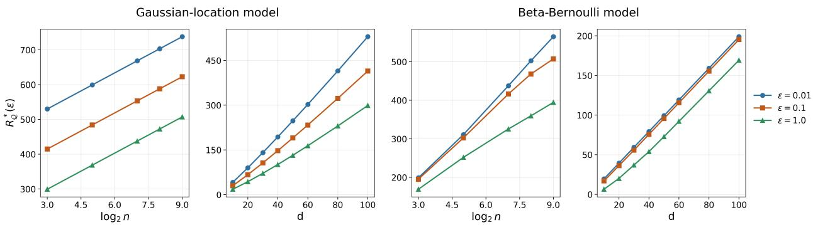  
Figure 4: Analytic rate calibration in parametric models. Gaussian panels evaluate the exact frontier in Proposition 3.4; Beta–Bernoulli panels report achievable rates within the specified noisy-count channel grid. Distortion budgets $\varepsilon \in \ \{ 0 . 0 1 , 0 . 1 , 1 \}$ are total budgets. Left to right: Gaussian rate versus n at $d = 1 0 0$ , Gaussian rate versus d at $n = 8 .$ and the corresponding Beta–Bernoulli quantities. The Beta–Bernoulli curves are not optimized over all channels.

and

$$
\Delta _ { \lambda } = I ( \theta ; Y ^ { n } \mid S _ { \lambda } ) = I ( \theta ; T \mid S _ { \lambda } ) = { \frac { d } { 2 } } \left[ \log \left( 1 + { \frac { n \tau ^ { 2 } } { \sigma ^ { 2 } } } \right) - \log \left( 1 + { \frac { \tau ^ { 2 } } { \sigma ^ { 2 } / n + \lambda } } \right) \right] .
$$

For $0 < \varepsilon < I ( \theta ; Y ^ { n } )$ , distortion increases and rate decreases with $\lambda ,$ so the optimal noise variance solves $\Delta _ { \lambda } = \varepsilon \colon$

$$
\lambda _ { \varepsilon } = \frac { \tau ^ { 2 } } { \left( 1 + \frac { n \tau ^ { 2 } } { \sigma ^ { 2 } } \right) e ^ { - 2 \varepsilon / d } - 1 } - \frac { \sigma ^ { 2 } } { n } .
$$

Proposition 3.4 and its proof in Appendix I establish optimality against arbitrary channels. At fixed $d , \varepsilon , \tau , \sigma , ( 2 4 )$ gives

$$
R _ { \lambda _ { \varepsilon } } = \frac { d } { 2 } \log n + O ( 1 ) \qquad ( n \to \infty ) .
$$

The figure uses the exact rate, including its fixed-total-tolerance $\begin{array} { l } { { \frac { d } { 2 } } } \end{array}$ log d growth as $d \to \infty$ at fixed $n ;$ per-coordinate tolerance instead gives linear growth in $d .$

Beta–Bernoulli model. For the second experiment, we consider independent coordinates

$$
\theta _ { j } \sim \operatorname { B e t a } ( a , b ) , \qquad Y _ { i j } \mid \theta _ { j } \sim \operatorname { B e r n o u l l i } ( \theta _ { j } ) , \qquad j = 1 , \ldots , d , \quad i = 1 , \ldots , n ,
$$

with $( a , b ) = ( 5 , 5 )$ in the figure. For each coordinate, the suficient statistic is the count

$$
C _ { j } : = \sum _ { i = 1 } ^ { n } Y _ { i j } .
$$

We evaluate a noisy-count summary channel of the form

$$
S _ { j } \sim q _ { \rho } ( \cdot \mid C _ { j } ) , \qquad q _ { \rho } ( s \mid c ) \propto \exp \left( - \frac { ( s - c ) ^ { 2 } } { 2 \rho ^ { 2 } } \right) , \qquad s \in \{ 0 , \ldots , n \} ,
$$

applied independently across coordinates. Because the model factorizes across $j ,$ , both rate and distortion factorize:

$$
R _ { \rho , d } = d R _ { \rho } ^ { ( 1 ) } , \qquad \Delta _ { \rho , d } = d \Delta _ { \rho } ^ { ( 1 ) } .
$$

In one dimension, the prior-predictive law of the count is Beta–Binomial:

$$
p ( c ) = { \binom { n } { c } } { \frac { B ( a + c , b + n - c ) } { B ( a , b ) } } , \qquad c = 0 , \dots , n .
$$

The achieved rate is

$$
R _ { \rho } ^ { ( 1 ) } = I ( C ; S ) = \sum _ { c = 0 } ^ { n } \sum _ { s = 0 } ^ { n } p ( c ) q _ { \rho } ( s \mid c ) \log \frac { q _ { \rho } ( s \mid c ) } { p _ { \rho } ( s ) } , \qquad p _ { \rho } ( s ) : = \sum _ { c = 0 } ^ { n } p ( c ) q _ { \rho } ( s \mid c ) .
$$

The full posterior given the suficient statistic is

$$
\theta \mid C = c \sim \operatorname { B e t a } ( a + c , b + n - c ) ,
$$

whereas the posterior given the summary value $S = s$ is the mixture

$$
p ( \theta \mid s ) = \sum _ { c = 0 } ^ { n } p ( c \mid s ) \operatorname { B e t a } ( a + c , b + n - c ) .
$$

We compute the one-dimensional distortion as

$$
\Delta _ { \rho } ^ { ( 1 ) } = \mathbb { E } \left[ \operatorname { K L } \bigl ( p ( \theta \mid C ) \parallel p ( \theta \mid S ) \bigr ) \right] = H ( \theta \mid S ) - H ( \theta \mid C ) ,
$$

where the entropies are evaluated by Gauss–Legendre quadrature on [0, 1]. In the experiments we use 300 quadrature nodes and the grid $\rho \in \mathcal { G } = \{ 0 . 2 5 , 0 . 3 5 , 0 . 5 , 0 . 7 , 1 . 0 , 1 . 4 , 2 . 0 , 2 . 8 , 4 . 0 , 5 . 6 , 8 . 0 , 1 1 . 3 , 1 6 . 0 , 2 2 . 6 , 3 2 . 0 , 4 5 . 2 , 0 . 1 , 1 . 3 , 1 . 4 , 1 . 5 \} ,$ Since we do not invert $\rho \mapsto \Delta _ { \rho }$ analytically, the plotted Beta–Bernoulli curves are grid-based achievable upper bounds:

$$
R _ { \mathrm { g r i d } } ^ { \mathrm { B B } } ( \varepsilon ; n , d ) : = \operatorname* { m i n } _ { \rho \in { \mathcal { G } } : \Delta _ { \rho , d } \leq \varepsilon } R _ { \rho , d } .
$$

Numerical details. The Gaussian curves require only closed-form evaluation. The Beta–Bernoulli curves require only finite sums over $c , s \in \{ 0 , \ldots , n \}$ together with one-dimensional quadrature for the mixture posterior entropy. No neural networks are trained for these figures. When varying n, we use the values shown on the horizontal axis of Figure 4; when varying $d ,$ we analogously use the displayed values of d.

## K Experimental protocol and additional results

## K.1 Training and checkpoint selection

The simulator experiments use a 256-dimensional encoder summary, a 128-bit code with fixed prior activation probability 0.01, and a conditional normalizing flow with conditioner width 32 and 32 flow layers. Optimization uses Adam with learning rate $5 \times 1 0 ^ { - 5 }$ throughout g-and-k. On the other simulators the initial rate is $1 0 ^ { - 4 }$ for $\beta < 0 . 1$ and $5 \times 1 0 ^ { - 5 }$ otherwise, with the training schedule’s decay with 72,000 steps, each with fresh batch of 128 samples. All Ricker configurations share the same fitted log(1 + x) input normalizer.

The stochastic BNPE samples its code during training and deployment. The deterministic one samples Bernoulli codes with a temperature that decreases log-linearly from one to 0.1 between 0.1E and 0.8E, and then uses thresholded codes for stabilization. Both models use a straight-through gradient during training, and evaluation of the deterministic BNPE always uses a hard threshold.

## K.2 Evaluation loss and information-rate estimates

Each checkpoint is scored on five simulator sets, with $M = 2 ^ { 1 8 } = 2 6 2 , 1 4 4$ samples. NLL averages eight deployed code draws per observation for stochastic deployment and uses one pass for hard deployment. The rate calculation uses 65,536 sampled codes and the empirical mixture over the full reference set.

For Bernoulli conditional probabilities $q _ { i } ( b ) = q ( b \mid y _ { i } )$ , define $\begin{array} { r } { \bar { q } _ { M } ( \boldsymbol { b } ) = M ^ { - 1 } \sum _ { i } q _ { i } ( \boldsymbol { b } ) } \end{array}$ . The empiricalmixture estimate is

$$
\widehat { R } _ { M } \approx \mathbb { E } _ { b \sim \bar { q } _ { M } } [ - \log \bar { q } _ { M } ( b ) ] - \frac { 1 } { M } \sum _ { i } H ( q _ { i } ) .\tag{25}
$$

The finite empirical mixture’s information is bounded by log $M \simeq 1 2 . 4 7 7$ . Evaluation clips Bernoulli probabilities to $[ 1 0 ^ { - 5 } , 1 - 1 0 ^ { - 5 } ]$

A a two-hidden-layer MADE (Germain et al., 2015) model of width 512 is fitted on an independently simulated dataset. For a fixed fitted marginal r, the population identity

$$
\operatorname { \mathbb { E } } _ { Y , B } [ - \log r ( B ) ] - H ( B \mid Y ) = I ( Y ; B ) + \operatorname { K L } ( p _ { B } \| r )\tag{26}
$$

gives a variational upper bound.

## K.3 Count benchmark computation

The Beta–Bernoulli experiment enumerates count and code states and uses 512-point quadrature for the remaining integral over θ. The deterministic comparison enumerates all partitions of the nine count values. The convex hull includes independent time-sharing between deterministic count encoders. Iterative information-bottleneck updates provide attainable stochastic channels. Neural training directly penalizes finite-sum $I ( C ; B )$ , unlike the simulator experiments’ sparse-prior KL surrogate. Reported neural summaries use five training seeds per arm and penalty coeficient.

## K.4 Gaussian diagnostic with a fixed-covariance decoder

This controlled benchmark measures how eficiently a binary code preserves the posterior mean when the decoder covariance is fixed, therefore, the family can not achieve the optimal decoder.

Let $\theta \sim N ( 0 , I _ { 4 } )$ and $Y _ { i } \mid \theta \sim N ( \theta , I _ { 4 } )$ for $i = 1 , \dots , 4$ . Writing $T = { \bar { Y } }$ , the full posterior is ${ \cal N } ( \mu ( T ) , v I _ { 4 } )$ with $\mu ( T ) = 0 . 8 T$ and $v = 0 . 2$ . We introduce a binary encoder with bit cardinality 16 and a Gaussian decoder with fixed posterior variance $q _ { \phi } ( \theta \mid B ) = N ( g _ { \phi } ( B ) , v I _ { 4 } )$ . Both networks use two hidden layers of width 256 with ReLU activations. The objective is NLL plus the sparse-prior Bernoulli KL penalty with prior activation probability 0.01. Training uses 4000 Adam updates, batch size 4096, initial learning rate $1 0 ^ { - 3 }$ with cosine decay to $1 0 ^ { - 5 }$ , and training seed zero.

Let $g ^ { \star } ( B ) = \mathbb { E } [ \mu ( T ) \mid B ]$ . The population decomposition is

$$
{ \mathrm { N L L } } _ { \phi } - h ( \theta \mid T ) = D _ { \mathrm { m e a n } } ( B ) + G _ { \phi } ,\tag{27}
$$

$$
D _ { \mathrm { m e a n } } ( B ) : = \frac { \mathbb { E } \| \mu ( T ) - g ^ { \star } ( B ) \| ^ { 2 } } { 2 v } , \qquad G _ { \phi } : = \frac { \mathbb { E } \| g ^ { \star } ( B ) - g _ { \phi } ( B ) \| ^ { 2 } } { 2 v } .\tag{28}
$$

Here $h ( \theta \mid T ) = 2 . 4 5 6 8 8$ nats. This separates the code’s posterior-mean error from the learned decoder’s remaining mean error. The unrestricted posterior loss satisfies (Lemma 2.2):

$$
\Delta _ { \mathrm { K L } } ( B ) = D _ { \mathrm { m e a n } } ( B ) - \mathbb { E } _ { B } \mathrm { K L } ( \Pi _ { B } \parallel N ( g ^ { \star } ( B ) , v I _ { 4 } ) ) .\tag{29}
$$

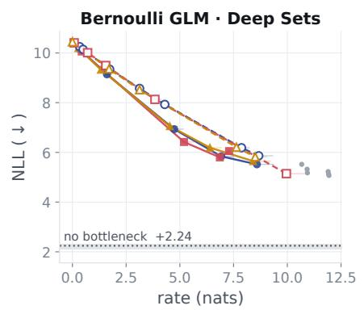  
(a)

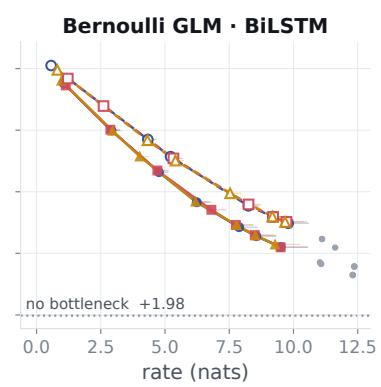  
(b)

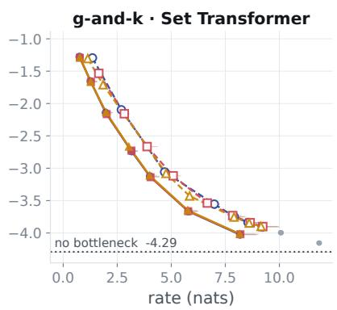  
(c)

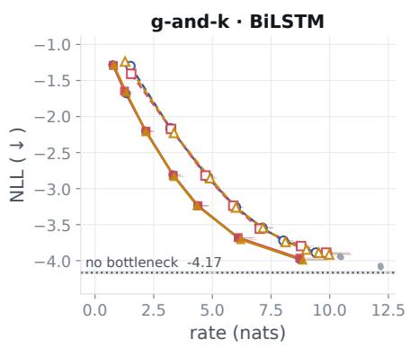  
(d)

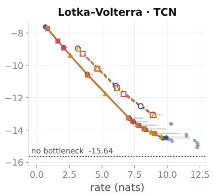  
(e)

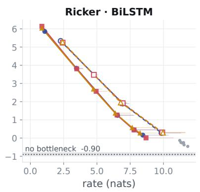  
(f)  
Figure 5: The six simulator–encoder combinations omitted from Figure 2.

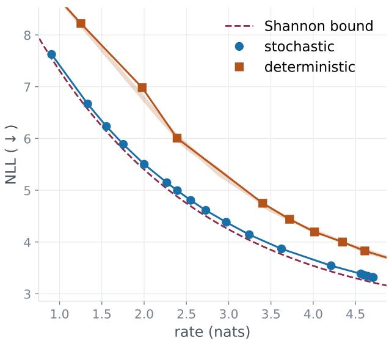  
Figure 6: Gaussian posterior-mean diagnostic

The subtracted term includes covariance mismatch and any non-Gaussian shape of the coarsened posterior. At zero rate, $D _ { \mathrm { m e a n } } = 8 .$ , whereas $\Delta _ { \mathrm { K L } } = 2 \log 5 \simeq 3 . 2 1 8 9$ . Thus the diagnostic uses a restricted decoder family whose error remains meaningful even when its mean is fitted optimally.

Since $\mu ( T ) \sim N ( 0 , 0 . 8 I _ { 4 } )$ , Gaussian squared-error rate–distortion gives the exact unrestricted-channel reference $D _ { \mathrm { m e a n } } ( R ) = 8 e ^ { - R / 2 }$ , which is a lower bound for the finite binary channels tested here. It is distinct from the posterior-KL frontier $D ^ { \star } ( R ) = 2 \log ( 1 + 4 e ^ { - R / 2 } )$ in Proposition 3.4.

## K.5 Additional posterior diagnostics

Neural ratio estimation ofers a complementary route to measuring retained parameter information (Hermans et al., 2020). For the exact joint-to-product ratio $r ( \theta , s ) = p ( \theta , s ) / ( \pi ( \theta ) p ( s ) )$ , its joint expected log ratio is $I ( \theta ; S )$ . Comparing this quantity for full observations and summaries would target the information loss in Lemma 2.2. With learned ratios, however, the diference also includes both estimators’ approximation errors. The conjugate experiment directly evaluates posterior loss and decoder mismatch; the simulator results report NLL and code rate.

## L Related work and connections

Summary statistics for likelihood-free inference. Summary construction includes dimension reduction and subset selection for ABC (Blum et al., 2013; Nunes & Balding, 2010), regressionbased statistics (Fearnhead & Prangle, 2012; Jiang et al., 2017), Fisher-information and score-based compression (Charnock et al., 2018; Alsing & Wandelt, 2018), and neural summary learning (Chen et al., 2021, 2023). Exchangeable and convolutional encoders adapt summaries to observation structure (Chan et al., 2018; Åkesson et al., 2022); amortized posterior estimators often also train a summary jointly with its density decoder (Radev et al., 2022). Closest to the fidelity criterion here, Hofmann & Onnela (2026) connect expected posterior entropy, parameter–summary information, and expected posterior KL loss. Sui et al. (2023) evaluate cosmological summaries through parameter–summary information. We place this posterior fidelity alongside an explicit data–summary information budget, asking how much compression is compatible with posterior preservation and comparing learned encoders at matched estimated rates.

Posterior preservation and the information bottleneck. The information bottleneck (IB) trades information retained about a target against information retained about the observation (Tishby et al., 2000; Gilad-Bachrach et al., 2003). Under $\theta  Y  S .$ , the identity $\Delta _ { \mathrm { K L } } ( S ) =$ $I ( \theta ; Y ) - I ( \theta ; S )$ identifies our intrinsic rate with this classical frontier, expressed in posteriorerror coordinates. Conditional-distribution KL distortion and posterior-mixture reconstruction are classical IB constructions (Harremoës & Tishby, 2007). Courtade & Weissman (2014) explicitly study rate-limited posterior compression under expected KL as a shifted logarithmic-loss coding problem. Their finite-alphabet operational results concern coding across independent experiments; our frontier concerns one use of a summary channel. The suficient-statistic reduction of Armstrong (2026) allows the observation to be replaced by its random posterior without changing the unrestricted channel frontier. These foundations identify the object whose representation cost governs posterior-preserving summaries.

Posterior quantization and converses. Our average posterior quantization result uses the nearest-center and centroid arguments often also used in k-means clustering problems; there the KL error replaced by Euclidean distance. Similar arguments are also used in the classical information theory literature that studies entropy-constrained and Bregman quantization (Chou et al., 1989; Banerjee et al., 2005). The posterior mixture is the KL instance of the Bregman centroid, connecting deterministic summaries to average quantization of the random posterior. Our converses specialize arbitrary-prior small-ball information bounds (Xu & Raginsky, 2017) and general Shannon lower bounds (Riegler et al., 2018) to this source. They retain the predictive mass of distinguishable posterior states, which support covering and packing numbers alone do not capture. The resulting question is how finely the law of the random posterior, under a fixed Bayesian experiment, must be represented to meet a prescribed average distortion.

Haussler & Opper (1997) identify Bayes information with cumulative Bayesian predictive relativeentropy risk and bound it using prior-weighted geometry of sampling distributions. The compensation inequality transfers any such lower bound directly to $R _ { n } ^ { \star } ( \varepsilon ) \geq I ( \theta ; Y _ { 1 : n } ) - \varepsilon$ . In particular, suppose $Y _ { 1 : n } \mid \theta \sim P _ { \theta } ^ { \otimes n }$ satisfies their dominated-model setup. With this paper’s normalization $\mathrm { H } ^ { 2 } ( P , Q ) =$ $\textstyle { \frac { 1 } { 2 } } \int ( { \sqrt { p } } - { \sqrt { q } } ) ^ { 2 }$ , their Corollary 1(1) (p. 2466, with $\alpha = 1 / 2 )$ gives

$$
R _ { n } ^ { \star } ( \varepsilon ) \ \geq \ \left[ - \int \pi ( d \theta ) \log \int \pi ( d \vartheta ) \exp \{ - n \mathrm { H } ^ { 2 } ( P _ { \theta } , P _ { \vartheta } ) \} - \varepsilon \right] _ { + } .
$$

This lower bound needs no uniform likelihood-ratio bound. Their corresponding Hellinger upper bounds require additional control (Corollary 1 or Theorem 3); mutual absolute continuity alone is insuficient. Their Section 7 takes a supremum over priors to obtain minimax bounds from samplingmodel covering and packing numbers. Their Theorem 4(3), pp. 2482–2483, likewise concerns minimax predictive risk. These results control information acquired about a parameter from repeated sampling. Our posterior-space bounds control compression under a fixed predictive law, and the fixed-prior parametric converse uses the prior-averaged Clarke–Barron expansion below.

Parametric information and approximate suficiency. Clarke & Barron (1994) give the regular, prior-averaged Bayes-information expansion underlying the ${ \frac { d } { 2 } } \log n$ converse in Lemma 2.3 Hayashi & Tan (2018) obtain the same leading coeficient for finite-memory approximate suficientstatistic coding under their reconstruction and alphabet-size criteria. Here distortion is posterior

KL averaged under a fixed prior, and rate is data–summary mutual information; matching upper bounds follow under the stated posterior-chart conditions. The exact Gaussian benchmark specializes Gaussian IB (Chechik et al., 2005; Asoodeh & Calmon, 2020), making the dependence on sample size, dimension, and posterior tolerance explicit.

Stochastic summaries and deterministic time-sharing. Stochastic assignments are central to classical IB, and finite-alphabet entropy tradeofs have long been studied through convex representations (Tishby et al., 2000; Witsenhausen & Wyner, 1975; Wyner & Ziv, 1973). Agglomerative IB expresses the relevance cost of merging cells through weighted Jensen–Shannon divergence (Slonim & Tishby, 2000). For deterministic targets, the IB frontier is piecewise linear and can be attained by visible time-sharing of deterministic summaries (Kolchinsky et al., 2019); full-support experiments can also have linear segments (Benger et al., 2023). Theorem 4.3 compares stochastic summaries with the entire visible time-sharing envelope of deterministic summaries. For finite observations, rare confusion between two cells yields a support-sensitive refinement of the weighted Jensen–Shannon merge cost. The general theorem replaces this pair-specific control by a uniform, experiment-level bound for random relabeling. Combined with finite-quantizer approximation and uniform integrability, it yields strict improvement at every interior rate for standard Borel experiments satisfying the common-support condition, without requiring finite pairwise posterior KL or attainment of the deterministic envelope.

The compression cost and the role of randomness. The deterministic IB of Strouse & Schwab (2017) prices output entropy, changing the optimization problem. For ordinary additive codingcost Lagrangians, encoder randomness can be fixed without increasing the objective; distributionpreserving reconstruction constraints can instead make shared randomness useful (Theis & Agustsson, 2021). Our separation theorem charges mutual information and permits private encoder randomness. Relabeling preserves the output distribution while reducing mutual information, so its gain depends on that choice of cost.

Learning and evaluating an information budget. The training penalty builds on neural variational IB (Alemi et al., 2017) and task-oriented inference compression (Shao et al., 2022). The binary-bottleneck protocol makes the summary channel explicit and permits comparisons across architectures and stochastic or deterministic modes. We measure deployed rate separately from the variational training penalty; the empirical rate estimates and decoder losses are also distinguished from the population posterior-information frontier.