# Locked In: Multi-Objective RL for the AI Data Center Build-Out

Satyapragnya Kar New York University sk13001@nyu.edu

Rajarshi Das AlphaInfra.ai, MQube Cognition rajarshi@alphainfra.ai

PR Panigrahi Envana Software Solutions pr.panigrahi@envana.com

## Abstract

AI data center build-out is a multi-trillion-dollar, multi-decade infrastructure program. Yet siting, power procurement, and cooling decisions are still made with static, single-point scoring tools. These tools are evaluated once, on day-zero numbers. This is a poor fit. A site’s water, power, and carbon profile drifts substantially over the 10 to 20 year asset life. The governing decisions are also irreversible, and they bind capital and physical plant for years. We formalize long-horizon build-out as a tiered multi-objective Markov decision process. Strategic commitments are gated to discrete windows, incur switching costs, and energize only after source-dependent lead times. Operational dispatch is restricted to capacity that physically exists. We solve the problem with a preference-conditioned multi-objective agent that has a semi-Markov manager and worker hierarchy. The agent recovers a family of policies that a planner can steer across cost, carbon, water, and reliability at inference time. We validate long-horizon dynamics with a lightweight counterfactual rollout model. Across three commitment regimes (IRREVERSIBLE, REVERSIBLE, and COMMIT-ONCE) on real site data, preference conditioning yields a confirmed, steerable trade-off on both objective pairs in every regime. Imposing lock-in produces a more evenly covered frontier and a far more consistent rate of anticipatory retrofit ahead of a binding water-stress constraint than a freely reversible formulation. Finally, a compact counterfactual dynamics model tracks slow-moving state well. It is measurably outperformed by simple persistence on the water-stress axis. We report this limitation rather than obscure it. We release the environment, agents, baselines, and evaluation harness. All of them are grounded in real interconnection-queue, water-stress, and grid-emissions data.

## 1 Introduction

Site selection and build-out planning for AI data centers is conventionally treated as a one-shot scoring exercise. A candidate location is evaluated against present-day electricity price, grid carbon intensity, and water availability. It is then scored and filed. That approach is reasonable for a slowly varying resource base. It is not reasonable here. Global data center capital expenditure is projected to reach nearly \$7 trillion by 2030 [19]. Annual data center electricity demand is on track to reach roughly 945 TWh by 2030 [13; 11]. Roughly 2,060 GW of generation and storage capacity sits in U.S. interconnection queues, with typical multi-year waits to commercial operation [24]. Water consumption is projected to grow by as much as 170% over the same period [33]. Hyperscaler capital commitments already run into the hundreds of billions of dollars through 2027 [4]. All-in build costs run from roughly \$11 million per MW up to the tens of millions once compute fit-out is included [15]. Together, these figures imply three things. The resource base drifts within a single asset life. When capacity energizes is as consequential as what is procured. A single build phase is a multi-billion-dollar, effectively irreversible commitment. None of this can be expressed by a score computed once.

Planning where, how, and when to build AI data center capacity (siting, power procurement, and cooling) is a sequential decision problem, not a scoring problem. There are two reasons. First, the objectives are contrastive. There is no single optimum, only a Pareto frontier across cost, carbon, water, and reliability. Second, decisions are irreversible on operationally meaningful timescales, so early commitments constrain the entire remaining sequence. A formulation that permits free, instantaneous switching collapses to myopic per-period scoring. This is exactly the practice this work aims to displace.

We make three contributions. First, we introduce a tiered multi-objective MDP for build-out planning. It has gated retrofit windows, switching costs, and source-dependent energization lead times calibrated to real interconnection-queue data (Section 2). Second, we present a preference-conditioned agent with a semi-Markov manager and worker hierarchy. The hierarchy separates decade-scale commitment from quarterly dispatch while preserving inference-time steerability. We also provide a lightweight counterfactual dynamics model for validating long-horizon behavior (Section 3). Third, we report an empirical study across three commitment regimes on real, grounded site data. The study isolates the contribution of irreversibility to frontier quality, steerability, and anticipatory behavior (Section 5). Related work on RL for computing and energy systems, multi-objective RL, hierarchical RL, and robust or non-stationary RL is summarized in Appendix A.

This paper is one of a small family of companion studies on the AI build-out. In Methane First [6], we study a narrower, single-decision slice of the same planning problem. The question is how a fixed annual budget should be split between methane leak repair and carbon capture across a fleet of on-site gas-powered data centers. That problem is small enough to solve exactly by dynamic programming. A model-free RL policy recovers the exact optimum in nearly all runs. This supports using RL on the richer, multi-objective, multi-commitment setting studied here, where no exact solution is available (Appendix A). A second companion, Watts If? [5], benchmarks language models on counterfactual reasoning about what each commitment in a build-out rules out (see Section 6).

## 2 Problem Formulation

Setup: We model build-out as a multi-objective MDP $\langle S , \mathcal { A } , T , { \bf R } , \gamma \rangle$ . The reward is vector-valued, $\mathbf { R } : \bar { \mathcal { S } } \times \mathcal { A }  \mathbb { R } ^ { 4 }$ , with R = [−cost, −carbon, −water, +reliability]. It is never scalarized inside the environment, so a Pareto frontier remains recoverable. The base timestep is one quarter. The horizon is 80 quarters (20 years). Full state, action, and site detail is in Appendix E.

Decision tiers and irreversibility: A manager makes two kinds of decisions. It selects the cooling architecture (air, liquid, or immersion), which is legal only at discrete retrofit windows. It also selects an annual procurement commitment among four power pathways. These are behind-the-meter gas, clean firm power, on-site renewables, and grid supply. They differ in cost, carbon, lead time, and reliability. A committed source energizes only after a source-dependent lead time. This lead time is drawn from calibrated interconnection-queue statistics. The switching cost is charged against the cost objective. A worker selects a quarterly dispatch mix. The mix is masked so that it draws only on capacity that has already energized.

We study three commitment regimes. They vary only in how often the manager’s cooling window opens. In the IRREVERSIBLE regime, a window opens every 12 quarters, at a facility already operating evaporative cooling. In the REVERSIBLE regime, a window opens every quarter. This recovers the free-switching setting implicit in static scoring. In the COMMIT-ONCE regime, a window opens only at t = 0. This is pure site and architecture selection, with no later retrofit at all.

Objective: We learn a family of policies $\{ \pi _ { \mathbf { w } } \}$ indexed by preference vectors w on the simplex. The family traces the frontier of expected discounted vector returns. A planner can therefore select an operating point at inference without retraining.

## 3 Method

Preference-conditioned multi-objective agent: A network $Q _ { \theta } ( s , \mathbf { w } ) \in \mathbb { R } ^ { | A | \times 4 }$ outputs vectorvalued action values. These are conditioned on the state and a sampled preference vector. The greedy action maximizes $\mathbf { w } ^ { \top } Q _ { \theta } ( s , \mathbf { w } ) _ { a }$ over legal actions. Illegal actions are masked at both selection and bootstrap. Preferences are resampled every episode, so one network covers the frontier.

Semi-Markov hierarchy: The manager acts every K = 4 quarters. It bootstraps over its commitment interval, $y = \mathbf { R } ^ { ( K ) } + \gamma ^ { K } Q _ { \bar { \theta } } ( s ^ { \prime } , \mathbf { w } ) _ { a ^ { * } }$ . The worker acts each quarter. It is conditioned on the state, the preference, and the manager’s active commitment, and it bootstraps at γ. Both levels are preference-conditioned, so steerability is preserved through the hierarchy. The coupling is structural, because manager commitments determine which dispatch mixes are feasible for the worker. Aflat ablation trains an otherwise identical agent over the joint $1 2 \times 7 { = } 8 4$ -action space. It differs only in lacking timescale separation and semi-Markov bootstrapping.

Learned counterfactual model (LCM): A learned counterfactual model (LCM) is a learned simulator of the build-out environment. It predicts how a site’s state and objectives would evolve under a different sequence of commitments. A 20-year policy cannot be validated against realized outcomes within a research cycle. We therefore train a compact deep ensemble as our LCM. It predicts next-state deltas and reward vectors under counterfactual joint actions. This lets us ask “what would have happened under a different action sequence” cheaply, as a diagnostic. The LCM is not used inside training. We validate it with rolling-origin backtesting against persistence and linear-drift baselines. We treat it as unsuitable for planning on any dimension where it does not clearly beat both baselines. The full architecture and validation protocol are in Appendix B.

## 4 Experimental Setup

We use six real site profiles (Appendix E, Table 3). They span distinct water-stress, carbon-intensity, price, and queue-pressure regimes. Each site is crossed with four demand and climate scenarios. Four sites and three scenarios form the training distribution. Two unseen sites and one unseen scenario are held out. All methods are evaluated on an identical fixed sweep of 40 preference vectors under common random numbers. They share a single hypervolume reference point. We report hypervolume for the cost×carbon and water×reliability views. We also report Pareto-front sparsity, where lower means more even coverage. Preference-steerability correlations come from an eleven-point sweep. Where a post-day-zero retrofit window exists, we report the rate at which the policy leaves evaporative cooling ahead of a per-site water-stress constraint. We call this the anticipation rate. Full data provenance is in Appendix F.

## 5 Results

Table 1: Hypervolume (in-distribution / held-out) and sparsity, mean ± std over 3 seeds. cc is cost × carbon and wr is water × reliability. Anticipation rate is defined only where a post-day-zero retrofit window exists. It is trivially zero under COMMIT-ONCE, so it is omitted from this table (see Section 5).
<table><tr><td>Regime</td><td>Agent</td><td>HV cc (in-dist / held-out)</td><td>HV wr (in-dist / held-out)</td><td>Sparsity</td></tr><tr><td rowspan="2">IRREVERSIBLE</td><td>Flat</td><td> $2 1 2 . 1 \pm 1 2 . 0 / 1 4 . 0 \pm 1 0 . 3$ </td><td> $1 1 4 2 . 7 \pm 6 . 7 / 9 3 0 . 6 \pm 2 4 . 3$ </td><td> $9 . 3 8 \pm 0 . 8 4$ </td></tr><tr><td>Hierarchical</td><td> $2 2 2 . 6 \pm 6 . 7 / 1 0 . 4 \pm 8 . 6$ </td><td> $1 1 9 7 . 5 \pm 2 2 . 3 / 1 0 8 8 . 1 \pm 4 7 . 2$ </td><td> $9 . 5 8 \pm 0 . 7 5$ </td></tr><tr><td rowspan="2">REVERSIBLE</td><td>Flat</td><td> $2 0 9 . 0 \pm 1 9 . 2 / 3 0 . 7 \pm 2 1 . 6$ </td><td> $1 3 2 2 . 5 \pm 1 9 . 9 / 1 0 9 5 . 8 \pm 3 5 . 1$ </td><td> $2 5 . 4 3 \pm 1 5 . 4 4$ </td></tr><tr><td>Hierarchical</td><td> $2 5 0 . 8 \pm 8 . 8 / 3 3 . 4 \pm 5 . 5$ </td><td> $1 3 0 6 . 1 \pm 1 6 . 9 / 1 0 9 1 . 2 \pm 4 . 9$ </td><td> $1 6 . 8 0 \pm 2 . 0 2$ </td></tr><tr><td rowspan="2">COMMIT-ONCE</td><td>Flat</td><td> $2 2 5 . 7 \pm 1 2 . 9 / 4 7 . 3 \pm 1 5 . 9$ </td><td> $1 3 1 2 . 8 \pm 1 8 . 7 / 1 0 2 3 . 3 \pm 1 0 0 . 6$ </td><td> $2 0 . 5 9 \pm 5 . 0 7$ </td></tr><tr><td>Hierarchical</td><td> $2 4 8 . 4 \pm 5 . 8 / 4 6 . 3 \pm 5 . 5$ </td><td> $1 2 9 4 . 7 \pm 4 . 0 / 1 0 9 8 . 9 \pm 3 4 . 9$ </td><td> $3 4 . 6 8 \pm 2 1 . 7 0 $ </td></tr></table>

Hierarchy helps in most regimes, with one instructive exception: In both IRREVERSIBLE and REVERSIBLE, the hierarchical agent dominates its flat counterpart on both hypervolume views. For example, under IRREVERSIBLE the cost×carbon hypervolume is 222.6 against 212.1. Under COMMIT-ONCE the picture is mixed. Hierarchy still raises mean cost×carbon hypervolume (248.4 vs. 225.7). It also lowers variance on three of the four hypervolume columns. However, it produces markedly worse and less consistent sparsity than the flat agent $( 3 4 . 6 8 \pm 2 1 . 7 0 \ \mathrm { v s . 2 0 . 5 \bar { 9 } \pm 5 . 0 7 } )$ This is the one cell in Table 1 where hierarchy does not clearly help. The result is consistent with the regime’s structure. There is only a single, unconstrained day-zero choice, and no ongoing switching friction to coordinate. The timescale separation that helps a hierarchical agent under lock-in or free reversibility therefore has less to act on. Its benefit shows up mainly in hypervolume stability rather than frontier evenness. Figure 1 shows the recovered fronts for the hierarchical agent under lock-in, free reversibility, and COMMIT-ONCE. Flat-agent fronts and all learning curves are in Appendix D.

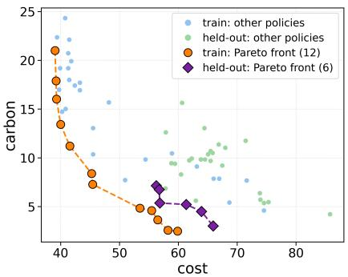

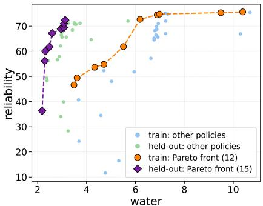

(a) IRREVERSIBLE, hierarchical agent.  
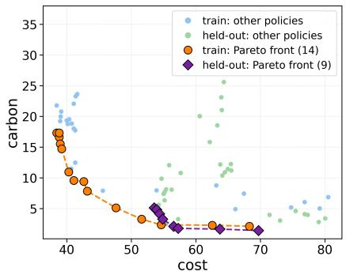

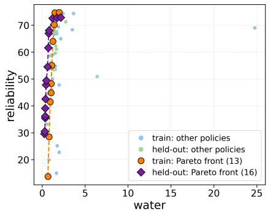

(b) REVERSIBLE, hierarchical agent.  
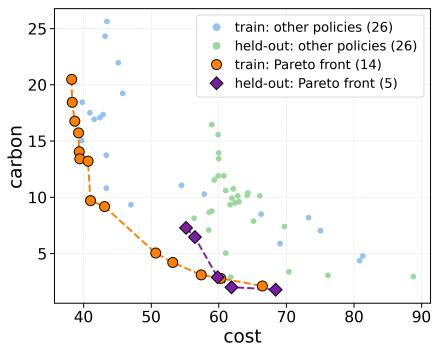

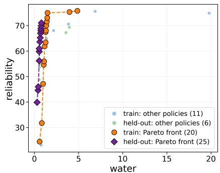  
(c) COMMIT-ONCE, hierarchical agent.  
Figure 1: Recovered fronts. Cost × carbon is on the left half of each panel and water × reliability on the right half. Fronts are split into training and held-out site/scenario pairs. The reversible frontier is wider but more clustered. The irreversible frontier is narrower but more evenly spread, matching the sparsity gap in Table 1. The commit-once frontier (single representative seed) spans a range comparable to the reversible regime, with no post-day-zero retrofit to shape it. All flat-agent fronts and all learning curves are in Appendix D.

Reversibility trades frontier width for coverage and consistency: The reversible regime reaches a wider raw frontier. An unconstrained switching policy can locally chase whichever objective the current preference favors. But that width is unevenly distributed. Sparsity is 16.80–25.43 under reversibility, against 9.38–9.58 under lock-in. The lock-in frontier is therefore the one a planner can actually interpolate across at inference time. The gap is starker on anticipation. Under lock-in, policies leave evaporative cooling in 88.9% of scored episodes, with zero seed-to-seed variance. They almost always do so at the earliest legal window. Under free reversibility the rate falls to $6 0 . 8 \% \pm 4 3 . 0$ , and switch timing is scattered across the horizon (Appendix D, Fig. 6). Under commit once, anticipation is not a meaningful metric. Any adaptation must be made once, at t = 0, through the initial architecture choice. The recovered anticipation rate is trivially zero, with zero variance across seeds, for exactly that reason.

Preference conditioning is confirmed everywhere: An eleven-point preference sweep confirms the intended trade-off on both objective pairs in all three regimes. Correlation magnitudes are at least 0.88 on cost×carbon (Table 2). Per-regime sweep figures and extended discussion are in Appendix C. The water×reliability trade-off is confirmed everywhere. It is more gradual and evenly steerable under lock-in. It is closer to an on/off switch under reversibility and commit-once. This is consistent with the lower sparsity already reported for the irreversible regime.

Table 2: Preference-steerability correlations from an eleven-point sweep. Own is the correlation between an objective’s weight and its realized value, where positive is expected. Other is the correlation with the competing objective, where negative is expected. All trade-offs are confirmed.
<table><tr><td>Regime</td><td>Objective pair</td><td>Corr. own</td><td>Corr. other</td><td>Verdict</td></tr><tr><td>IRREVERSIBLE</td><td>cost × carbon</td><td>+0.95</td><td>-0.98</td><td>confirmed</td></tr><tr><td>IRREVERSIBLE</td><td>water × reliability</td><td>+0.85</td><td>-0.65</td><td>confirmed</td></tr><tr><td>REVERSIBLE</td><td>cost × carbon</td><td>+0.93</td><td>-0.96</td><td>confirmed</td></tr><tr><td>REVERSIBLE</td><td>water × reliability</td><td>+0.65</td><td>-0.52</td><td>confirmed</td></tr><tr><td>COMMIT-ONCE</td><td>cost × carbon</td><td>+0.88</td><td>-0.99</td><td>confirmed</td></tr><tr><td>COMMIT-ONCE</td><td>water × reliability</td><td>+0.59</td><td>-0.54</td><td>confirmed</td></tr></table>

The counterfactual model is honest about where it struggles: Rolling-origin backtesting shows that the LCM beats linear drift by a wide margin on all tracked state dimensions. It is roughly comparable to persistence on slowly drifting dimensions (grid carbon, price, and workload demand). But it is measurably outperformed by persistence on water stress. Measured water-stress drift is small under the current calibration for most sites (Appendix B, Fig. 2). We flag this rather than hide it. The LCM should not be trusted for model-based planning on the water axis. None of the policy results above depend on it, since it is a diagnostic tool and not a training-time model.

## 6 Discussion and Broader Impact

The marginal water, carbon, and energy footprint of the AI build-out is determined largely at planning time. Region, power pathway, cooling technology, and schedule all matter. Representing irreversibility changes which policies are learned. Across three commitment regimes, from fully reversible to a single day-zero choice, lock-in produces the most consistently anticipatory and evenly steerable policy. This is precisely the behavior a planner needs in order to act on a constraint years before it binds. Limitations are discussed in Appendix G. They cover the market-scale figures, the workload-energy proxy, the interconnection-queue interpretation, and the absence of verified multi-decade ground truth. None of our empirical claims depend on the precision of the motivating market figures. We release the environment, agents, baselines, and evaluation harness to lower the barrier for further work on anticipatory infrastructure planning.

Our work also connects to a growing effort to assess AI systems as planning aids for this same buildout. Watts If? [5] introduces DCBench-440. This is a benchmark of generative and multiple-choice questions on counterfactual reasoning about data center commitments. It finds that language models fail at exhaustively enumerating the actions available at a decision gate. This holds even for models that score above 90% on source-grounded multiple choice. That failure of option-tracking is the natural counterpart to the irreversibility studied here. An assistant that omits a feasible option at a gate cannot weigh what a commitment forecloses. Furthermore, we plan to integrate the sequential decision-making aspect of the AI build-out into DCBench. This will let us compare the performance of AI models, including language-model planners, against the preference-conditioned agents and baselines released with this paper.

## References

[1] Axel Abels, Diederik M. Roijers, Tom Lenaerts, Ann Nowé, and Denis Steckelmacher. Dynamic weights in multi-objective deep reinforcement learning. In Proceedings ofthe 36th International Conference on Machine Learning (ICML), pages 11–20, 2019. URL https://proceedings. mlr.press/v97/abels19a.html.

[2] Lucas N. Alegre, Ana L. C. Bazzan, and Bruno C. da Silva. Optimistic linear support and successor features as a basis for optimal policy transfer. In Proceedings of the 39th International Conference on Machine Learning (ICML), pages 394–413, 2022. URL https: //proceedings.mlr.press/v162/alegre22a.html.

[3] Artificial Analysis. Artificial analysis data API. Artificial Analysis, 2026. URL https: //artificialanalysis.ai/. Independent LLM-serving price and throughput signal, used as corroboration for the workload-efficiency proxy.

[4] CBRE Investment Management. Data centers: Ain’t no mountain high enough. CBRE Investment Management Insights, 2025. URL https://www.cbreim.com/insights/articles/ data-centers-aint-no-mountain-high-enough. Hyperscaler committed capital through 2027; accessed August 2026.

[5] Pankaj Chouhan, Rajarshi Das, Aditya Dubey, Manminder Tomar, Sreekar Reddy, Samta Sharma, Satyapragnya Kar, and PR Panigrahi. Watts if? a benchmark for counterfactual reasoning about the ai data center buildout, 2026. URL https://arxiv.org/abs/2610. 21397.

[6] Arun Das, Satyapragnya Kar, Rajarshi Das, Pankaj Chouhan, and Prabhas Panigrahi. Methane first: Sequencing decarbonization investment in the ai data center boom. October 2026. doi: 10.2139/ssrn.7612338. URL https://ssrn.com/abstract=7612338. Available at SSRN.

[7] Rajarshi Das, Jeffrey O. Kephart, Charles Lefurgy, Gerald Tesauro, David W. Levine, and Hoi Chan. Autonomic multi-agent management of power and performance in data centers. In Proceedings of the 7th International Joint Conference on Autonomous Agents and Multiagent Systems (AAMAS): Industry Track, pages 107–114, 2008. URL https://dl.acm.org/doi/ 10.5555/1402298.1402315.

[8] Thomas G. Dietterich. Hierarchical reinforcement learning with the MAXQ value function decomposition. Journal ofArtificial Intelligence Research, 13:227–303, 2000. doi: 10.1613/ jair.639. URL https://doi.org/10.1613/jair.639.

[9] Chelsea Finn, Pieter Abbeel, and Sergey Levine. Model-agnostic meta-learning for fast adaptation of deep networks. In Proceedings of the 34th International Conference on Machine Learning (ICML), pages 1126–1135, 2017. URL https://proceedings.mlr.press/v70/ finn17a.html.

[10] Jim Gao. Machine learning applications for data center optimization. White paper, Google, 2014. URL https://static.googleusercontent.com/media/research.google.com/ en//pubs/archive/42542.pdf.

[11] Goldman Sachs Research. AI to drive 165% increase in data center power demand by 2030. Goldman Sachs Insights, 2025. URL https://www.goldmansachs.com/insights/ articles/ai-to-drive-165-increase-in-data-center-power-demand-by-2030. Accessed August 2026.

[12] Conor F. Hayes, Roxana Radulescu, Eugenio Bargiacchi, Johan Källström, Diederik M. Roijers,˘ Patrick Rzonca, Tim Brys, Ann Nowé, Denis Steckelmacher, Patrick Mannion, Peter Vrancx,´ Shie Mannor, Peter Vamplew, and Enda Howley. A practical guide to multi-objective reinforcement learning and planning. Autonomous Agents and Multi-Agent Systems, 36(1):26, 2022. doi: 10.1007/s10458-022-09552-y. URL https://doi.org/10.1007/s10458-022-09552-y.

[13] International Energy Agency. Energy and AI. Technical report, IEA, Paris, April 2025. URL https://www.iea.org/reports/energy-and-ai. World Energy Outlook Special Report; accessed August 2026.

[14] Garud N. Iyengar. Robust dynamic programming. Mathematics of Operations Research, 30 (2):257–280, 2005. doi: 10.1287/moor.1040.0129. URL https://doi.org/10.1287/moor. 1040.0129.

[15] JLL Research. 2026 global data center outlook. JLL Research, 2026. URL https://www.jll. com/en-jp/insights/market-outlook/global-data-centers. Shell-and-core and all in construction cost per MW; accessed August 2026.

[16] Harsha Kokel, Michael Katz, Kavitha Srinivas, and Shirin Sohrabi. ACPBench: Reasoning about action, change, and planning. In Toby Walsh, Julie Shah, and Zico Kolter, editors, Proceedings of the AAAI Conference on Artificial Intelligence (AAAI), volume 39, pages 26559–26568, 2025. doi: 10.1609/aaai.v39i25.34857. URL https://doi.org/10.1609/aaai.v39i25.34857.

[17] Harsha Kokel, Michael Katz, Kavitha Srinivas, and Shirin Sohrabi. ACPBench Hard: Unrestrained reasoning about action, change, and planning. arXiv preprint arXiv:2503.24378, 2025. doi: 10.48550/arXiv.2503.24378. URL https://doi.org/10.48550/arXiv.2503.24378.

[18] Nevena Lazic, Craig Boutilier, Tyler Lu, Eehern Wong, Binz Roy, MK Ryu, and Greg Imwalle. Data center cooling using model-predictive control. In Advances in Neural Information Processing Systems (NeurIPS), volume 31, pages 3814–3823, 2018. URL https://proceedings.neurips.cc/paper/2018/hash/ 3b2c1f93d399996d934bb61dbeeed4e6-Abstract.html.

[19] McKinsey & Company. The cost of compute: A \$7 trillion race to scale data centers. McKinsey Quarterly, April 2025. URL https://www.mckinsey.com/ industries/technology-media-and-telecommunications/our-insights/ the-cost-of-compute-a-7-trillion-dollar-race-to-scale-data-centers. Accessed August 2026.

[20] Ofir Nachum, Shixiang Gu, Honglak Lee, and Sergey Levine. Data-efficient hierarchical reinforcement learning. In Advances in Neural Information Processing Systems (NeurIPS), volume 31, pages 3303–3313, 2018. URL https://proceedings.neurips.cc/paper/ 2018/hash/e6384711491713d29bc63fc5eeb5ba4f-Abstract.html.

[21] National Renewable Energy Laboratory. PVWatts calculator and API. NREL, 2026. URL https://developer.nrel.gov/docs/solar/pvwatts/v8/. Site-level on-site renewable capacity factor and seasonal volatility.

[22] Arnab Nilim and Laurent El Ghaoui. Robust control of Markov decision processes with uncertain transition matrices. Operations Research, 53(5):780–798, 2005. doi: 10.1287/opre.1050.0216. URL https://doi.org/10.1287/opre.1050.0216.

[23] Open-Meteo. Open-meteo weather forecast API. Open-Meteo, 2026. URL https: //open-meteo.com/. Hourly temperature series used as a cooling-load driver.

[24] Joseph Rand, Nick Manderlink, Steven Zhang, Chris Talley, Will Gorman, Ryan H. Wiser, Joachim Seel, Julie Mulvaney Kemp, Seongeun Jeong, and Fredrich Kahrl. Queued up: 2025 edition, characteristics of power plants seeking transmission interconnection as of the end of 2024. Technical report, Lawrence Berkeley National Laboratory, April 2025. URL https://emp.lbl.gov/queues. Interconnection-queue microdata used for site lead-time calibration; accessed August 2026.

[25] Joseph Rand, Nick Manderlink, Steven Zhang, Chris Talley, Will Gorman, Ryan H. Wiser, Joachim Seel, Julie Mulvaney Kemp, Seongeun Jeong, and Fredrich Kahrl. Interconnection queue data file (through 2024). LBNL Electricity Markets & Policy, 2025. URL https: //emp.lbl.gov/queues. Project-level queue data used for per-site, per-source procurement lead-time calibration.

[26] Diederik M. Roijers, Peter Vamplew, Shimon Whiteson, and Richard Dazeley. A survey of multi-objective sequential decision-making. Journal of Artificial Intelligence Research, 48: 67–113, 2013. doi: 10.1613/jair.3987. URL https://doi.org/10.1613/jair.3987.

[27] SemiAnalysis. InferenceMAX / InferenceX inference benchmark dataset. SemiAnalysis, 2026. URL https://semianalysis.com/. Device throughput and TDP telemetry used to derive a workload-efficiency (J/token) proxy signal.

[28] Richard S. Sutton, Doina Precup, and Satinder Singh. Between MDPs and semi-MDPs: A framework for temporal abstraction in reinforcement learning. Artificial Intelligence, 112(1-2): 181–211, 1999. doi: 10.1016/S0004-3702(99)00052-1. URL https://doi.org/10.1016/ S0004-3702(99)00052-1.

[29] Gerald Tesauro, Nicholas K. Jong, Rajarshi Das, and Mohamed N. Bennani. A hybrid reinforcement learning approach to autonomic resource allocation. In Proceedings of the 2006 IEEE International Conference on Autonomic Computing (ICAC), pages 65–73, 2006. doi: 10.1109/ICAC.2006.1662383. URL https://doi.org/10.1109/ICAC.2006.1662383.

[30] Gerald Tesauro, Rajarshi Das, Hoi Chan, Jeffrey O. Kephart, David W. Levine, Freeman Rawson, and Charles Lefurgy. Managing power consumption and performance of computing systems using reinforcement learning. In Advances in Neural Information Processing Systems (NeurIPS), volume 20, pages 1497–1504, 2007. URL https://proceedings.neurips.cc/ paper/2007/hash/5810284da8284fa6e810931295f51d8b-Abstract.html.

[31] U.S. Energy Information Administration. Hourly electric grid monitor (eia-930) and electricity data API. EIA, 2026. URL https://www.eia.gov/electricity/gridmonitor/. Balancing-authority generation by fuel type and industrial electricity price, used for per-site carbon intensity and price calibration.

[32] Alexander Sasha Vezhnevets, Simon Osindero, Tom Schaul, Nicolas Heess, Max Jaderberg, David Silver, and Koray Kavukcuoglu. FeUdal networks for hierarchical reinforcement learning. In Proceedings of the 34th International Conference on Machine Learning (ICML), pages 3540–3549, 2017. URL https://proceedings.mlr.press/v70/vezhnevets17a.html.

[33] West Water Research. Estimating data center water demand: New analysis predicts 170% surge in data center water use by 2030 amid AI expansion. Water Market Insider, 2025. URL https://westwaterresearch.com/wp-content/uploads/2025/03/ 2025-Q2-Water-Market-Insider-Data-Centers.pdf. Accessed August 2026.

[34] World Resources Institute. Aqueduct 4.0: Updated decision-relevant global water risk indicators. WRI Aqueduct, 2023. URL https://www.wri.org/aqueduct. Baseline and future (SSP/RCP) basin water-stress data, used for per-site water-stress level and forward drift.

[35] Jie Xu, Yunsheng Tian, Pingchuan Ma, Daniela Rus, Shinjiro Sueda, and Wojciech Matusik. Prediction-guided multi-objective reinforcement learning for continuous robot control. In Proceedings ofthe 37th International Conference on Machine Learning (ICML), pages 10607– 10616, 2020. URL https://proceedings.mlr.press/v119/xu20h.html.

[36] Runzhe Yang, Xingyuan Sun, and Karthik Narasimhan. A generalized algorithm for multi-objective reinforcement learning and policy adaptation. In Advances in Neural Information Processing Systems (NeurIPS), volume 32, pages 15610–15621, 2019. URL https://proceedings.neurips.cc/paper/2019/hash/ 4b2e8878939ebefd9197022e381017ef-Abstract.html.

[37] Eckart Zitzler and Lothar Thiele. Multiobjective evolutionary algorithms: A comparative case study and the strength pareto approach. IEEE Transactions on Evolutionary Computation, 3 (4):257–271, 1999. doi: 10.1109/4235.797969. URL https://doi.org/10.1109/4235. 797969.

## Appendix

## A Related Work

RL for computing and energy systems: RL has an established record in autonomic power and performance management [30; 7; 29]. It has also been used for production data center cooling control [10; 18]. These works target operational control at minute-to-hour granularity under a scalar objective. We differ in horizon and objective structure. We study multi-year commitment planning under four simultaneously active objectives. The binding difficulty is irreversibility rather than tracking accuracy.

Closest to this paper is our companion study Methane First [6]. It applies RL to the decarbonization of on-site gas generation for data centers. It poses a scenario analysis on 69 U.S. data centers with on-site gas turbines, growing to 350 by 2035. It asks how a fixed annual budget should be split between methane leak detection and repair (LDAR) and carbon capture and storage (CCS). It also asks whether the answer depends on the global-warming-potential (GWP) window used to combine methane and $\mathrm { C O _ { 2 } } .$ . That problem has a one-dimensional state, so it can be solved exactly by dynamic programming. This makes it a rare setting in which a model-free policy can be checked against a known optimum. A REINFORCE policy trained over ten seeds recovers the exact plan in 17 of 20 runs of the yearly-upkeep variant, and the rest are within 0.6%. It recovers the exact plan in every run of the one-time-purchase variant. Both the exact and learned plans fund LDAR first under GWP20 and GWP100.

We view that result as supporting evidence for using RL where exact methods stop scaling. This is the situation in the present paper. Four objectives, gated commitments, lead times, and a manager and worker hierarchy produce a state and action space far beyond exact dynamic programming. The two studies are complementary in scope. Methane First is a single-technology-pair allocation with a verified optimum. This paper treats multi-year, multi-objective build-out planning under irreversibility. There, evaluation must instead rely on frontier quality, steerability, and held-out generalization.

Multi-objective RL: We adopt the utility-based view of multi-objective sequential decision making [26; 12]. We build on preference-conditioned value methods that recover a frontier with a single network [36; 1]. Stronger frontier-coverage methods [35; 2] are natural extensions. We report the hypervolume indicator [37] as the primary frontier-quality metric.

Hierarchical RL: Our manager and worker decomposition draws on temporal abstraction and the options framework [28; 8]. It also draws on manager and worker architectures [32; 20]. The manager is trained as a semi-MDP over its commitment interval. Unlike goal-conditioned formulations, it couples to the worker by restricting the worker’s feasible action set to energized capacity. It does not emit a target.

Robust and non-stationary RL: Multi-decade horizons imply drifting transition dynamics. This motivates robust MDP formulations [22; 14] and adaptation-oriented methods [9]. We approximate this by training across a distribution of site and scenario trajectories. We then evaluate on held-out combinations.

Planning benchmarks: Our tiered, action-dependent MDP is closer in spirit to structured, reasoning-heavy planning benchmarks such as ACPBench [16; 17] than to conventional continuous control RL suites. Legality (the action mask) and multi-step consequence (pending commitments and lead times) are first-class parts of the state. They are not incidental physics. Watts If? [5] applies ACPBench Hard’s question types to data center deal archetypes. It shows that language models struggle most with enumerating legal actions. This is the same notion of legality that our action masks make explicit for an RL agent.

## B Extended Method: The Learned Counterfactual Model (LCM)

The learned counterfactual model (LCM) is a k=5-network deep ensemble. Each network outputs a Gaussian next-state delta $( \mu , \log \sigma ^ { 2 } )$ with a clamped log-variance. It also has a deterministic reward-vector head. Training uses negative log-likelihood plus mean-squared error on bootstrapped minibatches. Predictive variance combines the mean of the per-network variances with the variance of the per-network means. Epistemic and aleatoric uncertainty are therefore both represented.

We validate with rolling-origin backtesting. We start from many points along held-out trajectories. From each point, we roll the LCM forward under a fixed random action sequence for up to 20 steps. We sample 16 paths per start to propagate a predictive band. We then compare mean absolute error and 1σ empirical coverage against persistence and linear-drift baselines. The comparison covers all 24 state dimensions. Ten are exogenous, such as carbon intensity, price, water stress, and workload demand. Fourteen are endogenous, such as installed cooling, energized capacity per source, and pending-commitment countdowns.

Figure 2 reports four representative dimensions. Persistence beats the LCM on water stress specifically. This is consistent with the calibrated water-stress growth rate being very small for most sites (Appendix F). Freezing the last observed value is then close to optimal by construction. A learned rollout model, in contrast, accumulates compounding error. We treat this as a hard constraint on use, not a caveat to be minimized. The model’s own design note in the released code says that it should not be used for model-based planning on any dimension where it does not clearly beat both baselines.

Reading the backtest: Figure 2 plots mean absolute error against the number of steps ahead. It shows the LCM and the two baselines on four held-out state dimensions. These are grid carbon intensity, electricity price, workload demand, and water stress. Three patterns matter. First, the lineardrift baseline is the weakest reference throughout. Extrapolating a locally fitted slope compounds quickly over a multi-step rollout. The LCM stays well below it on every plotted dimension at every horizon. Second, on carbon, price, and demand, the LCM and persistence are roughly on par. These are slowly drifting, largely exogenous signals. For such signals, “tomorrow looks like today” is a strong predictor. Matching persistence there is the realistic bar rather than a shortfall. It also indicates that the LCM has not introduced spurious dynamics. Third, on water stress, persistence is measurably better. We read this as a statement about the signal and not only about the model. When the true per-site drift is small relative to the noise a learned model must absorb, any residual error in the predicted delta is added at each rolled-out step. Persistence incurs error only through the drift itself.

Why the distinction matters for use: The practical consequence is a per-dimension trust map. The LCM can be queried for “what if” questions about slow-moving price, carbon, and demand trajectories. There it is competitive with the simplest sensible forecast. It also offers a benefit that persistence cannot, which is conditioning on a counterfactual action sequence. It cannot yet be used to justify a water-related commitment. Water stress is the very axis on which the anticipation results of Section 5 are defined. This is why we keep the LCM strictly outside the training loop. Policy learning uses the calibrated environment dynamics directly. None of the frontier, steerability, or anticipation findings therefore inherit the LCM’s water-axis weakness. Two directions look promising. One is to model water stress as a residual on top of persistence. The learned component would then only have to explain departures from a frozen state. The other is to recalibrate on scenarios with materially higher water-stress growth. There the signal-to-noise ratio favors a learned model.

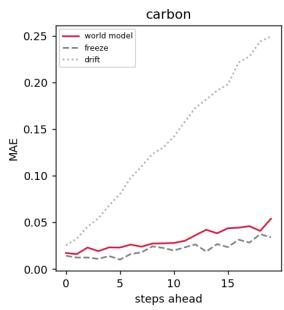

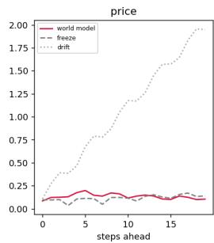

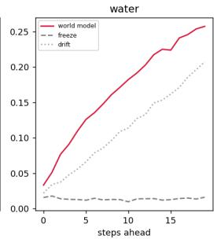

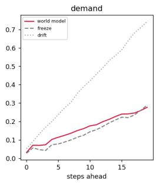  
Figure 2: LCM rolling-origin mean absolute error versus two baselines, by steps ahead, on four held-out state dimensions. The LCM dominates linear drift throughout. It is roughly on par with persistence on carbon, price, and demand. It is measurably worse than persistence on water stress, an honest limitation discussed in Section 5.

## C Preference Steerability

Table 2 (Section 5) reports steerability correlations from an eleven-point preference sweep. Own is the correlation between an objective’s weight and its realized value, where positive is expected. Other is the correlation with the competing objective, where negative is expected. The cost×carbon trade-off is close to linear in all three regimes, with magnitudes of at least 0.88. The water×reliability trade-off is confirmed everywhere, but it takes a different shape under lock-in. The irreversible regime shows a gradual, near-linear decline in reliability as weight shifts toward water across the full preference range. The reversible and commit-once regimes are close to flat over most of the range. They drop sharply only at the extreme weight on water (Fig. 3). In practical terms, the lock-in frontier gives a planner a usable, continuously adjustable water-reliability dial. The other two regimes behave closer to an on-off switch.

Cost × carbon: On this pair, the three regimes are nearly indistinguishable in the quality of steering. The own-objective correlations are 0.95, 0.93, and 0.88. The cross-objective correlations range from −0.96 to −0.99. All of them are strong. Shifting weight between cost and carbon therefore moves the realized outcomes along the trade-off in the intended direction, almost monotonically. Commit-once has the lowest own-correlation (0.88) and the strongest cross-correlation (−0.99). This suggests that, with a single day-zero choice, realized carbon is very tightly tied to the preference. Realized cost responds a little less cleanly. A plausible reason is that the one-time architecture and source choice is discrete, and each choice carries its own cost. This is an interpretation of the correlations and not a tested mechanism.

Water × reliability: Here the regimes separate. Under IRREVERSIBLE, both correlations are high (own +0.85, other −0.65). Under REVERSIBLE (own +0.65, other −0.52) and COMMIT-ONCE (own +0.59, other −0.54), they are noticeably weaker. These values are consistent with the sweep figures. A near-linear decline is well described by a linear correlation. A flat-then-cliff curve is not. The lower values under reversibility and commit-once therefore partly reflect the shape of the response. They do not necessarily indicate a failure of conditioning. The trade-off is still confirmed in every regime. What differs is how much of the preference range is useful for steering.

Why lock-in may help the dial: One plausible reading is consistent with the sparsity results of Table 1. When cooling can only change at spaced windows, the agent must hedge its water-related commitment against the whole horizon. This produces a response that varies smoothly with the water weight. When the agent can switch freely, or choose once, the cooling decision collapses into a nearly binary choice. The choice is made only when the water weight becomes large enough to outweigh the alternative. This reading is consistent with our experiments but not proved by them. Isolating it would require probing the cooling-architecture decision directly across the sweep.

Caveats: The sweep uses eleven preference points and a single representative run per regime. Correlations summarize monotone association. They do not capture slope or the size of the achievable range. They should be read alongside the sweep figures and the hypervolume and sparsity results, not in isolation.

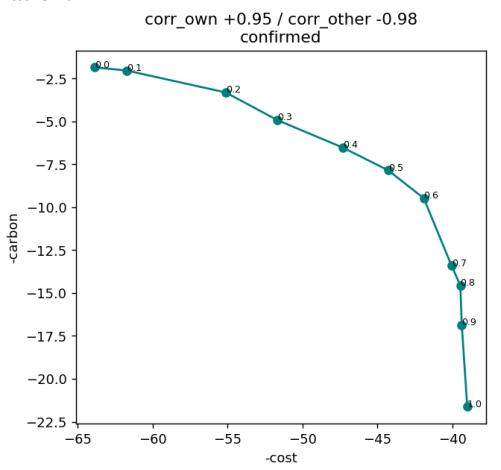

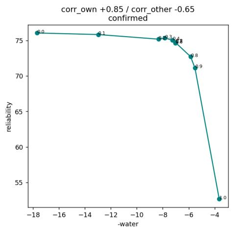

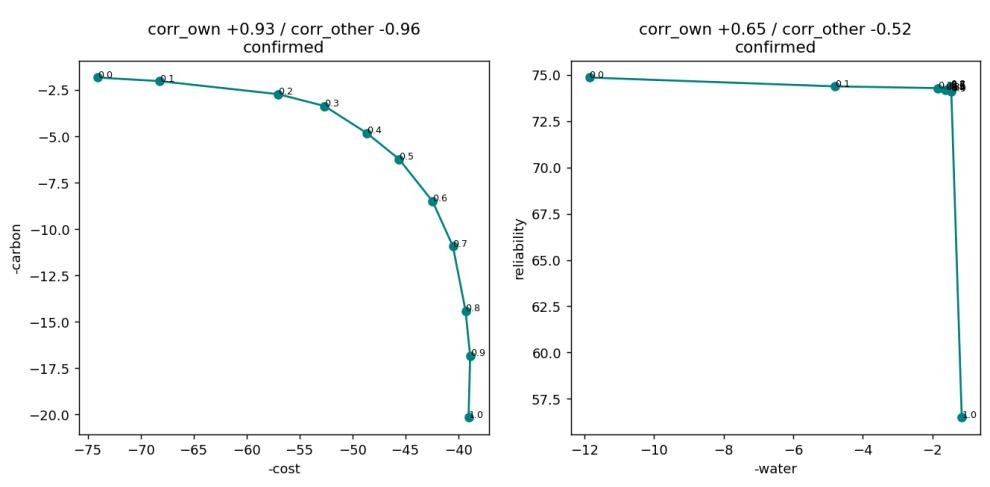

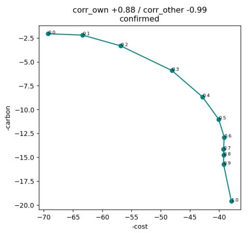

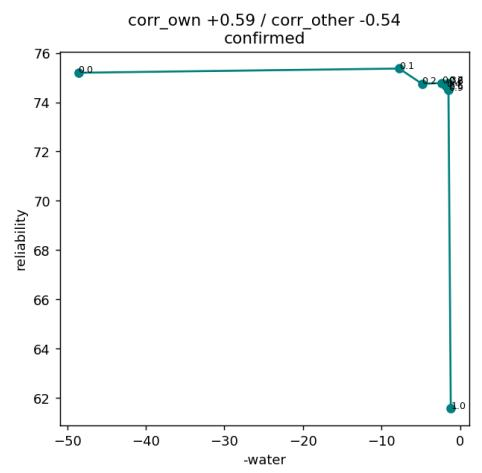  
(c) COMMIT-ONCE.  
Figure 3: Preference sweeps underlying Table 2. The left half of each panel shows cost × carbon. The right half shows water × reliability. Note the smoother, more gradual slope on the water axis under lock-in, against the flatter-then-cliff shape in the other two regimes.

## D Extended Results

This section expands on the headline results of Section 5. We first read Table 1 more closely. We then discuss the flat-agent and commit-once fronts, the anticipation figure, and the learning curves. All figures here show a single representative seed per configuration. Table 1 aggregates three seeds. The figures therefore illustrate the shape of the results, and the table carries the quantitative claims.

## D.1 Reading the hypervolume table more closely

In-distribution versus held-out: The most striking feature of Table 1 is the gap between indistribution and held-out cost×carbon hypervolume. In-distribution values are roughly 209–251. Held-out values are 10–47 across all six configurations. Water×reliability hypervolume degrades far less. It goes from 1295–1323 in-distribution to 931–1099 held-out. The held-out set contains two unseen sites and one unseen scenario. The cost×carbon plane is evidently more sensitive to the site-specific price and grid-carbon levels that differ most across locations. Absolute held-out hypervolumes should therefore be compared across agents within a regime. They should not be compared across regimes or against the in-distribution column. We report this gap openly because it bounds how far the learned frontiers can be trusted at unseen locations.

Where hierarchy helps most on held-out data: The clearest hierarchical advantage on held-out data is on water×reliability under lock-in. The hierarchical agent reaches 1088.1 ± 47.2 and the flat agent reaches 930.6 ± 24.3. This is an improvement of roughly 17%, well outside the reported spread. Under reversibility, the two agents are close on this held-out view (1091.2 vs. 1095.8). Under commit-once, the hierarchical mean is higher (1098.9 vs. 1023.3). However, the flat agent’s standard deviation (100.6) is large enough that we do not claim a difference. On held-out cost×carbon, the differences are small relative to the standard deviations in every regime. One example is $1 0 . 4 \pm 8 . 6$ vs. $1 4 . 0 \pm 1 0 . 3$ under lock-in. We regard the two agents as comparable there.

Variance across seeds: A recurring pattern is that the hierarchical agent has the smaller standard deviation on in-distribution cost×carbon hypervolume in all three regimes. The values are 6.7 vs. 12.0, 8.8 vs. 19.2, and 5.8 vs. 12.9. Sparsity has two exceptions. Under commit-once, the hierarchical agent is both worse and far more variable (34.68 ± 21.70). Under reversibility, theflat agent is the volatile one (25.43 ± 15.44 against 16.80 ± 2.02). With only three seeds, standard deviations are themselves noisy. We treat these as indications of stability and not as precise estimates.

## D.2 Recovered fronts

Flat-agent fronts under lock-in and free reversibility: Figure 4 is the flat-agent companion to Figure 1. The qualitative contrast between the regimes survives the removal of the hierarchy. The reversible frontier is the broader of the two, and the irreversible frontier is the more compact. This matters for interpretation. It indicates that the width-versus-coverage trade-off is driven mainly by the commitment regime and not by the agent architecture. The hierarchical agent mainly sharpens the result. It gives higher hypervolume and, under reversibility, more consistent sparsity. It does not change the character of the result.

Commit-once fronts for both agents: Figure 5 places the hierarchical and flat agents side by side under commit-once. Both recover a cost×carbon and a water×reliability trade-off with a range comparable to the reversible regime. This is consistent with the regime’s structure. A single day-zero choice of site architecture and power pathway carries none of the ongoing switching friction that narrows the irreversible frontier. The policy is therefore free to spread across the objectives through the initial selection alone. The flat agent is the more evenly covered of the two in Table 1 $( 2 0 . 5 9 \pm 5 . 0 7$ against $3 4 . 6 8 \pm 2 1 . 7 0 )$ . The figure shows one seed, and the hierarchical sparsity has a very large spread across seeds. A single illustrative front should therefore not be over-read in either direction.

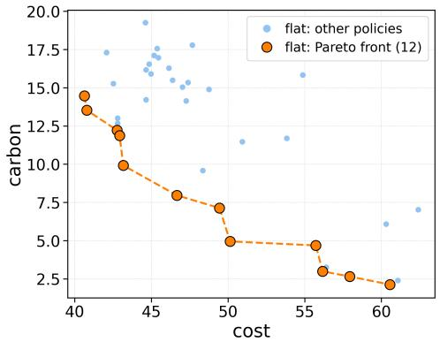

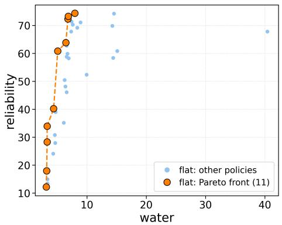

(a) IRREVERSIBLE, flat agent.  
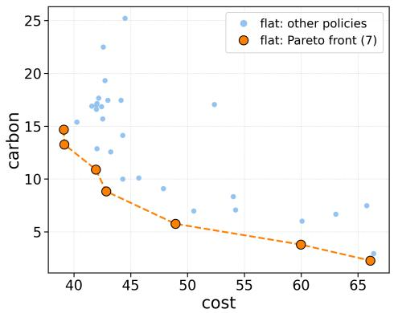

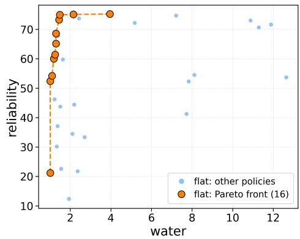  
(b) REVERSIBLE, flat agent.

Figure 4: Recovered fronts for the flat (non-hierarchical) agent under lock-in and free reversibility, companion to Figure 1.  
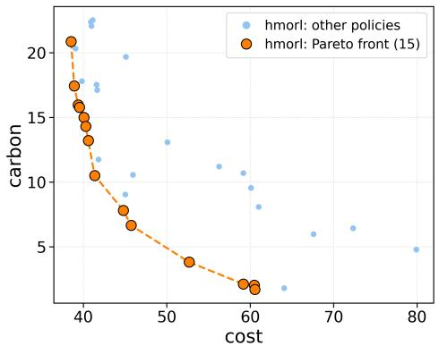

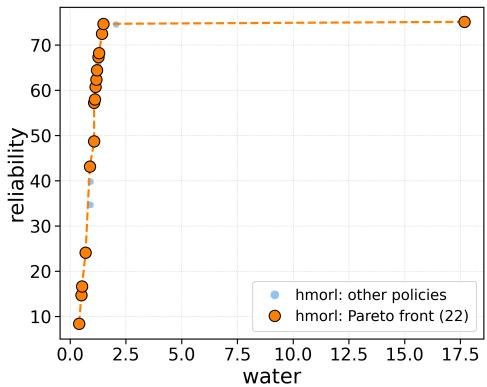  
(a) $\mathrm { C O M M I T - O N C E } ,$ hierarchical agent.

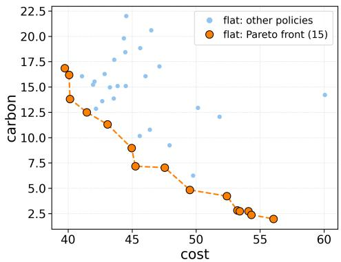

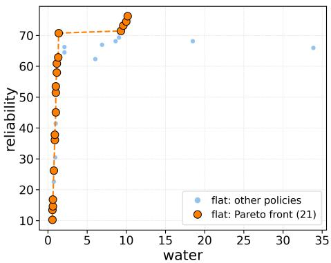  
(b) COMMIT-ONCE, flat agent.  
Figure 5: Recovered fronts under COMMIT-ONCE for the hierarchical and flat agents, split into training and held-out site/scenario pairs. Each panel shows a single representative seed. Multi-seed hypervolume and sparsity aggregates are reported in Table 1. Both agents recover a cost×carbon and water×reliability trade-off comparable in range to the reversible regime. This is consistent with a single day-zero choice carrying none of the ongoing switching friction that shapes the irreversible regime. Note from Table 1 that the flat agent’s front is in fact the more evenly covered of the two under this regime.

## D.3 Anticipatory retrofit timing

Figure 6 plots, for each regime, the number of episodes that leave evaporative cooling in each year (bars). It overlays the water-stress trajectory of a representative draw. Together with the anticipation rates in Section 5, it shows the clearest behavioral difference between the regimes.

Lock-in concentrates retrofits at the first legal window: Under IRREVERSIBLE, nearly all retrofits fall at the first available window. This matches the 88.9% anticipation rate with zero seed-to-seed variance. The policies agree not only on whether to retrofit but on when. This is what one expects when a window is rare. Waiting for the next one costs a 12-quarter delay. An agent that expects water stress to rise has little incentive to defer, so the earliest window dominates. This is the anticipatory behavior a planner wants, since the constraint binds years later.

Free reversibility scatters and weakens the signal: Under REVERSIBLE, the few retrofits that occur are spread across the horizon. The anticipation rate drops to 60.8%±43.0. A standard deviation of 43 points on a rate bounded between 0 and 100 implies something specific. Seeds disagree sharply about whether to leave evaporative cooling at all, and not merely about timing. The intuition is that switching is cheap and always available. There is then no cost to waiting. The learned policy can postpone indefinitely and react to conditions as they emerge. This is precisely the myopic behavior that static scoring implies.

Commit-once has no bars by construction: With no post-day-zero window, no retrofit can occur, and the panel shows none. Any adaptation to future water stress must be expressed through the initial architecture choice. This is why the anticipation metric is not defined for this regime.

On the reference line: The dashed line at 0.85 in the figure is retained only for visual continuity with earlier internal reports. The reported anticipation rate uses the calibrated, site-relative rise criterion of Appendix E. The line should not be read as the scoring threshold.

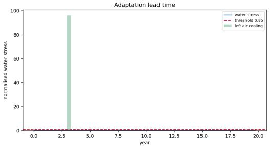  
(a) IRREVERSIBLE.

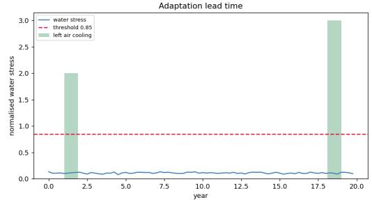  
(b) REVERSIBLE.

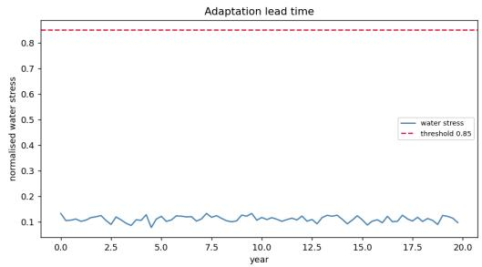  
(c) COMMIT-ONCE.  
Figure 6: Retrofit timing (bars, count of episodes leaving evaporative cooling in that year) against the water-stress trajectory of a representative draw, for all three regimes. The dashed reference line at 0.85 is retained for visual comparability with earlier internal reports. The anticipation rate actually reported in Table 1 and Section 5 uses the calibrated, site-relative rise criterion described in Appendix E, not this fixed line. Under lock-in, switches concentrate almost entirely at the first legal window. Under free reversibility they are few and scattered. Under commit-once there is no post-day-zero window, so no bars appear at all.

## D.4 Learning dynamics

Figure 7 shows three quantities for each regime and agent. They are the scalarized return at a fixed preference vector and the two hypervolume views over training.

Stability of the hierarchical agent: Across the regimes, the hierarchical curves are the steadier ones. This is consistent with the lower seed-to-seed standard deviation of in-distribution hypervolume in Table 1. The manager bootstraps over its four-quarter commitment interval. Credit for a long-lived decision is therefore assigned directly and not diffused over many single-quarter steps. This is a plausible source of the smoother training signal.

Noise in the flat agent: The flat agent chooses over the joint 12 × 7=84 action space with a single bootstrap interval. Its curves are visibly noisier. This is most pronounced for the flat commit-once run, which is noisier throughout than its hierarchical counterpart. The same hierarchical-versus-flat stability gap appears under irreversible and reversible. Yet on commit-once, the flat agent’s final multi-seed sparsity is the lower, more even, of the two. The learning curves and the final-frontie metrics therefore tell different stories on this regime. Neither alone is a sufficient summary.

How to read the three panels: The scalarized-return panel tracks progress on a single operating point. The two hypervolume panels measure the frontier recovered across preferences. A curve can plateau on the first while the hypervolume continues to change. Improving coverage at other preferences does not alter return at the fixed one. We therefore read all three together. We also treat late-training fluctuations in hypervolume as a reason to report multi-seed means as in Table 1, and not the final checkpoint of one run.

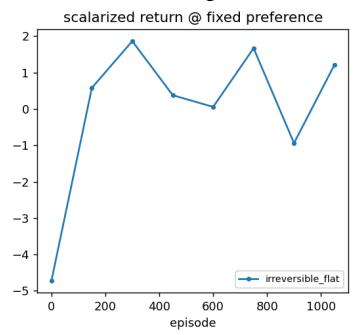

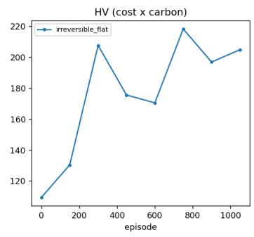  
(a) IRREVERSIBLE, flat.

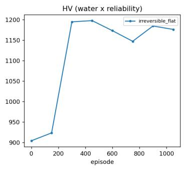

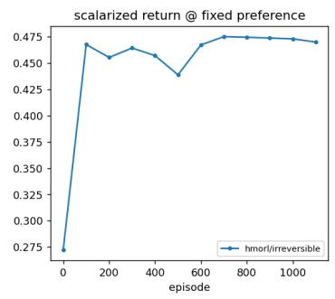

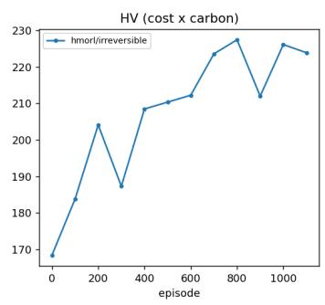  
(b) IRREVERSIBLE, hierarchical.

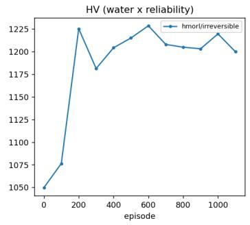

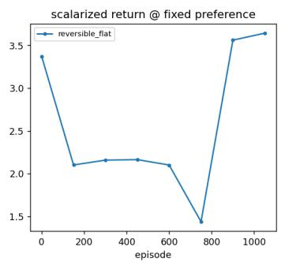

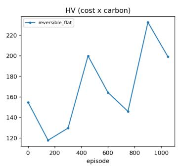  
(c) REVERSIBLE, flat.

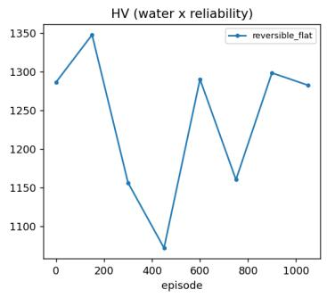

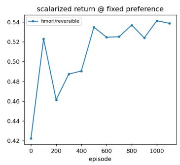

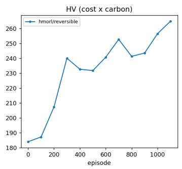  
(d) REVERSIBLE, hierarchical.

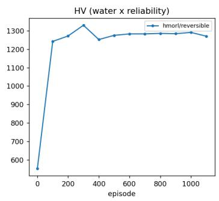

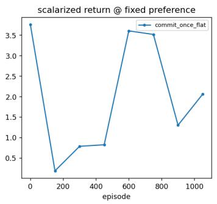

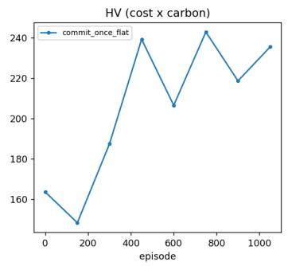  
(e) COMMIT-ONCE, flat.

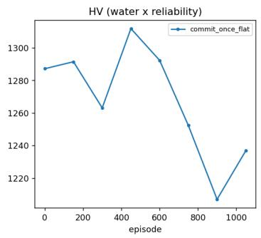

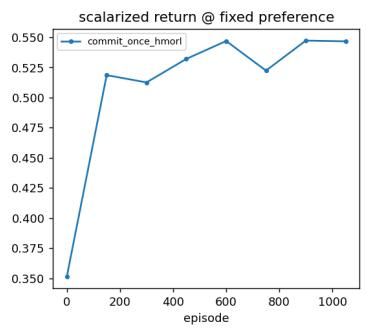

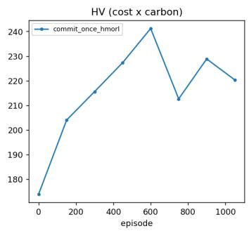  
(f) COMMIT-ONCE, hierarchical.

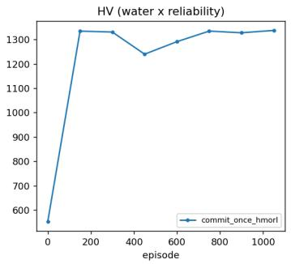  
Figure 7: Scalarized return at a fixed preference vector, hypervolume (cost × carbon), and hypervolume (water × reliability) over training, for all three regimes and both agent types. Curves are shown for a single representative seed each. Multi-seed hypervolume and sparsity aggregates for all three regimes are reported in Table 1. The flat COMMIT-ONCE run is visibly noisier throughout than the hierarchical run. This echoes the same hierarchical-vs-flat stability gap seen under IRREVERSIBLE and REVERSIBLE. It holds even though, on this regime, the flat agent’s final multi-seed sparsity is the lower (more even) of the two.

## E Full State, Action, and Site Detail

The 24-dimensional state comprises 10 exogenous signals and 14 endogenous variables. The exogenous signals are grid carbon intensity and its peak, electricity price and volatility, water stress, cooling load and its peak, workload demand, interconnection-queue pressure, and on-site renewable availability. The endogenous variables are the installed cooling one-hot, energized capacity per source, pending-commitment countdowns, the retrofit-window indicator, cumulative capital, and normalized elapsed time.

The manager chooses among 3 cooling architectures times 4 power sources, giving 12 actions. The worker chooses among 7 dispatch mixes. These are single sources, pairwise blends, and an equal four-way blend. Both are masked. Outside a retrofit window, the manager’s cooling component is pinned to the installed architecture. The worker’s mask excludes any mix drawing on unenergized capacity.

The binding event for the anticipation metric is a water-stress level materially above what was underwritten at day zero. This is a relative rise past a per-site floor. It is not a crossing of a fixed global number. The fixed 0.85 line shown in Figure 6 is kept only for visual continuity with earlier internal reports. It is not the scoring criterion.

The six site profiles (Table 3) map to real U.S. grid regions with real coordinates. They are used to query the grounded data sources of Appendix F. Two of the six, marked held-out, are never trained on.

Table 3: Site profiles and their real-world grid regions.
<table><tr><td>Site key</td><td>State</td><td>Grid region (RTO/ISO)</td><td>Split</td></tr><tr><td>tx_erco</td><td>Texas</td><td>ERCOT</td><td>train</td></tr><tr><td>sd_midwest</td><td>South Dakota</td><td>MISO</td><td>train</td></tr><tr><td>az_west</td><td>Arizona</td><td>West (non-ISO)</td><td>train</td></tr><tr><td>va_east</td><td>Virginia</td><td>PJM</td><td>train</td></tr><tr><td>wa_nw</td><td>Washington</td><td>West (non-ISO)</td><td>held-out</td></tr><tr><td>oh_mid</td><td>Ohio</td><td>PJM</td><td>held-out</td></tr></table>

## F Data Sources and Acknowledgments

Every reported result is grounded in measured or officially projected data. We do not use invented coefficients. Per-site water-stress level and its future relative growth come from the WRI Aqueduct 4.0 baseline and future (SSP/RCP) projections [34]. Per-site grid carbon intensity and its decarbonization slope come from EIA-930 hourly generation-by-fuel-type data. Electricity price level, drift, and volatility come from EIA’s industrial retail price series [31]. Source-dependent energization lead times per site come from the LBNL interconnection-queue microdata [25]. On-site renewable capacity factor and its seasonal volatility come from NREL PVWatts where reachable. Otherwise we fall back to a solar-geometry estimate, and we report the bias explicitly [21]. Hourly temperature, a cooling-load driver, comes from Open-Meteo [23].

The workload-efficiency (J/token) proxy is derived from device TDP and throughput in the Semi-Analysis/InferenceX inference-benchmark dataset [27]. It is cross-checked against an independent market price and throughput signal from the Artificial Analysis API [3]. All six sites in Table 3 map to real U.S. grid regions and states. A calibration pass (data/calibrate.py in the released code) reports, per coefficient and per site, whether the value was measured, projected, or fell back to a documented default. Every number in this paper is therefore auditable. We thank WRI, LBNL, EIA, NREL, Open-Meteo, SemiAnalysis, and Artificial Analysis for making this data available. None of these organizations endorse this work.

## G Limitations

The market-scale figures motivating this work are third-party industry projections [19; 13; 24; 33; 4; 15]. They establish the magnitude and cadence of the decision problem. They are not inputs to any reported result, and no empirical claim in this paper depends on their precision. Reported per-MW build costs vary by roughly an order of magnitude, depending on whether compute hardware is included [15]. We therefore use them to set the relative scale of the switching-cost coefficient. We do not use them as an absolute capital estimate.

The workload-energy signal is a throughput and device-power proxy. It is not measured wall power. It informs relative efficiency trends and not absolute energy accounting. Interconnection-queue data characterizes regional generation headroom. It does not describe a specific facility’s demandside connection. We use it as a supply-scarcity proxy, and the released calibration code states this interpretation throughout.

The LCM is measurably outperformed by persistence on water stress (Section 5, Figure 2). It should not be used for model-based planning on that axis until it clears that bar. The COMMIT-ONCE front and learning-curve figures (Figures 5 and 7) each show a single representative seed. Multi-seed hypervolume and sparsity aggregates for this regime are now reported in Table 1. Heldout cost×carbon hypervolume is far below its in-distribution counterpart for every configuration (Appendix D). Frontiers at unseen sites should therefore be treated as indicative and not decision-grade. Results use three seeds, so reported standard deviations are themselves uncertain. Static-scoring, myopic-greedy, and random baselines are specified in the released code (baselines/). They remain in progress as of this draft.

Most fundamentally, policies whose consequences unfold over decades cannot be validated against realized outcomes within a research cycle. We rely on held-out trajectory evaluation and rolling-origin LCM backtesting. In ongoing work, we are also running a coefficient sensitivity analysis. It samples each grounded coefficient across its plausible range. We make no claim of verified multi-decade forecasts.