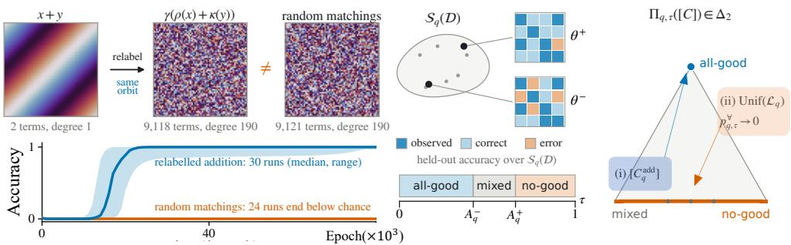
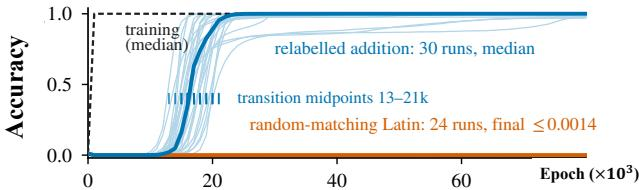
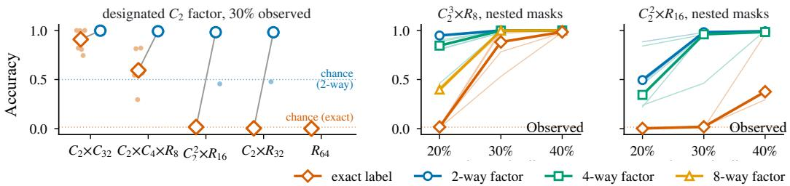

# MAPPING THE SOLUTION-SET STRUCTURE OF GROKKING ON LATIN SQUARES

Zihan Gu1,2, Lulu Zhao3, Tianyi Ma4,Hua Zhang1,2 , Wenbo Su3,Yanan Cao1,2,Yue Hu1,2 1Institute of Information Engineering, Chinese Academy of Sciences;

2School of Cyber Security, University of Chinese Academy of Sciences;

3 Alibaba Group; 4Shanghai Jiaotong University.

{guzihan}@iie.ac.cn

## ABSTRACT

Grokking is a delayed transition from memorisation to generalisation. A network first fits observed examples while remaining near chance on held-out inputs, then generalises abruptly. Prior work has focused mainly on this delay, finding that the network’s main loss becomes weight decay after the fitting phase. We name the solution to this optimization problem as the minimum-norm endpoint, and study which tasks make all minimum-norm endpoints generalise from partial observations. Specifically, we model pairwise input tasks as edge colourings of $K _ { q , q } ,$ , with Latin colourings as our structured family, and classify each observed instance as all-good, mixed, or no-good by its endpoint set. Furthermore, we prove two contrasting results: (1) Finite-abelian-group families are asymptotically allgood from partial observations; (2) Under a uniform random Latin square, all-good tasks become asymptotically rare for observation-based learners, leaving mixed or no-good behaviour. Moreover, experiments show that relabellings of addition generalise despite their dense polynomial representations. Finally, on tasks of composite order, finite-training results suggest that predictors learn a coarse part of the output before the full label.

## 1 INTRODUCTION

Grokking is delayed generalisation: a network fits its training examples, remains near chance on heldout inputs for a long period, and then generalises abruptly (Power et al., 2022). The classical instance is modular addition, where the network observes some pairs (x, y) with their sums x + y mod q and must infer the rest. Such a learning curve combines two things, the quality of the predictor that training eventually reaches and the time taken to reach it, and existing work examines how learned representations, regularisation, and the training data shape this behaviour (Nanda et al., 2023; Mohamadi et al., 2024; Gu et al., 2025). However, a run that generalises shows that there exsits one solution does; it does not show that every solution a training could have selected would. We isolate the generalisation behaviour and ask it at the level of the task. Defining the minimum-norm endpoint as the solution to the weight decay-induced optimization problem, our central question is therefore: which task structures make the entire minimum-norm endpoint set generalise?

Answering it needs modelling of the task and endpoint set. A pairwise input task assigns an output to every pair of inputs, and we encode it as an edge colouring of the complete bipartite graph $K _ { q , q } \colon$ the two input alphabets are the two vertex classes, each pair (u, v) is an edge, which we also call a cell, and the output is its colour. Written out, the colouring is a $q \times q$ table, and at prime-power order it is a polynomial over $\mathbb { F } _ { q } ;$ table, graph, and polynomial are three coordinates on one object. The colouring is Latin when it is proper, so that no vertex sees a colour twice; in table coordinates every symbol appears exactly once in each row and column, so the Latin colourings are the Latin squares of combinatorics. Every group multiplication table is one, and the family therefore contains modular addition together with its natural competitors. Permuting the vertices within either class, permuting the colours, or swapping the two classes only changes how the table is written; we call such a move a relabelling, and the orbit of a colouring under relabellings is our task object. Training observes a uniformly random subset of the cells of fixed size.

  
Figure 1: Coordinates, endpoint sets, and the two poles. Left: $x + y$ mod 97; a relabelling of it, 9,118 terms and degree 190; and a random-matching colouring outside the orbit. Middle: the minimum-norm interpolators $ { \boldsymbol { S } } _ { q } (  { \mathcal { D } } )$ agree on the observed cells, may differ elsewhere; their extremes $A _ { q } ^ { - } \le A _ { q } ^ { + }$ cut τ into all-good, mixed, no-good. Right: each orbit maps to a simplex point; abelian group families sit at the all-good vertex (cyclic addition illustrated), while the uniform Latin ensemble sits on the opposite edge, where the mixed/no-good split is open.

The network reads an edge through its two endpoints, with one embedding table per vertex class, a hidden ReLU layer, and a head over the colours. For the endpoint of training we follow implicit-bias theory, which motivates the minimum-norm interpolator as the idealised late-training object (Soudry et al., 2018; Lyu & Li, 2020; Neyshabur et al., 2015). A partially observed colouring, however, has many minimum-norm interpolators: all meet the margins on the observed cells and are free to disagree on the rest, and a handful of training runs yields a few selected predictors without certifying that they belong to this set or how the set behaves as a whole. We therefore take the whole set, the endpoint set, as the object of study, and describe it by what holds across it at a fixed held-out threshold τ: an observed instance is all-good if every minimum-norm interpolator generalises, no-good if none does, and mixed if both kinds coexist. Averaged over the random observations, the three probabilities form the task’s phase profile, a point of a triangle (Figure 1, middle and right).

Relabelling induces a norm-preserving bijection between endpoint sets and preserves the law of the observations, so the phase profile is well defined on orbits: it is a map from colouring orbits to the triangle. The network realises the bijection by permuting the rows of its embedding tables and of its head. This separates task structure from its polynomial description. Take x + y mod 97 and relabel it. The endpoint set is transported by the bijection, but the polynomial coordinate becomes a polynomial over $\mathbb { F } _ { 9 7 }$ with 9,118 nonzero terms and total degree 190, with essentially the same support density and the same degree as a proper colouring assembled from random perfect matchings, which lies outside the orbit. Networks trained on the relabelled colouring memorise and then generalise as they do on $x + y ;$ networks trained on the random-matching colouring end below chance (Figure 1, left). Relabelling preserves the phase while changing polynomial sparsity and degree, and in this comparison those coordinate statistics also fail to distinguish the trained predictors’ outcomes. This is why we work with orbits.

Our results place two structures at opposite poles of the triangle. The all-good pole contains every finite abelian groupfamily: at any fixed positive observation fraction, the worst endpoint accuracy converges to one in probability as the order grows. Cyclic addition is one instance, and nonisomorphic abelian groups supply distinct all-good orbits. At the opposite pole, a uniformly random Latin colouring defeats every learner that reads only the observations, at any fixed positive accuracy; consequently the colourings with a non-negligible all-good component have vanishing uniform mass. Generalisation is thus guaranteed throughout a structured family yet rare in the ambient space.

The core of our theory is a lemma of carrier criterion: a network that scores the full grid with controlled margins at a known norm cost. It bounds the cost of every minimum-norm endpoint on every mask, and a finite atlas fixed before the observations counts the harmful low-norm alternatives, whose number is too small for any of them to evade a random mask. The criterion does not depend on the colouring, and abelian characters provide carriers uniformly across group structures. Therefore, we have proven that satisfying this lemma is a sufficient condition for all good. We conjecture that the carrier criterion is also necessary: every asymptotically all-good Latin family admits a full-grid carrier in the same norm-and-margin regime.

Experiments at composite order 64 compare the guaranteed families with non-abelian and non-group candidates and show that coarse output factors are recovered before exact labels. These trained predictors probe structure; they do not measure the phase of the whole endpoint set. Whether a typical random colouring has some good endpoint, and whether any family carries non-vanishing mixed mass, remain open.

## Contributions.

• A task-level formulation: Latin colourings of $K _ { q , q }$ compared up to relabelling, each observed instance judged by its whole minimum-norm solution set.

• Two poles: every finite abelian group family is asymptotically all-good, while the uniform Latin ensemble defeats every learner at any fixed positive held-out accuracy.

• A colouring-independent carrier criterion for all-goodness, together with the conjecture that this criterion is necessary.

• Experiments in the same model class: relabelled addition groks like addition while looking like noise, and at composite order structured tasks recover coarse output factors before exact labels.

Paper Organization. Section 2 reviews prior work, Section 3 defines the model, Section 4 states and proves the two poles and the abelian extension, Section 5 reports the composite-order experiments and states the conjecture, and Section 6 concludes. Experiments that speak directly to the theory follow the theory itself.

## 2 RELATED WORK

Grokking is reported in non-neural models (Mallinar et al., 2024), deep networks (Fan et al., 2024; Manir & Rupa, 2026), in-context and multi-hop reasoning (He et al., 2024; Wang et al., 2024; Abramov et al., 2025), and LLM pretraining (Li et al., 2025); its onset needs a critical data fraction (Zhu et al., 2024; Huang et al., 2024) and its delay can be shortened (Thilak et al., 2022; Lee et al., 2024; Park et al., 2024; Kunin et al., 2024; Xu et al., 2025). Related approaches include representation learning, norm and optimisation bias, and circuit competition. Representation-level work studies Fourier circuits and progress measures (Nanda et al., 2023; Gromov, 2023; Furuta et al., 2024; Barak et al., 2022), spectral dynamics (Zhou et al., 2024; Yunis et al., 2024), embedding bottlenecks (AlQuabeh et al., 2025), architectural bias (Singh et al., 2026; Yıldırım, 2026), task symmetry (Hwang & Park, 2026), embedding uniformity coupled to the training distribution (Gu et al., 2025), feature-emergence scaling laws (Tian, 2025), and topological signatures (Tang et al., 2026). Norm- and optimisation-based accounts appeal to implicit bias toward max-margin, minimum-norm endpoints (Soudry et al., 2018; Lyu & Li, 2020; Neyshabur et al., 2015; Lyu et al., 2024; Mohamadi et al., 2024; Humayun et al., 2024), to norm minimisation on the zero-loss manifold (Mus¸at, 2025; Tikeng Notsawo et al., 2025), to the edge of linear separability (Beck et al., 2025), to numerical stability (Prieto et al., 2025), sharpness (Miller et al., 2024), Jacobian alignment (Walker et al., 2025), and quantitative delay laws (Truong et al., 2026; Tan et al., 2026; Ersoy & Wiesner, 2026). Competition accounts pit a slow generalising circuit against a fast memorising one (Varma et al., 2023; Merrill et al., 2023), linking grokking to double descent and emergent abilities (Davies et al., 2023; Huang et al., 2024; Liu et al., 2022), with phase-transition, statistical, basin-selection, and capacity variants (Clauw et al., 2024; Carvalho et al., 2025; Cullen et al., 2026; Song & Ye, 2026; Luo et al., 2026). Provable results include generalisation guarantees for bounded-norm quadratic networks on modular addition (Mohamadi et al., 2024) and delay bounds in ridge regression (Xu et al., 2026). Gu et al. (2025) separately analyse the accuracy ceiling and embedding dynamics; Appendix E.2 discusses their ceiling and transition-time measurements. Our setting fixes a ReLU architecture and a uniform mask law, compares Latin colourings up to relabelling, and quantifies over every minimum-norm response. These choices specify the scope of our endpoint guarantees.

## 3 LATIN-SQUARE TASKS AND THE ENDPOINT SET

This section builds the objects the introduction used informally: the task and its observed part, the endpoint set, its three phases, and the relabelling invariance that makes the phase a property of the task rather than of its presentation.

## 3.1 TASKS, MASKS, AND THREE COORDINATES

Let $q \geq 2 , [ q ] = \{ 0 , \ldots , q - 1 \} , X _ { q } = [ q ] ^ { 2 }$ , and $N = q ^ { 2 }$ . A pairwise classification task is a colouring $C : X _ { q }  \mathsf { \bar { [ } } q \mathsf { ] }$ ; the set of all colourings is $\operatorname { \dot { C } } _ { q \cdot } \operatorname { A }$ colouring is Latin when every symbol occurs exactly once in each row and each column; $\mathcal { L } _ { q } \subset \mathop { \mathcal { C } } _ { q }$ denotes the Latin colourings of order q. For every q, modular addition $C _ { q } ^ { \mathrm { a d d } } ( u , v ) = u + v$ (mod q) is Latin and is the cyclic prototype of the abelian all-good family proved below.

Fix $\alpha \in ( 0 , 1 )$ . The observed cells form a uniformly random mask of fixed size,

$$
\begin{array} { r l r } { \Omega \sim \nu _ { q } : = \operatorname { U n i f } \big \{ \Omega ^ { \prime } \subseteq X _ { q } : | \Omega ^ { \prime } | = \lfloor \alpha N \rfloor \big \} , } & { { } } & { T = X _ { q } \setminus \Omega ; } \end{array}\tag{1}
$$

$T$ is the held-out set and $\mathcal { D } ( C , \Omega ) = \{ ( u , v , C ( u , v ) ) : ( u , v ) \in \Omega \}$ the dataset. All asymptotic statements hold at fixed α.

Proposition 3.1 (Two coordinates, and a third at prime-power order). For every $q \geq 2 ,$ a label table $C \in { \mathcal { C } } _ { q }$ and a q-edge-colouring of $K _ { q , q } ( c o l o u \bar { r } C ( u , \bar { v } )$ on the edge $U _ { u } V _ { v } )$ determine each other. When q is a prime power and [q] is identified with $\mathbb { F } _ { q } ,$ both are also equivalent to the unique reduced polynomial $\mathsf { \bar { P } } _ { C } \in \mathsf { \bar { F } } _ { q } [ X , Y ]$ with deg $_ { X } P _ { C }$ , deg $\dot { P _ { C } } \leq q - 1$ and $P _ { C } ( u , v ) = C ( u , v )$ . C is Latin ifand only ifthe edge colouring is proper, i.e. each colour class is a perfect matching.

## 3.2 THE MINIMUM-NORM ENDPOINT SET

The model is a bias-free one-hidden-layer ReLU network with a separate embedding table for each input, $E _ { U } , E _ { V } : [ q ] \to \mathbb { R } ^ { d _ { q } }$ , a hidden layer $W \in \mathbb { R } ^ { h _ { q } \times d _ { q } }$ , and a head $A \in \mathbb { R } ^ { q \times h _ { q } }$ , where $d _ { q } = 2 q + 1$ and $h _ { q } = q ^ { 2 } ;$ the width allows one hidden unit per cell, which is what feasibility needs, and the embedding dimension exceeds the rank of any reduced representation. Writing $\theta = \mathsf { \bar { ( } } E _ { U } , E _ { V } , W , A )$

$$
\begin{array} { r } { F _ { \theta } ( u , v ) = A \mathrm { ~ R e L U } \big ( W \left( E _ { U } ( u ) + E _ { V } ( v ) \right) \big ) \in \mathbb { R } ^ { q } , \ \| \theta \| ^ { 2 } = \| E _ { U } \| _ { F } ^ { 2 } + \| E _ { V } \| _ { F } ^ { 2 } + \| W \| _ { F } ^ { 2 } + \| A \| _ { F } ^ { 2 } . } \end{array}\tag{2}
$$

As a function class the pair embedding contains the common design that shares one table $E$ and concatenates $[ E ( u ) ; E ( \bar { v } ) ]$ ], since $W [ \bar { E ( \boldsymbol { u } ) } ; E ( \boldsymbol { v } ) ] = W _ { 1 } E ( \boldsymbol { u } ) + \bar { W _ { 2 } } E ( \boldsymbol { v } )$ ; the norms differ, so the endpoint sets need not coincide. The endpoint set of an observed dataset is the set of global minimisers of the parameter norm under unit margins on the observed cells,

$$
\begin{array} { r } { \mathcal S _ { q } ( \mathcal D ) = \underset { \theta } { \mathrm { a r g } } \underset { 0 } { \mathrm { m i n } } \frac 1 2 \| \theta \| ^ { 2 } \quad \mathrm { s . t . } \quad F _ { \theta , y } ( u , v ) \geq 1 + \underset { a \neq y } { \mathrm { m a x } } F _ { \theta , a } ( u , v ) \qquad \big ( ( u , v , y ) \in \mathcal D \big ) . } \end{array}\tag{3}
$$

Max-margin and implicit-bias results for homogeneous networks motivate this as the idealised latetraining object (Soudry et al., $2 0 1 8 ; \mathrm { L y u } \ \& \ \mathrm { L i } , \bar { 2 } 0 2 0 ;$ ; Neyshabur et al., $2 0 1 5 ) . \ S _ { q } ( { \mathcal { D } } )$ is a set: all its members meet the margins on $\Omega ,$ and they may predict differently on T. Appendix B.2 treats the extension to $L _ { 2 } .$ -regularised biases.

Three of the four parameter blocks can be folded into one matrix, which is the form the proofs work with. Assemble $\dot { \Phi ^ { \bullet } } = [ E _ { U } ( 0 ) , \ldots , E _ { U } ( q - 1 ) , E _ { V } ( 0 ) , \ldots , E _ { V } ( q - 1 ) ] \in \mathbb { R } ^ { d _ { q } \times 2 q }$ , put $\bar { Z = W \Phi }$ and $\xi _ { ( u , v ) } = e _ { u } + e _ { q + v } \in \mathbb { R } ^ { 2 q }$ , so that $F _ { \theta } ( x ) = A \operatorname { R e L U } ( Z \xi _ { x } )$ . Call $( A , Z )$ a reduced representation and define

$$
\begin{array} { r }  J ( F ) = \operatorname* { i n f } \big \{ \| A \| _ { F } \| Z \| _ { * } : \ F = A \mathrm { { R e L U } } ( Z \xi . ) , \ \mathrm { { a n y } \ f i n i t e \ w i d t h \big \} , } \end{array}
$$

$$
J _ { * } = \operatorname* { m i n } \bigr \{ \| A \| _ { F } \| Z \| _ { * } : \ Z \in \mathbb { R } ^ { h _ { q } \times 2 q } , \ A \mathrm { R e L U } ( Z \xi . ) \ \mathrm { m e e t s ~ t h e ~ m a r g i n s ~ o f ~ ( 3 ) } \bigr \} .\tag{4}
$$

Lemma 3.2 (Reduced normalisation). The optimal value of (3) is $\begin{array} { r } { V _ { * } = \frac { 3 } { 2 } J _ { * } ^ { 2 / 3 } } \end{array}$ , and every global minimiser is balanced: $\| A \| _ { F } ^ { 2 } = \| W \| _ { F } ^ { 2 } = \| \Phi \| _ { F } ^ { 2 } = J _ { * } ^ { 2 / 3 } a n d \| A \| _ { F } \| W \Phi \| _ { * } = J _ { * }$

In words: the nuclear norm of Z is the cost of its cheapest factorisation into a hidden layer and an embedding, and the scale freedom of the ReLU then balances the head against the rest, so an endpoint is simply a score table whose product $\| A \| _ { F } \| Z \|$ ∗ is as small as the observations allow. This product is the one quantity the main proof tracks.

## 3.3 PHASES OF THE ENDPOINT SET AND THE PHASE PROFILE

Fix C and Ω and write $S _ { q } = { \cal S } _ { q } ( { \cal D } ( C , \Omega ) )$ . Strict held-out accuracy counts a score tie as an error, and the best and worst endpoint accuracies are its extrema over the endpoint set:

$$
\operatorname { A c c } _ { T } ( \theta ; C ) = { \frac { 1 } { | T | } } \sum _ { x \in T } \mathbf { 1 } \Big \{ F _ { \theta , C ( x ) } ( x ) > \operatorname* { m a x } _ { a \neq C ( x ) } F _ { \theta , a } ( x ) \Big \} , \ A _ { q } ^ { + } = \operatorname* { m a x } _ { S _ { q } } \operatorname { A c c } _ { T } , \ A _ { q } ^ { - } = \operatorname* { m i n } _ { S _ { q } } \operatorname { A c c } _ { T } .\tag{5}
$$

For a threshold $\tau \in ( 0 , 1 )$ the endpoint set is in exactly one of three phases, each a quantifier over $\begin{array} { r } { { \cal { S } } _ { q } . } \end{array}$

$$
\mathsf { a l l - g o o d : } A _ { q } ^ { - } \geq \tau , \qquad \mathsf { m i x e d : } A _ { q } ^ { + } \geq \tau > A _ { q } ^ { - } , \qquad \mathsf { n o - g o o d : } A _ { q } ^ { + } < \tau .\tag{6}
$$

Write $G _ { q , \tau } ^ { \forall } , G _ { q , \tau } ^ { \mathrm { m i x } } , G _ { q , \tau } ^ { \otimes }$ for their indicators and $G _ { q , \tau } ^ { \exists } = G _ { q , \tau } ^ { \forall } + G _ { q , \tau } ^ { \mathrm { m i x } }$ for “some endpoint is good”. Averaging over the mask, for $\star \in \{ \forall , \operatorname* { m i x } , \emptyset , \exists \}$ , gives the phase probabilities and the phase profile,

$$
p _ { q , \tau } ^ { \star } ( C ) = \mathbb { E } _ { \Omega \sim \nu _ { q } } \bigl [ G _ { q , \tau } ^ { \star } ( C , \Omega ) \bigr ] , \qquad \Pi _ { q , \tau } ( C ) = \bigl ( p _ { q , \tau } ^ { \forall } ( C ) , p _ { q , \tau } ^ { \operatorname* { m i x } } ( C ) , p _ { q , \tau } ^ { \mathcal { O } } ( C ) \bigr ) .\tag{7}
$$

Proposition 3.3 (Phase decomposition). $ { \boldsymbol { S } } _ { q } (  { \mathcal { D } } )$ is non-empty for every $C \in { \mathcal { C } } _ { q }$ and $\Omega \subseteq X _ { q }$ . For every $\tau \in ( 0 , 1 )$ the three phases in (6) are mutually exclusive and exhaustive, so $\Pi _ { q , \tau } ( C )$ lies in the simplex $\Delta _ { 2 } = \{ ( a , b , c ) \in [ 0 , 1 ] ^ { 3 } : a + b + c = 1 \}$ }.

The threshold only decides where an instance falls; the extremes $A _ { q } ^ { - } \le A _ { q } ^ { + }$ are properties of the set itself. A fixed instance is all-good for thresholds up to $A _ { q } ^ { - }$ , mixed between $A _ { q } ^ { - }$ and $A _ { q } ^ { + }$ , and no-good above, so it is mixed at some threshold exactly when different endpoints achieve different accuracies (Appendix B.1).

## 3.4 INVARIANCE: THE PROFILE LIVES ON COLOURING ORBITS

Permuting rows, columns, or symbols, or exchanging the two inputs, changes how a table is written and nothing about the learning problem. The formal name for this equivalence is colouring isomorphism (for Latin squares, isotopy together with transposition); the paper calls it relabelling.

Definition 3.4 (Colouring isomorphism). $C \sim _ { q } C ^ { \prime }$ when there are $\rho , \kappa , \gamma \in S _ { q }$ with $C ^ { \prime } ( u , v ) =$ $\gamma ( C ( \rho ( u ) , \kappa ( v ) ) )$ for all $u , v ,$ or $C ^ { \prime } ( u , v ) = \gamma ( C ( \kappa ( v ) , \rho ( u ) ) )$ for all $u , v .$ . The quotients are $\widehat { \mathcal { Q } } _ { q } =$ $\mathcal { C } _ { q } / \sim _ { q }$ and $\mathcal { Q } _ { q } = \mathcal { L } _ { q } / \sim _ { q } .$

Theorem 3.5 (Quotient invariance). Let $C \sim _ { q } C ^ { \prime }$ . There are bijections offixed-size masks and of endpoint sets, preserving the parameter norm and the mask law, under which corresponding endpoints have the same logits, the same truth–rival margins, and the same strict correctness at every cell. Consequently $p _ { q , \tau } ^ { \forall } , p _ { q , \tau } ^ { \mathrm { m i x } } , p _ { q , \tau } ^ { \otimes } , p _ { q , \tau } ^ { \exists }$ and $\Pi _ { q , \tau }$ are well defined on $\widehat { \mathcal { Q } } _ { q } ,$ , hence on $\mathcal { Q } _ { q } , f o r$ every $\tau \in ( 0 , 1 )$

The proof is short: relabelling the task amounts to permuting the entries of the two embedding tables and the rows of the head, and swapping the two tables under transposition, and each of these moves preserves the norm, the margin constraints, and cellwise correctness. The consequence is that the profile becomes a function on orbits, the classification map

$$
\begin{array} { r } { \mathcal { Q } _ { q } \longrightarrow \Delta _ { 2 } , \qquad [ C ] \longmapsto \Pi _ { q , \tau } ( [ C ] ) , } \end{array}\tag{8}
$$

which is the object classified in the rest of the paper. One consequence deserves to be seen before the full proof (Appendix C.2): the support size and degree of the polynomial coordinate are not orbit invariants, so every relabelled representative $\gamma ( \rho ( u ) + \kappa ( v ) )$ of the addition orbit has the profile of

$C _ { q } ^ { \mathrm { a d d } }$ , however dense its polynomial.

Dense representatives of addition additiongrok. Figure 2 is the invariance the-relabelledorem seen from the data side. Ten random relabellings $( \rho , \kappa , \gamma )$ of $C _ { q } ^ { \mathrm { a d d } }$ at $q = 9 7$ give tables whose reduced 0 940polynomials have total degree 190 and $9 7 \%$ nonzero coefficientscoefficient support, matching the random-matching Latin controls in

  
Figure 2: Relabelled addition groks like addition.

both statistics, while their orbit is still that of $C _ { q } ^ { \mathrm { a d d } }$ . All 30 runs memorise and then generalise, ending at median held-out accuracy 1.000; the $2 4$ controls fit their training cells and end below 0.0014 held-out. Reusing a symbol already seen in the row or column of a cell is always wrong by the Latin property, so below-chance accuracy is possible. Within the orbit final accuracies cluster near one but the delays vary with the optimisation seed: a random-effects decomposition of the transition midpoint attributes about 93% of its variance to it (Appendix D.3). At this order, these runs support a stable final outcome with variable delay; they do not certify membership in $\textstyle { \mathcal { S } } _ { q }$ or measure its phase. The next section states the endpoint guarantees.

## 4 TWO POLES OF THE LATIN QUOTIENT

Informal Results. The objects of the previous section turn the question of the introduction into a map: each relabelling orbit of Latin colourings is sent to its phase profile, a point of the triangle whose corners are all-good, mixed, and no-good. Which orbits sit at the all-good corner? Which carry mixed mass? And where does the orbit of a uniformly random Latin colouring sit? Our results answer the first for every abelian group family and the third in its all-good coordinate, with the observation fraction and the success threshold held fixed while the order grows.

Informal Theorem (Two poles of the Latin quotient). Fix an observation fraction and a success threshold and let the order tend to infinity.

(i) Abelian group families are all-good: along any sequence of finite abelian groups of growing order, the worst minimum-norm endpoint accuracy converges to one in probability, so the profile converges to the all-good corner.

(ii) Uniform Latin squares are unlearnable from the observations: for a uniformly random Latin colouring, no learner whose prediction depends only on the observed cells reaches the success threshold with probability bounded away from zero. Consequently orbits with a non-negligible all-good component have vanishing mass under this law.

Part (i) concerns every endpoint of each task in a structured family; part (ii) concerns every learner under a random task law. The latter controls the all-good coordinate, leaving open whether a typical colouring has some good endpoint.

## 4.1 THE MAIN RESULTS

We prove cyclic addition first and obtain every abelian group from it as a corollary, rather than proving the general statement directly: both proofs share one method, a carrier and a notch; the notch is insensitive to the colouring, and only the characters that build the carrier change from $\mathbb { Z } _ { q }$ to a general abelian group. The cyclic case thus shows the whole argument in its most concrete form. Part (ii) needs two pieces of vocabulary: a task ensemble, since it concerns a random Latin square, and a learner, since it quantifies over everything that reads the observations. A task ensemble is a sequence ${ \sf M } = ( \mu _ { q } ) _ { q }$ of distributions on $\mathcal { L } _ { q } ;$ we use $\mathsf { M } _ { \mathrm { a d d } } = ( \delta _ { C _ { a } ^ { \mathrm { a d d } } } ) _ { q }$ and $\mathsf { M } _ { \mathrm { u n i f } } = ( \operatorname { U n i f } ( \mathcal { L } _ { q } ) ) _ { q } . \mathsf { A }$ learner $\mathsf { A } _ { q }$ is a deterministic map from observed datasets to score tables on $X _ { q } ,$ that ${ \mathrm { i s } } ,$ to functions $X _ { q } \to \mathbb { R } ^ { q }$ read through AccT as in (5) (a randomised learner is covered by conditioning on its coins). With $C \sim \mu _ { q }$ and $\Omega \sim \nu _ { q }$ independent,

$$
P _ { q , \tau } ^ { \star } ( \mathsf { M } ) = \mathbb { E } _ { C \sim \mu _ { q } } \bigl [ p _ { q , \tau } ^ { \star } ( C ) \bigr ] , \qquad P _ { q , \tau } ^ { \mathrm { A } } ( \mathsf { M } ) = \mathbb { P } \bigl [ \mathrm { A c c } _ { T } \bigl ( \mathsf { A } _ { q } ( \mathcal { D } ( C , \Omega ) ) ; C \bigr ) \geq \tau \bigr ] .\tag{9}
$$

A selector is a learner with $\mathsf { A } _ { q } ( \mathcal { D } ) = F _ { \theta }$ for some $\theta \in \mathcal { S } _ { q } ( \mathcal { D } )$ ; since $S _ { q } ( \mathcal { D } )$ depends on the observations alone, any choice function on it is a learner, and one exists because the endpoint set is never empty.

Theorem 4.1 (Cyclic prototype and uniform obstruction). Fix $\alpha , \tau \in ( 0 , 1 )$ and let $q \to \infty$

(i) (Addition is all-good.) The worst endpoint accuracy converges to one in probability over the mask,

$$
A _ { q } ^ { - } ( C _ { q } ^ { \mathrm { a d d } } , \Omega ) \xrightarrow { \mathrm { ~ P ~ } } 1 , \quad h e n c e \quad P _ { q , \tau } ^ { \forall } ( \mathsf { M } _ { \mathrm { a d d } } )  1 \quad a n d \quad \Pi _ { q , \tau } ( [ C _ { q } ^ { \mathrm { a d d } } ] )  ( 1 , 0 , 0 ) .\tag{10}
$$

(ii) (Uniform Latin squares defeat every learner.) Uniformly over all learners $\mathsf { A } _ { q } ,$

$$
P _ { q , \tau } ^ { \mathsf { A } } ( \mathsf { M } _ { \mathrm { u n i f } } ) \ \leq \ ( 2 e ^ { 2 } ) ^ { N } q ^ { - \tau ( 1 - \alpha ) N } \ \longrightarrow \ 0 ,\tag{11}
$$

$$
h e n c e P _ { q , \tau } ^ { \forall } ( \mathsf { M } _ { \mathrm { u n i f } } ) \to 0 \ u n d \ \mathbb { P } _ { C \sim \mathrm { U n i f } ( \mathcal { L } _ { q } ) } \big [ p _ { q , \tau } ^ { \forall } ( C ) \geq \varepsilon \big ] \to 0 \ f o r \ e \nu e r y \ \varepsilon > 0 .
$$

The two parts are proved in the next two subsections. The second part is pure counting and never looks at the model; the phase enters only through the observation that on an all-good instance every selector succeeds, so $P _ { \boldsymbol { q } , \tau } ^ { \forall } ( \mathsf { M } _ { \mathrm { u n i f } } ) \le P _ { \boldsymbol { q } , \tau } ^ { \mathsf { A } } ( \mathsf { M } _ { \mathrm { u n i f } } )$ , and Markov’s inequality turns the vanishing expectation into the vanishing-mass statement. Nothing in either proof depends on the arithmetic of $q \colon$ the theorem holds along every sequence of orders, with $C _ { q } ^ { \mathrm { a d } \mathrm { \bar { d } } }$ the cyclic group table of order q. Written as $\exp \bigl ( - N [ \tau ( 1 - \alpha ) \log q - \log 2 e ^ { 2 } ] \bigr )$ , the bound in (11) becomes informative once $q ^ { \tau ( 1 - \alpha ) } > 2 e ^ { 2 }$ the statement about orbits is the push-forward of the uniform law on squares.

## 4.1.1 ADDITION: A CARRIER AND A NOTCH

The all-good pole rests on two lemmas. The first exhibits a cheap network that computes the whole addition table with a comfortable margin; the second says that, with high probability over the observed cells, no cheap network can agree with the observations and still be confidently wrong on a constant fraction of the table.

Lemma 4.2 (Addition carrier). There is an absolute constant $C _ { 0 }$ such that for every sufficiently large q there is afull-grid score table $F _ { q } ^ { \star } = A _ { \mathrm { c a r } } \mathrm { R e L U } ( Z _ { \mathrm { c a r } } \xi . )$ of width $w _ { q } = O ( \log q )$ whose truth–rival gaps and product norm satisfy,for all $x \in X _ { q }$ and a $\neq C _ { q } ^ { \mathrm { a d d } } ( x )$

$$
\begin{array} { r } { 1 \leq F _ { q , C _ { q } ^ { \mathrm { a d d } } ( x ) } ^ { \star } ( x ) - F _ { q , a } ^ { \star } ( x ) \leq 9 , \qquad J _ { \mathrm { c a r } } : = \| A _ { \mathrm { c a r } } \| _ { F } \| Z _ { \mathrm { c a r } } \| _ { * } \leq C _ { 0 } q \sqrt { \log q } . } \end{array}\tag{12}
$$

The carrier is the Fourier-multiplication circuit of the interpretability literature, made explicit and costed. Roughly log q frequencies suffice for their averaged cosine to separate the correct sum from every wrong one by a constant gap; a small ReLU expansion of a piecewise-linear square approximates the required products of cosines and sines, and each of its hinges splits into a row part plus a column part, which is what the additive architecture needs. A constant number of hidden units per frequency gives product norm $O ( q { \sqrt { \log q } } )$ (Appendix C.3.1).

Lemma 4.3 (One-sided notch). Fix $\alpha , \beta \in ( 0 , 1 )$ and let $B _ { q }$ be a deterministic sequence with $B _ { q } ^ { 2 } \log { q / q ^ { 5 / 2 } } \to 0$ . With probability $1 - o ( 1 )$ over $\Omega \sim \nu _ { q }$ there is no table $D ( x ) = A \operatorname { R e L U } ( Z \xi _ { x } )$ ofanyfinite width, with $\| A \| _ { F } \| Z \| _ { * } \le B _ { q }$ that satisfies both

(1) $D _ { y ( x ) } ( x ) - D _ { a } ( x ) \geq 0 .$ for every $x \in \Omega$ and a $\neq y ( x )$ , where $y ( x ) = C _ { q } ^ { \mathrm { a d d } } ( x )$ ; and

(2) at least $\beta N$ cells x admit a rival $a ( x ) \neq y ( x )$ with $D _ { a ( x ) } ( x ) - D _ { y ( x ) } ( x ) \geq 1 \qquad $

Both names are descriptive: the carrier carries the whole table at a known cost, and the notch is the region of the norm–error plane the lemma cuts out, cheap tables that fit the observations yet err confidently on a constant fraction of cells. The difficulty is that D may be chosen after the mask is seen, and the proof meets it in three steps. Before the mask is drawn it fixes a finite atlas $\mathcal { H } _ { q }$ of suspect cell sets, such that the wrong cells of every cheap confidently-wrong table are covered, up to a vanishing fraction of $N$ , by some member. The atlas is small: splitting $Z$ at rank about ${ \sqrt { q } } .$ replacing both parts by a few sampled atoms, covering the sampled core by integer codes (Zhang, 2002; Ledent et al., 2021), and counting the sign patterns of the resulting polynomial gates (Caro & Datta, 2020) give $| \mathcal { H } _ { q } | = \exp ( o ( N ) )$ , a count that needs exactly the scaling assumed of $B _ { q }$ . And a fixed set of $\beta N / 2$ cells meets a uniform mask in too few cells only with probability $e ^ { - c N }$ , while a cheap table that is confidently wrong on an observed cell violates its margin there (Appendix C.3.2). Part (i) is therefore the competition

$$
\begin{array} { r } { \mathbb { P } \big ( \exists \mathrm { ~ h a r m f u l ~ l o w \mathrm { - } n o r m ~ t a b l e } \big ) \le | \mathcal { H } _ { q } | e ^ { - c N } = \exp \big ( \log | \mathcal { H } _ { q } | - c N \big ) \longrightarrow 0 , } \end{array}\tag{13}
$$

the carrier serving only to put every endpoint inside the budget $B _ { q } ;$ width enters through the budget alone (Appendix E.1).

ProofofTheorem $4 . I ( i )$ . Padded with zero hidden rows to width $N , ( A _ { \mathrm { c a r } } , Z _ { \mathrm { c a r } } )$ is feasible for the minimisation defining $J _ { * }$ on every addition mask, so $J _ { \ast } \leq J _ { \mathrm { c a r } } \leq C _ { 0 } q \sqrt { \log q } ,$ and by Lemma 3.2 each endpoint response $F$ has a width-N reduced representation $( A _ { F } , Z _ { F } )$ with $\| A _ { F } \| _ { F } \| Z _ { F } \| _ { * } = J _ { * }$ Take $D \stackrel { . } { = } 9 F - \stackrel { . } { F } _ { a } ^ { \star }$ and $y ( x ) = C _ { q } ^ { \mathrm { a d d } } ( x )$ . On an observed cell $\dot { F } _ { y } - F _ { a } \overset { \cdot } { \geq } 1$ against a carrier gap of at most 9, so $D _ { y } - D _ { a } \geq 0 ;$ at a held-out non-strict error, including a tie, some rival has $F _ { a } \overset { \vartriangle } { \mathop { \geq } } F _ { y }$ against a carrier gap of at least 1, so $D _ { a } - D _ { y } \geq 1$ . Balancing both representations by homogeneity and stacking them, $\widetilde { A } = \left[ 3 A _ { F } \ - A _ { \mathrm { c a r } } \right]$ and $\widetilde { Z } = [ 3 Z _ { F } ; Z _ { \mathrm { c a r } } ]$ represent $D$ with $\| \widetilde { A } \| _ { F } ^ { 2 } = 9 J _ { * } + J _ { \mathrm { c a r } }$ and $\| \widetilde { Z } \| _ { * } \le 3 \sqrt { J _ { * } } + \sqrt { J _ { \mathrm { c a r } } } \le \sqrt { 2 } \sqrt { 9 J _ { * } + J _ { \mathrm { c a r } } }$ , so

$$
J ( D ) \leq \| \widetilde { A } \| _ { F } \| \widetilde { Z } \| _ { * } \leq \sqrt { 2 } \left( 9 J _ { * } + J _ { \mathrm { c a r } } \right) \leq 1 0 \sqrt { 2 } C _ { 0 } q \sqrt { \log q } = : B _ { q } .\tag{14}
$$

Then $B _ { q } ^ { 2 } \log { q / q ^ { 5 / 2 } } = O ( ( \log { q } ) ^ { 2 } / \sqrt { q } ) \to 0$ , and the stack has width $N + w _ { q }$ , which Lemma 4.3 permits. An endpoint with $\mathrm { A c c } _ { T } < \tau$ has more than $( 1 - \tau ) | T | \geq ( 1 - \tau ) ( 1 - \alpha ) N$ non-strict errors, so with $\begin{array} { r } { \bar { \beta ^ { } } = \frac { 1 } { 2 } ( 1 - \tau ) ( 1 - \alpha ) } \end{array}$ its table $D$ is excluded by the lemma. The exclusion event is a property of the mask, so it holds simultaneously for all endpoints: with probability $1 - o ( 1 )$ $A _ { q } ^ { - } ( C _ { q } ^ { \mathrm { a d d } } , \Omega ) \geq \tau$ . This holds for every fixed $\tau < 1$ , which is $A _ { q } ^ { - } \ \xrightarrow { \mathrm { ~ P ~ } }$ 1; the phase decomposition gives the profile limit. □

Corollary 4.4 (Abelian group families are all-good). Let $( G _ { q } ) _ { q }$ be any sequence offinite abelian groups with $| G _ { q } | = q  \infty$ , identify their elements with [q], and let $C _ { G _ { q } } ( u , v ) = u + v$ be their group tables. For every fixed $\alpha , \tau \in ( 0 , 1 )$

$$
A _ { q } ^ { - } ( C _ { G _ { q } } , \Omega ) \stackrel { \mathrm { \tiny ~ P } } { \longrightarrow } 1 , \qquad \Pi _ { q , \tau } ( [ C _ { G _ { q } } ] ) \to ( 1 , 0 , 0 ) .\tag{15}
$$

The conclusion holds for every relabelled representative.

Cyclic frequencies are the characters of $\mathbb { Z } _ { q } ;$ replacing them by the characters of $G _ { q }$ preserves the carrier’s width $O ( \log { q } )$ , gaps [1, 9], and cost $O ( q { \sqrt { \log q } } )$ , and the notch uses no group arithmetic, so the same budget proves the corollary. The general criterion and full character calculation are in Appendices E.3.1 and E.3.2.

## 4.1.2 UNIFORM LATIN SQUARES: A COUNTING BOUND

Lemma 4.5 (Counting). Let $n _ { q } = \lfloor \alpha N \rfloor$ and $r = \lfloor ( 1 - \tau ) ( N - n _ { q } ) \rfloor$ . For every learner $\mathsf { A } _ { q } ,$

$$
\begin{array} { r l } { ( a ) } & { P _ { q , \tau } ^ { \mathsf { A } } ( \mathsf { M } _ { \mathsf { u n i f } } ) \ \leq \ \frac { q ^ { n _ { q } } \sum _ { i = 0 } ^ { r } \binom { N - n _ { q } } { i } ( q - 1 ) ^ { i } } { | \mathcal { L } _ { q } | } , \qquad ( b ) \quad | \mathcal { L } _ { q } | \ \geq \ \frac { ( q ! ) ^ { 2 q } } { q ^ { q ^ { 2 } } } \ \geq \ \left( \frac { q } { e ^ { 2 } } \right) ^ { q ^ { 2 } } . } \end{array}\tag{16}
$$

The uniform pole needs no geometry. Part (a) fixes the mask, notes that the observed labels can take at most $q ^ { n _ { q } }$ values, and for each value counts the tables within Hamming distance r of what the learner predicts; part (b) is a lower bound on the number of Latin squares, obtained by extending a square row by row and applying the van der Waerden permanent bound to the admissible entries of each new row (Egorychev, 1981; Falikman, 1981; Gurvits, 2005); the bound is essentially sharp, since $| \mathcal { L } _ { q } | = \left( \left( 1 + o ( 1 ) \right) q / e ^ { 2 } \right) ^ { q ^ { 2 } }$ (van Lint & Wilson, 2001). The ratio of the two counts is the theorem.

Proof of Theorem 4.1(ii). Since $\begin{array} { r } { \sum _ { i < r } \binom { N - n _ { q } } { i } ( q - 1 ) ^ { i } \leq 2 ^ { N } q ^ { r } } \end{array}$ and $N - n _ { q } - r \ge \tau ( N - n _ { q } ) \ge$ $\tau ( 1 - \alpha ) N$ , the two parts of (16) give $P _ { \boldsymbol { q } , \tau } ^ { \mathsf { A } } ( \mathsf { M } _ { \mathrm { u n i f } } ) \le 2 ^ { N } e ^ { 2 N } \boldsymbol { q } ^ { - \tau ( 1 - \alpha ) N }$ , uniformly in $\mathsf { A } _ { q } .$ . On an all-good instance every deterministic selector succeeds, so $P _ { \boldsymbol { q } , \tau } ^ { \forall } ( \mathsf { M } _ { \mathrm { u n i f } } ) \le P _ { \boldsymbol { q } , \tau } ^ { \mathsf { A } } ( \mathsf { M } _ { \mathrm { u n i f } } )$ for any such selector. □

Remark 4.6 (Biases). With hidden bias b and output bias c added to (2) and to the penalised norm, both assertions of the theorem survive (Corollary $\mathtt { B . 4 } ) \mathtt { i }$ : a biased endpoint response has a bias-free analysis representation of product $O ( q ^ { 7 / 6 } ( \log q ) ^ { \bar { 1 } / 3 } )$ , so $B _ { q } ^ { 2 } \log { q / q ^ { 5 / 2 } } \to 0$ and (13) is unchanged. Remark 4.7 (Vanishing observation fractions). Applying part (i) at $\alpha = 1 / k$ and choosing orders beyond which the failure probability at accuracy $\bar { 1 } ^ { - } 1 / \bar { k }$ is below 1/k yields $\alpha _ { q } \downarrow 0$ along which $A _ { q } ^ { - } ( C _ { q } ^ { \mathrm { a d d } } , \Omega ) \xrightarrow { \mathrm { ~ P ~ } }$ 1 still holds. This is existence without a rate; the rate the atlas calculation suggests, $\alpha _ { q } \gg ( \log q ) ^ { 3 } / \sqrt { q }$ , is recorded as a proof-guided scaling question in Appendix B.4, and the empirical thresholds of Table 3 fall from 0.33 at $q = 4 7$ to 0.20 at $q = 2 1 1$

Remark 4.8 (What part (ii) leaves open). The existential probability $P _ { \boldsymbol { q } , \tau } ^ { \exists } ( \mathsf { M } _ { \mathrm { u n i f } } ) ~ = ~ \mathbb { P } [ \exists \boldsymbol { \theta } ~ \in$ $S _ { q } ( { \mathcal { D } } ( C , \Omega ) ) : \operatorname { A c c } _ { T } ( \theta ; C ) \geq \tau ]$ under $C \sim \operatorname { U n i f } ( \mathcal { L } _ { q } )$ , the mixed/no-good boundary of the triangle, has no known limit, nor is any sequence with non-vanishing mixed mass known; Appendix B.5 packages the programme. The non-abelian and non-group extensions of the carrier criterion also remain open.

  
Figure 3: Coarse factors are recovered before exact labels. Colour encodes label resolution: exact label and the prespecified $2 \mathrm { \bar { - } , 4 \mathrm { - } , 8 \mathrm { - } w a y }$ factor quotients. Left: held-out accuracy at nominal 30% coverage (runs small, medians outlined). Right: nested masks at 20%, 30%, 40%; coarse factors saturate one coverage level before the exact label.

## 5 BEYOND THE POLES: STRUCTURED FAMILIES AT COMPOSITE ORDER

At $q = 6 4 = 2 ^ { 6 }$ we compare the abelian all-good families of the previous section with non-abelian and non-group candidates, using product factors unavailable at prime order to measure partial label recovery. Runs follow Appendix D.1 with label-stratified masks (distinct from $\nu _ { q } ) { \mathrm { ; } }$ ; they do not measure the phase of $\mathcal { S } _ { q } . \ C _ { r }$ is the cyclic table, $C _ { 2 } ^ { k }$ the elementary abelian table, $R _ { r }$ a task-seeded Latin table built from random perfect matchings (Appendix D.3), and products are direct products.

Group laws beyond cyclic addition. Every group-table run in Table 1 transitions; $C _ { 2 } ^ { 6 }$ completes exactly, and the other medians are $0 . 8 7 -$ 0.95. These finite-training outcomes need not match the asymptotic phase: 30% is at addition’s training threshold at nearby orders (Table $3 ) . \ C _ { 8 } \times R _ { 8 }$ yields one run above 0.99. The dihedral and non-group cases motivate further carriers (Appendix E.3).

Factor recovery with weak exact completion. The table $C _ { 2 } \times R _ { 3 2 }$ carries a binary label component even when its 32-way residual is hard to infer. Runs are scored on exact labels and on factor quotients: projections of predicted and

Table 1: Final trained predictors at $q { = } 6 4$ , 30% coverage, six runs per family. “Transition” is the plateaurelative event of Appendix D.1; 0.99 is a reporting cutoff unrelated to τ.
<table><tr><td rowspan="2"></td><td colspan="2">final outcome over 6 runs</td></tr><tr><td>Latin family trans. med. acc.</td><td> $\geq 0 . 9 9$ </td></tr><tr><td> $C _ { 2 } ^ { 6 }$ </td><td> $6 / 6$  1.000</td><td> $6 / 6$ </td></tr><tr><td> $C _ { 6 4 }$ </td><td> $6 / 6$  0.949</td><td>3/6</td></tr><tr><td> $C _ { 8 } { \times } C _ { 8 }$ </td><td> $6 / 6$  0.941</td><td>2/6</td></tr><tr><td>Dih64</td><td> $6 / 6$  0.870</td><td> $1 / 6$ </td></tr><tr><td> $C _ { 8 } { \times } R _ { 8 }$ </td><td> $4 / 6$  0.231</td><td> $1 / 6$ </td></tr></table>

true labels to product factors, distinct from the orbit quotient $\mathcal { Q } _ { q }$ . In Figure 3, left, replacing the cyclic residual $C _ { 3 2 }$ by the random $R _ { 3 2 }$ lowers median exact recovery to chance or below, while binary accuracy remains above 0.98: one label component is recovered while finer components remain unresolved.

Coverage moves the recovered resolution. The nested-mask panels re-train the same task and optimisation seeds at increasing coverage. Coarse factors are recovered before exact labels, with the residual structure setting the required coverage: for $C _ { 2 } ^ { 3 } \times R _ { 8 }$ the exact median rises $0 . 0 1 7 $ $0 . 8 8 2  0 . 9 8 5$ while the binary factor is 0.948 already at 20%. This suggests a coordinate for the open region: the finest factor resolved at a given coverage (Appendix D.4). Checkpoint trajectories, alternate factor directions, and probe interventions (Appendix D.5) confirm that the factor accuracies reflect structured label resolution, not exact hits alone.

These observations motivate carriers beyond abelian groups and for coarse factors. For the all-good limit, we propose the following robust necessity conjecture.

Conjecture 5.1 (Robust margin necessity). Let $C _ { q } \in \mathcal { L } _ { q }$ be deterministic with $q  \infty$ . If $A _ { q } ^ { - } ( C _ { q } , \Omega ) \stackrel { \mathrm { ~ P ~ } } {  }$ 1 for every fixed $\alpha \in \mathsf { \Gamma } ( 0 , 1 )$ under the corresponding uniform mask law, then $C _ { q }$ admits mask-independent carriers of width at most $N = q ^ { 2 }$ , with truth–rival gaps at least 1 outside $o ( N )$ cells and product norm $\| A _ { \mathrm { c a r } , q } \| _ { F } \| Z _ { \mathrm { c a r } , q } \| _ { * } = o ( q ^ { 3 / 2 } )$

Appendix E.3.5 gives the precise formulation, motivation, and remaining proof gaps.

## 6 CONCLUSION

We study which task structures make the entire minimum-norm endpoint set generalise. Our carrier criterion guarantees this asymptotically for every finite abelian group family, whereas the uniform Latin ensemble defeats observation-based learners at fixed positive accuracy. Moreover, relabelling preserves endpoint generalisation despite changing polynomial complexity, making task structure central to this classification. Composite-order experiments further suggest recovery through coarse factors, without characterising the whole endpoint set. Together, these results connect grokking to the generalisation properties of its idealised endpoints, leaving carrier necessity and the mixed/no-good boundary as open questions.

## AI USE STATEMENT

Generative AI tools were used to improve the language and clarity of the manuscript, and to surface existing results in the literature that shortened the proofs. The authors located the original sources and verified each result in the form used; the external proof ingredients are stated explicitly in Appendix C.4.

## REFERENCES

Roman Abramov, Felix Steinbauer, and Gjergji Kasneci. Grokking in the wild: Data augmentation for real-world multi-hop reasoning with transformers. In Int. Conf. Mach. Learn. (ICML), 2025. arXiv:2504.20752. 3

Hilal AlQuabeh, Velibor Bojkovic, Munachiso Nwadike, and Kentaro Inui. Mechanistic insights into grokking from the embedding layer. arXiv preprint arXiv:2505.15624, 2025. 3

Boaz Barak, Benjamin Edelman, Surbhi Goel, Sham Kakade, Eran Malach, and Cyril Zhang. Hidden progress in deep learning: SGD learns parities near the computational limit. In Adv. Neural Inform. Process. Syst. (NeurIPS), volume 35, pp. 21750–21764, 2022. 3

Alon Beck, Noam Levi, and Yohai Bar-Sinai. Grokking at the edge of linear separability. In Int. Conf. Mach. Learn. (ICML), 2025. arXiv:2410.04489. 3

Matthias C. Caro and Ishaun Datta. Pseudo-dimension of quantum circuits. Quantum Machine Intelligence, 2(2):14, 2020. arXiv:2002.01490. 7, 26

Breno W. Carvalho, Artur S. d’Avila Garcez, Lu´ıs C. Lamb, and Em´ılio Vital Brazil. Grokking explained: A statistical phenomenon. arXiv preprint arXiv:2502.01774, 2025. 3

Kenzo Clauw, Sebastiano Stramaglia, and Daniele Marinazzo. Information-theoretic progress measures reveal grokking is an emergent phase transition. arXiv preprint arXiv:2408.08944, 2024. 3

Ben Cullen, Sergio Estan-Ruiz, Riya Danait, and Jiayi Li. A basin-selection perspective on grokking via singular learning theory. arXiv preprint arXiv:2603.01192, 2026. 3

Xander Davies, Lauro Langosco, and David Krueger. Unifying grokking and double descent. arXiv preprint arXiv:2303.06173, 2023. 3

G. P. Egorychev. The solution of van der Waerden’s problem for permanents. Advances in Mathematics, 42(3):299–305, 1981. 8, 26

Ibrahim Talha Ersoy and Karoline Wiesner. Noise-driven escape from metastable phases explains grokking in deep neural networks. arXiv preprint arXiv:2606.17120, 2026. 3

Pavel Etingof, Oleg Golberg, Sebastian Hensel, Tiankai Liu, Alex Schwendner, Dmitry Vaintrob, and Elena Yudovina. Introduction to representation theory, 2011. URL https://math.mit. edu/˜etingof/replect.pdf. Lecture notes, January 10. 26, 33

D. I. Falikman. Proof of the van der Waerden conjecture on the permanent of a doubly stochastic matrix. Mathematical Notes ofthe Academy ofSciences ofthe USSR, 29(6):475–479, 1981. 8, 26

Simin Fan, Razvan Pascanu, and Martin Jaggi. Deep grokking: Would deep neural networks generalize better? arXiv preprint arXiv:2405.19454, 2024. 3, 31

Hiroki Furuta, Gouki Minegishi, Yusuke Iwasawa, and Yutaka Matsuo. Interpreting grokked transformers in complex modular arithmetic. arXiv preprint arXiv:2402.16726, 2024. 3

Andrey Gromov. Grokking modular arithmetic. arXiv preprint arXiv:2301.02679, 2023. 3

Zihan Gu, Ruoyu Chen, Hua Zhang, Yue Hu, and Xiaochun Cao. Beyond progress measures: Theoretical insights into the mechanism of grokking. arXiv preprint arXiv:2504.03162, 2025. 1, 3, 31

Leonid Gurvits. A proof of hyperbolic van der Waerden conjecture: the right generalization is the ultimate simplification. Electronic Colloquium on Computational Complexity (ECCC), 2005. Report TR05-103; arXiv:math/0504397. 8, 26

Tianyu He, Darshil Doshi, Aritra Das, and Andrey Gromov. Learning to grok: Emergence of in-context learning and skill composition in modular arithmetic tasks. arXiv preprint arXiv:2406.02550, 2024. 3

Wassily Hoeffding. Probability inequalities for sums of bounded random variables. Journal ofthe American Statistical Association, 58(301):13–30, 1963. 19, 22, 26

Yufei Huang, Shengding Hu, Xu Han, Zhiyuan Liu, and Maosong Sun. Unified view of grokking, double descent and emergent abilities: A perspective from circuits competition. arXiv preprint arXiv:2402.15175, 2024. 3

Ahmed Imtiaz Humayun, Randall Balestriero, and Richard Baraniuk. Deep networks always grok and here is why. In Int. Conf. Mach. Learn. (ICML), 2024. 3

Hyeonbin Hwang and Yeachan Park. Intrinsic task symmetry drives generalization in algorithmic tasks. arXiv preprint arXiv:2603.01968, 2026. 3

Daniel Kunin, Allan Raventos, Clementine Carla Juliette Domin ´ e, Feng Chen, David Klindt, An-´ drew M Saxe, and Surya Ganguli. Get rich quick: exact solutions reveal how unbalanced initializations promote rapid feature learning. In High-dimensional Learning Dynamics 2024: The Emergence of Structure and Reasoning, 2024. 3

Antoine Ledent, Waleed Mustafa, Yunwen Lei, and Marius Kloft. Norm-based generalisation bounds for deep multi-class convolutional neural networks. In Proceedings ofthe AAAI Conference on Artificial Intelligence, volume 35, pp. 8279–8287, 2021. arXiv:1905.12430. 7, 25

Jaerin Lee, Bong Gyun Kang, Kihoon Kim, and Kyoung Mu Lee. Grokfast: Accelerated grokking by amplifying slow gradients. arXiv preprint arXiv:2405.20233, 2024. 3

Ziyue Li, Chenrui Fan, and Tianyi Zhou. Grokking in LLM pretraining? monitor memorization-togeneralization without test. arXiv preprint arXiv:2506.21551, 2025. 3

Ziming Liu, Ouail Kitouni, Niklas S Nolte, Eric Michaud, Max Tegmark, and Mike Williams. Towards understanding grokking: An effective theory of representation learning. In Adv. Neural Inform. Process. Syst. (NeurIPS), volume 35, pp. 34651–34663, 2022. 3

Rois´ ´ın Luo, Christian Gagne, Jonas Ngnaw´ e, Ihsan Ullah, and Karyn Morrissey. A stochastic–´ geometric theory of scaling laws in grokking. arXiv preprint arXiv:2606.30388, 2026. 3

Kaifeng Lyu and Jian Li. Gradient descent maximizes the margin of homogeneous neural networks. In International Conference on Learning Representations (ICLR), 2020. 2, 3, 4

Kaifeng Lyu, Jikai Jin, Zhiyuan Li, Simon Shaolei Du, Jason D. Lee, and Wei Hu. Dichotomy of early and late phase implicit biases can provably induce grokking. In Int. Conf. Learn. Represent. (ICLR), 2024. 3

Neil Mallinar, Daniel Beaglehole, Libin Zhu, Adityanarayanan Radhakrishnan, Parthe Pandit, and Mikhail Belkin. Emergence in non-neural models: grokking modular arithmetic via average gradient outer product. arXiv preprint arXiv:2407.20199, 2024. 3

Shalima Binta Manir and Anamika Paul Rupa. A systematic empirical study of grokking: Depth, architecture, activation, and regularization. arXiv preprint arXiv:2603.25009, 2026. 3, 31

William Merrill, Nikolaos Tsilivis, and Aman Shukla. A tale of two circuits: Grokking as competition of sparse and dense subnetworks. arXiv preprint arXiv:2303.11873, 2023. 3

Jack Miller, Patrick Gleeson, Charles O’Neill, Thang Bui, and Noam Levi. Measuring sharpness in grokking. arXiv preprint arXiv:2402.08946, 2024. 3

Mohamad Amin Mohamadi, Zhiyuan Li, Lei Wu, and Danica J Sutherland. Why do you grok? a theoretical analysis of grokking modular addition. arXiv preprint arXiv:2407.12332, 2024. 1, 3

Tiberiu Mus¸at. The geometry of grokking: Norm minimization on the zero-loss manifold. arXiv preprint arXiv:2511.01938, 2025. 3

Neel Nanda, Lawrence Chan, Tom Lieberum, Jess Smith, and Jacob Steinhardt. Progress measures for grokking via mechanistic interpretability. In Int. Conf. Learn. Represent. (ICLR), 2023. 1, 3

Behnam Neyshabur, Ryota Tomioka, and Nathan Srebro. Norm-based capacity control in neural networks. In Proceedings ofthe 28th Conference on Learning Theory (COLT), pp. 1376–1401, 2015. 2, 3, 4

Yeachan Park, Minseok Kim, and Yeoneung Kim. Acceleration of grokking in learning arithmetic operations via kolmogorov-arnold representation. arXiv preprint arXiv:2405.16658, 2024. 3

Gilles Pisier. Remarques sur un resultat non publi ´ e de B. Maurey. In ´ Seminaire d’Analyse Fonction-´ nelle (Polytechnique), pp. 1–12. Ecole Polytechnique, 1981. Expos ´ e no. V. ´ 20, 26

Alethea Power, Yuri Burda, Harri Edwards, Igor Babuschkin, and Vedant Misra. Grokking: Generalization beyond overfitting on small algorithmic datasets. arXiv preprint arXiv:2201.02177, 2022. 1

Lucas Prieto, Melih Barsbey, Pedro A. M. Mediano, and Tolga Birdal. Grokking at the edge of numerical stability. In Int. Conf. Learn. Represent. (ICLR), 2025. arXiv:2501.04697. 3

Jaisidh Singh, Diganta Misra, and Antonio Orvieto. Explaining grokking in transformers through the lens of inductive bias. arXiv preprint arXiv:2602.06702, 2026. 3

Yiding Song and Hanming Ye. Model capacity determines grokking through competing memorisation and generalisation speeds. arXiv preprint arXiv:2605.09724, 2026. 3

Daniel Soudry, Elad Hoffer, Mor Shpigel Nacson, Suriya Gunasekar, and Nathan Srebro. The implicit bias of gradient descent on separable data. Journal ofMachine Learning Research, 19(70):1–57, 2018. 2, 3, 4

Hu Tan, Kuo Gai, and Shihua Zhang. Deciphering two training clocks in grokking via deep linear network theory with conditional ReLU reduction. arXiv preprint arXiv:2606.05863, 2026. 3

Yifan Tang, Qiquan Wang, Ines Garc ´ ´ıa-Redondo, and Anthea Monod. Topological signatures of grokking. arXiv preprint arXiv:2605.06352, 2026. 3

Vimal Thilak, Etai Littwin, Shuangfei Zhai, Omid Saremi, Roni Paiss, and Joshua M. Susskind. The slingshot mechanism: An empirical study of adaptive optimizers and the grokking phenomenon. In Has It Trained Yet? NeurIPS 2022 Workshop, 2022. 3

Yuandong Tian. Provable scaling laws of feature emergence from learning dynamics of grokking. arXiv preprint arXiv:2509.21519, 2025. 3

Pascal Jr Tikeng Notsawo, Guillaume Dumas, and Guillaume Rabusseau. Grokking beyond the Euclidean norm of model parameters. In Int. Conf. Mach. Learn. (ICML), 2025. arXiv:2506.05718. 3

Xuan Khanh Truong, Quynh Hoa Truong, Duc Trung Luu, and Thanh Duc Phan. The normseparation delay law of grokking: A first-principles theory of delayed generalization. arXiv preprint arXiv:2603.13331, 2026. 3

J. H. van Lint and R. M. Wilson. A Course in Combinatorics. Cambridge University Press, 2nd edition, 2001. 8

Vikrant Varma, Rohin Shah, Zachary Kenton, Janos Kram´ ar, and Ramana Kumar. Explaining´ grokking through circuit efficiency. arXiv preprint arXiv:2309.02390, 2023. 3

Thomas Walker, Ahmed Imtiaz Humayun, Randall Balestriero, and Richard Baraniuk. GrokAlign: Geometric characterisation and acceleration of grokking. arXiv preprint arXiv:2506.12284, 2025. 3

Boshi Wang, Xiang Yue, Yu Su, and Huan Sun. Grokked transformers are implicit reasoners: A mechanistic journey to the edge of generalization. arXiv preprint arXiv:2405.15071, 2024. 3

Hugh E. Warren. Lower bounds for approximation by nonlinear manifolds. Transactions of the American Mathematical Society, 133(1):167–178, 1968. 26

Mingyue Xu, Gal Vardi, and Itay Safran. To grok grokking: Provable grokking in ridge regression. In Proc. Int. Conf. Mach. Learn. (ICML), 2026. arXiv:2601.19791. 3

Zhiwei Xu, Zhiyu Ni, Yixin Wang, and Wei Hu. Let me grok for you: Accelerating grokking via embedding transfer from a weaker model. In Int. Conf. Learn. Represent. (ICLR), 2025. arXiv:2504.13292. 3

Alper Yıldırım. The geometric inductive bias of grokking: Bypassing phase transitions via architectural topology. arXiv preprint arXiv:2603.05228, 2026. 3

David Yunis, Kumar Kshitij Patel, Samuel Wheeler, Pedro Savarese, Gal Vardi, Karen Livescu, Michael Maire, and Matthew R Walter. Approaching deep learning through the spectral dynamics of weights. arXiv preprint arXiv:2408.11804, 2024. 3

Tong Zhang. Covering number bounds of certain regularized linear function classes. Journal of Machine Learning Research, 2:527–550, 2002. 7, 25

Zhangchen Zhou, Yaoyu Zhang, and Zhi-Qin John Xu. A rationale from frequency perspective for grokking in training neural network. arXiv preprint arXiv:2405.17479, 2024. 3

Xuekai Zhu, Yao Fu, Bowen Zhou, and Zhouhan Lin. Critical data size of language models from a grokking perspective. arXiv preprint arXiv:2401.10463, 2024. 3

## A NOTATION

Table 2 lists the symbols used throughout the main text. Appendix-local symbols are defined where they enter.

Table 2: Notation used in the main text. Appendix-local symbols are defined where they enter.
<table><tr><td>Symbol</td><td>Meaning</td></tr><tr><td> $q , [ q ] , S _ { q } , X _ { q } , N$ </td><td>Task order, symbol set  $\{ 0 , \ldots , q - 1 \}$  , its symmetric group, cell grid 1  $[ q ] ^ { 2 }$  , and  $q ^ { 2 }$ </td></tr><tr><td> $C , \mathcal { C } _ { q } , \mathcal { L } _ { q } , C _ { q } ^ { \mathrm { a d d } }$ </td><td>A colouring, all pairwise colourings, Latin colourings, and modular addition.</td></tr><tr><td> $G _ { q } , C _ { G _ { q } }$ </td><td>A finite abelian group of order q and its group table, after identifying its elements with [q].</td></tr><tr><td> $\Omega , T , \nu _ { q } , \alpha , n _ { q }$   $\mathcal { D } ( C , \dot { \Omega } )$ </td><td>Observed cells, held-out cells, mask law, coverage, and mask size. Observed triples  $( u , v , C ( u , v ) )$ </td></tr><tr><td> $F _ { \theta } , \theta , S _ { q } ( \mathcal { D } )$ </td><td>Score map, network parameters, and minimum-norm endpoint set.</td></tr><tr><td> $\theta ^ { \mathrm { b } } , S _ { q } ^ { \mathrm { b } } , \Pi _ { q , \tau } ^ { \mathrm { b } }$   $\mathrm { A c c } _ { T } , \tau , A _ { q } ^ { + } , A _ { q } ^ { - }$ </td><td>Their L2-regularised hidden/output-bias counterparts in Appendix B.2.</td></tr><tr><td> $G _ { q , \tau } ^ { \forall } , G _ { q , \tau } ^ { \mathrm { m i x } ^ { \bullet } } , G _ { q , \tau } ^ { \mathcal { O } ^ { \bullet } } , G _ { q , \tau } ^ { \exists }$ </td><td>Strict held-out accuracy, success threshold, and endpoint extrema. All-good, mixed, no-good, and existential indicators.</td></tr><tr><td> $p _ { q , \tau } ^ { \star } ( C ) , \Pi _ { q , \tau } ( C )$ </td><td>Threshold-indexed mask-averaged phase probability and phase profile.</td></tr><tr><td> $\sim _ { q } , \widehat { \mathcal { Q } } _ { q } , \mathcal { Q } _ { q }$   $\xi , \overset { \cdot } { \Phi } , \overset { \cdot } { Z }$ </td><td>Colouring isomorphism, ambient quotient space, and Latin quotient space. Cell indicator, stacked embedding matrix, and reduced hidden matrix WΦ.</td></tr><tr><td> $J , J _ { * } , V _ { * }$ </td><td>Reduced product functional, its constrained optimum, and the original norm optimum.</td></tr><tr><td> $F _ { q } ^ { \star } , B _ { q }$   $\mathsf { M } _ { \mathrm { a d d } } ^ { \sf ^ { 2 } } , \mathsf { \dot { M } } _ { \mathrm { u n i f } } , P _ { q , \tau } ^ { \star } ( \mathsf { M } )$ </td><td>Full-grid carrier score table and the product bound in the notch lemma.</td></tr><tr><td></td><td>Addition and uniform-Latin task ensembles and their threshold-indexed probabili- ties.</td></tr><tr><td> $P _ { q , \tau } ^ { \mathsf { A } } ( \mathsf { M } )$ </td><td>Success probability of an observation-measurable learner  $\mathsf { A } _ { q } ;$  a selector is a learner</td></tr><tr><td> $C _ { r } , C _ { 2 } ^ { k } , R _ { r }$ </td><td>with values in  $\textstyle { \mathcal { S } } _ { q }$  Cyclic, elementary-abelian, and task-seeded sequential-Latin families used in</td></tr></table>

## B SUPPLEMENTARY THEORY

This appendix contains the exact finite-instance criterion behind the phases, the bias extension of Theorem 4.1, an unstructured comparison bound, and a formal statement of the classification programme that the two poles leave open. Proofs are in Appendix C.

## B.1 AN EXACT CRITERION FOR A FINITE INSTANCE

Fix $( q , C , \Omega )$ and $\tau \in ( 0 , 1 )$ , and allow hidden width exactly N with zero padding. For $B \in \mathbb { R } ^ { N }$ ×2q let $H ( B )$ have x-th column $\operatorname { R e L U } ( B \xi _ { x } )$ . On the nuclear sphere $\mathbb { S } _ { * } = \{ \bar { B ( \cdot \| B \| _ { * } = 1 \} }$ define

$$
\rho ( B ) = \operatorname* { m i n } _ { A } \| A \| _ { F } \quad \mathrm { s . t . } \quad ( e _ { C ( x ) } - e _ { a } ) ^ { \top } A H ( B ) _ { x } \geq 1 \quad ( x \in \Omega , a \neq C ( x ) ) ,\tag{17}
$$

with $\rho ( B ) = + \infty$ if no A is feasible, and put $g =$ minS $\rho$ and $E _ { q } = \{ B \in \mathbb { S } _ { * } : \rho ( B ) = g \}$ . For $B \in E _ { q }$ let $A _ { B }$ be the unique minimum-Frobenius solution of $( \tilde { 1 7 } ) , \tilde { F _ { B } } = A _ { B } H ( B ) , m _ { x } ( B ) =$ $F _ { B , C \left( x \right) } \overbar { ( } x ) - \mathrm { m a x } _ { a \ne C \left( x \right) } F _ { B , a } ( x )$ for $x \in T , s ( B )$ the k-th largest held-out margin with $k = \lceil \tau \lvert T \rvert \rceil$ and

$$
s _ { - , \tau } = \operatorname* { m i n } _ { B \in E _ { g } } s ( B ) , \qquad s _ { + , \tau } = \operatorname* { m a x } _ { B \in E _ { g } } s ( B ) .\tag{18}
$$

Theorem B.1 (Exact finite-instance criterion). $E _ { g }$ is non-empty and compact, $B \mapsto F _ { B }$ is continuous on $E _ { g } ,$ , and the global responses of (3) are exactly $\{ F _ { B } : \dot { B } \in E _ { g } \}$ . Moreover

$$
a / l \cdot g o o d \iff s _ { - , \tau } > 0 , \qquad m i x e d \iff s _ { - , \tau } \leq 0 < s _ { + , \tau } , \qquad n o - g o o d \iff s _ { + , \tau } \leq 0 .\tag{19}
$$

A tie $s = 0$ is on the bad side, matching (5). The criterion turns the phase of one instance into two extrema over a compact set.

Proposition B.2 (The mixed phase is a degeneracy question). Forfixed $( C , \Omega )$ the phases partition the threshold axis: all-good on $( 0 , A _ { q } ^ { - } ]$ , mixed on $\left( \dot { A } _ { q } ^ { - } , A _ { q } ^ { + } \right]$ , no-good on $( A _ { q } ^ { + } , 1 )$ . Hence

$\exists \tau \in ( 0 , 1 )$ with (C, Ω) mixed $\Longleftrightarrow \operatorname { A c c } _ { T } ( \cdot ; C )$ is non-constant on $\{ F _ { B } : B \in E _ { g } \}$

(20)

Ifthe held-out accuracy ofthe minimum-norm response is almost surely constant along afamily, then $\dot { p } _ { q , \tau } ^ { \mathrm { m i x } } \equiv 0$ on thatfamily and its profile lies on the edge of $\Delta _ { 2 }$ joining (1, 0, 0) to (0, 0, 1)for every τ.

Two distinct responses of equal accuracy do not make an instance mixed, so (20) is strictly stronger than non-uniqueness of the minimum-norm response. A spread of accuracies across finite-training runs is not evidence of it either: such runs need not be global minimisers, and their spread is typically removable by changing the optimiser or regulariser. The natural source of the required degeneracy would be a nontrivial stabiliser of the observed data inside the isomorphism group of Definition 3.4, which by Theorem 3.5 carries one global response to another; we expect that stabiliser to be trivial with high probability under the uniform mask law, and responses that respect a symmetry produce score ties, which (5) counts as errors.

## B.2 L2-REGULARISED BIASES

Add a hidden bias $b \in \mathbb { R } ^ { h _ { q } }$ and an output bias $c \in \mathbb { R } ^ { q }$ , so that $\theta ^ { \mathrm { b } } = ( E _ { U } , E _ { V } , W , A , b , c )$ and

$$
F _ { \theta ^ { \mathrm { b } } } ( u , v ) = A \mathrm { \tiny ~ R e L U } \big ( W ( E _ { U } ( u ) + E _ { V } ( v ) ) + b \big ) + c , \qquad \| \theta ^ { \mathrm { b } } \| ^ { 2 } = \| \theta \| ^ { 2 } + \| b \| _ { 2 } ^ { 2 } + \| c \| _ { 2 } ^ { 2 } ,\tag{21}
$$

and let $S _ { q } ^ { \mathrm { b } } ( \mathcal { D } )$ be the minimum-norm set under the constraints of (3). Superscript b marks the corresponding phase events, probabilities, and profile. With $Z = W \Phi$ and $\mathcal { F } _ { \mathrm { b } }$ the set of $( A , Z , b , c )$ satisfying the observed unit margins for $F ( x ) = A \mathrm { R e L U } ( Z \xi _ { x } + b ) + c ,$ define

$$
\begin{array} { r } { \Phi _ { \mathrm { b } } ( A , Z , b , c ) = \| Z \| _ { * } + \frac { 1 } { 2 } \big ( \| A \| _ { F } ^ { 2 } + \| b \| _ { 2 } ^ { 2 } + \| c \| _ { 2 } ^ { 2 } \big ) . } \end{array}\tag{22}
$$

Lemma B.3 (Bias complexity bridge). The biasedproblem is equivalent, in optimal value and in score responses, to min ${ \mathcal { F } } _ { \mathrm { b } } \ \Phi _ { \mathrm { b } }$ . There is an absolute constant $C _ { \mathrm { b } }$ such that on every addition mask every biased minimum-norm response $F$ has a finite-width bias-free representation $F ( x ) = { \widehat { A } } \operatorname { R e L U } ( { \widehat { Z } } \xi _ { x } )$ with $\| \widehat { A } \| _ { F } \| \widehat { Z } \| _ { * } \le C _ { \mathrm { b } } q ^ { 7 / 6 } ( \log q ) ^ { 1 / 3 }$

The representation is an analysis device whose width may exceed $h _ { q }$ by one unit, which Lemma 4.3 permits.

Corollary B.4 (Transfer to $L _ { 2 }$ -regularised biases). For the model (21):

(i) feasibility, phase decomposition, and quotient invariance hold, so $\Pi _ { q , \tau } ^ { \mathrm { b } } ( [ C ] )$ is well defined on $\widehat { \mathcal { Q } } _ { q } ,$

(ii) for fixed $\alpha , \tau \in ( 0 , 1 )$ , min $\theta ^ { \mathrm { b } } \in \mathcal { S } _ { q } ^ { \mathrm { b } } ( \mathcal { D } ( C _ { q } ^ { \mathrm { a d d } } , \Omega ) ) \operatorname { A c c } _ { T } ( \theta ^ { \mathrm { b } } ; C _ { q } ^ { \mathrm { a d d } } ) \ \overset { \mathrm { P } } { \longrightarrow } \ 1 , \ P _ { q , \tau } ^ { \mathrm { v , b } } ( \mathsf { M } _ { \mathrm { a d d } } ) \ \to \ 1 ,$ , and $\Pi _ { q , \tau } ^ { \mathrm { b } } ( [ C _ { q } ^ { \mathrm { a d d } } ] )  ( 1 , 0 , 0 )$ ;

(iii) uniformly over deterministic biased selectors, $P _ { q , \tau } ^ { \mathrm { A , b } } ( \mathsf { M } _ { \mathrm { u n i f } } ) \leq ( 2 e ^ { 2 } ) ^ { N } q ^ { - \tau ( 1 - \alpha ) N } \to 0 ;$ hence $P _ { \boldsymbol { q } , \tau } ^ { \forall , \mathrm { b } } ( \mathsf { M } _ { \mathrm { u n i f } } ) \to 0$ and biased all-good colourings have zero uniform mass;

(iv) on afinite instance, with $s _ { - , \mathrm { b } } , s _ { + , \mathrm { b } }$ the extrema ofthe $\lceil \tau \rceil T \rceil$ ⌉-th largest held-out margin over the biased reduced minimiser set, the three phases are characterised by the sign conditions of (19); Theorem B.6 holdsfor the biased profiles.

## B.3 UNSTRUCTURED COLOURINGS

Removing the Latin constraint gives an elementary independent-label bound for comparison with Lemma 4.5.

Proposition B.5 (Unstructured colourings). Let $C \sim \operatorname { U n i f } ( \mathcal { C } _ { q } )$ . For any learner, any $\alpha \in ( 0 , 1 )$ , and any $\tau > 1 / q$

$$
\mathbb { P } _ { C \sim \mathrm { U n i f } ( \mathcal { C } _ { q } ) , \Omega \sim \nu _ { q } } \big [ \mathrm { A c c } _ { T } ( \mathsf { A } _ { q } ( \mathcal { D } ( C , \Omega ) ) ; C ) \ge \tau \big ] \le \exp \big ( - 2 ( \tau - 1 / q ) ^ { 2 } | T | \big ) .\tag{23}
$$

Proof. Conditionally on $\mathcal { D } ,$ the labels on $T$ are independent and uniform, so a strict prediction is correct with probability at most $1 / q$ per cell, independently; Hoeffding’s inequality gives the bound. □

## B.4 A PROOF-GUIDED OBSERVATION-SCALE QUESTION

Tracking the discarded-cell parameter η through the atlas calculation of Appendix C.3.2 suggests that the notch argument tolerates

$$
\alpha _ { q } \gg \frac { ( \log q ) ^ { 3 } } { \sqrt { q } } , \qquad \mathrm { e q u i v a l e n t l y } \qquad n _ { q } \gg q ^ { 3 / 2 } ( \log q ) ^ { 3 } .\tag{24}
$$

Turning this into a theorem requires a uniform accounting of the η-dependence in the covering and concentration bounds; the $O ( q \mathrm { p o l y l o g } q )$ scale is a separate target.

## B.5 A FORMAL TARGET FOR COMPLETE ASYMPTOTIC CLASSIFICATION

Fix $\tau \in ( 0 , 1 )$ . Let $K _ { \infty , \tau }$ be the set of subsequential limits of $\Pi _ { q , \tau } ( [ C _ { q _ { j } } ] )$ over sequences of orders $q _ { j } \to \infty$ and classes $[ C _ { q _ { j } } ] \in \mathcal { Q } _ { q _ { j } }$ . Set $\mathsf { v } = ( \bar { 1 , 0 , 0 } )$ and $\mathsf { e } = \{ ( 0 , \overset { \cdot } { \lambda } , \overset { \cdot } { 1 } - \overset { \cdot } { \lambda } ) : 0 \leq \overset { \cdot } { \lambda } \leq 1 \}$ , and define the uniform polarisation defect

$$
U _ { q , \tau } = \operatorname* { s u p } _ { [ C ] \in \mathcal { Q } _ { q } } p _ { q , \tau } ^ { \forall } ( [ C ] ) \big ( 1 - p _ { q , \tau } ^ { \forall } ( [ C ] ) \big ) .\tag{25}
$$

Full edge realisation holds when for every $\lambda ~ \in ~ [ 0 , 1 ]$ there are $q _ { j } \ \to \ \infty$ and classes with $p _ { q _ { j } , \tau } ^ { \forall } ( [ C _ { q _ { j } } ] )  0$ and $p _ { q _ { j } , \tau } ^ { \mathrm { m i x } } ( [ C _ { q _ { j } } ] )  \lambda$

Theorem B.6 (Classification readiness). Theorem 4.1(i) gives $\mathsf { v } \in K _ { \infty , \tau }$ . Then $K _ { \infty , \tau } = \{ \mathsf { v } \} \cup \mathsf { e }$ holds if and only if both $U _ { q , \tau } \to 0$ andfull edge realisation holds. Under these two conditions a convergent profile sequence tends to v $i f f p _ { q , \tau } ^ { \forall } \to 1$ , and to $( 0 , \lambda , 1 - \lambda ) i f f { p } _ { q , \tau } ^ { \forall } \to 0 a n d p _ { q , \tau } ^ { \mathrm { m i x } } \to \lambda$

The theorem packages the remaining programme as a polarisation estimate and a realisation construction. Realisation is the harder half: Proposition B.2 says it needs instances on which $\operatorname { A c c } _ { T }$ is non-constant over the global responses, and none is known.

## C PROOFS

This appendix gives the detailed proofs for Section 3, Theorem 4.1, and Appendix B; the abelian extension Corollary 4.4 is proved in Appendix E.3.2. Appendix C.1 covers the modelling section, Appendix C.2 the invariance theorem and the finite-instance criterion, Appendix C.3 the two poles of Theorem 4.1, Appendix C.3.5 the bias transfer, and Appendix C.4 states the external results in the forms used.

## C.1 PROOFS FOR SECTION 3

ProofofProposition 3.1. Assigning the value $C ( u , v )$ to $U _ { u } V _ { v }$ is a bijection between label tables and edge colourings with colour set [q], for every integer $q \geq 2 .$

Now suppose q is a prime power and identify [q] with $\mathbb { F } _ { q } .$ . For $a \in \mathbb { F } _ { q }$ , define

$$
\ell _ { a } ( t ) = 1 - ( t - a ) ^ { q - 1 } .\tag{26}
$$

The finite-field identity $z ^ { q - 1 } = 1$ for $z \neq 0$ gives $\ell _ { a } ( t ) = { \bf 1 } \{ t = a \}$ for $t \in \mathbb { F } _ { q }$ . Hence

$$
P _ { C } ( X , Y ) = \sum _ { u , v \in \mathbb { F } _ { q } } C ( u , v ) \ell _ { u } ( X ) \ell _ { v } ( Y )\tag{27}
$$

has degree at most $q - 1$ in each variable and agrees with $C$ on $\mathbb { F } _ { q } ^ { 2 }$ . The vector space of such reduced polynomials and the vector space of functions $\mathbb { F } _ { q } ^ { 2 } \to \mathbb { F } _ { q }$ both have dimension $q ^ { 2 }$ . Since (27) makes the evaluation map surjective, it is bijective, proving uniqueness.

Suppose C is a Latin colouring. Fixing a left endpoint $U _ { u }$ , the colours $C ( u , 0 ) , \ldots , C ( u , q - 1 )$ are pairwise distinct because each symbol appears once in row $u ;$ fixing a right endpoint gives the same statement for columns. Hence edges sharing an endpoint receive distinct colours, which is properness.

Conversely, properness says the q edges at each left vertex, and at each right vertex, carry pairwise distinct colours. Since there are exactly q colours available, each colour occurs exactly once in every row and every column, which is the Latin condition.

Fix a colour a. The Latin condition gives each left vertex and each right vertex exactly one incident edge of colour a, so $M _ { a }$ is a perfect matching. The classes are pairwise disjoint and cover $E ( K _ { q , q } )$ by construction. Conversely, if the edge set decomposes into $q$ perfect matchings then each colour occurs exactly once at each vertex, which is properness and hence the Latin condition.

Under each bijection, the mask selects the same evaluations, cells, or edges.

ProofofProposition 3.3: non-emptiness. We exhibit a feasible point of finite norm; attainment then follows from closedness and coercivity. Let $e _ { 0 } , \ldots , e _ { 2 q }$ be the standard basis of $\mathbb { R } ^ { d _ { q } } , d _ { q } = 2 q + 1$ and set

$$
\begin{array} { r } { E _ { U } ( u ) = e _ { u } + \frac { 1 } { 2 } e _ { 2 q } , \qquad E _ { V } ( v ) = e _ { q + v } + \frac { 1 } { 2 } e _ { 2 q } , } \end{array}\tag{28}
$$

so that $E _ { U } ( u ) + E _ { V } ( v ) = e _ { u } + e _ { q + v } + e _ { 2 q }$ . For each cell $( i , j )$ place one hidden row

$$
\begin{array} { r } { w _ { i j } = e _ { i } + e _ { q + j } - \frac { 3 } { 2 } e _ { 2 q } . } \end{array}\tag{29}
$$

Its preactivation at cell $( u , v )$ is $\begin{array} { r } { \mathbf { 1 } \{ u = i \} + \mathbf { 1 } \{ v = j \} - \frac { 3 } { 2 } } \end{array}$ , which equals $\textstyle { \frac { 1 } { 2 } }$ at $( i , j )$ and is at most $- \frac 1 2$ elsewhere. Hence after ReLU the unit is active only at $( i , j )$ , with value ${ \frac { 1 } { 2 } } .$ Let this unit output with weight 2 to class $C ( i , j )$ and 0 to every other class. The resulting network has score 1 at the true class of every cell and 0 at every other class, so the margin constraint of (3) is met with equality on the whole grid, in particular on Ω. There are $q ^ { 2 } = h _ { q }$ such units, so the width is respected and the norm is finite.

The feasible set of (3) is closed, being an intersection of preimages of closed sets under the continuous map $\theta \mapsto F _ { \theta }$ , and $ { \dot { \theta } } \mapsto \frac { 1 } { 2 }  { \lVert { \boldsymbol { \theta } } \rVert } ^ { 2 }$ is coercive. A coercive continuous function on a non-empty closed set attains its infimum, so $\tilde { S _ { q } } ( \mathcal { D } ) \neq \emptyset$ □

## C.2 PROOFS OF INVARIANCE AND OF THE FINITE-INSTANCE CRITERION

ProofofTheorem 3.5. Consider first the direct case of Definition 3.4. Given $\Omega ^ { \prime } .$ , set

$$
\Omega = \{ ( \rho ( u ) , \kappa ( v ) ) : ( u , v ) \in \Omega ^ { \prime } \} ,\tag{30}
$$

a bijection of the space of subsets of a fixed size, hence measure-preserving for $\nu _ { q }$ . Given $\theta =$ $( E _ { U } , E _ { V } , W , A )$ define

$$
E _ { U } ^ { \prime } ( u ) = E _ { U } ( \rho ( u ) ) , \qquad E _ { V } ^ { \prime } ( v ) = E _ { V } ( \kappa ( v ) ) , \qquad W ^ { \prime } = W ,\tag{31}
$$

and let $A ^ { \prime }$ have rows $A _ { \gamma ( a ) , : } ^ { \prime } = A _ { a , }$ : for $a \in [ q ]$ . Then

$$
F _ { \theta ^ { \prime } , \gamma ( a ) } ( u , v ) = F _ { \theta , a } ( \rho ( u ) , \kappa ( v ) ) .\tag{32}
$$

Each transformation permutes the entries of a finite table or the rows of a matrix, so $\| \theta ^ { \prime } \| = \| \theta \|$ . By (32) the training constraints correspond term by term, and applying the same construction with the inverse permutations yields the inverse map; hence we have a norm-preserving bijection between feasible sets, which must map global minimisers onto global minimisers. At a test cell the true label is transported by the same $\gamma ,$ so strict argmax correctness is preserved cell by cell, and therefore so is $\operatorname { A c c } _ { T }$

For the transposed case set $\Omega = \{ ( \kappa ( v ) , \rho ( u ) ) : ( u , v ) \in \Omega ^ { \prime } \}$ and

$$
E _ { U } ^ { \prime } ( u ) = E _ { V } ( \rho ( u ) ) , \qquad E _ { V } ^ { \prime } ( v ) = E _ { U } ( \kappa ( v ) ) ,\tag{33}
$$

with $A ^ { \prime }$ permuted by $\gamma$ as before. The new preactivation at $( u , v )$ equals the old one at $( \kappa ( v ) , \rho ( u ) )$ The two embedding tables enter (2) symmetrically, so swapping them is again norm-preserving, and the uniform mask law is invariant under these coordinate permutations. Hence all four events and their probabilities are unchanged. □

ProofofProposition 3.3: decomposition. By the first part the set $S _ { q } ( \mathcal { D } )$ is non-empty. If it contains no good global minimiser then $A _ { q } ^ { + } < \tau _ { ; }$ , which is no-good. Otherwise $\dot { A } _ { q } ^ { + } \geq \tau ;$ if additionally there is no bad global minimiser then all of them are good, which is all-good, and if there is one then good and bad coexist, which is mixed. The three cases are mutually exclusive and exhaustive. Taking probabilities under $\nu _ { q }$ gives $p _ { q , \tau } ^ { \forall } + p _ { q , \tau } ^ { \mathrm { m i x } } + p _ { q , \tau } ^ { \emptyset } = 1$ . The threshold-axis partition of Proposition B.2 is the same statement read for fixed $( \bar { C } , \Omega )$ and varying $\tau ,$ and (20) follows from Theorem B.1, since the global responses are exactly $\big \{ \boldsymbol { F } _ { B } : \boldsymbol { B } ^ { \prime } \in E _ { g } \big \}$ □

ProofofLemma 3.2. If $\Omega = \emptyset$ , the zero parameters are the unique minimiser and all stated quantities vanish. Assume henceforth that $\Omega \neq \emptyset$ . For any factorisation $Z = W \Phi$ the nuclear-norm factorisation identity gives

$$
\frac { \| W \| _ { F } ^ { 2 } + \| \Phi \| _ { F } ^ { 2 } } { 2 } \geq \| W \Phi \| _ { * } = \| Z \| _ { * } ,\tag{34}
$$

with equality attained as follows: if $Z = U \Sigma V ^ { \top }$ is a compact SVD, take $W = U \Sigma ^ { 1 / 2 }$ and $\Phi = \Sigma ^ { \bar { 1 } / 2 } V ^ { \bar { 7 } }$ , so that $\| W \| _ { F } ^ { 2 } = \| \Phi \| _ { F } ^ { 2 } = \operatorname { t r } \Sigma = \| Z \| ,$ ∗. Since rank $Z \le 2 q < d _ { q } = 2 q + 1$ , this factorisation respects the embedding dimension, and padding with zero rows respects the hidden width.

Now fix a reduced representation $( A , Z )$ . Positive homogeneity of ReLU gives, for every $t > 0$

$$
A \operatorname { R e L U } ( Z \xi _ { x } ) = ( t ^ { - 1 } A ) \operatorname { R e L U } \bigl ( ( t Z ) \xi _ { x } \bigr ) ,\tag{35}
$$

so the score table, and hence feasibility, is unchanged under $( A , Z ) \mapsto ( t ^ { - 1 } A , t Z )$ . Eliminating W and Φ via (34), the objective of (3) at the balanced point becomes

$$
\phi ( t ) = t \| Z \| _ { * } + \frac { \| A \| _ { F } ^ { 2 } } { 2 t ^ { 2 } } .\tag{36}
$$

Then $\phi ^ { \prime } ( t ) = \| Z \| _ { * } - \| A \| _ { F } ^ { 2 } / t ^ { 3 }$ , so the unique stationary point is $t ^ { 3 } = \| A \| _ { F } ^ { 2 } / \| Z \| ,$ , it is a minimum since $\phi ^ { \prime \prime } > 0$ , and

$$
\operatorname* { m i n } _ { t > 0 } \phi ( t ) = \frac { 3 } { 2 } \big ( \| A \| _ { F } \| Z \| _ { * } \big ) ^ { 2 / 3 } .\tag{37}
$$

Minimising over all feasible reduced representations gives $\begin{array} { r } { V _ { * } = \frac { 3 } { 2 } J _ { * } ^ { 2 / 3 } } \end{array}$ . At the optimal $t , \| A \| _ { F } ^ { 2 }$ $\| W \| _ { F } ^ { 2 }$ , and $\| \Phi \| _ { F } ^ { 2 }$ all equal $J _ { * } ^ { 2 / 3 }$ , which is the balanced factorisation. □

ProofofTheorem B.1. If $\Omega = \emptyset$ , then $g = 0 , E _ { q } = \mathbb { S } _ { * }$ , and every $A _ { B } = 0 ;$ ; the only global response is zero and the claim follows directly. Assume Ω $\neq \emptyset$ below. Positive homogeneity normalises any non-zero reduced representation $( A , { \bar { B } } )$ to $( \| B \| _ { * } \dot { A } , B / \| B \| _ { * } )$ without changing either the scores or the product $\| A \| _ { F } \| { \dot { B } } \| ,$ ∗. Hence the minimal reduced product equals inf $\bar { \mathbf { \xi } _ { B \in \mathbb { S } _ { * } } \rho ( B ) }$

The set S∗ is a compact subset of a finite-dimensional space. The function $\rho$ is lower semicontinuous: if $B _ { i } \to B$ with lim inf $\rho ( B _ { i } ) < \infty$ , pass to a subsequence along which the fixed-list minimisers $A _ { i }$ are bounded and convergent; continuity of the constraints in (17) shows the limit is feasible for $B ,$ , so $\rho ( B ) \leq$ lim inf $\rho ( B _ { i } )$ . The cell-selector construction of Proposition 3.3 provides at least one feasible list, so $g < \infty$ and the minimum is attained. As $\rho \ge g$ everywhere on $\mathbb { S } _ { * }$ , we may write $E _ { g } = \{ B : \rho ( B ) \leq g \}$ , which is closed in a compact set, hence compact.

For fixed B the feasible A form a closed convex set and $\| A \| _ { F } ^ { 2 }$ is strictly convex, so the minimiser $A _ { B }$ is unique. If $B _ { i } \to B$ with all $B _ { i } \in E _ { g }$ , then $\| A _ { B _ { i } } \| _ { F } = \overset { \cdots } { g }$ for all $i ;$ any convergent subsequence has a limit that is feasible at $B$ with norm $^ { g , }$ hence equals $A _ { B }$ by uniqueness. Therefore the whole sequence converges and $B \mapsto A _ { B }$ is continuous; ReLU is continuous, so $B \mapsto F _ { B }$ is continuous. A finite-order statistic of continuous functions is continuous, so the extrema $s _ { - , \tau } , s _ { + , \tau }$ in (18) are attained.

Any reduced global minimiser, once normalised, must have $B \in E _ { q }$ , and its output must be $A _ { B }$ otherwise replacing it by the smaller-norm fixed-list output would strictly decrease the product, contradicting optimality. Conversely every $B \in E _ { g }$ paired with $A _ { B }$ attains the minimal product and lifts, by the balancing step of Lemma 3.2, to a global minimiser of the original problem. Hence $\{ F _ { B } : \overset { \cdot } { B } \in E _ { g } \}$ is exactly the set of global responses.

Finally, a response has strict test accuracy at least τ iff at least $k = \lceil \tau \lvert T \rvert \rceil$ of its held-out margins are strictly positive, iff $s ( B ) > 0$ . Therefore all global responses are good iff min $_ { \cdot { \cal E } _ { g } } s > 0 ;$ ; good and bad coexist iff the minimum is non-positive while the maximum is positive; and no global is good iff the maximum is non-positive. An exact tie $s = 0$ counts as bad by the strict convention in (5). This is (19). □

## C.3 PROOFS FOR SECTION 4.1

## C.3.1 THE ADDITION CARRIER

ProofofLemma 4.2. We give the construction explicitly. Put

$$
h = { \textstyle \frac { 2 } { 3 } } , \qquad \epsilon = \frac { \sqrt { 2 } h ^ { 2 } } { 4 } = \frac { \sqrt { 2 } } { 9 } , \qquad \rho = \frac { 1 - \epsilon } { 2 } , \qquad c = \frac { 2 } { 1 - \epsilon } ,\tag{38}
$$

and

$$
L = \left\lceil { \frac { 2 ( \log ( q - 1 ) + 1 ) } { ( \rho + 1 / ( q - 1 ) ) ^ { 2 } } } \right\rceil = O ( \log q ) .\tag{39}
$$

Frequency selection. We claim there are non-zero frequencies $k _ { 1 } , \dots , k _ { L } \in \mathbb { Z } _ { q }$ such that every $e \neq 0$ satisfies

$$
\frac 1 L \sum _ { \ell = 1 } ^ { L } \cos ( 2 \pi k _ { \ell } e / q ) \ \le \ \rho .\tag{40}
$$

Argue probabilistically: for uniform non-zero $k ,$ , the mean of cos $( 2 \pi k e / q )$ is $- 1 / ( q - 1 )$ , since the full sum over all $k \in \dot { \mathbb { Z } } _ { q }$ vanishes. The summands lie in $[ - 1 , 1 ] .$ , so Hoeffding’s inequality (Hoeffding, 1963) bounds the probability that (40) fails at a fixed e by $\exp \{ - L ( \rho + 1 / ( q - 1 ) ) ^ { 2 } / 2 \}$ . A union bound over the $q - 1$ values of e gives total probability below 1 by the choice of $L ,$ so the required frequencies exist.

An exact ReLU surrogate for multiplication. Let $Q _ { h }$ be the piecewise-linear interpolant of $t ^ { 2 }$ on the grid $\{ - 2 , - \textstyle { \frac { 4 } { 3 } } , - \textstyle { \frac { 2 } { 3 } } , 0 , \textstyle { \frac { 2 } { 3 } } , \textstyle { \frac { 4 } { 3 } } , 2 \}$ . It has the exact ReLU representation

$$
Q _ { h } ( t ) = h | t | + 2 h \sum _ { j = 1 } ^ { 2 } \left( | t | - j h \right) _ { + } , \qquad | t | = ( t ) _ { + } + ( - t ) _ { + } ,\tag{41}
$$

and satisfies $0 \leq Q _ { h } ( t ) - t ^ { 2 } \leq h ^ { 2 } / 4$ for $| t | \leq 2$ . Hence

$$
P ( x , y ) = \frac { Q _ { h } ( x + y ) - Q _ { h } ( x - y ) } { 4 }\tag{42}
$$

satisfies, for $| x | , | y | \le 1$

$$
| P ( x , y ) - x y | \leq h ^ { 2 } / 1 6 .\tag{43}
$$

Scores. For each frequency $k _ { \ell } ,$ set $\phi _ { \ell } ( t ) = 2 \pi k _ { \ell } t / q$ and use (43) inside the addition formulas:

$$
c _ { \ell } ( u , v ) = P ( \cos \phi _ { \ell } ( u ) , \cos \phi _ { \ell } ( v ) ) - P ( \sin \phi _ { \ell } ( u ) , \sin \phi _ { \ell } ( v ) ) ,\tag{44}
$$

$$
s _ { \ell } ( u , v ) = P ( \sin \phi _ { \ell } ( u ) , \cos \phi _ { \ell } ( v ) ) + P ( \cos \phi _ { \ell } ( u ) , \sin \phi _ { \ell } ( v ) ) ,\tag{45}
$$

so that $| c _ { \ell } - \cos \phi _ { \ell } ( u + v ) | \le h ^ { 2 } / 8$ and |sℓ − sin ϕℓ(u + v)| ≤ h2/8. Define

$$
F _ { q , a } ^ { \star } ( u , v ) = \frac { c } { L } \sum _ { \ell = 1 } ^ { L } \bigl ( \cos \phi _ { \ell } ( a ) c _ { \ell } ( u , v ) + \sin \phi _ { \ell } ( a ) s _ { \ell } ( u , v ) \bigr ) .\tag{46}
$$

Margins. The idealised version of (46), with $c \ell , s \ell$ replaced by exact cosines and sines, scores c at $a = u + v$ and, by (40), at most cρ at any wrong class. Each realised score differs from its ideal by at most $c { \sqrt { 2 } } h ^ { 2 } / 8 ,$ , so every truth–rival gap is at least $c ( 1 - \rho - \sqrt { 2 } h ^ { 2 } / 4 ) = 1$ , which is the lower bound in (12). For the upper bound, each ideal score is at most c in absolute value and each realised score deviates by at most $c \epsilon / 2 ;$ since $\epsilon = \sqrt { 2 } / 9 < 1 / 6$ and $c = 2 / ( 1 - \epsilon ) < 1 2 / 5$ , every gap is at most

$$
2 c { \Bigl ( } 1 + { \frac { \epsilon } { 2 } } { \Bigr ) } < { \frac { 2 4 } { 5 } } \cdot { \frac { 1 3 } { 1 2 } } = { \frac { 2 6 } { 5 } } < 9 .\tag{47}
$$

Additivity and width. Every hinge in (41) is the positive part of $r _ { u } + s _ { v } - t$ . The constant t may be split, half into the row potential and half into the column potential, so each is a legitimate additive preactivation in the reduced coordinates $\xi _ { ( u , v ) } = e _ { u } + e _ { q + v }$ of Section 3.2. Each frequency needs only a constant number of hidden rows, so the total width is $O ( L ) = O ( \log q )$ , which is below $q ^ { 2 }$ for large q.

Norms. Each preactivation row has Euclidean norm $O ( { \sqrt { q } } )$ over the $2 q$ row/column potential coordinates, and each corresponding output column has Euclidean norm $O ( { \sqrt { q } } / L )$ . Hence

$$
\| Z \| _ { * } \leq \sqrt { O ( L ) } \| Z \| _ { F } = O ( L \sqrt { q } ) , \qquad \| A \| _ { F } = O ( \sqrt { q / L } ) ,\tag{48}
$$

so, taking these constructed factors as $( A _ { \mathrm { c a r } } , Z _ { \mathrm { c a r } } ) , J _ { \mathrm { c a r } } : = \| A _ { \mathrm { c a r } } \| _ { F } \| Z _ { \mathrm { c a r } } \| _ { * } \leq C _ { 0 } q \sqrt { \log q }$ after fixing an absolute $C _ { 0 }$ , which is (12). A compact SVD of $Z _ { \mathrm { c a r } }$ finally yields admissible W and Φ as in Lemma 3.2. □

## C.3.2 THE ONE-SIDED NOTCH LEMMA

Proof of Lemma 4.3. Throughout, $y ( x ) = C _ { q } ^ { \mathrm { a d d } } ( x )$

Step 0: the design Gram matrix. The full addition design satisfies

$$
\| \sum _ { x \in X _ { q } } \xi _ { x } \xi _ { x } ^ { \top } \| _ { \mathrm { o p } } = 2 q ,\tag{49}
$$

because that Gram matrix is $\left( \begin{array} { c c } { { q I } } & { { { \bf 1 1 } ^ { \top } } } \\ { { { \bf 1 1 } ^ { \top } } } & { { q I } } \end{array} \right)$

Step 1: low-rank split. Let $m = \lceil { \sqrt { q } } \rceil$ and split Z into its rank-m SVD core $Z _ { m }$ and the tail. Write the i-th column of A as $a _ { i }$ and the i-th row of $Z _ { m } \mathrm { a s } z _ { i } ^ { ( m ) }$ , and put the non-zero terms in the form

$$
A \operatorname { R e L U } ( Z _ { m } \xi _ { x } ) = \sum _ { i } { s _ { i } u _ { i } \operatorname { R e L U } ( w _ { i } ^ { \top } \xi _ { x } ) } ,\tag{50}
$$

with $\| u _ { i } \| _ { 2 } = \| w _ { i } \| _ { 2 } = 1$ and $s _ { i } = \| a _ { i } \| _ { 2 } \| z _ { i } ^ { ( m ) } \| _ { 2 } ,$ so that

$$
\sum _ { i } s _ { i } \le \| A \| _ { F } \| Z _ { m } \| _ { F } \le \| A \| _ { F } \| Z \| _ { * } \le B _ { q } .\tag{51}
$$

By (49) each normalised scalar gate has full-grid squared norm at most $2 q ,$ so Maurey sampling in Hilbert space (Pisier, 1981) yields a proxy built from $K _ { 0 }$ core atoms with full-grid squared vector error at most $2 q B _ { q } ^ { 2 } / K _ { 0 }$

The i-th tail atom is $a _ { i } \big ( \mathrm { R e L U } ( z _ { i } ^ { \top } \xi _ { x } ) - \mathrm { R e L U } ( ( z _ { i } ^ { ( m ) } ) ^ { \top } \xi _ { x } ) \big )$ . Using that ReLU is 1-Lipschitz, Cauchy–Schwarz, and the singular-value tail bound $\Vert Z - Z _ { m } \Vert _ { F } ^ { 2 } \leq \Vert Z \Vert _ { * } ^ { 2 } / ( m + 1 ) -$ which follows from $\begin{array} { r } { ( m + 1 ) \sigma _ { m + 1 } \leq \sum _ { j \leq m + 1 } \sigma _ { j } \leq \| Z \| } \end{array}$ ∗ and termwise summation — we get

$$
\Big ( \sum _ { i } \lVert \mathrm { t a i l ~ a t o m } _ { i } \rVert _ { \ell _ { 2 } ( X _ { q } ; \mathbb { R } ^ { q } ) } \Big ) ^ { 2 } \leq 2 q \lVert A \rVert _ { F } ^ { 2 } \lVert Z - Z _ { m } \rVert _ { F } ^ { 2 } \leq \frac { 2 q B _ { q } ^ { 2 } } { m + 1 } ,\tag{52}
$$

and sampling $K _ { 1 }$ tail atoms divides the right-hand side by $K _ { 1 }$

## Step 2: sampling budgets. Set

$$
\epsilon _ { q } = \frac { B _ { q } ^ { 2 } \log q } { q ^ { 5 / 2 } } , \qquad r _ { q } = \left\{ \begin{array} { l c } { { \operatorname* { m i n } \{ \log q , \epsilon _ { q } ^ { - 1 / 2 } \} , } } & { { \epsilon _ { q } > 0 , } } \\ { { \log q , } } & { { \epsilon _ { q } = 0 , } } \end{array} \right.\tag{53}
$$

and

$$
K _ { 0 } = \operatorname * { m a x } \{ 1 , \lceil r _ { q } B _ { q } ^ { 2 } / q \rceil \} , \qquad K _ { 1 } = \operatorname * { m a x } \{ 1 , \lceil r _ { q } B _ { q } ^ { 2 } / ( q m ) \rceil \} .\tag{54}
$$

Then $r _ { q } \to \infty$ and $r _ { q } \epsilon _ { q } \to 0$ by the hypothesis $\epsilon _ { q }  0$ , and the combined full-grid squared vector error of the two proxies is $O ( \dot { N } / r _ { q } ) \stackrel { \cdot \cdot } { = } \stackrel { \cdot } { o } ( N )$

Write the core proxy as $\widetilde { D } _ { 0 } = B _ { 0 } H _ { 0 }$ , dividing each sampled core scalar gate by the fixed constant $\sqrt { 2 q }$ and multiplying that constant into the output column. The Maurey construction gives

$$
\| B _ { 0 } \| _ { F } ^ { 2 } \le a _ { q } ^ { 2 } : = C _ { 1 } N / r _ { q } ,\tag{55}
$$

and the normalised feature table satisfies $\begin{array} { r } { \sum _ { x \in { \cal { X } } _ { q } } \| { \cal { H } } _ { 0 } ( x ) \| _ { 2 } ^ { 2 } \le K _ { 0 } } \end{array}$ , so after discarding at most ηN cells,

$$
\begin{array} { r } { \| H _ { 0 } ( x ) \| _ { 2 } ^ { 2 } \le b _ { q } ^ { 2 } : = K _ { 0 } / ( \eta N ) . } \end{array}\tag{56}
$$

The tail proxy remains explicit outside the covering theorem:

$$
\widetilde { T } ( \boldsymbol { x } ) = \sum _ { j = 1 } ^ { K _ { 1 } } v _ { j } \big ( \mathrm { R e L U } ( r _ { j } ^ { \top } \xi _ { x } ) - \mathrm { R e L U } ( ( r _ { j } ^ { \prime } ) ^ { \top } \xi _ { x } ) \big ) ,\tag{57}
$$

which avoids hiding a mask-adaptive component inside a fixed-feature cover.

Step 3: a mask-independent cover code for the core. Apply Theorem C.1 with $p = r = 2 $ , using the block-diagonal lift over the q output columns in Theorem C.2; that is, represent one evaluation (x, c) by the feature

$$
\zeta _ { x , c } = e _ { c } \otimes H _ { 0 } ( x ) \in \mathbb { R } ^ { q K _ { 0 } } .\tag{58}
$$

On the retained cells $\| \zeta _ { x , c } \| _ { 2 } \leq b _ { q }$ , while the stacked output weight has Euclidean norm $\| B _ { 0 } \| _ { F } \le a _ { q }$ Fix precision $\delta \ : = \ : 1 / 1 6$ . Zhang’s proof first fixes a deterministic threshold grid $\{ \theta _ { s } \} _ { s = 0 } ^ { L _ { q } ^ { \mathrm { g r 1 d } } } \subset$ $[ - a _ { q } b _ { q } - \delta / 2 , a _ { q } b _ { q } + \delta / 2 ]$ with $L _ { q } ^ { \mathrm { g r i d } } \leq \lceil 4 a _ { q } b _ { q } / \delta + 2 \rceil$ ; this grid is determined by $q , \eta , B _ { q } , r _ { q }$ and is independent of the numerical feature table and mask.

Dispose first of the degenerate branch: if $\delta > a _ { q } b _ { q }$ then Cauchy–Schwarz bounds every core score coordinate by $a _ { q } b _ { q } < \delta$ , so the single zero centre is already a valid cover; add it to the atlas as a deterministic code. Assume henceforth $\delta \leq a _ { q } b _ { q }$

At $p = 2$ the duality map in Zhang’s argument is linear, so each cover centre is determined by a finite non-negative integer multiplicity code $\kappa = ( \alpha _ { x , c , s } , \beta _ { x , c , s } )$ of total mass at most

$$
M _ { q } : = \lceil 3 6 a _ { q } ^ { 2 } b _ { q } ^ { 2 } \delta ^ { - 2 } \rceil ,\tag{59}
$$

defined on the ambient address set $X _ { q } \times [ q ] \times \{ 0 , \ldots , L _ { q } ^ { \mathrm { g r i d } } \} \times \{ + , - \}$ after zero-filling unused addresses. Zhang’s augmented separating vector is

$$
\begin{array} { c l l } { { y _ { \kappa } ( H _ { 0 } ) = 2 \displaystyle \sum _ { x , c , s } ( \alpha _ { x , c , s } - \beta _ { x , c , s } ) \zeta _ { x , c } , } } \\ { { \mathrm { } } } \\ { { a _ { q } z _ { \kappa } = \displaystyle \frac { 2 } { a _ { q } } \displaystyle \sum _ { x , c , s } ( - \alpha _ { x , c , s } + \beta _ { x , c , s } ) \theta _ { s } , } } \end{array}\tag{60}
$$

where $z _ { \kappa }$ depends only on the code and the deterministic grid. Zhang’s separation argument shows every code that actually produces a cover centre has $z _ { \kappa } > 0 ;$ in the enumeration we simply discard codes with $z _ { \kappa } \leq 0$ , so no division by zero or sign ambiguity arises. The effective centre is $\widehat { w } _ { \kappa } ( H _ { 0 } ) =$ $y _ { \kappa } ( H _ { 0 } ) / z _ { \kappa } . \mathrm { I f } a _ { q } = 0$ the core output vanishes identically and the zero centre suffices, so the formula is only used when $a _ { q } > 0 ;$ a sampled gate that vanishes on the whole grid contributes a zero feature and requires no division by a feature norm. By Theorems C.1 and C.2, every realised $B _ { 0 } H _ { 0 }$ is approximated within δ at every output coordinate of every retained cell by some effective code centre.

The number of codes is likewise fixed before the mask is drawn. The address count is at most $L _ { q } ^ { \mathrm { a d d r } } = 2 N q ( L _ { q } ^ { \mathrm { g r i d } } + 1 )$ ), and the number of non-negative integer codes of total mass at most $M _ { q }$ is at most $( L _ { q } ^ { \mathrm { a d d r } } + 1 ) ^ { M _ { q } }$ . From (54)–(56),

$$
a _ { q } ^ { 2 } b _ { q } ^ { 2 } = O _ { \eta } \Big ( \frac { B _ { q } ^ { 2 } } { q } + \frac { 1 } { r _ { q } } \Big ) ,\tag{61}
$$

and $a _ { q } b _ { q }$ is at most a fixed polynomial in $q ,$ so

$$
\log \# \{ \kappa \} = O _ { \eta } \Bigl ( \Bigl ( 1 + \frac { B _ { q } ^ { 2 } } { q } + \frac { 1 } { r _ { q } } \Bigr ) \log q \Bigr ) = o ( N ) .\tag{62}
$$

The additive constant 1 is the at most one extra atom created by the ceiling in (59); it contributes $O ( \log q ) = o ( N )$ , and in the non-degenerate branch $a _ { q } ^ { 2 } b _ { q } ^ { 2 } \geq \delta ^ { 2 }$ , so it is absorbed by the main term.

Step 4: sign-pattern counting. Write the common rank-m row space of the core as $R \in \mathbb { R } ^ { m \times 2 q }$ and the j-th sampled core normal as $R ^ { \top } t _ { j }$ , giving $2 q m + m K _ { 0 }$ continuous core parameters; the tail atoms of (57) contribute at most $5 q K _ { 1 }$ parameters through $v _ { j } \in \mathbb { R } ^ { q }$ and $r _ { j } , r _ { j } ^ { \prime } \in \mathbb { R } ^ { 2 q }$ . Hence

$$
D _ { q } ^ { \mathrm { p a r } } \leq 2 q m + m K _ { 0 } + 5 q K _ { 1 } = O \Bigl ( q ^ { 3 / 2 } + \frac { r _ { q } B _ { q } ^ { 2 } } { \sqrt { q } } + q \Bigr ) ,\tag{63}
$$

and therefore

$$
\frac { D _ { q } ^ { \mathrm { p a r } } \log q } { N } = O \Big ( \frac { \log q } { \sqrt { q } } + r _ { q } \epsilon _ { q } \Big ) = o ( 1 ) .\tag{64}
$$

For each x and $j ,$ the core preactivation $t _ { i } ^ { \top } R \xi _ { x }$ is a degree-2 polynomial in the continuous parameters, and the tail preactivations $r _ { j } ^ { \top } \xi _ { x } , ( r _ { j } ^ { \prime } ) ^ { \top } \xi _ { x } ^ { \top }$ are degree-1. By Theorem C.3, the ternary sign patterns of these $( K _ { 0 } + 2 K _ { 1 } ) N$ polynomials give at most $\exp ( O ( D _ { q } ^ { \mathrm { p a r } } \log q ) )$ ; because zeros are counted, all exact zero gates are retained.

On a fixed gate stratum each $H _ { 0 , j } ( x )$ is a polynomial of degree at most 2, so by (60) the c-th score of an effective code centre at cell x has the explicit form

$$
\widehat { F } _ { \kappa , c } ( \boldsymbol { x } ) = \frac { 2 } { z _ { \kappa } } \sum _ { s , c ^ { \prime } , \ell } \sigma _ { \kappa , s , c ^ { \prime } , \ell } H _ { 0 , \ell } ( s ) H _ { 0 , \ell } ( \boldsymbol { x } ) ,\tag{65}
$$

with integer coefficients $\sigma _ { \kappa , s , c ^ { \prime } , \ell }$ determined entirely by the code and free of continuous parameters. Thus (65) is a polynomial of degree at most 4 divided by the positive code-only constant $z _ { \kappa } .$ . The tail score (57) is a polynomial of degree at most 2 on a fixed tail-gate stratum. Clearing the positive denominator, each truth–rival half-gap comparison

$$
\begin{array} { r } { \widehat { F } _ { \kappa , a } ( x ) + \widetilde { T } _ { a } ( x ) - \widehat { F } _ { \kappa , y ( x ) } ( x ) - \widetilde { T } _ { y ( x ) } ( x ) - \frac { 1 } { 2 } } \end{array}\tag{66}
$$

agrees in sign with a polynomial of degree at most 4, and there are only $N ( q - 1 )$ such comparisons. Applying Theorem C.3 again — or the direct $3 ^ { M }$ bound when the number of polynomials is below the number of parameters — bounds the number of threshold sets per pair (code, gate stratum) by $\exp ( O ( D _ { q } ^ { \mathrm { p a r } } \operatorname { l o \bar { g } } q ) )$ ).

Combining (62) and (64), the deterministic atlas $\mathcal { H } _ { q }$ of all threshold sets arising from gates, zero gates, score ties and half-gap comparisons satisfies

$$
\begin{array} { r } { \log | \mathcal { H } _ { q } | \le \log \# \{ \kappa \} + O ( D _ { q } ^ { \mathrm { p a r } } \log q ) = o ( N ) . } \end{array}\tag{67}
$$

Its address set, threshold grid, codes and polynomial list are all fixed before Ω is drawn, whereas the endpoint, the SVD row space, the sampled atoms, the tail atoms and the effective code may all be chosen after seeing Ω; the enumeration (67) covers them simultaneously.

Step 5: concentration. Let $\mathcal { X } _ { \mathrm { e x c } }$ contain the high-feature cells discarded in (56) together with the cells where either Maurey approximation exceeds the fixed vector threshold $1 / 1 6$ . By Markov’s inequality and the total squared errors of Step 2, choosing $\eta > 0$ small and then letting $q \to \infty$

$$
| \mathcal { X } _ { \mathrm { e x c } } | \leq ( \eta + o ( 1 ) ) N .\tag{68}
$$

Off $\mathcal { X } _ { \mathrm { e x c } }$ the core Maurey error and the tail Maurey error each have vector norm below $1 / 1 6$ and the Zhang centre has entrywise error below $1 / 1 6$ , so the final proxy D¯ differs from D by less than $3 / 1 6$ in each coordinate and by less than $3 / 8$ in each pair gap. Define the atlas threshold set

$$
H _ { \bar { D } } = \Big \{ x : \operatorname* { m a x } _ { a \neq y ( x ) } \big ( \bar { D } _ { a } ( x ) - \bar { D } _ { y } ( x ) \big ) \geq \frac { 1 } { 2 } \Big \} .\tag{69}
$$

Hypothesis (1) gives $| H _ { \bar { D } } \cap \Omega | \leq | \mathcal { X } _ { \mathrm { e x c } } |$ , while the $\beta N$ reverse-unit-gap cells of hypothesis (2) give $| H _ { \bar { D } } | \geq \beta N - | \mathcal { X } _ { \mathrm { e x c } } | \geq \beta N / 2$ for large q.

Fix any $H \subseteq X _ { q }$ with $| H | \ge \beta N / 2$ . Then $| H \cap \Omega |$ is hypergeometric with mean at least $\alpha \beta N / 2 +$ $O ( 1 )$ . Choosing $0 < \eta < \alpha \beta / 1 6$ , the binomial-coefficient formula gives

$$
\mathbb { P } \big ( | H \cap \Omega | \leq 2 \eta N \big ) = \sum _ { j \leq 2 \eta N } \frac { \binom { | H | } { j } \binom { N - | H | } { n _ { q } - j } } { \binom { N } { n _ { q } } } \leq e ^ { - c _ { \alpha , \beta , \eta } N }\tag{70}
$$

for some $c _ { \alpha , \beta , \eta } > 0 ;$ ; the same bound follows from sampling-without-replacement Chernoff estimates (Hoeffding, 1963). Taking a union bound over the $\exp ( o ( N ) )$ ) sets H permitted by (67) leaves total probability $o ( 1 )$ . Hence with probability $1 - o ( 1 )$ no such D exists. Exact zero gates and exact ties are preserved throughout by the ternary sign counting and by the weak threshold $\frac { 1 } { 2 }$ □

## C.3.3 ASSEMBLY OF PART (I)

The proof of Theorem 4.1(i) is given in full in Section 4.1.1. For the bias transfer of Appendix C.3.5 we record the two gap inequalities in the form used there. With $D = 9 F - F _ { q } ^ { \star } , y = \dot { \bar { C } } _ { q } ^ { \mathrm { a d d } } ( x )$ , and $\gamma _ { x , a } = F _ { q , y } ^ { \star } ( x ) - F _ { q , a } ^ { \star } ( x ) \in [ 1 , 9 ]$ the carrier gap,

$$
D _ { y } - D _ { a } = 9 ( F _ { y } - F _ { a } ) - \gamma _ { x , a } \geq 0 \qquad \mathrm { o n ~ o b s e r v e d ~ c e l l s , s i n c e } \ F _ { y } - F _ { a } \geq 1 ,\tag{71}
$$

and at every held-out non-strict error, including a tie, some $a \neq y$ has $F _ { a } \geq F _ { y }$ , whence

$$
D _ { a } - D _ { y } = 9 ( F _ { a } - F _ { y } ) + \gamma _ { x , a } \geq 1 .\tag{72}
$$

The norm budget is $B _ { q }$ of (14).

## C.3.4 THE UNIFORM LATIN SQUARE OBSTRUCTION

ProofofLemma $4 . 5 ( a )$ . Since C is uniform on $\mathcal { L } _ { q }$ and independent of Ω, $P _ { q , \tau } ^ { \mathsf { A } } ( \mathsf { M } _ { \mathrm { u n i f } } ) = \mathbb { E } _ { \Omega } \big [ | \{ | C \in$ $\mathcal { L } _ { q } : \mathrm { A c c } _ { T } ( \mathsf { A } _ { q } ( \mathcal { D } ( C , \Omega ) ) ; C ) \geq \tau \} / | \mathcal { L } _ { q } | |$ , so it suffices to bound the count for a fixed mask Ω. The observed labels take at most $q ^ { n _ { q } }$ values. Fix one observed dataset D. On each test cell the learner has at most one strict winner; if there is no strict winner, assigning an arbitrary label only enlarges the candidate set counted below.

Success means the true Latin table differs from the winner table on at most r test cells. Choosing those positions and their replacement labels, the number of full arrays within that Hamming ball is at most

$$
\sum _ { i = 0 } ^ { r } \binom { N - n _ { q } } { i } ( q - 1 ) ^ { i } ,\tag{73}
$$

and restricting to Latin arrays can only decrease the count. Summing over all D and averaging over fixed-size masks gives (16). □

Proof of Lemma $4 . 5 ( b )$ . By the permanent bound in Theorem C.4, if B is a $q \times q$ non-negative doubly stochastic matrix then $\mathrm { p e r } \dot { ( } B ) \dot { \geq } q ! / q ^ { q }$

Build the Latin square row by row. When k rows have been placed, the symbol–column incidence matrix of admissible entries for the next row is $( q - k )$ )-regular; dividing by $q - k$ makes it doubly stochastic, so its permanent is at least

$$
( q - k ) ^ { q } q ! / q ^ { q } .\tag{74}
$$

The first row admits q! choices, so

$$
| { \mathcal { L } } _ { q } | \geq q ! \prod _ { k = 1 } ^ { q - 1 } { \frac { ( q - k ) ^ { q } q ! } { q ^ { q } } } = { \frac { ( q ! ) ^ { 2 q } } { q ^ { q ^ { 2 } } } } .\tag{75}
$$

Finally $\begin{array} { r } { \log ( q ! ) = \sum _ { j = 1 } ^ { q } \log j \ge \int _ { 1 } ^ { q } \log x d x = q \log q - q + 1 \mathrm { g i v e s } q ! \ge ( q / e ) ^ { q } } \end{array}$ , and substituting yields $( q / e ^ { 2 } ) ^ { q ^ { 2 } }$ □

## C.3.5 $L _ { 2 }$ -REGULARISED BIASES

Proof of Lemma B.3. For fixed $Z = W \Phi$ , the nuclear-norm factorisation identity used in (34) gives

$$
\operatorname* { i n f } _ { W \Phi = Z } \frac { 1 } { 2 } \big ( \| W \| _ { F } ^ { 2 } + \| \Phi \| _ { F } ^ { 2 } \big ) = \| Z \| _ { * } .\tag{76}
$$

Every admissible Z has at most $2 q$ columns, while $d _ { q } = 2 q + 1$ , so an SVD factorisation attaining (76) respects the embedding dimension; zero padding respects the hidden width. Keeping $A , b , c$ fixed therefore establishes both directions of the equivalence with minF $\Phi _ { \mathrm { b } } .$ . Its feasible set is nonempty because the bias-free cell-selector construction of Proposition 3.3 is feasible with $b = c = 0$ Closedness and coercivity give attainment.

Let $F _ { q } ^ { \star }$ be the addition carrier and let $J _ { \mathrm { c a r } }$ denote the cost of the constructed representation in Lemma 4.2. Balancing its two reduced factors and taking $b = c = 0$ provides a feasible competitor for every addition mask. Hence the biased optimum $M _ { q }$ satisfies

$$
M _ { q } : = \operatorname* { m i n } _ { \mathcal { F } _ { \mathrm { b } } } \Phi _ { \mathrm { b } } \leq \frac { 3 } { 2 } J _ { \mathrm { c a r } } ^ { 2 / 3 } \leq C _ { 1 } q ^ { 2 / 3 } ( \log q ) ^ { 1 / 3 }\tag{77}
$$

for an absolute constant $C _ { 1 }$ . Consequently, every reduced global minimiser obeys

$$
\| Z \| _ { * } \leq M _ { q } , \qquad \| A \| _ { F } , \| b \| _ { 2 } , \| c \| _ { 2 } \leq \sqrt { 2 M _ { q } } .\tag{78}
$$

The hidden bias can be absorbed into the two endpoint blocks. Put

$$
\begin{array} { r } { \overline { { Z } } = Z + \frac { 1 } { 2 } b \mathbf { 1 } _ { 2 q } ^ { \top } . } \end{array}\tag{79}
$$

Since $\xi _ { x }$ has exactly two unit entries, $\overline { { Z } } \xi _ { x } = Z \xi _ { x } + b .$ The added rank-one matrix has nuclear norm ${ \sqrt { q / 2 } } \parallel b \parallel _ { 2 }$ , and thus

$$
\| { \overline { { Z } } } \| _ { * } \leq M _ { q } + \sqrt { q M _ { q } } .\tag{80}
$$

It follows that $F _ { 0 } ( x ) = A \operatorname { R e L U } ( { \overline { { Z } } } \xi _ { x } )$ has a bias-free representation of cost at most

$$
J ( F _ { 0 } ) \leq \sqrt { 2 M _ { q } } \big ( M _ { q } + \sqrt { q M _ { q } } \big ) .\tag{81}
$$

The constant table $F _ { c } ( x ) = c$ has a one-hidden-unit representation: take $z _ { c } = \ : \frac { 1 } { 2 } \mathbf { 1 } _ { 2 q } ^ { \top }$ , for which $\mathrm { R e L U } ( z _ { c } \xi _ { x } ) = 1$ , and use c as the output column. By (78),

$$
J ( F _ { c } ) \leq \sqrt { q M _ { q } } .\tag{82}
$$

If $F _ { 1 } , F _ { 2 }$ have respective product costs $J _ { 1 } , J _ { 2 } ,$ , balance their factors, concatenate the output matrices, and stack the hidden matrices. The triangle and Cauchy–Schwarz inequalities give

$$
J ( F _ { 1 } + F _ { 2 } ) \le ( \sqrt { J _ { 1 } } + \sqrt { J _ { 2 } } ) ^ { 2 } \le 2 ( J _ { 1 } + J _ { 2 } ) .\tag{83}
$$

Applying (83) to $F = F _ { 0 } + F _ { c }$ and using (77) yields

$$
J ( F ) \le 2 \left[ \sqrt { 2 M _ { q } } \big ( M _ { q } + \sqrt { q M _ { q } } \big ) + \sqrt { q M _ { q } } \right]\tag{84}
$$

$$
= O \Big ( M _ { q } ^ { 3 / 2 } + \sqrt { q } M _ { q } + \sqrt { q M _ { q } } \Big )\tag{85}
$$

$$
= O \left( q ^ { 7 / 6 } ( \log q ) ^ { 1 / 3 } \right) ,\tag{86}
$$

which proves the bound of Lemma B.3.

ProofofCorollary B.4. The bias-free feasible set embeds into the biased one by taking $b = c = 0$ so feasibility persists; attainment again follows from closedness and coercivity. For a direct colouring isomorphism, use the parameter map in the proof of Theorem 3.5, keep b fixed, and permute the coordinates of c by the same symbol permutation used on the rows of ${ \bar { A . } } $ Under transposition, also exchange the two embedding tables. These maps preserve (21), the constraints, and cellwise strict correctness, and their inverses have the same form. This proves the biased phase and quotient claims.

For addition, let $F$ be any biased minimum-norm response. By Lemma B.3, it has an analysis representation with

$$
J ( F ) = { \cal O } \Bigl ( q ^ { 7 / 6 } ( \log q ) ^ { 1 / 3 } \Bigr ) .\tag{87}
$$

Set $D = 9 { \cal F } - { \cal F } _ { a } ^ { \star }$ . The observed non-negative gaps in (71) and the unit reverse gaps at every held-out non-strict error in (72) depend only on the score table, so they remain valid. Applying (83) gives

$$
J ( D ) \le 2 \bigl ( 9 J ( F ) + J ( F _ { q } ^ { \star } ) \bigr ) = O \Bigl ( q ^ { 7 / 6 } ( \log q ) ^ { 1 / 3 } \Bigr ) ,\tag{88}
$$

and therefore

$$
{ \frac { J ( D ) ^ { 2 } \log q } { q ^ { 5 / 2 } } } = O \Bigl ( q ^ { - 1 / 6 } ( \log q ) ^ { 5 / 3 } \Bigr ) \to 0 .\tag{89}
$$

For any fixed $\tau < 1$ , an endpoint below accuracy τ supplies more than $( 1 - \tau ) ( 1 - \alpha ) N$ reverse-gap cells. Taking $\begin{array} { r } { \beta = \frac { 1 } { 2 } ( 1 - \tau ) ( 1 - \alpha ) } \end{array}$ , the one-sided notch lemma excludes all such biased endpoint responses simultaneously with probability $1 - o ( 1 )$ . Applying this statement at each fixed $\tau < 1$ proves the first convergence in Corollary B.4(ii); the all-good probability and profile follow from the phase decomposition.

The proof of Lemma 4.5 uses only observation measurability of the predicted table. It therefore applies verbatim to every biased minimum-norm selector and gives Corollary B.4(iii). On a biased all-good instance every such selector succeeds, which proves $P _ { \boldsymbol { q } , \tau } ^ { \breve { \forall } , \mathrm { b } } ( \mathsf { M } _ { \mathrm { u n i f } } ) \to \mathbf { \bar { 0 } } ;$ Markov’s inequality then gives the biased zero-mass statement.

For the finite-instance claim, let

$$
g _ { \mathrm { b } } = \operatorname* { m i n } _ { \mathcal { F } _ { \mathrm { b } } } \Phi _ { \mathrm { b } } , \qquad E _ { g , \mathrm { b } } = \{ ( A , Z , b , c ) \in \mathcal { F } _ { \mathrm { b } } : \Phi _ { \mathrm { b } } ( A , Z , b , c ) = g _ { \mathrm { b } } \} .\tag{90}
$$

This set is non-empty and compact. By (76), its score responses are exactly the original biased global responses. The held-out margins and their finite order statistics are continuous on $E _ { g , \mathrm { b } }$ . Taking the minimum and maximum of the k-th largest margin, where $\boldsymbol { k } = \lceil \tau \rceil \boldsymbol { T } | \rceil$ , and repeating the final step of Theorem B.1 gives the same three sign conditions. Finally, the proof of Theorem B.6 uses only the simplex identity, the addition vertex, and the definitions of the polarisation defect and edge realisation. The biased versions established above supply these ingredients, completing the transfer. □

## C.3.6 CLASSIFICATION READINESS

ProofofTheorem B.6. Assume first that $U _ { q , \tau } \to 0$ . Take any convergent profile sequence and let t be the limit of its first coordinate. By $( 2 5 ) , t ( 1 - t ) = 0 , \mathsf { s o } t \in \mathsf { \bar { \{ 0 , 1 \} } }$ . If $t = 1$ the simplex identity of Proposition 3.3 forces the limit to be v; if $\dot { \tau } = 0$ the limit lies in e. Hence $K _ { \infty , \tau } \subseteq \{ \mathsf { v } \}$ ∪ e. Theorem 4.1(i) gives $\mathsf { v } \in K _ { \infty , \ast }$ τ and full edge realisation gives $\mathsf { e } \subseteq K _ { \infty , \tau } .$ , so $K _ { \infty , \tau } = \{ \mathsf { v } \} \cup$ e holds. Conversely suppose $K _ { \infty , \tau } = \{ \mathsf { v } \}$ ∪ e holds and lim s $\mathrm { 1 p } _ { q \to \infty } U _ { q , \tau } > 0$ . Then there are $\delta > 0$ , a sequence of orders $q _ { j } $ ∞ and classes $[ C _ { q _ { j } } ]$ with

$$
p _ { q _ { j } , \tau } ^ { \forall } ( [ C _ { q _ { j } } ] ) \big ( 1 - p _ { q _ { j } , \tau } ^ { \forall } ( [ C _ { q _ { j } } ] ) \big ) \geq \delta .\tag{91}
$$

The probability simplex is compact, so we may extract a further subsequence along which the profile converges. Its first coordinate lies strictly inside $( 0 , 1 )$ , so the limit is neither v nor a point of $\mathsf { e } ,$ contradicting $K _ { \infty , \tau } = \{ \mathsf { v } \} \cup \mathsf { e }$ . Therefore $U _ { q , \tau } \to 0$ . Moreover $K _ { \infty , \tau } = \{ \mathsf { v } \} \cup \mathsf { e }$ says every point of e has a realising sequence of classes by the definition of $K _ { \infty , \tau }$ , which is exactly full edge realisation.

The final coordinate characterisation is immediate from $p _ { q , \tau } ^ { \forall } + p _ { q , \tau } ^ { \mathrm { m i x } } + p _ { q , \tau } ^ { \emptyset } = 1$

## C.4 EXTERNAL RESULTS USED

We state the covering/counting results, permanent bound, sampling estimates, and character identities in the forms used in the proofs.

Theorem C.1 (Zhang, 2002, Theorem 4). Let sample vectors satisfy $\| x _ { i } \| _ { p } \leq b$ and linear weights satisfy $\| w \| _ { r } \leq a _ { \mathrm { ; } }$ , where $2 \leq p < \infty$ and $1 / p + 1 / r = 1$ . Thenfor $e \nu e r y \varepsilon > 0$ the empirical $\ell _ { \infty }$ covering number ofthe linearfunction class on these n samples satisfies

$$
\begin{array} { r } { \log _ { 2 } N _ { \infty } \leq 3 6 ( p - 1 ) a ^ { 2 } b ^ { 2 } \varepsilon ^ { - 2 } \log _ { 2 } \bigl ( 2 \lceil 4 a b / \varepsilon + 2 \rceil n + 1 \bigr ) . } \end{array}\tag{92}
$$

Theorem C.2 (Ledent et al., 2021, Proposition 5). Let $X \in \mathbb { R } ^ { n \times U \times d }$ with $\| X _ { i , u , : } \| _ { 2 } \leq b f o r$ every patch. For any reference M, the matrix class $\{ X A : \| A - M \| _ { F } \leq a \}$ admits an entrywise $\ell _ { \infty }$ cover over all sample, patch and output-channel coordinates with

$$
\begin{array} { r } { \log N \leq 3 6 a ^ { 2 } b ^ { 2 } \varepsilon ^ { - 2 } \log _ { 2 } \bigl ( ( ( 8 a b / \varepsilon ) + 7 ) m n U \bigr ) , } \end{array}\tag{93}
$$

where m is the number ofoutput channels.

Theorem C.2 is the block-diagonal lift of Theorem C.1 to the index triple (sample, patch, output channel), which is exactly the form we need in Step 3 of the proof of Lemma 4.3.

Theorem C.3 (Caro & Datta, 2020, Corollary 3.2). For $M \geq n$ real polynomials ofdegree at most $d \geq 1$ in n real variables, the number of realisable sign assignments in $\{ - 1 , 0 , 1 \} ^ { \tilde { M } }$ is at most

$$
( 8 e d M / n ) ^ { n } .\tag{94}
$$

Zeros are counted in (94), which is why exact zero ReLU gates and exact score ties survive our enumeration. This is the multi-valued refinement of the classical bound of Warren (1968).

Theorem C.4 (van der Waerden permanent bound; Gurvits, 2005, Theorem 2.1, diagonal specialisation). If B is a $q \times q$ non-negative doubly stochastic matrix then

$$
\mathrm { p e r } ( B ) \geq q ! / q ^ { q } .\tag{95}
$$

The bound (95) was conjectured by van der Waerden and first proved by Falikman (1981), with the uniqueness statement due to Egorychev (1981); we quote the hyperbolic-polynomial proof of Gurvits (2005) because its diagonal specialisation yields exactly the inequality we use.

Lemma C.5 (Hilbert-space sampling; Pisier, 1981). Let $f = \textstyle \sum _ { i } v _ { i }$ be a finite sum in a Hilbert space and $S \stackrel { \cdot } { = } \textstyle \sum _ { i } \| v _ { i } \|$ . For every integer $K \geq 1$ there is an average of K rescaled atoms with squared error at most $S ^ { 2 } / K$ . For $S > 0$ , one may sample i with probability $\| v _ { i } \| / S$ and use the atom $S v _ { i } / \| v _ { i } \|$ , omitting zero terms.

Proof. Each sampled atom has mean f and squared norm $S ^ { 2 }$ . The expected squared error of the average of K independent samples is $( \dot { S } ^ { 2 } - \| f \| ^ { 2 } ) / K \le S ^ { 2 } / K$ , so some average attains this bound. If $S = 0$ , use the zero average. □

Theorem C.6 (Bounded sampling; Hoeffding, 1963). $I f Y _ { 1 } , \ldots , Y _ { L }$ are independent variables in $[ a , b ]$ with $a < b ,$ thenfor $t > 0$

$$
\mathbb { P } \left[ \frac { 1 } { L } \sum _ { i = 1 } ^ { L } ( Y _ { i } - \mathbb { E } Y _ { i } ) \geq t \right] \leq \exp \left( - \frac { 2 L t ^ { 2 } } { ( b - a ) ^ { 2 } } \right) .\tag{96}
$$

The same bound, including the lower-tail version, holdsfor a uniform sample without replacement from a finite population in $[ a , b ]$ , centred at its population mean. Applied to cell indicators, it yields the hypergeometric estimate (70).

Proposition C.7 (Finite-group character identities; Etingof et al., 2011, Sections 3.1–3.5). For a finite abelian group $G ,$ its unit-modulus characters form a group $\widehat { G }$ of order $| G | ,$ satisfy $\chi ( u + v ) =$ $\chi ( u ) \chi ( v )$ , and obey $\textstyle \sum _ { x \in { \widehat { G } } } \chi ( g ) = | G | \mathbf { 1 } \{ g = 0 \}$ . For an arbitrary finite group, with irreducible unitary representations π of dimensions $d _ { \pi }$ and characters $\chi _ { \pi } ,$ the regular representation identity is

$$
\sum _ { \pi \in \widehat { G } } d _ { \pi } ^ { 2 } = | G | , \qquad \sum _ { \pi \in \widehat { G } } d _ { \pi } \chi _ { \pi } ( g ) = | G | \mathbf { 1 } \{ g = e \} .\tag{97}
$$

## D EXPERIMENTAL PROTOCOLS AND SUPPLEMENTARY RESULTS

This appendix specifies the finite-training protocol, gives the complete run-level results behind Figures 2 and 3, and records the supplementary analyses and controls; the group-family runs of Table 1 are part of the order-64 structure sweep audited in Appendix D.7. The experiments train the model class of the theory, the pair-embedding one-hidden-layer ReLU network of Section 3.2 with the $L _ { 2 } .$ -penalised biases of Appendix B.2, for a fixed number of updates and report one predictor per run; the theory concerns the complete minimum-norm endpoint set with the dimensions and mask law specified in Section 3.

## D.1 PROTOCOL

Model and optimisation. The network (“PairML $. \mathbf { P } ^ { \ast }$ , named for its pair embedding) has separate trainable row and column embedding tables $E _ { U } , E _ { V }$ in $\mathbb { R } ^ { 1 2 8 }$ , one width-512 ReLU hidden layer acting on the embedded pair, and a linear q-class head, with biases on the hidden and output layers; this is the architecture of (2) with the biases of (21). Its dimensions are fixed across orders, whereas the theory uses $d _ { q } = 2 q + 1$ and $h _ { q } = q ^ { 2 } ;$ ; the width-independent notch bound still requires a feasible carrier to bound endpoint costs (Appendix E.1). The common design that shares one embedding table and concatenates the two embedded inputs is the special case $E _ { U } = W _ { 1 } E , E _ { V } = W _ { 2 } E$ of the pair embedding. Cross-entropy is minimised by full-batch momentum SGD for 80,000 updates (learning rate 0.03, momentum 0.9, weight decay 0.001 on embeddings, weights, and biases) in float64.

Masks. The $q = 9 7$ orbit comparison uses one uniform random fixed-cardinality split with 2823 observed cells out of 9409; the implementation rounds $0 . 3 0 q ^ { 2 }$ , while (1) uses a floor. The $q = 6 4$ experiments use label-stratified masks, with the same number of observed cells from each colour. The realised sizes are

$$
8 3 2 / 4 0 9 6 = 2 0 . 3 1 2 5 \% \mathrm { ( n o m i n a l 2 0 \% ) } ,
$$

$$
1 2 1 6 / 4 0 9 6 = 2 9 . 6 8 7 5 \% \mathrm { ( n o m i n a l 3 0 \% ) } ,\tag{98}
$$

$$
1 6 6 4 / 4 0 9 6 = 4 0 . 6 2 5 \% \qquad \mathrm { ( n o m i n a l \ 4 0 \% ) } .
$$

For the coverage experiment, each colour has one random ordering and the masks are prefixes of that ordering, so the three levels are nested.

Seeds and reporting units. A task seed selects a table, product residual, or coordinate relabelling; a training seed selects the initialisation and optimisation repeat. Every point in the main figures is one training run; saturated markers and lines report medians.

Relative transition. The transition statistic locates sustained training memorisation, estimates a pre-generalisation test plateau and a stable terminal plateau, and counts a run when its test accuracy crosses the midpoint of that run’s plateau-relative gain. It permits terminal accuracy below one; absolute endpoint accuracy is reported separately, and 0.99 is a reporting cutoff unrelated to the threshold τ.

## D.2 ADDITION COVERAGE ACROSS ORDERS

The archived addition experiments vary the order q and the observed fraction α. At each order we sweep α on a grid of resolution 0.01 and record $\widehat { \alpha } _ { q } .$ , the smallest tested fraction at which all five optimisation seeds reach exact held-out accuracy 1.000 under the protocol of Appendix D.1. Each grid point costs one training run per seed, so the sweep covers four orders, $q \in \{ 4 7 , 7 9 , 1 1 3 , 2 1 1 \}$ ; Table 3 is the complete record.

Table 3: Empirical observation threshold for modular addition. $\widehat { \alpha } _ { q }$ is the smallest fraction on a grid of resolution 0.01 at which all five optimisation seeds reach exact held-out accuracy 1.000. Cell counts are the nominal $\lfloor \widehat { \alpha } _ { q } q ^ { 2 } \rfloor$ of (1); the implementation rounds, so realised sizes can differ by one cell.
<table><tr><td>order q</td><td>47</td><td>79</td><td>113</td><td>211</td></tr><tr><td> $\widehat { \alpha } _ { q }$ </td><td>0.33</td><td>0.25</td><td>0.23</td><td>0.20</td></tr><tr><td>grid cells  $q ^ { 2 }$ </td><td>2209</td><td>6241</td><td>12769</td><td>44521</td></tr><tr><td>observed cells  $\lfloor \widehat { \alpha } _ { q } q ^ { 2 } \rfloor$ </td><td>728</td><td>1560</td><td>2936</td><td>8904</td></tr></table>

The measured fraction falls from 0.33 at $q = 4 7$ to 0.20 at $q = 2 1 1$ while the grid grows by a factor of about twenty. Four points at resolution 0.01, with successive decrements of 0.08, 0.02, and 0.03, fix a decline over the tested window and nothing about its shape or its monotonicity; the all-seeds criterion is one-sided, so each entry is an upper bound on the fraction at which this protocol typically succeeds. The quantity measured is a finite-training threshold under one optimiser, horizon, and architecture; the sequence $\alpha _ { q }$ of Remark 4.7 is an existence statement about the full minimum-norm endpoint set with no rate. The table is not used in any proof.

## D.3 THE ORDER-97 ORBIT COMPARISON

The hidden-addition experiment samples ten independent triples of row, column, and symbol permutations of one cyclic-addition table. Each representation is trained under three optimisation seeds, giving 30 runs. The Latin control uses eight task seeds from the sequential random-perfect-matching generator and three optimisation seeds, giving 24 runs. Two further planned control seeds were never completed and are excluded. A one-way random-effects decomposition of the transition midpoint over the ten task seeds with three optimisation seeds each attributes about 7% of the variance to the task seed and about 93% to the optimisation seed (variance-components estimate; the fixed-effects $\eta ^ { 2 }$ is 0.36, and the task-seed effect is not significant, $F ( 9 , 2 0 ) = 1 . 2 2 , p \approx 0 . 3 3 $ between-task medians span 15,000–20,000 updates, mean within-task range 3,500). Midpoints are read on the 1,000-update checkpoint grid.

Table 4: Reduced-polynomial reconstruction at $q = 9 7 .$ . Support counts are out of $9 7 ^ { 2 } = 9 4 0 9$ coefficients.
<table><tr><td>representation</td><td>tasks</td><td>nonzero coefficients</td><td> $( \deg _ { X } , \deg _ { Y } )$ </td><td>total degree</td></tr><tr><td>visible addition</td><td>1</td><td>2</td><td>(1,1)</td><td>1</td></tr><tr><td>hidden addition</td><td>10</td><td>9108-9134</td><td>(95,95)</td><td>190</td></tr><tr><td>sequential Latin</td><td>8</td><td>9107-9127</td><td>(95,95)</td><td>190</td></tr></table>

Table 5: Index of the machine-readable sparse coefficient archives. Each CSV stores the nonzero triples $( i , j , a _ { i j } )$ over $\mathbb { F } _ { 9 7 }$
<table><tr><td>family</td><td>seed</td><td>nonzero</td><td>support (%)</td><td>degrees</td><td>total</td><td>file</td></tr><tr><td>visible addition</td><td>0</td><td>2</td><td>0.021</td><td>(1, 1)</td><td>1</td><td>visible_addition_task_000.csv</td></tr><tr><td>hidden addition</td><td>0</td><td>9118</td><td>96.907</td><td>(95, 95)</td><td>190</td><td>hidden_addition_task_000.csv</td></tr><tr><td>hidden addition</td><td>1</td><td>9133</td><td>97.067</td><td>(95, 95)</td><td>190</td><td>hidden_addition_task_001.csv</td></tr><tr><td>hidden addition</td><td>2</td><td>9121</td><td>96.939</td><td>(95, 95)</td><td>190</td><td>hidden_addition_task_002.csv</td></tr><tr><td>hidden addition</td><td>3</td><td>9109</td><td>96.812</td><td>(95, 95)</td><td>190</td><td>hidden_addition_task_003.csv</td></tr><tr><td>hidden addition</td><td>4</td><td>9134</td><td>97.077</td><td>(95, 95)</td><td>190</td><td>hidden_addition_task_004.csv</td></tr><tr><td>hidden addition</td><td>5</td><td>9126</td><td>96.992</td><td>(95, 95)</td><td>190</td><td>hidden_addition_task_005.csv</td></tr><tr><td>hidden addition</td><td>6</td><td>9131</td><td>97.045</td><td>(95, 95)</td><td>190</td><td>hidden_addition_task_006.csv</td></tr><tr><td>hidden addition</td><td>7</td><td>9127</td><td>97.003</td><td>(95, 95)</td><td>190</td><td>hidden_addition_task_007.csv</td></tr><tr><td>hidden addition</td><td>8</td><td>9122</td><td>96.950</td><td>(95, 95)</td><td>190</td><td>hidden_addition_task_008.csv</td></tr><tr><td>hidden addition</td><td>9</td><td>9108</td><td>96.801</td><td>(95, 95)</td><td>190</td><td>hidden_addition_task_009.csv</td></tr><tr><td>sequential Latin</td><td>0</td><td>9121</td><td>96.939</td><td>(95, 95)</td><td>190</td><td>sequential_latin_task_000.csv</td></tr><tr><td>sequential Latin</td><td>1</td><td>9115</td><td>96.875</td><td>(95, 95)</td><td>190</td><td>sequential_latin_task_001.csv</td></tr><tr><td>sequential Latin</td><td>2</td><td>9107</td><td>96.790</td><td>(95, 95)</td><td>190</td><td>sequential_latin_task_002.csv</td></tr><tr><td>sequential Latin</td><td>3</td><td>9118</td><td>96.907</td><td>(95, 95)</td><td>190</td><td>sequential_latin_task_003.csv</td></tr><tr><td>sequential Latin</td><td>4</td><td>9119</td><td>96.918</td><td>(95, 95)</td><td>190</td><td>sequential_latin_task_004.csv</td></tr><tr><td>sequential Latin</td><td>5</td><td>9125</td><td>96.982</td><td>(95, 95)</td><td>190</td><td>sequential_latin_task_005.csv</td></tr><tr><td>sequential Latin</td><td>6</td><td>9127</td><td>97.003</td><td>(95, 95)</td><td>190</td><td>sequential_latin_task_006.csv</td></tr><tr><td>sequential Latin</td><td>7</td><td>9127</td><td>97.003</td><td>(95, 95)</td><td>190</td><td>sequential_latin_task_007.csv</td></tr></table>

For the polynomial statistics illustrated in Figure 1, we reconstruct the unique reduced polynomial over $\mathbb { F } _ { 9 7 }$ by inverting the two Vandermonde evaluation maps. Table 4 reports the result. The hidden representatives occupy the same colouring orbit as $X + Y$ , while their observed-coordinate support is as dense as that of the sequential Latin controls.

## D.3.1 MACHINE-READABLE COEFFICIENT ARCHIVE

For every unique task instance in the order-97 comparison, we archive the unique reduced coefficient matrix over $\mathbb { F } _ { 9 7 }$ once per task seed. Optimisation repeats share the same target table and therefore do not duplicate the coefficient file. Each sparse CSV contains the triples $( i , j , a _ { i j } )$ for all nonzero terms $a _ { i j } X ^ { i } Y ^ { j }$ , sorted first by i and then by j. The archive is materials/polynomial-coefficients/ in the submission bundle. It also contains manifest.csv, which records the source experiment, support statistics, degree statistics, relative file path, and full SHA-256 digest. The 19 archived task instances comprise visible addition, ten hidden-addition relabellings, and eight sequential-Latin controls.

The median hidden-addition support is $9 1 2 4 / 9 4 0 9 = 9 6 . 9 7 1 \%$ . Its 30 endpoint accuracies have median 1.000 and range 0.969025–1.000; all 30 runs meet the relative-transition criterion. The 24 sequential-Latin endpoints have median $4 . 5 6 \times 1 0 ^ { - 4 }$ and range $0 { - } 1 . 3 7 \times 1 0 ^ { - 3 }$ , with 0/24 relative transitions. Both constructions are exactly Latin; the sequential generator defines a reproducible ensemble distinct from Uni $\mathinner { \langle { \mathcal { L } _ { q } } \rangle }$

## D.4 COMPLETE ENDPOINT SUMMARIES FOR THE OPEN-REGION EXPERIMENTS

The designated-factor experiment (left panel of Figure 3) uses five $q = 6 4$ families, three task seeds per family, and two training seeds per task. Table 6 lists the final exact accuracy and the prespecified binary factor quotient. The $R _ { 6 4 }$ family has no designated binary component.

Table 6: Final medians at nominal 30% label-stratified coverage; six runs per family.
<table><tr><td>family</td><td>exact accuracy</td><td>prespecified binary factor quotient</td></tr><tr><td> $C _ { 2 } \times C _ { 3 2 }$ </td><td>0.9094</td><td>0.9977</td></tr><tr><td> $C _ { 2 } \times C _ { 4 } \times R _ { 8 }$ </td><td>0.5938</td><td>0.9922</td></tr><tr><td> $C _ { 2 } ^ { 2 } \times R _ { 1 6 }$ </td><td>0.0165</td><td>0.9823</td></tr><tr><td> $C _ { 2 } \times R _ { 3 2 }$ </td><td>0.00330</td><td>0.9816</td></tr><tr><td> $R _ { 6 4 }$ </td><td>0.00069</td><td></td></tr></table>

Table 7: Final held-out accuracy under nested masks. A dash denotes a factor quotient absent from the factor chain.
<table><tr><td>family</td><td>resolution</td><td>20%</td><td>30%</td><td>40%</td></tr><tr><td rowspan="4"> $C _ { 2 } ^ { 3 } \times R _ { 8 }$ </td><td>binary factor quotient</td><td>0.948</td><td>0.999</td><td>1.000</td></tr><tr><td>4-way factor quotient</td><td>0.846</td><td>0.998</td><td>1.000</td></tr><tr><td>8-way factor quotient exact</td><td>0.398</td><td>0.998</td><td>1.000</td></tr><tr><td></td><td>0.0169</td><td>0.882</td><td>0.985</td></tr><tr><td rowspan="3"> $C _ { 2 } ^ { 2 } \times R _ { 1 6 }$ </td><td>binary factor quotient</td><td>0.495</td><td>0.982</td><td>0.992</td></tr><tr><td>4-way factor quotient</td><td>0.344</td><td>0.960</td><td>0.984</td></tr><tr><td>exact</td><td>0.00184</td><td>0.0189</td><td>0.376</td></tr></table>

The run-level binary factor-quotient ranges for the two hardest structured families are 0.456–0.989 for $C _ { 2 } ^ { 2 } \times R _ { 1 6 }$ and $\bar { 0 . 4 7 8 - 0 . 9 8 4 }$ for $C _ { 2 } \times R _ { 3 2 }$ . This variation motivates the run-level markers in the left panel of Figure 3.

Table 7 gives all median resolutions used in the matched nested-mask comparison. Every entry aggregates the same two task seeds and two training seeds, giving four matched triplets per family.

## D.5 FACTOR-QUOTIENT LATTICE AND INTERVENTION ANALYSES

Section 5 evaluates prespecified product-factor quotients at the final checkpoint. The supplementary mechanism audit expands the evaluation to every checkpoint and, for elementary 2-group factors, to all factor-quotient directions of a fixed order. Eighteen runs contribute nine saved checkpoints each. The audit contains 550 factor-quotient-lattice records, 148 probe/intervention records, and 32 matched random-partition controls.

Two observations refine the endpoint picture. First, different optimisation runs can select different isomorphic binary factor-quotient directions. In one $C _ { 2 } ^ { 2 } \times R _ { 1 6 }$ run, for example, prespecified binary accuracy is 0.4559 while an alternate binary factor quotient reaches 0.9858. Factor-quotient recovery is therefore naturally evaluated over the available projection lattice. Second, factor-quotient labels are linearly readable at every one of the 17 checkpoints selected for intervention, and removing the classifier component associated with the recovered factor quotient produces a substantially larger behavioural change than matched random subspaces. Removing one ridge-probe direction often has little effect; the distributed classifier component is the more faithful intervention target.

These analyses concern representation dynamics along the trajectory; their role here is to confirm that the factor-quotient accuracies in Figure 3 reflect structured label resolution rather than the contribution of exact hits to a coarse score.

## D.6 SUPPLEMENTARY FAMILIES AND NEGATIVE CONTROLS

Several additional sweeps delimit the empirical interpretation.

• A product ladder from $C _ { 6 4 }$ through $C _ { 8 } \times R _ { 8 } , C _ { 4 } \times R _ { 1 6 } , C _ { 2 } \times R _ { 3 2 }$ , and $R _ { 6 4 }$ shows a gradual loss of exact completion as the sequential residual factor grows. The $C _ { 8 } \times R _ { 8 }$ endpoints range from 0.0427 to 0.9924, providing a finite-order non-group high-generalisation example.

• Sparse perturbations of the cyclic table yield a finite crossover at corruption levels around 2–5%. Forty valid runs remain after removing task-seed collisions. These endpoints quantify robustness to leaving the group orbit and carry no asymptotic phase label.

• A bank of nine named polynomial rules contains 81 runs. Six families show relative transitions in all nine repeats; three cross-term variants show none. The variant names used in the experiment archive are kept separate from the theoretical term mixed.

• A second stratified split reproduces the endpoint contrast between $C _ { 6 4 }$ and $R _ { 6 4 }$ in eight additional runs.

• Under the same SGD/weight-decay protocol, sixteen Transformer runs do not reach sustained training memorisation within the horizon and are therefore not comparable endpoints.

Timing-only weight-decay and angular-clock analyses remain in the experiment archive as analyses of trajectory delay.

## D.7 COMPLETENESS AND REPRODUCIBILITY AUDIT

The order-64 structure sweep contains 72/72 completed runs and the factor-quotient sweep contains 64/64 completed runs, all reaching 80,000 updates. Stored manifests and checkpoint hashes pass the archive checks. The order-97 Latin control contributes the 24 completed runs specified in Appendix D.3; denominators use completed runs only.

Archived run identities record a base commit and a dirty-worktree flag, so exact reproduction requires the frozen source snapshot, which the submission archive preserves together with the run manifests, analysis script, endpoint CSVs, figure inputs, and the finite-field polynomial reconstruction table.

## E DISCUSSION

The first two subsections discuss the stability of the all-good proof and the relation between endpoints and training timescales. The third turns to task structure: it extracts a colouring-independent carrier criterion, proves the all-good conclusion for every finite abelian group family, and examines the necessity conjecture stated in Conjecture 5.1.

## E.1 WHAT THE ALL-GOOD PROOF RESTS ON

The competition. Stripped of its construction, the proof of Theorem 4.1(i) is the competition (13) between a counting term and a deviation term. $\mathcal { H } _ { q }$ is the deterministic atlas of (67): the enumeration, fixed before the mask is drawn, of every cell set on which a low-norm score table can be confidently wrong while remaining consistent on the observed cells. The exponent cN of (70) is the largedeviation price a positive-density set pays to meet a uniform mask of density α in too few cells; against it, log $\mathcal { H } _ { q } |$ counts how many harmful patterns an adversary who sees the mask may choose between. The proof succeeds because (67) gives log $\mathcal { H } _ { q } | = o ( N )$ , so the deviation term dominates and every minimum-norm response is forced to generalise. The carrier of Lemma 4.2, the SVD split, Maurey sampling, and the sign-pattern counting exist only to make log $| \mathcal { H } _ { q } |$ subquadratic while keeping the atlas mask-independent. That the atlas is fixed first is why the conclusion covers the whole solution set: the adversary’s freedom to choose after seeing Ω has already been paid for.

Stability in width. Lemma 4.3 quantifies over tables of any finite width, and the atlas dimension of $( 6 4 ) , D _ { q } ^ { \mathrm { p a r } } \leq 2 q m + m K _ { 0 } + 5 q K _ { 1 } = O \big ( q ^ { 3 / 2 } + r _ { q } B _ { q } ^ { 2 } / \sqrt { q } + q \big )$ , contains no width variable: $m = \lceil { \sqrt { q } } \rceil$ and the atom budgets $K _ { 0 } , K _ { 1 }$ of (54) depend only on $q ,$ the norm budget $B _ { q } .$ , and the schedule $r _ { q }$ . Maurey sampling replaces a sum over arbitrarily many hidden units by $K _ { 0 }$ sampled atoms at a controlled error, so width enters the argument only through the product $\| A \| _ { F } \| Z \| _ { * }$ . Once the width suffices to realise the carrier $( O ( \log { q } )$ units, padded to N in the proof), further width changes the reachable norm but not the counting.

Fragility in depth. There is no depth-L analogue, and the obstruction is structural: all three ingredients of (67) are tied to a single hidden layer. The variational identity behind J reduces a two-factor $L _ { 2 }$ objective to $\| A \| _ { F } \| Z \| ;$ ∗, with no comparable surrogate for a composition of L factors; Maurey sampling compresses a sum of atoms, whereas depth composes them, so the Gram bound (49) that caps each normalised gate at 2q does not apply to inner layers; and the sign-pattern count treats preactivations of degree 2 in the core parameters, whereas at depth L they become piecewise polynomial of degree growing with L. Each of these degrades the entropy estimate in the same direction. This says the present proof does not extend, not that deep networks fail; a depth-robust form of (13) is the natural next target.

The empirical record on depth. Fan et al. (2024) train 12-layer MLPs, find deep networks at least as susceptible to delayed generalisation as shallow ones, and find that internal feature rank, not weight norm, tracks the transition; Manir & Rupa (2026) report a non-monotone depth effect on modular addition, with depth-4 MLPs failing to grok and depth-8 residual networks recovering generalisation. Both point to architectures in which upper layers are forced to track a representation built below, which is also the situation the atlas argument can cover: a single controlled map over a given feature table. A norm bound over a solution set and a rank statistic along a trajectory answer different questions, and a trajectory-level account of depth would likely be organised around a different quantity than the one controlled here.

## E.2 TIMESCALES, AND THE EXTENT TO WHICH THEY DECOUPLE

Scope. The phase of (6) is a property of the solution set $S _ { q } ( \mathcal { D } )$ and carries no time index; every statement in Section 4.1 would read identically if the optimiser reached its endpoint immediately. The transition statistic of Appendix D.1 is a reporting device, not an object the theory predicts.

What our measurements show. The order-97 orbit comparison is a clean instrument for the separation: all ten hidden-addition tasks are relabellings of one addition table, so Theorem 3.5 makes the phase constant along the orbit, and the trained predictors have concentrated final accuracies (30/30 transitions, median 1.000, range 0.969–1.000). The delay is not constant: midpoints span 13,000– 21,000 updates, with about 93% of their variance attributable to the optimisation seed (Appendix D.3). Within one orbit the phase is invariant and the delay is dominated by optimisation randomness. This does not establish that endpoint and delay are independent: every family we sweep either fixes the task and varies the optimiser, or varies the task and reports endpoints; none varies task structure while measuring delay under a comparable phase.

Where the coupling is visible. Gu et al. (2025) distinguish the accuracy ceiling from the training process leading to it, and their experiments measure both the ceiling and transition time. $\mathbf { A } \mathbf { t } p = 9 7$ with a 30% training fraction, they replace the random split by excised training distributions—a square block $i , j \le k$ and a strip $i \leq t -$ —and record both the accuracy ceiling after the transition and the epoch at which it occurs (Table 8). Enlarging the excision lowers the ceiling monotonically and shifts the transition epoch non-monotonically; the widest strip removes the transition. Under a random split the same configuration transitions near epoch 5000 and reaches accuracy 1. One manipulation thus moves ceiling and delay together.

Table 8: Excised training distributions at $p = 9 7 .$ , reproduced from Gu et al. (2025). U-Acc is the accuracy ceiling after the transition, GO-Epoch the epoch at which it occurs.
<table><tr><td>excision</td><td>parameter</td><td> $\mathrm { U - A c c } \left( \% \right)$ </td><td>GO-Epoch</td></tr><tr><td rowspan="4">square  $i , j \le k$ </td><td>k = 30</td><td>99.04</td><td>1500</td></tr><tr><td>k = 40</td><td>84.50</td><td>1700</td></tr><tr><td>k = 50</td><td>77.39</td><td>3400</td></tr><tr><td>k = 60</td><td>57.31</td><td>2200</td></tr><tr><td rowspan="4">strip  $i \leq t$ </td><td>t = 40</td><td>89.89</td><td>1300</td></tr><tr><td>t = 50</td><td>80.10</td><td>1600</td></tr><tr><td> $t = 6 7$ </td><td>7.56</td><td>none observed</td></tr><tr><td></td><td></td><td></td></tr></table>

A ceiling below one, with runs halting at different accuracies, is not evidence of the mixed phase: that phase concerns the exact minimum-norm set (Proposition B.2), and no training curve reports it.

How this sits against our framework. Both of their manipulations fall outside our hypotheses in instructive ways. The excisions keep the colouring at $C _ { q } ^ { \mathrm { a d d } }$ and replace the mask law: our $\nu _ { q }$ is the uniform fixed-cardinality law of (1), and uniformity is what makes |H ∩ Ω| hypergeometric in (70) and so supplies the deviation term of (13). A square or strip excision is a mask that a positive-density harmful set can evade at no exponential cost, so the degradation of the ceiling is consistent with, and delimits, what the uniform-mask assumption does. Their second manipulation changes the rule to $f ( i , j ) = i ^ { 2 } + i j + j ^ { 2 }$ , whose ceiling stays below 1 under every split and on which a two-layer network stalls near 0.01 while a transformer retains partial generalisation; for fixed i that map is quadratic in $j ,$ , so the rule is not Latin and lies outside $\mathcal { L } _ { q }$ . What survives the translation is the separation of the accuracy ceiling from the process leading to it. Our phase formalises an endpoint question by quantifying over the whole minimum-norm set under uniform masks; their experiments measure trained transformers under designed masks and expose the role of the training distribution. This comparison does not establish that the attainable accuracy is independent of the optimiser. The coupling between that ceiling and the delay is visible in their data and absent from ours; it is an open direction.

## E.3 WHAT THE ALL-GOOD PROOF NEEDS FROM THE COLOURING

Appendix E.1 asked what the proof is stable to as the model varies. Here we vary the colouring while keeping the bias-free model, the product norm (4), and the mask law (1) fixed. Only the carrier construction uses addition; the counting argument that turns a carrier into an all-good statement does not.

## E.3.1 A COLOURING-INDEPENDENT NOTCH AND A CARRIER CRITERION

Lemma E.1 (One-sided notch for any colouring). $F i x \alpha , \beta \in ( 0 , 1 )$ and a deterministic sequence $C _ { q } \in \mathcal { C } _ { q } .$ . Let $B _ { q }$ satisfy $B _ { q } ^ { 2 } \log { q / q ^ { 5 / 2 } } \to 0$ . With probability $1 - o ( 1 )$ over $\Omega \sim \nu _ { q } ,$ , there is no finite-width table $D ( x ) = \dot { A } \operatorname { R e L U } ( Z \xi _ { x } )$ with $\| A \| _ { F } \| Z \| _ { * } \le B _ { q }$ such that

(1) $D _ { C _ { q } ( x ) } ( x ) - D _ { a } ( x ) \geq 0 .$ for every $x \in \Omega$ and $a \neq C _ { q } ( x ) _ { } ,$ ; and

(2) at least βN cells admit a rival $a \neq C _ { q } ( x )$ with $D _ { a } ( x ) - D _ { C _ { q } ( x ) } ( x ) \geq 1$

The failure bound is uniform in the choice of the deterministic colouring.

Proof. In Appendix C.3.2, replace $y ( x ) = C _ { q } ^ { \mathrm { a d d } } ( x ) { \mathfrak { b y } } y ( x ) = C _ { q } ( x )$ . The Gram matrix in Step 0 depends only on the grid and on $\xi .$ The low-rank split, sampling, and cover codes of Steps 1–3 use only the score table and its norm budget. In Step 4, the labels select the truth coordinate in $N ( q - 1 )$ polynomial comparisons, without changing their degrees or parameter counts. The resulting atlas may depend on $\bar { C } _ { q } .$ , but its cardinality bound does not, and it is fixed before the mask is drawn. Step 5 uses only the size of a set and the uniform mask law. Thus the same bounds prove the claim for each fixed colouring, uniformly in that colouring. This is not a simultaneous event over all colourings.

Proposition E.2 (Carrier criterion). Let $C _ { q } \in \mathcal { C } _ { q }$ be deterministic. Suppose that,for every sufficiently large q, it admits a full-grid carrier $F _ { q } ^ { \star }  { ^ { \circ } } =  { \dot { A _ { \mathrm { c a r } } } }  { \mathrm { R e L U } } ( Z _ { \mathrm { c a r } } \xi . )$ of width at most $h _ { q } = N$ , with $J _ { \mathrm { c a r } , q } : = \| A _ { \mathrm { c a r } } \| _ { F } \| Z _ { \mathrm { c a r } } \| _ { * }$ and $\Gamma _ { q } \geq 1$ satisfying

$$
\begin{array} { r l } & { 1 \leq F _ { q , C _ { q } ( x ) } ^ { * } ( x ) - F _ { q , a } ^ { \star } ( x ) \leq \Gamma _ { q } \qquad ( x \in X _ { q } , a \ne C _ { q } ( x ) ) , } \\ & { \qquad \quad \Gamma _ { q } J _ { \mathrm { c a r } , q } = o \left( \frac { q ^ { 5 / 4 } } { \sqrt { \log q } } \right) . } \end{array}\tag{99}
$$

Then for every fixed $\alpha , \tau \in ( 0 , 1 )$ ,

$$
A _ { q } ^ { - } ( C _ { q } , \Omega ) \stackrel { \mathrm { \tiny ~ P } } { \to } 1 , \qquad p _ { q , \tau } ^ { \forall } ( C _ { q } ) \to 1 , \qquad \Pi _ { q , \tau } ( [ C _ { q } ] ) \to \mathsf { v } = ( 1 , 0 , 0 ) .\tag{100}
$$

Proof. Zero padding makes the carrier feasible in (4) on every mask, so $J _ { * } \le J _ { \mathrm { c a r } , q } .$ . For any endpoint response $F$ , take its width-N reduced representation from Lemma 3.2 and put $\ddot { D ^ { \bullet } } = \Gamma _ { q } \dot { F ^ { \bullet } } - F _ { q } ^ { \dot { \star } }$ . On $\Omega ,$ the observed unit margin and the upper carrier gap give $D _ { y } - D _ { a } \geq 0$ , where $y = C _ { q } ( x ) . \mathrm { A }$ t every held-out non-strict error, some $a \neq y$ has $F _ { a } \geq \bar { F } _ { y } ,$ so the lower carrier gap gives $D _ { a } \stackrel { \cdot \cdot } { - } D _ { y } \geq 1$

Balance the two representations by positive homogeneity so that $\| A _ { F } \| _ { F } = \| Z _ { F } \| _ { * } = \sqrt { J _ { * } }$ and $\| A _ { \mathrm { c a r } } \| _ { F } = \| Z _ { \mathrm { c a r } } \| _ { * } = \sqrt { J _ { \mathrm { c a r } , q } }$ . The stacked factors

$$
\widetilde { A } = [ \ : \sqrt { \Gamma _ { q } } \ : A _ { F } \ : \ : - \ : A _ { \mathrm { c a r } } \ : ] , \qquad \widetilde { Z } = [ \ : \sqrt { \Gamma _ { q } } \ : Z _ { F } ; \ : \ : Z _ { \mathrm { c a r } } \ : ]\tag{101}
$$

represent $D ,$ and the same estimate as (14) gives

$$
\begin{array} { r l } & { \| \widetilde { A } \| _ { F } \| \widetilde { Z } \| _ { * } \le \sqrt { 2 } \left( \Gamma _ { q } J _ { * } + J _ { \mathrm { c a r } , q } \right) } \\ & { \qquad \le \sqrt { 2 } \left( \Gamma _ { q } + 1 \right) J _ { \mathrm { c a r } , q } = : B _ { q } . } \end{array}\tag{102}
$$

Since $\Gamma _ { q } \geq 1$ , condition (99) is equivalent to $B _ { q } ^ { 2 } \log { q / q ^ { 5 / 2 } } \to 0$ . The stack may exceed width $N _ { \ast }$ which Lemma E.1 permits; the carrier itself must fit width $N$ to justify the bound on $J _ { * }$ . An endpoint with $\mathrm { A c c } _ { T } < \tau$ supplies more than $( 1 - \tau ) ( 1 - \alpha ) N$ reverse-unit-gap cells. Apply Lemma E.1 with $\beta = { \textstyle \frac { 1 } { 2 } } ( 1 - \tau ) ( 1 - \dot { \alpha } )$ . Its exclusion event covers every endpoint simultaneously, proving (100).

The proposition is a sufficient condition. Its contrapositive constrains families that fail to be all-good; it does not say that a family without such a carrier fails to generalise. In particular, the observed optimum $J _ { * }$ can be cheaper than a chosen full-grid construction, and a colouring-specific atlas can be smaller than our bound for the whole norm ball. The necessity direction in Conjecture 5.1 is an additional hypothesis.

## E.3.2 FINITE ABELIAN GROUP TABLES

Let G be a finite abelian group of order $q ,$ identify its elements with $[ q ]$ , and write its operation additively. Its table $C _ { G } ( u , v ) = u + v$ is Latin. Let $\widehat { G }$ be its character group, with q elements, and write $\chi ( t ) = c _ { \chi } ( t ) + i s _ { \chi } ( t )$ , where $c _ { \chi } ( t ) ^ { 2 } + s _ { \chi } ( t ) ^ { 2 } = 1$ . We use the standard finite-group character identities of Etingof et al. (2011, Sections $3 . 1 { - } 3 . 5 )$ .

Lemma E.3 (Abelian carrier). There is an absolute constant $C _ { \mathrm { a b } }$ such that,for everyfinite abelian group G of sufficiently large order q, the table $C _ { G }$ has a full-grid carrier of width $O ( \log { q } )$ , truth–rival gaps in [1, 9], and $J _ { \mathrm { c a r } , q } \overset { \cdot } { \leq } C _ { \mathrm { a b } } q \sqrt { \log q }$

Proof. Keep $h , \epsilon , \rho , c , L$ and the ReLU product surrogate $P$ from Appendix C.3.1. We give each change to that construction.

Character selection. For $e \neq 0 ,$ , character orthogonality gives $\begin{array} { r } { \sum _ { \chi \in { \widehat { G } } } \chi ( e ) = 0 } \end{array}$ . Indeed, a character ψ with $\psi ( e ) \neq 1$ exists, and multiplying the sum by $\psi ( e )$ merely permutes its terms. Thus, if 1 denotes the trivial character,

$$
\mathbb { E } _ { \chi \sim \mathrm { U n i f } ( \widehat { G } \setminus \{ \mathbf { 1 } \} ) } [ c _ { \chi } ( e ) ] = - \frac { 1 } { q - 1 } .\tag{103}
$$

The real parts lie in $[ - 1 , 1 ]$ . Hoeffding’s inequality and a union bound over the $q - 1$ nonzero elements therefore give, with the same choice of $L = O ( \log q )$ , characters $\chi _ { 1 } , \ldots , \chi _ { L }$ such that

$$
{ \frac { 1 } { L } } \sum _ { \ell = 1 } ^ { L } c _ { \chi _ { \ell } } ( e ) \leq \rho \qquad ( e \neq 0 ) .\tag{104}
$$

Sampling with replacement is allowed; no distinctness is needed.

Products, scores, and gaps. Multiplicativity gives the real and imaginary addition identities. Set

$$
\begin{array} { r l } & { \widetilde { c } _ { \ell } ( u , v ) = P ( c _ { \chi _ { \ell } } ( u ) , c _ { \chi _ { \ell } } ( v ) ) - P ( s _ { \chi _ { \ell } } ( u ) , s _ { \chi _ { \ell } } ( v ) ) , } \\ & { \widetilde { s } _ { \ell } ( u , v ) = P ( s _ { \chi _ { \ell } } ( u ) , c _ { \chi _ { \ell } } ( v ) ) + P ( c _ { \chi _ { \ell } } ( u ) , s _ { \chi _ { \ell } } ( v ) ) . } \end{array}\tag{105}
$$

By (43), these approximate $c _ { \chi _ { \ell } } ( u + v )$ and $s _ { \chi _ { \ell } } ( u + v )$ to error at most $h ^ { 2 } / 8$ . Define

$$
F _ { q , a } ^ { \star } ( u , v ) = \frac { c } { L } \sum _ { \ell = 1 } ^ { L } \bigl ( c _ { \chi _ { \ell } } ( a ) \widetilde { c } _ { \ell } ( u , v ) + s _ { \chi _ { \ell } } ( a ) \widetilde { s } _ { \ell } ( u , v ) \bigr ) .\tag{106}
$$

Its ideal version is $\frac { c } { L } \sum \ell$ Re $\chi _ { \ell } ( u + v - a )$ , which is c at the true label and at most $c \rho$ at a rival. Since $| c _ { \chi } ( a ) | + | s _ { \chi } ( a ) | \le \sqrt { 2 }$ , the score error is at most $c \sqrt { 2 } h ^ { 2 } / 8$ . The margin calculation in Appendix C.3.1 therefore gives exactly the same interval $[ 1 , 9 ]$

Architecture and cost. Expanding $P$ using (41) produces a constant number of hinges per character. Each hinge is $( r _ { u } + s _ { v } - t ) _ { + }$ , with bounded row and column potentials; splitting t equally between them makes it a single reduced ReLU unit. The preactivation row has norm $O ( { \sqrt { q } } )$ , and its output column has norm $\bar { O ( \sqrt { q } / L ) }$ , with constants independent of G. Consequently

$$
\| A _ { \mathrm { c a r } } \| _ { F } = O ( \sqrt { q / L } ) , \qquad \| Z _ { \mathrm { c a r } } \| _ { * } \leq \sqrt { O ( L ) } \| Z _ { \mathrm { c a r } } \| _ { F } = O ( L \sqrt { q } ) ,\tag{107}
$$

giving $J _ { \mathrm { c a r } , q } = { \cal O } ( q \sqrt { \log q } )$ and width $O ( \log q ) \leq N .$

□

ProofofCorollary 4.4. Lemma E.3 gives $\Gamma _ { q } J _ { \mathrm { c a r } , q } = O ( q \sqrt { \log q } ) = o ( q ^ { 5 / 4 } / \sqrt { \log q } )$ . Apply Proposition E.2 and Theorem 3.5. □

Thus the all-good pole contains every abelian group family, beyond the cyclic case of Theorem 4.1(i). Non-isomorphic abelian groups give distinct colouring orbits: an isotopy between two such group tables can be written $h ( u + v ) { \stackrel { \textstyle - } { = } } { \tilde { f } } ( u ) + g ( v )$ ; substituting the identity in each argument shows that $u \mapsto h ( u ) - h ( 0 )$ is a group isomorphism. Transposition changes no abelian table. At orders $q = 2 ^ { m }$ partitions of m therefore supply an unbounded number of distinct abelian orbits (11 at $m = 6 )$ , all covered by the same asymptotic bound. This is a limit statement along families, not a claim that a finite-order profile equals v exactly.

## E.3.3 WHAT THE FINITE-ORDER EXPERIMENTS CAN SUGGEST

The abelian rows $C _ { 2 } ^ { 6 } , C _ { 6 4 }$ , and $C _ { 8 } \times C _ { 8 }$ in Table 1 are finite members of families covered by Corollary 4.4. The corollary concerns the whole minimum-norm endpoint set under $\nu _ { q }$ as $q  \infty ;$ the table reports one trained predictor per run at $q = 6 4 .$ , under label-stratified masks and a fixed horizon. It neither tests the endpoint quantifier nor orders the finite-training accuracies.

There is nevertheless a concrete simplification for elementary abelian 2-groups. Every character is real with values in $\{ \pm 1 \}$ , so $s _ { \chi } = 0$ and (105) reduces to one product $P ( c _ { \chi } ( u ) , c _ { \chi } ( v ) )$ ) per character. Its two arguments have sum and difference in $\{ - 2 , 0 , 2 \}$ , interpolation nodes of $Q _ { h }$ , hence $P ( x , y ) = x y$ exactly on these inputs. The construction uses fewer hinges and has no multiplication error. These are improvements to this explicit circuit, not a comparison of the minimum achievable carrier norms across groups or a prediction of the $6 / 6$ exact completions for $C _ { 2 } ^ { 6 }$

## E.3.4 NON-ABELIAN TABLES AND THE MISSING COST ESTIMATE

The transitions for $\mathrm { D i h } _ { 6 4 }$ invite an extension beyond scalar characters. Every one-dimensional character of a non-abelian group factors through its abelianisation. It therefore equals 1 on every commutator, so no selection of such characters can satisfy (104) at a non-identity commutator. For the order-64 dihedral group, the abelianisation has only four elements.

Write $\widehat { G }$ now for the irreducible unitary dual, let $\pi \in { \widehat { G } }$ have dimension $d _ { \pi }$ , and set $\chi _ { \pi } = \operatorname { t r } \pi$ . The regular-representation identity gives

$$
\sum _ { \pi \in \widehat { G } } \frac { d _ { \pi } ^ { 2 } } { q } \frac { \chi _ { \pi } ( g ) } { d _ { \pi } } = \mathbf { 1 } \{ g = e \} .\tag{108}
$$

The real part of the normalised character lies in $[ - 1 , 1 ]$ , so sampling with weights $d _ { \pi } ^ { 2 } / q$ gives a separation argument analogous to the abelian one. The candidate ideal score for label a uses $\mathrm { R e } \bar { \chi } _ { \pi } ( u v a ^ { - 1 } ) \bar { / } d _ { \pi }$ , rather than $\chi _ { \pi } ( u v )$ alone. In particular,

$$
\frac { \chi _ { \pi } ( u v a ^ { - 1 } ) } { d _ { \pi } } = \frac { 1 } { d _ { \pi } } \sum _ { i , j , k = 1 } ^ { d _ { \pi } } \pi ( u ) _ { i k } \pi ( v ) _ { k j } \overline { { \pi ( a ) _ { i j } } } .\tag{109}
$$

Each complex product of a row quantity and a column quantity can again be expanded into real products and approximated using $\bar { P } .$ . But this direct construction contains $\mathbf { \bar { \boldsymbol { d } } } _ { \pi } ^ { 3 }$ scalar complex products shared across the label scores; counting only the $d _ { \pi } ^ { 2 }$ terms in $\mathrm { t r } ( \pi ( u ) \pi ( v ) )$ ) does not cost all those scores. Moreover, multiplication errors accumulate with dimension, so the mesh may need refinement, and the nuclear and output norms must be recomputed. We leave these costs open. Families with uniformly bounded irreducible dimensions, including dihedral groups, are a concrete first target for Proposition E.2; growing dimensions require quantitative control of both approximation and representation size.

## E.3.5 RARITY, AND WHAT A NECESSARY CARRIER WOULD MEAN

Every colouring has a full-grid carrier of finite, indeed polynomial, cost: the cell-indicator construction in Appendix C.1 uses $N$ units and bounded parameter entries. This includes non-group Latin tables and uniformly random Latin squares. What is unknown for the non-group products of Section 5 is a construction cheap enough to satisfy (99) along an infinite family.

The uniform obstruction does give a precise rarity statement for cheap carriers. For a deterministic $b _ { q } = o ( q ^ { 5 / 4 } / \sqrt { \log q } )$ , let $\mathcal { K } _ { q } ( b _ { q } ) \subseteq \mathcal { L } _ { q }$ contain the colourings with a width-at-most-N carrier whose gaps lie in $[ \mathrm { 1 , T } ]$ and whose cost satisfies $\Gamma J _ { \mathrm { c a r } } \leq b _ { q }$ for some $\Gamma \geq 1$ . The proof of Proposition E.2, using $B _ { q } = 2 \sqrt { 2 } b _ { q }$ , gives $p _ { q , \tau } ^ { \forall } ( C ) \geq 1 - o ( 1 )$ uniformly on this set. Thus Theorem 4.1(ii) implies

$$
\frac { | \mathcal { K } _ { q } ( b _ { q } ) | } { | \mathcal { L } _ { q } | } \left( 1 - o ( 1 ) \right) \leq P _ { q , \tau } ^ { \forall } ( \mathsf { M } _ { \mathrm { u n i f } } ) \longrightarrow 0 .\tag{110}
$$

This rules out this cheap-carrier regime for almost all Latin colourings; it rules out neither arbitrary carriers nor the existence of a good endpoint in a mixed instance.

The sufficient budget in (99) is not necessary. The accompanying Carrier necessity counterexample note constructs a deterministic Latin family along even orders for which $A _ { q } ^ { - } \ \xrightarrow { \mathrm { ~ P ~ } }$ 1 at every fixed positive observation fraction, yet the minimum of $\Gamma J _ { \mathrm { c a r } }$ over all width-at-most-N carriers with gaps in $[ 1 , \Gamma ] \mathrm { i s } ( 1 + o ( 1 ) ) q ^ { 1 3 / 1 0 }$ . Its ratio to $q ^ { 5 / 4 } / \sqrt { \log q }$ tends to infinity. The construction uses independent four-cell Latin trades and the first crossing of a carrier-cost threshold; a multiscale margin count still establishes all-goodness. Thus the counterexample separates the old numerical budget from the broader carrier mechanism. Its lower bound concerns the joint cost $\Gamma J ,$ , not the unit-margin cost without Γ.

A mask-independent robust certificate. For a colouring C and $0 \leq \varepsilon < 1$ , define

$$
\mathcal { R } _ { q } ( C , \varepsilon ) = \operatorname* { i n f } \left\{ \| A \| _ { F } \| Z \| _ { * } : \begin{array} { l l } { w \leq N , \quad E \subseteq X _ { q } , \quad | E | \leq \varepsilon N , } \\ { F _ { C ( x ) } ( x ) - F _ { a } ( x ) \geq 1 \quad ( x \notin E , a \neq C ( x ) ) } \end{array} \right\} ,\tag{111}
$$

where $F = A \operatorname { R e L U } ( Z \xi . )$ . The infimum ranges jointly over the representation and the exceptional set $E .$ . Both are chosen from the deterministic task, independently of the mask. No upper gap is prescribed, and the architecture and width restriction remain those of Section 3.

In this notation, Conjecture 5.1 asserts that if a deterministic Latin sequence satisfies $A _ { q } ^ { - } ( C _ { q } , \Omega ) \xrightarrow { \mathrm { ~ P ~ } }$ 1 for every fixed $\alpha \in ( 0 , 1 )$ under its corresponding mask law, then there exists a deterministic sequence ${ \varepsilon _ { q } } \to 0$ such that

$$
\mathcal { R } _ { q } ( C _ { q } , \varepsilon _ { q } ) = o ( q ^ { 3 / 2 } ) .\tag{112}
$$

The premise includes every fixed accuracy threshold $\tau < 1$ , separately at each fixed observation fraction; it does not assert a single event uniform in α. The conclusion is equivalent to the existence of the carriers in the main-text statement: near-minimisers of the infimum suffice to select their representations and exceptional sets.

The upper-gap factor Γ pays for the subtraction $\Gamma F - F _ { q } ^ { \star }$ in the original proof, whereas a direct margin argument can work with F itself. Removing it avoids treating that proof cost as an intrinsic necessary complexity. Allowing $o ( N )$ exceptional cells matches an accuracy limit that can ignore a vanishing fraction of difficult cells. Requiring all-goodness at every fixed positive observation fraction avoids assuming an unproved transfer from one fraction to all others. These are independent changes to the converse, not a claim that merely replacing the exponent $5 / 4$ by $3 / 2$ gives a sharp characterisation.

The accompanying multiscale exploration gives a sufficient condition using a full-grid unit-margin carrier of cost $o ( q ^ { 3 / 2 } / \log q )$ , without an upper-gap factor. It does not prove (112): all-goodness supplies neither an upper bound on $J _ { * }$ nor a quantitative lower bound on the positive held-out margins. Scaling a good endpoint to unit margin outside a small exceptional set may therefore have uncontrolled cost. Averaging endpoints over masks does not resolve this problem, since accuracy does not control the magnitude of rare negative gaps or the norm of a combined representation. An entropy upper bound also cannot be reversed to force bad global minimisers above its sufficient budget.

Conversely, a robust carrier need not satisfy the constraints at observed exceptional cells, so it does not by itself give $J _ { * } \leq \mathcal { R } _ { q } ( C _ { q } , \varepsilon _ { q } )$ . Repairing an arbitrary $o ( N )$ )-cell set requires additional cost and width control, beyond the four-cell trade argument. The revised conjecture is therefore only a proposed necessary condition, not an equivalence; neither necessity of the exponent $3 / 2$ nor a critical logarithmic factor is established.