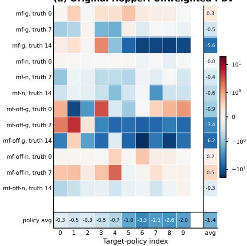
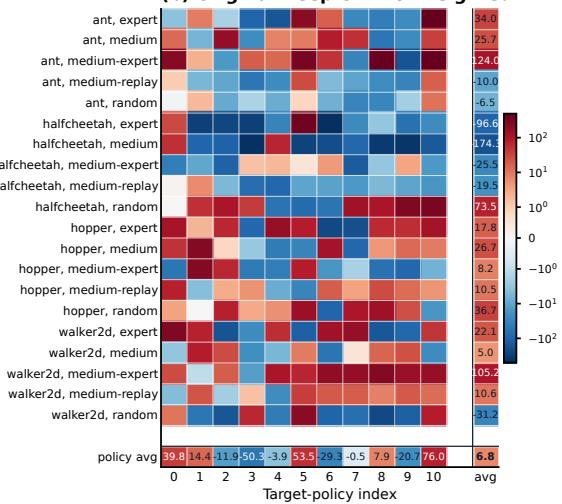
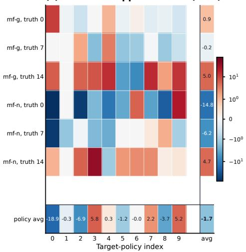
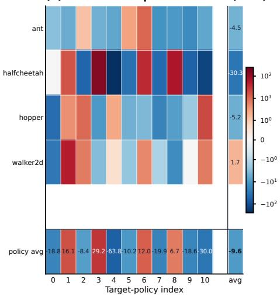
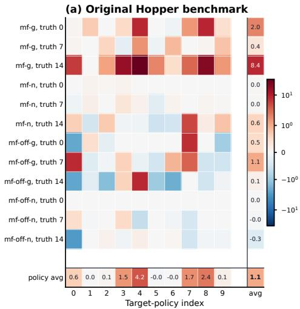
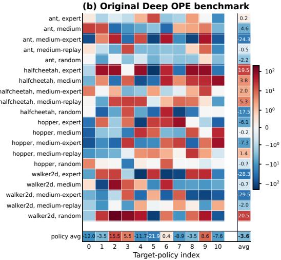
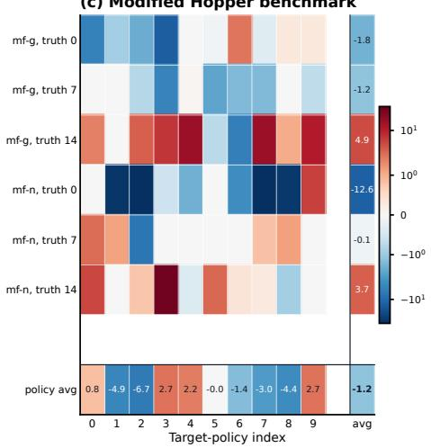
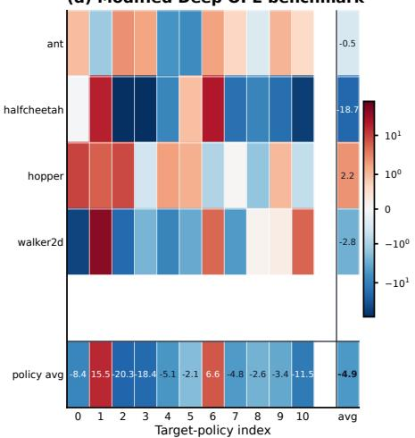

# Model Selection for Of-Policy Evaluation via Pairwise Bellman Validation

Lars van der Laan Stanford University vdlaan@stanford.edu

Vasilis Syrgkanis Stanford University

Nathan Kallus Netflix and Cornell University

## Abstract

Model selection and hyperparameter tuning pose a central challenge in of-policy evaluation (OPE) because the estimation errors of fitted Q-functions and occupancy-ratio estimates cannot be directly evaluated from held-out transitions. Bellman-residual and minimax validation methods often require auxiliary regressions or optimization over separate critic classes, adding computational and tuning costs. We introduce pairwise Bellman validation (PBV), a tuning-free minimax procedure for selecting among finite classes of fitted Q-functions and occupancy-ratio estimators using held-out transitions. PBV constructs critics from pairwise diferences between candidates, reducing validation to computing a finite collection of penalized empirical moments, without fitting auxiliary validation models or optimizing over a separate critic class. We establish finite-sample oracle inequalities relative to the best available candidate, even under candidate-class misspecification. Our key insight is that Q-function errors and log ratios between candidate and true occupancy ratios provide oracle critics whose Bellman and adjoint Bellman moments control estimation error. These unknown critics can be approximated using pairwise diferences between candidates, while penalties account for comparator approximation error. For Q-function selection, we first develop unweighted PBV, which evaluates pairwise Bellman moments under the ofline distribution and admits oracle guarantees under a pairwise coercivity condition relating the ofline distribution to the target-policy dynamics. We then develop target-aligned PBV (TA-PBV), which uses marginalized importance weighting to provide error control without pairwise coercivity. For occupancy-ratio selection, we develop adjoint PBV (A-PBV), which evaluates adjoint Bellman moments against log-ratio critics. On Hopper and Deep OPE, unweighted PBV performs competitively, while target-occupancy weighting can improve performance in settings with controlled overlap.

Keywords: Model selection, hyperparameter tuning, of-policy evaluation, Bellman equations, occupancy-ratio estimation, value-function estimation, infinite-horizon reinforcement learning

## 1. Introduction

## 1.1. Motivation

The goal of of-policy evaluation (OPE) is to estimate the value of a target policy using data collected under a diferent policy in a Markov decision process (MDP). In ofline reinforcement learning, two central objects are the target-policy action-value function, or Q-function, and the discounted occupancy ratio (Uehara et al., 2026). These functions underlie direct, importance-weighted, and doubly robust OPE, as well as semiparametrically eficient inference (Jiang and Li, 2016; Kallus and Uehara, 2020, 2022; van der Laan et al., 2025; Xie et al., 2019). They are characterized, respectively, as fixed points of the Bellman and adjoint Bellman operators (Uehara et al., 2021). Leveraging this structure, the Q-function and occupancy ratio can be learned using fitted-iteration methods, such as FQE, or minimax methods that test Bellman residuals against a class of critic functions, such as DualDICE and minimax Q-learning (Munos and Szepesvári, 2008; Nachum et al., 2019; Uehara et al., 2020, 2021; van der Laan and Kallus, 2026).

A central challenge in OPE is model selection and hyperparameter tuning. Diferent choices of algorithms, function classes, regularization, and hyperparameters produce competing Q-function and occupancy-ratio estimates, but neither admits a supervised validation loss that can be directly evaluated from logged data. For Q-functions, squared temporal-diference error is generally unsuitable for comparing candidates under stochastic transitions because it includes a candidate-dependent conditional-variance term (Baird III, 1995). Bellman-residual validation instead estimates the Bellman residual $Q - B _ { \pi } Q$ , where $B _ { \pi }$ denotes the targetpolicy Bellman operator, and selects the candidate with the smallest estimated mean-squared residual. This typically requires fitting a separate regression for each candidate (Zitovsky et al., 2023), which can be computationally prohibitive and introduces an additional tuning problem. An alternative is minimax moment validation, which avoids regression by evaluating moments of the Bellman residual against a class of critic functions and selecting the candidate that minimizes the largest absolute empirical moment over that class (Miyaguchi, 2026; Uehara et al., 2021). This approach requires specifying and potentially tuning a critic class and can involve computationally demanding and numerically delicate optimization, particularly with flexible critics. More recently, LSTD-Tournament (Liu et al., 2025) avoids specifying a separate critic class by comparing candidates pairwise using least-squares temporal-diference $Q -$ learning (LSTDQ). However, its theoretical guarantees require the true Q-function to belong to the finite candidate class, a strong realizability assumption, as well as matrix-conditioning assumptions linking the ofline distribution to the target-policy dynamics.

## 1.2. Contributions

We introduce pairwise Bellman validation (PBV), a tuning-free minimax procedure for selecting among finite classes of fitted Q-functions and occupancy-ratio estimators using held-out transitions. PBV provides oracle selection guarantees without requiring realizability. Operationally, PBV constructs a finite class of critics from pairwise comparisons between candidates and evaluates each candidate using empirical moments of its Bellman or adjoint Bellman residual against these critics. For Q-function selection, each moment is the held-out average of a one-step temporal-diference residual multiplied by a critic. PBV subtracts a penalty for critic size from each empirical moment and selects the candidate with the smallest maximum score over its pairwise critics. Validation therefore reduces to computing a finite collection of sample averages, without fitting auxiliary validation models or separately optimizing critic functions.

Our key observation is that estimation errors provide oracle critics whose corresponding moments control estimation error. Under suitable conditions, we show that evaluating the Bellman residual of Qi $Q _ { i }$ against $Q _ { i } - Q ^ { \pi }$ controls its squared $L ^ { 2 }$ error, while evaluating the adjoint Bellman residual of $w _ { i }$ against $\log ( w _ { i } / w ^ { \pi } )$ controls its generalized-KL error. Since these oracle critics depend on unknown targets, we approximate them using pairwise diferences: $Q _ { i } - Q _ { j }$ for Q-function selection and log $( w _ { i } / w _ { j } )$ for occupancy-ratio selection. These pairwise critics recover the oracle critics when the comparator equals the truth and approximate them when it is close. Together with a penalty for critic size, this construction yields oracle guarantees relative to the best available candidate, even under candidate-class misspecification.

For Q-function selection, we first develop unweighted PBV, which evaluates these moments under the ofline distribution with a quadratic critic penalty. Because the target-policy Bellman operator need not be contractive in the corresponding $L ^ { 2 }$ norm, our guarantees require a pairwise coercivity condition analogous to matrix-conditioning assumptions in LSTD-Tournament and linear TD learning (Amortila et al., 2026; Bradtke and Barto, 1996; Lagoudakis and Parr, 2003; Tsitsiklis and Van Roy, 1997). We then develop target-aligned PBV (TA-PBV), which uses marginalized importance weighting to evaluate the same moments under the discounted target-occupancy distribution, where contraction provides error control without pairwise coercivity. Thus, unweighted PBV avoids occupancy-ratio estimation, whereas TA-PBV removes the coercivity requirement at the cost of importance weighting.

For occupancy-ratio selection, we develop adjoint PBV (A-PBV), which evaluates adjoint Bellman residuals against log-ratio critics with a penalty proportional to the squared Hellinger distance between candidate ratios. A-PBV requires neither importance weighting nor a coercivity condition because the adjoint Bellman operator is already contractive in KL divergence under the ofline distribution (van der Laan and Kallus, 2026).

To our knowledge, unweighted PBV and TA-PBV are the first tuning-free procedures for selecting among fitted Q-functions with finite-sample oracle guarantees under candidate-class misspecification. A-PBV provides an analogous first result for selecting among fitted occupancy-ratio estimators, without auxiliary estimation or additional tuning.

In summary, our contributions are:

1. We develop pairwise validation procedures for Q-function and occupancy-ratio selection that require no auxiliary critic fitting and allow heterogeneous and misspecified candidate classes.

2. For unweighted PBV, we establish a finite-sample oracle inequality under pairwise coercivity, without occupancy-ratio estimation.

3. For A-PBV and TA-PBV, we establish joint finite-sample oracle inequalities that separate occupancyratio and Q-function approximation errors and quantify how occupancy-ratio selection error propagates to Q-function selection. The validation rates are near-parametric, with logarithmic dependence on candidateclass sizes.

## 1.3. Related work

Model selection for Q-functions and occupancy ratios. Existing OPE model-selection methods have focused primarily on Q-functions, using Bellman residuals, candidate-dependent projections, nested classes, or auxiliary regressions and critics in place of the unavailable supervised loss (Farahmand and Szepesvári, 2011; Lee et al., 2022; Miyaguchi, 2026; Xie and Jiang, 2021; Zhang and Jiang, 2021; Zitovsky et al., 2023). These approaches generally introduce additional estimation or structural requirements beyond the candidate class itself; LSTD-Tournament is an important exception and is discussed separately below. By contrast, model selection among already-fitted occupancy-ratio estimators has received substantially less attention, despite extensive work on occupancy-ratio estimation (Nachum et al., 2019; Uehara et al., 2020, 2021; van der Laan and Kallus, 2026). Extended discussion appears in Appendix E.

Comparison with LSTD-Tournament. LSTD-Tournament (Liu et al., 2025) selects among candidate Q-functions using a tournament criterion derived from pairwise LSTDQ. For each pair $( Q _ { i } , Q _ { j } )$ , it constructs a two-dimensional feature map from the candidates and evaluates the corresponding LSTDQ normal-equation residuals (Lagoudakis and Parr, 2003). Its selection criterion (Equation 10 in their work) can equivalently be viewed as a minimax procedure that evaluates the Bellman residual of each candidate $Q _ { i }$ against the candidate Q-functions themselves as critics. Its theoretical guarantees assume candidate-class realizability and depend on the conditioning of pair-specific LSTD matrices.

In their experiments, Liu et al. (2025) use a variant with normalized features $Q _ { i } / c _ { i }$ and $( Q _ { j } - Q _ { i } ) / c _ { i j }$ motivated by numerical stability. Although these features span the same linear space as $Q _ { i }$ and $Q _ { j }$ , they induce diferent comparisons. The resulting empirical procedure can be viewed as a minimax moment selector with critics comprising normalized candidate functions and pairwise diferences. Our analysis provides a theoretical explanation for why including pairwise diferences as features may improve LSTD-Tournament: when $Q _ { j }$ is close to the truth, $Q _ { i } - Q _ { j }$ approximates the oracle critic $Q _ { i } - Q ^ { \pi }$ , whose Bellman moment controls the estimation error of $Q _ { i }$

This approach is most closely related to unweighted PBV but difers in several important respects. In particular, unweighted PBV uses unnormalized pairwise diferences and introduces quadratic critic penalties to account for comparator approximation error, allowing us to establish oracle inequalities under candidate-class misspecification. Our guarantees for unweighted PBV require a pairwise coercivity condition under the ofline distribution, analogous to but distinct from the invertibility requirement for pair-specific LSTD matrices. TA-PBV further avoids both matrix-conditioning and pairwise coercivity requirements through importance weighting, while A-PBV extends pairwise validation to occupancy-ratio estimation using adjoint Bellman residuals.

## 2. OPE setup

## 2.1. MDP and validation data

Consider a time-homogeneous Markov decision process with state space $s ,$ action space ${ \mathcal { A } } ,$ transition kernel $P ( \mathrm { d } s ^ { \prime } \mid s , a )$ , reward $R ,$ and discount factor $\gamma \in [ 0 , 1 )$ . Write $X = ( S , A )$ and let $r ( x ) : = \mathbb { E } [ R \mid X = x ]$ denote the mean reward function. Fix a target policy $\pi ( \mathrm { d } a \mid s )$ and an initial state–action distribution $d _ { 0 }$ , and let $P _ { \pi } ( \mathrm { d } s ^ { \prime } , \mathrm { d } a ^ { \prime } \mid s , a ) : = P ( \mathrm { d } s ^ { \prime } \mid s , a ) \pi ( \mathrm { d } a ^ { \prime } \mid s ^ { \prime } )$ denote the induced state–action transition kernel. For any state–action function $f ,$ define $\begin{array} { r } { ( \pi f ) ( s ^ { \prime } ) : = \int f ( s ^ { \prime } , a ^ { \prime } ) \pi ( \mathrm { d } a ^ { \prime } \mid s ^ { \prime } ) } \end{array}$ and $\begin{array} { r } { ( P _ { \pi } f ) ( s , a ) : = \int ( \pi f ) ( s ^ { \prime } ) P ( \mathrm { d } s ^ { \prime } \mid s , a ) } \end{array}$ The goal of OPE is to estimate the discounted value $\begin{array} { r } { V ^ { \pi } : = \mathbb { E } _ { \pi } [ \sum _ { t = 0 } ^ { \infty } \gamma ^ { t } R _ { t } \ | \ X _ { 0 } \sim d _ { 0 } ] } \end{array}$ , where $\mathbb { E } _ { \pi }$ denotes expectation over trajectories generated by the MDP under π and initialized from $d _ { 0 }$

For model selection, we use sample splitting. Candidate Q-functions and occupancy-ratio estimates are fitted on a training sample and evaluated on an independent validation sample $\mathcal { D } _ { n } : = \{ ( X _ { t } , R _ { t } , S _ { t } ^ { \prime } ) \} _ { t = 1 } ^ { n }$ . We condition on the training sample and assume that $( X _ { t } ) _ { t \geq 1 }$ is a stationary Markov chain with invariant ofline distribution $\nu$ and transition operator $( P _ { b } f ) ( x ) : = \mathbb { E } [ f ( X _ { t + 1 } ) \mid X _ { t } = x ]$ . This includes trajectories from a stationary behavior policy $b ( \mathrm { d } a \mid s )$ ; for independent transitions, $( P _ { b } f ) ( x ) = \mathbb { E } _ { \nu } [ f ( X ) ]$ . In both cases, conditional on the observed trajectory history through $X _ { t }$ , the law of $( R _ { t } , S _ { t } ^ { \prime } )$ is the one-step MDP law at $X _ { t }$ . For any state–action distribution $\rho ,$ square-integrable $f , g ,$ , and positive integer $m ,$ write $\langle f , g \rangle _ { \rho } : = \mathbb { E } _ { \rho } [ f ( X ) g ( X ) ]$ and $\| f \| _ { 2 , \rho } : = \langle f , f \rangle _ { \rho } ^ { 1 / 2 }$ , and set $[ m ] : = \{ 1 , \dots , m \}$

## 2.2. Bellman and adjoint Bellman equations

The two nuisance functions we study are the target Q-function and the discounted occupancy ratio. Both can be used to recover the policy value and satisfy Bellman and adjoint Bellman equations, respectively. The target Q-function is defined by $\begin{array} { r } { Q ^ { \pi } ( x ) : = \mathbb { E } _ { \pi } [ \sum _ { t = 0 } ^ { \infty } \gamma ^ { t } R _ { t } \ : | \ : X _ { 0 } = x ] } \end{array}$ . It yields the policy value $V ^ { \pi } = \mathbb { E } _ { d _ { 0 } } [ Q ^ { \pi } ( X ) ]$ and satisfies the Bellman fixed-point equation

$$
{ Q } ^ { \pi } = { { \cal B } } _ { \pi } { Q } ^ { \pi } , \qquad { \cal B } _ { \pi } { Q } : = r + \gamma { \cal P } _ { \pi } { Q } ,\tag{1}
$$

where $B _ { \pi }$ is the Bellman operator (Sutton and Barto, 1998). The normalized discounted occupancy ratio is

$$
w ^ { \pi } : = \frac { \mathrm { d } d _ { \pi , \gamma } } { \mathrm { d } \nu } , \qquad d _ { \pi , \gamma } : = ( 1 - \gamma ) \sum _ { t = 0 } ^ { \infty } \gamma ^ { t } \mathcal { L } _ { \pi } ( X _ { t } ) , \qquad X _ { 0 } \sim d _ { 0 } ,
$$

where $\mathscr { L } _ { \pi } ( X _ { t } )$ denotes the marginal law of $X _ { t }$ under the target policy. We assume $d _ { \pi , \gamma } \ll \nu$ . The ratio yields $V ^ { \pi } = ( 1 - \gamma ) ^ { - 1 } \mathbb { E } _ { d _ { \pi , \gamma } } [ r ( X ) ] = ( 1 - \gamma ) ^ { - 1 } \mathbb { E } _ { \nu } [ w ^ { \pi } ( X ) r ( X ) ]$ ]. Moreover, $w ^ { \pi }$ satisfies the adjoint Bellman fixed-point equation (van der Laan and Kallus, 2026)

$$
\mathcal { B } _ { \pi } ^ { * } w ^ { \pi } = w ^ { \pi } , \qquad \mathcal { B } _ { \pi } ^ { * } w : = ( 1 - \gamma ) \frac { \mathrm { d } d _ { 0 } } { \mathrm { d } \nu } + \gamma P _ { \pi } ^ { * } w , \qquad P _ { \pi } ^ { * } w : = \frac { \mathrm { d } \{ ( w \nu ) P _ { \pi } \} } { \mathrm { d } \nu } ,\tag{2}
$$

which follows from the occupancy identity $d _ { \pi , \gamma } = ( 1 - \gamma ) d _ { 0 } + \gamma d _ { \pi , \gamma } P _ { \pi }$ (Nachum et al., 2019).

The terminology “adjoint” reflects that $P _ { \pi } ^ { * }$ is the adjoint of $P _ { \pi }$ under the ν-inner product, so $\langle P _ { \pi } ^ { * } w , Q \rangle _ { \nu } =$ $\langle w , P _ { \pi } Q \rangle _ { \nu }$ (Uehara et al., 2021).

## 3. Validation for Q-function selection

We first motivate pairwise Bellman validation and explain its key ideas before presenting the algorithms in Section 4.

## 3.1. Limitations of standard validation criteria

Let $Q _ { 1 } , \ldots , Q _ { K }$ be a finite class of candidate Q-functions fitted on the training sample. A natural approach, which we refer to as Bellman-residual validation, selects a candidate by minimizing the mean-squared Bellman residual under the ofline distribution ν (Antos et al., 2008; Farahmand and Szepesvári, 2011):

$$
\mathcal L _ { \mathrm { B R } } ( Q ) : = \| Q - B _ { \pi } Q \| _ { 2 , \nu } ^ { 2 } .
$$

Because $Q ^ { \pi }$ is a Bellman fixed point, $\mathcal { L } _ { \mathrm { B R } } ( Q ^ { \pi } ) = 0$ , so the minimum over a class containing $Q ^ { \pi }$ is attained at $Q ^ { \pi }$ . The criterion is not directly estimable because $( B _ { \pi } Q ) ( X )$ depends on unknown conditional laws. Without an MDP model, evaluating it generally requires estimating the Bellman residual $Q _ { i } - B _ { \pi } Q _ { i }$ , for example by separately regressing $Q _ { i } ( X ) - R - \gamma ( \pi Q _ { i } ) ( S ^ { \prime } )$ on X for each candidate (Zitovsky et al., 2023). This introduces additional computation, tuning, and estimation error.

A natural but generally invalid surrogate for Bellman-residual validation is to select candidates based on the squared one-step temporal-diference (TD) error (Sutton, 1988),

$$
\begin{array} { r } { \mathcal { L } _ { \mathrm { T D } } ( Q ) : = \mathbb { E } _ { \boldsymbol { \nu } } \bigl [ \{ Q ( X ) - R - \gamma ( \pi Q ) ( S ^ { \prime } ) \} ^ { 2 } \bigr ] , } \end{array}
$$

which involves observable TD residuals $Q ( X ) - R - \gamma ( \pi Q ) ( S ^ { \prime } )$ and can be estimated directly from held-out transitions. Although the TD residual is conditionally unbiased for the Bellman residual, $\mathbb { E } [ Q ( X ) - R -$ $\gamma ( \pi Q ) ( S ^ { \prime } ) \mid X \mid = Q ( X ) - ( B _ { \pi } Q ) ( X )$ , squaring introduces a conditional-variance term into the objective:

$$
{ \mathcal { L } } _ { \mathrm { T D } } ( Q ) = { \mathcal { L } } _ { \mathrm { B R } } ( Q ) + \mathbb { E } _ { \nu } [ \mathrm { V a r } ( R + \gamma ( \pi Q ) ( S ^ { \prime } ) \mid X ) ] .
$$

For $\gamma > 0$ and stochastic transitions, this term generally depends on $Q ,$ , so minimizing squared TD error need not minimize the Bellman-residual error $\mathcal { L } _ { \mathrm { B R } } ( Q )$ or select $Q ^ { \pi }$ , even when it belongs to the candidate class (Zitovsky et al., 2023). Directly estimating the squared Bellman residual without this variance term encounters the classical double-sampling obstruction: unbiased estimation generally requires two conditionally independent targets at the same state–action pair (Baird III, 1995; Feng et al., 2019).

A natural way around this obstruction is to construct a minimax criterion based on moments of the Bellman residual against critic functions (Antos et al., 2008; Feng et al., 2019; Uehara et al., 2020; Zanette and Wainwright, 2022). Since $Q ^ { \pi }$ is a Bellman fixed point, $\langle f , Q ^ { \pi } - B _ { \pi } Q ^ { \pi } \rangle _ { \nu } = 0$ for every suitable critic $f$ These moments can be estimated directly from one-step transitions because

$$
\mathbb { E } _ { \boldsymbol \nu } [ f ( \boldsymbol { X } ) \{ Q ( \boldsymbol { X } ) - R - \gamma ( \pi Q ) ( \boldsymbol { S } ^ { \prime } ) \} ] = \langle f , Q - \mathcal { B } _ { \boldsymbol \pi } Q \rangle _ { \boldsymbol \nu } .
$$

Given a critic class ${ \mathcal F } ,$ this motivates the minimax population criterion

$$
\mathcal { L } _ { \mathcal { F } } ( Q ) : = \operatorname* { s u p } _ { \substack { f \in \mathcal { F } : \| f \| _ { 2 , \nu } \leq 1 } } \left| \mathbb { E } _ { \nu } [ f ( X ) \{ Q ( X ) - R - \gamma ( \pi Q ) ( S ^ { \prime } ) \} ] \right| ,
$$

which measures the largest violation over the critic class. We refer to model selection based on an empirical analogue of this criterion as minimax moment validation. The empirical criterion replaces the expectation with a validation-sample average and may include additional critic regularization.

The main practical challenge is choosing a critic class $\mathcal { F }$ for which these moments distinguish among candidate Q-functions. If $\mathcal { F }$ contains the normalized Bellman residual $( Q _ { i } - B _ { \pi } Q _ { i } ) / \lVert Q _ { i } - B _ { \pi } Q _ { i } \rVert _ { 2 , \nu }$ for each $i \in [ K ]$ with nonzero residual, then Cauchy–Schwarz and inclusion of this critic give $\mathcal { L } _ { \mathcal { F } } ( Q _ { i } ) = \| Q _ { i } - \mathcal { B } _ { \pi } Q _ { i } \| _ { 2 , \nu }$ (Uehara et al., 2021). Thus, minimax moment validation recovers Bellman-residual validation without directly estimating $B _ { \pi } Q _ { i }$ . The remaining dificulty is constructing, regularizing, and tuning an informative critic class: restrictive classes may fail to distinguish among candidates, whereas richer classes increase statistical and computational complexity (Uehara et al., 2020; Zanette and Wainwright, 2022).

## 3.2. Key ideas behind pairwise Bellman validation

We depart from standard analyses of minimax methods by identifying oracle critics whose moments directly control candidate estimation error, rather than choosing critics to recover or approximate the Bellman-residual error $\mathcal { L } _ { \mathrm { B R } } ( Q _ { i } )$ . We then show that these critics can be approximated using pairwise diferences between candidates. The following three observations motivate the algorithms in Section 4.

The first observation is that the candidate estimation error $\Delta _ { i } : = Q _ { i } - Q ^ { \pi }$ defines an oracle critic whose Bellman moment is a quadratic form in $\Delta _ { i } .$ Specifically,

$$
\begin{array} { r l } & { \mathcal { L } ^ { \star } ( Q _ { i } ) : = \mathbb { E } _ { \boldsymbol { \nu } } [ \Delta _ { i } ( X ) \{ Q _ { i } ( X ) - R - \gamma ( \pi Q _ { i } ) ( S ^ { \prime } ) \} ] } \\ & { \quad \quad \quad = \langle \Delta _ { i } , Q _ { i } - \mathcal { B } _ { \pi } Q _ { i } \rangle _ { \boldsymbol { \nu } } = \langle \Delta _ { i } , ( I - \gamma P _ { \pi } ) \Delta _ { i } \rangle _ { \boldsymbol { \nu } } , } \end{array}
$$

where the final equality follows from the fixed-point identity $B _ { \pi } Q ^ { \pi } = Q ^ { \pi }$ . In contrast to squared Bellmanresidual criteria, ${ \mathcal { L } } ^ { \star } ( Q _ { i } )$ is linear in the Bellman residual and, if $\Delta _ { i }$ were known, could be estimated directly from one-step transitions without estimating $B _ { \pi } Q _ { i }$

If the quadratic form induced by $I - \gamma P _ { \pi }$ is coercive along the candidate error directions, candidate mean-squared error is bounded by a constant multiple of the oracle criterion. Specifically, suppose that, for some $\kappa _ { \nu } > 0$ and every $i \in [ K ]$ 2

$$
\begin{array} { r } { \langle \Delta _ { i } , ( I - \gamma P _ { \pi } ) \Delta _ { i } \rangle _ { \nu } \geq \kappa _ { \nu } \| \Delta _ { i } \| _ { 2 , \nu } ^ { 2 } . } \end{array}\tag{3}
$$

An upper bound follows under the standard one-step concentrability condition $C _ { \nu , \pi } : = \| \mathrm { d } ( \nu P _ { \pi } ) / \mathrm { d } \nu \| _ { \infty } < \infty$ By Cauchy–Schwarz and Jensen’s inequality, for every $i \in [ K ]$

$$
\langle \Delta _ { i } , ( I - \gamma P _ { \pi } ) \Delta _ { i } \rangle _ { \nu } \leq ( 1 + \gamma \sqrt { C _ { \nu , \pi } } ) \| \Delta _ { i } \| _ { 2 , \nu } ^ { 2 } .
$$

Consequently, under coercivity and one-step concentrability, ${ \mathcal { L } } ^ { \star } ( Q _ { i } )$ is comparable to $\| \Delta _ { i } \| _ { 2 , \nu } ^ { 2 }$ up to constant factors. It follows that any oracle selector $i _ { \mathrm { o r a c l e } } ^ { \star } \in$ arg min1≤i≤K ${ \mathcal { L } } ^ { \star } ( Q _ { i } )$ satisfies

$$
\| Q _ { i _ { \mathrm { o r a c l e } } ^ { \star } } - Q ^ { \pi } \| _ { 2 , \nu } \leq \left( \frac { 1 + \gamma \sqrt { C _ { \nu , \pi } } } { \kappa _ { \nu } } \right) ^ { 1 / 2 } \operatorname* { m i n } _ { 1 \leq i \leq K } \| Q _ { i } - Q ^ { \pi } \| _ { 2 , \nu } .
$$

The second observation is that pairwise diferences between candidate Q-functions provide approximations to the unavailable oracle critics. Indeed, for any $j \in [ K ] , Q _ { i } - Q _ { j } = \Delta _ { i } - \Delta _ { j }$ . Under realizability, some $Q _ { i ^ { \star } } = Q ^ { \pi } , \mathrm { s o } Q _ { i } - Q _ { i ^ { \star } } = \Delta _ { i }$ exactly. More generally, $Q _ { i } - Q _ { j }$ difers from the oracle critic $\Delta _ { i } \ \mathrm { b y } \ - \Delta _ { j }$ so a comparison candidate close to $Q ^ { \pi }$ provides an accurate approximation. Because the best comparison candidate is unknown, we evaluate the Bellman residual of each $Q _ { i }$ against all K pairwise critics and take the largest resulting moment as its worst-case score. These $K ^ { 2 }$ comparisons require no auxiliary critic fitting. Specifically, define the population unweighted PBV moments

$$
m _ { i j } ^ { \mathrm { u n w } } : = \mathbb { E } _ { \boldsymbol { \nu } } [ ( Q _ { i } - Q _ { j } ) ( \boldsymbol { X } ) \{ Q _ { i } ( \boldsymbol { X } ) - R - \gamma ( \pi Q _ { i } ) ( \boldsymbol { S } ^ { \prime } ) \} ] ,
$$

and the corresponding unpenalized population selector arg min $i \in [ K ] \operatorname* { m a x } _ { j \in [ K ] } m _ { i j } ^ { \mathrm { u n w } }$ . Under realizability, $Q _ { i ^ { \star } } = Q ^ { \pi }$ has a worst-case score of zero. For any candidate $Q _ { i }$ , comparison with $Q _ { i }$ ⋆ and coercivity imply that its worst-case score is at least $\kappa _ { \nu } \| \Delta _ { i } \| _ { 2 , \nu } ^ { 2 }$ . Consequently, the population selector recovers $Q ^ { \pi }$ in $L ^ { 2 } ( \nu )$ In the next section, we introduce a penalized empirical version that accounts for critic approximation error under misspecification.

The error guarantees for unweighted PBV, however, rely on coercivity under the ofline distribution $\nu ,$ as in (3). This condition depends on the relationship between the ofline distribution and the target-policy dynamics. A simple suficient condition is $\| P _ { \pi } \Delta _ { i } \| _ { 2 , \nu } \leq c \| \Delta _ { i } \| _ { 2 , \nu }$ for every $i \in [ K ]$ and some $c < \gamma ^ { - 1 }$ , in which case Cauchy–Schwarz gives (3) with $\kappa _ { \nu } = 1 - \gamma c$ . Under one-step concentrability, one may take $c = \sqrt { C _ { \nu , \pi } } ;$ so coercivity holds whenever $C _ { \nu , \pi } < \gamma ^ { - 2 }$ . In particular, under stationary on-policy sampling, $C _ { \nu , \pi } = 1$ and $P _ { \pi }$ is an $L ^ { 2 } ( \nu )$ contraction, so coercivity holds automatically with $\kappa _ { \nu } = 1 - \gamma$ . When $Q ^ { \pi }$ and the candidate Q-functions lie in a common linear span, this condition is analogous to matrix-conditioning assumptions in linear TD learning (Amortila et al., 2026; Bradtke and Barto, 1996; Lagoudakis and Parr, 2003; Tsitsiklis and Van Roy, 1997). Under a general ofline distribution, however, coercivity need not hold.

The third observation is that the coercivity requirement can be removed by marginalized importance weighting each moment by $w ^ { \pi } = \mathrm { d } d _ { \pi , \gamma } / \mathrm { d } \nu$ . This allows the pairwise Bellman moments to be evaluated under the discounted target-occupancy distribution, with respect to which $\gamma P _ { \pi }$ is a $\sqrt { \gamma }$ -contraction in $L ^ { 2 } ( d _ { \pi , \gamma } )$ (van der Laan and Kallus, 2025), and hence

$$
( 1 - \sqrt { \gamma } ) \| \Delta _ { i } \| _ { 2 , d _ { \pi , \gamma } } ^ { 2 } \leq \langle \Delta _ { i } , ( I - \gamma P _ { \pi } ) \Delta _ { i } \rangle _ { d _ { \pi , \gamma } } \leq ( 1 + \sqrt { \gamma } ) \| \Delta _ { i } \| _ { 2 , d _ { \pi , \gamma } } ^ { 2 } .\tag{4}
$$

The weighted oracle criterion is therefore comparable, up to constants, to mean-squared Q-function error under the discounted target occupancy, without requiring (3). The tradeof is that the occupancy ratio $w ^ { \pi }$ must be estimated suficiently accurately, introducing an additional model-selection problem that we address in the next section.

Combining target-occupancy weighting with pairwise diference critics yields our target-aligned PBV criterion. For candidate i and comparator $j ,$ , let $h _ { i j } : = Q _ { i } - Q _ { j }$ and define the target-aligned pairwise moment

$$
m _ { i j } ^ { \mathrm { T A } } : = \mathbb { E } _ { \boldsymbol { \nu } } [ w ^ { \pi } ( \boldsymbol { X } ) h _ { i j } ( \boldsymbol { X } ) \{ Q _ { i } ( \boldsymbol { X } ) - R - \gamma ( \pi Q _ { i } ) ( \boldsymbol { S } ^ { \prime } ) \} ] = \langle h _ { i j } , Q _ { i } - \mathcal { B } _ { \pi } Q _ { i } \rangle _ { d _ { \pi , \gamma } } .
$$

As with unweighted PBV, we select the candidate minimizing the worst-case population moment ma $\updownarrow _ { j \in [ K ] } m _ { i j } ^ { \mathrm { T A } }$ Under realizability, this criterion recovers $Q ^ { \pi }$ in $L ^ { 2 } ( d _ { \pi , \gamma } )$ , since the oracle critic is among the pairwise diferences and the contraction property provides the required error bound without coercivity under the ofline distribution.

## 4. Pairwise Bellman validation algorithms

We now develop empirical Q-function selectors based on the population constructions in Section 3.2, along with A-PBV for occupancy-ratio selection. Under candidate-class misspecification, even the best candidate may have a nonzero Bellman residual, and comparisons with distant candidates can produce large unpenalized moments. Without penalization, the selected candidate can have arbitrarily larger error than the best candidate (Proposition S24). To prevent these comparisons from dominating the worst-case score, we penalize each pairwise Bellman moment by a suitable squared-discrepancy term.

## 4.1. Unweighted PBV

Let $h _ { i j } : = Q _ { i } - Q _ { j }$ and define the unweighted PBV scores and selector by

$$
\begin{array} { r l r } {  { \widehat { \mathcal { M } } _ { i j } ^ { \mathrm { u n w } } : = \displaystyle \frac { 1 } { n } \sum _ { t = 1 } ^ { n } h _ { i j } ( X _ { t } ) \{ Q _ { i } ( X _ { t } ) - R _ { t } - \gamma ( \pi Q _ { i } ) ( S _ { t } ^ { \prime } ) \} } } \\ & { } & { \quad \quad - \displaystyle \frac { 1 } { 4 } \operatorname* { m a x } \{ 0 , \frac { 1 } { n } \sum _ { t = 1 } ^ { n } h _ { i j } ( X _ { t } ) \{ h _ { i j } ( X _ { t } ) - \gamma ( \pi h _ { i j } ) ( S _ { t } ^ { \prime } ) \} \} , } \\ & { } & { \widehat { \lambda } _ { Q } ^ { \mathrm { u n w } } : = \operatorname* { m i n } \arg \operatorname* { m i n } _ { 1 \leq i \leq K 1 } \operatorname* { m a x } _ { 1 \leq j \leq K } \widehat { \mathcal { M } } _ { i j } ^ { \mathrm { u n w } } , } \end{array}\tag{5}
$$

where both the moments and their penalties are evaluated under the ofline distribution. By iterated expectation, the population counterpart of the untruncated penalty is $\begin{array} { r } { \frac { 1 } { 4 } \langle h _ { i j } , ( I - \gamma P _ { \pi } ) h _ { i j } \rangle _ { \nu } } \end{array}$ , which is bounded below by $\frac { 1 } { 4 } \kappa _ { \nu } \| h _ { i j } \| _ { 2 , \nu } ^ { 2 }$ under coercivity along the pairwise diferences. Using the quadratic form rather than its coercivity lower bound avoids the need to know $\kappa _ { \nu }$ . The quadratic penalty can be multiplied by any coeficient $\lambda \in ( 0 , 1 ) ; \lambda = 1 / 4$ minimizes the population upper bound derived in our analysis. Because unweighted PBV does not require estimating an occupancy ratio, it may be preferable when reliable importance weighting is dificult.

## 4.2. Adjoint PBV and target-aligned PBV

To implement TA-PBV, we first introduce adjoint PBV (A-PBV), which applies pairwise validation to the adjoint Bellman equation to select an occupancy-ratio estimate. We summarize the construction here and defer further details and intuition to Appendix A. As in the Q-function case, adjoint Bellman moments for fixed critics can be estimated directly from one-step transitions and independent draws from $d _ { 0 }$ (Nachum et al., 2019).

For nonnegative integrable functions p and $q ,$ define the generalized KL divergence

$$
{ \mathsf { D } } _ { \nu } ( p \| q ) : = \mathbb { E } _ { \nu } \left[ p ( X ) \log { \frac { p ( X ) } { q ( X ) } } - p ( X ) + q ( X ) \right] .
$$

Unlike the usual KL divergence, $\mathsf { D } _ { \nu }$ does not require p and $q$ to integrate to one and therefore permits unnormalized ratio candidates. Write $H _ { \nu } ( p , q ) : = \| \sqrt { p } - \sqrt { q } \| _ { 2 , \nu }$ . When the three divergences below are finite, the Bregman three-point identity (Bauschke and Combettes, 2017), together with contraction of the adjoint Bellman operator in generalized KL divergence (van der Laan and Kallus, 2026), gives

$$
\begin{array} { r l } & { \langle \boldsymbol { w } - \boldsymbol { B } _ { \pi } ^ { * } \boldsymbol { w } , \log ( \boldsymbol { w } / \boldsymbol { w } ^ { \pi } ) \rangle _ { \nu } = \mathsf { D } _ { \nu } ( \boldsymbol { w } \| \boldsymbol { w } ^ { \pi } ) - \mathsf { D } _ { \nu } ( \boldsymbol { B } _ { \pi } ^ { * } \boldsymbol { w } \| \boldsymbol { w } ^ { \pi } ) + \mathsf { D } _ { \nu } ( \boldsymbol { B } _ { \pi } ^ { * } \boldsymbol { w } \| \boldsymbol { w } ) } \\ & { \qquad \geq ( 1 - \gamma ) \mathsf { D } _ { \nu } ( \boldsymbol { w } \| \boldsymbol { w } ^ { \pi } ) . } \end{array}
$$

Thus, the oracle critic is $\log ( w / w ^ { \pi } )$ . Given M candidate occupancy ratios $w _ { 1 } , \dots , w _ { M }$ , we approximate this critic using pairwise log ratios $\ell _ { a b } : = \log ( w _ { a } / w _ { b } )$ and select an occupancy-ratio candidate using the resulting adjoint Bellman moments.

As in unweighted PBV, we account for critic-approximation error under misspecification by penalizing the pairwise moments. We use Hellinger and Bellman quadratic penalties for A-PBV and TA-PBV, respectively. Let $X _ { 0 , 1 } , \ldots , X _ { 0 , n }$ be independent draws from $d _ { 0 }$ . If expectations under $d _ { 0 }$ are known, we may replace the

corresponding empirical averages by their population values. Define the penalized empirical pairwise scores

$$
\begin{array} { c } { { \displaystyle \widehat { \mathcal { S } } _ { a b } ^ { \mathrm { a d } } : = \displaystyle \frac 1 n \sum _ { t = 1 } ^ { n } w _ { a } ( X _ { t } ) \{ \ell _ { a b } ( X _ { t } ) - \gamma ( \pi \ell _ { a b } ) ( S _ { t } ^ { \prime } ) \} - \displaystyle \frac { 1 - \gamma } n \sum _ { t = 1 } ^ { n } \ell _ { a b } ( X _ { 0 , t } ) } }  \\ { { \displaystyle ~ - \frac { 1 - \gamma } { 4 n } \sum _ { t = 1 } ^ { n } \left\{ \sqrt { w _ { a } ( X _ { t } ) } - \sqrt { w _ { b } ( X _ { t } ) } \right\} ^ { 2 } , } } \\ { { \displaystyle \widehat { \mathcal { M } } _ { i j } ^ { \mathrm { T A } } ( w ) : = \displaystyle \frac 1 n \sum _ { t = 1 } ^ { n } w ( X _ { t } ) h _ { i j } ( X _ { t } ) \{ Q _ { i } ( X _ { t } ) - R _ { t } - \gamma ( \pi Q _ { i } ) ( S _ { t } ^ { \prime } ) \} } }  \\ { { \displaystyle ~ - \frac 1 4 \operatorname* { m a x } \left\{ 0 , \displaystyle \frac 1 n \sum _ { t = 1 } ^ { n } w ( X _ { t } ) h _ { i j } ( X _ { t } ) \{ h _ { i j } ( X _ { t } ) - \gamma ( \pi h _ { i j } ) ( S _ { t } ^ { \prime } ) \} \right\} . } } \end{array}
$$

The Q-function penalty uses the same quadratic form as unweighted PBV, evaluated under the fitted occupancy ratio. This choice yields an oracle inequality without requiring candidate-class realizability. We combine the two stages in Algorithm 1, evaluating $M ^ { 2 } + K ^ { 2 }$ pairwise scores without fitting auxiliary validation models or critics.

Algorithm 1 Adjoint and target-aligned pairwise Bellman validation   
Require: Ratio candidates $w _ { 1 } , \dots , w _ { M } ;$ Q-function candidates $Q _ { 1 } , \ldots , Q _ { K } ;$ ; validation trajectory   
$\mathcal { D } _ { n } ;$ independent draws $X _ { 0 , 1 } , \ldots , X _ { 0 , n } \sim d _ { 0 }$ (or exact $d _ { 0 }$ moments); discount factor $\gamma$   
1: Select $\widehat { i } _ { w }$ as the smallest index in arg min $1 \leq a \leq M \operatorname* { m a x } _ { 1 \leq b \leq M } \widehat { S } _ { a b } ^ { \mathrm { a d j } }$ and set $\widehat { w } : = w _ { \widehat { i } _ { w } }$   
2: Select $\widehat { i } _ { Q }$ as the smallest index in arg min $\iota \leq i \leq K$ $\mathrm { m a x } _ { 1 \leq j \leq K } \widehat { M } _ { i j } ^ { \mathrm { T A } } ( \widehat { w } )$ and set $\widehat { Q } : = Q _ { \widehat { i } _ { Q } }$   
3: return $( \widehat { w } , \widehat { Q } )$

## 5. Finite-sample guarantees

We establish finite-sample oracle inequalities for unweighted PBV and the two-stage procedure combining A-PBV and TA-PBV. To accommodate temporal dependence in the validation trajectory, we impose the following spectral-gap condition, which holds with $g _ { b } = 1$ for independent transitions (Jiang et al., 2025).

(A1) Behavior-process spectral gap. There exists $g _ { b } \in ( 0 , 1 ]$ such that

$$
\begin{array} { r } { \| P _ { b } f \| _ { 2 , \nu } \leq ( 1 - g _ { b } ) \| f \| _ { 2 , \nu } \qquad \mathrm { ~ f o r ~ e v e r y ~ r e a l - v a l u e d ~ } f \in L ^ { 2 } ( \nu ) \mathrm { ~ w i t h ~ } \mathbb { E } _ { \nu } f = 0 . } \end{array}\tag{6}
$$

Alternatively, $P _ { b }$ is self-adjoint in $L ^ { 2 } ( \nu )$ and $\langle f , P _ { b } f \rangle _ { \nu } \leq ( 1 - g _ { b } ) \| f \| _ { 2 , \nu } ^ { 2 }$ for every such $f .$

## 5.1. Unweighted PBV

In unweighted PBV, we avoid occupancy-ratio estimation but require coercivity along candidate comparisons under the ofline distribution. Let $k ^ { \star } \in$ arg $\begin{array} { r } { \operatorname* { m i n } _ { i \in [ K ] } \| Q _ { i } - Q ^ { \pi } \| _ { 2 , \nu } } \end{array}$ index a best candidate.

(A2) Pairwise coercivity. There exists a constant $\kappa _ { \nu } \in ( 0 , 1 ]$ such that

$$
\langle h _ { i k ^ { \star } } , ( I - \gamma P _ { \pi } ) h _ { i k ^ { \star } } \rangle _ { \nu } \geq \kappa _ { \nu } \| h _ { i k ^ { \star } } \| _ { 2 , \nu } ^ { 2 } \quad \mathrm { f o r ~ e v e r y ~ } i \in [ K ] .
$$

Theorem 5.1 (Unweighted PBV oracle guarantee). Suppose Conditions A1, A2, B2, B3, and B5 hold. Then there exists a finite constant $C _ { Q , \mathrm { u n w } } > 0$ , depending only on $H _ { Q } , G _ { Q } , \sigma _ { Q }$ , such that, for every $\delta \in ( 0 , 1 )$ , with probability at least $1 - \delta _ { : }$

$$
\| Q _ { \hat { \pi } _ { \sigma } ^ { \mathrm { i n w } } } - Q ^ { \pi } \| _ { 2 , \nu } \leq \| Q _ { k ^ { \star } } - Q ^ { \pi } \| _ { 2 , \nu } + \frac { 2 } { \kappa _ { \nu } } \| Q _ { k ^ { \star } } - B _ { \pi } Q _ { k ^ { \star } } \| _ { 2 , \nu } + \frac { C _ { Q , \mathrm { u n w } } } { \kappa _ { \nu } } \sqrt { \frac { \log ( 1 2 K / \delta ) } { n g _ { b } } } .
$$

If, for some $L _ { \nu } \in [ 0 , \infty ) , \| Q _ { k ^ { \star } } - B _ { \pi } Q _ { k ^ { \star } } \| _ { 2 , \nu } \leq L _ { \nu } \| Q _ { k ^ { \star } } - Q ^ { \pi } \| _ { 2 , \nu }$ , the theorem gives the oracle inequality

$$
\| Q _ { \hat { i } _ { Q } ^ { \operatorname* { m a x } } } - Q ^ { \pi } \| _ { 2 , \nu } \leq \left( 1 + \frac { 2 L _ { \nu } } { \kappa _ { \nu } } \right) \operatorname* { m i n } _ { i \in [ K ] } \| Q _ { i } - Q ^ { \pi } \| _ { 2 , \nu } + \frac { C _ { Q , \operatorname* { m a x } } } { \kappa _ { \nu } } \sqrt { \frac { \log ( 1 2 K / \delta ) } { n g _ { b } } } .
$$

One-step concentrability is suficient, with $L _ { \nu } = 1 + \gamma \sqrt { C _ { \nu , \pi } }$ . Temporal dependence reduces the efective validation sample size from n to ngb, while dependence on the candidate class size is only logarithmic.

## 5.2. Adjoint PBV and target-aligned PBV

We next establish guarantees for the two-stage procedure, which estimates the discounted occupancy ratio to avoid requiring coercivity under the ofline distribution. For A-PBV, we impose the following condition to ensure uniform boundedness of the pairwise log-ratio critics.

(A3) One-step coverage and bounded ratio candidates. The measures $d _ { 0 }$ and $\nu P _ { \pi }$ are absolutely continuous with respect to $\nu .$ There are constants $\overline { { w } } < \infty$ and $C _ { w } \ge 1$ such that, ν-almost surely,

$$
0 < w _ { a } \leq \overline { { w } } \quad ( a \in [ M ] ) , \qquad C _ { w } ^ { - 1 } \leq \frac { w _ { i } } { w _ { j } } \leq C _ { w } \quad ( i , j \in [ M ] ) .
$$

Theorem 5.2 (A-PBV and TA-PBV oracle guarantee). Suppose Conditions A1 and A3 hold, together with the technical conditions in Appendix B.1. Then there exist finite constants $C _ { \mathrm { r a t i o } } , C _ { \mathrm { T A } } > 0$ , independent of $n , M , K , \delta _ { ; }$ , and $\gamma _ { ; }$ such that, for every $\delta \in ( 0 , 1 )$ , with probability at least $1 - \delta$ , the output of Algorithm 1 satisfies

$$
H _ { \nu } ( \widehat { w } , w ^ { \pi } ) \leq \frac { C _ { \mathrm { r a t i o } } } { 1 - \gamma } \left\{ \operatorname* { m i n } _ { a \in [ M ] } H _ { \nu } ( w _ { a } , w ^ { \pi } ) + \sqrt { \frac { \log ( 4 8 M / \delta ) } { n g _ { b } } } \right\} .\tag{7}
$$

$$
\begin{array} { r l } & { \| \widehat { Q } - Q ^ { \pi } \| _ { 2 , d _ { \pi , \gamma } } \leq C _ { \mathrm { T A } } \left[ \frac { \operatorname* { m i n } _ { i \in [ K ] } \| Q _ { i } - Q ^ { \pi } \| _ { 2 , d _ { \pi , \gamma } } } { \sqrt { 1 - \gamma } } + \frac { 1 } { 1 - \gamma } \sqrt { \frac { \log ( 2 4 M K / \delta ) } { n g _ { b } } } \right. } \\ & { \qquad \left. + \frac { 1 } { ( 1 - \gamma ) ^ { 3 / 2 } } \left\{ \underset { a \in [ M ] } { \operatorname* { m i n } } H _ { \nu } ( w _ { a } , w ^ { \pi } ) + \sqrt { \frac { \log ( 4 8 M / \delta ) } { n g _ { b } } } \right\} \right] . } \end{array}\tag{8}
$$

Unlike unweighted PBV, we obtain a Q-function error guarantee without requiring coercivity under the ofline distribution. We obtain separate terms for candidate approximation and validation error and for error due to occupancy-ratio estimation. The horizon dependence is $( 1 - \gamma ) ^ { - 1 / 2 }$ for Q-function approximation, $( 1 - \gamma ) ^ { - 1 }$ for direct validation error, and $( 1 - \gamma ) ^ { - 3 / 2 }$ for the terms due to occupancy-ratio error.

Under the corresponding moment conditions, pairwise coercivity under the fitted measure $\widehat { w } \nu$ instead yields an oracle bound in $L ^ { 2 } ( \widehat { w } \nu )$ analogous to that for unweighted PBV, with weighted approximation, comparator Bellman-residual, and validation errors but no separate occupancy-ratio estimation-error term.

For Q-functions, Cauchy–Schwarz gives the plug-in value bound $| \mathbb { E } _ { d _ { 0 } } [ \widehat { Q } ( X ) ] - V ^ { \pi } | \leq \| \mathrm { d } d _ { 0 } / \mathrm { d } d _ { \pi , \gamma } \| _ { 2 , d _ { \pi , \gamma } } \| \widehat { Q } -$ $Q ^ { \pi } \| _ { 2 , d _ { \pi , \gamma } }$ , where the Q-function error is bounded in (8). For occupancy ratios, if $r ~ \in ~ L ^ { 2 } ( \nu ) \ \cap$ $L ^ { 2 } ( d _ { \pi , \gamma } )$ , the analogous plug-in estimator satisfies $\begin{array} { r } { \left| ( 1 - \gamma ) ^ { - 1 } \mathbb { E } _ { \nu } [ \widehat { w } ( X ) r ( X ) ] - V ^ { \pi } \right| \leq ( 1 - \gamma ) ^ { - 1 } \{ 2 \overline { { w } } \| r \| _ { 2 , \nu } ^ { 2 } + } \end{array}$ $2 \| r \| _ { 2 , d _ { \pi , \gamma } } ^ { 2 } \} ^ { 1 / 2 } H _ { \nu } ( \widehat { w } , w ^ { \pi } )$ , where the Hellinger error is bounded in (7). A doubly robust bound is given in Appendix C.

## 6. Experimental investigation

We evaluate PBV on Hopper (Liu et al., 2025) and Deep OPE/D4RL (Fu et al., 2020, 2021). We compare unweighted PBV, its variant without the quadratic penalty, TA-PBV, squared temporal-diference (TD) error, and LSTD-Tournament using the normalized-diference implementation of Liu et al. (2025). We consider both the original benchmarks and controlled-overlap benchmarks constructed to examine target-occupancy weighting when overlap is favorable. In the controlled-overlap benchmarks, the logging policy samples one benchmark policy uniformly for each trajectory, and each component policy is treated in turn as the target.

Thus, the expected on-policy fraction is 1/10 for Hopper and $1 / 1 1$ for Deep OPE, and the corresponding trajectory and discounted occupancy ratios are bounded by 10 and 11, respectively.

Each Q-class contains 15 candidates. For the original Hopper benchmark, we use the candidates provided with the benchmark; for Deep OPE and controlled-overlap Hopper, we use two-hidden-layer neural FQE networks with widths 64, 128, or 256, saved after 50, 100, 200, 400, or 800 FQE iterations. For TA-PBV $( T = 5 )$ , A-PBV first selects among 28 ratio candidates obtained by fitted occupancy-ratio evaluation (FORE). The selected ratio is then used to select a Q-function on an independent validation sample of $n _ { Q } = 3 , 2 0 0$ transitions. Following Sinha et al. (2022), we temper the selected ratio as $w ^ { 1 / 5 } / \mathbb { P } _ { n , w } [ w ^ { 1 / 5 } ]$ to reduce weight variance and improve stability. Sensitivity analyses, uncertainty intervals, and additional experimental details are given in Appendix D.

Table 1: Selected-Q performance at nQ = 3,200 (lower is better). Absolute policy-value error is the primary metric. Initial-state value RMSE is the square root of the mean estimated state-value MSE under the reset-state law. Both metrics average over settings and validation resamples. Bold marks the smallest displayed mean within each setting, benchmark, and metric.
<table><tr><td rowspan="2">Setting</td><td rowspan="2">Selector</td><td colspan="2"></td><td colspan="2">Absolute value error Initial-state value RMSE</td></tr><tr><td>Hopper</td><td>Deep OPE Hopper</td><td></td><td>Deep OPE</td></tr><tr><td rowspan="5">Original</td><td>Unweighted PBV</td><td>4.2</td><td>265.6</td><td>9.4</td><td>350.2</td></tr><tr><td>Unweighted PBV (no penalty)</td><td>4.8</td><td>265.1</td><td>9.5</td><td>350.1</td></tr><tr><td>TA-PBV (T = 5)</td><td>5.2</td><td>262.1</td><td>10.7</td><td>347.3</td></tr><tr><td>LSTD-Tournament</td><td>5.6</td><td>258.8</td><td>11.4</td><td>341.4</td></tr><tr><td>Squared TD error</td><td>9.4</td><td>276.2</td><td>17.6</td><td>363.4</td></tr><tr><td rowspan="5"></td><td>Unweighted PBV</td><td>15.4</td><td>70.1</td><td>25.9</td><td>139.3</td></tr><tr><td>Unweighted PBV (no penalty)</td><td>15.1</td><td>75.9</td><td>25.1</td><td>144.1</td></tr><tr><td>Controlled overlap TA-PBV (T = 5)</td><td>14.2</td><td>65.1</td><td>21.3</td><td>127.0</td></tr><tr><td>LSTD-Tournament</td><td>15.9</td><td>74.7</td><td>34.0</td><td>142.9</td></tr><tr><td>Squared TD error</td><td>15.5</td><td>177.8</td><td>22.8</td><td>300.6</td></tr></table>

On the original benchmarks, unweighted PBV has the lowest mean value error on Hopper, while LSTD-Tournament performs best on Deep OPE (Table 1). The paired mean diferences in absolute value error between unweighted PBV and LSTD-Tournament are −1.41 (90% bootstrap interval $[ - 2 . 6 6 , - 0 . 3 7 ] )$ on Hopper and 6.81 ([−19.37, 31.80]) on Deep OPE. Relative to unweighted PBV, the corresponding diferences for TA-PBV are 1.07 ([0.14, 2.43]) on Hopper and −3.55 ([−9.98, 2.88]) on Deep OPE (Table S2). Performance varies across policies, as shown in Figures S1 and S2.

On the controlled-overlap benchmarks, TA-PBV achieves the lowest mean value error on both Hopper and Deep OPE (Table 1). Relative to unweighted PBV, its paired mean diferences are −1.20 (90% bootstrap interval [−5.83, 2.69]) on Hopper and −4.95 ([−14.40, 1.54]) on Deep OPE. Its mean errors are also lower than those of LSTD-Tournament, although all four bootstrap intervals for comparisons involving TA-PBV include zero (Table S2). The policy-level diferences vary across settings (Figures S1 and S2). TA-PBV has the lowest mean initial-state value RMSE on both benchmarks.

## 7. Discussion

The competitive performance of PBV and LSTD-Tournament (Liu et al., 2025) suggests that candidateinduced critics provide an efective approach to ofline model selection. We recommend unweighted PBV and TA-PBV with tempered ratios as practical choices. Unweighted PBV requires no occupancy-ratio estimation. Its oracle inequality allows candidate-class misspecification but requires pairwise coercivity under the ofline distribution. TA-PBV avoids this requirement through target-occupancy weighting, at the cost of occupancy-ratio estimation, and can provide additional gains when overlap is favorable.

## AI use statement

Generative AI tools were used to assist with manuscript drafting and editing, as well as reviewing and checking mathematical proofs. The authors independently verified all mathematical arguments and take full responsibility for the paper.

## References

Felix Abramovich, Daniela De Canditiis, and Marianna Pensky. Solution of linear ill-posed problems by model selection and aggregation. Electronic Journal of Statistics, 12(1):1822–1841, 2018. doi: 10.1214/18-EJS1447. URL https://doi.org/10.1214/18-EJS1447.

Shun-ichi Amari and Hiroshi Nagaoka. Methods of Information Geometry, volume 191 of Translations of Mathematical Monographs. American Mathematical Society and Oxford University Press, 2000. doi: 10.1090/mmono/191. URL https://doi.org/10.1090/mmono/191.

Philip Amortila, Audrey Huang, Akshay Krishnamurthy, and Nan Jiang. A unifying view of coverage in linear of-policy evaluation. In International Conference on Learning Representations, 2026. URL https://proceedings.iclr.cc/paper\_files/paper/2026/hash/858e773f5c99a4186b548f3f531fb0 7e-Abstract-Conference.html.

András Antos, Csaba Szepesvári, and Rémi Munos. Learning near-optimal policies with bellman-residual minimization based fitted policy iteration and a single sample path. Machine Learning, 71(1):89–129, 2008. doi: 10.1007/s10994-007-5038-2. URL https://doi.org/10.1007/s10994-007-5038-2.

Leemon C. Baird III. Residual algorithms: Reinforcement learning with function approximation. In Armand Prieditis and Stuart J. Russell, editors, Machine Learning Proceedings 1995, pages 30–37. Morgan Kaufmann, 1995. doi: 10.1016/B978-1-55860-377-6.50013-X. URL https://doi.org/10.1016/B978-1-55860-377 -6.50013-X.

Heinz H. Bauschke and Patrick L. Combettes. Convex Analysis and Monotone Operator Theory in Hilbert Spaces. CMS Books in Mathematics. Springer, Cham, 2 edition, 2017. doi: 10.1007/978-3-319-48311-5. URL https://doi.org/10.1007/978-3-319-48311-5.

Steven J. Bradtke and Andrew G. Barto. Linear least-squares algorithms for temporal diference learning. Machine Learning, 22(1–3):33–57, 1996. doi: 10.1007/BF00114723. URL https://doi.org/10.1007/BF 00114723.

L. Cavalier, G. K. Golubev, D. Picard, and A. B. Tsybakov. Oracle inequalities for inverse problems. The Annals of Statistics, 30(3):843–874, 2002. doi: 10.1214/aos/1028674843. URL https://doi.org/10.121 4/aos/1028674843.

Matej Cief, Branislav Kveton, and Michal Kompan. Cross-validated of-policy evaluation. Proceedings of the AAAI Conference on Artificial Intelligence, 39(15):16073–16081, 2025. doi: 10.1609/aaai.v39i15.33765. URL https://ojs.aaai.org/index.php/AAAI/article/view/33765.

Dong Dai, Philippe Rigollet, and Tong Zhang. Deviation optimal learning using greedy Q-aggregation. The Annals of Statistics, 40(3):1878–1905, 2012. doi: 10.1214/12-AOS1025. URL https://doi.org/10.1214/ 12-AOS1025.

Victor H. de la Peña. A general class of exponential inequalities for martingales and ratios. The Annals of Probability, 27(1):537–564, 1999. doi: 10.1214/aop/1022677271. URL https://doi.org/10.1214/aop/10 22677271.

Amir-massoud Farahmand and Csaba Szepesvári. Model selection in reinforcement learning. Machine Learning, 85(3):299–332, 2011. doi: 10.1007/s10994-011-5254-7. URL https://doi.org/10.1007/s10994 -011-5254-7.

Yihao Feng, Lihong Li, and Qiang Liu. A kernel loss for solving the bellman equation. In Advances in Neural Information Processing Systems, volume 32. Curran Associates, Inc., 2019. URL https://proceedings. neurips.cc/paper/2019/hash/48e59000d7dfcf6c1d96ce4a603ed738-Abstract.html.

David A. Freedman. On tail probabilities for martingales. The Annals of Probability, 3(1):100–118, 1975. doi: 10.1214/aop/1176996452. URL https://doi.org/10.1214/aop/1176996452.

Justin Fu, Aviral Kumar, Ofir Nachum, George Tucker, and Sergey Levine. D4RL: datasets for deep data-driven reinforcement learning. CoRR, abs/2004.07219, 2020. URL https://arxiv.org/abs/2004.07219.

Justin Fu, Mohammad Norouzi, Ofir Nachum, George Tucker, Ziyu Wang, Alexander Novikov, Mengjiao Yang, Michael R. Zhang, Yutian Chen, Aviral Kumar, Cosmin Paduraru, Sergey Levine, and Tom Le Paine. Benchmarks for deep of-policy evaluation. In International Conference on Learning Representations, 2021. URL https://openreview.net/forum?id=kWSeGEeHvF8.

Audrey Huang and Nan Jiang. Occupancy-based policy gradient: Estimation, convergence, and optimality. In Advances in Neural Information Processing Systems, 2024. URL https://proceedings.neurips.cc /paper\_files/paper/2024/file/010c855df402b443e0c16e5b7434e74c-Paper-Conference.pdf.

Audrey Huang, Jinglin Chen, and Nan Jiang. Reinforcement learning in low-rank MDPs with density features. In International Conference on Machine Learning, pages 13710–13752, 2023. URL https: //proceedings.mlr.press/v202/huang23a.html.

Alexander Irpan, Kanishka Rao, Konstantinos Bousmalis, Chris Harris, Julian Ibarz, and Sergey Levine. Of-policy evaluation via of-policy classification. In Advances in Neural Information Processing Systems, volume 32, pages 5438–5449, 2019. URL https://proceedings.neurips.cc/paper/2019/hash/b5b03 f06271f8917685d14cea7c6c50a-Abstract.html.

Bai Jiang, Qiang Sun, and Jianqing Fan. Bernstein’s inequalities for general markov chains. arXiv preprint arXiv:1805.10721v4, 2025. URL https://arxiv.org/abs/1805.10721v4.

Nan Jiang and Lihong Li. Doubly robust of-policy value evaluation for reinforcement learning. In Maria Florina Balcan and Kilian Q. Weinberger, editors, Proceedings of The 33rd International Conference on Machine Learning, volume 48 of Proceedings of Machine Learning Research, pages 652–661, New York, New York, USA, 20–22 Jun 2016. PMLR. URL https://proceedings.mlr.press/v48/jiang16.html.

Nathan Kallus and Masatoshi Uehara. Double reinforcement learning for eficient of-policy evaluation in markov decision processes. Journal of Machine Learning Research, 21(167):1–63, 2020. URL http: //jmlr.org/papers/v21/19-827.html.

Nathan Kallus and Masatoshi Uehara. Eficiently breaking the curse of horizon in of-policy evaluation with double reinforcement learning. Oper. Res., 70(6):3282–3302, 2022. doi: 10.1287/OPRE.2021.2249. URL https://doi.org/10.1287/opre.2021.2249.

Michail G. Lagoudakis and Ronald Parr. Least-squares policy iteration. J. Mach. Learn. Res., 4:1107–1149, 2003. URL https://jmlr.org/papers/v4/lagoudakis03a.html.

Hui Lan and Vasilis Syrgkanis. Causal Q-aggregation for CATE model selection. In Proceedings of the 27th International Conference on Artificial Intelligence and Statistics, volume 238 of Proceedings of Machine Learning Research, pages 4366–4374. PMLR, 2024. URL https://proceedings.mlr.press/v238/lan24 a.html.

Jonathan N. Lee, George Tucker, Ofir Nachum, Bo Dai, and Emma Brunskill. Oracle inequalities for model selection in ofline reinforcement learning. In Advances in Neural Information Processing Systems, volume 35, pages 28194–28207, 2022. doi: 10.52202/068431-2044. URL https://proceedings.neurips.cc/paper\_f iles/paper/2022/hash/b51693c2ba5b5ddf67429966576fb962-Abstract-Conference.html.

Zihao Li, Hui Lan, Vasilis Syrgkanis, Mengdi Wang, and Masatoshi Uehara. Regularized DeepIV with model selection. arXiv preprint arXiv:2403.04236, 2024. URL https://arxiv.org/abs/2403.04236.

Pai Liu, Lingfeng Zhao, Shivangi Agarwal, Jinghan Liu, Audrey Huang, Philip Amortila, and Nan Jiang. Model selection for of-policy evaluation: New algorithms and experimental protocol. In Advances in Neural Information Processing Systems, volume 38, 2025. URL https://papers.neurips.cc/paper\_files/pa per/2025/hash/3d4dc72d715bd6415d356293079adf3d-Abstract-Conference.html.

Kohei Miyaguchi. Duality-based residual estimation for fully ofline value-based reinforcement learning. In Emtiyaz Khan, Yingzhen Li, Arno Solin, and Aaditya Ramdas, editors, Proceedings of the 29th International Conference on Artificial Intelligence and Statistics, volume 300 of Proceedings of Machine Learning Research, pages 1576–1584. PMLR, 02–05 May 2026. URL https://proceedings.mlr.press/v300/miyaguchi26 a.html.

Rémi Munos and Csaba Szepesvári. Finite-time bounds for fitted value iteration. Journal of Machine Learning Research, 9(27):815–857, 2008. URL http://jmlr.org/papers/v9/munos08a.html.

Ofir Nachum, Yinlam Chow, Bo Dai, and Lihong Li. Dualdice: Behavior-agnostic estimation of discounted stationary distribution corrections. In H. Wallach, H. Larochelle, A. Beygelzimer, F. d'Alché-Buc, E. Fox, and R. Garnett, editors, Advances in Neural Information Processing Systems, volume 32. Curran Associates, Inc., 2019. URL https://proceedings.neurips.cc/paper\_files/paper/2019/file/cf9a242b70f45 317ffd281241fa66502-Paper.pdf.

Allen Nie, Yannis Flet-Berliac, Deon R. Jordan, William Steenbergen, and Emma Brunskill. Data-eficient pipeline for ofline reinforcement learning with limited data. In Advances in Neural Information Processing Systems, volume 35, pages 14810–14823, 2022. doi: 10.52202/068431-1077. URL https://proceedings. neurips.cc/paper\_files/paper/2022/hash/5ee7ed60a7e8169012224dec5fe0d27f-Abstract-Confe rence.html.

Allen Nie, Yash Chandak, Christina J. Yuan, Anirudhan Badrinath, Yannis Flet-Berliac, and Emma Brunskill. OPERA: Automatic ofline policy evaluation with re-weighted aggregates of multiple estimators. In Advances in Neural Information Processing Systems, volume 37, pages 103652–103680, 2024. doi: 10.52202 /079017-3292. URL https://proceedings.neurips.cc/paper\_files/paper/2024/hash/bba9be4bc52 6c5d515a9d3c16ccfe138-Abstract-Conference.html.

Tom Le Paine, Cosmin Paduraru, Andrea Michi, Caglar Gulcehre, Konrad Zolna, Alexander Novikov, Ziyu Wang, and Nando de Freitas. Hyperparameter selection for ofline reinforcement learning. arXiv preprint arXiv:2007.09055, 2020. URL https://arxiv.org/abs/2007.09055.

Samarth Sinha, Jiaming Song, Animesh Garg, and Stefano Ermon. Experience replay with likelihood-free importance weights. In Proceedings of the 4th Annual Learning for Dynamics and Control Conference, volume 168 of Proceedings of Machine Learning Research, pages 110–123. PMLR, 2022. URL https: //proceedings.mlr.press/v168/sinha22a.html.

M. Stone. Cross-validatory choice and assessment of statistical predictions. Journal of the Royal Statistical Society: Series B (Methodological), 36(2):111–133, 1974. doi: 10.1111/j.2517-6161.1974.tb00994.x. URL https://doi.org/10.1111/j.2517-6161.1974.tb00994.x.

Yi Su, Maria Dimakopoulou, Akshay Krishnamurthy, and Miroslav Dudík. Doubly robust of-policy evaluation with shrinkage. In Proceedings of the 37th International Conference on Machine Learning, volume 119 of Proceedings of Machine Learning Research, pages 9167–9176. PMLR, 2020a. URL https://proceedings. mlr.press/v119/su20a.html.

Yi Su, Pavithra Srinath, and Akshay Krishnamurthy. Adaptive estimator selection for of-policy evaluation. In Proceedings of the 37th International Conference on Machine Learning, volume 119 of Proceedings of

Machine Learning Research, pages 9196–9205. PMLR, 2020b. URL https://proceedings.mlr.press/v1 19/su20d.html.

Richard S. Sutton. Learning to predict by the methods of temporal diferences. Machine Learning, 3(1):9–44, 1988. doi: 10.1007/BF00115009. URL https://doi.org/10.1007/BF00115009.

Richard S. Sutton and Andrew G. Barto. Reinforcement Learning: An Introduction. MIT Press, Cambridge, MA, 1998. ISBN 9780262193986. URL https://mitpress.mit.edu/9780262193986/reinforcement-l earning/.

Shengpu Tang and Jenna Wiens. Model selection for ofline reinforcement learning: Practical considerations for healthcare settings. In Proceedings of the 6th Machine Learning for Healthcare Conference, volume 149 of Proceedings of Machine Learning Research, pages 2–35. PMLR, 2021. URL https://proceedings.mlr. press/v149/tang21a.html.

Philip Thomas and Emma Brunskill. Data-eficient of-policy policy evaluation for reinforcement learning. In Maria Florina Balcan and Kilian Q. Weinberger, editors, Proceedings of The 33rd International Conference on Machine Learning, volume 48 of Proceedings of Machine Learning Research, pages 2139–2148, New York, New York, USA, 20–22 Jun 2016. PMLR. URL https://proceedings.mlr.press/v48/thomasa16.html.

John N. Tsitsiklis and Benjamin Van Roy. An analysis of temporal-diference learning with function approximation. IEEE Transactions on Automatic Control, 42(5):674–690, 1997. doi: 10.1109/9.580874. URL https://doi.org/10.1109/9.580874.

Takuma Udagawa, Haruka Kiyohara, Yusuke Narita, Yuta Saito, and Kei Tateno. Policy-adaptive estimator selection for of-policy evaluation. Proceedings of the AAAI Conference on Artificial Intelligence, 37(8): 10025–10033, 2023. doi: 10.1609/aaai.v37i8.26195. URL https://ojs.aaai.org/index.php/AAAI/arti cle/view/26195.

Masatoshi Uehara, Jiawei Huang, and Nan Jiang. Minimax weight and q-function learning for of-policy evaluation. In Hal Daumé III and Aarti Singh, editors, Proceedings of the 37th International Conference on Machine Learning, volume 119 of Proceedings of Machine Learning Research, pages 9659–9668. PMLR, 13–18 Jul 2020. URL https://proceedings.mlr.press/v119/uehara20a.html.

Masatoshi Uehara, Masaaki Imaizumi, Nan Jiang, Nathan Kallus, Wen Sun, and Tengyang Xie. Finite sample analysis of minimax ofline reinforcement learning: Completeness, fast rates and first-order eficiency. CoRR abs/2102.02981, 2021. URL https://arxiv.org/abs/2102.02981.

Masatoshi Uehara, Chengchun Shi, and Nathan Kallus. A review of of-policy evaluation in reinforcement learning. Statistical Science, 41(3):561–581, 2026. doi: 10.1214/25-STS985. URL https://doi.org/10.1 214/25-STS985.

Lars van der Laan and Nathan Kallus. Fitted Q-evaluation without Bellman completeness via occupancy weighting. CoRR, abs/2512.23805, 2025. doi: 10.48550/ARXIV.2512.23805. URL https://doi.org/10.4 8550/arXiv.2512.23805.

Lars van der Laan and Nathan Kallus. Fitted occupancy-ratio evaluation without bellman completeness. arXiv preprint arXiv:2607.05375, 2026. doi: 10.48550/arXiv.2607.05375. URL https://arxiv.org/abs/ 2607.05375.

Lars van der Laan, David Hubbard, Allen Tran, Nathan Kallus, and Aurélien Bibaut. Semiparametric double reinforcement learning with applications to long-term causal inference. arXiv preprint arXiv:2501.06926, 2025. doi: 10.48550/arXiv.2501.06926. URL https://arxiv.org/abs/2501.06926.

Mark J. van der Laan and Sandrine Dudoit. Unified cross-validation methodology for selection among estimators and a general cross-validated adaptive epsilon-net estimator: Finite sample oracle inequalities and examples. Working Paper 130, Division of Biostatistics, University of California, Berkeley, November 2003. URL https://biostats.bepress.com/ucbbiostat/paper130/.

Mark J. van der Laan, Eric C. Polley, and Alan E. Hubbard. Super learner. Statistical Applications in Genetics and Molecular Biology, 6(1):Article 25, 2007. doi: 10.2202/1544-6115.1309. URL https: //doi.org/10.2202/1544-6115.1309.

Yu-Xiang Wang, Alekh Agarwal, and Miroslav Dudík. Optimal and adaptive of-policy evaluation in contextual bandits. In Proceedings of the 34th International Conference on Machine Learning, volume 70 of Proceedings of Machine Learning Research, pages 3589–3597. PMLR, 2017. URL https://proceedings.mlr.press/ v70/wang17a.html.

David H. Wolpert. Stacked generalization. Neural Networks, 5(2):241–259, 1992. doi: 10.1016/S0893-6080(05 )80023-1. URL https://doi.org/10.1016/S0893-6080(05)80023-1.

Tengyang Xie and Nan Jiang. Batch value-function approximation with only realizability. In Proceedings of the 38th International Conference on Machine Learning, volume 139 of Proceedings of Machine Learning Research, pages 11404–11413. PMLR, 2021. URL https://proceedings.mlr.press/v139/xie21d.html.

Tengyang Xie, Yifei Ma, and Yu-Xiang Wang. Towards optimal of-policy evaluation for reinforcement learning with marginalized importance sampling. In H. Wallach, H. Larochelle, A. Beygelzimer, F. d'Alché-Buc, E. Fox, and R. Garnett, editors, Advances in Neural Information Processing Systems, volume 32. Curran Associates, Inc., 2019. URL https://proceedings.neurips.cc/paper\_files/paper/2019/file/4ffb0 d2ba92f664c2281970110a2e071-Paper.pdf.

Mengjiao Yang, Bo Dai, Ofir Nachum, George Tucker, and Dale Schuurmans. Ofline policy selection under uncertainty. In Proceedings of the 25th International Conference on Artificial Intelligence and Statistics, volume 151 of Proceedings of Machine Learning Research, pages 4376–4396. PMLR, 2022. URL https://proceedings.mlr.press/v151/yang22a.html.

Andrea Zanette and Martin J. Wainwright. Bellman residual orthogonalization for ofline reinforcement learning. In Advances in Neural Information Processing Systems, volume 35, pages 3137–3151, 2022. doi: 10.52202/068431-0227. URL https://proceedings.neurips.cc/paper\_files/paper/2022/hash/14e cbfb2216bab76195b60bfac7efb1f-Abstract-Conference.html.

Ruiyi Zhang, Bo Dai, Lihong Li, and Dale Schuurmans. GenDICE: Generalized ofline estimation of stationary values. In International Conference on Learning Representations, 2020. URL https://openreview.net/f orum?id=HkxlcnVFwB.

Siyuan Zhang and Nan Jiang. Towards hyperparameter-free policy selection for ofline reinforcement learning. In Advances in Neural Information Processing Systems, volume 34, pages 12864–12875, 2021. URL https:// proceedings.neurips.cc/paper/2021/hash/6add07cf50424b14fdf649da87843d01-Abstract.html.

Joshua P. Zitovsky, Daniel De Marchi, Rishabh Agarwal, and Michael Rene Kosorok. Revisiting Bellman errors for ofline model selection. In Proceedings of the 40th International Conference on Machine Learning, volume 202 of Proceedings of Machine Learning Research, pages 43369–43406. PMLR, 2023. URL https://proceedings.mlr.press/v202/zitovsky23a.html.

## A. Adjoint PBV for occupancy-ratio selection

The first stage of Algorithm 1 selects the discounted occupancy ratio used by its TA-PBV stage. We consider a finite class of candidates $w _ { 1 } , \dots , w _ { M }$ fitted on the training sample and, conditional on that sample, treat them as fixed and independent of the validation data. As in the Q-function setting, we use a minimax criterion based on adjoint Bellman moments and construct the critics directly from the candidate class.

(C1) Target-relative support and comparability. Let $\mathcal { X } ^ { \pi } : = \{ x : w ^ { \pi } ( x ) > 0 \}$ . Each candidate satisfies $w _ { i } = 0$ ν-almost surely on $( \mathcal { X } ^ { \pi } ) ^ { c }$ , and there exists $\Lambda _ { w } \geq 1$ such that

$$
\Lambda _ { w } ^ { - 1 } \leq { \frac { w _ { i } ( X ) } { w ^ { \pi } ( X ) } } \leq \Lambda _ { w } \qquad \nu { \mathrm { - a l m o s t ~ s u r e l y ~ o n ~ } } \chi ^ { \pi } , \qquad i = 1 , \ldots , M .
$$

## A.1. From oracle log-ratio critics to pairwise selection

For every bounded critic $f ,$ the adjoint Bellman residual satisfies the moment identity (Nachum et al., 2019)

$$
{  { \mathbb E } } _ { \nu } [ \{ w ( X ) - ( {  { \mathcal B } } _ { \pi } ^ { * } w ) ( X ) \} f ( X ) ] = {  { \mathbb E } } _ { \nu } [ w ( X ) \{ f ( X ) - \gamma ( \pi f ) ( S ^ { \prime } ) \} ] - ( 1 - \gamma ) {  { \mathbb E } } _ { d _ { 0 } } [ f ( X ) ] .\tag{S1}
$$

In particular, this moment vanishes at $w = w ^ { \pi }$ for every bounded critic $f .$ We measure occupancy-ratio error using the generalized Kullback–Leibler divergence, defined for nonnegative integrable functions p and $q$ by

$$
{ \mathsf { D } } _ { \nu } ( p \| q ) : = \mathbb { E } _ { \nu } \left[ p ( X ) \log { \frac { p ( X ) } { q ( X ) } } - p ( X ) + q ( X ) \right] .\tag{S2}
$$

Unlike the standard KL divergence, $\mathsf { D } _ { \nu }$ does not require p and q to integrate to one and therefore accommodates unnormalized candidates. We use $0 \log ( 0 / q ) = 0$ and $p \log ( p / 0 ) = + \infty$ for $p > 0$ . The adjoint Bellman operator is a contraction in generalized KL divergence (van der Laan and Kallus, 2026):

$$
\begin{array} { r } { \mathsf { D } _ { \boldsymbol { \nu } } \bigl ( \mathsf { B } _ { \pi } ^ { * } \boldsymbol { w } \| \boldsymbol { w } ^ { \pi } \bigr ) \leq \gamma \mathsf { D } _ { \boldsymbol { \nu } } \bigl ( \boldsymbol { w } \| \boldsymbol { w } ^ { \pi } \bigr ) . } \end{array}\tag{S3}
$$

We therefore seek a critic whose adjoint Bellman moment directly controls generalized-KL error. In the Q-function case, pairing the Bellman residual with $Q - Q ^ { \pi }$ yields a criterion comparable to squared $L ^ { 2 }$ error. For occupancy ratios, the relevant error is generalized KL, which is the Bregman divergence generated pointwise by $\phi ( u ) = u \log u - u \colon$

$$
\mathsf { D } _ { \nu } ( p \| q ) = \mathbb { E } _ { \nu } [ \phi \{ p ( X ) \} - \phi \{ q ( X ) \} - \phi ^ { \prime } \{ q ( X ) \} \{ p ( X ) - q ( X ) \} ] ,
$$

where $\phi ^ { \prime } ( u ) = \log u$ is the corresponding dual coordinate (Amari and Nagaoka, 2000). The natural analogue of the Q-function error is therefore the dual-coordinate error $\phi ^ { \prime } \{ w ( X ) \} - \phi ^ { \prime } \{ w ^ { \pi } ( X ) \} = \log \{ w ( X ) / w ^ { \pi } ( X ) \}$ By the Bregman three-point identity (Bauschke and Combettes, 2017),

$$
\begin{array} { r l } & { \mathbb { E } _ { \boldsymbol { \nu } } [ \{ w ( X ) - ( B _ { \pi } ^ { * } w ) ( X ) \} \{ \phi ^ { \prime } ( w ( X ) ) - \phi ^ { \prime } ( w ^ { \pi } ( X ) ) \} ] } \\ & { \quad \quad \quad = \mathsf { D } _ { \boldsymbol { \nu } } ( w \| w ^ { \pi } ) - \mathsf { D } _ { \boldsymbol { \nu } } ( B _ { \pi } ^ { * } w \| w ^ { \pi } ) + \mathsf { D } _ { \boldsymbol { \nu } } ( B _ { \pi } ^ { * } w \| w ) } \\ & { \quad \quad \quad \geq \mathsf { D } _ { \boldsymbol { \nu } } ( w \| w ^ { \pi } ) - \mathsf { D } _ { \boldsymbol { \nu } } ( B _ { \pi } ^ { * } w \| w ^ { \pi } ) . } \end{array}
$$

By this inequality and the contraction property of $B _ { \pi } ^ { * }$ in (S3),

$$
\begin{array} { r } { \mathbb { E } _ { \boldsymbol \nu } [ \{ w ( X ) - ( B _ { \pi } ^ { * } w ) ( X ) \} \log \{ w ( X ) / w ^ { \pi } ( X ) \} ] \ge ( 1 - \gamma ) \mathsf { D } _ { \boldsymbol \nu } ( w \| w ^ { \pi } ) . } \end{array}
$$

This motivates the oracle criterion

$$
\mathcal { S } ^ { \star } ( w ) : = \mathbb { E } _ { \nu } \left[ w ( X ) \left\{ \log \frac { w ( X ) } { w ^ { \pi } ( X ) } - \gamma \left( \pi \log \frac { w } { w ^ { \pi } } \right) ( S ^ { \prime } ) \right\} \right] - ( 1 - \gamma ) \mathbb { E } _ { d _ { 0 } } \left[ \log \frac { w ( X ) } { w ^ { \pi } ( X ) } \right] ,\tag{S4}
$$

which, by (S1), directly controls generalized-KL error. Unlike in the Q-function case, the adjoint contraction holds under the ofline law $\nu ,$ so no distributional correction or additional coercivity condition is required.

Under Condition C1, the pairwise log-ratio critics satisfy $| \mathrm { l o g } \{ w _ { i } ( X ) / w _ { j } ( X ) \} | \le 2 \mathrm { l o g } \Lambda _ { w }$ ν-almost surely for every $i , j \in [ M ]$ . Under this boundedness, the following two-sided comparison holds.

Lemma S1 (Oracle log-ratio equivalence). Suppose Condition C1 holds. Then, for every $i \in \{ 1 , \ldots , M \}$ ,

$$
( 1 - \gamma ) \mathsf { D } _ { \nu } ( w _ { i } \| w ^ { \pi } ) \leq S ^ { \star } ( w _ { i } ) \leq 2 \sqrt { 2 } \Lambda _ { w } ( 1 + \sqrt { \gamma } ) \mathsf { D } _ { \nu } ( w _ { i } \| w ^ { \pi } ) .\tag{S5}
$$

By Lemma S1, a minimizer of the oracle score has generalized-KL error within a fixed factor of the best candidate in the class. The remaining obstacle is that the oracle critic $\log ( w _ { i } / w ^ { \pi } )$ is unknown. As in the $Q -$ function construction, we replace it by pairwise critics from the candidate class. Define $\begin{array} { r } { \ell _ { i j } : = \log \frac { w _ { i } } { w _ { j } } } \end{array}$ and the corresponding pairwise score

$$
\mathcal { S } _ { i j } : = \mathbb { E } _ { \nu } [ w _ { i } ( X ) \{ \ell _ { i j } ( X ) - \gamma ( \pi \ell _ { i j } ) ( S ^ { \prime } ) \} ] - ( 1 - \gamma ) \mathbb { E } _ { d _ { 0 } } [ \ell _ { i j } ( X ) ] .
$$

We then select the candidate with the smallest worst-case score max $1 \leq j \leq M \ S _ { i j }$ . Under realizability, if $w _ { i ^ { \star } } = w ^ { \pi }$ ， then $\ell _ { i i ^ { \star } } = \log ( w _ { i } / w ^ { \pi } )$ is the oracle critic and hence

$$
\operatorname* { m a x } _ { 1 \leq j \leq M } S _ { i j } \geq S _ { i i ^ { \star } } = S ^ { \star } ( w _ { i } ) \geq ( 1 - \gamma ) \mathsf { D } _ { \nu } ( w _ { i } \| w ^ { \pi } ) .
$$

By contrast, $S _ { i ^ { \star } j } = 0$ for every $j ,$ since $w _ { i ^ { \star } } = w ^ { \pi }$ satisfies the adjoint Bellman equation. Thus, minimizing the worst-case pairwise score recovers $w ^ { \pi }$ under realizability.

## A.2. Penalized score and selector

The remaining challenge is misspecification. When $w ^ { \pi }$ is not contained in the class, pairwise log ratios only approximate the oracle critics. We therefore penalize each pairwise score to account for the error from using a comparison candidate $w _ { j }$ in place of $w ^ { \pi }$ . We use Hellinger distance because it provides a symmetric measure of separation between the two candidate ratios that can be controlled by their generalized-KL errors relative to $w ^ { \pi }$ . For nonnegative $p$ and $q ,$ define the squared Hellinger distance

$$
H _ { \nu } ^ { 2 } ( p , q ) : = \mathbb { E } _ { \nu } \left[ \{ { \sqrt { p ( X ) } } - { \sqrt { q ( X ) } } \} ^ { 2 } \right] .
$$

For each ordered pair $( i , j )$ , define the penalized population score

$$
S _ { i j } ^ { \mathrm { a d j } } : = S _ { i j } - \frac { 1 - \gamma } { 4 } H _ { \nu } ^ { 2 } ( w _ { i } , w _ { j } ) .
$$

The factor $1 - \gamma$ comes from the lower bound for the oracle score in (S5). The coeficient $( 1 - \gamma ) / 4$ allows the error from replacing the oracle critic by a pairwise critic to be absorbed in the oracle comparison. The A-PBV population selector is

$$
\widetilde { i } _ { w } \in \arg \operatorname* { m i n } _ { 1 \le i \le M } \operatorname* { m a x } _ { 1 \le j \le M } S _ { i j } ^ { \mathrm { a d j } } .
$$

To implement A-PBV, we evaluate empirical versions of the penalized pairwise scores using held-out one-step transitions $\{ ( X _ { t } , S _ { t } ^ { \prime } ) \} _ { t = 1 } ^ { n }$ and independent initial state–action draws $\{ X _ { 0 , t } \} _ { t = } ^ { n } .$ from $d _ { 0 }$ . Algorithm S1 summarizes the resulting procedure, which requires only $M ^ { 2 }$ directly computable pairwise scores and no additional nuisance or critic fitting.

## A.3. Theoretical guarantees for occupancy-ratio selection

Population oracle inequality. The following population oracle inequality compares A-PBV with the best candidate in generalized $\mathrm { K L , }$ allowing candidate-class misspecification.

Theorem S2 (Population A-PBV oracle inequality). Suppose Condition C1 holds. Then every population minimizer $\widetilde { i } _ { w }$ satisfies

$$
\sqrt { \mathsf { D } _ { \nu } ( w _ { \tilde { i } _ { w } } ^ { \sim } \| w ^ { \pi } ) } \leq \left\{ \frac { 4 \sqrt { 2 } \Lambda _ { w } } { 1 - \sqrt { \gamma } } + \frac { 2 } { 3 } \right\} \operatorname* { m i n } _ { 1 \leq i \leq M } \sqrt { \mathsf { D } _ { \nu } ( w _ { i } \| w ^ { \pi } ) } .\tag{S6}
$$

Finite-sample oracle inequality. We allow the initial-distribution sample size to difer from the number of validation transitions.

Algorithm S1 Adjoint PBV selector for occupancy ratios   
Require: Candidate ratios $w _ { 1 } , \dots , w _ { M } ;$ ; validation transitions $\{ ( X _ { t } , S _ { t } ^ { \prime } ) \} _ { t = 1 } ^ { n } ;$ initial draws $\{ X _ { 0 , t } \} _ { t = 1 } ^ { n }$   
discount factor γ   
1: for each pair $( i , j ) \in \{ 1 , \dots , M \} ^ { 2 }$ do   
2: Set $\ell _ { i j } : = \log ( w _ { i } / w _ { j } )$ and compute   
$\widehat { S } _ { i j } ^ { \mathrm { a d j } } : = \frac { 1 } { n } \sum _ { t = 1 } ^ { n } w _ { i } ( X _ { t } ) \{ \ell _ { i j } ( X _ { t } ) - \gamma ( \pi \ell _ { i j } ) ( S _ { t } ^ { \prime } ) \} - \frac { 1 - \gamma } { n } \sum _ { t = 1 } ^ { n } \ell _ { i j } ( X _ { 0 , t } )$   
$- \frac { 1 - \gamma } { 4 n } \sum _ { t = 1 } ^ { n } \{ \sqrt { w _ { i } ( X _ { t } ) } - \sqrt { w _ { j } ( X _ { t } ) } \} ^ { 2 } .$   
3: end for   
4: Let $\widehat { i } _ { w }$ be the smallest index in arg min $\scriptstyle 1 \leq i \leq M \operatorname* { m a x } _ { 1 \leq j \leq M } \widehat { S } _ { i j } ^ { \mathrm { a d j } }$   
5: return $w _ { \hat { i } _ { w } }$

(C2) Initial-distribution draws. Conditional on the training sample, $X _ { 0 , 1 } , \ldots , X _ { 0 , m }$ are independent and identically distributed according to $d _ { 0 }$

In Condition C2, we assume access to samples from the target state–action distribution $d _ { 0 }$ used to initialize the discounted occupancy distribution and to evaluate the adjoint Bellman moments. If the target initial-state law equals the state marginal $\nu _ { S }$ of $\nu ,$ one may reuse the validation states and replace the initial-sample average of each critic $\ell _ { i j }$ by $n ^ { - 1 } \textstyle \sum _ { t = 1 } ^ { n } ( \pi \ell _ { i j } ) ( S _ { t } )$ , yielding $d _ { 0 } ( \mathrm { d } s , \mathrm { d } a ) = \nu _ { S } ( \mathrm { d } s ) \pi ( \mathrm { d } a \mid s )$ . If expectations under $d _ { 0 }$ are known exactly, they may replace the empirical initial-sample averages in Algorithm S1, and Condition C2 is unnecessary.

Theorem S3 (Hellinger oracle inequality for A-PBV). Suppose Conditions A1 and A3 hold. Use either Condition C2, exact $d _ { 0 }$ moments, or the validation-state initial averages described above when $d _ { 0 } ( \mathrm { d } s , \mathrm { d } a ) =$ $\nu _ { S } ( \mathrm { d } s ) \pi ( \mathrm { d } a \mid s )$ . There is a finite constant $C _ { w , \mathrm { H } } > 0$ , depending only on $C _ { w }$ and $^ { w , }$ such that, for every $\delta \in ( 0 , 1 )$ , conditional on the training sample, with probability at least $1 - \delta$ , the output of Algorithm S1, with its initial average computed from m draws, satisfies

$$
\begin{array} { r l } & { H _ { \nu } ( w _ { \widehat { i _ { w } } } , w ^ { \pi } ) \leq \frac { C _ { w , \mathrm { H } } } { 1 - \gamma } \left\{ \underset { a \in [ M ] } { \operatorname* { m i n } } H _ { \nu } ( w _ { a } , w ^ { \pi } ) + \sqrt { \frac { \log \left( 2 4 M / \delta \right) } { n g _ { b } } } \right\} } \\ & { \quad \quad + \frac { C _ { w , \mathrm { H } } } { \sqrt { 1 - \gamma } } \sqrt { \frac { \log \left( 2 4 M / \delta \right) } { m } } . } \end{array}
$$

The final term is omitted when the initial moments are known exactly. $I f d _ { 0 } ( \mathrm { d } s , \mathrm { d } a ) = \nu _ { S } ( \mathrm { d } s ) \pi ( \mathrm { d } a \mid s )$ , the validation-state average described above satisfies the same bound with the final term omitted.

## B. Theoretical guarantees for Q-function selection

We now establish population and finite-sample guarantees for the target-aligned and unweighted PBV selectors.

## B.1. Regularity conditions for the joint TA-PBV guarantee

For Theorem 5.2, we additionally assume Conditions B1–B3 and either exact $d _ { 0 }$ moments or Condition C2 with $m = n$

## B.2. Target-aligned PBV

Population oracle inequality. We now justify TA-PBV’s quadratic penalty under candidate-class misspecification, extending the realizable argument in Section 3.2. We require only the following second-moment

condition.

(B1) Second moments under the target occupancy. The candidate functions and rewards satisfy

$$
\operatorname* { m a x } _ { 1 \leq i \leq K } \| Q _ { i } \| _ { 2 , d _ { \pi , \gamma } } ^ { 2 } + \mathbb { E } _ { \nu } [ w ^ { \pi } ( X ) R ^ { 2 } ] < \infty .
$$

Condition B1 holds, for example, when the rewards and candidate functions are uniformly bounded.

Define the penalized population score $\begin{array} { r } { \mathcal { M } _ { i j } ^ { \mathrm { T A } } : = \langle h _ { i j } , Q _ { i } - \mathcal { B } _ { \pi } Q _ { i } \rangle _ { d _ { \pi , \gamma } } - \frac { 1 } { 4 } \langle h _ { i j } , ( I - \gamma P _ { \pi } ) h _ { i j } \rangle _ { d _ { \pi , \gamma } } } \end{array}$ and let $\begin{array} { r } { \widetilde { i } _ { Q } \in \arg \operatorname* { m i n } _ { i \in [ K ] } \operatorname* { m a x } _ { j \in [ K ] } \mathcal { M } _ { i j } ^ { \mathrm { T A } } } \end{array}$

Theorem S4 (Population TA-PBV oracle inequality). Suppose Condition B1 holds. Then every population minimizer $\stackrel { \sim } { i } _ { Q }$ satisfies

$$
\| Q _ { \widetilde { i } _ { Q } } ^ { - } - Q ^ { \pi } \| _ { 2 , d _ { \pi , \gamma } } \leq \left\{ 1 + 2 \sqrt { \frac { 1 + \sqrt { \gamma } } { 1 - \sqrt { \gamma } } } \right\} \operatorname* { m i n } _ { 1 \leq i \leq K } \| Q _ { i } - Q ^ { \pi } \| _ { 2 , d _ { \pi , \gamma } } .\tag{S7}
$$

Thus, every minimizer of the penalized population criterion has error within a factor depending only on $\gamma$ of that of the best candidate, without requiring realizability. In particular, if $Q ^ { \pi }$ belongs to the candidate class, every population minimizer equals $Q ^ { \pi }$ in $L ^ { 2 } ( d _ { \pi , \gamma } )$

Finite-sample oracle inequality. We next account for the two additional sources of error in the practical selector: estimation of $w ^ { \pi }$ and sampling variability in the pairwise scores computed on the validation sample. For each candidate, define the TD residual

$$
\varepsilon _ { i } : = Q _ { i } ( X ) - R - \gamma ( \pi Q _ { i } ) ( S ^ { \prime } ) .
$$

The following conditions are also required for the finite-sample analysis.

(B2) Bounded candidate diferences and conditional TD means. There are finite constants $H _ { Q }$ and $G _ { Q }$ such that, almost surely,

$$
\operatorname* { m a x } _ { 1 \leq i , j \leq K } | h _ { i j } ( X ) | \leq H _ { Q } , \qquad \operatorname* { m a x } _ { 1 \leq i \leq K } | \mathbb { E } [ \varepsilon _ { i } \mid X ] | \leq G _ { Q } .
$$

(B3) Conditional subexponential TD noise. There is a finite constant $\sigma _ { Q } > 0$ such that, almost surely,

$$
\operatorname* { m a x } _ { 1 \leq i \leq K } \mathbb { E } \left[ \exp \left\{ \frac { \left. \varepsilon _ { i } - \mathbb { E } [ \varepsilon _ { i } \mid X ] \right. } { \sigma _ { Q } } \right\} \bigg | X \right] \leq 2 .
$$

(B4) Bounded fitted weights. There is a finite constant $W _ { Q }$ such that $0 \leq \widehat { w } ( X ) \leq W _ { Q }$ , ν-almost surely.

Under Condition $\mathrm { A 1 }$ , Bernstein concentration holds for the stationary validation process with efective sample size of order $n g _ { b }$ . Independent validation transitions correspond to $g _ { b } = 1$ (Jiang et al., 2025). Under Condition B2, the candidate diferences and the conditional means of the TD residuals are bounded. Under Condition B3, the centered TD residuals are conditionally subexponential; the residuals themselves need not be bounded. If $| \varepsilon _ { i } | \leq { \bar { G } } _ { Q }$ almost surely for every i and some $\bar { G } _ { Q } > 0$ , then the conditional-mean bound in Condition B2 holds with $G _ { Q } = \bar { G } _ { Q }$ , and Condition B3 holds with $\sigma _ { Q } = 2 \bar { G } _ { Q } / \log 2$ . Finally, the fitted-weight multiplier in the validation scores is bounded under Condition B4.

Theorem S5 (Finite-sample TA-PBV oracle inequality). Suppose Condition A1 and Conditions $B 1 { - } B _ { 4 }$ hold, and suppose the Q-validation fold is independent of all data used to construct wb. There are finite constants $C _ { Q , \mathrm { w t } } , C _ { Q , \mathrm { v a l } } > 0$ , depending only on $H _ { Q } , G _ { Q } , \sigma _ { Q }$ , and $W _ { Q } ,$ , such that, for every $\delta \in ( 0 , 1 )$ , conditional on the training sample and the data used to construct $\widehat { w } _ { i }$ , with probability at least $1 - \delta$ , the TA-PBV selector in Algorithm 1 satisfies

$$
\begin{array} { r } { \| Q _ { \widehat { i } _ { Q } } - Q ^ { \pi } \| _ { 2 , d _ { \pi , \gamma } } \leq \left\{ 1 + 2 \sqrt { \displaystyle \frac { 1 + \sqrt { \gamma } } { 1 - \sqrt { \gamma } } } \right\} \displaystyle \operatorname* { m i n } _ { 1 \leq i \leq K } \| Q _ { i } - Q ^ { \pi } \| _ { 2 , d _ { \pi , \gamma } } } \\ { + \displaystyle \frac { C _ { Q , \mathrm { w t } } } { \sqrt { 1 - \sqrt { \gamma } } } H _ { \nu } ( \widehat { w } , w ^ { \pi } ) \qquad } \\ { + \displaystyle \frac { C _ { Q , \mathrm { v a l } } } { 1 - \sqrt { \gamma } } \sqrt { \displaystyle \frac { \log ( 1 2 K / \delta ) } { n g _ { b } } } . } \end{array}\tag{S8}
$$

Explicit choices for $C _ { Q , \mathrm { w t } }$ and $C _ { Q , \mathrm { v a l } }$ are given in Appendix H.3. The bound in Theorem S5 consists of the best-candidate error, a Hellinger error for the fitted occupancy ratio, and a validation term of order $\sqrt { \log ( 1 2 K / \delta ) / ( n g _ { b } ) } / ( 1 - \sqrt { \gamma } )$ . Thus, temporal dependence enters through the efective sample size $n g _ { b }$ , while the class size enters only logarithmically. For fixed γ and envelope constants, the validation term vanishes whenever log $K = o ( n g _ { b } )$ . Consistency follows when the best-candidate error and Hellinger weight error also vanish. If $\widehat { w } = w ^ { \pi }$ , the weight-error term is identically zero.

A plug-in value-error bound also holds. Since $d _ { \pi , \gamma } \geq ( 1 - \gamma ) d _ { 0 }$ , we have $c _ { \mathrm { c o n c } } : = \| { { d d _ { 0 } } } / { \mathrm { d } { d _ { \pi , \gamma } } } \| _ { \infty } \leq ( 1 - \gamma ) ^ { - 1 }$ and Cauchy–Schwarz gives $\begin{array} { r } { \vert \mathbb { E } _ { d _ { 0 } } [ Q _ { \widehat { i } _ { O } } ( X ) ] - V ^ { \pi } \vert \leq \sqrt { c _ { \mathrm { c o n c } } } \Vert Q _ { \widehat { i } _ { O } } - Q ^ { \pi } \Vert _ { 2 , d _ { \pi , \gamma } } } \end{array}$

## B.3. Unweighted PBV

The unweighted selector avoids occupancy-ratio estimation but instead requires coercivity along the oracle comparisons under the ofline law $\nu .$

(B5) Second moments under the ofline distribution. The true action-value function, candidate functions, rewards, and TD residuals satisfy

$$
\| Q ^ { \pi } \| _ { 2 , \nu } ^ { 2 } + \operatorname* { m a x } _ { 1 \leq i \leq K } \| Q _ { i } \| _ { 2 , \nu } ^ { 2 } + \mathbb { E } _ { \nu } [ R ^ { 2 } ] + \operatorname* { m a x } _ { 1 \leq i \leq K } \mathbb { E } _ { \nu } [ \varepsilon _ { i } ^ { 2 } ] < \infty .
$$

The corresponding population bound is given in Theorem S23 in Appendix I.1. We state here the finite-sample guarantee for the empirical selector.

Theorem S6 (Finite-sample oracle inequality for unweighted PBV). Suppose Conditions A1, A2, B2, B3, and B5 hold. There is a finite constant $C _ { Q , \mathrm { u n w } } > 0$ , depending only on $H _ { Q } , G _ { Q } ,$ , and $\sigma _ { Q }$ , such that, for every $\delta \in ( 0 , 1 )$ , conditional on the training sample, with probability at least $1 - \delta _ { i }$ the selector in (5) satisfies

$$
\| Q _ { \hat { \pi } _ { \sigma } ^ { \mathrm { i n w } } } - Q ^ { \pi } \| _ { 2 , \nu } \leq \| Q _ { k ^ { \star } } - Q ^ { \pi } \| _ { 2 , \nu } + \frac { 2 } { \kappa _ { \nu } } \| Q _ { k ^ { \star } } - B _ { \pi } Q _ { k ^ { \star } } \| _ { 2 , \nu } + \frac { C _ { Q , \mathrm { u n w } } } { \kappa _ { \nu } } \sqrt { \frac { \log ( 1 2 K / \delta ) } { n g _ { b } } } .\tag{S9}
$$

More generally, the remaining conditions and the coercivity inequality for any fixed comparator $k \in [ K ]$ imply the same bound with $k ^ { \star }$ replaced by k.

Corollary S7 (Unweighted PBV under target-policy stationarity). Suppose $\nu P _ { \pi } = \nu$ and Conditions A1, B2, B3, and B5 hold. Then, for every $\delta \in ( 0 , 1 )$ , conditional on training, with probability at least $1 - \delta$ ，

$$
\| Q _ { \hat { \sigma } _ { i _ { Q } ^ { \operatorname * { m a x } } } ^ { \operatorname * { m a x } } } - Q ^ { \pi } \| _ { 2 , \nu } \leq \bigg \{ 1 + 2 \sqrt { \frac { 1 + \gamma } { 1 - \gamma } } \bigg \} \operatorname* { m i n } _ { i } \| Q _ { i } - Q ^ { \pi } \| _ { 2 , \nu } + \frac { C _ { Q , \operatorname * { m a x } } } { 1 - \gamma } \sqrt { \frac { \log ( 1 2 K / \delta ) } { n g _ { b } } } .
$$

An explicit choice of $C _ { Q , \mathrm { u n w } }$ is given in Appendix I.3. The validation term has the same $\sqrt { \log K / ( n g _ { b } ) }$ order as for target-aligned PBV, and there is no weight-estimation term. The tradeof is dependence on the ofline coercivity constant $\kappa _ { \nu }$ and an oracle comparison in $L ^ { 2 } ( \nu )$ . For fixed $\kappa _ { \nu } > 0$ and envelope constants, consistency holds when $\| Q _ { k ^ { \star } } - Q ^ { \pi } \| _ { 2 , \nu }$ and $\| Q _ { k ^ { \star } } - B _ { \pi } Q _ { k ^ { \star } } \| _ { 2 , \nu }$ vanish and log $K = o ( n g _ { b } )$

A similar plug-in value-error bound holds in the ofline norm. If $d _ { 0 } \ll \nu$ and $c _ { 0 , \nu } : = \| \mathrm { d } d _ { 0 } / \mathrm { d } \nu \| _ { 2 , \nu } < \infty$ then $\begin{array} { r } { | \mathbb { E } _ { d _ { 0 } } [ Q _ { \widehat { i } _ { \cal Q } ^ { \operatorname* { u n w } } } ( X ) ] - V ^ { \pi } | \leq c _ { 0 , \nu } \| Q _ { \widehat { i } _ { \cal Q } ^ { \operatorname* { u n w } } } - Q ^ { \pi } \| _ { 2 , \nu } . } \end{array}$

## C. End-to-end doubly robust OPE

This appendix extends the joint TA-PBV procedure to end-to-end OPE. Its first stage selects an occupancyratio candidate, and its second stage uses that ratio to select a $Q \mathrm { . }$ -function candidate on the same validation fold. The selected nuisances are then evaluated using a doubly robust estimator on an evaluation fold.

Let the candidates $Q _ { 1 } , \ldots , Q _ { K }$ and $w _ { 1 } , \dots , w _ { M }$ be fitted on a training sample. Let $\mathcal { D } _ { \mathrm { s e l } }$ denote the transition fold shared by the two selection stages, and let $\mathcal { D } _ { V }$ denote the evaluation fold, which may equal $\mathcal { D } _ { \mathrm { s e l } }$ . Let $\mathcal { D } _ { 0 , \mathrm { s e l } }$ and $\mathcal { D } _ { 0 , V }$ denote the corresponding initial-distribution samples when those moments are evaluated empirically.

Algorithm S2 Sequential PBV doubly robust OPE   
Require: Candidates $Q _ { 1 } , \ldots , Q _ { K }$ and $w _ { 1 } , \dots , w _ { M }$ fitted only on a training sample; transition folds   
$\mathcal { D } _ { \mathrm { s e l } } , \mathcal { D } _ { V } .$ , each of size n and independent of the training sample, with $\mathcal { D } _ { V } = \mathcal { D } _ { \mathrm { s e l } }$ permitted;   
when $d _ { 0 }$ moments are empirical, initial samples $\mathcal { D } _ { 0 , \mathrm { s e l } } , \mathcal { D } _ { 0 , V }$ , each of size n and independent of   
training, with $\mathcal { D } _ { 0 , V } = \mathcal { D } _ { 0 , \mathrm { s e l } }$ permitted; discount factor γ   
1: Run both stages of Algorithm 1 on $\mathcal { D } _ { \mathrm { s e l } }$ , using $\mathcal { D } _ { 0 , \mathrm { s e l } }$ or exact $d _ { 0 }$ moments, and set $( \widehat { w } , \widehat { Q } )$ to the   
returned pair.   
2: Evaluate $( \widehat { Q } , \widehat { w } )$ on ${ \mathcal { D } } _ { V }$ and ${ \mathcal { D } } _ { 0 , V } ,$ , or using exact $d _ { 0 }$ moments.   
3: return $\widehat { V } _ { \mathrm { D R } }$ defined in (S10).   
Let $\mathbb { P } _ { n , V }$ denote the empirical average over the final transition fold, and let $\mathbb { P } _ { n , 0 , V }$ denote the empirica   
average over $\mathcal { D } _ { 0 , V }$ . The estimator returned by Algorithm S2 is the doubly robust estimator (Jiang and $\operatorname { L i } .$   
2016; Kallus and Uehara, 2020):   
$\widehat { V } _ { \mathrm { D R } } : = \mathbb { P } _ { n , 0 , V } \widehat { Q } + \frac { 1 } { 1 - \gamma } \mathbb { P } _ { n , V } \left[ \widehat { w } ( X ) \{ R + \gamma ( \pi \widehat { Q } ) ( S ^ { \prime } ) - \widehat { Q } ( X ) \} \right] .$ (S10)   
The following conditions are imposed for the end-to-end analysis.   
(D1) Validation laws. Each transition fold follows the stationary validation setup of Section 2.1, has invariant   
distribution $\nu ,$ and has spectral gap at least $g _ { b }$ . Each empirical initial-distribution sample consists of   
independent draws from $d _ { 0 }$   
(D2) Selector regularity. Conditions B1, B2, B3, and A3 hold on the selection fold, with constants   
$H _ { Q } , G _ { Q } , \sigma _ { Q } , C _ { w } ,$ and w as defined there.   
(D3) Initial-value evaluation. Either $\mathbb { E } _ { d _ { 0 } } [ Q _ { i } ( X ) ]$ is known exactly for every candidate, or there is a finite   
constant $\sigma _ { Q , 0 } > 0$ such that   
$\operatorname* { m a x } _ { 1 \leq i \leq K } \mathbb { E } _ { d _ { 0 } } \exp \left\{ \frac { | Q _ { i } ( X _ { 0 } ) - \mathbb { E } _ { d _ { 0 } } Q _ { i } | } { \sigma _ { Q , 0 } } \right\} \leq 2 .$   
When the initial-state expectations under $d _ { 0 }$ are evaluated exactly, set $\sigma _ { Q , 0 } : = 0$ and interpret $\mathbb { P } _ { n , 0 , V } \widehat { Q }$   
in (S10) as $\mathbb { E } _ { d _ { 0 } } [ \widehat { Q } ( X ) ]$   
The finite candidate classes permit a uniform analysis of both PBV stages and the final estimator, including   
when the selection and evaluation folds coincide. For the selected ratio, Condition B4 holds by Condition A3.   
For the statement below, let   
$\begin{array} { r l r } & { \epsilon _ { w } : = \underset { 1 \leq j \leq M } { \operatorname* { m i n } } H _ { \nu } ( w _ { j } , w ^ { \pi } ) , \quad } & { \epsilon _ { Q } : = \underset { 1 \leq i \leq K } { \operatorname* { m i n } } \| Q _ { i } - Q ^ { \pi } \| _ { 2 , d _ { \pi , \gamma } } , } \\ & { \rho _ { \delta } : = \sqrt { \frac { \log \left\{ 1 2 ( K \vee M ) / \delta \right\} } { n g _ { b } } } . } \end{array}$   
Corollary S8 (Doubly robust oracle bound for joint TA-PBV). Run Algorithm S2 and suppose Conditions $D 1 -$   
D3 hold. Then, conditional on the training sample, for every $\delta \in ( 0 , 1 )$ , with probability at least $1 - \delta$   
|VbDR − Vπ| ≲ ϵwϵQ(1 − γ)2 + ϵ2w− 3 +  ϵQ(1 − γ)2 + ϵw(1 − γ)3 + 11 − γ  ρδ + (1 − γ)3 ρ2 (S11)   
Here $\lesssim$ suppresses only universal constants and the fixed structural constants in Conditions $D \mathcal { 2 }  – D \mathcal { 3 }$   
The first two terms come from the second-order nuisance remainder. They involve the product $\epsilon _ { w } \epsilon _ { Q }$ and the   
squared occupancy-ratio approximation error $\epsilon _ { w } ^ { 2 } ,$ , respectively. The third term collects contributions linear in   
$\rho _ { \delta }$ from selection and evaluation, including interactions with approximation error. The fourth is quadratic in   
$\rho _ { \delta }$ . The selection and evaluation samples may coincide.

## D. Additional experimental details

## D.1. Benchmark designs

Original benchmarks. For the Hopper benchmark of Liu et al. (2025), we use the four model-free perturbation experiments, each with ten target-policy checkpoints evaluated under three environment settings, giving 120 environment–policy combinations. For Deep OPE, we use all eleven target policies of Fu et al. (2021) with the random, medium, medium-replay, medium-expert, and expert D4RL-v2 datasets (Fu et al., 2020) for HalfCheetah, Hopper, Walker2d, and Ant, giving $4 \times 5 \times 1 1 = 2 2 0$ environment–dataset–policy combinations.

Controlled-overlap benchmarks. For both Hopper and Deep OPE, let $\pi _ { 1 } , \ldots , \pi _ { L }$ denote the benchmark policies. At the start of each trajectory, the logging policy draws J uniformly from $\{ 1 , \ldots , L \}$ and follows $\pi _ { J }$ throughout the trajectory. Each $\pi _ { j }$ is evaluated in turn as the target under the same logging distribution. Since $\begin{array} { r } { { \mathbb P } _ { \log } = L ^ { - 1 } \sum _ { j = 1 } ^ { L } { \mathbb P } _ { \pi _ { j } } } \end{array}$ , the target-to-logging trajectory density ratio is bounded by L, as is the corresponding discounted occupancy ratio.

For Hopper, $L = 1 0$ , and all ten targets are evaluated in the gravity and action-noise perturbation experiments under three environment settings, giving 60 environment–target combinations. For Deep OPE, $L = 1 1$ , and all eleven targets are evaluated in each of four environments, giving 44 combinations. We use five independent occupancy-ratio data replicates per combination. The occupancy-ratio training and validation samples are independent of the samples used to fit and select the Q-function. Within each environment–target combination, the Q-candidate class and its validation sample are held fixed across the five occupancy-ratio replicates. Each occupancy-ratio training or validation sample contains at least 51,200 transitions. Deep OPE splits preserve complete trajectories and contain at least three trajectories from each mixture component.

## D.2. Candidate classes and selectors

Q-function candidates. The original Hopper benchmark uses the 15 candidate Q-functions from Liu et al. (2025). These candidates are induced by a grid of perturbed Hopper simulators, with either gravity or transition-noise level varied across the grid. For each target policy, candidate Q-values are computed by Monte Carlo rollouts in the corresponding simulator rather than by fitting FQE. For Deep OPE and controlledoverlap Hopper, we fit a 15-candidate neural FQE grid on an independent sample containing at least 51,200 transitions.1 Each Q-network is a multilayer perceptron with two SiLU hidden layers of width 64, 128, or 256. For each width, checkpoints are saved after 50, 100, 200, 400, and 800 fitted-Q iterations, giving 15 candidates in total. Each iteration comprises 20 AdamW updates with minibatches of size 512, learning rate $3 \times 1 0 ^ { - 4 }$ , weight decay $1 0 ^ { - 4 }$ , and Huber loss. Inputs are standardized, the target network is updated after each fitted-Q iteration, and no early stopping is used. All fits use $\gamma = 0 . 9 9$ . Deep OPE splits preserve complete trajectories. For stochastic target policies, conditional action expectations are approximated using eight draws per transition and 32 draws per reset state.

Occupancy-ratio candidates. TA-PBV uses neural FORE estimators of the discounted target-to-logging occupancy ratio. The log ratio is represented by a ReLU network with either one or two 64-unit hidden layers. Each architecture is trained full-batch with AdamW at learning rate $3 \times 1 0 ^ { - 4 } \mathrm { ~ o r ~ } 1 0 ^ { - 3 }$ and weight decay $1 0 ^ { - 4 }$ . Snapshots after 25, 50, 100, 200, 400, 800, and 1,600 updates give 28 FORE candidates. A-PBV selects among these candidates on an independent occupancy-ratio validation sample. Before validation, fitted ratios are floored at $1 0 ^ { - 6 }$ and rescaled on the training sample to satisfy the empirical constant adjoint moment. The selected ratio estimator is then held fixed when TA-PBV selects the Q-function. For the primary analysis, we temper the selected ratio as $w _ { T } = w ^ { 1 / T } / \mathbb { P } _ { n , w } [ w ^ { 1 / T } ]$ with $T = 5 ,$ where the normalizing constant is computed on the ratio-training sample and then held fixed. Target-policy returns and selected Q-function performance are not used in occupancy-ratio selection. For the original Hopper benchmark, the ratio-training and ratio-validation samples each contain 3,200 transitions; for the original Deep OPE benchmark, each contains 25,600 transitions. The controlled-overlap comparisons use 51,200 transitions in each sample.

LSTD-Tournament comparator. Let $\mathbb { P } _ { n , Q }$ denote the empirical average over the Q-function validation sample. For candidate $i ,$ write $\varepsilon _ { i } = Q _ { i } ( X ) - R - \gamma ( \pi Q _ { i } ) ( S ^ { \prime } )$ ). We implement the normalized-diference criterion of Liu et al. (2025):

$$
\widehat { i } _ { \mathrm { L S T D } } \in \arg \operatorname* { m i n } _ { 1 \leq i \leq K } \operatorname* { m a x } \left\{ \frac { \left| \mathbb { P } _ { n , Q } [ Q _ { i } ( X ) \varepsilon _ { i } ] \right| } { \widehat { \sigma } _ { n } ( Q _ { i } ) } , \operatorname* { m a x } _ { j \neq i } \frac { \left| \mathbb { P } _ { n , Q } [ ( Q _ { i } - Q _ { j } ) ( X ) \varepsilon _ { i } ] \right| } { \widehat { \sigma } _ { n } ( Q _ { i } - Q _ { j } ) } \right\} ,
$$

where $\widehat { \sigma } _ { n } ( f ) ^ { 2 } = \mathbb { P } _ { n , Q } [ ( f - \mathbb { P } _ { n , Q } f ) ^ { 2 } ]$ . Unlike PBV, the criterion uses absolute moments and no quadratic penalty. The empirical variance uses divisor n, following Liu et al. (2025). The criterion is undefined if any required empirical standard deviation is zero, and ties are resolved by candidate order. We apply this closed-form criterion directly to the fitted candidate predictions in both benchmarks; no pair-specific LSTDQ model is fitted.

## D.3. Validation and evaluation

The main comparisons use $n _ { Q } = 3 , 2 0 0$ . We additionally evaluate the controlled-overlap selectors at $n _ { Q } \in$ $\{ 3 , 2 0 0 , 6 , 4 0 0 , 1 2 , 8 0 0 , 2 5 , 6 0 0 , 5 1 , 2 0 0 \}$ . Hopper uses nested prefixes of a fixed random permutation, so the largest sample uses the full validation pool in each of five independent occupancy-ratio replicates. Deep OPE samples complete trajectories with replacement until reaching the nominal size and uses 96 validation resamples per setting.

The 90% intervals in Tables S2 and S4 use 4,000 percentile-bootstrap draws over the benchmark hierarchy after averaging over the inner validation resamples. For Hopper, the hierarchy consists of perturbation condition, target policy, and occupancy-ratio replicate when present. For Deep OPE, it consists of environment–dataset combination (or environment in the controlled-overlap benchmarks), target policy, and occupancy-ratio replicate when present. Each level receives equal weight. For the paired comparisons in Table S2, we compute error diferences within matched validation resamples and retain the pairing of methods in every bootstrap draw. These intervals hold the fitted candidates and saved reference values fixed.

For fitted FQE candidates, the reset-value estimate averages $Q ( S _ { 0 } , A _ { 0 } )$ over 51,200 independent reset-state draws, integrating over target actions as described above. Reference values are supplied by the original Hopper benchmark and otherwise are Monte Carlo means from 1,024 target-policy trajectories. Hopper and Deep OPE trajectories have horizons 1,024 and 1,000, respectively, and end at termination. Value errors are reported on the original return scale.

Initial-state value-function error. Absolute policy-value error is our primary metric. As a companion diagnostic, we evaluate state-value accuracy under the initial-state distribution $\mu _ { 0 }$ . For fitted candidates, define ${ \widehat { v } } ( s ) : =$ $( \pi \widehat { Q } ) ( s )$ , and let $v _ { H } ^ { \pi } ( s )$ denote the expected discounted return from s over H steps, with zero rewards after termination. We use $H = 1 { , } 0 2 4$ for Hopper and $H = 1 { , } 0 0 0$ for Deep OPE. We draw $N _ { 0 } = 1 { , } 0 2 4$ reset states $S _ { 0 j }$ per target. From each state, we independently draw two initial actions $A _ { 0 j } ^ { ( k ) } \sim \pi ( \cdot \mid S _ { 0 j } ) , k = 1 , 2 ,$ and simulate two conditionally independent target-policy returns ${ G } _ { j } ^ { ( k ) }$ , each starting with the corresponding action. We estimate

$$
\widehat { \mathcal { E } } _ { v , 0 } ( \widehat { Q } ) = \frac { 1 } { N _ { 0 } } \sum _ { j = 1 } ^ { N _ { 0 } } \prod _ { k = 1 } ^ { 2 } \big \{ \widehat { Q } ( S _ { 0 j } , A _ { 0 j } ^ { ( k ) } ) - G _ { j } ^ { ( k ) } \big \} .
$$

The two residuals are independent conditional on $S _ { 0 j }$ , and each has conditional mean $\widehat { v } ( S _ { 0 j } ) - v _ { H } ^ { \pi } ( S _ { 0 j } )$ . Hence, the estimator is unbiased for $\mathbb { E } _ { \mu _ { 0 } } [ ( \widehat { v } - v _ { H } ^ { \pi } ) ^ { 2 } ]$ , conditional on the fitted candidate. Independent initial actions are needed for stochastic target policies; using the same initial action for both simulations would instead estimate action-value error.

For the simulator-defined original Hopper candidates, vb is the corresponding horizon-H state-value function. For each $k = 1 , 2$ , we replace the candidate prediction with a candidate-environment return from the same initial state. Candidate and reference environments share random numbers for each $k ,$ while the simulations for $k = 1$ and $k = 2$ remain independent. Candidate simulations are reused across ground-truth environments and corresponding on- and of-policy logging conditions after verifying identical candidate parameters and target-policy checkpoints. Deep OPE reference simulations are reused across the five dataset qualities for each environment–target pair. All selections are fixed before these evaluation simulations.

Table 1 reports the square root of the mean estimated state-value MSE across settings and validation resamples, termed initial-state value RMSE. Table S1 reports its uncertainty.

## D.4. Supplementary analyses

Table S1: Initial-state value RMSE at $n _ { Q } = 3 , 2 0 0$ , with 90% hierarchical bootstrap intervals in brackets. The third line gives the Monte Carlo standard error of RMSE, obtained by the delta method from the MSE standard error. Bootstrap intervals hold the fitted candidates and reference simulations fixed; Monte Carlo standard errors account for the shared evaluation samples. Every target uses 1,024 initial states. Bold marks the smallest displayed mean within each setting and benchmark.
<table><tr><td>Setting</td><td>Selector</td><td>Hopper</td><td>Deep OPE</td></tr><tr><td></td><td></td><td>9.4 [4.2,14.1]</td><td>350.2 [276.5,417.5]</td></tr><tr><td>Original</td><td>Unweighted PBV</td><td>MCSE 0.4</td><td>MCSE 0.1</td></tr><tr><td></td><td></td><td>9.5</td><td>350.1</td></tr><tr><td></td><td></td><td>[4.9,13.8]</td><td>[276.3,418.3]</td></tr><tr><td></td><td>Unweighted PBV (no penalty)</td><td>MCSE 0.4</td><td>MCSE 0.1</td></tr><tr><td></td><td></td><td>10.7</td><td>347.3</td></tr><tr><td></td><td></td><td>[5.6,15.0]</td><td>[275.3,413.3]</td></tr><tr><td></td><td>TA-PBV (T = 5)</td><td>MCSE 0.4</td><td>MCSE 0.1</td></tr><tr><td></td><td></td><td>11.4</td><td>341.4</td></tr><tr><td></td><td></td><td>[5.9,15.9]</td><td>[264.5,409.4]</td></tr><tr><td></td><td>LSTD-Tournament</td><td>MCSE 0.4</td><td>MCSE 0.1</td></tr><tr><td></td><td></td><td>17.6</td><td>363.4</td></tr><tr><td></td><td></td><td>[10.2,23.5]</td><td>[283.9,433.3]</td></tr><tr><td></td><td>Squared TD error</td><td>MCSE 0.7</td><td>MCSE 0.1</td></tr><tr><td></td><td></td><td>25.9</td><td>139.3</td></tr><tr><td>Controlled overlap</td><td></td><td>[13.0,39.1]</td><td>[43.5,212.7]</td></tr><tr><td></td><td>Unweighted PBV</td><td>MCSE 0.4</td><td>MCSE 0.1</td></tr><tr><td></td><td></td><td>25.1</td><td>144.1</td></tr><tr><td></td><td></td><td>[13.3,37.6]</td><td>[44.1,219.3]</td></tr><tr><td></td><td>Unweighted PBV (no penalty)</td><td>MCSE 0.4</td><td>MCSE 0.1</td></tr><tr><td></td><td></td><td>21.3</td><td>127.0</td></tr><tr><td></td><td></td><td>[14.5,27.5]</td><td>[44.2,190.8]</td></tr><tr><td></td><td>TA-PBV (T = 5)</td><td>MCSE 0.5</td><td>MCSE 0.1</td></tr><tr><td></td><td></td><td>34.0</td><td>142.9</td></tr><tr><td></td><td></td><td>[11.8,51.3]</td><td>[51.7,220.1]</td></tr><tr><td></td><td>LSTD-Tournament</td><td>MCSE 0.3</td><td>MCSE 0.1</td></tr><tr><td></td><td></td><td>22.8</td><td>300.6</td></tr><tr><td></td><td></td><td>[13.8,30.1]</td><td>[76.8,469.8]</td></tr><tr><td></td><td>Squared TD error</td><td>MCSE 0.5</td><td>MCSE 0.2</td></tr></table>

(a) Original Hopper: Unweighted PBV  

(b) Original Deep OPE: Unweighted PBV  

(c) Modified Hopper: TA-PBV (T = 5)  

(d) Modified Deep OPE: TA-PBV (T = 5)  
  
Each tile is a prespecified comparison; blue (negative) favors PBV and red (positive) favors LSTD. Right and bottom margins are row and policy means. Color scales are panel-specific symmetric logs.

Figure S1: Policy-level diference in absolute value error relative to LSTD-Tournament; negative values favor PBV. All panels use $n _ { Q } = 3 , 2 0 0$ . Panels (a)–(b) show unweighted PBV on the original benchmarks, and panels (c)–(d) show TA-PBV with $T = 5$ on the controlled-overlap benchmarks. Margins show means across rows and target policies.

(c) Modified Hopper benchmark  

(d) Modified Deep OPE benchmark  
  
Each tile is TA-PBV minus unweighted-PBV absolute value error at T = 5; blue (negative) favors TA-PBV. Right and bottom margins are row and policy means. Color scales are panel-specific symmetric logs.

Figure S2: Policy-level diference in absolute value error between TA-PBV with $T = 5$ and unweighted PBV; negative values favor TA-PBV. All panels use $n _ { Q } = 3 , 2 0 0$ . Panels (a)–(b) show the original benchmarks, and panels (c)–(d) show the controlled-overlap benchmarks. Margins show row and target-policy means.

Table S2: Paired diferences in mean absolute value error at $n _ { Q } = 3 , 2 0 0$ . Each entry reports the mean diference with its 90% hierarchical bootstrap interval below. Diferences are the first selector minus the second; negative values favor the first selector. TA-PBV uses T = 5. Inner validation resamples are averaged before resampling the benchmark hierarchy, with methods paired in every bootstrap draw.
<table><tr><td>Setting Benchmark</td><td></td><td>Unweighted PBV minus LSTD-Tournament</td><td>TA-PBV minus LSTD-Tournament</td><td>TA-PBV minus unweighted PBV</td></tr><tr><td></td><td></td><td>-1.41</td><td>-0.34</td><td>1.07</td></tr><tr><td>Original</td><td>Hopper</td><td>[-2.66, -0.37] 6.81</td><td>[−1.62,0.88] 3.26</td><td>[0.14, 2.43] -3.55</td></tr><tr><td>Original</td><td>Deep OPE</td><td>[-19.37,31.80] -0.55</td><td>[-20.20,25.07] -1.75</td><td>[-9.98, 2.88] -1.20</td></tr><tr><td>Controlled overlap</td><td>Hopper</td><td>[−5.23, 3.11] -4.66</td><td>[-8.36, 3.19] -9.61</td><td>[-5.83, 2.69] -4.95</td></tr><tr><td>Controlled overlap</td><td>Deep OPE</td><td>[-20.42, 7.78]</td><td>[-28.71, 2.18]</td><td>[-14.40,1.54]</td></tr></table>

Table S3: Setting-level absolute value error at $n _ { Q } = 3 , 2 0 0$ , reported as median [25th, 75th percentile]. Inner validation resamples are averaged before computing quantiles. Lower is better; bold marks the smallest median at the displayed precision within each study and benchmark.
<table><tr><td>Study</td><td>Selector</td><td>Hopper</td><td>Deep OPE</td></tr><tr><td>Original</td><td>Unweighted PBV</td><td>1.4 [0.6,4.4]</td><td>190.6 [90.5,373.3]</td></tr><tr><td>benchmarks</td><td>Unweighted PBV (no penalty)</td><td>1.8 [0.7,6.2]</td><td>197.8 [86.2,373.2]</td></tr><tr><td></td><td>TA-PBV (T = 5)</td><td>1.7 [0.6,6.5]</td><td>197.3 [88.6,366.9]</td></tr><tr><td></td><td>LSTD-Tournament</td><td>1.6 [0.5,5.4]</td><td>184.1 [85.3,410.0]</td></tr><tr><td></td><td>Squared TD error</td><td>1.9 [0.4,17.2]</td><td>197.0 [77.6,455.5]</td></tr><tr><td>Controlled</td><td>Unweighted PBV</td><td>8.8 [3.0,20.7]</td><td>31.8 [13.3,75.8]</td></tr><tr><td>overlap</td><td>Unweighted PBV (no penalty)</td><td>8.3 [3.1,20.7]</td><td>37.3 [17.5,72.5]</td></tr><tr><td></td><td>TA-PBV (T = 5)</td><td>8.3 [2.8,22.1]</td><td>31.6 [13.8,71.7]</td></tr><tr><td></td><td>LSTD-Tournament</td><td>8.0 [2.6,20.5]</td><td>31.8 [17.2,96.5]</td></tr><tr><td></td><td>Squared TD error</td><td>9.6 [2.8,23.1]</td><td>62.8 [25.3,190.3]</td></tr></table>

D.4.1. Validation-sample-size sensitivity under controlled overlap

Table S4: Absolute value error for unweighted PBV, TA-PBV, and LSTD-Tournament on the controlled-overlap benchmarks across the Q-validation sample-size grid. Each entry reports the mean with its 90% hierarchical bootstrap interval below. Lower is better; boldface marks the smallest mean in each column.
<table><tr><td></td><td colspan="5">nQ</td></tr><tr><td>Selector</td><td>3,200</td><td>6,400</td><td>12,800</td><td>25,600</td><td>51,200</td></tr><tr><td colspan="6">Hopper</td></tr><tr><td>Unweighted PBV</td><td>15.4 [7.9,25.1]</td><td>15.2 [7.7,25.2]</td><td>14.4 [7.7,23.9]</td><td>14.4 [7.4,23.4]</td><td>14.3 [7.4,23.9]</td></tr><tr><td>TA-PBV (T = 5)</td><td>14.2 [8.2,20.8]</td><td>12.9 [7.3,19.2]</td><td>12.7 [6.8,19.3]</td><td>12.6 [6.7,19.1]</td><td>12.5 [6.7,19.1]</td></tr><tr><td>LSTD-Tournament</td><td>15.9 [7.3,26.9]</td><td>14.1 [6.4,24.2]</td><td>13.4 [6.1,22.8]</td><td>13.3 [5.9,22.8]</td><td>13.0 [5.9,21.9]</td></tr><tr><td colspan="6">Deep OPE</td></tr><tr><td>Unweighted PBV</td><td>70.1 [26.3,131.0] 65.1</td><td>65.5 [23.8,121.3] 61.1</td><td>62.0 [23.4,114.6] 57.3</td><td>60.4 [23.2,109.5] 55.5</td><td>60.2 [23.5,109.5] 53.6</td></tr><tr><td>TA-PBV (T = 5)</td><td>[26.3,116.2] 74.7</td><td>[24.1,109.8] 70.1</td><td>[22.9,103.4] 66.0</td><td>[22.7,99.4] 63.6</td><td>[22.5,97.0] 61.3</td></tr><tr><td>LSTD-Tournament</td><td>[30.4,135.5]</td><td>[29.0,125.5]</td><td>[29.4,115.2]</td><td>[29.1,109.5]</td><td>[28.2,104.8]</td></tr></table>

Table S5: TA-PBV temperature sensitivity on the controlled-overlap benchmarks at $n _ { Q } = 3 , 2 0 0$ . Value-error entries are means over benchmark settings and validation resamples. ESS entries are median (minimum) relative efective sample sizes, ESS/n, across benchmark settings. All temperatures use the primary benchmark draws from Table 1. The prespecified $T = 5$ specification follows Sinha et al. (2022).
<table><tr><td rowspan="2">T</td><td colspan="2">Value error</td><td colspan="2">ESS fraction</td></tr><tr><td>Hopper</td><td>Deep OPE</td><td>Hopper</td><td>Deep OPE</td></tr><tr><td>1</td><td>16.2</td><td>90.3</td><td>.099 (&lt;.001)</td><td>.022 (&lt;.001)</td></tr><tr><td>2.5</td><td>15.6</td><td>68.6</td><td>.106 (.066)</td><td>.447 (&lt;.001)</td></tr><tr><td>5</td><td>14.2</td><td>65.1</td><td>.198 (.167)</td><td>.757 (&lt;.001)</td></tr><tr><td>7.5</td><td>13.6</td><td>65.0</td><td>.409 (.387)</td><td>.868 (.002)</td></tr><tr><td>10</td><td>13.4</td><td>65.5</td><td>.610 (.571)</td><td>.918 (.053)</td></tr><tr><td>∞</td><td>15.4</td><td>70.1</td><td>1.000 (1.000)</td><td>1.000 (1.000)</td></tr></table>

## E. Additional related work

Section 1.3 compares PBV with existing Bellman validation methods and LSTD-Tournament. Here we place the problem in the broader literatures on OPE model selection, occupancy-ratio estimation, supervised aggregation, and statistical inverse problems.

Model selection for Q-functions and occupancy ratios. Existing OPE model-selection methods have focused primarily on Q-functions, replacing the unavailable supervised loss with structured Bellman criteria. BErMin estimates Bellman error with complexity penalties; BVFT and BVFT-PE use projected Bellman errors over candidate-dependent state aggregations; and ModBE uses relative square-loss tests for nested model classes (Farahmand and Szepesvári, 2011; Lee et al., 2022; Xie and Jiang, 2021; Zhang and Jiang, 2021). Supervised Bellman validation instead regresses the one-step TD target on the current state and action separately for each candidate. Duality-based Residual Estimation learns residual critics and selects among critic configurations on an additional split (Miyaguchi, 2026; Zitovsky et al., 2023). PBV instead uses candidate-induced critics directly, avoiding candidate-dependent projection, nestedness, and auxiliary critic fitting.

Model-selection targets in OPE. Model selection arises at several levels in of-policy evaluation. One line of work selects or combines scalar value estimates, including MAGIC, SWITCH, shrinkage estimators, SLOPE, proxy-task and cross-validation methods, and OPERA (Cief et al., 2025; Nie et al., 2024; Su et al., 2020a,b; Thomas and Brunskill, 2016; Udagawa et al., 2023; Wang et al., 2017). A second line uses OPE to rank policies or tune complete ofline-RL pipelines (Irpan et al., 2019; Nie et al., 2022; Paine et al., 2020; Tang and Wiens, 2021; Yang et al., 2022). Zhang and Jiang (2021) primarily study ofline policy selection but also use BVFT-PE to select among candidate $Q ^ { \pi }$ estimates for a fixed policy. We instead study nuisance selection for a fixed target policy. From finite classes of candidates fitted independently of the validation data, we select the Q-function or occupancy-ratio estimate used for OPE. This difers from selecting scalar value estimates or policies because neither nuisance is observed, so their target losses are not directly available.

Occupancy-ratio estimation and selection. Marginalized importance sampling, DICE methods, and minimax weight learning estimate discounted occupancy ratios from adjoint Bellman equations, typically using prescribed ratio and critic classes (Nachum et al., 2019; Uehara et al., 2020, 2021; Xie et al., 2019; Zhang et al., 2020). FORE is an occupancy-ratio analogue of FQE that estimates the ratio through fitted adjoint Bellman recursion without requiring Bellman completeness (van der Laan and Kallus, 2026), while FORC is a related finite-horizon method that does require Bellman completeness (Huang and Jiang, 2024; Huang et al., 2023). These methods construct an occupancy-ratio estimate within a specified function class. A-PBV instead selects post hoc among already-fitted candidates using pairwise log-ratio critics and Hellinger-penalized adjoint Bellman scores.

Supervised model selection and aggregation. In supervised prediction, held-out outcomes make the risk of a fixed candidate directly estimable. Cross-validation uses this risk to select algorithms or tuning parameters, while stacking and Super Learner combine candidates using cross-validated predictions (Stone, 1974; van der Laan and Dudoit, 2003; van der Laan et al., 2007; Wolpert, 1992). Model-selection aggregation instead seeks to match the best element of a finite dictionary; under squared loss, Q-aggregation attains sharp oracle inequalities with logarithmic remainders (Dai et al., 2012; Lan and Syrgkanis, 2024). These supervised criteria are unavailable here because neither $Q ^ { \pi }$ nor $w ^ { \pi }$ is observed, squared temporal-diference error is not a valid target loss, and ofline-distribution Bellman moments need not control target-policy error. PBV instead constructs directly estimable pairwise criteria and selects a supplied candidate rather than forming an aggregate.

Model selection in linear inverse problems. Related model-selection challenges arise in statistical linear inverse problems, where instability of the inverse operator motivates operator-dependent risk estimates and penalties (Abramovich et al., 2018; Cavalier et al., 2002). For example, Regularized DeepIV uses an out-of-sample Tikhonov criterion to obtain oracle guarantees under misspecification in nonparametric instrumental-variable regression (Li et al., 2024). In general, small forward error need not control structural error without regularization and source or link conditions. Here, the Bellman evaluation operator is a $\sqrt { \gamma } -$ contraction in $L ^ { 2 } ( d _ { \pi , \gamma } )$ , while the adjoint Bellman update contracts generalized KL divergence by a factor of γ. These contractions convert pairwise Bellman moments into target-error bounds without a Tikhonov bias– variance choice or generic inverse-problem source conditions. This does not eliminate structural assumptions: TA-PBV requires coverage and occupancy-ratio accuracy, A-PBV requires an upper envelope and bounded pairwise log ratios for the fitted candidates, and unweighted PBV requires pairwise coercivity under the ofline distribution.

## F. Concentration along the validation trajectory

The dependence argument used for all three selectors combines Bernstein concentration for bounded additive functionals of a Markov chain with martingale concentration for the one-step transition innovation. Let $\mathcal { F } _ { t } : = \sigma ( X _ { 1 } , R _ { 1 } , S _ { 1 } ^ { \prime } , \ldots , X _ { t - 1 } , R _ { t - 1 } , S _ { t - 1 } ^ { \prime } , X _ { t } )$ . Under the validation setup, conditional on $\mathcal { F } _ { t }$ , the pair $( R _ { t } , S _ { t } ^ { \prime } )$ follows the MDP reward and transition law given $X _ { t }$

Lemma S9 (Trajectory Bernstein bounds). Let $U _ { 1 } , \dots , U _ { n }$ be a stationary Markov chain with invariant law $\mu$ and transition operator $P _ { U }$ . Suppose, for some $g \in ( 0 , 1 ] , \| P _ { U } f \| _ { 2 , \mu } \leq ( 1 - g ) \| f \| _ { 2 , \mu }$ for every centered real-valued $f \in L ^ { 2 } ( \mu )$ ; alternatively, P is self-adjoint and $\langle f , P _ { U } f \rangle _ { \mu } \leq ( 1 - g ) \| f \| _ { 2 , \mu } ^ { 2 }$ for every such $f .$ . Let $( \mathcal { F } _ { t } ) _ { t = 1 } ^ { n + 1 }$ be a filtration such that $U _ { t }$ is $\mathcal { F } _ { t }$ -measurable and $Y _ { t }$ is $\mathcal { F } _ { t + \cdot }$ 1-measurable. Suppose there is a Markov kernel $K _ { Y }$ , not depending on $t ,$ such that $\mathcal { L } ( Y _ { t } \mid \mathcal { F } _ { t } ) = K _ { Y } ( U _ { t } , \cdot )$ for every t. For $u \geq 1$ , set $r _ { g } ( u ) : = \sqrt { u / ( n g ) }$ (·)

(i) $I f \left| Y _ { t } \right| \leq B$ almost surely and $\mathbb { E } ( Y _ { t } ^ { 2 } ) \le v ^ { 2 }$ , then, with probability at least $1 - 6 e ^ { - u }$ ，

$$
\left| \frac { 1 } { n } \sum _ { t = 1 } ^ { n } Y _ { t } - \mathbb { E } Y _ { t } \right| \leq C _ { \mathrm { M } } \{ v r _ { g } ( u ) + B r _ { g } ( u ) ^ { 2 } \} .\tag{S12}
$$

(ii) Suppose $Y _ { t } = a ( U _ { t } ) \{ d ( U _ { t } ) + \zeta _ { t } \}$ , where $| a | \leq B , | d | \leq D , \mathbb { E } _ { \mu } ( a ^ { 2 } ) \leq v ^ { 2 } , \sigma > 0$ , and

$$
\mathbb { E } ( \zeta _ { t } \mid \mathcal { F } _ { t } ) = 0 , \qquad \mathbb { E } \left[ \exp \left\{ \frac { | \zeta _ { t } | } { \sigma } \right\} \Bigg | \mathcal { F } _ { t } \right] \leq 2 .\tag{S13}
$$

Then, with probability at least $1 - 6 e ^ { - u }$

$$
\left| \frac { 1 } { n } \sum _ { t = 1 } ^ { n } Y _ { t } - \mathbb { E } Y _ { t } \right| \leq C _ { \mathrm { M } } ( D + \sigma ) \{ v r _ { g } ( u ) + B r _ { g } ( u ) ^ { 2 } \} .\tag{S14}
$$

Here $C _ { \mathrm { M } } > 0$ is a universal constant.

Proof of Lemma $S 9 .$ We use the following consequence of Theorem 1 of Jiang et al. (2025), or their Theorem 2 under the self-adjoint alternative. If $f$ is a bounded, time-independent function and $\mathbb { E } _ { \mu } f = 0$ , then, for a universal constant $C > 0$

$$
\left| { \frac { 1 } { n } } \sum _ { t = 1 } ^ { n } f ( U _ { t } ) \right| \leq C \left\{ \| f \| _ { 2 , \mu } { \sqrt { \frac { u } { n g } } } + \| f \| _ { \infty } { \frac { u } { n g } } \right\}\tag{S15}
$$

outside an event of probability $2 e ^ { - u }$ . For the proof, also write $r _ { 1 } ( u ) : = \sqrt { u / n }$

For part (i), let $\begin{array} { r } { m ( x ) \ : = \ \int y K _ { Y } ( x , \mathrm { d } y ) } \end{array}$ and $\eta _ { t } ~ = ~ Y _ { t } - m ( U _ { t } )$ . The centered function $m \mathrm { ~ - ~ } \mathbb { E } Y _ { t }$ has variance at most $v ^ { 2 }$ and absolute value at most 2B. Thus, by (S15), its empirical average is bounded by $C \{ v r _ { g } ( u ) + B r _ { g } ( u ) ^ { 2 } \}$ . Next, define $\begin{array} { r } { q ( x ) : = \int \{ y - m ( x ) \} ^ { 2 } K _ { Y } ( x , \mathrm { d } y ) } \end{array}$ . By conditional variance contraction,

$$
0 \leq q \leq B ^ { 2 } , \qquad \mathbb { E } _ { \mu } q \leq v ^ { 2 } , \qquad \mathrm { V a r } _ { \mu } ( q ) \leq B ^ { 2 } v ^ { 2 } .
$$

By (S15), applied to $q - \mathbb { E } _ { \mu } q$ , outside an event of probability $2 e ^ { - u }$ ，

$$
\frac { 1 } { n } \sum _ { t = 1 } ^ { n } q ( U _ { t } ) \leq C \{ v + B r _ { g } ( u ) \} ^ { 2 } .\tag{S16}
$$

The sequence $\{ \eta _ { t } \}$ is a martingale diference with conditional variance process $\{ q ( U _ { t } ) \}$ and $| \eta _ { t } | \leq 2 B$ . By the two-sided form of Freedman’s inequality (Freedman, 1975) and (S16),

$$
\left| \frac { 1 } { n } \sum _ { t = 1 } ^ { n } \eta _ { t } \right| \leq C \{ v r _ { 1 } ( u ) + B r _ { 1 } ( u ) r _ { g } ( u ) + B r _ { 1 } ( u ) ^ { 2 } \}
$$

outside an event of probability $4 e ^ { - u }$ . Combining this bound with the bound for the predictable component gives

$$
C \{ v r _ { g } ( u ) + B r _ { g } ( u ) ^ { 2 } + v r _ { 1 } ( u ) + B r _ { 1 } ( u ) r _ { g } ( u ) + B r _ { 1 } ( u ) ^ { 2 } \} .
$$

Since $r _ { 1 } ( u ) \leq r _ { g } ( u )$ for $g \leq 1$ , (S12) follows.

For part (ii), apply (S15) first to the centered function ad. Its variance is at most $D ^ { 2 } v ^ { 2 }$ and its absolute value is at most 2BD, so its empirical average is bounded by $C D \{ v r _ { g } ( u ) + B r _ { g } ( u ) ^ { 2 } \}$ . Apply (S15) a second time to $a ^ { 2 } - \mathbb { E } _ { \mu } ( a ^ { 2 } )$ . Since $\mathbb { E } _ { \mu } ( a ^ { 4 } ) \leq B ^ { 2 } v ^ { 2 }$

$$
\frac { 1 } { n } \sum _ { t = 1 } ^ { n } a ( U _ { t } ) ^ { 2 } \leq C \{ v + B r _ { g } ( u ) \} ^ { 2 }\tag{S17}
$$

outside an event of probability $2 e ^ { - u }$ . Expanding the exponential in (S13) gives $\mathbb { E } ( | \zeta _ { t } | ^ { k } \mid \mathcal { F } _ { t } ) \le 2 k ! \sigma ^ { k }$ for every integer $k \geq 2$ . Since $| a | ^ { k } \leq a ^ { 2 } B ^ { k - 2 }$

$$
\mathbb { E } \big ( | a ( U _ { t } ) \zeta _ { t } | ^ { k } \big | \mathcal { F } _ { t } \big ) \leq \frac { k ! } { 2 } C ^ { 2 } \sigma ^ { 2 } a ( U _ { t } ) ^ { 2 } ( C \sigma B ) ^ { k - 2 } .
$$

By the martingale Bernstein inequality under this conditional moment condition (de la Peña, 1999) and (S17),

$$
\left| \frac { 1 } { n } \sum _ { t = 1 } ^ { n } a ( U _ { t } ) \zeta _ { t } \right| \leq C \sigma \{ v r _ { 1 } ( u ) + B r _ { 1 } ( u ) r _ { g } ( u ) + B r _ { 1 } ( u ) ^ { 2 } \}
$$

outside an event of probability $4 e ^ { - u }$ . Combining this bound with the bound for the predictable component gives

$$
C \left[ D \{ v r _ { g } ( u ) + B r _ { g } ( u ) ^ { 2 } \} + \sigma \{ v r _ { 1 } ( u ) + B r _ { 1 } ( u ) r _ { g } ( u ) + B r _ { 1 } ( u ) ^ { 2 } \} \right] .
$$

Because $r _ { 1 } ( u ) \leq r _ { g } ( u )$ , (S14) follows.

## G. Proofs for occupancy-ratio model selection

## G.1. Generalized-KL contraction and adjoint residual identities

The following contraction was established in the FORE analysis of van der Laan and Kallus (2026). We include the short generalized-KL argument for completeness.

Lemma S10 (Generalized-KL contraction of the adjoint update). Let w and $\widetilde { w }$ be nonnegative integrable functions whose adjoint updates exist as ν-densities. Then

$$
\mathsf { D } _ { \nu } ( \mathsf { B } _ { \pi } ^ { * } w \| \mathsf { B } _ { \pi } ^ { * } \widetilde { w } ) \leq \gamma \mathsf { D } _ { \nu } ( w \| \widetilde { w } ) ,\tag{S18}
$$

whenever the divergence on the right is finite.

Proof of Lemma S10. Write D for generalized KL between finite nonnegative measures. This divergence is jointly convex and obeys the data-processing inequality for Markov kernels. Let $\mu = w \nu$ and $\widetilde { \mu } = \widetilde { w } \nu$ . By (2), joint convexity, and data processing,

$$
\begin{array} { r l } & { \mathsf { D } _ { \nu } \big ( \mathsf { B } _ { \pi } ^ { * } w \| \mathsf { B } _ { \pi } ^ { * } \widetilde { w } \big ) = \mathsf { D } \big ( ( 1 - \gamma ) d _ { 0 } + \gamma \mu P _ { \pi } \| ( 1 - \gamma ) d _ { 0 } + \gamma \widetilde { \mu } P _ { \pi } \big ) } \\ & { \qquad \le ( 1 - \gamma ) \mathsf { D } \big ( d _ { 0 } \| d _ { 0 } \big ) + \gamma \mathsf { D } \big ( \mu P _ { \pi } \| \widetilde { \mu } P _ { \pi } \big ) } \\ & { \qquad \le \gamma \mathsf { D } \big ( \mu \| \widetilde { \mu } \big ) = \gamma \mathsf { D } _ { \nu } \big ( w \| \widetilde { w } \big ) , } \end{array}
$$

which is (S18).

Lemma S11 (Generalized-KL three-point identity for the adjoint residual). Let w and v be nonnegative integrable functions that are positive on a common measurable support and vanish ν-almost surely of that support. Set $\log ( w / v ) = 0$ on their common-zero set, and suppose $w ^ { + } : = B _ { \pi } ^ { * } w$ exists as a nonnegative ν-density. If every divergence in (S19) is finite, then

$$
\mathbb { E } _ { \nu } \Big [ \big ( w - w ^ { + } \big ) \log \frac { w } { v } \Big ] = \mathsf { D } _ { \nu } \big ( w \| v \big ) - \mathsf { D } _ { \nu } \big ( w ^ { + } \| v \big ) + \mathsf { D } _ { \nu } \big ( w ^ { + } \| w \big ) .\tag{S19}
$$

In particular, i $\mathit { \Delta } ^ { \mathrm { ~ r ~ } } v = w ^ { \pi }$ , then

$$
\begin{array} { r } { S ^ { \star } ( w ) \geq ( 1 - \gamma ) \mathsf { D } _ { \nu } ( w \| w ^ { \pi } ) . } \end{array}\tag{S20}
$$

Proof of Lemma S11. Finiteness of $\mathbb { D } _ { \nu } ( w ^ { + } \| v )$ implies that $w ^ { + }$ vanishes of the common support of w and v. Every integrand below therefore vanishes there. Expanding the three generalized-KL terms and canceling their linear parts gives

$$
\begin{array} { c } { { \displaystyle \mathsf { D } _ { \nu } ( w \| v ) - \mathsf { D } _ { \nu } ( w ^ { + } \| v ) + \mathsf { D } _ { \nu } ( w ^ { + } \| w ) = \mathbb { E } _ { \nu } \bigg [ w \log \displaystyle \frac { w } { v } - w ^ { + } \log \displaystyle \frac { w ^ { + } } { v } + w ^ { + } \log \displaystyle \frac { w ^ { + } } { w } \bigg ] } } \\ { { = \mathbb { E } _ { \nu } \Big [ ( w - w ^ { + } ) \log \displaystyle \frac { w } { v } \Big ] . } } \end{array}\tag{S21}
$$

The final expression in (S21) is the left-hand side of (S19), so that identity follows. To derive (S20), set $v = w ^ { \pi }$ . By (S1) and (S4), this expression is $S ^ { \star } ( w )$ . Now use $B _ { \pi } ^ { * } w ^ { \pi } = w ^ { \pi }$ in Lemma S10. By that lemma, the middle divergence in (S19) is at most $\gamma \mathsf { D } _ { \nu } ( w \| w ^ { \pi } )$ , while the final divergence is nonnegative. Thus, (S20) follows. □

## G.2. Target-relative ratio bounds

Write

$$
\begin{array} { r } { e _ { i } : = \sqrt { \mathsf { D } _ { \nu } ( w _ { i } \| w ^ { \pi } ) } , \qquad H _ { i j } : = H _ { \nu } ( w _ { i } , w _ { j } ) , } \end{array}
$$

throughout the remainder of this appendix.

Lemma S12 (Relative generalized-KL inequalities). Let $\Lambda \geq 1$ . For every $z \in [ \Lambda ^ { - 1 } , \Lambda ]$

$$
( z - 1 ) ^ { 2 } \leq 2 \Lambda \{ z \log z - z + 1 \} .\tag{S22}
$$

For $z , \widetilde { z } \in [ \Lambda ^ { - 1 } , \Lambda ]$

$$
| \log z - \log \widetilde { z } | \leq 2 \sqrt { \Lambda } | \sqrt { z } - \sqrt { \widetilde { z } } | .\tag{S23}
$$

Finally, for $p , q \geq 0$

$$
( { \sqrt { p } } - { \sqrt { q } } ) ^ { 2 } \leq p \log { \frac { p } { q } } - p + q\tag{S24}
$$

whenever the right-hand side is finite.

Proof of Lemma S12. The function $\phi ( z ) = z \log z - z + 1$ satisfies $\phi ^ { \prime \prime } ( z ) = 1 / z \ge 1 / \Lambda$ on $[ \Lambda ^ { - 1 } , \Lambda ]$ . By the strong-convexity inequality at z = 1, (S22) holds. By the mean-value theorem applied to log u on $u \in [ \Lambda ^ { - 1 / \bar { 2 } } , \Lambda ^ { 1 / 2 } ]$ , together with lo $\operatorname { g } z - \log { \widetilde { z } } = 2 ( \log { \sqrt { z } } - \log { \sqrt { \widetilde { z } } } )$ , (S23) holds.

For (S24), set $t = p / q$ when $q > 0$ . After division by q, the diference between the right- and left-hand sides is

$$
t \log t - 2 t + 2 { \sqrt { t } } = 2 { \sqrt { t } } \{ { \sqrt { t } } \log { \sqrt { t } } - { \sqrt { t } } + 1 \} \geq 0 .
$$

When $q > 0$ , the case $p = 0$ follows by continuity. When $q = 0$ , finiteness of the right-hand side requires $p = 0$ under the convention in (S2), and both sides vanish. □

Lemma S13 (Occupancy-ratio plug-in value bound). Suppose Condition C1 holds and $r \in L ^ { 2 } ( d _ { \pi , \gamma } )$ . Then, for every $i \in \{ 1 , \ldots , M \}$ ,

$$
\left| \frac { 1 } { 1 - \gamma } \mathbb { E } _ { \nu } [ w _ { i } ( X ) r ( X ) ] - V ^ { \pi } \right| \leq \frac { \sqrt { 2 \Lambda _ { w } } } { 1 - \gamma } \| r \| _ { 2 , d _ { \pi , \gamma } } \sqrt { \mathsf { D } _ { \nu } ( w _ { i } \| w ^ { \pi } ) } .\tag{S25}
$$

Proof of Lemma S13. Fix $i \in \{ 1 , \ldots , M \}$ and set $z _ { i } = w _ { i } / w ^ { \pi }$ on $\mathcal { X } ^ { \pi }$ . By Condition C1, both $w _ { i }$ and $w ^ { \pi }$ vanish of $\mathcal { X } ^ { \pi }$ . By the occupancy representation of $V ^ { \pi }$ and the identity $d _ { \pi , \gamma } = w ^ { \pi } \nu _ { ; }$

$$
\left| \frac { 1 } { 1 - \gamma } \mathbb { E } _ { \nu } [ w _ { i } ( X ) r ( X ) ] - V ^ { \pi } \right| = \frac { 1 } { 1 - \gamma } \left| \mathbb { E } _ { d _ { \pi , \gamma } } [ ( z _ { i } ( X ) - 1 ) r ( X ) ] \right| .
$$

By Cauchy–Schwarz and (S22),

$$
\begin{array} { r l } & { \left| \mathbb { E } _ { d _ { \pi , \gamma } } [ ( z _ { i } ( X ) - 1 ) r ( X ) ] \right| \leq \| r \| _ { 2 , d _ { \pi , \gamma } } \| z _ { i } - 1 \| _ { 2 , d _ { \pi , \gamma } } , } \\ & { \qquad \| z _ { i } - 1 \| _ { 2 , d _ { \pi , \gamma } } ^ { 2 } \leq 2 \Lambda _ { w } \mathbb { E } _ { d _ { \pi , \gamma } } [ z _ { i } \log z _ { i } - z _ { i } + 1 ] } \\ & { \qquad = 2 \Lambda _ { w } \mathsf { D } _ { \nu } ( w _ { i } \| w ^ { \pi } ) . } \end{array}
$$

Combining these inequalities proves (S25).

Proof of Lemma S1. Fix $i \in \{ 1 , \ldots , M \}$ and abbreviate $w = w _ { i }$ . The comparison with $w ^ { \pi }$ is preserved by the adjoint update. Indeed,

$$
\Lambda _ { w } ^ { - 1 } w ^ { \pi } \nu \leq ( 1 - \gamma ) d _ { 0 } + \gamma ( w \nu ) P _ { \pi } \leq \Lambda _ { w } w ^ { \pi } \nu ,\tag{S26}
$$

because $w ^ { \pi } \nu = ( 1 - \gamma ) d _ { 0 } + \gamma ( w ^ { \pi } \nu ) P _ { \pi }$ and the corresponding bounds on wν relative to $w ^ { \pi } \nu$ hold by Condition C1. Thus, the middle measure in (S26) admits a ν-density $w ^ { + } : = B _ { \pi } ^ { * } w$ . The ratios $w / w ^ { \pi }$ and $w ^ { + } / w ^ { \pi }$ are bounded above and away from zero on $\mathcal { X } ^ { \pi }$ , so the hypotheses of Lemma S11 hold. By the lower bound in that lemma, (S20) holds.

For the upper bound, define

$$
z : = \frac { w } { w ^ { \pi } } , \qquad \bar { z } : = \frac { w ^ { + } } { w ^ { \pi } } ,
$$

setting both ratios equal to one on $( \mathcal { X } ^ { \pi } ) ^ { c }$

Apply (S22) to z and z¯ under the probability measure w $\pi _ { \nu } = d _ { \pi , \gamma }$ . By the triangle inequality and (S18),

$$
\begin{array} { r l } & { \| z - \bar { z } \| _ { 2 , d _ { \pi , \gamma } } \leq \| z - 1 \| _ { 2 , d _ { \pi , \gamma } } + \| \bar { z } - 1 \| _ { 2 , d _ { \pi , \gamma } } } \\ & { \qquad \leq \sqrt { 2 \Lambda _ { w } } \left\{ \sqrt { \mathsf { D } _ { \nu } ( w \| w ^ { \pi } ) } + \sqrt { \mathsf { D } _ { \nu } ( w ^ { + } \| w ^ { \pi } ) } \right\} } \\ & { \qquad \leq \sqrt { 2 \Lambda _ { w } } ( 1 + \sqrt { \gamma } ) \sqrt { \mathsf { D } _ { \nu } ( w \| w ^ { \pi } ) } . } \end{array}\tag{S27}
$$

Moreover, by the log-Hellinger comparison (S23) and the generalized-KL control of Hellinger distance in (S24),

$$
\begin{array} { r } { \| \log z \| _ { 2 , d _ { \pi , \gamma } } \leq 2 \sqrt { \Lambda _ { w } } \sqrt { \mathsf { D } _ { \nu } ( w \| w ^ { \pi } ) } . } \end{array}\tag{S28}
$$

By (S27), (S28), (S1), (S4), and Cauchy–Schwarz,

$$
| S ^ { \star } ( w ) | \leq 2 \sqrt { 2 } \Lambda _ { w } ( 1 + \sqrt { \gamma } ) \mathsf { D } _ { \nu } ( w \| w ^ { \pi } ) .\tag{S29}
$$

The upper bound in (S5) follows from (S29). Since i was arbitrary, the result holds for every candidate.

Lemma S14 (Pairwise occupancy-score bounds). Suppose Condition C1 holds. Then, for every ordered pair $( i , j )$ 2

$$
\begin{array} { r } { S _ { i j } \geq ( 1 - \gamma ) e _ { i } ^ { 2 } - 2 \sqrt { 2 } \Lambda _ { w } ( 1 + \sqrt { \gamma } ) e _ { i } e _ { j } , } \end{array}\tag{S30}
$$

$$
H _ { i j } \leq e _ { i } + e _ { j } ,\tag{S31}
$$

$$
| S _ { i j } | \le 2 \sqrt 2 \Lambda _ { w } \bigl ( 1 + \sqrt \gamma \bigr ) e _ { i } H _ { i j } .\tag{S32}
$$

Proof of Lemma S14. Let $w _ { i } ^ { + } : = B _ { \pi } ^ { * } w _ { i } , z _ { i } = w _ { i } / w ^ { \pi }$ , and $\bar { z } _ { i } = w _ { i } ^ { + } / w ^ { \pi }$ , setting both relative ratios equal to one on $( \mathcal { X } ^ { \pi } ) ^ { c }$ . By (S27),

$$
\begin{array} { r } { \| z _ { i } - \bar { z } _ { i } \| _ { 2 , d _ { \pi , \gamma } } \leq \sqrt { 2 \Lambda _ { w } } ( 1 + \sqrt { \gamma } ) e _ { i } . } \end{array}\tag{S33}
$$

By the log-Hellinger comparison (S23) and the generalized-KL control of Hellinger distance in (S24),

$$
\| \log z _ { j } \| _ { 2 , d _ { \pi , \gamma } } \leq 2 \sqrt { \Lambda _ { w } } e _ { j } .\tag{S34}
$$

By Cauchy–Schwarz, (S33), and (S34),

$$
\Bigl | \mathbb { E } _ { \nu } \Bigl [ ( w _ { i } - w _ { i } ^ { + } ) \log \frac { w _ { j } } { w ^ { \pi } } \Bigr ] \Bigr | \le 2 \sqrt { 2 } \Lambda _ { w } ( 1 + \sqrt { \gamma } ) e _ { i } e _ { j } .\tag{S35}
$$

By (S1), the definition of $\boldsymbol { S } _ { i j }$ , and $\ell _ { i j } = \log ( w _ { i } / w ^ { \pi } ) - \log ( w _ { j } / w ^ { \pi } )$ ，

$$
S _ { i j } = S ^ { \star } ( w _ { i } ) - \mathbb { E } _ { \nu } \left[ ( w _ { i } - w _ { i } ^ { + } ) \log \frac { w _ { j } } { w ^ { \pi } } \right] .
$$

Combining this identity with (S20) and (S35) proves (S30).

After integration, $H _ { \nu } ( p , q ) \leq \sqrt { \mathsf { D } _ { \nu } ( p \| q ) }$ by (S24). Therefore, by the triangle inequality in $L ^ { 2 } ( \nu )$ ，

$$
H _ { i j } \leq H _ { \nu } ( w _ { i } , w ^ { \pi } ) + H _ { \nu } ( w _ { j } , w ^ { \pi } ) \leq e _ { i } + e _ { j } ,
$$

which proves (S31). Finally, by (S23),

$$
\Vert \ell _ { i j } \Vert _ { 2 , d _ { \pi , \gamma } } \leq 2 \sqrt { \Lambda _ { w } } H _ { i j } .\tag{S36}
$$

By (S33) and (S36), Cauchy–Schwarz applied to $S _ { i j } = \mathbb { E } _ { \nu } [ ( w _ { i } - w _ { i } ^ { + } ) \ell _ { i j } ]$ gives (S32).

For the penalized scores, write

$$
T _ { i } ^ { w } : = \operatorname* { m a x } _ { 1 \leq j \leq M } S _ { i j } ^ { \mathrm { a d j } } ,
$$

and define the population oracle constant

$$
R _ { w } : = \frac { 2 } { 3 } \left[ \frac { 2 \sqrt { 2 } \Lambda _ { w } } { 1 - \sqrt { \gamma } } + \frac { 1 } { 2 } + \sqrt { 4 \left\{ \frac { 2 \sqrt { 2 } \Lambda _ { w } } { 1 - \sqrt { \gamma } } \right\} ^ { 2 } + \frac { 2 \sqrt { 2 } \Lambda _ { w } } { 1 - \sqrt { \gamma } } + 1 } \right] .\tag{S37}
$$

Lemma S15 (Population A-PBV score bounds). Suppose Condition C1 holds. Then, for every $i , k \in$ $\{ 1 , \dots , M \}$ ，

$$
T _ { i } ^ { w } \geq S _ { i k } ^ { \mathrm { a d j } } \geq \frac { 3 ( 1 - \gamma ) } { 4 } e _ { i } ^ { 2 } - \left\{ 2 \sqrt { 2 } \Lambda _ { w } ( 1 + \sqrt { \gamma } ) + \frac { 1 - \gamma } { 2 } \right\} e _ { i } e _ { k } - \frac { 1 - \gamma } { 4 } e _ { k } ^ { 2 } ,\tag{S38}
$$

$$
T _ { k } ^ { w } \le \frac { 8 \Lambda _ { w } ^ { 2 } ( 1 + \sqrt { \gamma } ) ^ { 2 } } { 1 - \gamma } e _ { k } ^ { 2 } .\tag{S39}
$$

Moreover,

$$
R _ { w } \leq \frac { 4 \sqrt { 2 } \Lambda _ { w } } { 1 - \sqrt { \gamma } } + \frac { 2 } { 3 } .\tag{S40}
$$

Proof of Lemma S15. By the pairwise lower bound (S30) and the triangle bound (S31),

$$
S _ { i k } ^ { \mathrm { a d j } } \geq ( 1 - \gamma ) e _ { i } ^ { 2 } - 2 \sqrt { 2 } \Lambda _ { w } ( 1 + \sqrt { \gamma } ) e _ { i } e _ { k } - \frac { 1 - \gamma } { 4 } ( e _ { i } + e _ { k } ) ^ { 2 } ,
$$

which is (S38). For every $j ,$ by the pairwise upper bound (S32),

$$
S _ { k j } ^ { \mathrm { a d j } } \leq 2 \sqrt { 2 } \Lambda _ { w } \bigl ( 1 + \sqrt { \gamma } \bigr ) e _ { k } H _ { k j } - \frac { 1 - \gamma } { 4 } H _ { k j } ^ { 2 } .
$$

Completing the square in $H _ { k j }$

$$
\begin{array} { l } { { 2 \sqrt 2 \Lambda _ { w } ( 1 + \sqrt \gamma ) e _ { k } H _ { k j } - \displaystyle \frac { 1 - \gamma } { 4 } H _ { k j } ^ { 2 } } } \\ { { \mathrm { } = \displaystyle \frac { 8 \Lambda _ { w } ^ { 2 } ( 1 + \sqrt \gamma ) ^ { 2 } } { 1 - \gamma } e _ { k } ^ { 2 } - \displaystyle \frac { 1 - \gamma } { 4 } \left\{ H _ { k j } - \displaystyle \frac { 4 \sqrt 2 \Lambda _ { w } ( 1 + \sqrt \gamma ) } { 1 - \gamma } e _ { k } \right\} ^ { 2 } . } } \end{array}
$$

Hence, $S _ { k j } ^ { \mathrm { a d j } } \le 8 \Lambda _ { w } ^ { 2 } ( 1 + \sqrt { \gamma } ) ^ { 2 } e _ { k } ^ { 2 } / ( 1 - \gamma )$ . Taking the maximum over $j$ proves (S39).

To bound $R _ { w } \mathrm { . }$ note that $2 \sqrt { 2 } \Lambda _ { w } / ( 1 - \sqrt { \gamma } ) \geq 1$ and that $\sqrt { 4 t ^ { 2 } + t + 1 } \leq 2 t + 1 / 2$ for every $t \geq 1$ . By this elementary inequality and (S37), (S40) holds. □

## G.3. Population oracle inequality

Proof of Theorem S2. Choose $k \in$ arg min1≤i≤M $e _ { i }$ , and write $\boldsymbol { x } = \boldsymbol { e } _ { \tilde { \boldsymbol { i } } _ { w } }$ and $y = e _ { k }$ . By population optimality, $T _ { \tilde { i } _ { w } } ^ { w } \leq T _ { k } ^ { w }$ . Combining this comparison with Lemma S15,

$$
\frac { 3 ( 1 - \gamma ) } { 4 } x ^ { 2 } \leq \left\{ 2 \sqrt { 2 } \Lambda _ { w } \big ( 1 + \sqrt { \gamma } \big ) + \frac { 1 - \gamma } { 2 } \right\} x y + \left\{ \frac { 1 - \gamma } { 4 } + \frac { 8 \Lambda _ { w } ^ { 2 } \big ( 1 + \sqrt { \gamma } \big ) ^ { 2 } } { 1 - \gamma } \right\} y ^ { 2 } .\tag{S41}
$$

If $y = 0$ , then $x = 0$ by (S41). If $y > 0$ , let $r = x / y$ and $t = 2 \sqrt { 2 } \Lambda _ { w } / ( 1 - \sqrt { \gamma } )$ . Then (S41) is equivalent to

$$
\frac { 3 } { 4 } r ^ { 2 } - ( t + \frac { 1 } { 2 } ) r - ( t ^ { 2 } + \frac { 1 } { 4 } ) \leq 0 ,
$$

whose nonnegative root is $R _ { w }$ as defined in (S37). Thus, $x \le R _ { w } y$ . By (S40), (S6) follows.

## G.4. Hellinger oracle inequality

Proof of Theorem S3. Condition on the training sample. Throughout this proof, $C > 0$ denotes a finite constant depending only on $C _ { w }$ and $\overline { { w } } ;$ its value may increase between displays. Choose the smallest index k ∈ arg min $_ a H _ { \nu } ( w _ { a } , w ^ { \pi } )$ , and write

$$
\begin{array} { r } { e : = H _ { \nu } ( w _ { k } , w ^ { \pi } ) , \qquad q : = ( w ^ { \pi } \vee w _ { k } / 2 ) \wedge 2 w _ { k } , \qquad d : = \| q - B _ { \pi } ^ { * } q \| _ { 1 , \nu } . } \end{array}
$$

Condition A3 ensures that the adjoint update of every bounded nonnegative function exists as a ν-density. Comparison with a bounded density. On $\lbrace w ^ { \pi } < w _ { k } / 2 \rbrace$ ,

$$
\frac { w _ { k } } { 2 } - w ^ { \pi } \leq ( \sqrt { w _ { k } } - \sqrt { w ^ { \pi } } ) ^ { 2 } ,
$$

by expanding $2 ( \sqrt { w ^ { \pi } } - \sqrt { w _ { k } } / 2 ) ^ { 2 } \geq 0$ . On $\{ w ^ { \pi } > 2 w _ { k } \}$

$$
w ^ { \pi } - 2 w _ { k } \le 2 ( \sqrt { w ^ { \pi } } - \sqrt { w _ { k } } ) ^ { 2 } ,
$$

by expanding $( \sqrt { w ^ { \pi } } - 2 \sqrt { w _ { k } } ) ^ { 2 } \ge 0$ . Moreover, $q$ lies pointwise between $w _ { k }$ and $w ^ { \pi }$ . Thus

$$
\begin{array} { r } { \| q - w ^ { \pi } \| _ { 1 , \nu } \leq 2 e ^ { 2 } , \qquad H _ { \nu } ( q , w ^ { \pi } ) \leq e , \qquad H _ { \nu } ( w _ { k } , q ) \leq e . } \end{array}\tag{S42}
$$

Since $B _ { \pi } ^ { * } w ^ { \pi } = w ^ { \pi }$ and a Markov pushforward contracts the total variation norm,

$$
d = \| ( I - \gamma P _ { \pi } ^ { * } ) ( q - w ^ { \pi } ) \| _ { 1 , \nu } \leq ( 1 + \gamma ) \| q - w ^ { \pi } \| _ { 1 , \nu } \leq 4 e ^ { 2 } .\tag{S43}
$$

Adjoint moment bounds. For each candidate, set $D _ { i } : = \mathsf { D } _ { \nu } ( w _ { i } \| q )$ and $x _ { i } : = \sqrt { D _ { i } }$ . The candidate ratio bound and $w _ { k } / 2 \le q \le 2 w _ { k }$ imply

$$
\frac { 1 } { 2 C _ { w } } \leq \frac { w _ { i } } { q } \leq 2 C _ { w } , \qquad 0 < q \leq 2 \overline { { w } } .
$$

Consequently $D _ { i }$ is finite and $\log ( w _ { i } / q )$ is bounded. Put $f = w _ { i } / q$ . The generalized-KL variational inequality

$$
\langle p , \log f \rangle _ { \nu } \leq \mathsf { D } _ { \nu } ( p \| v ) + \langle v , f - 1 \rangle _ { \nu }
$$

holds for nonnegative integrable $p ,$ v and positive bounded f, by the pointwise inequality u log $z \leq u$ log $u - u + z$ after scaling by v. Apply it with $p = B _ { \pi } ^ { * } w _ { i }$ and $v = B _ { \pi } ^ { * } q .$ By Lemma S10,

$$
\begin{array} { r } { \langle B _ { \pi } ^ { * } w _ { i } , \log ( w _ { i } / q ) \rangle _ { \nu } \leq \gamma D _ { i } + \langle B _ { \pi } ^ { * } q , w _ { i } / q - 1 \rangle _ { \nu } . } \end{array}
$$

Subtracting from $\langle w _ { i } , \log ( w _ { i } / q ) \rangle$ ν gives

$$
\begin{array} { r l } & { \langle w _ { i } - \mathcal { B } _ { \pi } ^ { * } w _ { i } , \log ( w _ { i } / q ) \rangle _ { \nu } \geq ( 1 - \gamma ) D _ { i } + \langle q - \mathcal { B } _ { \pi } ^ { * } q , w _ { i } / q - 1 \rangle _ { \nu } } \\ & { \qquad \geq ( 1 - \gamma ) x _ { i } ^ { 2 } - C d . } \end{array}\tag{S44}
$$

To control the remaining moments, first note that

$$
\left. \frac { w _ { i } - q } { \sqrt { q } } \right. _ { 2 , \nu } \leq ( 1 + \sqrt { 2 C _ { w } } ) H _ { \nu } ( w _ { i } , q ) .
$$

For any bounded critic $^ { g , }$ Jensen’s inequality and $\gamma P _ { \pi } ^ { * } q \leq B _ { \pi } ^ { * } q$ yield

$$
\begin{array} { r l } & { \gamma ^ { 2 } \| P _ { \pi } g \| _ { 2 , q \nu } ^ { 2 } \leq \gamma \langle B _ { \pi } ^ { * } q , g ^ { 2 } \rangle _ { \nu } } \\ & { \qquad \leq \gamma \{ \| g \| _ { 2 , q \nu } ^ { 2 } + d \| g \| _ { \infty } ^ { 2 } \} . } \end{array}
$$

Decompose $w _ { i } - B _ { \pi } ^ { \ast } w _ { i }$ as $( I - \gamma P _ { \pi } ^ { * } ) ( w _ { i } - q ) + ( q - B _ { \pi } ^ { * } q )$ . Weighted Cauchy–Schwarz and the preceding two bounds give

$$
\begin{array} { r } { | \langle w _ { i } - B _ { \pi } ^ { * } w _ { i } , g \rangle _ { \nu } | \leq C H _ { \nu } ( w _ { i } , q ) \{ \| g \| _ { 2 , q \nu } + \sqrt { d } \| g \| _ { \infty } \} + d \| g \| _ { \infty } . } \end{array}\tag{S45}
$$

Here the norm $\| \cdot \| _ { 2 , q \nu }$ is with respect to the finite measure with density q relative to ν. For positive $u , v ,$ $| \log u - \log v | \leq 2 | \sqrt { u } - \sqrt { v } | / \sqrt { \operatorname* { m i n } ( u , v ) }$ . Since q/ min $_ 1 ( w _ { i } , w _ { j } ) \leq 2 C _ { w }$ and the candidate ratios are bounded,

$$
\begin{array} { r l r } { \| \ell _ { i j } \| _ { 2 , q \nu } \leq \sqrt { 8 C _ { w } } H _ { \nu } ( w _ { i } , w _ { j } ) , } & { \qquad } & { \| \ell _ { i j } \| _ { \infty } \leq \log C _ { w } , } \\ { \| \log ( w _ { k } / q ) \| _ { 2 , q \nu } \leq \sqrt { 8 } H _ { \nu } ( w _ { k } , q ) , } & { \qquad } & { \| \log ( w _ { k } / q ) \| _ { \infty } \leq \log 2 . } \end{array}
$$

Write $h : = 1 - \gamma$ and $H _ { i j } : = H _ { \nu } ( w _ { i } , w _ { j } )$ . Using $\ell _ { i k } = \log ( w _ { i } / q ) - \log ( w _ { k } / q )$ in (S44) and (S45), and then applying (S42)–(S43), we obtain $S _ { i k } \geq h x _ { i } ^ { 2 } - C e x _ { i } - C e ^ { 2 }$ . Moreover, $H _ { \nu } ( w _ { i } , q ) \leq x _ { i }$ by Lemma S12, so $H _ { i k } \leq x _ { i } + e .$ . Subtracting the Hellinger penalty gives

$$
S _ { i k } ^ { \mathrm { a d j } } \geq \frac { 3 h } { 4 } x _ { i } ^ { 2 } - C e x _ { i } - C e ^ { 2 } .\tag{S46}
$$

For the comparator $k ,$ (S45) applied to $\boldsymbol { g } = \boldsymbol { \ell _ { k j } }$ instead gives

$$
S _ { k j } ^ { \mathrm { a d j } } \leq C e H _ { k j } + C e ^ { 2 } - \frac { h } { 4 } H _ { k j } ^ { 2 } .\tag{S47}
$$

Validation deviation. For a validation transition, define

$$
Y _ { i j } : = w _ { i } ( X ) \{ \ell _ { i j } ( X ) - \gamma ( \pi \ell _ { i j } ) ( S ^ { \prime } ) \} - \frac { h } { 4 } \{ \sqrt { w _ { i } ( X ) } - \sqrt { w _ { j } ( X ) } \} ^ { 2 } .
$$

The candidate bounds give $| Y _ { i j } | \le C$ . The current-state term has second moment at most $C H _ { i j } ^ { 2 }$ : indeed,

$$
w _ { i } ^ { 2 } \ell _ { i j } ^ { 2 } \leq 4 \frac { w _ { i } ^ { 2 } } { \operatorname* { m i n } ( w _ { i } , w _ { j } ) } ( \sqrt { w _ { i } } - \sqrt { w _ { j } } ) ^ { 2 } \leq 4 C _ { w } \overline { { w } } ( \sqrt { w _ { i } } - \sqrt { w _ { j } } ) ^ { 2 } .
$$

For the successor term, use $w _ { i } ^ { 2 } \leq 2 C _ { w } \overline { { w } } q$ and conditional Jensen’s inequality to obtain

$$
\begin{array} { r l } & { \mathbb { E } [ \gamma ^ { 2 } w _ { i } ( X ) ^ { 2 } \{ ( \pi \ell _ { i j } ) ( S ^ { \prime } ) \} ^ { 2 } ] \leq 2 C _ { w } \overline { { w } } \gamma ^ { 2 } \mathbb { E } _ { q \nu } P _ { \pi } ( \ell _ { i j } ^ { 2 } ) } \\ & { \quad \quad \quad \leq 2 C _ { w } \overline { { w } } \gamma \langle B _ { \pi } ^ { * } q , \ell _ { i j } ^ { 2 } \rangle _ { \nu } } \\ & { \quad \quad \quad \leq C ( H _ { i j } ^ { 2 } + d ) . } \end{array}
$$

The last step uses $\begin{array} { r } { \langle B _ { \pi } ^ { * } q , \ell _ { i j } ^ { 2 } \rangle _ { \nu } \leq \| \ell _ { i j } \| _ { 2 , q \nu } ^ { 2 } + d \| \ell _ { i j } \| _ { \infty } ^ { 2 } } \end{array}$ . The penalty has second moment at most $C H _ { i j } ^ { 2 }$ , since $\mathbb { E } _ { \nu } ( \sqrt { w _ { i } } - \sqrt { w _ { j } } ) ^ { 4 } \leq C H _ { i j } ^ { 2 }$ . By (S43),

$$
\mathbb { E } Y _ { i j } ^ { 2 } \le C ( H _ { i j } ^ { 2 } + e ^ { 2 } ) .\tag{S48}
$$

For the initial contribution, $| h \ell _ { i j } ( X _ { 0 } ) | \le C h$ and $h d _ { 0 } \leq ( B _ { \pi } ^ { \ast } q ) \nu$ imply

$$
\begin{array} { r } { h ^ { 2 } \mathbb { E } _ { d _ { 0 } } \ell _ { i j } ^ { 2 } \le h \langle B _ { \pi } ^ { * } q , \ell _ { i j } ^ { 2 } \rangle _ { \nu } \le C h ( H _ { i j } ^ { 2 } + e ^ { 2 } ) . } \end{array}
$$

Let ${ \mathcal { P } } _ { k } ^ { w } = \{ ( i , k ) : i \in [ M ] \} \cup \{ ( k , j ) : j \in [ M ] \} , u = \log ( 2 4 M / \delta ) , r _ { T } = { \sqrt { u / ( n g _ { b } ) } }$ , and $r _ { 0 } = \sqrt { u / m }$ . Apply Lemma $\mathrm { S 9 ( i ) }$ to $Y _ { i j }$ along the validation chain. Apply the same lemma with $g = 1$ to $h \ell _ { i j } ( X _ { 0 , t } )$ along the iid initial sequence. A union bound over both collections, each containing at most $2 M - 1$ ordered pairs, gives, with probability at least $1 - \delta .$

$$
\begin{array} { r l } & { | \widehat { S } _ { i j } ^ { \mathrm { a d j } } - S _ { i j } ^ { \mathrm { a d j } } | \leq C \{ ( H _ { i j } + e ) r _ { T } + r _ { T } ^ { 2 } \} } \\ & { ~ + C \{ \sqrt { h } ( H _ { i j } + e ) r _ { 0 } + h r _ { 0 } ^ { 2 } \} } \end{array}
$$

simultaneously for all $( i , j ) \in \mathcal { P } _ { k } ^ { w }$ . The two concentration events use only the marginal laws of their respective samples. Their union bound does not require independence between the initial sequence and the validation trajectory. For exact initial moments, set $r _ { 0 } = 0$ . Writing $r = r _ { T } + \sqrt { h } r _ { 0 }$ , we have $r _ { T } ^ { 2 } + h r _ { 0 } ^ { 2 } \leq r ^ { 2 }$ , so the preceding bound implies

$$
| \widehat { S } _ { i j } ^ { \mathrm { a d j } } - S _ { i j } ^ { \mathrm { a d j } } | \leq C \{ ( H _ { i j } + e ) r + r ^ { 2 } \} .\tag{S49}
$$

Empirical comparison. On this event, set $x = x _ { i _ { w } }$ and $z = e + r$ . By (S46), (S49), and $H _ { \hat { i } _ { w } k } \leq x + e ,$

$$
\operatorname* { m a x } _ { j } \widehat { S } _ { i _ { w } j } ^ { \mathrm { a d j } } \geq \frac { 3 h } { 4 } x ^ { 2 } - C z x - C z ^ { 2 } .
$$

For the comparator, (S47) and (S49) give

$$
\operatorname* { m a x } _ { j } \widehat { S } _ { k j } ^ { \mathrm { a d j } } \leq \operatorname* { s u p } _ { u \geq 0 } \{ C z u - h u ^ { 2 } / 4 + C z ^ { 2 } \} \leq C z ^ { 2 } / h .
$$

Empirical optimality therefore implies $3 h x ^ { 2 } / 4 \le C z x + C z ^ { 2 } / h$ . Multiplication by h and the quadratic formula yield $x \leq C z / h$ . Finally,

$$
H _ { \nu } ( w _ { \hat { i } _ { w } } , w ^ { \pi } ) \leq H _ { \nu } ( w _ { \hat { i } _ { w } } , q ) + H _ { \nu } ( q , w ^ { \pi } ) \leq x + e \leq \frac { C } { 1 - \gamma } ( e + r _ { T } ) + \frac { C } { \sqrt { 1 - \gamma } } r _ { 0 } .
$$

For validation-state initial averages, incorporate $- h ( \pi \ell _ { i j } ) ( S )$ into $Y _ { i j }$ . Its expectation is the required initial moment, and Jensen’s inequality gives

$$
\begin{array} { r } { h ^ { 2 } \mathbb { E } _ { \nu _ { S } } ( \pi \ell _ { i j } ) ^ { 2 } \le h ^ { 2 } \mathbb { E } _ { d _ { 0 } } \ell _ { i j } ^ { 2 } \le C h ( H _ { i j } ^ { 2 } + e ^ { 2 } ) . } \end{array}
$$

Thus (S48) and the same trajectory concentration argument apply with $r = r _ { T }$ . This proves both assertions.

## H. Proofs for TA-PBV

## H.1. Population score bounds

Recall that

$$
\Delta _ { i } : = Q _ { i } - Q ^ { \pi } .
$$

Lemma S16 (Discounted-occupancy operator bounds). For every $f \in L ^ { 2 } ( d _ { \pi , \gamma } )$ ，

$$
\| \gamma P _ { \pi } f \| _ { 2 , d _ { \pi , \gamma } } \leq \sqrt { \gamma } \| f \| _ { 2 , d _ { \pi , \gamma } } ,\tag{S50}
$$

$$
\begin{array} { r } { \langle f , ( I - \gamma P _ { \pi } ) f \rangle _ { d _ { \pi , \gamma } } \geq ( 1 - \sqrt \gamma ) \| f \| _ { 2 , d _ { \pi , \gamma } } ^ { 2 } , } \end{array}\tag{S51}
$$

$$
\begin{array} { r } { \| ( I - \gamma P _ { \pi } ) f \| _ { 2 , d _ { \pi , \gamma } } \leq ( 1 + \sqrt \gamma ) \| f \| _ { 2 , d _ { \pi , \gamma } } . } \end{array}\tag{S52}
$$

Proof. If $\gamma = 0$ , then $\gamma P _ { \pi } = 0$ and $I - \gamma P _ { \pi } = I$ , so all three bounds hold with equality. Suppose $\gamma > 0$ . By conditional Jensen’s inequality,

$$
( P _ { \pi } f ) ^ { 2 } \leq P _ { \pi } ( f ^ { 2 } ) .
$$

By the discounted-occupancy identity $d _ { \pi , \gamma } = ( 1 - \gamma ) d _ { 0 } + \gamma d _ { \pi , \gamma } P _ { \pi }$ 2

$$
\gamma \mathbb { E } _ { d _ { \pi , \gamma } } \left[ P _ { \pi } ( f ^ { 2 } ) \right] = \mathbb { E } _ { d _ { \pi , \gamma } } ( f ^ { 2 } ) - ( 1 - \gamma ) \mathbb { E } _ { d _ { 0 } } ( f ^ { 2 } ) \leq \mathbb { E } _ { d _ { \pi , \gamma } } ( f ^ { 2 } ) .\tag{S53}
$$

Therefore,

$$
\begin{array} { r l } & { \| \gamma P _ { \pi } f \| _ { 2 , d _ { \pi , \gamma } } ^ { 2 } = \gamma ^ { 2 } \mathbb { E } _ { d _ { \pi , \gamma } } \big [ ( P _ { \pi } f ) ^ { 2 } \big ] } \\ & { \qquad \leq \gamma ^ { 2 } \mathbb { E } _ { d _ { \pi , \gamma } } \big [ P _ { \pi } ( f ^ { 2 } ) \big ] } \\ & { \qquad \leq \gamma \mathbb { E } _ { d _ { \pi , \gamma } } ( f ^ { 2 } ) } \\ & { \qquad = \gamma \| f \| _ { 2 , d _ { \pi , \gamma } } ^ { 2 } , } \end{array}
$$

This proves the contraction bound.

Cauchy–Schwarz and the triangle inequality now give, respectively,

$$
\begin{array} { r } { \langle f , ( I - \gamma P _ { \pi } ) f \rangle _ { d _ { \pi , \gamma } } \geq ( 1 - \sqrt \gamma ) \| f \| _ { 2 , d _ { \pi , \gamma } } ^ { 2 } , } \\ { \| ( I - \gamma P _ { \pi } ) f \| _ { 2 , d _ { \pi , \gamma } } \leq ( 1 + \sqrt \gamma ) \| f \| _ { 2 , d _ { \pi , \gamma } } . } \end{array}
$$

These are the remaining two bounds.

For $f \in L ^ { 2 } ( d _ { \pi , \gamma } )$ , write

$$
\mathcal { E } ( f ) : = \langle f , ( I - \gamma P _ { \pi } ) f \rangle _ { d _ { \pi , \gamma } } .
$$

Lemma S17 (Bellman operator bound). Let $T$ be a bounded linear operator on a real Hilbert space, with $\| T \| \leq c < 1$ , and let $A = I - T$ . Then, for every $f , g$

$$
\| A f \| ^ { 2 } \vee \| A ^ { * } f \| ^ { 2 } \leq ( 1 + c ) \langle f , A f \rangle , \qquad | \langle f , A g \rangle | \leq { \sqrt { ( 1 + c ) \langle f , A f \rangle } } \| g \| .
$$

In particular, for every $f , g \in L ^ { 2 } ( d _ { \pi , \gamma } )$

$$
\begin{array} { r } { \left| \langle f , ( I - \gamma P _ { \pi } ) g \rangle _ { d _ { \pi , \gamma } } \right| \leq \sqrt { ( 1 + \sqrt { \gamma } ) \mathcal { E } ( f ) } \| g \| _ { 2 , d _ { \pi , \gamma } } . } \end{array}\tag{S54}
$$

Proof. Write $E = \langle f , A f \rangle$ . Since $\| T ^ { * } \| = \| T \| \leq c$ and $E \leq ( 1 + c ) \| f \| ^ { 2 }$ , expansion of the squared norm gives

$$
\begin{array} { l } { \displaystyle \| A f \| ^ { 2 } = 2 E - \| f \| ^ { 2 } + \| T f \| ^ { 2 } } \\ { \leq 2 E - ( 1 - c ^ { 2 } ) \| f \| ^ { 2 } \leq ( 1 + c ) E . } \end{array}
$$

The same expansion with $T ^ { * }$ proves the bound for $A ^ { * } f ,$ because $\langle f , A ^ { * } f \rangle = E$ . Cauchy–Schwarz applied to $\langle A ^ { * } f , g \rangle$ proves the cross-moment bound. Finally, Lemma S16 gives $\| \gamma P _ { \pi } \| \le \sqrt { \gamma }$ in $L ^ { 2 } ( d _ { \pi , \gamma } )$ , proving (S54). □

Lemma S18 (Second moments and score integrability). Suppose Condition B1 holds. Then $Q ^ { \pi } \in L ^ { 2 } ( d _ { \pi , \gamma } )$ every $Q _ { i } - Q ^ { \pi }$ belongs to $L ^ { 2 } ( d _ { \pi , \gamma } )$ , and the expectations defining $\mathcal { M } _ { i j } ^ { \mathrm { T A } }$ are absolutely integrable for every ordered pair $( i , j )$

Proof. Let $r ( x ) : = \mathbb { E } ( R \mid X = x )$ and $m ( x ) : = \mathbb { E } ( \left| R \right| \mid X = x )$ . By conditional Jensen’s inequality, $\| r \| _ { 2 , d _ { \pi , \gamma } } \le$ $\| m \| _ { 2 , d _ { \pi , \gamma } }$ and $\| m \| _ { 2 , d _ { \pi , \gamma } } ^ { 2 } \leq \mathbb { E } _ { \nu } [ w ^ { \pi } ( X ) R ^ { 2 } ] < \infty$ . Lemma S16 gives $\| \gamma P _ { \pi } \| _ { L ^ { 2 } ( d _ { \pi , \gamma } )  L ^ { 2 } ( d _ { \pi , \gamma } ) } \leq \sqrt { \gamma } < 1$ . Thus the Neumann series $\scriptstyle \sum _ { t \geq 0 } ( \gamma P _ { \pi } ) ^ { t } r$ converges in $L ^ { 2 } ( d _ { \pi , \gamma } )$ . The same bound applied to m gives

$$
\left\| \sum _ { t \geq 0 } ( \gamma P _ { \pi } ) ^ { t } m \right\| _ { 2 , d _ { \pi , \gamma } } \leq \frac { \| m \| _ { 2 , d _ { \pi , \gamma } } } { 1 - \sqrt { \gamma } } < \infty .
$$

By Tonelli’s theorem, this nonnegative series equals $\begin{array} { r } { \mathbb { E } _ { \pi } [ \sum _ { t > 0 } \gamma ^ { t } \vert R _ { t } \vert \ \vert \ X _ { 0 } = x ] } \end{array}$ and is finite for $d _ { \pi , \gamma }$ -almost every x. We may therefore interchange expectation and summation in the definition of $Q ^ { \pi }$ , obtaining

$$
Q ^ { \pi } = \sum _ { t \geq 0 } ( \gamma P _ { \pi } ) ^ { t } r = ( I - \gamma P _ { \pi } ) ^ { - 1 } r , \qquad \| Q ^ { \pi } \| _ { 2 , d _ { \pi , \gamma } } \leq \frac { \| r \| _ { 2 , d _ { \pi , \gamma } } } { 1 - \sqrt { \gamma } } .
$$

By Condition B1, every $\Delta _ { i } = Q _ { i } - Q ^ { \pi }$ and $h _ { i j } = Q _ { i } - Q _ { j } = \Delta _ { i } - \Delta _ { j }$ belongs to $L ^ { 2 } ( d _ { \pi , \gamma } )$

It remains to verify integrability of the one-step score. For $\gamma > 0$ , by conditional Jensen’s inequality and (S53), $\begin{array} { r } { \mathbb { E } _ { \boldsymbol \nu } [ w ^ { \pi } ( \boldsymbol { X } ) \{ ( \pi Q _ { i } ) ( \boldsymbol { S } ^ { \prime } ) \} ^ { 2 } ] \leq \gamma ^ { - 1 } \| Q _ { i } \| _ { 2 , d _ { \pi } _ { \mathbb { \sim } } } ^ { 2 } < \infty ; } \end{array}$ when $\gamma = 0$ , the continuation term is identically zero. Hence $Q _ { i } ( X ) - R - \gamma ( \pi Q _ { i } ) ( S ^ { \prime } )$ is square integrable under the $w ^ { \pi } .$ -weighted transition law. By Cauchy–Schwarz and $h _ { i j } \in L ^ { 2 } ( d _ { \pi , \gamma } ) , \mathbb { E } _ { \nu } [ w ^ { \pi } ( X ) | h _ { i j } ( X ) | | Q _ { i } ( X ) - R - \gamma ( \pi Q _ { i } ) ( S ^ { \prime } ) | ] < \infty$ . Finally, $\varepsilon _ { i } - \varepsilon _ { j }$ is square integrable under the $w ^ { \pi } .$ -weighted transition law. Hence $\begin{array} { r } { \mathbb { E } _ { \boldsymbol { \nu } } [ w ^ { \pi } | h _ { i j } ( \varepsilon _ { i } - \varepsilon _ { j } ) | ] < } \end{array}$ ∞ by Cauchy–Schwarz, which proves absolute integrability of the penalty as well. □

For each $i \in [ K ]$ , let $T _ { i } : = \operatorname* { m a x } _ { j } \mathcal { M } _ { i j } ^ { \mathrm { T A } }$

Lemma S19 (Population score comparison). Suppose Condition B1 holds. For every $i , k , j \in [ K ]$

$$
T _ { i } \geq \mathcal { M } _ { i k } ^ { \mathrm { T A } } \geq \frac { 3 } { 4 } \mathcal { E } ( h _ { i k } ) - \sqrt { ( 1 + \sqrt { \gamma } ) \mathcal { E } ( h _ { i k } ) } \| \Delta _ { k } \| _ { 2 , d _ { \pi , \gamma } } ,\tag{S55}
$$

$$
\mathcal M _ { k j } ^ { \mathrm { T A } } \leq \sqrt { ( 1 + \sqrt { \gamma } ) \mathcal E ( h _ { k j } ) } \| \Delta _ { k } \| _ { 2 , d _ { \pi , \gamma } } - \frac 1 4 \mathcal E ( h _ { k j } ) ,\tag{S56}
$$

$$
T _ { k } \le ( 1 + \sqrt \gamma ) \| \Delta _ { k } \| _ { 2 , d _ { \pi , \gamma } } ^ { 2 } .\tag{S57}
$$

Proof. Set $A = I - \gamma P _ { \pi }$ . Conditioning on $X$ , using the Bellman equation for $Q ^ { \pi }$ , and applying Lemma S16 give

$$
\mathcal { M } _ { i j } ^ { \mathrm { T A } } = \langle h _ { i j } , A \Delta _ { i } \rangle _ { d _ { \pi , \gamma } } - \frac { 1 } { 4 } \mathcal { E } ( h _ { i j } ) .\tag{S58}
$$

The positive part in the population penalty has no efect because $\mathcal { E } ( h _ { i j } ) \geq 0$ . Since $\Delta _ { i } = h _ { i k } + \Delta _ { k }$

$$
\mathcal { M } _ { i k } ^ { \mathrm { T A } } = \frac { 3 } { 4 } \mathcal { E } ( h _ { i k } ) + \langle h _ { i k } , A \Delta _ { k } \rangle _ { d _ { \pi , \gamma } } .
$$

Lemma S17 proves (S55). Applying the same lemma directly to (S58) with $i = k$ proves (S56). Finally, for $b \geq 0 , \operatorname* { s u p } _ { z \geq 0 } ( b z - z ^ { 2 } / 4 ) = b ^ { 2 }$ . Maximize the latter bound over $z = \sqrt { \mathcal { E } ( h _ { k j } ) }$ to obtain (S57). □

Proof of Theorem $S 4 .$ Choose $k \in \mathrm { a r g }$ mini $\| \Delta _ { i } \| _ { 2 , d _ { \pi , \gamma } }$ and write $y = \| \Delta _ { k } \| _ { 2 , d _ { \pi , \gamma } } , \beta = 1 + \sqrt { \gamma }$ , and $z =$ $\sqrt { \mathcal { E } ( h _ { \tilde { \iota } _ { Q } k } ) }$ . By the minimizing property of $\stackrel { \sim } { i } _ { Q }$ and Lemma S19,

$$
\frac { 3 } { 4 } z ^ { 2 } - \sqrt { \beta } y z \leq T _ { \tilde { i } _ { Q } } \leq T _ { k } \leq \beta y ^ { 2 } .
$$

The nonnegative root of this quadratic inequality is $z \leq 2 { \sqrt { \beta } } y .$ . By (S51) and the triangle inequality,

$$
\| \Delta _ { \widetilde { i } _ { Q } } \| _ { 2 , d _ { \pi , \gamma } } \leq y + \| h _ { \widetilde { i } _ { Q k } } \| _ { 2 , d _ { \pi , \gamma } } \leq y + \frac { z } { \sqrt { 1 - \sqrt { \gamma } } } \leq \left\{ 1 + 2 \sqrt { \frac { 1 + \sqrt { \gamma } } { 1 - \sqrt { \gamma } } } \right\} y .
$$

This is the asserted population oracle inequality.

## H.2. Concentration bound for the Q-function criterion

Define the fitted-weight error by

$$
\rho _ { w } : = H _ { \nu } ( \widehat { w } , w ^ { \pi } ) .\tag{S59}
$$

Lemma S20 (Localized validation-score deviation). Suppose Condition A1 and Conditions B2–B4 hold, and suppose the Q-validation fold is independent of all data used to construct wb. There is a universal constant $C _ { 0 } > 0$ such that, for every $\delta \in ( 0 , 1 )$ and every nonempty collection $\mathcal { P } \subseteq [ K ] ^ { 2 }$ fixed conditional on the training sample and the data used to construct ${ \widehat { w } } ,$ conditional on these data, with probability at least $1 - \delta$ simultaneously for all $( i , j ) \in \mathscr { P }$ ,

$$
\left| \widehat { \mathcal { M } } _ { i j } ^ { \mathrm { T A } } - \mathcal { M } _ { i j } ^ { \mathrm { T A } } \right| \leq \eta \Vert h _ { i j } \Vert _ { 2 , d _ { \pi , \gamma } } + v ,\tag{S60}
$$

where, with $r = \{ \log ( 6 | \mathcal { P } | / \delta ) / ( n g _ { b } ) \} ^ { 1 / 2 }$

$$
\begin{array} { r l } & { \eta = 2 G _ { Q } \rho _ { w } + C _ { 0 } \sqrt { W _ { Q } } ( G _ { Q } + \sigma _ { Q } ) r , } \\ & { v = H _ { Q } G _ { Q } \rho _ { w } ^ { 2 } + C _ { 0 } H _ { Q } ( G _ { Q } + \sigma _ { Q } ) \{ \sqrt { W _ { Q } } \rho _ { w } r + W _ { Q } r ^ { 2 } \} . } \end{array}
$$

Proof. Condition on the training sample and the data used to construct wb. Let $\mathbb { P } _ { n , Q }$ denote the empirical average over the Q-validation transitions. For $i \in [ K ]$ , put $\mu _ { i } ( X ) = \mathbb { E } ( \varepsilon _ { i } \mid X )$ and $\xi _ { i } = \varepsilon _ { i } - \mu _ { i } ( X )$ . For an ordered pair $( i , j )$ and $\tau \in \{ 3 / 4 , 1 \}$ , define

$$
\begin{array} { r l } & { Z _ { i j , \tau } = \widehat { w } ( X ) h _ { i j } ( X ) \{ \tau \varepsilon _ { i } + ( 1 - \tau ) \varepsilon _ { j } \} , } \\ & { m _ { i j , \tau } = \tau \mu _ { i } + ( 1 - \tau ) \mu _ { j } , \qquad \zeta _ { i j , \tau } = \tau \xi _ { i } + ( 1 - \tau ) \xi _ { j } . } \end{array}
$$

The elementary identity $a - ( a - b ) _ { + } / 4 = \operatorname* { m i n } \{ a , 3 a / 4 + b / 4 \}$ gives

$$
\begin{array} { r l } & { \widehat { \mathcal { M } } _ { i j } ^ { \mathrm { T A } } = \underset { \tau \in \{ 3 / 4 , 1 \} } { \operatorname* { m i n } } \mathbb { P } _ { n , Q } Z _ { i j , \tau } , } \\ & { \mathcal { M } _ { i j } ^ { \mathrm { T A } } = \underset { \tau \in \{ 3 / 4 , 1 \} } { \operatorname* { m i n } } \mathbb { E } _ { \nu } [ w ^ { \pi } h _ { i j } m _ { i j , \tau } ] . } \end{array}\tag{S61}
$$

For the second identity, the diference between the $\tau = 1$ and $\tau = 3 / 4$ expectations is $\mathcal { E } ( h _ { i j } ) / 4 \geq 0$ . Since, for real numbers $( a _ { 1 } , a _ { 2 } )$ and $( b _ { 1 } , b _ { 2 } )$ , | minℓ aℓ − minℓ $b _ { \ell } | \leq \operatorname* { m a x } _ { \ell } | a _ { \ell } - b _ { \ell } |$ , it sufices to bound both branches in (S61).

The branch means satisfy $| m _ { i j , \tau } | \leq G _ { Q }$ by Condition B2. Moreover, $\mathbb { E } ( \zeta _ { i j , \tau } \mid X ) = 0$ and, by convexity and Condition B3,

$$
\begin{array} { r } { \mathbb { E } \left[ \exp \{ \vert \zeta _ { i j , \tau } \vert / \sigma _ { Q } \} \vert X \right] \leq \tau \mathbb { E } [ \exp \{ \vert \xi _ { i } \vert / \sigma _ { Q } \} \vert X ] + ( 1 - \tau ) \mathbb { E } [ \exp \{ \vert \xi _ { j } \vert / \sigma _ { Q } \} \vert X ] \leq 2 . } \end{array}
$$

Thus the branch innovations obey the same conditional subexponential bound as the individual TD innovations.   
The validation setup makes these innovations martingale diferences conditional on the past.

Write $A _ { i j } = \widehat { w } h _ { i j }$ and $s _ { i j } = \| h _ { i j } \| _ { 2 , d _ { \pi , \gamma } }$ . Under Condition B4,

$$
| A _ { i j } | \le W _ { Q } H _ { Q } , \qquad \mathbb { E } _ { \nu } ( A _ { i j } ^ { 2 } ) \le W _ { Q } ( s _ { i j } + H _ { Q } \rho _ { w } ) ^ { 2 } .\tag{S62}
$$

Indeed, $\widehat { w } ^ { 2 } \leq W _ { Q } \widehat { w }$ and the triangle inequality give

$$
\begin{array} { r } { \| \sqrt { \widehat { w } } h _ { i j } \| _ { 2 , \nu } \leq \| \sqrt { w ^ { \pi } } h _ { i j } \| _ { 2 , \nu } + \| \big ( \sqrt { \widehat { w } } - \sqrt { w ^ { \pi } } \big ) h _ { i j } \| _ { 2 , \nu } \leq s _ { i j } + H _ { Q } \rho _ { w } . } \end{array}
$$

Set $z = \sqrt { \widehat { w } } - \sqrt { w ^ { \pi } }$ . Since $\widehat { w } - w ^ { \pi } = 2 \sqrt { w ^ { \pi } } z + z ^ { 2 }$ , Cauchy–Schwarz yields, for either branch,

$$
\begin{array} { r } { | \mathbb { E } Z _ { i j , \tau } - \mathbb { E } _ { \nu } [ w ^ { \pi } h _ { i j } m _ { i j , \tau } ] | \leq 2 G _ { Q } \rho _ { w } s _ { i j } + H _ { Q } G _ { Q } \rho _ { w } ^ { 2 } . } \end{array}\tag{S63}
$$

Bounding the critic rather than its conditional mean also gives

$$
\begin{array} { r } { | \mathbb { E } Z _ { i j , \tau } - \mathbb { E } _ { \boldsymbol \nu } [ w ^ { \pi } h _ { i j } m _ { i j , \tau } ] | \leq 2 H _ { Q } \rho _ { w } \| m _ { i j , \tau } \| _ { 2 , d _ { \pi , \gamma } } + H _ { Q } G _ { Q } \rho _ { w } ^ { 2 } . } \end{array}\tag{S64}
$$

Indeed, the term linear in $z = \sqrt { \widehat { w } } - \sqrt { w ^ { \pi } }$ is at most $2 \| z \| _ { 2 , \nu } \| h _ { i j } m _ { i j , \tau } \| _ { 2 , d _ { \pi , \gamma } }$ , and $| h _ { i j } | \leq H _ { Q }$ ; the term quadratic in z is bounded as in $\left( { \mathrm { S 6 3 } } \right)$

Apply Lemma S9(ii) with multiplier $A _ { i j }$ , conditional mean $m _ { i j , \tau }$ , and innovation $\zeta _ { i j , \tau }$ . Their envelope, mean bound, and second moment are given above. Taking a union bound over the $2 | \mathcal P |$ branches with $u = \log ( 1 2 | \mathcal { P } | / \delta )$ gives, simultaneously,

$$
| \mathbb { P } _ { n , Q } Z _ { i j , \tau } - \mathbb { E } Z _ { i j , \tau } | \le C _ { 0 } ( G _ { Q } + \sigma _ { Q } ) \{ \sqrt { W _ { Q } } ( s _ { i j } + H _ { Q } \rho _ { w } ) r + W _ { Q } H _ { Q } r ^ { 2 } \} ,\tag{S65}
$$

after increasing $C _ { 0 }$ , because $\log ( 1 2 | \mathcal { P } | / \delta ) \leq 2 \log ( 6 | \mathcal { P } | / \delta )$ . Combining (S61), the bound for the minimum, (S63), and (S65) proves (S60) □

## H.3. Finite-sample oracle inequality

Let $C _ { 0 }$ be the universal constant in Lemma S20, and define

$$
\begin{array} { r l } & { { \cal V } _ { Q } : = { \cal H } _ { Q } \left\{ { \cal G } _ { \cal Q } + { \cal C } _ { 0 } ( { \cal G } _ { \cal Q } + \sigma _ { \cal Q } ) \left( { \cal W } _ { \cal Q } + \frac { \sqrt { { \cal W } _ { \cal Q } } } { 4 } \right) \right\} , } \\ & { { \cal C } _ { { \cal Q } , \mathrm { w t } } : = 5 \sqrt { 2 } { \cal H } _ { \cal Q } + \frac { 2 \sqrt { 6 } } { 3 } \sqrt { { \cal V } _ { \cal Q } } , } \\ & { { \cal C } _ { { \cal Q } , \mathrm { v a l } } : = 2 { \cal C } _ { 0 } \sqrt { { \cal W } _ { \cal Q } } ( { \cal G } _ { \cal Q } + \sigma _ { \cal Q } ) + \frac { 2 \sqrt { 6 } } { 3 } \sqrt { { \cal V } _ { \cal Q } } . } \end{array}
$$

These constants depend only on the envelopes in Conditions B2–B4.

Proof of Theorem S5. Let k be the smallest index minimizing $\| \Delta _ { i } \| _ { 2 , d _ { \pi , \gamma } }$ , and apply the branchwise concentration bound (S65) from the proof of Lemma S20 to

$$
{ \mathcal { P } } _ { k } = \{ ( i , k ) : i \in [ K ] \} \cup \{ ( k , j ) : j \in [ K ] \} .
$$

This collection is fixed conditional on training and has at most $2 K - 1$ elements. Enlarge the logarithmic factor to $\log ( 1 2 K / \delta )$ , and set

$$
\begin{array} { r l } & { r = \sqrt { \displaystyle \frac { \log ( 1 2 K / \delta ) } { n g _ { b } } } , \qquad \alpha = 1 - \sqrt { \gamma } , \quad \beta = 1 + \sqrt { \gamma } , } \\ & { y = \| \Delta _ { k } \| _ { 2 , d _ { \pi , \gamma } } , \qquad \eta _ { s } = C _ { 0 } \sqrt { W _ { Q } } ( G _ { Q } + \sigma _ { Q } ) r , } \\ & { v _ { s } = C _ { 0 } H _ { Q } ( G _ { Q } + \sigma _ { Q } ) \{ \sqrt { W _ { Q } } \rho _ { w } r + W _ { Q } r ^ { 2 } \} . } \end{array}
$$

On the resulting event, every branch in (S61) difers from its fitted-weight expectation by at most $\eta _ { s } \| h _ { i j } \| _ { 2 , d _ { \pi , \gamma } } +$ $v _ { s }$

Let $A = I - \gamma P _ { \pi }$ . The conditional residual identity $\mu _ { i } = A \Delta _ { i }$ holds $d _ { \pi , \gamma }$ -almost surely. Lemma S17 gives $\| A f \| _ { 2 , d _ { \pi , \gamma } } ^ { 2 } \le \beta \mathcal { E } ( f )$

For the selected pair, put $z = \sqrt { \mathcal { E } ( h _ { \widehat { i _ { Q } } k } ) }$ . Since $\Delta _ { \widehat { i } _ { Q } } = h _ { \widehat { i } _ { Q } k } + \Delta _ { k }$ , for either $\tau \in \{ 3 / 4 , 1 \}$ ,

$$
\lVert \boldsymbol { m } _ { \widehat { i } _ { Q k , \tau } } \rVert _ { 2 , d _ { \pi , \gamma } } = \lVert A ( \Delta _ { k } + \tau h _ { \widehat { i } _ { Q k } } ) \rVert _ { 2 , d _ { \pi , \gamma } } \leq \beta y + \sqrt { \beta } z .
$$

Combine (S64), the branchwise concentration event, and the bound for the minimum in (S61). Using $\Vert h _ { \widehat { i _ { O k } } } \Vert _ { 2 , d _ { \pi , \gamma } } \leq z / \sqrt { \alpha }$ and (S55), we obtain

$$
\operatorname* { m a x } _ { j } \widehat { { M } } _ { \widehat { i } _ { Q } j } ^ { \mathrm { T A } } \geq \frac { 3 } { 4 } z ^ { 2 } - \left( \sqrt { \beta } y + 2 H _ { Q } \sqrt { \beta } \rho _ { w } + \frac { \eta _ { s } } { \sqrt { \alpha } } \right) z - 2 H _ { Q } \beta \rho _ { w } y - H _ { Q } G _ { Q } \rho _ { w } ^ { 2 } - v _ { s } .\tag{S66}
$$

For the comparator pair $( k , j )$ , put $u = \sqrt { \mathcal { E } ( h _ { k j } ) }$ . The empirical minimum is at most its $\tau = 3 / 4$ branch. For this branch,

$$
m _ { k j , 3 / 4 } = A ( \Delta _ { k } - h _ { k j } / 4 ) , \qquad \| m _ { k j , 3 / 4 } \| _ { 2 , d _ { \pi , \gamma } } \leq \beta y + \frac { \sqrt { \beta } } { 4 } u .
$$

Thus (S64), the same concentration event, and (S56) give

$$
\widehat { \mathcal { M } } _ { k j } ^ { \mathrm { T A } } \leq \left( \sqrt { \beta } y + \frac { H _ { Q } \sqrt { \beta } } { 2 } \rho _ { w } + \frac { \eta _ { s } } { \sqrt { \alpha } } \right) u - \frac { 1 } { 4 } u ^ { 2 } + 2 H _ { Q } \beta \rho _ { w } y + H _ { Q } G _ { Q } \rho _ { w } ^ { 2 } + v _ { s } .
$$

Maximizing this quadratic in $u \geq 0 .$ , and writing

$$
b _ { \mathrm { u p } } = \sqrt { \beta } y + { \frac { H _ { Q } \sqrt { \beta } } { 2 } } \rho _ { w } + { \frac { \eta _ { s } } { \sqrt { \alpha } } } , \qquad b = \sqrt { \beta } y + { \frac { 5 H _ { Q } \sqrt { \beta } } { 2 } } \rho _ { w } + { \frac { \eta _ { s } } { \sqrt { \alpha } } } ,
$$

we obtain

$$
\operatorname* { m a x } _ { j } \widehat { { \mathcal { M } } } _ { k j } ^ { \mathrm { T A } } \leq b _ { \mathrm { u p } } ^ { 2 } + 2 H _ { Q } \beta \rho _ { w } y + H _ { Q } G _ { Q } \rho _ { w } ^ { 2 } + v _ { s } .
$$

The coeficient of $z$ in (S66) is at most b. Moreover,

$$
\begin{array} { r } { b ^ { 2 } - b _ { \mathrm { u p } } ^ { 2 } = 2 H _ { Q } \sqrt { \beta } \rho _ { w } ( b + b _ { \mathrm { u p } } ) \geq 4 H _ { Q } \beta \rho _ { w } y . } \end{array}
$$

Empirical optimality consequently implies

$$
\frac { 3 } { 4 } z ^ { 2 } \leq b z + b ^ { 2 } + 2 ( H _ { Q } G _ { Q } \rho _ { w } ^ { 2 } + v _ { s } ) .
$$

Solving the quadratic and using ${ \sqrt { a + b } } \leq { \sqrt { a } } + { \sqrt { b } }$ yields

$$
z \leq 2 b + \frac { 2 \sqrt { 6 } } { 3 } \sqrt { H _ { Q } G _ { Q } \rho _ { w } ^ { 2 } + v _ { s } } .
$$

The triangle inequality and coercivity now give

$$
\begin{array} { r l } & { \| \Delta _ { \widehat { i } _ { Q } } \| _ { 2 , d _ { \pi , \gamma } } \leq y + \frac { z } { \sqrt { \alpha } } } \\ & { \qquad \leq \left( 1 + 2 \sqrt { \frac { \beta } { \alpha } } \right) y + \frac { 5 H _ { Q } \sqrt { \beta } } { \sqrt { \alpha } } \rho _ { w } + \frac { 2 \eta _ { s } } { \alpha } + \frac { 2 \sqrt { 6 } } { 3 } \sqrt { \frac { H _ { Q } G _ { Q } \rho _ { w } ^ { 2 } + \upsilon _ { s } } { \alpha } } . } \end{array}
$$

Since $\rho _ { w } r \le ( \rho _ { w } + r ) ^ { 2 } / 4$ and $\rho _ { w } ^ { 2 } \vee r ^ { 2 } \le ( \rho _ { w } + r ) ^ { 2 }$ , we have $H _ { Q } G _ { Q } \rho _ { w } ^ { 2 } + v _ { s } \le V _ { Q } ( \rho _ { w } + r ) ^ { 2 }$ . Finally, $\beta \leq 2$ and $\alpha ^ { - 1 / 2 } \leq \alpha ^ { - 1 }$ give

$$
\| \boldsymbol { \Delta } _ { \widehat { i } _ { Q } } \| _ { 2 , d _ { \pi , \gamma } } \leq \left\{ 1 + 2 \sqrt { \frac { 1 + \sqrt { \gamma } } { 1 - \sqrt { \gamma } } } \right\} y + \frac { C _ { Q , \mathrm { w t } } } { \sqrt { 1 - \sqrt { \gamma } } } \rho _ { w } + \frac { C _ { Q , \mathrm { v a l } } } { 1 - \sqrt { \gamma } } r ,
$$

The symmetric part of $A = I - \gamma P _ { \pi }$ is positive definite by (S51), so $\sqrt { \mathcal { E } ( \cdot ) }$ is a norm. The triangle inequality, $\mathcal { E } ( \Delta _ { k } ) \le \beta y ^ { 2 }$ , and the bound for z therefore also give

$$
\begin{array} { r l r } {  { \sqrt { \mathcal { E } ( \Delta _ { \widehat { i } _ { Q } } ) } \leq z + \sqrt { \beta } y } } \\ & { } & { \quad \leq 3 \sqrt { \beta } y + 5 H _ { Q } \sqrt { \beta } \rho _ { w } + \frac { 2 \eta _ { s } } { \sqrt { \alpha } } + \frac { 2 \sqrt { 6 } } { 3 } \sqrt { V _ { Q } } ( \rho _ { w } + r ) } \\ & { } & { \quad \leq C _ { E } \{ y + \rho _ { w } + \frac { r } { \sqrt { \alpha } } \} , } \end{array}\tag{S67}
$$

where one may take

$$
C _ { E } = \operatorname* { m a x } \left\{ 3 \sqrt { 2 } , \quad 5 \sqrt { 2 } H _ { Q } + \frac { 2 \sqrt { 6 } } { 3 } \sqrt { V _ { Q } } , \quad 2 C _ { 0 } \sqrt { W _ { Q } } ( G _ { Q } + \sigma _ { Q } ) + \frac { 2 \sqrt { 6 } } { 3 } \sqrt { V _ { Q } } \right\} .
$$

This constant depends only on the stated envelopes. These bounds prove Theorem S5.

## I. Proofs for unweighted pairwise Bellman validation

For each (i, j), define

$$
\mathcal { M } _ { i j } ^ { \mathrm { u n w } } : = \mathbb { E } _ { \nu } \bigl [ h _ { i j } ( X ) \varepsilon _ { i } \bigr ] - \frac { 1 } { 4 } \left[ \mathbb { E } _ { \nu } \bigl \{ h _ { i j } ( X ) ( \varepsilon _ { i } - \varepsilon _ { j } ) \bigr \} \right] _ { + } ,\tag{S68}
$$

where $[ x ] _ { + } : = \operatorname* { m a x } \{ 0 , x \}$ . This is the population counterpart of (5), since $\varepsilon _ { i } - \varepsilon _ { j } = h _ { i j } ( X ) - \gamma ( \pi h _ { i j } ) ( S ^ { \prime } )$ Condition B5 and Cauchy–Schwarz ensure that both expectations are finite. The corresponding population selector is

$$
\widetilde { i } _ { Q } ^ { \mathrm { u n w } } \in \mathop { \mathrm { a r g } } _ { i \in [ K ] } \operatorname* { m i n } _ { j \in [ K ] } { M } _ { i j } ^ { \mathrm { u n w } } .
$$

## I.1. Population score bounds

Write $\Delta _ { i } = Q _ { i } - Q ^ { \pi } , \mu _ { i } = \mathbb { E } ( \varepsilon _ { i } \mid X )$ , and $T _ { i } ^ { \mathrm { u n w } } = \operatorname* { m a x } _ { j } \mathcal { M } _ { i j } ^ { \mathrm { u n w } }$ . For pairwise diferences, define $B _ { \nu } ( f , g ) =$ $\langle f , ( I - \gamma P _ { \pi } ) g \rangle _ { \nu }$ . Then $\mu _ { i } - \mu _ { j } = ( I - \gamma P _ { \pi } ) h _ { i j } ,$ , so

$$
\mathcal { M } _ { i j } ^ { \mathrm { u n w } } = \langle h _ { i j } , \mu _ { i } \rangle _ { \nu } - \frac { 1 } { 4 } [ \mathcal { B } _ { \nu } ( h _ { i j } , h _ { i j } ) ] _ { + } .\tag{S69}
$$

One-step concentrability controls the oracle candidate’s mean Bellman residual by its approximation error. Indeed, if $\nu P _ { \pi } \ll \nu$ and $C _ { \nu , \pi } = \| \mathrm { d } ( \nu P _ { \pi } ) / \mathrm { d } \nu \| _ { \infty } < \infty$ , conditional Jensen’s inequality gives $\| P _ { \pi } f \| _ { 2 , \nu } \leq$ $\sqrt { C _ { \nu , \pi } } \| f \| _ { 2 , \nu }$ . The Bellman equation then yields $\| \mu _ { k } \| _ { 2 , \nu } \leq ( 1 + \gamma \sqrt { C _ { \nu , \pi } } ) \| \Delta _ { k } \| _ { 2 , \nu }$

Lemma S21 (Deterministic unweighted score bounds). Suppose Condition B5 holds. Fix $k \in [ K ]$ and $\kappa _ { \nu } \in ( 0 , 1 ]$ such that $\begin{array} { r } { B _ { \nu } ( h _ { i k } , h _ { i k } ) \geq \kappa _ { \nu } \| h _ { i k } \| _ { 2 , \nu } ^ { 2 } } \end{array}$ for every $i \in [ K ]$ . Set $b _ { k } = \| \mu _ { k } \| _ { 2 , \nu }$ . Then

$$
T _ { i } ^ { \mathrm { u n w } } \geq \mathcal { M } _ { i k } ^ { \mathrm { u n w } } \geq \frac { 3 \kappa _ { \nu } } { 4 } \| h _ { i k } \| _ { 2 , \nu } ^ { 2 } - b _ { k } \| h _ { i k } \| _ { 2 , \nu } ,\tag{S70}
$$

whereas, for every $j \in [ K ]$

$$
\mathcal { M } _ { k j } ^ { \mathrm { u n w } } \leq b _ { k } \| h _ { k j } \| _ { 2 , \nu } - \frac { \kappa _ { \nu } } { 4 } \| h _ { k j } \| _ { 2 , \nu } ^ { 2 } ,\tag{S71}
$$

and consequently

$$
T _ { k } ^ { \mathrm { u n w } } \leq \frac { b _ { k } ^ { 2 } } { \kappa _ { \nu } } .\tag{S72}
$$

Proof. The coercivity hypothesis makes the population penalties for pairs (i, k) and $( k , j )$ nonnegative. Using $\mu _ { i } = \mu _ { k } + ( I - \gamma P _ { \pi } ) h _ { i k }$ in (S69) gives

$$
\mathcal { M } _ { i k } ^ { \mathrm { u n w } } = \frac { 3 } { 4 } \mathcal { B } _ { \nu } ( h _ { i k } , h _ { i k } ) + \langle h _ { i k } , \mu _ { k } \rangle _ { \nu } .
$$

Coercivity and Cauchy–Schwarz give (S70). With first index k, (S69) instead gives

$$
\mathcal { M } _ { k j } ^ { \mathrm { u n w } } = \langle h _ { k j } , \mu _ { k } \rangle _ { \nu } - \frac { 1 } { 4 } \mathcal { B } _ { \nu } ( h _ { k j } , h _ { k j } ) .
$$

The same inequalities prove (S71). Finally, $b _ { k } u - \kappa _ { \nu } u ^ { 2 } / 4 \leq { b _ { k } ^ { 2 } } / { \kappa _ { \nu } }$ for every $u \geq 0$ , which proves (S72).

Lemma S22 (Population bound for a general penalty coeficient). Suppose Condition B5 holds, and let k and $\kappa _ { \nu }$ satisfy the coercivity hypothesis of Lemma S21. For $\lambda \in ( 0 , 1 )$ , define

$$
\mathcal { M } _ { i j } ^ { \operatorname* { u n w } , \lambda } : = \langle h _ { i j } , \mu _ { i } \rangle _ { \nu } - \lambda [ \mathcal { B } _ { \nu } ( h _ { i j } , h _ { i j } ) ] _ { + } , \qquad \widetilde { i } _ { \lambda } \in \underset { i \in [ K ] } { \arg \operatorname* { m i n } } \underset { j \in [ K ] } { \operatorname* { m a x } } \mathcal { M } _ { i j } ^ { \operatorname* { u n w } , \lambda } .
$$

Then

$$
\| Q _ { \widetilde { i } _ { \lambda } } - Q ^ { \pi } \| _ { 2 , \nu } \leq \| \Delta _ { k } \| _ { 2 , \nu } + \frac { \| \mu _ { k } \| _ { 2 , \nu } } { 2 \kappa _ { \nu } \sqrt { \lambda } ( 1 - \sqrt { \lambda } ) } .\tag{S73}
$$

The coeficient of $\| \mu _ { k } \| _ { 2 , \nu }$ is uniquely minimized at $\lambda = 1 / 4$ .

Proof. Write $u = \| h _ { \widetilde { i _ { \lambda } } , k } \| _ { 2 , \nu }$ and $b = \| \mu _ { k } \| _ { 2 , \nu }$ . As in the proof of Lemma S21,

$$
\mathcal { M } _ { i k } ^ { \mathrm { u n w } , \lambda } \geq ( 1 - \lambda ) \kappa _ { \nu } \| h _ { i k } \| _ { 2 , \nu } ^ { 2 } - b \| h _ { i k } \| _ { 2 , \nu } , \qquad \mathcal { M } _ { k j } ^ { \mathrm { u n w } , \lambda } \leq \frac { b ^ { 2 } } { 4 \lambda \kappa _ { \nu } } .
$$

The defining optimality of $\widetilde { i } _ { \lambda }$ therefore implies $( 1 - \lambda ) \kappa _ { \nu } u ^ { 2 } - b u \leq b ^ { 2 } / ( 4 \lambda \kappa _ { \nu } )$ . Solving this quadratic inequality gives $u \leq b / \{ 2 \kappa _ { \nu } \sqrt { \lambda } ( 1 - \sqrt { \lambda } ) \}$ . The triangle inequality proves (S73). Since $\sqrt { \lambda } ( 1 - \sqrt { \lambda } ) = 1 / 4 - ( \sqrt { \lambda } - 1 / 2 ) ^ { 2 }$ the coeficient is uniquely minimized at $\lambda = 1 / 4$ □

Theorem S23 (Population oracle inequality for unweighted PBV). Suppose Condition B5 holds. For any k and $\kappa _ { \nu }$ satisfying the coercivity hypothesis of Lemma S21, every population minimizer satisfies

$$
\| Q _ { \tilde { i } _ { Q } ^ { \mathrm { u n w } } } - Q ^ { \pi } \| _ { 2 , \nu } \leq \| Q _ { k } - Q ^ { \pi } \| _ { 2 , \nu } + \frac { 2 } { \kappa _ { \nu } } \| Q _ { k } - \mathcal { B } _ { \pi } Q _ { k } \| _ { 2 , \nu } .\tag{S74}
$$

Proof. Apply Lemma S22 with $\lambda = 1 / 4$ and use $\mu _ { k } = Q _ { k } - B _ { \pi } Q _ { k }$

For the best-candidate index $k ^ { \star }$ , if $\| Q _ { k ^ { \star } } - B _ { \pi } Q _ { k ^ { \star } } \| _ { 2 , \nu } \leq L _ { \nu } \| Q _ { k ^ { \star } } - Q ^ { \pi } \| _ { 2 , \nu }$ for some $L _ { \nu } \in [ 0 , \infty )$ , then

$$
\| Q _ { \widetilde { \boldsymbol { i } _ { Q } ^ { \mathrm { u n w } } } } - Q ^ { \pi } \| _ { 2 , \nu } \leq \left( 1 + \frac { 2 L _ { \nu } } { \kappa _ { \nu } } \right) \operatorname* { m i n } _ { i \in [ K ] } \| Q _ { i } - Q ^ { \pi } \| _ { 2 , \nu } .
$$

Proposition S24 (Failure of unpenalized pairwise validation under misspecification). For every $\gamma \in [ 0 , 1 )$ and $\rho > 1$ , there exist a two-state MDP and three bounded candidate Q-functions satisfying Conditions A2 and B5 with $\kappa _ { \nu } = 1$ , such that the unique minimizer

$$
\widetilde { i } _ { 0 } \in \underset { i \in [ 3 ] } { \arg \operatorname* { m i n } } \underset { j \in [ 3 ] } { \operatorname* { m a x } } \langle Q _ { i } - Q _ { j } , Q _ { i } - { B _ { \pi } } Q _ { i } \rangle _ { \nu }
$$

satisfies

$$
\lVert Q _ { \tilde { i } _ { 0 } } - Q ^ { \pi } \rVert _ { 2 , \nu } = \rho \operatorname* { m i n } _ { i \in [ 3 ] } \lVert Q _ { i } - Q ^ { \pi } \rVert _ { 2 , \nu } .
$$

Proof. Take a single-action MDP on $\{ - 1 , 1 \}$ with zero rewards and transitions that draw the next state uniformly, independently of the current state. Let ν be uniform and set $f ( s ) : = s$ . Then $Q ^ { \pi } = 0 , P _ { \pi } f = 0$ and $\| f \| _ { 2 , \nu } = 1$ . Set $m : = \rho ( \rho + 1 )$ and choose $Q _ { 1 } = f , Q _ { 2 } = - \rho f$ , and $Q _ { 3 } = - m f$ . The candidates have finite second moments, $\nu P _ { \pi } = \nu ,$ and $( I - \gamma P _ { \pi } ) h _ { i j } = h _ { i j }$ , verifying the stated conditions. Writing $( c _ { 1 } , c _ { 2 } , c _ { 3 } ) = ( 1 , - \rho , - m )$ , the unpenalized scores are $c _ { i } ( c _ { i } - c _ { j } )$ , so their row maxima are

$$
T _ { 1 } = m + 1 , \qquad T _ { 2 } = \rho ( \rho + 1 ) = m , \qquad T _ { 3 } = m ( m + 1 ) .
$$

Since $m > 1$ , the unique minimizer is $\widetilde { i } _ { 0 } = 2$ . Its error is $\rho ,$ whereas the smallest candidate error is 1. Thus the error ratio is unbounded as $\rho  \infty$ , even with $\kappa _ { \nu } = 1$ and fixed $\gamma .$ □

Remark S25 (L2-normalized pairwise critics). Proposition S24 shows that unnormalized pairwise-diference critics without penalization can fail under candidate-class misspecification. A population oracle inequality can also be obtained using $L ^ { 2 } ( \nu )$ )-normalized pairwise diferences, but finite-sample guarantees require additional control of empirical normalization, which can be unstable when candidates are nearly identical.

To see this, define $\underset { \sim } { \psi _ { i j } } : = h _ { i j } / \lVert h _ { i j } \rVert _ { 2 , \nu }$ when $\| h _ { i j } \| _ { 2 , \nu } > 0 .$ , and ${ \psi _ { i j } : = 0 }$ otherwise. Under Conditions A2 and B5, any minimizer $i _ { \mathrm { n o r m } }$ of ma $\mathrm { x } _ { j } \langle \psi _ { i j } , Q _ { i } - B _ { \pi } Q _ { i } \rangle _ { \nu }$ satisfies the population oracle bound in Theorem S23. Indeed, take $k = k ^ { \star }$ and write $y : = \| \Delta _ { k } \| _ { 2 , \nu } , u : = \| h _ { \widetilde { i _ { \mathrm { n o r m } } } , k } \| _ { 2 , \nu } ,$ , and $b : = \| Q _ { k } - B _ { \pi } Q _ { k } \| _ { 2 , \nu }$ . The score of candidate k is at most $b ,$ whereas the score of the selected candidate is at least $\kappa _ { \nu } u - b .$ . Optimality therefore gives $u \leq 2 b / \kappa _ { \nu }$ , and the triangle inequality yields the stated bound.

To establish a finite-sample oracle inequality with empirical normalization, one must control the empirical norms of pairwise diferences relative to their population norms. This can be dificult when candidates are nearly identical, since small population norms can amplify relative estimation errors. A suficient condition is the uniform bound

$$
\| h _ { i j } \| _ { \infty } \le B \| h _ { i j } \| _ { 2 , \nu } \qquad \mathrm { ~ f o r ~ e v e r y ~ } i , j \in [ K ] ,
$$

but this condition is restrictive for flexible function classes. For example, in Sobolev-type RKHSs, interpolation inequalities typically bound the supremum norm using a fractional power of the $L ^ { 2 }$ norm, rather than the linear bound required here. In contrast, unweighted PBV avoids empirical normalization through its quadratic critic penalty.

## I.2. Concentration bound for the unweighted Q-function criterion

Lemma S26 (Localized unweighted-score deviation). Suppose Conditions A1, B2 and B3 hold. There is a universal constant $C _ { 0 } > 0$ such that, for every $\delta \in ( 0 , 1 )$ and every nonempty collection $\mathcal { P } \subseteq \{ 1 , \ldots , K \} ^ { 2 }$ fixed conditional on the training sample, with probability at least $1 - \delta ,$ , simultaneously for all $( i , j ) \in \mathscr { P }$

$$
\left| \widehat { \mathcal { M } } _ { i j } ^ { \mathrm { u n w } } - \mathcal { M } _ { i j } ^ { \mathrm { u n w } } \right| \leq C _ { 0 } \left( G _ { Q } + \sigma _ { Q } \right) \left\{ \| h _ { i j } \| _ { 2 , \nu } \sqrt { \frac { \log \left( 6 | \mathcal { P } | / \delta \right) } { n g _ { b } } } + H _ { Q } \frac { \log \left( 6 | \mathcal { P } | / \delta \right) } { n g _ { b } } \right\} .\tag{S75}
$$

Proof. Condition on the training sample, and let $\mathbb { P } _ { n , Q }$ denote the empirical average over the Q-validation transitions. For a fixed ordered pair $( i , j )$ , write

$$
\begin{array} { r l r l } & { \widehat { L } _ { i j } : = \mathbb { P } _ { n , Q } [ h _ { i j } ( X ) \varepsilon _ { i } ] , \quad } & & { L _ { i j } : = \mathbb { E } _ { \nu } [ h _ { i j } ( X ) \varepsilon _ { i } ] , } \\ & { \widehat { A } _ { i j } : = \mathbb { P } _ { n , Q } [ h _ { i j } ( X ) \{ h _ { i j } ( X ) - \gamma ( \pi h _ { i j } ) ( S ^ { \prime } ) \} ] , \quad } & & { A _ { i j } : = \mathbb { E } _ { \nu } [ h _ { i j } ( X ) \{ h _ { i j } ( X ) - \gamma ( \pi h _ { i j } ) ( S ^ { \prime } ) \} ] . } \end{array}
$$

With $[ x ] _ { + } : = \operatorname* { m a x } \{ 0 , x \}$ 2

$$
\widehat { \mathcal { M } } _ { i j } ^ { \mathrm { u n w } } = \widehat { L } _ { i j } - \frac { 1 } { 4 } [ \widehat { A } _ { i j } ] _ { + } , \qquad \mathcal { M } _ { i j } ^ { \mathrm { u n w } } = L _ { i j } - \frac { 1 } { 4 } [ A _ { i j } ] _ { + } .
$$

Since the positive-part map is 1-Lipschitz,

$$
\left| \widehat { \mathcal { M } } _ { i j } ^ { \mathrm { u n w } } - \mathcal { M } _ { i j } ^ { \mathrm { u n w } } \right| \leq | \widehat { L } _ { i j } - L _ { i j } | + \frac 1 4 | \widehat { A } _ { i j } - A _ { i j } | .\tag{S76}
$$

Set

$$
\mu _ { i } ( X ) : = \mathbb { E } [ \varepsilon _ { i } \mid X ] , \qquad \xi _ { i } : = \varepsilon _ { i } - \mu _ { i } ( X ) .
$$

By the validation setup in Section 2.1, the conditional law of $( R _ { t } , S _ { t } ^ { \prime } )$ given $\mathcal { F } _ { t }$ is the MDP kernel given $X _ { t }$ Conditions B2 and B3 therefore verify the conditions of Lemma S9(ii) for $h _ { i j } ( X ) \{ \mu _ { i } ( X ) + \xi _ { i } \}$ with

$$
B = H _ { Q } , \qquad D = G _ { Q } , \qquad \sigma = \sigma _ { Q } , \qquad v = \| h _ { i j } \| _ { 2 , \nu } .
$$

Thus, outside an event of probability $6 e ^ { - u }$

$$
\begin{array} { r } { | \widehat { L } _ { i j } - L _ { i j } | \leq C _ { \mathrm { M } } ( G _ { Q } + \sigma _ { Q } ) \left\{ \| h _ { i j } \| _ { 2 , \nu } r _ { g _ { b } } ( u ) + H _ { Q } r _ { g _ { b } } ( u ) ^ { 2 } \right\} . } \end{array}\tag{S77}
$$

The penalty integrand can be written as

$$
h _ { i j } ( X ) \{ h _ { i j } ( X ) - \gamma ( \pi h _ { i j } ) ( S ^ { \prime } ) \} = h _ { i j } ( X ) ( \varepsilon _ { i } - \varepsilon _ { j } ) .
$$

Its conditional mean factor is $\mu _ { i } - \mu _ { j }$ , bounded by $2 G _ { Q }$ . Its centered innovation is $\xi _ { i } - \xi _ { j }$ . Conditional Cauchy–Schwarz gives

$$
\mathbb { E } [ \exp \{ \frac {  \xi _ { i } - \xi _ { j }  } { 2 \sigma _ { Q } } \} \Bigg | X ] \leq \{ \mathbb { E } [ e ^ {  \xi _ { i } \rvert / \sigma _ { Q } } \Big \rvert X ] \mathbb { E } [ e ^ {  \xi _ { j } \rvert / \sigma _ { Q } } \Big \rvert X ] \} ^ { 1 / 2 } \leq 2 .
$$

Lemma S9(ii), with $a = h _ { i j } , D = 2 G _ { Q }$ , and $\sigma = 2 \sigma _ { Q }$ , therefore gives, outside an event of probability $6 e ^ { - u }$

$$
| \widehat { A } _ { i j } - A _ { i j } | \leq 2 C _ { \mathrm { M } } ( G _ { Q } + \sigma _ { Q } ) \left\{ \| h _ { i j } \| _ { 2 , \nu } r _ { g _ { b } } ( u ) + H _ { Q } r _ { g _ { b } } ( u ) ^ { 2 } \right\} .\tag{S78}
$$

Apply (S77) and (S78) with $u = \log ( 1 2 | \mathcal { P } | / \delta )$ and take a union bound over the two deviations and all $( i , j ) \in \mathscr { P }$ . Combining the resulting bounds with (S76) proves (S75) after increasing the universal constant $C _ { 0 }$ to replace log $( 1 2 | \mathcal { P } | / \delta )$ by $\log ( 6 | \mathcal { P } | / \delta )$ ; their ratio is bounded by $\log ( 1 2 ) / \log ( 6 )$ because $| \mathcal { P } | / \delta \geq 1$ □

## I.3. Finite-sample oracle inequality

Let $C _ { 0 }$ be the universal constant in Lemma S26, and define

$$
C _ { Q , \mathrm { u n w } } : = 2 C _ { 0 } \left( G _ { Q } + \sigma _ { Q } \right) + \frac { 2 } { 3 } \sqrt { 6 C _ { 0 } H _ { Q } \left( G _ { Q } + \sigma _ { Q } \right) } .
$$

Proof of Theorems 5.1 and S6. Localized event. Fix a comparator k satisfying the stated coercivity inequality, and define

$$
\mathcal { P } _ { k } ^ { \mathrm { u n w } } : = \{ ( i , k ) : 1 \leq i \leq K \} \cup \{ ( k , j ) : 1 \leq j \leq K \} .
$$

The collection $\mathcal { P } _ { k } ^ { \mathrm { u n w } }$ is fixed conditional on the training sample and has at most $2 K - 1$ elements. By Lemma S26, with conditional probability at least $1 - \delta .$ , the localized bound holds on $\mathcal { P } _ { k } ^ { \mathrm { u n w } }$ with its logarithmic factor enlarged to log(12K/δ). On this event, abbreviate

$$
u : = \| h _ { \hat { i } _ { Q } ^ { \operatorname { i n w } } , k } \| _ { 2 , \nu } , \qquad y : = \| \Delta _ { k } \| _ { 2 , \nu } , \qquad \mathfrak { r } _ { Q } : = \sqrt { \frac { \log ( 1 2 K / \delta ) } { n g _ { b } } } .
$$

Also set

$$
\eta : = C _ { 0 } \left( G _ { Q } + \sigma _ { Q } \right) \mathfrak { r } _ { Q } , \qquad v : = C _ { 0 } H _ { Q } \left( G _ { Q } + \sigma _ { Q } \right) \mathfrak { r } _ { Q } ^ { 2 } .
$$

Empirical comparison. Set $b _ { k } = \| \mu _ { k } \| _ { 2 , \nu } .$ . For the selected candidate, by (S70) and the localized deviation bound,

$$
\operatorname* { m a x } _ { j } \widehat { \mathcal { M } } _ { \widehat { i } _ { Q } ^ { \operatorname { u n w } } , j } ^ { \operatorname { u n w } } \geq \frac { 3 \kappa _ { \nu } } { 4 } u ^ { 2 } - \{ b _ { k } + \eta \} u - v .\tag{S79}
$$

For the comparator $k ,$ each population score is bounded by (S71), and the corresponding empirical deviation is bounded on the localized event. Thus, for every j,

$$
\widehat { \mathcal { M } } _ { k j } ^ { \mathrm { u n w } } \leq \big \{ b _ { k } + \eta \} \| h _ { k j } \| _ { 2 , \nu } - \frac { \kappa _ { \nu } } { 4 } \| h _ { k j } \| _ { 2 , \nu } ^ { 2 } + v .
$$

Maximizing the right-hand side over the nonnegative value of $\| h _ { k j } \| _ { 2 , \nu }$ yields

$$
\operatorname* { m a x } _ { j } \widehat { \mathcal { M } } _ { k j } ^ { \mathrm { u n w } } \leq \frac { \{ b _ { k } + \eta \} ^ { 2 } } { \kappa _ { \nu } } + v .\tag{S80}
$$

Solving the quadratic inequality. By the defining optimality of ${ \widehat { i } } _ { Q } ^ { \mathrm { u n w } }$ and (S79)–(S80),

$$
\frac { 3 \kappa _ { \nu } } { 4 } u ^ { 2 } - \{ b _ { k } + \eta \} u - \frac { \{ b _ { k } + \eta \} ^ { 2 } } { \kappa _ { \nu } } - 2 v \leq 0 .\tag{S81}
$$

Solving (S81) and using ${ \sqrt { a + b } } \leq { \sqrt { a } } + { \sqrt { b } }$ , we obtain

$$
u \leq \frac { 2 \{ b _ { k } + \eta \} } { \kappa _ { \nu } } + \frac { 2 \sqrt { 6 } } { 3 } \sqrt { \frac { v } { \kappa _ { \nu } } } .
$$

Finally, the triangle inequality, $\kappa _ { \nu } \leq 1$ , and the definitions of $\eta , v ,$ and $C _ { Q , \mathrm { u n w } } \mathrm { g i v e }$

$$
\| \Delta _ { \widehat { i _ { Q } } ^ { \mathrm { u n w } } } \| _ { 2 , \nu } \leq y + \frac { 2 b _ { k } } { \kappa _ { \nu } } + \frac { C _ { Q , \mathrm { u n w } } } { \kappa _ { \nu } } \mathfrak { r } _ { Q } .
$$

This proves the bound for any fixed comparator satisfying the coercivity inequality, since $b _ { k } = \| Q _ { k } - B _ { \pi } Q _ { k } \| _ { 2 , \nu } .$ Taking $k = k ^ { \star }$ proves (S9) and the main-text guarantee. □

Proof of Corollary S7. All norms and inner products in this proof are under ν. Stationarity and Jensen’s inequality give $\| P _ { \pi } f \| \leq \| f \|$ . Let $A = I - \gamma P _ { \pi }$ and $E _ { \nu } ( f ) = \langle f , A f \rangle$ . Then $E _ { \nu } ( f ) \geq \alpha \| f \| ^ { 2 }$ , where $\alpha = 1 - \gamma$ Lemma S17, with $c = \gamma , \mathrm { g i }$ ves $| \langle f , A g \rangle | \leq { \sqrt { \beta E _ { \nu } ( f ) } } \| g \|$ , where $\beta = 1 + \gamma$

Let k minimize $\lVert Q _ { i } - Q ^ { \pi } \rVert$ , and write $y \ = \ \lVert Q _ { k } - Q ^ { \pi } \rVert$ . Use the localized event from the proof of Theorem S6. With $r = \{ \log ( 1 2 K / \delta ) / ( n g _ { b } ) \} ^ { 1 / 2 }$ , write $\eta = C _ { 0 } ( G _ { Q } + \sigma _ { Q } ) r$ and $v = C _ { 0 } H _ { Q } ( G _ { Q } + \sigma _ { Q } ) r ^ { 2 }$ . The

Bellman equation gives $\mu _ { i } = A \Delta _ { i }$ . Since every population energy is nonnegative, the population score equals $\langle h _ { i j } , A \Delta _ { i } \rangle - E _ { \nu } ( h _ { i j } ) / 4$ . For $z = \sqrt { E _ { \nu } ( h _ { \widehat { i _ { Q } } ^ { \mathrm { u n w } } , k } ) }$ and $b = \sqrt { \beta } y + \eta / \sqrt { \alpha }$ , the operator bound and localized event therefore imply

$$
\operatorname* { m a x } _ { j } \widehat { \mathcal { M } } _ { \widehat { i } _ { Q } ^ { \mathrm { u n w } } , j } ^ { \mathrm { u n w } } \geq \frac { 3 } { 4 } z ^ { 2 } - b z - v , \qquad \operatorname* { m a x } _ { j } \widehat { \mathcal { M } } _ { k j } ^ { \mathrm { u n w } } \leq \operatorname* { s u p } _ { u \geq 0 } \{ b u - u ^ { 2 } / 4 + v \} = b ^ { 2 } + v .
$$

Empirical optimality and the quadratic formula give $z \leq 2 b + ( 2 \sqrt { 6 } / 3 ) \sqrt { v }$ . By the triangle inequality and coercivity,

$$
\| \Delta _ { \hat { u } _ { Q } ^ { \mathrm { u n w } } } \| \leq y + \frac { z } { \sqrt { \alpha } } \leq \left( 1 + 2 \sqrt { \frac { \beta } { \alpha } } \right) y + \frac { 2 \eta } { \alpha } + \frac { 2 \sqrt { 6 } } { 3 } \sqrt { \frac { v } { \alpha } } .
$$

Substituting η, v and using $\sqrt { \alpha } \geq \alpha$ yields the asserted bound with the stated $C _ { Q , \mathrm { u n w } }$

## J. Proofs for joint TA-PBV and doubly robust OPE

## J.1. Proof of the joint TA-PBV guarantee

Proof of Theorem 5.2. Apply Theorem S3 on the shared validation trajectory with failure probability $\delta / 2$ When the initial moments are estimated empirically, $m = n , g _ { b } \leq 1$ , and $( 1 - \gamma ) ^ { - 1 / 2 } \leq ( 1 - \gamma ) ^ { - 1 }$ allow its initial-sample term to be absorbed into the validation term. When these moments are known exactly, the initial-sample term is absent. This gives (7), where $C _ { \mathrm { r a t i o } }$ depends only on $C _ { w }$ and w.

For each $a \in [ M ]$ , let ${ \widehat { i } } _ { Q } ( a )$ be the Q-index selected when the second-stage score uses $w _ { a }$ . Conditional on training, every $w _ { a }$ is fixed and independent of the validation trajectory, and Condition B4 holds with $W _ { Q } = \overline { { w } }$ . Apply Theorem S5 to each $w _ { a } .$ , with failure probability $\delta / ( 2 M )$ . A union bound gives an event of probability at least $1 - \delta / 2$ on which all M conclusions hold. Their validation rate is

$$
{ \sqrt { \frac { \log \{ 1 2 K / ( \delta / ( 2 M ) ) \} } { n g _ { b } } } } = { \sqrt { \frac { \log ( 2 4 M K / \delta ) } { n g _ { b } } } } .
$$

On this event, the bound also holds for $a = \widehat { i } _ { w }$ , whose selected Q-function is exactly ${ \widehat { Q } } .$ . Substitute (7) into its Hellinger weight-error term and use

$$
1 - \sqrt { \gamma } \ge \frac { 1 - \gamma } { 2 } , \qquad 1 + 2 \sqrt { \frac { 1 + \sqrt { \gamma } } { 1 - \sqrt { \gamma } } } \le \frac { 5 } { \sqrt { 1 - \gamma } } .
$$

Absorbing the resulting universal factors into $C _ { \mathrm { T A } }$ gives (8), with $C _ { \mathrm { T A } }$ depending only on $C _ { w } , \overline { { w } } , H _ { Q } , G _ { Q }$ , and $\sigma _ { Q }$ . The two events intersect with probability at least $1 - \delta$ □

## J.2. Proof of the doubly robust oracle bound

Proof of Corollary S8. For this proof, set $\ell = \log \{ 1 2 ( K \vee M ) / \delta \}$ , so that $\rho _ { \delta } = \sqrt { \ell / ( n g _ { b } ) }$

Selection events. Conditions D1 and D2 permit applying Theorem $\mathrm { S 3 }$ to the shared selection fold with failure probability $\delta / 3$ . Since log $( 7 2 M / \delta ) \le 2 \ell$ , there is an event $\mathcal { E } _ { w }$ of conditional probability at least $1 - \delta / 3$ on which

$$
H _ { \nu } ( \widehat { w } , w ^ { \pi } ) \lesssim \frac { \epsilon _ { w } + \rho _ { \delta } } { 1 - \gamma } .\tag{S82}
$$

For each $a \in [ M ]$ , let ${ \widehat { i } } _ { Q } ( a )$ be the index selected on $\mathcal { D } _ { \mathrm { s e l } }$ when the second-stage score uses $w _ { a }$ . Conditional on training, each $w _ { a }$ is fixed. Condition A3 gives $0 \leq w _ { a } \leq \overline { { w } }$ . Apply the branchwise concentration event used in the proof of Theorem S5 to each of these M fixed weights, with failure probability $\delta / ( 3 M )$ each. Since $\log ( 3 6 M K / \delta ) \leq 2 \ell .$ , a union bound gives an event $\mathcal { E } _ { Q }$ of conditional probability at least $1 - \delta / 3$ on which (S67) holds simultaneously for all $a .$ It therefore holds for the selected index $a = \widehat { i } _ { w }$

$$
\sqrt { \mathcal E ( \widehat Q - Q ^ { \pi } ) } \lesssim \epsilon _ { Q } + H _ { \nu } ( \widehat w , w ^ { \pi } ) + \frac { \rho _ { \delta } } { \sqrt { 1 - \gamma } } .\tag{S83}
$$

Here $1 - \sqrt { \gamma } \geq ( 1 - \gamma ) / 2$ is used only to express the validation term in $1 - \gamma$

Doubly robust remainder. We next express the population value error as a product of the two nuisance errors. For fixed candidates $Q \in \{ Q _ { 1 } , . . . , Q _ { K } \}$ and $w \in \{ w _ { 1 } , \ldots , w _ { M } \}$ , define the population functional

$$
\Psi ( Q , w ) : = \mathbb { E } _ { d _ { 0 } } [ Q ( X ) ] + \frac { 1 } { 1 - \gamma } \mathbb { E } _ { \nu } [ w ( X ) \{ R + \gamma ( \pi Q ) ( S ^ { \prime } ) - Q ( X ) \} ] .
$$

Let $\Delta _ { Q } = Q - Q ^ { \pi }$ and $\mu _ { Q } ( X ) : = \mathbb { E } [ Q ( X ) - R - \gamma ( \pi Q ) ( S ^ { \prime } ) \mid X ]$ . Condition B2 gives $| \mu _ { Q } | \leq G _ { Q }$ , while the Bellman equation (1) gives $\mu _ { Q } = ( I - \gamma P _ { \pi } ) \Delta _ { Q }$ under $d _ { \pi , \gamma }$ . By Lemma S18, the occupancy identity applies to $\Delta _ { Q }$ . Hence

$$
\begin{array} { r } { \Psi ( Q , w ) - V ^ { \pi } = \mathbb { E } _ { d _ { 0 } } \Delta _ { Q } - \displaystyle \frac { 1 } { 1 - \gamma } \mathbb { E } _ { \nu } [ w \mu _ { Q } ] } \\ { = \displaystyle \frac { 1 } { 1 - \gamma } \mathbb { E } _ { \nu } [ ( w ^ { \pi } - w ) \mu _ { Q } ] . } \end{array}
$$

The expectations are finite because $\mu _ { Q }$ and w are bounded, $\mathbb { E } _ { \nu } w ^ { \pi } = 1$ , and $\Delta _ { Q } \in L ^ { 2 } ( d _ { 0 } )$ . In particular, the bias of Ψ vanishes if either $Q = Q ^ { \pi } { \mathrm { ~ o r ~ } } w = w ^ { \pi }$ ; hence, Ψ is doubly robust.

Put $z = \sqrt { w } - \sqrt { w ^ { \pi } }$ . The identity $w - w ^ { \pi } = 2 \sqrt { w ^ { \pi } } z + z ^ { 2 }$ , weighted Cauchy–Schwarz, and $| \mu _ { Q } | \leq G _ { Q }$ give

$$
\begin{array} { r l } & { | \Psi ( Q , w ) - V ^ { \pi } | \leq \displaystyle \frac { 2 H _ { \nu } ( w , w ^ { \pi } ) } { 1 - \gamma } \| \mu _ { Q } \| _ { 2 , d _ { \pi , \gamma } } + \frac { G _ { Q } } { 1 - \gamma } H _ { \nu } ^ { 2 } ( w , w ^ { \pi } ) } \\ & { \qquad \leq \displaystyle \frac { 2 \sqrt { 1 + \sqrt { \gamma } } } { 1 - \gamma } H _ { \nu } ( w , w ^ { \pi } ) \sqrt { \mathcal { E } ( Q - Q ^ { \pi } ) } + \frac { G _ { Q } } { 1 - \gamma } H _ { \nu } ^ { 2 } ( w , w ^ { \pi } ) , } \end{array}\tag{S84}
$$

where $A = I - \gamma P _ { \pi }$ , and the last step uses $\mu _ { Q } = A ( Q - Q ^ { \pi } )$ under $d _ { \pi , \gamma }$ and $\| A f \| _ { 2 , d _ { \pi . \gamma } } ^ { 2 } \le ( 1 + \sqrt \gamma ) \mathcal { E } ( f )$ . For $( Q , w ) = ( \widehat { Q } , \widehat { w } )$ , set $h = 1 - \gamma$ and $\rho _ { w } = H _ { \nu } ( \widehat { w } , w ^ { \pi } )$ . On $\mathcal { E } _ { w } \cap \mathcal { E } _ { Q }$ , equations (S82), (S83), and (S84) imply

$$
\begin{array} { r l } {  { | \Psi ( \widehat { Q } , \widehat { w } ) - V ^ { \pi } | \lesssim \frac { 1 } { h } \{ \rho _ { w } \epsilon _ { Q } + \rho _ { w } ^ { 2 } + \frac { \rho _ { w } \rho _ { \delta } } { \sqrt { h } } \} } } \\ & { \lesssim \frac { ( \epsilon _ { w } + \rho _ { \delta } ) \epsilon _ { Q } } { h ^ { 2 } } + \frac { ( \epsilon _ { w } + \rho _ { \delta } ) ^ { 2 } } { h ^ { 3 } } + \frac { ( \epsilon _ { w } + \rho _ { \delta } ) \rho _ { \delta } } { h ^ { 5 / 2 } } } \\ & { \lesssim \frac { \epsilon _ { w } \epsilon _ { Q } } { h ^ { 2 } } + \frac { \epsilon _ { w } ^ { 2 } } { h ^ { 3 } } + \{ \frac { \epsilon _ { Q } } { h ^ { 2 } } + \frac { \epsilon _ { w } } { h ^ { 3 } } \} \rho _ { \delta } + \frac { \rho _ { \delta } ^ { 2 } } { h ^ { 3 } } . } \end{array}\tag{S85}
$$

The last inequality uses $h \leq 1$ and $( \epsilon _ { w } + \rho _ { \delta } ) \rho _ { \delta } \le ( \epsilon _ { w } + \rho _ { \delta } ) ^ { 2 }$

Evaluation error. Condition on the training sample, so that all MK candidate pairs are fixed. When the initial-state expectations are estimated empirically, Bernstein’s inequality for subexponential variables and a union bound over $i \in [ K ]$ give, with conditional probability at least $1 - \delta / 6$

$$
\operatorname* { m a x } _ { i \in [ K ] } | \mathbb { P } _ { n , 0 , V } Q _ { i } - \mathbb { E } _ { d _ { 0 } } Q _ { i } | \lesssim \rho _ { \delta } + \rho _ { \delta } ^ { 2 } .\tag{S86}
$$

Here Condition D3 supplies the subexponential moment bound, and log $( 1 2 K / \delta ) \le \ell .$ . When the initial-state expectations are known exactly, the left-hand side is zero.

For each $( a , i ) \in [ M ] \times [ K ]$ , set

$$
Y _ { a i , t } : = w _ { a } ( X _ { t } ^ { V } ) \{ R _ { t } ^ { V } + \gamma ( \pi Q _ { i } ) ( S _ { t } ^ { \prime , V } ) - Q _ { i } ( X _ { t } ^ { V } ) \} .
$$

Writing $\mu _ { i } ( X ) \ = \mathbb { E } ( \varepsilon _ { i } \mid X )$ and $\xi _ { i } = \varepsilon _ { i } - \mu _ { i } ( X )$ , apply Lemma S9(ii) with $a = w _ { a } , d = - \mu _ { i } , \zeta = - \xi _ { i }$ $B = \overline { { w } } , D = G _ { Q } , \sigma = \sigma _ { Q }$ , and $v = { \overline { { w } } }$ . Conditions D1–D2 verify the spectral-gap, envelope, and conditional noise requirements. Taking $u = \log ( 3 6 M K / \delta )$ and a union bound over the MK pairs gives, with conditional probability at least $1 - \delta / 6$

$$
\operatorname* { m a x } _ { a \in [ M ] , i \in [ K ] } | \mathbb { P } _ { n , V } Y _ { a i } - \mathbb { E } Y _ { a i } | \lesssim \rho _ { \delta } + \rho _ { \delta } ^ { 2 } ,\tag{S87}
$$

because log $( 3 6 M K / \delta ) \le 2 \ell$ . Both uniform bounds therefore apply to the selected pair, even when the selection and evaluation data coincide. On the two corresponding events, by (S86) and (S87),

$$
| \widehat { V } _ { \mathrm { D R } } - \Psi ( \widehat { Q } , \widehat { w } ) | \lesssim \frac { \rho _ { \delta } + \rho _ { \delta } ^ { 2 } } { 1 - \gamma } .
$$

Adding this evaluation error to the population remainder in (S85), we obtain (S11). Here $1 - \gamma \leq 1$ is used only to absorb $\rho _ { \delta } ^ { 2 } / ( 1 - \gamma )$ into $\rho _ { \delta } ^ { 2 } / ( 1 - \gamma ) ^ { 3 }$ . By a union bound over $\mathcal { E } _ { w } , \mathcal { E } _ { Q }$ , and the two final evaluation events, the total failure probability is at most $\delta / 3 + \delta / 3 + \delta / 6 + \delta / 6 = \delta$ , which proves the corollary. □