# ADVANCEMENT OR ACCELERATION? HOW DATA CURATION IMPROVES LLM TRAINING

Jiaxing Wang∗1, Zicheng Zhang∗1, Deping Xiang1, Jin Xu2

Yong Li1, Chao Liu1, Pengzhang Liu1, Qixia Jiang1

1JD.com 2University of Oxford

{wangjiaxing41, zhangzicheng6, xiangdeping1, liyong5}@jd.com {liuchao397, liupengzhang, jiangqixia}@jd.com jin.xu@stats.ox.ac.uk

## ABSTRACT

While data curation is widely credited with improving large language model training, a basic question remains unresolved: does curation expand what a model can ultimately learn, or merely reach the same solution faster? In this paper, we formalize this distinction between advancement (improving the attainable performance) and acceleration (reaching the same performance with less data). Through an analytic characterization and real-world LLM experiments, we show that advancement requires a correctable train–target gap. When the baseline training and target objectives coincide, no curation policy improves the endpoint, although curation may still accelerate training. This reframes advancement as a property of the curation task rather than the curation method. Under a common gap-centric view of data mixture and selection, we operationalize this condition as the ∆-test, an observable discrepancy between the uncurated baseline’s training and target losses that is computable prior to expensive curation. Across extensive experiments, an appreciably nonzero ∆ predicts persistent gains, whereas gains near $\Delta = 0$ tend to diminish as the training budget grows. Beyond individual methods, our findings recenter data curation on the task itself and point to target-set construction as a promising direction for shaping what curation can achieve.

## 1 INTRODUCTION

In recent years, as the cost-effectiveness of pure scaling declines, how well we use the data is drawing increasing attention. As a primary approach to this, data curation takes two main forms: data mixture, which balances the proportions of domain-specific data in training sets to ensure intended capabilities (Xie et al., 2023; Fan et al., 2024; Chen et al., 2025; Liu et al., 2025), and data selection, which chooses informative training examples that best improve performance (Li et al., 2024; Liu et al., 2024; Lin et al., 2024; Yu et al., 2024b). Remarkable gains have been reported, and pruning data has even been argued to beat the power-law scaling (Sorscher et al., 2022). These results suggest that data curation is a promising direction for improving models, or so it would seem.

Nevertheless, when compared carefully, the advantage of data curation sometimes becomes surprisingly fragile. Chen et al. (2025) shows that optimized mixtures do not always outperform the uniform allocation, while elaborate selection rules at scale may barely exceed, and at times underperform, random sampling (Xia et al., 2024). These observations appear contradictory because performance at a fixed training budget conflates two effects. Curation may improve the best solution the model can attain, or it may merely reduce the data needed to reach the same solution. We call the former advancement and the latter acceleration, leading to our central question: Does data curation improve the attainable optimum, or only reach the same performancefaster?

We take a gap-centric account of this question, and demonstrate that a property of the task governs advancement: the train–target gap between the distribution induced by the uncurated baseline and the target we evaluate on. Data curation can advance a model only when such a gap exists and can be corrected. Without one, no allocation improves on the attainable performance, though curation may still accelerate learning. To understand this mechanism, we derive an analytic characterization in a simplified but instructive setting: perceptron learning in the teacher–student framework, where the performance of the converged model on the target under any allocation is determined by a closed system of self-consistent equations.

Our theoretical analysis reveals that a single principle governs both data mixture and selection: curation yields true advancement only when it corrects a genuine train–target mismatch. Without this underlying mismatch, techniques that prioritize informative examples or rebalance domains merely accelerate learning, with their advantages vanishing as sample budget grows. Because the existence of advancement is ultimately a property of the task rather than the curation algorithm, it can be diagnosed in advance. We introduce the ∆-test, a discrepancy between target and baselinetraining losses, as a lightweight diagnostic of advancement potential. Crucially, it is computable from a single baseline run before committing any compute to data curation.

We validate this theoretical account on real LLM training across data mixture and selection settings. The empirical results confirm our predictions: persistent gains at the largest tested budgets emerge only when a correctable gap is present. Conversely, in regimes where $\Delta \approx 0 .$ , the benefits of curation tend to diminish with additional training, reflecting mere acceleration. This cleanly explains recent contradictory findings—such as the surprising competitiveness of uniform mixtures (Chen et al., 2025) and random selection (Xia et al., 2024)—as their empirical settings happen to lie in nearzero-gap regimes. Our findings therefore suggest that advancement potential should be diagnosed before committing to increasingly complex allocation methods. More broadly, they point to target design as an important but underexplored complement to curation for future research since it shapes the train–target gap that curation can correct, dictating the improvement it can ultimately aim for.

Our contributions are threefold:

• We distinguish two fundamental effects of data curation—advancement, which improves the attainable performance, and acceleration, which reaches the same performance faster. We show that advancement requires a correctable train–target gap.

• We propose the ∆-test, a lightweight diagnostic of advancement potential. Crucially, this indicator can be computed from a single baseline run, before committing to expensive curation.

• We validate our account on LLM training across data mixture and selection, confirming the theoretical predictions and unifying previously conflicting empirical findings under a single gapdependent picture.

## 2 PRELIMINARY

Curation as Data Allocation Data curation improves models by reallocating the training budget across candidate data. We unify data mixture and selection as a single allocation operation ${ \textbf { \em w } } \in$ W. Consider a training corpus organized into K domains, where domain k provides a candidate training set $\mathcal { D } _ { \mathrm { t r a i n } } ^ { k }$ and a target set $\mathcal { D } _ { \mathrm { t a r } } ^ { k }$ . Training under an allocation w yields a model $\mathbf { \nabla } \theta ^ { \star } ( w ) =$ arg minθ $\mathcal { L } _ { \mathrm { t r a i n } } ( \pmb { \theta } ; \pmb { w } )$ . The two paradigms are of different granularities:

• Data mixture $\begin{array} { r } { ( \pmb { w } \in \mathcal { W } : = \{ \pmb { w } \in \mathbb { R } ^ { K } \ | \ \sum _ { k = 1 } ^ { K } w _ { k } = 1 , w _ { k } > 0 \} ) } \end{array}$ : domain k contributes a fraction $w _ { k }$ of the sampled training data.

• Data selection $\begin{array} { r } { ( K = 1 , \pmb { w } \in \mathscr { W } : = \left\{ \pmb { w } \in \{ 0 , 1 \} ^ { P } \big | \sum _ { p = 1 } ^ { P } w _ { p } = f P \right\} ) } \end{array}$ : A per-example keep decision retaining a subset of size $f P$ from P total examples.

We assess $\pmb \theta ^ { \star } ( \pmb w )$ by its performance on the target, which is the distribution we care about at test time. For mixture the target is typically a domain composition wb over the target sets $\{ \mathcal { D } _ { \mathrm { t a r } } ^ { k } \}$ . Unlike the allocation w, wb is fixed by the task itself, reflecting how much each domain matters at test time, rather than chosen by curation. For selection, the target is simply the held-out distribution, with no domain-level composition to specify.

What Should Curation Beat? To evaluate a curation choice, we must compare it against an uncurated baseline $\pmb { w } _ { \mathrm { b a s e l i n e } }$ that performs no re-allocation. For mixture this is typically uniform allocation $\begin{array} { r } { { \pmb w } _ { \mathrm { b a s e l i n e } } = \frac { 1 } { K } { \bf 1 } } \end{array}$ . For selection, it is the full retention $f = 1 \ \mathrm { a n d } \ w _ { \mathrm { b a s e l i n e } } = \mathbf { \bar { 1 } }$ . Despite a fast-growing arsenal of curation methods (DoGE (Fan et al., 2024), TANDEM (Wang et al., 2025), RHO-1 (Lin et al., 2024), BLADE (Wang et al., 2026), among others), these simple baselines remain stubbornly hard to beat in some cases.

## 3 AN ANALYTIC THEORY OF DATA CURATION

To understand why these baselines are so hard to beat, we recognize that a curation choice can have two different effects: advancement, yielding a genuinely better attainable model, or acceleration, reaching the same performance faster. Distinguishing them requires knowing how the learned model behaves under a certain allocation, and how this behavior changes as the sample budget grows. We make this precise with an analytic characterization based on statistical-mechanics, and show that advancement requires a correctable train–target gap. Otherwise, curation can only accelerate.

## 3.1 THE TEACHER–STUDENT CURATION MODEL

We model data curation using the perceptron in a teacher–student setting (Engel & den Broeck, 2022). In the high-dimensional limit $N , P \ \to \ \infty$ with a data budget $\alpha ~ = ~ P / N$ , the student J⋆(w) = arg min $, \mathcal { L } _ { \mathrm { t r a i n } } ( J ; w )$ attains a target generalization performance $\mathcal { E } _ { \alpha } ( w ) ~ ^ { 1 }$ Tracking $\mathcal { E } _ { \alpha } ( \pmb { w } )$ across α allows us to separate advancement from acceleration. For any ${ \pmb w } , { \pmb \mathcal { E } _ { \alpha } ( { \pmb w } ) }$ is characterized analytically via the replica method (Loureiro et al., 2021; Sorscher et al., 2022), yielding self-consistent equations that we solve numerically (derivations deferred to Appendix A.1 and $\mathbf { A } . 2 )$

Specifically, Domain k provides training data $\mathcal { D } _ { \mathrm { t r a i n } } ^ { k } = \{ ( \mathbf { x } _ { i } ^ { k } , y _ { i } ^ { k } ) \} _ { i = 1 } ^ { P _ { k } }$ , where $\pmb { x } _ { i } ^ { k } \sim \mathcal { N } ( \mathbf { 0 } , \pmb { \Sigma } _ { k } )$ and labels $y _ { i } ^ { k } = \mathrm { s i g n } ( B _ { k } ^ { \top } x _ { i } ^ { k } )$ are generated by a domain teacher $B _ { k } \in \mathbb { R } ^ { N }$ . We instantiate the two curation paradigms as follows:

• Data mixture: Without loss of generality, we consider two domains $K = 2$ and let the policy ${ \pmb w } = ( w _ { 1 } , w _ { 2 } )$ allocate the budget P by sampling $P _ { k } = w _ { k } P$ examples from domain k. The target performance is the weighted loss $\begin{array} { r } { \mathcal { E } ( J ) = \sum _ { k = 1 } ^ { 2 } \widehat { w } _ { k } \mathcal { L } _ { \mathrm { t a r } } ^ { k } ( J ) } \end{array}$ under a fixed domain composition wb. The train–target gap is directly governed by the mismatch between ${ \pmb w } _ { \mathrm { b a s e l i n e } }$ and wb.

• Data selection: This setting considers $K = 1$ , we evaluate generalization along a distinct target teacher $B _ { \mathrm { t a r } }$ at an angle ϕ from the training teacher B. This angle ϕ defines the train–target gap. From a candidate pool, a target-aware selection rule retains a fraction $f$ of the samples based on a margin criterion along $B _ { \mathrm { t a r } }$ , while preferentially filtering out examples whose training labels conflict with $B _ { \mathrm { t a r } } .$ This rule serves as a controlled gap-correcting policy: testing it at $\phi = 0$ and $\phi > 0$ isolates the benefit of gap correction from mere target awareness. The selected data yields a student with target error $\begin{array} { r } { \mathcal { E } ( J ) = \operatorname { a r c c o s } ( \rho ) / \pi } \end{array}$ , where $\begin{array} { r } { \rho = \frac { J ^ { \top } B _ { \mathrm { t a r } } } { \| J \| \| B _ { \mathrm { t a r } } \| } } \end{array}$ is the student–target overlap.

## 3.2 ADVANCEMENT AND ACCELERATION

$\mathcal { E } _ { \alpha } ( \pmb { w } )$ traces target performance across data budgets α, revealing two distinct effects of curation: changing the endpoint, i.e., the best attainable performance, or accelerating the approach, i.e., reducing the budget required to reach a given performance level. We refer to these effects as advancement and acceleration, respectively.

Definition 1 (Advancement and acceleration). Let $\begin{array} { r } { \mathcal { E } _ { \infty } ( \pmb { w } ) = \operatorname* { l i m } _ { \alpha  \infty } \mathcal { E } _ { \alpha } ( \pmb { w } ) } \end{array}$ denote the limiting target performance. An allocation provides advancement if it improves the endpoint, $\varepsilon _ { \infty } ( w ) <$ $\mathcal { E } _ { \infty } ( w _ { b a s e l i n e } )$ . For a performance level ε attainable by both allocations, let $\alpha _ { w } ( \varepsilon ) = \operatorname* { i n f } \{ \alpha \ :$ $\mathcal { E } _ { \alpha } ( \pmb { w } ) \leq \varepsilon \}$ be the budget at which w first reaches ε. The allocation provides acceleration at $\varepsilon i f i t$ reaches this level withfewer examples, $\alpha _ { { \pmb w } } ( \varepsilon ) < \alpha _ { { \pmb w } _ { b a s e l i n e } } ( \varepsilon )$

These effects are not mutually exclusive, but they differ in persistence: advancement persists as the budget grows, whereas acceleration yields transient gains that eventually vanish. The analytical characterization of these population endpoints are given in Appendix ${ \mathrm { A . 1 } }$ and Appendix $\mathrm { A } . 2$ for mixture and selection. respectively.

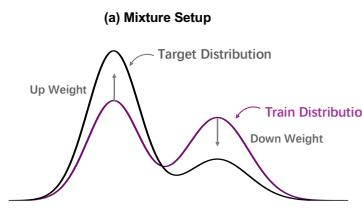

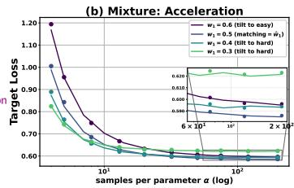

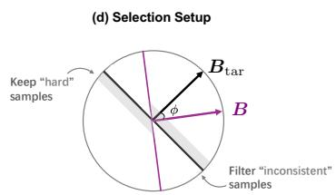

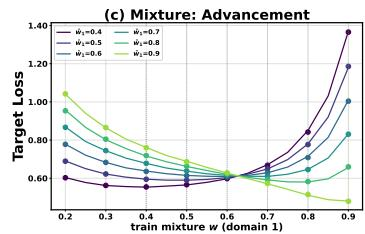

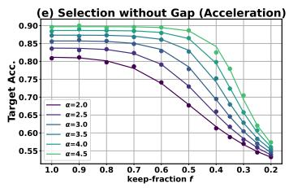

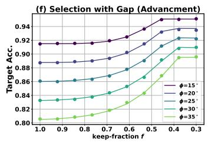  
Figure 1: An analytic account of data curation. Theory (solid lines) closely matches $N = 2 0 0$ perceptron simulations (circles). Top row—mixture. (a) The setup. Two-domain training and target mixtures with compositions w and $\widehat { \pmb { w } } .$ . (b) Acceleration. Tilting the training mixture toward the harder domain $( w _ { 1 } < \widehat { w } _ { 1 } = 0 . 5 )$ lowers target loss at small budgets, but the gain vanishes as α grows. (c) Advancement. At a large budget $( \alpha = 1 0 0 )$ , each target loss vs. mixture curve is minimized by target matching, $\pmb { w } ^ { \star } = \widehat { \pmb { w } }$ . Appendix A.1 shows that this holds as $\alpha \to \infty$ . Bottom row—selection. (d) The setup. A selection policy favors examples near the target boundary and filters those whose labels conflict with the target. (e) Acceleration. At zero gap $( \phi = 0 )$ , moderate selection preserves accuracy, but never exceeds full retention $( f = 1 )$ . Aggressive selection degrades performance. (f) Advancement. With $\phi > 0$ , target accuracy initially rises as $f$ decreases: improved train–target alignment outweighs the reduction in sample size. Reaches an interior optimum $f ^ { \star } < 1$ and the gain increases with ϕ. Appendix A.2 shows that an interior selection policy remains better than full retention as $\alpha \to \infty$

When is advancement possible? The distinction above raises a structural question: when can curation improve the attainable target performance, rather than merely reduce the data budget needed to reach a given performance level? A necessary condition is a correctable train–target gap—a mismatch between the training distribution induced by the baseline, $\mathcal { P } _ { \mathrm { t r a i n } } ( \pmb { w } _ { \mathrm { b a s e l i n e } } )$ , and the target distribution $\mathcal { P } _ { \mathrm { t a r g e t } }$ that some feasible policy can reduce. Without such a mismatch, curation has nothing to correct and can at most accelerate. A correctable gap instead provides optimization headroom for advancement, although it does not guarantee improvement. Section 3.3 formalizes this condition and instantiates it for data mixture and data selection.

## 3.3 RESULTS

We now instantiate the gap criterion for data mixture and selection. Figure 1 shows close agreement between the analytic predictions and finite-dimensional simulations.

Mixture: Acceleration without advancement. Under a uniform target $\widehat { \textbf { \textit { w } } } = \textbf { \textit { w } } _ { \mathrm { b a s e l i n e } } =$ (0.5, 0.5), there is no train–target gap. We introduce heterogeneous domain difficulty by giving domain 2 nuisance variance orthogonal to its teacher $B _ { 2 }$ , thereby lowering its signal-to-noise ratio without changing its labeling rule (Appendix A.1). Allocating more data to this harder domain $( w _ { 1 } < 0 . 5 )$ lowers the target loss at small budgets (Figure 1(b)), but the gain vanishes as α grows, and the uniform baseline attains the best endpoint. Domain difficulty improves finite-budget performance without changing the attainable endpoint: it provides acceleration, not advancement.

Mixture: Advancement by matching the target. Unlike the finite-budget effect of domain difficulty, the infinite-data endpoint is determined by alignment between the training and target mixtures. At the large budget shown in Figure 1(c), each curve is minimized at $w _ { 1 } = \widehat { w } _ { 1 }$ , despite heterogeneous domain difficulty. Appendix A.1 establishes this result analytically for the large-budget limit $( \alpha  \infty )$ : when the training and target distributions span the same domains, target matching is globally optimal, $\pmb { w } ^ { \star } = \widehat { \pmb { w } }$ . Consequently, if $\widehat { \pmb { w } } = \pmb { w } _ { \mathrm { b a s e l i n e } } .$ , the baseline already matches the target and no mixture can provide advancement. If $\widehat { \pmb { w } } \neq \pmb { w } _ { \mathrm { b a s e l i n e } }$ , matching corrects the distribution gap and yields $\mathcal { E } _ { \infty } ( \widehat { w } ) \bar { < } \mathcal { E } _ { \infty } ( w _ { \mathrm { b a s e l i n e } } )$ , providing genuine advancement.

Selection: A gap creates optimization headroom. The same selection policy behaves differently depending on the train–target gap. With $\phi = 0$ , moderate pruning preserves accuracy, but no policy exceeds full retention over the displayed budgets (Figure 1(e)). With $\phi > 0$ , target accuracy initially increases as the retained fraction $f$ decreases (Figure 1(f)). Although fewer examples are used, the selection preferentially removes target-inconsistent examples while retaining informative examples near the target boundary. The resulting gain in train–target alignment outweighs the loss in sample size. Beyond the interior optimum $\bar { f } ^ { \star }$ , the reduction in the training budget dominates, causing accuracy to plateau (in the large-budget limit, $\alpha \to \infty )$ or decline (at finite budgets). Appendix A.2 derives these finite-budget curves and shows that the improvement persists in the large-budget limit.

We now show that the impossibility of advancement without a gap is not an artifact of our perceptron model, but a fundamental algebraic consequence of a bi-level structure. Curation seeks an allocation w to minimize the target loss (outer problem) subject to training convergence (inner problem).

Proposition 1 (Informally). Consider the bi-level curation problem mi $\mathrm { { 1 } } _ { \pmb { w } } \mathcal { L } _ { \mathrm { t a r } } ( \pmb { \theta } ^ { \star } ( \pmb { w } ) )$ , where $\pmb \theta ^ { \star } ( \pmb w ) \in$ arg minθ $\mathcal { L } _ { \mathrm { t r a i n } } ( \pmb { \theta } ; \pmb { w } )$ . Suppose there is no ${ } g a p ,$ such that the population training objective (expected losses) under the uncurated baseline ${ \pmb w } _ { \mathrm { b a s e l i n e } }$ coincides with the population target objective. Then ${ \pmb w } _ { \mathrm { b a s e l i n e } }$ is a global minimizer ofthe outer objective: no allocation attains a lower target endpoint, and curation can at most accelerate.

The intuition is immediate: without a gap, the target objective is exactly the training objective that the baseline already globally minimizes. We defer the formal proof to Appendix $\mathbf { A . } \bar { 3 } ,$ and next translate this distribution-level condition into an observable diagnostic.

## 4 THE ∆-TEST

The correctable train–target gap is a distribution-level condition, making it hard to verify directly. To bridge this, we introduce the ∆-test: an empirical signature of the gap evaluated from a single uncurated baseline run, $\theta ( w _ { \mathrm { b a s e l i n e } } )$ , before any curation is attempted. The test compares the baseline model’s in-sample training loss with its target loss (Appendix $_ { \mathrm { A . 4 ) } }$ . Because data mixture and selection operate at different granularities, we define two variants. For data mixture over K domains, the comparison is domain-wise, allowing the diagnostic to capture domains that are over- or underserved by the baseline. Using the baseline mixture weights $w _ { k }$ and target weights $\widehat { w } _ { k }$ , we define

$$
\Delta = \sum _ { k = 1 } ^ { K } \left| \widehat { w } _ { k } \mathcal { L } _ { \mathrm { t a r } } ^ { k } \big ( \pmb { \theta } ( \pmb { w } _ { \mathrm { b a s e l i n e } } ) \big ) - w _ { k } \mathcal { L } _ { \mathrm { t r a i n } } ^ { k } \big ( \pmb { \theta } ( \pmb { w } _ { \mathrm { b a s e l i n e } } ) \big ) \right| .\tag{1}
$$

The target weights ensure that the diagnostic reflects the distribution on which performance is ulti mately evaluated. For data selection $( \bar { K } = 1 )$ , the training and target losses are scalars:

$$
\Delta = \left| \mathcal { L } _ { \mathrm { t a r } } \big ( \pmb { \theta } ( \pmb { w } _ { \mathrm { b a s e l i n e } } ) \big ) - \mathcal { L } _ { \mathrm { t r a i n } } \big ( \pmb { \theta } ( \pmb { w } _ { \mathrm { b a s e l i n e } } ) \big ) \right| ,\tag{2}
$$

where ${ \pmb w } _ { \mathrm { b a s e l i n e } }$ denotes full retention $( f = 1 )$

Designed as a lightweight operational diagnostic rather than a statistical distance, $\Delta$ indicates the potential for advancement. An appreciably nonzero value flags an observable train–target mismatch and hence possible advancement, provided that a feasible curation policy can correct the mismatch. Across both the mixture and selection models, the gain over the baseline increases with $\Delta { \left( { \mathrm { F i g u r e } 4 } \right) }$ Conversely, $\Delta \approx 0$ suggests that curation will only accelerate training, although scalar losses may fail to reveal some distributional gaps. In practice, $\dot { \Delta }$ can be estimated early in training using a small proxy model—after the gap has become visible but well before full convergence.

## 5 EXPERIMENTS ON REAL DATA

Our theory establishes a correctable train–target gap as a prerequisite for curation to advance a model. We test this in practical LLM training across data mixture and selection: does a nonzero $\Delta$ accompany persistent gains, while $\Delta \approx 0$ suggests limited headroom for consistent improvement over the baseline policy? To ensure a controlled comparison, we evaluate all baselines under a shared training and evaluation protocol and will release all code and configurations following internal approval. We run each experiment five times independently. Due to limited space, the main text reports means and shows standard-deviation bands where space permits. Complete results are provided in Appendix A.6. Across all settings, the diagnostic $\Delta$ is evaluated at exactly 50% of the training budget.

Table 1: Perplexity in the no-gap $( \Delta = 0 . 0 7 )$ mixture setting on SlimPajama. “Average” represents the exponential of the average loss across all domains as in (Fan et al., 2024).
<table><tr><td>Methods</td><td>Arxiv</td><td>Book</td><td>C4</td><td>CommonCrawl</td><td>Github</td><td>Stackexchange</td><td>Wikipedia</td><td>Average</td></tr><tr><td>Uniform</td><td>10.02</td><td>39.61</td><td>49.67</td><td>42.70</td><td>5.16</td><td>12.25</td><td>20.00</td><td> $1 9 . 7 1 \pm _ { 0 . 1 7 }$ </td></tr><tr><td>RegMix</td><td>10.53</td><td>41.90</td><td>48.67</td><td>41.65</td><td>5.75</td><td>11.73</td><td>19.86</td><td> $1 9 . 8 0 { \pm } _ { 0 . 1 2 }$ </td></tr><tr><td>DoGE</td><td>10.96</td><td>35.49</td><td>42.42</td><td>36.81</td><td>6.70</td><td>13.97</td><td>23.92</td><td> $2 0 . 1 7 { \pm } _ { 0 . 1 6 }$ </td></tr><tr><td>Skill-It</td><td>10.64</td><td>38.32</td><td>47.99</td><td>40.62</td><td>5.73</td><td>12.07</td><td>20.78</td><td> $1 9 . 6 8 \pm _ { 0 . 1 6 }$ </td></tr><tr><td>Aioli</td><td>10.09</td><td>39.86</td><td>49.81</td><td>42.83</td><td>5.66</td><td>12.36</td><td>19.67</td><td> $1 9 . 7 7 { \pm } _ { 0 . 1 5 }$ </td></tr><tr><td>TANDEM</td><td>10.18</td><td>37.89</td><td>46.77</td><td>40.41</td><td>5.89</td><td>12.61</td><td>20.96</td><td> $1 9 . 6 6 \pm _ { 0 . 1 5 }$ </td></tr></table>

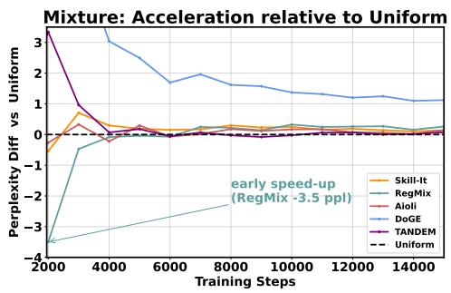

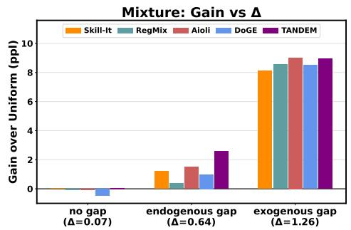  
Figure 2: Left: With a negligible gap $( \Delta = 0 . 0 7 )$ , the perplexity difference relative to Uniform (method − Uniform, lower is better) can be negative early but approaches zero with training. Bands show the standard deviation over five runs. Right: Final gain over Uniform (higher is better) is negligible in the no-gap setting and becomes substantial under endogenous and exogenous gaps.

## 5.1 MIXTURE

We evaluate three scenarios: a matched no-gap setting, an exogenous distribution shift, and an endogenous gap induced by limited domain data. Following Chen et al. (2025), we train 160M GPTstyle LMs (Biderman et al., 2023) on a 6B sampled version of SlimPajama (Soboleva et al., 2023) across all seven domains. We compare the Uniform baseline against five representative mixture optimizers: RegMix (Liu et al., 2025), DoGE (Fan et al., 2024), Skill-It (Chen et al., 2023), Aioli (Chen et al., 2025), and TANDEM (Wang et al., 2025)–spanning mixing-law based, influence-based, and bi-level approaches. Appendix A.5 describes each method and our complete experimental protocol.

When $\Delta \approx 0 ,$ optimized mixtures accelerate but do not advance. We first consider a setting in which the reference training distribution can match the uniformly weighted target. Although SlimPajama-6B is domain-imbalanced, in our training setting, Uniform allocation is feasible without repeatedly sampling a depleted domain, yielding a negligible train–target gap $( \Delta = 0 . 0 7 )$ . From Table 1 we see that the final perplexities of all optimized mixtures range from 19.66 to 20.17, within experimental variation of the Uniform baseline at 19.71. Reallocating training exposure across domains does not produce a consistently better result. At intermediate checkpoints, RegMix reduces perplexity by 3.5, but this advantage vanishes as the training proceeds (Figure 2, left). This no-gap setting exhibits acceleration rather than advancement, supporting our theoretical prediction.

When $\Delta > 0$ under distribution shift, optimized mixtures can advance. An exogenous gap arises when the candidate pool and target follow different distributions. We instantiate this setting by holding out CommonCrawl as the target while training on the remaining six domains, yield ing $\Delta \approx 1 . 2 6$ . Although CommonCrawl is absent from the training pool, the related C4 domain provides a feasible source for partially correcting the gap. As shown in Table 2, every optimized mixture substantially outperforms Uniform, reducing target perplexity from 49.19 to 40.2–41.1. By shifting training exposure toward domains better aligned with the held-out target, curation retains a large gain through the largest feasible training budget, with no sign of the advantage shrinking. In contrast to the no-gap gains that vanish with training, this persistence provides empirical evidence of advancement rather than transient acceleration.

Table 2: Final target perplexity under endogenous $( \Delta = 0 . 6 4 )$ and exogenous $( \Delta = 1 . 2 6 )$ mixture gaps. The endogenous block reports all target domains and their ”Average”. The exogenous block reports the perplexity of the held-out CommonCrawl target (CC).
<table><tr><td colspan="9">Endogenous Gap</td><td>Exogenous Gap</td></tr><tr><td>Methods</td><td>Arxiv</td><td>Book</td><td>C4</td><td>CC.</td><td>Github</td><td>Stackexchange</td><td>Wikipedia</td><td>Average</td><td>CC.</td></tr><tr><td>Uniform</td><td>13.14</td><td>57.44</td><td>65.57</td><td>57.93</td><td>8.21</td><td>19.59</td><td>33.90</td><td>28.60</td><td>49.19</td></tr><tr><td>RegMix</td><td>13.33</td><td>54.12</td><td>63.74</td><td>56.63</td><td>8.23</td><td>20.03</td><td>33.34</td><td>28.24</td><td>40.63</td></tr><tr><td>DoGE</td><td>12.95</td><td>54.82</td><td>62.84</td><td>55.52</td><td>8.13</td><td>18.61</td><td>32.72</td><td>27.62</td><td>40.67</td></tr><tr><td>Skill-It</td><td>14.54</td><td>44.24</td><td>48.99</td><td>42.10</td><td>8.33</td><td>21.10</td><td>49.46</td><td>27.38</td><td>41.08</td></tr><tr><td>Aioli</td><td>12.80</td><td>51.01</td><td>61.13</td><td>53.51</td><td>8.14</td><td>18.97</td><td>32.63</td><td>27.11</td><td>40.17</td></tr><tr><td>TANDEM</td><td>12.60</td><td>49.76</td><td>54.19</td><td>47.24</td><td>8.35</td><td>17.98</td><td>33.51</td><td>26.02</td><td>40.24</td></tr></table>

When $\Delta \ : > \ : 0$ under limited data, optimized mixtures can advance. Repeated sampling of data-scarce domains produces an endogenous train–target gap: overfitting raises their target losses relative to their training losses, thereby increasing ∆. We instantiate this setting by restricting the SlimPajama pool to 300M tokens while preserving its original domain distribution. Under the fixed training budget, small domains such as ArXiv and Wikipedia are exhausted early and repeatedly sampled, yielding $\Delta = 0 . 6 4$ . As shown in Table 2, all optimized mixtures outperform Uniform at the largest tested budget by reducing exposure to these overfit domains. Together with the exogenousgap result, this provides further empirical evidence that a correctable gap can enable advancement regardless of whether it arises from distribution shift or limited data (right panel of Figure 2).

The ∆-test remains predictive across model scales. We repeat all three mixture settings at 1.1B parameters and compare TANDEM with Uniform (Table 3). At 160M and 1.1B, respectively, the no-gap gains remain negligible (+0.05 and +0.11 perplexity), whereas the exogenous-gap gains remain substantial (+8.95 and +5.31), as do the endogenous-gap gains (+2.58 and +2.29). Thus, the diagnosis obtained at 160M transfers to 1.1B, supporting the use of a compute-efficient proxy model to screen for advancement potential before full-scale training (Section 4).

Table 3: Scale study comparing Uniform and TAN-DEM. Gain is Uniform − TANDEM.
<table><tr><td>Scenario</td><td></td><td>Model Uniform</td><td>TANDEM</td><td>Gain</td></tr><tr><td>No gap</td><td>160M</td><td>19.71</td><td>19.66</td><td>+0.05</td></tr><tr><td> $\Delta = 0 . 0 7$ </td><td>1.1B</td><td>17.16</td><td>17.05</td><td>+0.11</td></tr><tr><td>Endogenous gap</td><td>160M</td><td>28.60</td><td>26.02</td><td>+2.58</td></tr><tr><td>∆ = 0.64</td><td>1.1B</td><td>28.14</td><td>25.85</td><td>+2.29</td></tr><tr><td>Exogenous gap</td><td>160M</td><td>49.19</td><td>40.24</td><td>+8.95</td></tr><tr><td>∆ = 1.26</td><td>1.1B</td><td>40.03</td><td>34.72</td><td>+5.31</td></tr></table>

## 5.2 SELECTION

To test whether persistent selection gains require a correctable mismatch, we use a paired design with no-gap and exogenous-gap scenarios. The two scenarios share the same candidate pool, model, selection methods, and training protocol. Only the target distribution used for selection and evaluation changes. This design isolates the role of the gap rather than merely comparing selection algorithms. We use a 5B-token OpenWebMath candidate pool (Paster et al., 2024) and TinyLlama-1.1B (Zhang et al., 2024)2. We report held-out target loss and accuracy on eight benchmarks spanning arithmetic, competition mathematics, word problems, table-based reasoning, and STEM knowledge. Baselines include full-pool continuous pretraining (Base-CT), random selection, three target-agnostic methods (EL2N (Paul et al., 2021), InfoBatch (Qin et al., 2024), and Token-Cleaning (Pang et al., 2025)), and two target-aware methods (RHO-1 (Lin et al., 2024) and BLADE (Wang et al., 2026)). $\mathsf { A p - }$ pendix A.5 provides the complete benchmark list, method descriptions, and experimental protocol.

Table 4: Data-selection results for an in-distribution OpenWebMath target (no gap, $\Delta = 0 . 0 1 6 ,$ upper) and a shifted MetaMath–Mammoth target (with gap, $\Delta = 0 . 5 4 9$ , lower). We report accuracy on eight math benchmarks, their average, and held-out target loss. All methods operate on the same 5B-token candidate pool with a retained fraction of $f = 0 . 6$ . Target-aware RHO-1 and BLADE improve substantially only when a gap is present.
<table><tr><td></td><td>Retained Toks.</td><td>GSM8K MATH SVAMP ASDiv MAWPS TAB MQA</td><td></td><td></td><td></td><td></td><td></td><td></td><td> $\begin{array} { c } { { \mathrm { M M L U - } } } \\ { { \mathrm { S T E M } } } \end{array}$ </td><td> $\operatorname { A v g } .$ </td><td>Target Loss</td></tr><tr><td colspan="10">Selection without Gap</td></tr><tr><td>Base</td><td>一</td><td>2.9</td><td>3.2</td><td>11.0</td><td>18.1</td><td>20.4</td><td>12.5</td><td>14.6</td><td>16.1</td><td>12.4</td><td>1.97</td></tr><tr><td>Base-CT</td><td>5B</td><td>4.3</td><td>4.3</td><td>17.1</td><td>29.4</td><td>39.4</td><td>14.5</td><td>8.3</td><td>20.4</td><td>17.21</td><td>1.70</td></tr><tr><td>Random</td><td>3B</td><td>4.0</td><td>3.9</td><td>15.8</td><td>29.1</td><td>37.2</td><td>13.8</td><td>9.4</td><td>17.8</td><td>16.38</td><td>1.73</td></tr><tr><td>EL2N</td><td>3B</td><td>3.0</td><td>3.2</td><td>15.5</td><td>25.0</td><td>31.2</td><td>14.4</td><td>8.9</td><td>18.3</td><td>14.94</td><td>1.76</td></tr><tr><td>InfoBatch</td><td>3B</td><td>3.8</td><td>3.3</td><td>15.8</td><td>25.8</td><td>32.9</td><td>12.5</td><td>7.1</td><td>16.5</td><td>14.71</td><td>1.76</td></tr><tr><td>Token Cleaning</td><td>3B</td><td>4.2</td><td>3.0</td><td>15.4</td><td>24.4</td><td>31.7</td><td>11.7</td><td>10.2</td><td>14.1</td><td>14.30</td><td>1.79</td></tr><tr><td>RHO-1</td><td>3B</td><td>3.2</td><td>3.1</td><td>15.3</td><td>24.6</td><td>31.4</td><td>14.5</td><td>7.1</td><td>16.7</td><td>14.49</td><td>1.78</td></tr><tr><td>BLADE</td><td>3B</td><td>4.5</td><td>3.7</td><td>18.1</td><td>29.9</td><td>37.9</td><td>16.5</td><td>10.4</td><td>19.3</td><td>17.54</td><td>1.73</td></tr><tr><td colspan="10">Selection with Gap</td></tr><tr><td>Base</td><td>-</td><td>2.9</td><td>3.2</td><td>11.0</td><td>18.1</td><td>20.4</td><td>12.5</td><td>14.6</td><td>16.1</td><td>12.40</td><td>1.26</td></tr><tr><td>Base-CT</td><td>5B</td><td>4.3</td><td>4.3</td><td>17.1</td><td>29.4</td><td>39.4</td><td>14.5</td><td>8.3</td><td>20.4</td><td>17.21</td><td>1.14</td></tr><tr><td>Random</td><td>3B</td><td>4.0</td><td>3.9</td><td>15.8</td><td>29.1</td><td>37.2</td><td>13.8</td><td>9.4</td><td>17.8</td><td>16.38</td><td>1.13</td></tr><tr><td>EL2N</td><td>3B</td><td>3.0</td><td>3.2</td><td>15.5</td><td>25.0</td><td>31.2</td><td>14.4</td><td>8.9</td><td>18.3</td><td>14.94</td><td>1.19</td></tr><tr><td>InfoBatch</td><td>3B</td><td>3.8</td><td>3.3</td><td>15.8</td><td>25.8</td><td>32.9</td><td>12.5</td><td>7.1</td><td>16.5</td><td>14.71</td><td>1.16</td></tr><tr><td>Token Cleaning</td><td>3B</td><td>4.2</td><td>3.0</td><td>15.4</td><td>24.4</td><td>31.7</td><td>11.7</td><td>10.2</td><td>14.1</td><td>14.30</td><td>1.22</td></tr><tr><td>RHO-1</td><td>3B</td><td>15.1</td><td>5.9</td><td>32.6</td><td>46.9</td><td>63.8</td><td>18.7</td><td>15.1</td><td>18.4</td><td>27.06</td><td>0.59</td></tr><tr><td>BLADE</td><td>3B</td><td>21.2</td><td>8.1</td><td>37.0</td><td>51.4</td><td>70.2</td><td>21.2</td><td>20.6</td><td>20.8</td><td>31.31</td><td>0.45</td></tr></table>

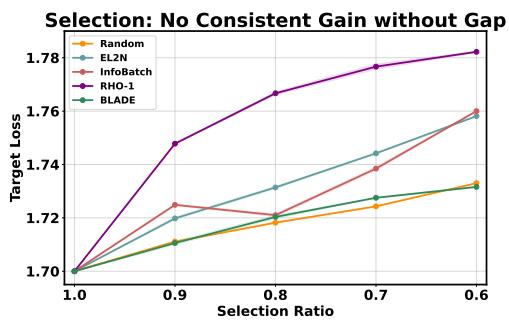

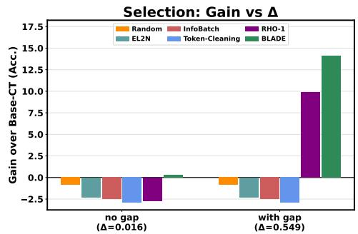  
Figure 3: $L e f t .$ : Held-out target loss across retained fractions $f \in [ 0 . 6 , 1 . 0 ]$ for an in-distribution OpenWebMath target $( \Delta = 0 . 0 1 6 )$ Target loss directly evaluates the distribution used to define $\Delta .$ . No selector consistently improves over Base-CT and Random, and more aggressive pruning generally increases loss. Right: Average accuracy change relative to Base-CT in the no-gap and shifted-target settings. The comparison shows little optimization headroom in the no-gap setting, whereas substantial positive gains become possible after the target shift $( \Delta = 0 . 5 4 9 )$

When $\Delta \approx 0 ,$ , selection provides no consistent advancement. Using an additional 0.3B-token sample from OpenWebMath as the target yields a negligible train–target gap $( \Delta = 0 . 0 1 6 )$ . With little discrepancy to correct, neither target-aware nor target-agnostic methods consistently outperform the Base-CT (17.21) and Random (16.38) baselines: their average scores range from 14.3 to 17.5, and their held-out target losses show no consistent improvement (Table 4, upper). Notably, RHO-1 and BLADE receive target data but still fail to provide consistent gains, showing that target access alone does not guarantee advancement. Figure 3 (Left) further examines the effect of the retained fraction. We report held-out target loss rather than downstream accuracy because it is measured on the target distribution used to define ∆, and thus more directly exposes the train–target gap. Varying f from 1.0 to 0.6 yields the same conclusion: full retention attains the lowest loss, no selection method consistently improves over Random, and target loss generally rises as selection becomes more aggressive. This retention sweep is consistent with the limited optimization headroom indicated by the negligible gap.

When $\Delta > 0 ,$ selection can advance. When the target departs from the candidate pool, an exogenous gap emerges. Following Lin et al. (2024), we use a blend of MetaMath (Yu et al., 2024a) and Mammoth (Yue et al., 2024) as the target while retaining OpenWebMath as the candidate pool,3 yielding a substantial mismatch (∆ = 0.549). As shown in Table 4 (bottom), target-aware selection produces large gains: RHO-1 and BLADE increase the Base-CT average score from 17.21 to 27.06 and 31.31, respectively, whereas the target-agnostic methods EL2N, InfoBatch, and Token-Cleaning do not. Held-out target losses show the same pattern. Together with the no-gap control, this contrast provides empirical evidence that target-aware selection can achieve advancement by correcting a genuine train–target gap.

## 6 RELATED WORK

Data mixture optimization. Beyond hand-tuned compositions, mixture methods learn domain weights via mixing laws (Liu et al., 2025; Chen et al., 2023; 2025) or bi-level optimization (Fan et al., 2024; Wang et al., 2025). Empirical comparisons have also found Uniform to remain a competitive baseline in several settings (Chen et al., 2025). Our analysis offers one explanation for this pattern: when the baseline training distribution is aligned with the target, Uniform is endpoint-optimal, a finite-budget advantage reflects acceleration.

Data selection and quality scores. Data selection methods generally fall into target-agnostic and target-aware paradigms. Target-agnostic scores rank examples by intrinsic difficulty or quality signals (Paul et al., 2021; Wang et al., 2023; Qin et al., 2024; Pang et al., 2025). Nevertheless, they have a mixed record, with reports that random selection remains highly competitive in the data-rich regime (Xia et al., 2024). Through our lens, such difficulty proxies only accelerate learning when no train–target gap exists. Conversely, target-aware methods can genuinely advance the model by aligning with a target. This alignment can be implicit, such as DCLM (Li et al., 2024) and DEITA (Liu et al., 2024) using language models whose priors encode target distributions, or explicit, where candidates are scored directly against a defined target (Lin et al., 2024; Yu et al., 2024b; Wang et al., 2026). These methods provide advancement by successfully reducing a genuine gap.

Solvable models of data curation. Another line of research explores data curation through solvable statistical-mechanics models, using the teacher–student perceptron and replica method (Engel & den Broeck, 2022; Loureiro et al., 2021; Sorscher et al., 2022). Closest to our setup, Dohmatob et al. (2026) derive exact scaling laws for data selection under distribution shift to characterize when ”less is more”. While we share this solvable-model viewpoint, our approach differs in key aspects. First, we directly formulate the classification objective rather than relying on a mean squared error (MSE) surrogate. Second, we explicitly formalize the distinction between acceleration and advancement. Finally, we translate these insights and advancement prerequisites into an observable empirical diagnostic (the ∆-test), unifying both mixture and selection under a single framework, and validated on real LLMs.

## 7 CONCLUSION

We show that the value of data curation hinges on a fundamental distinction: whether a strategy genuinely advances attainable target performance or merely accelerates training. Advancement requires a correctable mismatch between the training baseline and the target. When the baseline training and target objectives coincide, the uncurated baseline is endpoint-optimal, so curation can at most accelerate. This helps explain why uniform mixtures and random selection remain difficult to beat in data-rich, in-distribution regimes. Practically, our lightweight $\Delta \cdot$ -test diagnoses advancement potential from a baseline run before expensive optimization. A near-zero $\Delta$ suggests prioritizing scaling over curation, whereas an appreciably nonzero $\Delta$ signals potential headroom for target-aware optimization. Ultimately, our findings recenter curation on the task definition itself. Given the asymmetry between massive candidate training pools and compact, controllable target sets, constructing diverse, high-fidelity targets is not merely an evaluation afterthought, but a highly leveraged design choice in shaping LLM capabilities.

## REFERENCES

Aida Amini, Saadia Gabriel, Peter Lin, Rik Koncel-Kedziorski, Yejin Choi, and Hannaneh Hajishirzi. Mathqa: Towards interpretable math word problem solving with operation-based formalisms. arXiv preprint, arXiv:1905.13319, 2019.

Stella Biderman, Hailey Schoelkopf, Quentin Gregory Anthony, Herbie Bradley, Kyle O’Brien, Eric Hallahan, Mohammad Aflah Khan, Shivanshu Purohit, USVSN Sai Prashanth, and Edward Raff eta.al. Pythia: A suite for analyzing large language models across training and scaling. In International Conference on Machine Learning, 2023.

Mayee F. Chen, Nicholas Roberts, Kush Bhatia, Jue Wang, Ce Zhang, Frederic Sala, and Christopher Re. Skill-it! a data-driven skills framework for understanding and training language models. In´ Neural Information Processing Systems, 2023.

Mayee F. Chen, Michael Y. Hu, Nicholas Lourie, Kyunghyun Cho, and Christopher Re. Aioli: A ´ unified optimization framework for language model data mixing. In International Conference on Learning Representations, 2025.

Karl Cobbe, Vineet Kosaraju, Mohammad Bavarian, Mark Chen, Heewoo Jun, Lukasz Kaiser, Matthias Plappert, Jerry Tworek, Jacob Hilton, Reiichiro Nakano, Christopher Hesse, and John Schulman. Training verifiers to solve math word problems. arXiv preprint, arXiv:2110.14168, 2021.

Elvis Dohmatob, Mohammad Pezeshki, and Reyhane Askari-Hemmat. Why less is more (sometimes): A theory of data curation. In International Conference on Learning Representations, 2026.

A. Engel and C. Van den Broeck. Statistical mechanics of learning. In Cambridge University Press, 2022.

Simin Fan, Matteo Pagliardini, and Martin Jaggi. Doge: Domain reweighting with generalization estimation. In International Conference on Machine Learning, 2024.

Dan Hendrycks, Collin Burns, Steven Basart, Andy Zou, Mantas Mazeika, Dawn Song, and Jacob Steinhardt. Measuring massive multitask language understanding. arXiv preprint, arXiv:2009.03300, 2020.

Dan Hendrycks, Collin Burns, Saurav Kadavath, Akul Arora, Steven Basart, Eric Tang, Dawn Song, and Jacob Steinhardt. Measuring mathematical problem solving with the math dataset. In Neural Information Processing Systems, 2021.

Rik Koncel Kedziorski, Subhro Roy, Aida Amini, Nate Kushman, and Hannaneh Hajishirzi. Mawps: A math word problem repository. In Conference ofthe North American Chapter ofthe Association for Computational Linguistics, 2016.

Jeffrey Li, Alex Fang, and Georgios Smyrnis et.al. Datacomp-lm: In search of the next generation of training sets for language models. In Advances in Neural Information Processing Systems, 2024.

Zhenghao Lin, Zhibin Gou, Yeyun Gong, Xiao Liu, Yelong Shen, Ruochen Xu, Chen Lin, Yujiu Yang, Jian Jiao, Nan Duan, and Weizhu Chen. Rho-1: Not all tokens are what you need. In Neural Information Processing Systems, 2024.

Qian Liu, Xiaosen Zheng, Niklas Muennighoff, Guangtao Zeng, Longxu Dou, Tianyu Pang, Jing Jiang, and Min Lin. Regmix: Data mixture as regression for language model pre-training. In International Conference on Learning Representations, 2025.

Wei Liu, Weihao Zeng, Keqing He, Yong Jiang, and Junxian He. What makes good data for alignment? a comprehensive study of automatic data selection in instruction tuning. In International Conference on Learning Representations, 2024.

Bruno Loureiro, Cedric Gerbelot, Hugo Cui, Sebastian Goldt, Florent Krzakala, Marc Mezard, and Lenka Zdeborova. Learning curves of generic features maps for realistic datasets with a teacherstudent model. In Advances in Neural Information Processing Systems, 2021.

Pan Lu, Liang Qiu, Kai-Wei Chang, Ying Nian Wu, Song-Chun Zhu, Tanmay Rajpurohit, Peter Clark, and Ashwin Kalyan. Dynamic prompt learning via policy gradient for semi-structured mathematical reasoning. In International Conference on Learning Representations, 2023.

Shenyun Miao, Chaochun Liang, and Keh-Yih Su. A diverse corpus for evaluating and developing english math word problem solvers. In Association for Computational Linguistics, 2020.

Jinlong Pang, Na Di, Zhaowei Zhu, Jiaheng Wei, Hao Cheng, Chen Qian, and Yang Liu. Token cleaning: Fine-grained data selection for llm supervised fine-tuning. In International Conference on Machine Learning, 2025.

Keiran Paster, Marco Dos Santos, Zhangir Azerbayev, and Jimmy Ba. Openwebmath: An open dataset of high-quality mathematical web text. In International Conference on Learning Representations, 2024.

Arkil Patel, Satwik Bhattamishra, and Navin Goyal. Are nlp models really able to solve simple math word problems? In Conference of the North American Chapter of the Association for Computational Linguistics, 2021.

Mansheej Paul, Surya Ganguli, and Gintare Karolina Dziugaite. Deep learning on a data diet: Finding important examples early in training. In M. Ranzato, A. Beygelzimer, Y. Dauphin, P.S. Liang, and J. Wortman Vaughan (eds.), Advances in Neural Information Processing Systems, volume 34, pp. 20596–20607. Curran Associates, Inc., 2021.

Ziheng Qin, Kai Wang, Zangwei Zheng, Jianyang Gu, Xiangyu Peng, Zhaopan Xu, Daquan Zhou, Lei Shang, Baigui Sun, Xuansong Xie, and Yang You. Infobatch: Lossless training speed up by unbiased dynamic data pruning. In International Conference on Learning Representations, 2024.

Daria Soboleva, Faisal Al-Khateeb, Joel Hestness, and Jacob Robert Steeves Nolan Dey Opentensor: Robert Myers. Slimpajama: A 627b token, cleaned and deduplicated version of redpajam. https://www.cerebras.ai/blog/slimpajama-a-627b-token-cleaned-and-deduplicated-versionof-redpajama, 2023.

Ben Sorscher, Robert Geirhos, Shashank Shekhar, Surya Ganguli, and Ari S. Morcos. Beyond neural scaling laws: beating power law scaling via data pruning. In Advances in Neural Information Processing Systems, 2022.

Jiaxing Wang, Yong Li, Jingwei Zhuo, Xupeng Shi, Weizhong Zhang, Lixing Gong, Tong Tao, Pengzhang Liu, Yongjun Bao, and Weipeng Yan. Dynams: Dynamic margin selection for efficient deep learning. In International Conference on Learning Representations, 2023.

Jiaxing Wang, Deping Xiang, Jin Xu, Mingyang Yi, Guoqiang Gong, Zicheng Zhang, Haoran Li, Pengzhang Liu, Zhen Chen, Ke Zhang, Ju Fan, and Qixiang Jiang. Tandem: Bi-level data mixture optimization with twin networks. In Neural Information Processing Systems, 2025.

Jiaxing Wang, Deping Xiang, Jin Xu, Zirui Liu, Zicheng Zhang, Guoqiang Gong, Jun Fang, Chao Liu, Pengzhang Liu, Tongxuan Liu, Ke Zhang, and Qixia Jiang. Blade: Scalable bi-level adaptive data selection for llm training. arXiv preprint arXiv:2606.18650, 2026.

Tingyu Xia, Bowen Yu, Kai Dang, An Yang, Yuan Wu, Yuan Tian, Yi Chang, and Junyang Lin. Rethinking data selection at scale: Random selection is almost all you need. arXiv preprint, arXiv:2410.09335, 2024.

Sang Michael Xie, Hieu Pham, Xuanyi Dong, Nan Du, Hanxiao Liu, Yifeng Lu, Percy Liang, Quoc V Le, Tengyu Ma, and Adams Wei Yu. Doremi: Optimizing data mixtures speeds up language model pretraining. In Neural Information Processing Systems, 2023.

Longhui Yu, Weisen Jiang, Han Shi, Jincheng YU, Zhengying Liu, Yu Zhang, James Kwok, Zhenguo Li, Adrian Weller, and Weiyang Liu. Metamath: Bootstrap your own mathematical questions for large language models. In International Conference on Learning Representations, 2024a.

Zichun Yu, Spandan Das, and Chenyan Xiong. Mates: Model-aware data selection for efficient pretraining with data influence models. In Neural Information Processing Systems, 2024b.

Xiang Yue, Xingwei Qu, Ge Zhang, Yao Fu, Wenhao Huang, Huan Sun, Yu Su, , and Wenhu Chen. Mammoth: Building math generalist models through hybrid instruction tuning. In International Conference on Learning Representations, 2024.

Peiyuan Zhang, Guangtao Zeng, Tianduo Wang, and Wei Lu. Tinyllama: An open-source small language model. arXiv preprint, arXiv:2401.02385, 2024.

## A APPENDIX

## A.1 TWO-TEACHER MIXTURE WITH HETEROGENEOUS DIFFICULTY

We instantiate data mixture in a two-domain teacher–student model. A mixture w determines how the total of $P$ training examples is allocated across the two domains, with $P _ { k } = w _ { k } P .$ . All examples are then used jointly to fit one regularized logistic-regression student. We characterize its learning curves using the multi-environment state-evolution framework of Loureiro et al. (2021).

Heterogeneous-difficulty setup. We consider two domains with orthogonal teachers $B _ { 1 } , B _ { 2 } \in$ $\mathbb { R } ^ { N }$ satisfying $\| B _ { 1 } \| = \| B _ { 2 } \| = \sqrt { N }$ and $B _ { 1 } ^ { \top } B _ { 2 } = 0$ . The training set contains $P = \alpha N$ examples. A mixture policy $\begin{array} { r } { \pmb { w } = ( w _ { 1 } , w _ { 2 } ) \in \mathscr { W } : = \{ \pmb { w } \in \mathbb { R } ^ { K } \ | \ \sum _ { k = 1 } ^ { K } w _ { k } = 1 , \ w _ { k } > 0 \} } \end{array}$ assigns $P _ { k } = w _ { k } P$ examples to domain $k ,$ giving the domain-specific sample ratio $\alpha _ { k } = P _ { k } / N = w _ { k } \alpha ;$ here $K = 2$ Examples from domain k are generated according to $\pmb { x } _ { i } ^ { k } \sim \mathcal { N } ( \mathbf { 0 } , \ddot { \Sigma } _ { k } )$ and $y _ { i } ^ { k } = $ sign $( B _ { k } ^ { \top } { \pmb x } _ { i } ^ { k } )$ . Both domains share a student $\pmb { J } \in \mathbb { R } ^ { N }$ with normalized field $h ( J , \pmb { x } ) = J ^ { \top } \pmb { x } / \sqrt { N }$ . Define the logistic margin loss $\ell _ { \log } ( r ) = \log ( 1 + e ^ { - r } )$ . The trained student is

$$
\begin{array} { r } { \pmb { J } ^ { \star } ( \pmb { w } ) = \mp \underset { \pmb { J } } { \arg \operatorname* { m i n } } \left\{ \displaystyle \sum _ { k = 1 } ^ { 2 } \sum _ { i = 1 } ^ { P _ { k } } \ell _ { \log } \left( y _ { i } ^ { k } \frac { \pmb { J } ^ { \top } \pmb { x } _ { i } ^ { k } } { \sqrt { N } } \right) + \frac { \lambda _ { \mathrm { r e g } } } { 2 } \| \pmb { J } \| ^ { 2 } \right\} , } \end{array}\tag{3}
$$

where $\lambda _ { \mathrm { r e g } } > 0$ is the regularization coefficient. Domain 1 is isotropic, with $\pmb { \Sigma } _ { 1 } = \mathbf { I }$ . We make domain 2 harder by introducing nuisance variance orthogonal to its teacher:

$$
\pmb { \Sigma } _ { 2 } = \frac { B _ { 2 } \pmb { B } _ { 2 } ^ { \top } } { N } + ( 1 + \nu ^ { 2 } ) \left( \mathbf { I } - \frac { B _ { 2 } \pmb { B } _ { 2 } ^ { \top } } { N } \right) ,\tag{4}
$$

where $\nu \geq 0$ controls the nuisance level. Since $B _ { 2 } B _ { 2 } ^ { \top } / N$ projects onto the teacher direction, $\Sigma _ { 2 }$ has eigenvalue 1 along $B _ { 2 }$ and eigenvalue $1 + \nu ^ { 2 }$ in every orthogonal direction. The nuisance therefore leaves the labeling rule and Bayes boundary unchanged while increasing the finite-sample difficulty of estimating $B _ { 2 }$

State-evolution structure. We summarize the trained student using a finite set of order parameters. The overlap $m _ { k } = J ^ { \top } B _ { k } / N$ measures the alignment of the student with the teacher of domain $k ,$ while $q = \lVert J \rVert ^ { 2 } / N$ is its normalized squared norm. We further introduce the response parameter $V _ { k } ,$ , which measures how sensitively the fitted student changes under a small perturbation to examples from domain $k .$ . To enforce the definitions of these order parameters in the saddle-point derivation, we introduce the associated dual variables $\widehat { m } _ { k } , \widehat { V } _ { k } .$ , and $\widehat { q } _ { k }$ , analogous to Lagrange multipliers. These are auxiliary quantities rather than additional model parameters. The resulting selfconsistent equations consist of two coupled parts. The loss-side equations determine $( \widehat { m } _ { k } , \widehat { V } _ { k } , \widehat { q } _ { k } )$ from $( m _ { k } , V _ { k } , q )$ through the domain-specific logistic loss, while the model-side equations map the dual variables back to $( m _ { k } , V _ { k } , q )$ through the domain covariances. A joint fixed point of these equations determines the asymptotic properties of the trained student.

Loss-side equations. We specialize the general state-evolution equations of Loureiro et al. (2021) to the logistic loss and the two-domain covariance structure defined above. For domain $k ,$ let $Q _ { k }$ denote the variance of the effective student field. The covariance structure gives $Q _ { 1 } = q$ and

$$
Q _ { 2 } = q + \nu ^ { 2 } ( q - m _ { 2 } ^ { 2 } ) .\tag{5}
$$

The additional term in $Q _ { 2 }$ arises from the component of $\textbf {  { J } }$ orthogonal to $B _ { 2 } .$ , whose variance is amplified by the nuisance level $\nu .$ Let $V _ { k } ^ { \star } = \hat { 1 } ^ { \star } - m _ { k } ^ { 2 } / Q _ { k }$ denote the conditional variance of the teacher field given the student field in domain k. Specializing the loss-side saddle-point conditions yields

$$
\widehat { m } _ { k } = \frac { \alpha _ { k } } { V _ { k } } \mathcal { T } _ { m } ( m _ { k } , Q _ { k } , V _ { k } , V _ { k } ^ { \star } ) ,\tag{6}
$$

$$
\widehat { V } _ { k } = \alpha _ { k } \left[ \frac { 1 } { V _ { k } } - \frac { \mathcal { I } _ { V } ( m _ { k } , Q _ { k } , V _ { k } , V _ { k } ^ { \star } ) } { V _ { k } ^ { 2 } } \right] ,\tag{7}
$$

$$
\widehat { q } _ { k } = \frac { \alpha _ { k } } { V _ { k } ^ { 2 } } \mathcal { T } _ { Q } ( m _ { k } , Q _ { k } , V _ { k } , V _ { k } ^ { \star } ) ,\tag{8}
$$

where $\mathcal { T } _ { m } , \mathcal { T } _ { V }$ , and $\scriptstyle { \mathcal { T } } _ { Q }$ are scalar Gaussian expectations induced by the logistic loss and its proximal operator. Their explicit expressions are provided below. The domain difficulty first enters these equations through $Q _ { 2 }$ . By changing the effective field distribution of domain $2 ,$ the nuisance variance modifies its conjugate parameters and, consequently, its finite-sample learning dynamics.

Model-side update and spectral decomposition. The conjugate responses define the effective precision operator

$$
\mathbf { D } = \lambda _ { \mathrm { r e g } } \mathbf { I } + \widehat { V } _ { 1 } \boldsymbol { \Sigma } _ { 1 } + \widehat { V } _ { 2 } \boldsymbol { \Sigma } _ { 2 } .\tag{9}
$$

The model-side update requires its inverse $\mathbf { D } ^ { - 1 }$ . We therefore decompose the parameter space into span $\left( B _ { 1 } \right)$ , span $\left( B _ { 2 } \right)$ , and $B = \operatorname { s p a n } ( B _ { 1 } , B _ { 2 } ) ^ { \perp }$ . The $( N - 2 )$ -dimensional subspace $\boldsymbol { B }$ contains directions orthogonal to both teachers and is referred to as the bulk.

The covariance eigenvalues in these subspaces are

$$
\begin{array}{c} \frac { \mid \mathrm { s p a n } ( B _ { 1 } ) \mathrm { s p a n } ( B _ { 2 } ) B } { \Sigma _ { 1 } } \qquad \mathrm { 1 } \qquad \mathrm { 1 } \qquad \mathrm { 1 } \qquad \quad \Sigma \qquad \mathrm { 1 } \qquad \\ { \Sigma _ { 2 } \mid \mathrm { 1 } + \nu ^ { 2 } \qquad \mathrm { 1 } \qquad \mathrm { 1 } + \nu ^ { 2 } } \end{array} .\tag{10}
$$

Consequently, the eigenvalues of D are

$$
d _ { B _ { 1 } } = d _ { \mathrm { { b u l k } } } = \lambda _ { \mathrm { { r e g } } } + \widehat { V } _ { 1 } + ( 1 + \nu ^ { 2 } ) \widehat { V } _ { 2 } , \qquad d _ { B _ { 2 } } = \lambda _ { \mathrm { { r e g } } } + \widehat { V } _ { 1 } + \widehat { V } _ { 2 } .\tag{11}
$$

The corresponding eigenvalues of $\mathbf { D } ^ { - 1 }$ are their reciprocals.

Using this decomposition, the model-side updates become

$$
V _ { 1 } = \frac { 1 } { d _ { \mathrm { b u l k } } } , \qquad V _ { 2 } = \frac { 1 + \nu ^ { 2 } } { d _ { \mathrm { b u l k } } } ,\tag{12}
$$

$$
m _ { 1 } = \frac { \widehat { m } _ { 1 } } { d _ { B _ { 1 } } } , \qquad m _ { 2 } = \frac { \widehat { m } _ { 2 } } { d _ { B _ { 2 } } } ,\tag{13}
$$

$$
q = \frac { \widehat { m } _ { 1 } ^ { 2 } } { d _ { B _ { 1 } } ^ { 2 } } + \frac { \widehat { m } _ { 2 } ^ { 2 } } { d _ { B _ { 2 } } ^ { 2 } } + \frac { \widehat { q } _ { 1 } + ( 1 + \nu ^ { 2 } ) \widehat { q } _ { 2 } } { d _ { \mathrm { b u l k } } ^ { 2 } } .\tag{14}
$$

Together, the loss-side and model-side updates form a closed finite-dimensional system for any mixture policy w and sample ratio α.

Target readout. For a target example from domain $k ,$ the normalized student field can be written as

$$
h _ { k } = m _ { k } u + s _ { k } \sqrt { q - m _ { k } ^ { 2 } } \eta , \qquad u , \eta \sim \mathcal { N } ( 0 , 1 ) ,\tag{15}
$$

where $s _ { 1 } ~ = ~ 1$ and $s _ { 2 } = \sqrt { 1 + \nu ^ { 2 } }$ . The first term is aligned with the teacher, while the second represents the orthogonal component of the student. The corresponding signal-to-noise ratio is $\mathrm { S N R } _ { k } = m _ { k } / [ s _ { k } \sqrt { q - m _ { k } ^ { 2 } } ]$

Let $\widehat { \pmb { w } } = ( \widehat { w } _ { 1 } , \widehat { w } _ { 2 } ) \in \mathcal { W }$ denote the domain proportions of the target. Its target loss is

$$
\mathcal { L } _ { \mathrm { t a r } } ( \pmb { w } ; \widehat { \pmb { w } } ) = \sum _ { k = 1 } ^ { 2 } \widehat { w } _ { k } \mathbb { E } _ { u , \eta } \left[ \ell _ { \mathrm { l o g } } ( \mathrm { s i g n } ( u ) h _ { k } ) \right] .\tag{16}
$$

Thus, solving the closed state-evolution system determines the target loss of any training mixture w against any target mixture wb. Dependence on $\alpha , \nu ,$ and $\lambda _ { \mathrm { r e g } }$ is suppressed for readability.

Large-budget limit: an analytic target-matching argument. Panel (c) of Figure 1 is evaluated at a large but finite budget. We now identify its limiting optimum without extrapolating the numerical state evolution. Divide equation 3 by $P \dot { = } \alpha N . \mathrm { I f } \| \dot { \mathbf { J } } \| \dot { ^ { 2 } } = O ( N )$ and $\lambda _ { \mathrm { r e g } }$ is fixed, the normalized ridge contribution is $O ( \lambda _ { \mathrm { r e g } } / \alpha )$ and hence vanishes as $\alpha \to \infty$ . Under convergence of the empirical domain risks, the limiting student therefore minimizes

$$
\begin{array} { r l } & { J _ { \infty } ^ { \star } ( \pmb { w } ) \in \mathrm { a r g } \underset { \pmb { J } } { \operatorname* { m i n } } \ \mathcal { R } _ { \pmb { w } } ( \pmb { J } ) , } \\ & { \mathcal { R } _ { \pmb { w } } ( \pmb { J } ) = \displaystyle \sum _ { k = 1 } ^ { 2 } w _ { k } \mathcal { L } ^ { \mathrm { p o p } , k } ( \pmb { J } ) , } \\ & { \mathcal { L } ^ { \mathrm { p o p } , k } ( \pmb { J } ) = \mathbb { E } _ { \pmb { x } \sim \mathcal { N } ( \mathbf { 0 } , \pmb { \Sigma } _ { k } ) } \left[ \ell _ { \mathrm { l o g } } \left( \mathrm { s i g n } ( \pmb { B } _ { k } ^ { \top } \pmb { x } ) h ( \pmb { J } , \pmb { x } ) \right) \right] . } \end{array}\tag{17}
$$

The target population risk and the endpoint induced by a training mixture are

$$
\mathcal { R } _ { \widehat { w } } ( J ) = \sum _ { k = 1 } ^ { 2 } \widehat { w } _ { k } \mathcal { L } ^ { \mathrm { p o p } , k } ( J ) , \qquad \mathcal { E } _ { \infty } ( w ; \widehat { w } ) = \mathcal { R } _ { \widehat { w } } ( J _ { \infty } ^ { \star } ( w ) ) .\tag{18}
$$

Choosing $\mathbf { \nabla } _ { w } = \widehat { \mathbf { w } }$ makes the limiting training objective exactly the target objective. Consequently,

$$
\mathcal { E } _ { \infty } ( \widehat { \pmb { w } } ; \widehat { \pmb { w } } ) \le \mathcal { E } _ { \infty } ( \pmb { w } ; \widehat { \pmb { w } } ) , \qquad \forall \pmb { w } \in \mathcal { W } ,\tag{19}
$$

so target matching is a global optimum. This argument is analytic and does not depend on the nuisance level $\nu .$ The location in mixture space of the matching optimum is therefore independent of difficulty, although the population minimizer and attained target loss generally still depend on ν through $\Sigma _ { 2 }$

If the target risk has a unique minimizer and the baseline induces a different population minimizer, the inequality in equation 19 is strict. These conditions hold in the nondegenerate two-teacher setting considered here: the Gaussian covariances are full rank, the mixed logistic population risk is strictly convex at its finite optimum, and distinct teachers do not share a stationary point of their individual risks. Two regimes follow:

• No gap $( \widehat { \pmb { w } } = \pmb { w } _ { \mathrm { b a s e l i n e } } ) ;$ matching returns the baseline, so $\mathcal { E } _ { \infty } ( \pmb { w } ; \pmb { \widehat { w } } ) \geq \mathcal { E } _ { \infty } ( \pmb { w } _ { \mathrm { b a s e l i n e } } ; \pmb { \widehat { w } } )$ for all w and no reallocation lowers the endpoint—acceleration only.

• With a correctable composition gap $( \widehat { \pmb { w } } \neq \pmb { w } _ { \mathrm { b a s e l i n e } } ) ;$ the baseline minimizes a differently weighted population risk. Under the nondegeneracy conditions above, the two weightings induce different minimizers, and hence $\mathcal { E } _ { \infty } ( \widehat { \pmb { w } } ; \widehat { \pmb { w } } ) < \mathcal { E } _ { \infty } ( \pmb { w } _ { \mathrm { b a s e l i n e } } ; \widehat { \pmb { w } } )$ —advancement.

Thus the numerical curve at $\alpha = 1 0 0$ in panel (c) approximates an exactly target-matched population optimum; it is not the sole evidence for that endpoint.

Consequences for acceleration and advancement. At finite sample ratios, the unequal field variances in Equation (5) cause the two domains to be learned at different rates. Allocating more data to the harder domain can therefore reduce target loss at small α, as in Figure 1(b). When the baseline already matches the target, this advantage vanishes with increasing budget and is acceleration. When the target composition differs from the baseline, equation 19 instead gives a strictly better population endpoint under the stated nondegeneracy conditions, which is the advancement effect in panel (c).

Logistic integrals. For completeness, we specify the Gaussian expectations in Equations (6) to (8). $\operatorname { L e t } { \bar { \omega } } = { \sqrt { Q } } { \bar { \xi } }$ with $\xi \sim \mathcal { N } ( \bar { 0 , 1 } ) , \omega _ { \star } = ( m / \sqrt { Q } ) \dot { \xi }$ , and

$$
a ( \xi ) = \mathrm { e r f } \left( { \frac { ( m / \sqrt { Q } ) \xi } { \sqrt { 2 V ^ { \star } } } } \right) .\tag{20}
$$

Define

$$
\eta ^ { \pm } = \mathrm { p r o x } _ { V \ell _ { \log } ( \pm \cdot ) } ( \omega ) = \arg \operatorname* { m i n } _ { r } \left\{ \frac { ( r - \omega ) ^ { 2 } } { 2 V } + \ell _ { \log } ( \pm r ) \right\} .\tag{21}
$$

The required integrals are

$$
\mathcal { T } _ { m } = \frac { 1 } { \sqrt { 2 \pi V ^ { \star } } } \mathbb { E } _ { \xi } \left[ e ^ { - \frac { \omega _ { \star } ^ { 2 } } { 2 V ^ { \star } } } ( \eta ^ { + } - \eta ^ { - } ) \right] ,\tag{22}
$$

$$
\mathcal { T } _ { V } = \frac { 1 } { 2 } \mathbb { E } _ { \xi } \left[ \frac { 1 + a ( \xi ) } { 1 / V + \frac { 1 } { 4 } \mathrm { s e c h } ^ { 2 } ( \eta ^ { + } / 2 ) } + \frac { 1 - a ( \xi ) } { 1 / V + \frac { 1 } { 4 } \mathrm { s e c h } ^ { 2 } ( \eta ^ { - } / 2 ) } \right] ,\tag{23}
$$

$$
\mathcal { T } _ { Q } = \frac { 1 } { 2 } \mathbb { E } _ { \xi } \left[ ( 1 + a ( \xi ) ) ( \eta ^ { + } - \omega ) ^ { 2 } + ( 1 - a ( \xi ) ) ( \eta ^ { - } - \omega ) ^ { 2 } \right] .\tag{24}
$$

Reduction checks and numerical solution. When $\nu = 0 ,$ , the two domains have identical covariance, $d _ { B _ { 1 } } = d _ { B _ { 2 } } = d _ { \mathrm { b u l k } } = \lambda _ { \mathrm { r e g } } + \widehat { V } _ { 1 } + \widehat { V } _ { 2 }$ , and $V _ { 1 } = V _ { 2 }$ . The system then reduces to the isotropic two-teacher logistic state evolution. We solve the fixed-point equations using a nonuniform composite quadrature for the Gaussian expectations. At large sample ratios, $V ^ { \star }$ approaches zero and $a ( \xi )$ becomes sharply concentrated, causing fixed Gauss–Hermite grids to under-resolve the integrands. Refining the grid around the shrinking transition layer avoids this numerical artifact. The isotropic reduction at $\nu = 0$ and agreement with finite-dimensional simulations provide independent checks of the solution.

## A.2 SELECTION UNDER MATCHED AND SHIFTED TARGETS

Selection starts from $P ~ = ~ \alpha N$ candidate examples and retains a fraction $f ,$ leaving a training budget $f \alpha N$ . We first consider a matched target and then extend the model to a shifted target, where label consistency provides an additional selection signal. We write the target-error learning curve as $\mathcal { E } _ { \alpha } ( f ; \phi )$ , where ϕ is the angle between the training and target teachers; dependence on the fixed $\lambda _ { \mathrm { s e l } }$ in the shifted-target policy is suppressed.

## A.2.1 MATCHED TARGET: CLASSICAL MARGIN SELECTION

Let $B \in \mathbb { R } ^ { N } , \| B \| = \sqrt { N }$ , be both the training and target teacher. The $P = \alpha N$ candidates are generated by $\pmb { x } _ { i } \sim \mathcal { N } ( \mathbf { 0 } , \mathbf { I } )$ and $y _ { i } = \mathrm { s i g n } ( B ^ { \top } x _ { i } )$ . Writing the teacher margin as $z = B ^ { \top } { \pmb x } / { \sqrt { N } }$ (and $z _ { i } = B ^ { \top } x _ { i } / \sqrt { N }$ for candidate i), margin selection retains $| z | < \gamma _ { f }$ , where

$$
f = \int _ { | z | < \gamma _ { f } } \varphi ( z ) \mathrm { d } z\tag{25}
$$

is the retained fraction and $\varphi$ is the standard Gaussian density. The selected set is $S _ { f } = \{ i : | z _ { i } | <$ $\gamma _ { f } \}$ . We use the spherical max-margin student

$$
\pmb { J } ^ { \star } \in \arg \operatorname* { m a x } _ { \| \pmb { J } \| = \sqrt { N } } \operatorname* { m i n } _ { i \in S _ { f } } \frac { y _ { i } \pmb { J } ^ { \top } \pmb { x } _ { i } } { \sqrt { N } } , \qquad \kappa = \operatorname* { m i n } _ { i \in S _ { f } } \frac { y _ { i } ( \pmb { J } ^ { \star } ) ^ { \top } \pmb { x } _ { i } } { \sqrt { N } } .\tag{26}
$$

This has the same direction as the usual minimum-norm hard-margin solution; the spherical form makes the normalization used by the replica equations explicit.

Rather than repeating the replica calculation, we use the arbitrary-margin single-teacher equations of Sorscher et al. (2022, Eqs. $6 6 { - } 6 7 )$ . For a truncated Gaussian margin distribution, they reduce to their Eqs. 68–69. The retained examples have sample ratio $f \alpha$ and conditional margin density

$$
p _ { f } ( z ) = \frac { \varphi ( z ) \mathbf { 1 } \{ | z | < \gamma _ { f } \} } { f } .\tag{27}
$$

In the high-dimensional limit, the empirical selection threshold and retained margin distribution concentrate at $\gamma _ { f }$ and $p _ { f }$ , respectively. The cited equations depend on the product of the sample ratio and margin density. Substituting $\left( f \alpha , p _ { f } \right)$ therefore gives $f \alpha p _ { f } ( z ) \stackrel { . } { = } \alpha \varphi ( z ) \mathbf { 1 } \{ | z | < \gamma _ { f } \}$ exactly the exposure induced by selecting from the candidate set. Thus the normalized student– teacher overlap $R = ( J ^ { \star } ) ^ { \top } B / \dot { N }$ and maximum stability κ satisfy

$$
{ \cal R } = 2 f \alpha \int _ { - \infty } ^ { \kappa } \mathrm { d } t \int _ { 0 } ^ { \infty } \mathrm { d } z p _ { f } ( z ) \frac { e ^ { - \frac { ( t - R z ) ^ { 2 } } { 2 ( 1 - R ^ { 2 } ) } } } { \sqrt { 2 \pi ( 1 - R ^ { 2 } ) } } ( \kappa - t ) \frac { z - R t } { 1 - R ^ { 2 } } ,\tag{28}
$$

$$
1 - R ^ { 2 } = 2 f \alpha \int _ { - \infty } ^ { \kappa } \mathrm { d } t \int _ { 0 } ^ { \infty } \mathrm { d } z p _ { f } ( z ) \frac { e ^ { - \frac { ( t - R z ) ^ { 2 } } { 2 ( 1 - R ^ { 2 } ) } } } { \sqrt { 2 \pi ( 1 - R ^ { 2 } ) } } ( \kappa - t ) ^ { 2 } .\tag{29}
$$

The factor of 2 uses the symmetry between positive and negative teacher margins, allowing the z-integral to be restricted to $z > 0 .$ . The target error is $\mathcal { E } _ { \alpha } ( f ; 0 ) = \operatorname { a r c c o s } ( R ) / \bar { \pi }$ . We solve Equations (28) and (29) by adaptive quadrature; $f = 1$ recovers the standard unpruned perceptron equations. These curves give the matched-target selection result in Figure 1(e).

## A.2.2 SHIFTED TARGET: CONSISTENCY-AWARE SELECTION

We now let the target teacher differ from the training teacher. Applying a target-margin rule alone is insufficient: labels still come from the training teacher, so examples near the target boundary may carry labels that conflict with the target. We therefore model the additional signal used by targetaware selectors through a consistency filter. This remains selection rather than label correction: inconsistent examples are removed, and no label is changed.

Setup and selection rule. Let the training and target teachers be $\textbf {  { B } }$ and $B _ { \mathrm { t a r } }$ , with $\| B \| =$ $\lVert B _ { \mathrm { t a r } } \rVert = \sqrt { N }$ and

$$
R _ { 0 } = \frac { B ^ { \top } B _ { \mathrm { t a r } } } { N } = \cos \phi .\tag{30}
$$

We take $0 < \phi < \pi / 2$ in this shifted-target analysis; the matched endpoint $\phi = 0$ is handled separately above. For an example x, define

$$
u = \frac { B ^ { \top } { \pmb x } } { \sqrt { N } } , \qquad z = \frac { B _ { \mathrm { t a r } } ^ { \top } { \pmb x } } { \sqrt { N } } , \qquad y = \mathrm { s i g n } ( u ) ,\tag{31}
$$

so $( u , z )$ is jointly standard Gaussian with correlation $R _ { 0 }$ . Let $A = \{ \operatorname { s i g n } ( u ) = \operatorname { s i g n } ( z ) \}$ denote label consistency. We rank candidates by the single target-aware score

$$
q _ { \lambda _ { \mathrm { s e l } } } ( u , z ) = | z | + \lambda _ { \mathrm { s e l } } \mathbf { 1 } _ { A ^ { c } } , \qquad \lambda _ { \mathrm { s e l } } > 0 .\tag{32}
$$

When $R _ { 0 } = 1$ , A holds almost surely and this score reduces to the matched-target margin rule above. We retain the lowest-scoring fraction $f .$ Equivalently, for a threshold $\tau _ { f } .$ a consistent example is retained when $| z | < \tau _ { f } .$ , whereas an inconsistent one is retained only when $| z | < ( \tau _ { f } - \lambda _ { \mathrm { s e l } } ) _ { + } .$ where $( r ) _ { + } = \mathrm { { m a x } } \{ r , \bar { 0 } \}$ . The threshold is determined by

$$
f = 2 \int _ { 0 } ^ { \tau _ { f } } \varphi ( z ) \Phi \left( \frac { R _ { 0 } z } { \sqrt { 1 - R _ { 0 } ^ { 2 } } } \right) \mathrm { d } z + 2 \int _ { 0 } ^ { ( \tau _ { f } - \lambda _ { \mathrm { s e l } } ) _ { + } } \varphi ( z ) \left[ 1 - \Phi \left( \frac { R _ { 0 } z } { \sqrt { 1 - R _ { 0 } ^ { 2 } } } \right) \right] \mathrm { d } z ,\tag{33}
$$

where $\varphi$ and $\Phi$ are the standard Gaussian density and cdf. Unlike a lexicographic “consistency first, margin second” rule, this score changes the selected distribution continuously as $f$ varies. The two terms nevertheless retain distinct roles: consistency makes the gap correctable, whereas margin controls finite-budget informativeness. We write $s _ { f } ( u , z ) = \mathbf { 1 } \{ q _ { \lambda _ { \mathrm { s e l } } } ( u , z ) < \tau _ { f } \}$ for the resulting selection indicator. Panel (f) uses $\lambda _ { \mathrm { s e l } } = 0 . 7 5$

Applied to the $P = \alpha N$ candidates, $s _ { f }$ retains $f P$ examples and hence uses sample ratio $f \alpha$ , as in the matched-target case.

Conditional field and truncated moments. The selected student is again the spherical maxmargin solution, with $\| J \| = { \sqrt { N } }$ ; let $\kappa$ denote its maximum stability. Hence $R = J ^ { \top } B / N$ and $\rho = J ^ { \top } B _ { \mathrm { t a r } } / N$ are normalized cosine overlaps. For $t = J ^ { \top } { \pmb x } / { \sqrt { N } }$ , Gaussian conditioning gives

$$
t \mid ( u , z ) \sim \mathcal { N } ( a u + b z , \Sigma ^ { 2 } ) ,\tag{34}
$$

where

$$
a = \frac { R - \rho R _ { 0 } } { 1 - R _ { 0 } ^ { 2 } } , \qquad b = \frac { \rho - R R _ { 0 } } { 1 - R _ { 0 } ^ { 2 } } , \qquad \Sigma ^ { 2 } = 1 - \frac { R ^ { 2 } + \rho ^ { 2 } - 2 R \rho R _ { 0 } } { 1 - R _ { 0 } ^ { 2 } } .\tag{35}
$$

Let $h = y t , \mu = a u + b z$ , and

$$
\eta = \frac { \kappa - y \mu } { \Sigma } , \quad \mathcal { T } _ { 0 } = \Phi ( \eta ) , \quad \mathcal { T } _ { 1 } = \Sigma [ \eta \Phi ( \eta ) + \varphi ( \eta ) ] ,\tag{36}
$$

$$
\mathcal { T } _ { 2 } = \Sigma ^ { 2 } [ ( 1 + \eta ^ { 2 } ) \Phi ( \eta ) + \eta \varphi ( \eta ) ] .\tag{37}
$$

These are the truncated Gaussian moments generated by the active hard-margin constraints. For any $F ( u , z )$ , denote expectation under the normalized selected distribution by

$$
\langle F \rangle _ { f } = \frac { \mathbb { E } [ F ( u , z ) s _ { f } ( u , z ) ] } { f } .\tag{38}
$$

Finite-budget saddle-point equations. The replica-symmetric, max-margin limit gives the following closed system for $( \kappa , R , \rho )$

$$
f \alpha \langle { \mathcal { I } _ { 2 } } \rangle _ { f } = \Sigma ^ { 2 } ,\tag{39}
$$

$$
f \alpha \left[ \frac { \langle y ( u - R _ { 0 } z ) \mathcal { T } _ { 1 } \rangle _ { f } } { 1 - R _ { 0 } ^ { 2 } } + a \langle \mathcal { T } _ { 0 } \rangle _ { f } \right] = a ,\tag{40}
$$

$$
f \alpha \left[ \frac { \langle y ( z - R _ { 0 } u ) \mathcal { T } _ { 1 } \rangle _ { f } } { 1 - R _ { 0 } ^ { 2 } } + b \langle \mathcal { T } _ { 0 } \rangle _ { f } \right] = b .\tag{41}
$$

The target error is $\displaystyle \mathcal { E } _ { \alpha } ( f ; \phi ) = \operatorname { a r c c o s } ( \rho ) / \pi$ . These equations generate the curves in Figure 1(f); numerical quadrature and finite-dimensional hard-margin simulations use the same candidate set and policy.

An interior point on the score path. The score in equation 32 itself contains an explicit interior policy for every finite $\lambda _ { \mathrm { s e l } } > 0$ . Consider the threshold $\tau _ { f } = \lambda _ { \mathrm { s e l } }$ . A consistent example is then retained when $| z | < \lambda _ { \mathrm { s e l } }$ , whereas an inconsistent example would have to satisfy $| z | \overset { \vartriangle } { < } 0$ and is therefore discarded up to a measure-zero boundary. The corresponding retained fraction is

$$
f _ { \lambda _ { \mathrm { s e l } } } = \operatorname* { P r } [ A , | z | < \lambda _ { \mathrm { s e l } } ] = 2 \int _ { 0 } ^ { \lambda _ { \mathrm { s e l } } } \varphi ( z ) \Phi \left( \frac { R _ { 0 } z } { \sqrt { 1 - R _ { 0 } ^ { 2 } } } \right) \mathrm { d } z , \qquad 0 < f _ { \lambda _ { \mathrm { s e l } } } < 1 .\tag{42}
$$

Thus $f _ { \lambda _ { \mathrm { s e l } } }$ is an interior point on the same $\lambda _ { \mathrm { s e l } }$ -parameterized policy path used in panel (f), rather than a certificate supplied by a separate consistency-only rule. More generally, $f \ \leq \ f _ { \lambda _ { \mathrm { s e l } } }$ corresponds to $\tau _ { f } ~ \leq ~ \lambda _ { \mathrm { s e l } }$ and contains no inconsistent examples, while $f > f _ { \lambda _ { \mathrm { s e l } } }$ corresponds to $\tau _ { f } > \lambda _ { \mathrm { s e l } }$ and retains a positive-measure set of inconsistent examples near the target boundary.

Large-budget endpoint of the score path. $\operatorname { A t } f = f _ { \lambda _ { \operatorname { s e l } } }$ , multiplying each retained input by its training label $y$ gives signed fields $y u = | u | > 0$ and $y z = | z | > 0$ . In the $( B , B _ { \mathrm { t a r } } )$ plane, the local support is therefore a wedge bounded by the two teacher decision boundaries. The truncation $| z | < \lambda _ { \mathrm { s e l } }$ changes its radial extent but not its tangent cone at the intersection of the boundaries. As the sample ratio grows, the active constraints approach both sides of this wedge. Within this isotropic model, the direction maximizing the angular margin to the two sides is their bisector; an orthogonal component cannot improve the margin because it carries no systematic label signal. This support-geometry characterization gives

$$
\frac { J _ { \infty } } { \| J _ { \infty } \| } = \frac { B + B _ { \mathrm { t a r } } } { \| B + B _ { \mathrm { t a r } } \| } , \qquad \rho _ { \infty } = \cos \frac { \phi } { 2 } .\tag{43}
$$

By contrast, full retention preserves all labels from B, so its large-sample solution aligns with B and has target overlap cos ϕ. Consequently,

$$
\mathcal { E } _ { \infty } ( f _ { \lambda _ { \mathrm { s e l } } } ; \phi ) = \frac { \phi } { 2 \pi } < \frac { \phi } { \pi } = \mathcal { E } _ { \infty } ( 1 ; \phi ) .\tag{44}
$$

Thus the family contains a fixed interior policy that strictly beats full retention at the endpoint. The particular value $\lambda _ { \mathrm { s e l } } = 0 . 7 5$ is not needed for existence: every $\lambda _ { \mathrm { s e l } } > 0$ defines a nontrivial $f _ { \lambda _ { \mathrm { s e l } } }$ through equation 42. Consistency supplies the endpoint shift, whereas the margin term locates that shift on the continuous selection path and controls which consistent constraints are retained.

The same argument clarifies the two sides of the threshold. For any fixed $0 < f \leq f _ { \lambda _ { \mathrm { s e l } } } ,$ , the selected support has the same agreement wedge near the origin and hence the same bisector endpoint. Once $f > f _ { \lambda _ { \mathrm { s e l } } } ,$ , the cutoff $| \bar { z } | < ( \tau _ { f } - \lambda _ { \mathrm { s e l } } )$ admits inconsistent examples in an open neighborhood of the intersection. Any separating direction with a component orthogonal to $\scriptstyle { \dot { B } }$ then violates some training-label constraint in the population support; the asymptotic direction therefore returns to B. Thus, within this idealized model, the support-level prediction is

$$
\mathcal { E } _ { \infty } ( f ; \phi ) = \left\{ \begin{array} { l l } { \phi / ( 2 \pi ) , } & { 0 < f \leq f _ { \lambda _ { \mathrm { s e l } } } , } \\ { \phi / \pi , } & { f _ { \lambda _ { \mathrm { s e l } } } < f \leq 1 . } \end{array} \right.\tag{45}
$$

Finite candidate sets smooth this sharp support-level transition.

Why the finite-budget curve has an interior optimum. The finite-budget tradeoff is now explicit. $\operatorname { A t } f = 1$ the learner uses the full candidate set and approaches the training teacher. Near $f = f _ { \lambda _ { \mathrm { s e l } } } < 1$ , the score has removed the inconsistent constraints and the learner approaches the improved bisector endpoint in equation 44. If f is reduced too far at fixed α, however, the retained training ratio $f \alpha$ vanishes and target accuracy returns to chance. Continuity of the saddle equations then implies that, for all sufficiently large but finite α, a maximum is attained at some

$$
f ^ { \star } ( \alpha ) \in ( 0 , 1 )\tag{46}
$$

and exceeds the value at $f = 1$ . The optimum lies near the point where the last inconsistent constraints disappear. For the parameters of panel (f), this is $f _ { \lambda _ { \mathrm { s e l } } }$ . As $\alpha  \infty$ , the small-f sampleefficiency penalty disappears for every fixed $f > 0 ,$ , so the smooth finite-budget peak need not converge to a unique optimizer. Instead it can broaden into the improved plateau in equation 45. What persists is the advancement: the fixed interior policy $f = f _ { \lambda _ { \mathrm { s e l } } }$ remains strictly better than full retention in the large-budget limit.

## A.3 FORMALIZING PROPOSITION 1: BI-LEVEL OPTIMALITY UNDER NO GAP

We now formalize Proposition 1 for mixture and selection. For mixture, the reference policy is the target-matching allocation wb. When $\widehat { \pmb { w } } = \pmb { w } _ { \mathrm { b a s e l i n e } } ,$ the resulting optimality statement is exactly the no-gap conclusion of Proposition 1. For selection, the corresponding baseline is the uniform soft allocation $\bar { w } _ { i } = f$ , whose operational counterpart is uniform random hard selection. The connection holds in the large-sample limit.

Domain-level mixture. We begin with data mixture, where the allocation variable assigns training exposure across domains. Throughout this section the losses are population quantities, written $\mathcal { L } ^ { \mathrm { { p o \bar { p } } } }$ to distinguish them from the empirical, seen-data losses $\mathcal { L }$ measured by the $\bar { \Delta }$ -test (Section 4).

Let $x$ denote a data example (including its label, when applicable), and let $\ell ( \pmb \theta ; x )$ be the loss of model θ on that example. For domain k, define

$$
\begin{array} { r } { \mathcal { L } _ { \mathrm { t r a i n } } ^ { \mathrm { p o p } , k } ( \pmb \theta ) : = \mathbb { E } _ { \boldsymbol { x } \sim \mathcal { P } _ { \mathrm { t r a i n } } ^ { k } } [ \ell ( \pmb \theta ; \boldsymbol { x } ) ] , \qquad \mathcal { L } _ { \mathrm { t a r } } ^ { \mathrm { p o p } , k } ( \pmb \theta ) : = \mathbb { E } _ { \boldsymbol { x } \sim \mathcal { P } _ { \mathrm { t a r g e t } } ^ { k } } [ \ell ( \pmb \theta ; \boldsymbol { x } ) ] . } \end{array}
$$

A mixture policy w can be realized either by sampling $P _ { k } = w _ { k } P$ unit-weight examples from each domain, or by using $w _ { k }$ directly as weighting coefficients on the domain losses. For an additive per-example loss, the empirical risk under the sampling-based implementation satisfies

$$
\begin{array} { r l } { \displaystyle \frac { 1 } { P } \sum _ { k = 1 } ^ { K } \sum _ { i = 1 } ^ { P _ { k } } \ell ( \pmb \theta ; x _ { i } ^ { k } ) = \sum _ { k = 1 } ^ { K } \frac { P _ { k } } { P } [ \frac { 1 } { P _ { k } } \sum _ { i = 1 } ^ { P _ { k } } \ell ( \pmb \theta ; x _ { i } ^ { k } ) ] } & { } \\ { \displaystyle \xrightarrow [ P  \infty ] { K } \sum _ { k = 1 } ^ { K } w _ { k } \mathbb { E } _ { \boldsymbol \chi \sim \mathcal { P } _ { \mathrm { t r a i n } } ^ { k } } [ \ell ( \pmb \theta ; \boldsymbol x ) ] } & { } \\ { = \sum _ { k = 1 } ^ { K } w _ { k } \mathcal { L } _ { \mathrm { t r a i n } } ^ { \mathrm { p o p } , k } ( \pmb \theta ) . } \end{array}\tag{47}
$$

Assuming i.i.d. sampling within each domain and uniform convergence of the empirical domain risks to their population counterparts, the sampling-based objective converges uniformly to the lossweighted population objective. Thus, the two implementations induce the same limiting population problem. At finite $P _ { \mathrm { { : } } }$ , they may differ because $w _ { k } P$ must be rounded and the empirical domain averages fluctuate, but these differences vanish as $P _ { k } \to \infty$ for every $k .$ . This domain-level equivalence is distinct from the example-level soft relaxation introduced below. We therefore state the bi-level mixture result directly in the loss-weighted population form.

Proposition 2 (Target-matching optimality for mixture). Consider the bi-level mixture problem

$$
{ \pmb w } ^ { \star } \in \arg \operatorname* { m i n } _ { { \pmb w } \in { \pmb W } } \sum _ { k = 1 } ^ { K } \widehat w _ { k } \mathcal L _ { \mathrm { t a r } } ^ { \mathrm { p o p } , k } \big ( { \pmb \theta } ^ { \star } ( { \pmb w } ) \big ) , \quad s . t . \quad { \pmb \theta } ^ { \star } ( { \pmb w } ) \in \arg \operatorname* { m i n } _ { { \pmb \theta } } \sum _ { k = 1 } ^ { K } w _ { k } \mathcal L _ { \mathrm { t r a i n } } ^ { \mathrm { p o p } , k } ( { \pmb \theta } ) ,\tag{48}
$$

where $\widehat { \pmb w } \in \mathcal { W }$ is the target domain composition. Suppose $\mathcal { P } _ { \mathrm { t r a i n } } ^ { k } = \mathcal { P } _ { \mathrm { t a r g e t } } ^ { k }$ and hence $\mathcal { L } _ { \mathrm { t r a i n } } ^ { \mathrm { p o p } , k } =$ $\mathcal { L } _ { \mathrm { t a r } } ^ { \mathrm { p o p } , k } = : \mathcal { L } ^ { \mathrm { p o p } , k }$ for every k. Then the target-matching allocation $\mathbf { \nabla } _ { w } = \widehat { w }$ is a global minimizer of equation 48. In particular, if the target weights are uniform, then $\begin{array} { r } { { \pmb w } = \frac { 1 } { K } { \bf 1 } } \end{array}$ is globally optimal.

Proof. Under the no-gap condition, the training and target population losses coincide within every domain. When $\mathbf { \nabla } _ { w } = \widehat { w }$ , the inner problem becomes

$$
\pmb { \theta } ^ { \star } ( \widehat { \pmb { w } } ) \in \arg \operatorname* { m i n } _ { \pmb { \theta } } \sum _ { k = 1 } ^ { K } \widehat { w } _ { k } \mathcal { L } ^ { \mathrm { p o p } , k } ( \pmb { \theta } ) ,\tag{49}
$$

which is exactly the outer target objective viewed as a function of $\pmb { \theta } .$ . Therefore, its value at $\theta ^ { \star } ( \widehat { \pmb w } )$ cannot exceed its value at the model $\pmb \theta ^ { \star } ( \pmb w )$ induced by any other mixture $\mathbf { \boldsymbol { w } } \in \mathcal { W }$

$$
\sum _ { k = 1 } ^ { K } \widehat { w } _ { k } \mathcal { L } ^ { \mathrm { p o p } , k } \big ( \pmb { \theta } ^ { \star } ( \widehat { \pmb { w } } ) \big ) \leq \sum _ { k = 1 } ^ { K } \widehat { w } _ { k } \mathcal { L } ^ { \mathrm { p o p } , k } \big ( \pmb { \theta } ^ { \star } ( \pmb { w } ) \big ) .\tag{50}
$$

Thus, $\widehat { \pmb { w } }$ is a global minimizer of the outer objective.

Setting $\widehat { \pmb { w } } = \pmb { w } _ { \mathrm { b a s e l i n e } }$ thus recovers the mixture instantiation of Proposition 1.

The assumption $\mathcal { P } _ { \mathrm { t r a i n } } ^ { k } = \mathcal { P } _ { \mathrm { t a r g e t } } ^ { k }$ is a distribution-level condition. It implies equality of the corresponding population losses but does not assert equality between individual training and target examples. This distinction becomes important for data selection, where exposure is allocated at the level of individual sample rather than domains.

Example-level selection. We next express selection as a per-example bi-level problem. Let $\mathcal { D } _ { \mathrm { t r a i n } } \mathbf { \dot { \Omega } } = \{ x _ { i } \} _ { i = 1 } ^ { P }$ be the candidate pool. A hard selection policy is represented exactly by binary indicators in

$$
\mathcal { W } _ { f } ^ { \mathrm { h a r d } } = \left\{ \pmb { w } \in \{ 0 , 1 \} ^ { P } : \sum _ { i = 1 } ^ { P } w _ { i } = f P \right\} .\tag{51}
$$

For the population-level argument, we consider the continuous relaxation

$$
\mathcal { W } _ { f } ^ { \mathrm { s o f t } } = \left\{ \pmb { w } \in [ 0 , 1 ] ^ { P } : \sum _ { i = 1 } ^ { P } w _ { i } = f P \right\} .\tag{52}
$$

The relaxed bi-level problem is:

$$
\operatorname* { m i n } _ { w \in \mathcal { W } _ { f } ^ { \mathrm { s o f t } } } \mathcal { L } _ { \mathrm { t a r } } ^ { \mathrm { p o p } } \left( \pmb { \theta } ^ { \star } ( { \pmb w } ) \right) \quad \mathrm { s u b j e c t ~ t o } \quad \pmb { \theta } ^ { \star } ( { \pmb w } ) \in \arg \operatorname* { m i n } _ { \pmb { \theta } } \frac { 1 } { f P } \sum _ { i = 1 } ^ { P } w _ { i } \ell ( \pmb { \theta } ; x _ { i } ) .\tag{53}
$$

Here, selection reweights individual examples in the finite candidate pool, whereas evaluation is performed on the target distribution as a whole. We therefore define the no-gap condition as $\mathcal { P } _ { \mathrm { t r a i n } } =$ $\mathcal { P } _ { \mathrm { t a r g e t } }$ . The inner objective is a weighted loss over the selected examples, while the outer objective is the target population loss. Under uniform selection, the former converges to the latter as $P \to \infty$ which motivates the asymptotic result below.

Proposition 3 (Asymptotic optimality of uniform selection). Suppose the candidate and target examples are drawn from the same distribution, $\mathcal { P } _ { \mathrm { t r a i n } } = \mathcal { P } _ { \mathrm { t a r g e t } }$ . Assume that empirical risk mini mization is consistent over the model class $( e . g .$ , via uniform convergence). Then the uniform soft allocation $\bar { w } _ { i } = f$ is a global minimizer of equation 53 in the large-sample limit.

Proof. Under the no-gap condition, the population training and target objectives coincide:

$$
\mathcal { L } _ { \mathrm { t a r } } ^ { \mathrm { p o p } } ( \pmb { \theta } ) = \mathbb { E } _ { \boldsymbol { x } \sim \mathcal { P } _ { \mathrm { t a r g e t } } } [ \ell ( \pmb { \theta } ; \boldsymbol { x } ) ] = \mathbb { E } _ { \boldsymbol { x } \sim \mathcal { P } _ { \mathrm { t r a i n } } } [ \ell ( \pmb { \theta } ; \boldsymbol { x } ) ] .\tag{54}
$$

For the uniform allocation $\bar { w } _ { i } = f .$ , the inner objective becomes

$$
\frac { 1 } { f P } \sum _ { i = 1 } ^ { P } \bar { w } _ { i } \ell ( \pmb \theta ; x _ { i } ) = \frac { 1 } { P } \sum _ { i = 1 } ^ { P } \ell ( \pmb \theta ; x _ { i } ) .\tag{55}
$$

As $P  \infty$ , consistency of empirical risk minimization implies that $\pmb { \theta } ^ { \star } ( \bar { \pmb { w } } )$ approaches the set of population target minimizers. Hence, in the large-sample limit, for every admissible allocation w $\bar { \in { \mathcal W } _ { f } ^ { \mathrm { s o f t } } }$

$$
\mathcal { L } _ { \mathrm { t a r } } ^ { \mathrm { p o p } } \big ( \pmb { \theta } ^ { \star } ( \bar { \pmb { w } } ) \big ) \leq \mathcal { L } _ { \mathrm { t a r } } ^ { \mathrm { p o p } } \big ( \pmb { \theta } ^ { \star } ( \pmb { w } ) \big ) .\tag{56}
$$

Therefore, no alternative selection allocation achieves a better limiting target endpoint than uniform selection. □

The allocation $\bar { w } _ { i } ~ = ~ f$ is an analytical reference rather than a literal subset: it reproduces the empirical risk of the full candidate pool while satisfying the same total weight constraint. Its hardselection analogue is uniform random selection without replacement, under which every example has marginal inclusion probability $f .$ Conditional on the candidate pool, the resulting empirical objective is an unbiased estimator of the soft-allocation objective in equation 55 and concentrates around it as $P \to \infty$ . Moreover, $\mathcal { W } _ { f } ^ { \mathrm { h a r d } } \subset \mathcal { W } _ { f } ^ { \mathrm { s o f t } }$ , so the result also rules out a lower limiting target loss from any hard selection policy. Thus, uniform random selection is the fixed-retention, asymptotic counterpart of the full-retention reference policy in Proposition 1: both induce the baseline distribution in the population limit. This correspondence does not imply finite-sample equivalence between the soft allocation and any particular random subset.

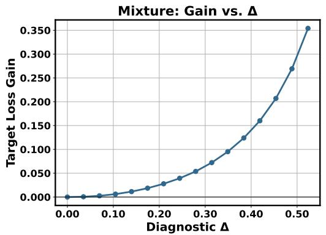  
(a)

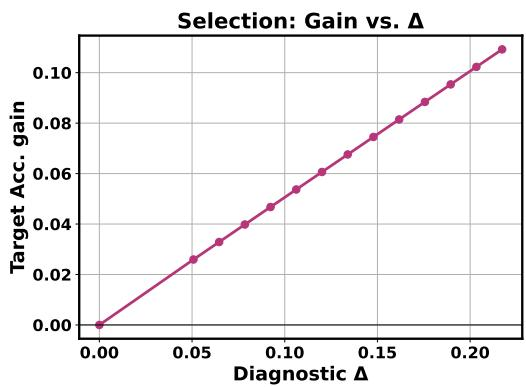  
(b)  
Figure 4: Curation gain versus the ∆ diagnostic in the solvable models. Each point varies the parameter that generates the train–target gap and reports the improvement of the optimized policy over the uncurated baseline. (a) Mixture: target-composition sweep. Gain is the reduction in target logistic loss. (b) Selection: teacher-angle sweep. Gain is the reduction in target classification error.

Connection to Proposition 1. The two results instantiate the same no-gap principle at different granularities. For mixture, target matching is optimal directly at the population level; setting wb = ${ \pmb w } _ { \mathrm { b a s e l i n e } }$ recovers the mixture case of Proposition 1. For selection, full retention is the population reference, and uniform random hard selection approaches the same endpoint asymptotically. Thus, no gap rules out advancement in both cases, while still allowing finite-budget acceleration.

Relation to the empirical ∆-test. The propositions above are stated in terms of population losses $\mathcal { L } ^ { \mathrm { p o p } }$ , whereas the ∆-test of Section 4 is computed from the empirical, seen-data losses L of a single baseline run. The two are connected by the same large-sample limit used in the proofs: when the baseline visits each example about once in the data-rich regime, the empirical training loss converges to its population counterpart, so the no-gap condition $\bar { \mathcal { P } } _ { \mathrm { t r a i n } } = \mathcal { P } _ { \mathrm { t a r g e t } } ^ { \mathrm { ~ \bar { ~ } } }$ typically manifests as a vanishing empirical loss gap $\Delta \approx 0$ , and Propositions 2 and 3 predict that no allocation can advance the model. This correspondence breaks precisely in the endogenous regime, where repetition on under-resourced domains drives the empirical training loss below the population loss: the seendata $\Delta$ then becomes nonzero and detects a gap that a purely population statement would miss (Section $\mathbf { A . 4 } )$ . The ∆-test is thus a useful observable, finite-sample signature of the population condition these propositions characterize, but it is not equivalent to that condition.

## A.4 MEASURING AND INTERPRETING ∆

Measurement on seen training data. We evaluate $\mathcal { L } _ { \mathrm { t r a i n } }$ on the examples used to train the uncurated baseline, rather than on a held-out sample from the training distribution. This distinction matters for an endogenous gap: when a domain is under-resourced, repeated exposure can reduce its loss on the seen examples without producing the same improvement on the target distribution. A held-out training split would not reveal this repetition-induced discrepancy. Because $\Delta$ compares a finite collection of losses rather than distributions directly, it remains an operational diagnostic rather than a complete statistical test: distinct distributions can yield similar losses, and finite-sample fluctuations can produce a small nonzero value.

Relation to curation gain. Figure 4 evaluates the diagnostic in the two solvable models studied above. In mixture, varying the target composition changes $\Delta$ while the train and target distributions remain matched within each domain. The gain from optimizing the mixture is zero at $\Delta \ : = \ : 0$ and increases as the composition gap grows. In selection, increasing the teacher angle ϕ enlarges the candidate–target mismatch, and the improvement achieved by target-aware selection over full retention increases correspondingly. Thus, despite their different allocation units and performance metrics, both models exhibit the same qualitative relation: a larger gap exposed by the uncurated baseline provides greater headroom for curation.

## A.5 REAL-DATA EXPERIMENTAL DETAILS

This section collects the implementation details. Across settings, we evaluate all baselines within a shared protocol and report five independent runs. The diagnostic ∆ is measured at 50% training budget.

## A.5.1 DATA-MIXTURE EXPERIMENTS

Setup and evaluation. Following Chen et al. (2025), we use a 6B-token subset of SlimPajama (Soboleva et al., 2023), comprising ArXiv, Books, CommonCrawl, C4, GitHub, StackExchange, and Wikipedia. In the no-gap setting, both training and target weight all seven domains uniformly. In the exogenous-gap setting, CommonCrawl is held out as the target and the remaining six domains form the candidate training pool. The endogenous-gap setting retains the uniformly weighted target but restricts the available corpus to 300M tokens while preserving its original domain proportions, causing small domains to be repeatedly sampled. We report held-out perplexity for each target domain. For a multi-domain target, ”Average” is the exponential of the mean do main loss, following Fan et al. (2024). for the exogenous-gap setting, the metric is CommonCrawl perplexity.

Shared training protocol. The main experiments train 160M-parameter GPT-style models (Biderman et al., 2023) for 40K steps. As summarized in Table 5. All three gap settings use the same batch size, context length, schedule, and number of steps, so the comparison changes the available data or target rather than the base training protocol. Mixture optimization and final-model training use the same model-training hyperparameters unless stated otherwise.

Table 5: Shared configuration for the data-mixture experiments.
<table><tr><td>Configuration</td><td>160M</td><td>1.1B</td></tr><tr><td>Training steps</td><td>40K</td><td>40K</td></tr><tr><td>Batch size</td><td>8</td><td>8</td></tr><tr><td>Context length</td><td>2048</td><td>2048</td></tr><tr><td>Peak learning rate</td><td> $5 \times 1 0 ^ { - 4 }$ </td><td> $2 \times 1 0 ^ { - 4 }$ </td></tr><tr><td>Warmup steps</td><td></td><td>500</td></tr><tr><td>Weight decay</td><td>0.01</td><td>0.01</td></tr><tr><td>Gradient clipping</td><td>1.0</td><td>1.0</td></tr></table>

Baselines and implementation. All methods use the shared protocol above. Uniform assigns equal exposure to the candidate domains and serves as the baseline policy. We compare it with RegMix (Liu et al., 2025), which fits global data mixing laws and predict the performance on other mixtures; DoGE (Fan et al., 2024), which updates domain weights using their estimated influence on the target objective; Skill-It (Chen et al., 2023) utilize the inter-domain dependencies to establish a local data mixing law that predicts the per-domain performance; Aioli (Chen et al., 2025) improves Skill-It by dynamically updating the relation matrix along model training; and TANDEM (Wang et al., 2025), which optimizes the mixture through a bi-level objective with twinned networks. We fit the RegMix mixing law using 128 independently trained 1M-parameter proxy models. For RegMix, DoGE, Skill-It, and Aioli, we adapt the public implementations to our common data interface and training pipeline.4 Method-specific choices otherwise follow the corresponding papers and released implementations. The degree of smoothing recommended in the original Skill-It and Aioli settings can yield nearly uniform allocations in our experiments, we adjust only their smoothing controls for each gap setting, using less smoothing in the endogenous- and exogenous-gap settings. The learned allocation is used to train the final model with the shared configuration above. Implementation and configuration will be released following internal approval.

## A.5.2 DATA-SELECTION EXPERIMENTS

Setup and target construction. We use TinyLlama-1.1B (Zhang et al., 2024) as the base model and draw a 5B-token candidate pool from OpenWebMath (Paster et al., 2024). The in-distribution target is a held-out 0.3B-token OpenWebMath subset. The shifted target blends MetaMath (Yu et al., 2024a) and Mammoth (Yue et al., 2024). The main comparison retains 60% of the candidate pool. Figure 3 additionally sweeps the retained fraction from 0.6 to 1.0.

Shared training protocol. All selection methods use the configuration in Table 6. They share the same base model, candidate pool, retained-token budget, and training protocol, so that only the selection rule and target distribution vary.

Table 6: Shared configuration for the data-selection experiments.
<table><tr><td>Configuration</td><td>TinyLlama-1.1B</td></tr><tr><td>Candidate-training steps</td><td>5000</td></tr><tr><td>Batch size</td><td>512</td></tr><tr><td>Context length</td><td>2048</td></tr><tr><td>Learning rate</td><td> $8 \times 1 0 ^ { - 5 }$ </td></tr><tr><td>Learning-rate schedule</td><td>Constant</td></tr><tr><td>Weight decay</td><td>0.01</td></tr><tr><td>Gradient clipping</td><td>1.0</td></tr><tr><td>Main retained fraction</td><td>0.6</td></tr></table>

Baselines and implementation. The original pretrained checkpoint is denoted Base, while Base-CT continually pre-trains it on the full candidate pool and serves as the full-retention baseline. Random controls for the reduced token budget by drawing an equally sized subset. We compare three target-agnostic selectors—EL2N (Paul et al., 2021), which prioritizes examples with large prediction error; InfoBatch (Qin et al., 2024), which approximately preserves the expected full-data gradient; and Token-Cleaning (Pang et al., 2025), which applies a noisy-label cleaning criterion— with two target-aware selectors: RHO-1 (Lin et al., 2024), which ranks tokens by excess loss relative to the target distribution, and BLADE (Wang et al., 2026), which performs bi-level optimization for large-scale data selection. For EL2N, InfoBatch, and Token-Cleaning, we adapt their public implementations only as needed for our common data interface and training pipeline.5 For RHO-1 and BLADE, for which no public implementations are available, we implement the methods following their published descriptions. Method-specific settings otherwise follow the corresponding papers or released implementations, while every selected model is trained with the shared configuration in Table 6.

Evaluation. We report held-out target loss, which is evaluated on the distribution used to define ∆ and therefore reflects the train–target gap more directly than downstream accuracy. We additionally report accuracy on eight complementary mathematics benchmarks: GSM8K (Cobbe et al., 2021), MATH (Hendrycks et al., 2021), SVAMP (Patel et al., 2021), ASDiv (Miao et al., 2020), MAWPS (Kedziorski et al., 2016), TabMWP (Lu et al., 2023) for tabular reasoning, MathQA (Amini et al., 2019) for operation-based multiple-choice reasoning and MMLU-STEM (Hendrycks et al., 2020). This evaluation encompasses diverse question types like multiple-choice and open-ended questions.

## A.6 COMPARISONS WITH STANDARD DEVIATION

Each real-world LLM training experiment is run 5 times independently. The results, including the standard deviation, are reported in Table Table 7, Table Table 8 and Table Table 9.

Table7:Comparisonofdatamixtureoptimizationmethodsintheno-gapregime(∆=0.07).Theaveragedtargetperplexityandstandarddeviationover5 endent runs are repo
<table><tr><td>Methods</td><td>Arxiv</td><td>Book</td><td>C4</td><td>CommonCrawl</td><td>Github</td><td>Stackexchange</td><td>Wikipedia</td><td>Average</td></tr><tr><td>Uniform</td><td>10.02±0.11</td><td>39.61±0.25</td><td>49.67±0.41</td><td>42.70±0.38</td><td>5.16±0.06</td><td>12.25±0.09</td><td>20.00±0.22</td><td>19.71±0.17</td></tr><tr><td>RegMix</td><td>10.53±0.34</td><td>41.90±1.32</td><td>48.67±1.85</td><td>41.65±1.59</td><td>5.75±0.24</td><td>11.73±0.73</td><td>19.86±1.19</td><td>19.80±0.12</td></tr><tr><td>DoGE</td><td>10.96±0.22</td><td>35.49±0.19</td><td>42.42±0.26</td><td>36.81±0.28</td><td>6.70±0.10</td><td>13.97±0.17</td><td>23.92±0.30</td><td>20.17±0.16</td></tr><tr><td>Skill-It</td><td>10.64±0.17</td><td>38.32±0.21</td><td>47.99±0.37</td><td>40.62±0.45</td><td>5.73±0.07</td><td>12.07±0.13</td><td>20.78±0.20</td><td>19.68±0.16</td></tr><tr><td>Aioli</td><td>10.09±0.13</td><td>39.86±0.35</td><td>49.81±0.54</td><td>42.83±0.52</td><td>5.66±0.04</td><td>12.36±0.06</td><td>19.67±0.21</td><td>19.77±0.15</td></tr><tr><td>TANDEM</td><td>10.18±0.12</td><td>37.89±0.32</td><td>46.77±0.40</td><td>40.41±0.37</td><td>5.89±0.05</td><td>12.61±0.12</td><td>20.96±0.21</td><td>19.66±0.15</td></tr></table>

Table8:Comparisonofdatamixtureoptimizationmethodsunderendogenous(∆=0.64)andexogenous(∆=1.26)train–targetgaps.Theaveragedtarget nd standard deviation over 5 independent runs a
<table><tr><td colspan="9">Endogenous Gap</td><td>Exogenous Gap</td></tr><tr><td>Methods</td><td>Arxiv</td><td>Book</td><td>C4</td><td>CommonCrawl</td><td>Github</td><td>Stackexchange</td><td>Wikipedia</td><td>Average</td><td>CommonCrawl</td></tr><tr><td>Uniform</td><td>13.14±0.04</td><td>57.44±0.73</td><td>65.57±0.56</td><td>57.93±0.54</td><td>8.21±0.04</td><td>19.59±0.03</td><td>33.90±0.20</td><td>28.60±0.11</td><td>49.19±0.28</td></tr><tr><td>RegMix</td><td>13.33±0.07</td><td>54.12±0.23</td><td>63.74±0.67</td><td>56.63±0.70</td><td>8.23±0.08</td><td>20.03±0.11</td><td>33.34±0.19</td><td>28.24±0.19</td><td>40.63±0.90</td></tr><tr><td>DoGE</td><td>12.95±0.05</td><td>54.82±1.28</td><td>62.84±0.63</td><td>55.52±0.61</td><td>8.13±0.05</td><td>18.61±0.08</td><td>32.72±0.17</td><td>27.62±0.22</td><td>40.67±0.44</td></tr><tr><td>Skill-It</td><td>14.54±0.13</td><td>44.24±0.26</td><td>48.99±0.31</td><td>42.10±0.32</td><td>8.33±0.10</td><td>21.10±0.19</td><td>49.46±0.54</td><td>27.38±0.22</td><td>41.08±0.17</td></tr><tr><td>Aoili</td><td>12.80±0.14</td><td>51.01±0.37</td><td>61.13±0.31</td><td>53.51±0.34</td><td>8.14±0.05</td><td>18.97±0.14</td><td>32.63±0.13</td><td>27.11±0.16</td><td>40.17±0.64</td></tr><tr><td>TANDEM</td><td>12.60±0.12</td><td>49.76±1.56</td><td>54.19±0.76</td><td>47.24±0.90</td><td>8.35±0.05</td><td>17.98±0.11</td><td>33.51±0.41</td><td>26.02±0.22</td><td>40.24±0.38</td></tr></table>

ta selection methods with an in-distribution OpenWebMath target (no gap, ∆ = 0.016, upper) and the shi ∆ = 0.549, lower). Results on 8 downstream tasks and the averaged accuracy are reported. Each experim
<table><tr><td></td><td colspan="9">Train Toks. GSM8K MATH SVAMP Selection without Gap</td><td>MMLU-STEM Avg.</td><td></td></tr><tr><td></td><td colspan="10"></td></tr><tr><td>Base Base-CT</td><td></td><td>2.9 4.3±0.5</td><td>3.2 4.3±0.2</td><td>11.0 17.1±0.7</td><td>18.1 29.4±0.6</td><td>20.4 39.4±1.2</td><td>12.5 14.5±2.0</td><td>14.6 8.3±0.6</td><td>16.1</td><td></td><td>12.4 17.21±0.4</td></tr><tr><td></td><td>5B</td><td>4.0±0.3</td><td>3.9±1.0</td><td>15.8±1.0</td><td></td><td></td><td></td><td></td><td></td><td>20.4±0.8</td><td>16.38±0.1</td></tr><tr><td>Random EL2N</td><td>3B</td><td>3.0±0.3</td><td>3.2±0.5</td><td>15.5±0.9</td><td>29.1±2.3</td><td>37.2±1.6</td><td></td><td>13.8±0.7</td><td>9.4±1.1</td><td>17.8±2.2</td><td>14.94±0.4</td></tr><tr><td>InfoBatch</td><td>3B 3B</td><td>3.8±0.4</td><td>3.3±0.6</td><td>15.8±1.5</td><td>25.0±1.2 25.8±1.5</td><td>31.2±1.1</td><td></td><td>14.4±1.7</td><td>8.9±1.6</td><td>18.3±1.2</td><td>14.71±0.7</td></tr><tr><td></td><td>3B</td><td>4.2±0.6</td><td>3.0±0.9</td><td></td><td></td><td></td><td>32.9±2.3</td><td>12.5±1.3</td><td>7.1±0.9</td><td>16.5±2.3</td><td>14.3±0.5</td></tr><tr><td>Token Cleaning RHO-1</td><td>3B</td><td></td><td>3.2±0.2</td><td>3.1±1.3</td><td>15.4±0.7 15.3±0.5</td><td>24.4±0.6 31.7±1.0 24.6±0.7</td><td>31.4±0.5</td><td>11.7±0.7</td><td>10.2±1.2 7.1±2.3</td><td>14.1±0.9 16.7±2.1</td><td>14.49±0.3</td></tr><tr><td>BLADE</td><td>3B</td><td></td><td>4.5±0.3 3.7±0.4</td><td></td><td>18.1±0.6</td><td>29.9±1.7</td><td>37.9±1.7</td><td>14.5±1.9 16.5±2.1</td><td>10.4±1.5</td><td>19.3±2.1</td><td>17.54±0.8</td></tr><tr><td></td><td></td><td></td><td></td><td></td><td></td><td></td><td></td><td></td><td></td><td></td><td></td></tr><tr><td colspan="10">Selection with Gap</td></tr><tr><td>Base</td><td></td><td></td><td>2.9</td><td>3.2</td><td>11.0</td><td>18.1</td><td>20.4</td><td>12.5</td><td>14.6</td><td>16.1</td><td>12.4</td></tr><tr><td>Base-CT</td><td>5B</td><td>4.3±0.5</td><td>4.3±0.2</td><td>17.1±0.7</td><td></td><td>29.4±0.6</td><td>39.4±1.2</td><td>14.5±2.0</td><td>8.3±0.6</td><td>20.4±0.8</td><td>17.21±0.4</td></tr><tr><td>Random</td><td>3B</td><td>4.0±0.3</td><td>3.9±1.0</td><td>15.8±1.0</td><td></td><td>29.1±2.3</td><td>37.2±1.6</td><td>13.8±0.7</td><td>9.4±1.1</td><td>17.8±2.2</td><td>16.38±0.1</td></tr><tr><td>EL2N</td><td>3B</td><td>3.0±0.3</td><td>3.2±0.5</td><td>15.5±0.9</td><td></td><td>25.0±1.2</td><td>31.2±1.1</td><td>14.4±1.7</td><td>8.9±1.6</td><td>18.3±1.2</td><td>14.94±0.4</td></tr><tr><td>InfoBatch</td><td>3B 3B</td><td>3.8±0.4</td><td>3.3±0.6</td><td>15.8±1.5</td><td></td><td>25.8±1.5</td><td>32.9±2.3</td><td>12.5±1.3</td><td>7.1±0.9</td><td>16.5±2.3</td><td>14.71±0.7</td></tr><tr><td>Token Cleaning</td><td>3B</td><td></td><td>4.2±0.6</td><td>3.0±0.9</td><td>15.4±0.7 24.4±0.6</td><td></td><td>31.7±1.0</td><td>11.7±0.7</td><td>10.2±1.2</td><td>14.1±0.9</td><td>14.3±0.5</td></tr><tr><td>RHO-1</td><td></td><td></td><td>15.1±1.1</td><td>5.9±0.6 32.6±1.3 46.9±0.7</td><td></td><td></td><td>63.8±0.5</td><td>18.7±2.1</td><td>15.1±1.0</td><td>18.4±2.5</td><td>27.06±0.4</td></tr><tr><td>BLADE</td><td></td><td>3B</td><td>21.2±0.8</td><td></td><td>8.1±1.3 37.0±1.3 51.4±0.4</td><td></td><td>70.2±1.1</td><td>21.2±0.2</td><td>20.6±1.7</td><td>20.8±0.9</td><td>31.31±0.6</td></tr></table>

## A.7 LIMITATIONS AND FUTURE WORK

While our analytic characterization and empirical results provide a unified, gap-centric account of data curation, several challenges remain open for future research. The limitations of this paper are as follows: (1) Due to limited computational resources, our real-world experiments evaluate models up to 1.1 billion parameters. (2) Our analytic characterization relies on static high-dimensional limits that abstract away LLM training dynamics and data curriculum order. While our theory cleanly distinguishes finite-budget acceleration from genuine advancement, extending these solvable models to capture precise convergence speeds or detailed data consumption trajectories presents an interesting direction for future investigation.

## A.8 NOTATION

Table 10: Summary of the notations used throughout this paper. Variables only used in theoretical analysis are grayed for better readability.
<table><tr><td>Symbol</td><td>Meaning</td></tr><tr><td colspan="2">Data and dimensions</td></tr><tr><td> $N$ </td><td>input dimension.</td></tr><tr><td> $P$ </td><td>number of training examples.</td></tr><tr><td> $\alpha = P / N$ </td><td>total sample budget (samples per dimension). In high-dim limit  $N , P $   $\infty ,$  α fixed.</td></tr><tr><td> $\alpha _ { k } = w _ { k } \alpha$ </td><td>sample budget contributed by domain  $k .$ </td></tr><tr><td> $\pmb { x } \in \mathbb { R } ^ { N }$ </td><td>input data.</td></tr><tr><td> $y = \mathrm { s i g n } ( B \cdot x )$   $K$ </td><td>label generated by a teacher.</td></tr><tr><td> $\mathcal { N } ( z ; 0 , 1 ) = e ^ { - z ^ { 2 } / 2 } / \sqrt { 2 \pi }$ </td><td>number of domains. standard Gaussian density.</td></tr><tr><td colspan="2">Teachers, student, model</td></tr><tr><td> $\scriptstyle B _ { k }$ </td><td>teacher vector of domain  $k ( \left\| B _ { k } \right\| = \sqrt { N } )$ </td></tr><tr><td> $\scriptstyle B _ { \mathrm { t a r } }$ </td><td>target teacher.</td></tr><tr><td> $\phi$ </td><td>teacher angle (exogenous gap) between  $\scriptstyle B _ { k }$  and the target.</td></tr><tr><td> $\textbf {  { J } }$ </td><td>student weights = model parameters (replica symbol).</td></tr><tr><td> $\pmb { \theta }$ </td><td>model parameters  $( \pmb \theta \equiv \pmb J )$ </td></tr><tr><td> $\rho$ </td><td>student-target overlap J .  $B _ { \mathrm { t a r } } / N$  in Appendix</td></tr><tr><td colspan="2">Curation controls</td></tr><tr><td>w</td><td>curation weights: mixture ratios wk  $( \sum _ { k } w _ { k } = 1 )$  or per-example keep</td></tr><tr><td> $\widehat { \pmb { w } }$ </td><td>weights.</td></tr><tr><td> $f$ </td><td>target mixture ratio. retained fraction of the candidate set.</td></tr><tr><td> $\lambda _ { \mathrm { r e g } }$ </td><td>regularization coefficient in the mixture model.</td></tr><tr><td> $\lambda _ { \mathrm { s e l } }$ </td><td>disagreement penalty in the selection policy.</td></tr><tr><td> $\nu ^ { 2 }$ </td><td>difficulty: nuisance variance orthogonal to a teacher (Appendix A.1)</td></tr><tr><td colspan="2">Order parameters (state evolution / replica)</td></tr><tr><td> $m _ { k } = J \cdot B _ { k } / N$ </td><td>student-teacher overlap for domain k.</td></tr><tr><td> $q = \| J \| ^ { 2 } / N$ </td><td>student self-overlap.</td></tr><tr><td> $V , V _ { k }$ </td><td>response term.  $V _ { k }$  per domain in the multi-environment case.</td></tr><tr><td> $V _ { k } ^ { \star } = 1 - m _ { k } ^ { 2 } / Q _ { k }$ </td><td>teacher-conditional variance in the loss integrals  $( Q _ { 1 } = q , Q _ { 2 } = q +$   $\nu ^ { 2 } ( q - m _ { 2 } ^ { 2 } ) )$ </td></tr><tr><td>K  $R$ </td><td>margin constraint parameter (hard-margin solver). student-training-teacher overlap; in the matched-target case it is also the</td></tr><tr><td> $\hat { m } , \hat { V } , \hat { q }$ </td><td>target overlap. conjugate (hat) overlaps in the SE fixed point.</td></tr><tr><td colspan="2">Performance and diagnostic</td></tr><tr><td> $\mathcal { E } _ { \alpha } ( w )$ </td><td>target performance at sample budget α under allocation  $_ { w ; }$  for selection we write</td></tr><tr><td> $\varepsilon$ </td><td> $\mathcal { E } _ { \alpha } ( f ; \phi )$  fixed target-performance level used to define acceleration.</td></tr><tr><td> $\Delta$ </td><td>empirical train-target diagnostic on the baseline model (Section 4)</td></tr></table>