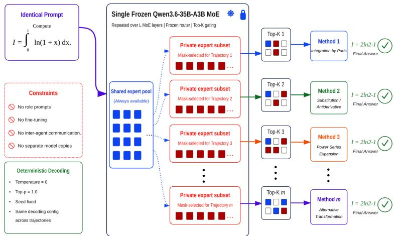
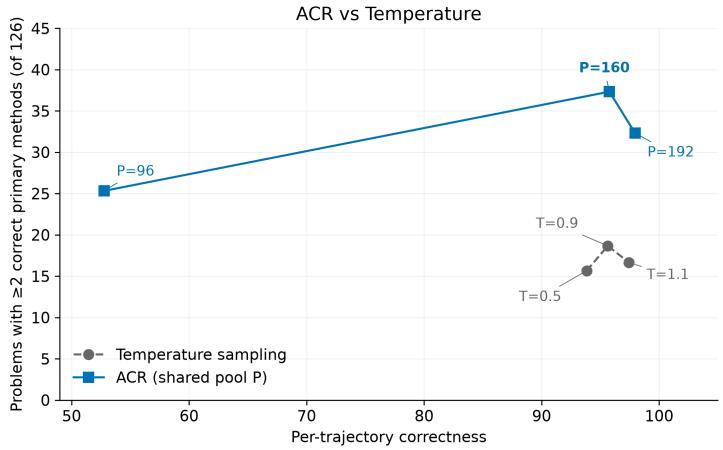
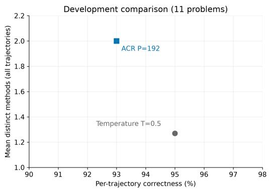
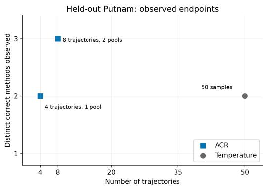

# AGENT-CONDITIONED ROUTING: DIVERSE REASONING PATHS WITHIN ONE FROZEN MODEL

Ananth Kalyanasundaram1 Ankush Kadu1 Athira Gopal1 Aswanth Krishnan1 1QpiAI, India

{ananth.k, ankush.k, athira.g, aswanth.k}@qpiai.tech

## ABSTRACT

Generating several solutions can expose alternative methods, but additional trajectories often paraphrase one dominant approach. We investigate whether the conditional capacity of a frozen sparse mixture-of-experts (MoE) model can provide such diversity from one problem prompt, without user-assigned roles, prescribed methods, fine-tuning, or model copies. Agent-Conditioned Routing (ACR) assigns m parallel trajectories persistent, untrained shared/private expert-eligibility masks while preserving the learned, input-dependent token router. On a screened 126-question multi-mode mathematics and physics benchmark, with model judges reading the reported derivations in full, we count the number of problems yielding at least two distinct primary methods among soft-correct solutions in four trajectories. ACR reaches approximately twice as many such problems as the strongest temperature setting under GLM 5.3 (37.3 versus 18.7), and 1.67 times as many under GPT-5.6 Sol (45.00 versus 27.00), at matched output budgets. A blinded four-expert audit on a stratified sample of 30 problems also finds more multi-method solutions with ACR on both backbones, with lower correctness. Matched-eligibility ablations show modest multi-method count advantages for ACR, while token-resampled masks attain higher correctness. An informed sequential prompt elicits more diversity still, using previous solutions and explicit requests for alternative methods. ACR adds about 160 KiB of mask state. In a three-problem microbenchmark capped at 1,024 tokens, its latency and peak VRAM usage remain within 3% of batched temperature sampling.

## 1 INTRODUCTION

Inference-time scaling treats additional generations as additional chances of success, but samples that repeat one argument inherit the same blind spots. Answer-level techniques such as self-consistency still benefit from repeated samples on verifiable tasks (Wang et al., 2023), yet agreement does not reveal whether derivations differ meaningfully. For mathematical and scientific reasoning, we therefore study correct method diversity: on how many problems do four trajectories yield at least two distinct primary solution methods with correct conclusions under a fixed generation budget?

One can seek diversity through decoding, method prompts, trained adapters, or coordinated models. We target autonomous method diversification: the user supplies a problem without having to identify alternative solution techniques in advance. We constrain expert eligibility in a frozen sparse MoE while retaining its learned token router. MoEs expose alternative feed-forward paths through conditional computation (Shazeer et al., 2017; Lepikhin et al., 2021; Fedus et al., 2022; Du et al., 2022). The question is whether these constraints change the executed derivation while preserving correctness, not merely whether they change the text.

Agent-Conditioned Routing (ACR) executes m=4 route-conditioned trajectories on one frozen Qwen3.6-35B-A3B instance in one batched request. Here agent denotes a route-conditioned trajectory.

All trajectories receive the same prompt and use deterministic decoding, with no role prompts, role generation, updates, communication, or model copies. A seeded construction assigns each a persistent shared/private eligibility mask; the frozen learned router still selects its top-k experts within that eligible set.

Our contributions are twofold:

1. Agent-Conditioned Routing. We introduce a training-free inference mechanism that uses expert eligibility as a control for reasoning diversity. Shared/private masks assign fixed routing constraints during each trajectory’s prefix, enabling diversification from one problem prompt without user-assigned roles, prescribed methods, or parameter updates.

2. A multi-mode reasoning benchmark for diversity. We construct a 126-question benchmark spanning 12 mathematics and physics categories and supporting multiple solution modes. The evaluation measures how often four trajectories yield at least two distinct primary methods among soft-correct solutions. Full-benchmark evaluations by two model judges are complemented by a blinded four-expert audit on a stratified 30-problem subset across three seeds. Correctness and mean UCM@4 accompany threshold counts.

## 2 RELATED WORK

ACR connects inference-time reasoning diversity with sparse-MoE conditional computation, seeking distinct primary solution methods across independent trajectories within one frozen model without specifying methods in the prompt.

## 2.1 INFERENCE-TIME DIVERSITY FROM ONE MODEL

Chain-of-thought prompting elicits intermediate reasoning, and self-consistency samples reasoning chains before aggregating their answers (Wei et al., 2022; Wang et al., 2023). Tree search, selfrefinement, and test-time compute scaling use additional inference to improve reasoning (Yao et al., 2023; Madaan et al., 2023; Snell et al., 2025). These approaches motivate generating and evaluating alternatives, but answer-level success does not establish that the alternatives execute different methods.

Other approaches target variation more directly. Diverse beam search separates decoded outputs (Vijayakumar et al., 2018), while diverse prompting and Flow of Reasoning target reasoning-path diversity (Lee et al., 2024; Yu et al., 2025). STaR develops reasoning ability through training on generated rationales (Zelikman et al., 2022). ACR introduces a different control: it holds the prompt, weights, and decoding rule fixed while varying expert eligibility across trajectories. We evaluate primary executed methods among correct trajectories rather than lexical variation or answer votes.

## 2.2 PARALLEL-AGENT REASONING

Parallel-agent systems obtain complementary outputs through multiple reasoning processes and mechanisms for combining them. Mixture-of-Agents and Sparse Mixture-of-Agents combine outputs across model agents (Wang et al., 2025; Li et al., 2024); multiagent debate exchanges critiques between models (Du et al., 2024). Group Think and Hogwild! Inference share partial state among concurrent workers (Hsu et al., 2025; Rodionov et al., 2025).

ACR instead places trajectory identity in routing constraints: trajectories share one frozen backbone but generate independently, so differentiation does not require separate weights, role prompts, or inter-agent communication.

## 2.3 EXPERT ROUTING AS AN INFERENCE-TIME CONTROL

MoE research offers several ways to organize and select conditional computation, including BASE layers, expert-choice routing, ST-MoE, Mixtral, and DeepSeekMoE (Lewis et al., 2021; Zhou et al., 2022; Zoph et al., 2022; Jiang et al., 2024; Dai et al., 2024). Related interventions contrast selected and unselected experts in SCMoE (Shi et al., 2024), learn router parameters in HyperRouter (Do et al., 2023), or learn adapter experts and a router in Self-MoE (Kang et al., 2025). Semantic routing probes further motivate expert selection as an intervention point (Olson et al., 2025). Recent work finds a domain-invariant “Standing Committee” of heavily reused experts, questioning clean domain specialization and motivating shared capacity (Wang et al., 2026); our random shared set does not identify that committee.

The closest inference-time comparisons are RoE and Expert-Sample. RoE resamples noisy expert routes at each token and aggregates the resulting proposals into a prediction (Zibakhsh et al., 2025). Expert-Sample retains the router’s certain selections and Gumbel-resamples its uncertain tail, seeking generation diversity while preserving answer-level performance (Chen et al., 2026). Both provide training-free ways to vary the computation of a frozen MoE, and we evaluate them as routing-noise controls.

ACR instead assigns persistent shared/private eligibility masks, within which the pretrained router selects experts deterministically. We evaluate Expert-Sample in its published routing configuration and RoE as a proposal-averaging control. Section 5.4 further separates temporal persistence from mask construction through matched-cardinality eligibility controls.

## 3 METHOD

## 3.1 PERSISTENT SHARED/PRIVATE ELIGIBILITY

Let the frozen MoE have a routed-expert universe ${ \mathcal { E } } , | { \mathcal { E } } | = E$ , and let its learned router emit logits $r _ { \ell } ( h _ { t } ) \in \mathbb { R } ^ { E }$ at layer ℓ and token t. We execute m route-conditioned trajectories $( m { = } 4$ in the main benchmark; the construction requires $P + \lfloor ( E - P ) / m \rfloor \geq k )$ . At each MoE layer, a seeded permutation selects a shared core $\boldsymbol { S _ { \ell } }$ of size $P ;$ the remaining experts are split round-robin into disjoint private sets $V _ { \ell , 1 } , \ldots , V _ { \ell , m }$ . This construction constrains distributed computation rather than assuming that individual experts correspond to distinct semantic skills. Agent a is eligible for

$$
\mathscr { E } _ { \ell , a } = S _ { \ell } \cup V _ { \ell , a } , \qquad | \mathscr { E } _ { \ell , a } | \approx P + \frac { E - P } { m } ,\tag{1}
$$

and the routed logits become

$$
\widetilde { r } _ { \ell , t , e } ^ { ( a ) } = \left\{ \begin{array} { l l } { r _ { \ell , t , e } , } & { e \in \mathcal { E } _ { \ell , a } , } \\ { - \infty , } & { e \notin \mathcal { E } _ { \ell , a } . } \end{array} \right.\tag{2}
$$

The pretrained router still chooses its usual top-k experts, now within the eligible set of Equation (2). Nothing is trained, and the mask persists throughout the routed prefix. At $\boldsymbol { P } = \boldsymbol { E }$ , all trajectories reduce to deterministic copies of the base model; decreasing P increases private capacity but risks excluding useful experts. For Qwen3.6-35B-A3B, E = 256, k = 8, and there are 40 MoE layers (Qwen Team, 2026). At the main benchmark setting $P = 1 6 0$ , each trajectory can access 184 of 256 experts per layer; at $P = 1 9 2$ , it can access 208.

The four trajectories share weights and execute along the batch dimension, while retaining separate token histories and KV caches. A batched generation request therefore contains multiple autoregressive forward steps over one model instance.

The hybrid configuration limits constrained routing to a 2,000-token prefix, after which unfinished trajectories continue with unrestricted expert routing in the same frozen model. Appendix G analyzes cap attainment and recorded handoffs in the saved runs.

## 4 EXPERIMENTS

## 4.1 TASKS, MODEL, AND CONDITIONS

Task and model. The main experiments use a frozen BF16 Qwen3.6-35B-A3B checkpoint, a 35Bparameter sparse MoE with roughly 3B active parameters per token (Qwen Team, 2026). We use a synthetic 11-problem development set of mathematics and physics derivations with verifiable answers and plausibly multiple methods for configuration selection. We report these development probes separately from the main evaluation, which uses a screened benchmark drawn from a hand-authored 200-problem, 12-category candidate pool spanning integrals, series, products, combinatorial identities, probability, functional equations, number theory, inequalities, mechanics, E&M, thermodynamics, and quantum physics. Each problem was screened using six temperature samples and retained only if the outputs showed multiple solution paths and at least one correct solution; 126 problems passed. The result is a diagnostic set conditioned on evidence of multiple solution paths in temperature-generated outputs. Our conclusions concern this selected population; broader task coverage is discussed in Section 5.5.

  
Figure 1: Architecture of ACR. Four copies of an identical prompt share one frozen MoE backbone. Persistent shared/private masks give trajectories distinct expert eligibility while preserving the learned token router.

Comparison methods and generation budget. All methods in the main benchmark use the same output budget: four generations per problem and at most 4,096 new tokens each. This matches trajectory count and output caps, not total compute or input-token usage. ACR uses deterministic decoding and one persistent mask per trajectory, sweeping $P \in \{ 9 6 , 1 \bar { 6 0 } , 1 9 2 \}$ at benchmark scale, with a repetition penalty of 1.05 and thinking disabled. The baseline draws four i.i.d. temperature samples from the unpatched model $( T \in \{ 0 . 5 , 0 . 9 , 1 . 1 \}$ at benchmark scale and on the development sweep). The Expert-Sample baseline applies routing noise (Chen et al., 2026) at benchmark scale: at every token and MoE layer, the top $k _ { \mathrm { k e e p } } = 5$ experts by gating logit are retained, the remaining three of the $k = 8$ selections are Gumbel-sampled from candidate ranks 6–32 at $\tau { = } 1 . 0$ , and weights are renormalized from the original global softmax, following the published defaults for this backbone class. The RoE baseline applies routing noise (Zibakhsh et al., 2025) at benchmark scale: at every generated token the selection becomes TopK(R + τG, k) with G i.i.d. standard Gumbel on the middle MoE layers (the first and last two layers stay clean), and N=8 perturbed proposals per token run in one batched forward pass whose next-token distributions are probability-averaged into a single greedy prediction, with only the clean path’s KV cache retained. The proposal count and the fixed $\tau { = } 0 . 5$ are compute-driven deviations from the published per-model-tuned settings $\scriptstyle ( N = 3 2 / 6 4 ) ;$ decoding is greedy and otherwise identical to ACR. We also compare against informed sequential diversity prompting, where calls 2–4 repeat the problem with excerpts of all prior solutions and an instruction to use a fundamentally different method. It uses the same four-call budget, but later calls receive inter-attempt information and an explicit method hint, and the sequential dependency precludes batching (Table 1, sequential arm). All other methods share one neutral problem prompt with no method hints. The held-out saturation probe draws up to 50 temperature samples to test whether a solution path merely has low sampling probability.

## 4.2 JUDGING PROTOCOL

Correctness. A trajectory is soft-correct when it reaches the mathematically correct answer in its reasoning, including when that answer is omitted from the final box or affected by LaTeX formatting errors. Judges read the complete raw prediction rather than relying on boxed-answer

Table 1: Latency and VRAM at matched budget (four completions per problem, 3 screened problems, max 1,024 new tokens, single 80 GB A100, torch fallback, warmup excluded; means over problems). “Throughput” counts total generated tokens divided by elapsed wall-clock time.
<table><tr><td>Arm</td><td>Seconds/problem</td><td>Throughput (tok/s)</td><td>Peak alloc</td><td>Peak reserved</td></tr><tr><td>Temperature, batched</td><td>84.5</td><td>48.4</td><td>65.82 GB</td><td>66.00 GB</td></tr><tr><td>ACR (P=160)</td><td>86.3</td><td>47.4</td><td>66.10 GB</td><td>66.39 GB</td></tr><tr><td>Expert-Sample</td><td>95.2</td><td>43.0</td><td>65.82 GB</td><td>66.00 GB</td></tr><tr><td>RoE (N=8)</td><td>417.0</td><td>9.8</td><td>66.46 GB</td><td>66.99 GB</td></tr><tr><td>Multi-agent, sequential</td><td>323.6</td><td>12.7</td><td>65.52 GB</td><td>65.58 GB</td></tr></table>

extraction. We use “correct methods” for the mathematical routes in these answer-correct trajectories;   
intermediate-step validity is a separate criterion from final-answer correctness.

Method diversity. For problem x and trajectory i, let $\mu _ { i } ( x )$ denote its executed mathematical route and $C _ { i } ( x )$ indicate soft-correctness. Each trajectory contributes at most one method. We define

$$
\mathrm { U C M @ } m ( x ) = \left| \left\{ \mu _ { i } ( x ) : i \in \{ 1 , \ldots , m \} , C _ { i } ( x ) = 1 \right\} \right| .\tag{3}
$$

Judges count substantive differences in mathematical steps as method diversity, including differences within the same broad method family. Rephrasing and reordering equivalent steps do not qualify. Thus the comparison operates at the level of executed routes rather than only named techniques. Multiple derivations within a single trajectory receive at most one unit of credit; repeated routes across trajectories count once. With four trajectories per problem, $0 \leq \mathrm { U C M @ 4 } ( x ) \leq 4$

Multi-method problem counts. We report the number of benchmark problems with at least two distinct primary methods among soft-correct trajectories:

$$
N _ { \geq 2 } = \sum _ { x \in { \mathcal { D } } } { \bf 1 } [ \mathrm { U C M @ 4 } ( x ) \geq 2 ] .\tag{4}
$$

The normalized rate $N _ { \geq 2 } / | \mathcal { D } |$ includes all 126 problems, including those with no correct solution. Counts are computed within runs and averaged across seeds, not unioned across runs. Mean UCM@4 and $N _ { \geq 3 }$ provide complementary measures of method count; per-trajectory soft-correctness is reported alongside diversity. “Two solutions” means two distinct primary methods, not repeated answers.

All model-judged arms use the same judging instructions (Appendix A). Judges are instructed to read raw JSON predictions in full and assess them without consulting previous results, artifacts, judgments, or manuals. The prompt requests pool-wise UCM@4 and counts of problems with at least two and three distinct solutions. GLM 5.3 with max thinking and GPT-5.6 Sol with high thinking provide separate model-based evaluations. Main-table GLM results average three seeds; Sol results use the per-arm seed counts in Table 2. GLM and Sol are evaluators of generated solutions, not additional generation backbones. Judge-specific analyses are reported separately; the human-audit protocol and results appear in Section 5.2.

## 4.3 RESOURCE ACCOUNTING

ACR stores one backbone and preserves the top-k active-expert count. Its FP32 masks require 160 KiB (40 layers, four agents, 256 experts); a packed representation would require about 5 KiB. No adapters or extra weights are trained. Expert-Sample likewise preserves the activation count; RoE instead processes multiple proposals and temporarily retains their KV rows before keeping only the clean path.

Table 1 reports a short-generation microbenchmark. ACR remains close to batched temperature sampling in latency and peak memory, while RoE and sequential prompting take longer. The 1,024- token cap never reaches the 2,000-token handoff, so these measurements do not characterize the full 4,096-token hybrid configuration. Backbone weights dominate memory throughout.

Table 2: GPT-5.6 Sol benchmark: 126 problems, four trajectories per problem. Values are averaged over the listed seeds. $N _ { \geq 2 }$ and $N _ { \geq 3 }$ count problems.
<table><tr><td>Arm</td><td>Seeds</td><td> $N _ { \geq 2 }$ </td><td> $N _ { \geq 3 }$ </td><td>Correct (%)</td><td>UCM@4</td></tr><tr><td>Temp.  $T = 0 . 5$ </td><td>2</td><td>25.00</td><td>1.50</td><td>100.00</td><td>1.2103</td></tr><tr><td>Temp.  $T = 0 . 9$ </td><td>3</td><td>27.00</td><td>2.33</td><td>100.00</td><td>1.2328</td></tr><tr><td>Expert-Sample</td><td>1</td><td>21.00</td><td>2.00</td><td>100.00</td><td>1.1825</td></tr><tr><td>RoE</td><td>1</td><td>12.00</td><td>1.00</td><td>100.00</td><td>1.1032</td></tr><tr><td>ACR  $( P = 9 6 )$ </td><td>1</td><td>24.00</td><td>2.00</td><td>60.71</td><td>1.0873</td></tr><tr><td>ACR (P = 160)</td><td>3</td><td>45.00</td><td>4.00</td><td>97.69</td><td>1.3915</td></tr><tr><td>ACR (P = 192)</td><td>3</td><td>37.67</td><td>2.67</td><td>98.94</td><td>1.3201</td></tr><tr><td>DivPrompt (informed, seq.)</td><td></td><td>1 125.00</td><td>124.00</td><td>96.03</td><td>3.7222</td></tr></table>

Table 3: GLM 5.3 benchmark: counts of problems with at least two correct methods, correctness, and secondary diversity metrics on the screened 126-problem benchmark. All results are averaged over three seeds.
<table><tr><td>Arm</td><td> $N _ { \geq 2 }$ </td><td> $N _ { \geq 3 }$ </td><td>Correct (%)</td><td>Mean UCM@4</td></tr><tr><td>Temp. T=0.5</td><td>15.67</td><td>0.67</td><td>93.84</td><td>1.130</td></tr><tr><td>Temp. T=0.9</td><td>18.67</td><td>1.33</td><td>95.63</td><td>1.159</td></tr><tr><td>Temp. T=1.1</td><td>16.67</td><td>0.33</td><td>97.42</td><td>1.150</td></tr><tr><td>Expert-Sample</td><td>14.33</td><td>1.00</td><td>99.80</td><td>1.127</td></tr><tr><td>RoE</td><td>17.67</td><td>0.00</td><td>99.40</td><td>1.140</td></tr><tr><td>ACR (P=96)</td><td>25.33</td><td>3.00</td><td>52.78</td><td>1.248</td></tr><tr><td>ACR (P=160)</td><td>37.33</td><td>4.33</td><td>95.77</td><td>1.323</td></tr><tr><td>ACR (P=192)</td><td>32.33</td><td>3.67</td><td>97.95</td><td>1.280</td></tr><tr><td>DivPrompt (informed, seq.)</td><td>124.33</td><td>119.00</td><td>94.44</td><td>3.571</td></tr></table>

## 5 RESULTS

We report the screened benchmark, blinded human audit, qualitative example, and ablations. Development and held-out probes appear in Appendix D.

## 5.1 BENCHMARK SCALE: THE SCREENED 126

The benchmark contains 126 screened problems. The method-diversity evaluation covers ACR at its main setting P=160, three temperature settings, both routing-noise controls, and the informed sequential prompting control; the remaining pool sizes are ablated in Section 5.4.

Method diversity under GLM 5.3. At the main setting, ACR yields at least two correct primary methods on 37.3 of 126 problems, versus 18.7 for the strongest temperature setting on this metric (T = 0.9): approximately a twofold increase, averaged over three seeds (Table 3). Correctness is 95.77% versus 95.63%. The secondary mean UCM@4 is 1.323 versus 1.159. The approximately twofold increase refers to the prevalence of problems with alternative methods. The most diverse examples include order statistics, spin measurement, and the alternating Basel sum. Figure 2 shows the correctness–diversity comparison across pool sizes.

GPT-5.6 Sol evaluation. The GPT-5.6 Sol evaluation also favors ACR in multi-method problem counts: 45.00 problems with at least two correct methods versus 27.00 for the strongest evaluated temperature setting $( T = 0 . 9 )$ , a 1.67-fold increase (Table 2). Both settings are averaged over three seeds. Correctness is 97.69% versus 100.00%, and mean UCM@4 is 1.3915 versus 1.2328. In both benchmark tables, bold threshold counts identify the best ACR pool setting, excluding the separately listed informed comparator.

  
Figure 2: GLM multi-method problem counts versus correctness at matched output budgets. Points are three-seed means from Table 3; lines connect tested settings. ACR $P = 1 6 0$ reaches 37.3 multi-method problems versus 18.7 for temperature $T = 0 . 9$

Paired diversity comparisons. For GPT-5.6 Sol, ACR $( P = 1 6 0 ,$ , three seeds) yields at least two methods on 35.71% of problems versus 21.43% for temperature $T = 0 . 9 ,$ a gain of 14.29 percentage points (paired-bootstrap 95% CI: [8.20, 20.37]; sign-flip $p = 1 . 4 9 \times 1 0 ^ { - 5 } )$ . Intervals favor ACR over each listed blind comparator and favor informed DivPrompt over ACR (Table 4). Paired mean-UCM@4 comparisons show the same direction (Appendix B). Mask-structure comparisons remain descriptive.

Table 4: Paired comparisons of the rate of problems with at least two methods under GPT-5.6 Sol. ACR $( P = 1 6 0 )$ has a 35.71% rate; seed counts are given in Table 2. Differences and paired-bootstrap 95% CIs are in percentage points; ∆ is ACR minus comparator. The final column reports sign-flip p-values.
<table><tr><td>Comparator</td><td>Rate (%)</td><td> $\Delta \left( \mathsf { p p } \right)$ </td><td>95% CI (pp)</td><td>p</td></tr><tr><td>RoE</td><td>9.52</td><td>+26.19</td><td>[19.58, 32.80]</td><td> $3 . 7 4 \times 1 0 ^ { - 1 2 }$ </td></tr><tr><td>Expert-Sample</td><td>16.67</td><td>+19.05</td><td>[11.64, 26.46]</td><td> $1 . 9 3 \times 1 0 ^ { - 6 }$ </td></tr><tr><td>DivPrompt</td><td>99.21</td><td>-63.49</td><td>[-69.84, -56.88]</td><td> $1 . 2 3 \times 1 0 ^ { - 3 2 }$ </td></tr><tr><td>Temperature  $T = 0 . 5$ </td><td>19.84</td><td>+15.87</td><td>[9.92, 21.96]</td><td> $6 . 7 5 \times 1 0 ^ { - 7 }$ </td></tr><tr><td>Temperature  $T = 0 . 9$ </td><td>21.43</td><td>+14.29</td><td>[8.20, 20.37]</td><td> $1 . 4 9 \times 1 0 ^ { - 5 }$ </td></tr></table>

Routing-noise controls. Expert-Sample and RoE produce fewer multi-method problems despite high correctness (Table 3). On spin measurement, all eight baseline trajectories use operatoreigenvector derivations; rotation-operator checks add no primary-method credit. This comparison changes both eligibility and structure, so it does not isolate persistence.

Informed sequential prompting. Showing each later call prior solutions and requesting a different method yields the highest GLM diversity (Table 3) and finds routes absent from every blind arm. This protocol can also be automated, but its later calls depend on earlier solutions and explicit requests for alternatives. ACR generates its trajectories independently from one neutral prompt. Among the tested blind, batched, prompt-matched arms, it yields the most problems with at least two correct methods, requiring no user-assigned roles or prescribed techniques.

## 5.2 BLINDED HUMAN AUDIT

Four human experts evaluated outputs across three seeds on a 30-problem subset selected by stratified random sampling to preserve the original dataset’s composition. Model and setting identities were hidden. Table 5 reports method counts and correctness separately from the model-judged fullbenchmark results.

Qwen ACR P = 160 yields at least two methods on 12.0 problems versus 9.0 for temperature sampling, a 1.33-fold increase, with correctness of 96.4% versus 98.3%. Gemma ACR $P = 8 0$ yields 14.0 versus 7.0, a twofold increase, with correctness of 86.2% versus 100.0%. These descriptive subset results support the direction of the diversification gains on both backbones while showing a correctness tradeoff. Qwen $P = 9 6$ has the largest three-method count but substantially lower correctness, reinforcing the need to report both outcomes.

Table 5: Blinded human audit on 30 problems. Threshold columns report mean problem counts out of 30 across three seeds; UCM@4 reports mean method counts. Four experts evaluated outputs with model and setting identities hidden.
<table><tr><td>Setting</td><td> $N _ { \geq 2 }$ </td><td> $N _ { \geq 3 }$ </td><td>Correctness (%)</td><td>Mean UCM@4</td></tr><tr><td>Qwen temperature</td><td>9.0</td><td>1.0</td><td>98.3</td><td>1.33</td></tr><tr><td>Expert-Sample</td><td>6.0</td><td>2.0</td><td>99.2</td><td>1.27</td></tr><tr><td>RoE</td><td>4.0</td><td>0.0</td><td>99.2</td><td>1.13</td></tr><tr><td>Qwen ACR (P = 96)</td><td>10.0</td><td>5.0</td><td>57.5</td><td>1.33</td></tr><tr><td>Qwen ACR (P = 160)</td><td>12.0</td><td>2.3</td><td>96.4</td><td>1.51</td></tr><tr><td>Qwen ACR (P = 192)</td><td>9.7</td><td>2.7</td><td>97.5</td><td>1.43</td></tr><tr><td>Gemma baseline</td><td>7.0</td><td>1.0</td><td>100.0</td><td>1.27</td></tr><tr><td>Gemma ACR  $( P = 8 0 )$ </td><td>14.0</td><td>4.67</td><td>86.2</td><td>1.65</td></tr></table>

## 5.3 READING THE DERIVATIONS: ROLLING DOWN AN INCLINE

Problem. A rigid body with moment ofinertia $I = \kappa m R ^ { 2 }$ rolls without slipping down an incline at angle α. Find its center-of-mass acceleration and provide a complete derivation.

All eight trajectories in the selected runs reach $a = g \sin \alpha / ( 1 + \kappa )$ . Their derivations differ: ACR includes a constrained Lagrangian derivation and explicit energy checks, while all four temperature samples use force and torque balance (Table 6). Three approaches occur across ACR’s full texts, with energy appearing as a secondary derivation; the primary routes are Lagrangian and Newtonian. Appendix C records the trajectory mapping. Appendix F renders a seed-0 inclusion–exclusion comparison; development examples appear in Appendix E.

## 5.4 ABLATION STUDIES

Persistence and mask structure. We fix eligibility at 184 experts per trajectory and layer, matching P = 160, and retain the same handoff and generation settings. Token-resampled ACR redraws the shared/private assignment at each decoding step during the routed prefix, isolating persistence. Independent-persistent masks sample 184 experts per trajectory and layer without a common core or disjoint private sets. This tests the shared/private construction as a whole, including its effect on overlap between trajectories.

ACR yields multi-method solutions on 5.33 more problems than independent masks and 2.67 more than resampled masks (Table 7). It improves correctness over independent masks but sacrifices 1.52 percentage points relative to resampling. Both controls retain much of the diversification effect; the full construction leads on diversity by modest descriptive margins.

Matched handoff comparison. On 20 problems at P = 160, switching yields eight additional endof-sequence (EOS) completions and one additional Sol-judged correct trajectory, with unchanged aggregate diversity (Table 8). Only 28 of 80 trajectories remain unfinished at the boundary. Appendix H details the matched-prefix protocol; Appendix G reports full-benchmark handoff frequencies.

Pool size P. Both model judges rank P = 160 above P = 192 and P = 96 in diversity (Tables 3 and 2). Small pools can induce looping; larger pools restore correctness but reduce diversity.

Backbone. On Gemma-4-26B-A4B, the fraction-matched P = 80 setting yields 52 versus 21 multi-method problems, with a 2.7-percentage-point correctness reduction (Table 9). This one-seed comparison uses the same budget and protocol. With 128 experts, Gemma gives each trajectory 12 private experts, versus 24 for Qwen.

Table 6: Rolling down an incline: ACR $P = 1 6 0$ versus temperature $T = 0 . 9 ,$ , four trajectories each. Equations summarize the raw derivations with normalized notation; secondary checks receive no extra primary-method credit.
<table><tr><td>Route</td><td>Distinguishing equations</td><td>ACR</td><td>Temperature</td></tr><tr><td>Newtonian mg sin</td><td> $\alpha - f = m a , f R = I \ddot { \theta } , a = R \ddot { \theta }$ </td><td></td><td>Primary: 2-4 Primary: 1-4</td></tr><tr><td>Lagrangian</td><td> $m g \sin \alpha - m a + \lambda = 0 , I \ddot { \theta } + R \lambda = 0$ </td><td>Primary: 1</td><td>Absent</td></tr><tr><td>Energy</td><td> $\begin{array} { r } { \frac { d } { d t } \big [ \frac { 1 } { 2 } m ( 1 + \kappa ) v ^ { 2 } - m g x \sin \alpha \big ] = 0 } \end{array}$ </td><td>Check: 1,2</td><td>Absent</td></tr></table>

Table 7: Persistence and mask structure at matched eligibility: 184 experts per trajectory per layer, matching ACR $P = 1 6 0$ . Threshold columns are mean problem counts out of 126.
<table><tr><td>Arm</td><td> $N _ { \geq 2 }$ </td><td> $N _ { \geq 3 }$ </td><td>Correct (%)</td><td>Mean UCM@4</td></tr><tr><td>Independent-persistent</td><td>39.67</td><td>3.67</td><td>96.49</td><td>1.3212</td></tr><tr><td>Token-resampled ACR</td><td>42.33</td><td>3.33</td><td>99.21</td><td>1.3574</td></tr><tr><td>Hybrid ACR</td><td>45.00</td><td>4.00</td><td>97.69</td><td>1.3915</td></tr></table>

## 5.5 LIMITATIONS AND FUTURE WORK

Masks constrain computation without assigning semantic specializations and may yield the same method (Wang et al., 2026). Matched-eligibility contrasts remain descriptive; paired uncertainty and expert assessment of intermediate-step validity are outside this evaluation. UCM@4 and $N _ { \geq 3 }$ complement the two-method threshold.

The screened benchmark targets problems with multiple solution methods. The human audit covers 30 problems; agreement between reviewers is not quantified. Broader task and model coverage, layer-specific masks, resource scaling, and downstream selection or aggregation remain future work.

## 6 CONCLUSION

Expert eligibility provides an inference-time control for reasoning diversity within one frozen MoE, without user-assigned roles or prescribed methods. At matched output budgets, ACR yields at least two correct primary methods on approximately twice as many problems as the strongest temperature setting under GLM and 1.67 times as many under GPT-5.6 Sol. A blinded four-expert audit supports the direction of these gains on both backbones, with lower correctness for ACR. The matchedeligibility controls retain much of the diversification effect, with modest advantages for the full construction. Informed sequential prompting achieves greater diversity using previous attempts; ACR explores alternatives independently in one batched request.

Table 8: Matched handoff comparison on 20 problems at $P = 1 6 0 ,$ , mask seed 0. Correctness and method diversity are judged by GPT-5.6 Sol; EOS completion is recorded directly from generated token IDs.
<table><tr><td>Arm</td><td>Problems  $\geq 2$  methods</td><td>Problems ≥ 3 methods</td><td>Mean UCM@4</td><td></td><td>Correctness Reached EOS</td></tr><tr><td>Switch2000</td><td>17/20</td><td>3/20</td><td>2.00</td><td>93.75%</td><td>92.5%</td></tr><tr><td>No switch</td><td>17/20</td><td>3/20</td><td>2.00</td><td>92.50%</td><td>82.5%</td></tr></table>

Table 9: Backbone ablation: Gemma-4-26B-A4B (128 experts, top-8), one seed, 126 problems, four trajectories; P=80 matches Qwen P=160’s shared-core fraction.
<table><tr><td>Arm</td><td> $N _ { \geq 2 }$ </td><td> $N _ { \geq 3 }$ </td><td>Correct (%)</td><td>Mean UCM@4</td></tr><tr><td>Temperature T=1.1</td><td>21</td><td>3</td><td>87.6</td><td>1.19</td></tr><tr><td>ACR (P=80)</td><td>52</td><td>11</td><td>84.9</td><td>1.49</td></tr></table>

## AI STATEMENT

AI tools were used to polish the manuscript’s language and presentation, generate the synthetic 11- problem development set, and serve as judges for solution evaluation. The model-based evaluations are distinguished from the blinded human audit in the evaluation protocol and results.

## REFERENCES

Yuanteng Chen, Peisong Wang, Nanxin Zeng, Yuantian Shao, Shuang Qiu, Gang Li, Jing Liu, and Jian Cheng. Certain head, uncertain tail: Expert-sample for test-time scaling in fine-grained MoE, 2026. URL https://arxiv.org/abs/2602.02443.

Damai Dai, Chengqi Deng, Chenggang Zhao, Runxin Xu, Huazuo Gao, Deli Chen, Jiashi Li, Wangding Zeng, Xingkai Yu, Y. Wu, Zhenda Xie, Y. K. Li, Panpan Huang, Fuli Luo, Chong Ruan, Zhifang Sui, and Wenfeng Liang. DeepSeekMoE: Towards ultimate expert specialization in mixture-of-experts language models. In Proceedings ofthe 62nd Annual Meeting ofthe Association for Computational Linguistics (Volume 1: Long Papers), pp. 1280–1297, 2024. doi: 10.18653/v1/ 2024.acl-long.70. URL https://aclanthology.org/2024.acl-long.70/.

Giang Do, Khiem Le, Quang Pham, TrungTin Nguyen, Thanh-Nam Doan, Binh T. Nguyen, Chenghao Liu, Savitha Ramasamy, Xiaoli Li, and Steven Hoi. Hyperrouter: Towards efficient training and inference of sparse mixture of experts via hypernetwork. In Proceedings of the 2023 Conference on Empirical Methods in Natural Language Processing, pp. 5797–5810, 2023. URL https: //aclanthology.org/2023.emnlp-main.351/.

Nan Du, Yanping Huang, Andrew M. Dai, Simon Tong, Dmitry Lepikhin, Yuanzhong Xu, Maxim Krikun, Yanqi Zhou, Adams Wei Yu, Orhan Firat, Barret Zoph, Liam Fedus, Maarten Bosma, Zongwei Zhou, Tao Wang, Emma Wang, Kellie Webster, Marie Pellat, Kevin Robinson, Kathleen Meier-Hellstern, Toju Duke, Lucas Dixon, Kun Zhang, Quoc V. Le, Yonghui Wu, Zhifeng Chen, and Claire Cui. GLaM: Efficient scaling of language models with mixtureof-experts. In Proceedings of the 39th International Conference on Machine Learning, volume 162 of Proceedings of Machine Learning Research, pp. 5547–5569, 2022. URL https: //proceedings.mlr.press/v162/du22c.html.

Yilun Du, Shuang Li, Antonio Torralba, Joshua B. Tenenbaum, and Igor Mordatch. Improving factuality and reasoning in language models through multiagent debate. In Proceedings of the 41st International Conference on Machine Learning, volume 235 of Proceedings of Machine Learning Research, pp. 11733–11763, 2024. URL https://proceedings.mlr.press/ v235/du24e.html.

William Fedus, Barret Zoph, and Noam Shazeer. Switch transformers: Scaling to trillion parameter models with simple and efficient sparsity. Journal ofMachine Learning Research, 23(120):1–39, 2022. URL https://jmlr.org/papers/v23/21-0998.html.

Chan-Jan Hsu, Davide Buffelli, Jamie McGowan, Feng-Ting Liao, Yi-Chang Chen, Sattar Vakili, and Da-shan Shiu. Group think: Multiple concurrent reasoning agents collaborating at token level granularity, 2025. URL https://arxiv.org/abs/2505.11107.

Albert Q. Jiang, Alexandre Sablayrolles, Antoine Roux, Arthur Mensch, Blanche Savary, Chris Bamford, Devendra Singh Chaplot, Diego de las Casas, Emma Bou Hanna, Florian Bressand, Gianna Lengyel, Guillaume Bour, Guillaume Lample, Lélio Renard Lavaud, Lucile Saulnier, Marie-Anne Lachaux, Pierre Stock, Sandeep Subramanian, Sophia Yang, Szymon Antoniak, Teven Le Scao, Thibaut Gervet, Thibaut Lavril, Thomas Wang, Timothée Lacroix, and William El Sayed. Mixtral of experts, 2024. URL https://arxiv.org/abs/2401.04088.

Junmo Kang, Leonid Karlinsky, Hongyin Luo, Zhen Wang, Jacob Hansen, James Glass, David Cox, Rameswar Panda, Rogerio Feris, and Alan Ritter. Self-MoE: Towards compositional large language models with self-specialized experts. In International Conference on Learning Representations, 2025. URL https://arxiv.org/abs/2406.12034.

Gisang Lee, Sangwoo Park, Junyoung Park, Andrew Chung, Sieun Park, Yoonah Park, Byungju Kim, and Min-gyu Cho. Expanding search space with diverse prompting agents: An efficient sampling approach for LLM mathematical reasoning, 2024. URL https://arxiv.org/abs/2410. 09780.

Dmitry Lepikhin, HyoukJoong Lee, Yuanzhong Xu, Dehao Chen, Orhan Firat, Yanping Huang, Maxim Krikun, Noam Shazeer, and Zhifeng Chen. GShard: Scaling giant models with conditional computation and automatic sharding. In International Conference on Learning Representations, 2021. URL https://openreview.net/forum?id=qrwe7XHTmYb.

Mike Lewis, Shruti Bhosale, Tim Dettmers, Naman Goyal, and Luke Zettlemoyer. BASE layers: Simplifying training of large, sparse models. In Proceedings of the 38th International Conference on Machine Learning, volume 139 of Proceedings ofMachine Learning Research, pp. 6265–6274, 2021. URL https://proceedings.mlr.press/v139/lewis21a.html.

Dawei Li, Zhen Tan, Peijia Qian, Yifan Li, Kumar Satvik Chaudhary, Lijie Hu, and Jiayi Shen. SMoA: Improving multi-agent large language models with sparse mixture-of-agents, 2024. URL https://arxiv.org/abs/2411.03284.

Aman Madaan, Niket Tandon, Prakhar Gupta, Skyler Hallinan, Luyu Gao, Sarah Wiegreffe, Uri Alon, Nouha Dziri, Shrimai Prabhumoye, Yiming Yang, Shashank Gupta, Bodhisattwa Prasad Majumder, Katherine Hermann, Sean Welleck, Amir Yazdanbakhsh, and Peter Clark. Self-refine: Iterative refinement with self-feedback. In Advances in Neural Information Processing Systems, volume 36, pp. 46534–46594, 2023. URL https://proceedings.neurips.cc/paper\_files/paper/2023/ hash/91edff07232fb1b55a505a9e9f6c0ff3-Abstract-Conference.html.

Matthew Lyle Olson, Neale Ratzlaff, Musashi Hinck, Man Luo, Sungduk Yu, Chendi Xue, and Vasudev Lal. Probing semantic routing in large mixture-of-expert models. In Findings of the Association for Computational Linguistics: EMNLP 2025, pp. 18263–18278, 2025. URL https: //aclanthology.org/2025.findings-emnlp.991/.

Qwen Team. Qwen3.6-35b-a3b model card. Hugging Face model repository, 2026. URL https: //huggingface.co/Qwen/Qwen3.6-35B-A3B. Accessed 2026-08-24.

Gleb Rodionov, Roman Garipov, Alina Shutova, George Yakushev, Erik Schultheis, Vage Egiazarian, Anton Sinitsin, Denis Kuznedelev, and Dan Alistarh. Hogwild! inference: Parallel LLM generation via concurrent attention. In Advances in Neural Information Processing Systems, 2025. URL https://arxiv.org/abs/2504.06261.

Noam Shazeer, Azalia Mirhoseini, Krzysztof Maziarz, Andy Davis, Quoc Le, Geoffrey Hinton, and Jeff Dean. Outrageously large neural networks: The sparsely-gated mixture-of-experts layer. In International Conference on Learning Representations, 2017. URL https://openreview. net/forum?id=B1ckMDqlg.

Chufan Shi, Cheng Yang, Xinyu Zhu, Jiahao Wang, Taiqiang Wu, Siheng Li, Deng Cai, Yujiu Yang, and Yu Meng. Unchosen experts can contribute too: Unleashing moe models’ power by self-contrast. In Advances in Neural Information Processing Systems, 2024. URL https://proceedings.neurips.cc/paper\_files/paper/2024/ hash/f77012b463892a3f2ac56d3a6086fc5b-Abstract-Conference.html.

Charlie Snell, Jaehoon Lee, Kelvin Xu, and Aviral Kumar. Scaling LLM test-time compute optimally can be more effective than scaling model parameters. In International Conference on Learning Representations, 2025. URL https://openreview.net/forum?id=4FWAwZtd2n.

Ashwin K. Vijayakumar, Michael Cogswell, Ramprasaath R. Selvaraju, Qing Sun, Stefan Lee, David Crandall, and Dhruv Batra. Diverse beam search for improved description of complex scenes. In Proceedings ofthe AAAI Conference on Artificial Intelligence, volume 32, 2018. doi: 10.1609/ aaai.v32i1.12340. URL https://ojs.aaai.org/index.php/AAAI/article/view/ 12340.

Junlin Wang, Jue Wang, Ben Athiwaratkun, Ce Zhang, and James Zou. Mixture-of-agents enhances large language model capabilities. In International Conference on Learning Representations, 2025. URL https://arxiv.org/abs/2406.04692.

Xuezhi Wang, Jason Wei, Dale Schuurmans, Quoc V. Le, Ed H. Chi, Sharan Narang, Aakanksha Chowdhery, and Denny Zhou. Self-consistency improves chain of thought reasoning in language models. In International Conference on Learning Representations, 2023. URL https:// openreview.net/forum?id=1PL1NIMMrw.

Yan Wang, Yitao Xu, Nanhan Shen, Jinyan Su, Jimin Huang, and Zining Zhu. The illusion of specialization: Unveiling the domain-invariant" standing committee" in mixture-of-experts models. In Proceedings of the 64th Annual Meeting of the Association for Computational Linguistics (Volume 1: Long Papers), pp. 14601–14618, 2026.

Jason Wei, Xuezhi Wang, Dale Schuurmans, Maarten Bosma, Brian Ichter, Fei Xia, Ed H. Chi, Quoc V. Le, and Denny Zhou. Chain-of-thought prompting elicits reasoning in large language models. In Advances in Neural Information Processing Systems, volume 35, pp. 24824–24837, 2022. URL https://proceedings.neurips.cc/paper\_files/paper/2022/ hash/9d5609613524ecf4f15af0f7b31abca4-Abstract-Conference.html.

Shunyu Yao, Dian Yu, Jeffrey Zhao, Izhak Shafran, Thomas L. Griffiths, Yuan Cao, and Karthik Narasimhan. Tree of thoughts: Deliberate problem solving with large language models. In Advances in Neural Information Processing Systems, volume 36, pp. 11809–11822, 2023. URL https://proceedings.neurips.cc/paper\_files/paper/2023/ hash/271db9922b8d1f4dd7aaef84ed5ac703-Abstract-Conference.html.

Fangxu Yu, Lai Jiang, Haoqiang Kang, Shibo Hao, and Lianhui Qin. Flow of reasoning: Training LLMs for divergent reasoning with minimal examples. In International Conference on Machine Learning, 2025. URL https://arxiv.org/abs/2406.05673.

Eric Zelikman, Yuhuai Wu, Jesse Mu, and Noah D. Goodman. STaR: Bootstrapping reasoning with reasoning. In Advances in Neural Information Processing Systems, volume 35, pp. 15476–15488, 2022. URL https://proceedings.neurips.cc/paper\_files/paper/2022/ hash/639a9a172c044fbb64175b5fad42e9a5-Abstract-Conference.html.

Yanqi Zhou, Tao Lei, Hanxiao Liu, Nan Du, Yanping Huang, Vincent Y. Zhao, Andrew M. Dai, Zhifeng Chen, Quoc V. Le, and James Laudon. Mixture-of-experts with expert choice routing. In Advances in Neural Information Processing Systems, volume 35, pp. 7103–7114, 2022. URL https://proceedings.neurips.cc/paper\_files/paper/2022/ hash/2f00ecd787b432c1d36f3de9800728eb-Abstract-Conference.html.

Soheil Zibakhsh, Mohammad Samragh, Kumari Nishu, Lauren Hannah, Arnav Kundu, and Minsik Cho. Moes are stronger than you think: Hyper-parallel inference scaling with roe, 2025. URL https://arxiv.org/abs/2509.17238.

Barret Zoph, Irwan Bello, Sameer Kumar, Nan Du, Yanping Huang, Jeff Dean, Noam Shazeer, and William Fedus. ST-MoE: Designing stable and transferable sparse expert models, 2022. URL https://arxiv.org/abs/2202.08906.

## A LLM JUDGING PROMPT

The following prompt was used for the LLM evaluations, reproduced with its original wording. “Manually” instructs the model to read the raw predictions directly; the evaluations are model judgments.

read raw predictions of jsons manually fully. judge how many unique correct methods are predicted for each problem. its fine if the solutions are soft-correct basically ignoring latex misformating and if the answer is reached in the reasoning but missed in boxed. dont look at previous results/artifacts/judges/manuals. this should be purely your effort. also if there is diversity in the steps in a particular method consider it as method diversity. in the end print pool-wise UCM@4 and number of problems with atleast 2 solutions and number of problems with alteast 3 solutions. Each solution can have only 1 trajectory. Which implies each problem can have atmost 4 distinct trajectories. Rephrasing or reordering of steps is not method diversity.

## B PAIRED MEAN-UCM@4 COMPARISONS

The secondary mean-UCM@4 comparisons use ACR at $P = 1 6 0$ over three seeds. Paired-bootstrap intervals exclude zero in favor of ACR against the listed blind comparators, and in favor of informed DivPrompt against ACR.

Table 10: Paired UCM@4 comparisons. ∆ is ACR minus comparator; ACR uses $P = 1 6 0$ over three seeds, with mean UCM@4 approximately 1.3915. Point differences use the displayed means. Intervals are paired-bootstrap 95% CIs; the final column reports sign-flip p-values.
<table><tr><td>Comparator</td><td>UCM@4</td><td>∆</td><td>95% CI</td><td>p</td></tr><tr><td>RoE</td><td>1.1032</td><td>+0.2883</td><td>[0.2196, 0.3598]</td><td> $3 . 5 6 \times 1 0 ^ { - 1 3 }$ </td></tr><tr><td>Expert-Sample</td><td>1.1825</td><td>+0.2090</td><td>[0.1243, 0.2910]</td><td> $3 . 5 9 \times 1 0 ^ { - 6 }$ </td></tr><tr><td>DivPrompt</td><td>3.7222</td><td>-2.3307</td><td>[-2.4312, -2.2275]</td><td> $4 . 7 0 \times 1 0 ^ { - 3 8 }$ </td></tr><tr><td>Temperature  $T = 0 . 5$ </td><td>1.2103</td><td>+0.1812</td><td>[0.1164, 0.2474]</td><td> $2 . 3 0 \times 1 0 ^ { - 7 }$ </td></tr><tr><td>Temperature  $T = 0 . 9$ </td><td>1.2328</td><td>+0.1587</td><td>[0.0899, 0.2302]</td><td> $2 . 5 9 \times 1 0 ^ { - 5 }$ </td></tr></table>

## C ROLLING-INCLINE TRAJECTORY COMPARISON

The selected ACR run uses $P = 1 6 0$ and mask seed 2; the temperature run uses $T = 0 . 9$ , top-$p = 0 . 9 5$ , and seed 0. Both generate four trajectories per problem with a 4,096-token cap. Trajectory numbers follow the order of raw predictions in each source file.

ACR trajectory 1 constructs $L = { \textstyle { \frac { 1 } { 2 } } } m { \dot { x } } ^ { 2 } + { \textstyle { \frac { 1 } { 2 } } } I { \dot { \theta } } ^ { 2 } + m g x$ sin α, imposes $x - R \theta = 0$ with a multiplier, and eliminates that multiplier to obtain the acceleration. It then checks the result by differentiating the conserved energy. Trajectory 2 first eliminates friction from the translational and rotational equations, then independently derives the answer from energy conservation. Its second heading says “Lagrangian Mechanics (Energy Conservation)”, but the executed calculation differentiates energy rather than applying Euler–Lagrange equations. Trajectory 3 uses force and torque balance, followed by an effective-mass check; trajectory 4 uses force and torque balance. Each temperature trajectory eliminates friction using the same Newtonian equations. Thus route labels follow the executed equations, not the model’s headings. This selected example illustrates route coverage; it is not an additional aggregate benchmark result.

## D DEVELOPMENT AND HELD-OUT PROBES

On the 11-problem development set, the reported $P = 1 9 2$ configuration reaches 93% soft-correctness and 2.00 distinct methods per problem, compared with 95% and 1.27 for temperature $T = 0 . 5$

  
(a) Development comparison.

  
(b) Held-out Putnam saturation.  
Figure 3: Development and held-out probes. (a) Reported development comparison; method counts include all trajectories. (b) On a held-out Putnam problem, 50 temperature samples yield two observed methods while eight routed trajectories expose a third.

(Figure 3a). These development method counts include all trajectories and are separate from the correctness-filtered benchmark UCM@4. The development set was used for configuration selection.

## E DEVELOPMENT CASE STUDIES

On $\textstyle \int _ { 0 } ^ { \infty } \ln ( x ) / ( 1 + x ^ { 2 } )$ dx, routed trajectories use reciprocal symmetry, a series derivation, Mellin parameter differentiation, and the $x = e ^ { t }$ odd-function transformation; four temperature samples repeat the reciprocal route. For Tsirelson’s bound, ACR produces operator-norm, Choi–Jamiołkowski, tensor-Pauli, and Bloch-sphere proofs, versus the temperature baseline’s operator-norm route. For Basel, $x ^ { 2 }$ cosine-series and x sine-series/Parseval derivations count separately only when used as primary derivations. These examples motivate full-text method labeling.

## F INCLUSION–EXCLUSION: RENDERED SEED-0 SOLUTIONS

Problem. State and prove inclusion–exclusion for $| A \cup B \cup C |$ , where A, B, and C arefinite sets. All four ACR trajectories $( P = 1 6 0$ , mask seed 0) and all four temperature trajectories $( T = 0 . 9$ sampling seed 0) reach the identity

$$
\begin{array} { r l } & { | A \cup B \cup C | = | A | + | B | + | C | } \\ & { \qquad - \left| A \cap B \right| - \left| A \cap C \right| - \left| B \cap C \right| + \left| A \cap B \cap C \right| . } \end{array}\tag{5}
$$

The following are condensed renderings of completed arguments in the raw outputs, with notation standardized; they are not verbatim transcripts. Abandoned intermediate steps are omitted. Trajectory indices follow the stored output order.

Element-by-element counting: ACR 1–2; temperature 1–4. For each $x \in A \cup B \cup C .$ , count its contribution to the right-hand side of Equation (5). If it belongs to exactly one set, its contribution is 1. If it belongs to exactly two sets, its contribution is $2 - \overset { \vartriangle } { 1 } = 1$ . If it belongs to all three, its contribution is $3 - 3 + 1 = 1$ . Thus each element of the union contributes exactly once. Summing these contributions proves the formula. Writing the same membership cases with indicator functions does not create a different route.

Disjoint-region decomposition: ACR 3. Let $r _ { A } , r _ { B } , r _ { C }$ count elements in only A, only B, and only C; let $r _ { A B } , r _ { A C } , r _ { B C }$ count elements in exactly the indicated pair; and let $r _ { A B C } = | A \cap B \cap C |$

These seven regions partition the union. Expanding the individual and intersection cardinalities gives

$$
\begin{array} { r l } & { S _ { 1 } = | A | + | B | + | C | } \\ & { \quad = r _ { A } + r _ { B } + r _ { C } + 2 ( r _ { A B } + r _ { A C } + r _ { B C } ) + 3 r _ { A B C } , } \\ & { S _ { 2 } = | A \cap B | + | A \cap C | + | B \cap C | } \\ & { \quad = r _ { A B } + r _ { A C } + r _ { B C } + 3 r _ { A B C } . } \end{array}
$$

Consequently $S _ { 1 } - S _ { 2 } + r _ { A B C }$ is the sum of the seven disjoint region sizes, which equals $| A \cup B \cup C |$ This is the final region calculation in trajectory 3 after it revisits the triple-intersection coefficient.

Reduction to the two-set identity: ACR 4. First establish $| X \cup Y | = | X | + | Y | - | X \cap Y |$ by checking the four membership possibilities for an element. Apply this identity to $A \cup B$ and C:

$$
| A \cup B \cup C | = | A \cup B | + | C | - | ( A \cup B ) \cap C | .
$$

Distributivity gives $( A \cup B ) \cap C = ( A \cap C ) \cup ( B \cap C )$ . A second application of the two-set identity yields

$$
| ( A \cup B ) \cap C | = | A \cap C | + | B \cap C | - | A \cap B \cap C | .
$$

Substituting this and $| A \cup B | = | A | + | B | - | A \cap B |$ into the first line proves Equation (5).

Primary routes and additional checks. The three route descriptions distinguish the executed steps under the paper’s rubric: pointwise multiplicity counting, explicit region-size algebra, and recursive use of a two-set identity. ACR trajectories 1–2 complete the first route, trajectory 3 completes the second, and trajectory 4 completes the third. The four baseline trajectories complete the first route. ACR trajectory 2 and baseline trajectory 4 also provide a two-set proof after their first derivations; ACR trajectory 3 additionally expands $\bar { 1 } - ( 1 - \bar { 1 } _ { A } ) ( 1 - \mathbf { 1 } _ { B } ) ( 1 - \mathbf { \bar { 1 } } _ { C } )$ as an indicator check. These later arguments receive no extra primary-method credit. This selected comparison illustrates proof structure, not a new aggregate result.

## G FREQUENCY OF THE 2,000-TOKEN HANDOFF

We analyze saved generation records without additional model inference. Each run contains 126 problems and four trajectories per problem. The P = 192, seed-2 run records the number of prefix tokens and an explicit switch flag for each trajectory. These flags identify 101 switched trajectories (20.04%) on 48 problems (38.10%).

Earlier runs retain the decoded prefix length in characters but do not store token counts or switch flags. We recover each prefix by slicing the raw text at that character offset and retokenize it with the generation model’s tokenizer, without adding special tokens. Since decoding removes special tokens and retokenization can change token boundaries, these are estimates of cap attainment, not exact switch counts. Table 11 uses at least 1,995 retokenized tokens as the near-cap criterion.

Table 11: Saved-output handoff analysis. Counts are trajectories out of 504 and problems out of 126 with at least one affected trajectory. Estimated rows measure near-cap prefixes; the recorded row uses explicit switch flags.
<table><tr><td>Pool P</td><td>Seed</td><td>Evidence</td><td>Trajectories</td><td>Problems</td></tr><tr><td>96</td><td>0</td><td>Estimated</td><td>276</td><td>103</td></tr><tr><td>160</td><td>0</td><td>Estimated</td><td>167</td><td>73</td></tr><tr><td>160</td><td>1</td><td>Estimated</td><td>66</td><td>43</td></tr><tr><td>160</td><td>2</td><td>Estimated</td><td>149</td><td>67</td></tr><tr><td>192</td><td>0</td><td>Estimated</td><td>123</td><td>56</td></tr><tr><td>192</td><td>1</td><td>Estimated</td><td>48</td><td>28</td></tr><tr><td>192</td><td>2</td><td>Recorded</td><td>101</td><td>48</td></tr></table>

At $P = 1 6 0$ , the near-cap criterion identifies 382 of 1,512 trajectories (25.26%) and 183 of 378 problem-runs (48.41%) across three seeds. Problem-runs count each problem separately in each seed, rather than taking a union of problem IDs. A threshold of 1,990 tokens gives the same counts;

requiring at least 2,000 retokenized tokens gives 373 trajectories (24.67%) and 180 problem-runs (47.62%). For the run with explicit flags, the 1,995-token estimate agrees with the recorded counts.

The historical records also contain appended text after prefixes well below the cap, so the presence of continuation text alone is not used to identify cap-triggered handoffs. This analysis measures observed switch activation or estimated prefix-cap attainment. It does not measure looping, correctness gains from switching, or whether a trajectory would have succeeded under continued constrained routing.

## H MATCHED SWITCH-VERSUS-NO-SWITCH EVALUATION

We select 20 problems from the screened benchmark using subset seed 20260926: one random problem from each of the 12 categories, followed by eight problems sampled uniformly from the remainder. Selection uses only problem IDs, without consulting outcomes. Both conditions use P = 160, mask seed 0, four trajectories, greedy decoding, repetition penalty 1.05, thinking disabled, and a 4,096-token output cap.

Each pair shares the same masked prefix of up to 2,000 tokens. Trajectories that reach EOS in this prefix are retained unchanged in both conditions. Unfinished trajectories receive up to 2,096 further tokens, with either unrestricted routing or the original eligibility mask. Both conditions rebuild the prefix cache under their respective routing settings and use the same active trajectory batch; execution order alternates by problem. Thus the comparison controls restart mechanics while varying routing eligibility during continuation.

Of the 80 trajectories, 52 reach EOS before or at the prefix boundary, while 28 remain unfinished on 10 of the 20 problems. Among these 28 paired continuations, 22 reach EOS with the switch versus 14 without it. The repetition heuristic flags three full trajectories in the switch condition and four in the no-switch condition. These diagnostics distinguish termination and repetition from mathematical correctness: a trajectory may reach a correct answer before exhausting its token budget without emitting EOS. The observed gain is therefore eight additional EOS completions and one additional soft-correct trajectory, with equal aggregate diversity metrics. This subset supports a completion benefit; it does not establish that unrestricted routing is universally necessary for correctness.