# Action-Value Calibration via Continuation Sharing for Long-Horizon Agentic Reinforcement Learning

Yingjian Chen<sup>1,2</sup>, Lang Zhou<sup>1,2</sup>, Zixin Zhao<sup>1,2</sup>, Pingfan Li<sup>1,2</sup>, Weishi Zheng<sup>1,2</sup>, Zhilin Zhao<sup>1,2</sup>\*

<sup>1</sup>Sun Yat-sen University, <sup>2</sup>Shenzhen Loop Area Institute

## Abstract

Reinforcement learning for long-horizon agents relies on feedback from sequences of interactions, making credit assignment to individual actions difficult. Existing methods such as GiGPO compare actions at shared states to compute relative advantages, but estimate each action’s value from a single sampled con tinuation. The resulting local credit remains sensitive to decisions made later in the trajectory. To address this problem, we propose ConCal (Continuation Calibration), a recursive continuation-value estimator that incorporates continuation evidence already present in a rollout batch. ConCal matches visits from the same task by their incoming stateaction-state transitions, combines shared continuation evidence with each visit’s own transition estimate, and propagates calibrated values backward to refine earlier action-value estimates. This reduces dependence on individual sampled continuations and mitigates local credit distortions without additional rollouts. Held-out return diagnostics show lower error in within-group value differences and higher agreement with reference action orderings than estimates based on individual continuations. With Qwen2.5-1.5B-Instruct, ConCal improves success rates over GiGPO by 3.39 and 5.86 percentage points on ALFWorld and WebShop, respectively. Our code is available at https: //github.com/Yingjian-Chen/ConCal.

## 1 Introduction

Large language models (LLMs) (Achiam et al., 2023; Qwen et al., 2025) support agents that reason, invoke tools, and interact with external environments (Yao et al., 2023; Schick et al., 2023). In web navigation and embodied tasks (He et al., 2024; Ichter et al., 2023), agents execute sequences of actions and adapt their decisions to changing observations (Xi et al., 2025). Reinforcement learning (RL)

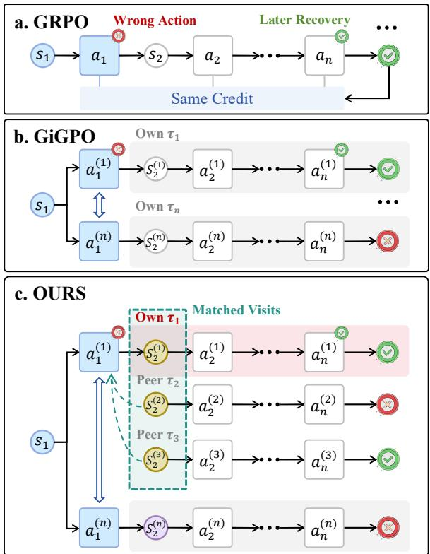  
Figure 1: Comparison of credit assignment strategies. (a) GRPO assigns the same trajectory-level credit to all actions. (b) GiGPO compares actions at shared state anchors based on their own sampled returns. (c) Our proposed ConCal estimates local action values from continuation evidence shared among matched visits across rollouts. Visits from the same task are matched by their preceding state, executed action, and current state.

trains these behaviors from task outcomes (Wei et al., 2025; Wang et al., 2025; Jin et al., 2025). A central challenge is to translate feedback on the full interaction into credit for individual decisions.

Group-based RL estimates relative advantages from trajectories sampled for the same task. In trajectory-level GRPO (Shao et al., 2024), every action in a trajectory receives the same episoderelative advantage, as illustrated in Figure 1(a). GiGPO (Feng et al., 2025) introduces local comparisons by grouping actions at shared state anchors and comparing their discounted returns, as illustrated in Figure 1(b). The comparison is local, but the value estimate for each action still comes from its own sampled continuation. Consequently, a low return does not distinguish a poor decision from a useful decision followed by later failure. Similarly, a high return does not identify which earlier decisions contributed to success. The credit conflicts in Figure 2 illustrate the variability of these estimates on subsets of WebShop (Yao et al., 2022) and ALFWorld (Shridhar et al., 2021) rollouts. State grouping determines which actions are compared, while continuation estimation determines the values entering that comparison.

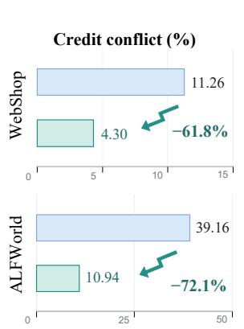

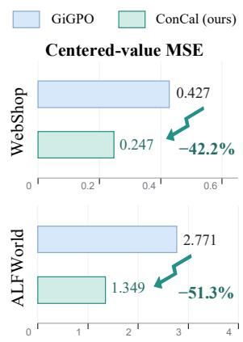  
Figure 2: Credit-conflict rates and centered-value MSE on WebShop and ALFWorld. Credit conflict (%) measures the proportion of repeated-decision groups in which the same recorded decision receives both positive and negative local credit. Centered-value MSE measures group-centered estimation error against held-out returns. For illustration, both estimators are evaluated on the same subset of 1,000 existing rollout trajectories from each benchmark.

The rollout batch also contains evidence beyond each individual continuation. Existing approaches reuse cross-trajectory structure through transitionlevel advantage averaging and graph-based credit estimation (Li et al., 2026; Cheng et al., 2026; Yao et al., 2026). For a given task, repeated transitions with the same starting state, executed action, and resulting state link that action to several observed continuations, as illustrated in Figure 1(c). The visits following these transitions provide shared evidence about subsequent returns, while each visit records a particular reward and successor within its own trajectory. A single pooled value removes these differences from the estimates assigned to matched visits. Our insight is to calibrate action values by combining shared continuation evidence with each visit’s own transition estimate and propagating the resulting estimates backward to earlier decisions.

Accordingly, we propose Continuation Calibration (ConCal), a recursive estimator of continuation values. ConCal matches visits by their incoming state-action-state transitions and blends the transition estimate of each visit with the mean estimate of matched visits. This partial sharing retains a separate estimate for each visit. Recursive updates carry the calibrated continuation values backward along recorded trajectories, allowing earlier action-value estimates to incorporate evidence from other rollouts. Each action is evaluated from its own observed reward and the calibrated continuation value of its actual successor, without collecting additional rollouts. The illustrative held-out diagnostics in Figure 2 show lower error in relative values and greater local credit consistency than estimates based on individual continuations.

In summary, our contributions are as follows: (1) Analysis of Local Credit Assignment. We analyze the dependence of return-based local credit on individual sampled continuations through creditconflict measurements and held-out relative-value diagnostics. (2) Calibrating Local Action Values. We introduce ConCal, which combines shared continuation evidence from matched visits with each visit’s own transition estimate through recursive updates to refine local action-value estimates within the existing rollout batch. (3) Empirical Evaluation. With Qwen2.5-1.5B-Instruct, Con-Cal improves success rates over GiGPO by 3.39 and 5.86 percentage points on ALFWorld and Web-Shop, respectively, and achieves higher reported mean success rates than GraphGPO on both benchmarks. Ablations support recursive sharing and retention of individual transition estimates, while diagnostics examine relative-value magnitudes and action orderings.

## 2 Related Work

Reinforcement learning for language agents. Reinforcement learning (RL) has been applied to align language models with human preferences (Ouyang et al., 2022) and train agents through interaction with external environments (Carta et al., 2023). Multi-turn RL enables agents to learn sequential decision-making from environment feedback (Zhou et al., 2024), with applications spanning device control (Bai et al., 2024), web navigation (Wei et al., 2025), and searchaugmented reasoning (Jin et al., 2025). Recent frameworks further support long-horizon training across diverse interactive environments (Xi et al., 2026). Our work focuses on credit assignment in long-horizon agentic RL.

Group-based local credit assignment. Groupbased RL estimates relative advantages from sampled rewards without a learned value baseline (Ahmadian et al., 2024; Shao et al., 2024). Subsequent work improves optimization and sampling to address training bias and instability (Liu et al., 2025; Yu et al., 2025). For multi-turn agents, local comparisons extend from shared state anchors to groups that account for historical context (Feng et al., 2025; He et al., 2026). Our work focuses on calibrating the action-value estimates entering these local comparisons through shared continuation evidence from matched visits.

Cross-trajectory credit estimation. Shared structure across trajectories provides additional evidence for step-level credit assignment. Tree-GRPO adopts tree-search sampling and computes relative advantages within and across trees (Ji et al., 2026). SALT averages trajectory-level advantages over matched state-action-state transitions (Li et al., 2026). GraphGPO aggregates rollouts into a state-transition graph and derives step-level credit from shortest-path distances to successful terminal states (Cheng et al., 2026). GRAFT estimates state values through Bellman updates on a trajectory graph and derives step-level credit from these values (Yao et al., 2026). PGPO augments steplevel advantages by incorporating differences between state potentials estimated from grouped returns (Zheng et al., 2026). In this paper, we introduce ConCal to calibrate local action values by recursively combining shared continuation evidence with visit-specific transition estimates, with an in-depth analysis revealing how calibration and normalization shape action preferences and local credit.

## 3 Preliminaries

## 3.1 Group-Based Agent RL

We consider language agents that interact sequentially with an environment to complete tasks. Given a task x, the agent receives an observed state $s _ { t }$ and generates a textual action $a _ { t }$ based on the current state and retained interaction history. The environment returns a reward $r _ { t }$ and the next state $s _ { t + 1 }$ Rewards reflect the terminal task outcome, with intermediate task rewards set to zero. At each training iteration, the rollout policy $\pi _ { 0 } = \pi _ { \mathrm { o l d } } = \pi _ { \theta _ { \mathrm { o l d } } }$ is held fixed to collect N trajectories per task. For a given task x, let $\mathcal { D } = \{ \tau _ { i } \} _ { i = 1 } ^ { N }$ denote its rollout group. The full training batch B contains the rollout groups for all sampled tasks. Each trajectory $\tau _ { i }$ contains $T _ { i } \leq H$ transitions $( s _ { t } ^ { ( i ) } , a _ { t } ^ { ( i ) } , \bar { r _ { t } ^ { ( i ) } } , s _ { t + 1 } ^ { ( i ) } )$ where H is the maximum number of interactions. Each decision step (i, t), with $0 \leq t < T _ { i }$ , constitutes a visit to the observed state $s _ { t } ^ { ( i ) }$

Episode-level advantages. GRPO compares returns within a rollout group (Shao et al., 2024). For the total task return $\begin{array} { r } { R ( \tau _ { i } ) = \sum _ { t = 0 } ^ { T _ { i } - 1 } r _ { t } ^ { ( i ) } } \end{array}$ , the episode-relative advantage is

$$
A ^ { E , ( i ) } = \frac { R ( \tau _ { i } ) - \bar { R } } { d _ { E } } ,\tag{1}
$$

where $\bar { R }$ is the mean trajectory return. Standard GRPO sets $d _ { E } = \sigma _ { R } + \epsilon _ { \mathrm { n u m } } .$ , with $\sigma _ { R }$ denoting the standard deviation and $\epsilon _ { \mathrm { { n u m } } } > 0$ a numerical stabilizer. Mean centering instead sets $d _ { E } = 1$ . All actions in a trajectory share the same episode-level advantage.

Step-level advantages. GiGPO introduces local comparisons at repeated state anchors (Feng et al., 2025). Each action is evaluated by its sampled discounted return $\begin{array} { r } { G _ { t } ^ { ( i ) } = \sum _ { u = t } ^ { { T _ { i } } - 1 } \gamma ^ { \dot { u } - t } r _ { u } ^ { ( i ) } } \end{array}$ , where $\gamma \in [ 0 , 1 ]$ is the discount factor. Let ${ S } _ { t } ^ { ( i ) }$ contain all visits in $\mathcal { D }$ sharing the state anchor of visit $( i , t )$ The local advantage and combined training signal are

$$
\begin{array} { c } { { A _ { t } ^ { S , ( i ) } = \displaystyle \frac { G _ { t } ^ { ( i ) } - \bar { G } _ { S _ { t } ^ { ( i ) } } } { d _ { S _ { t } ^ { ( i ) } } } , } } \\ { { A _ { t } ^ { ( i ) } = A ^ { E , ( i ) } + \beta A _ { t } ^ { S , ( i ) } , } } \end{array}\tag{2}
$$

where $\bar { G } _ { \mathcal { S } }$ is the group mean, $d _ { S }$ is the normalization scale, and $\beta \geq 0$ weights the local advantage. The combined advantages drive PPO-style policy optimization (Schulman et al., 2017).

## 3.2 Local Action-Value Estimation

Let $h _ { t }$ denote the full observed interaction history before action $a _ { t }$ , including the task, current state, and remaining interaction budget. The action value under $\pi _ { 0 }$ is

$$
Q ^ { \pi _ { 0 } } ( h , a ) = \mathbb { E } _ { \pi _ { 0 } } \left[ G _ { t } \mid h _ { t } = h , \ a _ { t } = a \right] ,\tag{3}
$$

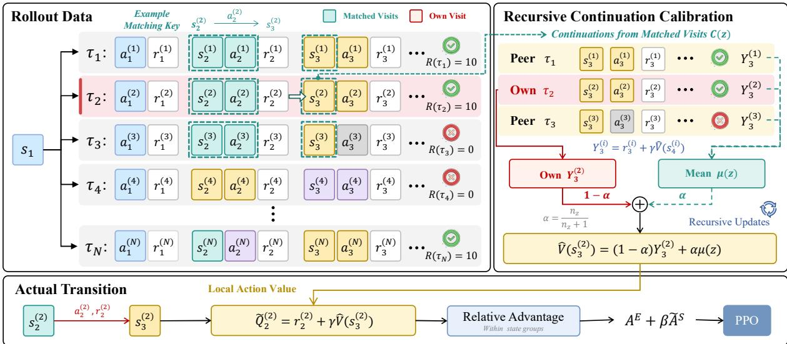  
Figure 3: Overview of ConCal. (1) ConCal matches visits across same-task rollouts by their preceding state, executed action, and current state to identify shared continuation evidence (Left). (2) It recursively combines continuation evidence from matched visits while retaining each visit’s own transition contribution, producing calibrated continuation values for action evaluation. At each recursion depth, all visits are updated using successor estimates from the previous depth (Right). (3) Each action is evaluated using its immediate reward and its actual successor’s calibrated continuation value. The resulting action values are compared within state groups to obtain local advantages, which are combined with episode-level advantages for PPO updates (Bottom).

where $G _ { t }$ is the discounted return over the remaining episode. The expectation accounts for subsequent policy decisions and environment transitions.

GiGPO relies on one sampled return $G _ { t } ^ { ( i ) }$ to estimate $Q ^ { \pi _ { 0 } } ( h _ { t } ^ { ( i ) } , a _ { t } ^ { ( i ) } )$ . Although state grouping supplies a local comparison baseline, each estimate still depends on a single sampled continuation. We seek an estimator $\widetilde Q _ { t } ^ { ( i ) } = \mathcal E ( \mathcal D , i , t )$ that incorporates continuation evidence from matched visits across trajectories to improve local action-value estimates without additional rollouts.

## 4 Continuation Calibration

We introduce CONCAL, a recursive continuationvalue estimator that evaluates actions from continuation evidence shared across existing rollouts. Figure 3 illustrates three steps. Matching Visits identifies visits that share continuation evidence. Recursive Continuation Calibration blends individual transition estimates with the matched mean. Action Values and Policy Optimization converts calibrated continuation values into action values and relative advantages for policy updates.

## 4.1 Matching Visits

To construct the estimator $\mathcal { E } ( \mathcal { D } , i , t )$ introduced in Section 3.2, we first match visits across trajectories by the task, preceding state, executed action, and current state. Matching the incoming transition distinguishes visits that reach the same observed state through different preceding state-action pairs. For visit (i, t), the matching key is

$$
z _ { t } ^ { ( i ) } = \left( x , s _ { t - 1 } ^ { ( i ) } , a _ { t - 1 } ^ { ( i ) } , s _ { t } ^ { ( i ) } \right) .\tag{4}
$$

At $t = 0$ , a start marker replaces the preceding state and action. We collect visits with the same z into a sharing pool:

$$
{ \mathcal C } ( z ) = \{ ( j , k ) \ | \ z _ { k } ^ { ( j ) } = z \} ,\tag{5}
$$

where $( j , k )$ denotes the visit at step k of trajectory $\tau _ { j }$ in D. Matched visits need not occur at the same time step.

To evaluate action $a _ { t } ^ { ( i ) }$ , we draw on the pool $\mathscr { C } ( z _ { t + 1 } ^ { ( i ) } )$ to calibrate the continuation value at its actual successor visit $( i , t + 1 )$ when $t + 1 < T _ { i }$ For example, in Figure 3, the tuples $( s _ { 2 } ^ { ( i ) } , a _ { 2 } ^ { ( i ) } , s _ { 3 } ^ { ( i ) } )$ match for $i \in \{ 1 , 2 , 3 \}$ , so the continuations from these visits at $s _ { 3 } ^ { ( i ) }$ provide shared evidence for evaluating $a _ { 2 } ^ { ( 2 ) }$

## 4.2 Recursive Continuation Calibration

The continuation value at a visit depends on its immediate reward and the value of its actual successor. ConCal calibrates this value with evidence from matched visits while retaining a separate estimate for each visit. Let $\widehat { V } _ { b } ( s _ { t } ^ { ( i ) } )$ denote the continuation estimate for visit $( i , t )$ at recursion depth $b ,$ initialized as $\widehat { V } _ { 0 } ( s _ { t } ^ { ( i ) } ) = 0$

Visit-specific calibration. We first compute the transition estimate for each visit:

$$
Y _ { t , b } ^ { ( i ) } = r _ { t } ^ { ( i ) } + \gamma \widehat { V } _ { b - 1 } ( s _ { t + 1 } ^ { ( i ) } ) .\tag{6}
$$

The successor term is zero when no successor visit is recorded, including at collection truncations.

The pool mean averages the transition estimates of all matched visits, including the current visit:

$$
\mu _ { b } ( z ) = \frac { 1 } { | \mathcal { C } ( z ) | } \sum _ { ( j , k ) \in \mathcal { C } ( z ) } Y _ { k , b } ^ { ( j ) } .\tag{7}
$$

ConCal then calibrates the continuation value at each visit by blending its transition estimate with the pool mean:

$$
\widehat { V } _ { b } ( s _ { t } ^ { ( i ) } ) = ( 1 - \alpha _ { z } ) Y _ { t , b } ^ { ( i ) } + \alpha _ { z } \mu _ { b } ( z ) ,\tag{8}
$$

where $\begin{array} { r } { z = z _ { t } ^ { ( i ) } , \alpha _ { z } = \frac { n _ { z } } { n _ { z } + 1 } } \end{array}$ , and $n _ { z }$ is the number of distinct trajectories in $\mathcal { C } ( z )$ . This calibration moves the estimate for each visit toward the shared mean while retaining its own transition contribution. The pool mean averages visits, and its weight increases with the number of distinct contributing trajectories.

At a fixed sharing pool and recursion depth, calibration preserves the mean of the transition estimates and contracts their pairwise differences. For any $( i , t ) , ( j , k ) \in \mathcal { C } ( z )$

$$
\widehat { V } _ { b } ( s _ { t } ^ { ( i ) } ) - \widehat { V } _ { b } ( s _ { k } ^ { ( j ) } ) = \frac { Y _ { t , b } ^ { ( i ) } - Y _ { k , b } ^ { ( j ) } } { n _ { z } + 1 } .\tag{9}
$$

Each visit therefore retains its own deviation from the shared mean, scaled by $1 / ( n _ { z } + 1 )$

Recursive propagation. In Figure 3, each recursive update combines the transition estimate for visit $( 2 , 3 )$ with the mean of the three matched estimates to calibrate its continuation value. This computation repeats for $b = 1 , \dots , H$ , where H is the maximum interaction budget. At depth b, all visits incorporate successor estimates from depth $b - 1$ . The calibrated values then enter the transition estimates of preceding visits at the next depth, propagating shared continuation evidence backward through recorded transitions.

## 4.3 Action Values and Policy Optimization

The recursively calibrated continuation values provide the basis for action evaluation. Each action retains its observed reward and actual successor:

$$
\widetilde Q _ { t } ^ { ( i ) } = r _ { t } ^ { ( i ) } + \gamma \widehat V _ { H - t - 1 } ( s _ { t + 1 } ^ { ( i ) } ) ,\tag{10}
$$

where $t = 0 , \ldots , T _ { i } - 1$ . The successor estimate is taken at recursion depth $H - t - 1$ , corresponding to the remaining interaction budget after the action. The successor term follows the boundary convention defined above.

Batch-wise normalization converts the calibrated action values into step advantages by centering them within each state group and applying a shared batch-level scale. The resulting step advantages are combined with the episode-level advantage in GiGPO:

$$
\begin{array} { c } { { \widetilde { A } _ { t } ^ { S , ( i ) } = \displaystyle \frac { \widetilde { Q } _ { t } ^ { ( i ) } - \widetilde { Q } _ { S _ { t } ^ { ( i ) } } } { \widetilde { d } _ { B } } , } } \\ { { \widetilde { A } _ { t } ^ { ( i ) } = A ^ { E , ( i ) } + \beta \widetilde { A } _ { t } ^ { S , ( i ) } , } } \end{array}\tag{11}
$$

where $\overline { { \widetilde { Q } } } _ { \mathcal { S } }$ is the mean action-value estimate within the group, $d _ { B }$ is a normalization scale shared across the batch, and $\beta$ balances episode-level and steplevel credit. On WebShop, the shared scale is one, which reduces step-advantage normalization to mean centering. Details are provided in $\mathsf { A p - }$ pendix E.

We then optimize the following clipped objective with the combined advantages:

$$
\begin{array} { l } { \displaystyle \mathcal { I } ( \theta ) = \mathbb { E } _ { \mathcal { B } \sim \pi _ { \mathrm { o l d } } } \left[ \sum _ { k = 1 } ^ { L } w _ { k } \operatorname* { m i n } \Bigl ( \rho _ { k } \widetilde { A } _ { k } , } \\ { \mathrm { c l i p } \bigl ( \rho _ { k } , 1 - \epsilon , 1 + \epsilon \bigr ) \widetilde { A } _ { k } \Bigr ) - \lambda _ { \mathrm { K L } } \mathbb { D } _ { \mathrm { K L } } \bigl ( \pi _ { \theta } \| \pi _ { \mathrm { r e f } } \bigr ) \right] , } \end{array}\tag{12}
$$

where L is the number of generated tokens, $w _ { k }$ denotes the normalized actor-loss weight of token k with $\textstyle \sum _ { k } w _ { k } = 1$ , and $\widetilde { A } _ { k }$ is the combined advantage of the step containing that token. The importance ratio is $\rho _ { k } = \pi _ { \theta } ( a _ { k } \mid h _ { k } ) / \pi _ { \mathrm { o l d } } ( a _ { k } \mid h _ { k } )$ where $a _ { k }$ is the generated token and $h _ { k }$ contains the policy input context and preceding tokens within the action. The clipping threshold is $\epsilon ,$ and $\lambda _ { \mathrm { K L } }$ controls the KL penalty relative to the reference policy $\pi _ { \mathrm { r e f } }$ . The KL term denotes the weighted average over token contexts $h _ { k }$ with weights $w _ { k }$ The advantages remain fixed during optimization. Algorithm 1 in Appendix C summarizes the actionvalue estimation procedure.

<table><tr><td rowspan="2">Type</td><td rowspan="2">Method</td><td colspan="7">ALFWorld</td><td colspan="2">WebShop</td></tr><tr><td>Pick</td><td>Clean</td><td>Cool</td><td>Look</td><td>Heat</td><td>Pick2</td><td>All</td><td>Score</td><td>Succ.</td></tr><tr><td colspan="2">Closed-Source Models</td><td></td><td></td><td></td><td></td><td></td><td></td><td></td><td></td><td></td></tr><tr><td>Prompting</td><td>GPT-40</td><td>75.3</td><td>60.8</td><td>31.2</td><td>56.7</td><td>21.6</td><td>49.8</td><td>48.0</td><td>31.8</td><td>23.7</td></tr><tr><td>Prompting</td><td>Gemini-2.5-Pro</td><td>92.8</td><td>63.3</td><td>62.1</td><td>69.0</td><td>26.6</td><td>58.7</td><td>60.3</td><td>42.5</td><td>35.9</td></tr><tr><td colspan="2">Qwen2.5-1.5B-Instruct</td><td></td><td></td><td></td><td></td><td></td><td></td><td></td><td></td><td></td></tr><tr><td>Prompting</td><td>Qwen2.5</td><td>5.9</td><td>5.5</td><td>3.3</td><td>9.7</td><td>4.2</td><td>0.0</td><td>4.1</td><td>23.1</td><td>5.2</td></tr><tr><td>Prompting</td><td>ReAct</td><td>17.4</td><td>20.5</td><td>15.7</td><td>6.2</td><td>7.7</td><td>2.0</td><td>12.8</td><td>40.1</td><td>11.3</td></tr><tr><td>Prompting</td><td>Reflexion</td><td>35.3</td><td>22.2</td><td>21.7</td><td>13.6</td><td>19.4</td><td>3.7</td><td>21.8</td><td>55.8</td><td>21.9</td></tr><tr><td></td><td>RL Training PPO (with critic)</td><td> $6 4 . 8 _ { \pm 3 . 5 }$ </td><td> $4 0 . 5 { \scriptstyle \pm 6 . 9 }$ </td><td> $5 7 . 1 _ { \pm 4 . 9 }$ </td><td> $6 0 . 6 { \scriptstyle \pm 6 . 6 }$ </td><td> $4 6 . 4 _ { \pm 4 . 0 }$ </td><td> $4 7 . 4 _ { \pm 1 . 9 }$ </td><td> $5 4 . 4 _ { \pm 3 . 1 }$ </td><td> $7 3 . 8 { \scriptstyle \pm 3 . 0 }$ </td><td> $5 1 . 5 { \scriptstyle \pm 2 . 9 }$ </td></tr><tr><td>RL Training RLOO</td><td></td><td> $8 8 . 3 { \scriptstyle \pm 3 . 0 }$ </td><td> $5 2 . 8 { \scriptstyle \pm 8 . 6 }$ </td><td> $7 1 . 0 { \scriptstyle \pm 5 . 9 }$ </td><td> $6 2 . 8 { \scriptstyle \pm 8 . 7 }$ </td><td> $6 6 . 4 { \scriptstyle \pm 5 . 5 }$ </td><td> $5 6 . 9 { \scriptstyle \pm 4 . 7 }$ </td><td> $6 9 . 7 _ { \pm 2 . 5 }$ </td><td> $7 3 . 9 { \scriptstyle \pm 5 . 6 }$ </td><td> $5 2 . 1 _ { \pm 6 . 7 }$ </td></tr><tr><td>RL Training GRPO</td><td></td><td> $8 2 . 8 9 _ { \pm 3 . 6 2 }$ </td><td> $8 2 . 1 4 _ { \pm 6 . 3 7 }$ </td><td> $7 3 . 8 6 _ { \pm 6 . 8 4 }$ </td><td> $7 8 . 5 7 _ { \pm 0 . 0 0 }$ </td><td> $7 7 . 7 8 _ { \pm 4 . 5 4 }$ </td><td> $7 1 . 4 3 _ { \pm 3 . 8 9 }$ </td><td> $7 7 . 8 6 _ { \pm 1 . 3 3 }$ </td><td> $8 4 . 7 3 _ { \pm 0 . 4 9 }$ </td><td> $7 1 . 3 5 { \scriptstyle \pm 2 . 0 5 }$ </td></tr><tr><td>RL Training GiGPO*</td><td></td><td> $\underline { { 9 8 . 8 1 _ { \pm 1 . 6 8 } } }$ </td><td> $9 5 . 1 6 _ { \pm 3 . 8 9 }$ </td><td> $8 1 . 4 6 _ { \pm 0 . 5 6 }$ </td><td> $7 8 . 5 7 _ { \pm 0 . 0 0 }$ </td><td> $9 4 . 4 4 _ { \pm 0 . 0 0 }$ </td><td> $\mathbf { 9 3 . 6 5 _ { \pm 5 . 9 4 } }$ </td><td> $9 0 . 8 8 _ { \pm 0 . 9 7 }$ </td><td> $8 7 . 9 4 _ { \pm 0 . 4 3 }$ </td><td> $7 3 . 8 3 _ { \pm 2 . 3 0 }$ </td></tr><tr><td>RL Training GraphGPO</td><td></td><td> $9 5 . 1 5 _ { \pm 1 . 6 2 }$ </td><td> $\mathbf { 1 0 0 . 0 0 { \scriptstyle \pm 0 . 0 0 } }$ </td><td> $\underline { { 8 5 . 2 6 _ { \pm 2 . 5 8 } } }$ </td><td> $\mathbf { 8 5 . 7 1 _ { \pm 5 . 8 3 } }$ </td><td> $\mathbf { 9 6 . 3 0 _ { \pm 2 . 6 1 } }$ </td><td> $\mathbf { 9 3 . 6 5 _ { \pm 2 . 2 4 } }$ </td><td> $\underline { { 9 2 . 7 1 _ { \pm 1 . 3 2 } } }$ </td><td> $\underline { { 8 9 . 2 9 _ { \pm 1 . 4 8 } } }$ </td><td> $\underline { { 7 8 . 6 5 _ { \pm 3 . 8 6 } } }$ </td></tr><tr><td>RL Training CoNCAL</td><td></td><td> $\mathbf { 9 8 . 8 9 _ { \pm 1 . 9 2 } }$ </td><td> $9 8 . 7 2 _ { \pm 2 . 2 2 }$ </td><td> $\mathbf { 8 9 . 1 2 _ { \pm 9 . 5 2 } }$ </td><td> $8 4 . 1 6 _ { \pm 8 . 9 4 }$ </td><td> $\underline { { 9 4 . 6 4 . } } \pm 5 . 2 7$ </td><td> $9 1 . 0 7 _ { \pm 3 . 2 7 }$ </td><td> $\mathbf { 9 4 . 2 7 _ { \pm 1 . 9 7 } }$ </td><td> $\mathbf { 9 0 . 1 8 _ { \pm 1 . 2 7 } }$ </td><td> $\mathbf { 7 9 . 6 9 _ { \pm 3 . 4 1 } }$ </td></tr></table>

Table 1: Performance on ALFWorld and WebShop. For ALFWorld, we report per-category and overall success rates (%). For WebShop, we report average task scores and success rates (%). ConCal results report validation means ± sample standard deviations across three runs. <sup>∗</sup> marks the base method on which ConCal builds. Baseline results are taken from prior publications (Feng et al., 2025; Cheng et al., 2026). The best and second-best means are shown in bold and underlined, respectively.

## 5 Experiments

## 5.1 Experimental Setup

Benchmarks. Following prior work (Feng et al., 2025; Cheng et al., 2026), we evaluate ConCal on two benchmarks, ALFWorld (Shridhar et al., 2021) and WebShop (Yao et al., 2022). ALFWorld comprises six categories of household tasks performed through text-based interactions. WebShop requires agents to search for and purchase products that satisfy user requirements. We report overall and per-category success rates on ALFWorld, and average task score and success rate on WebShop.

Baselines. We compare against GPT-4o (Hurst et al., 2024) and Gemini-2.5-Pro (Comanici et al., 2025), prompting methods ReAct (Yao et al., 2023) and Reflexion (Shinn et al., 2023), and RL methods PPO (Schulman et al., 2017), RLOO (Ahmadian et al., 2024), GRPO (Shao et al., 2024), GiGPO (Feng et al., 2025), and GraphGPO (Cheng et al., 2026). We also include Qwen2.5-Instruct without additional RL training.

Implementation Details. We train Qwen2.5- 1.5B-Instruct for 150 updates, collecting eight trajectories for each of 16 tasks per update. Main results report the mean and sample standard deviation across three independent training runs. Full training and evaluation settings are provided in $\mathsf { A p - }$ pendix B.

Figure 4: Learning curves of ConCal in green and GiGPO in blue on ALFWorld and WebShop with Qwen2.5-1.5B-Instruct. Training episode success rates are plotted against policy updates, with faint lines showing unsmoothed curves and bold lines showing EMAsmoothed curves with decay 0.95.  
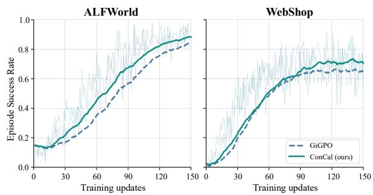

## 5.2 Experimental Results

Main results. Table 1 compares ConCal with existing methods on ALFWorld and WebShop. Con-Cal achieves the highest reported aggregate mean success rates among the compared methods, reaching 94.27% overall success on ALFWorld and a task score of 90.18 with 79.69% success on Web-Shop. Compared with GRPO, ConCal improves success rates by 16.41 and 8.34 percentage points (pp) on ALFWorld and WebShop, respectively, and raises the WebShop task score by 5.45 points. Relative to its base method, GiGPO, ConCal achieves success-rate gains of 3.39 pp on ALFWorld and 5.86 pp on WebShop, together with a 2.24-point increase in WebShop task score. Its reported aggregate mean success rates are also higher than those of GraphGPO on both benchmarks.

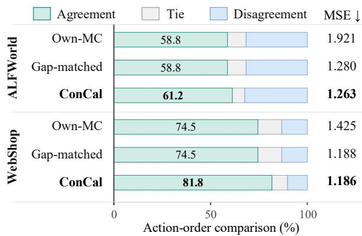  
Figure 5: Calibration of relative action values. Agreement and Disagreement indicate whether the estimated action ordering matches or reverses the ordering given by held-out returns. Tie denotes near-equal estimated values. Ordering comparisons exclude action pairs with tied held-out returns. Gap-matched rescales the centered Own-MC values within each group to match the norm of the ConCal estimates while preserving their ordering. MSE measures group-centered value error against held-out returns.

Learning dynamics. Figure 4 compares the training success rates of ConCal and GiGPO on ALF-World and WebShop. On ALFWorld, ConCal improves more rapidly during the early-to-middle stages and maintains higher success rates through most of training. On WebShop, the two methods initially follow similar trends, but ConCal achieves higher success rates in later stages and maintains this advantage through the final updates. The gains emerge at different training stages across the two benchmarks under the reported rollout schedule.

Section 5.3 assesses action-value estimation quality. Sections 5.4.1 and 5.4.2 examine estimation components and advantage normalization, Section 5.5 reports reuse coverage and computational cost, and Section 5.6 presents a case study.

## 5.3 Quality of Local Action-Value Estimates

To investigate how shared evidence calibrates relative action values, we compare Own-MC and Con-Cal on the same frozen rollouts for each benchmark, with held-out continuation returns as the reference, following the split described in Appendix D. Own-MC estimates each action value from the Monte Carlo return along the same trajectory, as in GiGPO. We measure group-centered value MSE and actionorder agreement to assess the accuracy of value differences and preference direction. Gap-matched serves as a diagnostic control that rescales the centered Own-MC values in each group to the norm of the ConCal estimates while preserving their ordering. This tests how much of the estimation-error reduction can be reproduced by adjusting preference strength alone. Figure 5 shows that ConCal reduces centered-value MSE by 34.3% on ALF-World and 16.8% on WebShop. Gap-matched reproduces most of the MSE reduction while preserving the Own-MC ordering, showing that much of the error reduction can be recovered by adjusting preference strength alone. ConCal also increases ordering agreement from 58.8% to 61.2% and from 74.5% to 81.8%, respectively. Within the evaluated comparison groups, these results show that shared continuations improve relative action-value estimates by calibrating preference strength and increasing agreement with the reference ordering.

<table><tr><td rowspan="2">Estimator</td><td>ALFWorld</td><td colspan="2">WebShop</td></tr><tr><td>All (%)</td><td>Score</td><td>Succ. (%)</td></tr><tr><td>Own-MC</td><td> $9 0 . 8 9 \pm 1 . 6 3 $ </td><td> $8 8 . 2 5 \pm 0 . 8 0$ </td><td> $7 3 . 4 4 \pm 2 . 0 7$ </td></tr><tr><td>Fully pooled</td><td> $9 1 . 9 3 \pm 2 . 3 9$ </td><td> $8 9 . 7 9 \pm 1 . 5 4$ </td><td> $7 8 . 6 5 \pm 4 . 5 1$ </td></tr><tr><td>Single-pass</td><td> $9 3 . 4 9 \pm 1 . 9 7$ </td><td> ${ \bf 9 0 . 2 5 \pm 2 . 2 8 }$ </td><td> $\underline { { 7 8 . 6 5 \pm 3 . 1 6 } }$ </td></tr><tr><td>ConCal</td><td> ${ \bf 9 4 . 2 7 \pm 1 . 9 7 }$ </td><td> $9 0 . 1 8 \pm 1 . 2 7$ </td><td> ${ \bf 7 9 . 6 9 \pm 3 . 4 1 }$ </td></tr></table>

Table 2: Continuation-estimator ablations on ALFWorld and WebShop. We report overall success rate on ALF-World and task score and success rate on WebShop, as means ± sample standard deviations across three runs. The best and second-best means are shown in bold and underlined, respectively.

## 5.4 Component Analysis

We evaluate continuation estimation through taskperformance ablations and normalization through frozen-estimate diagnostics.

## 5.4.1 Continuation Estimation

We further compare ConCal with Own-MC and two variants to examine how continuation estimation contributes to task performance. Single-pass shares continuation returns once, without recursively propagating updated estimates backward. Fully pooled retains recursion but assigns each matched visit the pooled mean, removing its separate visit-specific contribution. All other components and settings remain unchanged. Table 2 supports three findings. (1) All three estimators that share continuation evidence (Single-pass, Fully pooled, and ConCal) outperform Own-MC across the reported metrics, supporting the benefit of using evidence from other trajectories. (2) ConCal achieves higher success rates than Single-pass on both benchmarks, supporting the recursive incorporation of updated estimates into earlier decisions. Their WebShop task scores are close, with a slightly higher mean for Single-pass and less variation across seeds for Con-Cal. (3) ConCal outperforms Fully pooled across all metrics, indicating that retaining each visit’s own estimate remains useful even when continuations are shared. Together, these findings support ConCal’s design of recursive evidence reuse with visit-specific estimation.

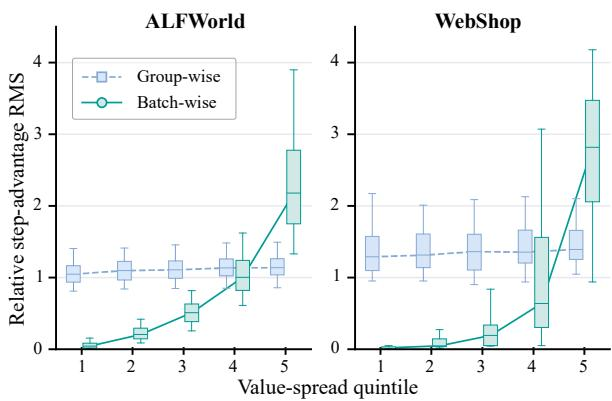  
Figure 6: Relationship between calibrated value spread and step-advantage magnitude under group-wise and batch-wise normalization on ALFWorld and WebShop. Within each batch, state groups with nonzero value spread are divided into five approximately equal-sized bins by the root mean square (RMS) of their centered action values, from bin 1 with the smallest spread to bin 5 with the largest. The vertical axis shows the stepadvantage RMS of each group divided by the corresponding batch-level step-advantage RMS. Boxes show the middle 50% of values, whiskers the 5th–95th percentiles, and lines connect medians.

## 5.4.2 Advantage Normalization Diagnostic

To examine whether normalization preserves the preference strength calibrated by ConCal, we test whether groups with larger value gaps receive stronger step advantages. For this diagnostic comparison, we apply group-wise and batch-wise normalization to the same frozen ConCal estimates and compare step-advantage magnitudes across five bins ordered from smaller to larger value gaps. Figure 6 shows that group-wise normalization produces similar median advantage magnitudes across bins on both benchmarks. Groups with small calibrated value gaps therefore receive step signals comparable in magnitude to those with large gaps, weakening the distinction between weak and strong estimated action preferences. Under batch-wise normalization, median advantage magnitudes increase with value spread, so smaller gaps receive weaker step signals and larger gaps receive stronger signals. This preserves the preference-strength differences calibrated by ConCal and supports our adoption of batch-wise normalization when computing step advantages.

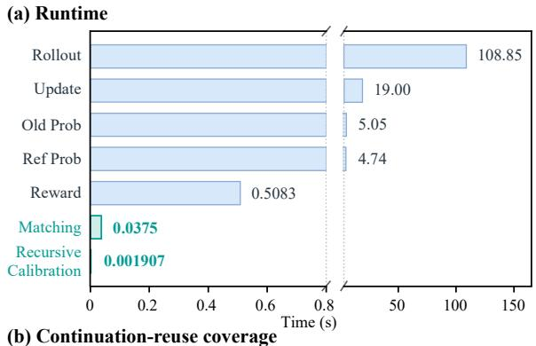

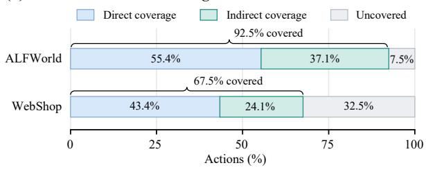  
Figure 7: Computational cost and coverage of Con-Cal. (a) Runtime averaged equally over ALFWorld and WebShop. Blue bars denote common training stages, and green bars denote our visit matching and recursive calibration. The x-axis is broken. (b) Direct coverage denotes actions whose next visits have matches in other trajectories. Indirect coverage denotes additional actions reached through recursive propagation of calibrated continuation values. Gray segments indicate uncovered actions, and brackets show total coverage.

## 5.5 Continuation Reuse and Computational Cost

To assess the computational cost and coverage of ConCal, we examine stage runtimes and the fraction of actions covered by shared continuation evidence. Figure 7(a) shows that rollout is the most time-consuming training stage, taking 108.85 s on average, followed by policy updates at 19.00 s. In separate frozen-batch replays, visit matching and recursive calibration for ConCal take 0.0375 s and 0.0019 s per batch, respectively, under the measurement setup in Appendix D. Figure 7(b) shows that directly matched next visits provide shared continuation evidence for 55.4% of recorded actions on ALFWorld and 43.4% on WebShop. Recursive propagation extends this coverage to 92.5% and 67.5%, respectively, allowing earlier actions to access shared continuation evidence even when their immediate successor visits have no crosstrajectory matches. ConCal therefore makes shared continuation evidence available to a broad fraction of recorded actions at a small measured cost for matching and calibration, without collecting additional rollouts.

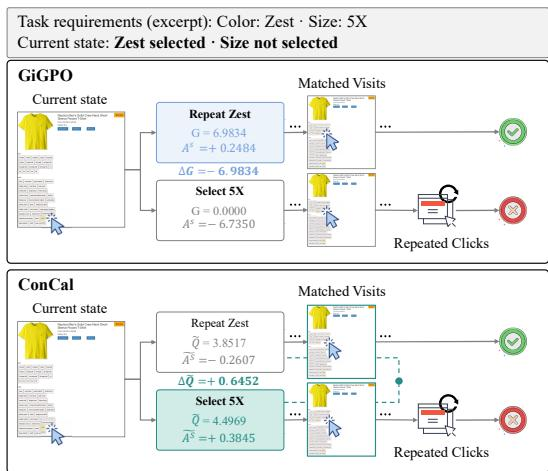  
Figure 8: Case study in WebShop. Both panels evaluate the same two trajectories. Both gaps subtract the estimate for repeating Zest from that for selecting 5X. Green dashed links indicate shared continuation evidence; two of the three matched visits are shown. Webpages are reconstructed from recorded states using the official interface.

## 5.6 Case study

We present a WebShop case study of local credit assignment for web agents (Figure 8). The task requires Zest color and size 5X, but the agent has selected only the color. GiGPO estimates each action’s value from its own sampled continuation. It assigns negative step advantage to Select 5X because its continuation ends in task failure, while favoring Repeat Zest, whose trajectory succeeds, yielding a value gap of $\Delta G = - 6 . 9 8 3 4$ . ConCal calibrates action-value estimates using evidence from multiple continuations and reverses this preference, with $\Delta \widetilde { Q } = + 0 . 6 4 5 2$ . It assigns positive step advantage to Select 5X despite its failed sampled continuation, favoring completion of the required size selection. This case illustrates how ConCal uses shared continuation evidence to assign positive local credit to useful actions despite failures in their own sampled continuations.

## 6 Conclusion

We introduce ConCal, a recursive continuationvalue estimator for long-horizon agentic reinforcement learning. ConCal combines evidence from matched visits with the transition estimate of each visit and propagates calibrated continuation values to earlier decisions without additional rollouts. Experiments on ALFWorld and WebShop show improved task performance, with ablations supporting both recursive evidence reuse and visit-specific estimation. Further analyses show that shared continuations calibrate preference strength and improve agreement with action orderings derived from heldout returns. These findings support calibrating relative action-value estimates with shared continuation evidence from existing rollout groups in the evaluated settings.

## Limitations

The matching rule of ConCal relies on observed incoming transitions and does not enforce agreement in the full interaction history, hidden state, or remaining interaction budget. Such differences can introduce bias into the shared estimates incorporated into subsequent recursive updates. The extent of continuation reuse also depends on the availability of matching visits within the rollout batch. Future work could refine matching with relevant historical information while maintaining sharing coverage, and account for uncertainty in continuation estimates.

## Use of Generative AI Tools

Generative AI tools were used for language refinement and to assist with figure preparation and coding. The authors reviewed the resulting content and take full responsibility for the methodology, results, and conclusions.

## References

Josh Achiam, Steven Adler, Sandhini Agarwal, Lama Ahmad, Ilge Akkaya, Florencia Leoni Aleman, Diogo Almeida, Janko Altenschmidt, Sam Altman, Shyamal Anadkat, et al. 2023. GPT-4 technical report. arXiv preprint arXiv:2303.08774.

Arash Ahmadian, Chris Cremer, Matthias Gallé, Marzieh Fadaee, Julia Kreutzer, Olivier Pietquin, Ahmet Üstün, and Sara Hooker. 2024. Back to basics: Revisiting REINFORCE-style optimization for learning from human feedback in LLMs. In Proceedings of the 62nd Annual Meeting of the Association for

Computational Linguistics (Volume 1: Long Papers), pages 12248–12267.

Hao Bai, Yifei Zhou, Mert Cemri, Jiayi Pan, Alane Suhr, Sergey Levine, and Aviral Kumar. 2024. DigiRL: Training in-the-wild device-control agents with autonomous reinforcement learning. In Advances in Neural Information Processing Systems, volume 37, pages 12461–12495.

Thomas Carta, Clément Romac, Thomas Wolf, Sylvain Lamprier, Olivier Sigaud, and Pierre-Yves Oudeyer. 2023. Grounding large language models in interactive environments with online reinforcement learning. In International Conference on Machine Learning, pages 3676–3713.

Xin Cheng, Shuo He, Lang Feng, HaiYang Xu, Ming Yan, Lei Feng, and Bo An. 2026. Beyond trajectorylevel attribution: Graph-based credit assignment for agentic reinforcement learning. arXiv preprint arXiv:2605.26684.

Gheorghe Comanici, Eric Bieber, Mike Schaekermann, Ice Pasupat, Noveen Sachdeva, Inderjit Dhillon, Marcel Blistein, Ori Ram, Dan Zhang, Evan Rosen, et al. 2025. Gemini 2.5: Pushing the frontier with advanced reasoning, multimodality, long context, and next generation agentic capabilities. arXiv preprint arXiv:2507.06261.

Lang Feng, Zhenghai Xue, Tingcong Liu, and Bo An. 2025. Group-in-group policy optimization for LLM agent training. In Advances in Neural Information Processing Systems, volume 38, pages 46375–46408.

Hongliang He, Wenlin Yao, Kaixin Ma, Wenhao Yu, Yong Dai, Hongming Zhang, Zhenzhong Lan, and Dong Yu. 2024. WebVoyager: Building an end-toend web agent with large multimodal models. In Proceedings ofthe 62nd Annual Meeting ofthe Associationfor Computational Linguistics (Volume 1: Long Papers), pages 6864–6890.

Shuo He, Lang Feng, Qi Wei, Xin Cheng, Lei Feng, and Bo An. 2026. Hierarchy-of-groups policy optimization for long-horizon agentic tasks. In International Conference on Learning Representations, volume 2026, pages 27572–27593.

Aaron Hurst, Adam Lerer, Adam P Goucher, Adam Perelman, Aditya Ramesh, Aidan Clark, AJ Ostrow, Akila Welihinda, Alan Hayes, Alec Radford, et al. 2024. GPT-4o system card. arXiv preprint arXiv:2410.21276.

Brian Ichter, Anthony Brohan, Yevgen Chebotar, Chelsea Finn, Karol Hausman, Alexander Herzog, Daniel Ho, Julian Ibarz, Alex Irpan, Eric Jang, Ryan Julian, Dmitry Kalashnikov, Sergey Levine, Yao Lu, Carolina Parada, Kanishka Rao, Pierre Sermanet, Alexander T Toshev, Vincent Vanhoucke, and 26 others. 2023. Do as I can, not as I say: Grounding language in robotic affordances. In Conference on Robot Learning, pages 287–318.

Yuxiang Ji, Ziyu Ma, Yong Wang, Guanhua Chen, Xiangxiang Chu, and Liaoni Wu. 2026. Tree search for LLM agent reinforcement learning. In International Conference on Learning Representations, volume 2026, pages 87362–87388.

Bowen Jin, Hansi Zeng, Zhenrui Yue, Jinsung Yoon, Sercan Arik, Dong Wang, Hamed Zamani, and Jiawei Han. 2025. Search-R1: Training LLMs to reason and leverage search engines with reinforcement learning. arXiv preprint arXiv:2503.09516.

Jiazheng Li, Yawei Wang, Qiaojing Yan, Yijun Tian, Zhichao Xu, Huan Song, Panpan Xu, and Lin Lee Cheong. 2026. SALT: Step-level advantage assignment for long-horizon agents via trajectory graph. In Findings of the Association for Computational Linguistics: EACL 2026, pages 4709–4725.

Zichen Liu, Changyu Chen, Wenjun Li, Penghui Qi, Tianyu Pang, Chao Du, Wee Sun Lee, and Min Lin. 2025. Understanding R1-Zero-like training: A critical perspective. arXiv preprint arXiv:2503.20783.

Long Ouyang, Jeffrey Wu, Xu Jiang, Diogo Almeida, Carroll Wainwright, Pamela Mishkin, Chong Zhang, Sandhini Agarwal, Katarina Slama, Alex Ray, John Schulman, Jacob Hilton, Fraser Kelton, Luke Miller, Maddie Simens, Amanda Askell, Peter Welinder, Paul F Christiano, Jan Leike, and Ryan Lowe. 2022. Training language models to follow instructions with human feedback. In Advances in Neural Information Processing Systems, volume 35, pages 27730–27744.

Qwen, An Yang, Baosong Yang, Beichen Zhang, Binyuan Hui, Bo Zheng, Bowen Yu, Chengyuan Li, Dayiheng Liu, Fei Huang, Haoran Wei, Huan Lin, Jian Yang, Jianhong Tu, Jianwei Zhang, Jianxin Yang, Jiaxi Yang, Jingren Zhou, Junyang Lin, and 24 others. 2025. Qwen2.5 technical report. arXiv preprint arXiv:2412.15115.

Timo Schick, Jane Dwivedi-Yu, Roberto Dessì, Roberta Raileanu, Maria Lomeli, Eric Hambro, Luke Zettlemoyer, Nicola Cancedda, and Thomas Scialom. 2023. Toolformer: Language models can teach themselves to use tools. In Advances in Neural Information Processing Systems, volume 36, pages 68539–68551.

John Schulman, Filip Wolski, Prafulla Dhariwal, Alec Radford, and Oleg Klimov. 2017. Proximal policy optimization algorithms. arXiv preprint arXiv:1707.06347.

Zhihong Shao, Peiyi Wang, Qihao Zhu, Runxin Xu, Junxiao Song, Xiao Bi, Haowei Zhang, Mingchuan Zhang, Y. K. Li, Y. Wu, and Daya Guo. 2024. DeepSeekMath: Pushing the limits of mathematical reasoning in open language models. arXiv preprint arXiv:2402.03300.

Noah Shinn, Federico Cassano, Ashwin Gopinath, Karthik Narasimhan, and Shunyu Yao. 2023. Reflexion: Language agents with verbal reinforcement learning. In Advances in Neural Information Processing Systems, volume 36, pages 8634–8652.

Mohit Shridhar, Xingdi Yuan, Marc-Alexandre Côté, Yonatan Bisk, Adam Trischler, and Matthew Hausknecht. 2021. ALFWorld: Aligning text and embodied environments for interactive learning. In International Conference on Learning Representations.

Zihan Wang, Kangrui Wang, Qineng Wang, Pingyue Zhang, Linjie Li, Zhengyuan Yang, Xing Jin, Kefan Yu, Minh Nhat Nguyen, Licheng Liu, Eli Gottlieb, Yiping Lu, Kyunghyun Cho, Jiajun Wu, Li Fei-Fei, Lijuan Wang, Yejin Choi, and Manling Li. 2025. RA-GEN: Understanding self-evolution in LLM agents via multi-turn reinforcement learning. arXiv preprint arXiv:2504.20073.

Zhepei Wei, Wenlin Yao, Yao Liu, Weizhi Zhang, Qin Lu, Liang Qiu, Changlong Yu, Puyang Xu, Chao Zhang, Bing Yin, Hyokun Yun, and Lihong Li. 2025. WebAgent-R1: Training web agents via end-to-end multi-turn reinforcement learning. In Proceedings of the 2025 Conference on Empirical Methods in Natural Language Processing, pages 7909–7928.

Zhiheng Xi, Yiwen Ding, Wenxiang Chen, Boyang Hong, Honglin Guo, Junzhe Wang, Xin Guo, Dingwen Yang, Chenyang Liao, Wei He, Songyang Gao, Lu Chen, Rui Zheng, Yicheng Zou, Tao Gui, Qi Zhang, Xipeng Qiu, Xuanjing Huang, Zuxuan Wu, and Yu-Gang Jiang. 2025. AgentGym: Evaluating and training large language model-based agents across diverse environments. In Proceedings ofthe 63rd Annual Meeting ofthe Associationfor Computational Linguistics (Volume 1: Long Papers), pages 27914–27961.

Zhiheng Xi, Jixuan Huang, Chenyang Liao, Baodai Huang, Jiaqi Liu, Honglin Guo, Yajie Yang, Rui Zheng, Junjie Ye, Jiazheng Zhang, Wenxiang Chen, Wei He, Yiwen Ding, Guanyu Li, Zehui Chen, Zhengyin Du, Xuesong Yao, Yufei Xu, Jiecao Chen, and 5 others. 2026. AgentGym-RL: An open-source framework to train LLM agents for long-horizon decision making via multi-turn RL. In International Conference on Learning Representations.

Shunyu Yao, Howard Chen, John Yang, and Karthik Narasimhan. 2022. WebShop: Towards scalable realworld web interaction with grounded language agents. In Advances in Neural Information Processing Systems, volume 35, pages 20744–20757.

Shunyu Yao, Jeffrey Zhao, Dian Yu, Nan Du, Izhak Shafran, Karthik Narasimhan, and Yuan Cao. 2023. ReAct: Synergizing reasoning and acting in language models. In International Conference on Learning Representations.

Xincheng Yao, Haobo Fu, Weiming Liu, and Chongyang Zhang. 2026. Back to the definition: Estimating step-level advantages via trajectory graphs for agentic reinforcement learning. arXiv preprint arXiv:2609.28963.

Qiying Yu, Zheng Zhang, Ruofei Zhu, Yufeng Yuan, Xiaochen Zuo, Yu Yue, Weinan Dai, Tiantian Fan, Gaohong Liu, juncai liu, LingJun Liu, Xin Liu, Haibin Lin, Zhiqi Lin, Bole Ma, Guangming Sheng, Yuxuan Tong, Chi Zhang, Mofan Zhang, and 17 others. 2025. DAPO: An open-source LLM reinforcement learning system at scale. In Advances in Neural Information Processing Systems, volume 38, pages 113222–113244.

Yuyao Zheng, Haipeng Sun, Junwei Bao, Lemao Liu, Hongfei Jiang, Yang Song, and Dejing Dou. 2026. PGPO: Potential-guided policy optimization for multi-turn agentic tasks. arXiv preprint arXiv:2609.02236.

Yifei Zhou, Andrea Zanette, Jiayi Pan, Sergey Levine, and Aviral Kumar. 2024. ArCHer: Training language model agents via hierarchical multi-turn RL. In Proceedings of the 41st International Conference on Machine Learning, volume 235, pages 62178–62209.

## Appendix

## A Benchmark Details

## A.1 WebShop

WebShop (Yao et al., 2022) is a simulated shopping environment in which agents purchase products that satisfy natural-language requests. Following the WebShop setting of GraphGPO (Cheng et al., 2026), we adopt the text-rich interface, which presents page content and identifies interactive elements. We conduct experiments in the 1,000- product environment with programmatically generated goals. Goals with indices 0–499 form the evaluation pool, and the remaining goals form the training pool. Each episode allows up to 15 environment interactions. The environment assigns the purchased product a match score in [0, 1] based on its type, attributes, selected options, and price relative to the request. We report task score as the mean match score multiplied by 100 and success rate as the percentage of episodes with a match score of 1. Task score captures partial satisfaction of the requirements, whereas success rate measures complete task fulfillment.

## A.2 ALFWorld

ALFWorld (Shridhar et al., 2021) provides household tasks that require agents to follow naturallanguage instructions through sequential interactions. The six task categories are Pick, Clean, Cool, Look, Heat, and Pick2. These tasks involve locating objects and completing prerequisite actions in the appropriate order. Training tasks are drawn from the 3,553 games in the training split, and evaluation tasks are drawn from the 140 games in the held-out seen split. Each episode allows up to 50 environment interactions. An episode is successful when all task goal conditions are satisfied within this limit. We report success rates for each task category and an overall success rate (All) computed across all evaluated episodes.

## B Implementation Details

Training configuration. We implement ConCal in verl-agent (Feng et al., 2025) with FSDP for policy training and vLLM for rollout generation. We retain the actor-loss reduction used in GiGPO. We fully fine-tune Qwen2.5-1.5B-Instruct on four NVIDIA H100 GPUs with 80 GB of memory each. We adopt AdamW with a constant learning rate, no warmup, and $( \beta _ { 1 } , \beta _ { 2 } ) \ = \ ( 0 . 9 , 0 . 9 9 9 )$ . Both benchmarks assign a task reward of 10 for successful completion and 0 otherwise, with an additional penalty for invalid actions. Following GiGPO, invalid-action penalties are applied separately from continuation calibration, before stepadvantage normalization. We compute step advantages with batch-wise normalization as detailed in Appendix E, while episode-level advantages follow GiGPO. Table 3 summarizes the training and evaluation settings.

<table><tr><td>Hyperparameter</td><td>ALFWorld</td><td>WebShop</td></tr><tr><td>Training updates</td><td>150</td><td>150</td></tr><tr><td>Tasks per update</td><td>16</td><td>16</td></tr><tr><td>Trajectories per task</td><td>8</td><td>8</td></tr><tr><td>Retained interaction steps</td><td>2</td><td>2</td></tr><tr><td>Maximum environment steps</td><td>50</td><td>15</td></tr><tr><td>Maximum input tokens</td><td>2,048</td><td>5,120</td></tr><tr><td>Maximum response tokens</td><td>512</td><td>512</td></tr><tr><td>Actor learning rate</td><td>10-6</td><td>10⁻⁶</td></tr><tr><td>Weight decay</td><td>0.01</td><td>0.01</td></tr><tr><td>PPO mini-batch size</td><td>256</td><td>64</td></tr><tr><td>Micro-batch size per GPU</td><td>32</td><td>8</td></tr><tr><td>PPO epochs per update</td><td>1</td><td>1</td></tr><tr><td>PPO clipping threshold</td><td>0.2</td><td>0.2</td></tr><tr><td>Gradient clipping norm</td><td>1.0</td><td>1.0</td></tr><tr><td>KL coefficient</td><td>0.01</td><td>0.01</td></tr><tr><td>Invalid-action penalty</td><td>-0.1</td><td>-0.1</td></tr><tr><td>Discount factor γ</td><td>0.95</td><td>0.95</td></tr><tr><td>Local advantage weight β</td><td>1.0</td><td>1.0</td></tr><tr><td>Training temperature</td><td>1.0</td><td>1.0</td></tr><tr><td>Evaluation temperature</td><td>0.4</td><td>0.4</td></tr><tr><td>Top-p</td><td>1.0</td><td>1.0</td></tr><tr><td>Evaluation batch size</td><td>128</td><td>128</td></tr><tr><td>Evaluation interval (updates)</td><td>5</td><td>5</td></tr></table>

Table 3: Training and evaluation hyperparameters for ConCal.

Evaluation protocol. Unless otherwise stated, we follow the evaluation protocol of GraphGPO (Cheng et al., 2026). Checkpoints are saved and evaluated every five updates. For each run, we select the checkpoint with the highest validation success rate from the final three saved checkpoints. Main results report the mean and sample standard deviation across three independent training runs.

## C Algorithm Details

Algorithm 1 summarizes the action-value estimation and policy optimization procedures of ConCal. Normalization details are provided in Appendix E.

```latex
Algorithm 1 ConCal
Require: Rollout batch B, original episode advantages $\{ A ^ { E , ( i ) } \}$ , current policy $\pi _ { \theta } ,$ frozen policies $\pi _ { \mathrm { o l d } }$ and $\pi _ { \mathrm { r e f } }$
Require: Interaction limit H with $T _ { i } \overset { \cdot } { \leq } H$ , discount γ, local advantage weight $\beta$
Require: PPO clipping threshold $\epsilon , \mathrm { K L }$ coefficient $\lambda _ { \mathrm { K L } }$
Ensure: Updated policy π<sub>θ</sub>
1: Define visits ${ \mathcal { T } } = \{ ( i , t ) \mid \tau _ { i } \in { \mathcal { B } } , 0 \leq t < T _ { i } \}$ , with $x _ { i }$ denoting the task of $\tau _ { i }$ . Adopt START as the marker for $s _ { - 1 } ^ { ( i ) }$ and
$a _ { - 1 } ^ { ( i ) }$
2: Construct $\boldsymbol { z } _ { t } ^ { ( i ) } = ( x _ { i } , s _ { t - 1 } ^ { ( i ) } , a _ { t - 1 } ^ { ( i ) } , s _ { t } ^ { ( i ) } )$ and sharing pools $\mathcal { C } ( z ) = \{ ( i , t ) \in \mathcal { T } \mid z _ { t } ^ { ( i ) } = z \}$
3: For each pool, set $n _ { z } \gets \left| \{ i : \exists t , ( i , t ) \in \mathcal { C } ( z ) \} \right|$ and $\alpha _ { z }  n _ { z } / ( n _ { z } + 1 )$
4: Initialize $\widehat { V } _ { 0 } ( s _ { t } ^ { ( i ) } ) \gets 0$ for all visits and $\widehat { V _ { b } } ( s _ { T _ { i } } ^ { ( i ) } )  0$ for all i and $b = 0 , \dots , H$
5: for $b = 1 , \dots , \overset { \cdot } { H }$ do
6: $Y _ { t , b } ^ { ( i ) } \gets r _ { t } ^ { ( i ) } + \gamma \widehat { V } _ { b - 1 } ( s _ { t + 1 } ^ { ( i ) } )$ for all $( i , t ) \in \mathcal { T }$
7: $\begin{array} { r } { \mu _ { b } ( z )  \vert \mathcal { C } ( z ) \vert ^ { - 1 } \sum _ { ( j , u ) \in \mathcal { C } ( z ) } Y _ { u , b } ^ { ( j ) } } \end{array}$ for every sharing pool
8: $\widehat { V } _ { b } ( s _ { t } ^ { ( i ) } ) \gets ( 1 - \alpha _ { z } ) Y _ { t , b } ^ { ( i ) } + \alpha _ { z } \mu _ { b } ( z )$ for all $( i , t ) \in \mathcal { T } ,$ with $z = z _ { t } ^ { ( i ) }$
9: $\widetilde Q _ { t } ^ { ( i ) }  r _ { t } ^ { ( i ) } + \gamma \widehat V _ { H - t - 1 } ( s _ { t + 1 } ^ { ( i ) } )$ for all $( i , t ) \in \mathcal { T }$
10: Form state groups $S _ { t } ^ { ( i ) } = \{ ( j , u ) \in \mathbb { Z } \mid x _ { j } = x _ { i } , \ s _ { u } ^ { ( j ) } = s _ { t } ^ { ( i ) } \}$ and compute their means $\overline { { \widetilde { Q } } } _ { s }$
11: $\Delta _ { t } ^ { ( i ) }  \widetilde { Q } _ { t } ^ { ( i ) } - \overline { { \widetilde { Q } } } _ { S _ { t } ^ { ( i ) } }$ for all visits
12: Compute reference step advantages $A ^ { S , \mathrm { r e f } }$ by applying the reference normalization to the calibrated values within each state
group
13: Initialize $\widetilde { d } \boldsymbol { s } \gets 1$
14: if RMS<sub>B</sub> $( \Delta ) > 0$ 0 then
15: ${ \widetilde { d } _ { B } } \gets \mathrm { { R M S } } _ { \mathcal { B } } ( \Delta ) / \mathrm { { R M S } } _ { \mathcal { B } } ( A ^ { S , \mathrm { r e f } } )$
16: end if
17: $\widetilde { \boldsymbol { A } } _ { t } ^ { S , ( i ) } \gets \boldsymbol { \Delta } _ { t } ^ { ( i ) } / \widetilde { d } \boldsymbol { \mathsf { B } } , \qquad \widetilde { \boldsymbol { A } } _ { t } ^ { ( i ) } \gets \boldsymbol { A } ^ { E , ( i ) } + \beta \widetilde { \boldsymbol { A } } _ { t } ^ { S , ( i ) }$ for all visits
18: Assign each generated token the combined advantage of its step $\widetilde { A } _ { k }$ and hold all advantages fixed
19: for each PPO minibatch M from B do
20: Apply normalized actor-loss weights $w _ { k } ^ { { \mathcal { M } } } ,$ with $\begin{array} { r } { \sum _ { k \in \mathcal { M } } w _ { k } ^ { \mathcal { M } } = 1 } \end{array}$
21: $\rho _ { k }  \pi _ { \theta } ( a _ { k } \mid h _ { k } ) / \pi _ { \mathsf { o l d } } ( a _ { k } \mid h _ { k } ) , \bar { \rho } _ { k }  \mathrm { c l i p } \tilde { ( \rho _ { k } , 1 - \epsilon , 1 + \epsilon ) }$ for all $k \in \mathcal { M }$
22: $\mathcal { I } _ { \mathsf { M } } ( \theta ) \gets \sum w _ { k } ^ { \mathcal { M } } \left[ \operatorname* { m i n } ( \rho _ { k } \widetilde { A } _ { k } , \bar { \rho } _ { k } \widetilde { A } _ { k } ) - \lambda _ { \mathrm { K L } } \mathbb { D } _ { \mathrm { K L } } ( \pi _ { \theta } ( \cdot \mid h _ { k } ) \| \pi _ { \mathrm { r e f } } ( \cdot \mid h _ { k } ) ) \right]$
k∈M
23: Update $\theta$ with the configured optimizer to maximize ${ \mathcal { I } } _ { M } ( \theta )$
24: return $\pi _ { \theta }$
```

## D Diagnostic Analysis Details

This section describes the analyses of relative-value calibration, continuation reuse, and computational cost for ConCal. All analyses reuse existing rollout data.

retain groups containing at least two executed commands observed in both sets. For each command, we first average values within each trajectory. We then average the trajectory-level values with equal weights. Estimated and reference command values are centered separately within each group. Let $\mathbf { z } _ { g } ^ { m }$ and ${ \bf z } _ { g } ^ { \mathrm { r e f } }$ denote the centered vectors for estimator m and the reference. We compute

Relative-value evaluation. For the relative-value diagnostics in Figure 5, we analyze 30 frozen rollout batches per benchmark, collected at updates 5, 10, . . ., 150. Within each task, we split the eight trajectories into two sets of four according to trajectory identifiers, independently of outcomes. Each estimator operates on one set, with sharing pools reconstructed within that set. Discounted returns from the other set provide the held-out reference. We then swap the two sets and repeat the evaluation. Across both split directions, we retain 592 comparison groups and 405 eligible action pairs for ALFWorld, and 334 groups and 137 pairs for WebShop.

Comparison groups share the same task, observed state, and remaining interaction budget. We

$$
\mathrm { M S E } ( m ) = \frac { 1 } { | \mathcal { G } | } \sum _ { g \in \mathcal { G } } \frac { \Vert \mathbf { z } _ { g } ^ { m } - \mathbf { z } _ { g } ^ { \mathrm { r e f } } \Vert _ { 2 } ^ { 2 } } { | \mathcal { A } _ { g } | } ,\tag{13}
$$

where $\mathcal { G }$ contains all eligible comparison groups from both split directions across all batches, and $A _ { g }$ contains the commands observed in both sets for group $g .$ Ordering statistics include all unordered command pairs with an absolute reference gap of at least $1 0 ^ { - 3 }$ . Estimated gaps below $1 0 ^ { - 3 }$ in absolute value are classified as Tie. The remaining pairs are classified as Agreement or Disagreement according to whether their estimated direction matches the reference. Percentages are computed over all

eligible pairs.

Gap-matched control. Gap-matched rescales the centered Own-MC vector within each comparison group:

$$
\mathbf { z } _ { g } ^ { \mathrm { G M } } = \frac { \lVert \mathbf { z } _ { g } ^ { \mathrm { C o n C a l } } \rVert _ { 2 } } { \lVert \mathbf { z } _ { g } ^ { \mathrm { M C } } \rVert _ { 2 } } \mathbf { z } _ { g } ^ { \mathrm { M C } } .\tag{14}
$$

When $\| \mathbf { z } _ { g } ^ { \mathrm { M C } } \| _ { 2 } \leq 1 0 ^ { - 1 2 }$ , the original centered vector is retained. The scaling factor depends only on the estimator outputs, without held-out returns. When scaling is applied, the resulting vector has the same norm as the centered ConCal vector. Under this scaling, a positive factor preserves the Own-MC ordering and a zero target norm produces ties.

Evidence-reuse coverage. Coverage is measured on the same 30 complete batches per benchmark. An action has direct coverage when its recorded successor belongs to a sharing pool containing visits from at least two distinct trajectories and the remaining continuation budget is positive. Additional recursive coverage includes actions without direct coverage whose estimates incorporate cross-trajectory evidence through recursive updates within their remaining budget. All remaining actions are uncovered. Coverage percentages are computed over all action occurrences in the analyzed batches, with each occurrence counted once.

Runtime measurement. Timings for rollout generation, policy updates, old-policy and referencepolicy log-probability computation, and reward computation are taken from the original training logs over updates 2–150. Matching and recursive calibration are measured separately by replaying the frozen batches on an H100 MIG instance with 40 GB of memory. These computations retain their CPU implementation. Calibration timing includes transferring and applying the correction on the GPU. CUDA is synchronized at stage boundaries. Each batch receives two warmup repetitions and seven timed repetitions per method. Component times are taken from the repetition with the median total replay time and averaged across batches. The runtime figure gives the two benchmark means equal weight.

## E Step-Advantage Normalization

We compute step advantages through batch-wise normalization with a scale shared across all state groups in the complete rollout batch B. Let $\Delta$ denote the group-centered calibrated action values.

We compute reference advantages $A ^ { S , \mathrm { r e f } }$ by applying the step-normalization rule in GiGPO to the same calibrated values. The rule performs groupwise standardization with the sample standard deviation plus $1 0 ^ { - 6 }$ on ALFWorld and mean centering on WebShop.

Each generated token inherits its step-level value. With the normalized actor-loss weights $w _ { k }$ from Eq. (12), the batch RMS is

$$
\mathrm { R M S } _ { \mathcal { B } } ( v ) = \left( \sum _ { k = 1 } ^ { L } w _ { k } v _ { k } ^ { 2 } \right) ^ { 1 / 2 } .\tag{15}
$$

When the centered-value RMS is nonzero, the shared normalization scale is

$$
\widetilde { d } _ { B } = \frac { \mathrm { R M S } _ { B } ( \Delta ) } { \mathrm { R M S } _ { B } ( A ^ { S , \mathrm { r e f } } ) } .\tag{16}
$$

On WebShop, $A ^ { S , \mathrm { r e f } } = \Delta$ gives $\widetilde { d } _ { B } = 1$ . The scale is computed once over all tasks in the update and held fixed during policy optimization. If the centered-value RMS is zero, step advantages are set to zero. Episode-level advantages remain unchanged.

## F Additional Training Dynamics

Figure 9 compares six learning and optimization metrics for ConCal and GiGPO from the same runs as the main-text learning curves. The metrics are training and validation success, action-format validity, reference-policy KL, PPO clip fraction, and policy entropy. Action-format validity measures compliance with the required response format, and the PPO clip fraction records how often the clipped surrogate determines the loss.

On ALFWorld, ConCal achieves higher training and validation success through much of training. On WebShop, the training-success advantage becomes clearer during later updates, with higher average training and validation success over the final 50 updates. Both methods reach nearly 100% action-format validity on both benchmarks, while differences in task success persist.

The accompanying optimization dynamics vary across benchmarks. On ALFWorld, ConCal maintains higher policy entropy later in training, while the two methods reach similar reference-policy KL near the end. On WebShop, the higher late-stage success rates are accompanied by higher KL and clipping fractions. Both methods exhibit a similar decrease followed by a partial recovery in policy entropy on WebShop, and their clipping fractions decline during later training on both benchmarks.

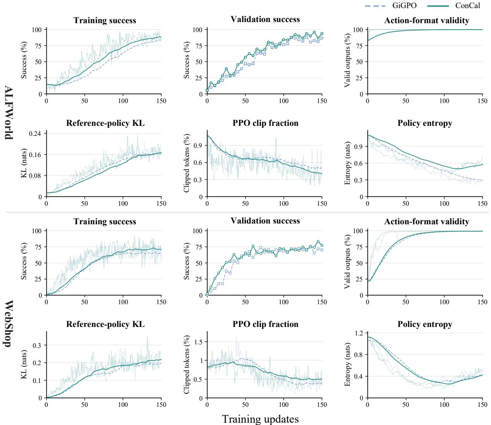  
Figure 9: Training dynamics of ConCal and GiGPO with Qwen2.5-1.5B-Instruct. The top two rows show ALFWorld, and the bottom two rows show WebShop. Faint lines show raw training metrics, and bold lines show exponentia moving averages with decay 0.95. Validation success is shown at the recorded evaluation updates without smoothing.

## G Discussion with Related Methods

## G.1 GraphGPO

GraphGPO (Cheng et al., 2026) constructs step rewards from shortest-path distances to successful terminal states. ConCal focuses on calibrating the action-value differences used for local credit. It recursively combines shared continuation evidence with each visit’s own transition target, then evaluates actions using their recorded rewards and actual successors. Its credit therefore reflects estimated discounted returns, while GraphGPO’s credit reflects distance to success on the merged graph. For actions from the same state with equal transition costs and equally distant successors, GraphGPO assigns identical distance-based step rewards. Con-Cal can still distinguish their action values through differences in recorded rewards and sampled continuation evidence, with partial sharing retaining each visit’s contribution.

## G.2 SALT

SALT (Li et al., 2026) averages trajectory-level advantages across matched transitions to assign steplevel credit. ConCal instead recursively calibrates continuation values by partially pooling targets $r + \gamma \widehat { V }$ across visits matched by their incoming transitions, retaining each visit’s own transition contribution. It constructs action values from recorded rewards and calibrated continuation estimates at their actual successors, then derives local advantages through state-group centering. Recursive propagation also reaches earlier actions whose successor visits have no direct cross-trajectory match. SALT focuses on refining trajectory-level advantages into step-level credit, whereas our study centers on continuation-value estimation before local credit is formed. We provide an in-depth empirical analysis of how calibration changes preference strength and action ordering, and how normalization preserves or suppresses the resulting value gaps in local credit.

## G.3 GRAFT

Concurrent work GRAFT (Yao et al., 2026) explicitly constructs a trajectory graph and estimates shared node values through empirical Bellman iteration. It derives step advantages from node-value differences and further refines them with Graph GAE. ConCal instead partially shares continuation evidence across visits matched by incoming transitions while retaining a separate estimate for each visit (Equation 9). Its recursive updates operate directly on recorded visits without explicitly constructing a transition graph. Action values combine recorded rewards with calibrated continuations at actual successors, with the state-group mean providing the local baseline. GRAFT focuses on graph-based state-value recovery and stepadvantage construction, whereas our study centers on partial continuation calibration and its effects on relative action values. Using held-out returns, our in-depth empirical analysis distinguishes preference-strength calibration from action-order changes: Gap-matched reproduces most of Con-Cal’s centered-MSE reduction relative to Own-MC through magnitude adjustment, while ConCal also improves ordering agreement.

## H Prompt Templates

We construct training and evaluation prompts from the environment templates provided by verlagent (Feng et al., 2025). Each prompt contains the task, current observation, available actions, and up to two recent observation–action pairs. At each interaction step, we fill the placeholders in curly braces with the corresponding values. The prompts request reasoning within <think> tags and a single action within <action> tags.

Figures 10 and 11 show the templates with interaction history. At the initial step, we select the corresponding template without interaction history. Figures 12 and 13 show example user prompts from validation episodes on ALFWorld and WebShop, respectively.

You are an expert agent operating in the ALFRED Embodied Environment. Your task is to:   
{task\_description}   
Prior to this step, you have already taken {step\_count} step(s). Below are the most recent   
{history\_length} observations and the corresponding actions you took: {action\_history}   
You are now at step {current\_step} and your current observation is: {current\_observation}   
Your admissible actions of the current situation are: [{admissible\_actions}].   
Now it's your turn to take an action.   
You should first reason step-by-step about the current situation. This reasoning process MUST be   
enclosed within <think> </think> tags.   
Once you've finished your reasoning, you should choose an admissible action for current step and   
present it within <action> </action> tags.  
Figure 10: ALFWorld prompt template with interaction history. At the initial step, the task is included in the initial observation, and the history and step-index fields are omitted.

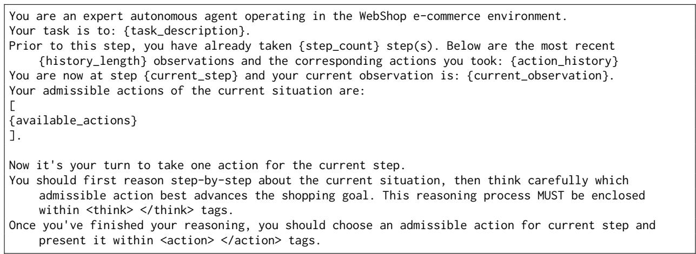  
Figure 11: WebShop prompt template with interaction history. A template without history is selected at the initial step and when the formatted prompt exceeds 13,000 characters.

You are an expert agent operating in the ALFRED Embodied Environment. Your task is to: look at cd   
under the desklamp.   
Prior to this step, you have already taken 3 step(s). Below are the most recent 2 observations and   
the corresponding actions you took: [Observation 2: 'You arrive at desk 1. On the desk 1, you   
see a cd 1, a cellphone 1, a creditcard 2, and a creditcard 1.', Action 2: 'take cd 1 from desk   
1']   
[Observation 3: 'You pick up the cd 1 from the desk 1.', Action 3: 'go to desk 2']   
You are now at step 4 and your current observation is: You arrive at desk 2. On the desk 2, you see   
a book 1, a pen 2, a pen 1, and a pencil 2.   
Your admissible actions of the current situation are: ['examine cd 1'   
'examine desk 2'   
'go to bed 1'   
'go to desk 1'   
'go to garbagecan 1'   
'go to shelf 1'   
'go to shelf 2'   
'go to shelf 3'   
'go to shelf 4'   
'go to shelf 5'   
'inventory'   
'look'   
'move cd 1 to desk 2'].   
Now it's your turn to take an action.   
You should first reason step-by-step about the current situation. This reasoning process MUST be   
enclosed within <think> </think> tags.   
Once you've finished your reasoning, you should choose an admissible action for current step and   
present it within <action> </action> tags.  
Figure 12: An example ALFWorld user prompt from a validation episode, showing the task, the two most recent interactions, the current observation, and available actions.

You are an expert autonomous agent operating in the WebShop e-commerce environment.   
Your task is to: Find me eco friendly, heavy duty, assembly required, easy clean file cabinets with   
size: 35.4"w x 15.7"d x 29.3"h, and price lower than 200.00 dollars.   
Prior to this step, you have already taken 8 step(s). Below are the most recent 2 observations and   
the corresponding actions you took: [Observation 7: '[button] Back to Search [button\_]   
[button] < Prev [button\_]   
size   
[button] 23.6"w x 15.7"d x 29.3"h [button\_]   
[button] 35.4"w x 15.7"d x 29.3"h [button\_]   
DEVAISE 2-Drawer Wood Lateral File Cabinet with Lock for Office Home, Black   
Price: \$169.99   
Rating: N.A.   
[button] Description [button\_]   
[button] Features [button\_]   
[button] Reviews [button\_]   
[button] Buy Now [button\_]   
', Action 7: 'click[35.4"w x 15.7"d x 29.3"h]']   
[Observation 8: '[button] Back to Search [button\_]   
[button] < Prev [button\_]   
size   
[button] 23.6"w x 15.7"d x 29.3"h [button\_]   
[button] 35.4"w x 15.7"d x 29.3"h [button\_]   
DEVAISE 2-Drawer Wood Lateral File Cabinet with Lock for Office Home, Black   
Price: \$169.99   
Rating: N.A.   
[button] Description [button\_]   
[button] Features [button\_]   
[button] Reviews [button\_]   
[button] Buy Now [button\_]   
', Action 8: 'click[35.4"w x 15.7"d x 29.3"h]']   
You are now at step 9 and your current observation is: [button] Back to Search [button\_]   
[button] < Prev [button\_]   
size   
[button] 23.6"w x 15.7"d x 29.3"h [button\_]   
[button] 35.4"w x 15.7"d x 29.3"h [button\_]   
DEVAISE 2-Drawer Wood Lateral File Cabinet with Lock for Office Home, Black   
Price: \$169.99   
Rating: N.A.   
[button] Description [button\_]   
[button] Features [button\_]   
[button] Reviews [button\_]   
[button] Buy Now [button\_]   
Your admissible actions of the current situation are:   
[   
'click[back to search]',   
'click[< prev]',   
'click[description]',   
'click[features]',   
'click[reviews]',   
'click[buy now]',   
'click[23.6"w x 15.7"d x 29.3"h]',   
'click[35.4"w x 15.7"d x 29.3"h]',   
].   
Now it's your turn to take one action for the current step.   
You should first reason step-by-step about the current situation, then think carefully which   
admissible action best advances the shopping goal. This reasoning process MUST be enclosed   
within <think> </think> tags.   
Once you've finished your reasoning, you should choose an admissible action for current step and   
present it within <action> </action> tags.  
Figure 13: An example WebShop user prompt from a validation episode, showing the shopping goal, the two most recent interactions, the current product page, and available actions.