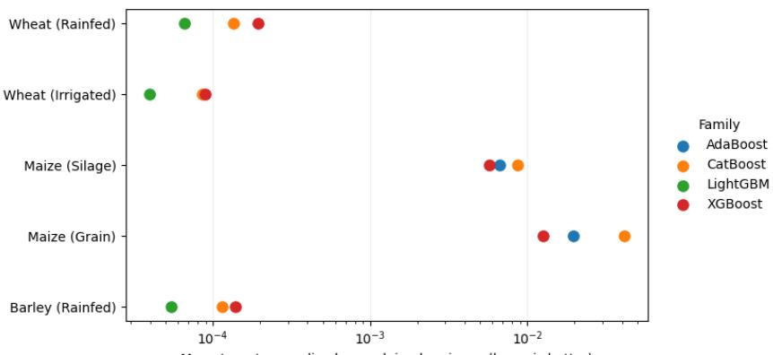
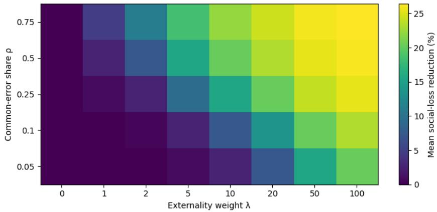
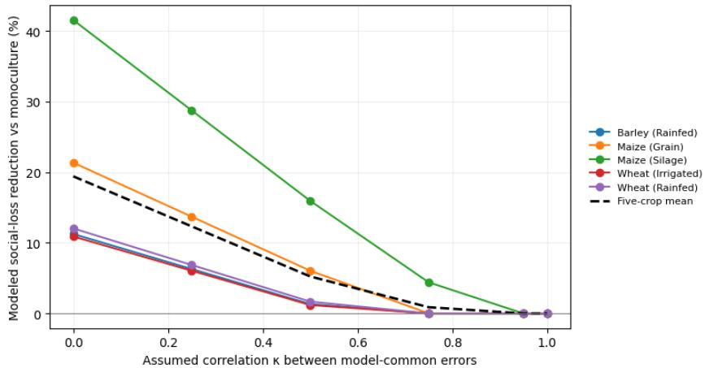

# Algorithmic Monoculture in Machine Learning-based Site-Specific Fertilizer Recommendation

Abdelghani Belgaid College of Computing Mohammed VI Polytechnic University abdelghani.belgaid@um6p.ma

## Abstract

Machine learning recommendations are often evaluated one model at a time, despite deployment across interconnected decision makers. For continuous NPK fertilizer prescriptions, correlated errors can aggregate across farms and generate systemic costs. A model of shared and farm-specific recommendation errors links expected social loss to model adoption shares; the Herfindahl–Hirschman Index characterizes concentration effects when common model errors are independent and predictive risks are equal. A covariance-generalized formulation captures the dependence between model families. A two-model threshold characterizes when privately optimal monoculture is socially dominated, and a convex portfolio rule limits average private predictive regret. Nine model families across five Moroccan cereal systems provide a benchmark-based calibration. Under illustrative parameters and a 10% regret cap, accuracy-constrained diversification lowers modeled social loss in all five systems by 10.89–41.53% (mean 19.41%). Uniform allocation reduces modeled loss in this setting, but breaches the regret cap in every crop. Correlation sensitivity shows that highly dependent model errors attenuate the benefits of diversification. These counterfactual outcomes are not estimates of agronomic or monetary welfare; the framework identifies adoption architecture and error dependence as ecosystem-level evaluation variables.

## 1 Introduction

Machine learning systems increasingly provide prescriptions rather than predictions [Ennaji et al., 2026]. Fertilizer recommendations influence nutrient purchases, application rates, and exposure to environmental externalities. Evaluation nevertheless remains model-centered: predictive error is measured for individual systems, while correlated consequences of adoption across farms receive less attention.

Algorithmic monoculture provides an economic lens for this problem. A shared algorithm may impair collective outcomes despite strong individual accuracy [Kleinberg and Raghavan, 2021]. Related work considers strategic adoption [Kleinberg et al., 2026], critiques unconditional claims about monoculture [Hedden and Raghavan, 2026], and investigates multiplicity or shared-provider outcomes [Gorecki and Hardt, 2025, Bommasani et al., 2026]. In ranking and matching settings, interactions can arise through congestion or competition for scarce selections. Continuous prescriptions instead create a distinct aggregation channel: model-common errors in cardinal nutrient recommendations can synchronize over- or under-application across adopters, with quadratic costs attached to aggregate imbalances.

The contribution is threefold. First, a continuous-action economic model links cross-farm adoption shares, shared recommendation errors, and aggregate externalities; the concentration result admits a cross-model covariance generalization. Second, a closed-form monoculture threshold and an accuracy-constrained convex portfolio make the private-risk versus systemic-risk tradeoff explicit. Third, an open benchmark of nine model families in five Moroccan cereal systems [Belgaid et al., 2026] calibrates the framework and illustrates sensitivity to externality intensity, error concentration, and cross-model dependence. The analysis concerns the assignment of distinct models across farms, not the averaging of their predictions within a single farm.

All quantitative outcomes are conditional on benchmark predictive risks and stated sensitivity parameters. Reference prescriptions are not causal agronomic optima, and modeled social-loss reductions are not estimated changes in yield, profit, or environmental damage.

## 2 Related literature

## 2.1 Algorithmic monoculture and predictive multiplicity

Shared decision technology can create collective inefficiencies [Kleinberg and Raghavan, 2021, Kleinberg et al., 2026]; whether monoculture is harmful depends on a specified externality mechanism [Hedden and Raghavan, 2026]. Evidence from deployed prediction systems and hiring motivates ecosystem-level analysis [Gorecki and Hardt, 2025, Bommasani et al., 2026]. Predictive multiplicity concerns disagreement among comparably accurate models [Marx et al., 2020, Hsu et al., 2024]. By contrast, ensemble learning combines predictions for an individual decision [Wood et al., 2023]. Here, each farm uses one model; diversification does not average away that farm’s private error but can reduce covariance-driven loss across adopters.

## 2.2 Decision-focused learning and fertilizer economics

Decision-focused learning and predict-then-optimize methods connect predictive quality to downstream decisions for a task [Donti et al., 2017, Elmachtoub and Grigas, 2022]. The present formulation additionally couples decisions across farms through aggregate externalities, even without performative distribution shift [Perdomo et al., 2020]. Site-specific fertilizer modeling and optimization are relevant antecedents [Ennaji et al., 2023, 2026, Belgaid, 2025, Belgaid and Ennaji, 2025]; econometric and experimental studies distinguish prescription fidelity from economically optimal nitrogen rates [De Lara et al., 2023, Tanaka et al., 2024]. Fertilizer externalities can differ from private costs [Keeler et al., 2016, Gourevitch et al., 2018]. The distinct object here is deployment-level loss from correlated multidimensional prescription errors rather than prediction or optimization accuracy alone.

## 3 Economic model

Consider n farms and M models. Farm i uses model $m ( i )$ to produce a d-dimensional prescription, with $d = 3$ for $N , P _ { 2 } O _ { 5 }$ , and $K _ { 2 } O$ . Given benchmark reference prescription $a _ { i } ^ { \star }$ , define

$$
\hat { a } _ { i } = a _ { i } ^ { \star } + \varepsilon _ { i , m ( i ) } , \qquad \varepsilon _ { i m } = z _ { m } + u _ { i m } .\tag{1}
$$

The benchmark reference is not an identified agronomic optimum.

Assumption 1 (Common-error decomposition). For a fixed allocation $m ( i )$ , expectations are over the joint distribution of the zero-mean model-common shocks $z _ { m }$ and farm-specific errors $u _ { i m }$ . The common shocks are mutually uncorrelated across modelfamilies;farm-specific errors are mutually uncorrelated acrossfarms and orthogonal to every common shock. Second moments are homogeneous acrossfarms within each modelfamily. For afixed nutrient-scaling matrix C, let

$$
\begin{array} { r } { \mathbb { E } \| C z _ { m } \| _ { 2 } ^ { 2 } = \rho r _ { m } , \quad \mathbb { E } \| C u _ { i m } \| _ { 2 } ^ { 2 } = ( 1 - \rho ) r _ { m } , \quad r _ { m } = \mathbb { E } \| C \varepsilon _ { i m } \| _ { 2 } ^ { 2 } > 0 , } \end{array}\tag{2}
$$

where the common-error share $\rho \in [ 0 , 1 ]$ is shared across model families in the baseline calibration.

Let $q _ { m } \geq 0$ be the share of farms assigned model m and $\Delta _ { M } = \{ q : \textstyle \sum _ { m } q _ { m } = 1 , q _ { m } \ge 0 \}$ Average private loss is $\begin{array} { r } { L _ { \mathrm { p r i v a t e } } ( q ) = \frac { 1 } { 2 } \sum _ { m } q _ { m } r _ { m } } \end{array}$ . A quadratic penalty on the normalized aggregate prescription error represents a stylized systemic externality:

$$
L _ { \mathrm { s y s t e m } } ( q ) = \frac { \lambda } { 2 n ^ { 2 } } \mathbb { E } \left\| \sum _ { i = 1 } ^ { n } C \varepsilon _ { i , m ( i ) } \right\| _ { 2 } ^ { 2 } = \frac { \lambda } { 2 } \left[ \rho \sum _ { m } q _ { m } ^ { 2 } r _ { m } + \frac { 1 - \rho } { n } \sum _ { m } q _ { m } r _ { m } \right] ,\tag{3}
$$

where $\lambda \geq 0$ , with integer adoption counts $n q _ { m }$ . Total loss is $L = L _ { \mathrm { p r i v a t e } } + L _ { \mathrm { s y s t e m } }$ . Farm-specific contributions vanish at rate $1 / \bar { n }$ , whereas common shocks persist. Continuous optimization over $\Delta _ { M }$ relaxes the adoption-count grid, becoming exact at feasible integer allocations.

Cross-model covariance. Independence between model-common shocks is not required for the generalized framework. Define the positive semidefinite matrix $( \Sigma _ { z } ) _ { m m ^ { \prime } } = \mathbb { E } [ ( C \bar { z _ { m } } ) ^ { \top } ( C z _ { m ^ { \prime } } ) ]$ with diagonal entries $\rho r _ { m }$ . Orthogonality of farm-specific and common errors yields

$$
L ( q ) = \frac { 1 } { 2 } \sum _ { m } q _ { m } r _ { m } + \frac { \lambda } { 2 } \left[ q ^ { \top } \Sigma _ { z } q + \frac { 1 - \rho } { n } \sum _ { m } q _ { m } r _ { m } \right] .\tag{4}
$$

Equation (3) is recovered for $\Sigma _ { z } = \rho \mathrm { d i a g } ( r )$ . Cross-model dependence, not concentration alone, then determines systemic exposure.

## 3.1 Concentration and monoculture threshold

Write HH $\begin{array} { r } { \operatorname { I } ( q ) = \sum _ { m } q _ { m } ^ { 2 } } \end{array}$ for the Herfindahl–Hirschman Index.

Proposition 1 (Concentration penalty). $I f r _ { m } = r > 0 f o r$ every model, then under Assumption 1, $\begin{array} { r } { L ( q ) \ = \ \frac { r } { 2 } [ 1 + \lambda ( \rho \mathrm { H H I } ( q ) + \bar { ( 1 - \rho ) } / \bar { n } ) ] } \end{array}$ . For $\lambda \rho > 0$ , uniform adoption minimizes loss and monoculture maximizes it over $\Delta _ { M }$

Proposition 2 (Accuracy-monoculture threshold). For two models with $0 < r _ { 1 } < r _ { 2 }$ and $\rho > 0 _ { : }$ , a marginal adoption shift to model 2 improves social loss if

$$
\lambda > \frac { r _ { 2 } - r _ { 1 } } { 2 \rho r _ { 1 } - ( 1 - \rho ) ( r _ { 2 } - r _ { 1 } ) / n } ,\tag{5}
$$

provided the denominator is positive. Otherwise monoculture is optimal for all $\lambda \geq 0 .$ . For large n, the threshold approaches $( r _ { 2 } - r _ { 1 } ) / ( 2 \rho r _ { 1 } )$ .

The most accurate model minimizes individual expected predictive risk, but need not minimize population-level loss. For $\lambda \rho > 0$ , the unconstrained two-model allocation to model 2 is

$$
x ^ { \star } = \left[ \frac { 2 \lambda \rho r _ { 1 } - ( r _ { 2 } - r _ { 1 } ) ( 1 + \lambda ( 1 - \rho ) / n ) } { 2 \lambda \rho ( r _ { 1 } + r _ { 2 } ) } \right] _ { 0 } ^ { 1 } ;\tag{6}
$$

for $\lambda \rho = 0$ , set $x ^ { \star } = 0$ . Proofs and boundary conditions appear in Appendix A. With nonzero crossmodel covariance $\sigma _ { 1 2 }$ , the denominator in Equation (5) becomes $2 ( \rho r _ { 1 } - \sigma _ { 1 2 } ) - ( 1 - \rho ) ( r _ { 2 } - r _ { 1 } ) / n ;$ positive covariance can eliminate the incentive to diversify.

## 3.2 Accuracy-constrained diversification

A portfolio can minimize $L ( q )$ subject to an average private-regret bound:

$$
\operatorname* { m i n } _ { q \in \Delta _ { M } } L ( q ) \qquad \mathrm { s u b j e c t ~ t o } \qquad \sum _ { m } q _ { m } r _ { m } \leq ( 1 + \delta ) r _ { \operatorname* { m i n } } , \quad r _ { \operatorname* { m i n } } = \operatorname* { m i n } _ { m } r _ { m } .\tag{7}
$$

The quadratic portfolio formulation is related to classical mean–variance optimization [Markowitz, 1955]. The objective is convex because $\Sigma _ { z }$ is positive semidefinite. The cap constrains populationaverage predictive risk, not the risk experienced by every individual farm. This allocation problem differs from single-farm ensemble prediction.

## 4 Empirical calibration

## 4.1 Benchmarks and normalized risk

The calibration uses published turba-models benchmark results associated with turba-data recommendation scenarios and the independent Turba Fertilizer Machine Learning Stack [Belgaid et al., 2026, Turba Open Lab, 2026a,c,d]. Reference NPK targets originate from publicly accessible Fertimap recommendation workflows [Fertimap.ma, Turba Open Lab, 2026b]; they are not observed crop responses. The dataset comprises 132,017 crop-location recommendation scenarios from 44,096 unique coordinates. Nine regression model families (Extra Trees [Geurts et al., 2006], LightGBM [Ke et al., 2017], CatBoost [Prokhorenkova et al., 2018], Random Forest [Breiman, 2001], XGBoost [Chen and Guestrin, 2016], linear regression, ridge regression [Hoerl and Kennard, 1970], elastic net [Zou and Hastie, 2005], and AdaBoost [Freund and Schapire, 1997]) are evaluated across rainfed barley, grain maize, silage maize, irrigated wheat, and rainfed wheat. Models use six spatial and soil covariates, with deterministic crop-specific 80/20 benchmark partitions [Belgaid et al., 2026].

For crop c and model m, benchmark risk is the mean target-normalized unexplained variance,

$$
r _ { c m } = \frac { 1 } { 3 } \sum _ { t \in \{ N , P _ { 2 } O _ { 5 } , K _ { 2 } O \} } ( 1 - R _ { c m t } ^ { 2 } ) .\tag{8}
$$

On a common evaluation sample, this corresponds to Equation (2) for $\begin{array} { r l } { C _ { c } } & { { } = } \end{array}$ $3 ^ { - 1 / 2 } \mathrm { d i a g } ( \sigma _ { c , N } ^ { - 1 } , \sigma _ { c , P _ { 2 } O _ { 5 } } ^ { - 1 } , \sigma _ { c , K _ { 2 } O } ^ { - 1 } )$ , with $\sigma _ { c , t } ^ { 2 }$ the reference-target variance using the benchmark’s normalization. Equal variance-normalized nutrient weights are a calibration convention, not estimated nutrient-specific externality valuations.

## 4.2 Counterfactual design

The three lowest-risk models per crop form the candidate portfolio. Central illustrative parameters are $\rho = 0 . 2 5 , \lambda = 2 0 , n = 1 0 , 0 0 0$ , and average private-regret cap $\delta = 0 . 1 0$ . None of $\rho , \lambda ,$ , or the cross-model correlations are identified by aggregate benchmark statistics. Four allocation policies are compared: lowest-risk monoculture, uniform allocation, constrained loss minimization (Equation (7)), and unconstrained social-loss minimization. The sensitivity grid spans $\rho \in \{ . 0 5 , . 1 0 , . 2 \bar { 5 } , . 5 0 , . 7 5 \}$ $\lambda \in \{ 0 , 1 , 2 , 5 , 1 0 , 2 0 , 5 0 , 1 0 0 \}$ , and $\delta \in \{ . 0 5 , . 1 0 , . 2 5 \}$ . Covariance sensitivity sets $\Sigma _ { z } = \rho D [ ( 1 -$ $\kappa ) I + \kappa \mathbf { 1 1 } ^ { \top } ] D , D = \mathrm { d i a g } ( \sqrt { r } )$ , for $\kappa \in \{ 0 , . 2 5 , . 5 0 , . 7 5 , . 9 5 , 1 \}$ . These are assumed scenarios, not measured residual correlations.

## 5 Experimental results

## 5.1 Predictive multiplicity and constrained outcomes

Figure 1 identifies the three lowest-risk model families per crop; the distinct alternative risks determine the private cost of diversification. For $\rho = . 2 5$ and $n = 1 0 { , } 0 0 0$ , the analytical two-model thresholds vary from 0.35 (silage maize) to 2.34 (irrigated wheat).

  
Mean target-normalized unexplained variance (lower is better)  
Figure 1: Mean target-normalized unexplained variance $( 1 - R ^ { 2 } )$ for the three lowest-risk benchmark families in each crop system (log scale). Lower is better.

Table 1 reports the central calibration. Constrained portfolios reduce modeled loss in all five systems by 10.89–41.53%, averaging 19.41%. The private-regret cap binds in each crop; diversified allocations nevertheless differ substantially in concentration. All figures denote percentages of a dimensionless model objective, not realized welfare changes.

Table 1: Central calibration $( \rho = . 2 5 , \lambda = 2 0 , n = 1 0 , 0 0 0 , \delta = . 1 0 )$ . λ∗ is the marginal two-model threshold; HHI and reduction refer to the three-model constrained portfolio.
<table><tr><td>Crop</td><td>Best</td><td>Second</td><td> $\lambda ^ { * }$ </td><td>HHI</td><td>Reduction (%)</td></tr><tr><td>Barley (Rainfed)</td><td>LightGBM</td><td>CatBoost</td><td>2.22</td><td>.836</td><td>11.25</td></tr><tr><td>Maize (Grain)</td><td>XGBoost</td><td>AdaBoost</td><td>1.12</td><td>.706</td><td>21.34</td></tr><tr><td>Maize (Silage)</td><td>XGBoost</td><td>AdaBoost</td><td>.35</td><td>.457</td><td>41.53</td></tr><tr><td>Wheat (Irrigated)</td><td>LightGBM</td><td>CatBoost</td><td>2.34</td><td>.844</td><td>10.89</td></tr><tr><td>Wheat (Rainfed)</td><td>LightGBM</td><td>CatBoost</td><td>2.08</td><td>.826</td><td>12.04</td></tr></table>

The constrained shares assigned to the lowest-risk model are 91.0% for barley, 82.1% for grain maize, 57.0% for silage maize, 91.7% for irrigated wheat, and 90.4% for rainfed wheat. Uniform allocation also lowers modeled loss in the central calibration, but exceeds the 10% average private-regret cap for all five crop systems (22.99–99.16%). Its value is conditional: at $\lambda = 0 ,$ uniform diversification increases loss because no systemic externality offsets the sacrifice in private predictive risk. Complete three-model risks, shares, and outcomes for all four policies appear in Appendix B and the notebook.

## 5.2 Parameter and covariance sensitivity

Among 600 crop-by-parameter scenarios, 69.0% yield strictly positive constrained loss reductions. This is a fraction of the prespecified grid, not an estimated probability of benefits. Gains vanish for $\lambda = 0$ and generally increase with assumed common-error exposure and externality intensity (Figure 2).

Figure 2: Mean constrained social-loss reduction across the sensitivity grid as a function of $\rho$ and λ. Each cell averages five crop systems and three regret caps $( \delta \in \{ . 0 5 , \mathrm { { . 1 \bar { 0 } } , . 2 5 } \} )$ .  
  
Figure 3: Illustrative sensitivity to assumed pairwise correlation κ between model-common errors; constrained portfolios are optimized separately at each κ with $\rho = . 2 5 , \lambda = 2 0 .$ , and $\delta \ = \ . 1 0$ Correlations are not empirically identified.

Figure 3 examines covariance among common model errors. $\mathrm { W i t h } \kappa = . 5 ,$ , modeled constrained gains are 1.19–15.94% across crops; with $\kappa \geq . 9 5$ , no material gains remain in this calibration. This limits unconditional interpretations of model diversity: error independence is consequential, and adoption concentration alone does not identify systemic exposure.

## 6 Economic interpretation and institutional value

Individual model rankings need not determine efficient ecosystem architecture. A centralized advisor could assign distinct models across farms, whereas a decentralized provider market could produce adoption shares through individual choices. Either interpretation requires distinguishing portfolio allocation across farms from ensemble averaging within a farm. The regret constraint limits the population-average predictive sacrifice when governance objectives favor diversification. Provider concentration, model-version concentration, and error dependence are relevant deployment statistics. Adoption itself remains institutionally mediated; evidence from Moroccan wheat systems associates recommended fertilizer uptake with information, credit, incentives, and market access [Azhari et al., 2024].

## 7 Limitations

The benchmark evaluates fidelity to upstream recommendation outputs, not causal yield response or agronomic optimality. Deterministic crop-specific random splits primarily measure interpolation; nearby geographical samples may be dependent, and maize evaluation includes substantially fewer locations than winter cereals [Belgaid et al., 2026]. Aggregate $R ^ { 2 }$ cannot identify the common-error share $\rho ,$ the externality weight λ, or the covariance of model-common shocks. Pairwise residual correlations on one holdout set alone cannot separate persistent cross-farm common shocks from correlated site-level errors. Grouped or repeated observations across regions, seasons, or training realizations would be needed for variance-component identification. Fertilizer market effects and environmental damage require separate causal or structural evidence [Keeler et al., 2016, Gourevitch et al., 2018]. Adoption shares are treated as exogenous, and the quadratic externality is stylized. The reported gains are conditional modeled losses rather than estimated farm profits, emissions reductions, or monetary social welfare.

## 8 Conclusion

Continuous fertilizer prescriptions provide an economic mechanism for algorithmic monoculture: shared model errors can aggregate across farms and generate systemic costs. Under explicit assump tions, HHI captures concentration risk; with correlated model-common errors, the relevant quantity is the covariance-weighted adoption portfolio. Benchmark-calibrated counterfactuals illustrate when regret-constrained allocation can improve modeled social loss and when dependence among model errors removes that advantage. Ecosystem-level evaluation therefore requires both predictive-risk safeguards and careful treatment of error covariance and externality assumptions.

## References

Mohamed El Azhari, Youssef El Hamadi, Mohamed Boughlala, and Samia Hattab. Factors affecting the adoption of recommended fertilizer doses by wheat farmers in the Casablanca-Settat region of Morocco. AGRIS on-line Papers in Economics and Informatics, 16(2):25–38, 2024.

Abdelghani Belgaid. Site-specific fertilizer recommendation through machine learning. Master’s thesis, University Mohammed VI Polytechnic, 2025.

Abdelghani Belgaid and Oumnia Ennaji. Sagda: Open-source synthetic agriculture data for africa. arXiv preprint arXiv:2506.13123, 2025.

Abdelghani Belgaid, Zakaria Mahmoud, Fahd Chibani, Oumnia Ennaji, Younes Boudoul, and Dounia Rachid. Technical report on the turba fertilizer machine learning stack in Morocco. arXiv preprint arXiv:2610.05949, 2026.

Rishi Bommasani, Sarah H Bana, Kathleen A Creel, Dan Jurafsky, and Percy Liang. Algorithmic monocultures in hiring. In The 2026 ACM Conference on Fairness, Accountability, and Transparency, pages 6351–6382, 2026.

Leo Breiman. Random forests. Machine learning, 45(1):5–32, 2001.

Tianqi Chen and Carlos Guestrin. XGBoost: A scalable tree boosting system. In Proceedings of the 22nd acm sigkdd international conference on knowledge discovery and data mining, pages 785–794, 2016.

Alfonso De Lara, Taro Mieno, Joe D Luck, and Laila A Puntel. Predicting site-specific economic optimal nitrogen rate using machine learning methods and on-farm precision experimentation. Precision Agriculture, 24(5):1792–1812, 2023.

Priya Donti, Brandon Amos, and J Zico Kolter. Task-based end-to-end model learning in stochastic optimization. Advances in neural information processing systems, 30, 2017.

Adam N Elmachtoub and Paul Grigas. Smart “predict, then optimize”. Management science, 68(1): 9–26, 2022.

Oumnia Ennaji, Leonardus Vergütz, and Achraf El Allali. Machine learning in nutrient management: A review. Artificial Intelligence in Agriculture, 9:1–11, 2023.

Oumnia Ennaji, Abdelghani Belgaid, and Achraf El Allali. Machine learning–based optimization of site-specific NPK fertilizer recommendation. Smart Agricultural Technology, page 101823, 2026. doi: 10.1016/j.atech.2026.101823.

Fertimap.ma. http://www.fertimap.ma/. Accessed August 2026.

Yoav Freund and Robert E Schapire. A decision-theoretic generalization of on-line learning and an application to boosting. Journal ofcomputer and system sciences, 55(1):119–139, 1997.

Pierre Geurts, Damien Ernst, and Louis Wehenkel. Extremely randomized trees. Machine learning, 63(1):3–42, 2006.

Mila Gorecki and Moritz Hardt. Monoculture or multiplicity: Which is it? Advances in Neural Information Processing Systems, 38, 2025.

Jesse D Gourevitch, Bonnie L Keeler, and Taylor H Ricketts. Determining socially optimal rates of nitrogen fertilizer application. Agriculture, Ecosystems & Environment, 254:292–299, 2018.

Brian Hedden and Manish Raghavan. Algorithmic monoculture and its critics. arXiv preprint arXiv:2604.06047, 2026.

Arthur E Hoerl and Robert W Kennard. Ridge regression: Biased estimation for nonorthogonal problems. Technometrics, 12(1):55–67, 1970.

Hsiang Hsu, Ivan Brugere, Shubham Sharma, Freddy Lecue, and Chun-Fu Chen. RashomonGB: Analyzing the Rashomon effect and mitigating predictive multiplicity in gradient boosting. Advances in Neural Information Processing Systems, 37:121265–121303, 2024.

Guolin Ke, Qi Meng, Thomas Finley, Taifeng Wang, Wei Chen, Weidong Ma, Qiwei Ye, and Tie-Yan Liu. LightGBM: A highly efficient gradient boosting decision tree. Advances in neural information processing systems, 30, 2017.

Bonnie L Keeler, Jesse D Gourevitch, Stephen Polasky, Forest Isbell, Chris W Tessum, Jason D Hill, and Julian D Marshall. The social costs of nitrogen. Science advances, 2(10):e1600219, 2016.

Jon Kleinberg and Manish Raghavan. Algorithmic monoculture and social welfare. Proceedings of the National Academy ofSciences, 118(22):e2018340118, 2021.

Robert Kleinberg, Erald Sinanaj, and Éva Tardos. Price of anarchy of algorithmic monoculture. arXiv preprint arXiv:2604.00444, 2026.

Harry M Markowitz. Portfolio selection. PhD thesis, The University of Chicago, 1955.

Charles Marx, Flavio Calmon, and Berk Ustun. Predictive multiplicity in classification. In International conference on machine learning, pages 6765–6774. PMLR, 2020.

Juan Perdomo, Tijana Zrnic, Celestine Mendler-Dünner, and Moritz Hardt. Performative prediction. In International conference on machine learning, pages 7599–7609. PMLR, 2020.

Liudmila Prokhorenkova, Gleb Gusev, Aleksandr Vorobev, Anna Veronika Dorogush, and Andrey Gulin. CatBoost: unbiased boosting with categorical features. Advances in neural information processing systems, 31, 2018.

Takashi ST Tanaka, Gerard BM Heuvelink, Taro Mieno, and David S Bullock. Can machine learning models provide accurate fertilizer recommendations? Precision Agriculture, 25(4):1839–1856, 2024.

Turba Open Lab. Turba Software, May 2026a. URL https://doi.org/10.5281/zenodo. 20044002.

Turba Open Lab. turba-client. https://github.com/open-turba/turba-client, 2026b. Python client for soil profile and fertilizer recommendation workflows in Morocco.

Turba Open Lab. turba-data. https://github.com/open-turba/turba-data, 2026c. Analysisready fertilizer recommendation datasets for Morocco.

Turba Open Lab. turba-models. https://github.com/open-turba/turba-models, 2026d. Pretrained fertilizer recommendation models and benchmark results for Morocco.

Danny Wood, Tingting Mu, Andrew M Webb, Henry WJ Reeve, Mikel Lujan, and Gavin Brown. A unified theory of diversity in ensemble learning. Journal of machine learning research, 24(359): 1–49, 2023.

Hui Zou and Trevor Hastie. Regularization and variable selection via the elastic net. Journal ofthe Royal Statistical Society Series B: Statistical Methodology, 67(2):301–320, 2005.

## A Proofs and theoretical details

## A.1 Concentration proposition

Under Assumption 1, orthogonality removes cross terms in the expected squared aggregate error, giving Equation (3). I $: r _ { m } = r$ , the private term equals $r / 2$ and the common-error contribution equals $\bar { \lambda } \rho r \bar { \mathrm { H H I } ( q ) } / 2$ . For $\lambda \rho r > 0$ , the inequality $1 / M { \ ' } \le \mathrm { H H I } ( q ) \le 1$ gives the minimum and maximum at uniform allocation and monoculture, respectively.

## A.2 Accuracy-monoculture threshold and edge cases

Write $\Delta = r _ { 2 } - r _ { 1 } > 0$ and let model 2 receive share x. The first derivative of the social-loss objective at monoculture is

$$
\begin{array} { r } { L ^ { \prime } ( 0 ) = \frac { 1 } { 2 } \{ \Delta + \lambda [ - 2 \rho r _ { 1 } + ( 1 - \rho ) \Delta / n ] \} . } \end{array}\tag{9}
$$

Since $L ^ { \prime \prime } ( x ) = \lambda \rho ( r _ { 1 } + r _ { 2 } ) \ge 0$ , a positive denominator in Equation (5) and λ exceeding the threshold imply a beneficial marginal shift. If the denominator is nonpositive, $L ^ { \prime } ( 0 ) > 0$ for every $\lambda \geq 0$ and monoculture remains optimal. When $\lambda \rho > 0$ , solving $\hat { L ^ { \prime } } ( x ) = 0$ and clipping to $[ 0 , 1 ]$ gives Equation (6); when $\lambda \rho = 0 , { \overset { \cdot } { x } } ^ { \star } = 0$ . Under correlated common errors, the cross term $2 x \bar { ( 1 - x ) } \sigma _ { 1 2 }$ yields the adjusted denominator $2 ( \rho r _ { 1 } - \sigma _ { 1 2 } ) - ( 1 - \rho ) \Delta / n$ . The convexity of Equation (4) follows from $\Sigma _ { z } \succeq \bar { 0 }$

## B Benchmark details and sensitivity results

Table 2: Top-three benchmark risks $r _ { c m }$ (mean $1 - R ^ { 2 } ;$ ; selected for each crop). All values are dimensionless.
<table><tr><td>Crop</td><td>First</td><td>r1</td><td>Second</td><td>r2</td><td>Third</td><td>r3</td></tr><tr><td>Barley (Rainfed)</td><td>LightGBM</td><td>.00005460</td><td>CatBoost</td><td>.00011515</td><td>XGBoost</td><td>.00013841</td></tr><tr><td>Maize (Grain)</td><td>XGBoost</td><td>.01262319</td><td>AdaBoost</td><td>.01966976</td><td>CatBoost</td><td>.04116564</td></tr><tr><td>Maize (Silage)</td><td>XGBoost</td><td>.00572708</td><td>AdaBoost</td><td>.00671774</td><td>CatBoost</td><td>.00868627</td></tr><tr><td>Wheat (Irrigated)</td><td>LightGBM</td><td>.00003935</td><td>CatBoost</td><td>.00008541</td><td>XGBoost</td><td>.00008938</td></tr><tr><td>Wheat (Rainfed)</td><td>LightGBM</td><td>.00006606</td><td>CatBoost</td><td>.00013461</td><td>XGBoost</td><td>.00019402</td></tr></table>

Table 3: Counterfactual social-loss reductions relative to lowest-risk monoculture, at $\rho = . 2 5 , \lambda = 2 0$ $n = 1 0 , 0 0 0 ( \% )$ ; uniform and unconstrained allocations do not satisfy the 10% regret cap.
<table><tr><td>Crop</td><td>Monoculture</td><td>Uniform</td><td>Constrained</td><td>Social optimum</td></tr><tr><td>Barley (Rainfed)</td><td>0</td><td>16.36</td><td>11.25</td><td>29.32</td></tr><tr><td>Maize (Grain)</td><td>0</td><td>13.76</td><td>21.34</td><td>32.55</td></tr><tr><td>Maize (Silage)</td><td>0</td><td>45.32</td><td>41.53</td><td>46.99</td></tr><tr><td>Wheat (Irrigated)</td><td>0</td><td>19.35</td><td>10.89</td><td>30.43</td></tr><tr><td>Wheat (Rainfed)</td><td>0</td><td>11.46</td><td>12.04</td><td>28.05</td></tr></table>

Table 4: Constrained adoption shares (percentage of farms), in order of first, second, and third model in Table 2; private-regret constraint binds at 10% in each crop.
<table><tr><td>Crop</td><td> $q _ { 1 } \ ( \% )$ </td><td> $q _ { 2 } \ ( \% )$ </td><td> $q _ { 3 } \ ( \% )$ </td></tr><tr><td>Barley (Rainfed)</td><td>90.98</td><td>9.02</td><td>0.00</td></tr><tr><td>Maize (Grain)</td><td>82.09</td><td>17.91</td><td>0.00</td></tr><tr><td>Maize (Silage)</td><td>57.00</td><td>35.55</td><td>7.45</td></tr><tr><td>Wheat (Irrigated)</td><td>91.68</td><td>5.79</td><td>2.53</td></tr><tr><td>Wheat (Rainfed)</td><td>90.36</td><td>9.64</td><td>0.00</td></tr></table>

## C Reproducibility and compute

The executable analysis and all displayed tables and figures are available in the supplementary Jupyter notebook and at https://github.com/abdelghanibelgaid/ algorithmic-monoculture-fertilizer. The nine-family leaderboard is loaded from turba-models commit c4376f99587cb00d7ae9de92389914ecc29c1412; its source CSV has SHA-256 915d41dc73801f8d0fbfed1a036b82aec7266c737383d1bec1cfd50f431c874f. The notebook reports its execution environment, loads the registered turba-data dataset, and runs CPU-based tabular analysis and constrained quadratic optimization. Inference about agronomic welfare or observed cross-model common shocks is outside its scope.